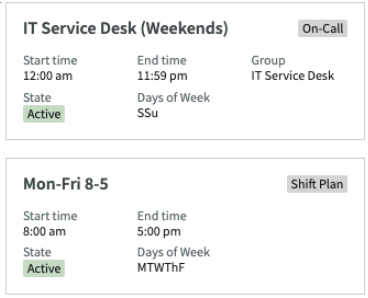
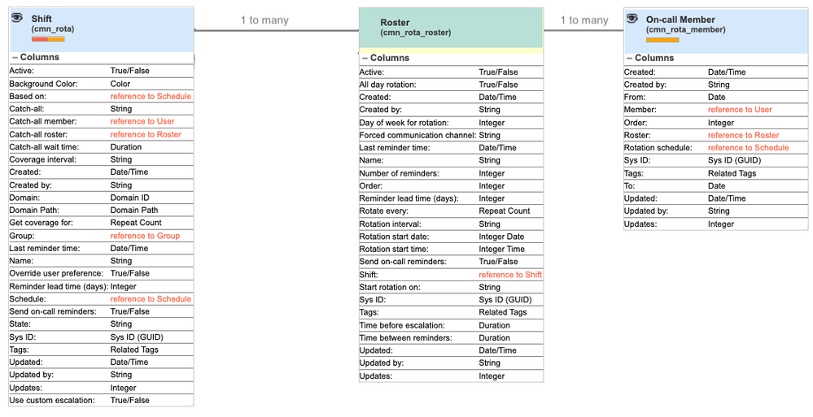
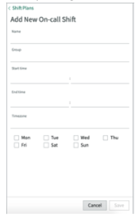
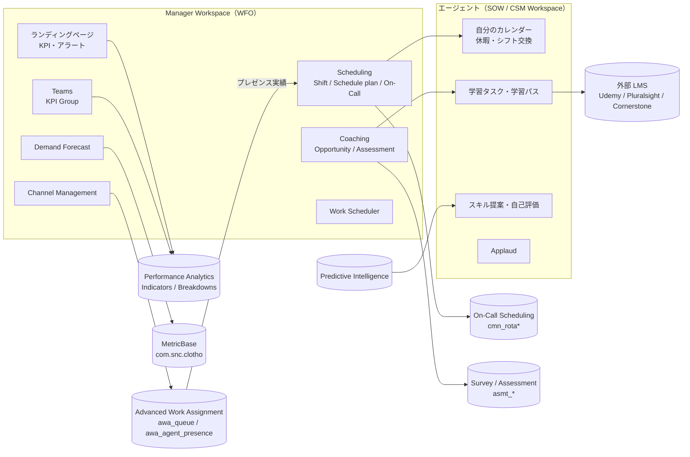

# Workforce Optimization（WFO）for ITSM / CSM

## 概要

Workforce Optimization（WFO、ワークフォース最適化）は、サービスデスクやコンタクトセンターの**マネージャー（管理者・スーパーバイザー）がチームを「管理・監視・育成」するためのアプリケーション群**である。ServiceNow はこれを「manager persona（マネージャーペルソナ）を支援するアプリケーションのセット」と説明している。[出典](https://www.servicenow.com/docs/r/C17ZqvSaMwUVpMBg8Nc5sg/5L8dmg4RycGo1p5HtPBbgg)

WFO は製品ごとに提供され、本ファイルは主に次の 2 つを扱う。

| 製品 | 主プラグイン（ID） | 必要サブスクリプション | 主な UI |
|---|---|---|---|
| Workforce Optimization for ITSM | Workforce Optimization for ITSM Configurable Workspace（`sn_wfo_cfg_itsm`）。ServiceNow Store から別途インストール | ITSM Enterprise | Manager Workspace（マネージャー）、Service Operations Workspace（エージェント） |
| Workforce Optimization for Customer Service（WFO for CSM） | Workforce Optimization for CSM Configurable Workspace（`sn_csm_wfo_workspa`） | CSM Enterprise | Manager Workspace（CSM）、CSM Configurable Workspace |

[出典](https://www.servicenow.com/docs/r/t~YvqQkg2oQX4L7ySrpyuQ/RvxieGzqTQs7bzxd~VuOgA) / [出典（Xanadu）](https://www.servicenow.com/docs/r/YZ6y4yvCOMhykXn0xJSiRA/S8ODn~TaEH_jeTpqw5h1Mg)

WFO を構成する主要モジュール（アプリケーション）は次のとおり。ITSM 版と CSM 版で構成はほぼ共通である。

| モジュール | 日本語 | 役割 |
|---|---|---|
| Manager Workspace landing page / Manager Dashboard | マネージャー用ランディングページ | KPI・アラート・チーム状況をリアルタイムに一覧 |
| Channel Management | チャネル管理 | Advanced Work Assignment（AWA）のキュー・エージェントのプレゼンス／キャパシティを監視し、手動割り当てやキャパシティの一時変更を行う |
| Scheduling（Shift Planning） | スケジューリング（シフト計画） | シフト計画・スケジュール計画の作成・公開、休暇申請・シフト交換、On-Call シフト、スケジュール遵守（Schedule Adherence） |
| Demand Forecast | 需要予測 | 過去データから作業量と必要要員数を予測し、チームカレンダーに表示 |
| Teams（Team Performance） | チーム（チームパフォーマンス） | KPI Group（KPI グループ）でアサインメントグループ単位・エージェント単位のパフォーマンスを追跡 |
| Coaching（Coaching with Learning を含む） | コーチング | コーチング機会（Coaching opportunity）に基づく評価（Assessment）・サーベイによる採点、学習タスク・学習パスの割り当て、スキルギャップ分析 |
| Skills（Skill Review / Skill Recommendation） | スキル管理 | スキルレビュー要求、Predictive Intelligence によるスキル推奨 |
| Work Scheduler | ワークスケジューラー | 未割り当ての作業を、可用性・スキル・タイムゾーンを見てマネージャーが計画的に割り当てる |
| Applaud | 称賛（レコグニション） | 同僚・部下への称賛を送る機能（2.1.0 で追加） |

[出典](https://www.servicenow.com/docs/r/customer-service-management/configurable-wfo-cs.html) / [出典](https://www.servicenow.com/docs/r/t~YvqQkg2oQX4L7ySrpyuQ/RvxieGzqTQs7bzxd~VuOgA) / [出典](https://www.servicenow.com/docs/r/C17ZqvSaMwUVpMBg8Nc5sg/5L8dmg4RycGo1p5HtPBbgg)

> **Brazil での変更:** Brazil の IT Service Management リリースノートは、Workforce Optimization for ITSM について「This application is currently supported for the Brazil release, but it will be deprecated in a future release.」と記載している。また Australia 版の Scheduling / Coaching のドキュメントは、Brazil リリース以降 WFO for ITSM（`sn_wfo_cfg_itsm`）が非推奨化の準備に入り、「新規インスタンスでは非表示になりインストールされなくなるが、引き続きサポートされる」と記載し、詳細は KB0867184（Deprecation Process）を参照するよう案内している。後継製品の名称は公開情報では確認できず。[出典](https://www.servicenow.com/docs/r/release-notes/it-service-management-rn-landing.html) / [出典](https://www.servicenow.com/docs/r/QykF2iRSIs6VXztArCSo3w/UcKjhxove4CCiiDCG~Mk3g) / [出典](https://www.servicenow.com/docs/r/QykF2iRSIs6VXztArCSo3w/MfSzkSj7ZjZIFoLVotv4ng)

関連ファイル：[ITSM 概要とパッケージ](itsm-overview.md)、[ITSM Pro/Enterprise 固有機能](itsm-pro-features.md)、[Customer Service Management](../customer/customer-service-management.md)、[Workspace と UI Builder](../platform/workspaces-ui-builder.md)、[プラットフォームのパッケージ構成](../platform/platform-licensing-packaging.md)。

---

## 1. 製品ラインと世代

### 1.1 WFO の製品ライン

Workforce Optimization という名称は、複数の製品向けに別々のアプリケーションとして提供されている。

| 製品ライン | 対象 | 備考 |
|---|---|---|
| Workforce Optimization for ITSM | IT サービスデスク・IT サポートチーム | 本ファイルの主対象 |
| Workforce Optimization for Customer Service | CSM のコンタクトセンター | 本ファイルの主対象 |
| Workforce Optimization for HR | HR Service Delivery のエージェント | ドキュメント上で別のリファレンスが存在。詳細は [HR Service Delivery](../employee/hr-service-delivery.md) |
| Workforce Optimization for Field Service | FSM のディスパッチャー・技術者 | 別のコンポーネント一覧が存在。詳細は [Field Service Management](../customer/field-service-management.md) |

[出典](https://www.servicenow.com/docs/r/baBFTRuHLgu7HSwp0SUEQQ/AjzdkmBhrSaF3bUo2g3F1g) / [出典](https://www.servicenow.com/docs/r/field-service-management/components-wfo-fsm.html)

### 1.2 Legacy WFO と Configurable Workspace 版

WFO には旧来の **Legacy Workforce Optimization**（Agent Workspace ベース）と、現行の **Configurable Workspace 版**（Next Experience の構成可能ワークスペースベース）がある。WFO for Customer Service の Legacy 版は Tokyo リリースから非推奨化の準備に入っており、「新規インスタンスでは非表示になり有効化されなくなるが、引き続きサポートされる」とされる（KB0867184）。新規導入は Configurable Workspace 版（`sn_csm_wfo_workspa` / `sn_wfo_cfg_itsm`）が前提となる。[出典（Xanadu）](https://www.servicenow.com/docs/r/YZ6y4yvCOMhykXn0xJSiRA/S8ODn~TaEH_jeTpqw5h1Mg)

### 1.3 WFO for ITSM Configurable Workspace のバージョン履歴

Workforce Optimization for ITSM Configurable Workspace は Store アプリとして配布され、ファミリーリリースとは独立にバージョンアップされる。Store リリースノートの主な履歴は次のとおり。[出典](https://www.servicenow.com/docs/r/C17ZqvSaMwUVpMBg8Nc5sg/5L8dmg4RycGo1p5HtPBbgg)

| バージョン | 時期 | 主な内容 |
|---|---|---|
| 1.0.0 | 2022-03 | 初版。Manager Workspace でスケジュール、トレーニング割り当て、KPI 追跡 |
| 1.1.1 | 2022-05 | 「Incidents triaged by VA」KPI、ローカライズ有効化 |
| 1.2.1 | 2022-08 | Work Scheduler、Learning Path、Skill Requests モジュールを追加 |
| 1.2.2 | 2022-11 | デモデータシナリオ |
| 1.4.1 | 2023-02 | エージェントの自己登録・コース/パス推奨のテレメトリ、Coaching and Learning・Skills・Forecasting のテーブル定義 |
| 2.0.0 | 2023-08 | ローカライズ、作業割り当てのマッチングルール、チームメンバーフィルター、イベントタイプのユーザー条件、グループアクセス検証、学習パスのコース項目としてクイズ、カスタムイベントの作成/編集/削除 |
| 2.1.0 | 2023-11 | ページレイアウトを 3.0 に移行、**Applaud** アプリを追加 |
| 2.2.2 | 2024-02 | L1 スケジュール・コーチングのダッシュボードを UI Builder（UIB）へ移行、WCAG 修正 |
| 2.2.3 | 2024-03 | Vancouver の全パッチと互換 |
| 2.4.0〜2.6.2 | 2024-05〜2025-02 | アクセシビリティ（WCAG）修正、軽微な修正 |
| 2.7.0〜2.8.1 | 2025-05〜2025-12 | 軽微なバグ修正 |
| 2.8.4 | 2026-01 | Team Performance 依存バージョンの更新 |
| 2.8.5 | 2026-03 | 翻訳修正 |
| 2.9.0 | 2026-05 | プラグインバージョンの更新（Australia GA と同時期） |

2023 年以降は機能追加がほとんどなく、修正中心のリリースが続いている。これは前述の Brazil での非推奨準備と整合する。【推定】

---

## 2. エディション・ライセンス

### 2.1 含まれるパッケージ

| 製品 | 公式ドキュメントの記載 | 備考 |
|---|---|---|
| WFO for ITSM | 「The Workforce Optimization for ITSM Configurable Workspace plugin (sn_wfo_cfg_itsm) is available with the ITSM Enterprise subscription package.」 | ITSM Pro には含まれない |
| WFO for CSM | Workforce Optimization for CSM Configurable Workspace は CSM Enterprise サブスクリプションパッケージに含まれる | CSM Pro には含まれない |

[出典](https://www.servicenow.com/docs/r/QykF2iRSIs6VXztArCSo3w/UcKjhxove4CCiiDCG~Mk3g) / [出典（Xanadu）](https://www.servicenow.com/docs/r/YZ6y4yvCOMhykXn0xJSiRA/S8ODn~TaEH_jeTpqw5h1Mg)

- 一部の資料では WFO が Pro と Enterprise のどちらに属するかが区別されていない（[ITSM 概要とパッケージ](itsm-overview.md) が引用する 2021 年の ITSM Pro solution brief は Pro と Enterprise をまとめて記載している）。[出典](https://www.servicenow.com/community/itsm-articles/itsm-pro-solution-brief/ta-p/2295873)
- 一方、公式ドキュメント（Australia の Activate / Scheduling ページ、Xanadu の CSM Activate ページ）は **Enterprise** を条件としており、ServiceNow の WFO データシートも「ITSM Enterprise、HRSD、CSM Enterprise パッケージの一部として利用できる」と説明している。Pro では WFO は利用できない、と理解するのが安全である。[出典](https://www.servicenow.com/docs/r/QykF2iRSIs6VXztArCSo3w/UcKjhxove4CCiiDCG~Mk3g) / [出典](https://www.servicenow.com/standard/resource-center/data-sheet/ds-workforce-optimization.html)
- 2026 年に導入された ITSM の新しい 3 ティア（Foundation / Advanced / Prime）と CSM の新ティアで WFO がどこに入るかは、[プラットフォームのパッケージ構成](../platform/platform-licensing-packaging.md) が「CSM Prime に含まれる。ITSM の新 3 ティアの比較表には項目がない」と整理している。ITSM の新ティアでの扱いは公開情報では確認できず。
- Service Operations Workspace（SOW）自体は追加費用なしで使えるが、SOW 上で**スキル管理・パフォーマンス目標・学習**を使う機能は WFO for ITSM に含まれる、と ServiceNow 社員の Community 記事は説明している。【第三者情報】（Community 記事）[出典](https://www.servicenow.com/community/workforce-optimization-articles/workforce-optimization-on-manager-workspace-and-service/ta-p/2310335)

### 2.2 ライセンスとロールの関係

WFO のロール付与がサブスクリプションのカウント（Fulfiller 数など）にどう影響するかは、公開情報では確認できず。WFO for ITSM の Agent base role（`sn_wfo_cfg_itsm.base_employee`）は `itil` を包含する。`itil` の付与は一般に Fulfiller ライセンスの対象とみなされるため、付与対象者は ITSM の Fulfiller ライセンス対象者である必要がある、と考えられる点に注意する（ロールの包含関係からの推論で、公式の記述ではない）。【推定】[出典](https://www.servicenow.com/docs/r/QykF2iRSIs6VXztArCSo3w/5WmzUzyhjBVF8YlNuZ1COA)

ライセンスの全体像は [ライセンスモデル](../../03_導入編/01-licensing-model.md) と [エディション比較](../../03_導入編/03-edition-comparison.md) を参照。

---

## 3. プラグインとアクティベーション

### 3.1 WFO for ITSM のプラグイン

Australia 版の「Activate Workforce Optimization for ITSM」ページは、次のプラグインを挙げている（最終行の Coaching with Learning のみ出典が異なる）。[出典](https://www.servicenow.com/docs/r/t~YvqQkg2oQX4L7ySrpyuQ/RvxieGzqTQs7bzxd~VuOgA)

| プラグイン名 | ID | 位置付け |
|---|---|---|
| Workforce Optimization for ITSM Configurable Workspace | `sn_wfo_cfg_itsm` | 中核。Store プラグイン。Scheduling、Workplanner（Work Scheduler）、Coaching、Teams、Channel Management を有効化 |
| MetricBase | `com.snc.clotho` | Demand Forecast に必須。`sn_wfo_cfg_itsm` より**先に**有効化する。両方を有効化すると Workforce forecasting プラグイン（`com.sn_agent_forecast`）も有効になる |
| ITSM Virtual Agent Conversations | `com.snc.itsm.virtualagent` | Store プラグイン。Virtual Agent による休暇申請を有効化 |
| ITSM Mobile Agent for Workforce Optimization for ITSM | （ID 記載なし） | Store プラグイン。モバイルでのシフト交換・休暇申請 |
| Process Mining | `com.sn_po` | Process Mining 連携 |
| Team Performance | `sn_team_perf` | `sn_wfo_cfg_itsm` 有効化時に自動インストール |
| Coaching | `sn_coaching` | `sn_wfo_cfg_itsm` 有効化時に自動インストール |
| Workforce Optimization Configurable Workspace Core | `sn_wfo_cfg_ws` | Team Performance / Coaching の前に最新 Store リリースへ更新が必要 |
| Workforce Optimization Common | `sn_wfo_common` | 同上 |
| Coaching with Learning | `sn_coach_lrn` | Store から入手。学習（Learning）機能。※Activate ページには記載がなく、出典は Coaching components ページ [出典](https://www.servicenow.com/docs/r/QykF2iRSIs6VXztArCSo3w/MfSzkSj7ZjZIFoLVotv4ng) |

- アクティベーション手順：**All > System Applications > All Available Applications** でプラグイン名または ID を検索し、**Install** を選択する。見つからない場合は ServiceNow 担当者への依頼が必要な場合がある。[出典](https://www.servicenow.com/docs/r/t~YvqQkg2oQX4L7ySrpyuQ/RvxieGzqTQs7bzxd~VuOgA)
- ドメインセパレーションと Delegated admin が有効な場合、管理者は **global ドメイン**にいる必要があり、そうでないとプラグインアクティベーションエラーで失敗する。[出典](https://www.servicenow.com/docs/r/t~YvqQkg2oQX4L7ySrpyuQ/RvxieGzqTQs7bzxd~VuOgA)（ドメインセパレーションの詳細は [ドメインセパレーション](../platform/domain-separation.md)）
- Process Mining 連携でチーム単位のボトルネックを特定する機能については [ITSM Pro/Enterprise 固有機能](itsm-pro-features.md) と [プロセス自動化](../platform/process-automation-rpa-mining.md) を参照。

### 3.2 WFO for CSM のプラグイン

WFO for CSM は **Workforce Optimization for CSM Configurable Workspace（`sn_csm_wfo_workspa`）** を有効化すると、Channel Management、Scheduling、Coaching、Teams に必要な依存プラグインが自動的に有効化される。必要ロールは `admin`。依存プラグインの個別一覧はアクティベーションページには記載されていない。[出典（Xanadu）](https://www.servicenow.com/docs/r/YZ6y4yvCOMhykXn0xJSiRA/S8ODn~TaEH_jeTpqw5h1Mg)

### 3.3 導入フェーズの目安

ServiceNow 社員による WFO for CSM の Getting Started 記事は、導入を次の 4 フェーズに分けている。ITSM 版でも参考になる。【第三者情報】（Community 記事）[出典](https://www.servicenow.com/community/csm-articles/getting-started-with-workforce-optimization-wfo-for-csm/ta-p/3480144)

| フェーズ | 内容 |
|---|---|
| 1. Foundation | プラグイン有効化、Manager Workspace 設定、アサインメントグループ設定、基本 KPI・ダッシュボード、ロール割り当て |
| 2. Scheduling | シフト計画、休暇ワークフロー、シフト交換承認、スケジュール遵守の追跡 |
| 3. Performance | Teams の KPI グループ、KPI・目標値、需要予測、Channel Management |
| 4. Optimization | Coaching（評価・サーベイ）、スキル管理・学習パス、Predictive Intelligence のスキル推奨、AWA 連携 |

---

## 4. ロール

### 4.1 WFO for ITSM のロール（Australia）

Australia 版「Workforce Optimization for ITSM components」が定義するロールは次のとおり。[出典](https://www.servicenow.com/docs/r/QykF2iRSIs6VXztArCSo3w/5WmzUzyhjBVF8YlNuZ1COA)

| ロール（名称 / name） | 権限 | 包含ロール |
|---|---|---|
| Workforce Optimization User / `sn_wfo.user` | プライマリグループと追加マネージャー（Additional managers）の読み取り | `pa_analyst`、`sn_agent_forecast.user`、`approver_user` |
| Workforce Optimization Admin / `sn_wfo.admin` | 追加マネージャーの CRUD | `sn_wfo.user`、`pa_analyst`、`sn_agent_forecast.admin` |
| Workforce Optimization ITSM Employee / `sn_wfo_cfg_itsm.employee` | Coaching、Scheduling、Teams の読み取り | `sn_wfo.user`、`sn_shift_planning.agent`、`sn_coaching.trainee`、`sn_team_perf.team_performance_user`、`awa_agent`、`canvas_user`、`sn_wfo_skillreview.user` |
| Workforce Optimization ITSM Manager / `sn_wfo_cfg_itsm.manager` | Coaching、Scheduling、Teams、Channel Management の作成・読み取り・更新 | `sn_wfo_cfg_ws.manager`、`itil`、`sn_walkup.walkup_manager`、`sn_agent_forecast.user`、`sn_shift_planning.admin`、`sn_coaching.coach`、`sn_team_perf.team_performance_manager`、`sn_channel_mgmt.user`、`sn_sre.user`、`pa_target_admin`、`awa_agent`、`skill_manager`、`sn_wfo_skillreview.manager`、`sn_wfo_work_sched.manager`、`sn_cti_core.user_manager`（公式表ではこの直後に「This role is automatically installed if you have integrated Workforce Optimization for ITSM with ServiceNow Voice.」という注記がある。位置から見て、ServiceNow Voice（CTI）関連の `sn_cti_core.user_manager` についての注記と読める【推定】）、`sn_process_optimization_analyst` |
| Workforce Optimization ITSM Admin / `sn_wfo_cfg_itsm.admin` | Coaching、Scheduling、Teams、Channel Management の完全な CRUD | `sn_wfo_cfg_itsm.manager`、`sn_shift_planning.admin`、`sn_coaching.admin`、`sn_team_perf.team_performance_admin`、`sn_agent_forecast.admin`、`sn_sre.admin`、`skill_admin`、`sn_process_optimization_analyst`、`sn_wfo_work_sched.admin` |
| WFO for ITSM Manager base system role / `sn_wfo_cfg_itsm.base_manager` | Manager Workspace のランディングページとリストモジュールへのアクセス | `sn_wfo_cfg_itsm.base_employee`、`sn_sre.user`、`pa_target_admin`、`skill_manager`、`awa_agent`、`sn_walkup.walkup_manager`、`sn_wfo_cfg_ws.manager`、`survey_creator` |
| WFO for ITSM Agent base system role / `sn_wfo_cfg_itsm.base_employee` | Service Operations Workspace のランディングページへのアクセス | `canvas_user`、`sn_sow.sow_user`、`sn_wfo.user`、`awa_agent`、`itil` |

### 4.2 base system role への移行（Xanadu 以降）

Washington DC 以前の WFO for ITSM は、Manager と Employee の 2 つのコンテナロールで 6 モジュールすべてへのアクセスを付与していた。そのため未設定のモジュールの空ウィジェットが表示され、モジュール単位で段階的にアクセスを付与できなかった。Xanadu 以降は **base system role（`base_manager` / `base_employee`）＋モジュールごとのアプリロール**の組み合わせで付与する方式になった。【第三者情報】（ServiceNow 社員の Community 記事、2024-08-01）[出典](https://www.servicenow.com/community/workforce-optimization-blog/workforce-optimization-for-itsm-wfo-itsm-transitioning-to-the/ba-p/2995242)

| 状況 | 手順 |
|---|---|
| Xanadu 以降の新規設定 | WFO-ITSM の Admin console で base role とアプリロールを割り当てる |
| 旧ロールを使っている既存環境 | Flow Designer の既定サブフロー「Migrate WFO users and user groups from old to new roles」を開き、対象ユーザー・グループを入力して Execute。旧ロールが外れ新ロールが付与される。Admin console でアクセスを確認 |
| カスタムロールも持つユーザー | サブフローは使わず、User Administration > Roles で手動移行 |

### 4.3 モジュール別ロール（ITSM / CSM 共通）

WFO for CSM の「Components installed」ページ（Brazil 版）に掲載されたモジュール別ロールは次のとおり。ITSM 版も同じ下位アプリ（`sn_shift_planning`、`sn_coaching` 等）を共有する。[出典](https://www.servicenow.com/docs/r/customer-service-management/components-installed-configurable-wfo-cs.html)

| 領域 | ロール | 権限 | 包含ロール |
|---|---|---|---|
| CSM 全体 | `sn_csm_wfo_workspa.manager`（Workforce Optimization CSM Manager） | Coaching、Scheduling、Teams、Channel Management の作成・読み取り・更新 | `sn_mgr_workspace.manager`、`sn_customerservice_manager`、`sn_wfo.user`、`sn_channel_mgmt.user`、`sn_shift_planning.admin`、`sn_coaching.coach`、`sn_sre.user`、`sn_team_perf.team_performance_user` |
| CSM 全体 | `sn_csm_wfo_workspa.admin`（Workforce Optimization CSM Admin） | 上記の CRUD | `sn_team_perf.team_performance_admin`、`sn_coaching.admin`、`skill_model_admin`、`sn_channel_mgmt.admin`、`sn_csm_wfo_workspa.manager`、`sn_mgr_workspace.admin`、`sn_sre.admin` |
| Manager Workspace | `sn_mgr_workspace.user` | ホームとリストモジュールの読み取り | `workspace_user` |
| Manager Workspace | `sn_mgr_workspace.manager` | プライマリグループ・追加マネージャーの読み取り、承認ボタン | `sn_mgr_workspace.user`、`sn_wfo.user` |
| Manager Workspace | `sn_mgr_workspace.admin` | Manager Workspace の全アプリ・設定の CRUD | `sn_mgr_workspace.manager`、`workspace_admin`、`ui_builder_admin` |
| Channel Management | `sn_channel_mgmt.user` | チャネルレポート、チャネルビュー、キューレポートの読み取り | `awa_manager` |
| Channel Management | `sn_channel_mgmt.admin` | 同 CRUD | `sn_channel_mgmt.user`、`awa_admin`、`sn_wfo.admin`、`report_admin` |
| Scheduling | `sn_shift_planning.user` | スケジュール・シフトの読み取り | なし |
| Scheduling | `sn_shift_planning.agent` | 自分のカレンダー、シフト交換・休暇申請 | `sn_shift_planning.user` |
| Scheduling | `sn_shift_planning.admin` | スケジュール・ワークシフトの CRUD | `sn_shift_planning.approver`、`sn_shift_planning.user`、`sn_shift_planning.agent` |
| Demand Forecast | `sn_agent_forecast.user` | 予測設定テーブルの読み取り | なし |
| Demand Forecast | `sn_agent_forecast.admin` | 予測設定テーブルの CRUD | `sn_agent_forecast.users`（原文表記）、`clotho_admin` |
| Teams | `sn_team_perf.team_performance_user` | KPI テーブルの読み取り | `sn_wfo.user`、`pa_analyst` |
| Teams | `sn_team_perf.team_performance_admin` | KPI、KPI グループ、アサインメントグループの作成・設定 | `sn_wfo.admin`、`sn_team_perf.team_performance_user` |
| Coaching | `sn_coaching.trainee` | 学習・評価・スキルレコードの追加 | `skill_user`、`pa_viewer`、`survey_reader` |
| Coaching | `sn_coaching.coach` | コーチング機会・評価・学習・スキルの作成・読み取り・更新 | `sn_coaching.trainee`、`pa_viewer`、`sn_lc.catalog_manager` |
| Coaching | `sn_coaching.admin` | 同 CRUD | `sn_coaching.coach`、`sn_lc.learning_admin` |
| Skill Recommendation | `sn_sre.user` | スキル推奨テーブルの参照 | `wfo.user`（原文表記） |
| Skill Recommendation | `sn_sre.admin` | スキル推奨プロパティの編集 | `wfo.admin`（原文表記）、`sn_sre.user` |

- Coaching の概要ページ（Australia）は、`sn_coaching.coach` について「コーチンググループの評価の読み書き、学習・バーチャルコーチの割り当てができるが、**コーチング機会（Coaching opportunity）は作成できない**」と説明し、`sn_coaching.admin` の包含ロールとして `survey_admin`、`sn_cim_improvement_requester` も挙げている。コンポーネント一覧ページと記述が一部異なるため、実機で確認すること。[出典](https://www.servicenow.com/docs/r/QykF2iRSIs6VXztArCSo3w/Fp17U5RdRlH4~A4aBqcWZA)
- Skill Review は `sn_wfo_skillreview.manager`（スキルレビュー要求へのアクセス）と `sn_wfo_skillreview.user`（最小アクセス）を使う。【第三者情報】（Community 記事）[出典](https://www.servicenow.com/community/csm-articles/coaching-in-workforce-optimization-for-csm/ta-p/3480178)
- Work Scheduler は `sn_wfo_work_sched.manager` / `sn_wfo_work_sched.admin` を使う（前者は WFO ITSM Manager、後者は WFO ITSM Admin に包含）。[出典](https://www.servicenow.com/docs/r/QykF2iRSIs6VXztArCSo3w/5WmzUzyhjBVF8YlNuZ1COA)

### 4.4 Coaching with Learning のロール

| ロール | 権限 | 包含ロール |
|---|---|---|
| `sn_lc.learning_admin`（Learning admin） | カタログ、学習コンテンツ、ロール、学習ソースの CRUD | `sn_lc.catalog_manager`、`sn_hr.integr_fw.admin` |
| `sn_lc.learning_course_catalog_admin` | （コースカタログ管理） | なし |
| `sn_lc.catalog_manager` | 学習カタログの作成・読み取り・更新 | `sn_lc.task_creator`、`sn_lc.content_writer` |
| `sn_lc.catalog_group_manager` | グループ単位の学習カタログ（ライブラリ）の作成・読み取り・更新 | `sn_lc.task_creator`、`sn_lc.content_writer` |
| `sn_lc.content_creator` | 内部コースの作成・読み取り・更新 | `sn_lc.content_reader` |
| `sn_lc.content_writer` | 学習コースの読み書き | `sn_lc.content_creator` |
| `sn_lc.content_reader` | 学習コースの読み取り | なし |
| `sn_lc.learning_advisor` | 学習タスクの割り当て | なし |
| `sn_lc.task_creator` | 学習タスクの読み書き | なし |

[出典](https://www.servicenow.com/docs/r/QykF2iRSIs6VXztArCSo3w/MfSzkSj7ZjZIFoLVotv4ng) / [出典](https://www.servicenow.com/docs/r/customer-service-management/components-installed-configurable-wfo-cs.html)

ロールの一般的な仕組みは [ユーザー・グループ・ロール](../platform/users-groups-roles.md) を参照。

---

## 5. Manager Workspace（マネージャーワークスペース）

### 5.1 位置付け

Manager Workspace は、IT マネージャーやコンタクトセンターのスーパーバイザーが「チームを管理・監視・育成（manage, monitor, and mentor）」するための構成可能ワークスペースであり、WFO for ITSM に含まれる。一方、エージェント（アナリスト、スペシャリスト）側は Service Operations Workspace でスキル・パフォーマンス目標・学習を参照する。【第三者情報】（ServiceNow 社員の Community 記事）[出典](https://www.servicenow.com/community/workforce-optimization-articles/workforce-optimization-on-manager-workspace-and-service/ta-p/2310335)

| ペルソナ | ワークスペース | WFO で使える主な機能 |
|---|---|---|
| マネージャー / スーパーバイザー | Manager Workspace（`sn_wfo_cfg_itsm.base_manager` / `sn_mgr_workspace.manager`） | ランディングページ、Channels、Schedule、Work Scheduler、Teams、Coaching、Skills、承認 |
| エージェント | Service Operations Workspace（ITSM）/ CSM Configurable Workspace（CSM） | 自分のカレンダー、休暇申請・シフト交換、スキル提案、割り当てられた学習、自分の指標、コーチングへのフィードバック |

ワークスペース全般は [Workspace と UI Builder](../platform/workspaces-ui-builder.md) を参照。

### 5.2 ランディングページ（Manager Dashboard）

WFO for Customer Service のランディングページは、主要指標・チームの更新・アラートをスコアカード、ドーナツ、ゲージ、折れ線・棒グラフで表示する。[出典](https://www.servicenow.com/docs/r/customer-service-management/configurable-wfo-cs.html)

ServiceNow 社員の Community 記事（2026-02）によると、CSM の Manager Dashboard は次のセクションで構成される。【第三者情報】[出典](https://www.servicenow.com/community/csm-articles/manager-dashboard-in-workforce-optimization-for-csm/ta-p/3480983)

| セクション | 表示内容 |
|---|---|
| Alerts & Priority Items | ヘルプ要求、期限超過の学習、休暇申請、シフト交換申請（タイトル・チャネル・申請者・時刻） |
| Performance Overview | CSAT（過去 7 日）、Interaction service level、平均待ち時間 |
| Work Management | チャネル別の当日ボリューム、当日の作業状況、オープン P1 ケース |
| Resource Management | エージェントのプレゼンス（Offline / Break / Busy / Available のドーナツ）、平均稼働率、過去 24 時間のトップスキル |
| Team Performance | エージェントのパフォーマンス表、遵守率（Adherence %）、エージェント別 CSAT |

- ランディングページの作成は **Workspace Experience > Administration > Landing Pages** で CSM Landing Page を複製し、UX Page Elements でコンテナ・ウィジェットを追加する。Order が最小のランディングページが既定になる。Clone Page は CSM Workspace、CSM Manager Workspace、Workforce Optimization のスコープでのみ使える。【第三者情報】[出典](https://www.servicenow.com/community/csm-articles/manager-dashboard-in-workforce-optimization-for-csm/ta-p/3480983)
- アラートカードの上限はシステムプロパティ `sn_csm_wfo_workspa.alerts_cards_limit`（既定 15）。【第三者情報】同上
- ITSM 版（旧 Paris 世代の記載）のマネージャーランディングページは、チームが対応中または未割り当てのインシデント、MTTR、一次解決率、CSAT、SLA 違反・違反リスクのインシデント、オープン P1 インシデント、24 時間更新のないインシデントを表示する。[出典](https://docs.servicenow.com/bundle/paris-it-service-management/page/use/dashboards/application-content-packs/wfo-itsm-manager-landing-page.html)

### 5.3 Manager Workspace の指標（CSM）

WFO for CSM が導入する Manager Workspace の指標は次のとおり。[出典](https://www.servicenow.com/docs/r/customer-service-management/components-installed-configurable-wfo-cs.html)

- Manager Workspace indicators：Total Open Cases、Waiting Work Items、Help Requested、Total Agents、Time-off Requests、Shift Swap Requests、Open Cases、Critical Open Cases
- Performance Analytics indicators：No. of cases resolved on first contact、No. of cases not updated in last 30 days、No. of resolved cases reopened、No. of escalated open cases
- スケジュールジョブ：CSM Manager Workspace の Daily / Historic / Weekly Data Collection

ITSM 版では、スケジュールジョブ「WFO data collection」（オンデマンド）が WFO for ITSM の全インジケーターのデータを収集する。[出典](https://www.servicenow.com/docs/r/QykF2iRSIs6VXztArCSo3w/5WmzUzyhjBVF8YlNuZ1COA)

指標は Performance Analytics（Platform Analytics）の仕組みに依存する。詳細は [レポートとアナリティクス](../platform/reporting-analytics.md) を参照。

---

## 6. Channel Management（チャネル管理）と AWA の関係

### 6.1 機能

Channel Management は、エージェントの可用性・キャパシティ・スキルに基づいて作業項目をルーティング・割り当てる機能をマネージャー側から監視・制御するモジュールである。マネージャーは保留中の作業の確認、手動割り当て、キューとエージェント活動の監視、プレゼンスとキャパシティ稼働率の追跡、チャットへの参加（支援）ができる。[出典](https://www.servicenow.com/docs/r/customer-service-management/configurable-wfo-cs.html)

- ルーティングそのものは **Advanced Work Assignment（AWA）** が行う。Channel Management のロールは `awa_manager`（User）、`awa_admin`（Admin）を包含し、フィルターは `awa_queue`、`awa_service_channel` を参照する。WFO は AWA の上に「マネージャーの監視・介入 UI」を提供する位置付けである。[出典](https://www.servicenow.com/docs/r/QykF2iRSIs6VXztArCSo3w/GlWGxWntzql2kXSDZa2H7g)
- WFO for ITSM のエージェント／マネージャーの base role はいずれも `awa_agent` を包含している。[出典](https://www.servicenow.com/docs/r/QykF2iRSIs6VXztArCSo3w/5WmzUzyhjBVF8YlNuZ1COA)
- スキル推奨で更新されたスキルは、Skill Determination Rules と AWA によるルーティングに使える。【第三者情報】[出典](https://www.servicenow.com/community/csm-articles/coaching-in-workforce-optimization-for-csm/ta-p/3480178)
- スケジュール遵守の計算には、`awa_agent_presence` 上のビジネスルール「Agent Time Work Event Trigger」が関与する（AWA のプレゼンスが実績データ源）。[出典](https://www.servicenow.com/docs/r/customer-service-management/components-installed-configurable-wfo-cs.html)

AWA 自体の仕様（サービスチャネル、キュー、割り当てルール、キャパシティ）は [Incident Management](incident-management.md) と [Customer Service Management](../customer/customer-service-management.md) を参照。

### 6.2 Channel Management のシステムプロパティ

以下のプロパティは既定では `sys_properties` に表示されず、必要に応じて追加する。[出典](https://www.servicenow.com/docs/r/QykF2iRSIs6VXztArCSo3w/GlWGxWntzql2kXSDZa2H7g)

| プロパティ | 既定値 | 内容 |
|---|---|---|
| `sn_channel_mgmt.list_auto_refresh.enable` | true | リストの自動更新 |
| `sn_channel_mgmt.channels_card_auto_refresh.enable` | true | チャネルカードの自動更新 |
| `sn_channel_mgmt.list_auto_refresh.interval.seconds` | 30 | リスト更新間隔（秒） |
| `sn_channel_mgmt.kpi_auto_refresh.interval.seconds` | 5 | KPI 更新間隔（秒） |
| `sn_channel_mgmt.channel_card_auto_refresh.interval.seconds` | 120 | チャネルカード更新間隔（秒） |
| `sn_channel_mgmt.filter_config.enable` | true | フィルター設定の有効化 |
| `sn_channel_mgmt.awa_agent_temporary_override_time.minutes` | 「12 hours」と記載（名前は minutes 単位で不整合） | エージェントのキャパシティ一時変更の有効時間 |

- スケジュールジョブ「Reset Temporary Capacity Override」が 2 分ごとに実行され、一時的なキャパシティ変更を戻す。[出典](https://www.servicenow.com/docs/r/customer-service-management/components-installed-configurable-wfo-cs.html)
- Channels モジュールのフィルターは Manager Groups データベースビュー（`sn_wfo_manager_groups`）を使い、`sys_user`、`sys_user_group`、`awa_queue`、`awa_service_channel` を参照する。これらのフィルターはカスタム構築されたもので、作成・カスタマイズはできない。[出典](https://www.servicenow.com/docs/r/QykF2iRSIs6VXztArCSo3w/5WmzUzyhjBVF8YlNuZ1COA)

### 6.3 Channel Management のレポート（CSM）

| 区分 | レポート |
|---|---|
| サービスチャネル・キュー | Agents available to take case work items、Interaction Work Items Assigned Today、Abandoned Interaction Work Items、Case Work Items Assigned Today、Average CSAT Score、Case Work Items Resolved Today、Interaction Work Items Resolved Today、Average Handling time for Interaction Work Items、Agents Available to take Interaction Work Items、Case Work Items Closed Today |
| エージェント | Active Chats、Chats Completed Today、Chat Rejections Today、Active Cases、Cases Resolved Today |
| Amazon Connect（電話） | Active Calls、Agents Available、Abandoned Calls、Handled Calls Today、Average Wait Time、Contacts in ACW State、Oldest Contact Age、Average Handling Time Today、Max Queued Time Today、Average Hold Time Today、Average Wrap Up Duration Today 等 |

[出典](https://www.servicenow.com/docs/r/customer-service-management/components-installed-configurable-wfo-cs.html)

---

## 7. Scheduling（スケジューリング：シフト・勤務計画）

### 7.1 機能概要

Scheduling は、エージェントのシフトを一元的に計画・管理し、休憩の自動ずらし（stagger）、リアルタイムのスケジュール参照、次期間の公開を行うモジュールである。ITSM では課題対応のカバレッジを適切に保つことが目的とされる。[出典](https://www.servicenow.com/docs/r/QykF2iRSIs6VXztArCSo3w/UcKjhxove4CCiiDCG~Mk3g)

| ペルソナ | できること |
|---|---|
| Shift planning admin（`sn_shift_planning.admin`） | **Plan**：休憩をずらしてカバレッジを最大化するシフト計画（Shift plan）を作成 / **Schedule**：スケジュール計画（Schedule plan）を作成・リアルタイム表示・次期間に公開 / **Manage**：承認プロセスなしでエージェントの休暇作成・シフト交換 / **Forecast**：需要シナリオのモデル化、予測の分析、カレンダー上での需要表示 |
| Agent（`sn_shift_planning.agent`） | チームのスケジュール（同僚の勤務・休暇）の参照、会議・研修・臨時シフト等のイベント追加、期間指定の休暇申請、同僚とのシフト交換 |

[出典](https://www.servicenow.com/docs/r/QykF2iRSIs6VXztArCSo3w/UcKjhxove4CCiiDCG~Mk3g)

### 7.2 シフト計画とスケジュール計画

ServiceNow 社員の Community 記事（WFO for CSM、2026-02）による補足。【第三者情報】[出典](https://www.servicenow.com/community/csm-articles/scheduling-in-workforce-optimization-for-csm/ta-p/3480154)

- **Shift（シフト）レコード**：対象曜日、開始・終了時刻、タイムゾーン、休憩パラメータを定義する。
- **Schedule plan（スケジュール計画）**：1 つ以上のシフトを一定期間に適用する。エージェントは拠点・スキル・アサインメントグループで割り当てる。
- **シフトのサインアップ**：公開前にシフトを開放してエージェントが希望に応じてサインアップする、またはシフトを自動割り当て対象にする。
- **公開（Publish）**：次のスケジュール期間に対して公開し、メンバーがシフト・休憩を確認できるようにする。
- **Team Calendar**：シフト、休憩、On-Call 割り当て、PTO・研修などのイベントを表示する。
- **休暇・シフト交換**：エージェントが申請しマネージャーが承認するとカレンダーが自動更新される。承認はモバイル通知も発生する。

承認期限：休暇・シフト交換申請の承認期限は既定で**申請開始日の 2 日前**であり、期限までに承認されない申請は自動的に却下される。[出典](https://www.servicenow.com/docs/r/customer-service-management/components-installed-configurable-wfo-cs.html)

- キャプション：WFO for ITSM の Manager Workspace（Schedule モジュール）で表示されるシフトカードの例（Rome 世代の画面）。
- 画面の説明：上のカード「IT Service Desk (Weekends)」は右上に **On-Call** ラベルがあり、Start time 12:00 am / End time 11:59 pm / Group「IT Service Desk」/ State「Active」/ Days of Week「SSu」（土日）を表示している。下のカード「Mon-Fri 8-5」は **Shift Plan** ラベルで、Start time 8:00 am / End time 5:00 pm / State「Active」/ Days of Week「MTWThF」を表示する。On-Call カードの State は `cmn_rota` レコードの active=true のとき Active になる。ワークシフトのカードには Group などローテーション固有の項目がない。
- 出典：https://www.servicenow.com/community/itsm-articles/managing-on-call-and-normal-workshifts-in-workforce-optimization/ta-p/2307639 （取得日：2026-11-04）

### 7.3 On-Call Scheduling との関係

Rome 以降、WFO のマネージャーは**通常のワークシフトと On-Call シフトを同じ Schedule モジュールで管理**でき、エージェントも両方を 1 つのカレンダーで確認できる。Shift Planning プラグインの Schedule モジュールは、スクリプト可能な EventManager 拡張ポイントでカスタムイベントタイプをサポートしており、Rome で On-Call の期間を表示する新しいイベントカテゴリと設定が追加された（標準構成なら追加設定不要）。【第三者情報】（ServiceNow 社員の Community 記事、2021-09）[出典](https://www.servicenow.com/community/itsm-articles/managing-on-call-and-normal-workshifts-in-workforce-optimization/ta-p/2307639)

On-Call Scheduling のデータモデルは次の 3 テーブルで構成され、WFO の On-Call シフト作成 UI はこの既存 On-Call API の簡易フロントエンドである（`sn_shift_planning` スコープの Scripted REST API 経由）。

| テーブル | ラベル | 内容 |
|---|---|---|
| `cmn_rota` | Shift（Rotation） | On-Call シフト。名前、対象グループ（Group）、スケジュール（Schedule）、Catch-all、カバレッジ等 |
| `cmn_rota_roster` | Roster | ローテーション内の担当表。ローテーション間隔（Daily / Weekly）、Rotate every、開始日、Order（連絡順）。既定名は Primary / Secondary / Tertiary |
| `cmn_rota_member` | On-call Member | ロスターに属するエージェント（Member、From/To、Order） |

- キャプション：On-Call Scheduling の 3 テーブルの関連図（カーディナリティ図）。
- 画面の説明：左から **Shift（`cmn_rota`）**、**Roster（`cmn_rota_roster`）**、**On-call Member（`cmn_rota_member`）** の 3 つのテーブルが並び、Shift → Roster、Roster → On-call Member がそれぞれ「1 to many」で結ばれている。Shift には Active、Based on（Schedule 参照）、Catch-all / Catch-all member / Catch-all roster / Catch-all wait time、Coverage interval、Group（Group 参照）、Schedule（Schedule 参照）、Send on-call reminders、Use custom escalation 等の列がある。Roster には All day rotation、Day of week for rotation、Order、Rotate every、Rotation interval、Rotation start date / time、Shift（Shift 参照）、Time before escalation、Time between reminders 等がある。On-call Member には From、To、Member（User 参照）、Order、Roster（Roster 参照）、Rotation schedule（Schedule 参照）がある。
- 出典：https://www.servicenow.com/community/itsm-articles/managing-on-call-and-normal-workshifts-in-workforce-optimization/ta-p/2307639 （取得日：2026-11-04）

Manager Workspace からの On-Call シフト作成手順（`sn_shift_planning.admin` が必要）：【第三者情報】[出典](https://www.servicenow.com/community/itsm-articles/managing-on-call-and-normal-workshifts-in-workforce-optimization/ta-p/2307639)

1. Shift 画面右上の **[+]** をクリックし **On-call shift** を選ぶ。
2. 名前、Group、開始・終了時刻、Timezone、曜日を入力して保存する。On-Call API で `cmn_rota` レコードとスケジュール設定が作成され、On-call シフトの詳細ビューに遷移する。
3. **+ Create Rotation** でエージェントを選び、Daily / Weekly の間隔と開始日を指定して保存する（`cmn_rota_member` も同時に作成）。
4. 詳細ビューで **Publish** する（Unpublish も可能）。

- キャプション：Manager Workspace の「Add New On-call Shift」サイドバー（Rome 世代の画面）。
- 画面の説明：上部に「< Shift Plans」の戻りリンクと見出し「Add New On-call Shift」があり、入力項目として Name、Group、Start time（時：分）、End time（時：分）、Timezone、曜日のチェックボックス（Mon、Tue、Wed、Thu、Fri、Sat、Sun）が縦に並ぶ。下部に Cancel と Save ボタンがある。
- 出典：https://www.servicenow.com/community/itsm-articles/managing-on-call-and-normal-workshifts-in-workforce-optimization/ta-p/2307639 （取得日：2026-11-04）

注意点：

- ローテーションはベストエフォートで、複数ロスターに属するエージェントが同じ日に Primary と Secondary の両方になることがある。複雑な構成は On-Call の作成ウィザード（`$oc_creation_wizard.do`）を使う。【第三者情報】同上
- 2025-12 の Community コメントで「SOW のエージェント側で On-Call スケジュールしか表示されず、ワークシフトが表示されない」という報告がある。【第三者情報】同上
- WFO for CSM でも、On-Call シフトを Primary / Secondary のローテーショングループで扱える。[出典](https://www.servicenow.com/docs/r/customer-service-management/configurable-wfo-cs.html)
- On-Call Scheduling は WFO とは独立した ITSM アプリケーションでもある。Brazil では On-Call Scheduling が「enhanced and updated」とリリースノートに記載されているが、個別の変更点はランディングページでは確認できず。[出典](https://www.servicenow.com/docs/r/release-notes/it-service-management-rn-landing.html)

### 7.4 Schedule Adherence（スケジュール遵守）

Schedule Adherence は、エージェントの出勤・稼働実績を計画スケジュールと比較する機能である。管理者は遵守（adherence）と適合（conformance）の計算式・プロパティを設定でき、マネージャーはチーム・個人の計画対実績の履歴を確認できる。[出典](https://www.servicenow.com/docs/r/customer-service-management/configurable-wfo-cs.html)

| 指標 | 計算式 | 既定しきい値 |
|---|---|---|
| Adherence（遵守率） | (Scheduled Time in Adherence / Total Scheduled Time) × 100 | 70% 超 |
| Conformance（適合率） | (Time Worked / Scheduled Time) × 100 | 80〜120% |

計算式は Community 記事による。【第三者情報】[出典](https://www.servicenow.com/community/csm-articles/scheduling-in-workforce-optimization-for-csm/ta-p/3480154)。しきい値は下記プロパティの既定値と一致する。

### 7.5 Scheduling のプロパティ

| プロパティ | 既定値 | 内容 |
|---|---|---|
| `sn_shift_planning.number_of_days_to_cache` | 5 | キャッシュする日数 |
| `sn_shift_planning.enable_schedule_adherence` | true | スケジュール遵守の有効化 |
| `sn_shift_planning.early_clockin_threshold` | 60（分） | 早期出勤とみなすしきい値 |
| `sn_shift_planning.adherence_threshold` | 70（%） | 遵守率しきい値 |
| `sn_shift_planning.conformance_lower_threshold` | 80（%） | 適合率の下限 |
| `sn_shift_planning.conformance_upper_threshold` | 120（%） | 適合率の上限 |
| `sn_shift_planning.auto_clockout_threshold` | 60（分） | 自動退勤のしきい値 |
| `sn_shift_planning.display_shift_name` | true | シフト名の表示。変更の反映は最大 24 時間（キャッシュジョブ実行で即時） |

[出典](https://www.servicenow.com/docs/r/customer-service-management/components-installed-configurable-wfo-cs.html)

### 7.6 Scheduling のスケジュールジョブ

| ジョブ | 実行 | 内容 |
|---|---|---|
| Delete All Agent Schedules Cache | 毎日 2:30 AM | エージェントスケジュールのキャッシュ削除。データインポート後はオンデマンド実行 |
| Clock-out event generation | 4 時間ごと | 退勤イベント生成 |
| Populate Agent Time Worked Summary | 毎日 | 稼働時間サマリー作成 |
| Update Wrapper End Time for Actual Work Events | 毎日 | 実績イベントの終了時刻更新 |
| Schedule Adherence: Daily / Historic / Weekly Data Collection | 毎日 / オンデマンド / 毎週 | 遵守指標の収集 |

[出典](https://www.servicenow.com/docs/r/customer-service-management/components-installed-configurable-wfo-cs.html)

---

## 8. Demand Forecast（需要予測）

### 8.1 機能

Demand Forecasting は、チームカレンダー上で 15 / 30 / 60 分間隔のエージェント要員数を予測し、過去データから 15 分間隔の問い合わせ量（ケース・インタラクション）を予測する。[出典](https://www.servicenow.com/docs/r/customer-service-management/configurable-wfo-cs.html)

- 入力はケース・インタラクション・任意のテーブルの過去データと、ユーザー定義のリソースパラメータ（1 件あたり平均作業時間など）。マネージャーは手動調整や外れ値イベントの需要シナリオのモデル化ができる。【第三者情報】[出典](https://www.servicenow.com/community/csm-articles/scheduling-in-workforce-optimization-for-csm/ta-p/3480154)
- ITSM 版では MetricBase（`com.snc.clotho`）が前提。[出典](https://www.servicenow.com/docs/r/t~YvqQkg2oQX4L7ySrpyuQ/RvxieGzqTQs7bzxd~VuOgA)

### 8.2 テーブル・プロパティ・ジョブ

| 種別 | 名前 | 内容 / 既定値 |
|---|---|---|
| テーブル | `sn_agent_forecast_configuration` | Forecast Configuration |
| テーブル | `sn_agent_forecast_parameter` | Forecast Parameter |
| テーブル | `sn_agent_forecast_configuration_m2m_sys_user_group` | Forecast Configuration group |
| プロパティ | `sn_agent_forecast.historical_data_points` | 8760（最大 26280） |
| プロパティ | `sn_agent_forecast.seasonal_frequency` | 168 |
| プロパティ | `sn_agent_forecast.forecast_periods` | 5 |
| プロパティ | `sn_agent_forecast.forecast_interval` | 有効値 15 / 60（CSM のコンポーネント一覧に記載。Australia の ITSM 版ページには記載なし） |
| プロパティ | `sn_agent_forecast.number_of_historical_days_in_timeseries_chart` | 既定値記載なし |
| ジョブ | Collect historical data for automated forecast configurations | Australia 版の説明は「On-demand job to collect historical data」「Collects historical data daily for every hour for the past three years」。オンデマンドのジョブで、過去 3 年分の時間単位データを収集する（Xanadu 版は「オンデマンド」の記載のみ）。「daily」がジョブの定期実行を意味するのか、データの粒度を意味するのかは原文から判別できないため、実機のスケジュール設定で確認すること |
| ジョブ | Collect daily data for automated forecast configurations | 毎日 2 AM |
| ジョブ | Forecast resources for future | 毎日 3 AM |

[出典](https://www.servicenow.com/docs/r/QykF2iRSIs6VXztArCSo3w/f1obsmt3igTlOYZYWQqUAw)（Australia 版、2026-03 更新）/ [出典](https://www.servicenow.com/docs/r/Recj91eIo1YnsOabQjgskg/TffonuEgLBCQPcv59yb2NQ)（Xanadu 版）/ [出典](https://www.servicenow.com/docs/r/customer-service-management/components-installed-configurable-wfo-cs.html)

WFO for CSM の既定の予測設定は「Cases Assigned」「Chat Interactions Created」、リソース式は Resources for Sales Support / Service Support / Tech Support、パラメータ例は Service Support: Average Case Work Time（0.5 時間）、Tech Support: Average Case Work Time（1 時間）など。[出典](https://www.servicenow.com/docs/r/customer-service-management/components-installed-configurable-wfo-cs.html)

> 注：`sn_agent_forecast.historical_data_points` の 8760 は 1 年分の時間数（365×24）、`seasonal_frequency` の 168 は 1 週間の時間数（7×24）に相当し、週次の季節性を持つ時系列予測を想定した値と読める。【推定】

---

## 9. Teams（Team Performance：チームパフォーマンス）

### 9.1 仕組み

Teams は、エージェントをアサインメントグループ単位で組織し、KPI Group（KPI グループ）でチームのパフォーマンスを追跡するモジュールである。マネージャーはエージェントにドリルダウンし、プロファイル（マネージャー、同僚、所属グループ）やスキルを確認し、コーチングを提案できる。[出典](https://www.servicenow.com/docs/r/customer-service-management/configurable-wfo-cs.html)

旧ドキュメント（Paris / San Diego 世代）が説明する構成ルールは次のとおり。

- KPI グループを作り、KPI を追加し、アサインメントグループを関連付ける（メニュー：**Workforce Optimization for ITSM > Team Performance > KPI Groups**）。
- **1 つのアサインメントグループは 1 つの KPI グループにしか属せない**が、1 つの KPI グループは任意数のアサインメントグループを監視できる。
- 各 KPI アサインメントグループに 1 人以上のマネージャーを割り当てる。
- KPI（Performance Analytics のインジケーター）には **Assignment groups** と **Assigned to** のブレイクダウンが必要。

[出典](https://docs.servicenow.com/bundle/paris-it-service-management/page/product/itsm-manager-workspace/concept/setup-teams-workforce-optimization-itsm.html) / [出典](https://docs.servicenow.com/bundle/sandiego-it-service-management/page/product/itsm-manager-workspace/concept/explore-teams-workforce-optimization-itsm.html)

### 9.2 Teams のプロパティ（現行）

| プロパティ | 既定値 | 内容 |
|---|---|---|
| `sn_team_perf.kpi_group.max_parent_kpis` | 5 | KPI グループあたりの親 KPI の上限 |
| `sn_team_perf.kpi_group.max_supporting_kpis` | 10 | 補助 KPI の上限 |
| `sn_team_perf.ws.max_assignment_groups` | 15 | ワークスペースで扱うアサインメントグループの上限 |
| `sn_team_perf.default_date_range` | 30 | 既定の表示期間（日） |

[出典](https://www.servicenow.com/docs/r/customer-service-management/components-installed-configurable-wfo-cs.html)

### 9.3 Teams の既定 KPI（CSM）

WFO for CSM は Teams 用に 31 の Performance Analytics インジケーターを導入する：Cases resolved on first contact（全体・P1〜P4）、MTTR for Cases（同）、CSAT for Cases（同）、Number of Closed Cases（同）、チャット系 4 種（Average Wait Time、Number of Chats Handled、Average Handling Time、Number of Abandoned Chats）、Number of Incoming Cases、Schedule Adherence、Schedule Conformance、稼働時間系 4 種（Time Worked、Planned Time、Time Not Worked、Available Non Planned Time）。[出典](https://www.servicenow.com/docs/r/customer-service-management/components-installed-configurable-wfo-cs.html)

ITSM 版の既定 KPI（MTTR、一次解決率、CSAT、「Incidents triaged by VA」等）の完全な一覧は、Australia の公開ドキュメントでは確認できず。

---

## 10. Coaching（コーチング）と Quality Management（品質管理）

### 10.1 WFO における「品質管理」の位置付け

ServiceNow の WFO には、他社コンタクトセンター製品のような「Quality Management」という独立モジュール（評価フォーム管理・通話録音評価など）は存在しない。**品質評価は Coaching モジュールの Coaching assessment（コーチング評価）とサーベイ（Assessment / Survey）で実現する**。WFO for Customer Service は「マネージャーとコーチが完了したインタラクションとタスクの品質をレビュー・評価できる」と説明している。[出典](https://www.servicenow.com/docs/r/customer-service-management/configurable-wfo-cs.html) / [出典](https://www.servicenow.com/docs/r/wLYnGFihvmNxBr5heMf_jw/HiJvnGXNJy9sQX22K84KUw)

ServiceNow による WFO for ITSM の品質管理の説明（2022）は次の 5 点である。【第三者情報】（Community の公式ブログ）[出典](https://www.servicenow.com/community/workforce-optimization-blog/manage-quality-of-interactions-using-workforce-optimization/ba-p/2332537)

1. Coaching assessment により、インタラクションレコード内で品質に関する直接フィードバックを返す。
2. 双方向フィードバック：エージェントが受けたコーチングの有効性を評価できる。
3. Amazon Connect との標準連携による電話会話のセンチメント分析。
4. 標準の Quality KPI とエージェント別トレンド。
5. Coaching assessment を通じた学習・スキル管理。

### 10.2 Coaching の構成要素

| 要素 | 説明 |
|---|---|
| Coaching opportunity（コーチング機会） | 評価を自動生成する条件。Coaching admin が定義する（Coach は作成不可）。条件、頻度、コーチグループ、評価サーベイ、バーチャルコーチ、学習を設定 |
| Coaching assessment（コーチング評価） | コーチング機会の条件を満たすと自動生成され、コーチに割り当てられる。コーチはエージェントの解決の質とサービス品質を評価する。トレーニーは自分の評価を参照しワークノートを追加できる（Review Assessments） |
| Survey（サーベイ） | 評価に紐づけるサーベイ。コーチが評価を完了するとサーベイを起動できる。サーベイスコアが評価の点数（rating）を自動計算する |
| Virtual coach（バーチャルコーチ） | コーチング機会に割り当てられる。詳細仕様はドキュメントに記載なし |
| Learning（学習） | 評価結果に基づき学習タスクを割り当て、完了するとスキルがスキルセットに追加される |
| Predictive skill recommendation | Predictive Intelligence が完了済み作業からスキルを推奨（教師あり・教師なしのソリューション定義） |

[出典](https://www.servicenow.com/docs/r/QykF2iRSIs6VXztArCSo3w/Fp17U5RdRlH4~A4aBqcWZA) / [出典](https://www.servicenow.com/community/csm-articles/coaching-in-workforce-optimization-for-csm/ta-p/3480178)

- Coaching は Change Management、Customer Service Management、Incident Management などタスクベースのプロセスで使え、ビジネスルールを構成すれば非タスク・カスタムテーブルにも適用できる。[出典](https://www.servicenow.com/docs/r/wLYnGFihvmNxBr5heMf_jw/HiJvnGXNJy9sQX22K84KUw)
- 例：「SLA を違反したインシデントを担当しているエージェントにコーチング評価を送る」。[出典](https://www.servicenow.com/docs/r/wLYnGFihvmNxBr5heMf_jw/HiJvnGXNJy9sQX22K84KUw)

### 10.3 スコアリング（評価フォームと採点）

- 評価フォームの実体は Survey / Assessment（`asmt_*` 系）であり、ビジネスルール「**Calculate coaching survey score**」が Assessment Instance テーブル（ドキュメント上の表記は `asmt_assessement_instance`）上で評価スコアを計算する。[出典](https://www.servicenow.com/docs/r/QykF2iRSIs6VXztArCSo3w/MfSzkSj7ZjZIFoLVotv4ng)
- WFO for CSM の既定コーチングサーベイ：**Chat Quality Survey**、**Case Quality Survey**。[出典](https://www.servicenow.com/docs/r/customer-service-management/components-installed-configurable-wfo-cs.html)
- 評価フォーム（サーベイ）の設計は Survey Designer（Assessment / Survey）で行う。サーベイの仕組みは公式ドキュメント上 Coaching のページでは詳細に説明されていない。

### 10.4 既定のコーチング機会（CSM）

| コーチング機会 | 条件 |
|---|---|
| Coaching Opportunity for SLA Breach | 重大・高優先度のケースで SLA 違反（Task SLA テーブル） |
| Coaching Opportunity for low CSAT | CSAT スコア 4 未満のケース（Case Report テーブル） |
| Coaching Opportunity for skills award verification | エージェントに付与されたスキルの検証（Case テーブル） |
| Knowledge Management Process: Coaching on quality of knowledge articles | 評価のレビューによりナレッジ記事の品質向上が必要なエージェント（Case テーブル） |
| Coaching Opportunity for high TTR | 解決時間（Time to resolution）3 日超のケース（Case Report テーブル） |
| Interaction: Coaching Opportunity for Handling Time | interaction での処理時間が 10 分超（Interaction テーブル） |

[出典](https://www.servicenow.com/docs/r/customer-service-management/components-installed-configurable-wfo-cs.html)

### 10.5 Coaching with Learning（学習アイテム）

Coaching with Learning（`sn_coach_lrn`、Store から入手）は、学習カタログ・コース・学習パス・学習タスクを提供し、Udemy、Pluralsight、Cornerstone OnDemand などのサードパーティ LMS と連携する。スケジュール化されたフローが外部コンテンツを同期し、マネージャーがそのコースをエージェントに割り当てる。[出典](https://www.servicenow.com/docs/r/customer-service-management/configurable-wfo-cs.html) / [出典](https://www.servicenow.com/community/csm-articles/coaching-in-workforce-optimization-for-csm/ta-p/3480178)

| テーブル（ラベル） | 名前 |
|---|---|
| Learning External Content | `sn_lc_external_content` |
| Learning User Course Activity | `sn_lc_user_course_activity` |
| Learning Content | `sn_lc_content` |
| Learning Course Item | `sn_lc_course_item` |
| Learning Catalog | `sn_lc_catalog` |
| Learning Task | `sn_lc_learning_task` |
| Learning System Configuration | `sn_lc_learning_system_configuration` |

[出典](https://www.servicenow.com/docs/r/QykF2iRSIs6VXztArCSo3w/MfSzkSj7ZjZIFoLVotv4ng)

### 10.6 Coaching のプロパティ

| プロパティ | 既定値 | 内容 |
|---|---|---|
| `glide.ui.sn_coaching_assessment_activity.fields` | assigned_to, cmdb_ci, state, impact, priority, opened_by, work_notes, comments, Attachments, assessment_of | コーチング評価のアクティビティで扱うフィールド |
| `sn_coaching.recommended_learning_deprecated` | true | 旧「Coaching Recommended Trainings」を非推奨とし、Learning Task・コース項目に置き換える |
| `sn_coaching.learning_default_duration` | 5（日） | 学習の既定期間 |
| `sn_coaching.exclude_weekends_on_training_due_date` | true | トレーニング期日から週末を除外 |
| `sn_coach.lrn.exclude_weekends_on_learning_task_due_date` | true | 学習タスク期日から週末を除外 |
| `sn_coach_lrn.learning_list_menu_props` | スクリプト（データ配列） | Learning Tasks リストメニュー |
| `sn_coach_lrn.learningpath_detail_viewmore` | 50 | SOW の学習パスページで表示するコース項目数 |
| `sn_coach_lrn.sn_lc_enable_discover` | Yes | 学習アプリの Discover タブ |
| `sn_coach_lrn.sn_lc_enable_recommendations` | Yes | 学習パス推奨 |
| `com.glide.transform.json.max-partial-length` | 16384 | API 経由取得の上限。システムプロパティとして追加が必要 |
| `com.snc.process_flow.reporting.serialized.val_size_limit` | 16384 | フローステップあたりのランタイム値のバイト上限。0 以下で切り捨てなし |

[出典](https://www.servicenow.com/docs/r/QykF2iRSIs6VXztArCSo3w/MfSzkSj7ZjZIFoLVotv4ng) / [出典](https://www.servicenow.com/docs/r/customer-service-management/components-installed-configurable-wfo-cs.html)

### 10.7 Skills（スキルレビュー・スキル推奨）

| 機能 | 内容 |
|---|---|
| Skill Review | マネージャーがチーム全体または個人にスキルレビュー要求を出し、メンバーが自己評価する。承認された更新はメンバーのスキルに反映される |
| Skill Recommendation | Predictive Intelligence が解決済みのケース・インタラクションを分析し、類似作業の担当者を特定。しきい値を満たすと推奨を作成しマネージャーの承認に回す |

【第三者情報】[出典](https://www.servicenow.com/community/csm-articles/coaching-in-workforce-optimization-for-csm/ta-p/3480178)

| 種別 | 名前 | 既定値 / 内容 |
|---|---|---|
| テーブル | `sn_sre_user_predicted_skill` | ユーザーの予測スキル |
| テーブル | `sn_sre_task_predicted_skill` | タスクの予測スキル |
| プロパティ | `sn_sre.enable_skill_recommendation` | true |
| プロパティ | `sn_sre.max_supervised_skills` | 3 |
| プロパティ | `sn_sre.max_unsupervised_skills` | 3 |
| プロパティ | `sn_sre.user_predicted_skill_threshold` | 20 |
| プロパティ | `cnm_skills.ws_max_users_swap_skill_matrix` | 50 |
| プロパティ | `sn_customerservice.supervised_solution_definition_for_cases` | `ml_sn_sn_customerservice_global_recommend_skills_from_similar_cases`。ケース解決に必要なスキルを予測する Predictive Intelligence の**教師あり**ソリューション定義（ケース用）の名前。独自の定義に置き換え可能 |
| プロパティ | `sn_customerservice.unsupervised_solution_definition_for_cases` | `ml_sn_sn_customerservice_global_recommend_similar_skills_for_cases`。同じく**教師なし**ソリューション定義（ケース用）の名前。独自の定義に置き換え可能 |
| ジョブ | Start skill prediction | 毎日 1 AM |

[出典](https://www.servicenow.com/docs/r/customer-service-management/components-installed-configurable-wfo-cs.html)

Predictive Intelligence の詳細は [Predictive Intelligence と AI Search](../platform/predictive-intelligence-ai-search.md) を参照。

### 10.8 AI による品質評価（Now Assist / Otto）

WFO の Coaching とは別に、生成 AI による品質評価機能が登場している。

| 機能 | 製品 | 内容 | 確度 |
|---|---|---|---|
| Automated quality assurance（Now Assist for Service Quality） | Now Assist（ServiceNow Otto）for CSM | ケースが Closed / Resolved になった時点で自動採点。既定は 9 カテゴリ・21 パラメータ（課題理解、コミュニケーション、共感、ナレッジ活用、一次解決、クロージング品質など）。パラメータの有効化と重み（合計 100%）を設定可能。マネージャーは AI のスコアを上書き・N/A 指定でき、チーム・カテゴリ・パラメータ別ダッシュボードを利用 | 【第三者情報】（ServiceNow 社員の Community 記事、2026-07）[出典](https://www.servicenow.com/community/csm-articles/servicenow-otto-for-csm-automated-quality-assurance/ta-p/3577610) |
| AI Quality Assessment | ITSM - Prime（Store アプリ 2.2.2 以降） | Coaching アプリで AI の解決品質を採点 | 詳細は [ITSM 概要とパッケージ](itsm-overview.md) を参照 |

- Now Assist Suite のリリースノート（2026-06-25）は Now Assist Service Quality 1.0.3 として、パラメータごとの根拠を示す AI 生成のスコア説明、エージェント・パラメータ・ケースにドリルダウンできる品質ダッシュボード、エージェント別スコア履歴を挙げている。[出典](https://www.servicenow.com/docs/r/C17ZqvSaMwUVpMBg8Nc5sg/jQMqb~wHxP97iccFvh0ZUQ)
- Automated quality assurance の結果が WFO の Coaching opportunity に自動連携されるかは、公開情報では確認できず。
- Now Assist 全般は [Now Assist と AI Agents](../platform/now-assist-ai-agents.md) を参照。

---

## 11. Gamification（ゲーミフィケーション）と Applaud（称賛）

### 11.1 WFO にバッジ・リーダーボード機能はあるか

公開情報を調査した範囲では、**WFO for ITSM / CSM の公式ドキュメントに「Gamification（バッジ・ポイント・リーダーボード）」というモジュールは確認できない**。WFO for Customer Service の機能一覧（Brazil 版）にも Gamification は含まれていない。[出典](https://www.servicenow.com/docs/r/customer-service-management/configurable-wfo-cs.html)

ServiceNow 上で「ゲーミフィケーション」と呼ばれるものは次のように別系統である。

| 名称 | 内容 | WFO との関係 |
|---|---|---|
| Applaud | WFO for ITSM Configurable Workspace 2.1.0（2023-11）で追加された称賛アプリ。Service Operations Workspace のホームからエージェントが同僚に称賛（applause）を送り、受信者とそのマネージャーに通知される。WFO のマネージャーは誰が最も多く称賛を送受信したかのリーダーボードを確認できる、と Community ブログ（現在アーカイブ済み）は説明していた。生成 AI でメッセージ作成を支援する機能もあるとされる | WFO for ITSM に同梱。ServiceNow Store の Applaud リスティングは、WFO の有無に関係なく Service Operations Workspace で使えると記載し、依存プラグインとして `com.snc.app_applaud` を挙げている [出典](https://store.servicenow.com/store/app/c069a3ee1be06a50a85b16db234bcb90) |
| Community gamification（`sn_gamification`） | Community（フォーラム）向けのポイント、達成レベル、バッジ。バッジ作成には `sn_gamification.admin` が必要 | WFO とは無関係 |
| Store の「Gamification」アプリ | リーダーボード、レベル、バッジ、ワークフロー内の「traps and opportunities」を提供。Anomaly アプリに依存 | WFO とは別アプリ |

[出典](https://www.servicenow.com/docs/r/C17ZqvSaMwUVpMBg8Nc5sg/5L8dmg4RycGo1p5HtPBbgg) / [出典](https://www.servicenow.com/docs/r/xXUETM7u4Qhszjwpvp4EQQ/ZCysOnVMLLle6mx5w5GvhQ) / [出典](https://store.servicenow.com/store/app/4953265f47fd72d002872f46736d43a9) / Applaud の詳細は【第三者情報】（Community ブログ、アーカイブ済み）[出典](https://www.servicenow.com/community/itsm-blog/applaud-a-key-ingredient-in-the-recipe-for-workplace-success/ba-p/2870289)

- Applaud のプラグイン ID は `com.snc.app_applaud`（Store リスティングの依存関係欄）。ロール、テーブル、プロパティは公開情報では確認できず。[出典](https://store.servicenow.com/store/app/c069a3ee1be06a50a85b16db234bcb90)
- Community の Q&A（2024-11）では「ITSM 向けの標準（OOB）ゲーミフィケーション機能は知らない」という回答がある。【第三者情報】[出典](https://www.servicenow.com/community/vancouver-snug/how-can-would-we-gamify-our-servicenow-users-as-they-practice-it/td-p/3102662)
- 実務では、Teams の KPI（Performance Analytics）と Applaud を組み合わせて「見える化と称賛」を行い、バッジ等が必要なら Store アプリやカスタム開発で補う構成が考えられる。【推定】

---

## 12. Work Scheduler（ワークスケジューラー）

Work Scheduler は、機密性や複雑さのために人が割り当てを判断すべき作業項目を、マネージャーがカレンダー UI で計画的に割り当てるモジュールである。割り当ては可用性、必須・任意スキル、タイムゾーンの重なりを考慮する。1.2.1（2022-08）で追加され、2.0.0 でマッチングルールが加わった。[出典](https://www.servicenow.com/docs/r/C17ZqvSaMwUVpMBg8Nc5sg/5L8dmg4RycGo1p5HtPBbgg) / 【第三者情報】[出典](https://www.servicenow.com/community/csm-articles/scheduling-in-workforce-optimization-for-csm/ta-p/3480154)

| プロパティ | 既定値 | 内容 |
|---|---|---|
| `sn_wfo_work_sched.allowed_tables` | `incident,problem,change_request,change_task,sc_task,sc_request,sc_req_item,interaction` | 作業割り当て設定に使えるテーブル |
| `sn_wfo_work_sched.shift_data_categories` | （文字列、イベントカテゴリの sys_id をカンマ区切り） | シフトデータとして扱うイベントカテゴリ |
| `sn_wfo_work_sched.should_fetch_shift_data` | true | シフトデータを取得するか |
| `sn_wfo_work_sched.recommend_criteria_limit` | 10 | 推奨条件の上限 |
| `sn_wfo_work_sched.match_criteria_threshold` | 0 | マッチ条件のしきい値 |

[出典](https://www.servicenow.com/docs/r/Sx3eYflWQ2rS18vmPDBm0Q/iaF3Vzm2_vsrW9BzWGxv4Q)

- カスタムのエージェントマッチング方式を拡張ポイントで実装する場合、マネージャー自身のチームから条件を満たすエージェントの sys_id を返し、該当なしなら空配列を返す。【第三者情報】（Community 記事、San Diego / Tokyo 時点）[出典](https://www.servicenow.com/community/itsm-articles/work-scheduler-extension-points-in-workforce-optimization-for/ta-p/2305127)

---

## 13. テーブル・データベースビュー一覧

WFO で参照・作成される主なテーブルをまとめる（Australia の ITSM 版および Brazil の CSM 版コンポーネント一覧より）。

| モジュール | テーブル / ビュー | 内容 |
|---|---|---|
| 共通（フィルター） | `sn_mgr_workspace_filter_configuration` | Manager Workspace のフィルター設定（CSM） |
| Schedule | `sys_user`、`sys_user_has_skill`（User Skill） | ユーザーとスキル |
| Schedule | `sys_shift_planning_agent_schedule`（ITSM・CSM どちらのドキュメントも同じ表記） | Agent Schedule |
| Schedule | `sn_shift_planning_event` | Schedule Event |
| Schedule | `sn_wfo_manager_group`（データベースビュー） | Manager Groups |
| Scheduling | `sn_shift_planning_time_worked_summary` | 稼働時間サマリー |
| Scheduling | `sn_shift_planning_agent_time_work` | エージェント稼働実績 |
| Scheduling | `sn_shift_planning_agent_time_attendance` | 勤怠 |
| On-Call | `cmn_rota`、`cmn_rota_roster`、`cmn_rota_member` | On-Call Scheduling（7.3 参照） |
| Coaching | `cmn_skill`、`cmn_skill_m2m_category`、`sys_user_grmember` | スキル、スキルカテゴリ、グループメンバー |
| Coaching | Assessment Instance（`asmt_assessement_instance` と表記） | 評価スコア計算の対象 |
| Coaching with Learning | `sn_lc_*`（10.5 参照） | 学習 |
| Channels | `sn_wfo_manager_groups`（データベースビュー） | Manager Groups |
| Channels | `awa_queue`、`awa_service_channel`、`awa_agent_presence` | AWA（参照） |
| Demand Forecast | `sn_agent_forecast_configuration`、`sn_agent_forecast_parameter`、`sn_agent_forecast_configuration_m2m_sys_user_group` | 予測設定 |
| Skill Recommendation | `sn_sre_user_predicted_skill`、`sn_sre_task_predicted_skill` | スキル推奨 |

[出典](https://www.servicenow.com/docs/r/QykF2iRSIs6VXztArCSo3w/5WmzUzyhjBVF8YlNuZ1COA) / [出典](https://www.servicenow.com/docs/r/customer-service-management/components-installed-configurable-wfo-cs.html)

- Agent Schedule テーブル名は、ITSM 版・CSM 版どちらのドキュメントも `sys_` 接頭辞（`sys_shift_planning_agent_schedule`）で書いている。`sn_shift_planning` スコープのアプリなのに `sys_` 接頭辞なのは珍しいため、実機の `sys_db_object` で確認すること。
- Schedule 用 `sn_wfo_manager_group` と Channels 用 `sn_wfo_manager_groups` が同一ビューかはドキュメントに記載がない。
- スケジュール計画（Schedule plan）、シフト計画（Shift plan）、休暇・シフト交換申請を保持するテーブルの正式名称は、公開情報では確認できず。
- KPI グループ等の `sn_team_perf_*` テーブルの完全な一覧は公開情報では確認できず。インスタンスで `sys_db_object` を `sn_team_perf` で絞り込んで確認する。

テーブル・辞書の一般的な仕組みは [データモデルと System Dictionary](../platform/data-model-dictionary.md) を参照。

---

## 14. 全体アーキテクチャ

- 上図は公式ドキュメントの記述（各モジュールの依存プラグイン、ロール包含、参照テーブル）から構成した概念図である。【推定】

---

## 15. Brazil での変更・今後の見通し

| 項目 | 内容 | 出典 |
|---|---|---|
| WFO for ITSM の非推奨予定 | Brazil ではサポートされるが将来のリリースで非推奨。Brazil 以降、新規インスタンスでは非表示・非インストールとなる準備に入る（既存はサポート継続）。KB0867184 参照 | [出典](https://www.servicenow.com/docs/r/release-notes/it-service-management-rn-landing.html) / [出典](https://www.servicenow.com/docs/r/QykF2iRSIs6VXztArCSo3w/UcKjhxove4CCiiDCG~Mk3g) |
| WFO for CSM | Brazil 版のドキュメントは引き続き Manager workspace、Channel Management、Scheduling、Schedule Adherence、Demand Forecasting、Teams、Coaching を掲載しており、ITSM 版のような非推奨の記載は確認できず | [出典](https://www.servicenow.com/docs/r/customer-service-management/configurable-wfo-cs.html) |
| On-Call Scheduling | Brazil で「enhanced and updated」。具体的な変更点はランディングページでは確認できず | [出典](https://www.servicenow.com/docs/r/release-notes/it-service-management-rn-landing.html) |
| 品質評価の AI 化 | CSM では Now Assist for Service Quality（Automated quality assurance）、ITSM では ITSM - Prime の AI Quality Assessment が登場 | 10.8 参照 |

実務上の示唆（【推定】）：

- **新規に ITSM で WFO を採用する場合**は、Brazil 以降の新規インスタンスでは非表示になる点を前提に、ServiceNow 担当者に提供可否と後継のロードマップを確認する。
- On-Call Scheduling（`cmn_rota`）、AWA、Skills（`cmn_skill`）、Performance Analytics、Survey は WFO と独立したプラットフォーム／ITSM 機能であり、WFO がなくても利用できる。WFO 依存度を下げる設計（データは標準テーブル側に置く）にしておくと、将来の移行が容易になる。

運用・アップグレード全般は [アップグレード管理](../../03_導入編/13-upgrade-management.md) を参照。

---

## 16. 既知の課題・注意点

| 事象 | 内容 | 確度 |
|---|---|---|
| プレゼンスのリセット | エージェントのプレゼンスが約 5 分でリセットされる、という報告（解決策の記載なし） | 【第三者情報】[出典](https://www.servicenow.com/community/workforce-optimization-articles/workforce-optimization-for-itsm-knowledge-amp-troubleshooting/ta-p/2597503) |
| Coaching データが見えない | マネージャーが担当アサインメントグループを持っていないと Coaching データが表示されない | 【第三者情報】[出典](https://www.servicenow.com/community/workforce-optimization-articles/workforce-optimization-on-manager-workspace-and-service/ta-p/2310335) |
| 空ウィジェット | 旧コンテナロールでは未設定モジュールの空ウィジェットが表示される（Xanadu 以降の base role で解消） | 【第三者情報】4.2 参照 |
| ドメインセパレーション | 有効時は global ドメインでインストールしないと失敗 | 公式（3.1 参照） |
| Learning のみ構成時 | Learning Core のみ構成した際に「Mark as complete」ボタンが出ない、という報告 | 【第三者情報】[出典](https://www.servicenow.com/community/csm-articles/coaching-in-workforce-optimization-for-csm/ta-p/3480178) |
| シフト表示 | SOW のエージェント側でワークシフトが表示されず On-Call だけ見える、という報告 | 【第三者情報】7.3 参照 |

---

## 17. 公開情報で確認できなかった事項

- WFO for ITSM の後継製品名と非推奨の具体的な時期。
- ITSM の新 3 ティア（Foundation / Advanced / Prime）における WFO の扱い。
- Applaud のロール・テーブル・プロパティ、および現行のリーダーボード仕様（プラグイン ID `com.snc.app_applaud` のみ Store で確認）。
- Schedule plan / Shift plan / 休暇・シフト交換申請のテーブル正式名称。
- WFO 固有の Gamification（バッジ・ポイント）モジュールの存在（確認できず）。
- `sn_team_perf_*`、`sn_coaching_*`（コーチング機会・評価）テーブルの正式名称一覧。
- ITSM 版の既定 KPI・既定コーチング機会の完全な一覧（Australia）。
- Now Assist for Service Quality と WFO Coaching の連携有無。
- WFO ロール付与のサブスクリプションカウントへの影響。

---

## 参照元

公式ドキュメント（servicenow.com/docs, docs.servicenow.com）

- Workforce Optimization for ITSM components（Australia）: https://www.servicenow.com/docs/r/QykF2iRSIs6VXztArCSo3w/5WmzUzyhjBVF8YlNuZ1COA
- Activate Workforce Optimization for ITSM（Australia）: https://www.servicenow.com/docs/r/t~YvqQkg2oQX4L7ySrpyuQ/RvxieGzqTQs7bzxd~VuOgA
- Coaching components in Workforce Optimization for ITSM（Australia）: https://www.servicenow.com/docs/r/QykF2iRSIs6VXztArCSo3w/MfSzkSj7ZjZIFoLVotv4ng
- Coaching components in Workforce Optimization for ITSM（Zurich）: https://www.servicenow.com/docs/r/MlbQAgTiiiMOLOw9T36wJg/m9oZ_P~tnPjYUVA5YilVhA
- Exploring Coaching（Australia）: https://www.servicenow.com/docs/r/QykF2iRSIs6VXztArCSo3w/Fp17U5RdRlH4~A4aBqcWZA
- Scheduling in Workforce Optimization for ITSM（Australia）: https://www.servicenow.com/docs/r/QykF2iRSIs6VXztArCSo3w/UcKjhxove4CCiiDCG~Mk3g
- Channel Management components in Workforce Optimization for ITSM（Australia）: https://www.servicenow.com/docs/r/QykF2iRSIs6VXztArCSo3w/GlWGxWntzql2kXSDZa2H7g
- Work Scheduler components in Workforce Optimization for ITSM reference（Australia）: https://www.servicenow.com/docs/r/Sx3eYflWQ2rS18vmPDBm0Q/iaF3Vzm2_vsrW9BzWGxv4Q
- Demand Forecast components in Workforce Optimization for ITSM（Australia、2026-03 更新）: https://www.servicenow.com/docs/r/QykF2iRSIs6VXztArCSo3w/f1obsmt3igTlOYZYWQqUAw
- Demand Forecast components in Workforce Optimization for ITSM（Xanadu）: https://www.servicenow.com/docs/r/Recj91eIo1YnsOabQjgskg/TffonuEgLBCQPcv59yb2NQ
- Workforce Optimization for Customer Service（Brazil）: https://www.servicenow.com/docs/r/customer-service-management/configurable-wfo-cs.html
- Components installed with Workforce Optimization for Customer Service（Brazil）: https://www.servicenow.com/docs/r/customer-service-management/components-installed-configurable-wfo-cs.html
- Activate Workforce Optimization for Customer Service（Xanadu。Australia 版は公開検索で見つからず）: https://www.servicenow.com/docs/r/YZ6y4yvCOMhykXn0xJSiRA/S8ODn~TaEH_jeTpqw5h1Mg
- Coaching in Workforce Optimization for Customer Service: https://www.servicenow.com/docs/r/wLYnGFihvmNxBr5heMf_jw/HiJvnGXNJy9sQX22K84KUw
- Workforce Optimization for ITSM Configurable Workspace release notes（Store）: https://www.servicenow.com/docs/r/C17ZqvSaMwUVpMBg8Nc5sg/5L8dmg4RycGo1p5HtPBbgg
- IT Service Management release notes（Brazil ランディング）: https://www.servicenow.com/docs/r/release-notes/it-service-management-rn-landing.html
- June 25 2026 Now Assist Suite release notes: https://www.servicenow.com/docs/r/C17ZqvSaMwUVpMBg8Nc5sg/jQMqb~wHxP97iccFvh0ZUQ
- Workforce Optimization for HR reference: https://www.servicenow.com/docs/r/baBFTRuHLgu7HSwp0SUEQQ/AjzdkmBhrSaF3bUo2g3F1g
- Workforce Optimization for Field Service components: https://www.servicenow.com/docs/r/field-service-management/components-wfo-fsm.html
- Create a gamification badge（Community gamification）: https://www.servicenow.com/docs/r/xXUETM7u4Qhszjwpvp4EQQ/ZCysOnVMLLle6mx5w5GvhQ
- Setting up Teams in Workforce Optimization for ITSM（Paris）: https://docs.servicenow.com/bundle/paris-it-service-management/page/product/itsm-manager-workspace/concept/setup-teams-workforce-optimization-itsm.html
- Teams in Workforce Optimization for ITSM（San Diego）: https://docs.servicenow.com/bundle/sandiego-it-service-management/page/product/itsm-manager-workspace/concept/explore-teams-workforce-optimization-itsm.html
- Workforce Optimization for ITSM manager landing page（Paris）: https://docs.servicenow.com/bundle/paris-it-service-management/page/use/dashboards/application-content-packs/wfo-itsm-manager-landing-page.html

ServiceNow 公式サイト

- Workforce Optimization データシート: https://www.servicenow.com/standard/resource-center/data-sheet/ds-workforce-optimization.html

ServiceNow Store

- Gamification（Store アプリ）: https://store.servicenow.com/store/app/4953265f47fd72d002872f46736d43a9
- Applaud（Store アプリ、依存プラグイン `com.snc.app_applaud`）: https://store.servicenow.com/store/app/c069a3ee1be06a50a85b16db234bcb90

ServiceNow Community（ServiceNow 社員の記事を含む）

- Workforce Optimization for ITSM (WFO-ITSM): Transitioning to the WFO-ITSM base system roles: https://www.servicenow.com/community/workforce-optimization-blog/workforce-optimization-for-itsm-wfo-itsm-transitioning-to-the/ba-p/2995242
- Managing on-call and normal workshifts in Workforce Optimization for ITSM: https://www.servicenow.com/community/itsm-articles/managing-on-call-and-normal-workshifts-in-workforce-optimization/ta-p/2307639
- Workforce Optimization on Manager Workspace and Service Operations Workspace: https://www.servicenow.com/community/workforce-optimization-articles/workforce-optimization-on-manager-workspace-and-service/ta-p/2310335
- Getting Started with Workforce Optimization (WFO) for CSM: https://www.servicenow.com/community/csm-articles/getting-started-with-workforce-optimization-wfo-for-csm/ta-p/3480144
- Manager Dashboard in Workforce Optimization for CSM: https://www.servicenow.com/community/csm-articles/manager-dashboard-in-workforce-optimization-for-csm/ta-p/3480983
- Scheduling in Workforce Optimization for CSM: https://www.servicenow.com/community/csm-articles/scheduling-in-workforce-optimization-for-csm/ta-p/3480154
- Coaching in Workforce Optimization for CSM: https://www.servicenow.com/community/csm-articles/coaching-in-workforce-optimization-for-csm/ta-p/3480178
- Manage quality of interactions using Workforce Optimization: https://www.servicenow.com/community/workforce-optimization-blog/manage-quality-of-interactions-using-workforce-optimization/ba-p/2332537
- ServiceNow Otto for CSM: Automated Quality Assurance: https://www.servicenow.com/community/csm-articles/servicenow-otto-for-csm-automated-quality-assurance/ta-p/3577610
- Workforce Optimization for ITSM || Knowledge & Troubleshooting: https://www.servicenow.com/community/workforce-optimization-articles/workforce-optimization-for-itsm-knowledge-amp-troubleshooting/ta-p/2597503
- Work Scheduler extension points in Workforce Optimization for ITSM: https://www.servicenow.com/community/itsm-articles/work-scheduler-extension-points-in-workforce-optimization-for/ta-p/2305127
- Applaud: a key ingredient in the recipe for workplace success（アーカイブ済み）: https://www.servicenow.com/community/itsm-blog/applaud-a-key-ingredient-in-the-recipe-for-workplace-success/ba-p/2870289
- How can / would we gamify our ServiceNow users as they practice IT Service Management?: https://www.servicenow.com/community/vancouver-snug/how-can-would-we-gamify-our-servicenow-users-as-they-practice-it/td-p/3102662
- ITSM Pro solution brief（2021）: https://www.servicenow.com/community/itsm-articles/itsm-pro-solution-brief/ta-p/2295873
