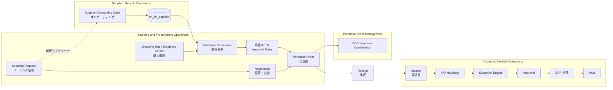
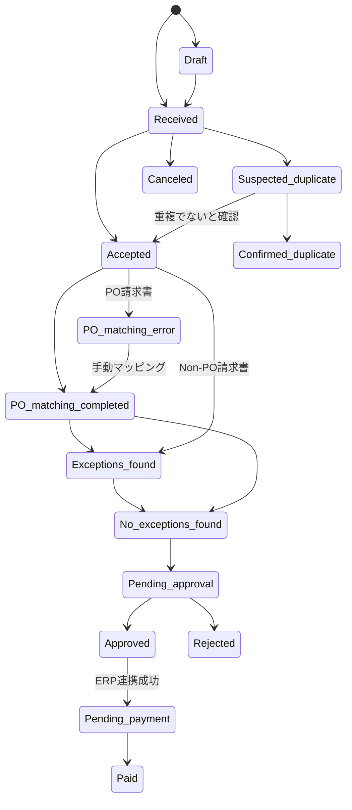
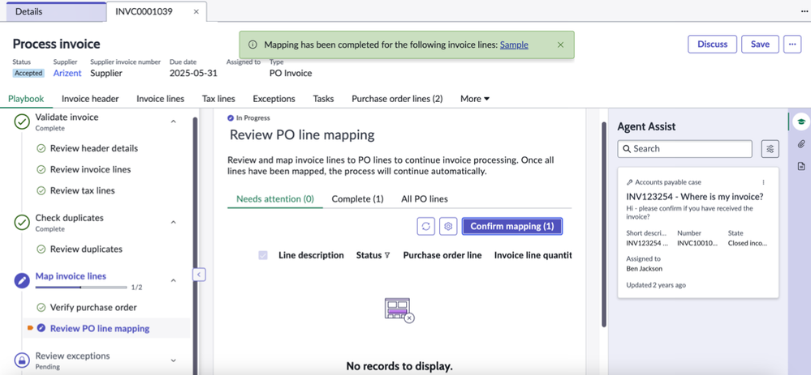

# Finance・Supply Chain・その他ワークフロー

## 概要

本ファイルは、ServiceNow の **Finance and Supply Chain（FSC、財務・サプライチェーン）** 領域と、主要ワークフロー製品群（ITSM・HR・CSM 等）に属さない周辺製品をまとめたリファレンスである。基準リリースは **Australia**（2026-05 GA）で、Brazil で判明している変更を併記する。

対象とする製品は次のとおり。

| 区分 | 製品（英語正式名） | 略称 | 本ファイルの節 |
|---|---|---|---|
| FSC / Source-to-Pay | Source-to-Pay Operations（調達から支払までの業務） | S2P | [Source-to-Pay Operations の全体像](#source-to-pay-operations-の全体像) |
| FSC | Sourcing and Procurement Operations（ソーシング・調達業務） | SPO | [Sourcing and Procurement Operations](#sourcing-and-procurement-operationsspo) |
| FSC | Supplier Lifecycle Operations（サプライヤーライフサイクル業務） | SLO | [Supplier Lifecycle Operations](#supplier-lifecycle-operationsslo) |
| FSC | Accounts Payable Operations（買掛金業務） | APO | [Accounts Payable Operations](#accounts-payable-operationsapo) |
| FSC | Purchase Order Management（発注書管理） | POM | [Purchase Order Management](#purchase-order-managementpom) |
| サステナビリティ | Operational Sustainability Management（旧 Environmental, Social, and Governance (ESG) Management） | OSM | [Operational Sustainability Management](#operational-sustainability-management旧-esg-management) |
| カスタマーサクセス | ServiceNow Impact | Impact | [ServiceNow Impact](#servicenow-impact) |
| その他 | ERP 連携（Zero Copy Connector for ERP 等）、Finance Case Management など | ― | [その他の新興製品・関連機能](#その他の新興製品関連機能) |

**重要な前提（全体共通）:**

- FSC 製品群・OSM・Impact はいずれも **ServiceNow Store からインストールするアプリケーション**であり、プラットフォームファミリーリリースとは別に Store バージョンで随時更新される。リリースノートも「Australia Early Availability（2026-03）」「June 2026」「September 2026」のように月次エントリーで追記される。[出典](https://www.servicenow.com/docs/r/IDeOjpA1hzonPLWG~inEpg/nTpwfNP0I5S65iuJ0lN0RA)
- 2026 年のドキュメントでは、生成 AI 機能のブランド名 **Now Assist が「ServiceNow Otto」へ改称**された旨が APO・OSM のリリースノートに記載されている（例：Now Assist for IRM → ServiceNow Otto for IRM）。本ファイルでは原文に合わせ両名称を併記する。[出典](https://www.servicenow.com/docs/r/IDeOjpA1hzonPLWG~inEpg/Mz2PVi4IvmXWbg2W7kuAVw)
- 同じく 2026 年 4 月以降、AI 機能のライセンスティアとして **Foundation / Advanced / Prime** が導入され、利用可能な生成 AI スキル・エージェントはティアに依存する。[出典](https://www.servicenow.com/docs/r/IDeOjpA1hzonPLWG~inEpg/nTpwfNP0I5S65iuJ0lN0RA)
- AI 関連機能の一部は FedRAMP、DoD IL5、IRAP-Protected、セルフホスト等の制限環境では利用できない。[出典](https://www.servicenow.com/docs/r/impact/impact-packages1.html)

関連ファイル：[製品ポートフォリオ一覧](../../01_入門編/03-product-portfolio.md)、[Now Assist と AI Agents](../platform/now-assist-ai-agents.md)、[プロセス自動化（Document Intelligence 等）](../platform/process-automation-rpa-mining.md)、[Workflow Data Fabric](../platform/workflow-data-fabric.md)、[Integrated Risk Management (GRC)](../irm/integrated-risk-management.md)、[Hardware Asset Management](../itam/hardware-asset-management.md)、[Workplace・Legal Service Delivery 等](../employee/workplace-legal-other.md)。

---

## Finance and Supply Chain（FSC）領域の構成

### FSC 製品ファミリー

ServiceNow の Finance and Supply Chain（FSC）ドキュメントのランディングページ（Brazil 版）は、FSC 領域を次の製品で構成している。[出典](https://www.servicenow.com/docs/r/source-to-pay-operations/finance-supply-chain-landing.html)

| 製品 | 説明（公式記述の要約） |
|---|---|
| Finance and Supply Chain workflows | 財務・調達・サプライチェーン業務を連携させ、チーム・システム・サプライヤー間の可視性を高める |
| ServiceNow Otto applications for Finance and Supply Chain（旧 Now Assist for FSC） | 調達・サプライヤー・請求書ケースの要約、進捗・次アクションの把握を支援 |
| Source-to-Pay Operations | ソーシング依頼、サプライヤーオンボーディング、請求書と支払の管理をプレイブックで実行 |
| Sourcing and Procurement Operations | 従業員が業務に必要な物品・サービスを購入する AI 支援の調達ツール |
| Supplier Lifecycle Operations | サプライヤーとの協働、ライフサイクル全体のリスク・コンプライアンス・パフォーマンスの監視 |
| Accounts Payable Operations | 請求書、請求書例外、請求書承認、サプライヤー問い合わせの管理 |

FSC の生成 AI（Otto / Now Assist）アプリは、Brazil 版ドキュメントで次の 4 つに整理されている。[出典](https://www.servicenow.com/docs/r/12FXWPUPJJNiwgjoPO9yFQ/QEQzyy~9_KwZMTwjSKkoWw)

| アプリ | 主な機能 |
|---|---|
| Otto for Finance and Procurement | 発注書（PO）の要約、フルフィラーへの状況・必要アクションの提示 |
| Otto for Sourcing and Procurement Operations (SPO) | レコード要約、メール下書き、購買カテゴリ分類、サプライヤーメッセージ分析、会話型の依頼送信、アップロード文書の処理 |
| Otto for Supplier Lifecycle Operations (SLO) | サプライヤーマネージャー向けの会話型支援 |
| Otto for Accounts Payable Operations (APO) | ケース要約、請求書データ抽出、PO 明細マッピング |

### Source-to-Pay Operations の全体像

**Source-to-Pay Operations（S2P）** は、ソーシング・サプライヤーオンボーディングから請求書処理・支払までの調達プロセスを自動化するアプリケーション群で、既存の ERP・調達システムと連携して動作する。Australia 版の概要ページは以下 4 アプリを構成要素として挙げる。[出典](https://www.servicenow.com/docs/r/australia/source-to-pay-operations/source-to-pay-operations-overview.html)

| アプリ | 役割 |
|---|---|
| Sourcing and Procurement Operations | 購買ワークフロー、承認の迅速化、発注・サプライヤープロセスの透明化 |
| Supplier Lifecycle Operations | サプライヤー情報・パフォーマンス・オンボーディングの一元管理 |
| Accounts Payable Operations | 請求書のデジタル受領、マッチング、例外処理、承認追跡 |
| Purchase Order Management | 自動化・サプライヤー自己申告・協働により PO 例外を検知・解決 |

Australia 版概要ページに記載の外部連携先は SAP ECC、SAP S/4HANA、3CLogic（音声・SMS チャネル）である。[出典](https://www.servicenow.com/docs/r/australia/source-to-pay-operations/source-to-pay-operations-overview.html) さらに Australia では **SAP、Oracle EBS、Coupa、SAP Ariba、Oracle Financial Cloud との Source-to-Pay Operations Integrations** が新規アプリとして追加された。[出典](https://www.servicenow.com/docs/r/australia/release-notes/source-to-pay-operations-rn-landing.html)

上図は公式ドキュメントの「End-to-end purchasing workflow」「End-to-end sourcing and supplier onboarding workflow」の記述を基に本ナレッジで作成した概念図である。[出典](https://www.servicenow.com/docs/r/sSWqWaGiCUELM1~_M8y7eg/uC9NzrCPjw5TWjAqVLwEBg)

### Source-to-Pay Operations のエディション（Standard / Professional）

Source-to-Pay Operations の概要ページ（Brazil 版、2026-09-10 更新）は、エディション別のアプリ構成を次のとおり示している。Australia 版の概要ページにはこの表は掲載されていない。[出典](https://www.servicenow.com/docs/r/source-to-pay-operations/source-to-pay-operations-overview.html)

| エディション | 含まれる主なアプリ |
|---|---|
| Standard | Procurement Case Management、Invoice Case Management、Supplier Case Management、Supplier Collaboration Portal |
| Professional（Standard に追加） | ERP Integration Framework、Platform Analytics Advanced、Virtual Agent、Source-to-Pay Common Architecture、Sourcing and Purchasing Automation、Spend and Savings Management、Sourcing Pipeline Management、Supplier Operations、Supplier Payment Optimization、Supplier Relationship and Performance Management、Accounts Payable Invoice Processing |

- Standard は「ケース管理（問い合わせ・依頼対応）＋サプライヤーポータル」、Professional は「購買・請求書処理の自動化本体」を含む構成である。
- 公式ページは「表は主要アプリのみで、依存アプリが追加で含まれる場合がある」と注記している。
- 価格は公開されていない。ライセンスの考え方は [ライセンスモデル](../../03_導入編/01-licensing-model.md)、[エディション比較](../../03_導入編/03-edition-comparison.md) を参照。

### Source-to-Pay Workspace

**Source-to-Pay Workspace（S2P ワークスペース）** は、SPO・SLO・APO・POM の各ランディングページとリストビューを集約したスペシャリスト向けワークスペースである。ロールに応じてランディングページとリストが切り替わる。Source-to-Pay Common Architecture、Procurement Case Management、Supplier Lifecycle Operations、Invoice Case Management のいずれかをインストールすると自動的にインストールされ、単体インストール時は Procurement Case Management も併せてインストールされる。[出典](https://www.servicenow.com/docs/r/jU~ctnBMOlCbro_3WEobbw/76dxJ042khYoArl3rYMA8w)

| ロール | 技術名 | ワークスペースでの主な用途 |
|---|---|---|
| Procurement Specialist（調達スペシャリスト） | `sn_shop.procurement_specialist` | 未完了依頼・購買 To-Do |
| PCM Agent（調達ケース担当） | `sn_spend_psd.agent` | 未完了依頼・購買 To-Do |
| Accounts Payable Specialist（買掛金スペシャリスト） | `sn_shop.accounts_payable_specialist`（同ページの表記。APO 側は `sn_ap_apm.accounts_payable_specialist`） | 購買 To-Do、財務処理 |
| Supplier Fulfiller | `sn_slm.fulfiller` | タスク作成、担当ケース・タスク更新 |
| Supplier Manager | `sn_slm.manager` | サプライヤー・ケース・タスクの作成 |
| Supplier Administrator | `sn_slm.admin` | サプライヤー・ケース・タスクの全権 |
| Operational Buyer（オペレーショナルバイヤー） | `sn_poem_core.operational_buyer` | PO 例外の参照・追跡・解決 |
| Canvas Admin | `canvas_admin` | ウィジェット・UI 要素の構成 |

ワークスペースの一般的な構成方法は [Workspace と UI Builder](../platform/workspaces-ui-builder.md) を参照。

---

## Source-to-Pay Common Architecture（共通基盤）

### 概要と位置付け

**Source-to-Pay Common Architecture**（プラグイン `com.snc.sn_shop`、スコープ `sn_shop`）は、購買依頼・発注書・検収・請求書など S2P 全体で共有されるテーブルとロールを提供する共通アプリケーションである。APO も依存プラグインとしてこれをインストールする。[出典](https://www.servicenow.com/docs/r/jU~ctnBMOlCbro_3WEobbw/M5u3RolzRYmF9O9~9Cqr1g)

Store 版のバージョンは Australia 向け 24.0.0、Zurich 向け 21.2.1（いずれも 2026-06 付）と案内されている。【第三者情報】（検索結果スニペットの要約に基づく。公式 Store 履歴で要確認）

### Source-to-Pay Common Architecture のロール

以下は Source-to-Pay Common Architecture でインストールされるロールである（Yokohama 版ドキュメント。Australia でも同名ロールがワークフロー説明に登場する）。[出典](https://www.servicenow.com/docs/r/JTWplvZ8VmXxZI9uJMnUeA/HYT66bIsXNniOcW~Vts57A)

| ロール名 | 技術名 | 権限概要 | 含むロール |
|---|---|---|---|
| Accounts Payable Viewer | `sn_shop.accounts_payable_viewer` | PO・請求書・関連タスクの読み取り | ― |
| Acknowledgment Task Owner | `sn_shop.acknowledgment_task_owner` | PO・購買依頼の読み取り、担当タスク更新（検収タスク受領者に必要） | ― |
| Business Owner | `sn_shop.invoice_owner` | 自分が担当する請求書と関連データのみ | ― |
| Procurement Administrator | `sn_shop.procurement_administrator` | Purchase Automation の主データ・管理セクション | Procurement Primary Data Admin、Procurement Specialist |
| Procurement Common Administrator | `sn_shop.procurement_common_admin` | 全テーブルのフルアクセス（削除含む） | Procurement Common User |
| Procurement Common Reader | `sn_shop.procurement_common_reader` | 全テーブル読み取り | Procurement User |
| Procurement Common User | `sn_shop.procurement_common_user` | 全テーブルの作成・読み取り・更新 | Procurement Common Reader |
| Procurement Specialist | `sn_shop.procurement_specialist` | 主データ以外の Sourcing/Purchasing Automation データ全般 | Procurement User、Contract Manager |
| Procurement Specialist_Manager | `sn_shop.procurement_specialist_manager` | Specialist 権限＋チームパフォーマンス・マネージャーダッシュボード | Procurement Specialist、Procurement Team Manager |
| Purchasing Task Owner | `sn_shop.purchasing_task_owner` | PO・購買依頼・交渉・ソーシング依頼・購買タスク | ― |
| Shopper | `sn_shop.shopper` | Shopping Hub ポータルでの依頼・購入 | ― |
| Shopping Hub Administrator | `sn_shop.shopping_hub_admin` | 全モジュール | Decision Table Admin、Procurement User、Model Manager、Category Manager |

> 注：一部ページのサマリーでは `snshop.shopper` のようにアンダースコアが欠落した表記が見られるが、詳細表の表記（`sn_shop.*`）が正しい。[出典](https://www.servicenow.com/docs/r/sSWqWaGiCUELM1~_M8y7eg/uC9NzrCPjw5TWjAqVLwEBg)

### Source-to-Pay Common Architecture の主要テーブル

Source-to-Pay Common Architecture は 80 を超えるテーブルをインストールする。主要なものを業務単位で分類する。[出典](https://www.servicenow.com/docs/r/JTWplvZ8VmXxZI9uJMnUeA/HYT66bIsXNniOcW~Vts57A)

**購買依頼・カート**

| ラベル | テーブル名 | 用途 |
|---|---|---|
| Purchase Requisition（購買依頼） | `sn_shop_purchase_requisition` | 購買依頼ヘッダー |
| Purchase Line（購買明細） | `sn_shop_purchase_line` | 購買依頼のサプライヤー別明細 |
| Cart Header | `sn_shop_cart_header` | 依頼 ID・購入者・依頼日などの高レベル情報 |
| Cart Line / Cart Delivery | `sn_shop_cart_line` / `sn_shop_cart_delivery` | カート明細・配送 |
| Requisition Additional Info | `sn_shop_requisition_additional_info` | チェックアウト時の追加質問回答 |
| Non Catalog Intake | `sn_shop_non_catalog_intake` | カタログ外（オフカタログ）依頼 |
| Purchase Cost Allocation | `sn_shop_cost_allocation` | 費用配賦 |

**発注・検収**

| ラベル | テーブル名 | 用途 |
|---|---|---|
| Purchase Order（発注書） | `sn_shop_purchase_order` | PO ヘッダー |
| Purchase Order Line | `sn_shop_purchase_order_line` | PO 明細 |
| Purchase Order History / Line History | `sn_shop_order_history` / `sn_shop_order_line_history` | PO 変更履歴 |
| Revision Request / Revision Line | `sn_shop_revision_request` / `sn_shop_rev_request_line` | 発注変更依頼 |
| Receipt（検収） | `sn_shop_receipt` | 受領記録 |
| Receipt Task | `sn_shop_receipt_task` | 検収タスク |
| Acknowledgement Task | `sn_shop_acknowledgement_task` | 受領確認タスク |
| Shipment Details / Shipment Product | `sn_shop_shipment_details` / `sn_shop_shipment_product` | 出荷情報 |
| Pre-Payment | `sn_shop_pre_payment` | 前払い |
| Milestone | `sn_shop_milestone` | マイルストーン払い |

**ソーシング・交渉・契約**

| ラベル | テーブル名 | 用途 |
|---|---|---|
| Sourcing Request | `sn_shop_sourcing_activity` | ソーシング依頼 |
| Sourcing Task | `sn_shop_sourcing_task` | ソーシングタスク |
| Negotiation / Negotiation Event | `sn_shop_negotiation` / `sn_shop_negotiation_event` | 見積・交渉 |
| Negotiation/Order/Requisition/Sourcing to Contract Relationships | `sn_shop_m2m_negotiation_contract` 等 | 契約との関連 |
| Pricing | `sn_shop_m2m_product_contract` | 契約価格 |
| Price Break | `sn_shop_price_break` | 数量別価格 |

**請求書（共通）**

| ラベル | テーブル名 | 用途 |
|---|---|---|
| Invoice（請求書） | `sn_shop_invoice` | 請求書ヘッダー |
| Invoice Line | `sn_shop_invoice_line` | 請求書明細 |
| Invoice Tax Line | `sn_shop_invoice_tax_line` | 税明細 |
| Invoice cost allocation | `sn_shop_invoice_cost_allocation` | 請求書の費用配賦 |
| Invoice Payment Detail | `sn_shop_invoice_payment_detail` | 支払明細 |
| Service Acknowledgment | `sn_shop_invoice_task` | サービス受領確認 |

**承認・マスタ・ERP**

| ラベル | テーブル名 | 用途 |
|---|---|---|
| Approval Rule / Approval Rule Composition | `sn_shop_approval_rule` / `sn_shop_approval_rule_composition` | 承認ルール |
| Approval Group / Approval Group Plan / Approval Plan Detail | `sn_shop_approval_group` / `sn_shop_approval_group_plan` / `sn_shop_approval_plan_detail` | 承認グループ・承認計画 |
| Approval Reminder Task | `sn_shop_approval_reminder_task` | 承認リマインダー |
| Supplier Product / Supplier Product View | `sn_shop_supplier_product` / `sn_shop_supplier_product_view` | サプライヤー商品 |
| Payment Terms / Payment Methods / Shipping methods | `sn_shop_payment_term` / `sn_shop_payment_method` / `sn_shop_shipping_method` | 支払条件・支払方法・配送方法 |
| Delivery Location | `sn_shop_delivery_location` | 配送先 |
| Ledger Assignment Rules | `sn_shop_ledger_assignment_rule` | 勘定科目割当ルール |
| Capitalization Policy | `sn_shop_capitalization_policy` | 資産計上ポリシー |
| ERP Address / Asset Category / Material Group Mapping | `sn_shop_erp_address_map` / `sn_shop_erp_asset_category_map` / `sn_shop_erp_material_group_map` | ERP コード対応表 |
| Integration Error | `sn_shop_erp_error_task` | ERP 連携エラータスク |
| PSM FX Currency | `sn_shop_fx_currency_instance` | 為替 |
| PSM State Mapper | `sn_shop_psm_state_mapper` | 状態マッピング |
| ShoppingHub Configuration | `sn_shop_shopnow_content` | Shopping Hub の設定 |
| Shopping Control / User Controls | `sn_shop_shopping_control` / `sn_shop_user_control` | 購買統制 |
| Employee Credit / Credit Allocation Rules | `sn_shop_employee_credit` / `sn_shop_credit_allocation_rules` | 従業員クレジット |

---

## Sourcing and Procurement Operations（SPO）

### SPO の構成アプリ

**Sourcing and Procurement Operations（SPO）** は、従業員のセルフサービス購買から、調達スペシャリストによる購買依頼・ソーシング・交渉・発注までを扱う AI 支援型の調達アプリである。Australia 版「Explore Sourcing and Procurement Operations」は次の構成要素を挙げる。[出典](https://www.servicenow.com/docs/r/jU~ctnBMOlCbro_3WEobbw/jy2MfzxFDPeCwsp48G~RRQ)

| 構成要素 | プラグイン / スコープ | 説明 |
|---|---|---|
| Shopping Hub（ショッピングハブ） | `sn_spend_uib` | 物品・サービス購入のセルフサービスポータル。内部カタログとサプライヤーカタログを扱う。Next Experience UI で構築。Now Mobile（iOS/Android）で Shopping Hub Mobile を提供 |
| Source-to-Pay Workspace | `sn_spend_workspace` | スペシャリスト向け作業環境 |
| Sourcing and Purchasing Automation | `com.snc.sn_pr`（第三者情報） | ソーシング依頼、交渉、購買依頼、契約、PO、検収、請求書のワークフロー |
| Procurement Case Management（調達ケース管理） | スコープ `sn_spend_psd` | 従業員の調達ケース受付、ナレッジ、フルフィルメントタスク |
| Progress Tracker | ― | 購買依頼・PO の現在状態を表示 |
| Sourcing Pipeline Management | `sn_spend_pipeline` | ソーシング施策の作成・追跡、削減額トラッキング |
| Spend and Savings Management | ― | 物品・サービスのカテゴリ管理 |
| Performance Analytics for SPO | ― | 支出・効率・チームパフォーマンスの事前定義指標とダッシュボード |
| AI Search | ― | Service Portal、Employee Center、Mobile、Virtual Agent での検索 |
| Universal Request | Universal Request for Source-to-Pay Operations（`sn_fsc_ur_common`、第三者情報） | Employee Center での部門横断依頼。ルーティングエージェントが調達ケースを作成 |
| ServiceNow Otto for SPO | ― | 生成 AI（要約、メール下書き、購買分類、会話型依頼） |
| Punchout（パンチアウト） | ― | 外部サプライヤーの EC サイトに接続しつつ調達統制を維持 |

> `com.snc.sn_pr` と `sn_fsc_ur_common` のプラグイン ID は公式ページ本文の直接確認ではなく、検索結果の要約に基づく。【第三者情報】

### SPO のペルソナ

| ペルソナ | 主なロール | 主な作業 |
|---|---|---|
| Shopper（購入者・従業員） | `sn_shop.shopper` | カタログ閲覧、依頼送信、注文追跡、検収 |
| Procurement Specialist（調達スペシャリスト） | `sn_shop.procurement_specialist` | ソーシング依頼・購買依頼・交渉・ケースの処理、購買依頼の PO 化 |
| Procurement Administrator（調達管理者） | `sn_shop.procurement_administrator` | 主データ・承認ルール・割当ルール・購買プロパティの管理 |
| Approver（承認者） | ― | 承認ルールで割り当てられた購買依頼の承認 |
| Sourcing Manager | ― | ソーシング施策の管理 |

[出典](https://www.servicenow.com/docs/r/jU~ctnBMOlCbro_3WEobbw/jy2MfzxFDPeCwsp48G~RRQ)

### SPO の購買ワークフロー（End-to-end purchasing workflow）

公式ドキュメント（Zurich 版）の「End-to-end purchasing workflow in Source-to-Pay Operations」は、購買から支払までの流れを次の手順で定義している。[出典](https://www.servicenow.com/docs/r/sSWqWaGiCUELM1~_M8y7eg/uC9NzrCPjw5TWjAqVLwEBg)

| # | ステップ | 実行者（ロール） | 画面 | 生成レコード |
|---|---|---|---|---|
| 1 | 契約価格のある物品・サービスを Quick checkout または Full checkout | 従業員（`sn_shop.shopper`） | Shopping Hub | Purchase requisition |
| 2 | 承認ルールにより承認者へルーティング | システム | ― | 承認 |
| 3 | 承認により PO を作成 | 承認者（`sn_shop.procurement_specialist`） | Employee Center | Purchase order |
| 4 | サプライヤーへの発注処理 | 調達スペシャリスト | Source-to-Pay Workspace | ― |
| 5 | 全量・一部の受領と受領日を確認（未確認は pending receipt 状態） | 従業員 | Shopping Hub / Employee Center | Receipt |
| 6 | 請求書の自動作成。自動送信されない・PO 不一致・例外ありの場合は AP が処理、手動作成も可 | AP スペシャリスト（`sn_ap_apm.accounts_payable_specialist`） | Source-to-Pay Workspace | Invoice |
| 7 | PO 請求書を Non-PO、Credit memo、Debit memo 等へ変換 | AP スペシャリスト | Source-to-Pay Workspace | ― |
| 8 | 割り当てられた請求書ケースの処理、情報依頼、タスク作成 | AP エージェント（`sn_ap_cm.agent`） | Source-to-Pay Workspace | Invoice case |
| 9 | 各ペルソナが自分のポータルで状況を追跡 | 全員 | 各ポータル | ― |

### ソーシング・新規サプライヤーオンボーディングのワークフロー

「End-to-end sourcing and supplier onboarding workflow」（Zurich 版）は、未登録の物品・サービスを新規サプライヤーから調達する流れを次のように定義する。[出典](https://www.servicenow.com/docs/r/sSWqWaGiCUELM1~_M8y7eg/uiXF1Nkrpns6FYd83GqqSw)

1. 従業員（`sn_shop.shopper`）が Shopping Hub または Employee Center で、取扱いのない物品・サービスを依頼し、希望する新規サプライヤーを指定する（Sourcing request 作成）。
2. Work assignment rules（作業割当ルール）が調達スペシャリストへルーティングし、スペシャリストは Source-to-Pay Workspace で依頼と購買明細を確認する。
3. 調達スペシャリストが自動サプライヤー認定（supplier qualification）を開始し、**Supplier onboarding case** などのケースが作成されサプライヤーマネージャーに割り当てられる。
4. サプライヤーマネージャー（`sn_slm.manager`）がサプライヤーワークスペースで **onboarding playbook（オンボーディングプレイブック）** を実行する。
5. プレイブックがリスク評価や銀行・所在地情報の収集のためのサプライヤータスクを生成する。
6. サプライヤー担当者（`sn_slm.contact`）が **Supplier Collaboration Portal** でタスクを確認・完了し、リスク評価質問票を提出する。
7. サプライヤーマネージャーが提出データを確認し、オンボーディング継続またはキャンセルを判断し、各ステージを完了させる。

### Procurement Case Management（PCM）

**Procurement Case Management（PCM、調達ケース管理）** は、従業員からの調達関連の問い合わせ・依頼をケースとして受け付け、プレイブックでフルフィルメントするアプリである（S2P Standard に含まれる）。ITAM、SAM、Contract Management と連携する。[出典](https://www.servicenow.com/docs/r/jU~ctnBMOlCbro_3WEobbw/F1BhV7K5KV5R6ucvDAswYA)

| ロール | 説明 |
|---|---|
| `sn_spend_psd.psd_admin` | リクエストタイプ・カテゴリ等のシステムプロパティを構成 |
| `sn_spend_psd.manager` | 調達ケース・タスクの参照・作成・更新 |
| `sn_spend_psd.agent` | 依頼・ナレッジ記事のフルフィルメントワークフローを管理 |
| `sn_spend_psd.procurement_task_owner` | 割り当てタスクの実施 |
| `sn_spend_psd.requestor` | 調達ケースの作成 |

- 依存プラグイン：Common Service Delivery（`sn_spend_sdc`）、Source-to-Pay Workspace（`sn_spend_workspace`）。
- Procurement case types（調達ケースタイプ）が作業の分類・ルーティングを行い、必要なレビュー完了まで発注・ソーシング処理を保留できる。
- 関連機能：作業優先度付け、サプライヤー認定、Process Automation Designer（PAD）のプレイブックフロー、メールツール、Agent Assist、PCM ダッシュボード。
- PCM 固有のテーブル一覧は公式ページで確認できず（`sn_spend_psd` スコープ）。Common Service Delivery は Finance Case、Finance Case Line、Finance Task、Playbook status テーブルを含むとされる。【第三者情報】

### SPO の Australia における新機能

Sourcing and Procurement Operations の Australia リリースノート（2026-03 EA 〜 2026-06）に記載された新機能。[出典](https://www.servicenow.com/docs/r/IDeOjpA1hzonPLWG~inEpg/LgJVgHSP6u4oglLI8KbCgw)

| 時期 | 機能 | 内容 |
|---|---|---|
| Australia | Savings opportunity identification | Savings Opportunity Discovery エージェンティックワークフローが契約・支出データ・サプライヤーパフォーマンスからコスト削減機会を発見し、Potential Savings Opportunities ページに表示 |
| Australia | Multi-currency support in Shopping Hub | 承認関連ビュー（To-Dos、タスク、メール通知、Bundles ページ）で承認者の現地通貨を主表示、元のサプライヤー通貨を副表示 |
| Australia | Decimal quantities for service-based purchases | サービス購買の購買依頼・PO で小数数量を入力可能（物品は検証エラーで拒否）。Shopping Hub と Employee Center で一貫 |
| Australia | Automatic category assignment | Spend categorization agent がサービス依頼・購買依頼・PO の作成時に支出カテゴリを自動分類 |
| Australia | Purchase on behalf of another user | 代理設定なしで他者のために購入。My Purchases で Business owner による絞り込み |
| June 2026 | Email parser agent | 受信メールから調達意図を判定し、intent-to-action エージェンティックワークフローで調達ケースを作成 |
| June 2026 | Universal Request | Employee Center で自然言語による（複数部門にまたがる）調達依頼を受付、ルーティングエージェントが調達ケースを作成 |

> **Brazil での変更:** Brazil EA（2026-09）の SPO リリースノートでは以下が追加された。[出典](https://www.servicenow.com/docs/access?context=sourcing-procurement-operations-rn-static&version=brazil&pubname=brazil-release-notes)
> - **SPO Configuration Console**：ケースタイプ、プレイブック、承認、通知、スペシャリストワークスペースを依存関係順に設定するガイド付きコンソール（一部は会話型設定に対応）。
> - **SPO Product Hub / Admin Home**：エンタイトルメントに基づくタイルからインストール状況・アドオン設定・既定構成を管理。
> - 保存済み配送先住所の削除、代理購入の既定値（直前の受取人）、**パンチアウト品の代理購入**、代理購入対象の管理者制御（コストセンター、法人、国などの条件）。
> - チェックアウト追加質問のサプライヤー単位スコープ、**PR-to-PO progress tracker**（パンチアウト・改訂・取消などの非線形パスを含むリアルタイム追跡）。
> - PR / PO / 調達ケースに受信メールの Emails 関連リスト。
> - **SPO MCP Server** による会話型受付とタスク完了（MCP クライアントから依頼・タスク処理）。
> - **AI L1 SPO Service Desk Specialist**（一般的な L1 調達問い合わせを自律解決）、クローズ済み調達ケースからのナレッジ記事生成。
> - 変更：Now Assist 要約が最新メールのやり取りを反映。

---

## Supplier Lifecycle Operations（SLO）

### SLO の概要とプラグイン構成

**Supplier Lifecycle Operations（SLO）** は、サプライヤーのオンボーディング、サプライヤーとの協働、関係管理、ライフサイクル全体のリスク・コンプライアンス・パフォーマンス監視を行うアプリである。Australia 版の構成コンポーネントは以下。[出典](https://www.servicenow.com/docs/r/australia/source-to-pay-operations/supplier-lifecycle-operations/installed-with-supp-mgmt.html)

| プラグイン | ID | 説明 |
|---|---|---|
| Supplier Common Architecture | `com.snc.sn_slm` | Supplier Case Management のテーブルとロールを保持し、他製品から再利用可能。SLO または Supplier Collaboration Portal のインストール時に自動インストール |
| Finance Common Architecture | `com.sn_fin` | 依存プラグイン。`sn_fin` ロール、Supplier Payment Information、Organization Tax Details テーブルを提供 |
| Supplier Case Management（旧 Supplier Lifecycle Operations プラグイン） | `com.snc.sn_supplier_mgmt` | 旧プラグイン名「Supplier Lifecycle Operations」から改称 |
| Supplier Operations | `com.snc.sn_so` | 本リリースへのアップグレード後にインストールが必要 |

- プラグイン改称（Supplier Lifecycle Operations → Supplier Case Management）とSupplier Operations のインストール要件は Australia リリースノートに記載。[出典](https://www.servicenow.com/docs/r/australia/release-notes/supplier-lifecycle-operations-rn.html)
- インストールは ServiceNow Store へのリクエストで行う。

### SLO のロール

| ロール名 | 技術名 | 権限概要 | 主な含有ロール |
|---|---|---|---|
| Supplier Administrator | `sn_slm.admin` | サプライヤー・ケース・タスクの作成・参照・更新・削除の全権 | `decision_table_admin`、`sn_shop.shopper`、`awa_admin`、`sn_vdr_risk_asmt.vendor_assessor`、`sn_fin.supplier_payment_info_write`、`sn_slm.manager`、`sn_kpi.admin` |
| Supplier Manager | `sn_slm.manager` | Owner 権限＋全サプライヤー・ケース・タスクの参照と任意サプライヤーの更新 | `sn_slm.owner`、`dm_user_criteria_read` |
| Supplier Owner | `sn_slm.owner` | Fulfiller 権限＋プレイブックからのサプライヤー作成、所有サプライヤーのケース・タスク管理 | `sn_slm.fulfiller`、`sn_fin.finance_user`、`sn_fin.procurement_user`、`sn_vdr_risk_asmt.vendor_assessment_reviewer` ほか |
| Supplier Agent | `sn_slm.agent` | Fulfiller 権限＋ケース・タスク作成、全レコード参照、全タスクと担当ケースの更新 | `sn_slm.fulfiller` |
| Supplier Fulfiller | `sn_slm.fulfiller` | タスク作成、関連サプライヤーと担当/自作ケース・タスクの参照・更新 | `task_editor`、`workspace_user`、`vendor_reader`、`awa_agent`、`sn_fin.finance_user`、`sn_fin.procurement_user`、`email_composer` ほか |
| Supplier Contact（サプライヤー担当者） | `sn_slm.contact` | Supplier Collaboration Portal でカタログ依頼送信・割当タスク完了（主・副担当とも） | `sn_fin.supplier_payment_info_read`、`snc_external` |
| KPI Administrator | `sn_kpi.admin` | KPI の定義・管理・分析 | `sn_kpi.user` |

- Supplier Manager、Supplier Fulfiller、Supplier Owner の各ロールは **Supplier Collaboration Portal にアクセスできない**（ポータルは外部ユーザー `snc_external` 前提の `sn_slm.contact` 用）。[出典](https://www.servicenow.com/docs/r/australia/source-to-pay-operations/supplier-lifecycle-operations/installed-with-supp-mgmt.html)
- 旧リリースの文書には `snslm.admin` のようにアンダースコアを欠く表記や、KPI ロール `snkpi.*` の表記があるが、Australia 版の表は `sn_slm.*`、`sn_kpi.*` である。

### SLO のテーブル

**Supplier Case Management / Supplier Common Architecture のテーブル（Australia）** [出典](https://www.servicenow.com/docs/r/australia/source-to-pay-operations/supplier-lifecycle-operations/installed-with-supp-mgmt.html)

| ラベル | テーブル名 | 説明 |
|---|---|---|
| Supplier Case | `sn_slm_case` | サプライヤーケース。Service Case を拡張 |
| Supplier Task | `sn_slm_task` | サプライヤータスク。Service Task を拡張 |
| Supplier Product Code | `sn_slm_code_m2m_supplier` | サプライヤーと製品コードの関連 |
| Supplier Email Domain | `sn_slm_email_domain` | サプライヤーのメールドメイン |
| Supplier Location | `sn_slm_m2m_location` | サプライヤーと所在地（`cmn_location`）の関連 |
| Supplier Contact | `sn_slm_supplier_m2m_contact` | 1 担当者を複数サプライヤーに対応付け |
| Product Code | `sn_slm_product_code` | UPC を持つ製品・サービス（サプライヤー非依存） |
| Supplier Document Configuration | `sn_slm_document_config` | 文書構成（Application File 拡張） |
| Supplier Document Type | `sn_slm_document_type` | 文書種別（Application File 拡張） |
| Supplier Document References | `sn_slm_document_references` | 文書参照（Document References 拡張） |
| Organization Tax Details | `sn_fin_org_tax_detail` | サプライヤーの税登録情報（Finance Common Architecture） |
| Supplier Payment Information | `sn_fin_supplier_payment` | サプライヤー銀行口座（Finance Common Architecture） |

> 注：Supplier Contact の M2M テーブル名は、Zurich 版の主データ表では `sn_slm_contact_m2m_supplier`、Australia 版コンポーネント表では `sn_slm_supplier_m2m_contact` と記載が異なる。実機の System Dictionary で確認すること。[出典](https://www.servicenow.com/docs/r/sSWqWaGiCUELM1~_M8y7eg/CDJqWQogtywT40tgSzGAqA)

**SLO の主データ（Primary data）テーブル（Zurich 版）** [出典](https://www.servicenow.com/docs/r/sSWqWaGiCUELM1~_M8y7eg/CDJqWQogtywT40tgSzGAqA)

| ラベル | テーブル名 | 説明 |
|---|---|---|
| Supplier（サプライヤー） | `sn_fin_supplier` | サプライヤーの主要情報 |
| Vendor Contact | `vm_vdr_contact` | ベンダー担当者 |
| Supplier Contact | `sn_slm_contact_m2m_supplier` | 担当者とサプライヤーの関連 |
| Supplier Email Domain | `sn_slm_email_domain` | メールドメイン |
| Product Code | `sn_slm_product_code` | UPC |
| Supplier Location | `sn_slm_m2m_location` | 所在地 |
| Supplier Payment Information | `sn_fin_supplier_payment` | 支払情報 |

### Supplier テーブル（`sn_fin_supplier`）の主なフィールド

`sn_fin_supplier` テーブルは S2P 全体で参照されるサプライヤーマスタである。主なフィールドは次のとおり。[出典](https://www.servicenow.com/docs/r/sSWqWaGiCUELM1~_M8y7eg/N5yEu0zofi8zLVBvgoZXvQ)

| フィールド | 型 | 説明 |
|---|---|---|
| Legal Name（法的名称） | String | 事業所在地に合わせた法的名称 |
| DUNS number | Integer | 9 桁のサプライヤー識別子 |
| ERP supplier code / ERP company code / ERP source | Integer / String / String | ERP 側のコードと ERP ソース |
| Parent entity / Global company | Reference | 親組織、企業グループ最上位 |
| Relationship manager | String | 関係管理責任者 |
| Relationship status（関係ステータス） | List | Strategic / Valued / Tactical / Excluded |
| Onboarded | Boolean | ERP へのオンボーディング済みか |
| Valid NDA / Valid risk assessment | Boolean | 有効な NDA、有効なリスク評価の有無 |
| Preferred | Boolean | 優先サプライヤーか |
| On-boarded by / On-boarded date / Off-boarded date | String | オンボード担当者・日付、取引終了日 |
| Region | String | AMS / APAC / EMEA / LATAM |
| 住所系（Street address、City、State/Province、ZIP、Country 等） | String | 所在地 |

- サプライヤーには単一の「オンボーディング状態」フィールドはなく、`Onboarded`（Yes/No）が ERP 登録済みかを示す。
- Related company（リスク管理上の関連会社参照）などのフィールドも存在する。【第三者情報】（検索結果スニペット）

### SLO の主要機能

| 機能 | 説明 |
|---|---|
| Onboarding playbook | Supplier onboarding case 上でステージ（例：Registration、Qualification）ごとのアクティビティを実行 |
| Supplier Collaboration Portal | 外部サプライヤー担当者がタスク完了・依頼送信・情報更新を行うポータル（S2P Standard に含まれる） |
| Supplier Relationship and Performance Management | KPI（サプライヤー単位・契約単位）、閾値、Action Plan（マイルストーン付きタスク）による改善管理（Yokohama で強化） |
| Third-party risk 連携 | Third-party Due Diligence Request（`com.sn_tprm_onboarding`）、Risk Assessments Integration（`com.snc.sn_supplier_tprm`）と組み合わせ、オンボーディング時にデューデリジェンス・リスク評価を実施 |
| M2M 連絡先 | 1 担当者が 1 ログインで複数サプライヤー（親子会社）を管理（Xanadu 2024-12 以降） |
| 担当者セルフ登録 | 異なるメールドメインでも会社名で自己登録 |

[出典（Yokohama 機能）](https://www.servicenow.com/community/s2p-articles/supplier-lifecycle-operations-updates-for-the-yokohama-release/ta-p/3299118) / [出典（TPRM 連携）](https://www.servicenow.com/docs/r/better-together/better-tprm-slo.html)。リスク管理側の詳細は [Integrated Risk Management (GRC)](../irm/integrated-risk-management.md) を参照。

### SLO の Australia における新機能

Supplier Lifecycle Operations の Australia リリースノート。[出典](https://www.servicenow.com/docs/r/australia/release-notes/supplier-lifecycle-operations-rn.html)

**Australia Early Availability（2026-03）**

| 機能 | 内容 |
|---|---|
| Smart Assessments | セグメンテーションルールと評価テンプレートでスマートアセスメントを一括作成（Smart Assessment Engine を利用） |
| Emails view in Source-to-Pay Workspace | ケース・タスク・サプライヤーページに Emails タブ。タスク・ケースはメール要約可、メールから直接タスク完了可 |
| AI driven supplier onboarding（初回） | アップロード文書から銀行情報抽出、Document strategy generator AI エージェントによるオンボーディングタスクリスト生成、ソーシング依頼からのサプライヤー提案、手動承認・却下、Now Assist パネルからの重複依頼解消 |
| Automate supplier case creation from emails | 登録済みサプライヤー担当者からサプライヤー受信箱へのメールをケース化。SLO 関連はサプライヤー関係マネージャーへ、無関係な問い合わせは Universal Request へ |
| Summarize supplier performance | スキルでサプライヤーパフォーマンスの要約・インサイト生成 |
| Analyze sentiments in supplier cases | フルフィラーのトーンを評価 |
| Generate an email response for supplier cases | ケース情報・過去メール・KB・関連タスクから返信案を生成 |

**September 2026（Australia ページ記載。Brazil EA と同内容）**

> **Brazil での変更:** Brazil EA（2026-09）リリースノートに同一の項目が記載されている。[出典](https://www.servicenow.com/docs/access?context=supplier-lifecycle-operations-rn-static&version=brazil&pubname=brazil-release-notes)
> - **FedEx Dataworks 連携**：Registration ステージでのサプライヤー検証（FedEx Dataworks Supplier ID 生成）、Qualification ステージでの通関リスク・制裁国スクリーニング・危険物リスク評価、サプライヤープロファイルでの物流パフォーマンスベンチマーク。
> - **AI L1 SLO Service Desk Specialist**：公開ナレッジと FSC Common KG Tags（Enterprise knowledge graph）を使ってサプライヤー問い合わせを自律解決。
> - クローズ済みサプライヤーケース（単一・複数）からのナレッジ記事生成（Otto for SLO）。
> - **Relish 連携**：税情報変更依頼の検証、制裁ステータス表示（Manage Suppliers リスト）、銀行口座所有者確認（所有者検証有効時は口座番号・名義も確認）、一括制裁スクリーニング。
> - AI オンボーディング強化：Web 検索結果からサプライヤースコアカード生成、Craft 構成時は正規化スコアカードとリスク評価、Relish 連携時は銀行情報の検証・同期。
> - Now LLM Service：Gemma 4 追加。旧モデルは既存公開スキル等では継続利用可だが新規開発・構成には使用不可（KB3066214）。

---

## Accounts Payable Operations（APO）

### APO の概要とプラグイン構成

**Accounts Payable Operations（APO）** は、請求書の受領（メール・API・手入力・Document Intelligence 読取）、重複チェック、PO マッチング、例外検出、承認、ERP 連携、支払反映までを自動化する買掛金アプリである。Store からインストールする。[出典](https://www.servicenow.com/docs/r/IDeOjpA1hzonPLWG~inEpg/nTpwfNP0I5S65iuJ0lN0RA)

| プラグイン / アプリ | ID / スコープ | 説明 |
|---|---|---|
| Accounts Payable Operations（Accounts Payable Invoice Processing） | `com.sn_ap_apm` / `sn_ap_apm` | 請求書処理本体（S2P Professional に含まれる） |
| Invoice Case Management | `com.sn_ap_cm` / `sn_ap_cm` | 請求書問い合わせ・処理ケース。APO の依存アプリとして自動インストール（S2P Standard に含まれる） |
| Finance Common Architecture | `com.sn_fin` | 依存。サプライヤー支払情報のロール・テーブル |
| Source-to-Pay Common Architecture | `com.snc.sn_shop` | 依存。請求書・PO 等の共通テーブル |
| Tax Engine Integration with Vertex | `com.sn_fsc_vertex` | Australia で新規。Vertex による請求書税額検証 |
| APO integration with Document Intelligence | ― | 請求書 PDF からの項目抽出。ステージングテーブル `sn_ap_ic_invoice_stage`、`sn_ap_ic_invoice_line_stage`【第三者情報】 |

- `com.sn_ap_apm` / `com.sn_ap_cm` のプラグイン ID は検索結果に引用された公式ページ記述に基づく。
- Document Intelligence の請求書抽出モデルは **英語のみ** 対応で、他の対応言語ではモデル学習が必要。日本語請求書の自動読取は追加学習前提となる点に注意。[出典](https://www.servicenow.com/docs/r/IDeOjpA1hzonPLWG~inEpg/nTpwfNP0I5S65iuJ0lN0RA)（Document Intelligence 自体は [プロセス自動化](../platform/process-automation-rpa-mining.md) を参照）

### APO のロール

Australia 版「Components installed with Accounts Payable Invoice Processing」より。[出典](https://www.servicenow.com/docs/r/jU~ctnBMOlCbro_3WEobbw/M5u3RolzRYmF9O9~9Cqr1g)

| ロール名 | 技術名 | 権限概要 | 含むロール |
|---|---|---|---|
| Accounts Payable Invoice Processing Administrator | `sn_ap_apm.admin` | APO の全機能 | `sn_ap_cm.admin`、`sla_admin`、`sn_ap_apm.accounts_payable_specialist` |
| Accounts Payable Specialist（買掛金スペシャリスト） | `sn_ap_apm.accounts_payable_specialist` | 請求書・例外の参照・更新、PO・サプライヤー詳細・支払の参照 | `sn_fin.supplier_payment_info_read`、`sla_manager`、`workspace_user`、`canvas_user`、`sn_ap_apm.reader`、`sn_ap_cm.task.owner`、`email_composer` |
| Accounts Payable Invoice Processing Reader | `sn_ap_apm.reader` | APO 全テーブル読み取り | `vendor_reader`、`sn_shop.procurement_common_reader` |
| Invoice tolerance admin | `sn_ap_apm.invoice_tolerance_admin` | 許容差ルール管理【第三者情報】 | ― |
| Supplier Payment Info Read / Write | `sn_fin.supplier_payment_info_read` / `sn_fin.supplier_payment_info_write` | サプライヤー・支払情報テーブルの読み取り／書き込み（Finance Common Architecture） | ― |
| Invoice Owner | `sn_shop.invoice_owner` | 業務オーナー（Source-to-Pay Common Architecture） | ― |
| Invoice Case Management Agent / Admin | `sn_ap_cm.agent` / `sn_ap_cm.admin` | 請求書ケースの処理／管理 | ― |
| Supplier Enablement Manager | `sn_fin.supplier_payment_info_write` | サプライヤー・法人マッピングや保留フラグの修正（例外解決で使用） | ― |

### APO のテーブル・フロー・スケジュールジョブ

[出典](https://www.servicenow.com/docs/r/jU~ctnBMOlCbro_3WEobbw/M5u3RolzRYmF9O9~9Cqr1g)

| 種別 | 名称 | 説明 |
|---|---|---|
| テーブル | Invoice exception（`sn_ap_apm_exception`） | 請求書ヘッダーの例外 |
| テーブル | Invoice exception line（`sn_ap_apm_line_exception`） | 明細レベルの例外 |
| テーブル | Invoice exception definition（`sn_ap_apm_exception_definition`） | 例外定義（Application File 拡張） |
| テーブル | Invoice processing detail（`sn_ap_apm_invoice_attribute`） | 請求書処理情報 |
| テーブル | Invoice tolerance rule（`sn_ap_apm_invoice_tolerance_rule`）／Invoice tolerance type | 許容差設定【第三者情報】 |
| テーブル | Supplier Legal Entity Mapping（`sn_fin_supplier_detail`） | サプライヤーと法人の組合せ、Hold Payment / Hold Posting フラグ |
| テーブル（共通） | `sn_shop_invoice`、`sn_shop_invoice_line`、`sn_shop_invoice_tax_line` | 請求書本体（Source-to-Pay Common Architecture） |
| フロー | Create Invoice Processing Case for Invoice | メール添付ごとに請求書処理ケースを 1 件作成（N 添付→N ケース、添付なし→作成しない） |
| フロー | Start Invoice Processing for Orphan Invoices | ケースのない Draft 請求書の処理を開始。**手動で有効化が必要** |
| スケジュールジョブ | Exception Monitoring scheduler | 5 分ごとに PO/Non-PO 請求書の例外を検出。**既定は非アクティブで有効化が必要** |

### 請求書の状態（Invoice status）

APO の請求書は次の状態を遷移する（Australia 版「Invoice status messages」）。[出典](https://www.servicenow.com/docs/r/jU~ctnBMOlCbro_3WEobbw/mNyLBdoongAfyTUFMatY9w)

| 状態 | 意味・遷移条件 |
|---|---|
| No invoice | データ抽出失敗。DocIntel で詳細・明細を確認して送信 |
| Draft | DocIntel の部分抽出データを補完中、または手動作成中 |
| Received | 手動・デジタル化・API で請求書が登録された |
| Suspected duplicate | 同一サプライヤーの請求書番号が既存と一致 |
| Accepted | 重複なし、または AP スペシャリストが重複でないと確認 |
| PO matching error | PO 欠落、PO 明細マッピング欠落、PO と請求書の通貨不一致 |
| PO matching completed | 全請求書明細が PO 明細にマッピングされ通貨差異なし |
| Exceptions found | 定義済み例外を 1 つ以上検出 |
| No exceptions found | 例外なし、またはすべて解決 |
| Pending approval | 例外解決後に承認申請 |
| Approved | 承認者が承認 |
| Rejected | メールまたはカスタム API で却下 |
| Pending payment | 承認後、ERP 連携がエラーなく完了 |
| Confirmed duplicate | AP スペシャリストが重複と確認 |
| Canceled | AP スペシャリストが取消 |
| Paid | ERP で支払われ、支払情報がエラーなく APO に反映 |

上図は公式の状態説明から本ナレッジで作成した概略であり、公式は完全な遷移表を公開していない。

### PO マッチングと Now Assist による明細マッピング

APO は請求書明細を PO 明細へマッピング（PO matching）する。マッピング手段は (1) ルールベースエンジン、(2) Now Assist（Otto）による生成 AI マッピングの 2 系統で、それぞれ AP スペシャリストによるレビューを必須にするかをプロパティで制御する（下記プロパティ表参照）。Yokohama で、言語モデルが明細説明・数量・単価・過去パターンを解釈して PO 明細を推定する生成 AI マッピングが請求書プレイブックに組み込まれた。[出典](https://www.servicenow.com/community/s2p-articles/smarter-matching-less-manual-work-generative-ai-transforms-po/ta-p/3369147)

- **キャプション:** Accounts Payable Operations の請求書処理画面（Process invoice）における PO 明細マッピングのレビュー（Yokohama 時点）。
- **画面の説明:** 請求書レコード（例：INVC0001039）のヘッダーに Status（Accepted）、Supplier、Supplier invoice number、Due date、Assigned to、Type（PO Invoice）が表示される。タブは Playbook / Invoice header / Invoice lines / Tax lines / Exceptions / Tasks / Purchase order lines。左ペインのプレイブックは「Validate invoice（Review header details / Review invoice lines / Review tax lines）」「Check duplicates（Review duplicates）」「Map invoice lines（Verify purchase order / Review PO line mapping）」「Review exceptions」のステージで構成される。中央の「Review PO line mapping」では Needs attention / Complete / All PO lines タブと「Confirm mapping」ボタンがあり、全明細のマッピング完了で処理が自動継続する。右ペインは Agent Assist（関連する買掛金ケースの検索結果）を表示する。
- **出典:** https://www.servicenow.com/community/s2p-articles/smarter-matching-less-manual-work-generative-ai-transforms-po/ta-p/3369147 （ServiceNow Community 公式記事、取得日 2026-11-02）

### 請求書例外（Invoice exceptions）

**Invoice exceptions（請求書例外）** は、支払前に解決が必要な請求書処理中の不一致で、Source-to-Pay Workspace に一覧表示される。[出典](https://www.servicenow.com/docs/r/jU~ctnBMOlCbro_3WEobbw/TUubLhOZ4Vi39YOMAHNJ3w)

**例外エンジンの動作**

- 対象：PO 請求書は `PO matching completed` または `Exceptions found` 状態、Non-PO 請求書は `Accepted` または `Exceptions found` 状態。
- Exception Monitoring Job が既定 5 分間隔で実行（既定は非アクティブ）。手動実行は選択した請求書のみ、自動実行は対象全件をチェック。
- 該当しない例外はバイパス可能。

**例外タイプ一覧（Australia）**

| 例外 | レベル | 対象 | 主な解決方法 |
|---|---|---|---|
| Invalid or blocked supplier | ヘッダー | 全 | サプライヤー・法人の修正、`sn_fin_supplier_detail` へのマッピング追加、支払/転記保留の解除 |
| Insufficient Funds: Quantity variance | 明細 | PO | PO 修正または請求額修正 |
| Insufficient Funds: Line amount variance | 明細 | PO | 同上 |
| Insufficient Funds: Header amount variance | ヘッダー | PO | 同上 |
| Insufficient Goods Receipt | 明細 | PO | SPO ありなら自動作成される検収タスクを完了（`sn_shop.acknowledgement_task_owner`）。なしなら例外タスクを作成し業務オーナーが Employee Center で完了 |
| Valid coding required | 明細 | 全 | 勘定科目・コストセンター・配賦を入力 |
| Missing required information | ヘッダー | 全 | 支払条件・請求書種別・サプライヤー・金額・日付・法人を入力 |
| Missing or Invalid Business Owner | ヘッダー | 全 | 請求書明細の業務オーナーを更新 |
| Over/Under tax amount variance | ヘッダー/明細 | 全 | 税額修正後、システム税額またはサプライヤー税額を採用 |
| Tax validation failed / Tax validation expired | ― | 全 | 失敗時は税計算を再実行、期限切れは修正後 Validate tax |
| Invoice isn't balanced | ― | 全 | 明細小計とヘッダー金額を一致させる |
| Line unit price variance | 明細 | PO・Credit memo | 単価を PO 明細に合わせる |
| Incomplete credit memo / Insufficient billing amount on purchase order | ― | Credit memo | 元請求書番号・元請求書・PO を追加、金額を是正 |
| Missing tax information / Missing tax code details | ヘッダー/明細 | 全 | 税明細・税コードを追加 |
| Currency mismatch | ― | PO・Credit memo | 通貨を揃える（PO マッピング無効かつ Draft 時のみ適用） |
| Unverified sender source | ヘッダー | 全 | 送信者を確認してサプライヤー担当者に追加、または却下 |

- **Invoice rejection modes（却下モード）**：Australia で新規。例外タイプごとに却下時の動作を組織ポリシー・監査要件に合わせて構成できる。[出典](https://www.servicenow.com/docs/r/IDeOjpA1hzonPLWG~inEpg/nTpwfNP0I5S65iuJ0lN0RA)
- **Tolerance rules（許容差ルール）**：請求書の許容差を定義し、超過時に例外処理を要求する。

### APO のシステムプロパティ

Accounts Payable Operations の主なプロパティ（Zurich 版。Australia でも同系統）。[出典](https://www.servicenow.com/docs/r/sSWqWaGiCUELM1~_M8y7eg/FdK1IIP9o4T203W0bdNj0w)

| プロパティ | 説明 | 既定値 |
|---|---|---|
| `sn_ap_apm.mapping.enable_rule_based_mapping` | 請求書明細→PO 明細マッピングのルールベースエンジン有効化 | Yes |
| `sn_ap_apm.mapping.review_rule_based_mapping_suggestions` | ルールベースのマッピング結果を AP スペシャリストがレビューしてから完了とするか | No |
| （名称記載なし）Review invoice line mappings predicted by Now Assist? | Now Assist 予測マッピングのレビュー要否 | Yes |
| `sn_spend_intg.ap.invoice.create.api.record_limit` | 請求書作成 API の 1 バッチ最大件数 | 100 |
| `sn_ap_apm.exception.engine.max_parallel_thread_count` | 例外エンジンの並列スレッド数 | 4 |
| `sn_ap_apm.exception.engine.scheduler_cool_off_period` | 例外の再チェックまでの待機（分） | 240 |
| `glide.ui.sn_ap_apm_exception_activity.fields` ほか 3 件 | 例外・明細例外・許容差ルール・許容差タイプのアクティビティフォーマッタ項目 | ― |
| `sn_ap_apm.enable_integration_with_external_tax_system` | 外部税エンジン連携の有効化 | Yes |
| `sn_ap_apm.invoice_attributes_for_tax_revalidation` | 税再計算をトリガーする請求書項目 | ― |
| `sn_ap_apm.invoice_line_attributes-for-tax-revalidation` | 税再計算をトリガーする明細項目（例：`sub_total,line_description`） | ― |
| `sn_ap_apm.maximum_wait_time_for_tax_validation` | 外部税エンジン応答の最大待機 | ― |
| `sn_ap_apm.external_tax.scheduler.parallel_worker_threads` | 税検証スケジューラの並列数 | ― |
| `sn_ap_apm.external_tax.scheduler_cool_off_period` | 税再検証までの待機 | 60 |
| `sn_ap_apm.external_tax_max_invoices_per_batch` | 税エンジンへの 1 バッチ最大請求書数 | 1000 |

> 注：税関連 2 プロパティは公式ページ内で単位（秒/分）の記述が不一致である。

### APO の Australia における新機能

[出典](https://www.servicenow.com/docs/r/IDeOjpA1hzonPLWG~inEpg/nTpwfNP0I5S65iuJ0lN0RA)

| 区分 | 機能 | 内容 |
|---|---|---|
| New | Tax engine integration framework | 明細レベルでサプライヤー申告税額とシステム税額を検証。地域・グローバル税要件対応、自動税検証、税差異・欠落の例外、手動再検証、システム税額のロールアップ。税明細に Jurisdiction、Jurisdiction type、Tax authority を保持 |
| New | Tax Engine Integration with Vertex（`com.sn_fsc_vertex`） | Vertex との連携プラグイン |
| New | Email parser agent for APO | サプライヤー・請求書オーナーからのメール（L1 ケース・タスク）を AI エージェントが分類し請求書ケースを作成 |
| New | Invoice rejection modes | 例外タイプ別の却下動作設定 |
| New | Supplier case resolution / confirmation | サプライヤーがポータルを開かずに解決内容の送信・追跡・確認 |
| New | Accounts payable document classification skill | サプライヤーからのメール添付を請求書・クレジットメモ・補足文書に分類（Now Assist for APO） |
| Changed | Invoice exceptions | 強化・更新 |
| Removed | Supplier tax roll-up | 廃止。ロールアップはシステム税額のみ（サプライヤー税額の独立検証がなかったため） |

- 2026-06 付の Store 更新で、未登録送信元アドレスからの請求書を「Unverified Sender Source」例外として自動フラグ付けする機能が案内されている。【第三者情報】（検索結果の要約）

> **Brazil での変更:** Brazil EA（2026-09）の APO リリースノート。[出典](https://www.servicenow.com/docs/access?context=accounts-payable-operations-static-rn&version=brazil&pubname=brazil-release-notes)
> - **Case exclusion rules**：条件ベースで不要メールからのケース作成を抑止。クローズ済み問い合わせケースを手動で再オープンして履歴を継続可能。
> - **ケースからのナレッジ記事生成**：請求書ケースの解決内容をナレッジ化（ケースと記事のリンクを保持）。
> - 変更：Email parser agent の Universal Request 経路を削除し、複数意図のメールも標準の AP 意図処理フローで処理。
> - Now LLM Service の旧モデルは新規開発・構成で使用不可（Gemma 4 追加、KB3066214）。

---

## Purchase Order Management（POM）

### POM の概要

**Purchase Order Management（POM、発注書管理）** は、PO 執行プロセスの異常（納期・数量・価格等の不一致）を検知・追跡・解決するアプリで、プラグイン ID は `com.snc.sn_poem_core`、Store からインストールする。サプライヤーは Supplier Collaboration Portal から PO 明細の納期計画の問題を自己申告し、バイヤーと SLO 上で協働できる。バイヤーは戦略バイヤーへエスカレーションでき、エスカレーション時はサプライヤーケースが作成される。【第三者情報】（検索結果の要約に基づく。プラグイン ID は公式ページ記載とされる）

### POM のロールとテーブル

Zurich 版「Components installed with Purchase Order Management」。[出典](https://www.servicenow.com/docs/r/sSWqWaGiCUELM1~_M8y7eg/CRwlypxi_jwKIOdvh2MnMQ)

| ロール名 | 技術名 | 説明 | 含むロール |
|---|---|---|---|
| Purchase Order Management Administrator | `sn_poem_core.admin` | 全機能 | `sn_shop.procurement_administrator`、`sn_poem_core.operational_buyer` |
| Operational Buyer | `sn_poem_core.operational_buyer` | PO の割当・更新、PO 例外の解決 | `sn_poem_core.viewer`、`sn_shop.procurement_specialist` |
| Purchase Order Management Viewer | `sn_poem_core.viewer` | PO の参照（例外の割当不可、S2P ワークスペースへのアクセスなし） | `sn_fin.procurement_user` |
| Purchase Order Management Collaborator | `sn_poem_core.collaborator` | 割り当てられた PO 例外タスクの参照・編集・解決 | `sn_poem_core.viewer` |

| ラベル | テーブル名 | 説明 |
|---|---|---|
| Purchase Order Exception | `sn_poem_exception` | PO 例外 |
| Purchase Order Exception Task | `sn_poem_exception_task` | PO 例外タスク |
| Purchase Order Exception Split Line | `sn_poem_exception_split_line` | サプライヤーが例外申告時に分割した明細 |
| Purchase Order Confirmation | `sn_poem_po_confirmation` | PO 確認（サプライヤー受注確認） |
| Purchase Order Confirmation Line | `sn_poem_po_confirmation_line` | PO 確認明細 |

- Australia で **Now Assist for Purchase Order Management** が新規プラグインとして追加され、サプライヤーメールを PO 例外に変換・優先度付けする。[出典](https://www.servicenow.com/docs/r/australia/release-notes/source-to-pay-operations-rn-landing.html)

---

## Operational Sustainability Management（旧 ESG Management）

### OSM の概要と名称変更

**Operational Sustainability Management（OSM、運用サステナビリティ管理）** は、旧称 **Environmental, Social, and Governance (ESG) Management** で、Australia のドキュメント・リリースノートで改称が明記されている。ワークスペースも **Operational Sustainability Workspace（旧 ESG Workspace）** に改称された。改称理由はリリースノートに記載されていない。[出典](https://www.servicenow.com/docs/r/IDeOjpA1hzonPLWG~inEpg/Mz2PVi4IvmXWbg2W7kuAVw)

- OSM は GRC（IRM）系の基盤（GRC: Metrics、GRC: Approver Configurator、Unified Content Management 等）の上に構築されており、テーブル・ロールの多くが `sn_esg` / `sn_grc_metric` スコープを使用する。GRC 自体は [Integrated Risk Management (GRC)](../irm/integrated-risk-management.md) を参照。
- Store からインストールする。Australia で **Document Designer が OSM の依存**になった。

### OSM の要素（データモデルの考え方）

Australia 版「Elements of Operational Sustainability Management」より。[出典](https://www.servicenow.com/docs/r/s82Zw_idTcTEahshu77BGw/HjZrU1WUhZOfd52cedv8CA)

| 要素 | 説明 | テーブル |
|---|---|---|
| Material topic（マテリアリティ課題） | 経済・環境・人への最も重要な影響を表すテーマ（例：e-waste 管理、寄付・ボランティア）。マテリアリティ評価で特定し、追跡前に特定が必要 | `sn_esg_material_topic` |
| Goal（目標） | マテリアル課題に対する目標（例：2035 年までに再エネ利用）。サブ目標、責任エンティティを関連付け | 目標系（Goal Framework）＋`sn_esg_m2m_material_topic_goal`、`sn_esg_m2m_entity_goal` |
| Target（ターゲット） | 目標への進捗を測る測定可能なマイルストーン | `sn_esg_m2m_metric_target` 等 |
| Metric definition / Metric（指標定義・指標） | 手動（データオーナーが入力）、計算（他指標・排出係数から算出）、自動の各指標 | GRC: Metrics（`sn_grc_metric_*`） |
| Data task（データタスク） | データオーナーへの値入力依頼 | GRC: Metrics |
| Disclosure（開示） | サステナビリティパフォーマンスの公開報告 | `sn_esg_disclosure`、`sn_esg_disclosure_summary` |
| Emission activity / Emission factor（排出活動・排出係数） | GHG を排出する活動と、活動量を GHG 排出量に換算する係数 | `sn_esg_emission_activity`、`sn_esg_emission_factor`、`sn_esg_emission_factor_location` |

- PPM と組み合わせると目標にプログラム・プロジェクトを紐付けでき、IRM と組み合わせるとリスク・ポリシー・統制目標・課題を紐付けたガバナンス体系を構築できる。
- 推奨される導入手順は「マテリアル課題特定 → 目標設定 → ターゲット作成 → 責任エンティティ割当 → 指標・指標定義 → ターゲットへの指標ソース追加（任意）→ データ入力／自動収集 → 開示生成（プログラムマネージャーがレビュー後エクスポート）」。[出典](https://www.servicenow.com/docs/r/V~tl5nFo_tu~5UKBVqLKtw/dqrfBRimNZjgk1D3HhH~xg)（Xanadu 版）

### OSM の主要機能・モジュール

| 機能 | 説明 |
|---|---|
| GRC: Metrics | 目標・ターゲットに対する指標の測定・追跡（OSM と自動インストール） |
| Scope 3 dashboard | バリューチェーン（間接）排出の計算・追跡。Scope 3 category types、supplier emissions by model、inflation factors |
| Sustainable IT | ハードウェアの排出量・エネルギー使用量・廃棄の監視 |
| ESG content accelerator | フレームワーク・Citation（要求事項）・指標定義・排出係数のリポジトリ。GRI、SASB、TCFD、UN SDG、ISSB（`sn_esg_content_issb_citation`） |
| Emission factor library | 排出係数と活動ソースのライブラリ |
| Disclosures | 開示テンプレート、承認ルーティング、Word 出力（Document Designer） |
| Forecasting | 指標の将来予測（`sn_grc_forecast_*`） |
| ESG Risk Management（Operational Sustainability Risk Management） | `sn_esg_risk_mgmt`。ESG リスク評価 |
| Claims | `sn_grc_claims`。ESG 領域のクレーム（主張）管理 |
| Socialsuite 連携 | CSRD 準拠のダブルマテリアリティ評価を Socialsuite で実施し OSM に同期 |

[出典（Xanadu 版機能一覧）](https://www.servicenow.com/docs/r/V~tl5nFo_tu~5UKBVqLKtw/dqrfBRimNZjgk1D3HhH~xg) / [出典（Australia 版コンポーネント）](https://www.servicenow.com/docs/r/noxsZ_bRFChHRGVDcT97yQ/BJ63pq7V7uXHuNuNchBjRQ)

### OSM のロール

Australia 版「Components installed with Operational Sustainability Management」。[出典](https://www.servicenow.com/docs/r/noxsZ_bRFChHRGVDcT97yQ/BJ63pq7V7uXHuNuNchBjRQ)

| ロール | 説明 | 主な含有ロール |
|---|---|---|
| `sn_esg.admin` | アプリ全体の管理と ESG 連携構成。トピック・目標・ターゲット・指標・データタスク・開示・Citation・排出項目等の全 CRUD。Scope 3 モジュールの全権 | `sn_esg.program_manager`、`sn_esg.integrations_admin`、`sn_esg.internal_admin`、`sn_grc_metric.admin`、`sn_esg.internal_disclosure_manager`、`report_user` |
| `sn_esg.program_manager`（ESG プログラムマネージャー） | ESG プログラムの開発・実施・報告。大半の ESG 項目の CRUD、コンテンツアクセラレーター・排出・Scope 3。指標・定義の削除は自作分のみ | `sn_esg.reader`、`sn_grc_metric.manager`、`sn_gf.goal_user`、`sn_grc.library_admin`、`sn_compliance.library_admin` |
| `sn_esg.metrics_manager`（指標マネージャー） | 指標・指標定義の作成・更新（削除は自作分のみ） | `sn_esg.reader`、`sn_grc_metric.manager` |
| `sn_esg.reporting_disclosure_manager`（開示報告マネージャー） | 開示の作成・更新（削除は自作分のみ） | `sn_esg.internal_disclosure_manager`、`sn_esg.reader`、`report_user` |
| `sn_esg.data_owner`（データオーナー） | 割り当てられた指標データタスクへの入力 | `sn_grc_metric.user`、`sn_grc_metric.reader`、`sn_grc_workspace.user` 等 |
| `sn_esg.reader` | 読み取り | ― |
| `sn_esg_risk_mgmt.risk_manager` | ESG リスク評価（フレームワーク・リスクステートメント・評価の作成と承認）。`sn_esg_risk_mgmt` 有効時のみ | ― |
| Claims manager（`sn_grc_claims.*`） | ESG クレームの作成・編集・エクスポート | ― |

> 注：取得したコンポーネントページは仏語機械翻訳の影響でロール名・プロパティ名の一部が翻訳表記になっていたため、`sn_esg.program_manager`、`sn_esg.data_owner` 等は英語版リリースノート・他ページの表記に合わせて記載した。インテグレーション管理ロールは `sn_esg.integrations_admin`（コンポーネント表）と `sn_esg.integration_admin`（リリースノート）で表記が揺れている。

### OSM の主要テーブル

| ラベル | テーブル名 | 説明 |
|---|---|---|
| Material Topic | `sn_esg_material_topic` | マテリアル課題 |
| Disclosure | `sn_esg_disclosure` | 開示 |
| Disclosure Summary | `sn_esg_disclosure_summary` | 開示に関連する Citation・指標・データの要約（日次ジョブで更新） |
| Related Document | `sn_esg_disclosure_url` | 開示の関連文書 URL |
| Disclosure template / detail | `sn_esg_disclosure_template` / `sn_esg_disclosure_detail` | 開示テンプレート・詳細（Xanadu で追加）【第三者情報】 |
| Emission Activity / Emission Factor / Emission Factor Location | `sn_esg_emission_activity` / `sn_esg_emission_factor` / `sn_esg_emission_factor_location` | 排出活動・係数 |
| Calculated Metric Definition to Emission Factor | `sn_esg_m2m_calculated_definition_emission_factor` | 計算指標と排出係数の関連 |
| Metric to Goal / Target / Disclosure | `sn_esg_m2m_metric_goal` / `sn_esg_m2m_metric_target` / `sn_esg_m2m_disclosure_metric` | 指標の関連 |
| Goal to Disclosure / Citation | `sn_esg_m2m_goal_disclosure` / `sn_esg_m2m_goal_citation` | 目標の関連 |
| Goal Summary / Goal Activity Summary | `sn_esg_goal_summary` / `sn_esg_goal_activity_summary` | 目標の要約 |
| ISSB Citation | `sn_esg_content_issb_citation` | ISSB フレームワークの Citation |
| Unit Family / Unit Conversion | `sn_grc_metric_unit_family` / `sn_grc_metric_unit_conversion` | 単位と換算 |
| Threshold / Metric Threshold | `sn_grc_metric_threshold` / `sn_grc_metric_metric_threshold` | 閾値 |
| Forecast Analysis / Context / Data / Parameter Data | `sn_grc_forecast_*` | 予測 |
| Control/Policy/Risk to Goal 等 | `sn_esg_m2m_control_goal`、`sn_esg_m2m_policy_goal`、`sn_esg_m2m_risk_goal` 等 | PCM/IRM インストール時のみ |
| SocialSuite Import Log | `sn_osm_ma_import_log` | Socialsuite 連携時のみ |

[出典](https://www.servicenow.com/docs/r/noxsZ_bRFChHRGVDcT97yQ/BJ63pq7V7uXHuNuNchBjRQ)

### OSM のシステムプロパティ

| プロパティ | 説明 |
|---|---|
| `sn_esg.metric_approval` | 全指標・指標定義の承認フローを **Simple**（フォーム上で承認者を直接指定）または **Advanced**（GRC: Approver Configurator で多段承認）に設定。`sn_grc_appr` が有効な場合のみ、セットアップ時に設定 |
| `sn_esg.metric_campaign` | OSM ワークスペースでキャンペーンを有効化 |
| `sn_esg.campaign_bulk_action_enabled` | キャンペーンの一括送信・承認・却下を有効化 |
| `glide.ui.sn_esg_disclosure_activity.fields` / `glide.ui.sn_esg_material_topic_activity.fields` | 開示・マテリアル課題のアクティビティフォーマッタ項目 |
| Scope 3 historical years（`sn_esg_scope3.*`） | Scope 3 ダッシュボードに表示する過去年数（英語の正式プロパティ名は公開情報では確認できず） |

[出典](https://www.servicenow.com/docs/r/IDeOjpA1hzonPLWG~inEpg/Mz2PVi4IvmXWbg2W7kuAVw)

### OSM の Australia における新機能・変更

[出典](https://www.servicenow.com/docs/r/IDeOjpA1hzonPLWG~inEpg/Mz2PVi4IvmXWbg2W7kuAVw)

| 時期 | 機能 | 内容 |
|---|---|---|
| EA（2026-03） | Data owner / approver assignments for campaigns | 1 画面で設定、キャンペーンサイクルのタスクを一括送信・承認・却下（OSM 22.0.1） |
| EA | Utility invoice document intelligence | 公共料金請求書から使用量を抽出し指標データを自動更新（Otto for OSM 22.0.1） |
| EA | Socialsuite integration | CSRD 準拠のダブルマテリアリティ評価（GRI・ESRS のインパクト／財務マテリアリティ）を同期 |
| EA | Multi-level metric thresholds | 複数レベル・範囲の閾値、逸脱時の自動アクション |
| 2026-06 | Calculated metric formula editing | 実行後の計算式編集、適用開始日指定、保存ごとに式をバージョン管理（GRC: Metrics 22.3.1） |
| 2026-06 | Word-based audit report templates | Microsoft 365 reporting と Document Designer のアドインを Document Designer（22.3.2）に統合。リピーター上限 2→5、反復上限 200→500 |
| 2026-06 | AI for Document Designer | Word 内で ServiceNow データから報告文を生成する AI 報告アシスタント |
| 2026-06 | Feature role mapping | OSM 22.3.1 以降、OSM ロールを Risk/Compliance Library の機能ロールにマッピングし、権限のある業務ドメインのレコードのみ表示 |
| 2026-08 | Campaigns | GRC: Metrics 22.5.2 以降、手動・計算・自動指標を Group / Frequency / Calendar type / Entity の組合せでキャンペーン化。各測定期間がサイクル（Data collection → Approval → Closed） |
| Australia | Campaigns in Operational Sustainability Workspace / Variance base value | ワークスペースでのキャンペーン管理、指標定義での差異基準値設定 |

**変更・廃止**

- 改称：ESG Management → Operational Sustainability Management、Now Assist（OSM 内）→ ServiceNow Otto、Now Assist for IRM（`sn_irm_gen_ai`）→ ServiceNow Otto for IRM。
- テンプレートの Business domain フィールドが GRC の `sn_grc_business_domain` を参照するよう変更（OSM 22.3.2）。
- 新規インストール時のロール変更（OSM 22.3.1）：`sn_esg.integration_admin` から `connection_admin` を除外、`sn_esg.reader` と `sn_esg.data_owner` から `workspace_user` を除外、`sn_esg.reader` 内の `sn_align_core.ap_read_only` を `sn_ppm.reader` に置換、`sn_esg_gen_ai_emission_calculation_guidelines` の読み取りを `sn_esg_gen_ai.cmd_agent_user` に限定。
- Microsoft 365 for ServiceNow Reporting（`sn_esg_msoff_intg`）は開発用プラグインに変更され、プラグインインストール UI に表示されなくなった。
- ワークスペースのアクセシビリティを WCAG 2.1 AA に準拠させた。【第三者情報】（検索結果の要約）

> **Brazil での変更:** OSM の Brazil リリースノート本文は取得できず、公開情報では確認できなかった。

---

## ServiceNow Impact

### Impact の概要

**ServiceNow Impact** は、ServiceNow 製品の定着と価値実現を支援するカスタマーサクセス製品である。Store アプリ（Impact Store Application）として顧客インスタンスにインストールし、ServiceNow 側の **Impact Delivery Instance（IDI）** と連携する。機能は、価値・定着リソース、専門家ガイダンスと推奨事項、成果のトラッキングと業界ベンチマーク、**Platform Health**（インスタンス品質・コンプライアンス・パフォーマンス）、**Accelerators（アクセラレーター）** と Advisory session の依頼、24x7 サポートである。[出典](https://www.servicenow.com/docs/r/VD5jAD3VgRc~i0AwgqwfEQ/ESVT8PKCRl~ezrcAQcVECw)

### Impact のパッケージ

Brazil 版（2026-09-10 更新）のパッケージ構成。[出典](https://www.servicenow.com/docs/r/impact/impact-packages1.html)

| 項目 | Guided | Total | Integrated Success |
|---|---|---|---|
| 内容 | Impact App、24/7 サポート、Accelerator カタログ、CSM ガイダンス | Guided＋応答迅速化、Developer Support、Accelerator 拡張、専任 Impact Squad | Total の全エンタイトルメント＋導入サービス |
| Impact Squad | Customer Success Manager | CSM、Customer Success Executive、Platform Architect、Support Account Manager | （Total に準拠） |
| P1 / P2 初回応答 | 30 分 / 120 分 | 15 分 / 60 分 | （Total に準拠） |
| Developer Support | なし | 10 席 | （Total に準拠） |
| Accelerator サブカタログ | Technical、Strategy（一部）、Architecture（一部） | Technical、Strategy、Architecture、Optimization | ― |
| Accelerator 同時実行 | サブカタログごと 1 | 2（Optimization は 1） | ― |
| Scan Engine カスタム定義 / 修正案 | 最大 10 / なし | 無制限 / あり | ― |
| Instance Observer（席 / 遡及期間 / アラート種別） | 5 / 45 日 / 6 | 10 / 6 か月 / 40 | ― |

- アドオン例：Strategic Value、Platform Governance、Managed Support、Preventive Care、Platform Optimization。
- 旧版ドキュメントには「Advanced」パッケージの記載があり、構成はバージョンで変化している。契約時は CSM に確認すること。

### Impact のロール

Australia 版「Roles installed with Impact」（IDI と Store アプリ共通）。[出典](https://www.servicenow.com/docs/r/australia/impact/impact-roles.html)

| ロール | 技術名 | グループ | 説明 |
|---|---|---|---|
| Impact Admin | `sn_impact_common.Impact Admin` | Administrative | 全アクセス、プレミアム管理、ユーザー管理 |
| Impact App Admin | `sn_impact_common.Impact App Admin` | Administrative / Scan Engine | Impact テーブル管理、ロール割当、Platform Health 構成、Scan Engine 設定・スキャン |
| Impact Platform Owner | `sn_impact_common.Impact Platform Owner` | Administrative | プレミアム管理、Platform Owner ダッシュボード、Accelerator 依頼（ロール割当不可） |
| Impact Portfolio Owner | `sn_impact_common.Impact Portfolio Owner` | Administrative | Impact テーブルのデータ管理、Accelerator 依頼 |
| Impact Permissions Authorizer | Impact Permissions Authorizer | Administrative | 同意が必要な機能（Accelerator 開始等）の承認 |
| Impact Developer / Development Team Lead | `sn_impact_common.Impact Developer` / `sn_impact_common.Impact Development Team Lead` | Development / Scan Engine | 自分／チームの検出事項・技術的負債の確認、オンデマンドスキャン |
| Impact Developer Support | Impact Developer Support | Development / Support | 不具合サポートケース、カスタム開発依頼 |
| Scan Engine Admin / User | `sn_se.scan_engine_admin` / `sn_se.scan_engine_user` | Scan Engine | Scan Engine の管理／参照 |
| AI Fix User | `sn_impact_gen_ai_ai_fix_user` | Scan Engine | AI 生成コード修正の利用 |
| IO Standard / IO Read Only | `io_standard` / `io_readonly` | Instance Observer | Instance Observer の全機能／参照 |
| Impact Executive / Impact User / Impact Partner | `sn_impact_common.Impact Executive` 等 | User-Level | 経営向けダッシュボード参照、読み取り、パートナー向け参照 |

- Accelerator は本番運用のハンズオン作業支援（hands-on keyboard support）を目的としない。【第三者情報】（Community 記事の要約）
- Impact を使ったガバナンス・技術的負債管理の実践は [ガバナンスと CoE の実践](../../04_応用編/09-governance-coe-practice.md)、[カスタマイズと技術的負債](../../04_応用編/02-customization-technical-debt.md) を参照。

---

## その他の新興製品・関連機能

### ERP 連携（ERP Integration Framework / Zero Copy Connector for ERP）

FSC 製品は ERP を System of Record とし、ServiceNow をワークフロー層として使う設計である。関連機能は次のとおり。

| 機能 | 説明 |
|---|---|
| ERP Integration Framework | S2P Professional に含まれる ERP 連携基盤 |
| Zero Copy Connector for ERP（旧 ERP Toolkit 系） | ERP のデータを ServiceNow に複製せず、ERP に残したまま参照する。Platform model（既存テーブルへのマッピング）と ERP model（ERP 構造に沿うカスタムモデル）を作成。BAPI による作成・読取・更新操作を定義（Zurich では `sn_erp_integration.erp_admin` 系ロール）【第三者情報】 |
| ERP Semantic Mining | レガシー ERP のカスタムコード発見・リプラットフォーム支援（Finance、Procurement、Sales モジュール例） |
| Source-to-Pay Operations Integrations | Australia で SAP、Oracle EBS、Coupa、SAP Ariba、Oracle Financial Cloud 向け連携アプリを追加 |

[出典](https://www.servicenow.com/docs/r/zurich/integrate-applications/erp-integration-framework/work-with-erp-data-models.html?contentId=VZ5kyv0mPXnN8DPRfZZUag)。Zero Copy / データファブリックの詳細は [Workflow Data Fabric](../platform/workflow-data-fabric.md)、連携方式全般は [IntegrationHub](../platform/integrationhub.md) を参照。

### Finance Case Management / Common Service Delivery

財務部門向けの問い合わせ・依頼をケースとして管理する機能群として、**Finance Case Management** が FSC 領域で案内されている。Common Service Delivery（`sn_spend_sdc`）は Finance Case、Finance Case Line、Finance Task、Playbook status テーブルを含むとされる。【第三者情報】（検索結果の要約。Australia 版の構成要素ページは公開情報では確認できず）

### その他の関連製品（他ファイル参照）

| 製品 | 参照先 |
|---|---|
| Contract Management（契約管理） | [Workplace・Legal Service Delivery 等](../employee/workplace-legal-other.md)、[Hardware Asset Management](../itam/hardware-asset-management.md) |
| Third-party Risk Management（TPRM） | [Integrated Risk Management (GRC)](../irm/integrated-risk-management.md) |
| Sales and Order Management（受注側） | [Sales and Order Management（CRM）](../customer/sales-order-management-crm.md) |
| 業界向けソリューション | [業界向けソリューション](../industry/industry-solutions.md) |
| Document Intelligence（請求書読取） | [プロセス自動化](../platform/process-automation-rpa-mining.md) |
| AI Agents / Now Assist（Otto） | [Now Assist と AI Agents](../platform/now-assist-ai-agents.md) |

---

## 設計・導入時の留意点

| 観点 | 留意点 | 根拠 |
|---|---|---|
| インストール形態 | FSC・OSM・Impact はすべて Store アプリ。ファミリーアップグレードとは別に Store 更新計画が必要 | 各リリースノート |
| 必須の有効化 | APO の Exception Monitoring Job、Start Invoice Processing for Orphan Invoices フローは既定で非アクティブ | [出典](https://www.servicenow.com/docs/r/jU~ctnBMOlCbro_3WEobbw/M5u3RolzRYmF9O9~9Cqr1g) |
| 日本語請求書 | Document Intelligence の請求書抽出は英語のみ標準対応。他言語はモデル学習が必要 | [出典](https://www.servicenow.com/docs/r/IDeOjpA1hzonPLWG~inEpg/nTpwfNP0I5S65iuJ0lN0RA) |
| 税対応 | Australia で税エンジン連携フレームワーク（Vertex）が追加。日本の消費税・適格請求書（インボイス制度）への標準対応は公開情報では確認できず | ― |
| エディション | ケース管理中心なら Standard、購買・請求書自動化は Professional | [出典](https://www.servicenow.com/docs/r/source-to-pay-operations/source-to-pay-operations-overview.html) |
| 外部ユーザー | Supplier Collaboration Portal は `sn_slm.contact`（`snc_external`）。社内ロールではポータルにアクセス不可 | [出典](https://www.servicenow.com/docs/r/australia/source-to-pay-operations/supplier-lifecycle-operations/installed-with-supp-mgmt.html) |
| ERP との役割分担 | 支払実行・会計転記は ERP 側。APO は Pending payment → Paid を ERP からの連携で反映 | [出典](https://www.servicenow.com/docs/r/jU~ctnBMOlCbro_3WEobbw/mNyLBdoongAfyTUFMatY9w) |
| OSM の承認方式 | `sn_esg.metric_approval` はセットアップ時に決める必要がある | [出典](https://www.servicenow.com/docs/r/noxsZ_bRFChHRGVDcT97yQ/BJ63pq7V7uXHuNuNchBjRQ) |
| AI 機能 | Foundation / Advanced / Prime ティアと制限環境（FedRAMP 等）での提供可否を確認 | [出典](https://www.servicenow.com/docs/r/IDeOjpA1hzonPLWG~inEpg/nTpwfNP0I5S65iuJ0lN0RA) |

---

## 公開情報で確認できなかった事項

- Source-to-Pay Operations、APO、SLO、OSM、Impact の価格（公開定価なし）。
- Australia 版での S2P エディション（Standard/Professional）構成表（Brazil 版のみ確認）。
- SPO の Australia 版コンポーネント一覧（プラグイン ID の全量、Procurement Case Management のテーブル一覧）。
- POM の Australia 版コンポーネント（Zurich 版で記載）。
- OSM の Brazil 新機能、Scope 3 履歴年数プロパティの英語正式名。
- Brazil の GA 日付（情報源により不一致）。
- 日本の法制度（インボイス制度・電子帳簿保存法）への標準対応状況。

---

## 参照元

**Source-to-Pay / FSC 全般**
- https://www.servicenow.com/docs/r/australia/source-to-pay-operations/source-to-pay-operations-overview.html （Australia、S2P 概要）
- https://www.servicenow.com/docs/r/source-to-pay-operations/source-to-pay-operations-overview.html （Brazil、エディション表）
- https://www.servicenow.com/docs/r/source-to-pay-operations/finance-supply-chain-landing.html （Brazil、FSC ランディング）
- https://www.servicenow.com/docs/r/12FXWPUPJJNiwgjoPO9yFQ/QEQzyy~9_KwZMTwjSKkoWw （Otto for FSC）
- https://www.servicenow.com/docs/r/australia/release-notes/source-to-pay-operations-rn-landing.html （Australia、S2P リリースノート）
- https://www.servicenow.com/docs/r/jU~ctnBMOlCbro_3WEobbw/76dxJ042khYoArl3rYMA8w （Australia、Source-to-Pay Workspace）
- https://www.servicenow.com/docs/r/JTWplvZ8VmXxZI9uJMnUeA/HYT66bIsXNniOcW~Vts57A （Yokohama、Source-to-Pay Common Architecture コンポーネント）
- https://www.servicenow.com/docs/r/sSWqWaGiCUELM1~_M8y7eg/uC9NzrCPjw5TWjAqVLwEBg （Zurich、購買ワークフロー）
- https://www.servicenow.com/docs/r/sSWqWaGiCUELM1~_M8y7eg/uiXF1Nkrpns6FYd83GqqSw （Zurich、ソーシング・オンボーディングワークフロー）

**Sourcing and Procurement Operations**
- https://www.servicenow.com/docs/r/jU~ctnBMOlCbro_3WEobbw/jy2MfzxFDPeCwsp48G~RRQ （Australia、Explore SPO）
- https://www.servicenow.com/docs/r/jU~ctnBMOlCbro_3WEobbw/F1BhV7K5KV5R6ucvDAswYA （Australia、Procurement Case Management）
- https://www.servicenow.com/docs/r/IDeOjpA1hzonPLWG~inEpg/LgJVgHSP6u4oglLI8KbCgw （Australia、SPO リリースノート）
- https://www.servicenow.com/docs/access?context=sourcing-procurement-operations-rn-static&version=brazil&pubname=brazil-release-notes （Brazil、SPO リリースノート）
- https://www.servicenow.com/docs/r/source-to-pay-operations/sourcing-and-procurement-operations/psm-overview.html （Brazil、SPO 概要）

**Supplier Lifecycle Operations**
- https://www.servicenow.com/docs/r/australia/source-to-pay-operations/supplier-lifecycle-operations/installed-with-supp-mgmt.html （Australia、コンポーネント）
- https://www.servicenow.com/docs/r/sSWqWaGiCUELM1~_M8y7eg/CDJqWQogtywT40tgSzGAqA （Zurich、主データテーブル）
- https://www.servicenow.com/docs/r/sSWqWaGiCUELM1~_M8y7eg/N5yEu0zofi8zLVBvgoZXvQ （Supplier テーブル）
- https://www.servicenow.com/docs/r/australia/release-notes/supplier-lifecycle-operations-rn.html （Australia、SLO リリースノート）
- https://www.servicenow.com/docs/access?context=supplier-lifecycle-operations-rn-static&version=brazil&pubname=brazil-release-notes （Brazil、SLO リリースノート）
- https://www.servicenow.com/docs/r/better-together/better-tprm-slo.html （TPRM と SLO の連携）
- https://www.servicenow.com/community/s2p-articles/supplier-lifecycle-operations-updates-for-the-yokohama-release/ta-p/3299118 （Community、Yokohama SLO 更新）

**Accounts Payable Operations**
- https://www.servicenow.com/docs/r/jU~ctnBMOlCbro_3WEobbw/M5u3RolzRYmF9O9~9Cqr1g （Australia、AP Invoice Processing コンポーネント）
- https://www.servicenow.com/docs/r/jU~ctnBMOlCbro_3WEobbw/mNyLBdoongAfyTUFMatY9w （Australia、Invoice status messages）
- https://www.servicenow.com/docs/r/jU~ctnBMOlCbro_3WEobbw/TUubLhOZ4Vi39YOMAHNJ3w （Australia、Invoice exceptions）
- https://www.servicenow.com/docs/r/sSWqWaGiCUELM1~_M8y7eg/FdK1IIP9o4T203W0bdNj0w （Zurich、APO プロパティ）
- https://www.servicenow.com/docs/r/IDeOjpA1hzonPLWG~inEpg/nTpwfNP0I5S65iuJ0lN0RA （Australia、APO リリースノート）
- https://www.servicenow.com/docs/access?context=accounts-payable-operations-static-rn&version=brazil&pubname=brazil-release-notes （Brazil、APO リリースノート）
- https://www.servicenow.com/docs/r/jU~ctnBMOlCbro_3WEobbw/Du1s6E4TXcIOLJaEQE2S7Q （Invoice Case Management）
- https://www.servicenow.com/community/s2p-articles/smarter-matching-less-manual-work-generative-ai-transforms-po/ta-p/3369147 （Community、生成 AI による PO マッチング、画像出典）

**Purchase Order Management**
- https://www.servicenow.com/docs/r/sSWqWaGiCUELM1~_M8y7eg/CRwlypxi_jwKIOdvh2MnMQ （Zurich、POM コンポーネント）
- https://www.servicenow.com/docs/r/source-to-pay-operations/now-assist-for-purch-order-magmt.html （Now Assist for POM）

**Operational Sustainability Management（旧 ESG）**
- https://www.servicenow.com/docs/r/noxsZ_bRFChHRGVDcT97yQ/BJ63pq7V7uXHuNuNchBjRQ （Australia、OSM コンポーネント）
- https://www.servicenow.com/docs/r/IDeOjpA1hzonPLWG~inEpg/Mz2PVi4IvmXWbg2W7kuAVw （Australia、OSM リリースノート）
- https://www.servicenow.com/docs/r/s82Zw_idTcTEahshu77BGw/HjZrU1WUhZOfd52cedv8CA （Australia、OSM の要素）
- https://www.servicenow.com/docs/r/V~tl5nFo_tu~5UKBVqLKtw/dqrfBRimNZjgk1D3HhH~xg （Xanadu、Exploring ESG Management）
- https://www.servicenow.com/docs/r/yokohama/delta-vancouver-xanadu/xanadu-vancouver-environmentalsocialandgovernancemanagement-release-notes.html （Xanadu、ESG リリースノート）

**ServiceNow Impact**
- https://www.servicenow.com/docs/r/australia/impact/impact-roles.html （Australia、Impact ロール）
- https://www.servicenow.com/docs/r/impact/impact-packages1.html （Brazil、Impact パッケージ）
- https://www.servicenow.com/docs/r/VD5jAD3VgRc~i0AwgqwfEQ/ESVT8PKCRl~ezrcAQcVECw （Yokohama、Impact Store Application）

**ERP 連携**
- https://www.servicenow.com/docs/r/zurich/integrate-applications/erp-integration-framework/work-with-erp-data-models.html?contentId=VZ5kyv0mPXnN8DPRfZZUag （Zurich、ERP データモデル）
