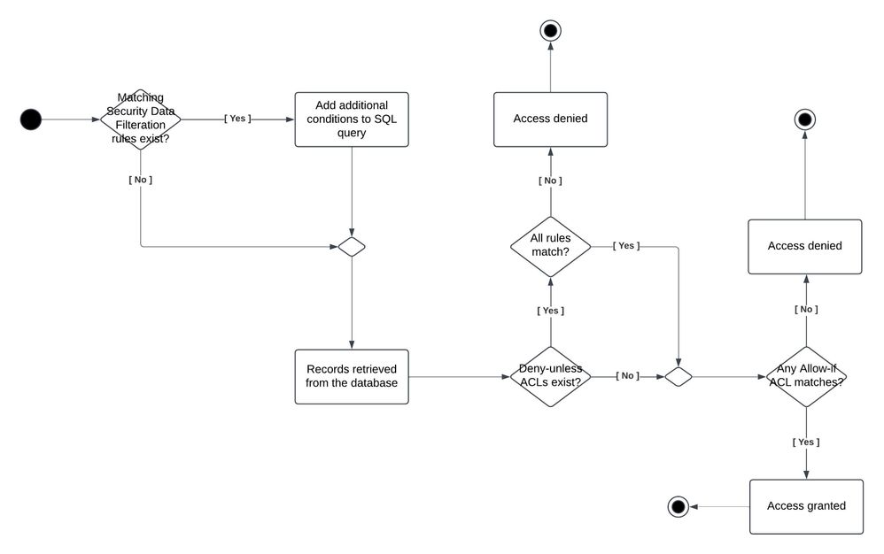
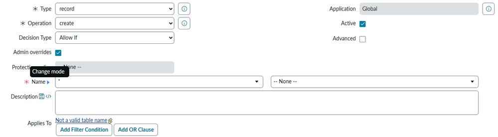
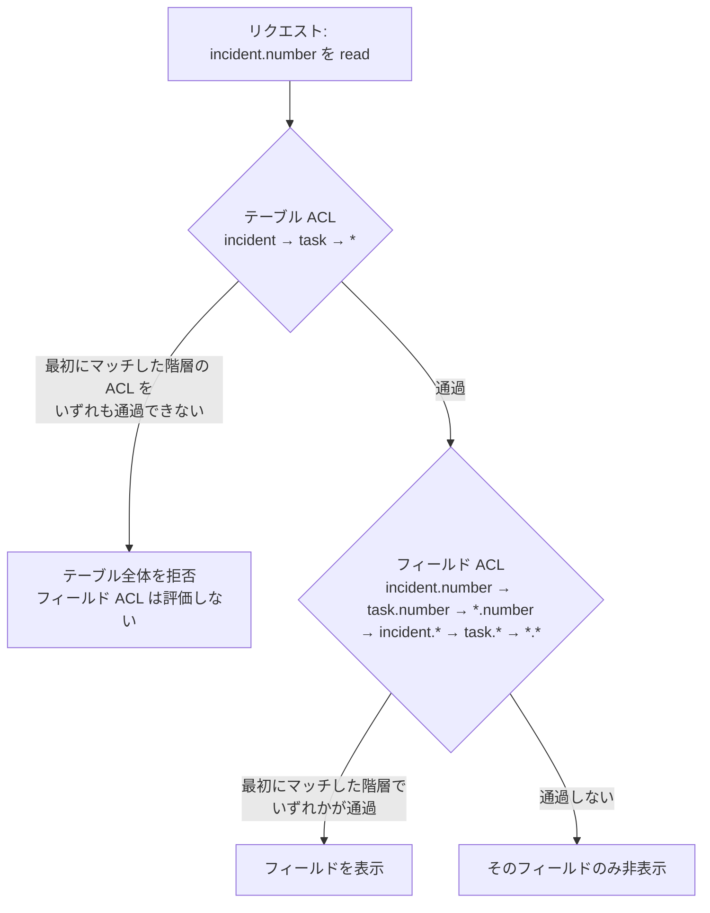
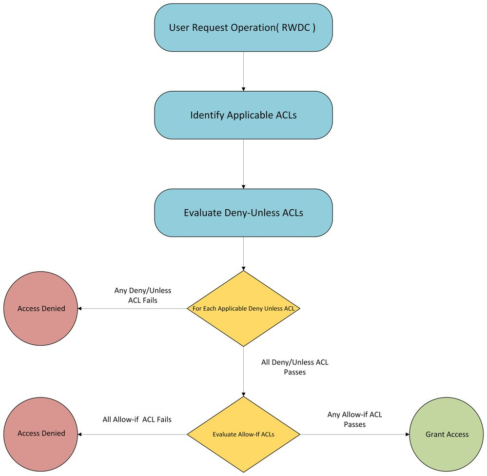
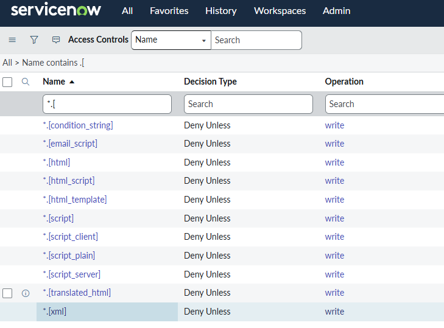

# アクセス制御（Access Control List / ACL）

## 概要

ServiceNow の **Access Control List（ACL、アクセス制御リスト）** は、テーブル、フィールド、レコード、UI ページ、REST エンドポイント、クライアント呼び出し可能な Script Include などのオブジェクトへのアクセスを制御するセキュリティルールである。ACL の定義は `sys_security_acl` テーブルに格納され、管理画面は **System Security > Access Control (ACL)** にある。[出典](https://www.servicenow.com/docs/r/australia/platform-security/access-control/exploring-access-control-list.html)

ACL 1 件は次の要素で構成される。[出典](https://www.servicenow.com/docs/r/australia/platform-security/access-control/exploring-access-control-list.html)

- **Decision type（判定タイプ）**: `Allow-If`（条件を満たせば許可）または `Deny-Unless`（条件を満たさない限り拒否）
- **Type（ルール種別）** と **Operation（操作）**: 例 `record` / `read`
- **Name（保護対象オブジェクト）**: 例 `incident`、`incident.short_description`、`*`
- **条件**: Requires role（必要ロール）、Security Attribute（セキュリティ属性）、Data condition（データ条件）、Script（スクリプト）

Xanadu 以降、ServiceNow は ACL を中心に、**Deny-Unless ACL**、**Query ACL**（`query_match` / `query_range`）、**Security Data Filters（セキュリティデータフィルター）** などを加えた多層のアクセス制御モデルを提供している。Zurich では **Datatype ACL** と Scripting Governance Tool、Australia では **プリセットの Query ACL** と **Access Findings（EA）** が追加された。本ファイルはこれらを横断して整理する。

関連ファイル:

- ユーザー・グループ・ロールの基本 → [ユーザー・グループ・ロール](users-groups-roles.md)
- 認証・SSO → [認証とSSO](authentication-sso.md)
- 暗号化・Security Center・インスタンスハードニング → [プラットフォームセキュリティと暗号化](platform-security-encryption.md)
- ドメインによるデータ分離 → [ドメインセパレーション](domain-separation.md)
- GlideRecord / Business Rule → [サーバーサイドスクリプト](scripting-server-side.md)
- 実務でのハードニング → [セキュリティ強化の実践](../../04_応用編/12-security-hardening-practice.md)

---

## 1. アクセス制御の全体像（多層モデル）

ServiceNow のレコードアクセスは、ACL 単体ではなく複数のレイヤーの組み合わせで決まる。主なレイヤーは次のとおり。

| レイヤー | 英語名 | 役割 | 主な格納先・設定場所 | 導入リリース |
|---|---|---|---|---|
| Before Query Business Rule | Before query business rule | クエリ実行前に `addQuery()` で条件を付加し、取得レコードを絞る（スクリプトによる行フィルタ） | `sys_script`（When = before, Query = true） | 旧来から |
| Security Data Filters | Security data filters | ロール/Security Attribute に基づき、クエリに条件を付加してデータベースから出る前に行を絞る | System Security > Security Data Filters | Xanadu〜Yokohama 期に提供開始（後述） |
| Data filtration | Data filtration | サブジェクト属性（ロール/グループ/IP 等）に基づく読み取り時の拒否ベースのフィルタ | `sys_df_data_filtration` 等 | Zurich ドキュメントに記載 |
| iAccessHandler | IAccessHandler | プラットフォーム内部のチェック。変更不可。ACL 評価前に許可/拒否を決めることがある | （内部） | Istanbul から |
| Deny-Unless ACL | Deny-Unless ACL | 条件を満たさない限り拒否。Allow-If より先に評価 | `sys_security_acl`（Decision type = Deny Unless） | Xanadu |
| Allow-If ACL | Allow-If ACL | 条件を満たせば許可（従来型 ACL） | `sys_security_acl`（Decision type = Allow If） | 旧来から |
| Query ACL | Query ACL | 列に対する検索演算子（一致/範囲）・ソートの可否を制御 | `sys_security_acl`（Operation = `query_match` / `query_range`） | Yokohama 期（後述） |
| Domain separation | Domain separation | ドメイン単位のデータ分離 | `sys_domain` 等 | → [ドメインセパレーション](domain-separation.md) |

出典: [Access Analyzer Debug logs](https://www.servicenow.com/docs/r/zurich/platform-security/access-control/access-analyzer-logs.html)、[ACL debugging tools](https://www.servicenow.com/docs/r/zurich/platform-security/access-control/c_AccessControlRulesDebug.html)、[Security data filters](https://www.servicenow.com/docs/r/platform-security/security-data-filters.html)、[Explore Data filtration](https://www.servicenow.com/docs/r/zurich/platform-security/data-filtration.html)、[New Access Control Features（Community 公式記事）](https://www.servicenow.com/community/platform-privacy-security/better-security-out-of-the-box-with-new-access-control-features/ta-p/3206245)

### 1.1 レイヤー間の評価順序（情報源による差異あり）

各レイヤーの評価順序は、公式情報の間でも記述が一致していない。確認できた記述を並べる。

| 情報源 | 記載されている順序 |
|---|---|
| Access Analyzer Debug logs（公式ドキュメント、Zurich） | ① Business rules → ② Access handler → ③ Data filtration → ④ ACLs。Data filtration で拒否されたレコードは ACL で評価されない |
| Explore Data filtration（公式ドキュメント、Zurich） | Data filtration ルールは読み取りのデータベースクエリ後、ACL の前に実行される |
| Security data filters（公式ドキュメント、Brazil 版） | フィルターはクエリ内で適用され、「テーブルレベル（absolute）ACL と行 ACL の後」に適用される。フィルターはクエリ実行前に適用されるため、制限データはデータベースから出ない |
| Troubleshooting Access Control（Community 公式ブログ、2025-12） | ① Business Rules → ② ACLs → ③ Security Data Filters。あるレイヤーで拒否されると後続はショートサーキット |
| Need-to-know principle Part 3（Community 記事） | ① Security Data Filters（SQL クエリに条件付加）→ ② Deny-Unless ACL → ③ Allow-If ACL |

【推定】Security Data Filters は「SQL クエリへの条件付加」として実装されるため物理的にはレコード取得前に効き、ACL（行 ACL）は取得後のレコードごとに評価される。ただしテーブルレベルの ACL（テーブル自体に読み取り権限があるか）はクエリ前に判定される。上記の記述差はこの「テーブル判定 → クエリ（フィルター付加）→ 行判定」のどこを切り取って説明したかの違いと考えられる。厳密な順序は実インスタンスの Access Analyzer Debug logs で確認すること。



*図1: Security Data Filters → Deny-Unless ACL → Allow-If ACL の評価フロー（ServiceNow Community 記事より）*

図の説明: 左端の開始点から「Matching Security Data Filteration rules exist?（該当する Security Data Filter があるか）」の分岐に進み、Yes なら「Add additional conditions to SQL query（SQL クエリに条件を追加）」を経て、No の場合と合流して「Records retrieved from the database（DB からレコード取得）」に進む。次に「Deny-unless ACLs exist?」で Yes なら「All rules match?（すべての Deny-Unless が一致するか）」を判定し、No なら「Access denied」。Yes または Deny-Unless が存在しない場合は「Any Allow-if ACL matches?（いずれかの Allow-If が一致するか）」に進み、Yes なら「Access granted」、No なら「Access denied」で終わる。

出典: https://www.servicenow.com/community/servicenow-ai-platform-articles/need-to-know-principle-implementation-part-3-how-data-security/ta-p/3459815 （取得日: 2026-11-02）【第三者情報】（Community 掲載記事。公式ドキュメントではない）

---

## 2. ACL の基本仕様

### 2.1 ACL の格納テーブルと関連テーブル

ACL 関連のテーブルは次のとおり。

| テーブル | 内容 | 備考 |
|---|---|---|
| `sys_security_acl` | ACL 本体（Access Control） | Fluent API ドキュメントで「access control lists [sys_security_acl] table」と明記 [出典](https://www.servicenow.com/docs/r/a3E8xg0zsiQLBPKbKO15Mg/vBa9OO1XsfEZEj~XyGpBAw) |
| `sys_security_acl_role` | ACL と必要ロールの関連（Requires role 関連リスト） | 【経験則】公開ドキュメントでの明示的説明は確認できず |
| `sys_security_operation` | 操作（Operation）の定義 | `glide.security.access_acl_as_impersonator` の説明に登場 [出典](https://www.servicenow.com/docs/r/zurich/platform-security/access-control/c_AccessControlRulesDebug.html) |
| `sys_security_type` | ルール種別（Type）の定義 | 同上 |
| `sys_user_role` | ロール | 同上 |
| `sys_glide_object` | フィールドのデータ型。Datatype ACL の `*.[datatype]` で指定可能な型の一覧 | 【第三者情報】[出典](https://www.servicenow.com/community/servicenow-ai-platform-articles/datatype-acls/ta-p/3344409) |

### 2.2 ACL 作成・変更に必要なロール（security_admin）

`sys_security_acl` の作成・更新には **`security_admin`** ロールへの **Elevate（権限昇格）** が必要である。`admin` ロールは ACL の参照・デバッグはできるが、作成・更新はできない。[出典](https://www.servicenow.com/docs/r/australia/platform-security/access-control/exploring-access-control-list.html)

- `security_admin` は Elevated privilege role（昇格特権ロール）であり、ログイン時には有効にならず、ユーザーメニューの **Elevate role** で手動昇格する。昇格はそのセッションの間のみ有効で、ログアウト・セッションタイムアウトで解除される。
- `security_admin` は `admin` から継承されない（明示的な付与が必要）。[出典](https://www.servicenow.com/docs/r/hX5GtoLUEU58KgyL7CW5Ag/j2ACdTRLByyyHwKuAw7J2Q)
- ロール・昇格の詳細は [ユーザー・グループ・ロール](users-groups-roles.md) を参照。

### 2.3 ACL フォームの項目（Configure an ACL rule）

ACL 作成手順は「`security_admin` に昇格 → **System Security > Access Control (ACL)** → **New** → フォーム入力 → 保存」である。主要項目は次のとおり。[出典](https://www.servicenow.com/docs/r/platform-security/access-control/t_CreateAnACLRule.html)

| 項目（英語） | 日本語 | 説明 |
|---|---|---|
| Type | ルール種別 | 保護するオブジェクトの種類（`record`、`ui_page` 等）。**作成後は読み取り専用**（変更するには削除して再作成） |
| Operation | 操作 | 保護する操作。**1 ACL につき 1 操作** |
| Decision Type | 判定タイプ | `Allow If` / `Deny Unless` |
| Admin overrides | 管理者による上書き | チェック時、`admin` ユーザーは自動的にこの ACL を通過する。ただし `nobody` ロールが指定されている場合はそちらが優先 |
| Protection Policy | 保護ポリシー | ACL の保護ポリシー（Fluent API では `read`＝閲覧のみ、`protected`＝内容暗号化） |
| Name | 名前（保護対象） | 保護するレコード、またはテーブルとフィールド。ワイルドカード `*` 使用可（テキスト検索との組み合わせ不可） |
| Description | 説明 | 保護対象や権限の説明 |
| Applies To | 適用対象 | Name で指定したテーブルに対するフィルター条件。ACL を特定レコードに限定する。`*` で始まる Name では使用不可。空なら全レコードに適用。大文字小文字を区別 |
| Active | 有効 | チェック時に ACL を適用 |
| Advanced | 詳細 | チェックすると Advanced 条件（Script 等）の入力欄を表示 |
| Requires role | 必要ロール | 列挙したロールの**いずれか 1 つ**を持てば条件を満たす。インスタンスに存在しないロールのみの場合は拒否。admin は常に通過 |
| Security Attribute Condition | セキュリティ属性条件 | ユーザー・環境属性に基づく条件（大文字小文字を区別） |
| Data Condition | データ条件 | 条件ビルダーで指定するフィールド値の条件（大文字小文字を区別） |
| Controlled by References | 参照による制御 | 関連レコードに対して ACL を強制する（Advanced） |
| Script | スクリプト | `current`、`previous` などのグローバル変数とシステムプロパティを使い true/false を返すロジック。条件とスクリプトの**両方**が true のとき通過 |



*図2: ACL レコード（Access Control）フォーム上部の例*

画面の説明: **System Security > Access Control (ACL) > New** で開く ACL フォームの上部。左列に「Type: record」「Operation: create」「Decision Type: Allow If」「Admin overrides（チェックあり）」「Protection policy: -- None --」「Name: `*` と -- None --（テーブル選択とフィールド選択の 2 つのプルダウン）」「Description」「Applies To（Add Filter Condition / Add OR Clause ボタン）」が並び、右列に「Application: Global」「Active（チェックあり）」「Advanced（チェックなし）」がある。Name ラベル横の三角アイコンにカーソルを合わせると「Change mode」ツールチップが出て、Name をテキスト入力に切り替えられる（Datatype ACL の `*.[datatype]` 入力時に使用）。

出典: https://www.servicenow.com/community/servicenow-ai-platform-articles/datatype-acls/ta-p/3344409 （取得日: 2026-11-02）【第三者情報】（Community 記事のスクリーンショット、Zurich 時点）

### 2.4 ACL の条件（ロール・Security Attribute・データ条件・スクリプト）

ACL の条件には 4 種類あり、ACL を通過するには**その ACL に設定されたすべての条件**を満たす必要がある。[出典](https://www.servicenow.com/docs/r/australia/platform-security/access-control/exploring-access-control-list.html)

| 条件 | 評価方法 | 備考 |
|---|---|---|
| Requires role | 列挙ロールのいずれかを保持していれば true | 存在しないロールのみ参照する ACL は無効扱い（拒否） |
| Security Attribute | 事前定義された述語（例: ユーザーが偽装中か、認証済みか）が true か | ローカル（その ACL 専用）または既存属性の参照 |
| Data condition | 条件ビルダーの条件が対象レコードで true か | `Applies To` とは異なり、ACL が適用された後に評価される |
| Script | スクリプトが true を返す、または `answer` 変数に true を設定 | クロススコープ ACL ではスクリプト不可 |

ACL 内部の評価順序は **Role → Security Attribute → Condition → Script** である。[出典](https://www.servicenow.com/docs/r/zurich/platform-security/access-control/access-analyzer-logs.html)

#### Security Attribute（セキュリティ属性）

Security Attribute は、ロールや条件を再利用可能な「述語」として定義したものである。ACL からは **Local**（その ACL にのみ保存される条件ベースの属性）または **Existing**（既存の Security Attribute を参照）で指定する。Fluent API の `localOrExisting` の既定値は `Local`。Security Attribute の `Is localized` が true なら Local、false なら Existing を指定する。[出典](https://www.servicenow.com/docs/r/a3E8xg0zsiQLBPKbKO15Mg/vBa9OO1XsfEZEj~XyGpBAw)

- 公式ドキュメント（Yokohama）の例として、Deny-Unless ACL に `UserIsAuthenticated` 属性を設定し、認証済みユーザーのみ incident を更新できるようにする構成が紹介されている。[出典](https://www.servicenow.com/docs/r/yokohama/platform-security/access-control/exploring-access-control-list.html)
- 参照先の Security Attribute がデータベースに存在しない ACL は無効（拒否）扱いになる。
- Security Attribute は Security Data Filters の適用条件にも使われる。

### 2.5 Deny by default（空・無効 ACL の扱い）

**Xanadu 以降、空の ACL はアクセスを拒否する**（それ以前のリリースでは、空 ACL は無条件にアクセスを許可していた）。[出典](https://www.servicenow.com/docs/r/oJu9n0q6rU~F9UHAnNCt5w/EYGK~hpgeXFNo0zp94Xx9w)

| 状態 | 扱い |
|---|---|
| 空の ACL（ロール、Security Attribute、データ条件、スクリプトのいずれもない） | 拒否 |
| 存在しないロールを参照する ACL | 無効 → 拒否 |
| データベースに行のない Security Attribute を参照する ACL | 無効 → 拒否 |
| スクリプトが `answer=true` や `true` だけの ACL | 無効 → 拒否 |

出典: [Exploring Access Control Lists（Australia）](https://www.servicenow.com/docs/r/australia/platform-security/access-control/exploring-access-control-list.html)

関連プロパティ `glide.security.empty_acl.popup_window.enabled`（既定 `true`、推奨 `true`）は、`sys_security_acl` のフォーム編集で空・無効な ACL の作成/更新/保存をブロックし、ロールまたは Security Attribute を設定するためのクライアント側ダイアログを表示する。値は大文字小文字を区別（`True` は false と評価）。High Security プラグイン（`com.glide.high_security`）が有効な場合のみ動作する。Security Center 2.0 で追加（Zurich 期）。[出典](https://www.servicenow.com/docs/r/oJu9n0q6rU~F9UHAnNCt5w/EYGK~hpgeXFNo0zp94Xx9w)

> **Brazil での変更:** ACL が参照するロールが**すべて**インスタンス上に存在しない場合にアクセスを拒否する「strict denial for invalid roles」が導入された（有効なロールと無効なロールが混在する ACL は対象外）。新規インスタンスでは既定で有効、アップグレードしたインスタンスではプロパティ `glide.security.acl_with_invalid_roles_strict_deny` を設定する必要がある。影響を受ける ACL は **Access Management > Access Findings** の Access Checks 一覧で確認できる。[出典](https://www.servicenow.com/docs/r/delta-yokohama-brazil/brazil-yokohama-accessmanagement-release-notes.html)

---

## 3. ACL ルール種別（Type）

ACL の Type（`sys_security_type`）は保護対象オブジェクトの種類を表す。

| Type | 保護対象 | 主な操作 | 備考 |
|---|---|---|---|
| `record` | テーブル・フィールド（レコード） | create, read, write, delete ほか多数（4 章） | 親テーブルの ACL は子テーブルに適用される |
| `processor` | Processor（System Definition > Processors） | execute | 例: 既定の `EmailClientProcessor` ACL はメールクライアントを `itil` ロールに制限 |
| `ui_page` | UI ページ（System UI > UI Pages） | read | スコープ付きの完全名（例 `x_myapp_mypage`）を使う。`*` で全 UI ページに一致 |
| `client_callable_script_include` | クライアント呼び出し可能な Script Include | execute | ベースシステムには該当 ACL はない |
| `rest_endpoint` | REST エンドポイント | execute（1 操作のみ） | REST API の実行可否 |
| `graphql` | GraphQL スキーマ | execute | スクリプト不可（Fluent API） |
| `client_callable_flow_object` | クライアントから呼べるフロー オブジェクト | execute | |
| `ux_data_broker` / `ux_page` / `ux_route` | Next Experience（UI Builder）のデータブローカー、ページ、ルート | — | テーブル指定が必須（Fluent API） |
| `pd_action` | Playbook（Process Automation Designer）のアクション | — | テーブル指定が必須（Fluent API） |

出典: [ACL rule types（Australia）](https://www.servicenow.com/docs/r/australia/platform-security/access-control/acl-rule-types.html)、[Access Control List API - ServiceNow Fluent](https://www.servicenow.com/docs/r/a3E8xg0zsiQLBPKbKO15Mg/vBa9OO1XsfEZEj~XyGpBAw)

Processor、UI page、client-callable script include の ACL は、より具体的な ACL がない場合 STAR（`*`）ルールにフォールバックする。[出典](https://www.servicenow.com/docs/r/australia/platform-security/access-control/acl-rule-types.html)

---

## 4. 操作種別（Operation）

`record` 型 ACL の操作一覧は次のとおり。[出典](https://www.servicenow.com/docs/r/australia/platform-security/access-control/acl-rule-types.html)、[出典（Fluent API の operation 値）](https://www.servicenow.com/docs/r/a3E8xg0zsiQLBPKbKO15Mg/vBa9OO1XsfEZEj~XyGpBAw)

| Operation | 日本語 | 制御内容 | 拒否時の挙動 |
|---|---|---|---|
| `create` | 作成 | レコードの挿入 | New 等の UI アクションが非表示 |
| `read` | 読み取り | レコード/フィールドの表示 | フォーム・リストで非表示 |
| `write` | 書き込み | レコード/フィールドの更新 | フィールドが読み取り専用 |
| `delete` | 削除 | レコードの削除/テーブルの drop | Delete 等の UI アクションが非表示 |
| `execute` | 実行 | クライアント呼び出し可能 Script Include、REST エンドポイント等の実行 | スクリプト・UI ページの実行がブロック |
| `query_match` | 一致クエリ | EQUALS、IN、ISEMPTY 等の「安全な」演算子での検索（6 章） | 当該列で一致演算子が使えない |
| `query_range` | 範囲クエリ | STARTS_WITH、CONTAINS、>=、<= 等の検索とソート（6 章） | 範囲検索不可、列でのソートが制限 |
| `conditional_table_query_range` | 条件付きテーブル範囲クエリ | read ACL に基づく部分的アクセス。データ条件・スクリプトを持たない read ACL のテーブルに適用 | 公開情報では詳細な挙動の説明は確認できず |
| `edit_task_relations` | タスク関連編集 | Task [`task`] テーブルの拡張（タスク関連の定義） | — |
| `edit_ci_relations` | CI 関連編集 | Configuration Item [`cmdb_ci`] テーブルの拡張（CI 関連の定義） | — |
| `save_as_template` | テンプレートとして保存 | レコードをテンプレートとして保存 | — |
| `add_to_list` | リストに追加 | 特定のリスト列の表示/パーソナライズを禁止。**条件・スクリプトは非対応** | 列をリストに追加できない |
| `list_edit` | リスト編集 | リストからのレコード更新 | リスト上でセル編集不可 |
| `report_on` | レポート作成 | テーブルに対するレポート作成 | レポートのソーステーブルに選べない |
| `report_view` | レポート閲覧 | フィールド ACL に基づくレポート表示 | 「Access to this content denied based on report_view field ACL」等 |
| `personalize_choices` | 選択肢のパーソナライズ | テーブル/フィールドの構成（選択肢の設定） | — |
| `data_fabric` | Data Fabric | Data Fabric テーブルからローカルテーブルへの参照を許可 | → [Workflow Data Fabric](workflow-data-fabric.md) |

拒否時の挙動の出典: [Exploring Access Control Lists](https://www.servicenow.com/docs/r/australia/platform-security/access-control/exploring-access-control-list.html)、`report_view` のメッセージ: [How ServiceNow evaluates ACLs（Community 公式記事）](https://www.servicenow.com/community/platform-privacy-security/how-servicenow-evaluates-acls-why-access-doesn-t-always-match/ta-p/3571331)

注意点:

- `report_view` ACL はレポート実行時のみ評価され、テーブルの read ACL とは別のゲートである。集計値・フィルタ結果は個々のレコードが見えなくても情報を漏らしうるため、このゲートが存在する。[出典](https://www.servicenow.com/community/platform-privacy-security/how-servicenow-evaluates-acls-why-access-doesn-t-always-match/ta-p/3571331)
- `conditional_table_query_range` については、Community で「`SAB_*` 系の Security Attribute を通じて `record/<table>/conditional_table_query_range` の ACL が評価される」といった投稿があるが、投稿者自身も不確かとしており、本ナレッジでは公開情報では確認できずとする。

---

## 5. 評価順序とマッチング

### 5.1 テーブル ACL とフィールド ACL

`record` 型 ACL は**テーブル ACL → フィールド ACL** の順に評価される。[出典](https://www.servicenow.com/docs/r/australia/platform-security/access-control/acl-rule-types.html)

1. オブジェクトをテーブル ACL にマッチングする。
2. オブジェクトをフィールド ACL にマッチングする。

判定ルール:

- レコードにアクセスするには、**テーブル ACL とフィールド ACL の両方**を通過する必要がある。
- テーブル ACL に失敗すると、フィールド ACL が通過可能であっても**テーブル内の全フィールドへのアクセスが拒否**される（フィールド ACL は評価されない）。
- テーブル ACL を通過しフィールド ACL に失敗した場合は、**そのフィールドのみ**がブロックされる。
- ベースシステムには STAR（`*`）テーブル ACL があるため、ユーザーは常に少なくとも 1 つのテーブル ACL を通過する必要がある。

> 情報源の差異: Access Analyzer Debug logs ページ（Zurich）には「Field-level ACLs run before table-level ACLs」との記述があるが、ACL rule types ページ（Australia）および Community 公式記事（2026-08）はいずれも「テーブル ACL が先、失敗時はフィールド ACL を評価しない」としている。本ナレッジは ACL rule types の記述を正とする。[出典](https://www.servicenow.com/docs/r/zurich/platform-security/access-control/access-analyzer-logs.html)、[出典](https://www.servicenow.com/community/platform-privacy-security/how-servicenow-evaluates-acls-why-access-doesn-t-always-match/ta-p/3571331)

### 5.2 マッチング順序（具体的 → 汎用的）

ACL は最も具体的なものから汎用的なものへの順にマッチングされる。[出典](https://www.servicenow.com/docs/r/australia/platform-security/access-control/acl-rule-types.html)

**テーブル ACL のマッチング順:**

| 順 | パターン | 例 |
|---|---|---|
| 1 | テーブル名 | `incident` |
| 2 | 親テーブル名 | `task` |
| 3 | 任意のテーブル | `*` |

**フィールド ACL のマッチング順:**

| 順 | パターン | 例 |
|---|---|---|
| 1 | テーブル + フィールド | `incident.number` |
| 2 | 親テーブル + フィールド | `task.number` |
| 3 | 任意テーブル + フィールド | `*.number` |
| 4 | テーブル + 任意フィールド | `incident.*` |
| 5 | 親テーブル + 任意フィールド | `task.*` |
| 6 | 任意テーブル + 任意フィールド | `*.*` |



### 5.3 同一階層に複数 ACL がある場合

- システムはマッチした ACL を処理順に確認し、ある ACL に失敗すると次の ACL を確認する。すべて失敗すればアクセスは拒否される。
- **同じ評価ポイント（同じ階層）で複数の ACL がマッチした場合、いずれか 1 つを通過すればアクセスが許可される**（Allow-If の場合）。
- 最初に成功したフィールド ACL でフィールドレベルの処理は終了する。
- 継承された ACL（親テーブル）はワイルドカード ACL より先に評価される。

出典: [Exploring Access Control Lists](https://www.servicenow.com/docs/r/australia/platform-security/access-control/exploring-access-control-list.html)、[ACL rule types](https://www.servicenow.com/docs/r/australia/platform-security/access-control/acl-rule-types.html)、[Access Analyzer Debug logs](https://www.servicenow.com/docs/r/zurich/platform-security/access-control/access-analyzer-logs.html)

【経験則】より具体的な階層（例 `incident.number`）に ACL が 1 件でも存在すると、汎用階層（`task.number`、`*.number` 等）の ACL はそのフィールドに対して評価されない。親テーブルの ACL で制御しているつもりでも、子テーブルに具体的な ACL を追加すると親の ACL が「マスク」される点に注意する（Community 公式ブログでは、ACL 編集時の **ACL Configuration Watcher** が added / masked / overridden / downstream-impacted ACL を表示すると紹介されている。[出典](https://www.servicenow.com/community/platform-privacy-security-blog/troubleshooting-access-control/ba-p/3446022)）。

### 5.4 ACL がマッチしない場合とワイルドカード ACL

- マッチする ACL が 1 件もない場合はアクセスが許可されるが、レコード操作には既定の ACL があるため、この状況はまれである。[出典](https://www.servicenow.com/docs/r/australia/platform-security/access-control/exploring-access-control-list.html)
- 既定のワイルドカード**テーブル** ACL（`*`）が create / read / write / delete に対して存在する。
- 既定のワイルドカード**フィールド** ACL（`*.*`）が personalize_choices / create / save_as_template に対して存在する。
- ワイルドカードテーブル ACL のみがマッチする場合に許可するかどうかは `glide.sm.default_mode` プロパティで決まる（10.3 節）。
- ワイルドカードテーブル ACL はグローバルスコープでのみ作成できる。

【第三者情報】Community 公式ブログでは、カスタムテーブルにテーブル ACL を作成しないと、既定のワイルドカード ACL（admin のみ）が適用されて一般ユーザーがアクセスできない、という典型的な問題が紹介されている。[出典](https://www.servicenow.com/community/platform-privacy-security-blog/troubleshooting-access-control/ba-p/3446022)

### 5.5 Pre-query チェックと Post-query チェック

ACL 評価には 2 段階がある。[出典](https://www.servicenow.com/docs/r/australia/platform-security/access-control/exploring-access-control-list.html)

| 段階 | 評価内容 | 用途 |
|---|---|---|
| Pre-query（クエリ前） | **ロールのみ**で評価 | フィールドの表示可否（列を出すか） |
| Post-query（クエリ後） | スクリプトを含む ACL 全体を評価 | 取得したレコードごとの判定 |

【経験則】行 ACL（データ条件・スクリプトによる行単位の制御）はクエリ後に評価されるため、リストでは「Number of rows removed from this list by Security constraints: N」のようなメッセージが出て、ページあたりの表示件数が減る。これを避けたい場合は Before Query Business Rule または Security Data Filters でクエリ自体を絞る（7 章・8 章）。Security data filters の公式ドキュメントも「security によって行が非表示になったメッセージを抑止する」ことを利用場面に挙げている。[出典](https://www.servicenow.com/docs/r/platform-security/security-data-filters.html)

### 5.6 admin ロールと Admin overrides

- `admin` ロールは通常、ロール継承によりロールベースの ACL を通過する。**Admin overrides** フラグは、admin が ACL 評価そのものをスキップするかどうかを制御する。[出典](https://www.servicenow.com/community/platform-privacy-security/how-servicenow-evaluates-acls-why-access-doesn-t-always-match/ta-p/3571331)
- Admin overrides が true でも、`nobody` ロールが指定された ACL は admin もブロックする。[出典](https://www.servicenow.com/docs/r/a3E8xg0zsiQLBPKbKO15Mg/vBa9OO1XsfEZEj~XyGpBAw)
- Fluent API での `adminOverrides` の既定値は `true`。

### 5.7 スコープ付きアプリケーションの ACL

- ACL は自スコープのオブジェクトを対象にできる。
- **クロススコープ ACL では、条件評価にスクリプトを使えない。**
- ワイルドカードテーブル ACL はグローバルスコープでのみ作成可能。

出典: [Exploring Access Control Lists](https://www.servicenow.com/docs/r/australia/platform-security/access-control/exploring-access-control-list.html)。アプリ開発全般は [アプリケーション開発](app-development.md) を参照。

---

## 6. Deny-Unless ACL

### 6.1 概要

**Deny-Unless ACL** は「ACL に定義した条件をすべて満たさない限り拒否する」判定タイプで、**Xanadu で導入**された。従来型の ACL は **Allow-If**（条件を満たせば許可）に分類される。[出典](https://www.servicenow.com/docs/r/platform-security/access-control/acl-denial-behavior.html)、[出典（Xanadu 版ドキュメント）](https://www.servicenow.com/docs/r/xanadu/platform-security/access-control/acl-denial-behavior.html)、[出典（導入リリース、Community）](https://www.servicenow.com/community/now-platform-articles/need-to-know-principle-implementation/ta-p/3135746)

### 6.2 評価ルール

公式ドキュメント（Deny-Unless ACL）の記述は次のとおり。[出典](https://www.servicenow.com/docs/r/platform-security/access-control/acl-denial-behavior.html)

- Deny-Unless ACL は **Allow-If ACL より先に評価される**ため、Allow-If より優先される。
- ユーザーは、Deny-Unless ACL に設定されたロール・データ条件・Security Attribute・スクリプトの要件を**すべて**満たさない限り拒否される。
- 同じリソースに複数の Deny-Unless ACL がある場合、**すべて**が true でなければアクセスできない。
- **Pass（通過）**: 次の評価に進む。Deny-Unless の通過だけではアクセスは付与されず、Allow-If ACL が明示的に許可した場合にアクセスが付与される。**マッチする Allow-If ACL がない場合は、既定でアクセスが付与される。**
- **Fail（失敗）**: その時点でアクセスが拒否される。

公式の例:

| 要素 | 設定 |
|---|---|
| Roles | `sn_hr_core.manager` または `itil` |
| Condition | `active = true` |
| Script | `answer = gs.isLoggedIn();` |

このとき、ユーザーは「いずれかのロールを持つ」「アクティブなレコードにアクセスしている」「ログインしている」の 3 つをすべて満たさない限り拒否される。

### 6.3 Allow-If と Deny-Unless の比較

| 観点 | Allow-If | Deny-Unless |
|---|---|---|
| 意味 | 条件を満たせば許可 | 条件を満たさない限り拒否 |
| 同一対象に複数ある場合 | いずれか 1 つ通過で許可（OR） | すべて通過が必要（AND） |
| 評価順 | Deny-Unless の後 | 先 |
| 通過時 | アクセス許可 | 次の評価（Allow-If）へ。Allow-If が 1 件もマッチしなければ許可 |
| 主な用途 | 「誰が使えるか」の付与 | 「最低限の前提条件」（認証済み、特定ロール保持、特定時間帯等）の強制、ベース ACL を改変せずに制限を上乗せ |
| 導入 | 旧来から | Xanadu |



*図3: Deny-Unless ACL と Allow-If ACL の評価フロー（Community 記事のまとめ図）*

図の説明: 上から「User Request Operation (RWDC)（read/write/delete/create の要求）」→「Identify Applicable ACLs（該当 ACL の特定）」→「Evaluate Deny-Unless ACLs」と進む。「For Each Applicable Deny Unless ACL」の判定で、いずれかが失敗すると左の「Access Denied」。すべて通過すると「Evaluate Allow-If ACLs」に進み、いずれかの Allow-If が通過すれば右の「Grant Access」、すべて失敗すれば左の「Access Denied」となる。

出典: https://www.servicenow.com/community/developer-articles/allow-if-vs-deny-unless-in-servicenow-acls-are-they-really-the/ta-p/3470835 （取得日: 2026-11-02）【第三者情報】

【第三者情報】同記事の例では、テーブルに Deny-Unless ACL（ロール A）・Deny-Unless ACL（ロール B）・Allow-If ACL（ロール C）・Allow-If ACL（ロール D）がある場合、ロール A のみのユーザーは拒否、A と B を持つユーザーも Allow-If を満たさないため拒否、A・B に加えて C または D を持つユーザーのみアクセス可能となる。なお公式ドキュメントの「マッチする Allow-If がなければ既定で許可」は、そのテーブル階層に Allow-If ACL が存在しない場合の話であり、記事コメントでは「ローカルに Allow-If がない場合は親テーブルの Allow-If が効く」と補足されている（公式には未確認）。[出典](https://www.servicenow.com/community/developer-articles/allow-if-vs-deny-unless-in-servicenow-acls-are-they-really-the/ta-p/3470835)

### 6.4 Deny-Unless の利用上の注意

- Deny-Unless ACL は Allow-If より常に優先されるため、広いパターン（例 `*.*`、`task`）に作成すると影響範囲が非常に大きい。【経験則】
- Security Data Filters の公式ドキュメントは、一貫したセキュリティのために **Security Data Filters と Deny-Unless ACL を組み合わせる**ことを推奨している。[出典](https://www.servicenow.com/docs/r/platform-security/security-data-filters.html)
- AI Agent コンポーネント向けの Deny-Unless ACL は AI Agent Studio 内では設定できず、ACL [`sys_security_acl`] テーブルで設定する（Zurich ドキュメント）。[出典](https://www.servicenow.com/docs/r/zurich/intelligent-experiences/enable-ai-experiences/aia-acl-configuration.html) AI 関連は [Now Assist と AI Agents](now-assist-ai-agents.md) を参照。

### 6.5 Datatype ACL（Zurich で導入）

**Datatype ACL** は、特定のデータ型のすべての列を 1 つの ACL で対象にする仕組みで、**Zurich で導入**された。[出典](https://www.servicenow.com/docs/r/delta-yokohama-brazil/brazil-yokohama-accessmanagement-release-notes.html)

- 構文は `*.[datatype]`（例 `*.[script]`）。datatype には `sys_glide_object` テーブルにある型を指定する。【第三者情報】
- 特定テーブルに限定した Datatype ACL は作成できない（Zurich 時点）。スコープ付きアプリケーション内では作成できない（全テーブルに適用されるため）。【第三者情報】
- Zurich へのアップグレード時、**Scripting Governance Tool** に同梱された Datatype ACL が自動追加される。Scripting Governance Tool はスクリプト記述に deny-by-default ポリシーを適用し、アクセスには `snc_required_script_writer_permission` ロール（アップグレードまたは zBoot 後に **Conditional Script Writer** グループ経由で付与）が必要。[出典](https://www.servicenow.com/docs/r/delta-yokohama-brazil/brazil-yokohama-accessmanagement-release-notes.html)



*図4: Access Controls リストで Name に `*.[` を含む ACL を検索した結果（既定の Datatype ACL）*

画面の説明: Access Controls（`sys_security_acl`）のリストで「Name contains .[」でフィルターした画面。Name 列に `*.[condition_string]`、`*.[email_script]`、`*.[html]`、`*.[html_script]`、`*.[html_template]`、`*.[script]`、`*.[script_client]`、`*.[script_plain]`、`*.[script_server]`、`*.[translated_html]`、`*.[xml]` が並び、Decision Type はすべて **Deny Unless**、Operation はすべて **write**。つまりスクリプト系・HTML 系のデータ型のフィールドへの書き込みを Deny-Unless で制限している。

出典: https://www.servicenow.com/community/servicenow-ai-platform-articles/datatype-acls/ta-p/3344409 （取得日: 2026-11-02）【第三者情報】（Zurich 時点のスクリーンショット）

> **Australia での変更:** Access Management のリリースノートでは「Core field and datatype ACLs are replaced with more comprehensive rules to reduce ACL volume（コアのフィールド ACL と Datatype ACL を、ACL 数削減のためより包括的なルールに置き換え）」とされている。置き換え後のルールの具体的な名称・構成は公開情報では確認できず。[出典](https://www.servicenow.com/docs/r/australia/release-notes/access-management-rn.html)

---

## 7. Query ACL と Query rules（クエリの制限）

本ナレッジでは「クエリ（検索・フィルター・ソート）に対する制限」を Query rules として総称し、(1) Query ACL、(2) Before Query Business Rule、(3) Field query restrictions を扱う。

### 7.1 Query ACL（`query_match` / `query_range`）

**Query ACL** は、ユーザーがテーブルのデータに対してどのクエリ演算子を使えるかを列単位で細かく制御する ACL である。read 権限がある列であっても、検索演算子を工夫して値を推測する**ブラインドクエリ攻撃**（結果を直接見ずに、クエリ結果の件数等から値を推測する攻撃）を防ぐ。[出典](https://www.servicenow.com/docs/r/platform-security/access-control/query-acl-rule.html)

| Operation | 対象演算子 | 通過時 | 失敗時 |
|---|---|---|---|
| `query_match` | EQUALS、NOT_EQUALS、IN、NOT_IN、SAMEAS、NSAMEAS、ANYTHING、ISEMPTYSTRING、ISEMPTY、ISNOTEMPTY、ISNULL、ISNOTNULL（特定レコードのみ取得する「安全な演算子」） | 一致クエリを送信可能 | 上記演算子を使えない |
| `query_range` | STARTS_WITH、CONTAINS、>=、<= ほか範囲演算子（境界値を調整して多くのレコードを取得できるため危険度が高い） | 範囲クエリ可能、ソート制限なし | 範囲クエリ不可、**当該列でのソートが制限** |

既定の挙動:

- 列に Query ACL が定義されていない場合、`*.*`（star.star）の ACL が read アクセスに委譲し、列の read アクセスが評価される。
- Query ACL が定義されている場合は、この既定より厳しいクエリ制御が適用される（`query_match`・`query_range` 共通）。

利用場面（公式の例）:

- **給与テーブル**: ユーザーは自分の給与行しか見られないが、`salary` 列に `query_range` ACL を設定しないと、範囲クエリの境界を動かして他人の給与を推測できてしまう。
- **HR プロファイル**: 全 `hr_profile` は見えるが SSN は自分のものしか見えないユーザーに対し、他人の SSN でのクエリを禁止する。

拒否時の UI: 【第三者情報】Community 公式記事によると、範囲クエリが拒否された場合はレコード単位の拒否ではなく、クエリの一部が無視された旨の注記とともに部分的または空の結果が返る。Community 投稿では「Query range for the fields does not match the criteria to access it」というメッセージが報告されている。[出典](https://www.servicenow.com/community/platform-privacy-security/how-servicenow-evaluates-acls-why-access-doesn-t-always-match/ta-p/3571331)、[出典](https://www.servicenow.com/community/developer-forum/query-range-amp-query-match-acl-s/m-p/3288540)

導入時期: 【第三者情報】Community の公式記事は、Query ACL を Security Data Filters・Deny-Unless ACL と並ぶ Xanadu〜Yokohama の新機能としている。Yokohama のリリースノートでは Access Analyzer が Query match / Query range を Evaluate access、Compare user access、Simulate access でサポートした。[出典](https://www.servicenow.com/community/platform-privacy-security/better-security-out-of-the-box-with-new-access-control-features/ta-p/3206245)

#### Australia での Query ACL の変更

Australia では Query ACL に次の変更があった。[出典](https://www.servicenow.com/docs/r/australia/release-notes/access-management-rn.html)

| 項目 | 内容 |
|---|---|
| プリセット Query ACL（Preconfigured query ACLs） | ほとんどのプラットフォームプラグインで、プラグインインストール時にベースシステムの Query ACL が自動ロードされる。**QueryRangeACLAuditor** ツールを実行する必要性が減る（新機能、EA と記載） |
| 対象外 | Store アプリの Query ACL は含まれない |
| 既存のカスタム Query ACL | 保持されるが、**inactive（無効）としてロード**される |
| QueryRangeACLAuditor での変更 | 保持される |

【経験則】Australia へのアップグレード後は、`sys_security_acl` で Operation が `query_match` / `query_range` の ACL を確認し、既存カスタム Query ACL が inactive になっていないか、プリセット ACL と重複していないかを点検する。

### 7.2 Before Query Business Rule

**Before Query Business Rule**（`sys_script` で When = before、Query にチェック）は、データベースクエリ実行前に `current.addQuery()` で条件を付加して取得レコードを絞る方式である。ACL と補完関係にあり、置き換えるものではない。[出典](https://www.servicenow.com/docs/r/zurich/api-reference/scripts/c_ExScptDftBfrQryBsnRu.html)

- 既定の **`incident query`** Business Rule は Incident テーブルの Before Query ルールで、`itil` ロールを持たず、かつ UI から操作しているユーザーに対し、**Caller（`caller_id`）・Opened by（`opened_by`）・Watch list（`watch_list`）** のいずれかが自分であるインシデントのみに表示を制限する。
- フィルタ部分のコード例（公式ドキュメント記載）:

```javascript
// incident query（Before Query Business Rule）のフィルタ部分の例
current.addQuery("caller_id", u)
       .addOrCondition("opened_by", u)
       .addOrCondition("watch_list", "CONTAINS", u);
```

- 公式ドキュメントは、このカスタマイズ方式はそのまま（as-is）提供され Now Support の公式サポート対象外であり、十分なテストが必要と注記している。

| 観点 | Before Query Business Rule | Security Data Filters | 行 ACL（データ条件/スクリプト） |
|---|---|---|---|
| 実装 | スクリプト（`addQuery`） | 宣言的（フィルター条件 + Security Attribute） | ACL の条件/スクリプト |
| 適用タイミング | クエリ前 | クエリ前（クエリに条件付加） | クエリ後（レコードごと） |
| 「Rows removed by security」 | 出ない | 出ない | 出る |
| GlideRecord（非 Secure）への適用 | 適用される【経験則】 | 既定では GlideRecordSecure 等のみ（8 章） | GlideRecord は ACL を評価しない（10.6 節） |
| 監査性 | 低い（コード読解が必要） | 高い | 中 |

出典: [Restricting record access](https://www.servicenow.com/docs/r/zurich/api-reference/scripts/c_ExScptDftBfrQryBsnRu.html)、[Security data filters](https://www.servicenow.com/docs/r/platform-security/security-data-filters.html)、[New Access Control Features](https://www.servicenow.com/community/platform-privacy-security/better-security-out-of-the-box-with-new-access-control-features/ta-p/3206245)（Security Data Filters を Before Query Business Rule の代替と位置付け）

### 7.3 Field query restrictions（フィールドクエリの制限）

**Field query restrictions** は、テーブル列の属性として管理者が **System Definition > Tables** で設定し、ロールに基づいて機密フィールドに対するクエリを禁止する仕組みである（Field Query Roles）。制限されたユーザーには、クエリが返した件数のみが伝えられ、それ以上の情報は返らない。[出典](https://www.servicenow.com/docs/r/xanadu/platform-security/access-control/configure-field-query-restrictions.html)

【推定】Query ACL（列単位の ACL）が提供された現在では、新規設計では Query ACL を優先し、Field query restrictions は既存設定として残っているケースが中心と考えられる。両者の優先関係は公開情報では確認できず。

---

## 8. Security Data Filters（セキュリティデータフィルター）

### 8.1 概要

**Security Data Filters（SDF）** は、ユーザーのロールまたは Security Attribute に基づいてレコードへのアクセスを制限する仕組みで、**クエリ実行前に適用されるため、制限データはデータベースから出ない**。条件付き ACL（行 ACL）はクエリ後にフィルタするため、データ漏えい（件数等）の余地がある点が異なる。[出典](https://www.servicenow.com/docs/r/platform-security/security-data-filters.html)

- メニュー: **System Security > Security Data Filters** 【第三者情報】[出典](https://www.servicenow.com/community/upgrades-and-patching-forum/security-data-filters-in-servicenow/td-p/3252097)
- ServiceNow は SDF を通常ベースシステムでは出荷しない（既定では存在しない）。【第三者情報】[出典](https://www.servicenow.com/community/servicenow-ai-platform-articles/need-to-know-principle-implementation-part-3-how-data-security/ta-p/3459815)
- 公式のリリースノート上の導入リリースは公開情報では確認できず。Community 公式記事は Xanadu〜Yokohama で導入された新機能の 1 つとしている。

### 8.2 フォーム項目

【第三者情報】Community 投稿に記載されたフォーム項目は次のとおり（公式ドキュメントでフォーム項目一覧は確認できず）。[出典](https://www.servicenow.com/community/upgrades-and-patching-forum/security-data-filters-in-servicenow/td-p/3252097)

| 項目 | 説明 |
|---|---|
| Table | フィルターを適用するテーブル |
| Description | ルールの概要 |
| Active | 有効化 |
| Show in UI | フィルター適用時に UI メッセージを表示 |
| Application | スコープ |
| Mode | `If` / `Unless`（Security Attribute を満たす場合／満たさない限り、フィルターを適用） |
| Filter | レコードレベルのフィルター条件 |
| Security Attributes | フィルターの適用対象を決める条件 |

格納テーブル名は公開情報では確認できず。

### 8.3 適用範囲（どのクエリに効くか）

| 項目 | 内容 | 出典 |
|---|---|---|
| 既定で適用される API | **`GlideRecordSecure`、`GlideRecordSandbox`、`GlideAggregateSandbox`** のクエリ | 公式 |
| 通常の `GlideRecord` | 既定では適用されない。`enableSecurityFeature()` / `disableSecurityFeature()` で特定クエリについてオン/オフ（Java とサーバーサイドスクリプトで動作） | 公式 |
| 推奨 | `GlideRecordSecure` を使わないユーザー向けクエリでは**明示的に有効化**する | 公式 |
| 有効化の書式 | `gr.enableSecurityFeature("data_filter");` | 【第三者情報】Community |
| `canRead()` | **SDF は評価されない** | 公式 |
| 適用箇所 | リスト/フォーム、レポート、データエクスポート（XML、CSV、Excel、JSON、PDF）、Glide API、REST Table API・Stats API・GraphQL 等 | 【第三者情報】Community |

出典: [Security data filters（公式）](https://www.servicenow.com/docs/r/platform-security/security-data-filters.html)、[Security Data Filters in ServiceNow（Community）](https://www.servicenow.com/community/upgrades-and-patching-forum/security-data-filters-in-servicenow/td-p/3252097)

### 8.4 複数フィルターの結合とテーブル階層

- 複数のフィルターは互いに、またクエリ自体の条件とも **AND** で結合される。公式の例: `task` テーブルに `active=true`、`priority=1`、`state=open` のフィルターがある場合、`state != closed AND active = true AND priority = 1` という元のクエリに `state = open` が追加される。
- **子テーブルのフィルターは、親テーブルをクエリしたときには適用されない。** 例えば `incident` にフィルターを設定しても、`/task_list.do?sysparm_query=sys_class_name=incident` のように親テーブル `task` 経由でアクセスされると迂回される（Community の例）。親子両方にフィルターを設定する、または親テーブルに子レコードを完全に隠すフィルターを設定するのが一般的な対策。
- スコープはテーブルのスコープに基づき、ScopeMaster や `sys_scope` のルールには従わない。

出典: [Security data filters（公式）](https://www.servicenow.com/docs/r/platform-security/security-data-filters.html)、[Community](https://www.servicenow.com/community/upgrades-and-patching-forum/security-data-filters-in-servicenow/td-p/3252097)

### 8.5 使うべき場面・使うべきでない場面

| 使うべき場面 | 使うべきでない場面 |
|---|---|
| 機密データをデータベースから出さない | 表示制御（visibility control）として使う、ACL の代替として使う |
| 「security によって行が非表示」メッセージの抑止 | 大量のフィルター条件 |
| レポート経由のデータ漏えい防止 | インデックスのない列（性能劣化） |

- SDF は既定で適用されシステム全体の挙動に影響するため、意図しないアクセス問題を避けるよう慎重に使う。
- 一貫したセキュリティのため **Deny-Unless ACL と組み合わせる**。

出典: [Security data filters（公式）](https://www.servicenow.com/docs/r/platform-security/security-data-filters.html)

### 8.6 性能分析（Analyze Performance）

【第三者情報】Community 投稿によると、SDF には性能分析ツールがある。[出典](https://www.servicenow.com/community/upgrades-and-patching-forum/security-data-filters-in-servicenow/td-p/3252097)

1. 診断プロパティ `glide.security.data_filter.diagnostic_enabled` を `true` にする。
2. **System Security > Security Data Filters** でフィルターを開き、**Analyze Performance** をクリックする。
3. 入力項目: Data Filter、Related Active Filters、Table、Encoded Query、Query Runs（10〜100）。
4. 判定: Low（変化 0%）、Medium（最大 100% 増）、Critical（100% 超の増加）。

### 8.7 Data filtration（データフィルトレーション）との関係

公式ドキュメント（Zurich）には **Data filtration** という機能も記載されている。読み取りクエリに対するアクセス制御で、サブジェクト属性（ロール、グループ、サブジェクト条件、IP ネットワークアドレス）に基づき、テーブルのフィールド値でレコードの可用性を判断する。**拒否ベースのモデル**（Data filtration の条件を満たさない限り拒否）で、オプション機能として管理者が有効化する必要がある。[出典](https://www.servicenow.com/docs/r/zurich/platform-security/data-filtration.html)

| テーブル | 内容 |
|---|---|
| `sys_df_data_filtration` | Data filtration レコード（データフィルターとサブジェクト属性条件を含む） |
| `sys_df_subject_criteria` | Subject criteria（アクセス判定に使うユーザー属性） |
| `sys_df_subject_filter_criteria_m2m` | Criteria input（ユーザーと比較するロール/グループ一覧、IP 範囲、IP サブネット） |
| `sys_df_subject_criteria_condition` | Subject criteria condition（ユーザー属性と入力値の比較方法。複数入力を組み合わせ可能） |

- 読み取り操作のみ対象。読み取りのデータベースクエリ後・ACL の前に実行され、Data filtration で拒否されたレコードは ACL で評価されない。
- リストビューのレポートには Data filtration と ACL の両方が適用される。**集計レポートにはどちらも適用されず**、`report_view` ACL が制御する。
- セッションデバッグで、どの Data filtration レコードがクエリに適用されたかを確認できる。

【推定】Data filtration（`sys_df_*`）と Security Data Filters は、ドキュメント上は別ページで説明されており、両者の関係（同一機能の別名か、別機能か）は公開情報では確認できず。Australia のリリースノートは Access Management の構成要素として「ACLs、Security Attributes、Security Data Filters、Machine Identity Access Control」を挙げている。[出典](https://www.servicenow.com/docs/r/australia/release-notes/access-management-rn.html)

---

## 9. デバッグとトラブルシューティング

### 9.1 Debug Security Rules（フィールドレベルデバッグ）

**Debug Security Rules** を有効にすると ACL 評価結果が画面に表示される。[出典](https://www.servicenow.com/docs/r/zurich/platform-security/access-control/c_AccessControlRulesDebug.html)

- メニュー: **System Security > Debugging > Debug Security Rules**（ページ内に「System Security > Debug Security Rules」との記載もあり、リリースによって階層が異なる可能性）
- 有効化すると、ACL を持つ各フィールドの横に**虫アイコン（Debug icon）**が表示され、クリックするとそのフィールドに適用される ACL と評価結果が表示される（公式図「Field level security on an incident」）。
- 出力はリストとフォームの下部に表示される。

| 出力項目 | 内容 |
|---|---|
| TIME | ACL ルールの処理時間の合計 |
| PATH | ACL の一意な識別子。書式 `<ACL rule type>/<ACL rule name>/<Operation>`（例 `record/incident.number/read`） |
| CONTEXT | 評価対象のオブジェクト |
| RC | Return code。true＝通過、false＝失敗 |
| RULE | プロセッサ・スクリプトの概要と、テーブル/フィールドレベルごとの評価結果。内訳は **iAccessHandler**（内部チェック、変更不可、ACL を評価せずに許可/拒否しうる。Istanbul から）、**Roles**、**Condition**、**Script** |

| アイコン | 意味 |
|---|---|
| 緑のチェック | 通過 |
| 赤の X | 失敗 |
| 空の灰色の丸 | 評価不要 |
| 青のチェック/X/丸 | キャッシュされた前回チェックの結果（意味は同じ） |

- 出力上部のチェックボックス「Security rules」（ACL チェック結果の表示/非表示）、「Others」（その他の警告・メッセージ）でフィルタできる。ACL 名をクリックするとその ACL レコードが開く。
- Community 公式ブログでは、内訳に Security Attributes、Data Conditions、Controlled By Reference も表示されるとしている。[出典](https://www.servicenow.com/community/platform-privacy-security-blog/troubleshooting-access-control/ba-p/3446022)

### 9.2 偽装（Impersonation）によるテスト

- ACL デバッグを有効にしたあと、他ユーザーを偽装（Impersonate）すると、そのユーザーが通過/失敗する ACL を確認できる。偽装中は偽装先ユーザーが見られるものしか見えない。
- プロパティ **`glide.security.access_acl_as_impersonator`**（既定 `true`）: 偽装中も `sys_security_acl`、`sys_security_operation`、`sys_security_type`、`sys_user_role` を読み取り可能にする。`false` の場合、偽装先ユーザーは ACL データを読めない可能性があり、`admin` または `security_admin` でログインした別セッションが必要になる。

出典: [ACL debugging tools](https://www.servicenow.com/docs/r/zurich/platform-security/access-control/c_AccessControlRulesDebug.html)

### 9.3 Access Analyzer

**Access Analyzer** は、選択したユーザー・ロール・グループの権限を分析・表示する **ServiceNow Store 製品**である（プラットフォーム標準機能ではない）。[出典](https://www.servicenow.com/docs/r/zurich/platform-security/access-control/explore-access-analyzer.html)

| 機能 | 内容 |
|---|---|
| Evaluate Access | ユーザー/グループ/ロールのリソースに対する権限を表示 |
| Compare Access（V2 以降） | Level 1: ユーザーレコードの属性・ロール・グループ比較。Level 2: ACL 比較による根本原因分析 |
| Access Simulator | Add Role、Remove Role、Add to Group、Remove from Group の影響を変更前にシミュレーション【第三者情報】 |
| Debug logs | 選択した操作について、Business Rule・ACL がフィールド/レコード/テーブルのアクセスにどう影響したかを表示 |
| レポート | アイデンティティがリソースにアクセスできるか、ユーザー間比較のレポート |

- 対象リソース: テーブル、クライアント呼び出し可能 Script Include、UI ページ、REST エンドポイント。REST では execute のみ対応。
- 制約: Zero Trust Access 等のアクセスポリシーは実際のログイン時にのみ評価されるため、評価結果には反映されない。Managed scope と Delegated developer に関連するリソースの評価精度には制約がある。
- Yokohama で **`access_analyzer_admin`** ロールが追加され、フル admin を付与せずにサポート担当者がアクセス分析を行えるようになった。メニュー例（Yokohama）: **All > Access Analyzer > Analyze Permissions**。[出典](https://www.servicenow.com/docs/r/yokohama/delta-washingtondc-yokohama/yokohama-washingtondc-identity-release-notes.html)

**Debug logs の項目**（[出典](https://www.servicenow.com/docs/r/zurich/platform-security/access-control/access-analyzer-logs.html)）:

| 項目 | 内容 |
|---|---|
| Name | Business Rule または ACL の詳細 |
| Applies to | Field / Record / Table |
| Status | ACL のステータス |
| Requires ACL | アクセスに必要なロール |
| Role / Security Attribute / Condition / Script | それぞれ Blocked / Passed / Skipped |
| Customized | カスタマイズされた ACL の詳細 |
| Application | Global / Store |

- スクリプトを含む ACL には、ステータスに関わらず **Alert アイコン**が付く（スクリプト ACL は通過しても要レビュー）。
- 1 つの ACL が通過すると、残りの ACL は Skipped になる。
- Community 公式ブログでは、操作ステータスとして Passed / Blocked / Skipped / Undefined が挙げられている。[出典](https://www.servicenow.com/community/platform-privacy-security-blog/troubleshooting-access-control/ba-p/3446022)

> **Australia での変更（EA）:** **ServiceNow Access Analyzer v6.1** で、AI 管理者・作成者がエージェント型資産（agentic workflows、AI agents）のアクセス制御を検証できるようになった。また **Access Findings**（Access Management Console の検出・修復レイヤー）が、8 種類のベースシステムのアクセスチェックを毎日実行し、優先度付きの検出事項と AI ガイダンス付きの修復ワークフローを提供する。[出典](https://www.servicenow.com/docs/r/australia/release-notes/access-management-rn.html)

> **Brazil での変更:** Identity and Access Audit で、過去 30 日間のユーザー、グループ、ロールの ACL 属性、ロールメンバーシップ、グループメンバーシップ、ACL ロールの変更を追跡できる（ページ更新 2026-09-10）。[出典](https://www.servicenow.com/docs/r/platform-security/identity/explore-identity-audit.html)

### 9.4 推奨トラブルシューティング手順

Community 公式ブログ（ServiceNow 社員執筆）が示す手順。【第三者情報】[出典](https://www.servicenow.com/community/platform-privacy-security-blog/troubleshooting-access-control/ba-p/3446022)

1. 影響ユーザーを偽装して事象を再現する。
2. Access Analyzer の Evaluate Access で、ブロックしているレイヤーを特定する。
3. Debug Logs で Business Rule、ACL、Security Data Filters を確認する。
4. フィールドレベル ACL デバッグ（Debug Security Rules）で通過/失敗を確認する。
5. Compare Access でユーザー間の不足ロールや競合 ACL を確認する。
6. Access Simulator で変更をシミュレーションする。
7. 修正（ロール、グループ、ACL 調整）を実施する。
8. Access Analyzer と偽装で再評価する。

| よくある症状 | 原因 | 対処 |
|---|---|---|
| カスタムテーブルにアクセスできない | テーブル ACL がなく、既定のワイルドカード（admin のみ）が適用 | テーブル ACL を作成し Evaluate Access で確認 |
| フィールド ACL が効かない | テーブル ACL が先に失敗している | Debug Security Rules でテーブル ACL を確認 |
| スクリプト ACL が Alert 付きで許可 | スクリプトの戻り値・クエリの誤り | Debug Logs でスクリプト評価を確認 |
| リストでは見えるがフォームでは見えない | UI コンテキストで条件/スクリプトが異なる | 偽装 + Debug Security Rules で一貫性を確認 |
| REST API で拒否 | execute ACL の不足 | Evaluate Access > REST Endpoint、IAccessHandler を確認 |

---

## 10. High Security Settings とセキュリティ関連プロパティ

### 10.1 High Security Settings プラグイン

**High Security Settings** プラグイン（`com.glide.high_security`）は、厳格なアクセス制御・入力検証・出力エンコーディングにより一般的な OWASP 攻撃を緩和する多数の設定を作成・更新する。**新規インスタンスでは既定で有効**。[出典](https://www.servicenow.com/docs/r/platform-security/t_ActivateHighSecuritySettings.html)、[出典（プラグイン ID）](https://www.servicenow.com/docs/r/oJu9n0q6rU~F9UHAnNCt5w/EYGK~hpgeXFNo0zp94Xx9w)

- 有効でない場合は **All > System Applications > All Available Applications > All** から **Request plugin**（Now Support の Activate Plugin フォーム）で依頼する。メンテナンスウィンドウ後にインストールされ、Application Manager の Installed タブで確認できる。有効化には `admin` ロールが必要。
- 本番前に非本番インスタンス（できれば最新の本番クローン）で、追加される ACL と default deny の挙動を重点的にテストすることが推奨される。
- High Security Settings を有効にすると、**Contextual Security** プラグインも（未有効なら）有効になる。[出典](https://www.servicenow.com/docs/r/hX5GtoLUEU58KgyL7CW5Ag/j2ACdTRLByyyHwKuAw7J2Q)

High Security Settings が提供する機能（[出典](https://www.servicenow.com/docs/r/hX5GtoLUEU58KgyL7CW5Ag/j2ACdTRLByyyHwKuAw7J2Q)）:

| 機能 | 内容 |
|---|---|
| 既定プロパティ値 | 重要なセキュリティ設定を一元管理・監査 |
| Default deny プロパティ | テーブルアクセスの既定挙動を制御（10.3 節） |
| Security Administrator ロール | `security_admin`。重要なセキュリティ設定・リソースの変更を防ぐ。admin から継承されない |
| Elevated privileges | 通常は一般ユーザーとして作業し、必要時に昇格 |
| プロパティのアクセス制御 | プロパティごとの読み書きロール（10.2 節） |
| システムログ | 読み取り専用 |
| セキュリティ警告通知 | 有効化 |

### 10.2 プロパティのアクセス制御（read_roles / write_roles）

High Security Settings が有効な場合、`sys_properties` テーブルに 2 列が追加される。[出典](https://www.servicenow.com/docs/r/hX5GtoLUEU58KgyL7CW5Ag/j2ACdTRLByyyHwKuAw7J2Q)

| 列 | 内容 | 既定 |
|---|---|---|
| `read_roles` | プロパティを読み取れるロール（カンマ区切り） | `admin` |
| `write_roles` | プロパティを変更できるロール（カンマ区切り） | `security_admin` |

`admin` はプロパティ値を参照できるが、変更には `security_admin` への昇格が必要。

### 10.3 Default deny（`glide.sm.default_mode`）

`glide.sm.default_mode` は、**ワイルドカードテーブル ACL のみがマッチする場合**にセキュリティマネージャがどう振る舞うかを制御するプロパティで、High Security Settings プラグインのインストール時に作成される。[出典](https://www.servicenow.com/docs/r/hX5GtoLUEU58KgyL7CW5Ag/YaSAeTv6kOt01Eqq7u4HpQ)

| 項目 | 内容 |
|---|---|
| 推奨値 | `deny` |
| `allow` の場合 | テーブル固有の ACL が操作を制限していなければ、ワイルドカード ACL によりすべてのテーブルで create/read/write/delete が許可される |
| `deny` の場合 | ACL がない、またはワイルドカードテーブル ACL しかないリソースへのアクセスをレガシーセキュリティマネージャが許可しない。admin ロールを持つか、他のテーブル ACL の要件を満たさない限り CRUD 操作を制限 |
| Safe harbor | **Safe harbor プロパティ**であり、一度変更すると元に戻せない（non-revertible）（Security Center 1.3 で更新、Australia ページ 2026-03-12 更新） |
| リスクスコア | 6.3 |

- 既定値（新規インスタンス／アップグレードインスタンス別）は公式ドキュメントでは確認できず。【推定】検索で見つかった旧 Wiki 由来の断片には「アップグレード時は Allow Access、新規有効化時は Deny Access」との記述があったが、出典ページを特定できなかったため未確認扱いとする。
- 【第三者情報】default allow から default deny への切り替えでは多数の ACL の追加・修正が必要になる（Community 回答）。[出典](https://www.servicenow.com/community/developer-forum/enabled-high-security-plugin-in-getting-security-constraint/m-p/1652739)

### 10.4 High Security Settings ページのプロパティ一覧

**System Security > High Security Settings** で設定できる主なプロパティ（Australia ドキュメント）。値は Yes/No（`sys_properties` 上は true/false）。[出典](https://www.servicenow.com/docs/r/hX5GtoLUEU58KgyL7CW5Ag/j2ACdTRLByyyHwKuAw7J2Q)

| プロパティ | 内容 | 既定 |
|---|---|---|
| `glide.ui.escape_text` | UI 向けに XML 値をパーサーレベルでエスケープ（反射型/格納型 XSS 防止）。Service Portal には非適用。**Vancouver 以降 true 固定（変更不可）** | Yes |
| `glide.ui.escape_all_script` | Jelly の script タグ内の全式をエスケープ | 新規インスタンスで Yes |
| `glide.ui.rotate_sessions` | HTTP セッション ID のローテーション。SAML 2.0 SSO 利用時は No（IdP とのセッション共有が壊れるため） | Yes |
| `glide.ui.secure_cookies` | セッション Cookie の厳格な検証 | Yes |
| `glide.security.password_reset.uri` | モバイルで「Forgot password?」タップ時のリダイレクト先 | 空 |
| `glide.security.strict.updates` | フォーム送信時に受信トランザクションのセキュリティを再チェック。**Vancouver 以降 true 固定** | Yes |
| `glide.security.strict.actions` | UI アクションの条件をフォーム描画時だけでなく実行前にもチェック | Yes |
| `glide.security.use_csrf_token` | CSRF 対策のセキュアトークンで受信リクエストを検証 | Yes |
| `glide.ui.escape_html_list_field` | リストビューで HTML フィールドの HTML をエスケープ | Yes |
| `glide.html.escape_script` | リストビューで HTML フィールド内の script タグをエスケープ | Yes |
| `glide.ui.forgetme` | ログイン画面の「Remember me」チェックボックスを削除 | Yes |
| `glide.smtp.auth` | SMTP サーバー認証（非推奨） | Yes |
| `glide.soap.strict_security` | 受信 SOAP リクエストにテーブル/フィールドのアクセスセキュリティと Web サービスロールのチェックを要求 | Yes |
| `glide.basicauth.required.wsdl` / `.csv` / `.excel` / `.importprocessor` / `.pdf` / `.rss` / `.scriptedprocessor` / `.soap` / `.unl` / `.xml` / `.xsd` | 各形式の受信リクエストに Basic 認証を要求 | Yes |
| `glide.cms.catalog_uri_relative` | `/ess/catalog.do` の URI パラメータで相対リンクを強制 | Yes |
| `glide.set_x_frame_options` | 全 UI ページで X-Frame-Options: SAMEORIGIN（クリックジャッキング対策） | Yes |
| `glide.ui.attachment.download_mime_types` | インライン表示せずダウンロードさせる MIME タイプ | `text/html, image/svg, image/svg+xml` |
| `glide.security.groupby_acl_check` | グループ名に対する GroupBy 操作で実データに基づく ACL チェック | Yes |
| `glide.security.diag_txns_acl` | Yes の場合、`stats.do`、`threads.do`、`replication.do` を admin または許可 IP のみに制限 | No |
| `glide.ui.security.codetag.allow_script` | `[code]` タグで作成した埋め込み HTML に JavaScript を許可。**Vancouver 以降 false 固定** | No |
| `glide.script.allow.ajaxevaluate` | 任意のサーバースクリプトをクライアントから実行できる AJAXEvaluate プロセッサを有効化 | No |

`sys_properties` のみで設定（High Security ページに非表示）:

| プロパティ | 内容 | 既定 |
|---|---|---|
| `com.glide.communications.httpclient.verify_hostname` | リモート SSL ホストのホスト名・証明書チェーンを検証（MITM 対策） | true |
| `glide.basicauth.required.schema` | テーブルスキーマ要求に Basic 認証を要求 | true |
| `glide.security.csrf_previous.allow` | 期限切れ CSRF トークンの使用を許可 | false |
| `glide.security.csrf_previous.time_limit` | トークン有効期限（秒） | 86400 |
| `glide.security.csrf.strict.validation.mode` | 厳格な CSRF トークン検証 | false |
| `com.glide.security.check_unsanitized_html` | `translated_html` フィールドのサニタイズを強制 | Enforce |

インスタンスハードニング全般（Security Center の Hardening Settings）は [プラットフォームセキュリティと暗号化](platform-security-encryption.md) を参照。

### 10.5 ACL 関連のハードニングプロパティ

| プロパティ | 内容 | 推奨/既定 | 出典 |
|---|---|---|---|
| `glide.sm.default_mode` | ワイルドカード ACL のみの場合の既定挙動 | 推奨 `deny`（safe harbor） | [公式](https://www.servicenow.com/docs/r/hX5GtoLUEU58KgyL7CW5Ag/YaSAeTv6kOt01Eqq7u4HpQ) |
| `glide.security.empty_acl.popup_window.enabled` | 空/無効 ACL の保存をブロック | 推奨・既定 `true` | [公式](https://www.servicenow.com/docs/r/oJu9n0q6rU~F9UHAnNCt5w/EYGK~hpgeXFNo0zp94Xx9w) |
| `glide.security.allow_unauth_roleless_acl` | ロールを持たないスクリプト ACL が未認証ユーザーにアクセスを許可できるか。true だと匿名/ゲストがログインを迂回できる（CVSS High、7.5） | 推奨・既定 `false` | [公式（Brazil）](https://www.servicenow.com/docs/r/platform-security/instance-security-hardening-settings/sc-prevent-unauthenticated-roleless-acl-in-scripted-acls.html) |
| `glide.security.access_acl_as_impersonator` | 偽装中の ACL テーブル読み取り | 既定 `true` | [公式](https://www.servicenow.com/docs/r/zurich/platform-security/access-control/c_AccessControlRulesDebug.html) |
| `glide.script.secure.ajaxgliderecord` | クライアントからの AJAXGlideRecord（GlideAjax 経由のサーバー側レコードアクセス）に ACL 検証を適用。safe harbor（変更後は戻せない） | 推奨 `true` | [公式](https://www.servicenow.com/docs/r/1nuU0tTksWZZbL8T4WKSDg/FDmpCLqJOhMWTHvUffHmuw) |
| `glide.security.acl_with_invalid_roles_strict_deny` | 参照ロールがすべて存在しない ACL を厳格に拒否（Brazil） | 新規インスタンスで既定有効 | [公式](https://www.servicenow.com/docs/r/delta-yokohama-brazil/brazil-yokohama-accessmanagement-release-notes.html) |
| `glide.security.groupby_acl_check` | GroupBy 操作での ACL チェック | Yes | [公式](https://www.servicenow.com/docs/r/hX5GtoLUEU58KgyL7CW5Ag/j2ACdTRLByyyHwKuAw7J2Q) |

### 10.6 スクリプトと ACL（GlideRecord と GlideRecordSecure）

- サーバーサイドの **`GlideRecord`** はシステムコンテキストで動作し、ACL を自動的には評価しない【経験則】。ACL を強制したい場合は **`GlideRecordSecure`**（GlideRecord と同じ機能を持ち、加えて ACL を強制する）を使うか、`canRead()`、`canWrite()`、`canCreate()`、`canDelete()` で明示的に確認する。公式ドキュメントは GlideRecordSecure を機密データを扱う際のより安全な選択肢としている。[出典](https://www.servicenow.com/docs/r/1nuU0tTksWZZbL8T4WKSDg/FDmpCLqJOhMWTHvUffHmuw)
- ACL チェックでは `sys_class_name`、`sys_id`、`sys_domain` は無視される。[出典](https://www.servicenow.com/docs/r/1nuU0tTksWZZbL8T4WKSDg/FDmpCLqJOhMWTHvUffHmuw)
- Security Data Filters は `GlideRecordSecure` 等では既定で適用されるが、`canRead()` では評価されない（8.3 節）。
- 詳細は [サーバーサイドスクリプト](scripting-server-side.md)、[スクリプトのベストプラクティス](../../04_応用編/07-scripting-best-practices.md) を参照。

### 10.7 Security Center での新しいセキュリティコントロールの有効化

Yokohama 以降、ServiceNow は製品ごとに新しいセキュリティコントロール（Security Data Filters、Deny-Unless ACL、Query ACL を利用）をリリースしている。**Yokohama より前のリリースからアップグレードした顧客では、一部の新コントロールが既定で無効**になっている。無効なコントロールは **Security Center** の **Security Controls Activation Suite** で確認・有効化できる。本番で有効化する前にサブ本番環境でテストすることが推奨される。[出典](https://www.servicenow.com/community/platform-privacy-security/better-security-out-of-the-box-with-new-access-control-features/ta-p/3206245)

- Brazil の Change Management・Incident Management のリリースノートでも、アップグレード後の新しいセキュリティコントロールに備え、ACL の影響をサブ本番でテストし、必要に応じて ServiceNow Support に ACL 変更の差し戻しを依頼できると記載されている。[出典](https://www.servicenow.com/docs/r/delta-yokohama-brazil/brazil-yokohama-changemanagement-release-notes.html)
- アップグレード時の注意は [アップグレード管理](../../03_導入編/13-upgrade-management.md) を参照。

---

## 11. リリース別の主な変更点（まとめ）

| リリース | 変更・追加 | 出典 |
|---|---|---|
| Istanbul | iAccessHandler（内部アクセスチェック）がデバッグ出力に登場 | [公式](https://www.servicenow.com/docs/r/zurich/platform-security/access-control/c_AccessControlRulesDebug.html) |
| Vancouver | `glide.ui.escape_text`、`glide.security.strict.updates` が true 固定、`glide.ui.security.codetag.allow_script` が false 固定 | [公式](https://www.servicenow.com/docs/r/hX5GtoLUEU58KgyL7CW5Ag/j2ACdTRLByyyHwKuAw7J2Q) |
| Xanadu | Deny-Unless ACL 導入。空 ACL が拒否扱いに変更 | [公式](https://www.servicenow.com/docs/r/oJu9n0q6rU~F9UHAnNCt5w/EYGK~hpgeXFNo0zp94Xx9w) |
| Xanadu〜Yokohama | Security Data Filters、Query ACL 提供。Yokohama 以降、製品ごとの新セキュリティコントロール | 【第三者情報】[Community](https://www.servicenow.com/community/platform-privacy-security/better-security-out-of-the-box-with-new-access-control-features/ta-p/3206245) |
| Yokohama | Access Analyzer に `access_analyzer_admin` ロール、Query match/range 対応 | [公式](https://www.servicenow.com/docs/r/yokohama/delta-washingtondc-yokohama/yokohama-washingtondc-identity-release-notes.html) |
| Zurich | Datatype ACL、Machine Identity Access Controls（REST/SOAP 経由で統合がアクセスできるデータを制御）、Scripting Governance Tool。Security Center 2.0 で空 ACL 作成防止 | [公式](https://www.servicenow.com/docs/r/delta-yokohama-brazil/brazil-yokohama-accessmanagement-release-notes.html) |
| **Australia（基準）** | プリセット Query ACL（既存カスタム Query ACL は inactive でロード）、コアのフィールド ACL・Datatype ACL をより包括的なルールに置き換え、Access Analyzer v6.1（EA）、Access Findings（EA） | [公式](https://www.servicenow.com/docs/r/australia/release-notes/access-management-rn.html) |
| Brazil | 無効ロールのみを参照する ACL の厳格拒否（`glide.security.acl_with_invalid_roles_strict_deny`）、Identity and Access Audit（過去 30 日の変更追跡）、`glide.security.allow_unauth_roleless_acl` のハードニング文書化 | [公式](https://www.servicenow.com/docs/r/delta-yokohama-brazil/brazil-yokohama-accessmanagement-release-notes.html) |

---

## 12. 設計上の指針

公式ドキュメントの記述と一般的な実務知見に基づく指針。

| 指針 | 根拠 |
|---|---|
| アクセス付与は Allow-If、前提条件の強制は Deny-Unless で行い、ベースの Allow-If ACL の改変を避ける | Deny-Unless の評価仕様 [公式](https://www.servicenow.com/docs/r/platform-security/access-control/acl-denial-behavior.html)。改変を減らしアップグレードリスクを下げる【第三者情報】[Community](https://www.servicenow.com/community/servicenow-ai-platform-articles/need-to-know-principle-implementation-part-3-how-data-security/ta-p/3459815) |
| 行の絞り込みは、可能なら Security Data Filters（または Before Query BR）でクエリ前に行い、行 ACL を補完として併用する | [公式](https://www.servicenow.com/docs/r/platform-security/security-data-filters.html) |
| 機密列（給与、SSN 等）には `query_range` / `query_match` ACL を設定する | [公式](https://www.servicenow.com/docs/r/platform-security/access-control/query-acl-rule.html) |
| カスタムテーブルには必ずテーブル ACL（create/read/write/delete）を作成する | 【第三者情報】[Community 公式ブログ](https://www.servicenow.com/community/platform-privacy-security-blog/troubleshooting-access-control/ba-p/3446022) |
| スクリプト ACL は最小限にし、ロール・Security Attribute・データ条件で表現する（スクリプト ACL は Access Analyzer で Alert 対象） | [公式](https://www.servicenow.com/docs/r/zurich/platform-security/access-control/access-analyzer-logs.html) |
| ロールなしのスクリプト ACL で未認証アクセスを開けない（`glide.security.allow_unauth_roleless_acl = false`） | [公式](https://www.servicenow.com/docs/r/platform-security/instance-security-hardening-settings/sc-prevent-unauthenticated-roleless-acl-in-scripted-acls.html) |
| ユーザー向けのサーバー処理（Scripted REST、Script Include 等）では `GlideRecordSecure` を使う | [公式](https://www.servicenow.com/docs/r/platform-security/security-data-filters.html) |
| `glide.sm.default_mode = deny` を前提に設計する（safe harbor のため変更前に十分テスト） | [公式](https://www.servicenow.com/docs/r/hX5GtoLUEU58KgyL7CW5Ag/YaSAeTv6kOt01Eqq7u4HpQ) |
| 変更前に Access Analyzer の Simulate / Compare で影響を確認し、ACL 変更はアップデートセットで移送する | [公式](https://www.servicenow.com/docs/r/platform-security/t_ActivateHighSecuritySettings.html)、→ [アップデートセットとクローン](update-sets-cloning.md) |

実務上のハードニング手順は [セキュリティ強化の実践](../../04_応用編/12-security-hardening-practice.md)、[セキュリティとコンプライアンス](../../03_導入編/10-security-compliance.md) を参照。

---

## 13. 確認できなかった事項

- Security Data Filters の格納テーブル名と、公式のフォーム項目一覧（本書の項目は Community 投稿に基づく）。
- Security Data Filters と Data filtration（`sys_df_*`）の関係（同一機能か別機能か）。
- `conditional_table_query_range` 操作の公式の詳細仕様。
- Australia で「より包括的なルール」に置き換えられたコアのフィールド ACL・Datatype ACL の具体的な名称・構成。
- Security Data Filters の導入リリース（公式リリースノートでの明記）。
- `sys_security_acl_role` など関連テーブルのフィールド構成（公式ドキュメントでの明示）。
- Access Analyzer の Australia 時点のメニュー位置と必要ロールの全体像（Store アプリのバージョンにより異なる）。
- Brazil の GA 日付と、Brazil で追加されたその他の ACL 関連機能。

---

## 参照元

公式ドキュメント（servicenow.com/docs）:

- Exploring Access Control Lists（Australia）: https://www.servicenow.com/docs/r/australia/platform-security/access-control/exploring-access-control-list.html
- Exploring Access Control Lists（Yokohama）: https://www.servicenow.com/docs/r/yokohama/platform-security/access-control/exploring-access-control-list.html
- ACL rule types（Australia）: https://www.servicenow.com/docs/r/australia/platform-security/access-control/acl-rule-types.html
- Configure an ACL rule: https://www.servicenow.com/docs/r/platform-security/access-control/t_CreateAnACLRule.html
- Deny-Unless ACL: https://www.servicenow.com/docs/r/platform-security/access-control/acl-denial-behavior.html
- Query ACLs: https://www.servicenow.com/docs/r/platform-security/access-control/query-acl-rule.html
- Configure Field Query Restrictions（Xanadu）: https://www.servicenow.com/docs/r/xanadu/platform-security/access-control/configure-field-query-restrictions.html
- Security data filters: https://www.servicenow.com/docs/r/platform-security/security-data-filters.html
- Explore Data filtration（Zurich）: https://www.servicenow.com/docs/r/zurich/platform-security/data-filtration.html
- ACL debugging tools（Zurich）: https://www.servicenow.com/docs/r/zurich/platform-security/access-control/c_AccessControlRulesDebug.html
- Access Analyzer Debug logs（Zurich）: https://www.servicenow.com/docs/r/zurich/platform-security/access-control/access-analyzer-logs.html
- Explore Access analyzer（Zurich）: https://www.servicenow.com/docs/r/zurich/platform-security/access-control/explore-access-analyzer.html
- Activate High Security Settings: https://www.servicenow.com/docs/r/platform-security/t_ActivateHighSecuritySettings.html
- Exploring High Security Settings（Australia）: https://www.servicenow.com/docs/r/hX5GtoLUEU58KgyL7CW5Ag/j2ACdTRLByyyHwKuAw7J2Q
- Deny by default with empty ACLs（Australia）: https://www.servicenow.com/docs/r/hX5GtoLUEU58KgyL7CW5Ag/YaSAeTv6kOt01Eqq7u4HpQ
- Prevent Empty ACL Creation: https://www.servicenow.com/docs/r/oJu9n0q6rU~F9UHAnNCt5w/EYGK~hpgeXFNo0zp94Xx9w
- Prevent unauthenticated roleless ACL in scripted ACLs（Brazil）: https://www.servicenow.com/docs/r/platform-security/instance-security-hardening-settings/sc-prevent-unauthenticated-roleless-acl-in-scripted-acls.html
- Require AJAXGlideRecord ACL checking: https://www.servicenow.com/docs/r/1nuU0tTksWZZbL8T4WKSDg/FDmpCLqJOhMWTHvUffHmuw
- Access Management release notes（Australia）: https://www.servicenow.com/docs/r/australia/release-notes/access-management-rn.html
- Access Management release notes（Yokohama → Brazil delta）: https://www.servicenow.com/docs/r/delta-yokohama-brazil/brazil-yokohama-accessmanagement-release-notes.html
- Change Management release notes（Yokohama → Brazil delta）: https://www.servicenow.com/docs/r/delta-yokohama-brazil/brazil-yokohama-changemanagement-release-notes.html
- Identity release notes（Washington DC → Yokohama）: https://www.servicenow.com/docs/r/yokohama/delta-washingtondc-yokohama/yokohama-washingtondc-identity-release-notes.html
- Explore Identity Audit: https://www.servicenow.com/docs/r/platform-security/identity/explore-identity-audit.html
- Access Control List API - ServiceNow Fluent: https://www.servicenow.com/docs/r/a3E8xg0zsiQLBPKbKO15Mg/vBa9OO1XsfEZEj~XyGpBAw
- Restricting record access（Zurich）: https://www.servicenow.com/docs/r/zurich/api-reference/scripts/c_ExScptDftBfrQryBsnRu.html
- Deny-by-default ACL configuration（AI Agents、Zurich）: https://www.servicenow.com/docs/r/zurich/intelligent-experiences/enable-ai-experiences/aia-acl-configuration.html

ServiceNow Community（公式記事・社員ブログ・投稿）:

- New Access Control Features（Better security out of the box）: https://www.servicenow.com/community/platform-privacy-security/better-security-out-of-the-box-with-new-access-control-features/ta-p/3206245
- Troubleshooting Access Control in ServiceNow: https://www.servicenow.com/community/platform-privacy-security-blog/troubleshooting-access-control/ba-p/3446022
- How ServiceNow evaluates ACLs: https://www.servicenow.com/community/platform-privacy-security/how-servicenow-evaluates-acls-why-access-doesn-t-always-match/ta-p/3571331
- Need-to-know principle implementation: https://www.servicenow.com/community/now-platform-articles/need-to-know-principle-implementation/ta-p/3135746
- Need-to-know principle implementation Part 3: https://www.servicenow.com/community/servicenow-ai-platform-articles/need-to-know-principle-implementation-part-3-how-data-security/ta-p/3459815
- Allow-If vs Deny-Unless in ServiceNow ACLs: https://www.servicenow.com/community/developer-articles/allow-if-vs-deny-unless-in-servicenow-acls-are-they-really-the/ta-p/3470835
- Datatype ACLs: https://www.servicenow.com/community/servicenow-ai-platform-articles/datatype-acls/ta-p/3344409
- Security Data Filters in ServiceNow: https://www.servicenow.com/community/upgrades-and-patching-forum/security-data-filters-in-servicenow/td-p/3252097
- Query range & query match ACLs: https://www.servicenow.com/community/developer-forum/query-range-amp-query-match-acl-s/m-p/3288540
- Enabled High security plugin, getting security constraint error: https://www.servicenow.com/community/developer-forum/enabled-high-security-plugin-in-getting-security-constraint/m-p/1652739
