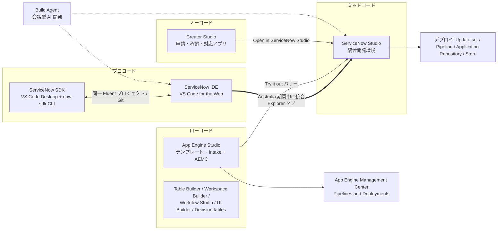
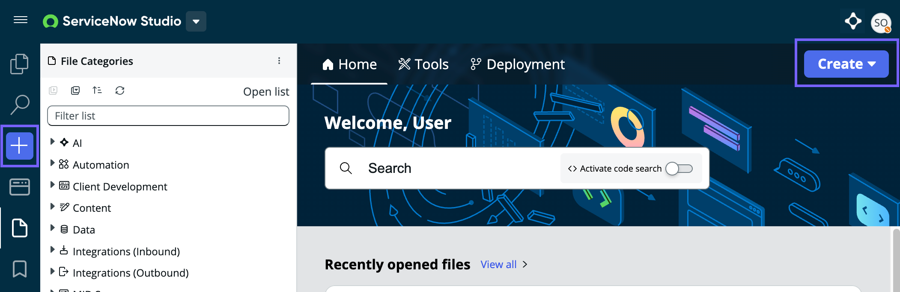
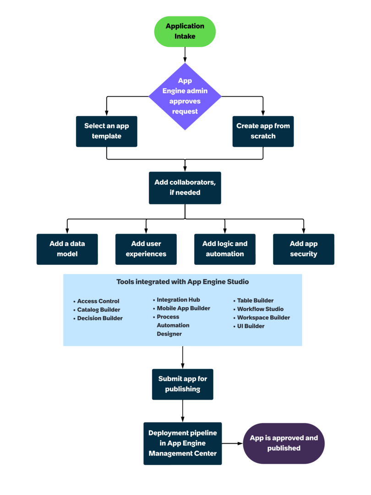
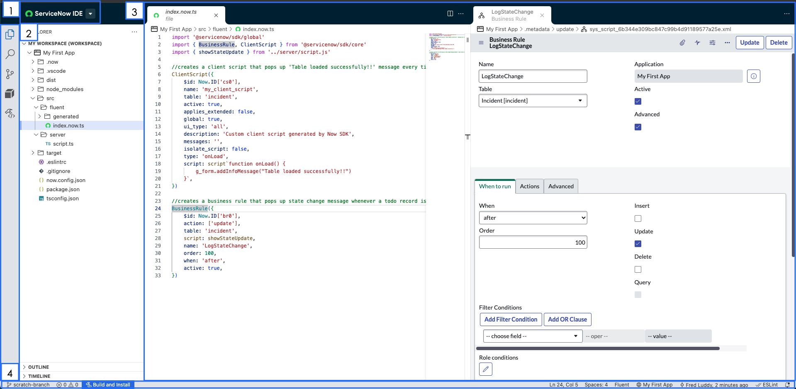
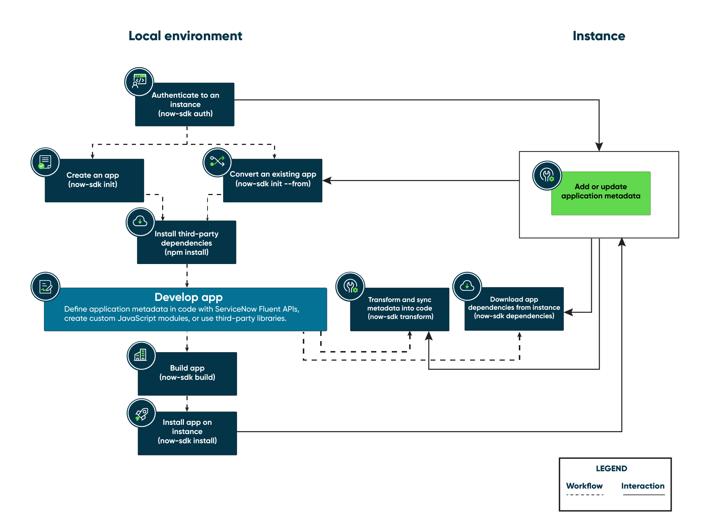
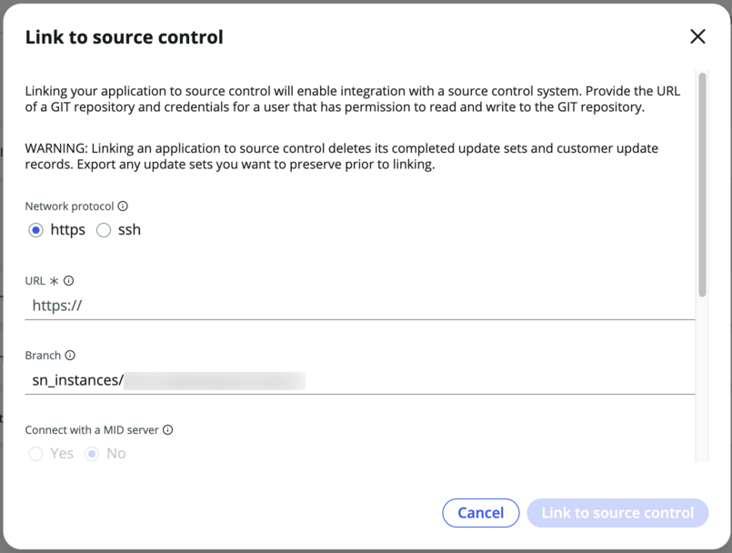

# アプリケーション開発

## 概要

ServiceNow AI Platform（旧称 Now Platform）のアプリケーション開発は、**App Engine**（アプリケーションエンジン）と呼ばれる製品スイート／エンタイトルメントと、その上で使う複数の開発ツールから構成される。2026 年時点の主な開発ツールは次のとおり。[出典](https://www.servicenow.com/docs/r/zUlSbxoxKPAWFDGUdAoSCw/Q_ZlAfTROVq1miJF~_cAWg)

- **Creator Studio**（クリエイタースタジオ）… ノーコードで「申請→承認→対応」型アプリを作る。
- **App Engine Studio（AES）**（アプリエンジンスタジオ）… 市民開発者向けローコード開発環境。テンプレートと申請（Intake）・承認・デプロイのガバナンスを持つ。
- **ServiceNow Studio**（サービスナウスタジオ）… 市民開発者とプラットフォーム開発者向けの統合開発環境。Legacy Studio と Guided Application Creator（GAC）を置き換えた。Australia 期間中に ServiceNow IDE の機能が統合された。
- **ServiceNow IDE** … Visual Studio Code for the Web をインスタンス上で動かすソースコード開発環境（プロコード）。
- **ServiceNow SDK**（`@servicenow/sdk`、CLI は `now-sdk`）… ローカルの Visual Studio Code Desktop でアプリをソースコード開発し、インスタンスにインストールする。メタデータ定義言語は **ServiceNow Fluent**（TypeScript ベースの DSL、拡張子 `.now.ts`）。
- **Build Agent** … 会話形式でアプリを作成・更新する AI エージェント（ServiceNow Otto for Creator の一部）。

本ファイルは、上記ツールに加え、アプリの基本単位である **Application scope**（アプリケーションスコープ）と **Scoped / Global application**、アプリケーションアクセス設定、**Delegated Development**（委任開発）、**Source control（Git）連携**、**Application Repository**（アプリケーションリポジトリ）、**ServiceNow Store 公開**、**App Engine Management Center（AEMC）** のパイプラインを扱う。基準は Australia リリース（2026-05 GA）で、Brazil での変更は判明分を併記する。

関連トピックは次のファイルを参照：アップデートセットとクローンは [update-sets-cloning.md](update-sets-cloning.md)、スクリプトは [scripting-server-side.md](scripting-server-side.md) / [scripting-client-side.md](scripting-client-side.md)、Workflow Studio は [flow-designer-workflow-studio.md](flow-designer-workflow-studio.md)、UI Builder / Workspace は [workspaces-ui-builder.md](workspaces-ui-builder.md)、ACL は [access-control-acl.md](access-control-acl.md)、テーブル定義は [data-model-dictionary.md](data-model-dictionary.md)、ATF は [automated-test-framework.md](automated-test-framework.md)、Now Assist / AI Agents は [now-assist-ai-agents.md](now-assist-ai-agents.md)、ライセンスは [platform-licensing-packaging.md](platform-licensing-packaging.md) と [../../03_導入編/01-licensing-model.md](../../03_導入編/01-licensing-model.md)、カスタマイズのガバナンス（スコープ方針・委任開発・Instance Scan）は [../../04_応用編/09-governance-coe-practice.md](../../04_応用編/09-governance-coe-practice.md)、アップグレード時のカスタマイズ影響は [../../04_応用編/04-upgrade-lessons.md](../../04_応用編/04-upgrade-lessons.md)。

---

## 1. 全体像

### 1.1 App Engine と Creator Workflows

**App Engine** は ServiceNow AI Platform 上のワークフロー自動化のための製品スイートで、プラットフォームのインフラ・ガバナンス・アプリケーションライフサイクル管理を提供する「プラットフォームスイート兼エンタイトルメント」である。これに対し **App Engine Studio** は App Engine の中で使う「開発環境」である。公式ドキュメントは両者を次のように区別している。[出典](https://www.servicenow.com/docs/r/australia/application-development/app-engine-studio/app-engine-vs-aes.html)

| 観点 | App Engine | App Engine Studio |
|---|---|---|
| 性格 | Platform suite and entitlement（製品スイート・権利） | Development environment within App Engine（開発環境） |
| 役割 | デプロイ、ガバナンス、ライフサイクル管理 | アプリの設計・構築・テスト |
| 利用者 | プラットフォーム管理者 | 開発者・市民開発者 |

**Creator Workflows**（クリエイターワークフロー）は、ServiceNow がローコード／アプリ開発系の製品群（App Engine、Integration Hub 等）を束ねて呼ぶワークフロー領域の名称である。2024 年 5 月（Knowledge 2024）の発表では「Creator Workflows の強化」として、App Engine で利用できる新しいノーコード体験 Creator Studio が発表された。[出典](https://newsroom.servicenow.com/press-releases/details/2024/ServiceNow-enhances-Creator-Workflows-to-scale-digital-transformation-across-the-enterprise-05-07-2024-traffic/default.aspx) Creator Workflows の 2026 年時点の正式な製品構成ページ（servicenow.com/workflows/creator-workflows.html）は取得時にアクセスが拒否され、構成要素の最新一覧は公開情報では確認できなかった。

### 1.2 開発ツールの全体マップ



上図は公式の「Low-code versus pro-code development」「Creator Studio」各ページの記述をもとに作成した。[出典](https://www.servicenow.com/docs/r/zUlSbxoxKPAWFDGUdAoSCw/Q_ZlAfTROVq1miJF~_cAWg)

### 1.3 ツール別の対象ペルソナと機能（Australia）

公式ドキュメント「Low-code versus pro-code development」（Australia）による分類。[出典](https://www.servicenow.com/docs/r/zUlSbxoxKPAWFDGUdAoSCw/Q_ZlAfTROVq1miJF~_cAWg)

| 区分 | ツール | 主な利用者 | 主な機能 |
|---|---|---|---|
| ノーコード / ローコード | Creator Studio | プロセスオーナー、業務部門 | コードなしで request-fulfillment（申請・対応）アプリを作成 |
| ローコード | App Engine Studio（AES） | Citizen developer（市民開発者） | ガイド付き設定、テンプレート、ワークフローで Creator Studio より広い種類のアプリを作成 |
| ローコード | UI Builder | ページ構築を行う開発者 | Next Experience のページ・Web エクスペリエンス |
| ローコード | Table Builder | 管理者・ビルダー | テーブル・フォームを視覚的に作成 |
| ローコード | Workspace Builder | 管理者 | Workspace のカスタマイズ |
| ローコード | Flows（Workflow Studio） | ビルダー | フローによるプロセス自動化 |
| ローコード | Decision tables | ビルダー | 判定ロジックの定義 |
| ローコード（レガシー） | Guided Application Creator | ビルダー | 旧来のアプリ作成インターフェース（非推奨） |
| ミッドコード | ServiceNow Studio | 市民開発者・プラットフォーム開発者 | 統合ローコードツール、変更追跡、パッケージングを 1 つの環境で提供 |
| プロコード | ServiceNow IDE | ソースコード開発者 | ServiceNow Fluent・JavaScript モジュール・サードパーティライブラリ。インスタンス上の VS Code for the Web |
| プロコード | ServiceNow SDK | ソースコード開発者 | ローカルの VS Code Desktop で開発しインスタンスへアップロード |
| プロコード | スクリプト、REST API、VS Code 拡張 | 経験ある開発者 | 従来型コーディング・連携 |
| AI | Build Agent | 全レベル | 会話形式でアプリを作成・更新（ServiceNow Studio と ServiceNow IDE で利用可能） |

### 1.4 カスタマイズより新規アプリを選ぶ判断基準

公式ドキュメント「Use App Engine instead of customizations」は、既存アプリ（例：ITSM）を本来の目的外に転用する重いカスタマイズを避け、App Engine の開発ツールで新規アプリを作ることを推奨している。判断基準は次のとおり。[出典](https://www.servicenow.com/docs/r/australia/application-development/servicenow-studio-classic/use-app-engine-instead-of-customizations.html)

1. まず既存アプリを **Configuration**（構成：ベースラインコードを変えない変更）で最大限調整する。
2. **Customization**（カスタマイズ：ベースラインコードの変更）は、アプリ本来の目的を拡張する場合に限る（例：ITSM に IT 機能を追加）。
3. 本来の目的に合わない機能（例：ITSM のワークフローを出張申請に転用）は、App Engine Studio / Creator Studio / ServiceNow Studio で新規アプリとして作る。

カスタマイズの影響として、アップグレード時にカスタマイズ済みレコードがスキップされ手動対応が必要になること、ServiceNow Customer Support がカスタムコード起因の問題をトラブルシュートできないこと、などが挙げられている。[出典](https://www.servicenow.com/docs/r/australia/application-development/servicenow-studio-classic/use-app-engine-instead-of-customizations.html)

---

## 2. Application scope（アプリケーションスコープ）と Scoped / Global アプリ

### 2.1 アプリケーションとスコープの基本

ServiceNow のアプリ（application）は「特定の利用者グループのために特定の作業を行うパッケージ」で、API、テーブル、Workspace、フォーム、フロー等を含むコンテナとして扱われる。[出典](https://www.servicenow.com/docs/r/australia/application-development/creator-studio/creator-studio-landing.html)

**Application scope**（アプリケーションスコープ）は、アプリのファイルとデータを識別し、他アプリからのアクセスを制限して保護する仕組みである。既定ではすべてのカスタムアプリは private scope（固有スコープ）を持ち、Namespace identifier によってアプリと成果物が一意に識別される。スコープ化されたアプリは自分自身のテーブルとビジネスロジックにはアクセス・変更できるが、明示的な許可がない限り他アプリからはアクセスできない。他アプリに公開する範囲は、Custom application レコードと各 Table レコードで管理者が指定する。[出典](https://www.servicenow.com/docs/r/australia/application-development/c_ApplicationScope.html)

公式は「Global アプリは意図しないデータを変更し得るため、新規テーブルは scoped app で作成し、既存のものも scoped app への移行を検討する。これにより Delegated Development で責任を分割できる」と推奨している。[出典](https://www.servicenow.com/docs/r/australia/application-development/c_ApplicationScope.html)

### 2.2 アプリケーションレコードのテーブル

| テーブル | 名称 | 用途 |
|---|---|---|
| `sys_app` | Custom Applications（カスタムアプリケーション） | インスタンス上で開発中（development mode）のカスタムアプリ。Update set で配布したアプリも各インスタンスでここに置かれる |
| `sys_store_app` | ServiceNow Store（ストアアプリ） | ServiceNow Store または Application Repository からインストールされたアプリ。このテーブルのアプリはそのインスタンスでは開発対象にならない |
| `sys_scope_privilege` | Cross scope privileges | クロススコープ特権レコード（後述） |
| `sys_metadata` | Application File | アプリを構成するメタデータ（アプリケーションファイル）の基底 |
| `sys_update_xml` | Customer Updates | 変更記録。SDK の `download --incremental` も参照する |

`sys_app` と `sys_store_app` の関係（Update set 方式で作ったアプリは `sys_app` にあり、Application Repository から直接アップグレードできないため一度だけ変換が必要）は公式手順に記載がある。[出典](https://www.servicenow.com/docs/r/australia/application-development/application-repository-self-hosted/convert-custom-app-to-update-app-repo.html) `sys_metadata` はメタデータ定義の基底として SDK のドキュメントに記載がある。[出典](https://www.servicenow.com/docs/r/australia/application-development/servicenow-sdk/servicenow-sdk.html) なお `sys_app` と `sys_store_app` が共通の親テーブル `sys_scope`（Application）を拡張している点は広く知られているが、本調査で取得した Australia の公式ページには明記がなかった【経験則】。

### 2.3 Namespace identifier（名前空間識別子）

Scoped アプリの成果物（テーブル、スクリプト、構成レコード）には、先頭に **Namespace identifier** が付与され、変更・削除できない。生成規則は次のとおり。[出典](https://www.servicenow.com/docs/r/australia/application-development/c_NamespaceIdentifier.html)

| 要素 | 要件 | 例 |
|---|---|---|
| Scoped アプリの接頭辞 | 常に `x_` | `x_` |
| インスタンスの顧客接頭辞 | 2〜5 文字。ServiceNow が顧客ごとに生成し、システムプロパティ `glide.appcreator.company.code` に保存 | `acme` |
| Application ID | 最大 40 文字。18 文字を超える場合は切り詰めて `x_<company code>_` の後ろに付与。既定はアプリ名 | `book_rooms` |

上記例の結果は `x_acme_book_rooms` となる。ServiceNow SDK の `init --scopeName` も「`x_<prefix>` で始まり 18 文字以内、インスタンス内で一意」であることを要求する。[出典](https://www.servicenow.com/docs/r/australia/application-development/servicenow-sdk/servicenow-sdk-cli-commands.html) SDK の GitHub ドキュメントは、会社コードをシステムプロパティ `sn_appauthor.all_company_keys` で確認できると記載している。[出典](https://servicenow.github.io/sdk/getting-started)

Global スコープで作成したカスタム列は `u_` 接頭辞になる（Scoped アプリではスコープ名が接頭辞になる）【第三者情報】（ServiceNow Community のフォーラム回答に基づく）。[出典](https://www.servicenow.com/community/developer-forum/how-to-name-column-names/m-p/1979156)

### 2.4 Global scope（グローバルスコープ）

**Global scope** は、スコープ導入前に開発されたアプリや、全 Global アプリからアクセスされることを意図したアプリを表す特別なスコープである。[出典](https://www.servicenow.com/docs/r/australia/application-development/c_GlobalScope.html)

- Global アプリには Namespace identifier が付かないため、同名アプリを複数作ると名前の衝突・データ衝突が起き得る。
- 同じ Global スコープ内のアプリはスコープ保護を受けず、互いのテーブルに対して「レコード読み取り」「API リクエスト実行」「構成レコード作成」ができる。
- 通常は ServiceNow 提供アプリとスコープ導入前のカスタムアプリが Global にあるが、`sn_g_app_creator.app_creator` ロールを持つ開発者も Global アプリを作成できる。
- **Global アプリは Application Repository へはアップロードできるが、ServiceNow Store へは公開できない。**

> **注意:** Global scope ページは `sn_g_app_creator.app_creator` で Global アプリ作成可とするが、ServiceNow Studio の作成手順ページ（Create an application in ServiceNow Studio）は GAC Global ロール（`sn_g_app_creator.global`）を要求しており、公式ページ間で記述が一致しない。ServiceNow Studio で作る場合は後者に従い、実インスタンスで確認すること（2.5 の表・3 章も同様）。[出典](https://www.servicenow.com/docs/r/australia/application-development/c_GlobalScope.html) / [出典](https://www.servicenow.com/docs/r/australia/application-development/servicenow-studio-classic/create-an-application-in-servicenow-studio.html)

Australia では ServiceNow SDK 4.4 / ServiceNow IDE で Global アプリの作成と変換（ソースコード開発対応）が可能になり、`now-sdk move` で Global スコープの既存メタデータ（XML）を Fluent コードとしてローカルの Global アプリに取り込めるようになった（詳細は 8 章・9 章）。[出典](https://www.servicenow.com/docs/r/IDeOjpA1hzonPLWG~inEpg/hlRrXzeviCsRu25MbiaZLg)

### 2.5 Scoped と Global の比較

| 観点 | Scoped application | Global application |
|---|---|---|
| 名前空間 | `x_<会社コード>_<アプリID>` が成果物に付く | 付かない（衝突リスク） |
| 他アプリからのアクセス | 既定で制限。Application access 設定と Cross-scope privilege で制御 | Global 同士は保護なし |
| ServiceNow Studio での作成 | admin、または GAC ロール（`sn_g_app_creator.app_creator`） | admin、または GAC Global ロール（`sn_g_app_creator.global`）を持つ GAC ユーザー |
| Application Repository | 可 | 可（Global scope ページに基づく。app-repo ページは対象を scoped のみと記載。11.1 参照） |
| ServiceNow Store 公開 | 可（Technology Partner Program 加入・認定が前提） | 不可 |
| Source control（Git）連携 | 可 | Australia の SDK / IDE で Global アプリのソースコード開発が可能に |
| 推奨 | 新規開発の基本 | 既存 Global 資産の整理、Global メタデータのカスタマイズ |

出典：[Global scope](https://www.servicenow.com/docs/r/australia/application-development/c_GlobalScope.html)、[Create an application in ServiceNow Studio](https://www.servicenow.com/docs/r/australia/application-development/servicenow-studio-classic/create-an-application-in-servicenow-studio.html)、[Publish an application to the ServiceNow Store](https://www.servicenow.com/docs/r/australia/application-development/t_PublishAppsToTheServiceNowStore.html)、[ServiceNow Studio personas and roles](https://www.servicenow.com/docs/r/australia/application-development/servicenow-studio-classic/sn-studio-personas-roles.html)

### 2.6 Application access settings（アプリケーションアクセス設定）の 3 種類

**Application access settings** は、あるアプリが別のアプリのリソースにアクセスできるかを決める設定で、ACL がユーザーからテーブル・レコードを守るのに対し、こちらは他アプリからアプリのリソースを守る。[出典](https://www.servicenow.com/docs/r/zUlSbxoxKPAWFDGUdAoSCw/6OmaENzI~mUA9cF2dJM1fQ)

| 設定種別 | 使う場面 | 設定対象 | 主な設定内容 | アクセス判定の根拠 |
|---|---|---|---|---|
| Application design and runtime settings | 自アプリ（のスクリプト）が他スコープのリソースにアクセスする | アプリ全体 | 設計時に他スコープのテーブルを選べるか、スクリプトがいつ他スコープのリソースで動けるか、JavaScript の標準 | 呼び出し元アプリが持つ Cross-scope privilege レコード |
| Table design and runtime settings | 他スコープのアプリや Web サービスがテーブルに CRUD する | 個々のテーブル | 他スコープから利用可能か、許可する実行時操作、設計時に選択可能か、Web サービスからのアクセス可否 | 対象テーブルの設定 |
| Restricted caller access privilege settings | 他スコープのスクリプトが自アプリ（ロール、Business rule、UI action、Script include、Event 等）にアクセスする | スコープ全体または特定リソース（管理者が管理） | 呼び出しを許可するか、追跡するか、承認／拒否 | 対象アプリが所有する Restricted caller access レコード |

#### 2.6.1 Restricted caller access（RCA、制限付き呼び出し元アクセス）

**Restricted caller access** は、他スコープのアプリやスクリプトが自アプリのリソース（Script include、Event 等）を呼び出す要求を、**対象アプリ側**で追跡・承認／拒否する仕組みである。レコードは **Restricted Caller Access Privileges** [`sys_restricted_caller_access`] テーブルに作成され、対象リソースの caller access が Caller Restriction または Caller Tracking に設定されている場合や、クロススコープのアクセス試行時に生成される。RCA レコードは対象アプリのスコープで作成する必要がある。[出典](https://www.servicenow.com/docs/r/application-development/restricted-caller-access-privilege.html) / [出典](https://www.servicenow.com/docs/r/vAF6lp8vm2~kKTU5ernM8g/GWvfNuLgZBg47R2H4DckEQ)

| 項目 | 内容 |
|---|---|
| テーブル | Restricted Caller Access Privileges [`sys_restricted_caller_access`] |
| メニュー | All > System Applications > Application Restricted Caller Access |
| Status（状態） | `Requested`（要求中）/ `Allowed`（許可）/ `Denied`（拒否）/ `Invalidated`（呼び出し元リソースが変更されると自動で設定） |
| ステータスを変更できるユーザー | `admin` または対象アプリの application admin。対象アプリで Application administration（2.6.2）が有効な場合は、そのアプリの管理者のみ |
| Caller access の選択肢 | Caller Restriction（呼び出しは手動承認が必要。要求は Status `Requested` で記録）／ Caller Tracking（自動承認。Status `Allowed` で記録）。Event registry で caller access を None にすると、Event へのクロススコープ呼び出しは拒否される |
| 有効化 | Scoped Application Restricted Caller Access プラグイン（`com.glide.scope.access.restricted_caller`）。HR Service Delivery と Security Incident Response では既定で有効 |

出典：[Set the application scope, application resource, and event access（Australia）](https://www.servicenow.com/docs/r/zUlSbxoxKPAWFDGUdAoSCw/aQj7tCO1bevxWxFzmaUR0A)、[Restricted caller access privilege settings](https://www.servicenow.com/docs/r/application-development/restricted-caller-access-privilege.html)

ServiceNow Fluent の Script Include API では `callerAccess` プロパティに `restriction`（手動承認、Restricted Caller Access テーブルに Status `Requested` で記録）または `tracking`（自動承認、Status `Allowed` で記録）を指定する。Script include フォーム上の Caller Access フィールドの「None」選択肢の正確な表記は、公開情報では確認できず。[出典](https://www.servicenow.com/docs/r/zUlSbxoxKPAWFDGUdAoSCw/dEZRlhVb42QRnfE4hr9PRQ)

#### 2.6.2 Application administration（アプリケーション管理）

**Application administration** は、Custom application レコードのチェックボックスで、アプリ固有ロールの取得方法を制限して機密性の高いアプリデータを保護する設定である（Custom Application record form の説明：「Select whether to protect sensitive application data by restricting how users acquire application-specific roles.」）。[Custom Application record form（Australia）](https://www.servicenow.com/docs/r/zUlSbxoxKPAWFDGUdAoSCw/KlumZ8kZ2LV_5IgZaa~SKQ)

- **前提**：アプリ固有の管理者ロール（例：`my_application.admin`）を作成し、そのロールレコードで **Application Administrator** チェックボックスを選択する（Assignable by フィールドの代替）。ロールはロックアウト防止のため複数ユーザーに付与する。
- **有効化**：そのロールを持つユーザーでログインし、**My Company Applications** からアプリレコードを開いて **Application administration** を選択し **Update**。Application Administrator が選択されたロールがアプリに 1 つ以上あり、かつ操作ユーザーがそのロールを持つ場合のみ保存される。つまり、システム `admin` であってもアプリ固有の管理者ロールがなければ有効化できない。
- **admin との関係**：有効化後、関連リンク **Grant application administration to all admins** を使うと、アプリ固有管理者ロールがシステム `admin` ロールの Contained role として追加され、admin も application admin の権限を継承する（このリンクを使わない場合、admin はアプリ固有管理者ロールを継承しない）。
- **Delegated Development・RCA との関係**：アプリ固有管理者は **Manage Developers** で委任開発者を指定できる（13 章）。また Application administration が有効なアプリでは、Restricted caller access レコードのステータス変更もそのアプリの管理者に限られる（2.6.1）。

[出典](https://www.servicenow.com/docs/r/australia/application-development/enable-application-administration.html)

### 2.7 Application design and runtime settings（アプリ単位）

アプリケーションレコードの Design and Runtime 関連フィールドは次のとおり。[出典](https://www.servicenow.com/docs/r/australia/application-development/r_ApplicationDesignAndRuntimeSettings.html)

| フィールド | 説明 | 選択肢 |
|---|---|---|
| JavaScript Mode | アプリがサポートする JavaScript 標準 | `ECMAScript 2021 (ES12)`、`ES5 Standards Mode`、`Compatibility Mode`（より古い ECMAScript） |
| Runtime Access Tracking | 他アプリのリソースへのスクリプトアクセス要求の扱い | `None` / `Tracking` / `Enforcing`（下表） |
| Restrict Table Choices | 設計時に他スコープのテーブルを選べるか | オフ＝他スコープのテーブルも表示、オン＝同一アプリのテーブルのみ |

**Runtime access tracking**（実行時アクセス追跡）の 3 モード。[出典](https://www.servicenow.com/docs/r/australia/application-development/c_RuntimeAccessTracking.html)

| モード | 開発中の挙動 | 実行可否 |
|---|---|---|
| `None` | 追跡せず、認可も要求しない | テーブル単位の設定が許せば実行される |
| `Tracking` | 実行時アクセス要求ごとに Cross-Scope Privilege レコードを作成し、Status を `Allowed` に設定 | テーブル単位の設定が許せば実行される |
| `Enforcing` | Cross-Scope Privilege レコードを Status `Requested` で作成 | 管理者が手動で `Allowed` に変えるまでブロック（かつテーブル単位設定が許す必要あり） |

インストール後（公開後）は新たな実行時アクセス要求は追跡されず、有効な Cross-scope privilege レコードを持つ要求のみが実行される。既定値は `Tracking` とされる【第三者情報】（ServiceNow Community 開発者ブログに基づく）。[出典](https://www.servicenow.com/community/developer-blog/securing-an-application-using-cross-scope-access-application/ba-p/2288801)

### 2.8 Cross-scope privilege（クロススコープ特権）

**Cross scope privileges** [`sys_scope_privilege`] テーブルは Runtime access tracking で使われ、各レコードは対象スコープ、対象リソース（名前・種別）、操作、Status（`requested` / `allowed` / `denied`）を持つ。テーブル（`sys_db_object`）に対する操作は read / write / create / delete、Script include（`sys_script_include`）やスクリプトオブジェクトに対する操作は execute のみである。[Cross-Scope Privilege API - ServiceNow Fluent（Australia）](https://www.servicenow.com/docs/r/zUlSbxoxKPAWFDGUdAoSCw/f5OYW25uMGwB00K2rFdt9g) プラットフォーム側の公式ページ（Runtime access tracking）は、Runtime access tracking が Cross-Scope Privilege レコードを作成し Status を `Requested` / `Allowed` に設定することを説明しているが、`denied` やレコードのフィールド構成は明記していない（`denied` と操作種別の一覧は上記 Fluent API ページに基づく）。[Runtime access tracking（Australia）](https://www.servicenow.com/docs/r/australia/application-development/c_RuntimeAccessTracking.html)

各レコードが呼び出し元スコープ（Source scope）も持つこと、および Cross-scope privilege は対象リソースの Application access 設定（テーブル単位の Accessible from / Can read 等）を超えてアクセスを広げられない（設定が上限として働く）ことは、第三者の解説で説明されている【第三者情報】。公式ドキュメントでの明示は確認できず。[出典](https://www.beyondtrust.com/blog/entry/servicenow-security-boundaries-acl-scope-rca) / [出典](https://support.hashicorp.com/hc/en-us/articles/16237094062099-Terraform-ServiceNow-Service-Catalog-Integration-Blocked-by-Cross-Scope-Access-Settings)

ServiceNow Fluent では `CrossScopePrivilege` API（`@servicenow/sdk/core`）で定義でき、`targetType` は `sys_script_include`、`scriptable`、`sys_db_object` を取る。[Cross-Scope Privilege API - ServiceNow Fluent（Australia）](https://www.servicenow.com/docs/r/zUlSbxoxKPAWFDGUdAoSCw/f5OYW25uMGwB00K2rFdt9g)

### 2.9 テーブル単位の実行時アクセス（Table design and runtime settings）

**Runtime access** は、API や Web サービス呼び出しがアプリのテーブルに対して実行を許されるかを決める。アクセスポイントは Script API（GlideRecord 等のスコープ化システム API）と Web services（REST / JSON / SOAP）の 2 つ。違反すると、例えば保護されたテーブルへの Web サービス呼び出しは HTTP 403 Forbidden になる。[出典](https://www.servicenow.com/docs/r/australia/application-development/c_RuntimeAccessToAppTables.html)

新規アプリテーブルの既定値（他スコープからは読み取りのみ許可）。[出典](https://www.servicenow.com/docs/r/australia/application-development/c_DefaultRuntimeAccessPermissions.html)

| フィールド（Application Access タブ） | 既定値 |
|---|---|
| Accessible from | All application scopes |
| Can read | 有効 |
| Can create | 無効 |
| Can update | 無効 |
| Can delete | 無効 |
| Allow access to this table via web services | 有効 |

`Accessible from` を `This application scope only` にすると他スコープからのアクセスを遮断できる。Can read をオフにすると Can create / update / delete が読み取り専用になる、という挙動がコミュニティで説明されている【第三者情報】。[出典](https://www.servicenow.com/community/developer-forum/how-to-restrict-selection-of-table-from-other-scope/m-p/3146903)

### 2.10 Creation restrictions across application scopes（スコープをまたぐ作成制限）

現在のアプリスコープと、構成レコードの対象テーブルのスコープが異なるとき、システムは一部の構成レコードの作成を常に制限する。[出典](https://www.servicenow.com/docs/r/australia/application-development/r_CreationRestrsAcrossAppScopes.html)

| 構成レコード | 対象テーブルが他スコープのときの制限 |
|---|---|
| Access controls | ロール条件付きのフィールドレベル ACL のみ作成可。テーブルレベル ACL、全フィールド対象 ACL、条件付き ACL、スクリプト条件 ACL は作成不可 |
| Business rules | When=`async`：Insert/Update/Delete（Query 不可）で Set field values と Script 可。When=`before`：Insert/Update/Delete（Query 不可）で Set field values のみ（スクリプト不可、トランザクション中断不可） |
| Calculated fields | 作成不可 |
| Data policies | 他スコープのフィールドに対するルール作成不可、必須化不可 |
| Field styles | 作成不可 |
| Form sections | 既存セクションの変更不可、新規セクションは作成可 |
| Record producers | アプリテーブルへの create 権限が必要 |
| UI policies | 他スコープのフィールドに対するルール作成不可、必須化不可 |
| UI script | Scoped アプリから Global UI script は作成不可 |
| Views | 新規ビューは作成可、既存ビューの変更不可 |

### 2.11 Dependencies（依存関係）

カスタムアプリのレコードには、他アプリやプラグインへの依存を示す **Dependencies** 関連リストがある。プラットフォームはスコープ外のコンポーネント参照（例：他アプリの Script include を呼ぶ Business rule、インストール済み Spoke のアクションを使うフロー）から依存関係を自動追跡し、別インスタンスへのインストール時に必要コンポーネントの存在確認と不足時のインストール促進を行う。依存レコードを削除する前に、そのアプリやプラグインのコンポーネントを参照していないことを確認する必要がある。[出典](https://www.servicenow.com/docs/r/australia/application-development/c_ApplicationDependencies.html)

### 2.12 Application customization（ストアアプリ・プラグインのカスタマイズ）

他組織のアプリ（Store 購入アプリ）や ServiceNow のスコープ化プラグインそのものは変更できないが、自社の **application-customization**（アプリケーションカスタマイズ）を作成し、Application Repository で管理できる。[出典](https://www.servicenow.com/docs/r/australia/application-development/application-repository-self-hosted/manage-customizations-store-apps.html)

- 必要ロール：`admin`。
- application-customization のエンタイトルメントは元の Store アプリのエンタイトルメントに完全に従属し、個別のエンタイトルメントはない。
- 作成方法：(1) Studio で Store アプリ／プラグインのアプリを開いて変更する、(2) **System Applications > All** で対象アプリを検索し、Edit in Studio するか、Store アプリレコードの Related Links **Switch to this Application** で作業アプリにする。
- App Customization パッケージは「望ましい変更の完全な表現」として扱われるため、ローカルのカスタマイズ（`sys_update_xml` に紐づくもの）は尊重されない。特定フィールドを保持したい場合は Dictionary 属性 Loader exempt、特定プロパティは private 化を検討する。
- ISV パートナーが自社アプリをカスタマイズする場合も、先に Store へ公開しインスタンスにインストールする必要がある。

---

## 3. ServiceNow Studio

### 3.1 位置づけと沿革

**ServiceNow Studio** は、すべての ServiceNow 開発作業のための統合環境である（プラグイン説明文）。一貫したナビゲーションとメタデータの分類体系（taxonomy）の下で開発ツールを切り替えずに作業でき、Update set やパイプラインでデプロイを管理し、ServiceNow Otto（生成 AI）にネイティブ対応する。[出典](https://www.servicenow.com/docs/r/australia/application-development/servicenow-studio-classic/servicenow-studio-and-legacy-products.html)

| 時期 | 出来事 |
|---|---|
| 2024 年 11 月（Store リリース） | ServiceNow Studio が **Guided Application Creator（GAC）** と **Legacy Studio**（旧 Studio）を置き換え。両製品は非推奨（deprecated）となるが、将来リリースまではサポート継続 |
| Yokohama〜Zurich | ServiceNow Studio は Store からのダウンロードが不要になり、AI Platform の機能として既定で有効 |
| Zurich | Legacy Studio は将来の廃止に向けて非表示となり、新規インスタンスにはインストールされない（既存利用はサポート継続。廃止プロセスは KB0867184） |
| Australia 期間中（Studio 29.2.11 以降） | ServiceNow IDE の機能が ServiceNow Studio に統合（Explorer タブ） |
| Brazil | エクスペリエンススイッチャーが削除され、IDE 機能は Explorer タブに集約。VS Code 以前の旧版 Studio UI は非推奨 |

出典：[ServiceNow Studio and legacy products](https://www.servicenow.com/docs/r/australia/application-development/servicenow-studio-classic/servicenow-studio-and-legacy-products.html)、[Legacy Studio release notes（Yokohama→Zurich）](https://www.servicenow.com/docs/r/zurich/delta-yokohama-zurich/zurich-yokohama-legacystudio-release-notes.html)、[ServiceNow Studio release notes（Zurich→Brazil）](https://www.servicenow.com/docs/r/delta-zurich-brazil/brazil-zurich-servicenowstudio-release-notes.html)

- Legacy Studio と GAC で作成したアプリは ServiceNow Studio と互換性があり、切り替えに追加構成は不要。
- 各アプリレコードの **Can Edit Application in Studio** オプションは Legacy Studio 用であり、新しい ServiceNow Studio には適用されない（編集権限のある Global / Scoped / カスタムアプリはすべて ServiceNow Studio で開ける）。
- 初めて ServiceNow Studio を使う場合、Scoped アプリを作成するまで Search バーや Create > App/File が表示されないことがある。アプリ作成後にホームへ戻りブラウザを再読み込みすると表示される。

[出典](https://www.servicenow.com/docs/r/australia/application-development/servicenow-studio-classic/servicenow-studio-and-legacy-products.html)

### 3.2 アクセス方法

- メニュー：**All > App Engine > ServiceNow Studio**（フィルターナビゲーターで「ServiceNow Studio」を検索しても可。Favorites 登録推奨）。
- App Engine Studio から：AES 上に ServiceNow Studio の案内バナーが表示され、**Try it out** でアプリを ServiceNow Studio で開ける。バナー表示はシステムプロパティ `show_servicenow_studio_banner` で制御する。

[出典](https://www.servicenow.com/docs/r/australia/application-development/servicenow-studio-classic/access-servicenow-studio.html)

### 3.3 インストールされるコンポーネント

ServiceNow Studio プラグイン **`sn_sns`** を有効化すると、テーブル・依存プラグインが自動でインストールされる。ServiceNow Studio 専用ロールはなく、`admin` と `delegated_developer` を使う。[出典](https://www.servicenow.com/docs/r/australia/application-development/servicenow-studio-classic/components-installed-with-sn-studio.html)

| 種別 | 名前 | 説明 |
|---|---|---|
| プラグイン | ServiceNow Studio [`sn_sns`] | 依存：`sn_udc`、`sn_studio_commons`、`sn_app_obj_wizards`、`sn_deploy_pipeline` |
| テーブル | Resources [`sn_sns_resources`] | ホーム下部の Resources セクションの内容 |
| テーブル | Experience Configurations [`sn_udc_experience_configuration`] | エクスペリエンススイッチャーの既定ロールアクセス構成（構成不可） |
| テーブル | Experience Visibility Controls [`sn_udc_experience_visibility_control`] | 既定外ロールにエクスペリエンススイッチャーへのアクセスを付与（構成可） |

### 3.4 ユーザーインターフェース



- **キャプション:** ServiceNow Studio のホームページ。左端アクティビティバーの「＋」（作成）アイコンと右上の **Create** ボタンが紫枠で強調されている。
- **画面の説明:** 最上部に「ServiceNow Studio」のロゴとドロップダウン（エクスペリエンススイッチャー）、右上に ServiceNow Otto（AI）アイコンとユーザーアバター。左端の縦のアクティビティバーにファイル、検索、作成（＋）、アプリ、ファイルカテゴリ、ブックマーク（Collections）のアイコンが並ぶ。その右の Navigator パネルは「File Categories」表示で、フィルター欄の下に AI、Automation、Client Development、Content、Data、Integrations (Inbound)、Integrations (Outbound)… のカテゴリツリーがある。中央上部に Home / Tools / Deployment のタブと Create ボタン、「Welcome, User」と検索バー（「Activate code search」トグル付き）、その下に「Recently opened files」（View all）。
- **出典:** ServiceNow Docs「Create an application in ServiceNow Studio」（Australia）https://www.servicenow.com/docs/r/australia/application-development/servicenow-studio-classic/create-an-application-in-servicenow-studio.html （取得日: 2026-11-02）

ServiceNow Studio を使うには `admin` または `delegated_developer` ロールと、少なくとも 1 つのアプリに対する権限が必要である。Australia の UI 構成要素は次のとおり。[出典](https://www.servicenow.com/docs/r/australia/application-development/servicenow-studio-classic/servicenow-studio-user-interface.html)

| 領域 | 要素 | 説明 |
|---|---|---|
| Navigator パネル | Explorer | ワークスペースを作成し、ソースコードでアプリを扱う（IDE 統合部分） |
| | Changes | Source control に関連する変更を表示 |
| | Search | すべてのスコープのファイル・アプリ・メタデータ・ツールを検索 |
| | Create | アプリまたはファイルを作成 |
| | Apps | 全アプリを表示 |
| | File Categories | ファイルとメタデータをカテゴリ別に表示・並べ替え・フィルター |
| | Collections | 整理されたブックマーク・ファイル・アプリ（Australia Patch 3 で Bookmark アイコンが Collections アイコンに変更） |
| | Recent | 最近開いたファイル |
| ツールバー | Home | Navigator と最近の項目を表示するランディングページ |
| | Tools | Studio のビルダーとツールのドキュメント |
| | Deployment | Update set、アプリケーション、Deployment request の一覧 |
| Create ボタン | — | アプリ／ファイルの作成、Source control からのアプリのインポート |
| ユーザー設定メニュー | — | Studio の設定、ライト／ダークテーマ、AI によるアプリ生成の既定ツールとして Build Agent を使うか |
| Resources セクション | — | ServiceNow Community、App Gallery、Script Debugger、Studio / Creator Studio のドキュメントへのリンク |
| ステータスバー | — | アプリ／ファイルを開いているとき、現在のスコープと関連付けられた Update set を表示。Update set の切り替え・新規作成、**View update set** で関連更新を表示 |

### 3.5 アプリの作成手順（ServiceNow Studio）

必要ロール：`admin` または Guided Application Creator ロール（バージョン 27.1.2 以降、admin と GAC ロールのユーザーの双方がアプリを作成可能。カスタム Global アプリを作る GAC ユーザーは Global ロールが必要）。[出典](https://www.servicenow.com/docs/r/australia/application-development/servicenow-studio-classic/create-an-application-in-servicenow-studio.html)

1. **All > App Engine > ServiceNow Studio** を開く。
2. Navigator パネル横の作成アイコン、または **Create** ボタンを選択し、**App** を選ぶ。
3. 作成方法を選ぶ。
   - **On your own**：自分でコンテンツとファイルを追加する。
   - **With ServiceNow Otto**：Build Agent のチャットパネルが開き、会話でアプリを作成する。
   - **With Creator Studio**：Creator Studio で単純な申請・対応アプリを作成する。
   - 参考として **Explore the App Gallery**（ServiceNow 資格情報でサインインし、完成アプリのライブラリを閲覧）も選べる。
4. **Name**、**Description**、任意でロゴを入力し、**Scope** を選ぶ。
   - **Scoped**：既定ではインスタンス上の他データと相互作用しない。
   - **Global**：インスタンス上のすべてのテーブルとビジネスロジックがアプリと相互作用できる。
5. ロールを定義する。ServiceNow Studio は既定の admin / user ロールを自動定義する。追加・削除可能だが、アプリを更新し続けるには少なくとも 1 つのロールが必要。
6. **Create file** でファイルを追加するか、**View app details** で App details ページを開く。

作成後は、アプリケーションファイル、依存関係、Cross-scope privilege を追加する。

### 3.6 App details ページ

**App details** ページは、アプリのメタデータを表示し、よく使う開発操作（ファイル作成、設定変更、公開）の起点となる。[出典](https://www.servicenow.com/docs/r/australia/application-development/servicenow-studio-classic/app-details-page.html)

| 要素 | 内容 |
|---|---|
| Navigator panel | カテゴリ別のアプリファイル。ブックマーク、ファイル種別の全件リスト表示、フィルター |
| Files section | 注目ファイル種別（Data、User Interface、Automation、Security）または全種別 |
| Page header | アプリのメタデータ、共同作業者の招待、**+ Create**。タイトル横のバッジ（Creator Studio、AI、Fluent など）は作成元と必要なデプロイ方法を示す |
| App actions（その他メニュー） | Source control へのリンク、共同作業者の招待、設定、Publish、Refresh、Delete。Source control 連携済みなら Publish ボタン横に Source control 操作メニュー |
| Scope and update set | ページ下部に現在のスコープと Update set。タブ切り替えでスコープも自動で切り替わる |

App details ページで可能な操作：Source control へのリンク、Git での変更作業、アプリ内容の要約（AI）、設定変更、ファイル作成、Update set 作成、ブックマーク、アプリ削除。

### 3.7 ロールとペルソナ

ServiceNow Studio のペルソナとロール（Australia）。[出典](https://www.servicenow.com/docs/r/australia/application-development/servicenow-studio-classic/sn-studio-personas-roles.html)

| ペルソナ | ロール | できること |
|---|---|---|
| Delegated developer | `delegated_developer` | 委任されたアプリのみアクセス。Studio で当該アプリを更新、Update set 作成、アプリファイル・メタデータの作成更新、Update set / パイプライン / Application Repository によるデプロイ申請（権限は構成により異なる） |
| Admin | `admin` | カスタムアプリ開発の審査・承認。アプリと Fluent アプリ（Explorer タブ）作成、アプリ編集・開発委任、Update set 管理、Global（unscoped）メタデータの作成・編集 |
| GAC | `sn_g_app_creator.app_creator` | カスタムアプリ作成。作成者には当該アプリの delegated developer 権限が付与される |
| GAC Global | `sn_g_app_creator.global` | カスタム Global アプリの作成も可能 |
| ServiceNow Studio admin / UDC admin | `sn_udc.admin` | Studio のシステムプロパティ・設定・構成、Studio 固有ロールと権限の管理。Creator Studio / ServiceNow Studio / ServiceNow IDE のエクスペリエンススイッチャーのロール構成 |
| Preferred tables admin | `sn_prfrd_tables.admin` | Table Builder の preferred tables（推奨テーブル）の構成 |
| メタデータ別 admin | 既存のプラットフォームロール（例：Business rule admin、Script include admin） | Studio 内で特定メタデータ種別の CRUD |

開発エクスペリエンスごとのアクセス可否（Australia）。[出典](https://www.servicenow.com/docs/r/australia/application-development/servicenow-studio-classic/working-with-roles-and-access.html)

| エクスペリエンス | アクセスできるロール | アクセスできないロール |
|---|---|---|
| ServiceNow IDE でのプロコード | `admin`（ほかに IDE 固有ロール） | `sn_creatorstudio.restricted_user`、`sn_creatorstudio.user` |
| ServiceNow Studio でのプラットフォーム開発 | `delegated_developer`、`admin`、`sn_g_app_creator.app_creator` | `sn_creatorstudio.restricted_user`、`sn_creatorstudio.user` |
| Creator Studio でのノーコード | `delegated_developer`、`admin`、`sn_creatorstudio.user`、`sn_creatorstudio.restricted_user` | — |

> **注意:** Creator Studio ロールを持つユーザーは、admin や delegated developer であっても ServiceNow Studio と ServiceNow IDE にアクセスできない。また `delegated_developer` は ServiceNow IDE へのアクセス権を与えない。ServiceNow IDE へのアクセスには `admin`、または IDE 固有ロール（`sn_glider.admin` 等、8.3 参照）が必要である（原文：「To grant access to ServiceNow IDE, the user must have admin permissions or other roles specific to ServiceNow IDE.」）。エクスペリエンススイッチャーにはアクセス権のあるツールのみ表示される。[出典](https://www.servicenow.com/docs/r/australia/application-development/servicenow-studio-classic/working-with-roles-and-access.html)

### 3.8 共同開発（Collaboration）の権限

ServiceNow Studio でアプリに共同作業者を招待すると、**Owner** または **Editor** として権限が付与される。既定値は次のとおり（Australia、2026-05-29 更新）。[出典](https://www.servicenow.com/docs/r/zUlSbxoxKPAWFDGUdAoSCw/CM7auEBQpC2gIQCy7RIeMw)

| 区分 | 権限 | 説明 | Owner | Editor |
|---|---|---|---|---|
| ファイル種別 | All File Types | 他の選択肢に含まれないものも含む全ファイル種別 | ○ | ○ |
| | Integrations | Web サービス API、REST API、データソース、Integration Hub Import | ○ | ○ |
| | Reporting | レポート、スケジュールレポート | ○ | ○ |
| | Mobile builders | Mobile App Builder 等 | ○ | ○ |
| | UI Builder | 複雑なインターフェース構築 | ○ | ○ |
| | Workflow | Workflow Editor、Activity Creator | ○ | ○ |
| | Service Portal | Service Portal エディター・ツール | ○ | ○ |
| | Workflow Studio | フロー・アクションの設計環境 | ○ | ○ |
| | Service Catalog | カタログアイテム、レコードプロデューサー、変数 | ○ | ○ |
| | Tables & forms | テーブル列、フォームレイアウト、リストレイアウト | ○ | ○ |
| | Decision Tables | 複数 if-else に基づく判定ロジック | ○ | ○ |
| | Playbooks | プロセス設計（活動のサブフロー／アクション編集には Flow Designer 権限も必要） | ○ | ○ |
| | Notifications | メール通知、メールテンプレート | ○ | ○ |
| セキュリティ・プログラミング | Manage access control | ACL、ロール等のセキュリティファイル | ○ | ○ |
| | Allow scripting | Business Rules、UI Actions、Client Scripts 等のスクリプトフィールド | × | × |
| アプリ管理 | Delete application | アプリの削除 | ○ | × |
| | Manage collaborators | 開発者とその権限の変更 | ○ | × |
| | Source control | Source control ツール連携 | × | × |
| | Invite collaborators | 共同作業者の招待 | ○ | ○ |
| デプロイ | Upgrade app | アプリのアップグレード | × | × |
| | Submit for deployment | デプロイ申請 | ○ | × |
| | Publish app to repo | Application Repository への公開 | × | × |
| | Publish to app store | ServiceNow Store への公開 | × | × |

### 3.9 インスタンス戦略

公式は、アプリを開発するすべてのインスタンスに ServiceNow Studio を導入し、アクセスとデプロイの戦略を定めることを推奨している。アクセス付与の選択肢は「全社員」「特定グループ」「申請フォームで作りたいアプリを説明させ管理者が個別承認」の 3 つ。テスト環境には本番と同様に構成した非本番インスタンスを使い、本番を非本番へクローンする予定なら、クローン前に本番へ ServiceNow Studio をインストールしておく。デプロイは Update set、パイプライン、Application Repository のいずれかで行う。[出典](https://www.servicenow.com/docs/r/australia/application-development/servicenow-studio-classic/servicenow-studio-instance-strategy.html)

### 3.10 リリース別の機能変化（Zurich → Australia → Brazil）

公式の統合リリースノート（Zurich→Brazil）より。[出典](https://www.servicenow.com/docs/r/delta-zurich-brazil/brazil-zurich-servicenowstudio-release-notes.html)

**Zurich で追加**
- Now Assist / Creator Studio からのアプリ開始、App Gallery。
- Studio 内で `security_admin` へのロール昇格（ロール・ACL 変更用）。
- 複数の granular admin ロール（full admin なしで管理構成が可能）。
- ビルダー系ファイルでビルダー表示と従来の UI16 表示を選択可能。
- リストのブックマーク、AppSee 対応、Navigator パネルからのファイル作成。
- エージェント型ワークフロー、AI Agents、スキルのアプリへの追加。
- App details ページから Git リポジトリへのリンク。ダークテーマ。

**Australia で追加・変更**
- ServiceNow IDE 機能を Studio に統合。新しい **Explorer** タブで Fluent ファイルを開き、基となる Fluent ソースコードを表示。
- Source control の強化（Git コマンド追加）。
- **Collections**（他スコープも含むアプリ・ファイル・リストのグループ化。ブックマークの拡張）。
- Studio 内で Deployment request を表示し Update set を添付。
- Build Agent でフルスタックアプリを会話的に作成・編集。アプリ作成ワークフローから Build Agent チャットを開始（ユーザー設定で構成可）。
- UI Builder のコンポーネント、コントローラー、エクスペリエンス、ページコレクション、UI interaction をアプリに追加。
- **ServiceNow Otto** が新しい AI 体験ブランドとなり Studio を含む製品名に反映（エンタイトルメントは不変）。
- Developer サイトから Build Agent にプロンプトした開発者は ServiceNow IDE ではなく Studio へリダイレクト。
- プレビュー可能なファイルはレコード表示を経ずプレビューで開く。
- 統合タブのスコープ別色分け・グループ化を廃止（開いているファイルは **Show Opened Editors** で一覧）。
- AI によるアプリ生成の既定が Build Agent に。

> **Brazil での変更:**
> - 新機能：Delegated Admin ロールで Otto のアプリ要約生成が可能。agentic-first UI（**pro**：全機能 / **vibe**：最小コンポーネント / **custom** モード）。Autonomous Engineer 配下の Build Agent **spec mode**（要件から実装計画を生成）。
> - 変更：**Changes** タブで Update set と Source control の変更を両方表示（併用可）。ユーザー設定が右上から左下へ移動。アプリ要約がスキル方式から AI エージェント方式に変わり、App summary プラグインが App Summary AI agent をインストール（予期せぬ課金を避けるため既定でオフ。管理者が AI Agent Studio で有効化が必要）。**Deployment** タブがホームからアクティビティバーの独立タブへ移動。
> - 非推奨・削除：VS Code 以前の旧版 Studio を非推奨（VS Code 基盤への再構築は 2026 年 3 月）。Build Agent をオフにしても旧版に戻らず、VS Code 版内で Build Agent が無効になるだけ。エクスペリエンススイッチャー削除（IDE 機能は Explorer タブに集約）。ホームの Tools タブ（代替なし）、右上の Create メニュー（アクティビティバーの Create は存続）、ホームの Resources セクションを削除。
>
> [出典](https://www.servicenow.com/docs/r/delta-zurich-brazil/brazil-zurich-servicenowstudio-release-notes.html)

---

## 4. App Engine Studio（AES）

### 4.1 概要

**App Engine Studio（AES）** は、ガイド付き設定、定義済みテンプレート、ワークフローでアプリを作るローコード開発ツールで、情報の保存、業務プロセスの自動化、業務課題の解決のためのリッチな Web アプリを開発する。**AES の利用には App Engine サブスクリプション、または App Engine を同梱する製品が必要**。[出典](https://www.servicenow.com/docs/r/australia/application-development/app-engine-studio/exploring-aes.html)

主な特徴：
- **Guided experience**：初回はアプリ作成の全工程を順に案内し、以降は作業中の内容に応じた支援を表示（「Don't show me this again」で非表示）。
- **App templates**：実績あるユースケース（例：procurement portal、time off request）に基づくテンプレート。テンプレートから作ると data、experience、logic and automation、security の 4 要素を備えた基本アプリが自動生成される。
- **Guardrails**：ツールチップ、推奨、承認プロセス。
- **Collaboration**：スキルの異なる開発者の共同作業。
- **Integrated tools**：Table Builder（スプレッドシートからのデータインポート含む）、Workspace Builder、Workflow Studio、UI Builder 等。

AES で作れる **Experience**（エクスペリエンス）の種類は、Configurable workspace、ポータル、カタログアイテム、モバイル。[出典](https://www.servicenow.com/docs/r/australia/application-development/app-engine-studio/exploring-aes.html)

### 4.2 利用者と開発ワークフロー

| 利用者 | 説明 |
|---|---|
| Citizen developer（市民開発者） | プログラミング経験のない業務の専門家。グラフィカル UI とテンプレートで作成 |
| Pro-code developer | プログラミング言語でアプリを作る開発者 |
| App Engine Studio admin | 新規アプリのアイデア審査、開発とデプロイの管理、共同作業者アクセスの管理（主に App Engine Management Center で行う） |



- **キャプション:** App Engine Studio でのアプリ作成プロセスのフロー図。
- **画面の説明:** 上から順に「Application Intake」→ ひし形「App Engine admin approves request」→ 左右に分岐「Select an app template」/「Create app from scratch」→ 合流して「Add collaborators, if needed」→ 4 つに分岐「Add a data model」「Add user experiences」「Add logic and automation」「Add app security」→ 水色の枠「Tools integrated with App Engine Studio」（Access Control、Catalog Builder、Decision Builder、Integration Hub、Mobile App Builder、Process Automation Designer、Table Builder、Workflow Studio、Workspace Builder、UI Builder）→「Submit app for publishing」→「Deployment pipeline in App Engine Management Center」→「App is approved and published」。
- **出典:** ServiceNow Docs「Exploring App Engine Studio」（Australia）https://www.servicenow.com/docs/r/australia/application-development/app-engine-studio/exploring-aes.html （取得日: 2026-11-02）

ワークフローの手順（公式記述の要約）：
1. 市民開発者が **Application Intake**（アプリ申請）でアイデアを提出する（承認フローは Workflow Studio のフローで決まる）。
2. AES 管理者が申請を審査。却下されたら申請は終了（改めて再申請可能）。
3. 承認後、テンプレートを使うかゼロから作るかを決める。
4. 必要なら共同作業を依頼、または管理者が共同開発者を割り当てる。
5. テンプレート使用時はデータモデル・ユーザーエクスペリエンス・自動化ワークフロー・セキュリティロールが自動生成され、カスタマイズする。ゼロからの場合は 4 要素を自分で定義する。
6. 管理者は App Engine Management Center（AEMC）で開発状況を監視する。
7. 完成後、管理者が AEMC でパイプラインへのデプロイ（テスト→ステージング→本番）を要求し、最終承認後に本番へデプロイされる。

[出典](https://www.servicenow.com/docs/r/australia/application-development/app-engine-studio/exploring-aes.html)

### 4.3 インストール

AES は **ServiceNow Store** から入手する Store アプリである。まずエンタイトルメント（有効なライセンス）を確認し、Store で要求してからインスタンスにインストールする。初回インストール、Store 版の更新、ファミリーリリースのアップグレードで手順が異なり、ファミリーリリースのアップグレード時は Store から再取得する必要はない。[出典](https://www.servicenow.com/docs/r/australia/application-development/app-engine-studio/aes-installation-store.html)

AES の Store 版は年 2 回のファミリーリリースとは別系統でバージョン番号が付く（例：29.1.1 = 2026 年 3 月、29.2.1 = 2026 年 6 月のメンテナンスリリース）【推定】（ページ本体未確認。検索結果の要約に基づくため、バージョン番号と月の対応は未確認）。[出典](https://www.servicenow.com/docs/r/8_SIK58xmFJIEc2bL5YTYg/_0kMQjRfjbfZiuOXYqrwmA)

### 4.4 ロールとグループ

AES のペルソナ・グループ・ロール（Zurich 版ドキュメント。Australia 版で同ページの差分は確認できず）。[出典](https://www.servicenow.com/docs/r/zurich/application-development/app-engine-studio/aes-personas-roles.html)

| ペルソナ | グループ | ロール | できること |
|---|---|---|---|
| ローコード／市民開発者 | App Engine Studio Users | `sn_app_eng_studio.user` | アプリ申請、構築・テスト、IT レビューへの提出、ライフサイクル保守 |
| ローコード／市民開発者（制限付き） | App Engine Studio User Limited | `sn_app_eng_studio.user` | 参照可能なアプリでの共同作業、IT レビューへの提出。新規アプリ作成不可（Templates タブにテンプレートが表示されない） |
| AES 管理者 | App Engine Studio Admins | `atf_test_designer`、`scan_admin`、`app_engine_admin`、`sn_app_eng_studio.admin`、`sn_collab_request.collab_request_admin`、`sn_table_bldr_wzd.table_bldr_wzd_admin` | AES のプロセス・プロパティ管理、Intake の承認・却下、アクセス付与、アプリ審査、デプロイ・昇格管理、ATF 実行、Instance Scan、競合解消 |
| アプリテンプレート管理者 | — | `app_template_admin` | テンプレートの利用制御、有効化・無効化、共有 |
| アプリテンプレート作成者 | — | `app_template_author` | カスタムテンプレートの作成・編集・共有 |
| セキュリティ管理者 | — | `security_admin` | ロールと ACL の作成・変更（AES でロールを更新する際に必要） |
| システム管理者 | — | `admin` | AES と依存アプリのインストール・構成、環境とパイプラインの定義、管理者グループへの付与、アップグレード、Intake のガードレール定義 |
| プロ開発者 | — | `atf_test_admin`、`delegated_developer`、`scan_admin`、`sn_app_eng_studio.user`、`sn_collab_request.collab_request_admin` | ServiceNow Studio と AES での構築・テスト、市民開発者支援、ATF テスト作成、スキャン定義作成支援 |
| AES admin（granular） | — | `sn_app_eng_studio.admin` | AES と AES 管理テーブルへのアクセス。他の granular / delegated ロールと組み合わせ可 |
| Collaboration request admin（granular） | — | `sn_collab_request.collaboration_request_admin` | 共同作業テーブルの管理 |
| AES Table Builder Wizard admin（granular） | — | `sn_table_bldr_wzd.table_bldr_wzd_admin` | AES でのテーブル作成時の権限管理 |

> **注意:** 同じ公式ページ内で Collaboration request admin のロール名が `sn_collab_request.collab_request_admin`（管理者グループ行）と `sn_collab_request.collaboration_request_admin`（granular ロール行・コンポーネント一覧）で表記揺れしている。実インスタンスで確認すること。granular admin ロールでは、AI Platform テーブルに依存するテーブル（例：`sn_udc_experience_visibility_control`、`sn_preferred_table`）は管理できず、追加の granular admin ロールが必要。[出典](https://www.servicenow.com/docs/r/zurich/application-development/app-engine-studio/aes-personas-roles.html)

`app_engine_admin` は Utah で `sn_app_eng_notify.app_engine_admin` から名称変更されたとコミュニティで説明されている【第三者情報】。[出典](https://www.servicenow.com/community/app-engine-forum/role-definition-sn-app-eng-notify-app-engine-admin/m-p/2776676)

### 4.5 AES がインストールするテーブル

[出典](https://www.servicenow.com/docs/r/zurich/application-development/app-engine-studio/installed-with-aes.html)

| テーブル | 名前 | 説明 |
|---|---|---|
| App Details | `sn_app_eng_studio_app_details` | アプリ作成中の開発者の操作記録（自動更新） |
| Applications in Projects | `sn_app_eng_studio_project_application_m2m` | AES で作成したアプリ |
| Environment | `sn_pipeline_environment` | アプリの開発・テスト・リリースに使うインスタンス |
| Deployment Request | `sn_deploy_pipeline_deployment_request` | アプリの審査・公開要求（デプロイ、承認、却下、フィードバック） |
| Pipeline | `sn_pipeline_pipeline` | 環境へのデプロイ構成。**同時に有効にできるパイプラインは 1 つ** |
| Project | `sn_app_eng_studio_project` | AES の開発セッション（新規アプリごとに自動作成） |
| Resources Content | `sn_app_eng_studio_resources_content` | AES のヘルプリソース |
| Resources Content Topic | `sn_app_eng_studio_resources_content_topic` | ヘルプリソースの分類 |
| Taxonomy | `sn_app_eng_studio_taxonomy` | AES で作成したアプリファイル |
| Taxonomy Category | `sn_app_eng_studio_taxonomy_category` | アプリファイルの分類（既定：data、experience、logic and automation、security） |
| Taxonomy Details | `sn_app_eng_studio_taxonomy_details` | アプリファイルの詳細 |

Environment、Pipeline、Pipeline Environment Order、Pipeline Types の各テーブルには **Data preserver**（データ保全設定）が追加され、非本番インスタンスへのクローン時に上書きされない。

ロール（コンポーネント一覧）：`app_engine_admin`（App Engine Studio Admins グループに自動付与）、`app_template_admin`（手動付与）、`sn_app_eng_studio.admin`、`sn_app_eng_studio.user`（App Engine Studio Users グループに自動付与）。

### 4.6 AES と ServiceNow Studio の関係

AES で作っているアプリを、より高度な開発環境である ServiceNow Studio で直接開ける（AES 上のバナーの **Try it out**）。[出典](https://www.servicenow.com/docs/r/australia/application-development/servicenow-studio-classic/access-servicenow-studio.html) AES でアプリにアクセスするには `sn_app_eng_studio.user` ロール、または当該アプリの Delegated Developer 権限が必要である。[出典](https://www.servicenow.com/docs/r/australia/application-development/app-engine-studio/exploring-aes.html)

### 4.7 リリースノート上の変更

**Australia**：AES は強化・更新されたが具体的な変更は列挙されていない。以下の Integration Hub フローテンプレートプラグインが非推奨（予定廃止時期 2034 年 9 月、代替なし）：Flow Templates for Access Management（`com.sn.ft.app.access`）、CRM（`com.sn.crm.flow.temp`）、Cloud Services（`com.sn.ft.cloud.mgmt`）、DevOps（`com.sn.ft.devops`）、Document Management（`com.sn.ft.doc.mgmt`）、HR Management（`com.sn.ft.for.hr`）、Integration Hub Enterprise（`com.sn.ft.enterprise`）、Notifications（`com.sn.ft.inc.ws.notif`）、Service Desk（`com.sn.servicedesk.flow.temp`）。[出典](https://www.servicenow.com/docs/r/australia/release-notes/app-engine-studio-rn.html)

> **Brazil での変更:** PDF からテーブルを作成する **PDF Extractor** ツール（プラグイン `sn_pdf_table_bldr`）が Brazil から非推奨。PDF からのテーブル作成は Build Agent へ移行する。[出典](https://www.servicenow.com/docs/r/release-notes/app-engine-studio-rn.html)

---

## 5. App Engine Management Center（AEMC）と Pipelines and Deployments

### 5.1 概要

**App Engine Management Center（AEMC）** は、AES と Creator Studio の申請、デプロイ、アプリ、共同開発者を追跡・管理する管理コンソールで、受付（Intake）から本番まで開発を統制する。本番インスタンスで稼働させるのが前提（他インスタンスでも機能制限付きで使用可）。メニューは **All > App Engine > Administration > App Engine Management Center**。[出典](https://www.servicenow.com/docs/r/a3E8xg0zsiQLBPKbKO15Mg/CRbdS9Tm1NlpUsQL2~RG0A) / [出典](https://www.servicenow.com/docs/r/guL1zqmJkV9eywMq_6qu~w/lV1h93N~749YNmGa~4fH4g)

| セクション | 内容 |
|---|---|
| Overview | 全申請種別の概要、新規申請の 90 日グラフ、パイプライン・アプリの指標 |
| Requests | 申請種別（Intake、App、Collaboration、Deployment）ごとの承認状況別一覧 |
| Pipelines | インスタンス・パイプライン別の未完了 Deployment request。本番では Closed - Published の申請 |
| Custom apps | 開発中・本番のカスタムアプリ、アプリごとの利用状況・デプロイ履歴・共同作業者 |
| Developers | 開発者数（総数・アクティブ）、部門別、開発者ごとのアプリ・共同作業・申請履歴 |

（上表は Xanadu 版ドキュメントに基づく。Australia 版での差分は公開情報では確認できず）

### 5.2 Pipelines and Deployments

AEMC は **Pipelines and Deployments** を使ってインスタンス間でアプリを移送し、その基盤は Application Repository である。アプリごとに Application Repository か System Update Sets のどちらかでデプロイでき、全アプリが同じ方式である必要はない。`sys_app` にあるアプリは Application Repository で直接アップグレードできないため、一度だけの変換手順が用意されている。パイプラインのコントローラーインスタンスは本番に置く。[出典](https://www.servicenow.com/docs/r/a3E8xg0zsiQLBPKbKO15Mg/CRbdS9Tm1NlpUsQL2~RG0A)

Australia の Pipelines and Deployments ワークフロー（AEMC 24.1.2 以降）では、申請が提出→検証→承認→テスト→本番デプロイと進み、本番前に Automated Test Framework の **Application Deployment Test Suite** が実行されて結果が Deployment Environment Result テーブルと Activity Stream に記録される。本番ターゲットでは承認済みレコードが Change Management と連動したスケジュールデプロイを開始し、変更要求が却下・キャンセルされると申請者に通知され申請はクローズする。【推定】（ページ本体未確認。検索結果の要約に基づく）[出典](https://www.servicenow.com/docs/r/zUlSbxoxKPAWFDGUdAoSCw/N7UlF_9mlCgZmtICks6a0Q)

### 5.3 Deployment Request フォーム

AEMC の Requests ページで開く **Deployment Request** フォームの項目と状態値。State はパイプラインのフローで自動更新され、承認は App Engine admin がフォーム保存後に現れる承認タブで行う。[出典](https://www.servicenow.com/docs/r/guL1zqmJkV9eywMq_6qu~w/lV1h93N~749YNmGa~4fH4g)

| 区分 | フィールド |
|---|---|
| ヘッダー | Number、Assignment group、State、Assigned to、Short description、Release notes |
| App Details | App name、App version、App Sys ID、App Development URL |
| Requestor Details | Requestor First Name / Last Name、Requestor User ID、Requestor Email |
| Deployment Details | Originating Environment、Pipeline、Current Environment |
| Notes | Additional comments（Customer visible）、Work notes |

| State（状態） | 意味 |
|---|---|
| New | 新規 |
| In Review | 審査中 |
| Closed - Published | 公開済みでクローズ |
| Closed - Rejected | 却下でクローズ |
| Closed - Failed | 失敗でクローズ |
| Canceled | 取り消し |

### 5.4 デプロイ方式の比較（Australia）

公式「Deployment management options」（Australia）による比較。[出典](https://www.servicenow.com/docs/r/zUlSbxoxKPAWFDGUdAoSCw/i42vj1k9qpchwM3~wbgV~w)

| 観点 | ReleaseOps | AEMC Pipelines and Deployments | System Update Sets |
|---|---|---|---|
| 導入 | Zurich（2025） | San Diego（2022） | レガシー |
| デプロイ単位 | 自動パイプラインで運ぶ Update set | Application Repository のアプリバージョン | 構成変更のグループ |
| 自動化 | Playbook による検証、パイプラインのオーケストレーション。オンデマンドと定期リリーストレイン | 承認ゲート、ATF 実行、Instance Scan。監査・コンプライアンスのためデプロイごとに Change request を生成（公式本文の記述） | 手動（Retrieve / Preview / Commit） |
| バージョニング | Update set のバッチ、リリースパッケージ | セマンティックバージョニング | Update set 名のみ |
| 要件 | プラットフォームライセンスに含む。参加する全インスタンスに Application Manager でインストール。Multi-instance framework（MIF）で連携 | App Engine ライセンスに含まれる（公式表の Licensing 行）／本文では「追加の App Engine ライセンスが必要（require additional App Engine licensing）」と記載。公式ページ内で表現が揺れているため契約内容を確認 | プラットフォームライセンスに含む |
| 適する用途 | あらゆる種類のデプロイの CI/CD 的自動化 | App Engine で作るカスタム Scoped アプリ | 運用上の小変更、Global スコープ、レガシー |

ReleaseOps と Update set の詳細は [update-sets-cloning.md](update-sets-cloning.md) を参照。

### 5.5 推奨デプロイ方式（公式ガイドライン）

公式「Guidelines for using source control」（Australia）は、カスタム Scoped アプリの推奨デプロイ方式を **Source control（Git）＋ Application Repository** としている。[出典](https://www.servicenow.com/docs/r/australia/application-development/best-practices-use-source-control.html)

| シナリオ | 推奨方式 |
|---|---|
| 新規カスタム Scoped アプリ | Source control ＋ Application Repository ＋ AEMC Pipelines and Deployments または ReleaseOps |
| Global スコープの構成変更 | Instance Scan 付きの System Update Sets、または Application Repository 経由の Global アプリ |
| 本番の緊急ホットフィックス | 速度優先で System Update Sets、その後ただちに Git へバックポート |
| AES で作った市民開発アプリ | ガイド付き承認ワークフローを持つ AEMC Pipelines and Deployments |
| 複数チームのリリース調整 | リリーストレインと Playbook 検証を持つ ReleaseOps |

同ガイドラインは、**同一アプリで Application Repository と System Update Sets を混在させない**（変更のスキップ、コミットエラー、バージョン追跡の失敗を招く）、アプリのデータレコードは Application Repository のデプロイに含まれないため参照・シードデータは別プロセスで管理する、デプロイ用サービスアカウントの IP 制限・最小権限、Instance Scan の自動実行、なども推奨している。[出典](https://www.servicenow.com/docs/r/australia/application-development/store-private-application-repositories.html) / [出典](https://www.servicenow.com/docs/r/australia/application-development/best-practices-use-source-control.html)

> **注意（ホットフィックスと混在禁止の整理）:** 上表の「本番の緊急ホットフィックスは System Update Sets」と「同一アプリで Application Repository と System Update Sets を混在させない」は、Application Repository で配布しているアプリでは両立しない。Application Repository 配布アプリにホットフィックスする場合は、開発インスタンスで修正→新バージョンを公開→本番にインストール、が原則となる。Update set による緊急対応は Global 構成や Update set で配布しているアプリ向けであり、Application Repository 配布アプリに適用すると混在の副作用（変更のスキップ、バージョン不整合）を招く点に注意する【推定】（上記 2 つの公式記述を突き合わせた整理）。

---

## 6. Creator Studio

**Creator Studio** は、開発者でない人がコードなしで request-fulfillment（申請・対応）アプリを作れるノーコードのアプリビルダーで、Service Desk 型アプリ（ある人が申請し別の人が対応する）に特化している。Knowledge 2024 で App Engine とともに利用できる新しいノーコード体験として発表された。[出典](https://www.servicenow.com/docs/r/australia/application-development/creator-studio/creator-studio-landing.html)

- 用途例：機器（キーボード、モニター）の発注、出張・購買の承認、権限付与（休暇承認など）、表彰品の配布。
- アプリはフォームと自動化（Playbook）で構成され、対応者向けの **Request App Workspace** ビューを持つ。
- 作成後は Workflow Studio で複雑な自動化を追加したり、Creator Studio ホームのアプリタイルから **Open in ServiceNow Studio** で ServiceNow Studio に移して高度な開発を続けたりできる。
- ロール：`sn_creatorstudio.user`、`sn_creatorstudio.restricted_user`（`delegated_developer`、`admin` も利用可）。Creator Studio ロール保持者は ServiceNow Studio / ServiceNow IDE に入れない（3.7 参照）。[出典](https://www.servicenow.com/docs/r/australia/application-development/servicenow-studio-classic/working-with-roles-and-access.html)
- Personal Developer Instance（PDI）で試用できる（Developer サイトへのサインインが必要）。

**公開・デプロイの流れ**（Creator Studio）。[出典](https://www.servicenow.com/docs/r/australia/application-development/creator-studio/creator-studio-workflow-publishing-deploying.html)

1. Forms セクションで全フォームを作り、**ready** にマークして公開する（開発用非本番インスタンスのカタログに掲載される）。
2. フォームに基づく自動化 Playbook を有効化する（開発インスタンス上でフォームの作成・更新時に起動）。
3. 対応者用 Workspace は開発インスタンスで既に利用可能。List configuration でテストレコードを選び、Record details で表示を変更。**Try it** でフォーム送信をテスト。
4. 本番へ展開する準備ができたら審査に提出（submit for review）。
5. 管理者が本番へデプロイすると、権限を持つユーザーがアプリを使え、カタログに公開済みフォームが載り、有効化済み Playbook が動作する。**未有効化の Playbook は本番でも管理者が有効化するまで動かない**。
6. 更新は非本番で変更し、管理者に再デプロイを依頼する。

---

## 7. Build Agent と ServiceNow Otto for Creator（概要）

**Build Agent** は、自然言語プロンプトでフルスタックの ServiceNow アプリを作成・編集する自律型 AI エージェントで、ServiceNow Studio と ServiceNow IDE で利用できる。Australia 版ドキュメントでは「Now Assist for Creator の一部」「admin ロールが必要」と記載されている（Now Assist for Creator は、Australia 期間中の AI ブランド変更により ServiceNow Otto for Creator の名称で表記されるようになった同一製品であり、概要の「ServiceNow Otto for Creator」と同じものを指す）。公式は「ワンショットの vibe coding ツールではなく、エンタープライズ品質の AI 支援開発を可能にする」と位置づけ、生成コードのレビューと本番前の堅牢化を求めている。[出典](https://www.servicenow.com/docs/r/9Lur8HBNLjdzEcjznSAFzA/DLeyL6SMWPrXQaYomXT0CQ)

ServiceNow Studio での Build Agent の機能：アプリ／アプリファイルの作成・更新、アプリ内容の要約、会話変更ログ、**Checkpoint**（チェックポイント）へのロールバック、会話全体のロールバック。チャットパネルは既定で Build Agent モードで、セレクターで **Autonomous Engineer** モードに切り替えられる。Build Agent で作ったアプリも Update set、パイプライン、Application Repository で通常どおりデプロイする。[出典](https://www.servicenow.com/docs/r/australia/application-development/servicenow-studio-classic/build-agent-in-servicenow-studio.html)

Australia 期間中に AI 体験のブランドが **ServiceNow Otto** に変わり、Studio 等の製品名に反映された（エンタイトルメントは不変）。[出典](https://www.servicenow.com/docs/r/delta-zurich-brazil/brazil-zurich-servicenowstudio-release-notes.html)

> **Brazil での変更:** ServiceNow Community の公式記事（Brazil EA）によると、Brazil EA インスタンスでは **Build Agent (Trial)** が既定でインストールされ、インスタンスあたりローリング 30 日で 100 回のユーザーインタラクション（ユーザー間共有）が上限、有償版で上限解除。Build Agent は Brazil Patch 0+ / Australia Patch 5+ / Zurich Patch 12+ の対象インスタンスで自動アップグレードされる（ServiceNow Otto for Creator パッケージ自体は自動アップグレードされない）。Autonomous Engineer は AI Workflow Factory SKU と Brazil EA が必要でフィーチャーフラグの背後にある。[出典](https://www.servicenow.com/community/servicenow-otto-for-creator/what-s-new-in-servicenow-otto-for-creator-brazil-ea-release/ta-p/3596068)

AI 機能の詳細（エンタイトルメント、Assist 消費、AI Agent Studio 等）は [now-assist-ai-agents.md](now-assist-ai-agents.md) を参照。

---

## 8. ServiceNow IDE

### 8.1 概要

**ServiceNow IDE** は、ServiceNow AI Platform 上に実装された **Visual Studio Code for the Web** で、ServiceNow Fluent・JavaScript モジュール・サードパーティライブラリを使って Scoped アプリをソースコードで開発する（Xanadu で導入）。基本編集、キーボードショートカット、IntelliSense、コードナビゲーション、コード／ファイル検索、コマンドパレット、Source control 連携を備える。[出典](https://www.servicenow.com/docs/r/australia/application-development/servicenow-ide-family-release/servicenow-ide-user-interface.html) / [出典](https://www.servicenow.com/docs/r/xanadu/release-notes/servicenow-ide-rn.html)

**サポートされない機能**：統合ターミナル、デバッガー、Marketplace 拡張、統合ユニットテスト、リモート開発。[出典](https://www.servicenow.com/docs/r/australia/application-development/servicenow-ide-family-release/servicenow-ide-user-interface.html)

> **ServiceNow Studio への統合:** ServiceNow Studio バージョン 29.2.11 以降、IDE の機能は ServiceNow Studio に統合された（Explorer タブ）。Brazil ではエクスペリエンススイッチャーが削除され、IDE 機能は Studio の Explorer タブからのみ使う形になる。[出典](https://www.servicenow.com/docs/r/australia/application-development/servicenow-studio-classic/servicenow-studio-and-legacy-products.html) / [出典](https://www.servicenow.com/docs/r/delta-zurich-brazil/brazil-zurich-servicenowstudio-release-notes.html)

### 8.2 インストールとバージョン

- アプリ ID：**`sn_glider`**（ServiceNow Store アプリ）。Australia インスタンスでは既定で有効。
- Australia インスタンスの既定バージョンは **3.2.3**。最新機能には **4.0 以降** に更新する。
- 更新手順：**Admin > Application Manager** で `sn_glider` を検索 → **Install** または **Proceed to Update** → Review Installation Details でバージョン・依存関係・インストール時期を確認 → **Install**。必要ロール `admin`。
- 既定のパッケージ取得元は公開 npm レジストリ（https://registry.npmjs.org）。ネットワークで遮断されている場合は、IDE の Package Manager ユーザー設定でプライベート npm レジストリを構成する。

[出典](https://www.servicenow.com/docs/r/australia/application-development/servicenow-ide-family-release/install-servicenow-ide.html) / [出典](https://www.servicenow.com/docs/r/australia/release-notes/servicenow-ide-rn.html)

### 8.3 ロール

[出典](https://www.servicenow.com/docs/r/australia/application-development/servicenow-ide-family-release/servicenow-ide-roles.html)

| ロール | 技術名 | 説明 | 含むロール | 追加要件 |
|---|---|---|---|---|
| ServiceNow IDE Administrator | `sn_glider.admin` | IDE でアプリを作成・開発 | `sn_glider.create_app_admin`、`sn_glider.read_admin`、`sn_glider.write_admin` | Git 操作に `credential_admin`、File Categories ビューでファイル変更に `sn_udc.admin`、読み取り専用は `sn_udc.basic_read` |
| ServiceNow IDE MID Server User | `sn_glider.ide_git_user` | MID Server ユーザーに IDE からの Source control 管理権限を付与 | — | MID Server ユーザーはこのロールか `admin` が必要 |

`sn_creatorstudio.restricted_user` を持つユーザーは、他のロールに関わらず IDE にアクセスできない。

### 8.4 システムプロパティ

[出典](https://www.servicenow.com/docs/r/australia/application-development/servicenow-ide-family-release/servicenow-ide-properties.html)

| プロパティ | 説明 | 型 | 既定値 |
|---|---|---|---|
| `sn_glider.default_to_bundled_sdk` | アプリ作成・変換時に IDE 同梱版 SDK を使うか（false＝最新版） | true/false | false |
| `sn_glider.enable_ide` | IDE へのアクセス可否（false でインスタンス全体で無効） | true/false | true |
| `sn_glider.fluent_convert_enabled` | IDE / SDK 以外で作った既存アプリをソースコード開発用に変換できるか | true/false | true |
| `sn_glider.git.attachment.extension.binary` | バイナリ添付ファイルの拡張子（`glide.attachment.extensions` にも指定が必要） | string | `gitdata` |
| `sn_glider.git.attachment.extension.text` | テキスト添付ファイルの拡張子（同上） | string | `txt` |
| `sn_glider.pinnedSdkVersion` | アプリ作成・変換時に使う SDK のバージョン | string | 最新版 |

いずれも System Properties [`sys_properties`] テーブルに追加して設定する。

### 8.5 画面構成



- **キャプション:** ServiceNow IDE の主要領域（番号 1〜4 で強調）。
- **画面の説明:** (1) 左上の「ServiceNow IDE」とドロップダウン（エクスペリエンススイッチャー）。(2) 左端のアクティビティバー（File Explorer、Search、Source Control、File Categories、Now SDK の各アイコン）と Explorer ビュー。「MY WORKSPACE (WORKSPACE)」の下に「My First App」があり、`.now`、`.vscode`、`dist`、`node_modules`、`src`（`fluent` 配下に `generated` と `index.now.ts`、`server` 配下に `script.ts`）、`target`、`.eslintrc`、`.gitignore`、`now.config.json`、`package.json`、`tsconfig.json` が並ぶ。下部に OUTLINE と TIMELINE。(3) エディター領域。左ペインの `index.now.ts` には `import { BusinessRule, ClientScript } from '@servicenow/sdk/core'` に続き、`ClientScript({ $id: Now.ID['cs0'], table: 'incident', type: 'onLoad', ... })` と `BusinessRule({ $id: Now.ID['br0'], action: ['update'], table: 'incident', when: 'after', order: 100, ... })` の Fluent コード。右ペインには同じ Business Rule「LogStateChange」がプラットフォームのフォーム（Name、Table=Incident [incident]、Application=My First App、Active、Advanced、When to run タブで When=after・Order=100・Update にチェック、Filter Conditions、Role conditions）として埋め込み表示され、Update / Delete ボタンがある。(4) 最下部のステータスバー（ブランチ `scratch-branch`、エラー／警告数、**Build and Install**、カーソル位置、言語 Fluent、アプリ My First App、最終更新者、ESLint）。
- **出典:** ServiceNow Docs「ServiceNow IDE user interface」（Australia）https://www.servicenow.com/docs/r/australia/application-development/servicenow-ide-family-release/servicenow-ide-user-interface.html （取得日: 2026-11-02）

アクティビティバーのビュー。[出典](https://www.servicenow.com/docs/r/australia/application-development/servicenow-ide-family-release/servicenow-ide-user-interface.html)

| ビュー | 機能 |
|---|---|
| File Explorer | ワークスペース内のアプリをナビゲート。アクティブファイルの Outline / Timeline |
| Search | ワークスペース全体の検索（正規表現・置換）。Ctrl-P / Cmd-P でファイル名検索 |
| Source Control | アプリ別の変更。stage、commit、push、pull、ブランチ作成・チェックアウト、コミット履歴 |
| File Categories | 埋め込みプラットフォーム UI でアプリのメタデータを作成・更新・表示（Australia で旧 Metadata Explorer を置き換え。Apps ビューも追加） |
| Now SDK | SDK コマンドでメタデータ同期、アプリのビルド・インストール |
| Manage menu | 設定、テーマ、キーボードショートカット |

コマンドパレットは Ctrl-Shift-P（Windows）/ Cmd-Shift-P（Mac）。ステータスバーにはアプリ作成・ビルド・同期の進捗、アクティブブランチ、問題数、アプリスコープ、Update set が表示される。

### 8.6 Australia での IDE の変更

- Global スコープのアプリの作成・変換（他の Global アプリからアクセス可能）。
- `now.config.json` の `taxonomy` パラメータで、生成される Fluent コードのディレクトリ構成をカスタマイズ可能（既定は `fluent/generated` 配下の taxonomy ベース構成）。
- アクティビティバーにブックマークと最近のアクティビティのビューを追加。Metadata Explorer を File Categories と Apps ビューに置き換え。
- インスタンスの言語設定に従い、すべての左→右言語をサポート。

[出典](https://www.servicenow.com/docs/r/australia/release-notes/servicenow-ide-rn.html)

> **Brazil での変更:** ServiceNow IDE の Brazil リリースノートは「No updates for this release」。[出典](https://www.servicenow.com/docs/r/delta-zurich-brazil/brazil-zurich-servicenowide-release-notes.html)（ただし 8.1 のとおり Studio 側で統合が進んでいる）

### 8.7 IDE の Source control（Git）

IDE は Git プロバイダーに **Basic authentication** または **OAuth 2.0** で接続する。Git プロバイダーがファイアウォール内にある場合は REST capability を持つ MID Server を使う。[出典](https://www.servicenow.com/docs/r/australia/application-development/servicenow-ide-family-release/configure-mid-server-source-control.html)

MID Server 構成手順（必要ロール `admin`）：
1. Unified Navigation のグローブアイコン > **Application scope** で **ServiceNow IDE** スコープに切り替える。
2. **All > MID Server > Applications** で **New**。
3. Name、Default MID Server（REST capability 付き）、Application（ServiceNow IDE）、Included in application ALL を入力して **Submit**。
4. MID Server ユーザーに `sn_glider.ide_git_user` または `admin` を付与。

---

## 9. ServiceNow SDK と ServiceNow Fluent

### 9.1 概要

**ServiceNow SDK** は npm パッケージ **`@servicenow/sdk`** として公開 npm レジストリから配布され、ローカルの Visual Studio Code Desktop でアプリを作成・変更し、**Washington DC 以降**の非本番インスタンスにインストールする。オフライン開発や、ServiceNow IDE にない VS Code の機能が使える。SDK は ServiceNow IDE 内でアプリをビルドするパッケージングサービスとしても使われる。[出典](https://www.servicenow.com/docs/r/australia/application-development/servicenow-sdk/servicenow-sdk.html)

**ServiceNow Fluent** は、アプリのメタデータ（`sys_metadata`）をソースコードで定義するための TypeScript ベースの宣言型 DSL で、ファイル拡張子は `.now.ts`。専用 API のないメタデータは汎用の `Record` API で定義できる。[出典](https://www.servicenow.com/docs/r/australia/application-development/servicenow-sdk/servicenow-sdk.html) / [出典](https://www.servicenow.com/docs/r/api-reference/servicenow-fluent.html) Fluent は静的解析されるため、if/else や for ループなどの動的構文はコンパイルされず、コードはローカルで実行されない。[出典](https://servicenow.github.io/sdk/getting-started)

### 9.2 要件とインストール

- 最小要件（Australia 版ドキュメント）：**Node.js v20.18.0**、**npm v8.19.3**。インスタンス側は `admin` ロール。[出典](https://www.servicenow.com/docs/r/australia/application-development/servicenow-sdk/install-servicenow-sdk.html)
- グローバルインストール：`npm install --global @servicenow/sdk`（CLI は `now-sdk`）。
- アプリ内インストール：`npx @servicenow/sdk <command>` の形で使う（この場合 `now-sdk` ではなく `npx @servicenow/sdk` で呼ぶ）。
- 認証未設定なら先に `npx @servicenow/sdk auth --add <instance>`、設定済みなら `npx @servicenow/sdk init`。
- VS Code には **ServiceNow Fluent Language server** 拡張をインストールして言語処理・検証を有効にする。

### 9.3 開発ワークフロー



- **キャプション:** ServiceNow SDK を使ったローカル環境とインスタンス間のワークフロー図。
- **画面の説明:** 左側「Local environment」、右側「Instance」。左上の「Authenticate to an instance (now-sdk auth)」からインスタンスへ実線（Interaction）。破線（Workflow）で「Create an app (now-sdk init)」または「Convert an existing app (now-sdk init --from)」（インスタンスの「Add or update application metadata」から矢印）に分岐し、「Install third-party dependencies (npm install)」→「Develop app（ServiceNow Fluent API でメタデータ定義、カスタム JavaScript モジュール、サードパーティライブラリ）」→「Build app (now-sdk build)」→「Install app on instance (now-sdk install)」（インスタンスへ実線）。開発中は「Transform and sync metadata into code (now-sdk transform)」と「Download app dependencies from instance (now-sdk dependencies)」がインスタンスとやり取りする。右下に凡例（Workflow＝破線、Interaction＝実線）。
- **出典:** ServiceNow Docs「Exploring the ServiceNow SDK」（Australia）https://www.servicenow.com/docs/r/australia/application-development/servicenow-sdk/servicenow-sdk.html （取得日: 2026-11-02）

手順：(1) SDK をローカルにインストール → (2) `now-sdk auth` で非本番インスタンスに認証（admin 必須）→ (3) `now-sdk init` で新規作成、または `now-sdk init --from` で既存アプリを変換 → (4) VS Code で Fluent・JavaScript モジュール・サードパーティライブラリを使って開発、`now-sdk dependencies` で依存と型定義を取得 → (5) `now-sdk build` でコンパイルしメタデータに変換 → (6) `now-sdk install` でインスタンスにインストール → (7) インスタンス上で他者が変更したメタデータは `now-sdk transform` でローカルへ同期。他の開発者は、インスタンスから transform するのではなくリモート Git リポジトリからクローンして開発する。[出典](https://www.servicenow.com/docs/r/australia/application-development/servicenow-sdk/servicenow-sdk.html)

### 9.4 CLI コマンド一覧（Australia 版ドキュメント）

グローバルオプション：`--version` / `-v`、`--help` / `-h`、`--debug` / `-d`。最新の CLI 仕様は GitHub の CLI リファレンスが正とされる。[出典](https://www.servicenow.com/docs/r/australia/application-development/servicenow-sdk/servicenow-sdk-cli-commands.html)

| コマンド | 用途 | 主なパラメータ |
|---|---|---|
| `auth` | 資格情報の追加・削除・一覧・既定設定 | `--add <instance url>`（Washington DC 以降）、`--type basic\|oauth`（既定 `oauth`）、`--alias`、`--delete <alias\|all>`、`--list`、`--use <alias>` |
| `init` | アプリ作成、または既存アプリのソースコード開発対応への変換 | `--from <sys_id or path>`、`--appName`、`--packageName`（npm 命名規則）、`--scopeName`（`x_<prefix>`、18 文字以内）、`--auth`、`--template` |
| `build` | ソースのコンパイルとビルド成果物の出力。サードパーティ依存は XML に変換 | `source`、`--frozenKeys`（CI 用、`keys.ts` 更新が必要ならビルド失敗）、`--errorOnConflict`（Fluent と XML の sys_id 競合をエラー化）、`--skipClean` |
| `install` | ビルド成果物をパッケージ化しインスタンスにインストール／更新（事前に `build` が必要） | `--source`、`--reinstall` / `-r`（アンインストール後再インストール。ローカルにないメタデータは削除）、`--auth`、`--open-browser`、`--info`、`--demoData`（既定 true）、`--skip-flow-activation`（IDE 4.1.1 以降が必要） |
| `dependencies` | インスタンスから依存関係と TypeScript 型定義を取得（`@types/servicenow`、Fluent は `@types/servicenow/fluent`） | `--directory`、`--auth`、`--type-defs-only`、`--fluent-only`、`--add <table> <sys_ids or names>`（例 `--add tables incident problem`、`--add roles admin itil`）、`--scope` |
| `transform` | インスタンスのメタデータ XML を Fluent コードに変換して同期（`src/fluent/generated` に出力）。XML とコードの両方がある場合は XML が優先 | `--from <path>`、`--directory`、`--auth`、`--format`（既定 true）、`--table`（例 `sys_script,sys_security_acl`） |
| `move` | Global スコープのメタデータ XML をローカルの Global アプリに Fluent として取り込む（Australia で追加） | `--ids <sys_ids>`（必須）、`--source`、`--auth` |
| `download` | インスタンス上のアプリメタデータ XML を全件ダウンロードしてローカルと比較（JavaScript モジュールは対象外） | `directory`（必須、metadata ディレクトリとは別にする）、`--source`、`--incremental`（`sys_update_xml` に記録された変更のみ） |
| `clean` | 前回ビルドの成果物を削除 | `source` |
| `pack` | ビルド成果物をインストール可能な ZIP にパッケージ化 | `source`、`--skip-package-inventory`（アップグレード性能用 `package_inventory.csv` を生成しない） |
| `explain` | Fluent API・ガイド・スキルのドキュメントと例を表示 | `topic`、`--list` / `-l`、`--format pretty\|raw`、`--peek` / `-p` |
| `query` | 読み取り専用の REST Table API クエリ（sys_id 確認、スキーマ確認、選択肢確認。AI エージェントへのインスタンスデータ提供） | `table`、`--query` / `-q`、`--limit`（既定 100）、`--offset`、`--fields`、`--display-value`、`--no-count`、`--timeout`（既定 30000 ms）、`--query-no-domain`、`--output json` 等 |

`init --template` の選択肢：`base`、`javascript.basic`、`javascript.react`、`typescript.basic`、`typescript.react`、`partial.javascript.react`、`partial.typescript.react`（`typescript.*` では `src/server` の TypeScript が JavaScript モジュールにトランスパイルされる）。既存アプリを変換してインストールすると、Custom application [`sys_app`] レコードの **Package JSON** フィールドに `package.json` のパスが入る。[出典](https://www.servicenow.com/docs/r/australia/application-development/servicenow-sdk/servicenow-sdk-cli-commands.html)

**CI/CD での非対話認証**（`install` 等で使う環境変数）：`SN_SDK_NODE_ENV=SN_SDK_CI_INSTALL`（CI サーバーサポート有効化）、`SN_SDK_INSTANCE_URL`、`SN_SDK_AUTH_TYPE`（`oauth_client_credentials` または既定の `basic`）、`SN_SDK_CLIENT_ID`、`SN_SDK_CLIENT_SECRET`、`SN_SDK_USER`、`SN_SDK_USER_PWD`。[出典](https://www.servicenow.com/docs/r/australia/application-development/servicenow-sdk/servicenow-sdk-cli-commands.html)

GitHub 版ドキュメント（SDK 4.14.0 時点）では、上記に加えて `cicd`（パッケージ化したアプリのインストール・公開・テスト実行。4.10.0 で追加）、`exec`（サーバーサイドスクリプト実行。4.14.0 で追加）などのコマンドがある。[出典](https://servicenow.github.io/sdk/getting-started) / [出典](https://github.com/ServiceNow/sdk/releases)

### 9.5 プロジェクト構成と `now.config.json`

[出典](https://servicenow.github.io/sdk/getting-started)

```
metadata/**/*.xml      # 既存のメタデータ XML（ビルド時に同梱）
src/
  fluent/              # .now.ts ソース（既定、変更可）
    generated/
      keys.ts          # メタデータの sys_id 対応表（自動生成）
  server/              # JavaScript / TypeScript モジュール
now.config.json        # scope、scopeId、name、tsconfigPath など
package.json
```

- `now.config.json` の主な項目：`scope`（例 `x_acme_my_app`）、`scopeId`（スコープの sys_id）、`name`（表示名）、`tsconfigPath`。インスタンス接続情報はここには保存せず `auth` で管理する。[出典](https://servicenow.github.io/sdk/getting-started)
- Australia で追加された設定：`tableDefaultLanguage`（フィールドラベル [`sys_documentation`] の既定言語）、`taxonomy`（IDE が生成する Fluent コードのディレクトリ構成）。[出典](https://www.servicenow.com/docs/r/IDeOjpA1hzonPLWG~inEpg/hlRrXzeviCsRu25MbiaZLg) / [出典](https://www.servicenow.com/docs/r/australia/release-notes/servicenow-ide-rn.html)
- `keys.ts` はアップグレード時の削除処理にも使われる。CI では `build --frozenKeys true` で更新漏れを検出する。

### 9.6 ServiceNow Fluent API（GitHub 版リファレンス、SDK 4.14.0 時点）

すべて `@servicenow/sdk/core` から import する。[出典](https://servicenow.github.io/sdk/getting-started)

| 分類 | API |
|---|---|
| レコード・データ | `Record`、`Table`、`ChoiceSet`、`DataLookup`、`DatabaseView`、`ImportSet`、`Property`、`UserPreference` |
| サーバーロジック | `BusinessRule`、`ClientScript`、`ScriptInclude`、`ScheduledScript`、`ScriptAction`、`Interceptor`、`RetryPolicy` |
| セキュリティ | `Acl`、`Role`、`CrossScopePrivilege`、`DataPolicy`、`UserCriteria` |
| UI | `Form`、`List`、`UiAction`、`UiMacro`、`UiPage`、`UiPolicy`、`ApplicationMenu`、`Workspace`、Service Portal、Service Catalog |
| 連携 | `RestApi`、`RestMessage`、`GraphQLApi`、`InboundEmailAction`、`EmailNotification` |
| プロセス | `Flow`、`Sla`、`StateModel`、`PlaybookDefinition`、`Assessment` |
| AI | `AiAgent`、`AiAgenticWorkflow`、`NowAssistSkillConfig` |
| テスト | `Test`、`TestSuite`、`atf.executeTest` / `atf.setReusableTestOutputs` |
| その他 | `Alias`、`AliasTemplate`、Instance Scan |
| ヘルパー | `Now.ID`、`Now.include`、`Now.attach`、`Now.ref`、`Now.del`、`$override`、Data Helpers |

この一覧は GitHub 上の最新 SDK のもので、インスタンス側の Australia 版ドキュメントの API リファレンスとは差異があり得る。Australia 版ドキュメントも「最新の API 一覧と例は GitHub の Fluent API リファレンスと SDK examples リポジトリを参照」としている。[出典](https://www.servicenow.com/docs/r/api-reference/servicenow-fluent.html)

### 9.7 SDK のバージョン履歴

**Australia リリースノート（SDK 4.4）**：[出典](https://www.servicenow.com/docs/r/IDeOjpA1hzonPLWG~inEpg/hlRrXzeviCsRu25MbiaZLg)
- Global アプリの作成・変換。
- `now-sdk move` による Global メタデータの取り込み。
- `now.config.json` の `tableDefaultLanguage`。
- Column オブジェクトの `readOnlyOption`（読み取り専用フィールドの編集可否）。
- Flow API が Service Catalog のトリガーとアクションに対応。
- ACL API の `protectionPolicy`（ACL を閲覧・編集できる人の制御）。
- フルスタックアプリの静的 UX アセット [`sys_ux_lib_asset`] の `keys.ts` キーを更新（sys_id は不変）。
- SDK 4.4 は Washington DC 以降のインスタンスに対応。
- 注意：Windows では 4.3 以降で Keytar の非推奨化により保存済み資格情報が使えず、`now-sdk auth --add` で再登録が必要。

Zurich 期の主な追加（4.0〜4.3）：4.0 でフルスタックアプリの React UI 開発、4.3 で `Now.attach`、`download`、`clean`、`pack` コマンド。[出典](https://www.servicenow.com/docs/r/zurich/release-notes/servicenow-sdk-rn.html)

**GitHub のリリース（4.7〜4.14）**：GitHub 上の日付には年が表示されていないため、年は 2026 年と推定する【推定】。[出典](https://github.com/ServiceNow/sdk/releases)

| バージョン | 日付 | 主な内容 |
|---|---|---|
| 4.7.0 | 5 月 21 日 | 全 Fluent API 共通の `$override`、`DataPolicy` API、Flow の TryCatch / DoInParallel / stages、テーブル指定 transform、CI 用 OAuth `client_credentials` |
| 4.8.0 | 6 月 16 日 | Playbook を Fluent で記述、`RestMessage`・`Alias`・`AliasTemplate`・`RetryPolicy`・`DataLookup` API、`Now.del()`、`now-sdk query` |
| 4.8.1 | 6 月 25 日 | 脆弱な推移的依存の更新、`query` の資格情報ログ問題の修正 |
| 4.9.0 | 7 月 17 日 | 多言語の選択肢ラベル、UI コンポーネント ATF 用 TestingLibrary ステップ |
| 4.10.0 | 8 月 6 日 | `StateModel` API、`now-sdk cicd`（install / publish / test 実行）、Service Catalog の dependent questions |
| 4.11.0 | 8 月 19 日 | `TestSuite()`・`GraphQLApi()` API、フロントエンドの Vite と HMR 対応 |
| 4.12.0 | 9 月 10 日 | `Assessment`・`RiskAssessment` API、`auth --print`（短命トークン）、既定で非同期インストール |
| 4.13.0 | 9 月 23 日 | `DatabaseView` API、Basic 認証での TOTP MFA、`--timeout` |
| 4.14.0 | 10 月 22 日 | `UiMacro` API、再利用可能な ATF テスト、`now-sdk exec`、資格情報を暗号化ファイルへ（鍵は OS キーチェーン） |

> **Brazil での変更:** ServiceNow SDK の Brazil リリースノートは「No updates for this release」。SDK は npm で独立して更新されるため、Brazil 期間の新機能は GitHub のリリースで追う必要がある。[出典](https://www.servicenow.com/docs/r/delta-zurich-brazil/brazil-zurich-servicenowsdk-release-notes.html)

---

## 10. Source control（Git）連携

### 10.1 概要と前提条件

ServiceNow Studio と App Engine Studio は、アプリ（または application-customization）を Git リポジトリにリンクし、プラットフォームから変更を管理できる。前提条件と制約は次のとおり。[出典](https://www.servicenow.com/docs/r/australia/application-development/servicenow-studio-classic/link-app-to-source-control.html)

- 必要ロール：`admin`。
- アプリ専用の Git リポジトリを作成する（Git リポジトリ側で MFA を有効化推奨）。
- パスワードと MFA の代わりに、読み書き権限に限定した **Personal access token**（GitHub / GitLab 等）を発行し、Credential レコードに使う。
- 非本番インスタンスから Git リポジトリへのネットワーク到達性が必要。
- 各ユーザーは Git コミットで使うメールアドレスを自分の Users [`sys_user`] レコードに登録しておく。
- **本番インスタンスのアプリには Source control をリンクできない**。本番へは Application Repository、Update set、または ServiceNow Studio でインストールする。
- インスタンス上の全アプリ開発者が、リポジトリごとに **1 組の資格情報を共有**する。

### 10.2 リンク手順と設定項目（ServiceNow Studio）

1. **All > App Engine > ServiceNow Studio** を開き、Navigator でアプリを選び **App details** を開く。
2. **Source control > Link to source control** を選ぶ。
3. 接続情報を入力し **Link to source control** を選ぶ。接続と資格情報が検証され、成功メッセージが表示される。

AES の場合は **All > App Engine > App Engine Studio** の My Apps からアプリを開き、同じく **Source control > Link to source control** を選ぶ。[出典](https://www.servicenow.com/docs/r/australia/application-development/app-engine-studio/source-control-link-application.html)



- **キャプション:** ServiceNow Studio の「Link to source control」ダイアログ。
- **画面の説明:** 冒頭に説明文「Linking your application to source control will enable integration with a source control system. Provide the URL of a GIT repository and credentials for a user that has permission to read and write to the GIT repository.」と、警告文「WARNING: Linking an application to source control deletes its completed update sets and customer update records. Export any update sets you want to preserve prior to linking.」。入力欄は Network protocol（https / ssh のラジオボタン）、URL（必須、`https://`）、Branch（`sn_instances/...` が入力済み）、Connect with a MID server（Yes / No）。下部に Cancel と Link to source control ボタン。
- **出典:** ServiceNow Docs「Link an app to source control in ServiceNow Studio」（Australia）https://www.servicenow.com/docs/r/australia/application-development/servicenow-studio-classic/link-app-to-source-control.html （取得日: 2026-11-02）

> **重要:** ダイアログの警告どおり、**アプリを Source control にリンクすると、そのアプリの完了済み Update set と Customer update レコードが削除される**。残したい Update set はリンク前にエクスポートしておく。

| フィールド | 説明 |
|---|---|
| Network protocol | `HTTPS` または `SSH` |
| URL | アプリファイルを保存する Git リポジトリの URL。SSH の場合は `ssh-keygen -t rsa -m PEM -b 4096 -C "email@address"` で秘密鍵を生成。SSH URL が機能しない場合はスキームのプレフィックスやポート番号が必要なことがある |
| Branch | コミット先ブランチ。リモートに既定ブランチがなければインスタンスが `main` を作成。既定名はシステムプロパティ `glide.source_control.git_default_branch` で構成 |
| MID Server Name | ファイアウォール内のリポジトリへ接続する MID Server。Discovery との競合を避けるため専用 MID Server 推奨。MID Server ユーザーが [`sys_attachment`] にファイルを作成でき、"bundle" 種別のファイルを受け付けること |
| Default email | コミッターのメールは `sys_user` から取得。空の場合は `username@instancename.service-now.com` を生成。既定メールを常に使うチェックボックスあり |
| Credential | SSH なら SSH private key 型、HTTPS なら Basic Auth 型の Credential |
| Commit Comment | 任意の説明 |

### 10.3 操作一覧（App Engine Studio）

[出典](https://www.servicenow.com/docs/r/australia/application-development/app-engine-studio/source-control-operations.html)

| 操作 | 説明 | 実行場所 |
|---|---|---|
| Import from source control | リポジトリからアプリをローカルインスタンスにインポート | AES |
| Link to source control | アプリを Git リポジトリにリンク | AES |
| Edit Repository Configuration | リポジトリの資格情報を更新 | AES |
| Apply Remote Changes | ローカルのアプリをリポジトリ版に合わせる（pull） | AES |
| Commit Changes | リポジトリ版をローカルに合わせる | AES |
| Stash Local Changes | ローカル変更を退避して保存 | AES |
| Switch Branch | ローカルのアプリをリポジトリのブランチ版に合わせる | AES |
| Create Branch | 別バージョン用のブランチ作成 | AES / Git |
| Create Tag | 特定のアプリバージョンへのタグ作成 | AES / Git |
| Manage Stashes | 退避した変更の適用・削除 | AES |
| Create repository / Create credentials / Grant access | リポジトリ作成、資格情報作成、読み書き権限の付与 | Git リポジトリ側 |

AES ではこのほか、競合の解決（Resolve conflicts）、コミット履歴の表示、Git リポジトリ内でのアプリファイルの移動が用意されている。ServiceNow Studio では Australia で Git コマンドが追加され、Brazil で **Changes** タブに Update set と Source control の変更が統合表示される（3.10 参照）。

### 10.4 その他の仕様

- Legacy Studio のドキュメントは、リポジトリ直下に `sn_source_control.properties` というプロパティファイルが生成されると記載している（新 Studio のページでの名称表記は確認できず）。[出典](https://www.servicenow.com/docs/r/xanadu/application-development/servicenow-studio-classic/c_SourceControlIntegration.html)
- `glide.source_control.disable_tracking_of_update_fields`：更新系フィールド（sys_updated_on 等）の追跡を止め、ユーザー生成値を表示しないようにするプロパティ。False にすると更新系フィールドが XML に書き出されシステム生成値を使う。[出典](https://www.servicenow.com/docs/r/vAF6lp8vm2~kKTU5ernM8g/f34OIonGKhyskEryS8ty1Q)
- Delegated developer には **Source control** 権限（3.8 の表）を個別に付与する必要があり、既定ではオフ。

### 10.5 Source control のメリット（公式ガイドライン）

変更履歴（誰が・いつ・なぜ）、並行開発、Pull request によるコードレビュー、タグ・ブランチと Application Repository バージョンの対応によるロールバック・ホットフィックス、Jenkins / GitHub Actions / Azure DevOps から ServiceNow SDK・CLI を使った CI/CD 統合。[出典](https://www.servicenow.com/docs/r/australia/application-development/best-practices-use-source-control.html)

---

## 11. Application Repository（アプリケーションリポジトリ）

### 11.1 概要

**ServiceNow application repository** は、全 ServiceNow 顧客が公開する Scoped アプリの中央リポジトリで、顧客は自社インスタンス間でアプリをアップロード・配布できる。各顧客は自社が公開したアプリのみ参照・管理でき、他組織のアプリは見えない。**セルフホスト（オンプレミス）顧客は利用できない**（エアギャップ環境向けの別構成がある）。URL は https://apprepo.service-now.com 。Federal Store の顧客は HIWave にログインして Federal Store > My Repository を選ぶ。[出典](https://www.servicenow.com/docs/r/australia/application-development/application-repository-self-hosted/app-repo.html)

> **注意:** app-repo ページは Application Repository の対象を scoped applications としているが、Global scope ページは「Global アプリは Application Repository へアップロード可（Store は不可）」としている（2.4 参照）。Global アプリを Application Repository で配布する場合は実インスタンスで確認すること。[出典](https://www.servicenow.com/docs/r/australia/application-development/c_GlobalScope.html)

Application Repository は、バージョン履歴の追跡、依存関係の解決、インスタンス固有設定（private なシステムプロパティ等）の上書き防止を行う。本番にインストールしたアプリは ServiceNow Studio で編集できず、新しい公開バージョンをインストールすることでのみ更新できる（本番での無断変更を防ぐ重要なセキュリティ統制）。[出典](https://www.servicenow.com/docs/r/australia/application-development/store-private-application-repositories.html)

### 11.2 エンタイトルメント

**Entitlement**（エンタイトルメント）は、インスタンスが Application Repository から Scoped アプリをインストールする権利である。公開直後は自社の全インスタンスに自動でエンタイトルされる。対象を限定するには https://apprepo.service-now.com/sn_appstore_store.do でエンタイトルメント種別を変更する。削除したエンタイトルメントを再付与することもできる。[出典](https://www.servicenow.com/docs/r/australia/application-development/application-repository-self-hosted/app-repo.html)

### 11.3 公開手順

**My Company Applications から公開**（必要ロール：`admin`、または Publish To App Repo 権限を持つ `delegated_developer`）：[出典](https://www.servicenow.com/docs/r/australia/application-development/application-repository-self-hosted/t_PublishAppsToTheAppRepository.html)
1. **All > System Applications > My Company Applications** を開く。
2. **In Development** タブで対象アプリのレコードを開く。
3. Related link **Publish to My Application Repository** を選び、**Submit**。

**ServiceNow Studio から公開**（必要ロール：`admin` または `delegated_developer`）：App details ページ（ホームの Deployment タブ > Applications、または Navigator の Apps > App details）で **Publish** → **New version** と **Release notes** を入力 → **Publish**。変更はレビューと承認に回され、承認後に全インスタンスで利用可能になる。[出典](https://www.servicenow.com/docs/r/australia/application-development/servicenow-studio-classic/qs-publish-changes-to-app-using-app-repo.html)

バージョン番号は公開のたびに増やす必要があり、既存と同じバージョンでは公開できない【第三者情報】（ServiceNow Community のブログに基づく）。[出典](https://www.servicenow.com/community/app-engine-blog/application-repository/ba-p/3397353)

なお公式の Store 公開手順ページには、**Can Edit Application in Studio** プロパティは新規アプリで既定 true で、公開前に false にできる、との記載がある。[出典](https://www.servicenow.com/docs/r/australia/application-development/t_PublishAppsToTheServiceNowStore.html) ただしこのフィールドは Legacy Studio にのみ適用され、新しい ServiceNow Studio には適用されない（Australia の Custom Application record form：「This field is a legacy option that does not apply to the new ServiceNow Studio.」。3.1 参照）。[出典](https://www.servicenow.com/docs/r/zUlSbxoxKPAWFDGUdAoSCw/KlumZ8kZ2LV_5IgZaa~SKQ)

### 11.4 インストール手順

必要ロール：`admin`。事前に対象インスタンスがエンタイトルされているか確認する。**All > System Applications > My Company Applications** でアプリを探し、バージョンを選んで **Install**。[出典](https://www.servicenow.com/docs/r/australia/application-development/application-repository-self-hosted/install-app-from-repo.html) インストール後はスキップログを確認し、ローカル変更のため上書きから保護されたレコードを確認する。[出典](https://www.servicenow.com/docs/r/australia/application-development/store-private-application-repositories.html)

非 admin にインストール・アップグレードを委任する場合、Application Client からの会社アプリのインストール担当（`sn_appclient.app_client_company_installer`）がアプリをインストールすると、システムが `sn_dd_<app_name>_upgrade_app` 委任デプロイロールを自動付与する。本番インスタンスでのインストール・アップグレードはシステム管理者に残すことが推奨されている。[出典](https://www.servicenow.com/docs/r/australia/application-development/delegated-development-and-deployment/delegated-dev-deploy-user-roles.html) / [出典](https://www.servicenow.com/docs/r/australia/application-development/delegated-development-and-deployment/delegated_deployment_user_roles.html)

### 11.5 Application Repository モードへの変換

Update set で配布してきたアプリは各インスタンスの Custom Applications [`sys_app`] に置かれるため、Application Repository から直接アップグレードできない。一度だけ **Convert to Application Repository Mode** を行う（必要ロール `admin`）。[出典](https://www.servicenow.com/docs/r/australia/application-development/application-repository-self-hosted/convert-custom-app-to-update-app-repo.html)

1. **All > System Applications > My Company Applications** の **In Development** タブでアプリを開く。
2. Related link **Convert to Application Repository Mode** → **Convert**。
3. 変換後は My Company Applications から Application Repository のソフトウェアでアプリを更新する。

> **注意:** 変換したインスタンスでは、アプリは ServiceNow Store テーブル [`sys_store_app`] に移り、**以後そのインスタンスでは開発できなくなる**。Scoped カスタムアプリの場合、関連する Customer Updates レコードはすべて削除される。変換は開発インスタンス以外（テスト・本番）で行う前提で計画すること。

### 11.6 その他の操作

Application Repository からのアプリ削除、スコープの解放（Release a scope）、エンタイトルメント管理、application-customization の公開・インストール、開発中のアプリとカスタマイズをクローン時に保全する手順、インストール済みアプリの development mode への変換などが用意されている（各公式ページ参照）。[出典](https://www.servicenow.com/docs/r/australia/application-development/application-repository-self-hosted/app-repo.html)

---

## 12. ServiceNow Store への公開

### 12.1 前提条件と手順

アプリを **ServiceNow Store** に公開すると全顧客が入手可能になる。前提条件は次の 3 つ。[出典](https://www.servicenow.com/docs/r/australia/application-development/t_PublishAppsToTheServiceNowStore.html)

1. アプリを private application scope（Scoped）で作成する（**Global アプリは公開不可**）。
2. **Technology Partner Program** に加入する。
3. アプリの認定（certification）を受ける。

必要ロール：`admin`、または Publish To App Store 権限を持つ `delegated_developer`。

手順：
1. **All > System Applications > Applications** を開き、**In Development** タブで対象アプリを開く。
2. Related link **Publish to Store** を選び、必要に応じて項目を入力する。
3. HI 資格情報を入力して **Submit**。現在のバージョンが Store にアップロードされる。

Store 公開は認定 ISV パートナー向けであり、一般の顧客がカスタムアプリを社内配布する場合は Application Repository を使う。[出典](https://www.servicenow.com/docs/r/australia/application-development/store-private-application-repositories.html)

### 12.2 認定プロセス（パートナー向け、第三者・コミュニティ情報）

以下は ServiceNow Community の App Publisher ブログ等に基づく情報で、最新の正式要件は Technology Partner Program のポータルで確認が必要【第三者情報】。

- Store にアプリを掲載するには Build Partner である必要があり、加入には費用と契約が伴う。[出典](https://www.servicenow.com/community/developer-forum/publishing-an-custom-application-from-dev-instance/m-p/1908630)
- 認定はアプリのセキュリティ、パフォーマンス、インストールプロセス、アーキテクチャ、掲載コンテンツを確認し、設計完了・提出から Store 公開準備完了まで通常 3〜5 週間。[出典](https://www.servicenow.com/community/app-publisher-blog/guide-to-getting-your-app-certified-and-certification/ba-p/2477630)
- 提出は Store Publisher Portal で App Review と Listing Review の 2 系統に分かれ、Certify タブで進捗を追跡する。提出前にベンダーインスタンスで **Certification Self-Test Tool** を実行する。[出典](https://www.servicenow.com/community/app-publisher-blog/uploading-your-application-to-the-store-publisher-portal/ba-p/2477377) / [出典](https://www.servicenow.com/community/app-publisher-blog/latest-release-of-certification-self-test-tool-is-launched/ba-p/2265944)
- 新しいファミリーリリースへの対応やコード変更時には再認定が必要になる場合がある。[出典](https://www.servicenow.com/community/app-publisher-blog/recertifying-your-app-for-new-servicenow-releases/ba-p/2477648)

---

## 13. Delegated Development（委任開発）

**Delegated Development** は、システム admin ロールを持たない指定ユーザーにアプリ単位で開発・デプロイを委任する仕組みである。委任できるのは `admin`、または Application administration（2.6.2 参照）が有効な場合は対象アプリの **Application Administrator** のみ。[出典](https://www.servicenow.com/docs/r/australia/application-development/delegated-development-and-deployment/exploring-delegated-development.html)

システムが管理するロール（手動付与も可能だがシステム管理推奨）。[出典](https://www.servicenow.com/docs/r/australia/application-development/delegated-development-and-deployment/delegated-dev-deploy-user-roles.html)

| ロール | 説明 |
|---|---|
| `delegated_developer` | 1 つ以上の開発者権限を持つユーザー |
| `sn_dd_<app_name>_...`（例 `sn_dd_<app_name>_upgrade_app`） | アプリ固有の開発者権限。ロール名が適用スコープを示す |

- 関連プロパティ `glide.security.add_admin_contained_roles_to_system`（既定 true）：admin に直接・間接に含まれる全ロール（scoped admin ロール含む）を system ユーザーに追加する。
- Delegated developer ロールのユーザーはシステム admin ロールを付与・削除できない。
- 主な権限（3.8 の表と同系統）：**Allow Scripting**（スクリプトフィールドへの書き込み。付与すると SNC スクリプティングロールも追加）、**All application file types**（他の選択肢にない種別も含む全ファイル種別。admin 付与に近いが一部制限あり）、**Delegated Admin**（全 Delegated Development 権限を一括付与）、Source control、Publish To App Repo、Publish To App Store 等。[出典](https://www.servicenow.com/docs/r/guL1zqmJkV9eywMq_6qu~w/zqxwEsdcqUIUoOpE80cKDA)

---

## 14. App Engine のライセンス（概要）

- AES は App Engine サブスクリプション、または App Engine を同梱する製品が必要。[出典](https://www.servicenow.com/docs/r/australia/application-development/app-engine-studio/exploring-aes.html)
- AEMC Pipelines and Deployments のライセンスは、公式「Deployment management options」の比較表では「Included with App Engine（App Engine に含まれる）」、同ページ本文では「require additional App Engine licensing（追加の App Engine ライセンスが必要）」と記載が揺れている。少なくとも App Engine のライセンスが前提であり、追加費用の要否は契約内容で確認する。ReleaseOps と System Update Sets はプラットフォームライセンスに含まれる。[出典](https://www.servicenow.com/docs/r/zUlSbxoxKPAWFDGUdAoSCw/i42vj1k9qpchwM3~wbgV~w)
- 旧来の公式ドキュメント（Yokohama 版「App Engine products and offerings」）は、**App Engine Starter** は全製品に無償で含まれ、それ以外の機能には有償の **App Engine Enterprise** が必要と説明していた。Australia 版の同ページは製品サイトへの参照のみで、この記述は確認できなかった。[出典](https://www.servicenow.com/docs/r/yokohama/application-development/building-applications/app-engine-products-offerings.html) / [出典](https://www.servicenow.com/docs/r/australia/application-development/app-engine-products-offerings.html)
- カスタムテーブルは Subscription Management で製品サブスクリプションに対応付ける必要があり、Scoped アプリのテーブルはアプリ単位、Global のテーブルは直接マッピングする。未マッピングのカスタムテーブルは未ライセンス扱いになる。[出典](https://www.servicenow.com/docs/r/platform-administration/allocating-custom-tables-subscr-apps-v2.html)
- Foundation / Advanced / Prime の新しい製品ティアは公式ドキュメント「ServiceNow product tiers」に記載されている [出典](https://www.servicenow.com/docs/r/australia/intelligent-experiences/ai-native-sku-overview.html)。切替時期（2026 年 4 月）は第三者情報に基づき、App Engine Starter（5 テーブル）が Advanced ITOM に含まれるとするコミュニティ記事もある【第三者情報】。[出典](https://www.servicenow.com/community/architect-articles/navigating-the-april-2026-servicenow-itom-licensing-model/ta-p/3555121)

詳細は [platform-licensing-packaging.md](platform-licensing-packaging.md)、[../../03_導入編/01-licensing-model.md](../../03_導入編/01-licensing-model.md)、[../../04_応用編/06-license-cost-optimization.md](../../04_応用編/06-license-cost-optimization.md) を参照。

---

## 15. リリース別の変更点まとめ

| 対象 | Australia（基準） | Brazil |
|---|---|---|
| ServiceNow Studio | IDE 機能統合（Explorer）、Git 強化、Collections、Deployment request 表示、Build Agent でフルスタック開発・既定化、UI Builder 要素追加、ServiceNow Otto ブランド | agentic-first UI（pro / vibe / custom）、Changes タブで Update set と Git を統合表示、Deployment タブ独立、旧版 Studio・エクスペリエンススイッチャー・Tools タブ・Resources を削除、App Summary が AI エージェント化（既定オフ） |
| Legacy Studio / GAC | 非推奨（2024-11〜）、Zurich から新規インスタンスで非表示 | 公開情報では追加の変更は確認できず |
| App Engine Studio | Integration Hub フローテンプレート 9 プラグインを非推奨（2034-09 予定） | PDF Extractor（`sn_pdf_table_bldr`）非推奨、Build Agent へ移行 |
| ServiceNow IDE | Global アプリ、`taxonomy`、File Categories / Apps ビュー、既定 3.2.3（4.0+ 推奨） | リリースノート上は更新なし（Studio 側で統合） |
| ServiceNow SDK | 4.4：Global アプリ、`move`、`tableDefaultLanguage`、`readOnlyOption`、Flow の Catalog 対応、ACL `protectionPolicy` | リリースノート上は更新なし（npm で継続更新：4.7〜4.14） |
| Build Agent | Studio / IDE で利用、admin 必須 | Build Agent (Trial) 既定インストール（EA）、自動アップグレード、Autonomous Engineer（EA・フラグ） |

---

## 16. 設計・運用上のポイント

1. **ツール選択**：申請・承認・対応だけなら Creator Studio、市民開発とガバナンス（Intake・AEMC）を重視するなら AES、プラットフォーム開発者は ServiceNow Studio、ソースコード・CI/CD・Git 中心なら ServiceNow Studio の Explorer（IDE）または SDK。[出典](https://www.servicenow.com/docs/r/australia/application-development/creator-studio/creator-studio-landing.html)
2. **新規開発は Scoped アプリを基本にする**：Namespace と Application access によって他アプリとの干渉を防ぎ、Delegated Development で責任を分割できる。Store 公開の可能性があれば必ず Scoped。[出典](https://www.servicenow.com/docs/r/australia/application-development/c_ApplicationScope.html)
3. **Runtime Access Tracking と Cross-scope privilege を意図的に設計する**：既定任せの全開放ではなく、必要な cross-scope アクセスを明示的に許可する（公式ガイドライン）。[出典](https://www.servicenow.com/docs/r/australia/application-development/best-practices-use-source-control.html)
4. **デプロイ方式は 1 アプリにつき 1 つ**：Application Repository と Update set を同じアプリで混在させない（Application Repository 配布アプリのホットフィックスも新バージョン公開で行う。5.5 の注意を参照）。Application Repository へ移行する際の `sys_app`→`sys_store_app` 変換は、変換したインスタンスで開発不可になる点に注意。[出典](https://www.servicenow.com/docs/r/australia/application-development/store-private-application-repositories.html) / [出典](https://www.servicenow.com/docs/r/australia/application-development/application-repository-self-hosted/convert-custom-app-to-update-app-repo.html)
5. **Source control リンク前に Update set をエクスポート**：リンク時に完了済み Update set と Customer update レコードが削除される。[出典](https://www.servicenow.com/docs/r/australia/application-development/servicenow-studio-classic/link-app-to-source-control.html)
6. **Source control は非本番のみ**：本番は Application Repository / Update set / パイプラインでインストールし、本番のアプリは Studio で直接編集しない（Application Repository で本番にインストールしたアプリは Studio で編集できない）。[出典](https://www.servicenow.com/docs/r/australia/application-development/servicenow-studio-classic/link-app-to-source-control.html) / [出典](https://www.servicenow.com/docs/r/australia/application-development/store-private-application-repositories.html)
7. **Creator Studio ロールの付与範囲に注意**：Creator Studio ロールを持つと admin でも ServiceNow Studio / IDE に入れなくなる。[出典](https://www.servicenow.com/docs/r/australia/application-development/servicenow-studio-classic/working-with-roles-and-access.html)
8. **クローン対策**：AES のパイプライン関連テーブルには Data preserver があるが、ServiceNow Studio は本番へ導入してからクローンする。開発中アプリ・カスタマイズのクローン時保全手順も確認する。[出典](https://www.servicenow.com/docs/r/australia/application-development/servicenow-studio-classic/servicenow-studio-instance-strategy.html)
9. **CI/CD**：SDK の `build --frozenKeys true`、`install` の CI 用環境変数、`pack`、`cicd` を組み合わせ、Git のタグと Application Repository のバージョンを対応させる。[出典](https://www.servicenow.com/docs/r/australia/application-development/servicenow-sdk/servicenow-sdk-cli-commands.html)
10. **ネットワーク要件**：IDE / SDK は公開 npm レジストリを使う。閉域環境ではプライベートレジストリを準備し、Git は MID Server 経由を検討する。[出典](https://www.servicenow.com/docs/r/australia/application-development/servicenow-ide-family-release/install-servicenow-ide.html)
11. **AI 生成コードのレビュー**：Build Agent の生成物は必ずレビューし、ATF・Instance Scan を通してから本番へ。Brazil の App Summary AI agent のように課金が絡む機能は既定オフのものがある。[出典](https://www.servicenow.com/docs/r/9Lur8HBNLjdzEcjznSAFzA/DLeyL6SMWPrXQaYomXT0CQ)

---

## 17. 確認できなかった事項

- Creator Workflows の 2026 年時点の正式な製品構成（製品ページがアクセス拒否）。
- App Engine の Foundation / Advanced / Prime 体系における公式なカスタムテーブル数・利用者数の条件。
- AEMC の Australia 版での画面構成の差分、および Pipelines and Deployments の Australia 版ページ全文（要約情報のみ）。
- AES の Store version history の具体的なバージョン一覧（29.x 系の詳細）。
- `sys_scope` を親とするアプリケーションテーブル階層の Australia 版公式記述。
- ServiceNow Studio の Source control で使われるプロパティファイル名（新 Studio での正式名）と、`glide.source_control.*` プロパティの完全な一覧。
- Brazil GA の正式日付（情報源により 2026-10〜11 で不一致）と、GA 時点での Build Agent (Trial) の扱い。
- ServiceNow IDE の Store 最新バージョン番号（4.x の具体的な最新値）。
- Store 認定の正式要件（Technology Partner Program ポータルの一次情報）。

---

## 参照元

**ServiceNow Studio / Legacy Studio**
- https://www.servicenow.com/docs/r/australia/application-development/servicenow-studio-classic/servicenow-studio-landing.html
- https://www.servicenow.com/docs/r/australia/application-development/servicenow-studio-classic/access-servicenow-studio.html
- https://www.servicenow.com/docs/r/australia/application-development/servicenow-studio-classic/servicenow-studio-user-interface.html
- https://www.servicenow.com/docs/r/australia/application-development/servicenow-studio-classic/create-an-application-in-servicenow-studio.html
- https://www.servicenow.com/docs/r/australia/application-development/servicenow-studio-classic/app-details-page.html
- https://www.servicenow.com/docs/r/australia/application-development/servicenow-studio-classic/components-installed-with-sn-studio.html
- https://www.servicenow.com/docs/r/australia/application-development/servicenow-studio-classic/servicenow-studio-and-legacy-products.html
- https://www.servicenow.com/docs/r/australia/application-development/servicenow-studio-classic/servicenow-studio-instance-strategy.html
- https://www.servicenow.com/docs/r/australia/application-development/servicenow-studio-classic/sn-studio-personas-roles.html
- https://www.servicenow.com/docs/r/australia/application-development/servicenow-studio-classic/working-with-roles-and-access.html
- https://www.servicenow.com/docs/r/zUlSbxoxKPAWFDGUdAoSCw/CM7auEBQpC2gIQCy7RIeMw
- https://www.servicenow.com/docs/r/australia/application-development/servicenow-studio-classic/link-app-to-source-control.html
- https://www.servicenow.com/docs/r/australia/application-development/servicenow-studio-classic/qs-publish-changes-to-app-using-app-repo.html
- https://www.servicenow.com/docs/r/australia/application-development/servicenow-studio-classic/build-agent-in-servicenow-studio.html
- https://www.servicenow.com/docs/r/australia/application-development/servicenow-studio-classic/use-app-engine-instead-of-customizations.html
- https://www.servicenow.com/docs/r/delta-zurich-brazil/brazil-zurich-servicenowstudio-release-notes.html
- https://www.servicenow.com/docs/r/zurich/delta-yokohama-zurich/zurich-yokohama-legacystudio-release-notes.html
- https://www.servicenow.com/docs/r/xanadu/application-development/servicenow-studio-classic/c_SourceControlIntegration.html
- https://www.servicenow.com/docs/r/vAF6lp8vm2~kKTU5ernM8g/f34OIonGKhyskEryS8ty1Q

**App Engine / App Engine Studio / AEMC / Creator Studio**
- https://www.servicenow.com/docs/r/australia/application-development/app-engine-studio/exploring-aes.html
- https://www.servicenow.com/docs/r/australia/application-development/app-engine-studio/aes-installation-store.html
- https://www.servicenow.com/docs/r/australia/application-development/app-engine-studio/app-engine-vs-aes.html
- https://www.servicenow.com/docs/r/australia/application-development/app-engine-products-offerings.html
- https://www.servicenow.com/docs/r/yokohama/application-development/building-applications/app-engine-products-offerings.html
- https://www.servicenow.com/docs/r/zurich/application-development/app-engine-studio/aes-personas-roles.html
- https://www.servicenow.com/docs/r/zurich/application-development/app-engine-studio/installed-with-aes.html
- https://www.servicenow.com/docs/r/australia/application-development/app-engine-studio/source-control-link-application.html
- https://www.servicenow.com/docs/r/australia/application-development/app-engine-studio/source-control-operations.html
- https://www.servicenow.com/docs/r/australia/release-notes/app-engine-studio-rn.html
- https://www.servicenow.com/docs/r/release-notes/app-engine-studio-rn.html
- https://www.servicenow.com/docs/r/8_SIK58xmFJIEc2bL5YTYg/_0kMQjRfjbfZiuOXYqrwmA
- https://www.servicenow.com/docs/r/a3E8xg0zsiQLBPKbKO15Mg/CRbdS9Tm1NlpUsQL2~RG0A
- https://www.servicenow.com/docs/r/zUlSbxoxKPAWFDGUdAoSCw/N7UlF_9mlCgZmtICks6a0Q
- https://www.servicenow.com/docs/r/guL1zqmJkV9eywMq_6qu~w/lV1h93N~749YNmGa~4fH4g
- https://www.servicenow.com/docs/r/zUlSbxoxKPAWFDGUdAoSCw/i42vj1k9qpchwM3~wbgV~w
- https://www.servicenow.com/docs/r/australia/application-development/creator-studio/creator-studio-landing.html
- https://www.servicenow.com/docs/r/australia/application-development/creator-studio/creator-studio-workflow-publishing-deploying.html
- https://www.servicenow.com/docs/r/zUlSbxoxKPAWFDGUdAoSCw/Q_ZlAfTROVq1miJF~_cAWg
- https://newsroom.servicenow.com/press-releases/details/2024/ServiceNow-enhances-Creator-Workflows-to-scale-digital-transformation-across-the-enterprise-05-07-2024-traffic/default.aspx
- https://www.servicenow.com/docs/r/platform-administration/allocating-custom-tables-subscr-apps-v2.html

**ServiceNow IDE / ServiceNow SDK / Fluent**
- https://www.servicenow.com/docs/r/australia/application-development/servicenow-ide-family-release/servicenow-ide-user-interface.html
- https://www.servicenow.com/docs/r/australia/application-development/servicenow-ide-family-release/install-servicenow-ide.html
- https://www.servicenow.com/docs/r/australia/application-development/servicenow-ide-family-release/servicenow-ide-roles.html
- https://www.servicenow.com/docs/r/australia/application-development/servicenow-ide-family-release/servicenow-ide-properties.html
- https://www.servicenow.com/docs/r/australia/application-development/servicenow-ide-family-release/configure-mid-server-source-control.html
- https://www.servicenow.com/docs/r/australia/release-notes/servicenow-ide-rn.html
- https://www.servicenow.com/docs/r/xanadu/release-notes/servicenow-ide-rn.html
- https://www.servicenow.com/docs/r/delta-zurich-brazil/brazil-zurich-servicenowide-release-notes.html
- https://www.servicenow.com/docs/r/australia/application-development/servicenow-sdk/servicenow-sdk.html
- https://www.servicenow.com/docs/r/australia/application-development/servicenow-sdk/install-servicenow-sdk.html
- https://www.servicenow.com/docs/r/australia/application-development/servicenow-sdk/servicenow-sdk-cli-commands.html
- https://www.servicenow.com/docs/r/IDeOjpA1hzonPLWG~inEpg/hlRrXzeviCsRu25MbiaZLg
- https://www.servicenow.com/docs/r/zurich/release-notes/servicenow-sdk-rn.html
- https://www.servicenow.com/docs/r/delta-zurich-brazil/brazil-zurich-servicenowsdk-release-notes.html
- https://www.servicenow.com/docs/r/api-reference/servicenow-fluent.html
- https://www.servicenow.com/docs/r/guL1zqmJkV9eywMq_6qu~w/R9XL11rCE6Kr8XcF8rx8xQ （Cross-Scope Privilege API - ServiceNow Fluent、Zurich。本文は Australia 版を参照）
- https://servicenow.github.io/sdk/getting-started
- https://github.com/ServiceNow/sdk/releases

**Application scope / アクセス設定 / Delegated Development**
- https://www.servicenow.com/docs/r/australia/application-development/c_ApplicationScope.html
- https://www.servicenow.com/docs/r/australia/application-development/c_GlobalScope.html
- https://www.servicenow.com/docs/r/australia/application-development/c_NamespaceIdentifier.html
- https://www.servicenow.com/docs/r/zUlSbxoxKPAWFDGUdAoSCw/6OmaENzI~mUA9cF2dJM1fQ
- https://www.servicenow.com/docs/r/australia/application-development/r_ApplicationDesignAndRuntimeSettings.html
- https://www.servicenow.com/docs/r/australia/application-development/c_RuntimeAccessTracking.html
- https://www.servicenow.com/docs/r/zUlSbxoxKPAWFDGUdAoSCw/f5OYW25uMGwB00K2rFdt9g （Cross-Scope Privilege API - ServiceNow Fluent、Australia）
- https://www.servicenow.com/docs/r/zUlSbxoxKPAWFDGUdAoSCw/aQj7tCO1bevxWxFzmaUR0A （Set the application scope, application resource, and event access、Australia）
- https://www.servicenow.com/docs/r/application-development/restricted-caller-access-privilege.html
- https://www.servicenow.com/docs/r/vAF6lp8vm2~kKTU5ernM8g/GWvfNuLgZBg47R2H4DckEQ
- https://www.servicenow.com/docs/r/zUlSbxoxKPAWFDGUdAoSCw/dEZRlhVb42QRnfE4hr9PRQ （Script Include API - ServiceNow Fluent、Australia）
- https://www.servicenow.com/docs/r/australia/application-development/c_DefaultRuntimeAccessPermissions.html
- https://www.servicenow.com/docs/r/australia/application-development/c_RuntimeAccessToAppTables.html
- https://www.servicenow.com/docs/r/australia/application-development/r_CreationRestrsAcrossAppScopes.html
- https://www.servicenow.com/docs/r/australia/application-development/c_ApplicationDependencies.html
- https://www.servicenow.com/docs/r/australia/application-development/delegated-development-and-deployment/exploring-delegated-development.html
- https://www.servicenow.com/docs/r/australia/application-development/delegated-development-and-deployment/delegated-dev-deploy-user-roles.html
- https://www.servicenow.com/docs/r/australia/application-development/delegated-development-and-deployment/delegated_deployment_user_roles.html
- https://www.servicenow.com/docs/r/guL1zqmJkV9eywMq_6qu~w/zqxwEsdcqUIUoOpE80cKDA
- https://www.servicenow.com/docs/r/australia/application-development/enable-application-administration.html
- https://www.servicenow.com/docs/r/zUlSbxoxKPAWFDGUdAoSCw/KlumZ8kZ2LV_5IgZaa~SKQ （Custom Application record form、Australia）

**Application Repository / Store / Source control ガイドライン**
- https://www.servicenow.com/docs/r/australia/application-development/application-repository-self-hosted/app-repo.html
- https://www.servicenow.com/docs/r/australia/application-development/application-repository-self-hosted/t_PublishAppsToTheAppRepository.html
- https://www.servicenow.com/docs/r/australia/application-development/application-repository-self-hosted/install-app-from-repo.html
- https://www.servicenow.com/docs/r/australia/application-development/application-repository-self-hosted/convert-custom-app-to-update-app-repo.html
- https://www.servicenow.com/docs/r/australia/application-development/application-repository-self-hosted/manage-customizations-store-apps.html
- https://www.servicenow.com/docs/r/australia/application-development/store-private-application-repositories.html
- https://www.servicenow.com/docs/r/australia/application-development/t_PublishAppsToTheServiceNowStore.html
- https://www.servicenow.com/docs/r/australia/application-development/best-practices-use-source-control.html

**AI（Build Agent / ServiceNow Otto）**
- https://www.servicenow.com/docs/r/9Lur8HBNLjdzEcjznSAFzA/DLeyL6SMWPrXQaYomXT0CQ
- https://www.servicenow.com/community/servicenow-otto-for-creator/what-s-new-in-servicenow-otto-for-creator-brazil-ea-release/ta-p/3596068

**ServiceNow Community・第三者情報**
- https://www.beyondtrust.com/blog/entry/servicenow-security-boundaries-acl-scope-rca
- https://support.hashicorp.com/hc/en-us/articles/16237094062099-Terraform-ServiceNow-Service-Catalog-Integration-Blocked-by-Cross-Scope-Access-Settings
- https://www.servicenow.com/community/developer-blog/securing-an-application-using-cross-scope-access-application/ba-p/2288801
- https://www.servicenow.com/community/developer-forum/how-to-restrict-selection-of-table-from-other-scope/m-p/3146903
- https://www.servicenow.com/community/developer-forum/how-to-name-column-names/m-p/1979156
- https://www.servicenow.com/community/app-engine-forum/role-definition-sn-app-eng-notify-app-engine-admin/m-p/2776676
- https://www.servicenow.com/community/app-engine-blog/application-repository/ba-p/3397353
- https://www.servicenow.com/community/developer-forum/publishing-an-custom-application-from-dev-instance/m-p/1908630
- https://www.servicenow.com/community/app-publisher-blog/guide-to-getting-your-app-certified-and-certification/ba-p/2477630
- https://www.servicenow.com/community/app-publisher-blog/uploading-your-application-to-the-store-publisher-portal/ba-p/2477377
- https://www.servicenow.com/community/app-publisher-blog/latest-release-of-certification-self-test-tool-is-launched/ba-p/2265944
- https://www.servicenow.com/community/app-publisher-blog/recertifying-your-app-for-new-servicenow-releases/ba-p/2477648
- https://www.servicenow.com/community/architect-articles/navigating-the-april-2026-servicenow-itom-licensing-model/ta-p/3555121
