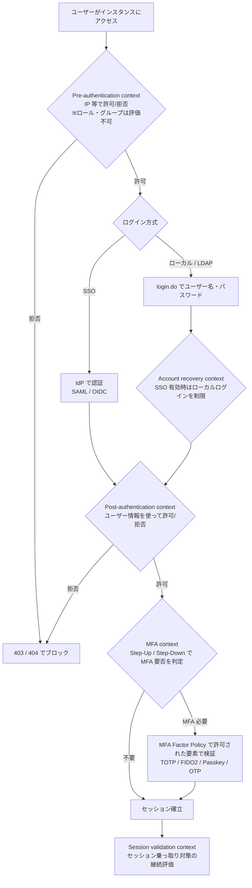
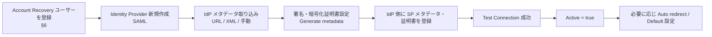
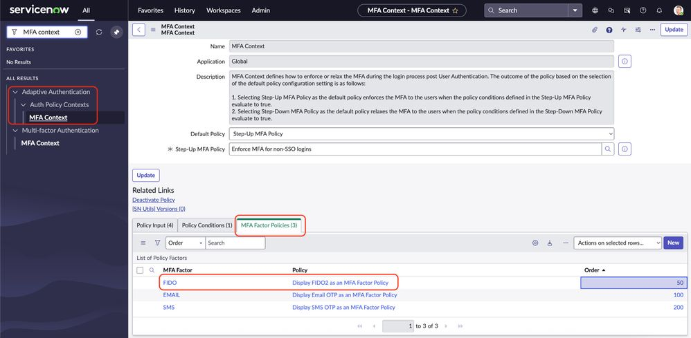
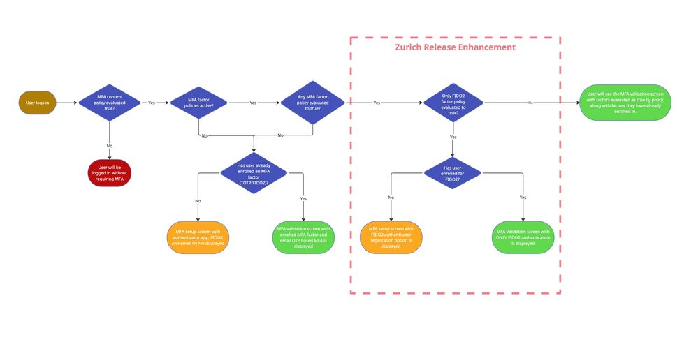
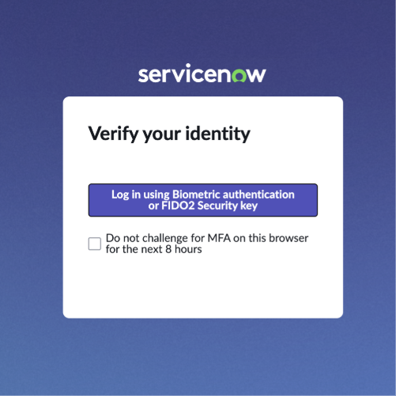

# 認証とSSO（Authentication and Single Sign-On）

## 概要

ServiceNow の Authentication（認証）は、「誰がインスタンスにアクセスしているか」を確認する仕組みであり、「何ができるか」を決める Authorization（認可：ロールと ACL）とは別のレイヤーである。認可については [アクセス制御（ACL）](access-control-acl.md) と [ユーザー・グループ・ロール](users-groups-roles.md) を参照。

ServiceNow の認証機能は、大きく次の 4 系統に整理できる。

| 系統 | 主な機能 | 主なプラグイン / 入口 |
|---|---|---|
| 対話型ログイン（UI） | ローカル認証（Local Database Authentication）、LDAP、Multi-Provider SSO（SAML 2.0 / OIDC）、証明書ログイン（PIV/CAC） | `com.snc.integration.sso.multi.installer`、`com.glide.auth.mutual` |
| 追加の本人確認 | Multi-factor Authentication（MFA：多要素認証）、Account Recovery（ACR：アカウント回復） | MFA は既定で有効、ACR は Multi-Provider SSO に同梱 |
| 条件付きアクセス | Adaptive Authentication（適応型認証）のポリシーコンテキスト、IP Address Access Control、Zero Trust Access | `com.snc.adaptive_authentication`、`com.snc.ipauthenticator`、`com.snc.zero_trust_session_access` |
| API（非対話）認証 | Basic 認証、OAuth 2.0（Machine Identity Console）、API Key、相互認証（mTLS） | `com.glide.tokenbased_auth`、`com.glide.auth.mutual` |

Australia（基準リリース）時点の重要なトピックは次のとおり。

- MFA は Yokohama 以降、SSO 以外のログイン（ユーザー名/パスワード、LDAP）に対して既定で強制適用される（Policy 名：`Enforce MFA for non-SSO logins`）[出典](https://www.servicenow.com/docs/r/platform-security/authentication/mfa-enforcement.html)。
- SAML 1.1、MultiSSO v1、OpenID SSO プラグインは Xanadu で非推奨となり、SSO は Multi-Provider SSO（MultiSSO v2）への一本化が進んでいる [出典](https://www.servicenow.com/docs/r/xanadu/release-notes/authentication-rn.html)。
- Inbound OAuth の設定入口は Application Registry から Machine Identity Console へ移行し、Application Registry の一部 inbound 設定は非推奨となった [出典](https://www.servicenow.com/docs/r/australia/release-notes/authentication-rn.html)。
- Basic 認証の利用アカウントを棚卸しして制限する Basic Auth Restriction（Tracking → Enforcing）が提供されている [出典](https://www.servicenow.com/docs/r/australia/platform-security/authentication/basic-auth-restriction.html)。
- Australia で Granular admin roles（グラニュラー管理ロール）が導入され、SSO・Adaptive Authentication・OAuth 等の設定を `admin` なしで委任できる [出典](https://www.servicenow.com/docs/r/oL66E_cwDD_tnWQYzYPRdA/_~GcECd9qHzwiQKn3LFT4w)。

関連ファイル：暗号化・証明書・Security Center は [プラットフォームセキュリティと暗号化](platform-security-encryption.md)、REST API の仕様は [Web Services / REST API](web-services-api.md)、導入時の設計論点は [導入編 10 セキュリティとコンプライアンス](../../03_導入編/10-security-compliance.md)、実践知は [応用編 12 セキュリティ強化の実践](../../04_応用編/12-security-hardening-practice.md) を参照。

---

## 1. 認証方式の全体像とログインフロー

### 1.1 認証方式一覧

ServiceNow の MFA が組み合わせ可能な認証方式として、公式ドキュメントは Local Database Authentication、LDAP integration、SSO SAML、SSO OIDC を挙げている [出典](https://www.servicenow.com/docs/r/GypxAX2jEErwkCxugICKdg/WP5AWYOu3fNRSyxIw5OBlw)。認証方式ごとの特徴は次のとおり。

| 認証方式 | 資格情報の保管場所 | 主な用途 | 本ファイルの節 |
|---|---|---|---|
| Local Database Authentication（ローカル認証） | インスタンスの `sys_user`（パスワードはハッシュ化保存） | 小規模・外部ユーザー・ブレークグラス用の管理者 | §2 |
| LDAP | 社内ディレクトリ（AD 等）。ServiceNow は LDAP にバインドして検証 | オンプレ AD 連携 | [ユーザー・グループ・ロール](users-groups-roles.md) の LDAP 節 |
| SAML 2.0 SSO | 外部 IdP（Entra ID、Okta、ADFS 等） | 企業 SSO の主流 | §3〜§4 |
| OIDC SSO | 外部 OpenID Provider | クラウド IdP との SSO | §3、§5 |
| Digest Token（ダイジェストトークン） | 共有シークレットによるトークン | レガシーな SSO 連携 | §3.5 |
| Certificate-based authentication（証明書認証） | クライアント証明書（PIV/CAC カード等） | 政府・規制業界、mTLS | §11.6 |
| API 認証（Basic / OAuth / API Key / mTLS） | 各方式 | 外部システムからの API 呼び出し | §11 |

### 1.2 ログイン時の評価順序（Adaptive Authentication のコンテキスト）

Adaptive Authentication を有効化すると、ログイン処理は「ポリシーコンテキスト（Authentication policy context）」の段階ごとにポリシーが評価される。Australia の公式ドキュメントでは、コンテキストとして Pre-authentication、Post-authentication、MFA、Account recovery、Session validation の 5 つが定義されている [出典](https://www.servicenow.com/docs/r/australia/platform-security/authentication/auth-policy-contexts.html)。

上図は公式ドキュメントのコンテキスト定義（[出典](https://www.servicenow.com/docs/r/australia/platform-security/authentication/auth-policy-contexts.html)）と MFA Context の説明（[出典](https://www.servicenow.com/docs/r/platform-security/authentication/mfa-auth-context.html)）をもとに整理したものである。各コンテキストの評価順序を厳密に定めた公式の図は公開情報では確認できず、上図の並びは `【推定】` を含む。

---

## 2. ローカル認証（Local Database Authentication）

### 2.1 概要

ローカル認証は、`sys_user` テーブルに保存されたユーザー ID（`user_name`）とパスワードで `login.do` からログインする方式である。SSO 導入後も、ブレークグラス（緊急用）管理者や Account Recovery ユーザー用にローカル認証が残るのが一般的である `【経験則】`（ACR の仕組みは §6 参照）。

ローカル認証に関係する主な仕組みは次のとおり。

| 仕組み | 内容 | 節 |
|---|---|---|
| Password Policy（パスワードポリシー） | 長さ・文字種・ユーザー情報の禁止等の複雑性ルール | §2.2 |
| アカウントロックアウト | ログイン失敗回数による自動ロック | §2.3 |
| Active チェック | 非アクティブユーザーのログイン拒否 | §2.4 |
| MFA 強制適用 | Yokohama 以降、非 SSO ログインに既定で MFA | §7 |

### 2.2 Password Policy（パスワードポリシー）

Password Policy は、ローカル認証ユーザーのパスワード複雑性を定義する機能である。以下は ServiceNow 社員によるコミュニティブログ（2026-05-06 公開）に基づく `【第三者情報】`（ServiceNow Community の社員投稿）[出典](https://www.servicenow.com/community/platform-privacy-security-blog/everything-you-need-to-know-about-password-policies-in/ba-p/3538368)。

- プラグイン：`com.glide.password_policy`（既定で有効）。
- 作成：All > Password Policy > Password Policies > New。
- 適用：All > Password Reset > Credentials Stores で **Local ServiceNow Instance** レコードを開き、**Password Policy** フィールドにポリシーを設定する。ポリシーレコードを作っただけでは有効にならない。
- インスタンスに適用できるポリシーは 1 つのみで、グループ別のポリシーはネイティブでは不可。ユーザー別にルールを変えたい場合は SSO（外部 IdP）側で制御する。
- パスワード変更・リセット時に検証される。`glide.apply.password_policy.on_login` を有効化するとログイン時にも検証し、不適合ユーザーにパスワード変更を求める。

Password Strength Preset（強度プリセット）の値は次のとおり（同ブログより）。OOB（既定）は **Default Strong**。

| Preset | 最小長 | 最大長 | 大文字 | 小文字 | 数字 | 記号 |
|---|---|---|---|---|---|---|
| Default | 8 | 100 | 1 | 1 | 1 | 0 |
| Medium | 8 | 100 | 1 | 1 | 1 | 1 |
| High | 8 | 100 | 1 | 2 | 1 | 3 |
| Default Strong（OOB） | 8 | 100 | 1 | 1 | 1 | 1 |
| Custom | 8 | 100 | 1 | 1 | 1 | 1 |
| Advanced | スクリプトで定義 | — | — | — | — | — |

Default Strong では Sequence Length Threshold（連続文字の閾値、例 "123456"）と Repetition Length Threshold（繰り返し文字の閾値、例 "aaaaa"）がともに 4（最大 8）。その他のフィールドとして Included / Excluded Special Characters、Disallow User Data（姓・名・ユーザー名・会社名を含むパスワードを禁止）、Test Your Password がある。

Password Policy 関連のシステムプロパティ（同ブログより `【第三者情報】`）：

| プロパティ | 用途 |
|---|---|
| `glide.enable.password_policy` | パスワードポリシーを有効化 |
| `glide.apply.password_policy.on_login` | ログイン時にもポリシーを適用し、不適合ユーザーに変更を強制 |
| `glide.enable.blacklist_password` | Excluded Password（禁止パスワードリスト、完全一致のみ）を有効化 |
| `glide.password_policy.use_excluded_special_char` | Excluded Special Characters フィールドを表示 |
| `glide.validate.sys_user.password.field` | `sys_user` レコード編集時にパスワードを検証 |

- パスワード履歴（再利用禁止世代数）とローカル認証のパスワード有効期限については、公式情報では確認できず。コミュニティでは「ローカル資格情報ストアはパスワード有効期限・期限通知をネイティブにはサポートしない」との回答がある `【第三者情報】`（フォーラム投稿）。
- Australia で `glide.login.no_blank_password` プロパティは非推奨となり、値を変更してもログイン動作に影響しない [出典](https://www.servicenow.com/docs/r/australia/release-notes/authentication-rn.html)。

### 2.3 アカウントロックアウト（Failed login lockout）

ログイン失敗回数によるアカウントロックは、システムプロパティと Script Action（スクリプトアクション）で実装されている。Australia の Security Center ハードニング設定の記載は次のとおり [出典](https://www.servicenow.com/docs/r/oL66E_cwDD_tnWQYzYPRdA/jUKNMMUppyBHcZ34~ZWucw)。

| 項目 | 内容 |
|---|---|
| プロパティ | `glide.user.max_unlock_attempts`（整数） |
| 既定値 | なし（未設定） |
| フォールバック値 | 5 |
| 推奨値 | 5 以下 |
| Script Action（`sysevent_script_action`） | `SNC User Lockout Check`、`SNC User Lockout Check with Auto Unlock` のいずれか 1 つ以上を Active にする |

- 自動ロック解除（Auto Unlock）版は `glide.user.unlock_timeout_in_mins` で指定した時間後にロックを解除する。未指定時は 15 分とする記載が旧リリースのドキュメント（Utah 期）にある。Australia での既定値は公開情報では確認できず。
- ログイン成功時は `SNC User Clear` スクリプトアクションが失敗回数をリセットする（旧リリースのドキュメント記載。Australia での同一性は公開情報では確認できず）。

### 2.4 非アクティブユーザーのログイン拒否

`sys_user` の **Active** チェックを外すとユーザーはロックアウトされる。この動作は `glide.authenticate.only.allow.active.user.login` プロパティ（アクティブユーザーのみログインを許可）で制御されると Australia のドキュメントに記載されている（検索結果のスニペットによる確認）。ユーザーレコードの **Locked out** フィールドとの違いを含め、詳細は [ユーザー・グループ・ロール](users-groups-roles.md) を参照。

---

## 3. Multi-Provider SSO（マルチプロバイダー SSO）

### 3.1 概要とプラグイン

Multi-Provider SSO（MultiSSO v2）は、SAML 2.0、OIDC、Digest Token の複数の IdP を 1 インスタンスに登録できる ServiceNow 標準の SSO 基盤である。

| 項目 | 内容 |
|---|---|
| プラグイン | Integration - Multiple Provider Single Sign-On Installer（`com.snc.integration.sso.multi.installer`）[出典](https://www.servicenow.com/docs/r/platform-security/authentication/sso-acct-recovery.html) |
| メニュー | All > Multi-Provider SSO > Identity Providers |
| 必要ロール（設定） | `sso_config_admin`、`business_rule_admin`、`script_include_admin`（Australia の Granular admin roles）[出典](https://www.servicenow.com/docs/r/oL66E_cwDD_tnWQYzYPRdA/_~GcECd9qHzwiQKn3LFT4w) |
| ドメインセパレーション | 対応。ドメインごとに異なる IdP を使い分け可能 [出典](https://www.servicenow.com/docs/r/hX5GtoLUEU58KgyL7CW5Ag/9_75b306SdVFue_uCTQrjg)。詳細は [ドメインセパレーション](domain-separation.md) |

> **リリース履歴：** Xanadu で MultiSSO v1 プラグイン、SAML 1.1 / SAML 1.1 Single Sign-On - Update 1 プラグイン、OpenID SSO プラグインが非推奨となった。SAML 2.0 / OIDC は MultiSSO v2 を有効化して構成する（MultiSSO v1 からの移行手順は KB0756504）[出典](https://www.servicenow.com/docs/r/xanadu/release-notes/authentication-rn.html)。

### 3.2 Multi-Provider SSO のテーブル

Australia ドキュメント（「Multi-Provider SSO properties, tables, and scripts」）に記載のテーブルは次のとおり [出典](https://www.servicenow.com/docs/r/hX5GtoLUEU58KgyL7CW5Ag/MI2cksGcfac6ZqR5Qk9B_A)。

| テーブル | ラベル | 内容 |
|---|---|---|
| `sso_properties` | SSO Properties（Identity Providers） | IdP ごとのデータ、スキーマ、SSO 共通データ。各 IdP テーブルの親 |
| `saml2_update1_properties` | SAML 2 Update 1 Properties | SAML 2.0 の IdP 設定（SAML 証明書等） |
| `digest_properties` | Digest Properties | Digest Token 認証の設定 |
| `sso_federation` | SSO Federation | SSO フェデレーションごとのデータ |
| OIDC 用 IdP テーブル | OIDC Identity Provider | OpenID Connect の IdP 設定 |

- 確認したページは翻訳版で、テーブル名の大文字小文字表記が乱れていた（`Digest_properties`、`sso_Federation`、`oidc_Identity_Provider` と表記）。上表は小文字に正規化したもの。OIDC 用 IdP テーブルの正確なシステム名は公開情報では確認できず、インスタンスでの確認を推奨する。
- Adaptive Authentication の Identity Provider 条件は「Identity Providers [`sso_properties`] テーブル」を参照する [出典](https://www.servicenow.com/docs/r/oL66E_cwDD_tnWQYzYPRdA/77vVqS1Bi0~JkUSjokHtZQ)。

### 3.3 Multi-Provider SSO のシステムプロパティ

| プロパティ | 既定値 | 内容 | 出典 |
|---|---|---|---|
| `glide.authenticate.multisso.enabled` | 下記注参照 | Multi-Provider SSO の有効/無効。false にしても Account Recovery（ACR）が有効な間は SSO は無効化されない（§6）。ユーザー名/パスワードログインを許可するには `glide.sso.acr.enabled` も無効化する必要がある | [出典](https://www.servicenow.com/docs/r/hX5GtoLUEU58KgyL7CW5Ag/MI2cksGcfac6ZqR5Qk9B_A) |
| `glide.authenticate.multisso.debug` | 下記注参照 | Multi-Provider SSO のデバッグログ | 同上 |
| `glide.authenticate.multissov2_feature.enabled` | 記載なし | MultiSSO v2 機能が有効かどうか | 同上 |
| `glide.authenticate.show.max.sso.login.option` | 5 または 10（下記注） | ログイン画面に表示する SSO 選択肢（IdP）の最大数。最大 10 | 同上 |
| `glide.authenticate.sso.saml2.keystore` | — | SAML 署名用 X.509 証明書の sys_id | [出典](https://www.servicenow.com/docs/r/hX5GtoLUEU58KgyL7CW5Ag/~h6~oew8QuXfIxSfwUV3Vw) |
| `glide.authenticate.sso.saml2.encryption.keystore` | — | SAML 暗号化用 X.509 証明書の sys_id | 同上 |
| `glide.authenticate.sso.update.idp.cookie` | — | Auto redirect IdP 変更時に `glide_sso_id` クッキーを更新するか | 同上 |
| `glide.authenticate.failed_requirement_redirect` | — | 認証要件を満たさない場合のリダイレクト先 | 同上 |
| `glide.sso.acr.enabled` | 新規インスタンスで true | Account Recovery の有効/無効（§6） | [出典](https://www.servicenow.com/docs/r/platform-security/authentication/sso-acct-recovery.html) |
| `glide.authenticate.mfa.with.multisso.enabled` | — | SSO ログインに対して MFA を適用する場合 true にする（§7.8） | [出典](https://www.servicenow.com/docs/r/platform-security/authentication/mfa-auth-context.html) |

- 既定値の不一致：Australia の独語版ページでは `glide.authenticate.multisso.enabled` と `glide.authenticate.multisso.debug` の既定値を true と記載しているが、Zurich の英語版検索結果では `glide.authenticate.multisso.enabled` の既定値を false としている。プラグイン有効化後の実値はインスタンスで確認すること。
- 不一致：`glide.authenticate.show.max.sso.login.option` は同じページ内に既定値 5（SSO 選択肢の最大数、最大 10）と既定値 10（IdP の最大数）の 2 行が併記されている。

### 3.4 Multi-Provider SSO のスクリプト

Multi-Provider SSO の処理は Script Include（スクリプトインクルード）で実装されており、カスタマイズは `*_custom` スクリプトを使う [出典](https://www.servicenow.com/docs/r/hX5GtoLUEU58KgyL7CW5Ag/MI2cksGcfac6ZqR5Qk9B_A)。

| スクリプト | 用途 |
|---|---|
| `MultiSSO` | エンタープライズレベルの SSO タイプを定義 |
| `MultiSSOLogin` / `MultiSSOLogout` | ドメインごとのログイン / ログアウト処理 |
| `MultiSSO_Abstract_Core` | Multi-Provider SSO の全クラスの基底クラス |
| `MultiSSO_ClientHelper` | クライアント呼び出し可能なユーティリティ |
| `MultiSSO_DigestedToken` | Digest Token 認証の基本ロジック |
| `MultiSSO_SAML2_Update1` | SAML 2.0 認証処理 |
| `MultiSSOv2_SAML2_custom` | SAML IdP の Single sign-on script（既定）[出典](https://www.servicenow.com/docs/r/hX5GtoLUEU58KgyL7CW5Ag/~h6~oew8QuXfIxSfwUV3Vw) |
| `MultiSSO_OIDC_custom` / `MultiSSO_OIDC_logout_custom` | OIDC のカスタムログイン / ログアウトスクリプト |

### 3.5 Digest Token 認証

Digest Token は、外部の認証基盤が共有シークレットで生成したトークンを ServiceNow が検証する方式で、Multi-Provider SSO の IdP 種別の 1 つとして `digest_properties` テーブルに保存される [出典](https://www.servicenow.com/docs/r/hX5GtoLUEU58KgyL7CW5Ag/MI2cksGcfac6ZqR5Qk9B_A)。MFA with SSO の対象プロトコルにも Digest が含まれる [出典](https://www.servicenow.com/docs/r/platform-security/authentication/mfa-sso.html)。Australia での詳細な設定項目は本調査では確認していない。

### 3.6 ログイン画面と IdP 選択（Auto redirect / Default / Show as login option）

- **Auto redirect IdP：** 1 つの IdP を自動リダイレクト先に指定でき、ユーザーはインスタンス URL にアクセスすると IdP に自動転送される。旧称は「Primary IdP」。変更時は `glide_sso_id` クッキーが更新される（`glide.authenticate.sso.update.idp.cookie` で制御）[出典](https://www.servicenow.com/docs/r/hX5GtoLUEU58KgyL7CW5Ag/~h6~oew8QuXfIxSfwUV3Vw)。
- **Default：** ベースインスタンス URL アクセス時の既定 IdP。
- **Show as login option：** IdP をログイン画面に「Sign in with ...」として表示（OIDC フォームの項目。SSO label と Logo URL を指定可）[出典](https://www.servicenow.com/docs/r/hX5GtoLUEU58KgyL7CW5Ag/9_75b306SdVFue_uCTQrjg)。
- 特定 IdP でのログイン URL 例：`https://<instance>/login_with_sso.do?glide_sso_id=<IdPのsys_id>` [出典](https://www.servicenow.com/docs/r/hX5GtoLUEU58KgyL7CW5Ag/9_75b306SdVFue_uCTQrjg)。
- Zurich で、アクティブな SAML / OIDC IdP をプラットフォームとポータルのログイン画面に表示する改善、セッション切れ等でログアウトされたユーザーへの失敗理由表示、シングルログアウト失敗時の汎用エラー表示が追加された [出典](https://www.servicenow.com/docs/r/delta-yokohama-brazil/brazil-yokohama-authentication-release-notes.html)。

> **Brazil での変更:** Policy-based login experience（Identifier-first login：IFL、識別子先行ログイン）が追加された。Authentication Console でログインポリシーを作成し、ユーザー名やメールアドレス等のユーザーコンテキストに応じて提示するログイン方式（パスワード / SSO）を切り替える。`glide.authenticate.policy_based_login_experience.enabled` で有効化し、少なくとも 1 つの Active な IFL ポリシー（パスワード認証用または SSO 用）を作成する [出典](https://www.servicenow.com/docs/r/delta-zurich-brazil/brazil-zurich-authentication-release-notes.html)、[出典](https://www.servicenow.com/docs/r/platform-security/authentication/activate-authentication-console.html)。

---

## 4. SAML 2.0 の構成（Multi-Provider SSO）

### 4.1 前提と手順の流れ

SAML 2.0 IdP の構成は All > Multi-Provider SSO > Identity Providers > New > **SAML** から行う。必要ロールは `sso_config_admin`、`business_rule_admin`、`script_include_admin` [出典](https://www.servicenow.com/docs/r/hX5GtoLUEU58KgyL7CW5Ag/~h6~oew8QuXfIxSfwUV3Vw)。

IdP 情報の取り込み方法は次の 3 通り。

| 方法 | 操作 |
|---|---|
| Metadata descriptor URL | URL を選び、IdP のメタデータ URL を入力 |
| Metadata descriptor XML | XML を選び、IdP が生成したメタデータ XML を貼り付け |
| 手動 | ポップアップを閉じてフィールドに直接入力 |

Jakarta 以降、**Test Connection（接続テスト）に成功しないと IdP を Active にできない**。Update で保存はできるが、テスト成功まで構成は有効にならない [出典](https://www.servicenow.com/docs/r/hX5GtoLUEU58KgyL7CW5Ag/~h6~oew8QuXfIxSfwUV3Vw)。

### 4.2 Identity Provider フォームの主要フィールド

| フィールド | 必須 | 説明 |
|---|---|---|
| Name | ○ | IdP 名 |
| Active | ○ | 認証に使用する場合 true。Test Connection 成功後のみ設定可能 |
| Default | | 既定の IdP に設定（ベースインスタンス URL で自動リダイレクト） |
| Auto redirect IdP ID | | 自動リダイレクト先の IdP に設定 |
| Identity Provider URL | ○ | IdP ごとに一意 |
| IdP Authentication Request | ○ | `SingleSignOnService` 要素の HTTP-Redirect バインディング URL |
| IdP SingleLogoutRequest | | `SingleLogoutService` 要素の URL |
| ServiceNow Homepage | ○ | ログインページを含むインスタンス URL（例：`https://<instance>.service-now.com/navpage.do`） |
| Entity ID/Issuer | ○ | ログインページを除くベース URL（例：`https://<instance>.service-now.com/`） |
| Audience URI | ○ | Entity ID/Issuer と同じ形式のベース URL |
| NameID Policy | ○ | 使用する `NameIDFormat` 要素の値 |
| External logout redirect | | ログアウト後のリダイレクト先 |
| Failed requirement redirect | | 認証要求失敗時のリダイレクト先（既定は IdP のエラー/ログアウトページ。`glide.authenticate.failed_requirement_redirect` でも設定可） |
| Client type | | Iframe / Embedded（必要に応じフォームに追加） |

[出典](https://www.servicenow.com/docs/r/hX5GtoLUEU58KgyL7CW5Ag/~h6~oew8QuXfIxSfwUV3Vw)

### 4.3 Encryption and Signature タブ（署名と暗号化）

- 自己署名または CA 署名の証明書を使用する。キーストア形式は **BCFKS**（FIPS 準拠、推奨）または Java keystore。
- FIPS-approved モードでは署名用と暗号化用に別々の証明書が必須。FIPS 以外でも分けることが推奨される。
- `glide.authenticate.sso.saml2.keystore`（署名）と `glide.authenticate.sso.saml2.encryption.keystore`（暗号化）に X.509 証明書の sys_id を設定し、IdP レコードで鍵エイリアス・パスワードを設定した後 **Generate metadata** を選択する。生成されたメタデータ XML 内の証明書を IdP 側にアップロードする。
- 証明書期限：**Notify on expiry** を有効にし、通知先グループ、期限前の警告日数、頻度を設定できる。

| フィールド | 内容 |
|---|---|
| Signing key alias / Signing key password | 署名鍵のエイリアス / パスワード |
| Encryption key alias / Encryption key password | 暗号化鍵のエイリアス / パスワード |
| Encrypt assertion | アサーションの暗号化 |
| Signature algorithm | 署名アルゴリズム |
| Sign authentication request | AuthnRequest に署名 |
| Sign LogoutRequest / Sign logout response | ログアウト要求 / 応答に署名 |

[出典](https://www.servicenow.com/docs/r/hX5GtoLUEU58KgyL7CW5Ag/~h6~oew8QuXfIxSfwUV3Vw)

> **Brazil での変更:** SAML の SP 署名・暗号化キーストアの期限切れ間近 / 期限切れをホームページのバナーで警告する機能が追加され、バナーから Security Center のアクションへ遷移できる。通知のタイミングも早まり、キーストアの詳細が通知に含まれるよう変更された [出典](https://www.servicenow.com/docs/r/delta-zurich-brazil/brazil-zurich-authentication-release-notes.html)。

### 4.4 User Provisioning タブ（ユーザー自動プロビジョニング）

| フィールド | 内容 |
|---|---|
| Automatic user provisioning | インスタンスのユーザーテーブルに存在しないユーザーを IdP の情報から自動作成 |
| Update user record on every login | SAML ログインのたびにユーザー情報を IdP の値で更新 |

[出典](https://www.servicenow.com/docs/r/hX5GtoLUEU58KgyL7CW5Ag/~h6~oew8QuXfIxSfwUV3Vw)

Zurich で、SAML / OIDC の自動プロビジョニング時にユーザーをグループへ割り当てる機能が追加された [出典](https://www.servicenow.com/docs/r/delta-yokohama-brazil/brazil-yokohama-authentication-release-notes.html)。大量ユーザーのライフサイクル管理には SCIM（`scim_admin` 等のロールで構成）を併用する選択肢もある（[ユーザー・グループ・ロール](users-groups-roles.md) 参照）。

### 4.5 Advanced タブ

| フィールド | 内容 |
|---|---|
| User field | IdP の NameID と照合する `sys_user` のフィールド |
| NameID attribute | 新しい NameID ポリシーを構成する場合のみ指定 |
| Create AuthnContextClass / AuthnContextClassRef method | 認証コンテキストクラスの指定 |
| Force authentication | IdP に再認証を強制（ForceAuthn） |
| Is passive authentication request | パッシブ認証要求 |
| Single sign-on script | 既定 `MultiSSOv2_SAML2_custom` |
| Clock skew | 時刻ずれの許容。既定 60 秒 |
| IdP SingleLogoutRequest protocol binding | SLO のバインディング |
| Metadata URL to import IdP properties | IdP 証明書の期限切れ時に新証明書を自動取り込みするためのメタデータ URL（SAML2 Update 1 からのアップグレード時や手動構成時は自動入力されない） |
| Request / Response | 接続テスト成功後に表示される一意 ID |

[出典](https://www.servicenow.com/docs/r/hX5GtoLUEU58KgyL7CW5Ag/~h6~oew8QuXfIxSfwUV3Vw)

### 4.6 Continuous Authentication タブ（オプション）

Zero Trust: Continuous Authentication プラグイン（`com.snc.zero_trust_continuous_authentication`）とライセンスが必要。Continuous Auth Configured、Continuous auth consumer URL、Continuous auth script（`MultiSSOv2_SAML2_ContinuousAuth_custom`）を設定する [出典](https://www.servicenow.com/docs/r/hX5GtoLUEU58KgyL7CW5Ag/~h6~oew8QuXfIxSfwUV3Vw)。Continuous Authentication は Yokohama で導入され、機微な操作や高権限アクセスの前に Step-up または再認証を要求する [出典](https://www.servicenow.com/docs/r/delta-yokohama-brazil/brazil-yokohama-authentication-release-notes.html)。

---

## 5. OIDC（OpenID Connect）の構成

### 5.1 前提

OIDC IdP の構成は All > Multi-Provider SSO > Identity Providers > New > **OpenID Connect** から行う。前提は次のとおり [出典](https://www.servicenow.com/docs/r/hX5GtoLUEU58KgyL7CW5Ag/9_75b306SdVFue_uCTQrjg)。

- ロール：`sso_config_admin`、`business_rule_admin`、`script_include_admin`。
- IdP 側に OIDC アプリケーションを登録し、Client ID、Client secret、Well-known configuration URL を控える。
- Multi-Provider SSO プラグインを有効化し、プロパティを構成する。
- オプション：Approval with eSignature プラグイン（ドキュメント表記は `com.Glide.e_Signature_Approvals`）を有効化すると OIDC IdP で電子署名承認を利用できる。

### 5.2 設定方法

| 方法 | 内容 |
|---|---|
| Well-known configuration の取り込み（最速） | Name、Client ID、Client secret、Well-known configuration URL を入力すると残りのフィールドが自動入力される |
| 手動 | 事前に IdP 用の OAuth Entity Profile（Grant type は **Authorization code**）を作成する。Auth0、Azure AD、Google、Okta のテンプレートがプラグインのデモデータに含まれる |

### 5.3 OIDC Identity Provider フォーム

| フィールド | 内容 |
|---|---|
| Name | IdP レコード名 |
| Active | Test Connection 成功後のみ有効化可能 |
| Default | 複数 OIDC 構成がある場合の既定 IdP |
| Auto redirect ID | IdP ログインページへ直接リダイレクト（Related Links の Set as auto redirect ID で表示） |
| OIDC Entity Profile | 使用する OAuth Entity Profile |
| ServiceNow Home page | 自動で `navpage.do` |
| External logout redirect | 自動で `external_logout_complete.do` |
| Show as login option / SSO label / Logo URL | ログイン画面への表示と表示名・ロゴ |

タブ構成：**OIDC Entity**（OIDC クライアント構成）、**OIDC Provider Configuration**（Well-known configuration URL と ID トークンのクレーム検証）、**Advanced**（Single sign-on script = `MultiSSO_OIDC_custom`、logout script = `MultiSSO_OIDC_logout_custom`）、**Continuous Authentication**（オプション）、**eSignature Approval**（オプション。Popup width 800 / height 900 が既定）[出典](https://www.servicenow.com/docs/r/hX5GtoLUEU58KgyL7CW5Ag/9_75b306SdVFue_uCTQrjg)。

### 5.4 User Provisioning タブ（OIDC）

| フィールド | 内容 |
|---|---|
| Auto provision users | IdP でサインインしたユーザーが `sys_user` に存在しない場合に作成 |
| Provision with | データソース：ID token、User info endpoint、両方 |
| Provisioning data source / User info data source | 変換マップ（Transform map）で使うデータソース |
| Update user on next login | 次回サインイン時にユーザーを更新 |
| Update user interval (seconds) | 更新の最小間隔。既定 3600 秒 |
| User roles | 新規プロビジョニングユーザーに付与するロール |

[出典](https://www.servicenow.com/docs/r/hX5GtoLUEU58KgyL7CW5Ag/9_75b306SdVFue_uCTQrjg)

### 5.5 OIDC 関連のリリース差分

- Zurich：複数の OIDC SSO レコードで同じ Well-known URL を使用可能に。OIDC レスポンスの IdP 属性を Adaptive Authentication の Filter criteria に使える「Attributes for OIDC」が追加 [出典](https://www.servicenow.com/docs/r/delta-yokohama-brazil/brazil-yokohama-authentication-release-notes.html)。
- PKCE、要求スコープ、クレームとユーザーフィールドのマッピング詳細は、SSO 構成ページでは確認できず（Inbound の Authorization code grant では PKCE によるパブリッククライアントをサポート。§11.3）。

> **Brazil での変更:** OpenID Provider（ServiceNow が OP として ID トークンを発行する側）が RS256 署名の ID トークンを発行可能に。`max_age` パラメーターの扱いが OpenID Connect Core 1.0 に合わせて改善された [出典](https://www.servicenow.com/docs/r/delta-zurich-brazil/brazil-zurich-authentication-release-notes.html)。

---

## 6. Account Recovery（ACR：アカウント回復）

### 6.1 目的

Account Recovery（ACR）は、SSO の設定ミスや IdP 証明書の期限切れで SSO ログインできなくなった場合に、登録済みの管理者が SSO をバイパスしてローカルログインし、復旧作業を行うための仕組みである。ACR を有効にすると、SSO 有効時のローカル（ユーザー名/パスワード）ログインは無効化される [出典](https://www.servicenow.com/docs/r/platform-security/authentication/sso-acct-recovery.html)。

### 6.2 要件と仕様

| 項目 | 内容 |
|---|---|
| プラグイン | `com.snc.integration.sso.multi.installer` に同梱 |
| プロパティ | `glide.sso.acr.enabled`（新規インスタンスでは既定で有効、アップグレードインスタンスは手動で有効化） |
| 前提 | 少なくとも 1 名の管理者を Account recovery user として登録しないと SSO を有効化できない |
| ACR ユーザーの要件 | ローカルログイン用パスワードを設定し、MFA を登録済みであること |
| 関連ポリシーコンテキスト | `SSO - ACR Context`（SSO と ACR ユーザー構成後にローカルログインを制限） |
| アップグレード時 | Rome 以降で SSO 利用中のインスタンスは ACR ユーザーなしでも動作継続。ただし登録が推奨 |

[出典](https://www.servicenow.com/docs/r/platform-security/authentication/sso-acct-recovery.html)、[出典](https://www.servicenow.com/docs/r/australia/platform-security/authentication/auth-policy-contexts.html)

推奨手順（新規インスタンス）：Multi-SSO プラグイン有効化 → `glide.sso.acr.enabled` が有効か確認 → 管理者のローカルパスワード設定と MFA 登録 → 管理者を ACR ユーザーとして登録 → `glide.authenticate.multisso.enabled` を有効化。

### 6.3 ACR の運用上の注意 `【第三者情報】`

以下は ServiceNow 社員のコミュニティブログ（2026-03-25）に基づく [出典](https://www.servicenow.com/community/platform-privacy-security-blog/understanding-adaptive-authentication-policy-contexts-a-guide-to/ba-p/3510045)。

- ACR を既定設定で有効化すると、登録済み ACR ユーザー以外の `login.do` がブロックされる。ACR コンテキストの OOB ポリシーは `Non Local Login Users`（認証スキームがローカルでない＝SSO の場合のみ許可する Allow ポリシー）。
- ローカルログインが必要なユーザーがいる場合は、`Non Local Login Users` ポリシーにロールやグループの例外条件を追加する。
- ACR ユーザーが `login.do` でログインすると、SSO 構成・証明書・IdP 設定のみ変更できる制限付きの「SSO Recovery User」セッションになる。SSO でログインした場合はロールどおりの完全なアクセスになる。
- ACR ユーザーは単一障害点を避けるため複数名登録する。

---

## 7. Multi-factor Authentication（MFA：多要素認証）

### 7.1 概要と認証要素

ServiceNow の MFA は既定で有効で、`glide.authenticate.multifactor` プロパティで制御される。無効化には業務上の正当な理由が必要とされている [出典](https://www.servicenow.com/docs/r/GypxAX2jEErwkCxugICKdg/WP5AWYOu3fNRSyxIw5OBlw)。

| 認証要素（Factor） | 内容 | 導入リリース |
|---|---|---|
| Authenticator App（TOTP） | Okta Verify、Google Authenticator、Microsoft Authenticator 等の時間ベース OTP（通常 30 秒有効） | 従来から |
| FIDO2 | YubiKey 等のハードウェアキー、Touch ID 等の生体認証 | Xanadu で MFA 要素として追加 |
| Passkey | デバイスのロック解除（生体センサー、PIN、パターン）でログイン | Xanadu で MFA 要素として追加 |
| OTP（Email / SMS） | メール / SMS で送るワンタイムパスワード | 従来から（Factor Policy で利用可否を制御） |

[出典](https://www.servicenow.com/docs/r/GypxAX2jEErwkCxugICKdg/WP5AWYOu3fNRSyxIw5OBlw)、[出典](https://www.servicenow.com/docs/r/xanadu/release-notes/authentication-rn.html)

- 上記ページは Yokohama 版（2025-01-30 更新）である。Australia 版の要素一覧ページは本調査では取得できなかったが、Zurich 以降の FIDO2 Factor Policy 追加（§7.6）を踏まえ、要素の種類は Australia でも同等と考えられる `【推定】`。
- AI 音声エージェント（AI voice agent）向けの認証要素（Email OTP、KBA 等）は別系統で、`glide.voice.authenticate.mfa_mandatory` で制御される。詳細は [Virtual Agent と会話型AI](virtual-agent.md) を参照。

### 7.2 MFA の強制適用（Yokohama 以降）

Yokohama 以降（Yokohama へのアップグレードを含む）、MFA は既定で次のとおり強制される [出典](https://www.servicenow.com/docs/r/platform-security/authentication/mfa-enforcement.html)。

| 項目 | 内容 |
|---|---|
| 対象ログイン | SSO 以外：ユーザー名/パスワード、LDAP |
| 対象ユーザー | `snc_external` 以外のすべての内部ユーザー |
| 対象インスタンス | 本番・非本番のすべて |
| 実装 | MFA Context の Policy `Enforce MFA for non-SSO logins`（既定で Active） |
| 除外 | `snc_external` ユーザー、SSO ログイン、Basic 認証および OAuth Resource Owner Password Credential grant による連携 |
| 変更方法 | 管理者が MFA Context のポリシー、ポリシー条件、Filter criteria を変更して範囲を調整 |

既に有効な Adaptive Authentication の MFA ポリシーが存在する場合は、この既定のセキュア MFA ポリシーは適用されない [出典](https://www.servicenow.com/docs/r/zurich/platform-security/authentication/faq-mfa-enforcement-timeline.html)。

### 7.3 MFA 強制適用のタイムラインとプロパティ

MFA 強制適用は段階的に行われる（Zurich の FAQ に基づく）[出典](https://www.servicenow.com/docs/r/zurich/platform-security/authentication/faq-mfa-enforcement-timeline.html)。

| フェーズ | 期間 | 内容 |
|---|---|---|
| Self-enrollment（自己登録猶予） | 初回ログイン成功から既定 30 日（0〜90 日で調整、90 超は 90 扱い） | 通常ログイン可。ログイン時に登録を促すメッセージ |
| Relaxation（緩和期間） | アップグレード後 既定 90 日（最大 270 日） | 新規の内部ユーザーにも自己登録猶予が付与される |
| Enforcement（即時強制） | 緩和期間終了後 | 新規の内部ユーザーは非 SSO ログイン時に即座に MFA が必要 |

MFA 強制適用のプロパティ（Australia 版ページ）[出典](https://www.servicenow.com/docs/r/hX5GtoLUEU58KgyL7CW5Ag/qtBBHCvQ8lQui7ohsUK6CA)：

| プロパティ | 上限 | 内容 |
|---|---|---|
| `glide.authenticate.multifactor.setup.bypass.count` | 3 | MFA 設定をスキップできる回数 |
| `glide.authenticate.multifactor.self_enrolment_period` | 90 日 | 自己登録できる日数。0 で即時登録を要求 |
| `glide.authenticate.multifactor.enforcement.max_relaxation_period` | 270 日 | 新規ユーザーが自己登録できる最大日数（緩和期間） |
| `glide.authenticate.multifactor.enforcement.debug` | — | MFA 強制適用のデバッグログ（既定では存在せず、作成して有効化） |
| `glide.authenticate.hybrid_user_tracking.enabled` | — | Web service access only でないアカウントがユーザー名/パスワードで API 等にログインした場合に、ユーザー資格情報テーブルに記録（既定では存在せず） |
| `glide.authenticate.hybrid_user_tracking.debug` | — | 上記追跡のデバッグログ |
| `glide.authenticate.multifactor.enforcement.acknowledged` | — | true にすると管理者向けメッセージを消す |
| `glide.authenticate.multifactor.enforcement.show_user_info_message` | — | false でエンドユーザー向けメッセージを非表示 |

- 不一致：自己登録期間のプロパティ名は、ページによって `selfenrolmentperiod` と `self_enrolment_period` の表記揺れがある。メッセージ表示のプロパティも `showuserinfomessage` と `show_user_info_message` の揺れがある。`sys_properties.list` で実名を確認すること。

### 7.4 MFA の適用基準（Criteria）

MFA を誰に適用するかは次の 3 種類の基準で決まり、組み合わせも可能。公式には **Adaptive Authentication のポリシーベース MFA が推奨**されている [出典](https://www.servicenow.com/docs/r/australia/platform-security/authentication/multi-factor-authentication-criteria.html)。

| 基準 | 設定場所 |
|---|---|
| User-based（ユーザー単位） | ユーザーレコードの **Enable Multifactor Authentication** フィールド |
| Role-based（ロール単位） | Multi-factor Criteria [`multi_factor_criteria`] テーブルの「Role-based multi-factor authentication」レコードに MFA 必須ロールを列挙 |
| Adaptive authentication policy-based（推奨） | MFA Context のポリシー（IP、グループ等の条件） |

### 7.5 MFA Context（Step-Up / Step-Down）

MFA Context は、ログイン時に第 2 要素を要求するかどうかを決めるポリシーコンテキストである（Brazil 版ページで確認。構造は Yokohama 以降共通と考えられる `【推定】`）[出典](https://www.servicenow.com/docs/r/platform-security/authentication/mfa-auth-context.html)。

- メニュー：All > Multi-factor Authentication > MFA Context。
- MFA Context はアクセスをブロックしない（ブロックは Pre/Post-authentication の役割）。
- MFA Context のポリシーはユーザー単位・ロール単位の MFA 設定より優先される。
- 対象はユーザーログインのみ。API 認証、Basic 認証、OAuth ROPC grant には適用されない。

| フィールド | 内容 |
|---|---|
| Name | 固定（変更不可） |
| Description | 説明 |
| Default Policy | **Step-Up MFA Policy** または **Step-Down MFA Policy** |
| Step-Up MFA Policy | 条件が true のときだけ MFA を強制（Default Policy が Step-Up の場合に表示） |
| Step-Down MFA Policy | MFA を既定で強制し、条件が true のときだけ免除（Default Policy が Step-Down の場合に表示） |
| Policy Input / Policy Conditions タブ | 選択したポリシーへの読み取り専用参照。変更はポリシーレコード側で行う |

- キャプション：MFA Context レコード（Zurich 時点の画面）。
- 画面説明：左のアプリケーションナビゲーターで「MFA context」を検索すると、Adaptive Authentication > Auth Policy Contexts > MFA Context と、Multi-factor Authentication > MFA Context の 2 か所に表示される。フォームには Name（MFA Context）、Application（Global）、Description（Step-Up / Step-Down の説明文）、Default Policy（Step-Up MFA Policy）、Step-Up MFA Policy（`Enforce MFA for non-SSO logins`）が並ぶ。下部の関連リストに Policy Input (4)、Policy Conditions (1)、MFA Factor Policies (3) のタブがあり、MFA Factor Policies タブでは MFA Factor 列に FIDO / EMAIL / SMS、Policy 列に「Display FIDO2 as an MFA Factor Policy」「Display Email OTP as an MFA Factor Policy」「Display SMS OTP as an MFA Factor Policy」、Order 列に 50 / 100 / 200 が表示されている。
- 出典：[ServiceNow Community - Stronger Authentication Control with MFA Factor Policies in the Zurich Release](https://www.servicenow.com/community/platform-privacy-security-blog/stronger-authentication-control-with-mfa-factor-policies-in-the/ba-p/3396169)（ServiceNow 社員の投稿、2025-10-03）。取得日：2026-11-02。

### 7.6 MFA Factor Policy（要素ポリシー）

MFA Factor Policy は、ユーザーが追加要素として使える認証方式をポリシー条件で制御する仕組みである。Zurich で FIDO2 / Passkey 系の認証器が Factor Policy の対象に追加され、「管理者は FIDO2 のみ許可し Email OTP を禁止する」「信頼できないネットワークからのログインでは FIDO2 を要求する」といった構成が可能になった。FIDO2 の Factor Policy に該当したユーザーが FIDO2 未登録の場合は、先に登録を求められる `【第三者情報】`（ServiceNow 社員のコミュニティブログ）[出典](https://www.servicenow.com/community/platform-privacy-security-blog/stronger-authentication-control-with-mfa-factor-policies-in-the/ba-p/3396169)。公式リリースノートでも Zurich の変更として「FIDO factor policy により第 2 要素にハードウェアキーまたは生体認証を要求」と記載されている [出典](https://www.servicenow.com/docs/r/delta-yokohama-brazil/brazil-yokohama-authentication-release-notes.html)。

- キャプション：MFA Context と MFA Factor Policy の評価フロー図（Zurich の拡張部分を破線枠で強調）。
- 図の説明：ユーザーログイン →「MFA context policy が true か」（No なら MFA なしでログイン）→「MFA factor policies が Active か」→「いずれかの Factor Policy が true か」と判定する。Factor Policy が無効または該当なしの場合は「MFA 要素（TOTP/FIDO2）登録済みか」で分岐し、未登録なら Authenticator App・FIDO2・Email OTP を選べる MFA 設定画面、登録済みなら登録済み要素と Email OTP による検証画面を表示する。Zurich 拡張（破線枠）では「FIDO2 の Factor Policy のみが true か」を判定し、FIDO2 未登録なら FIDO2 登録画面、登録済みなら FIDO2 のみの検証画面を表示する。それ以外は、ポリシーで true と評価された要素と登録済み要素による検証画面を表示する。
- 出典：[ServiceNow Community - Stronger Authentication Control with MFA Factor Policies in the Zurich Release](https://www.servicenow.com/community/platform-privacy-security-blog/stronger-authentication-control-with-mfa-factor-policies-in-the/ba-p/3396169)。取得日：2026-11-02。

- キャプション：FIDO2 Factor Policy 適用時のログイン検証画面。
- 画面説明：ServiceNow ロゴの下に「Verify your identity」と表示され、「Log in using Biometric authentication or FIDO2 Security key」ボタンと、「Do not challenge for MFA on this browser for the next 8 hours」（このブラウザで 8 時間 MFA を求めない）チェックボックスがある。Authenticator App や Email OTP の選択肢は表示されていない。
- 出典：[ServiceNow Community - Stronger Authentication Control with MFA Factor Policies in the Zurich Release](https://www.servicenow.com/community/platform-privacy-security-blog/stronger-authentication-control-with-mfa-factor-policies-in-the/ba-p/3396169)。取得日：2026-11-02。

### 7.7 MFA の例外（Exemption）とブラウザ記憶

MFA の例外設定は Yokohama で新設された機能を使う（Brazil 版 FAQ で確認）[出典](https://www.servicenow.com/docs/r/platform-security/authentication/faq-mfa-exception.html)。

| 例外対象 | 方法 |
|---|---|
| ユーザー / グループ | **MFA Exempted User Group** に追加し、MFA Context の Step-Up ポリシー（`Enforce MFA for non-SSO logins`）の Policy Input に「Is a member of MFA exempted group」Filter criteria を追加 |
| ロール | 「Has MFA exempted role」Filter criteria にロールを追加（複数ロールは OR） |
| 信頼ネットワーク | Adaptive Authentication で IP Filter Criteria を作成し、MFA Context のポリシー入力に追加して、該当ネットワークで false になるよう条件を変更 |
| 信頼ロケーション | Zero Trust - Location-Based Access プラグインの Location Filter Criteria（追加サブスクリプションが必要） |

ブラウザ記憶（MFA の再要求頻度）のプロパティ（Multi-factor Authentication > Properties）：

| プロパティ | 内容 |
|---|---|
| `glide.authenticate.multifactor.browser.fingerprint.validity` | 「このブラウザで MFA を求めない」の有効時間。既定 8 時間（最大 24 時間まで延長可） |
| `glide.authenticate.multifactor.remember.browser.default` | 「remember browser」チェックボックスの既定状態を true にする |

- 1 つのアカウントを複数人で共有することは MFA の有効性を損なうため推奨されない [出典](https://www.servicenow.com/docs/r/platform-security/authentication/faq-mfa-exception.html)。

### 7.8 MFA with SSO

MFA with SSO は、SSO（SAML、OpenID Connect、Digest）でログインしたユーザーに対しても ServiceNow 側の MFA を追加で適用する機能である。Adaptive Authentication プラグイン（`com.snc.adaptive_authentication`）の一部として提供され、IdP での認証成功後に ServiceNow へリダイレクトされた時点で MFA が適用される。条件には Authentication Scheme と Identity Provider を使え、例えば「外部ユーザーのみ MFA」が可能。San Diego より前は SSO に MFA を適用できなかった [出典](https://www.servicenow.com/docs/r/platform-security/authentication/mfa-sso.html)。利用には `glide.authenticate.mfa.with.multisso.enabled` を true にする [出典](https://www.servicenow.com/docs/r/platform-security/authentication/mfa-auth-context.html)。

- 一般に、SSO 利用時は IdP 側（Entra ID の条件付きアクセス等）で MFA を実施し、ServiceNow 側の MFA は二重にしない設計が多い `【経験則】`。

### 7.9 MFA Dashboard と MFA Guided Setup（Zurich）

Zurich で次の 2 機能が追加された [出典](https://www.servicenow.com/docs/r/delta-yokohama-brazil/brazil-yokohama-authentication-release-notes.html)。

- **MFA Dashboard：** MFA 登録状況、MFA 未登録の特権管理者、コンプライアンス状況を表示。
- **MFA Guided Setup：** ユーザー名/パスワードのみでログインしているユーザー向けに MFA 構成を段階的に案内。

---

## 8. Adaptive Authentication（適応型認証）

### 8.1 概要

Adaptive Authentication は、認証要求を Authentication policy（認証ポリシー）で評価し、条件に応じてアクセスを許可・拒否するコンテキスト認証の仕組みである。ポリシーは Policy context（ポリシーコンテキスト）に割り当てて初めて有効になる [出典](https://www.servicenow.com/docs/r/australia/platform-security/authentication/adaptive-authentication.html)。

| 項目 | 内容 |
|---|---|
| プラグイン | Adaptive Authentication（`com.snc.adaptive_authentication`）[出典](https://www.servicenow.com/docs/r/platform-security/authentication/mfa-sso.html) |
| ロール | `adaptive_auth_admin`（ポリシー作成・変更、コンテキスト管理、Filter criteria 構成）。API アクセスポリシー関連は `api_service_admin`、`adaptive_auth_policy_admin` [出典](https://www.servicenow.com/docs/r/oL66E_cwDD_tnWQYzYPRdA/_~GcECd9qHzwiQKn3LFT4w) |
| ポリシー入力 | ユーザーロール、ユーザーグループ、IP アドレス / 範囲、Identity Provider |
| ポリシー例 | Allow Access Policy（すべての条件が true の場合のみアクセス許可） |
| ドメインセパレーション | ポリシー条件レベルで対応（`sys_domain` フィールド。global の条件は全ドメインに影響） |
| カスタムメッセージ | ブロック時のメッセージを `sys_ui_message` に言語別に登録 |

[出典](https://www.servicenow.com/docs/r/australia/platform-security/authentication/adaptive-authentication.html)

### 8.2 Authentication policy context（ポリシーコンテキスト）

| コンテキスト | 評価タイミング | できること / 制約 |
|---|---|---|
| Pre-authentication | ログイン画面表示前 | 資格情報なしで許可/拒否。ロール・グループ等のユーザー固有条件は評価不可 |
| Post-authentication | 資格情報または SSO 応答の受領後 | ユーザー情報を使って許可/拒否 |
| MFA | ログイン時 | MFA の要否を決定（§7.5） |
| Account recovery | SSO 構成時 | SSO 誤設定・証明書期限切れ時の回復。ACR ユーザー登録が SSO 有効化の前提（§6） |
| Session validation | セッション要求時 | セッション/クッキー乗っ取り対策としてセッション要求を評価 |

各コンテキストには **Default Policy** フィールドがあり、ポリシー結果に対するインスタンスの応答を定義する。選択肢はコンテキストにより異なる [出典](https://www.servicenow.com/docs/r/australia/platform-security/authentication/auth-policy-contexts.html)。

運用上の注意 `【第三者情報】`（ServiceNow 社員のコミュニティブログ）[出典](https://www.servicenow.com/community/platform-privacy-security-blog/understanding-adaptive-authentication-policy-contexts-a-guide-to/ba-p/3510045)：

- Pre-authentication ポリシーは非対話セッション（REST API、MID Server）にも適用されるため、厳しい IP ポリシーは連携を止める可能性がある。適用前に API・SOAP・MID Server の送信元 IP が信頼範囲内か確認する。
- Post-authentication ポリシーは対話型（ブラウザ）セッションにのみ適用される。
- Deny ポリシーでは条件が true のとき拒否となり、Allow ポリシーとは逆になる。

### 8.3 Filter criteria（フィルター条件）

Australia の Filter criteria は次のとおり [出典](https://www.servicenow.com/docs/r/oL66E_cwDD_tnWQYzYPRdA/77vVqS1Bi0~JkUSjokHtZQ)。

標準の Filter criteria：

| 種類 | 対象 |
|---|---|
| IP | ユーザーの IP アドレス（IPv4 / IPv6） |
| Role | ユーザーロール |
| Group | グループメンバーシップ |
| Location | 地理的位置（Zero Trust Access が必要） |
| Identity Provider Attribute | IdP の SAML 応答内の属性（Zurich で OIDC 属性にも拡張） |

汎用（Generic）Filter criteria（フィルターナビゲーターには出ないが Policy input で選択可能）：

| 種類 | 対象 | 備考 |
|---|---|---|
| Authentication Scheme | ローカルログインか Multi-SSO ログインか | Multiple Provider SSO Installer プラグインが必要 |
| Identity Provider | ユーザーの IdP（`sso_properties` 参照） | 同プラグインと Zero Trust Access が必要 |
| Role-based MFA | ロールベース MFA が有効か | Boolean |
| User-based MFA | ユーザーベース MFA が有効か | Boolean |
| Trusted mobile app | 信頼されたモバイルアプリからのアクセス | — |

- MFA 例外用に「Is a member of MFA exempted group」「Has MFA exempted role」の条件もある（§7.7）。

### 8.4 Adaptive Authentication のプロパティ

メニュー：All > Adaptive Authentication > Authentication Policies > Properties。ロール：`adaptive_auth_admin` [出典](https://www.servicenow.com/docs/r/australia/platform-security/authentication/configure-adaptive-auth-properties.html)。

| プロパティ | 値 | 内容 |
|---|---|---|
| `glide.authenticate.auth.policy.enabled` | Yes/No | 認証ポリシーの有効/無効 |
| `glide.authenticate.policy.debug` | Yes/No | 認証ポリシーのデバッグログ |
| `glide.authenticate.global.blocking_policy.error_code` | Forbidden (403) / Not Found (404) | Global Blocking Policy でブロック時の HTTP エラーコード |
| `glide.authenticate.global.blocking_policy.error_message` | テキスト | ブロック時のメッセージ（403 選択時のみ） |
| `glide.authenticate.preauth.allow.trusted.device` | Yes/No | Device Trust Flow（信頼済みデバイスフロー）の有効化 |
| `glide.trusted.device.max.count` | 数値 | ユーザーあたりの信頼済みデバイス最大数 |
| `glide.authenticate.preauth.skip.user.registration` | Yes/No | 信頼済みネットワークからの場合はデバイス登録をスキップ |
| `session.validation.enabled` | Yes/No | Session Validation の有効化。Session Validation Context のポリシーを有効化し、フィルターと条件を構成した後にのみ true にする |

既定値は公式ページに記載がない。

### 8.5 REST API Access Policy（REST API アクセスポリシー）

Adaptive Authentication の Filter criteria を使って、インバウンドの REST API へのアクセスを制限できる（例：特定 IP からのみ Table API を許可）[出典](https://www.servicenow.com/docs/r/australia/platform-security/authentication/adaptive-authentication.html)。REST API Access Policy は API ごとに許可する認証方式（Inbound Authentication Profile）も定義する（§11.5）。

### 8.6 Zero Trust Access（ゼロトラストアクセス）

Zero Trust Access（ZTA）は「デフォルトでユーザーもデバイスも信頼しない」モデルに基づく機能群で、Adaptive Authentication のポリシーを利用する [出典](https://www.servicenow.com/docs/r/australia/platform-security/session-access.html)。

| 機能 | プラグイン | 内容 |
|---|---|---|
| Policy Based Session Access | Zero Trust - Policy Based Session Access（`com.snc.zero_trust_session_access`） | IP、ロケーション、IdP 属性、ユーザー属性に基づきセッション内のアクセスを制限（権限を絞る） |
| Location-Based Access | Zero Trust - Location-Based Access | Location Filter Criteria（追加サブスクリプション）[出典](https://www.servicenow.com/docs/r/platform-security/authentication/faq-mfa-exception.html) |
| Continuous Authentication | Zero Trust: Continuous Authentication（`com.snc.zero_trust_continuous_authentication`、ライセンス必要） | 機微操作前の Step-up / 再認証（§4.6） |

ライセンス条件の詳細は公開情報では確認できず。[プラットフォームセキュリティと暗号化](platform-security-encryption.md) も参照。

---

## 9. セッション管理（Session management）

### 9.1 セッションタイムアウトと Remember me

| プロパティ | 型 | 既定 / フォールバック | 推奨 | 内容 | 出典 |
|---|---|---|---|---|---|
| `glide.ui.session_timeout` | 整数（分） | 既定なし / フォールバック 30 | 60 以下 | 無操作時のセッションタイムアウト | [出典](https://www.servicenow.com/docs/r/australia/platform-security/instance-security-hardening-settings/sc-session-activity-timeout.html) |
| `glide.ui.user_cookie.max_life_span_in_days` | 整数（日） | 既定なし / フォールバック 30 | 30 以下 | Remember me でログインした際のユーザークッキーの最大寿命。期限後は再認証 | [出典](https://www.servicenow.com/docs/r/australia/platform-security/instance-security-hardening-settings/sc-absolute-session-timeout.html) |
| `glide.ui.user_cookie.life_span_in_days` | 整数（日） | 記載確認できず | — | `glide_user` クッキーの有効期限（`max_life_span_in_days` とともに制御） | [出典](https://www.servicenow.com/docs/r/oL66E_cwDD_tnWQYzYPRdA/VyRktxPMuw6oUY2gN4MNuQ) |
| `glide.ui.forgetme` | Boolean | — | — | true でログイン画面の「Remember me」チェックボックスを削除し、既存クッキーを無効化して機能を完全に無効化。変更には `security_admin` へのエレベーションが必要（System Properties > UI Properties） | 同上 |
| `glide.ui.remember.me.default` | Boolean | — | — | 「Remember me」チェックボックスの既定状態（表示有無ではない） | 同上 |
| `glide.authenticate.limit.concurrent.sessions.across.all.nodes` | Boolean | 既定なし / フォールバック true | true | Limit Concurrent Sessions プラグイン（`com.glide.limit.concurrent.sessions`）使用時に、同時セッション数を全ノード横断で数える | [出典](https://www.servicenow.com/docs/r/oL66E_cwDD_tnWQYzYPRdA/bJqwWtKZ2z_gevdUj3ojLg) |

- Remember me にチェックしてログインした場合、無操作でセッションが切れても再ログインは不要になる。自動更新されるゲージを含むページはセッションを維持し続けるためタイムアウトしない場合がある（Zurich 版ページの記載）。
- 操作の有無にかかわらずセッションの最大時間を設定する `glide.ui.active.session.life_span` が Zurich のドキュメントに記載されている（検索結果のスニペットによる確認。Australia での既定値は公開情報では確認できず）。
- Remember me を無効化しても Service Portal のログインウィジェットではチェックボックスが表示され続けるという報告がある（キャッシュクリアで解消するとの回答）`【第三者情報】`（コミュニティフォーラム）。

### 9.2 ログイン中ユーザーとセッションの強制終了

- メニュー：All > User Administration > Logged in users（Zurich 版の記載）。
- **Lock Out Session**（セッションのロックアウト）はそのセッションを終了し、次の操作時にログイン画面へ誘導するが、ユーザー自体はロックされない。**ユーザーのロックアウト**（`sys_user` の Locked out）はログインやメール経由の操作を禁止し、既存セッションも終了する（Yokohama 版の記載）。
- 上記は検索結果のスニペットで確認した内容で、Australia 版ページ本文は取得できなかった。

### 9.3 Session Validation

Session Validation context は、Adaptive Authentication の枠組みでセッション要求を評価し、セッション/クッキーの乗っ取りに対する追加の保護を提供する。有効化は `session.validation.enabled`（§8.4）[出典](https://www.servicenow.com/docs/r/australia/platform-security/authentication/auth-policy-contexts.html)。Session Validation で評価する具体的な属性（IP 変化、デバイス等）は公開情報では確認できず。

---

## 10. IP Address Access Control（IP アドレスアクセス制御）

### 10.1 概要

IP Address Access Control は、インスタンスへのアクセスを IP アドレス範囲で許可・拒否する機能である。

| 項目 | 内容 |
|---|---|
| プラグイン | IP Range Based Authentication（`com.snc.ipauthenticator`）。Australia では既定で Active [出典](https://www.servicenow.com/docs/r/oL66E_cwDD_tnWQYzYPRdA/AN8NbxdebXW5ampW~ZP08Q) |
| テーブル | IP Address Access Controls [`ip_access`]。既定ではレコードなし（＝制限なし） |
| メニュー | All > System Security > IP Address Access Control（`/ip_access_list.do`） |
| ロール | `admin` |
| Security Center 評価 | 未構成の場合 Medium（Severity 5.3）[出典](https://www.servicenow.com/docs/r/oL66E_cwDD_tnWQYzYPRdA/AN8NbxdebXW5ampW~ZP08Q) |

[出典](https://www.servicenow.com/docs/r/8yND1KuvF7tjP~F577YThQ/aP1JXk_nOWfqgO7iW4Vzuw)（Xanadu 版。フィールド仕様の参照元）

### 10.2 フィールド

| フィールド | 内容 |
|---|---|
| Type | **Allow**（範囲内の IP からのアクセスを許可）/ **Deny**（Allow ルールに含まれない限り拒否） |
| Direction | Inbound（外部起点）/ Outbound（インスタンス起点）/ Bidirectional（双方向） |
| Range Start / Range End | IP 範囲の開始 / 終了アドレス |
| Active | ルールを有効化 |
| Description | 説明 |

[出典](https://www.servicenow.com/docs/r/8yND1KuvF7tjP~F577YThQ/aP1JXk_nOWfqgO7iW4Vzuw)

### 10.3 評価ルールと制約

- **Allow 優先：** 一致する Deny ルールがあり、かつ一致する Allow ルールがない場合のみブロックされる。
- **自分のパブリック IP は Deny にできない：** 作成しようとしてもルールが更新されない。
- ServiceNow の内部 IP の一部（保守・アップグレード・サポート用）は Deny でブロックできない。IP Address Access Control は外部 IP のみが対象。
- 特定の VPN からのみ許可する場合：Deny 0.0.0.0〜255.255.255.255 を登録し、許可する VPN 範囲を Allow として登録する。
- Update Set の転送（インスタンス間）に影響するため、転送元/先インスタンスを例外として追加する。
- より柔軟な IP 制御（ロール等との組み合わせ）には、Adaptive Authentication の Pre-authentication コンテキストのポリシーが推奨される。
- 自インスタンスの IP は Now Support の「My IP Information」カタログアイテムで確認できる。

[出典](https://www.servicenow.com/docs/r/8yND1KuvF7tjP~F577YThQ/aP1JXk_nOWfqgO7iW4Vzuw)

- 関連プロパティとして `glide.ip.authenticate.strict`（IP 許可リストの適用範囲を絞る）、`glide.custom.ip.authenticate.allow`、`glide.custom.ip.outbound.authenticate.allow` が Security Center 系ドキュメントに記載されている（検索結果のスニペットで確認。詳細仕様は [プラットフォームセキュリティと暗号化](platform-security-encryption.md) を参照）。
- 設定ミスでのロックアウトを避けるため、全拒否の Deny より先に自社の Allow 範囲を登録する `【第三者情報】`（コミュニティフォーラム）。

---

## 11. API 認証（Inbound Web Services Authentication）

### 11.1 API 認証方式の一覧

Web サービスのセキュリティは Basic authentication、Mutual authentication、WS-Security の 3 方式で強制できる [出典](https://www.servicenow.com/docs/r/australia/platform-security/authentication/c_WebServiceSecurity.html)。現在の REST API で使われる方式を整理すると次のとおり。

| 方式 | 仕組み | MFA との関係 | 主な用途 | 節 |
|---|---|---|---|---|
| Basic 認証 | `Authorization: Basic`（ユーザー名:パスワード） | MFA 強制の対象外。Basic Auth Restriction で制限 | レガシー連携 | §11.2 |
| OAuth 2.0 | アクセストークン（Bearer） | ROPC grant は MFA 対象外 | 推奨方式 | §11.3〜§11.4 |
| API Key | `x-sn-apikey` ヘッダー / クエリ | — | 簡易なトークン認証 | §11.5 |
| Mutual authentication（mTLS） | クライアント証明書 | — | 高セキュリティ連携 | §11.6 |
| WS-Security | SOAP メッセージ署名 | — | SOAP 連携 | — |

API の詳細は [Web Services / REST API](web-services-api.md)、連携設計は [連携設計](../../03_導入編/09-integration-design.md) を参照。

### 11.2 Basic 認証と Basic Auth Restriction

Basic Auth Restriction は、Basic 認証を使用できるアカウントを制御する機能である。管理者は特定されたユーザー（Identified Users）を確認してアカウント単位の判断（Decision）を設定し、その後に強制適用を開始する [出典](https://www.servicenow.com/docs/r/australia/platform-security/authentication/basic-auth-restriction.html)。

| モード | 動作 |
|---|---|
| Tracking mode（追跡） | Basic 認証の利用を記録するが、ブロックしない |
| Enforcing mode（強制） | 許可されたアカウント以外の Basic 認証要求をブロック |

強制モードでも許可される条件：

- **Web Services Access Only（WSAO）** のアカウント（UI ログイン不可、API の Basic 認証は継続可）。
- 有効な MFA ワンタイムパスワードを提示したアカウント。
- `snc_basic_auth_api_access` ロールを持つアカウント。

アカウントごとの Decision：

| Decision | 結果 |
|---|---|
| Maintain current login | `snc_basic_auth_api_access` を付与。API・UI の Basic 認証を継続 |
| Revoke Basic Auth API login | API ログインをブロック、UI ログインは可 |
| Convert to web service access only account | WSAO に変換。API ログインは可、UI ログインは不可。ロールは付与されない |
| Apply default from system property | 既定の Decision を使用 |

| プロパティ / 設定 | 内容 |
|---|---|
| Feature toggle（`glide.authenticate.basic_auth.restriction.active`） | 機能全体の有効/無効。オフなら強制なし（緊急時の無効化手段） |
| `glide.authenticate.basic_auth.restriction.enforce` | 追跡 / 強制の切替 |
| `glide.authenticate.basic_auth.restriction.default_decision` | 新規 Basic Auth Exception 行の既定 Decision |
| `glide.authenticate.basic_auth.restriction.enforcement_date` | 強制開始日（コミュニティ記事の記載 `【第三者情報】`） |

- メニュー：All > Basic Auth Restriction > Properties。ページは既定で読み取り専用で、変更には `security_admin` が必要。
- 強制開始日はスケジュールジョブ（enforcement schedule job）で確認する。
- 公式ページの AI 生成サマリー部分ではロール名・プロパティ名が本文と異なる表記になっている箇所がある（例：`securityadmin`）。インスタンスで実名を確認すること。
- Feature toggle のプロパティ名 `glide.authenticate.basic_auth.restriction.active` は公式ページ本文では名称が明記されておらず、コミュニティ記事に基づく `【第三者情報】`。
- 強制適用後に条件を満たさないユーザーは HTTP 401 を受け取る。推奨移行先は、連携は OAuth、サービスアカウントは WSAO、人の API 利用は OAuth + MFA、MID Server は既存の MID 認証 `【第三者情報】`（ServiceNow Community、2026-05-06 投稿）[出典](https://www.servicenow.com/community/platform-privacy-security-forum/understanding-servicenow-s-new-basic-authentication-restrictions/m-p/3554746)。
- Basic Auth Restriction が導入されたリリースは公式ページに記載がなく、公開情報では確認できず。

> **Brazil での変更:** リリースノートに「Basic Auth Restriction page：Basic 認証を許可リストに制限し、強制前に追跡期間を設ける」が Brazil の新機能として記載されている [出典](https://www.servicenow.com/docs/r/delta-zurich-brazil/brazil-zurich-authentication-release-notes.html)。Australia 版ドキュメント（2026-06-18 更新）にも同機能のページがあるため、Australia のパッチで先行提供された可能性がある `【推定】`。Brazil 版の Security Center 系ページでは、許可ユーザーの sys_id を列挙する `glide.authenticate.basic_auth.allowed_users`（同ページ内に `glide.authenticate.basicauth.allowedusers` の表記揺れあり）が記載されている（検索結果のスニペットで確認）。

### 11.3 OAuth 2.0（Inbound）と Machine Identity Console

OAuth 2.0 で外部アプリケーションが ServiceNow の API にアクセスする（Inbound）構成は、Zurich 以降 **Machine Identity Console（マシン ID コンソール）** から行う。

- メニュー：All > Machine Identity Console > Inbound integrations > New integration で、接続種別（Grant type）を選択する [出典](https://www.servicenow.com/docs/r/australia/platform-security/authentication/new-inbound-integrations.html)。
- クライアントごとの利用状況は「View Inbound API Integration Usage」ダッシュボードで確認できる。
- 前提：`com.snc.platform.security.oauth.is.active` プロパティが true であること（Australia の必要ロールは `oauth_admin`）[出典](https://www.servicenow.com/docs/r/oL66E_cwDD_tnWQYzYPRdA/gt7XYbSWdyx4X5f~MmaNWA)。

| Grant type | 用途 |
|---|---|
| Authorization code grant | ユーザーの同意を得て Web / モバイル / デスクトップアプリがユーザーデータにアクセス。プライベートクライアント（Client secret）とパブリッククライアント（PKCE）に対応 |
| Client credentials grant | ユーザー操作なしのバックエンド連携。アプリ自身を表すトークンを取得 |
| Third party token grant | Azure AD、Okta 等の信頼された外部 IdP が発行したトークンを受け入れる |
| JWT bearer grant | 無人アクセス（クライアント自身として、またはユーザーの代理として） |
| Resource owner password credential（ROPC）grant | ユーザーの資格情報を直接使ってトークンを取得（MFA 対象外） |

[出典](https://www.servicenow.com/docs/r/australia/platform-security/authentication/new-inbound-integrations.html)

### 11.4 Client credentials grant の設定項目

必要ロール：`oauth_admin`、`mi_admin`、`admin` のいずれか。メニュー：Machine Identity Console > Inbound integrations > New integration > OAuth - Client credential grant（Brazil 版ページで確認）[出典](https://www.servicenow.com/docs/r/q0JUS4fl39QNjim0ATT18w/FeaPph7AOapqv74R7MnRzg)。

| フィールド | 内容 |
|---|---|
| Name | OAuth エンティティ名 |
| Provider name | 連携先サービス提供者名（必須。Zurich Patch 3 / Yokohama Patch 11 で追加） |
| Client ID / Client Secret | クライアント識別子 / シークレット |
| Active | 無効にするとレコードは保存されるが要求を処理しない |
| Auth scope | 認可スコープ（「Limit authorization to the following APIs」で API を限定） |
| Allow access only to APIs in selected scope | 選択したスコープの API のみにアクセスを限定 |
| Enforce token restriction | REST API Access Policies に指定された API のみアクセス可能。オフの場合はユーザーの ACL 権限に基づき他の REST API にもアクセス可 |
| Token Format | **JWT** または **Opaque** |
| Access token lifespan | 既定 1800 秒 |

- JWKS は `api/now/oauth/jwks` で公開され、ローテーション済み（非アクティブ）鍵は既定 105 日後に JWKS 応答から削除される。
- トークンエンドポイントは `https://<instance>.service-now.com/oauth_token.do` `【第三者情報】`（コミュニティ投稿）。
- Application Registry（`oauth_entity`）で作成する従来型 OAuth クライアントの既定値は Access Token Lifespan 1800 秒、Refresh Token Lifespan 8,640,000 秒（100 日）とされる `【第三者情報】`（コミュニティ投稿）。

OAuth 関連のリリース差分 [出典](https://www.servicenow.com/docs/r/australia/release-notes/authentication-rn.html)、[出典](https://www.servicenow.com/docs/r/delta-yokohama-brazil/brazil-yokohama-authentication-release-notes.html)：

| リリース | 変更 |
|---|---|
| Yokohama | MID Server 経由の Outbound で Authorization code、ROPC、SAML bearer、JWT bearer grant を追加 |
| Zurich | Machine Identity Console 導入。Client secret 最大 4096 文字、JWT 公開鍵管理の JWKS URL、JWT grant の ES256/ES384/ES512 署名、JTI クレーム名のカスタマイズ |
| Australia（Zurich / Yokohama のパッチにも記載） | Inbound の Opaque / JWT トークン選択、「Allow access only to APIs in selected scope」、Outbound の OAuth Entity Resource タブ（resource パラメーターをトークン要求に付与）、Inbound の Auth Scope 強化 |
| Australia で非推奨（Zurich の記載もあり） | Application Registry の inbound 構成：「OAuth API endpoint for external clients」「OAuth JWT API endpoint for external clients」「OIDC provider to verify ID tokens」→ Machine Identity Console へ移行 |

- 上記 Application Registry の非推奨化は、Australia のリリースノートでは Australia の非推奨として、Yokohama→Brazil の差分ページでは Zurich の非推奨として記載されており、リリース帰属が資料間で一致しない。

> **Brazil での変更:** Workload Identity Federation（Outbound で Microsoft Azure / Google Cloud にクライアントシークレットなしで認証）、Domain-Level Certificate Validation Exclusion（Outbound 証明書ポリシーでエンドポイント単位にホスト名検証・チェーン検証・失効確認を調整）、外部認可サーバーによる MCP クライアント認証（OIDC Provider Configuration で外部 issuer を登録）が追加された [出典](https://www.servicenow.com/docs/r/delta-zurich-brazil/brazil-zurich-authentication-release-notes.html)。

### 11.5 API Key 認証（Token-based authentication）

API Key 認証は、API Key and HMAC Authentication プラグイン（`com.glide.tokenbased_auth`）で提供される [出典](https://www.servicenow.com/docs/r/australia/platform-security/authentication/configure-api-key.html)。

- ロール：`api_service_admin`、`adaptive_auth_policy_admin`。
- 手順：
  1. All > System Web Services > API Access Policies > Inbound Authentication Profiles で API Key 認証プロファイルを作成（Name、Application、Auth Parameter）。
  2. All > System Web Services > API Access Policies > REST API Key でキーを作成（Name、Description、Active、User、Auth Scope、Token、Expiry）。Expiry 空欄は無期限。
  3. All > System Web Services > REST API Access Policies でポリシーを作成し、手順 1 のプロファイルを追加（対象 REST API、パス、HTTP メソッド、バージョン、リソース等）。
  4. 呼び出し時に `x-sn-apikey` をヘッダー（Auth Header）またはクエリパラメーターで送る。
- 制約：Token Based Auth は Global REST API Policy では許可されない。全バージョンに適用するにはバージョンごとにポリシーが必要。機微情報は POST で送る。
- HMAC の設定詳細は同ページに記載がなく、公開情報では確認できず。

### 11.6 Mutual authentication（mTLS）と Certificate-based authentication

Certificate-based authentication（証明書ベース認証）は、PIV / CAC カードによるエンドユーザーのログインと、インバウンド REST / SOAP Web サービスの相互認証（mTLS）を提供する [出典](https://www.servicenow.com/docs/r/oL66E_cwDD_tnWQYzYPRdA/LpN3YC7Bbv50us1ixz0ArA)。

| 項目 | 内容 |
|---|---|
| プラグイン | Certificate-based authentication（`com.glide.auth.mutual`）。有効化は `admin` |
| 前提 | ADCv2 ロードバランサーであること（そうでなければ Now Support に連絡）。On-Prem と Edge Encryption 有効インスタンスは非対応。自己ホストは KB1272738 参照 |
| 設定ロール | `sso_config_admin` |
| 作成されるテーブル | `sys_user_certificate`、`sys_ca_certificate`、`sys_ca_certificate_api_track` |
| CA 登録 | All > Certificate Based Authentication > CA Certificate Chain。Type = CA Cert（ルート CA、中間を含められ、ロードバランサーへ自動同期）/ Intermediate Cert（インスタンス内のみ、既存チェーンへの追加用） |
| ユーザーマッピング | All > Certificate Based Authentication > User to Certificate Mapping。信頼された CA の証明書のみマッピング可。1 ユーザーに複数の PEM 証明書を対応付け可。マッピング後の「verify certificate」は PEM が保存されないため失敗する |

プロパティ（All > Certificate Based Authentication > Properties）：

| プロパティ | 既定 | 内容 |
|---|---|---|
| Enable certificate based authentication | true | UI ログインとインバウンド Web サービスの証明書認証を有効化 |
| Show 'Log in with PIV/CAC' option in login screen | false | ログイン画面に PIV/CAC ボタンを表示 |
| Enable auto-redirect for certificate based login | false | 証明書選択と PIN 入力後に自動ログイン |

- ドメインセパレーションと Delegated admin が有効な場合、プラグインを有効化する管理者は global ドメインにいる必要がある。
- Security Center のハードニング項目では、`glide.authenticate.mutual.enabled` を true にすることが求められている（検索結果のスニペットで確認）。mTLS 接続時のホスト名・ポートは公開情報では確認できず。

---

## 12. 認証関連の主要ロール（Granular admin roles 含む）

Australia の Granular admin roles（グラニュラー管理ロール）のうち、認証関連のロールは次のとおり。Granular admin roles は既存の `admin` とは独立しており、個別に付与する必要がある [出典](https://www.servicenow.com/docs/r/oL66E_cwDD_tnWQYzYPRdA/_~GcECd9qHzwiQKn3LFT4w)。

| 製品 / 機能 | ロール | 内容 |
|---|---|---|
| SSO（SAML / OIDC） | `sso_config_admin`、`business_rule_admin`、`script_include_admin` | SAML / OIDC の SSO 構成 |
| E-signature with SSO | `sso_config_admin`、`script_include_admin`、`ui_page_admin` | SAML / OIDC SSO での電子署名構成 |
| Adaptive Authentication | `adaptive_auth_admin` | 認証ポリシー、コンテキスト、Filter criteria |
| API Access Policies / API Auth Scopes / Processor Access Policies | `api_service_admin`、`adaptive_auth_policy_admin` | REST/SOAP ポリシー、Inbound 認証プロファイル、トークン認証 |
| System OAuth | `oauth_admin` | OAuth 全般（OOB 以外のプロパティには `admin`、JWT 等の既存スクリプト変更には `script_include_admin` も必要） |
| Machine Identity Console | `mi_admin` | サービスアカウント等のマシン ID 管理 |
| Password policy | `password_policy_admin` | パスワードポリシー構成 |
| Authentication Factors | `auth_factors_admin` | AI 音声エージェントの発信者認証構成 |
| Identity Center | `user_login_history_viewer` | ログイン履歴（日時、ブラウザ、IP、成否）の参照 |
| Custom URL | `custom_url_admin` | カスタム URL 構成、ポータル・SSO レコード選択 |
| Encryption 等 | `security_admin` | エレベーテッドロール。Basic Auth Restriction や `glide.ui.forgetme` の変更に必要 |

- MFA 専用の管理ロール（例：`mfa_admin`）は Granular admin roles の一覧になく、公開情報では確認できず。
- 例外ロール：`snc_basic_auth_api_access`（Basic 認証 API アクセスの例外）[出典](https://www.servicenow.com/docs/r/australia/platform-security/authentication/basic-auth-restriction.html)。
- Australia リリースノートでは「Granular admin roles により admin ロールなしで Authentication の管理タスクを実行可能」と記載されている [出典](https://www.servicenow.com/docs/r/australia/release-notes/authentication-rn.html)。ロールの全体像は [ユーザー・グループ・ロール](users-groups-roles.md) を参照。

---

## 13. リリース別の変更点まとめ

| リリース | 主な変更 | 出典 |
|---|---|---|
| San Diego | SSO ログインへの MFA 適用（MFA with SSO）が可能に | [出典](https://www.servicenow.com/docs/r/platform-security/authentication/mfa-sso.html) |
| Xanadu | FIDO2 / Passkey / 生体認証 / ハードウェアキーを MFA 要素に追加。MultiSSO v1、SAML 1.1、OpenID SSO プラグインを非推奨化 | [出典](https://www.servicenow.com/docs/r/xanadu/release-notes/authentication-rn.html) |
| Yokohama | 非 SSO ログインへの MFA 既定強制、MFA 例外（MFA Exempted User Group 等）、Continuous Authentication、MID Server 向け OAuth grant 拡張 | [出典](https://www.servicenow.com/docs/r/delta-yokohama-brazil/brazil-yokohama-authentication-release-notes.html) |
| Zurich | Machine Identity Console、MFA Dashboard、MFA Guided Setup、FIDO Factor Policy、OIDC 属性の Filter criteria、SSO ログイン/ログアウト体験の改善、OAuth 強化（JWKS、ES256 等） | 同上 |
| Australia | Granular admin roles、Web Embeddables の認証、AI 音声エージェント向け認証要素（パッチで Email OTP、KBA、Step-up 等）、Inbound OAuth の Opaque / JWT 選択とスコープ限定、Application Registry inbound 構成の非推奨化、`glide.login.no_blank_password` の非推奨化 | [出典](https://www.servicenow.com/docs/r/australia/release-notes/authentication-rn.html) |
| Brazil | Identifier-first login（Authentication Console）、SAML 証明書期限バナー、Workload Identity Federation、Domain-Level Certificate Validation Exclusion、OpenID Provider の RS256 署名、Basic Auth Restriction page、MCP クライアントの外部認可サーバー認証、`max_age` の扱い改善 | [出典](https://www.servicenow.com/docs/r/delta-zurich-brazil/brazil-zurich-authentication-release-notes.html) |

- AI 音声エージェント向け機能（Email OTP、通話開始時の認証、Step-up 認証）は、Brazil の新機能として記載される一方、Australia のパッチ（Patch 3 / 6 / 7）でも提供と記載されており、資料間でリリース帰属が一致しない。Step-up 認証は Australia リリースノートでは Patch 6、Zurich→Brazil 差分ページでは Patch 7 と記載されている。

---

## 14. 設計時のチェックポイント

以下は公式ドキュメントの記載を設計観点で整理したもの。実務知見は [応用編 12 セキュリティ強化の実践](../../04_応用編/12-security-hardening-practice.md) を参照。

| 観点 | チェック内容 | 根拠 |
|---|---|---|
| SSO 導入順序 | ACR ユーザー（ローカルパスワード＋MFA 登録済み）を複数名登録してから SSO を有効化したか | §6 |
| IdP 証明書 | 署名・暗号化証明書を分け、Notify on expiry を設定したか。Metadata URL による自動更新を使えるか | §4.3、§4.5 |
| MFA 範囲 | 非 SSO ログインの MFA 強制の対象外になるユーザー（`snc_external`、例外グループ）を把握しているか | §7.2、§7.7 |
| 連携アカウント | Basic 認証のアカウントを Basic Auth Restriction で棚卸しし、WSAO 化または OAuth 化したか | §11.2 |
| IP 制限 | Pre-authentication の IP ポリシーや `ip_access` の Deny が API / MID Server / Update Set 転送を止めないか | §8.2、§10.3 |
| セッション | `glide.ui.session_timeout` 60 分以下、Remember me の要否と cookie 寿命 30 日以下 | §9.1 |
| 権限分掌 | Granular admin roles で SSO・OAuth・Adaptive Authentication の管理を `admin` から分離するか | §12 |

---

## 確認できなかった事項

- OIDC 用 IdP テーブルの正確なシステム名（翻訳ページの表記のみ）。
- `glide.authenticate.multisso.enabled` / `.debug` の既定値（資料間で true / false が不一致）。
- ローカル認証のパスワード履歴・有効期限のネイティブ機能、`glide.user.unlock_timeout_in_mins` の Australia での既定値。
- Session Validation が評価する属性、`glide.ui.active.session.life_span` の Australia での既定値。
- Basic Auth Restriction の導入リリースと、Feature toggle プロパティの公式名称。
- mTLS 接続時のホスト名・ポート、HMAC 認証の設定手順。
- Zero Trust 系プラグインのライセンス条件の詳細。

---

## 参照元

ServiceNow 公式ドキュメント（取得日：2026-11-02）

- Authentication policy contexts（Australia）: https://www.servicenow.com/docs/r/australia/platform-security/authentication/auth-policy-contexts.html
- Adaptive authentication（Australia）: https://www.servicenow.com/docs/r/australia/platform-security/authentication/adaptive-authentication.html
- Configure adaptive authentication properties（Australia）: https://www.servicenow.com/docs/r/australia/platform-security/authentication/configure-adaptive-auth-properties.html
- Multi-factor Authentication criteria（Australia）: https://www.servicenow.com/docs/r/australia/platform-security/authentication/multi-factor-authentication-criteria.html
- Zero Trust Access（Australia）: https://www.servicenow.com/docs/r/australia/platform-security/session-access.html
- Authentication release notes（Australia）: https://www.servicenow.com/docs/r/australia/release-notes/authentication-rn.html
- Brazil-Zurich authentication release notes: https://www.servicenow.com/docs/r/delta-zurich-brazil/brazil-zurich-authentication-release-notes.html
- Brazil-Yokohama authentication release notes: https://www.servicenow.com/docs/r/delta-yokohama-brazil/brazil-yokohama-authentication-release-notes.html
- Authentication release notes（Xanadu）: https://www.servicenow.com/docs/r/xanadu/release-notes/authentication-rn.html
- MFA context（Brazil）: https://www.servicenow.com/docs/r/platform-security/authentication/mfa-auth-context.html
- MFA with SSO（Brazil）: https://www.servicenow.com/docs/r/platform-security/authentication/mfa-sso.html
- Multi-factor Authentication enforcement（Brazil）: https://www.servicenow.com/docs/r/platform-security/authentication/mfa-enforcement.html
- FAQ: MFA exception（Brazil）: https://www.servicenow.com/docs/r/platform-security/authentication/faq-mfa-exception.html
- MFA enforcement timeline（Zurich）: https://www.servicenow.com/docs/r/zurich/platform-security/authentication/faq-mfa-enforcement-timeline.html
- Multi-factor Authentication enforcement properties（Australia）: https://www.servicenow.com/docs/r/hX5GtoLUEU58KgyL7CW5Ag/qtBBHCvQ8lQui7ohsUK6CA
- Exploring Multi-factor authentication（Yokohama）: https://www.servicenow.com/docs/r/GypxAX2jEErwkCxugICKdg/WP5AWYOu3fNRSyxIw5OBlw
- SAML 2.0 configuration using Multi-Provider SSO（Australia）: https://www.servicenow.com/docs/r/hX5GtoLUEU58KgyL7CW5Ag/~h6~oew8QuXfIxSfwUV3Vw
- Multi-Provider SSO properties, tables, and scripts（Australia）: https://www.servicenow.com/docs/r/hX5GtoLUEU58KgyL7CW5Ag/MI2cksGcfac6ZqR5Qk9B_A
- Create an OpenID Connect (OIDC) configuration for SSO（Australia）: https://www.servicenow.com/docs/r/hX5GtoLUEU58KgyL7CW5Ag/9_75b306SdVFue_uCTQrjg
- Account recovery (ACR)（Brazil）: https://www.servicenow.com/docs/r/platform-security/authentication/sso-acct-recovery.html
- Filter criteria（Australia）: https://www.servicenow.com/docs/r/oL66E_cwDD_tnWQYzYPRdA/77vVqS1Bi0~JkUSjokHtZQ
- Activate Authentication Console（Brazil）: https://www.servicenow.com/docs/r/platform-security/authentication/activate-authentication-console.html
- Platform security granular admin roles（Australia）: https://www.servicenow.com/docs/r/oL66E_cwDD_tnWQYzYPRdA/_~GcECd9qHzwiQKn3LFT4w
- Limit Allowed Number of Failed Login Attempts Before Lockout（Australia）: https://www.servicenow.com/docs/r/oL66E_cwDD_tnWQYzYPRdA/jUKNMMUppyBHcZ34~ZWucw
- Session activity timeout（Australia）: https://www.servicenow.com/docs/r/australia/platform-security/instance-security-hardening-settings/sc-session-activity-timeout.html
- Absolute session timeout（Australia）: https://www.servicenow.com/docs/r/australia/platform-security/instance-security-hardening-settings/sc-absolute-session-timeout.html
- Remember me（Australia）: https://www.servicenow.com/docs/r/oL66E_cwDD_tnWQYzYPRdA/VyRktxPMuw6oUY2gN4MNuQ
- Limit concurrent sessions across all nodes（Australia）: https://www.servicenow.com/docs/r/oL66E_cwDD_tnWQYzYPRdA/bJqwWtKZ2z_gevdUj3ojLg
- Restrict access to specific IP ranges plugin（Australia）: https://www.servicenow.com/docs/r/oL66E_cwDD_tnWQYzYPRdA/AN8NbxdebXW5ampW~ZP08Q
- IP Address Access Control（Xanadu）: https://www.servicenow.com/docs/r/8yND1KuvF7tjP~F577YThQ/aP1JXk_nOWfqgO7iW4Vzuw
- Web service security（Australia）: https://www.servicenow.com/docs/r/australia/platform-security/authentication/c_WebServiceSecurity.html
- Basic authentication restriction（Australia）: https://www.servicenow.com/docs/r/australia/platform-security/authentication/basic-auth-restriction.html
- New inbound integrations（Australia）: https://www.servicenow.com/docs/r/australia/platform-security/authentication/new-inbound-integrations.html
- Configure an OAuth Client credential grant（Brazil）: https://www.servicenow.com/docs/r/q0JUS4fl39QNjim0ATT18w/FeaPph7AOapqv74R7MnRzg
- Set the OAuth property（Australia）: https://www.servicenow.com/docs/r/oL66E_cwDD_tnWQYzYPRdA/gt7XYbSWdyx4X5f~MmaNWA
- Configure API key（Australia）: https://www.servicenow.com/docs/r/australia/platform-security/authentication/configure-api-key.html
- Set up Certificate-based authentication（Australia）: https://www.servicenow.com/docs/r/oL66E_cwDD_tnWQYzYPRdA/LpN3YC7Bbv50us1ixz0ArA

ServiceNow Community（公式社員投稿を含む。取得日：2026-11-02）

- Stronger Authentication Control with MFA Factor Policies in the Zurich Release（2025-10-03）: https://www.servicenow.com/community/platform-privacy-security-blog/stronger-authentication-control-with-mfa-factor-policies-in-the/ba-p/3396169
- Understanding Adaptive Authentication Policy Contexts（2026-03-25）: https://www.servicenow.com/community/platform-privacy-security-blog/understanding-adaptive-authentication-policy-contexts-a-guide-to/ba-p/3510045
- Everything You Need to Know About Password Policies in ServiceNow（2026-05-06）: https://www.servicenow.com/community/platform-privacy-security-blog/everything-you-need-to-know-about-password-policies-in/ba-p/3538368
- Understanding ServiceNow's New Basic Authentication Restrictions（2026-05-06）: https://www.servicenow.com/community/platform-privacy-security-forum/understanding-servicenow-s-new-basic-authentication-restrictions/m-p/3554746
