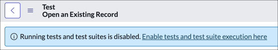
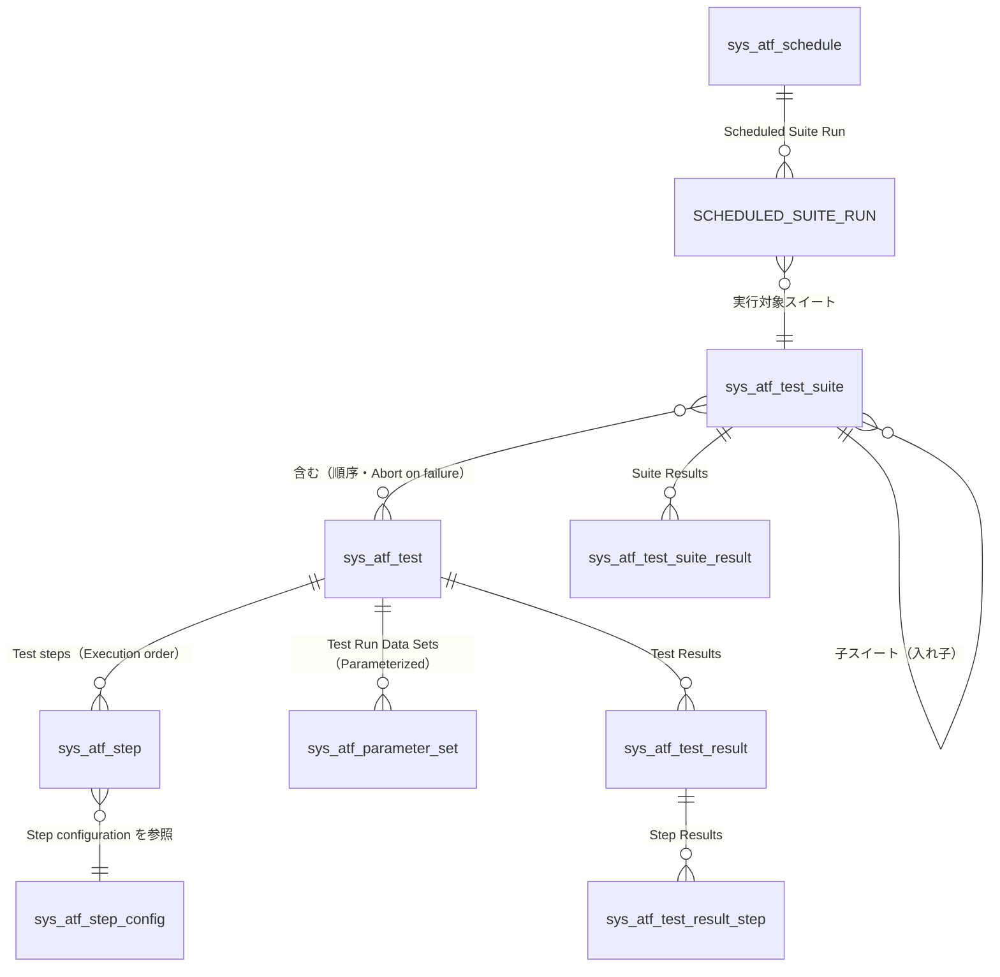
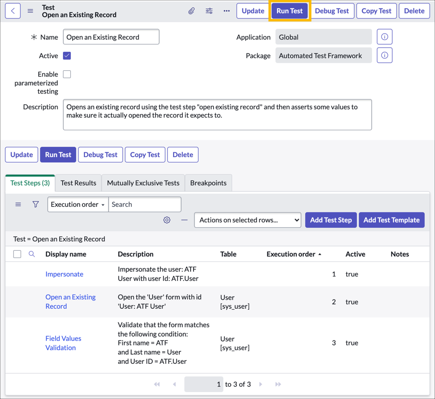
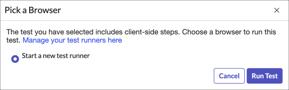
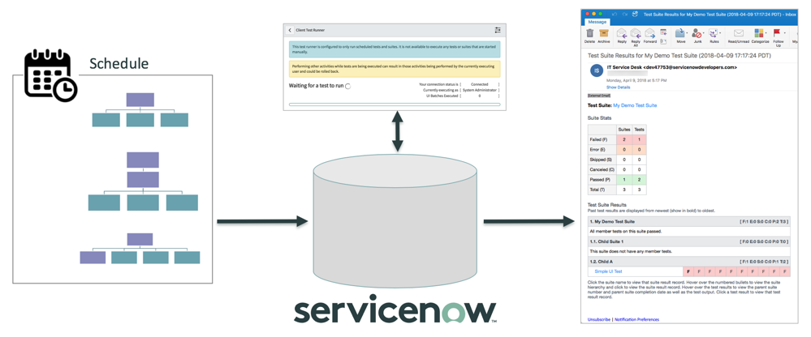
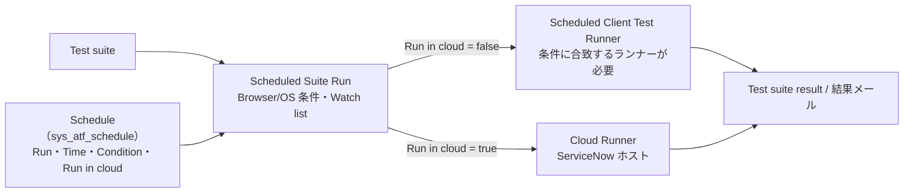
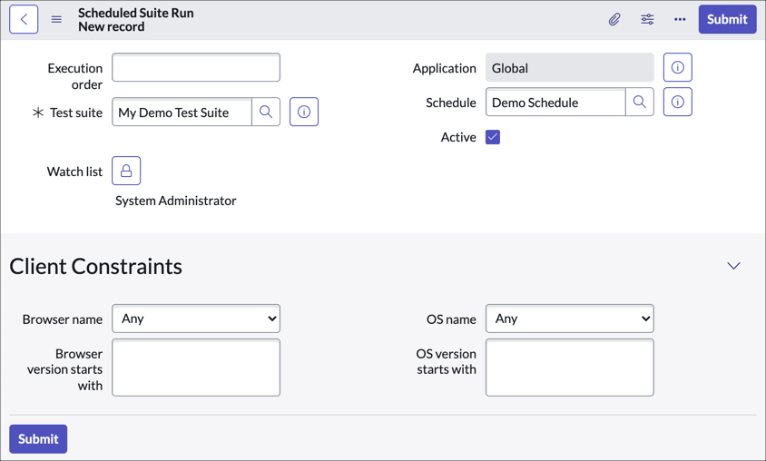
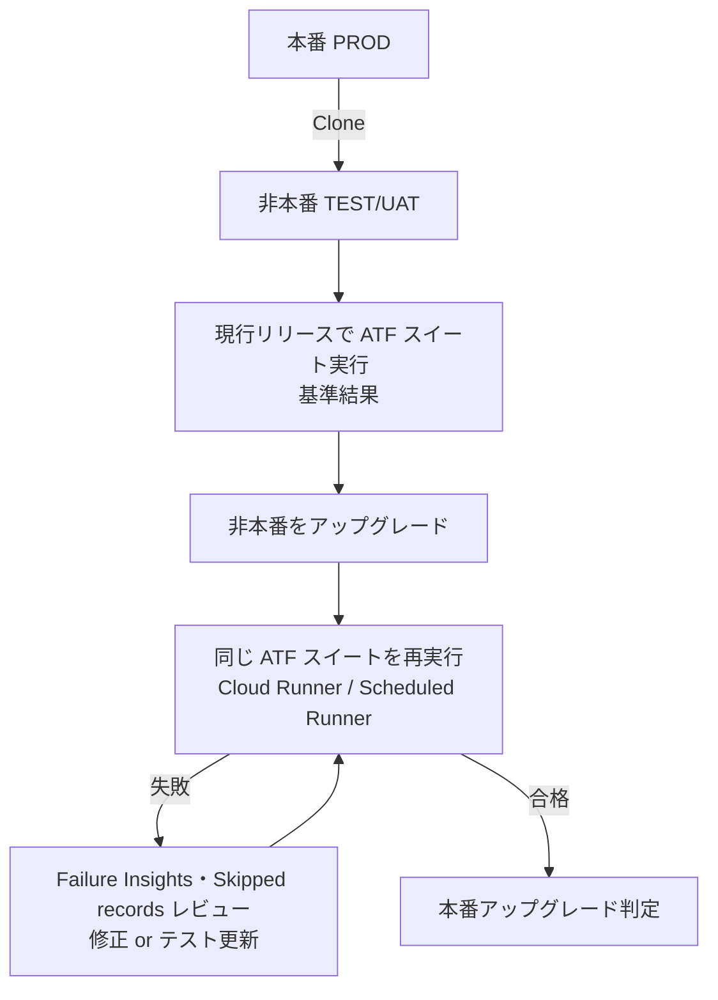

# Automated Test Framework（ATF、自動テストフレームワーク）

## 概要

**Automated Test Framework（ATF、自動テストフレームワーク）** は、ServiceNow AI Platform（Now Platform）に標準搭載されている自動テスト機能である。ATF を使うと、アップグレード、アプリケーション開発、Update Set による設定移送などの変更後に、インスタンスが期待どおり動作することを自動テストで確認できる。失敗したテスト結果からは、失敗の原因となった変更を調べられる。[出典](https://www.servicenow.com/docs/r/zUlSbxoxKPAWFDGUdAoSCw/4hkh6VNi_eAnyfY91R522Q)

ATF の要点は次のとおり。

| 観点 | 内容 |
|---|---|
| 提供形態 | プラットフォーム標準機能（ServiceNow AI Platform の一部として既定で有効）。追加プラグイン不要 [出典](https://www.servicenow.com/docs/r/m4LmCVvkm6_8u3nlIuep5Q/JYBzQK1EtOk8uSa0nSC9qA) |
| テスト実行の既定 | **無効**。本番での誤実行を防ぐため、プロパティ `sn_atf.runner.enabled` が既定で false [出典](https://www.servicenow.com/docs/r/application-development/automated-test-framework-atf/atf-admin-properties.html) |
| 実行してよい環境 | 開発・テスト等の **非本番インスタンスのみ**。本番で実行するとデータ破損や障害のおそれがある [出典](https://www.servicenow.com/docs/r/zUlSbxoxKPAWFDGUdAoSCw/4hkh6VNi_eAnyfY91R522Q) |
| 基本単位 | Test（テスト）＝ Test step（テストステップ）の並び。Test suite（テストスイート）で束ねてスケジュール実行 |
| データ | テスト中に作成・変更したデータはテスト後に **自動ロールバック**（一部テーブルを除く）[出典](https://www.servicenow.com/docs/r/zUlSbxoxKPAWFDGUdAoSCw/x7ob_08LzcQcFW9sK_yWJw) |
| UI テストの実行場所 | Client test runner（ブラウザータブ）、Cloud Runner（ServiceNow ホスト型ヘッドレスブラウザー、Store アプリ）、Headless Browser（レガシー、自社 Docker ホスト） |
| 対象 UI | Core UI（Classic Environment のリスト・フォーム）、Service Portal、Custom UI（Page Inspector による Configurable Workspace 等）。UI Builder ページの一部や Landing page は未対応と記載あり（後述） |
| AI 関連（Zurich 以降） | Failure Insights（Zurich）、ATF Code Coverage（Australia）、Test Agent（Australia GA）、ATF Test Generator（Store アプリ） |

本ファイルは ATF の製品仕様をリファレンスとして網羅する。テスト計画・UAT・本番稼働判定の進め方は [テストと本番稼働](../../03_導入編/11-testing-golive.md)、アップグレード計画全体は [アップグレード管理](../../03_導入編/13-upgrade-management.md)、実務上の教訓は [アップグレードの教訓](../../04_応用編/04-upgrade-lessons.md) を参照。

---

## 1. 前提と有効化

### 1.1 ATF のテスト実行を有効化する

ATF のテスト実行は既定で無効になっている。無効の状態で Test フォームを開くと、フォーム上部に「Running tests and test suites is disabled.」というバナーと、有効化ページへのリンクが表示される。[出典](https://developer.servicenow.com/print_page.do?release=zurich&category=learning-module&identifier=ATF_About_zurich%2Cservicenow_application_developer&module=learning+plan)



- **キャプション:** ATF のテスト実行が無効なときに Test フォームに表示される情報バナー。
- **画面の説明:** Test「Open an Existing Record」のフォームヘッダー直下に青い情報バナーがあり、「Running tests and test suites is disabled.」の文言と「Enable tests and test suite execution here」というリンクが表示されている。リンクを押すと ATF Properties ページに移動し、テスト実行を有効化できる。
- **出典:** ServiceNow Developer「Using the Automated Test Framework」（Zurich 版ラーニングモジュール）https://developer.servicenow.com/print_page.do?release=zurich&category=learning-module&identifier=ATF_About_zurich%2Cservicenow_application_developer&module=learning+plan （取得日: 2026-11-02）

有効化の手順は次のとおり。[出典](https://developer.servicenow.com/print_page.do?release=zurich&category=learning-module&identifier=ATF_About_zurich%2Cservicenow_application_developer&module=learning+plan)

1. `atf_test_admin`（または `admin`）ロールでログインする。
2. **All > Automated Test Framework (ATF) > Administration > Properties** を開く。
3. **Enable test/test suite execution**（`sn_atf.runner.enabled`）を Yes にする。
4. スケジュール実行を使う場合は、スケジュール実行の有効化プロパティ（`sn_atf.schedule.enabled`）も有効にする。
5. Save する。

- Australia のリリースノートでは、`sn_atf.runner.enabled` を true にすることが ATF Test Generator and Cloud Runner Store アプリのコンテンツパック有効化の前提とされている。[出典](https://www.servicenow.com/docs/r/m4LmCVvkm6_8u3nlIuep5Q/JYBzQK1EtOk8uSa0nSC9qA)
- CI/CD API でスイートを起動した際に「Scheduled test/suite execution is disabled.」で失敗する場合は、`sn_atf.schedule.enabled` を true にする必要がある。[出典](https://www.servicenow.com/docs/r/api-reference/rest-apis/cicd-api.html)

### 1.2 非本番での実行と本番での扱い

- 公式ドキュメントは「開発・テスト・その他の非本番インスタンスでのみテストを実行する」よう繰り返し警告している。ATF は Developer 向けトレーニングでも「本番での ATF 実行はサポートされない」と説明されている。[出典](https://developer.servicenow.com/print_page.do?release=zurich&category=learning-module&identifier=ATF_About_zurich%2Cservicenow_application_developer&module=learning+plan)
- ATF のテスト定義（`sys_atf_test` 等）はアプリケーションファイル（メタデータ）であり、Update Set やアプリで移送できる。本番からサブ本番へクローンしてテスト環境を最新に保つ運用も公式に紹介されている。[出典](https://www.servicenow.com/docs/r/zUlSbxoxKPAWFDGUdAoSCw/lpsJurpvpk8DaqAdSJX3Fg)
- 「本番にはテストを保管のみ行い実行しない。Update Set を昇格する前にテストを非アクティブ化する」運用が ServiceNow Community 公式ブログで推奨されている。[出典](https://www.servicenow.com/community/servicenow-ai-platform-blog/from-build-to-tested-in-one-conversation-introducing-atf-test/ba-p/3567980)

### 1.3 ブラウザーと UI の対応範囲

| 項目 | 内容 | 出典 |
|---|---|---|
| 実行ブラウザー | テスト・テストスイートは **デスクトップブラウザーからのみ** 実行可能。タブレット、モバイルブラウザー、モバイル UI からは実行できない | [出典](https://www.servicenow.com/docs/r/m4LmCVvkm6_8u3nlIuep5Q/JYBzQK1EtOk8uSa0nSC9qA) |
| タブレットでの設計 | タブレットでは Custom UI テストステップの新規追加（コンポーネント取得）ができない。デスクトップで作成した既存ステップの閲覧は可能 | [出典](https://www.servicenow.com/docs/r/m4LmCVvkm6_8u3nlIuep5Q/JYBzQK1EtOk8uSa0nSC9qA) |
| Core UI | Classic Environment のリスト・フォームを含め ATF でサポート | [出典](https://www.servicenow.com/docs/r/zUlSbxoxKPAWFDGUdAoSCw/VPxGPoKOWTBxIAdcA5dNcw) |
| Next Experience の未対応要素 | UI Builder で作成したページ（リスト・フォームコンポーネントを含むもの）、Landing page は「現時点で未対応、将来リリースで対応予定」と記載 | [出典](https://www.servicenow.com/docs/r/zUlSbxoxKPAWFDGUdAoSCw/VPxGPoKOWTBxIAdcA5dNcw) |
| Configurable Workspace | Zurich で、Page Inspector を使って多くの Configurable Workspace ページのコンポーネントを直接操作するテストを作成できるようになった（Custom UI の一種） | [出典](https://www.servicenow.com/docs/r/m4LmCVvkm6_8u3nlIuep5Q/JYBzQK1EtOk8uSa0nSC9qA) |
| ServiceNow 標準のダッシュボードやグラフィカルデザイナー | Custom UI テストでは ServiceNow AI Platform のダッシュボードやグラフィカルデザイナーはテストできない（自社で作成したカスタム UI を対象にする） | [出典](https://www.servicenow.com/docs/r/zUlSbxoxKPAWFDGUdAoSCw/lpsJurpvpk8DaqAdSJX3Fg) |
| Now Mobile アプリ | 公式に Mobile カテゴリのテストステップは確認できず。Community では「モバイルアプリは非対応」との回答あり【第三者情報】 | [出典](https://www.servicenow.com/community/service-management-forum/how-to-create-atf-and-atf-steps-for-now-mobile-apps/m-p/3291038) |

> **注記:** 「UI Builder ページ未対応」の記述（Exploring ATF ページ）と、Zurich の Configurable Workspace（UI Builder ベース）対応の記述は一見矛盾する。公式ドキュメント上は、Configurable Workspace は Custom UI / Page Inspector 経由でテスト可能、一般の UI Builder ページのリスト・フォームコンポーネントを標準 Form ステップのように扱うことは未対応、と読むのが妥当である【推定】。対象ページでの可否は Page Inspector で実際にコンポーネントが取得できるかで判断する（Page Inspector が認識できないコンポーネントはテストできない）。[出典](https://www.servicenow.com/docs/r/zUlSbxoxKPAWFDGUdAoSCw/lpsJurpvpk8DaqAdSJX3Fg)

---

## 2. 構成要素とデータモデル

### 2.1 主要概念とテーブル

| 概念 | 説明 | テーブル | 出典 |
|---|---|---|---|
| **Test（テスト）** | 1 つの機能を検証する Test step の論理的なまとまり。Test step と Test result の関連リストを持つ。例: 「CSM: Create Product Case」 | `sys_atf_test` | [出典](https://www.servicenow.com/docs/r/zUlSbxoxKPAWFDGUdAoSCw/VPxGPoKOWTBxIAdcA5dNcw) |
| **Test suite（テストスイート）** | 決められた順序で実行する Test（および子スイート）の集合。アプリ・機能群単位で作ることが多い。スケジュール実行可能。例: 「CSM: Case Management」 | `sys_atf_test_suite` | [出典](https://www.servicenow.com/docs/r/api-reference/rest-apis/cicd-api.html) |
| **Test step（テストステップ）** | Step configuration に実行時のテストデータと実行順序（Execution order）を組み合わせたもの | `sys_atf_step` | [出典](https://www.servicenow.com/docs/r/zUlSbxoxKPAWFDGUdAoSCw/VPxGPoKOWTBxIAdcA5dNcw) |
| **Step configuration（ステップ構成）** | 再利用可能なテストアクションの定義。入力変数・出力変数を持つが実行時データは持たない。例: 「Impersonate」 | `sys_atf_step_config` | [出典](https://www.servicenow.com/docs/r/zUlSbxoxKPAWFDGUdAoSCw/VPxGPoKOWTBxIAdcA5dNcw) |
| **Step variable（ステップ変数）** | ステップ固有の入力・出力値（対象テーブル、フォームビュー等）。出力変数を後続ステップの入力に渡せる | — | [出典](https://www.servicenow.com/docs/r/zUlSbxoxKPAWFDGUdAoSCw/VPxGPoKOWTBxIAdcA5dNcw) |
| **Quick start test（クイックスタートテスト）** | アプリケーションのデモデータとともにインストールされる Test / Test suite。テンプレートとしてコピーして使う | （`sys_atf_test` 等） | [出典](https://www.servicenow.com/docs/r/zUlSbxoxKPAWFDGUdAoSCw/VPxGPoKOWTBxIAdcA5dNcw) |
| **Test result（テスト結果）** | Test / Test suite 実行の出力。所要時間、ステータス、スクリーンショット等 | `sys_atf_test_result` | [出典](https://www.servicenow.com/docs/r/zUlSbxoxKPAWFDGUdAoSCw/VPxGPoKOWTBxIAdcA5dNcw) |
| **Test suite result（テストスイート結果）** | Test suite 実行の結果 | `sys_atf_test_suite_result` | [出典](https://www.servicenow.com/docs/r/eJIqiaxRKVcMaR8XQU6_oA/VvZh9ouqprVrV_ZPbesGYA) |
| **Step result（ステップ結果）** | 1 ステップの実行結果。ステータス、サマリー、完全なログ | `sys_atf_test_result_step` | [出典](https://www.servicenow.com/docs/r/zUlSbxoxKPAWFDGUdAoSCw/VPxGPoKOWTBxIAdcA5dNcw) |
| **Assert type（アサートタイプ）** | 合否を判定する条件。否定条件も指定可（例: Record Insert ステップで「Record was not inserted」を選ぶと、挿入失敗時に合格）。Server、Custom UI、Forms in Service Portal のカテゴリがアサートタイプを持つ | — | [出典](https://www.servicenow.com/docs/r/zUlSbxoxKPAWFDGUdAoSCw/VPxGPoKOWTBxIAdcA5dNcw) |
| **Test run data set（テスト実行データセット）** | Parameterized test の 1 回分の入力値。Shared parameter はこのテーブルの列になる | `sys_atf_parameter_set` | [出典](https://www.servicenow.com/docs/r/a3E8xg0zsiQLBPKbKO15Mg/O8vAL~b5hoZH70XIM2JY3g) |
| **Parameter variable（パラメーター変数）** | Exclusive parameter の定義 | `sys_atf_parameter_variable` | [出典](https://www.servicenow.com/docs/r/a3E8xg0zsiQLBPKbKO15Mg/O8vAL~b5hoZH70XIM2JY3g) |
| **Schedule（スイートスケジュール）** | スイートを実行する日時・頻度 | `sys_atf_schedule` | [出典](https://www.servicenow.com/docs/r/zurich/application-development/automated-test-framework-atf/run-scheduled-test-suite-script.html) |
| **Scheduled suite run（スケジュール済みスイート実行）** | Schedule と Test suite を結び、ブラウザー/OS の条件を指定するレコード | 公開情報でテーブル名は確認できず（`sys_atf_schedule_run` と推定【推定】） | [出典](https://developer.servicenow.com/print_page.do?release=zurich&category=learning-module&identifier=ATF_About_zurich%2Cservicenow_application_developer&module=learning+plan) |
| **Active test runner（アクティブなテストランナー）** | 起動中の Client test runner の一時的なレコード（ステータス、ブラウザーバージョン、空き状況） | 公開情報でテーブル名は確認できず（`sys_atf_agent` と推定【推定】。Headless のハートビート URI が `/api/now/atf_agent/online`） | [出典](https://www.servicenow.com/docs/r/zUlSbxoxKPAWFDGUdAoSCw/frcpA6a_l_pZrHyMCq9O_g) |
| **Code coverage request** | ATF Code Coverage API へのリクエスト記録（Australia） | `sys_atf_code_coverage_request` | [出典](https://www.servicenow.com/docs/r/eJIqiaxRKVcMaR8XQU6_oA/VvZh9ouqprVrV_ZPbesGYA) |

- Test result の保持期間は既定で **30 日**（それ以降は削除）。**Retain indefinitely（無期限保持）** にチェックすると保持期間後も残る。Test result と Test suite result の保持ポリシーは **Table Cleanup**（テーブルクリーンアップ）モジュールで確認・変更できる。[出典](https://www.servicenow.com/docs/r/zUlSbxoxKPAWFDGUdAoSCw/VPxGPoKOWTBxIAdcA5dNcw) / [出典](https://www.servicenow.com/docs/r/zurich/application-development/automated-test-framework-atf/atf-test-results-record.html)
- 進捗管理には `sys_progress_worker`（Progress Worker）と `sys_execution_tracker`（Execution Tracker）が使われる（スクリプト起動の戻り値、CI/CD API の `status_detail` の対応先）。[出典](https://www.servicenow.com/docs/r/zurich/application-development/automated-test-framework-atf/run-scheduled-test-suite-script.html) / [出典](https://www.servicenow.com/docs/r/api-reference/rest-apis/cicd-api.html)

### 2.2 関係図



- テストはテストを子に持てない（テストが持てるのはテストステップのみ）。スイートはテストと子スイートの両方を持てる。[出典](https://www.servicenow.com/docs/r/zurich/application-development/automated-test-framework-atf/atf-suites-overview.html)
- スイートとテストの中間テーブル名（スイート所属テスト）は公開情報では確認できず。

---

## 3. ロール

| ロール | 名称 | 権限 | 内包ロール | 出典 |
|---|---|---|---|---|
| `atf_test_admin` | ATF test administrator | ATF プロパティの作成・編集が可能。テスト、テストステップ、テストスイート、Step config レコード、テストランナー、結果を管理 | `impersonator`、`personalize_dictionary` | [出典](https://www.servicenow.com/docs/r/zUlSbxoxKPAWFDGUdAoSCw/d5K1IeIaDRXY81jXP~6Mjg) |
| `atf_test_designer` | ATF test designer | ATF プロパティは閲覧のみ（作成・編集不可）。テスト、テストステップ、テストスイートを管理・実行 | `impersonator` | [出典](https://www.servicenow.com/docs/r/zUlSbxoxKPAWFDGUdAoSCw/d5K1IeIaDRXY81jXP~6Mjg) |
| `atf_ws_designer` | ATF workspace designer | 認証が必要な REST エンドポイント向けに Basic 認証または相互認証（mutual authentication）プロファイルを閲覧・設定 | `atf_test_designer`、`web_service_admin` | [出典](https://www.servicenow.com/docs/r/zUlSbxoxKPAWFDGUdAoSCw/d5K1IeIaDRXY81jXP~6Mjg) |
| `sn_atf_tg.cloud_runner_admin` | （ATF Test Generator and Cloud Runner アプリ） | 3.1.1（2026-07、Australia 対応）で追加。`admin` を持たずに Cloud user の設定とテスト生成の開始が可能 | — | [出典](https://www.servicenow.com/docs/r/C17ZqvSaMwUVpMBg8Nc5sg/jb86qhteaeRpry1vCwUtPA) |
| `sn_cicd.sys_ci_automation` | CI/CD 自動化 | CI/CD API（`/sn_cicd/testsuite/run` 等）の呼び出しに必要（または `admin`） | — | [出典](https://www.servicenow.com/docs/r/api-reference/rest-apis/cicd-api.html) |

- 3 つの ATF ロールはいずれも Elevated role（昇格ロール）ではない。[出典](https://www.servicenow.com/docs/r/zUlSbxoxKPAWFDGUdAoSCw/d5K1IeIaDRXY81jXP~6Mjg)
- `atf_test_admin` / `atf_test_designer` が `impersonator` を内包するのは、テストで Impersonate（なりすまし）ステップを使うためである。
- 各ロールが課金対象（per-user subscription）かどうかについて、ロールページは Subscription Management の参照を案内するのみで、明確な判定は公開情報では確認できず。ライセンス全般は [ユーザー・ロール・ライセンスの基本](../../01_入門編/08-users-roles-licensing-basics.md) と [ライセンスモデル](../../03_導入編/01-licensing-model.md) を参照。
- 例外として、ATF Test Generator の **Generate Tests / Select Cloud User モジュールは `admin` のみ表示** され、`atf_test_admin` でもアクセスできない（3.1.1 以降は `sn_atf_tg.cloud_runner_admin` でも可）。[出典](https://www.servicenow.com/docs/r/zS6yb8e~gR8BPjeviYdV9g/Zcdj8pK6AKm6UYgF6gCKIw)
- Failure Insights（Find changes since last successful run）は `admin` ロールが必要。[出典](https://www.servicenow.com/docs/r/guL1zqmJkV9eywMq_6qu~w/WLKM2aaxrR~fO6O85NwSyA)

---

## 4. メニュー（モジュール）

ATF のモジュールはアプリケーションナビゲーターの **Automated Test Framework (ATF)** 配下にある。主なモジュールは次のとおり（Developer ラーニングモジュール・各公式手順ページに記載のもの）。

| メニュー | 用途 | 出典 |
|---|---|---|
| ATF > Tests | テストの一覧・作成 | [出典](https://developer.servicenow.com/print_page.do?release=zurich&category=learning-module&identifier=ATF_About_zurich%2Cservicenow_application_developer&module=learning+plan) |
| ATF > Suites | テストスイートの一覧・作成。ATF Test Generator が生成した「ATF Generated Suite」もここに出る | [出典](https://www.servicenow.com/docs/r/zS6yb8e~gR8BPjeviYdV9g/Zcdj8pK6AKm6UYgF6gCKIw) |
| ATF > Test Results | テスト結果の一覧 | [出典](https://developer.servicenow.com/print_page.do?release=zurich&category=learning-module&identifier=ATF_About_zurich%2Cservicenow_application_developer&module=learning+plan) |
| ATF > Schedules | スイートスケジュール（Suite Schedules）の作成 | [出典](https://www.servicenow.com/docs/r/zS6yb8e~gR8BPjeviYdV9g/ZkT~6XbFHA4iB3VG6f5Bnw) |
| ATF > Run > Client Test Runner | 現在のブラウザーセッションで手動用ランナーを起動 | [出典](https://www.servicenow.com/docs/r/zUlSbxoxKPAWFDGUdAoSCw/frcpA6a_l_pZrHyMCq9O_g) |
| ATF > Run > Scheduled Client Test Runner | スケジュール実行専用のランナーを起動 | [出典](https://developer.servicenow.com/print_page.do?release=zurich&category=learning-module&identifier=ATF_About_zurich%2Cservicenow_application_developer&module=learning+plan) |
| ATF > Run > Active Manual Test Runners | 起動中の手動ランナー（Active Test Runners のフィルタービュー） | [出典](https://www.servicenow.com/docs/r/zUlSbxoxKPAWFDGUdAoSCw/frcpA6a_l_pZrHyMCq9O_g) |
| ATF > Run > Active Scheduled Test Runners | 起動中のスケジュール用ランナー。ブラウザー名・バージョンの確認に使う | [出典](https://www.servicenow.com/docs/r/zUlSbxoxKPAWFDGUdAoSCw/frcpA6a_l_pZrHyMCq9O_g) |
| ATF > Administration > Properties | ATF プロパティ（実行有効化、スクリーンショット、ハートビート、メール等） | [出典](https://developer.servicenow.com/print_page.do?release=zurich&category=learning-module&identifier=ATF_About_zurich%2Cservicenow_application_developer&module=learning+plan) |
| ATF > Administration > Test Templates | テストテンプレート（再利用できるステップの組） | [出典](https://developer.servicenow.com/print_page.do?release=zurich&category=learning-module&identifier=ATF_About_zurich%2Cservicenow_application_developer&module=learning+plan) |
| ATF > Administration > Step Configurations | Step configuration（カスタムステップ）の作成 | [出典](https://docs.servicenow.com/bundle/orlando-application-development/page/administer/auto-test-framework/task/atf-create-custom-step.html) |
| ATF > Administration > All Test Runners | すべてのテストランナー | [出典](https://developer.servicenow.com/print_page.do?release=zurich&category=learning-module&identifier=ATF_About_zurich%2Cservicenow_application_developer&module=learning+plan) |
| ATF > Administration > Test Generator | ATF Test Generator（Store アプリ導入時、`admin` のみ） | [出典](https://www.servicenow.com/docs/r/zS6yb8e~gR8BPjeviYdV9g/Zcdj8pK6AKm6UYgF6gCKIw) |
| ATF > Administration > Browser Orchestration Queue | テスト生成・Cloud Runner 実行の状態（ジャーナルで進捗表示） | [出典](https://www.servicenow.com/docs/r/zS6yb8e~gR8BPjeviYdV9g/Zcdj8pK6AKm6UYgF6gCKIw) |

> モジュールの細かな配置（Run / Administration のどちらに入るか）はリリースやインストール済みアプリにより異なる場合がある。上表の配置は Zurich 版の Developer ラーニングモジュールと Zurich〜Australia の公式手順ページに基づく。

---

## 5. システムプロパティ

### 5.1 ATF プロパティ（ATF > Administration > Properties）

| プロパティ | 内容 | 既定値（判明分） |
|---|---|---|
| `sn_atf.runner.enabled` | インスタンスでのテスト・テストスイートの実行を有効化（画面ラベル: Enable test/test suite execution） | false |
| `sn_atf.schedule.enabled` | テストスイートのスケジュール実行を有効化 | 公開情報では確認できず |
| `sn_atf.debug` | 追加のデバッグ機能を有効化（ランナーに Debug Info タブが表示される） | 公開情報では確認できず |
| `sn_atf.screenshots.mode` | スクリーンショット取得: 全ステップ / 失敗ステップのみ / 取得しない | 公開情報では確認できず（Developer 教材では「既定で取得」と説明） |
| `sn_atf.screenshots.use_glide_screenshot` | 高忠実度スクリーンショット。無効または非対応時は html2canvas にフォールバック | 新リリースへのアップグレード後は false |
| `sn_atf.screenshots.capture_full_page` | テストフレームをリサイズしてページ全体を撮影 | false |
| `sn_atf.atf_test_runner.screenshot_timeout` | スクリーンショット取得がこの秒数を超えたらスキップ | 公開情報では確認できず |
| `sn_atf.atf_test_runner.testframe.min_height` | スクリーンショットの高さ（px） | 600 |
| `sn_atf.atf_test_runner.testframe.min_width` | スクリーンショットの幅（px） | 800 |
| `sn_atf.page_data_capture.enabled` | Custom UI ステップが毎回ページデータを取得 | 公開情報では確認できず |
| `sn_atf.runner.heartbeat.timeout` | テストランナーのハートビートが途絶えてオフライン扱いになるまでの秒数（120〜1800） | 120 |
| `sn_atf.runner.heartbeat.interval` | テストランナーがサーバーにハートビートを送る間隔（秒） | 公開情報では確認できず |
| `sn_atf.runner.offline_retention.timeout` | オフラインのテストランナーを削除するまでの日数 | 公開情報では確認できず |
| `sn_atf.schedule.reports.suite.aging_threshold` | スイートエージングレポートに表示するスイート結果の件数 | 公開情報では確認できず |
| `sn_atf.schedule.suite_result_email.only_show_failed_results` | スケジュール実行結果メールに失敗結果のみ表示 | Developer 教材では「既定で失敗のみ」 |
| `sn_atf.schedule.suite_result_email.max_test_history` | 結果メールに表示するテスト結果の最大数 | Developer 教材では 10 |
| `sn_atf.schedule.suite_result_email.max_depth` | 結果メールでスイート階層を出力する最大深さ | Developer 教材では 20 |
| `sn_atf.schedule.suite_result_email.fail_color` / `error_color` / `pass_color` / `skip_color` / `cancel_color` | 結果メールでの各ステータスの色（16 進カラーコード） | 公開情報では確認できず |

出典: [ATF properties](https://www.servicenow.com/docs/r/application-development/automated-test-framework-atf/atf-admin-properties.html)、メール既定値は [Developer ラーニングモジュール](https://developer.servicenow.com/print_page.do?release=zurich&category=learning-module&identifier=ATF_About_zurich%2Cservicenow_application_developer&module=learning+plan)

### 5.2 その他の ATF 関連プロパティ

| プロパティ | 内容 | 既定値 | 出典 |
|---|---|---|---|
| `atf_cloud_runner.radio_visible` | Pick a Browser ダイアログに Cloud Runner の選択肢を表示するか | true | [出典](https://www.servicenow.com/docs/r/zS6yb8e~gR8BPjeviYdV9g/jpnKWtziIAZDvh4AVIOkaA) |
| `sn_atf_tg.generation.create_separate_update_set` | ATF Test Generator の生成時に Update Set を作成するか | true | [出典](https://www.servicenow.com/docs/r/zS6yb8e~gR8BPjeviYdV9g/Zcdj8pK6AKm6UYgF6gCKIw) |
| `sn_atf.test.triage.task.type` | Failure Insights の「Create a task」で作成するタスクの種類 | Incident 系のタスクタイプ | [出典](https://www.servicenow.com/docs/r/guL1zqmJkV9eywMq_6qu~w/WLKM2aaxrR~fO6O85NwSyA) |
| `sn_atf.headless.*` | Headless Browser 用（後述「17. Headless Browser」） | — | [出典](https://www.servicenow.com/docs/r/zUlSbxoxKPAWFDGUdAoSCw/tf351Zyp64yupCWv29VZ3w) |

- ATF Code Coverage（Australia）を有効化するプロパティ名は、Community 記事で `sn.code.coverage.enabled` と `x_snc_atf_code_coverage_enabled` の 2 説があり、公式ドキュメントでは確認できず。

---

## 6. Test（テスト）

### 6.1 Test フォーム



- **キャプション:** Classic UI の Test フォーム。ヘッダーの **Run Test** ボタンが強調表示されている。
- **画面の説明:** ヘッダー右側に Update、**Run Test**、Debug Test、Copy Test、Delete のボタン。フォーム項目は Name（必須、例「Open an Existing Record」）、Active（チェック）、Enable parameterized testing（チェックボックス）、Description、右側に Application（Global）と Package（Automated Test Framework）。下部の関連リストタブは **Test Steps (3)**、Test Results、Mutually Exclusive Tests、Breakpoints。Test Steps リストには Add Test Step、Add Test Template ボタンがあり、列は Display name / Description / Table / Execution order / Active / Notes。例として 1: Impersonate（ATF User になりすまし）、2: Open an Existing Record（User [sys_user] フォームを開く）、3: Field Values Validation（First name = ATF 等を検証）が並ぶ。
- **出典:** ServiceNow Developer「Using the Automated Test Framework」（Zurich 版）https://developer.servicenow.com/print_page.do?release=zurich&category=learning-module&identifier=ATF_About_zurich%2Cservicenow_application_developer&module=learning+plan （取得日: 2026-11-02）

Test フォームの主な要素は次のとおり（上記画面に基づく）。

| 要素 | 内容 |
|---|---|
| Name / Description | テスト名と説明 |
| Active | 無効にするとテストを実行対象から外せる |
| Enable parameterized testing | Parameterized test（パラメーター化テスト）にする（「8. Parameterized test」参照） |
| Application / Package | 所属アプリケーションスコープ |
| Run Test | テストを実行（クライアント側ステップを含む場合は Pick a Browser ダイアログが開く） |
| Debug Test | ブレークポイントを使ったデバッグ実行（詳細仕様は公開情報で十分に確認できず） |
| Copy Test | テストをコピー（Parameterized test ではパラメーター・データセット・ステップもコピーされる [出典](https://www.servicenow.com/docs/r/a3E8xg0zsiQLBPKbKO15Mg/O8vAL~b5hoZH70XIM2JY3g)） |
| 関連リスト: Test Steps | ステップの一覧（Add Test Step / Add Test Template） |
| 関連リスト: Test Results | 過去の実行結果 |
| 関連リスト: Mutually Exclusive Tests | 並列実行時に同時実行させないテスト（「11.4」参照） |
| 関連リスト: Breakpoints | Debug Test 用のブレークポイント |

### 6.2 実行の流れ

1. Test フォームで **Run Test** を押す。クライアント側ステップを含む場合は **Pick a Browser** ダイアログで「Start a new test runner」（新しいタブでランナー起動）、既存ランナー、または Cloud Runner（導入時）を選ぶ。
2. 実行完了後、**Go to Result** で結果レコードを開く。
3. ステップのステータスは Waiting / Running / Success / Failure / Skipped / Error / Canceled。
4. スクリーンショットは既定で取得され、結果レコードの添付（Manage Attachments）からダウンロードできる。
5. Field Values Validation ステップは大文字小文字を区別する。

[出典](https://developer.servicenow.com/print_page.do?release=zurich&category=learning-module&identifier=ATF_About_zurich%2Cservicenow_application_developer&module=learning+plan)

---

## 7. Test step と Step configuration

### 7.1 Add Test Step パネル

Test フォームで **Add Test Step** を押すと Add Test Step パネルが開く。左ペインにテストカテゴリ、中央ペインに選択カテゴリのステップ（**All Steps** を選ぶと全ステップ）、右ペインに選択ステップの説明が表示される。上部の検索欄でステップ名を検索できる。[出典](https://www.servicenow.com/docs/r/zUlSbxoxKPAWFDGUdAoSCw/sJ6~3h0z0dKX5RgVTmIm7Q)

### 7.2 テストステップカテゴリと主なステップ

公式のカテゴリ一覧（Developer ラーニングモジュール）は 12 カテゴリである: List and Related List、Service Catalog、Custom UI、Forms in Service Portal、Application Navigator、Service Catalog in Service Portal、Form、REST、Responsive Dashboards、Reporting、Server、Email。[出典](https://developer.servicenow.com/print_page.do?release=zurich&category=learning-module&identifier=ATF_About_zurich%2Cservicenow_application_developer&module=learning+plan)

各カテゴリのステップは、ServiceNow 公式 SDK（ServiceNow Fluent）の ATF ガイドに API 名として列挙されている。下表は SDK の API 名から対応する UI 上のステップを整理したものである（UI 表示名は英語の一般的表記で、厳密な表示名はインスタンスで確認すること）。[出典](https://servicenow.github.io/sdk/guides/atf-guide)

| カテゴリ（UI） | 用途 | 主なステップ（SDK の API 名） |
|---|---|---|
| **Server**（Server Operations） | サーバー側の単体テスト・データ操作 | `impersonate`（Impersonate）、`createUser`（Create a User）、`log`、`runServerSideScript`（Run Server Side Script）、`recordQuery`、`recordInsert`、`recordValidation`、`recordUpdate`、`recordDelete`、`searchForCatalogItem`、`checkoutShoppingCart`、`replayRequestItem` |
| **Form** | Classic UI フォームのテスト | `openNewForm`、`openExistingRecord`、`submitForm`、`setFieldValue`、`fieldValueValidation`、`fieldStateValidation`、`uiActionVisibility`、`clickUIAction`、`clickModalButton`、`declarativeActionVisibility`、`clickDeclarativeAction` |
| **Forms in Service Portal** | Service Portal 上のフォーム | Form と同等 ＋ `openServicePortalPage` |
| **REST** | Inbound REST リクエストを送信して応答を検証 | `sendRestRequest`、`assertStatusCodeName`、`assertStatusCode`、`assertResponseTime`、`assertResponseHeader`、`assertResponsePayload`、`assertResponseJSONPayloadIsValid`、`assertJsonResponsePayloadElement`、`assertResponseXMLPayloadIsWellFormed`、`assertXMLResponsePayloadElement` |
| **Service Catalog** | カタログアイテム・レコードプロデューサー | `openCatalogItem`、`addItemToShoppingCart`、`setCatalogItemQuantity`、`orderCatalogItem`、`validatePriceAndRecurringPrice`、`validateVariableValue`、`variableStateValidation`、`setVariableValue`、`openRecordProducer`、`submitRecordProducer` |
| **Service Catalog in Service Portal** | ポータルでのエンドツーエンドのカタログテスト | Service Catalog と同等 ＋ `openOrderGuide`、`navigatewithinOrderGuide`、`validateOrderGuideItem`、`reviewOrderGuideSummary`、`saveCurrentRowOfMultiRowVariableSet`、`addRowToMultiRowVariableSet` |
| **Email** | 送信メールの検証、受信メールの生成 | `validateOutboundEmail`、`validateOutboundEmailGeneratedByNotification`、`validateOutboundEmailGeneratedByFlow`、`generateInboundEmail`、`generateInboundReplyEmail`、`generateRandomString` |
| **Application Navigator** | メニュー・モジュールの表示確認 | `moduleVisibility`、`navigateToModule`、`applicationMenuVisibility` |
| **List and Related List** | リスト・関連リスト | `relatedListVisibility`、`applyFilterToList`、`recordPresentInList`、`openRecordInList`、`listUIActionVisibility`、`clickListUIAction` |
| **Reporting** | レポートの表示確認 | `reportVisibility` |
| **Responsive Dashboards** | レスポンシブダッシュボード | `responsiveDashboardVisibility`、`responsiveDashboardSharing` |
| **Custom UI** | スクリプトなしで UI 操作テスト（UI ページ、Configurable Workspace 等のコンポーネント）。Page Inspector でコンポーネントを取得 | SDK では UI Test Script として別ガイド扱い |

- Email の送信検証を PDI で行う場合、PDI はメール送信が既定で無効のため、System Properties > Email Properties で送信を有効にする必要がある。[出典](https://developer.servicenow.com/print_page.do?release=zurich&category=learning-module&identifier=ATF_About_zurich%2Cservicenow_application_developer&module=learning+plan)
- Flow のテスト（Workflow Studio / Flow Designer のフロー起動・完了確認）は Email の `validateOutboundEmailGeneratedByFlow` 等のほか、ATF Test Generator がフロー関連ステップを生成する（2.5.4 以降）。Flow 自体の仕様は [Workflow Studio / Flow Designer](flow-designer-workflow-studio.md) を参照。[出典](https://www.servicenow.com/docs/r/C17ZqvSaMwUVpMBg8Nc5sg/jb86qhteaeRpry1vCwUtPA)

### 7.3 Custom UI と Page Inspector

- Custom UI ステップでは **Page Inspector** を使ってテスト可能なコンポーネントを特定する。Page Inspector が認識できないコンポーネントはテストできない。[出典](https://www.servicenow.com/docs/r/zUlSbxoxKPAWFDGUdAoSCw/lpsJurpvpk8DaqAdSJX3Fg)
- 既存のテストステップで対象のカスタム UI まで遷移してからコンポーネントを取得する。似た要素はレイアウト上の位置（component area）で区別する。HTML 属性で特定コンポーネントのテスト用プロパティを上書きできる。[出典](https://www.servicenow.com/docs/r/zUlSbxoxKPAWFDGUdAoSCw/lpsJurpvpk8DaqAdSJX3Fg)
- Custom UI ステップはコンポーネントをメタデータとして保存しないため、**インスタンス間でテストを移送した後はコンポーネントを再取得する必要がある**。[出典](https://www.servicenow.com/docs/r/zUlSbxoxKPAWFDGUdAoSCw/lpsJurpvpk8DaqAdSJX3Fg)
- Zurich で Configurable Workspace 向けのテスト作成が追加された。作成モーダルでワークスペースの URL を指定し（既存の Open Workspace Page ステップがあればその URL が既定値）、新しいタブでページを開くと右側のパネルにページ内コンポーネントが列挙される。ステップを削除すると同じバッチ内のステップが再読み込み・再生される。[出典](https://www.servicenow.com/docs/r/zUlSbxoxKPAWFDGUdAoSCw/sJpLzMpXwd2mY4cqvsL3Kw)
- Workspace と UI Builder の仕様は [Workspace と UI Builder](workspaces-ui-builder.md) を参照。

### 7.4 Run UI Test Script ステップ（Australia）

**Run UI Test Script** は、クライアント側 JavaScript のテストスクリプトをブラウザー内で直接実行し、Classic および Next Experience ページの複数ステップの UI 操作を駆動・検証するテストステップである。サーバー側の処理は伴わない。Australia のリリースノートで新機能として記載されている。[出典](https://www.servicenow.com/docs/r/m4LmCVvkm6_8u3nlIuep5Q/JYBzQK1EtOk8uSa0nSC9qA) / [出典](https://www.servicenow.com/docs/r/eJIqiaxRKVcMaR8XQU6_oA/pfmpYUSfh8LSpaXpS~~V0g)

| 項目 | 内容 |
|---|---|
| 提供条件 | 開発者ガイドでは「ZP10/AP3 以降」（Zurich Patch 10 / Australia Patch 3 以降）と記載 |
| グローバル API | `screen`（Shadow DOM 対応の要素検索）、`user`（クリック・入力・キーボード操作のシミュレーション）、`sn_atf`（ナビゲーション、ページ評価、なりすまし、ファイルアップロード、Shadow DOM ユーティリティ）、`expect`（アサーション）、ヘルパー `waitFor`、`within`、`steps`、`params`、`isVisible`、`isEnabled` 等 |
| タイムアウト | 既定 30 秒。ステップレコードの `step.timeout` で上書き。超過時は「Test timed out after Nms」で失敗 |
| 注意 | 見た目が同じでも内部 DOM が変わるとリリース間でスクリプトが失敗する可能性がある。単純な検証には標準のローコードステップを優先する |

```javascript
// ボタンをクリックし、結果の状態を確認する（公式開発者ガイドの例）
const [btn] = await screen.findAllByRole('button', { name: 'Submit' });
await user.click(btn);
await screen.findByText('Record saved');
```

[出典](https://www.servicenow.com/docs/r/eJIqiaxRKVcMaR8XQU6_oA/pfmpYUSfh8LSpaXpS~~V0g)

### 7.5 カスタム Step configuration

- ATF は標準の Step configuration を提供し、テスト設計者は独自の **カスタム Step configuration** を作成できる。[出典](https://www.servicenow.com/docs/r/zUlSbxoxKPAWFDGUdAoSCw/VPxGPoKOWTBxIAdcA5dNcw)
- 作成手順（公式、Orlando 版）: **Automated Test Framework > Administration > Step Configurations** で New を押し、名前を入力し、Step environment（ステップ環境）は **Server - Independent** のままにする。カスタム作成がサポートされるのはサーバー側ステップのみで、ブラウザーで実行する UI ステップのカスタム作成はサポートされない。Java ベースのカスタムステップも不可で、スクリプトステップのみ。[出典](https://docs.servicenow.com/bundle/orlando-application-development/page/administer/auto-test-framework/task/atf-create-custom-step.html)
- Step configuration はカテゴリで分類され、カテゴリはそこに含められる Step environment（Server - Independent、UI 等）を持つ。カスタムカテゴリも作成できる。[出典](https://www.servicenow.com/docs/r/ja-JP/application-development/automated-test-framework-atf/atf-create-custom-category.html)
- Community には既存 UI ステップをコピーしてカスタム UI ステップを作る手法が紹介されているが、非公式・非サポートで、アップグレードで壊れるおそれがある【第三者情報】。[出典](https://www.servicenow.com/community/developer-articles/create-a-custom-atf-ui-step-configuration/ta-p/2303926)
- ブラウザー側でカスタム検証が必要な場合、Australia 以降は 7.4 の Run UI Test Script が公式の選択肢となる【推定】。

### 7.6 Server UI アクションと Assert type

Server UI アクション（フォームを送信・再読み込みする UI アクション）をクリックするステップでは、Assert type に **None** を使わない。別のアサートタイプを選び、送信を待つタイムアウトを設定する。Server UI アクションで None を選ぶと自動的に「Form submitted to server」に設定される。[出典](https://www.servicenow.com/docs/r/zUlSbxoxKPAWFDGUdAoSCw/lpsJurpvpk8DaqAdSJX3Fg)

---

## 8. Parameterized test（パラメーター化テスト）

**Parameterized test** は、同じテストステップをデータセットごとに複数回実行する機能である。テストアクションとテストデータを分離し、データ違いのためにステップを複製する必要をなくす。[出典](https://www.servicenow.com/docs/r/a3E8xg0zsiQLBPKbKO15Mg/O8vAL~b5hoZH70XIM2JY3g)

| 項目 | 内容 |
|---|---|
| 有効化 | Test フォームの **Enable parameterized testing** をチェック |
| Shared parameter（共有パラメーター） | どの Parameterized test でも使える。`sys_atf_parameter_set`（Test Run Data Sets）の **列** として作られる |
| Exclusive parameter（専用パラメーター） | 作成したテストでのみ使える。`sys_atf_parameter_variable`（Parameter Variables）の **レコード**。Parameter Definitions 関連リストの「Add Exclusive Parameters」で作成（型の例: String＝Max length あり、Reference＝参照先テーブル指定） |
| データセット | 各パラメーターの実行時値の組。`sys_atf_parameter_set` のレコード。手動作成またはファイルからインポート。Test Run Data Sets 関連リストに表示 |
| ステップでの利用 | ステップ入力にデータピル（例: Parameters ➔ First name）で挿入 |
| 実行 | 実行時にデータセットの値で置換し、データセットの数だけ実行（5 データセット＝5 回） |
| 結果 | データセットごとに別の Test result。結果はデータセットの実行順に並ぶ。Parameterized Test Result の Description に使用したパラメーターとデータセットが記載される |
| 制約 | **Run Server Side Script ステップは非対応**。Custom UI ステップではコンポーネント取得に最初のデータセットだけが使われる。**データセット未定義だとテストは失敗する** |
| 対応機能 | レポート、テストスイート、データロールバック等の標準機能に対応。コピー時はパラメーター・データセット・ステップもコピー |

出典: [Parameterized tests](https://www.servicenow.com/docs/r/a3E8xg0zsiQLBPKbKO15Mg/O8vAL~b5hoZH70XIM2JY3g)、[Developer ラーニングモジュール](https://developer.servicenow.com/print_page.do?release=zurich&category=learning-module&identifier=ATF_About_zurich%2Cservicenow_application_developer&module=learning+plan)

- 共有パラメーターを増やすと `sys_atf_parameter_set` に列が増え続けるため、多種のテストで共有パラメーターを乱用しない方がよいという指摘がある【第三者情報】。[出典](https://www.servicenow.com/community/developer-forum/reading-external-files-using-atf/m-p/1598813)
- パラメーター上限数は公開情報では確認できず。

---

## 9. Test template（テストテンプレート）

- **Test template** は再利用可能なテストステップの組で、**ATF > Administration > Test Templates** で管理する。Test フォームの **Add Test Template** でテストに一括追加できる。標準テンプレートには Create a User、Log、Record Validation 等のステップが含まれるものがある。[出典](https://developer.servicenow.com/print_page.do?release=zurich&category=learning-module&identifier=ATF_About_zurich%2Cservicenow_application_developer&module=learning+plan)
- テンプレートのテーブル名は公開情報では確認できず（`sys_atf_test_template` と推定【推定】）。

---

## 10. Test suite（テストスイート）

### 10.1 構造

| 項目 | 内容 | 出典 |
|---|---|---|
| 親子関係 | スイートは Test と子スイートを含められる（多階層可）。親スイートを実行すると子スイートもすべて実行 | [出典](https://www.servicenow.com/docs/r/zurich/application-development/automated-test-framework-atf/atf-suites-overview.html) |
| Filter（フィルター） | 条件に合致するテストを自動的にスイートに追加し、手作業の保守を減らす | [出典](https://www.servicenow.com/docs/r/zurich/application-development/automated-test-framework-atf/atf-suites-overview.html) |
| 実行順序 | スイート内のテストは決められた順序で実行（Cloud Runner での並列実行時は順序がランダム、後述） | [出典](https://www.servicenow.com/docs/r/zUlSbxoxKPAWFDGUdAoSCw/VPxGPoKOWTBxIAdcA5dNcw) |
| Abort on failure | テストが失敗した場合に後続テストを Skipped にする設定（結果ステータス Skipped の定義より） | [出典](https://www.servicenow.com/docs/r/zurich/application-development/automated-test-framework-atf/atf-test-results-record.html) |

- ServiceNow Fluent の `TestSuite()` では `tests: [{ test, abortOnFailure }]` で順序と Abort on failure を、`parent` で入れ子を指定する。[出典](https://servicenow.github.io/sdk/guides/atf-guide)

### 10.2 実行・再実行・コピー

- スイートはワンアクションで実行できる。**失敗したテストだけを再実行**することもできる。[出典](https://www.servicenow.com/docs/r/zurich/application-development/automated-test-framework-atf/atf-suites-overview.html)
- スイート実行に **Watch list** を設定すると、完了時にユーザーへメール通知される。[出典](https://www.servicenow.com/docs/r/zurich/application-development/automated-test-framework-atf/atf-suites-overview.html)
- **Copy Test Suite**: All > Automated Test Framework > Suites でスイートを開き、フォームの **Copy Test Suite** を押すと、入れ子のテストと子スイートを含めてコピーされる。コピー後に名前変更・編集する。[出典](https://www.servicenow.com/docs/r/zurich/application-development/automated-test-framework-atf/atf-suites-overview.html)
  - スイートのコピーは、スイートが現在のスコープと同じスコープにある場合のみ可能。スイート内テストのスコープはコピー時に保持される。
  - コピーに失敗したテスト・子スイートはスキップされ、残りのコピーは続行する。
  - フィルター条件がある場合、条件を満たすテストだけがコピー後のスイートに追加される。
  - [出典](https://www.servicenow.com/docs/r/KClk0UwQlFjGoDJBQtfqgw/vts7KTPB0FuxQnRuTGycyg)
- 個々のテストではなく **スイートのみがスケジュール対象** である（「15. スケジュール実行」参照）。[出典](https://www.servicenow.com/docs/r/zurich/application-development/automated-test-framework-atf/atf-suites-overview.html)

---

## 11. 実行環境（テストランナー）

### 11.1 実行環境の種類

| 実行環境 | 概要 | 主な用途 | 提供 |
|---|---|---|---|
| **Client Test Runner**（手動用） | ユーザーが開いたブラウザータブで、ログインユーザーとしてクライアント側ステップを実行 | 対話的なテスト作成・実行 | 標準 |
| **Scheduled Client Test Runner** | スケジュール実行専用ランナー。Scheduled Suite Run の条件に合うランナーだけがスケジュールスイートを実行 | 夜間バッチ等の定期実行（自前 PC/VM で常時起動） | 標準 |
| **Cloud Runner** | ServiceNow がホストするヘッドレスブラウザー。ローカル準備不要、並列実行 | 定期実行・CI/CD・大量回帰テスト | Store アプリ「ATF Test Generator and Cloud Runner」 |
| **Headless Browser** | 自社 Docker ホスト上のヘッドレスブラウザーで Scheduled Client Test Runner を自動起動 | オンプレミスインスタンス等で Cloud Runner が使えない場合 | 標準（**レガシー**） |
| サーバー側のみのテスト | Server・REST 等のサーバー側ステップのみのテストはランナー不要 | 単体テスト | 標準 |

出典: [Working with client test runners](https://www.servicenow.com/docs/r/zUlSbxoxKPAWFDGUdAoSCw/frcpA6a_l_pZrHyMCq9O_g)、[Headless Browser for ATF](https://www.servicenow.com/docs/r/zUlSbxoxKPAWFDGUdAoSCw/F6XWQeiRksvFI~aTTgKhmg)、[Developer ラーニングモジュール](https://developer.servicenow.com/print_page.do?release=zurich&category=learning-module&identifier=ATF_About_zurich%2Cservicenow_application_developer&module=learning+plan)

### 11.2 Client Test Runner の動作仕様



- **キャプション:** クライアント側ステップを含むテストを Run Test したときに表示される Pick a Browser ダイアログ。
- **画面の説明:** タイトル「Pick a Browser」。本文「The test you have selected includes client-side steps. Choose a browser to run this test.」と「Manage your test runners here」リンク。選択肢はラジオボタン「Start a new test runner」（新しいタブでランナーを起動）。下部に Cancel と Run Test ボタン。既存のランナーが起動中ならその選択肢、Cloud Runner を導入済みなら Cloud Runner の選択肢も表示される（`atf_cloud_runner.radio_visible` で表示制御）。
- **出典:** ServiceNow Developer「Using the Automated Test Framework」（Zurich 版）https://developer.servicenow.com/print_page.do?release=zurich&category=learning-module&identifier=ATF_About_zurich%2Cservicenow_application_developer&module=learning+plan （取得日: 2026-11-02）

| 仕様 | 内容 |
|---|---|
| 実行ユーザー | 現在のセッションのログインユーザーとして実行。テスト内に Impersonate ステップがあればそのユーザー。ログアウト・再ログインしたらランナーを再起動する |
| 待機 | 待機中テストがなければ「Waiting for a test to run」を表示し、**5 秒ごと** に待機中テストを確認 |
| 表示 | Execution Frame にテスト進捗を表示。追加デバッグ有効時は Execution Frame と Debug Info の 2 タブ |
| ダイアログの扱い | `confirm` は true を返す、`prompt` は「test value」を返す、`alert` は無視、`console.log` / `console.error` は捕捉 |
| 終了 | テスト完了後も次のテストを待って常駐。ブラウザータブを閉じると終了 |
| ハートビート | 一定間隔でサーバーに報告。途絶えると非アクティブ化、さらに一定期間後にレコード削除（`sn_atf.runner.heartbeat.*`、`sn_atf.runner.offline_retention.timeout`） |
| 速度 | ランナーのタブを前面にしておくとクライアントテストが速い |

出典: [Working with client test runners](https://www.servicenow.com/docs/r/zUlSbxoxKPAWFDGUdAoSCw/frcpA6a_l_pZrHyMCq9O_g)、[Developer ラーニングモジュール](https://developer.servicenow.com/print_page.do?release=zurich&category=learning-module&identifier=ATF_About_zurich%2Cservicenow_application_developer&module=learning+plan)

### 11.3 ブラウザーの推奨事項

- Internet Explorer、Edge、古い Firefox はメモリ制限があるため、定期的にブラウザーを閉じて再起動する。
- 一部ブラウザーは非フォーカスウィンドウの CPU を抑制する。ランナーごとに専用ウィンドウを使い、少なくとも一部が見える状態にし、画面ロック・電源オフを避ける。
- macOS の Chrome / Safari では、画面ロックや非表示タブでスケジュールランナーが大幅に遅くなりタイムアウトする。スケジュールスイートには画面がアクティブなままの VM を推奨。
- 並列テストでは、各ランナーをシークレット（プライベート）ウィンドウで開き、セッションを分離してロールバックの競合を防ぐ。
- スクリーンショットのためにズームは 100% にする。
- テスト実行中は同じブラウザーセッションでインスタンスを変更しない（そのセッションの変更はテスト終了時にロールバックされる）。テスト完了後はランナーのウィンドウを閉じる。

出典: [Browser recommendations for ATF](https://www.servicenow.com/docs/r/zurich/application-development/automated-test-framework-atf/browser-recommendations-atf.html)

### 11.4 並列実行と Mutually exclusive tests

- ATF は複数テストの同時実行（並列テスト）に対応する。並列実行は New York リリースで導入された（Developer ブログ）。[出典](https://developer.servicenow.com/blog.do?p=/post/ny-atf/)
- 同じレコードを変更するテスト等、同時実行すると衝突するテストは **Mutually exclusive（相互排他）** としてマークし、並列実行させない。システムは次の場合に自動的に相互排他にする: 2 つ以上のテストが同じレコードを変更する、テストを並列実行すると自分自身と衝突する。システムが検出できない衝突にはカスタムルールを定義できる。[出典](https://www.servicenow.com/docs/r/yokohama/application-development/automated-test-framework-atf/mutual-exclusion-rule.html)
- マーク方法: Test の Mutually Exclusive Tests タブ、Tests リスト、Test Results 配下の Parallel Test Runs タブ。Mutually Exclusive Tests 関連リストで衝突相手と理由を確認できる。[出典](https://www.servicenow.com/docs/r/yokohama/application-development/automated-test-framework-atf/mutual-exclusion-rule.html)
- 並列実行に耐えるテスト設計: 各テストが自分のデータを作成し、共有データに依存しない。[出典](https://www.servicenow.com/docs/r/zUlSbxoxKPAWFDGUdAoSCw/lpsJurpvpk8DaqAdSJX3Fg)

---

## 12. Test result（テスト結果）

### 12.1 ステータス

| ステータス | 意味 |
|---|---|
| Success | 合格 |
| Failure | 不合格 |
| Success with warning(s) | 合格したが、警告として許可されたクライアントエラーが発生 |
| Waiting | 開始待ち |
| Running | 実行中 |
| Skipped | スイート内の前のテストが失敗し、Abort on failure が true |
| Error | テストフレームワーク自体の問題 |
| Cancelled | ユーザーが取り消した |

[出典](https://www.servicenow.com/docs/r/zurich/application-development/automated-test-framework-atf/atf-test-results-record.html)

### 12.2 Test result レコードの項目

| セクション | 項目 |
|---|---|
| メイン | Test、Status、Retain indefinitely、Start time、End time、Duration、Previous test result（失敗テストの再実行時のみ。`admin`/`atf_test_admin`/`atf_test_designer` に表示） |
| Client Error Details（クライアントエラーによる失敗時のみ） | Failing step、Summary、First failing client error、Failing step screenshot |
| Failure Details（それ以外の失敗時） | Failing step、Summary、Failing screenshot |
| Additional information | Output、Browsers involved |
| 関連リスト | Step Results、Test Log、Test Transactions（`syslog_transaction`。短いトランザクションは記録されない場合あり）、Warnings（警告がある場合のみ） |

- 失敗テストのスクリーンショットは添付として保存される。
- **Allowed client errors（許可するクライアントエラー）**: Step result やテストログから特定のクライアントエラーを許可し、警告扱いにできる（その場合 Success with warning(s) になる）。

[出典](https://www.servicenow.com/docs/r/zurich/application-development/automated-test-framework-atf/atf-test-results-record.html)

### 12.3 Failure Insights（Zurich）

**ATF Failure Insights** は、失敗したテストについて「最後に成功した実行」以降に変わったメタデータを示し、原因特定を速める機能である（Zurich で導入）。[出典](https://www.servicenow.com/docs/r/m4LmCVvkm6_8u3nlIuep5Q/JYBzQK1EtOk8uSa0nSC9qA)

1. All > Automated Test Framework (ATF) > Tests でテストを開く。
2. Test Results 関連リストから失敗した結果を開く。
3. 関連リンク **Find changes since last successful run** を押す（失敗結果にのみ表示）。
4. **What changed** 関連リストで変更されたメタデータを確認する。
5. バージョン比較: 変更ファイルを右クリックして Comparison、変更ファイルを開いて Comparison、または ATF Test Results で 2 つの結果を選んで比較。比較ビューは最新バージョンが左。
6. 任意で Test Results フォームの **Create a task** でタスクを作成（変更ファイルを 1 つ以上選択。複数選択でもタスクは 1 件）。タスク種別は `sn_atf.test.triage.task.type`（既定は Incident 系。Problem 等のタスク派生テーブルにも変更可）。

- 必要ロールは `admin`。What changed の更新は遅れる場合がある。Metadata exception list に載るテーブルは対象外。
- [出典](https://www.servicenow.com/docs/r/guL1zqmJkV9eywMq_6qu~w/WLKM2aaxrR~fO6O85NwSyA) / [出典](https://www.servicenow.com/community/developer-advocate-blog/new-atf-failure-insight-feature-in-zurich-shows-you-exactly-why/ba-p/3407059)
- Zurich では Failure Insights 用の診断スナップショットが既定で詳細化され、ステップごとのオーバーヘッドが増えて「アップグレード後に ATF が遅くなった」という報告が Community にある【第三者情報】。[出典](https://www.servicenow.com/community/itsm-forum/atf-tests-running-extremely-slow-after-zurich-upgrade/m-p/3409141)

---

## 13. ロールバック

- ATF はテスト中に作成・変更・削除したデータを追跡し、テスト終了後に **ロールバック** する。**ATF のロールバックは無効化できない**。[出典](https://developer.servicenow.com/print_page.do?release=zurich&category=learning-module&identifier=ATF_About_zurich%2Cservicenow_application_developer&module=learning+plan)
- 次のテーブル（およびそれらを拡張するテーブル）はロールバック対象外で、テスト中の変更が残る。

| 区分 | テーブル |
|---|---|
| 個別テーブル | `sys_history_line`（History）、`ecc_queue`（ECC Queue）、`sys_email`（Email）、`sys_email_log`（Email Log）、`report_executions`、`report_stats`、`sys_execution_tracker`、`sys_progress_worker`、`sys_schema_change`、`sys_upgrade_history`、`sys_upgrade_history_log`、`sys_mutex`、`sys_plugin_log`、`sys_status`、`sys_number_counter`（Number Counter）、`sys_amb_channel_presence` |
| プレフィックス | `syslog`、`sys_amb_message`、`sys_cluster`、`cmdb_metric`、`ts_`、`v_`、`sys_delete_recovery` |

[出典](https://www.servicenow.com/docs/r/zUlSbxoxKPAWFDGUdAoSCw/x7ob_08LzcQcFW9sK_yWJw)

- 実務上の含意【推定】: `sys_number_counter` がロールバックされないため、テストで作成したレコードの番号（INC 番号等）は欠番になる。`sys_email` が残るため、テスト中に生成されたメールはロールバック後も残る（送信設定次第で実際に送信されうる）。外部システムへの連携（REST 送信、MID Server 経由の処理）はロールバックできないため、連携先はモックやテスト用エンドポイントにする。
- テスト実行中に同じブラウザーセッションで行った手作業の変更もロールバックされるため、ランナーのセッションで作業しない。[出典](https://www.servicenow.com/docs/r/zurich/application-development/automated-test-framework-atf/browser-recommendations-atf.html)

---

## 14. Quick start tests（クイックスタートテスト）

### 14.1 概要

**Quick start tests** は、ServiceNow がアプリケーション・機能ごとに提供する出来合いのテスト・テストスイートで、アプリケーションのプラグインとデモデータとともにインストールされる。テンプレートとしてコピーし、自社のデータ・設定に合わせて改変して使う。[出典](https://www.servicenow.com/docs/r/zUlSbxoxKPAWFDGUdAoSCw/VPxGPoKOWTBxIAdcA5dNcw)

| 仕様 | 内容 | 出典 |
|---|---|---|
| 入手方法 | 対象アプリケーションに対応するプラグイン（多くは `...atf` で終わる ATF Tests プラグイン）を有効化 | [出典](https://www.servicenow.com/docs/r/m4LmCVvkm6_8u3nlIuep5Q/JYBzQK1EtOk8uSa0nSC9qA) |
| 合格条件 | **カスタマイズのないベースシステム** で、プラグインの **既定デモデータ** がある場合にのみ合格する（Australia の記述） | [出典](https://www.servicenow.com/docs/r/delta-zurich-brazil/brazil-zurich-automatedtestframework-release-notes.html) |
| 自社データでのテスト | クイックスタートテストを **コピー** して自社データを加える | [出典](https://www.servicenow.com/docs/r/m4LmCVvkm6_8u3nlIuep5Q/JYBzQK1EtOk8uSa0nSC9qA) |
| デモデータ | 多くのスイートでデモデータの読み込みが必要。一部テストは特定のデモレコード（例: CSM Walkup の Seattle ロケーション）に依存 | [出典](https://www.servicenow.com/docs/r/zUlSbxoxKPAWFDGUdAoSCw/pIpIzMo4e20_GK~CWaGW7w) |
| リリース表記 | 各テストに追加されたリリース（Madrid〜Australia）が記載されている | [出典](https://www.servicenow.com/docs/r/zUlSbxoxKPAWFDGUdAoSCw/pIpIzMo4e20_GK~CWaGW7w) |

> 本番相当にカスタマイズされたインスタンスでは、クイックスタートテストをそのまま実行しても失敗しうる。失敗＝不具合ではない点に注意し、コピーして自社仕様に合わせる。

### 14.2 クイックスタートテストが提供されるアプリケーション（Australia、抜粋）

| 領域 | アプリケーション / 機能 | 必要なプラグイン（ドキュメント記載） |
|---|---|---|
| ITSM | Incident Management | `com.snc.incident.atf`（Incident Management - ATF Tests） |
| ITSM | Incident Management in Service Operations Workspace | `sn-sow-itsm-cont`（Service Operations Workspace ITSM Applications 6.0、ベースシステムに含まれる） |
| ITSM | Major Incident Management | `com.snc.incident.mim` |
| ITSM | Problem Management | `com.snc.best_practice.problem.madrid`、`com.snc.problem.atf`、状態テストには `com.snc.best_practice.problem.madrid.state_model` |
| ITSM | Change Management | `com.snc.change_management.atf`（Emergency / Normal / Standard / Unauthorized change、リスク条件、競合、Change schedule） |
| ITSM | Service Level Management | `com.snc.service_level_management.atf` |
| ITSM | Knowledge Management | `com.glideapp.knowledge`、`com.snc.knowledge_advanced.installer`、`com.snc.knowledge_blocks`（一部テストは `com.snc.customerservice.demo`） |
| ITSM | Continual Improvement Management | `com.sn_cim.atf` |
| ITSM | On-Call Scheduling | `com.snc.on_call_rotation` |
| Platform | CMDB | `com.snc.cmdb`、`com.snc.cmdb.atf`（Dependency Views、CMDB Health、IRE、Query Builder 等） |
| Platform | Reporting | `com.glide.automated_testing_impl.report`（既定で有効） |
| Platform | Dashboards | `com.glide.automated_testing_impl.dashboards` |
| Platform | Assessments and Surveys | `com.glide.automated_testing_impl.Survey` |
| Platform | Predictive Intelligence | `com.glide.platform_ml`（アップグレードテストには Basic 認証プロファイル `ml_atf` が必要） |
| Platform | Granular Delegation | `com.glide.granular_service_delegation` |
| Platform | Test Management 2.0 | `com.snc.test_management.2.0`、`com.snc.test_management.2.0.atf` |
| ITOM | Event Management | `com.glideapp.itom.snac` |
| ITOM | Service Mapping | `com.snc.service-mapping`＋デモデータ |
| ITOM | Metric Intelligence | `com.snc.sa.metric` |
| ITOM | Cloud Provisioning and Governance | `com.snc.cloud.mgmt` 等 |
| ITAM | Hardware Asset Management | ServiceNow Store からインストール |
| ITAM | Software Asset Management | `com.snc.samp`（一部テストは追加連携が必要） |
| SPM | Agile Development 2.0 | `com.snc.sdlc.agile.2.0`、`com.snc.sdlc.agile.2.0.atf` |
| SPM | Essential SAFe | `com.snc.sdlc.safe`、`com.snc.sdlc.safe.atf` |
| SPM | Project Portfolio Management | `com.snc.financial_planning_pmo.atf` |
| SPM | Enterprise Architecture（旧 APM） | `com.snc.apm.atf` |
| SPM | Investment Funding | `com.snc.investment_planning.atf` |
| SecOps | Security Incident Response | `com.snc.security_incident`＋デモデータ |
| SecOps | Vulnerability Response / Configuration Compliance | `sn_vul` / `sn_vulc`＋デモデータ |
| IRM | GRC: Audit / Policy and Compliance / Risk / Continuous Authorization and Monitoring | `com.sn_audit` / `com.sn_compliance` / `com.sn_risk`＋デモデータ |
| IRM | Vendor Manager Workspace and Third-party Risk Management | `com.sn_vdr_risk_asmt`＋デモデータ |
| Employee | HR Service Delivery | HR ケース作成・移管、Journey Designer 等（プラグイン要件はドキュメント参照） |
| Employee | Employee Center | 委任、お気に入り、承認、トピック、ホームページウィジェット |
| Employee | Legal Request Management | `sn_lg_ops`、`sn_lg_workspace` |
| Employee | Universal Request | `com.snc.universal_request` 等 |
| Customer | Customer Service Management | `com.snc.customerservice.demo`＋テストごとの任意プラグイン |
| Customer | Field Service Management | `com.snc.work_management`、`com.snc.work_management.demo` 等 |
| その他 | DevOps、Finance Close Automation、Financial Management、Communities、Coaching、Skills Management、Walk-up Experience、Leader Hub 等 | ドキュメント参照 |

出典: [Available quick start tests by application or feature（Australia）](https://www.servicenow.com/docs/r/zUlSbxoxKPAWFDGUdAoSCw/pIpIzMo4e20_GK~CWaGW7w)

- Australia で追加されたクイックスタートテストの例: CSM Portal（アカウント消費者として製品ケース作成）、CSP Portal（世帯メンバー作成）、FSM（CSM/FSM Configurable Workspace で作業時間記録・作業指示タスクのフラグ）、Granular Delegation（委任者・受任者のユーザー条件による委任ルール）。[出典](https://www.servicenow.com/docs/r/zUlSbxoxKPAWFDGUdAoSCw/pIpIzMo4e20_GK~CWaGW7w)
- 公式ページには Service Catalog 専用のクイックスタートテスト節は見当たらない。カタログ系は Service Catalog カテゴリのステップで自作するか、ATF Test Generator でカタログアイテム向けテストを生成する。

---

## 15. スケジュール実行

### 15.1 全体像



- **キャプション:** ATF のスケジュール実行の概念図。
- **画面の説明:** 左に「Schedule」（カレンダーアイコンと、ツリー状に並んだテストスイート階層の図）。中央に ServiceNow インスタンス（データベースの円柱）。上部に Scheduled Client Test Runner の画面（「This test runner is configured to only run scheduled tests and suites」「Waiting for a test to run」、接続状態 Connected、実行ユーザー System Administrator の表示）があり、インスタンスと双方向矢印で結ばれている。右に「Test Suite Results for My Demo Test Suite」という結果メール（Suite Stats 表に Failed / Error / Skipped / Canceled / Passed / Total のスイート数・テスト数、Test Suite Results に親スイート・子スイートごとの結果と過去実行の F/P 履歴）。
- **出典:** ServiceNow Developer「Using the Automated Test Framework」（Zurich 版）https://developer.servicenow.com/print_page.do?release=zurich&category=learning-module&identifier=ATF_About_zurich%2Cservicenow_application_developer&module=learning+plan （取得日: 2026-11-02）

スケジュール実行には 3 種類のレコードが必要である: **Test suite**、**Schedule**、両者を結ぶ **Scheduled Suite Run**。1 つのスケジュールで複数スイートを、1 つのスイートを複数スケジュールで実行できる。[出典](https://www.servicenow.com/docs/r/zurich/application-development/automated-test-framework-atf/atf-suites-overview.html)



### 15.2 Schedule（スイートスケジュール）

All > Automated Test Framework (ATF) > **Schedules**（Suite Schedules ページ）で New を押して作成する。[出典](https://www.servicenow.com/docs/r/zS6yb8e~gR8BPjeviYdV9g/ZkT~6XbFHA4iB3VG6f5Bnw)

| 項目 | 内容 |
|---|---|
| Name | スケジュール名 |
| Active | 有効化 |
| Application | 所属アプリケーション |
| Run | 実行頻度: Daily、Weekly、Monthly、Periodically、Once、On Demand、Business Calendar: Entry Start、Business Calendar: Entry End |
| Time / Day / Starting / Repeat interval / Days / Hours | 実行時刻・曜日・開始日・繰り返し間隔 |
| Conditional / Condition | 任意のサーバー側条件スクリプト。最終行が true/false に評価される必要があり、false ならスイートを実行しない。**Execute Now では条件は評価されない** |
| **Run in cloud** | Cloud Runner で実行する。**新規スケジュールは既定 True、既存スケジュールは False**。子テストのブラウザー名を変えても Cloud Runner で実行される |

- 保存後、**Execute Now** で即時実行できる。
- 出典: [Scheduling test execution](https://www.servicenow.com/docs/r/zS6yb8e~gR8BPjeviYdV9g/ZkT~6XbFHA4iB3VG6f5Bnw)、[Developer ラーニングモジュール](https://developer.servicenow.com/print_page.do?release=zurich&category=learning-module&identifier=ATF_About_zurich%2Cservicenow_application_developer&module=learning+plan)

### 15.3 Scheduled Suite Run



- **キャプション:** Scheduled Suite Run（スケジュール済みスイート実行）の新規作成フォーム。
- **画面の説明:** 左上に Execution order（空欄）、Test suite（必須、例「My Demo Test Suite」）、Watch list（ロックアイコン、System Administrator）。右側に Application（Global）、Schedule（例「Demo Schedule」）、Active（チェック済み）。下部の **Client Constraints** セクションに Browser name（Any）、Browser version starts with、OS name（Any）、OS version starts with。右上と左下に Submit ボタン。
- **出典:** ServiceNow Developer「Using the Automated Test Framework」（Zurich 版）https://developer.servicenow.com/print_page.do?release=zurich&category=learning-module&identifier=ATF_About_zurich%2Cservicenow_application_developer&module=learning+plan （取得日: 2026-11-02）

| 項目 | 内容 |
|---|---|
| Execution order | 同一スケジュール内の実行順。空欄なら追加順 |
| Test suite | 実行するスイート |
| Schedule | 紐づけるスケジュール |
| Watch list | 完了時に通知するユーザー・メールアドレス |
| Browser name / Browser version starts with / OS name / OS version starts with | ランナーの条件（Any 可）。同じスイートを 1 スケジュールに複数登録し、ブラウザー/OS の組み合わせ別にテストできる |

- 条件に合致する Scheduled Client Test Runner が存在しない場合、ATF はスイートを実行しない。[出典](https://developer.servicenow.com/print_page.do?release=zurich&category=learning-module&identifier=ATF_About_zurich%2Cservicenow_application_developer&module=learning+plan)

### 15.4 Scheduled Client Test Runner

- **ATF > Run > Scheduled Client Test Runner** で起動する。使用するブラウザー/バージョン/OS/OS バージョンの組み合わせごとに 1 つ必要。手動実行のテストは実行せず、スケジュールスイートのみを実行する。起動中のランナーは **Active Scheduled Test Runners** で確認でき、レコードを削除するとランナーは切断される。[出典](https://developer.servicenow.com/print_page.do?release=zurich&category=learning-module&identifier=ATF_About_zurich%2Cservicenow_application_developer&module=learning+plan)
- スケジュール時刻に条件に合うランナーが起動している必要があり、システムが自動でランナーのセッションを開くことはできない（Headless / Cloud Runner を除く）。マシンのロック・電源オフ・ブラウザー未起動ではスケジュール実行は失敗する。[出典](https://www.servicenow.com/docs/r/zUlSbxoxKPAWFDGUdAoSCw/frcpA6a_l_pZrHyMCq9O_g) / [出典](https://www.servicenow.com/docs/r/zurich/application-development/automated-test-framework-atf/atf-suites-overview.html)
- フォーム（UI）ステップを含むスイートは、スケジュール起動時にアクティブなランナーが必要。[出典](https://www.servicenow.com/docs/r/zurich/application-development/automated-test-framework-atf/atf-suites-overview.html)

### 15.5 スクリプトによる即時実行

スケジュールされた UI スイートを予定時刻を待たずに実行するには、Scheduled Client Test Runner を開いたうえで次のスクリプトを呼ぶ（ロール: `atf_test_admin` または `atf_test_designer`）。Schedule の Run を **On Demand** にすると、スクリプト呼び出し時にのみ実行される。`start()` は進捗ワーカー（`sys_progress_worker`）の sys_id を返す。[出典](https://www.servicenow.com/docs/r/zurich/application-development/automated-test-framework-atf/run-scheduled-test-suite-script.html)

```javascript
// 公式ページの記載どおり（sys_id はスケジュール sys_atf_schedule の sys_id に置き換える）
sn_atf.ScheduledRunsExecutor().setScheduleSysId("SYS_ATF_SCHEDULE_SYS_ID_HERE").start();
```

> 公式ページの記載は `new` を付けない形である。スクリプトインクルードの呼び出し形式（`new` の要否）はインスタンスで確認して使うこと。手順の前提として、必要なブラウザーを導入した OS の仮想マシンを用意し、そのブラウザーで Scheduled Client Test Runner を開いておく。

### 15.6 結果メール

スケジュール実行の結果は Watch list 宛てに「Test Suite Results for <スイート名>」メールで送られる。表示内容（失敗のみ・最大件数・階層深さ・色）は `sn_atf.schedule.suite_result_email.*` プロパティで制御する（5.1 参照）。[出典](https://developer.servicenow.com/print_page.do?release=zurich&category=learning-module&identifier=ATF_About_zurich%2Cservicenow_application_developer&module=learning+plan)

---

## 16. Cloud Runner と ATF Test Generator

### 16.1 概要

**ATF Test Generator and Cloud Runner** は ServiceNow Store で提供されるアプリで、次の 2 機能を持つ。[出典](https://www.servicenow.com/docs/access?context=atf-tg-cr-intro&version=australia&pubname=australia-servicenow-platform&ft:locale=en-US)

- **ATF Test Generator**: インスタンスの挙動とワークフローを分析し、そのインスタンス固有の回帰テスト（regression test）を生成する。
- **Cloud Runner**: ServiceNow がホストするヘッドレスブラウザーで ATF テストを実行する。ローカルでのブラウザー準備が不要。

この Store アプリは **Upgrade Console** のツールの一つとしても位置づけられている（Upgrade Console には Cloning、Upgrade History、Upgrade Monitor、Upgrade Preview、Upgrade Skipped Record Rules Editor、Upgrade Plans 等が並ぶ）。[出典](https://www.servicenow.com/docs/r/UrSRFFKWBbfQBgoRlt~ltw/Duxqu3iZslJuJA~wlgOsCA)

> Australia の公式ページには「このアプリは将来非推奨化が予定されているが、引き続き利用可能」という趣旨の記述がある。一方で Test Agent（後述）は Cloud Runner を実行基盤として使っており、Store アプリの位置づけは今後変わる可能性がある。導入時は最新の Store リリースノートを確認すること。[出典](https://www.servicenow.com/docs/access?context=atf-tg-cr-intro&version=australia&pubname=australia-servicenow-platform&ft:locale=en-US)

### 16.2 前提条件と提供範囲

| 項目 | 内容 | 出典 |
|---|---|---|
| ロードバランサー | インスタンスが **ADCv2** ロードバランサーを使っている必要がある（未対応なら Now Support に依頼。KB0952875） | [出典](https://www.servicenow.com/docs/access?context=atf-tg-cr-intro&version=australia&pubname=australia-servicenow-platform&ft:locale=en-US) |
| mTLS | mTLS が自動で有効化され、アプリケーションノードのローリング再起動が発生する（KB1639216） | 同上 |
| 提供リージョン | Yokohama 以降、GCC、SPP EU、SPP AU で利用可能。**SPP Singapore、National Security Cloud（NSC）、オンプレミス、一部規制市場では利用不可** | 同上 |
| オンプレミス | Cloud Runner はオンプレミスインスタンスでは利用できない。オンプレミスは Headless Browser を使う | [出典](https://www.servicenow.com/docs/r/zUlSbxoxKPAWFDGUdAoSCw/F6XWQeiRksvFI~aTTgKhmg) |
| データの扱い | テストデータはテスト実行中、ServiceNow データセンター内のブラウザーセッションに一時保持され、全実行完了後に削除される | [出典](https://www.servicenow.com/docs/r/zS6yb8e~gR8BPjeviYdV9g/jpnKWtziIAZDvh4AVIOkaA) |
| 初期設定 | アプリ導入後、admin が一度だけ **Cloud user**（テストの生成・実行に使うユーザー）の資格情報を設定する（Select Cloud User モジュール） | [出典](https://www.servicenow.com/docs/access?context=atf-tg-cr-intro&version=australia&pubname=australia-servicenow-platform&ft:locale=en-US) |

### 16.3 レーン（並列数）とライセンス

- 既定で **2 つの Cloud Runner を同時実行** でき、**追加で 5 つ購入** できる（Zurich 版ドキュメント）。[出典](https://www.servicenow.com/docs/r/zS6yb8e~gR8BPjeviYdV9g/jpnKWtziIAZDvh4AVIOkaA)
- Store アプリは無料で 2 本の並列実行レーンを含み、追加レーンは購入可能（2026-07 の Community 公式ブログ）。[出典](https://www.servicenow.com/community/servicenow-ai-platform-blog/from-build-to-tested-in-one-conversation-introducing-atf-test/ba-p/3567980)
- 2.7.3（2025-05）以降、ATF Test Generator ページに契約上のレーン数が表示される。[出典](https://www.servicenow.com/docs/r/C17ZqvSaMwUVpMBg8Nc5sg/jb86qhteaeRpry1vCwUtPA)
- 追加レーンの価格・SKU 名は公開情報では確認できず。価格全般は [価格情報](../../03_導入編/02-pricing.md) を参照。

### 16.4 Cloud Runner でのテスト実行

1. Test または Test suite で Run Test / Run Test Suite を押す。
2. Pick a Browser ダイアログで **Cloud Runner** を選ぶ（`atf_cloud_runner.radio_visible` が false だと非表示）。
3. 進捗バーを閉じてもバックグラウンドで実行は続く。

- スイートを Cloud Runner で実行すると、**スイート内のテストはすべて並列に、ランダムな順序で実行** される。並列スイートでは **Execution order と Abort on failure の設定は無視される**。順序依存のあるテストは Cloud Runner 向けに設計し直す（各テストが独立してデータを作る）か、Mutually exclusive を設定する【推定】。
- スケジュール実行では Schedule の **Run in cloud** で Cloud Runner を指定する（15.2 参照）。
- CI/CD API では `run_in_cloud=true` を指定する（18 参照）。
- 出典: [Executing the tests using Cloud Runner](https://www.servicenow.com/docs/r/zS6yb8e~gR8BPjeviYdV9g/jpnKWtziIAZDvh4AVIOkaA)

### 16.5 ATF Test Generator によるテスト生成

ロール: `admin`（3.1.1 以降は `sn_atf_tg.cloud_runner_admin` も可）。[出典](https://www.servicenow.com/docs/r/zS6yb8e~gR8BPjeviYdV9g/Zcdj8pK6AKm6UYgF6gCKIw)

1. **Automated Test Framework (ATF) > Administration > Test Generator** を開く（Select Cloud User モジュールにいる場合はリンクから移動）。
2. 生成モードを選ぶ。**Advanced 未選択**: 既定ですべてのテーブルを対象に生成。**Advanced 選択**: 特定テーブル等を対象に下記オプションを設定。
3. 任意でプリセットを保存・削除する。
4. **Start Test Generation** を押す。
5. 進捗は **ATF > Administration > Browser Orchestration Queue** で確認できる。
6. 生成されたテストは **Suites** の **ATF Generated Suite** に入る（成功したテストのみ追加）。

| Advanced オプション | 内容 |
|---|---|
| Maximum Test Count | 生成するテストの総数上限 |
| Maximum test count per table | テーブルごとの上限 |
| Maximum test count per catalog item | カタログアイテムごとの上限（既定 10） |
| Create separate update sets per scope | スコープごとに Update Set を作成 |
| Scope for generating tests | 上記が未チェックのときのみ表示。生成テストの保存スコープ（既定 Global） |
| Email | 生成完了サマリーの通知先 |
| Presets | Users / Tables / Service Catalog の 3 タブで条件（ユーザー・グループ・ロール、テーブル、カタログアイテム）を保存。既定の None プリセットは削除不可 |

- 生成されるテストは、フォームフィールドの検証、必須フィールドへのサンプルデータ投入、各必須ステップ後の検証、送信時の最終レコード検証を行う。ATF Generated Suite は基本的な Form ステップと Server ステップのみをサポートする。
- テスト生成は同時に 1 つだけ実行でき、追加リクエストはキューに入る。生成中に生成済みテストを実行することは推奨されない。
- 生成対象はテーブル（フォーム）と Service Catalog アイテム・レコードプロデューサー（2.0.4 以降）。Service Catalog テストは関連フローを完了まで駆動し（2.4.6）、フォームテストは関連フローのステップを含む（2.5.4）。
- 出典: [Generating the tests](https://www.servicenow.com/docs/r/zS6yb8e~gR8BPjeviYdV9g/Zcdj8pK6AKm6UYgF6gCKIw)、[リリースノート](https://www.servicenow.com/docs/r/C17ZqvSaMwUVpMBg8Nc5sg/jb86qhteaeRpry1vCwUtPA)

> 「インスタンスの挙動を分析して生成する」とあるが、具体的にどのデータ（使用状況ログ等）を分析するかは公開情報では確認できず。

### 16.6 Store アプリのバージョン履歴（主要）

| バージョン | 時期 | 主な内容 |
|---|---|---|
| 1.0.7 | 2022-11 | 初版。ワンクリックのテスト生成と Cloud Runner 実行。Cloud Runner で 2 テストまで無料で並列実行 |
| 1.2.6 | 2023-05 | 生成高速化、スコープ単位の生成、Browser Orchestration Queue にジャーナルで進捗表示 |
| 2.0.4 | 2023-08 | Service Catalog アイテム・レコードプロデューサーのテスト生成 |
| 2.1.11 | 2023-11 | Generation Presets、Condition Builder の拡張 |
| 2.2.5 | 2024-02 | 生成テストを特定スコープまたはテーブル/カタログアイテムのスコープに保存。テスト開始・取消、状態取得、生成開始・取消、Cloud user 設定のサーバー側 JavaScript API と REST API |
| 2.3.8 | 2024-05 | SPP Australia 制限環境で利用可能 |
| 2.4.6 | 2024-08 | 生成された Service Catalog テストが関連フローを完了まで駆動 |
| 2.5.4 | 2024-11 | 生成フォームテストに関連フローのステップを含める |
| 2.7.3 | 2025-05 | 契約レーン数を Test Generator ページに表示 |
| 2.9.1 | 2025-12 | Limit Concurrent Sessions プラグイン有効時の UI ステップタイムアウト等を修正（Zurich） |
| 3.0.0 / 3.0.5 | 2026-03 / 2026-05 | 修正、相互認証用の旧 CA 証明書削除 |
| 3.1.1 | 2026-07 | `sn_atf_tg.cloud_runner_admin` ロール追加、Test Runner REST API の非同期オプション（root tracker ID を返す）、Cloud Runner REST API の HTTP 応答コードの一貫性向上（Australia） |

[出典](https://www.servicenow.com/docs/r/C17ZqvSaMwUVpMBg8Nc5sg/jb86qhteaeRpry1vCwUtPA)

---

## 17. Headless Browser（レガシー）

**Headless Browser for ATF** は、自社で用意した Docker ホスト上でヘッドレスブラウザーのコンテナを起動し、Scheduled Client Test Runner を手動で開かずに UI テストを実行する仕組みである。公式ドキュメントでは **レガシー機能** とされ、ServiceNow は Cloud Runner の利用を推奨している。ただし Cloud Runner はオンプレミスインスタンスで使えないため、オンプレミスでは Headless Browser を使う。[出典](https://www.servicenow.com/docs/r/zUlSbxoxKPAWFDGUdAoSCw/F6XWQeiRksvFI~aTTgKhmg)

| 項目 | 内容 |
|---|---|
| 対応 OS | Linux、Microsoft Windows（それぞれ手順あり、一度きりの設定） |
| Docker イメージ | GitHub の ATF Headless Runner（`ghcr.io/servicenow/atf-headless-runner`）。Linux と Windows でタグが異なる。インスタンスとイメージの互換性を合わせる必要がある |
| 必要権限 | インスタンスの `admin`、ホストのローカル管理者 |
| 設定 | ATF > Administration > Properties でテスト実行・スケジュール実行を有効化し、Headless Runner Properties セクション（ユーザー名、Docker secret ID、Docker イメージ名）を設定 |
| 通信 | コンテナはハートビートとして毎分インスタンスに REST リクエストを送る。インスタンスと Docker ホスト間の双方向接続が必要で、MID Server 経由の接続は非対応との Community 情報あり【第三者情報】 |

出典: [Headless Browser for ATF](https://www.servicenow.com/docs/r/zUlSbxoxKPAWFDGUdAoSCw/F6XWQeiRksvFI~aTTgKhmg)、[Create the Docker image（Linux）](https://www.servicenow.com/docs/r/zUlSbxoxKPAWFDGUdAoSCw/bs3hPTM4DoIfm640R074Hw)、[Configure ATF for Headless Browser in Linux](https://www.servicenow.com/docs/r/vAF6lp8vm2~kKTU5ernM8g/pkL1wROw6k7zQMNmov_5Xg)、[Community](https://www.servicenow.com/community/developer-articles/scheduled-tests-through-the-magic-of-headless-chrome/ta-p/2298010)

主な Headless Browser プロパティ（Australia）:

| プロパティ | 既定値 | 内容 |
|---|---|---|
| `sn_atf.headless.enabled` | false | スケジュール UI テスト用にヘッドレスランナーを作成するか |
| `sn_atf.headless.docker_image_name` | （空） | Docker イメージ名とタグ |
| `sn_atf.headless.username` | （空） | インスタンスにログインするユーザー |
| `sn_atf.headless.secret_id` / `secret_name` / `secret_path` | （空）/（空）/ `/run/secrets/<secret_name>` | パスワードを格納した Docker secret |
| `sn_atf.headless.default_browser` / `default_os` | Chrome / Linux | 既定ブラウザー / ホスト OS |
| `sn_atf.headless.browser_options` | `--no-sandbox,--disable-gpu` | ブラウザー起動オプション |
| `sn_atf.headless.heartbeat_enabled` / `heartbeat_uri` | true / `/api/now/atf_agent/online` | ハートビート |
| `sn_atf.headless.runner_url` | `atf_test_runner.do?sysparm_nostack=true&sysparm_scheduled_tests_only=true&sysparm_headless=true` | Scheduled Client Test Runner の URL |
| `sn_atf.headless.timeout_mins` | 1440 | Docker サービスの自動停止までの分数 |
| `sn_atf.headless.retry_count` | 10 | エージェントのオンライン確認回数（超えるとテスト実行取消） |
| `sn_atf.headless.request_timeout_sec` | 200 | Docker ホストへの HTTP リクエストのタイムアウト |
| `sn_atf.headless.docker_window_seconds` | 60 | この時間内に 2 回起動失敗するとリトライ停止 |
| `sn_atf.headless.service_stop_deletes` | false | 実行後のサービス・コンテナの扱い（デバッグ用） |
| `sn_atf.headless.images_check.enabled` | false | 実行前に必要な Docker イメージの存在を確認 |

[出典](https://www.servicenow.com/docs/r/zUlSbxoxKPAWFDGUdAoSCw/tf351Zyp64yupCWv29VZ3w)

---

## 18. CI/CD API による実行

ATF スイートは **CICD API**（`sn_cicd`）で外部の CI/CD パイプライン（GitHub Actions、Jenkins、Azure DevOps 等）から起動できる。CICD API は Orlando から提供されている。[出典](https://www.servicenow.com/docs/r/zUlSbxoxKPAWFDGUdAoSCw/F6XWQeiRksvFI~aTTgKhmg) / [出典](https://www.servicenow.com/docs/r/api-reference/rest-apis/cicd-api.html)

### 18.1 POST /api/sn_cicd/testsuite/run

呼び出したインスタンスでテストスイートを開始する。UI テストを含むスイートでは、Scheduled Client Test Runner が開いているか、Headless Test Runner が構成されている必要がある（または `run_in_cloud=true`）。

| クエリパラメーター | 内容 |
|---|---|
| `test_suite_sys_id` | 実行するスイートの sys_id（`test_suite_name` 未指定時に必須）。テーブル `sys_atf_test_suite` |
| `test_suite_name` | スイート名（`test_suite_sys_id` 未指定時に必須） |
| `browser_name` | クライアントテストのブラウザー。Scheduled Client Test Runner と一致させる。小文字のみ: `any`、`chrome`、`firefox`、`edge`、`ie`、`safari`。既定 `any` |
| `browser_version` | ブラウザーバージョンの前方一致（例: 「9」で 9.x.x.x） |
| `os_name` / `os_version` | OS 名・OS バージョンの前方一致 |
| `is_performance_run` | true で性能テストとして実行。既定 false |
| `run_in_cloud` | true で Cloud Runner で実行。既定 false（手動テストランナー） |

- 応答: `status`（0 Pending / 1 Running / 2 Successful / 3 Failed / 4 Canceled）、`status_label`、`status_detail`（`sys_execution_tracker` の detailed_message）、`status_message`、`percent_complete`、`links.progress.id/url`、`links.results.id/url`、`error`。
- 非同期モデル: 起動 → `GET /api/sn_cicd/progress/{progress_id}` で進捗確認 → `GET /api/sn_cicd/testsuite/results/{result_id}` で結果取得。
- 結果の応答: `test_suite_name`、`test_suite_status`、`test_suite_duration`、`rolledup_test_success_count`、`rolledup_test_failure_count`、`rolledup_test_error_count`、`rolledup_test_skip_count`、`child_suite_results`（子スイート）等。
- 必要ロール: `admin` または `sn_cicd.sys_ci_automation`（不足時 403）。
- Tokyo 以降、インスタンス全体のロック（mutex）が必要なエンドポイントはリクエストを拒否せずキューに入れる。
- 失敗例: 「Scheduled test/suite execution is disabled.」→ `sn_atf.schedule.enabled` を true にする。

[出典](https://www.servicenow.com/docs/r/api-reference/rest-apis/cicd-api.html)

- API で起動したスイート実行は `sys_atf_schedule` に「CICD adhoc」のようなアドホックレコードを作るとの Community 報告がある【第三者情報】。[出典](https://www.servicenow.com/community/api-insights-forum/atf-execute-atf-suites-via-api-calls-generated-cicd-adhoc/m-p/3387941)
- ServiceNow 公式の GitHub Action（`ServiceNow/sncicd-tests-run`）は `testSuiteSysId` / `testSuiteName`、`browserName`、`browserVersion`、`osName`、`osVersion` を入力に取る。[出典](https://github.com/ServiceNow/sncicd-tests-run)
- ATF Test Generator and Cloud Runner アプリにも独自の Test Runner REST API（3.1.1 で非同期オプション追加）とサーバー側 JavaScript API（2.2.5 で追加）がある。エンドポイント詳細は公開情報では確認できず。[出典](https://www.servicenow.com/docs/r/C17ZqvSaMwUVpMBg8Nc5sg/jb86qhteaeRpry1vCwUtPA)
- REST API 全般は [Web Services / REST API](web-services-api.md)、パイプライン設計は [Release Management と DevOps](../itsm/release-management.md) を参照。

---

## 19. AI 機能と ReleaseOps 連携

### 19.1 Test Agent（Australia）

**Test Agent** は、Build Agent（アプリ開発用の AI エージェント）の拡張として、ATF テストの作成・実行・失敗の根本原因分析（RCA）を自然言語で行う機能である。[出典](https://www.servicenow.com/docs/r/zUlSbxoxKPAWFDGUdAoSCw/HuQGp958UzvvFGJtHQS_tA)

| 項目 | 内容 | 出典 |
|---|---|---|
| できること | プロンプトから ATF テスト・スイートを作成（グローバルスコープに作成）、既存テストの実行（最新コードをビルド・インストールしてバックグラウンド実行）、新規・編集したアプリのビジネスルールや条件に基づくテスト生成、失敗の自動トリアージ（失敗ステップ特定、原因分析、修正案、修正の適用、テストコード更新、再実行） | [出典](https://www.servicenow.com/docs/r/zUlSbxoxKPAWFDGUdAoSCw/HuQGp958UzvvFGJtHQS_tA) |
| アクセス | All > App Development > **ServiceNow IDE**（または ServiceNow Studio）の右側の ServiceNow Otto ウィンドウで + を押して新しいチャットを開始し、Build Agent のチャットにプロンプトを入力。ATF の Tests / Suites リストの **Create with Otto** ボタンからも作成可能 | 同上 |
| ロール | `admin` | 同上 |
| 前提 | Build Agent が有効、App Engine Studio。Fluent で読めるメタデータが対象（現状はフォーム、カタログアイテム、リスト、メール要素）。実行基盤は Cloud Runner（Test Generator on Cloud Runner Store アプリ、無料で 2 レーン） | [出典](https://www.servicenow.com/community/servicenow-ai-platform-blog/from-build-to-tested-in-one-conversation-introducing-atf-test/ba-p/3567980) |
| 提供時期 | Australia から GA。統合された単一パネル体験は 2026-05 出荷で、Australia Patch 2 以降（または Zurich Patch 9） | 同上 |
| ライセンス | Creator Pro Plus サブスクリプションで Now Assist for Creator が提供され、Build Agent、ATF Troubleshooting Agent 等とともに追加費用なしで Test Agent を利用可能 | 同上 |
| 制約 | アプリの変更を自動検出してテストを更新することはしない（明示的なプロンプトが必要）。エージェント型ワークフロー自体の意思決定のテストには ATF ではなく Agent Evaluations を使う | 同上 |

- Australia の ATF ランディングページでは、テスト生成を「ServiceNow Otto for Creator に含まれる ServiceNow Creator Pro Plus の Test generation スキル」と記載し、Test Agent 体験でテキストプロンプトからテストを作成・レビュー・編集できるとしている。[出典](https://www.servicenow.com/docs/r/zUlSbxoxKPAWFDGUdAoSCw/4hkh6VNi_eAnyfY91R522Q)
- 失敗した結果には「Triage Test Failure」ボタン（ATF Troubleshooting Agent、Now Assist for Creator）が表示されるとの Community 記事がある【第三者情報】。[出典](https://www.servicenow.com/community/servicenow-ai-platform-articles/atf-troubleshooting-agent-ai-powered-test-failure-resolution/ta-p/3480084)
- Now Assist / AI Agents 全般は [Now Assist と AI Agents](now-assist-ai-agents.md)、App Engine / ServiceNow IDE は [アプリケーション開発](app-development.md) を参照。

### 19.2 ATF Code Coverage（Australia）

**ATF Code Coverage** は、ATF テスト実行中に動いたカスタムスクリプトのメタデータのコードカバレッジを表示し、未テストのコードの特定、テスト品質の評価、ReleaseOps でのデプロイリスク評価に使う機能である（Australia の新機能）。[出典](https://www.servicenow.com/docs/r/m4LmCVvkm6_8u3nlIuep5Q/JYBzQK1EtOk8uSa0nSC9qA)

| 項目 | 内容 |
|---|---|
| 指標 | デプロイ要求（deployment request）に含まれるコードのうち、ATF テストスイートで実行された割合（0〜100、`verbose` で スクリプト別） |
| API | `POST /api/now/atf/code_coverage/all`（指定したスイート結果・テスト結果がカバーしたスクリプト全体を集計）、`.../by_script_id`（`script_array` 必須）、`.../by_line_number`（`filtered_lines` 必須、範囲は最大 10,000 行） |
| 入力 | `test_suite_result_ids` または `test_result_ids` の少なくとも一方 |
| 関連テーブル | `sys_atf_code_coverage_request`、`sys_atf_test_suite_result`、`sys_atf_test_result`、`sys_traced_metadata` |
| ReleaseOps 連携 | 既定ではカバレッジが **70% 未満** だと ReleaseOps がデプロイ要求を **Reconciling** 状態にし、テスト失敗タスクを自動作成。しきい値は deployment request assessment playbook で変更可能 |

[出典](https://www.servicenow.com/docs/r/eJIqiaxRKVcMaR8XQU6_oA/VvZh9ouqprVrV_ZPbesGYA)

- Community 記事では Australia 以降で追加ライセンス不要と説明されている【第三者情報】。[出典](https://www.servicenow.com/community/servicenow-ai-platform-blog/stop-debugging-start-building-agentic-atf-brings-code-coverage/ba-p/3525169)
- ReleaseOps と Update Set の移送は [アップデートセットとクローン](update-sets-cloning.md) を参照。

---

## 20. ServiceNow Fluent（SDK）での ATF テスト定義

ServiceNow SDK（ServiceNow Fluent）では、ATF テストを TypeScript のコードとして定義できる。定義されたテストは `sys_atf_test` 等のレコードとしてインスタンスにインストールされる。[出典](https://servicenow.github.io/sdk/guides/atf-guide) / [出典](https://www.servicenow.com/docs/r/application-development/servicenow-sdk/atf-test-now-ts.html)

```ts
import { Test } from "@servicenow/sdk/core";
import "@servicenow/sdk/global";

Test({
  $id: Now.ID['test_id'],
  name: 'test name',
  description: 'what and how it validates',
  failOnServerError: true
}, (atf) => {
  atf.<category>.<method>({
    $id: Now.ID['step_id'],
    ...params
  });
});
```

- テストと各ステップの `$id` はグローバルに一意（`Now.ID[...]`）。ステップは順に実行され、前のステップの出力を変数に受けて後続に渡す（例: `const result = atf.form.submitForm({...})` → `result.record_id`）。
- スイートは `TestSuite()` で定義（`tests: [{ test, abortOnFailure }]`、`parent`）。SDK はオーサリング専用で、実行は ATF の UI、スケジューラー、CI/CD で行う。
- [出典](https://servicenow.github.io/sdk/guides/atf-guide)

---

## 21. アップグレード時の活用

### 21.1 ATF がアップグレードで果たす役割

ServiceNow は年 2 回のファミリーリリースとパッチを提供し、顧客は定期的にアップグレードする（[リリースサイクルとバージョン](../../01_入門編/07-release-cycle.md)）。ATF はアップグレード後の回帰テストを自動化し、手動テストを置き換えることでアップグレード期間を短縮するために位置づけられている。[出典](https://www.servicenow.com/docs/r/zUlSbxoxKPAWFDGUdAoSCw/VPxGPoKOWTBxIAdcA5dNcw) / [出典](https://www.servicenow.com/docs/r/Iru_OmfY8svQHlgM89Nuiw/aEpK1i3lmd8nPk7nk1gzSg)

| アップグレード工程 | ATF の関連機能 | 出典 |
|---|---|---|
| 事前準備 | ATF Test Generator でインスタンス固有の回帰テストを生成。Quick start tests をコピーして自社化。業務上重要なシナリオをスイート化 | [出典](https://www.servicenow.com/docs/r/UrSRFFKWBbfQBgoRlt~ltw/Duxqu3iZslJuJA~wlgOsCA) |
| 基準結果の取得 | 非本番（本番クローン）で現行リリースのまま実行し、合格状態を確認 | 【経験則】 |
| アップグレード実施 | 非本番インスタンスをアップグレード（Upgrade Console / Upgrade Plans） | [出典](https://www.servicenow.com/docs/r/UrSRFFKWBbfQBgoRlt~ltw/Duxqu3iZslJuJA~wlgOsCA) |
| 回帰テスト | 同じスイートを Cloud Runner（並列）または Scheduled Client Test Runner で実行 | [出典](https://www.servicenow.com/docs/r/zS6yb8e~gR8BPjeviYdV9g/jpnKWtziIAZDvh4AVIOkaA) |
| 失敗分析 | Failure Insights で最後の成功以降に変わったメタデータを比較。Skipped records（アップグレードでスキップされたカスタマイズ）のレビューと突き合わせ | [出典](https://www.servicenow.com/docs/r/guL1zqmJkV9eywMq_6qu~w/WLKM2aaxrR~fO6O85NwSyA) |
| 本番適用前 | 全スイート合格（または既知の差異として承認）を本番アップグレードの判定基準にする | 【経験則】 |



### 21.2 アップグレード活用時の注意点

- Quick start tests はベースシステム＋既定デモデータでのみ合格が保証される。カスタマイズ済みインスタンスではコピーして自社化したテストで判定する。[出典](https://www.servicenow.com/docs/r/delta-zurich-brazil/brazil-zurich-automatedtestframework-release-notes.html)
- Run UI Test Script や Custom UI ステップは DOM・コンポーネント構造に依存するため、リリース間で壊れやすい（Run UI Test Script の公式注意事項）。アップグレード後の失敗がテスト側の問題か製品側の変更かを切り分ける。[出典](https://www.servicenow.com/docs/r/eJIqiaxRKVcMaR8XQU6_oA/pfmpYUSfh8LSpaXpS~~V0g)
- Custom UI ステップのコンポーネントはメタデータに保存されないため、クローンやテスト移送の後に再取得が必要になる場合がある。[出典](https://www.servicenow.com/docs/r/zUlSbxoxKPAWFDGUdAoSCw/lpsJurpvpk8DaqAdSJX3Fg)
- `sn_atf.screenshots.use_glide_screenshot` は新リリースへのアップグレード後に false になる。高忠実度スクリーンショットを使う場合は再設定する。[出典](https://www.servicenow.com/docs/r/application-development/automated-test-framework-atf/atf-admin-properties.html)
- Zurich へのアップグレード後に ATF が遅くなった、ロールバックされない、Open a New Form ステップでクライアントエラーが出るといった Community 報告がある。アップグレード直後は ATF 自体の挙動変化も想定して基準結果と比較する【第三者情報】。[出典](https://www.servicenow.com/community/itsm-forum/atf-tests-running-extremely-slow-after-zurich-upgrade/m-p/3409141) / [出典](https://www.servicenow.com/community/sysadmin-forum/atf-records-are-not-rolling-back-after-zurich-upgrade/m-p/3504888)
- Upgrade Plan に ATF 実行をネイティブなマイルストーンとして組み込む機能は公開情報では確認できず（Community では要望として挙がっている）【第三者情報】。[出典](https://www.servicenow.com/community/virtual-agent-forum/feature-to-include-atf-in-servicenow-upgrade-plan/m-p/3069072)
- 全テストを網羅することより、業務上の重要シナリオ（主要フォーム、承認、SLA、通知、連携、カタログ）を優先してスイート化する方が投資対効果が高い【経験則】。アップグレードの進め方は [アップグレード管理](../../03_導入編/13-upgrade-management.md)、[アップグレードの教訓](../../04_応用編/04-upgrade-lessons.md) を参照。

---

## 22. テスト設計のベストプラクティス

### 22.1 公式の設計上の考慮事項

| 観点 | 推奨事項 |
|---|---|
| システムテーブル | ServiceNow のシステムテーブルや Application File（`sys_metadata`）を拡張したテーブルを変更しない |
| データ | 既存レコードを使ったり変更したりせず、テストごとに新しいレコードを作成する |
| 共有状態 | レコード削除、ビジネスルールやシステムプロパティの無効化、既存レコードに対する検証など、共有されたシステム状態を変える操作を避ける |
| なりすまし | 既存アカウントになりすまさず、**Create a User** ステップで役割・グループを制御したユーザーを作る |
| ドメインセパレーション | 依存するテストステップごとに、最初の Impersonate ステップでドメインを設定する（[ドメインセパレーション](domain-separation.md)） |
| 並列実行 | 各テストが自分のデータを作り、共有データ依存を避ける。衝突するテストは Mutually exclusive にする |
| パラメーター化 | 複数入力で同じテストを回す場合は Parameterized test を使う |
| Custom UI | Page Inspector で取得できるコンポーネントのみテスト可。自社のカスタム UI を対象にする |
| 本番 | テスト実行は非本番のみ。本番からサブ本番へのクローンでテスト環境を最新に保てる |

[出典](https://www.servicenow.com/docs/r/zUlSbxoxKPAWFDGUdAoSCw/lpsJurpvpk8DaqAdSJX3Fg)

### 22.2 実務上の知見

- 多くのテストは最初に Impersonate ステップを置き、正しいロールでテストする。[出典](https://developer.servicenow.com/print_page.do?release=zurich&category=learning-module&identifier=ATF_About_zurich%2Cservicenow_application_developer&module=learning+plan)
- 共通の前処理（ユーザー作成・なりすまし・基本データ作成）は Test template にまとめ、ステップの重複を減らす【経験則】。
- 外部連携は ATF の REST ステップでインバウンドを、アウトバウンドはモックエンドポイントやテスト用の接続先で検証する。ロールバックされない `ecc_queue` や外部側の副作用に注意する【経験則】。
- 失敗テストは放置すると「いつも赤いスイート」になり、回帰検出の意味を失う。失敗の分類（製品変更 / カスタマイズ起因 / テスト不備）と保守担当を決める【経験則】。
- ATF の管理・運用体制は [運用とガバナンス](../../03_導入編/12-operations-governance.md)、[ガバナンスと CoE の実践](../../04_応用編/09-governance-coe-practice.md) を参照。

---

## 23. リリース別の主な変更

| リリース | 主な変更 | 出典 |
|---|---|---|
| Madrid | Quick start tests の提供開始（各テストに追加リリースとして最古の表記が Madrid） | [出典](https://www.servicenow.com/docs/r/zUlSbxoxKPAWFDGUdAoSCw/pIpIzMo4e20_GK~CWaGW7w) |
| New York | 並列テスト実行 | [出典](https://developer.servicenow.com/blog.do?p=/post/ny-atf/) |
| Orlando | CI/CD API の提供開始。新しいテストステップカテゴリの追加（Community 公式ブログ） | [出典](https://www.servicenow.com/docs/r/zUlSbxoxKPAWFDGUdAoSCw/F6XWQeiRksvFI~aTTgKhmg) / [出典](https://www.servicenow.com/community/developer-blog/orlando-release-atf-new-test-step-categories/ba-p/2290077) |
| Tokyo | CICD API のインスタンス全体ロック待ちをキュー化 | [出典](https://www.servicenow.com/docs/r/api-reference/rest-apis/cicd-api.html) |
| 2022-11（Store） | ATF Test Generator and Cloud Runner 初版 | [出典](https://www.servicenow.com/docs/r/C17ZqvSaMwUVpMBg8Nc5sg/jb86qhteaeRpry1vCwUtPA) |
| Yokohama | ATF Test Generator and Cloud Runner が GCC、SPP EU、SPP AU で利用可能に | [出典](https://www.servicenow.com/docs/access?context=atf-tg-cr-intro&version=australia&pubname=australia-servicenow-platform&ft:locale=en-US) |
| Zurich | **ATF Failure Insights**、**Configurable Workspace のテスト（Page Inspector）**。Coral テーマが Next Experience / Core UI の新規体験の既定テーマに | [出典](https://www.servicenow.com/docs/r/m4LmCVvkm6_8u3nlIuep5Q/JYBzQK1EtOk8uSa0nSC9qA) |
| Australia | **ATF Code Coverage**、**Run UI Test Script ステップ**。Test Agent（Build Agent 拡張）GA。Quick start tests の合格条件の記述が「ベースシステム＋既定デモデータ」に明確化 | [出典](https://www.servicenow.com/docs/r/m4LmCVvkm6_8u3nlIuep5Q/JYBzQK1EtOk8uSa0nSC9qA) / [出典](https://www.servicenow.com/community/servicenow-ai-platform-blog/from-build-to-tested-in-one-conversation-introducing-atf-test/ba-p/3567980) |

> **Brazil での変更:** Brazil の ATF 統合リリースノート（Zurich→Brazil）では、Brazil 自体の新機能・変更・非推奨・削除はいずれも「No updates for this release」と記載されている（2026-11-02 時点で確認）。Brazil の ATF ランディングページの構成も Australia と同等である。Store アプリ（ATF Test Generator and Cloud Runner）や Test Agent はファミリーリリースとは別に更新されるため、Store のリリースノートを別途確認すること。[出典](https://www.servicenow.com/docs/r/delta-zurich-brazil/brazil-zurich-automatedtestframework-release-notes.html) / [出典](https://www.servicenow.com/docs/r/application-development/automated-test-framework-atf/atf-landing-page.html)

---

## 24. 制約と未確認事項のまとめ

### 24.1 主な制約

| 制約 | 内容 |
|---|---|
| 実行環境 | 非本番のみ推奨。テスト実行は既定で無効 |
| ブラウザー | デスクトップブラウザーのみ。モバイル UI・Now Mobile アプリのテストは公式に確認できず |
| UI 対応 | UI Builder ページのリスト・フォームコンポーネント、Landing page は未対応と記載。Custom UI は Page Inspector で取得できるコンポーネントのみ |
| カスタムステップ | 公式サポートはサーバー側（Server - Independent）のスクリプトステップのみ |
| Parameterized test | Run Server Side Script 非対応、データセット必須 |
| ロールバック | 除外テーブル（メール、履歴、ECC Queue、番号カウンター等）は戻らない。ロールバック自体は無効化不可 |
| スケジュール | スイート単位のみ。条件に合うランナー（または Cloud Runner / Headless）が必要 |
| Cloud Runner | ADCv2 必須。オンプレミス・SPP Singapore・NSC・一部規制市場は不可。スイート内は並列・ランダム順で Execution order / Abort on failure は無視 |
| Test Generator | 同時に 1 生成のみ。生成スイートは基本的な Form / Server ステップのみ |

### 24.2 公開情報では確認できなかった事項

- Scheduled Suite Run、Active test runner、Test template、スイート所属テストの各テーブル名（本文中の `sys_atf_schedule_run`、`sys_atf_agent`、`sys_atf_test_template` は推定）。
- `sn_atf.schedule.enabled`、`sn_atf.screenshots.mode`、`sn_atf.runner.heartbeat.interval` 等の一部プロパティの既定値。
- ATF Code Coverage を有効化するプロパティの正式名。
- ATF ロールの per-user subscription（課金）上の扱い。
- Cloud Runner 追加レーンの価格・SKU 名、ATF Test Generator が分析する具体的なデータ。
- Debug Test / Breakpoints の詳細仕様。
- Upgrade Plan に ATF 実行を組み込むネイティブ機能の有無。

---

## 関連ファイル

- [アプリケーション開発](app-development.md) — App Engine、ServiceNow IDE、Build Agent
- [アップデートセットとクローン](update-sets-cloning.md) — テストの移送、ReleaseOps
- [Workflow Studio / Flow Designer](flow-designer-workflow-studio.md) — フローのテスト対象
- [Workspace と UI Builder](workspaces-ui-builder.md) — Configurable Workspace のテスト
- [Web Services / REST API](web-services-api.md) — CICD API、REST ステップ
- [サービスカタログ](service-catalog.md) — カタログアイテムのテスト
- [Now Assist と AI Agents](now-assist-ai-agents.md) — Test Agent、Now Assist for Creator
- [Release Management と DevOps](../itsm/release-management.md) — CI/CD パイプライン
- [テストと本番稼働](../../03_導入編/11-testing-golive.md)
- [アップグレード管理](../../03_導入編/13-upgrade-management.md)
- [アップグレードの教訓](../../04_応用編/04-upgrade-lessons.md)

---

## 参照元

ServiceNow 公式ドキュメント（servicenow.com/docs）
- Automated Test Framework (ATF)（Australia）: https://www.servicenow.com/docs/r/zUlSbxoxKPAWFDGUdAoSCw/4hkh6VNi_eAnyfY91R522Q
- Exploring Automated Test Framework（Australia）: https://www.servicenow.com/docs/r/zUlSbxoxKPAWFDGUdAoSCw/VPxGPoKOWTBxIAdcA5dNcw
- Automated Test Framework roles（Australia）: https://www.servicenow.com/docs/r/zUlSbxoxKPAWFDGUdAoSCw/d5K1IeIaDRXY81jXP~6Mjg
- ATF properties: https://www.servicenow.com/docs/r/application-development/automated-test-framework-atf/atf-admin-properties.html
- ATF test step categories（Australia）: https://www.servicenow.com/docs/r/zUlSbxoxKPAWFDGUdAoSCw/sJ6~3h0z0dKX5RgVTmIm7Q
- Create a custom step configuration category: https://www.servicenow.com/docs/r/ja-JP/application-development/automated-test-framework-atf/atf-create-custom-category.html
- Create a custom step configuration（Orlando）: https://docs.servicenow.com/bundle/orlando-application-development/page/administer/auto-test-framework/task/atf-create-custom-step.html
- Working with client test runners（Australia）: https://www.servicenow.com/docs/r/zUlSbxoxKPAWFDGUdAoSCw/frcpA6a_l_pZrHyMCq9O_g
- Browser recommendations for ATF（Zurich）: https://www.servicenow.com/docs/r/zurich/application-development/automated-test-framework-atf/browser-recommendations-atf.html
- Test results record（Zurich）: https://www.servicenow.com/docs/r/zurich/application-development/automated-test-framework-atf/atf-test-results-record.html
- Tables excluded from rollback（Australia）: https://www.servicenow.com/docs/r/zUlSbxoxKPAWFDGUdAoSCw/x7ob_08LzcQcFW9sK_yWJw
- ATF design considerations（Australia）: https://www.servicenow.com/docs/r/zUlSbxoxKPAWFDGUdAoSCw/lpsJurpvpk8DaqAdSJX3Fg
- Parameterized tests: https://www.servicenow.com/docs/r/a3E8xg0zsiQLBPKbKO15Mg/O8vAL~b5hoZH70XIM2JY3g
- Mutually exclusive tests（Yokohama）: https://www.servicenow.com/docs/r/yokohama/application-development/automated-test-framework-atf/mutual-exclusion-rule.html
- Building and running automated test suites（Zurich）: https://www.servicenow.com/docs/r/zurich/application-development/automated-test-framework-atf/atf-suites-overview.html
- Copy an automated test suite: https://www.servicenow.com/docs/r/KClk0UwQlFjGoDJBQtfqgw/vts7KTPB0FuxQnRuTGycyg
- Create a test for Configurable Workspace interaction via Page Inspector（Australia）: https://www.servicenow.com/docs/r/zUlSbxoxKPAWFDGUdAoSCw/sJpLzMpXwd2mY4cqvsL3Kw
- Available quick start tests by application or feature（Australia）: https://www.servicenow.com/docs/r/zUlSbxoxKPAWFDGUdAoSCw/pIpIzMo4e20_GK~CWaGW7w
- Scheduling test execution（Zurich）: https://www.servicenow.com/docs/r/zS6yb8e~gR8BPjeviYdV9g/ZkT~6XbFHA4iB3VG6f5Bnw
- Run a scheduled test suite using a script（Zurich）: https://www.servicenow.com/docs/r/zurich/application-development/automated-test-framework-atf/run-scheduled-test-suite-script.html
- Executing the tests using Cloud Runner（Zurich）: https://www.servicenow.com/docs/r/zS6yb8e~gR8BPjeviYdV9g/jpnKWtziIAZDvh4AVIOkaA
- Generating the tests（Zurich）: https://www.servicenow.com/docs/r/zS6yb8e~gR8BPjeviYdV9g/Zcdj8pK6AKm6UYgF6gCKIw
- ATF Test Generator and Cloud Runner（Australia）: https://www.servicenow.com/docs/access?context=atf-tg-cr-intro&version=australia&pubname=australia-servicenow-platform&ft:locale=en-US
- ATF Test Generator and Cloud Runner release notes: https://www.servicenow.com/docs/r/C17ZqvSaMwUVpMBg8Nc5sg/jb86qhteaeRpry1vCwUtPA
- ATF Test Generator and Cloud Runner tool in Upgrade Console（Australia）: https://www.servicenow.com/docs/r/UrSRFFKWBbfQBgoRlt~ltw/Duxqu3iZslJuJA~wlgOsCA
- Upgrade tools and resources: https://www.servicenow.com/docs/r/Iru_OmfY8svQHlgM89Nuiw/aEpK1i3lmd8nPk7nk1gzSg
- Headless Browser for ATF（Australia）: https://www.servicenow.com/docs/r/zUlSbxoxKPAWFDGUdAoSCw/F6XWQeiRksvFI~aTTgKhmg
- Headless Browser system properties（Australia）: https://www.servicenow.com/docs/r/zUlSbxoxKPAWFDGUdAoSCw/tf351Zyp64yupCWv29VZ3w
- Create the Docker image and containers for Headless Browser setup in Linux（Australia）: https://www.servicenow.com/docs/r/zUlSbxoxKPAWFDGUdAoSCw/bs3hPTM4DoIfm640R074Hw
- Configure ATF for Headless Browser in Linux: https://www.servicenow.com/docs/r/vAF6lp8vm2~kKTU5ernM8g/pkL1wROw6k7zQMNmov_5Xg
- Continuous Integration/Continuous Delivery (CICD) API（Brazil）: https://www.servicenow.com/docs/r/api-reference/rest-apis/cicd-api.html
- ATF Code Coverage API（Australia）: https://www.servicenow.com/docs/r/eJIqiaxRKVcMaR8XQU6_oA/VvZh9ouqprVrV_ZPbesGYA
- Run UI Test Script Developer Guide: https://www.servicenow.com/docs/r/eJIqiaxRKVcMaR8XQU6_oA/pfmpYUSfh8LSpaXpS~~V0g
- Accelerate ATF tests failure resolution（Zurich）: https://www.servicenow.com/docs/r/guL1zqmJkV9eywMq_6qu~w/WLKM2aaxrR~fO6O85NwSyA
- Author, execute, and troubleshoot tests with Test Agent（Australia）: https://www.servicenow.com/docs/r/zUlSbxoxKPAWFDGUdAoSCw/HuQGp958UzvvFGJtHQS_tA
- Automated Test Framework Test API - ServiceNow Fluent: https://www.servicenow.com/docs/r/application-development/servicenow-sdk/atf-test-now-ts.html
- Combined ATF release notes for upgrades from Zurich to Australia: https://www.servicenow.com/docs/r/m4LmCVvkm6_8u3nlIuep5Q/JYBzQK1EtOk8uSa0nSC9qA
- Combined ATF release notes for upgrades from Zurich to Brazil: https://www.servicenow.com/docs/r/delta-zurich-brazil/brazil-zurich-automatedtestframework-release-notes.html
- ATF landing page（Brazil）: https://www.servicenow.com/docs/r/application-development/automated-test-framework-atf/atf-landing-page.html

ServiceNow Developer / 公式 SDK・GitHub
- Using the Automated Test Framework（Zurich ラーニングモジュール）: https://developer.servicenow.com/print_page.do?release=zurich&category=learning-module&identifier=ATF_About_zurich%2Cservicenow_application_developer&module=learning+plan
- Developer Blog（New York ATF 並列テスト）: https://developer.servicenow.com/blog.do?p=/post/ny-atf/
- ServiceNow SDK Implementing Tests Guide: https://servicenow.github.io/sdk/guides/atf-guide
- ServiceNow/sncicd-tests-run（GitHub Action）: https://github.com/ServiceNow/sncicd-tests-run

ServiceNow Community
- From Build to Tested in One Conversation: Introducing ATF Test Agent（2026-07-02）: https://www.servicenow.com/community/servicenow-ai-platform-blog/from-build-to-tested-in-one-conversation-introducing-atf-test/ba-p/3567980
- New ATF Failure Insight feature in Zurich（2025-10-16）: https://www.servicenow.com/community/developer-advocate-blog/new-atf-failure-insight-feature-in-zurich-shows-you-exactly-why/ba-p/3407059
- Orlando Release ATF New Test Step Categories: https://www.servicenow.com/community/developer-blog/orlando-release-atf-new-test-step-categories/ba-p/2290077
- Agentic ATF brings Code Coverage: https://www.servicenow.com/community/servicenow-ai-platform-blog/stop-debugging-start-building-agentic-atf-brings-code-coverage/ba-p/3525169
- ATF Troubleshooting Agent: https://www.servicenow.com/community/servicenow-ai-platform-articles/atf-troubleshooting-agent-ai-powered-test-failure-resolution/ta-p/3480084
- Create a custom ATF UI step configuration: https://www.servicenow.com/community/developer-articles/create-a-custom-atf-ui-step-configuration/ta-p/2303926
- Scheduled tests through the magic of headless Chrome: https://www.servicenow.com/community/developer-articles/scheduled-tests-through-the-magic-of-headless-chrome/ta-p/2298010
- ATF execute suites via API calls generated CICD adhoc: https://www.servicenow.com/community/api-insights-forum/atf-execute-atf-suites-via-api-calls-generated-cicd-adhoc/m-p/3387941
- How To Create ATF And ATF Steps for NOW Mobile Apps: https://www.servicenow.com/community/service-management-forum/how-to-create-atf-and-atf-steps-for-now-mobile-apps/m-p/3291038
- Reading external files using ATF（共有パラメーター）: https://www.servicenow.com/community/developer-forum/reading-external-files-using-atf/m-p/1598813
- ATF tests running extremely slow after Zurich upgrade: https://www.servicenow.com/community/itsm-forum/atf-tests-running-extremely-slow-after-zurich-upgrade/m-p/3409141
- ATF records are not rolling back after Zurich upgrade: https://www.servicenow.com/community/sysadmin-forum/atf-records-are-not-rolling-back-after-zurich-upgrade/m-p/3504888
- Feature to include ATF in ServiceNow upgrade plan: https://www.servicenow.com/community/virtual-agent-forum/feature-to-include-atf-in-servicenow-upgrade-plan/m-p/3069072

画像（いずれも 2026-11-02 取得、ServiceNow Developer「Using the Automated Test Framework」Zurich 版より。著作権は ServiceNow, Inc. に帰属）
- ../../assets/images/automated-test-framework/test-execution-disabled-banner.png
- ../../assets/images/automated-test-framework/test-form-run-test.png
- ../../assets/images/automated-test-framework/pick-a-browser-dialog.png
- ../../assets/images/automated-test-framework/scheduled-suite-flow-diagram.png
- ../../assets/images/automated-test-framework/scheduled-suite-run-form.png
