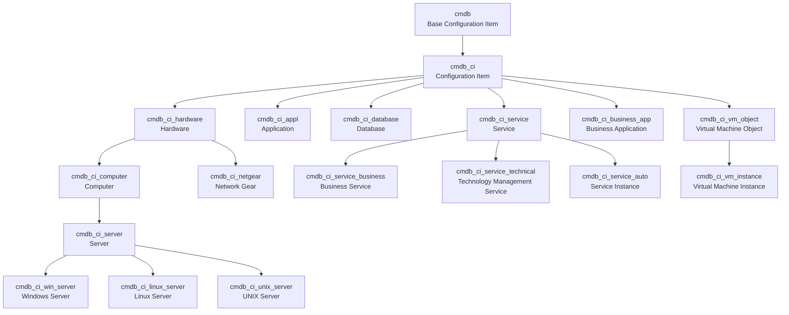
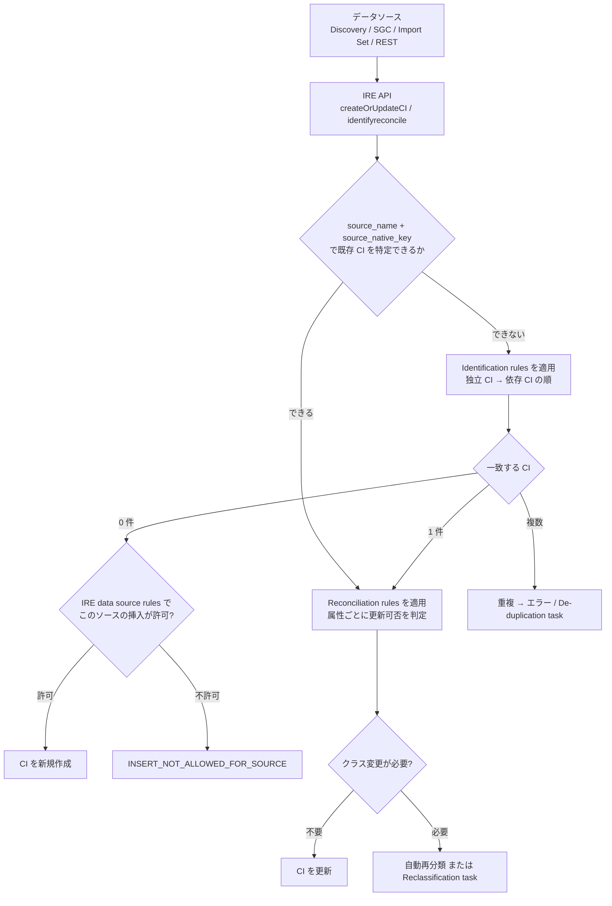
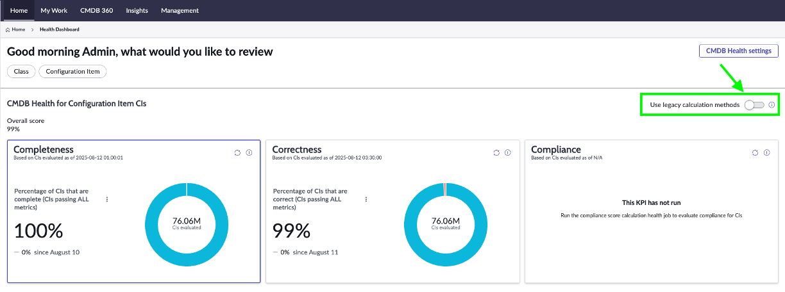
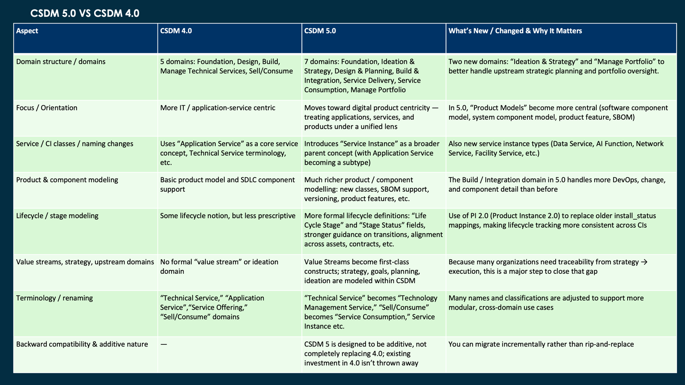
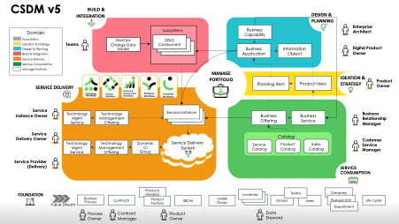
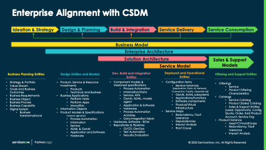
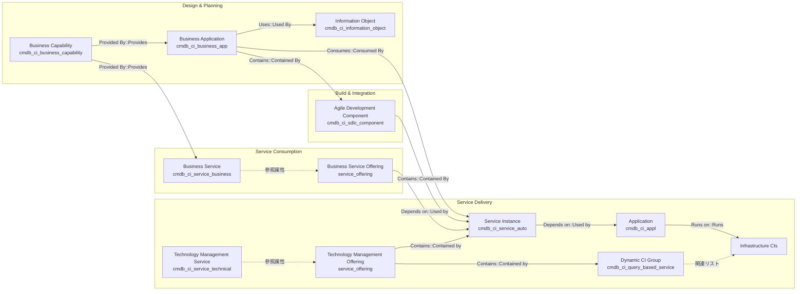
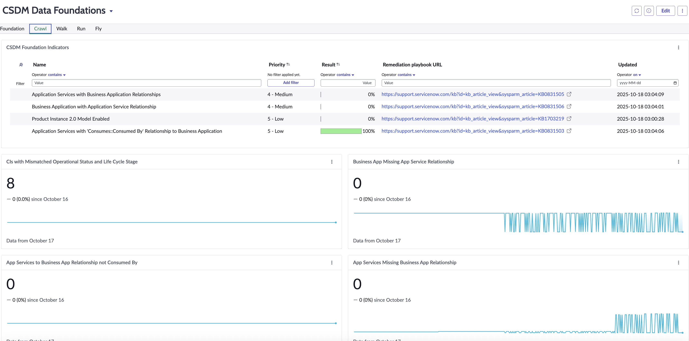

# CMDB と CSDM（構成管理データベースと共通サービスデータモデル）

## 概要

**CMDB（Configuration Management Database、構成管理データベース）** は、ServiceNow AI Platform（旧 Now Platform）上で IT 環境やサービスを構成する要素を **Configuration Item（CI、構成アイテム）** として格納し、CI 同士の **Relationship（リレーションシップ、関係）** とあわせて管理するデータベースである。CMDB は ITSM（インシデント・変更の影響分析）、ITOM（Discovery、Service Mapping、Event Management）、ITAM、SecOps、SPM など、ほぼすべてのワークフロー製品の共通基盤になっている。CMDB は ServiceNow AI Platform の機能で、既定で有効になっている。[出典](https://www.servicenow.com/docs/r/australia/servicenow-platform/configuration-management-database-cmdb/cnfig-mgmt-and-cmdb.html) [出典](https://www.servicenow.com/docs/r/australia/release-notes/cmdb-rn.html)

**CSDM（Common Service Data Model、共通サービスデータモデル）** は、CMDB とその周辺テーブルに「どのデータを、どのテーブルに、どの関係で入れるか」を定めた ServiceNow 公式の標準データモデルである。CSDM に沿ってデータを入れておくと、ServiceNow の各製品が期待する場所にデータが入るため、製品をまたいだ機能（影響分析、サービス単位のレポート、ポートフォリオ管理など）がそのまま使える。[出典](https://www.servicenow.com/docs/r/zS6yb8e~gR8BPjeviYdV9g/Shp0Y4r01qFUitqiI6Cguw)

このファイルでは次の内容を扱う。

| 区分 | 主なトピック |
|---|---|
| CMDB のデータ構造 | `cmdb_ci` 階層、主要 CI クラス、関連テーブル、CI Relationship（`cmdb_rel_ci`）、依存関係ルール（Hosting/Containment rules） |
| データ投入と品質 | Identification and Reconciliation Engine（IRE、識別・調整エンジン）、Static/Dynamic IRE、Reconciliation rules、CMDB 360 |
| 運用・ガバナンス | CMDB Health、CMDB Workspace（Service Graph Workspace を含む）、CMDB Data Manager、CI Class Manager |
| CSDM | CSDM 5 の 7 ドメイン、ドメインごとのテーブル構成、ライフサイクル値、成熟度ステージ（Foundation/Crawl/Walk/Run/Fly）、CSDM Data Foundations ダッシュボード |

> **基準リリース:** 本ファイルは Australia（2026-05 GA）を基準とする。ServiceNow ドキュメントのうち Australia 版が取得できなかった項目は Zurich 版で補い、その旨を出典に明記している。Brazil（2026-09 時点で Early Availability）で判明している変更は「Brazil での変更」として併記する。

関連ファイル：

- 用語の入門：[必須の基本概念](../../01_入門編/04-core-concepts.md)
- テーブル継承・Dictionary の仕組み：[データモデルとSystem Dictionary](./data-model-dictionary.md)
- CI を自動で作るしくみ：[Discovery](../itom/discovery.md)、[Service Mapping](../itom/service-mapping.md)、[Service Graph Connectors](../itom/service-graph-connectors.md)
- 資産側の管理：[Hardware Asset Management](../itam/hardware-asset-management.md)、[Software Asset Management](../itam/software-asset-management.md)
- 実務上の成功要因：[CMDB成功の要因](../../04_応用編/05-cmdb-success-factors.md)

---

## 1. CMDB の基本構造

### 1.1 CI と CMDB の定義

CMDB は、ServiceNow のサービスを支える論理的な構成を作成・維持し、それをネットワークおよびアプリケーション基盤の物理的なレイアウトに対応付ける。CI（Configuration Item）は物理的なもの（サーバー、ルーター）、論理的なもの（アプリケーションのインスタンス、サービスインスタンス）、概念的なもの（Business Application、Business Capability）のいずれでもよい。CI 間の関係によって、「ルーターが故障したら何に影響するか」「このサーバーをアップグレードしたら何が止まるか」といった影響分析が可能になる。[出典](https://www.servicenow.com/docs/r/australia/servicenow-platform/configuration-management-database-cmdb/cnfig-mgmt-and-cmdb.html)

### 1.2 `cmdb_ci` 階層（CMDB hierarchy）

CMDB の CI はすべて **Configuration Item [`cmdb_ci`]** テーブルを基底とするテーブル継承階層に格納される。共通の属性を持つ CI は同じクラス（テーブル）にまとめられ、子クラスは親クラスの属性を継承する。この継承構造を **CMDB hierarchy（CMDB 階層）** と呼ぶ。独自クラスは既存クラスを拡張（extend）して作成でき、ドキュメントでは「Laptop クラスが Computer クラスを拡張し、Computer クラスが基底の CI クラスを拡張する」という例が示されている。[出典](https://www.servicenow.com/docs/r/australia/servicenow-platform/configuration-management-database-cmdb/cnfig-mgmt-and-cmdb.html)

- CMDB のスキーマモデルには 2 つのコアクラスがある。**Base Configuration Item [`cmdb`]** は非 IT CI のコアクラスで、その子孫クラスは非 IT CI になる。`cmdb` は **table per partition** の拡張モデルを使うため、レプリケーションや情報の導出の挙動が通常の拡張テーブルと異なる。**Configuration Item [`cmdb_ci`]** は IT CI のコアクラスで、すべての CI の基本属性を保持し、その子孫クラスが IT CI になる。[出典](https://www.servicenow.com/docs/r/australia/servicenow-platform/configuration-management-database-cmdb/c_ConfigurationManagementDatabase.html)
- `cmdb_ci` から拡張されていない CI は、Dependency Views のマップや CI Relations フォーマッターに表示されない。[出典](https://www.servicenow.com/docs/r/australia/servicenow-platform/configuration-management-database-cmdb/c_ConfigurationManagementDatabase.html)
- `cmdb_ci` テーブルへのアクセスには `sn_cmdb_admin`、`sn_cmdb_editor`、`asset`、`admin`、`itil` のいずれかのロールが必要。スキーマは System Definition > Tables & Columns でテーブルを選び、Schema Map で確認できる。[出典](https://www.servicenow.com/docs/r/australia/servicenow-platform/configuration-management-database-cmdb/c_ConfigurationManagementDatabase.html)
- CI の一覧はフィルターナビゲーターに `cmdb_ci_list.do` と入力すると表示できる。[出典](https://www.servicenow.com/docs/r/australia/servicenow-platform/configuration-management-database-cmdb/cnfig-mgmt-and-cmdb.html)
- テーブル継承（Table per hierarchy / Table per class など）の物理的な格納方式は [データモデルとSystem Dictionary](./data-model-dictionary.md) を参照。

主要部分の継承関係を Mermaid 図で示す（クラスは代表例のみ）。



> 公式ドキュメントで親子関係を確認できたのは、`cmdb_ci` → `cmdb_ci_database`、`cmdb_ci` → `cmdb_ci_computer` → `cmdb_ci_server` → `cmdb_ci_unix_server`（CMDB schema model）、`cmdb_ci_service` → `cmdb_ci_service_auto` / `cmdb_ci_service_business` / `cmdb_ci_service_technical`（CSDM ドキュメントと CSDM 5 ホワイトペーパー）、`cmdb_ci_hardware` → `cmdb_ci_computer`（Computer は "An extension of the Hardware table"）、`cmdb_ci_vm_object` → `cmdb_ci_vm_instance`（`cmdb_ci_vm_object` は "Base class for all VM objects"）（CMDB tables descriptions）である。図中の `cmdb` → `cmdb_ci`、`cmdb_ci` → `cmdb_ci_vm_object`、`cmdb_ci_server` → `cmdb_ci_win_server` / `cmdb_ci_linux_server` などは【経験則】。正確な親子関係は各インスタンスの CI Class Manager で確認すること。[出典](https://www.servicenow.com/docs/r/australia/servicenow-platform/configuration-management-database-cmdb/c_ConfigurationManagementDatabase.html) [出典](https://www.servicenow.com/docs/r/australia/servicenow-platform/common-service-data-model-csdm/sell-consume-domain.html) [出典](https://www.servicenow.com/docs/r/q4dSP2Icgr1SFv5wanVXvQ/1GLrH0vZKHQqi0lHfIjuTw)

### 1.3 主要 CI クラス

`cmdb` 系テーブルは Australia の「CMDB tables descriptions」ページに約 450 テーブルが掲載されている。代表的なクラスを以下にまとめる。[出典](https://www.servicenow.com/docs/r/q4dSP2Icgr1SFv5wanVXvQ/1GLrH0vZKHQqi0lHfIjuTw)

| 区分 | テーブル名 | ラベル | 説明 |
|---|---|---|---|
| 基底 | `cmdb_ci` | Configuration Item | すべての CI の基底テーブル |
| ハードウェア | `cmdb_ci_hardware` | Hardware | ハードウェアの基底クラス。Dynamic IRE の対象範囲でもある |
| ハードウェア | `cmdb_ci_computer` | Computer | Hardware を拡張し、コンピューター固有の属性を持つ |
| ハードウェア | `cmdb_ci_server` | Server | すべてのサーバー種別の基底クラス。`Used for`（用途：開発/テスト/本番など）属性を持つ |
| ハードウェア | `cmdb_ci_netgear` | Network Gear | Hardware を拡張したネットワーク機器（ルーター、スイッチ、ハブ等） |
| ハードウェア | `cmdb_ci_network_adapter` | Network Adapter | ネットワークアダプター。Hardware の識別ルールで参照される |
| ネットワーク | `cmdb_ci_ip_address` | IP Address | IP アドレス |
| 仮想化 | `cmdb_ci_vm_instance` | Virtual Machine Instance | 汎用的な仮想マシン情報 |
| 仮想化 | `cmdb_ci_vm_object` | Virtual Machine Object | VM オブジェクトの基底クラス |
| 仮想化 | `cmdb_ci_vm` | Virtual Machine HyperVisor | ハイパーバイザーソフトウェア |
| ソフトウェア | `cmdb_ci_appl` | Application | ホスト上で動作する（Discovery で検出可能な）アプリケーションのインスタンス。1 ホストに限定され、アプリケーションの台帳ではない |
| ソフトウェア | `cmdb_ci_app_server` | Application Server | 物理/仮想サーバーの主機能を示す論理 CI の基底 |
| データベース | `cmdb_ci_database` | Database | データとその格納ファイル・メタデータの集合 |
| クラウド | `cmdb_ci_cloud_database` | Cloud Database | クラウド上のデータベース |
| サービス | `cmdb_ci_service` | Service | ITIL のサービス。ビジネスプロセスを直接支える IT サービス |
| サービス | `cmdb_ci_service_business` | Business Service | ビジネスユーザーに公開されるサービス |
| サービス | `cmdb_ci_service_technical` | Technology Management Service | サービスオーナーに公開される技術サービス（旧称 Technical service） |
| サービス | `cmdb_ci_service_auto` | Service Instance | デプロイされたアプリケーションスタック等の論理表現（CSDM 5 より前の名称は Application Service） |
| アプリ台帳 | `cmdb_ci_business_app` | Business Application | 業務アプリケーションの台帳（運用 CI ではない） |

出典：[CMDB tables descriptions（Australia）](https://www.servicenow.com/docs/r/q4dSP2Icgr1SFv5wanVXvQ/1GLrH0vZKHQqi0lHfIjuTw)、[Service Delivery domain（Zurich）](https://www.servicenow.com/docs/r/zS6yb8e~gR8BPjeviYdV9g/t6w6O0jNKpKNIBSyO0AISg)

拡張カテゴリのクラス群はプラグインで追加される。Australia のドキュメントでは CMDB Mainframe（`com.snc.cmdb.mainframe`）、CMDB Radio Category（`com.snc.cmdb.radio.category`）、CMDB Telecom Category（`com.snc.cmdb.telecom.category`）、CMDB Test Equipment（`com.snc.cmdb.test.equipment`）が挙げられている。[出典](https://www.servicenow.com/docs/r/australia/servicenow-platform/configuration-management-database-cmdb/cnfig-mgmt-and-cmdb.html)

### 1.4 関連テーブル（Related tables）

CMDB 階層に属さない（`cmdb_ci` を継承しない）が、`cmdb_ci` を参照する列を 1 つ以上持つテーブルを **Related table（関連テーブル）** と呼ぶ。代表例は Serial Number [`cmdb_serial_number`] で、1 台のサーバーに複数のシリアル番号を持たせる多対一の構造になっている。関連テーブルは Related Entry [`cmdb_related_entry`] に登録される。参照先の CI を削除すると関連テーブルに孤立レコードが残ることがあり、CMDB Data Manager の **Delete CMDB Related Entry** ポリシーで掃除できる。[出典](https://www.servicenow.com/docs/r/australia/servicenow-platform/configuration-management-database-cmdb/cnfig-mgmt-and-cmdb.html)

### 1.5 CMDB 関連のロール

| ロール | 用途 |
|---|---|
| `cmdb_read` | CMDB テーブルを直接読み取るのに必要 |
| `sn_cmdb_user` | CMDB Workspace の CMDB User ペルソナ。CI Health カード等の参照に最低限必要 |
| `sn_cmdb_editor` | CMDB Editor。CMDB レコードの参照・更新。Australia で、従来 `itil` が必要だったテーブルへのアクセスが付与された |
| `sn_cmdb_admin` | CMDB Admin。従来 `admin` / `itil_admin` が必要だったテーブルへのアクセスが付与された。CMDB Workspace の CI レコードページで Save と More Actions > Delete を使えるのは CMDB Admin のみ |
| `itil` / `itil_admin` / `asset` | いずれかで Configuration モジュールにアクセス可能 |
| `app_service_admin` / `app_service_user` | Service Instance（Application Service）の管理・参照 |
| `sn_incident_read` / `sn_change_read` | CMDB Workspace で関連インシデント・変更を表示するのに必要 |
| `evt_mgmt_user` | CMDB Workspace で関連アラートを表示（Event Management が必要） |

出典：[Overview of CMDB](https://www.servicenow.com/docs/r/australia/servicenow-platform/configuration-management-database-cmdb/cnfig-mgmt-and-cmdb.html)、[Exploring CMDB Workspace](https://www.servicenow.com/docs/r/australia/servicenow-platform/configuration-management-database-cmdb/exploring-cmdb-workspace.html)、[CMDB release notes（Australia）](https://www.servicenow.com/docs/r/australia/release-notes/cmdb-rn.html)

Australia へ Xanadu または Yokohama から直接アップグレードする場合は、スケジュールジョブ「Remove CMDB Roles from ITIL roles and Add CUD access to sn_cmdb_admin/sn_cmdb_editor roles」を実行して CMDB Admin / CMDB Editor ロールを構成する必要がある。また Australia へのアップグレードは `cmdb_ci` テーブルの変更により時間が長くかかる場合がある（KB2588894）。[出典](https://www.servicenow.com/docs/r/australia/release-notes/cmdb-rn.html)

> **Brazil での変更:** 新しい `app_service_owner` ロールが追加され、`itil` ロールなしで Service Instance レコードの作成・参照・更新・削除ができる（`app_service_user` を内包）。`app_service_admin` から `itil` ロールが外され、`sn_cmdb_editor` と `app_service_user` に置き換えられた（関連インシデントや変更の参照には引き続き `itil` が必要）。これらは新プラグイン CMDB app roles（`com.snc.cmdb.app.roles`）で提供される。[出典](https://www.servicenow.com/docs/r/release-notes/cmdb-rn.html)

### 1.6 CMDB の主要ツール一覧

| ツール | 概要 | 主なメニュー/場所 |
|---|---|---|
| CI Class Manager（CI クラスマネージャー） | クラス階層の参照・作成、属性、識別ルール、依存関係ルール、推奨関係、CMDB Health（Recommended fields・Orphan/Stale ルール）、Managed By Group の一括設定 | All > Configuration > CI Class Manager |
| CMDB Workspace | CMDB の検索・探索、CI Health、ダッシュボード、CMDB Health/Data Manager/CMDB 360 の統合 UI | Workspaces > CMDB Workspace |
| CMDB Query Builder | クラスと関係をまたいだ CI クエリの作成。Australia で V2 エンジンに更新 | CMDB Workspace 等 |
| Unified Map | 依存関係ビューと Service Mapping のマップ体験を統合した地図表示。関係の編集機能もここに集約 | CMDB Workspace |
| CMDB 360 | CI の属性を「どのソースが何を報告したか」単位で保持・比較 | CMDB Workspace / Service Graph Workspace |
| CMDB Health Dashboard | 完全性・正確性・コンプライアンス・関係の健全性スコア | CMDB Workspace > Home > Quick links |
| CMDB Data Manager | Retire/Archive/Delete/Attestation/Certification 等のポリシー | CMDB Workspace |

出典：[Overview of CMDB](https://www.servicenow.com/docs/r/australia/servicenow-platform/configuration-management-database-cmdb/cnfig-mgmt-and-cmdb.html)、[CI relationships in the CMDB](https://www.servicenow.com/docs/r/australia/servicenow-platform/configuration-management-database-cmdb/c_CIRelationships.html)、[Overview of CMDB Health](https://www.servicenow.com/docs/r/australia/servicenow-platform/configuration-management-database-cmdb/overview-cmdb-health.html)、[CMDB release notes（Australia）](https://www.servicenow.com/docs/r/australia/release-notes/cmdb-rn.html)

---

## 2. CI Relationship（CI 間の関係）

### 2.1 格納テーブルと関係タイプの表記

CI 間の関係は **CI Relationship [`cmdb_rel_ci`]** テーブルに格納される。`cmdb_rel_ci` の 1 レコードは 2 つの CI の双方向の関係を表し、Parent（親）、Child（子）、Type（関係タイプ）を持つ。関係タイプは **CI Relationship Type [`cmdb_rel_type`]** テーブルで定義され、「親から見た記述::子から見た記述」をダブルコロンで区切った形で表記する（例：`Depends on::Used by`）。たとえば「Bond Trading depends on lnux100」は、子側から読むと「lnux100 is used by Bond Trading」となる。[出典](https://www.servicenow.com/docs/r/api-reference/server-api-reference/c_CMDBUtilAPI.html)

スクリプトから関係を作成・削除する場合は `SNC.CMDBUtil` API を使う。関係タイプが `cmdb_rel_type` に存在しない場合は API が挿入する。[出典](https://www.servicenow.com/docs/r/api-reference/server-api-reference/c_CMDBUtilAPI.html)

### 2.2 定義済みの関係タイプ

Australia の「CI relationships in the CMDB」ページに掲載されている定義済み関係タイプは次のとおり。[出典](https://www.servicenow.com/docs/r/australia/servicenow-platform/configuration-management-database-cmdb/c_CIRelationships.html)

| 親側の記述 | 子側の記述 | 意味と例 |
|---|---|---|
| Applicative Flow To | Applicative Flow From | エンドポイント CI 間の接続。内部利用（サービスモデル） |
| Connects to | Connected by | 通信する要素同士のネットワーク接続（ワークステーション→スイッチ、Kubernetes ワークロード→サービス） |
| Contains | Contained by | 包含関係。子は通常 1 つの親を持つ（Tomcat → Tomcat WAR） |
| Defines resources for | Gets resources from | 親が子のリソースを定義、または子から取得（VMware リソースプールと ESX サーバー） |
| Depends on | Used by | 親が子に依存。子の障害や変更が親に影響しうる |
| Hosted on | Hosts | ある要素が別の要素にホストされる（クラウドリソース → 論理データセンター） |
| Implement End Point To | Implement End Point From | エンドポイントから公開元 CI へ。内部利用（サービスモデル） |
| Manages | Managed by | 管理関係（vCenter → vCenter Datacenter） |
| Members | Member of | クラスタのメンバー（vCenter クラスタ内の ESXi サーバー） |
| Owns | Owned by | 通常は包含。子は通常 1 つの所有者を持つ |
| Runs on | Runs | ソフトウェアがホストのハードウェア/VM 上で稼働 |
| Use End Point To | Use End Point From | CI からの発信エンドポイント。内部利用（サービスモデル） |

CSDM で使う関係タイプ（`Provided By::Provides`、`Consumes::Consumed By`、`Uses::Used By`、`Contains::Contained By`、`Depends on::Used by`、`Sends Data To` など）は [6 章](#6-csdm-ドメインごとのテーブル構成) の各ドメインの表を参照。

### 2.3 依存関係ルール（Hosting rules / Containment rules）

**CMDB dependent relationship rules（依存関係ルール）** は、CI の識別に使われる親子関係の構造を定義する。Dependent CI（依存 CI、例：Network Adapter、Application）は Independent CI（独立 CI、例：Server）に依存して存在するため、IRE はまず親 CI を識別してから依存 CI を識別する。[出典](https://www.servicenow.com/docs/r/zS6yb8e~gR8BPjeviYdV9g/CnCrauduGabs2lghZXlC6g) [出典](https://www.servicenow.com/docs/r/zS6yb8e~gR8BPjeviYdV9g/mSofZSSfuuQiOMMcHdmR2w)

| 種類 | 格納テーブル | 内容と制約 |
|---|---|---|
| Containment rules（包含ルール） | CMDB Metadata Containment Rules [`cmdb_metadata_containment`] | CI タイプ間の親子構造（例：Tomcat が WAR ファイルを包含）。ルールを連鎖させて階層マップを作れる。データフローを示すエンドポイントを含められるが、エンドポイントには子ルールを持たせられない |
| Hosting rules（ホスティングルール） | CMDB Metadata Hosting Rules [`cmdb_metadata_hosting`] | CI がどこで稼働するか。フラットで 1 階層まで。識別時、対象の CI ペアは少なくとも 1 つのホスティングルールを満たす必要がある。循環依存は不可 |

追加の制約として、包含のルート親になっている CI タイプは他の CI にホストされることができず、ホスティングの子は包含ルールに登場できない。利用可能な既定のルールは有効化されているプラグインによって決まる。依存 CI が満たすべき関係がペイロードにない場合、IRE は `MISSING_DEPENDENCY` エラーを返す。[出典](https://www.servicenow.com/docs/r/zS6yb8e~gR8BPjeviYdV9g/CnCrauduGabs2lghZXlC6g) [出典](https://www.servicenow.com/docs/r/zS6yb8e~gR8BPjeviYdV9g/Q5J8vrX3tTDtGnnBzK3D5g)

- **Dependent relationship（依存関係）** は CI の識別に使われるため、直接削除すべきではない。**Non-dependent relationship（非依存関係）** は識別に使われず、不要になれば削除できる。[出典](https://www.servicenow.com/docs/r/australia/servicenow-platform/configuration-management-database-cmdb/c_CIRelationships.html)
- 依存 CI は依存関係を持つ親を 1 つしか持てない。[出典](https://www.servicenow.com/docs/r/zS6yb8e~gR8BPjeviYdV9g/mSofZSSfuuQiOMMcHdmR2w)

### 2.4 Suggested Relationships（推奨関係）と Relationship governance rules

**Suggested Relationship [`cmdb_rel_type_suggest`]** は、CI クラスごとに推奨される関係タイプを保持する。新しい関係を作るときに推奨候補として表示される。メニューは **Configuration > Suggested Relationships**、または CI Class Manager でクラスを選んで設定する。[出典](https://www.servicenow.com/docs/r/australia/servicenow-platform/configuration-management-database-cmdb/c_CIRelationships.html)

**Relationship governance rules（関係ガバナンスルール）** は、依存関係ルール（Hosting/Containment）と推奨関係の総称で、CI タイプの組み合わせごとに有効な関係タイプと方向を定める。ルールは継承され、たとえば Application → Hardware に `Runs on::Runs` が推奨されていれば、.NET Application → Windows Server の `Runs on::Runs` も有効とみなされる。Relationship Health ダッシュボードは、ガバナンスルールに準拠しない関係をレポートする。[出典](https://www.servicenow.com/docs/r/4AA65edJ2a~o5pASflQppQ/FSUHXuhq7ci2j8Kgxh2xNw)

### 2.5 関係に付随するテーブルとプロパティ

| 名前 | 種別 | 説明 |
|---|---|---|
| Relation qualifier [`cmdb_ci_qualifier`] | テーブル | CI 関係に関する補足情報（修飾子チェーン）を保持 |
| Relationship Sources [`sys_rel_source`] | テーブル | 非依存関係の検出元（discovery source）と最終スキャン時刻を記録。`cmdb_rel_ci` から非依存関係を削除すると、対応する `sys_rel_source` も削除される |
| `glide.identification_engine.populate_sys_rel_source` | システムプロパティ | `sys_rel_source` の自動記録の有無。既定は無効 |

出典：[CI relationships in the CMDB（Australia）](https://www.servicenow.com/docs/r/australia/servicenow-platform/configuration-management-database-cmdb/c_CIRelationships.html)

### 2.6 関係の参照・編集 UI

- **CI Relations formatter / Relationship editor（関係エディター）**：CI フォームの CI Relations フォーマッターから開き、関係の参照・作成・変更・削除を行う。最新の編集機能は CMDB Workspace の **Unified Map** に提供されている。[出典](https://www.servicenow.com/docs/r/australia/servicenow-platform/configuration-management-database-cmdb/c_CIRelationships.html)
- **Unified Map（統合マップ）**：Dependency Views（依存関係ビュー）の一部機能と Service Mapping のマップを 1 つのマップ体験に統合したもの。[出典](https://www.servicenow.com/docs/r/australia/servicenow-platform/configuration-management-database-cmdb/c_CIRelationships.html)

> **Brazil での変更:** CMDB Baseline は将来の廃止に向けた準備段階に入り、新規インスタンスでは非表示・未有効化となる（サポートは継続）。Dependency Views と CMDB Relationship editor についても Unified Map が推奨代替とされている。Safari 上の Unified Map ではパフォーマンス問題回避のためエッジのアニメーションが既定で無効化された。[出典](https://www.servicenow.com/docs/r/release-notes/cmdb-rn.html)

---

## 3. Identification and Reconciliation Engine（IRE、識別・調整エンジン）

### 3.1 IRE の役割

**IRE（Identification and Reconciliation Engine）** は、受信したデータを CMDB に書き込む前に、**Identification rules（識別ルール）**、**Reconciliation rules（調整ルール）**、**IRE data source rules（IRE データソースルール）** に照らして処理するルールベースのエンジンである。IRE は次の 3 つの整合性機能を持つ。[出典](https://www.servicenow.com/docs/r/australia/servicenow-platform/configuration-management-database-cmdb/exploring-ire.html) [出典](https://www.servicenow.com/docs/r/q4dSP2Icgr1SFv5wanVXvQ/Tp6i8sdHn0E7ZgtQKtrhtw)

1. **Identification（識別）**：受信した CI が既存 CI と一致するか、新規かを判定し、重複 CI の作成を防ぐ。
2. **Reconciliation（調整）**：権限のある（authoritative）データソースだけが CI や属性を書き換えられるよう制御する。調整は既存 CI が見つかった「更新」にのみ適用され、「挿入」には適用されない。
3. **Reclassification（再分類）**：一致した CI のクラスを変更する（アップグレード/ダウングレード/スイッチ）。

IRE を経由する主なデータソースは、Event Management、Horizontal Discovery、Pattern Discovery、Service Mapping、Import Sets、Cloud Insights、Manual Entry、Service Graph Connectors（IntegrationHub ETL）である。サードパーティのデータソースは REST API または Scriptable API で IRE を呼び出す。IRE は一部の非 CMDB テーブルもサポートし、それらにも識別・調整ルールを定義できる。[出典](https://www.servicenow.com/docs/r/australia/servicenow-platform/configuration-management-database-cmdb/exploring-ire.html) [出典](https://www.servicenow.com/docs/r/zS6yb8e~gR8BPjeviYdV9g/Q5J8vrX3tTDtGnnBzK3D5g)

IRE の処理特性として、CMDB はレコード処理と同時にリアルタイムで更新され、コミット前に変更を検証するステージング領域は存在しない。データソースは CMDB に直接書き込まず、API を呼び出す。[出典](https://www.servicenow.com/docs/r/q4dSP2Icgr1SFv5wanVXvQ/Tp6i8sdHn0E7ZgtQKtrhtw)

### 3.2 IRE の処理フロー



フローの根拠：IRE は `source_name` と `source_native_key` が利用可能ならそれで CI を一意に特定し、なければ（より低速な）識別ルールにフォールバックする。依存 CI は親 CI を先に識別し、その親のコンテキストで識別する。IRE data source rules は特定のデータソースによる特定クラスの CI の新規挿入を禁止しつつ、既存 CI の更新は許可できる。[出典](https://www.servicenow.com/docs/r/zS6yb8e~gR8BPjeviYdV9g/Q5J8vrX3tTDtGnnBzK3D5g) [出典](https://www.servicenow.com/docs/r/q4dSP2Icgr1SFv5wanVXvQ/Tp6i8sdHn0E7ZgtQKtrhtw)

### 3.3 Identification rules（識別ルール）

識別ルールは CI を定義済みの基準で一意に識別する。1 つの識別ルールは 1 つの CI クラスに適用され、1 つの **CI Identifier（CI 識別子）**、1 つ以上の **Identifier entries（識別子エントリー）**、および **Related entries（関連エントリー）** で構成される。各エントリーは異なる Priority（優先度）を持ち、最も強い（一意性の高い）エントリーに最も高い優先度を付ける。[出典](https://www.servicenow.com/docs/r/zS6yb8e~gR8BPjeviYdV9g/mSofZSSfuuQiOMMcHdmR2w)

| 構成要素 | 格納テーブル | 説明 |
|---|---|---|
| CI Identifier | `cmdb_identifier` | クラスごとの識別ルール本体 |
| Identifier entry | `cmdb_identifier_entry` | 識別に使う属性（Criterion Attributes）の組み合わせと優先度 |
| Related entry | `cmdb_related_entry` | CI を参照する関連テーブル（CMDB/非 CMDB）のレコードを作成・更新するためのルール。CI の識別そのものには使わない |

> `cmdb_identifier` / `cmdb_identifier_entry` のテーブル名は Australia の識別ルールのページには明記されておらず、Discovery 系ドキュメントやコミュニティ記事に基づく。【第三者情報】 [出典](https://www.servicenow.com/docs/r/LZHoJyH9VPKmhdIph_6gSw/6JdYTd~nd5i_q8ILUog2TA)

**識別子エントリーの種類：**

| 種類 | 説明 |
|---|---|
| Regular（通常） | CI 自身の属性で識別する |
| Lookup（ルックアップ） | CI を参照する関連テーブル（例：Serial Number、Network Adapter）で識別する。ルックアップテーブルは `cmdb_ci` またはその子孫を参照する必要がある。ルックアップレコードが存在しなければ挿入される。**Enforce exact count match (Lookup)** をオンにすると、レコード数が一致する場合のみ一致とみなすため識別が強くなる |
| Hybrid（ハイブリッド） | 通常とルックアップを組み合わせる。例：同一シリアル番号を持つ 2 台のクラウド VM を区別するため、シリアル番号の基準に Hardware テーブルの Name を加える |

**独立 CI と依存 CI：** 独立 CI（例：Server）は自身の属性だけで識別する。依存 CI（例：Network Adapter、Application）は親 CI に依存し、依存関係ルール（Hosting/Containment）で定義された関係を含めて識別する。依存関係は CI Class Manager の各クラスの Dependent relationship rules で定義する。[出典](https://www.servicenow.com/docs/r/zS6yb8e~gR8BPjeviYdV9g/mSofZSSfuuQiOMMcHdmR2w)

**継承：** 子クラスに識別ルールがない場合は親クラスのルール（識別子エントリー・関連エントリーを含む）を継承する。子クラスにルールを定義すると継承ルールは置き換えられるため、親の関連エントリーが必要なら子クラスのルールに再度追加する。例：Hardware の識別ルールには Software Instance の関連エントリーがあり Computer はそれを継承するが、Computer に独自ルールを作ると再追加しない限り失われる。[出典](https://www.servicenow.com/docs/r/zS6yb8e~gR8BPjeviYdV9g/mSofZSSfuuQiOMMcHdmR2w)

**Hardware の既定識別ルール：** Hardware [`cmdb_ci_hardware`] の定義済み識別ルールは、シリアル番号（CI 自身の `serial_number` と Serial Number [`cmdb_serial_number`] テーブルの `serial_number` + `serial_number_type` のルックアップ）を最優先し、次に CI の Name（ホスト名）、その次に Network Adapter [`cmdb_ci_network_adapter`] の `ip_address` + `mac_address` を使う。各エントリーの具体的な優先度の数値は公開情報では確認できず（インスタンスの識別ルールで確認する）。[出典](https://www.servicenow.com/docs/r/Ir~NPf1dr8MGFXQE6QlBoQ/KCHAuAA22nuljpoj8OIrTw) [出典](https://www.servicenow.com/docs/r/LZHoJyH9VPKmhdIph_6gSw/6JdYTd~nd5i_q8ILUog2TA)

**ルックアップ利用時の注意：** 同じ対象に対して矛盾するルールを作らない。たとえば Hardware に Network Adapter のルックアップルールを置きつつ Network Adapter 自体にも識別子を定義すると重複が発生しうる。[出典](https://www.servicenow.com/docs/r/zS6yb8e~gR8BPjeviYdV9g/mSofZSSfuuQiOMMcHdmR2w)

**Identification inclusion rules（識別包含ルール）：** 識別の対象とする既存 CI の範囲を絞り込み、精度とパフォーマンスを高める。[出典](https://www.servicenow.com/docs/r/zS6yb8e~gR8BPjeviYdV9g/mSofZSSfuuQiOMMcHdmR2w)

**メニュー：** 識別ルールは CI Class Manager でクラスを選び、Identification Rule から参照・作成する。[出典](https://www.servicenow.com/docs/r/australia/servicenow-platform/configuration-management-database-cmdb/cnfig-mgmt-and-cmdb.html)

### 3.4 Static IRE と Dynamic IRE

| 項目 | Static IRE（静的 IRE） | Dynamic IRE（動的 IRE） |
|---|---|---|
| 概要 | 従来型。管理者が識別ルールを手動で作成・保守する | データペイロード取り込み時に識別ルールを自動更新し、識別プロセスを動的に改善する。ルールの手動作成・保守を不要にする |
| 導入 | — | Australia で導入（Zurich Patch 11 にバックポートされたとのコミュニティ情報あり【第三者情報】） |
| 対象 | 全クラス | Hardware [`cmdb_ci_hardware`] とその子孫クラスのみ。特定の子孫クラスを除外でき、除外クラスは Static IRE を使う |
| 動作モード | — | Simulation（シミュレーション）で比較評価 → Committed（確定）モードで Dynamic IRE のみが動作し Static IRE は停止。シミュレーションの比較結果は CMDB IRE Output Comparison Items [`cmdb_ire_output_comparison_item`] テーブルに格納される。有効/無効はシステムプロパティ `glide.identification_engine.dynamic_ire_enabled` で制御する |
| 推奨手順 | — | 非本番インスタンスでシミュレーションモードから試す。シミュレーションは Hardware の Identification Rule > Simulate Dynamic IRE から実行（`sn_cmdb_user` ロールが必要） |
| Static IRE への戻し方 | — | 確定後も戻せる。CI Class Manager > Hierarchy > Hardware > Identification Rule を開き、Dynamic IRE セクションの **Change to IRE** ボタンを選択する |
| 調整との関係 | — | Dynamic IRE を有効にしても Dynamic Reconciliation は有効にならない（識別のみに影響）【第三者情報】 |

出典：[Dynamic IRE（Australia）](https://www.servicenow.com/docs/r/q4dSP2Icgr1SFv5wanVXvQ/GugIpMta2oqoDRjUBhXKtA)、[Exploring IRE（Australia）](https://www.servicenow.com/docs/r/australia/servicenow-platform/configuration-management-database-cmdb/exploring-ire.html)、[CMDB release notes（Australia）](https://www.servicenow.com/docs/r/australia/release-notes/cmdb-rn.html)、[What is CMDB Dynamic IRE in Australia release（Community）](https://www.servicenow.com/community/in-other-news/what-is-cmdb-dynamic-ire-in-australia-release/ba-p/3555166)

> **Brazil での変更:** Dynamic IRE は新規構築（zBooted）インスタンスで既定で有効になる。Static IRE を使っているアップグレード済みインスタンスは Dynamic IRE に切り替えられる。[出典](https://www.servicenow.com/docs/r/release-notes/cmdb-rn.html)

### 3.5 Reconciliation rules（調整ルール）

**Reconciliation rules** は、複数のデータソースが同じ CI を更新する場合に、どのソースがどの属性を更新できるかを決める。調整ルールがない場合、各データソースは互いの更新を上書きできる（最後に書いたソースが勝つ）。[出典](https://www.servicenow.com/docs/r/australia/servicenow-platform/configuration-management-database-cmdb/r_ReconciliationRulesPrinciples.html)

| ルール種別 | 格納テーブル | 内容 |
|---|---|---|
| Static reconciliation rules（静的調整ルール） | Reconciliation Definition [`cmdb_reconciliation_definition`] | 従来型。データソース間の優先順位と、各ソースが更新できる属性を定義。Attributes を空にするとクラスの全属性を許可。親クラス/子クラスどちらにも定義でき、子クラスのルールが親を上書き |
| Dynamic reconciliation rules（動的調整ルール） | `cmdb_dynamic_reconciliation_definition` | CMDB 360 のデータから値を選ぶ（例：報告された最大値、最も多く報告された値）。**CMDB 360 の有効化が前提**。クラス属性ごとに 1 つのみ。同じ属性・クラスレベルでは静的ルールより優先 |
| Data refresh rules（データ更新ルール） | （公開情報ではテーブル名確認できず） | 特定のデータソースについて CI を「古い（stale）」とみなす期間を定義し、期間経過後は優先度の低い許可済みソースによる更新を可能にする。静的調整ルールと組み合わせて使う |

出典：[Reconciliation rules（Australia）](https://www.servicenow.com/docs/r/australia/servicenow-platform/configuration-management-database-cmdb/r_ReconciliationRulesPrinciples.html)

優先度の数値は小さいほど優先度が高い（例：Discovery=1、SCCM=2、Manual=3）。同じ優先度を複数ソースに付けると最終更新時刻等で決まり結果が予測しにくくなるため、避けるべき設計とされる。【第三者情報】 [出典](https://www.servicenow.com/community/cmdb-articles/cmdb-understanding-identification-and-reconciliation-rules-and/ta-p/3520826)

データソース名は Configuration Item [`cmdb_ci`] の `discovery_source` フィールドの選択肢値（例：`ServiceNow`、`ImportSet`、`EventManagement`、`ManualEntry` 等）を使う。IRE API の `sysparm_data_source` / `source` パラメーターにもこの選択肢値を指定する。属性ごとの最終更新ソースは Data Source History [`cmdb_datasource_last_update`] に記録される（調整ルール有効化後）。[出典](https://www.servicenow.com/docs/r/zZBaGIzc7EPkA0ySnMn5eg/9kszPvN3lBQhrk0AYuuHJg) [出典](https://www.servicenow.com/docs/r/australia/servicenow-platform/configuration-management-database-cmdb/r_ReconciliationRulesPrinciples.html)

> `ServiceNow`（Discovery の既定ソース名）は【経験則】。Australia の調整ルールのページで例示されているソース名は EventManagement、ImportSet、ManualEntry、Tivoli、Discovery、ServiceWatch である。

### 3.6 CMDB 360（Multisource CMDB）

**CMDB 360**（旧称 Multisource CMDB）は、CI 属性の更新について、どのデータソースがどの値を提案したかの履歴を保持する。ソースごとの更新の取り消し（revert）や、ルール変更後の値の再計算ができ、Dynamic reconciliation rules の前提になる。データは CMDB MultiSource Data [`cmdb_multisource_data`] テーブルに格納される。有効化には ITOM Discovery License プラグインと、プロパティ `glide.identification_engine.multisource_enabled` を `true` にすることが必要とされる（Xanadu 版ドキュメント）。既定では CMDB クラスのデータソースを追跡し、非 CMDB テーブルのデータは収集しない。CMDB Workspace / Service Graph Workspace の CMDB 360 クエリビルダーで Get Records、Find Gap、Compare Attribute Values のクエリを作れる。[出典](https://www.servicenow.com/docs/r/australia/servicenow-platform/configuration-management-database-cmdb/r_ReconciliationRulesPrinciples.html) [出典](https://www.servicenow.com/docs/r/xanadu/servicenow-platform/configuration-management-database-cmdb/multisource-cmdb-d66650e19265.html) [出典](https://www.servicenow.com/docs/r/zS6yb8e~gR8BPjeviYdV9g/J2YaCMDwak18XgOsD5LJWA)

> Australia では従来の **Multisource Report Builder** が削除された。マルチソースのレポートは CMDB Workspace または Service Graph Workspace の CMDB 360 を使う。[出典](https://www.servicenow.com/docs/r/australia/release-notes/cmdb-rn.html)

### 3.7 IRE の API

| API | 種別 | 説明 |
|---|---|---|
| `IdentificationEngine.createOrUpdateCI(source, input)` | Scriptable（サーバーサイド） | 識別・調整ルールに従って CI を作成または更新する。`input` は JSON 文字列 |
| `IdentificationEngine.identifyCI(input)` | Scriptable | 挿入/更新のどちらになるかを予測する（コミットしない） |
| `createOrUpdateCIEnhanced()` / `identifyCIEnhanced()` | Scriptable | Enhanced IRE。部分ペイロード、部分コミット、重複除去、サマリー出力に対応 |
| `CMDBTransformUtil` | Scriptable | Import Set（Transform Map）専用 |
| `POST /api/now/identifyreconcile` | REST | 識別・調整を適用して CI を挿入/更新。`itil` または `asset` ロールが必要。`sysparm_data_source` に `discovery_source` の選択肢値を指定。`items.className` 必須 |
| `POST /api/now/identifyreconcile/enhanced` | REST | Enhanced IRE オプションを指定する場合 |
| `POST /api/now/identifyreconcile/query` | REST | DB にコミットせずにペイロードの結果をシミュレーション |

スコープアプリからは `sn_cmdb.IdentificationEngine.<method>` の形で呼び出す。これには Configuration Management For Scoped Apps (CMDB) プラグイン（`com.snc.cmdb.scoped`、ベースシステムで有効）が必要。[出典](https://www.servicenow.com/docs/r/q4dSP2Icgr1SFv5wanVXvQ/Tp6i8sdHn0E7ZgtQKtrhtw) [出典](https://www.servicenow.com/docs/r/zZBaGIzc7EPkA0ySnMn5eg/9kszPvN3lBQhrk0AYuuHJg)

REST API の一般仕様は [Web Services / REST API](./web-services-api.md)、Import Set と Transform Map は [データインポート/エクスポート](./import-export-data.md) を参照。

**ペイロード構造（概要）：**

```json
{
  "items": [
    {
      "className": "cmdb_ci_linux_server",
      "values": { "name": "lnx-app-01", "serial_number": "ABC123" },
      "sys_object_source_info": {
        "source_name": "MyConnector",
        "source_native_key": "srv-0001",
        "source_recency_timestamp": "2026-11-01 10:00:00"
      }
    },
    {
      "className": "cmdb_ci_network_adapter",
      "values": { "name": "eth0", "mac_address": "00:11:22:33:44:55" }
    }
  ],
  "relations": [
    { "parent": 1, "child": 0, "type": "Contains::Contained by" }
  ],
  "settings": { "updateWithoutDowngrade": true }
}
```

- `items`：`className`、`values`、任意の `sys_object_source_info`（`source_name`、`source_native_key`、`source_feed`、`source_recency_timestamp`）。
- `relations`：`parent` / `child`（items のインデックスまたは `internal_id`）と `type`。
- `referenceItems`：任意の 2 アイテム間の参照を追加。
- `settings`：再分類フラグ `updateWithoutUpgrade` / `updateWithoutDowngrade` / `updateWithoutSwitch`。他の再分類設定より優先される。

出典：[Identification and Reconciliation engine (IRE)（Zurich）](https://www.servicenow.com/docs/r/zS6yb8e~gR8BPjeviYdV9g/Q5J8vrX3tTDtGnnBzK3D5g)

> 上記 JSON はフィールド構成を示すための例であり、値・関係の向きは説明用である（Network Adapter は Hardware に包含される依存 CI として扱われる。実際の関係タイプと向きはインスタンスの Containment rules に従う）。

### 3.8 Enhanced IRE（部分ペイロード等）

| オプション | 既定 | 説明 |
|---|---|---|
| `partial_payloads` | 有効 | 識別に必要な情報が揃わないアイテムを部分ペイロードとして保存し、後続ペイロードと結合して処理。有効にすると `partial_commits` と `deduplicate_payloads` も有効 |
| `partial_commits` | 有効 | 一部のアイテムにエラーがあっても他をコミット |
| `deduplicate_payloads` | 有効 | ペイロード内の重複アイテムを除去 |
| `generate_summary` | 無効 | クラスごとの更新件数などのサマリーを出力 |

関連テーブル：`cmdb_ire_partial_payloads`（部分ペイロードを JSON で保存。90 日より古いものは削除）、`cmdb_ire_partial_payloads_index`（部分アイテムの識別キー）、`cmdb_ire_incomplete_payloads`（不完全ペイロードをログ目的でのみ保存。再処理されない）。プロパティ `glide.identification_engine.partial_payload_items_max_size`（既定 1000）。[出典](https://www.servicenow.com/docs/r/zS6yb8e~gR8BPjeviYdV9g/Q5J8vrX3tTDtGnnBzK3D5g)

### 3.9 IRE のエラーとトラブルシューティング

| エラーコード | 意味 |
|---|---|
| `MISSING_MATCHING_ATTRIBUTES` | 識別ルールの基準属性がペイロードにない |
| `REQUIRED_ATTRIBUTE_EMPTY` | 必須属性が空 |
| `MISSING_DEPENDENCY` | 依存 CI に必要な関係（Hosting/Containment rules に合致する関係）がペイロードにない |
| `INSERT_NOT_ALLOWED_FOR_SOURCE` | IRE data source rules によりこのソースでの新規挿入が禁止されている |

識別結果が曖昧（複数の既存 CI に一致）な場合は更新されず IRE エラーになる。調査には Identification Engine のログ、IRE ログ（`cmdb_ire_log`）、Discovery のエラーログ、CI の監査履歴を使う。ServiceNow のナレッジ記事 KB0750382（ペイロードのログ取得）、KB0750383（オンデマンドでの CI 識別の実行）、KB0750386（`createOrUpdateCI()` ペイロードの処理ウォークスルー）が参照されている。[出典](https://www.servicenow.com/docs/r/zS6yb8e~gR8BPjeviYdV9g/Q5J8vrX3tTDtGnnBzK3D5g) [出典](https://www.servicenow.com/community/cmdb-articles/cmdb-understanding-identification-and-reconciliation-rules-and/ta-p/3520826)

### 3.10 IRE 関連の主なシステムプロパティ

| プロパティ | 説明 |
|---|---|
| `glide.identification_engine.skip_sys_object_source_matching` | `source_name`/`source_native_key` があっても識別ルールで識別させる |
| `glide.identification_engine.skip_updating_source_last_discovered_if_older` | 古いデータでソースの last discovered を更新しない |
| `glide.identification_engine.skip_updating_last_scan_if_older` | 古いデータで `sys_object_source` の `last_scan` を更新しない |
| `glide.identification_engine.partial_payload_items_max_size` | 部分ペイロードのアイテム最大数（既定 1000） |
| `glide.identification_engine.lookup_match.create_duplicate_task_ci.enabled` | ルックアップベースの識別で見つかった重複関連アイテムの De-duplication task 作成を制御（Australia で追加） |
| `glide.identification_engine.populate_sys_rel_source` | 非依存関係のソース記録（`sys_rel_source`）。既定は無効 |
| `glide.identification_engine.enable_reconciliation_filter_before_update` | 更新適用直前に対象 CI に対する条件フィルターを評価する【第三者情報】 |

出典：[IRE（Zurich）](https://www.servicenow.com/docs/r/zS6yb8e~gR8BPjeviYdV9g/Q5J8vrX3tTDtGnnBzK3D5g)、[CMDB release notes（Australia）](https://www.servicenow.com/docs/r/australia/release-notes/cmdb-rn.html)、[CI relationships（Australia）](https://www.servicenow.com/docs/r/australia/servicenow-platform/configuration-management-database-cmdb/c_CIRelationships.html)、[Community 記事](https://www.servicenow.com/community/cmdb-articles/understanding-ire-reconciliation-rules/ta-p/3289239)

### 3.11 De-duplication task と Reclassification task

- **De-duplication task（重複排除タスク）**：重複 CI をグループ化してレビュー・修復するタスク。Australia では、特定のルックアップテーブル/関連テーブルに対し IRE が自動で重複排除タスクを作成できるようになった。また重複排除時に関連テーブルの更新が完了するよう、ワークフロー（ビジネスルール実行やエラー無視など）を無効化する設定が追加された（2026-03 EA）。ServiceNow Otto for CMDB v3.0 の **De-duplication task resolution assistant** スキルは、メイン CI などの修復オプションを事前選択する。[出典](https://www.servicenow.com/docs/r/australia/release-notes/cmdb-rn.html)
  - 名称の注記：現在公開されている Australia の CMDB リリースノートは、Brazil での名称統一後の表記（ServiceNow Otto for CMDB）で更新されている。一方、Australia 版の製品ドキュメント（2026-03 更新）では同じスキルを **Now Assist for CMDB** の De-duplication task resolution assistant スキル（Duplicate CI Remediator (Now Assist) オプション、必要ロール `cmdb_dedup_admin`、ストアアプリ Now Assist for CMDB の有効化で自動有効化）として説明しており、Australia GA 時点の名称は Now Assist for CMDB だったと読める。リリースノートが改名後にいつ書き換えられたかは公開情報では確認できず。[出典](https://www.servicenow.com/docs/r/q4dSP2Icgr1SFv5wanVXvQ/jxrD6PCdv0ukwjyQbQUeew)
- **Reclassification task（再分類タスク）**：一致した CI のクラス変更が必要で、自動再分類が無効な場合に手動レビュー用に作成される。既定は自動再分類。[出典](https://www.servicenow.com/docs/r/q4dSP2Icgr1SFv5wanVXvQ/Tp6i8sdHn0E7ZgtQKtrhtw)

> **Brazil での変更:** Now Assist / Moveworks の AI 体験は **ServiceNow Otto** に名称統一され、重複 CI の修復機能は ServiceNow Otto（Duplicate CI Remediator）として提供される。ビュー `sn_getwell_cis_processed_via_ire` は非推奨となり削除予定。[出典](https://www.servicenow.com/docs/r/release-notes/cmdb-rn.html)

---

## 4. CMDB の運用・ガバナンス機能

### 4.1 CMDB Health（CMDB ヘルス）

**CMDB Health** は、CMDB のデータ品質を KPI とメトリクスで測定し、スコアとして可視化する機能である。CMDB Health のジョブは**既定で無効**で、ジョブを有効化するまでヘルスデータは収集されない。[出典](https://www.servicenow.com/docs/r/australia/servicenow-platform/configuration-management-database-cmdb/overview-cmdb-health.html)

**KPI とメトリクス：**

| KPI | メトリクス | 定義 |
|---|---|---|
| Correctness（正確性） | Duplicate（重複） | 識別ルールで特定された重複独立 CI の割合。重複セットごとに「CI 総数 − 1」を数える |
| Correctness | Orphan（孤立） | 不要になった CI の割合。クラスごとの Orphan rule に該当する、または自テーブル/親テーブルのデータが欠けている CI |
| Correctness | Staleness（陳腐化） | 適用される Staleness rule の Effective Duration 内に更新されていない CI の割合。基本の既定値は `cmdb_ci` に対して **60 日**で、クラス固有ルールが上書き |
| Completeness（完全性） | Required（必須） | System Dictionary で必須（mandatory）とされたフィールドが未入力の CI の割合 |
| Completeness | Recommended（推奨） | 推奨フィールドが未入力の CI の割合。**既定では推奨フィールドは定義されていない**（CI Class Manager の Health で設定） |
| Compliance（コンプライアンス） | Audit（監査） | テンプレート監査・スクリプト監査で定義された期待値と、指定フィールドの実際の値を比較する。直近の完了した監査実行（Last run date 基準）の結果を使い、その CI に対するすべての監査に準拠していなければ不合格となる。すなわち、直近の監査実行で実際の値が期待値と一致しなかった（監査に不合格だった）CI の割合を測る。結果を出すには compliance タイプの監査を作成・有効化する必要がある |
| Relationships（関係） | Duplicate relationships | 親・子・タイプ・ポートが同一の関係 |
| Relationships | Orphan relationships | 親 CI、子 CI、またはその両方が欠けた関係 |
| Relationships | Stale relationships | 親または子の CI が stale な関係 |

関係のサマリーでは、Suggested/Containment/Hosting ルールに準拠しない関係も報告される。[出典](https://www.servicenow.com/docs/r/australia/servicenow-platform/configuration-management-database-cmdb/r_CMDBHealthMetrics.html)

**関連設定：**

- スケジュールジョブ **Add Identifier Fields In Recommended Rules** / **Remove Identifier Fields In Recommended Rules**：識別ルールの基準属性を推奨フィールドとして設定/解除する。
- プロパティ `glide.cmdb.health.src.cmdb_health_audit_only`：`true` の場合、正確性 KPI スコアに CMDB Health が生成した結果のみを含める。

出典：[CMDB Health KPIs and metrics（Australia）](https://www.servicenow.com/docs/r/australia/servicenow-platform/configuration-management-database-cmdb/r_CMDBHealthMetrics.html)

**有効化手順（概要）：** ① CMDB Health Dashboard のジョブを有効化 → ② CMDB Health のシステムプロパティを構成 → ③ 組織の基準に合わせて KPI とメトリクスのテストルールを設定 → ④ 任意で Health Preferences（Configuration > Health Preferences）で失敗しきい値と修復タスク作成を設定。[出典](https://www.servicenow.com/docs/r/australia/servicenow-platform/configuration-management-database-cmdb/overview-cmdb-health.html)

**アクセス経路：**

| 画面 | パス |
|---|---|
| CMDB Health Dashboard（CMDB Workspace） | Workspaces > CMDB Workspace > Home > Quick links > CMDB Health Dashboard |
| Relationship Health Dashboard | Workspaces > CMDB Workspace > Home > Quick links > Relationship Health Dashboard |
| CMDB Health（Service Graph Workspace） | Workspaces > Service Graph Workspace > Insights アイコン > CMDB Health |
| CMDB Health Dashboard（クラシック） | All > Configuration > CMDB Health Dashboard |

ダッシュボードには Class、Service、Health Group のビューがある。[出典](https://www.servicenow.com/docs/r/australia/servicenow-platform/configuration-management-database-cmdb/overview-cmdb-health.html)

**その他の仕様（Australia の Overview of CMDB Health）：**

- **KPI の数え方の違い：** Overview ページは Completeness、Correctness、Compliance、Relationships の 4 つを KPI として挙げる。一方、KPIs and metrics ページは集計スコアの KPI を Correctness、Completeness、Compliance の 3 つとし、Relationships のメトリクスは「構成不可（not configurable）」として別扱いにしている。集計スコアに入るのは 3 KPI と理解するのが両ページと整合する。[出典](https://www.servicenow.com/docs/r/australia/servicenow-platform/configuration-management-database-cmdb/overview-cmdb-health.html) [出典](https://www.servicenow.com/docs/r/australia/servicenow-platform/configuration-management-database-cmdb/r_CMDBHealthMetrics.html)
- **集計単位：** 結果はクラス、Health group、サービス、関係の単位で集計される。CMDB Health は非 CMDB テーブルをサポートしない。
- **CI health report：** 各 CI フォームに CI Health タイルがあり、ウィジェットをスクロールして参照する。ワークスペース外の CI フォームには「Open in Workspace」がある。
- **Remediation（修復）：** 失敗したヘルステストから作られたタスクに Remediation rule（修復ルール）を紐づけ、自動または手動で実行できる（例：stale CI を削除するルール）。
- **ドメインセパレーション：** Domain separation プラグインが有効な場合、ダッシュボードはログインユーザーのドメインに基づいてヘルスを表示する。子ドメインに独自のルール・設定がなければ親ドメインの設定が再帰的に適用される。
- **クラス単位のルール：** Orphan rule、監査の Certificate、Recommended fields などクラス単位のヘルスルールは CI Class Manager で管理する。

出典：[Overview of CMDB Health（Australia）](https://www.servicenow.com/docs/r/australia/servicenow-platform/configuration-management-database-cmdb/overview-cmdb-health.html)

**経緯：** CMDB Health Dashboard は Xanadu で再設計され CMDB Workspace に移設された。旧来の単独ダッシュボードはサポート対象外となり、保存済み URL は更新が必要。スコア計算方法が変わったため、CMDB Workspace 7.4（2025-01 ストアリリース）以降には **Use legacy calculation methods** トグルで旧計算方式に戻す機能がある。[出典](https://www.servicenow.com/community/cmdb-articles/cmdb-health-dashboard-has-moved-to-the-cmdb-workspace/ta-p/3351601)



*図1：CMDB Workspace 内の CMDB Health ダッシュボード（Xanadu 以降の画面）*

画面説明：CMDB Workspace 上部のタブ（Home、My Work、CMDB 360、Insights、Management）のうち Home 配下の「Health Dashboard」画面。パンくずは「Home > Health Dashboard」。上部に Class / Configuration Item の絞り込みチップと、右上に「CMDB Health settings」ボタンがある。「CMDB Health for Configuration Item CIs」の見出しの下に Overall score（例：99%）が表示され、右側に「Use legacy calculation methods」トグル（緑枠で強調）がある。下段に Completeness（完全性）、Correctness（正確性）、Compliance（コンプライアンス）の 3 枚のカードが並び、各カードに「すべてのメトリクスに合格した CI の割合」（例：100%、99%）と評価対象 CI 数のドーナツグラフが表示される。Compliance カードは「This KPI has not run」と表示され、コンプライアンススコア計算ジョブの実行を促している。なお、タブ構成は Australia の CMDB Workspace（Home、Governance、Explore and Search、Tasks、Insights 等）とは異なる旧バージョンの画面である。

出典：[CMDB Health Dashboard has moved to the CMDB Workspace（ServiceNow Community）](https://www.servicenow.com/community/cmdb-articles/cmdb-health-dashboard-has-moved-to-the-cmdb-workspace/ta-p/3351601)（取得日：2026-11-03）

### 4.2 CMDB Workspace

**CMDB Workspace**（プラグイン `sn_cmdb_ws`）は、CMDB の検索・探索、CI の健全性や最近のアクティビティの確認、CMDB のダッシュボード・ツールへのアクセスを 1 か所にまとめた Next Experience のワークスペースで、CMDB Health、CMDB Data Manager、CMDB 360 を統合している。Australia には CMDB Workspace が含まれるが、ストアから最新版（Service Graph Workspace を同梱）をダウンロードすると新機能を使える。[出典](https://www.servicenow.com/docs/r/australia/servicenow-platform/configuration-management-database-cmdb/exploring-cmdb-workspace.html) [出典](https://www.servicenow.com/docs/r/australia/release-notes/cmdb-rn.html)

**ビュー（Australia のドキュメント記載）：**

| ビュー | 内容 |
|---|---|
| Home | 既定のランディング。タスク、CI 件数、CMDB Health の集計、チャート、Quick links |
| SGC Central | Service Graph Connector の監視（インストール時） |
| Governance | データ取り込みと CMDB 管理 |
| Explore and Search | AI による自然言語検索と CI ナビゲーション |
| Tasks | CMDB Health、Certification、Attestation、ライフサイクルの各タスク |
| Insights | CMDB Health、Service Instance、CMDB 360 の集計ダッシュボード。CMDB 機能の採用状況、パフォーマンスの洞察、Data Governance（Delete/Retire/Archive ポリシー・Attestation・同期の利用状況）など |
| Data Owner | オーナー向けにフィルターされた CI ビュー |
| Lists | 階層化された CMDB レコードと関連テーブル |

出典：[Exploring CMDB Workspace（Australia）](https://www.servicenow.com/docs/r/australia/servicenow-platform/configuration-management-database-cmdb/exploring-cmdb-workspace.html)、[Insights view in CMDB Workspace](https://www.servicenow.com/docs/r/q4dSP2Icgr1SFv5wanVXvQ/5VHFzHvJszSluahBtUBWvA)

> 旧バージョンの CMDB Workspace は Home、My Work、CMDB 360、Insights、Management のタブ構成だった（図1参照）。Australia のドキュメント内でも、「Set up CMDB Workspace」ページは依然としてこの 5 ビュー（Home=既定、My Work=自分に割り当てられた Attestation 等の Data Manager タスク、CMDB 360、Management=CMDB 管理者のみ、Insights=CMDB 機能の採用状況）で説明しており、「Exploring CMDB Workspace」ページ（上表）と記述が一致しない。ストアアプリのバージョンによりビュー構成が異なるため、インスタンスのバージョンで確認すること。[出典](https://www.servicenow.com/docs/r/australia/servicenow-platform/configuration-management-database-cmdb/setup-cmdb-workspace.html)

**セットアップ（Australia の Set up CMDB Workspace）：**

| 項目 | 内容 |
|---|---|
| 導入 | ストアアプリ CMDB Workspace。製品のインストールまたはアップグレード時に自動でインストールされる |
| メニュー | Workspaces > CMDB Workspace |
| 必要ロール | 最低限 `sn_cmdb_admin`、`sn_cmdb_editor`、`sn_cmdb_user` のいずれか。一部のダッシュボードやリストは追加ロールが必要 |
| 必須プラグイン（既定で有効） | CMDB CSDM Support（`com.snc.cmdb.csdm`）、CMDB Page Templates（`sn_cmdb_pg_templts`）、CMDB NLQ Search Connected（`sn-cmdb-nlq-search`） |
| 推奨プラグイン | CSDM Activation（`com.snc.cmdb.csdm.activation`） |
| 前提テーブル/設定 | Cloud vs. Non-cloud resources チャートは Cloud Service Accounts [`cmdb_ci_cloud_service_account`] テーブルとスケジュールジョブに依存。CMDB 360 ビューのカードは CMDB 360 の有効化が前提 |
| デモデータ | ストアアプリのインストール時に Load demo data を選び、「[Demo] --- CMDB Workspace demo data scheduled job」を Execute Now で実行。本番での有効化は非推奨 |

出典：[Set up CMDB Workspace（Australia）](https://www.servicenow.com/docs/r/australia/servicenow-platform/configuration-management-database-cmdb/setup-cmdb-workspace.html)

**CI レコードページ：**

- **CI Form**（既定。プロパティ `sn_cmdb_ws.explore_ci.record.enabled` で制御）：属性、関係、タグ、サービス、CMDB Health、CMDB 360、関連リスト、アクティビティを編集可能なセクションで表示。更新時は IRE ルールが適用される。
- **CI details pane**（上記プロパティが `false` の場合）：CI Timeline（直近 14 日）、CI Health、Details、Activity、Infrastructure Relationships、Service Relationships。
- **ボタン**：Open Dependency View、View CMDB 360 Data、Save、More Actions（Create Change、Create Incident、Delete）。Save と More Actions > Delete は CMDB Admin（`sn_cmdb_admin`）のみ。Create Change / Create Incident は「適切なロールを持つユーザー」が使えるとされ、必要ロールは明記されていない。

**制約：** CMDB Workspace はドメインセパレーション（[ドメインセパレーション](./domain-separation.md)）をサポートしない。アクティビティが閾値（History 200、Incidents 100、Requests 50、Total Events 200）を超えると CI Timeline が読み込めない。UI Builder でカスタマイズできる（[Workspace と UI Builder](./workspaces-ui-builder.md)）。[出典](https://www.servicenow.com/docs/r/australia/servicenow-platform/configuration-management-database-cmdb/exploring-cmdb-workspace.html)

**Australia 期間中の主な追加（リリースノート）：**

| 時期 | 機能 |
|---|---|
| Australia GA | Dynamic IRE、CMDB の Quick start tests（アップグレード後や新規アプリ展開後の CMDB 動作確認用 ATF テスト。カスタマイズ環境ではコピーして調整が必要）、Query Builder V2 エンジン（関連リスト条件、フィルターと組み合わせた NOT、一部の Service Mapping 関係は非対応。OR は `glide.cmdb.query.or_execution_mode` 有効時のみ）、Key Value / Printer Instance / Software Instance / Client Access / Oracle Options テーブルのドメインセパレーション対応 |
| 2026-03（EA） | **CMDB Workspace v9.0（Service Graph Workspace を含む）**：会社・ロケーション・ユーザー・CMDB データのパネルとダッシュボード、データモデルを深く知らなくても使える文脈ベース検索。新プラグイン Service Graph Workspace - Content（`sn_cmdb_sgw_conten`）が Search and Explore ビューのコンテキスト定義とクイッククラスフィルターを提供 |
| 2026-06 | **CMDB success advisor**（ストアアプリ）：主要 CI クラス、ハードウェア資産、ソフトウェアインストールのダッシュボードと推奨・修復アクション。Service Graph Workspace から利用 |
| 2026-09 | Service Graph Workspace の Governance ビューに CMDB success advisor のサマリー（ServiceNow Otto for CMDB による Data Foundations / HAM / SAM の上位データ品質問題） |

出典：[CMDB release notes（Australia）](https://www.servicenow.com/docs/r/australia/release-notes/cmdb-rn.html)

> **Brazil での変更:** CMDB Workspace と Service Graph Workspace が統合され、CMDB Workspace が Service Graph Workspace の機能を含むようになった。**Service Graph Workspace は Brazil で非推奨（deprecated）**。[出典](https://www.servicenow.com/docs/r/release-notes/cmdb-rn.html)

### 4.3 CMDB Data Manager（CMDB データマネージャー）

**CMDB Data Manager** は、CI のライフサイクル管理（削除・アーカイブ・リタイア）とデータの信頼性確認（Attestation・Certification）をポリシーで行うフレームワークである。ポリシー、タスク、分析は CMDB Workspace のランディングページとビュー、または Service Graph Workspace の Governance ビューから管理する。[出典](https://www.servicenow.com/docs/r/australia/servicenow-platform/configuration-management-database-cmdb/cmdb-data-management.html)

**ポリシータイプ（Australia）：**

| ポリシー | 動作 | ライフサイクル定義の要否 |
|---|---|---|
| Retire（リタイア） | CI をリタイア状態にする。リスト表示や CMDB Health などのプロセスでは引き続き表示される | 必要 |
| Archive（アーカイブ） | CI をビュー、マップ、関係フォーマッターから除外し、アーカイブテーブルへ移動。保持期間中は復元可能で、期間終了後にアーカイブテーブルから削除 | 必要 |
| Delete（削除） | CI をテーブルから削除。元に戻せない | 必要 |
| Attestation（証明） | 担当者に CI の存在・正確性を定期的に確認させる | 不要 |
| Certification（認定） | 特定の属性が必要な値を持っているかを担当者に確認させる。非 CMDB テーブルもサポート | 不要（リタイア定義が必須とされるのは Retire / Archive / Delete のライフサイクルポリシーのみ） |
| Delete CMDB Related Entry | `cmdb_related_entry` に登録された非 CMDB の関連テーブルの孤立レコードを削除 | — |

Retire、Archive、Delete ポリシーでは、対象クラスの **Retirement definition（リタイア定義、ライフサイクルルール）** が有効でなければならず、満たさない場合はポリシー作成時にエラーとなる。ポリシーは `cmdb_ci` を拡張するクラスにのみ適用できる（Delete CMDB Related Entry を除く）。[出典](https://www.servicenow.com/docs/r/australia/servicenow-platform/configuration-management-database-cmdb/cmdb-data-management.html)

**タスクと承認：**

- 対象 CI の **Managed By Group**（管理グループ）の値ごとに個別のタスクが作成される。Managed By Group は CI Class Manager で一括設定できる。
- 承認が必要なポリシーでは、グループメンバーがタスクを承認した後にサブフローが実行される。承認不要のポリシーではタスクが自動承認される。
- タスクが却下された場合、または Managed By Group が空の場合、タスクは管理者に回る。
- 依存 CI のカスケード処理（削除・アーカイブ・リタイア）のタスクにも承認を要求できる。
- 各ポリシーは Policy type、対応する **Policy subflow**（ベースのサブフローが提供され、カスタムサブフローも利用可）、承認要否を持つ。
- **CI exclusion list（CI 除外リスト）** に登録した CI は、指定したポリシータイプの対象から除外される。

**推奨される進め方（Australia のドキュメント）：** ① 非本番インスタンスでテスト → ② 継承（derivation）を考慮して Retirement definition を定義（子クラスは独自定義がなければ親クラスの定義を使う） → ③ Retire ポリシーを作成 → ④ リタイア済み CI を対象に Delete または Archive ポリシーを作成 → ⑤ 検証済みの構成を本番へ移す。Archive / Delete ポリシーは、フィルター条件に合致してもクラスのリタイア定義上リタイアしていない CI を対象にしない。[出典](https://www.servicenow.com/docs/r/australia/servicenow-platform/configuration-management-database-cmdb/cmdb-data-management.html) [出典](https://www.servicenow.com/docs/bundle/yokohama-servicenow-platform/page/product/configuration-management/concept/cmdb-data-management.html)

**スケジュールとアーカイブ：**

- 日次のスケジュールジョブがすべての公開済みポリシーを処理する。
- Archive ジョブは既定で 1 時間ごとに実行され、Schedule Item [`sys_trigger`] に格納される。アーカイブルールは Archive Rule [`sys_archive`] の「Archive Configuration Items」CMDB ルール。
- アーカイブ対象 CI は 1,000 件単位でバッチ処理され、バッチは Archive Job Execution Chunks [`sys_archive_run_chunk`] に保存される。
- アーカイブテーブルは CMDB クラスごとに初回アーカイブ実行時に `ar_` 接頭辞付きで作成される（例：`ar_cmdb_ci_computer`）。System Archiving > Archive Tables で一覧できる。
- 保持期間の既定値は公開情報では確認できず。

出典：[Working with CMDB Data Manager（Australia）](https://www.servicenow.com/docs/r/australia/servicenow-platform/configuration-management-database-cmdb/cmdb-data-management.html)

ドキュメントは CSDM に従ってポリシーを設計し、非本番インスタンスでテストしてから本番に展開することを推奨している。[出典](https://www.servicenow.com/docs/r/australia/servicenow-platform/configuration-management-database-cmdb/cmdb-data-management.html)

> **Brazil での変更:** ポリシーの実行結果が `cmdb_data_management_policy_execution` テーブルに記録されるようになり、未処理 CI やアクセス問題が Work Notes / Activities に表示される（Inaccessible Records Indicator）。Certification タスクはリセットで認定をやり直せる（結果は「Review not completed」に戻り、コメントはクリア）。タスクは既定で「Review not completed」タブで開き、Important information パネルに指示と「Allow field updates」設定が表示され、添付ファイルの追加と進捗率表示が可能になった。[出典](https://www.servicenow.com/docs/r/release-notes/cmdb-rn.html)

---

## 5. CSDM（Common Service Data Model）

### 5.1 CSDM の目的とバージョン

**CSDM** は、ServiceNow の製品・アプリケーションを設定する際に従うべき標準データモデルで、CMDB における CI とその関係の標準を定め、データが正しいテーブルに入るようにする。CSDM を採用した場合の製品群ごとの効果として、ドキュメントでは ITSM（サービスレベルのレポート、チケット削減、MTTR 短縮）、ITOM（環境の可視化と障害回避）、ITAM（正確なライセンスポジション、監査指摘の削減）、SPM（リソースのマッピングと投資計画）、SecOps（ビジネス重要度による脆弱性の優先順位付け）、DevOps（CI 影響に基づく変更管理の自動化）、CSM（顧客環境の可視化）、IRM（監査用データ品質の向上）が挙げられている。[出典](https://www.servicenow.com/docs/r/zS6yb8e~gR8BPjeviYdV9g/Shp0Y4r01qFUitqiI6Cguw)

Australia の CSDM ドキュメントは **CSDM 5**（CSDM v5）を前提としている（例：Service Instance について「CSDM v5 より前は application service と呼ばれていた」と記載）。[出典](https://www.servicenow.com/docs/access?context=csdm-conceptual-model&version=australia&pubname=australia-servicenow-platform&ft:locale=en-US)

**CSDM 5 White Paper（ホワイトペーパー）：** CSDM 5 の正本は、ServiceNow 社員（scott_lemm）が ServiceNow Community の Common Service Data Model ナレッジベースで 2025-05-06 に公開した「CSDM 5 White Paper」（63 ページの PDF。2025-06-16 に追加資料へのリンクを修正した版に更新）である。ホワイトペーパーは CSDM 5 を「CSDM 4 モデルを段階的に拡張したバージョン」と位置づけ、新しいモデル図、新ドメイン、拡張されたデータモデル、より詳しい解説を含む。なお CSDM はデータの置き場所を定めるフレームワークであり、ホワイトペーパーは「CSDM 自体に付属するレポートはない」と明記している（レポートは CMDB Query Builder 等で作る）。[出典](https://www.servicenow.com/community/common-service-data-model/csdm-5-finally-get-the-csdm-5-white-paper-here/m-p/3254967) [出典（PDF）](https://www.servicenow.com/community/s/cgfwn76974/attachments/cgfwn76974/common-service-data-model-kb/744/3/CSDM%205%20w%20links.pdf)

> CSDM 5 での名称変更（Application Service → Service Instance など）は**ラベル（表示名）の変更**であり、テーブル名は変わらない（`cmdb_ci_service_auto` のラベルが Service Instance に、`cmdb_ci_service_technical` のラベルが Technology Management Service に変わった）。インスタンスのメニュー表示が v5 の名称にいつ揃うかは製品チームの計画次第とされている。【第三者情報】 [出典](https://www.servicenow.com/community/common-service-data-model-forum/csdm-v4-to-v5-what-s-changed-for-the-technical-and-business/td-p/3362390/page/2)

**CSDM 4 → CSDM 5 の主な変更：**

| 観点 | CSDM 4 | CSDM 5 |
|---|---|---|
| ドメイン数 | 5（Foundation、Design、Build、Manage Technical Services、Sell/Consume）＋横断的な Manage Portfolio | 7（Foundation、Ideation & Strategy、Design & Planning、Build & Integration、Service Delivery、Service Consumption、Manage Portfolio） |
| ドメイン名 | Design / Build / Manage Technical Services / Sell/Consume | Design & Planning / Build & Integration / Service Delivery / Service Consumption に改称。Ideation & Strategy が新設 |
| サービスの名称 | Application Service、Technical Service、Technical Service Offering | Service Instance（`cmdb_ci_service_auto` の総称。Application Service はそのサブタイプ）、Technology Management Service、Technology Management Offering |
| Service Instance の種類 | Application Service 中心 | Data / Network / Facility / Operational Process / Connection などの Service Instance を追加 |
| Foundation | 会社・ロケーション・グループ等 | 加えて Product model の拡充、Value stream、Product features、SBOM（CycloneDX 対応）、ライフサイクル値の標準化 |
| AI | — | AI System Digital Asset、AI Function / AI Application などを追加 |

出典：[CSDM data domains（Zurich）](https://www.servicenow.com/docs/r/zS6yb8e~gR8BPjeviYdV9g/YO9~nS73A2CUXGgC7Mjz6g)、[Service Delivery domain（Zurich）](https://www.servicenow.com/docs/r/zS6yb8e~gR8BPjeviYdV9g/t6w6O0jNKpKNIBSyO0AISg)、[Foundation domain（Zurich）](https://www.servicenow.com/docs/r/zS6yb8e~gR8BPjeviYdV9g/lbL3nz~jhPgeK0X7i6jpCg)、[CSDM 4.0 vs CSDM 5.0（Community）](https://www.servicenow.com/community/cmdb-articles/csdm-4-0-vs-csdm-5-0/ta-p/3400542)【第三者情報】

CSDM 5 は CSDM 4 を置き換えるのではなく追加的に設計されており、段階的に移行できるとされる。【第三者情報】 [出典](https://www.servicenow.com/community/cmdb-articles/csdm-4-0-vs-csdm-5-0/ta-p/3400542)



*図2：CSDM 5.0 と CSDM 4.0 の比較（コミュニティ投稿者による整理）*

画面説明：紺色背景に「CSDM 5.0 VS CSDM 4.0」と題した 4 列の比較表。列は Aspect（観点）、CSDM 4.0、CSDM 5.0、What's New / Changed & Why It Matters（変更点と意義）。行は Domain structure（5 ドメイン → 7 ドメイン、Ideation & Strategy と Manage Portfolio の追加）、Focus（IT/アプリケーションサービス中心 → デジタルプロダクト中心）、Service/CI classes（Application Service → より広い Service Instance、Data Service・AI Function・Network Service・Facility Service 等の追加）、Product & component modeling（SBOM、バージョニング、プロダクト機能）、Lifecycle（Life Cycle Stage と Stage Status、Product Instance 2.0 による install_status マッピングの置換）、Value streams（戦略・目標・計画・アイデアのモデル化）、Terminology（Technical Service → Technology Management Service、Sell/Consume → Service Consumption）、Backward compatibility（追加的な設計で段階移行が可能）。なお、この表では CSDM 4.0 に Manage Portfolio が含まれていないが、ServiceNow の CSDM 4.0 ホワイトペーパー草案では Manage Portfolio は 5 ドメインを横断するレイヤーとして既に存在していた。

出典：[CSDM 4.0 vs CSDM 5.0（ServiceNow Community）](https://www.servicenow.com/community/cmdb-articles/csdm-4-0-vs-csdm-5-0/ta-p/3400542)（取得日：2026-11-03）【第三者情報】

### 5.2 CSDM 5 の 7 ドメイン

CSDM 5 のデータドメインは、サービスのライフサイクルに沿って関連するエンティティをまとめたものである。情報はドメイン間を流れ、後段で得られた知見は前段にフィードバックされる。[出典](https://www.servicenow.com/docs/r/zS6yb8e~gR8BPjeviYdV9g/YO9~nS73A2CUXGgC7Mjz6g) [出典](https://www.servicenow.com/docs/r/zS6yb8e~gR8BPjeviYdV9g/Shp0Y4r01qFUitqiI6Cguw)

| ドメイン | 目的 | 主な利用者 | 運用 CI か |
|---|---|---|---|
| Foundation（基盤） | 他のドメインが参照する基礎データ。ServiceNow 製品を使う前に整備が必要 | CMDB Manager、Data Steward 等 | CMDB 関係には使わない参照データ |
| Ideation & Strategy（アイデア・戦略） | 新規/既存サービスのアイデアと改善。SPM の一部 | Product Owner | 非運用 |
| Design & Planning（設計・計画） | 購入または内製するデジタルプロダクトの設計・計画 | Enterprise Architect、Digital Product Owner | 非運用 |
| Build & Integration（構築・統合） | ビルドフェーズにおけるデジタルプロダクトの論理的な開発情報 | 開発チーム | 非運用 |
| Service Delivery（サービス提供） | エンドツーエンドの提供基盤、技術、統合、運用モデル | Service Owner、Application Service Admin、技術 SME | 運用 |
| Service Consumption（サービス消費） | 消費者がカタログからビジネスサービスを要求 | Business Relationship Manager、Customer Service Manager | 運用 |
| Manage Portfolio（ポートフォリオ管理） | 他ドメインを横断するレイヤー。複数ドメインにまたがるサービスを管理するサービスオーナー向け | Portfolio Manager、Service Owner | — |

出典：[CSDM data domains](https://www.servicenow.com/docs/r/zS6yb8e~gR8BPjeviYdV9g/YO9~nS73A2CUXGgC7Mjz6g)、[Exploring the CSDM model](https://www.servicenow.com/docs/r/zS6yb8e~gR8BPjeviYdV9g/Shp0Y4r01qFUitqiI6Cguw)、[Design & Planning domain（Australia）](https://www.servicenow.com/docs/r/australia/servicenow-platform/common-service-data-model-csdm/design-domain.html)、[Build & Integration domain（Australia）](https://www.servicenow.com/docs/r/australia/servicenow-platform/common-service-data-model-csdm/build-domain.html)、[Ideation & Strategy domain（Australia）](https://www.servicenow.com/docs/r/q4dSP2Icgr1SFv5wanVXvQ/CYMyYbA~sR~R~ipk03Z_Kw)

> 「非運用（non-operational）」とは、そのドメインの CI を Incident / Problem / Change Management の対象 CI として選択できないことを意味する。



*図3：CSDM v5 の概念モデル（7 ドメインと主要エンティティ）*

画面説明：CSDM v5 の全体図（低解像度）。左上の赤系の領域が Build & Integration（Teams、DevOps Change Data Model、Subsystems/SDLC Component）、右上の青緑の領域が Design & Planning（Business Capability、Business Application、Information Object。右側に Enterprise Architect、Digital Product Owner のアイコン）、その下の黄色の帯が Ideation & Strategy（Planning Item、Product Idea、Product Owner）。中央に Manage Portfolio。左下のオレンジ色の領域が Service Delivery（Service Instance、Technology Management Service / Offering、Dynamic CI Group、Service Delivery System。左側に Service Instance Owner、Service Delivery Owner、Service Provider のアイコン）、右下の緑の領域が Service Consumption（Business Service、Business Offering、Catalog：Service Catalog / Product Catalog / Sales Catalog。右側に Business Relationship Manager、Customer Service Manager）。最下段が Foundation（Value Stream、Business Process、Contracts、Products (Models)、Product Features、SBOM、CMDB Group、Locations、Teams、Groups、Users、Company、Business Unit、Department、Life Cycle と、Process Owner、Contract Owner、Data Steward のアイコン）。左上に各ドメインの色の凡例がある。

出典：[CSDM 4.0 vs CSDM 5.0（ServiceNow Community）](https://www.servicenow.com/community/cmdb-articles/csdm-4-0-vs-csdm-5-0/ta-p/3400542)（取得日：2026-11-03）。図の元は ServiceNow の CSDM 5 資料と考えられるが、原典は公開情報では確認できず。



*図3-2：Enterprise Alignment with CSDM（ドメインと各アーキテクチャ層・エンティティの対応）*

画面説明：ServiceNow のスライド（右下に「© 2025 ServiceNow, Inc. All Rights Reserved」）。上段に左から Ideation & Strategy（黄）、Design & Planning（青緑）、Build & Integration（赤）、Service Delivery（オレンジ）、Service Consumption（緑）の 5 つの矢印が並ぶ。その下に、どのドメイン範囲をカバーするかを示す帯として Business Model、Enterprise Architecture、Solution Architecture、Service Model、Sales & Support Models がある。下段は 5 列のエンティティ一覧で、Business Planning Entities（Strategy & Portfolio、Value Stream、Goals and Business Outcomes、Business Requirements、Business Object、Business Process、Business Capability、Digital System）、Design Entities and Models（Product/Service & Resource Investments、Business Applications、Information Objects、Product Models & Specifications）、Dev, Build and Integration Entities（Component models & versioned specifications、Hardware/Systems - SBOM、Repositories & Pipelines）、Deployed and Operational Entities（Configuration Items、Service Instances（Application、Data、AI Networks、Connection、Facility、Operational）、Applications/Functions、Software components、Physical/Virtual Infrastructure、Service Maps）、Offering and Support Entities（Offerings、Catalog、Product Instance）が並ぶ。ホワイトペーパーの Figure 3「Domain entities across the seven CSDM domains」と同趣旨の図である。

出典：[CSDM 4.0 vs CSDM 5.0（ServiceNow Community）](https://www.servicenow.com/community/cmdb-articles/csdm-4-0-vs-csdm-5-0/ta-p/3400542)（取得日：2026-11-03）【第三者情報】（投稿者が掲載した ServiceNow 資料の画像）

### 5.3 全体の関係図（主要エンティティ）

CSDM 5 の主要エンティティと関係を、各ドメインのドキュメントに基づき Mermaid 図で示す。



出典：[Design & Planning domain（Australia）](https://www.servicenow.com/docs/r/australia/servicenow-platform/common-service-data-model-csdm/design-domain.html)、[Build & Integration domain（Australia）](https://www.servicenow.com/docs/r/australia/servicenow-platform/common-service-data-model-csdm/build-domain.html)、[Service Delivery domain（Zurich）](https://www.servicenow.com/docs/r/zS6yb8e~gR8BPjeviYdV9g/t6w6O0jNKpKNIBSyO0AISg)、[Service Consumption domain（Zurich）](https://www.servicenow.com/docs/r/zS6yb8e~gR8BPjeviYdV9g/zuuIl6_5cTu_dXYwE6MPgw)

> 矢印の向きは「親 → 子」を表す。ドキュメント上の関係名（例：Business Application と Agile Development Component の `Contains::Contained By`）の親子の向きは各ドメインページの記載に従っている。

**関係の使い方に関するホワイトペーパーの指針：** CSDM 5 ホワイトペーパー（Figure 16「CSDM 5 Configuration Item relationships」）は、すべての CSDM オブジェクトが CMDB テーブルではなく、すべてが関係を持つわけでもないとしたうえで、次を述べている。[出典（PDF）](https://www.servicenow.com/community/s/cgfwn76974/attachments/cgfwn76974/common-service-data-model-kb/744/3/CSDM%205%20w%20links.pdf)

- Enterprise Architecture（EA、旧 APM）などの製品は Figure 16 の関係に強く依存する。例として Business Application `Consumes` Application Service の関係を使わないと、Technology Portfolio Management のリスク評価が機能しない。
- インフラ CI については、ITOM の Service Mapping / Discovery が作る関係が標準とみなされる。Discovery を使わず手動で関係を作る場合は「WWDD（What would Discovery do?：Discovery ならどう作るか）」を考える。
- Change や Incident の影響分析は、CMDB の関係を逆方向にたどって影響を受けるサービスを判定する。影響分析では関係タイプそのものより、影響の伝播方向が守られていることが重要である。

### 5.4 CSDM 5 エンティティとテーブル名の対応（ホワイトペーパー Figure 15）

CSDM 5 ホワイトペーパーの Figure 15「CSDM 5 Domain Entity table label and name summary」は、CSDM のエンティティと実テーブルの対応を一覧にしている。ホワイトペーパーは「このマッピングは CSDM の強化に伴い今後も変わる」と注記している。[出典（PDF）](https://www.servicenow.com/community/s/cgfwn76974/attachments/cgfwn76974/common-service-data-model-kb/744/3/CSDM%205%20w%20links.pdf)

| CSDM エンティティ | テーブル名 | 備考（ホワイトペーパー記載） |
|---|---|---|
| Product Idea | `sn_align_core_product_idea` | |
| Planning Item | `sn_align_core_planning_item` | |
| Business Capability | `cmdb_ci_business_capability` | |
| Business Application | `cmdb_ci_business_app` | |
| Business Process | `cmdb_ci_business_process` | |
| Product Model | `cmdb_model` | CMDB の CI ではない |
| Information Object | `cmdb_ci_information_object` | |
| SDLC Component | `cmdb_ci_sdlc_component` | DevOps |
| Technology Management Service | `cmdb_ci_service_technical` | Service Classification = Technical Service |
| Technology Management Service Offering | `service_offering` | Service Classification = Technical Service |
| Service Instance | `cmdb_ci_service_auto` | Service Instance の基底 |
| Application Service | Manual & Service Mapping：`cmdb_ci_service_discovered`／Tag Based：`cmdb_ci_service_by_tags`／Calculated：`cmdb_ci_service_calculated`／Query Based：`cmdb_ci_query_based_service` | Service Classification = Application Service |
| Connection Service Instance | `cmdb_ci_connection_service_instance` | Service Classification = Technical Service |
| Data Service Instance | `cmdb_ci_data_service_instance` | Service Classification = Technical Service。AI System ベースのサービスにも使う |
| Facility Service Instance | `cmdb_ci_facility_service_instance` | Service Classification = Technical Service |
| Network Service Instance | `cmdb_ci_network_service_instance` | Service Classification = Technical Service |
| Network Function | `cmdb_ci_network_function_instance` | Service Classification = Technical Service |
| Operational Process Service Instance | `cmdb_ci_operational_process_service_instance` | Service Classification = Technical Service |
| Dynamic CI Group | `cmdb_ci_query_based_service` | Service Classification = Technical Service |
| API | `cmdb_ci_api` | |
| Application | `cmdb_ci_appl` | |
| Network Function Application | `cmdb_ci_network_function_application` | |
| Infrastructure CIs | `cmdb_ci_*` | 各種拡張クラス |
| Service Portfolio | `service_portfolio` | CMDB の CI ではない（ドキュメントでは `spm_service_portfolio`。6.6 参照） |
| Business Service | `cmdb_ci_service_business` | Service Classification = Business Service |
| Business Service Offering | `service_offering` | Service Classification = Business Service |
| Request Catalog | `sc_catalog` | CMDB の CI ではない |

**Service Instance の構造：** ServiceNow は Service Instance を導入するために `cmdb_ci_service_auto` のラベルを Service Instance に変更した。もともと `cmdb_ci_service_auto` から拡張されていたテーブル（`cmdb_ci_service_discovered` など）は Application Service として残り、Data / Connection / Network / Facility / Operational Process の各 Service Instance は Application Service の兄弟（sibling）として `cmdb_ci_service_auto` から拡張された新テーブルである。Application Service は「New Application Service」ウィザード（および新しい API）で作成でき、作成フローは `cmdb_ci_service_auto` テーブルで開始し、データ投入方法（Service Mapping／手動＝`cmdb_ci_service_discovered`、タグ、動的クエリ等）を選んだ時点で子テーブルに切り替わる。従来の作成方法も引き続き使える。[出典（PDF）](https://www.servicenow.com/community/s/cgfwn76974/attachments/cgfwn76974/common-service-data-model-kb/744/3/CSDM%205%20w%20links.pdf)

**Service Classification 属性：** Service Classification は `cmdb_ci_service` の属性で、`cmdb_ci_service` から拡張されたすべてのテーブルに継承される。`cmdb_ci_service_business`、`cmdb_ci_service_technical`、`cmdb_ci_service_auto` ができる前は `cmdb_ci_service` 1 つしかなく、サービスの種類をこの選択肢リストで区別していた名残である。ホワイトペーパーによれば、ほとんどのケースで Service Classification は作成する CI のクラスに基づいて自動的に設定され、当面は `cmdb_ci_service` とその拡張テーブル上の必要なレガシー属性として残る。Service Offering が Business Service 用か Technology Management Service 用か、Dynamic CI Group がクエリベースの Application Service か技術的な CI グルーピングかを区別するのにも使われる。[出典（PDF）](https://www.servicenow.com/community/s/cgfwn76974/attachments/cgfwn76974/common-service-data-model-kb/744/3/CSDM%205%20w%20links.pdf)

**AI 関連の CI クラス（Service Delivery ドメイン）：** AI Function（パブリッククラウド上の AI SaaS）は `cmdb_ci_function_ai`、AI Application（Linux / Windows / Docker / Kubernetes 上で動く AI ソフトウェア）は `cmdb_ci_appl` を拡張した `cmdb_ci_appl_ai_application` に格納する。API Insights 用の API は `cmdb_ci_api` を主テーブルとする。生成 AI サービスは Data Service Instance として表す。[出典（PDF）](https://www.servicenow.com/community/s/cgfwn76974/attachments/cgfwn76974/common-service-data-model-kb/744/3/CSDM%205%20w%20links.pdf)

---

## 6. CSDM ドメインごとのテーブル構成

### 6.1 Foundation ドメイン

Foundation ドメインのテーブルは CMDB の関係（`cmdb_rel_ci`）には使われず、重要な参照データを保持する。[出典](https://www.servicenow.com/docs/r/zS6yb8e~gR8BPjeviYdV9g/lbL3nz~jhPgeK0X7i6jpCg)

| エンティティ | テーブル | 説明 |
|---|---|---|
| Company（会社） | `core_company` | プラットフォーム全体で共有される組織エンティティ。法人を登録 |
| Business unit（事業部門） | `business_unit` | 会社・部門とともに組織構造を構成する下位単位 |
| Department（部署） | `cmn_department` | 会社内の組織単位 |
| Location（ロケーション） | `cmn_location` | 物理的または組織的な場所。Parent 属性で階層化（地域 > サイト > 建物 > フロア > 部屋など） |
| Group（グループ） | `sys_user_group` | ユーザーの集合。CI にサポート/管理グループとして紐づける（Managed by Group など） |
| User（ユーザー） | `sys_user` | プラットフォームの利用者・関係者 |
| Product model（製品モデル） | `cmdb_model` | 製品の特定バージョン/構成。アプリケーション、ソフトウェア、契約、ファシリティ、ハードウェア、消耗品、サービスの各モデルテーブルが拡張。CI は Model ID で参照 |
| Contract（契約） | `ast_contract` | 当事者間の契約。CI ではない |
| Business process（業務プロセス） | `cmdb_ci_business_process` | 手動で維持する CI。開始と終了、重要度、影響度、レビューサイクルを持ち、階層化可能 |
| CMDB group（CMDB グループ） | `cmdb_group` | 保存クエリ、エンコードクエリ、手動指定で定義する CI の集合。多数の CI を一括で扱う |
| Value stream（バリューストリーム） | 公開情報ではテーブル名確認できず | 顧客に価値を届ける一連の活動。業務プロセスと整合 |
| Product features（製品機能） | 同上 | ソフトウェア/サービスのバージョン内の開発対象 |
| SBOM（ソフトウェア部品表） | 同上 | ソフトウェアを構成するコンポーネントの集合。CycloneDX をサポート |
| Life cycle（ライフサイクル） | テーブルではなくフィールド | 製品、資産、契約、CI、ロケーションの状態を追跡する標準化された Stage / Status の値のペア（6.8 参照） |

出典：[Foundation domain in the CSDM model（Zurich）](https://www.servicenow.com/docs/r/zS6yb8e~gR8BPjeviYdV9g/lbL3nz~jhPgeK0X7i6jpCg)

**Australia のドキュメントでの補足（管理責任者と Product model クラス）：** Australia の Foundation ドメインのページは、各テーブルの管理者（ペルソナ）を次のように定めている。Business process は Process owner、Contract は Contract manager、Product model は Product owner、CMDB group・Location・Company・Business unit・Department・Group・User は Data steward が管理する。Value stream は Chief strategist が管理する。Product model の基底 `cmdb_model` を拡張する Product model クラスとして、`cmdb_application_product_model`、`cmdb_software_product_model`、`cmdb_contract_product_model`、`cmdb_facility_product_model`、`cmdb_hardware_product_model`、`cmdb_consumable_product_model`、`cmdb_service_product_model` が挙げられている。[出典](https://www.servicenow.com/docs/r/australia/servicenow-platform/common-service-data-model-csdm/foundation-domain.html)

**CSDM 5 ホワイトペーパーでの補足：**

- Foundation ドメインのテーブルは CMDB の関係には使わない参照データであり、Business Process [`cmdb_ci_business_process`] だけが CMDB テーブルで、残りは CMDB の外にある。
- Product model は 10 種類の基本タイプに拡張される（ホワイトペーパー Figure 8。Software Component Model、Service Offering Model、Firmware Model、AI System Product model などを含む）。CSDM 5 で追加された **System Component Model** とその子テーブルは、ソフトウェアのバージョン（ソース、ビルド/バイナリ、デプロイ可能なパッケージ）の参照方法に関する従来のガイダンスを置き換えるもので、EA、Digital Product Release、SAM、ITAM/OTAM、SBOM を使う Software Security Vulnerability Response が利用する。Product model クラスは CMDB クラスとは別物である。
- SBOM（BOM データモデル）はストアアプリ **SBOM Core（`sn_sbom_core`）** で提供される。
- Product feature は Product（model）が何をするかを表し、Enhancement を通じてストーリー、コード、テストに結びつく。

出典：[CSDM 5 White Paper（PDF）](https://www.servicenow.com/community/s/cgfwn76974/attachments/cgfwn76974/common-service-data-model-kb/744/3/CSDM%205%20w%20links.pdf)

ユーザー・グループ・ロールの詳細は [ユーザー・グループ・ロール](./users-groups-roles.md) を参照。

### 6.2 Ideation & Strategy ドメイン

Ideation & Strategy ドメインは Strategic Portfolio Management（SPM）の一部で、デジタルプロダクトのアイデアを練る初期段階のプロダクトオーナーを支援する。このドメインの CI は非運用である。[出典](https://www.servicenow.com/docs/r/q4dSP2Icgr1SFv5wanVXvQ/CYMyYbA~sR~R~ipk03Z_Kw)

| エンティティ | テーブル | 説明 |
|---|---|---|
| Planning Item（計画項目） | `sn_align_core_planning_item` | エンタープライズ・プロジェクト・ポートフォリオ計画で計画データを可視化するための作業項目タイプ |
| Product Idea（プロダクトアイデア） | `sn_align_core_product_idea` | 製品、機能、改善、変更提案、提案のアイデア。キュレーションされ、Demand、Project、Epic、Story に昇格できる |
| Strategic plan（戦略計画） | `sn_gf_plan` | 戦略計画 |
| Strategic priority（戦略的優先事項） | `sn_gf_strategy` | 戦略的優先事項 |
| Goal（目標） | `sn_gf_goal` | 成果につながる目標 |
| Target（ターゲット） | `sn_gf_goal_target` | 目標に対する数値ターゲット。計画項目は Goal と Target に整合させる |

出典：[Ideation & Strategy domain（Australia）](https://www.servicenow.com/docs/r/q4dSP2Icgr1SFv5wanVXvQ/CYMyYbA~sR~R~ipk03Z_Kw)、[CSDM 5 White Paper（PDF）](https://www.servicenow.com/community/s/cgfwn76974/attachments/cgfwn76974/common-service-data-model-kb/744/3/CSDM%205%20w%20links.pdf)（`sn_gf_*` テーブル）

これらのテーブルを使うには SPM のライセンス・アプリケーションが必要とされる。【第三者情報】 SPM の詳細は [Strategic Portfolio Management（PPM）](../spm/strategic-portfolio-management.md) を参照。

### 6.3 Design & Planning ドメイン

Design & Planning ドメインは、エンタープライズアーキテクトとデジタルプロダクトオーナーが、購入または内製するデジタルプロダクトを設計・計画するのを支援する。このドメインの CI は非運用で、Incident / Problem / Change Management で選択できない。[出典](https://www.servicenow.com/docs/r/australia/servicenow-platform/common-service-data-model-csdm/design-domain.html)

| エンティティ | テーブル | 説明 |
|---|---|---|
| Business Capability（ビジネスケイパビリティ） | `cmdb_ci_business_capability` | 組織がビジネスモデルを運営するのに必要な高レベルの能力。アプリケーション実装の指針となる。最大 6 階層までネスト可能（親 1.0、リーフ 2.0〜6.0）。6 階層を超える階層が必要な場合は、構造を複数のビジネスケイパビリティに分割する。循環する親子関係は不可 |
| Business Application（ビジネスアプリケーション） | `cmdb_ci_business_app` | ビジネスケイパビリティを支える、購入または内製のアプリケーション。アプリケーションの台帳・ポートフォリオ・メタデータを保持する概念データで、運用 CI ではない |
| Information Object（情報オブジェクト） | `cmdb_ci_information_object` | ビジネスアプリケーションとそれを支えるデータベースの間でやり取りされるデータの記述。PII、PCI DSS、HIPAA などの機微データ区分を含む |

**関係：**

| 親 | 関係タイプ | 子 |
|---|---|---|
| Business Capability | `Provided By::Provides` | Business Application |
| Business Capability | `Provided By::Provides` | Business Service（Service Consumption） |
| Business Application | `Uses::Used By` | Information Object |
| Business Application | 参照属性（reference attribute） | Business Application（親子のビジネスアプリケーション階層） |
| Business Application | `Contains::Contained By` | Agile Development Component（Build & Integration、任意） |
| Business Application | `Consumes::Consumed By` | Service Instance（Service Delivery） |

出典：[Design & Planning domain in the CSDM model（Australia）](https://www.servicenow.com/docs/r/australia/servicenow-platform/common-service-data-model-csdm/design-domain.html)

Business Application と APM / Enterprise Architecture の関係は [Agile Development・APM・EAM](../spm/agile-apm-eam.md) を参照。

### 6.4 Build & Integration ドメイン

Build & Integration ドメインは、SDLC の開発フェーズ（特にデジタルプロダクトのアジャイル開発）に焦点を当てる。このドメインのレコードは運用 CI ではなく、Incident / Problem / Change の直接の対象ではない。[出典](https://www.servicenow.com/docs/r/australia/servicenow-platform/common-service-data-model-csdm/build-domain.html)

| エンティティ | テーブル | 説明 |
|---|---|---|
| Agile Development Component（SDLC Component） | `cmdb_ci_sdlc_component` | より大きなアプリケーションの一部として独立して開発されるコードの単位を表す CI。CMDB スキーマバージョン 1.33 から利用可能 |
| Application component type | 公開情報ではテーブル名確認できず | アジャイル開発コンポーネントのデプロイ済みインスタンス（マイクロサービス、API など） |
| Infrastructure component type | 同上 | 構成スナップショットを持つインフラ CI（データベース、セキュリティ構成など） |
| AI System Digital Asset | `dm_ai_system_digital_asset`【第三者情報】（公式ドキュメント・ホワイトペーパーにテーブル名の記載なし） | ServiceNow 製・サードパーティ製・カスタムの AI / 生成 AI サービスのソフトウェア/アプリケーションコンポーネント。ビルド、統合、AI ガバナンスのパイプラインに供給される。デプロイ済みとは限らない。データモデルには AI Model（LLM、ML、SLM 等）、AI Dataset（ソース、学習、検証）、AI Prompt の各 Digital Asset も含まれ、デプロイ後は AI エージェント、AI スキル、AI ツール、AI 検索に関連付けられる（ホワイトペーパー） |

**関係：** Business Application `Contains::Contained By` Agile Development Component、Agile Development Component `Contains::Contained By` Service Instance。DevOps Change Data Model は DevOps ツールチェーンを既存のプラットフォームデータに接続する。[出典](https://www.servicenow.com/docs/r/australia/servicenow-platform/common-service-data-model-csdm/build-domain.html)

DevOps 連携は [Release Management と DevOps](../itsm/release-management.md)、AI ガバナンスは [Now Assist と AI Agents](./now-assist-ai-agents.md) を参照。

### 6.5 Service Delivery ドメイン

Service Delivery ドメインは、エンドツーエンドの提供基盤、技術、統合、運用モデルを扱う運用ドメインである。[出典](https://www.servicenow.com/docs/r/zS6yb8e~gR8BPjeviYdV9g/YO9~nS73A2CUXGgC7Mjz6g)

| エンティティ | テーブル | Service Classification | 説明 |
|---|---|---|---|
| Technology Management Service（旧 Technical service） | `cmdb_ci_service_technical` | Technical Service | ビジネスが提供・消費する技術の提供者を表す、運用的・提供者視点の 1 階層のリーフサービス。Incident / Problem / Change で使用。サービスオーナーに紐づき、通常 1 つ以上のビジネスサービスの下に位置する |
| Technology Management Offering（旧 Technical service offering） | `service_offering` | Technical Service | 場所、環境、価格、可用性、サポートグループ、技術承認グループ、パッケージ等で細分化したサービスオプション。親サービスから派生。Technology Management Service は少なくとも 1 つの Offering を持つべきとされる（推奨。原文は "should"）。1 サービスが複数の Offering を持つこともある |
| Dynamic CI Group（動的 CI グループ） | `cmdb_ci_query_based_service` | Technical Service | CMDB Groups のクエリ（Query Builder の保存クエリ、エンコードクエリ、手動指定）結果の CI の集合（例：デトロイトの全 Web サーバー）。CI のみを含められ、他のグループは含められない |
| Service Instance（旧 Application Service） | `cmdb_ci_service_auto`（基底） | Application Service | デプロイされたシステム/アプリケーションスタックの論理表現。通常、デプロイ環境（本番/検証等）や地域ごとに作成。マップ、変更履歴、監視に使用 |
| Mapped Application Service | `cmdb_ci_service_discovered` | Application Service（親を継承） | Service Mapping または手動で作成した Service Instance |
| Query-based Service Instance | `cmdb_ci_query_based_service` | Application Service（同じテーブルを Dynamic CI Group として使う場合は Technical Service。ドキュメントは「service instance または technology management service の該当するほう」で分類するとしている。5.4 参照） | Dynamic CI Group から作成した Service Instance |
| Tag-based Service Instance | `cmdb_ci_service_by_tags` | Application Service（親を継承） | タグから作成した Service Instance（Zurich のドキュメント内に `cmdb_ci_service_tags` という表記もあるが、CSDM 5 ホワイトペーパーの Figure 15 は `cmdb_ci_service_by_tags`） |
| Calculated Application Service | `cmdb_ci_service_calculated` | Application Service（親を継承） | 計算型の Application Service（ホワイトペーパー Figure 15） |
| Data Service Instance | `cmdb_ci_data_service_instance` | — | `cmdb_ci_service_auto` を拡張（CSDM 5 で追加） |
| Network Service Instance | `cmdb_ci_network_service_instance` | — | 同上 |
| Operational Process Service Instance | `cmdb_ci_operational_process_service_instance` | — | 同上 |
| Connection Service Instance | `cmdb_ci_connection_service_instance` | — | 同上 |
| Facility Service Instance | `cmdb_ci_facility_service_instance` | — | 同上 |
| Application | `cmdb_ci_appl` | — | 検出されたプログラム。インフラ CI として扱われ、単一ホストに限定 |
| Infrastructure CIs | 各クラス | — | サーバー、データベース、ルーターなどの物理・論理コンポーネント |

出典：[Service Delivery domain in the CSDM model（Zurich）](https://www.servicenow.com/docs/r/zS6yb8e~gR8BPjeviYdV9g/t6w6O0jNKpKNIBSyO0AISg)、[CSDM implementation stage — Walk（Australia）](https://www.servicenow.com/docs/r/australia/servicenow-platform/common-service-data-model-csdm/csdm-implement-walk-stage.html)

> `cmdb_ci_query_based_service` は Dynamic CI Group と Query-based Service Instance の両方の表に登場する（ドキュメントの記載どおり）。Walk ステージのページでは Event Management 用に `cmdb_query_based_services` という表記も見られる。インスタンスの Dictionary で確認すること。

**関係：**

| 親 | 関係タイプ | 子 |
|---|---|---|
| SDLC Component（任意） | `Contains::Contained by` | Service Instance |
| Business Application | `Consumes::Consumed by` | Service Instance |
| Service Instance | `Depends on::Used by` / `Sends Data To` | Service Instance |
| Service Instance | `Depends on::Used by` | Application |
| Application | `Runs on::Runs` | Infrastructure CIs |
| Technology Management Service | 参照属性（1 サービスに複数 Offering） | Technology Management Offering |
| Technology Management Offering | `Contains::Contained by` | Service Instance |
| Technology Management Offering | `Contains::Contained by` | Dynamic CI Group |
| Dynamic CI Group | 関連リストで参照 | Infrastructure CIs |
| Business Service Offering | `Depends on::Used by` | Service Instance |

出典：[Service Delivery domain（Zurich）](https://www.servicenow.com/docs/r/zS6yb8e~gR8BPjeviYdV9g/t6w6O0jNKpKNIBSyO0AISg)

> SDLC Component と Service Instance の関係は、Service Delivery ドメインのページ（原文 "SDLC component Contains::Contained by Service instance (optional to use this item)."）、Build & Integration ドメインのページともに、SDLC（Agile Development）Component を親、Service Instance を子として記載している（5.3 の図、6.4 と同じ向き）。

**Dynamic CI Group の利用上の注意：** Technology Management Offering を個々の CI に関連付ける代わりに Dynamic CI Group を使うと、Offering から Dynamic CI Group への 1 本の関係で必要な可視性が得られる。Dynamic CI Group を通じて関連付けられた各 CI は、1 つの Technical Service / Technical Service Offering にのみ関連付けられる。また、すべての Technology Management Offering がアプリケーションやインフラ CI に関連付けられている必要はない。[出典](https://www.servicenow.com/docs/r/australia/servicenow-platform/common-service-data-model-csdm/csdm-implement-walk-stage.html)

**AI 関連（Service Delivery ドメイン内のエンティティ）：** API（API Insights 用の CMDB データモデル。仮想的には API Function、オンプレミスでは API Application）、AI Function（パブリッククラウド上の AI SaaS）、AI Application（Linux、Windows、Docker、Kubernetes 上で動作する AI ソフトウェア）。テーブル名はそれぞれ `cmdb_ci_api`、`cmdb_ci_function_ai`、`cmdb_ci_appl_ai_application`（`cmdb_ci_appl` の拡張）で、CSDM 5 ホワイトペーパーに記載がある（5.4 参照）。[出典](https://www.servicenow.com/docs/r/zS6yb8e~gR8BPjeviYdV9g/t6w6O0jNKpKNIBSyO0AISg) [出典（PDF）](https://www.servicenow.com/community/s/cgfwn76974/attachments/cgfwn76974/common-service-data-model-kb/744/3/CSDM%205%20w%20links.pdf)

Service Instance の作成手段は [Service Mapping](../itom/service-mapping.md)、インフラ CI の自動登録は [Discovery](../itom/discovery.md) を参照。

### 6.6 Service Consumption ドメイン

Service Consumption ドメインは、社内外の消費者がリクエストカタログを通じてビジネスサービスを要求できるようにする。CSDM 4 以前は Sell/Consume ドメインと呼ばれていた。[出典](https://www.servicenow.com/docs/r/zS6yb8e~gR8BPjeviYdV9g/zuuIl6_5cTu_dXYwE6MPgw)

| エンティティ | テーブル | Service Classification | 説明 |
|---|---|---|---|
| Business Service（ビジネスサービス） | `cmdb_ci_service_business` | Business Service | コアの Service テーブルを拡張。例：「Manage HR」。1 つ以上の Offering を持つ。インシデントの影響分析や変更承認に使う消費者視点の運用 CI |
| Business Service Offering（ビジネスサービスオファリング） | `service_offering` | Business Service | 消費者がカタログで選択するオファリング（例：「Manage Onboarding」）。可用性、範囲、価格、SLA などのコミットメントを定義。Subscription でユーザーのアクセスを記録 |
| Request catalog（リクエストカタログ） | `sc_catalog` | — | 要求可能なビジネスサービスオファリングを保持 |
| Catalog item（カタログアイテム） | — | — | 各アイテムは 1 つのビジネスサービスオファリングに紐づき、サービスポータルに表示 |
| Service portfolio（サービスポートフォリオ） | `spm_service_portfolio` | — | ビジネスサービス、プロダクト、プロジェクト、アプリケーションの階層的な集合。Objective、Capability、Organization、Geography で分類 |
| Taxonomy node（タクソノミーノード） | `spm_taxonomy_node` | — | ビジネスサービスと Technology Management Service をサービスポートフォリオに接続 |

**関係：** Business Capability `Provided By::Provides` Business Service、Service Portfolio → Business Service（参照属性）、Business Service → Business Service Offering（参照属性）、Business Service Offering `Depends on::Used by` Service Instance。[出典](https://www.servicenow.com/docs/r/zS6yb8e~gR8BPjeviYdV9g/zuuIl6_5cTu_dXYwE6MPgw)

**留意点：**

- 運用中のビジネスサービスまたは Technology Management Service ごとに、少なくとも 1 つの Business Service Offering を構成する。
- 現時点ではビジネスサービスは `cmdb_ci_service` と `cmdb_ci_service_business` の両方に存在し、両テーブルは同一に動作する。将来ビジネスサービスは新しいテーブル（`cmdb_ci_service_business`）へ移行する可能性がある。
- Business Service Offering は Digital Portfolio Management（DPM）で参照できる。SPM と CSM は必須ではないが、これらのテーブルにワークフローとレポート機能を追加する。

出典：[Service Consumption domain（Zurich）](https://www.servicenow.com/docs/r/zS6yb8e~gR8BPjeviYdV9g/zuuIl6_5cTu_dXYwE6MPgw)、[Service Consumption domain（Australia）](https://www.servicenow.com/docs/r/australia/servicenow-platform/common-service-data-model-csdm/sell-consume-domain.html)

> Service portfolio のテーブル名は、Australia / Zurich のドキュメントでは `spm_service_portfolio`、CSDM 5 ホワイトペーパーの Figure 15 では `service_portfolio` と表記が異なる。基準リリースのドキュメント（Australia）の表記である `spm_service_portfolio` を正とし、インスタンスの Dictionary で確認すること。

`service_offering` は Business Service Offering と Technology Management Offering の両方を格納し、Service Classification（Business Service / Technical Service）で区別する。[出典](https://www.servicenow.com/docs/r/australia/servicenow-platform/common-service-data-model-csdm/csdm-implement-walk-stage.html) [出典](https://www.servicenow.com/docs/r/zS6yb8e~gR8BPjeviYdV9g/zuuIl6_5cTu_dXYwE6MPgw)

カタログ側の設定は [サービスカタログ](./service-catalog.md)、SLA との紐づけは [ITSMにおけるサービスレベル管理とサービスポートフォリオ](../itsm/service-level-management-itsm.md) を参照。

### 6.7 Manage Portfolio ドメイン

Manage Portfolio ドメインは他のドメインを横断するレイヤーで、複数ドメインにまたがるサービスを管理するサービスオーナーのためのものである。サービスポートフォリオ（`spm_service_portfolio`）とタクソノミーノード（`spm_taxonomy_node`）を通じて、ビジネスサービスや Technology Management Service をポートフォリオとして整理する。[出典](https://www.servicenow.com/docs/r/zS6yb8e~gR8BPjeviYdV9g/YO9~nS73A2CUXGgC7Mjz6g) [出典](https://www.servicenow.com/docs/r/zS6yb8e~gR8BPjeviYdV9g/zuuIl6_5cTu_dXYwE6MPgw)

CSDM 5 ホワイトペーパーは Manage Portfolio を次のように説明している。[出典（PDF）](https://www.servicenow.com/community/s/cgfwn76974/attachments/cgfwn76974/common-service-data-model-kb/744/3/CSDM%205%20w%20links.pdf)

- 多くの組織でサービスオーナーの責任は Service Consumption のビジネスサービスにとどまらず、Business Application とそのデプロイ済みインスタンス（Application Service）の監督にも及ぶ。例：人事のサービスオーナーは、人事サービスを提供する Business Application の財務責任や、人事アプリケーションの Application Service の効果的な展開の監督に責任を持つ。障害対応そのものは関連する Technology Management Service / Offering の担当だが、アプリケーションがビジネスに与える影響にはサービスオーナーが責任を持つ。
- **Portfolio（ポートフォリオ）** はサービス、プロダクト、プロジェクト、アプリケーションの集合で、目的、ケイパビリティ、組織、地域などで同種のものをまとめて管理する（例：ERP、財務管理）。ServiceNow はサービス、プロジェクト、アプリケーションなどのポートフォリオをサポートするが、ホワイトペーパーではサービスポートフォリオに絞って扱う。
- **Service portfolio（サービスポートフォリオ）** は、戦略的なビジネス価値を定義し、ライフサイクル管理を容易にするための、ビジネスサービスおよび/または技術サービスの階層的な分類である。

> ホワイトペーパーの Manage Portfolio の節は、CSDM 4 時代の表現（「foundation、design、build、manage technical services、sell/consume の 5 ドメインの一部を表す」）を残している。CSDM 5 のドメイン名に読み替えると、Foundation〜Service Consumption の各ドメインを横断するレイヤーという意味になる。

### 6.8 CSDM のライフサイクル値（Life Cycle Stage / Status）

CSDM は、製品・資産・契約・CI・ロケーションの状態を、標準化された **Life cycle stage（ライフサイクルステージ）** と **Life cycle stage status（ステージ内のステータス）** の値のペアで表す。従来のステータス（install status、operational status、hardware status、hardware substatus など）は、ベースシステムに含まれる **Life cycle mapping [`life_cycle_mapping`]** テーブルのルールで CSDM の値に変換される。マッピングテーブルには一般的な従来値の対応があらかじめ入っており、1 クラスに複数ルールがある場合は優先度の高いルールが使われる。[出典](https://www.servicenow.com/docs/r/zS6yb8e~gR8BPjeviYdV9g/RfkCCSzO5u2FpHvok1cjlA)

- CI の場合のフィールド名は `life_cycle_stage` / `life_cycle_stage_status`、CI タイプごとに有効な値は `life_cycle_control` で定義される。【第三者情報】
- マッピングに一致しない場合、値は TBD に設定される。[出典](https://www.servicenow.com/docs/r/q4dSP2Icgr1SFv5wanVXvQ/Nn_grVZQ~nHtgKWud~itSA)

**ライフサイクル値の経緯と同期（CSDM 5 ホワイトペーパー・Australia ドキュメント）：**

| 時期・項目 | 内容 |
|---|---|
| 導入 | Life Cycle Stage と Life Cycle Stage Status は **Paris** リリースで、すべての CI に 2 つの新属性として追加された。従来は少なくとも 8 つの State/Status 系属性がレコード種別ごとにばらばらに存在していた |
| 値の編集 | Life Cycle Stage と Stage Status の値は ServiceNow が提供し、**編集できない**（データの整合性・一貫性のため）。管理対象に合った選択肢だけが表示される（例：有形の資産・CI には有形向けの値のみ） |
| Product Instance 2.0（PI 2.0） | **Xanadu** で導入。任意で有効化すると、従来の CI ステータス（`install_status`、`operational_status`、`hardware_status`）と Life Cycle 値の同期は廃止され、代わりに CI・資産・CSM の Install Base Item（IBI）の間で Life Cycle Stage / Status が同期される。有効化後に無効化するのは容易ではなくデータ損失の恐れがあるため、非本番で検証してから本番で有効化する |
| 移行の要否 | 急いで移行する必要はない。従来値から Life Cycle 値へのマッピング機能はあるが、Xanadu 以降は継続的な同期は行われない。レポート、スクリプト、ビジネスルール、サードパーティ連携の従来属性への依存を評価してから移行する。ただし **CMDB Data Manager など一部の機能はマッピングの有効化を必要とする** |
| Australia の実装手順 | 一度だけの処理で、プラットフォーム全体の資産・CI の従来ステータス値を CSDM の値ペアへ移し、その後はビジネスルールが IBI・資産・CI のライフサイクル値を製品インスタンスごとに一致させ続ける |

出典：[CSDM 5 White Paper（PDF）](https://www.servicenow.com/community/s/cgfwn76974/attachments/cgfwn76974/common-service-data-model-kb/744/3/CSDM%205%20w%20links.pdf)、[Implementing the CSDM framework in stages（Australia）](https://www.servicenow.com/docs/r/australia/servicenow-platform/common-service-data-model-csdm/csdm-implementation-stages.html)

**ライフサイクルプロセスの種類（ホワイトペーパー）：** ステージ/ステータスの組は対象により 5 系統に分かれる。

| プロセス | ステージ |
|---|---|
| Product（Model）/ Service Model | Ideation、Design、Build、Operational、End of Life |
| Tangible / Physical（有形・物理） | Ideation（Product Model 上）、Purchase、Inventory、Deploy、Operational、Defective、Missing、End of Operation、End of Life |
| Intangible / Logical（無形・論理） | Ideation（Product Model 上）、Purchase、Design、Inventory、Deploy、Operational、End of Operation、End of Life |
| Document（契約・文書・アーキテクチャ成果物） | Ideation、Operational、End of Life |
| Location（ロケーション・関連ファシリティ） | Design、Operational、End of Life |

出典：[CSDM 5 White Paper（PDF）](https://www.servicenow.com/community/s/cgfwn76974/attachments/cgfwn76974/common-service-data-model-kb/744/3/CSDM%205%20w%20links.pdf)

**Tangible/Physical CI（有形・物理 CI、旧称 Hardware）のステージとステータス：**

| Stage | Status |
|---|---|
| Ideation | Under Evaluation、Pilot |
| Purchase | On Order、Preallocated |
| Inventory | Available、Reserved、Preallocated、Pending Repair、Legal Hold、Quarantine |
| Deploy | In Stock、Reserved、Pending Transfer、In Transit、Test |
| Operational | Pending Fulfillment、In Use、In Maintenance、End of Support、Pending Retirement |
| End of Operation | Pending Evaluation、Pending Return、In Transit、Pending Resale、Pending Certificate、Pending Disposal、Pending Donation、On Hold |
| Defective | In Stock、In Transit |
| Missing | Lost、Stolen |
| End of Life | Pending Disposal、In Transit、Pending Certificate、Disposed、Donated、RMA、Sold、Vendor Credit、Buyout、Lease Return |

出典：[Definitions of life-cycle values for tangible/physical CIs（Zurich）](https://www.servicenow.com/docs/r/zS6yb8e~gR8BPjeviYdV9g/qsb_05MdO8FnwZTVEvPaRA)

製品エンティティ、無形・論理エンティティ、ロケーション、文書・契約エンティティにはそれぞれ別のステージ/ステータス定義がある（各「Definitions of life-cycle values for ...」ページ）。ハードウェア資産側の状態との関係は [Hardware Asset Management](../itam/hardware-asset-management.md) を参照。

---

## 7. CSDM の成熟度ステージ（Foundation / Crawl / Walk / Run / Fly）

### 7.1 ステージの考え方

ServiceNow は CSDM を一度に全部実装するのではなく、5 つのステージで段階的に実装することを推奨している。各ステージは前のステージの上に積み上がる。[出典](https://www.servicenow.com/docs/r/zS6yb8e~gR8BPjeviYdV9g/uvfOC73Q0jOZzQLwDDJIrg)

| ステージ | 目的（Australia ドキュメント） | 対象テーブル（CSDM 5 ホワイトペーパー） |
|---|---|---|
| **Foundation** | ベースシステムのテーブルで参照データを整え、正確なレポートと意思決定を支える。ServiceNow 製品を使ったり CMDB にデータを追加したりする前に必要 | 既定（OOB）の参照テーブル：Company `core_company`、Business Unit `business_unit`、Department `cmn_department`、Location `cmn_location`、Group `sys_user_group`、User `sys_user`、CMDB Group `cmdb_group`、Product Model `cmdb_model`、Contract `ast_contract` |
| **Crawl** | ITSM に関連するベースシステムの CMDB テーブルに注力 | 4 つのベースシステム CMDB テーブル：Business Application `cmdb_ci_business_app`、Application Service `cmdb_ci_service_auto`（Service Mapping・手動は `cmdb_ci_service_discovered`）、Application `cmdb_ci_appl`（Discovery で検出）、Server/Host（Discovery で検出）。SDLC Component `cmdb_ci_sdlc_component` は任意（Fly で実装してもよい） |
| **Walk** | ネットワークインフラの CI と、技術チームが支えるアプリケーションを特定・投入 | 3 つの OOB テーブル：Technology Management Service `cmdb_ci_service_technical`、Technology Management Service Offering `service_offering`（Service Classification = Technical Service）、Dynamic CI Group `cmdb_ci_query_based_service` |
| **Run** | 技術と、それを販売・消費するビジネスとの関係を構築 | 3 つの OOB テーブル：Business Service Portfolio（CMDB テーブルではない）、Business Service `cmdb_ci_service_business`、Business Service Offering `service_offering`（Service Classification = Business Service） |
| **Fly** | CSDM 実装の完了（またはほぼ完了）。Information Object などの高度なテーブルをビジネスニーズに応じて実装 | 2 つの OOB テーブル：Business Capability `cmdb_ci_business_capability`、Information Object `cmdb_ci_information_object`。加えて Service Offering と Request Catalog（カタログアイテム）の連携 |

出典：[Implementing the CSDM framework in stages（Australia）](https://www.servicenow.com/docs/r/australia/servicenow-platform/common-service-data-model-csdm/csdm-implementation-stages.html)、[CSDM 5 White Paper（PDF）](https://www.servicenow.com/community/s/cgfwn76974/attachments/cgfwn76974/common-service-data-model-kb/744/3/CSDM%205%20w%20links.pdf)（How to adopt the CSDM standard）、[CSDM implementation stage — Crawl（Zurich）](https://www.servicenow.com/docs/r/zS6yb8e~gR8BPjeviYdV9g/QplMuj8rDcIHsiIwncRQhA)、[CSDM implementation stage — Walk（Australia）](https://www.servicenow.com/docs/r/australia/servicenow-platform/common-service-data-model-csdm/csdm-implement-walk-stage.html)

> Information Object（`cmdb_ci_information_object`）は、ビジネス要件によっては Fly より前のステージで実装してもよい。[出典](https://www.servicenow.com/docs/r/australia/servicenow-platform/common-service-data-model-csdm/csdm-implementation-stages.html)
>
> Australia の「Implementing the CSDM framework in stages」ページは各ステージの目的のみを記載し、テーブルの一覧は各ステージ別ページとホワイトペーパーにある。Service Portfolio は、ホワイトペーパーでは Run ステージ（Business Service Portfolio）に含まれる。

**各ステージの価値（ホワイトペーパーの要約）：**

| ステージ | 得られる価値 |
|---|---|
| Foundation | レポート、ワークフロー、AI エージェントが CMDB に求めるデータの多くは CI そのものではなく参照データに依存するため、早期に計画・統制する。Company は法人の階層（内部は事業部門ではなく法人の階層）と Customer / Manufacturer / Vendor フラグ、Business Unit と Department は組織階層、Location は例として Region > Country > State/Province > City > Site > Building/Structure の階層が示され、必要に応じてフロア・部屋・データセンターまで拡張する |
| Crawl | EA 導入時にアプリケーションデータが正しい場所にある、Service Mapping のエントリーポイント登録の準備ができる、EA・Service Mapping・SAM Pro で古いソフトウェアのリスクを特定できる |
| Walk | Technology Management Service Offering から CI へサポートグループや技術承認グループを同期させ、数千 CI の手動メンテナンスをなくす。OLA やコミットメントに沿ったサポート体制を形式化し、技術 SPM の導入を早める |
| Run | 選んだ CI から影響を受けるビジネスサービスとオファリングを特定し、Business Service Offering のサブスクライバー（ユーザー、会社、ロケーション、部署、グループ）で「誰が」影響を受けるかまで特定する。Service Owner Workspace でサービスポートフォリオを監視する |
| Fly | EA でビジネスケイパビリティごとのアプリケーション投資を合理化し、サービスとオファリングへの支出を評価する。カタログアイテムと Service Offering を結び、Information Object で PII・PCI・HIPAA など情報ポートフォリオを把握する |

出典：[CSDM 5 White Paper（PDF）](https://www.servicenow.com/community/s/cgfwn76974/attachments/cgfwn76974/common-service-data-model-kb/744/3/CSDM%205%20w%20links.pdf)

### 7.2 Crawl ステージの詳細

Crawl ステージの中心は Business Application [`cmdb_ci_business_app`] で、次に Service Instance [`cmdb_ci_service_auto`] に注力する。Service Instance は、利用者がアプリケーションの問題を報告するときに通常特定するレコードである。[出典](https://www.servicenow.com/docs/r/zS6yb8e~gR8BPjeviYdV9g/QplMuj8rDcIHsiIwncRQhA)

| テーブル | Crawl での扱い |
|---|---|
| Business Application `cmdb_ci_business_app` | アプリケーションの台帳・ポートフォリオ・メタデータ。運用 CI ではない。Service Instance から関連する Business Application を特定できるようにする |
| Service Instance `cmdb_ci_service_auto` | 論理的なサービスインスタンス（デプロイ環境や地域ごと）。アプリケーション要素をまとめ、Business Application と結び、Service Mapping のエントリーポイントのマッピングを可能にする |
| Mapped Application Service `cmdb_ci_service_discovered` | Crawl のテーブルとして列挙 |
| SDLC Component `cmdb_ci_sdlc_component` | アジャイル開発のコンポーネント。アプリケーションと関連付けると DevOps パイプラインの可視化に役立つ。ホワイトペーパーでは Crawl での実装は**任意**で、Business Application をコンポーネントに分解しない組織は Fly で実装してよいとされる。運用 CI ではない |
| Application `cmdb_ci_appl` | Discovery が作成・維持する、ホスト上のアプリケーションインスタンス。Discovery がホストとの関係を作り、サーバー→ホストの影響階層を形成 |
| サーバー/ホスト | Discovery で検出可能な CI |

関係チェーン：Business Application → Service Instance → Application → Host。[出典](https://www.servicenow.com/docs/r/zS6yb8e~gR8BPjeviYdV9g/QplMuj8rDcIHsiIwncRQhA)

### 7.3 CSDM Data Foundations ダッシュボード

**CSDM Data Foundations Dashboard** は、ステージごとの CSDM 成熟度を ServiceNow のヘルスベンチマークで追跡するダッシュボードで、「CSDM and CMDB Data Foundations Dashboards」ストアアプリに含まれる。Foundation、Crawl、Walk、Run、Fly の各タブを持ち、各レポートに選択したステージのデータ指標が表示される（例：Run タブの「Service Instance への関係がない Business Service Offering の数」）。不要またはパフォーマンスに影響するメトリクスはデータ収集を管理できる。[出典](https://www.servicenow.com/docs/r/zS6yb8e~gR8BPjeviYdV9g/zlMjD4ugEVTXTm_WLTnr2Q)

| アクセス方法 | パス |
|---|---|
| クラシック UI | All > Configuration > CSDM Data Foundations Dashboard |
| CMDB Workspace | Workspaces > CMDB Workspace > Management > Optimize セクション > CSDM Data Foundations Dashboard |

ダッシュボード上の切り替えアイコンで CSDM と CMDB の Data Foundations ダッシュボードを切り替えられる。[出典](https://www.servicenow.com/docs/r/zS6yb8e~gR8BPjeviYdV9g/zlMjD4ugEVTXTm_WLTnr2Q)

> Management ビューは旧バージョンの CMDB Workspace のタブ構成に基づくパス（Zurich 版ドキュメント）。Australia の新しいビュー構成（4.2 参照）でのパスは公開情報では確認できず。



*図4：CSDM Data Foundations ダッシュボード（Crawl タブ）*

画面説明：タイトル「CSDM Data Foundations」の下に Foundation / Crawl / Walk / Run / Fly のタブがあり、Crawl タブが選択されている。上段の「CSDM Foundation Indicators」表は列が Name、Priority、Result、Remediation playbook URL、Updated で、指標として「Application Services with Business Application Relationships」（Priority 4 - Medium、0%）、「Business Application with Application Service Relationship」（4 - Medium、0%）、「Product Instance 2.0 Model Enabled」（5 - Low、0%）、「Application Services with 'Consumes::Consumed By' Relationship to Business Application」（5 - Low、100%）が並び、それぞれに ServiceNow サポートの KB 記事（KB0831505、KB0831506、KB1703219、KB0831503）への修復プレイブックのリンクがある。下段には「CIs with Mismatched Operational Status and Life Cycle Stage」（8 件）、「Business App Missing App Service Relationship」（0 件）、「App Services to Business App Relationship not Consumed By」（0 件）、「App Services Missing Business App Relationship」（0 件）の件数カードとトレンドグラフが並ぶ。

出典：[CSDM: Crawl（ServiceNow Community, CSDM blog）](https://www.servicenow.com/community/common-service-data-model-blog/csdm-crawl/ba-p/3408764)（取得日：2026-11-03）

Run タブには「Business Service Offerings with Application Service Relationship」「Application Services with Business Service Offering Relationship」「Base System Service Tables」「Services Using Base System CMDB Tables」などの指標と、「Services Using Custom CMDB Tables」「Custom Service Tables」「App Services Missing Business Service Offering Relationship」「Business Service Offerings Missing App Service Relationship」の件数カードが表示される（いずれも同ブログシリーズの Run 編のスクリーンショットによる）。【第三者情報】 [出典](https://www.servicenow.com/community/common-service-data-model-blog/csdm-run/ba-p/3408768)

### 7.4 ステージ進行の実務ポイント

- Foundation の参照データ（会社、ロケーション、グループ、ユーザー、製品モデル）が整っていないと、後続ステージの Owner / Support group / Managed by group / Location 等の属性が埋まらず CMDB Health の完全性スコアも上がらない。【経験則】
- Crawl で Business Application と Service Instance の関係（`Consumes::Consumed By`）を作ることが、インシデントや変更をアプリケーション単位で集計・分析するための最初の到達点になる。【経験則】
- 独自の Service テーブルや独自 CMDB クラスでサービスを表現すると、Data Foundations ダッシュボードの「Custom Service Tables」等の指標で検出される。CSDM はベースシステムのテーブルを使うことを前提にしている。【第三者情報】 [出典](https://www.servicenow.com/community/common-service-data-model-blog/csdm-run/ba-p/3408768)

導入・運用上の失敗パターンや成功要因の詳細は [CMDB成功の要因](../../04_応用編/05-cmdb-success-factors.md) を参照。

---

## 8. Brazil での変更点まとめ

Brazil（2026-09-10 時点で Early Availability のリリースノート）で判明している CMDB / CSDM 関連の変更を一覧にする。[出典](https://www.servicenow.com/docs/r/release-notes/cmdb-rn.html)

| 区分 | 変更内容 |
|---|---|
| Workspace | CMDB Workspace と Service Graph Workspace を統合。Service Graph Workspace は非推奨 |
| AI | Now Assist / Moveworks の体験を ServiceNow Otto に名称変更（Duplicate CI Remediator） |
| IRE | Dynamic IRE を新規構築（zBooted）インスタンスで既定有効化。アップグレード済みインスタンスは Static IRE から切り替え可能 |
| ロール | `app_service_owner` ロールを新設。`app_service_admin` から `itil` を削除し `sn_cmdb_editor` + `app_service_user` に置換。新プラグイン CMDB app roles（`com.snc.cmdb.app.roles`） |
| Data Manager | ポリシー実行結果を `cmdb_data_management_policy_execution` に記録（Inaccessible Records Indicator）。Certification タスクのリセット・レビュー UI 改善 |
| マップ | CMDB Baseline を将来の廃止に向け新規インスタンスで非表示に。Dependency Views / Relationship editor の代替として Unified Map を推奨。Safari 上の Unified Map でエッジアニメーションを既定無効 |
| 非推奨 | `sn_getwell_cis_processed_via_ire` ビュー |
| PA | Indicator 条件で Indicator source を単一のスケジュールデータ収集ジョブに紐づけ |

CSDM のデータモデル自体（ドメイン・テーブル）について Brazil での変更は、公開情報では確認できず。

---

## 9. 関連ファイル

| ファイル | 関係 |
|---|---|
| [データモデルとSystem Dictionary](./data-model-dictionary.md) | テーブル継承、Dictionary、参照フィールドの基礎 |
| [ユーザー・グループ・ロール](./users-groups-roles.md) | Foundation ドメインの `sys_user` / `sys_user_group` |
| [Web Services / REST API](./web-services-api.md) | `identifyreconcile` を含む REST API 全般 |
| [データインポート/エクスポート](./import-export-data.md) | Import Set と `CMDBTransformUtil` |
| [IntegrationHub](./integrationhub.md) | IntegrationHub ETL（Service Graph Connector の基盤） |
| [サービスカタログ](./service-catalog.md) | Service Consumption ドメインの Request catalog |
| [ドメインセパレーション](./domain-separation.md) | CMDB Workspace の非対応、CMDB テーブルのドメイン対応 |
| [Discovery](../itom/discovery.md) / [Service Mapping](../itom/service-mapping.md) / [Service Graph Connectors](../itom/service-graph-connectors.md) | CI と Service Instance の自動投入 |
| [Event Management と AIOps](../itom/event-management-aiops.md) | CI へのアラートの紐づけ |
| [Change Management](../itsm/change-management.md) / [Incident Management](../itsm/incident-management.md) | CI・サービスを使った影響分析 |
| [Hardware Asset Management](../itam/hardware-asset-management.md) / [Software Asset Management](../itam/software-asset-management.md) | 資産と CI の同期、ライフサイクル |
| [Strategic Portfolio Management（PPM）](../spm/strategic-portfolio-management.md) / [Agile Development・APM・EAM](../spm/agile-apm-eam.md) | Ideation & Strategy、Design & Planning ドメイン |
| [CMDB成功の要因](../../04_応用編/05-cmdb-success-factors.md) | 実務上の知見 |

---

## 参照元

**ServiceNow 公式ドキュメント（CMDB）**

- Overview of CMDB（Australia）: https://www.servicenow.com/docs/r/australia/servicenow-platform/configuration-management-database-cmdb/cnfig-mgmt-and-cmdb.html
- CMDB tables descriptions（Australia）: https://www.servicenow.com/docs/r/q4dSP2Icgr1SFv5wanVXvQ/1GLrH0vZKHQqi0lHfIjuTw
- Hardware [cmdb_ci_hardware] class: https://www.servicenow.com/docs/r/Ir~NPf1dr8MGFXQE6QlBoQ/KCHAuAA22nuljpoj8OIrTw
- Discovery identifiers: https://www.servicenow.com/docs/r/LZHoJyH9VPKmhdIph_6gSw/6JdYTd~nd5i_q8ILUog2TA
- CI relationships in the CMDB（Australia）: https://www.servicenow.com/docs/r/australia/servicenow-platform/configuration-management-database-cmdb/c_CIRelationships.html
- CMDB dependent relationship rules（Zurich）: https://www.servicenow.com/docs/r/zS6yb8e~gR8BPjeviYdV9g/CnCrauduGabs2lghZXlC6g
- Relationship governance rules: https://www.servicenow.com/docs/r/4AA65edJ2a~o5pASflQppQ/FSUHXuhq7ci2j8Kgxh2xNw
- CMDBUtil - Global: https://www.servicenow.com/docs/r/api-reference/server-api-reference/c_CMDBUtilAPI.html
- Exploring CMDB Identification and Reconciliation (IRE)（Australia）: https://www.servicenow.com/docs/r/australia/servicenow-platform/configuration-management-database-cmdb/exploring-ire.html
- Components and process of Identification and Reconciliation（Australia）: https://www.servicenow.com/docs/r/q4dSP2Icgr1SFv5wanVXvQ/Tp6i8sdHn0E7ZgtQKtrhtw
- Identification rules（Australia）: https://www.servicenow.com/docs/r/australia/servicenow-platform/configuration-management-database-cmdb/c_IdentificationRules.html
- Identification rules（Zurich）: https://www.servicenow.com/docs/r/zS6yb8e~gR8BPjeviYdV9g/mSofZSSfuuQiOMMcHdmR2w
- Identification and Reconciliation engine (IRE)（Zurich）: https://www.servicenow.com/docs/r/zS6yb8e~gR8BPjeviYdV9g/Q5J8vrX3tTDtGnnBzK3D5g
- Dynamic IRE（Australia）: https://www.servicenow.com/docs/r/q4dSP2Icgr1SFv5wanVXvQ/GugIpMta2oqoDRjUBhXKtA
- Resolving de-duplication tasks with Now Assist（Australia）: https://www.servicenow.com/docs/r/q4dSP2Icgr1SFv5wanVXvQ/jxrD6PCdv0ukwjyQbQUeew
- Reconciliation rules（Australia）: https://www.servicenow.com/docs/r/australia/servicenow-platform/configuration-management-database-cmdb/r_ReconciliationRulesPrinciples.html
- Identification and Reconciliation API: https://www.servicenow.com/docs/r/zZBaGIzc7EPkA0ySnMn5eg/9kszPvN3lBQhrk0AYuuHJg
- CMDB 360/Multisource CMDB（Xanadu）: https://www.servicenow.com/docs/r/xanadu/servicenow-platform/configuration-management-database-cmdb/multisource-cmdb-d66650e19265.html
- CMDB 360 experience in CMDB Workspace and in Service Graph Workspace: https://www.servicenow.com/docs/r/zS6yb8e~gR8BPjeviYdV9g/J2YaCMDwak18XgOsD5LJWA
- Overview of CMDB Health（Australia）: https://www.servicenow.com/docs/r/australia/servicenow-platform/configuration-management-database-cmdb/overview-cmdb-health.html
- CMDB Health KPIs and metrics（Australia）: https://www.servicenow.com/docs/r/australia/servicenow-platform/configuration-management-database-cmdb/r_CMDBHealthMetrics.html
- Exploring CMDB Workspace（Australia）: https://www.servicenow.com/docs/r/australia/servicenow-platform/configuration-management-database-cmdb/exploring-cmdb-workspace.html
- Insights view in CMDB Workspace: https://www.servicenow.com/docs/r/q4dSP2Icgr1SFv5wanVXvQ/5VHFzHvJszSluahBtUBWvA
- Working with CMDB Data Manager（Australia）: https://www.servicenow.com/docs/r/australia/servicenow-platform/configuration-management-database-cmdb/cmdb-data-management.html
- CMDB release notes（Australia）: https://www.servicenow.com/docs/r/australia/release-notes/cmdb-rn.html
- CMDB release notes（Brazil EA）: https://www.servicenow.com/docs/r/release-notes/cmdb-rn.html

**ServiceNow 公式ドキュメント（CSDM）**

- Exploring the CSDM model（Zurich）: https://www.servicenow.com/docs/r/zS6yb8e~gR8BPjeviYdV9g/Shp0Y4r01qFUitqiI6Cguw
- CSDM data domains（Zurich）: https://www.servicenow.com/docs/r/zS6yb8e~gR8BPjeviYdV9g/YO9~nS73A2CUXGgC7Mjz6g
- Foundation domain in the CSDM model（Zurich）: https://www.servicenow.com/docs/r/zS6yb8e~gR8BPjeviYdV9g/lbL3nz~jhPgeK0X7i6jpCg
- Ideation & Strategy domain in the CSDM model（Australia）: https://www.servicenow.com/docs/r/q4dSP2Icgr1SFv5wanVXvQ/CYMyYbA~sR~R~ipk03Z_Kw
- Design & Planning domain in the CSDM model（Australia）: https://www.servicenow.com/docs/r/australia/servicenow-platform/common-service-data-model-csdm/design-domain.html
- Build & Integration domain in the CSDM model（Australia）: https://www.servicenow.com/docs/r/australia/servicenow-platform/common-service-data-model-csdm/build-domain.html
- Service Delivery domain in the CSDM model（Zurich）: https://www.servicenow.com/docs/r/zS6yb8e~gR8BPjeviYdV9g/t6w6O0jNKpKNIBSyO0AISg
- Service Consumption domain in the CSDM model（Zurich）: https://www.servicenow.com/docs/r/zS6yb8e~gR8BPjeviYdV9g/zuuIl6_5cTu_dXYwE6MPgw
- Implementing the CSDM framework in stages（Zurich）: https://www.servicenow.com/docs/r/zS6yb8e~gR8BPjeviYdV9g/uvfOC73Q0jOZzQLwDDJIrg
- CSDM implementation stage — Crawl（Zurich）: https://www.servicenow.com/docs/r/zS6yb8e~gR8BPjeviYdV9g/QplMuj8rDcIHsiIwncRQhA
- CSDM implementation stage — Walk（Australia）: https://www.servicenow.com/docs/r/australia/servicenow-platform/common-service-data-model-csdm/csdm-implement-walk-stage.html
- CSDM Data Foundations dashboard（Zurich）: https://www.servicenow.com/docs/r/zS6yb8e~gR8BPjeviYdV9g/zlMjD4ugEVTXTm_WLTnr2Q
- CSDM life-cycle terms（Zurich）: https://www.servicenow.com/docs/r/zS6yb8e~gR8BPjeviYdV9g/RfkCCSzO5u2FpHvok1cjlA
- Life cycle mapping form: https://www.servicenow.com/docs/r/q4dSP2Icgr1SFv5wanVXvQ/Nn_grVZQ~nHtgKWud~itSA
- Definitions of life-cycle values for tangible/physical CIs（Zurich）: https://www.servicenow.com/docs/r/zS6yb8e~gR8BPjeviYdV9g/qsb_05MdO8FnwZTVEvPaRA

**ServiceNow 公式ドキュメント（Australia、本改訂で追加確認）**

- CMDB schema model（Australia）: https://www.servicenow.com/docs/r/australia/servicenow-platform/configuration-management-database-cmdb/c_ConfigurationManagementDatabase.html
- Set up CMDB Workspace（Australia）: https://www.servicenow.com/docs/r/australia/servicenow-platform/configuration-management-database-cmdb/setup-cmdb-workspace.html
- Common Service Data Model — conceptual model（Australia）: https://www.servicenow.com/docs/access?context=csdm-conceptual-model&version=australia&pubname=australia-servicenow-platform&ft:locale=en-US
- Foundation domain in the CSDM model（Australia）: https://www.servicenow.com/docs/r/australia/servicenow-platform/common-service-data-model-csdm/foundation-domain.html
- Service Consumption domain in the CSDM model（Australia）: https://www.servicenow.com/docs/r/australia/servicenow-platform/common-service-data-model-csdm/sell-consume-domain.html
- Implementing the CSDM framework in stages（Australia）: https://www.servicenow.com/docs/r/australia/servicenow-platform/common-service-data-model-csdm/csdm-implementation-stages.html
- Working with CMDB Data Manager（Yokohama）: https://www.servicenow.com/docs/bundle/yokohama-servicenow-platform/page/product/configuration-management/concept/cmdb-data-management.html

**ServiceNow 公式資料（Community で ServiceNow 社員が公開）**

- CSDM 5 White Paper（PDF、2025-05-06 公開／2025-06-16 更新）: https://www.servicenow.com/community/s/cgfwn76974/attachments/cgfwn76974/common-service-data-model-kb/744/3/CSDM%205%20w%20links.pdf
- CSDM 5 - Finally! Get the CSDM 5 white paper here: https://www.servicenow.com/community/common-service-data-model/csdm-5-finally-get-the-csdm-5-white-paper-here/m-p/3254967

**ServiceNow Community・第三者情報**

- CSDM v4 to v5 – what's changed for the Technical and Business domains?: https://www.servicenow.com/community/common-service-data-model-forum/csdm-v4-to-v5-what-s-changed-for-the-technical-and-business/td-p/3362390/page/2

- CMDB Health Dashboard has moved to the CMDB Workspace: https://www.servicenow.com/community/cmdb-articles/cmdb-health-dashboard-has-moved-to-the-cmdb-workspace/ta-p/3351601
- What is CMDB Dynamic IRE in Australia release: https://www.servicenow.com/community/in-other-news/what-is-cmdb-dynamic-ire-in-australia-release/ba-p/3555166
- CMDB: Understanding Identification and Reconciliation Rules: https://www.servicenow.com/community/cmdb-articles/cmdb-understanding-identification-and-reconciliation-rules-and/ta-p/3520826
- Understanding IRE Reconciliation Rules: https://www.servicenow.com/community/cmdb-articles/understanding-ire-reconciliation-rules/ta-p/3289239
- CSDM 4.0 vs CSDM 5.0: https://www.servicenow.com/community/cmdb-articles/csdm-4-0-vs-csdm-5-0/ta-p/3400542
- Top features of CSDM 5 – what you need to know: https://www.servicenow.com/community/common-service-data-model-forum/top-features-of-csdm-5-what-you-need-to-know/td-p/3294791
- CSDM: Crawl（CSDM blog）: https://www.servicenow.com/community/common-service-data-model-blog/csdm-crawl/ba-p/3408764
- CSDM: Run（CSDM blog）: https://www.servicenow.com/community/common-service-data-model-blog/csdm-run/ba-p/3408768

**画像（すべて取得日 2026-11-03、著作権は各権利者に帰属）**

- `assets/images/cmdb-csdm/cmdb-health-dashboard-workspace.png`：https://www.servicenow.com/community/cmdb-articles/cmdb-health-dashboard-has-moved-to-the-cmdb-workspace/ta-p/3351601
- `assets/images/cmdb-csdm/csdm4-vs-csdm5-comparison.png`：https://www.servicenow.com/community/cmdb-articles/csdm-4-0-vs-csdm-5-0/ta-p/3400542
- `assets/images/cmdb-csdm/csdm5-conceptual-model.png`：https://www.servicenow.com/community/cmdb-articles/csdm-4-0-vs-csdm-5-0/ta-p/3400542
- `assets/images/cmdb-csdm/csdm5-enterprise-alignment.png`：https://www.servicenow.com/community/cmdb-articles/csdm-4-0-vs-csdm-5-0/ta-p/3400542
- `assets/images/cmdb-csdm/csdm-data-foundations-crawl.png`：https://www.servicenow.com/community/common-service-data-model-blog/csdm-crawl/ba-p/3408764
