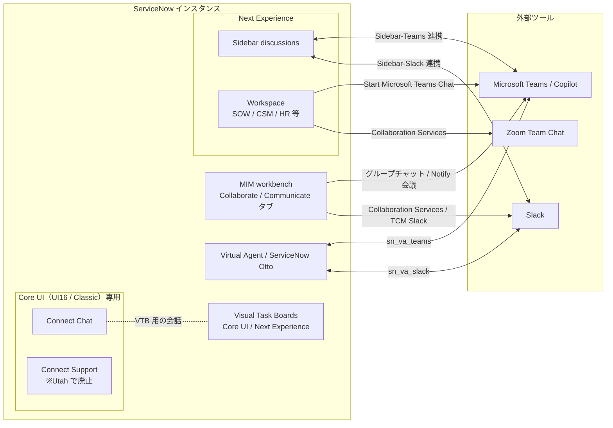
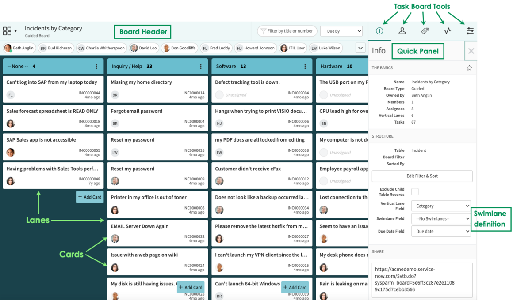
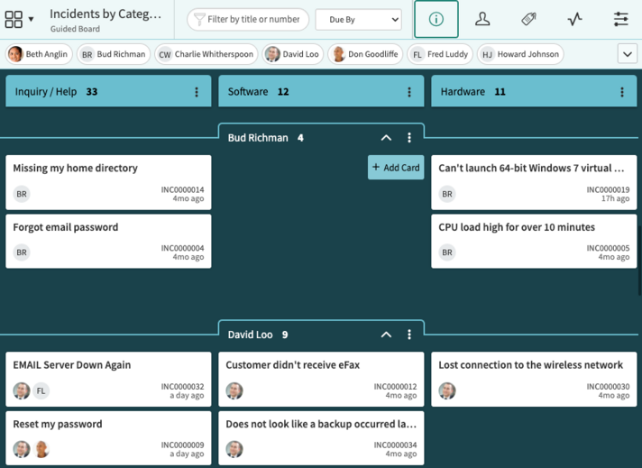
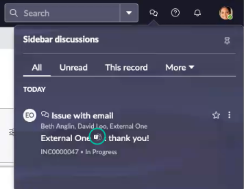
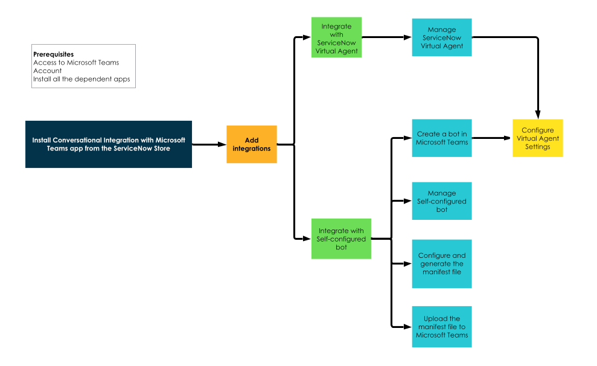
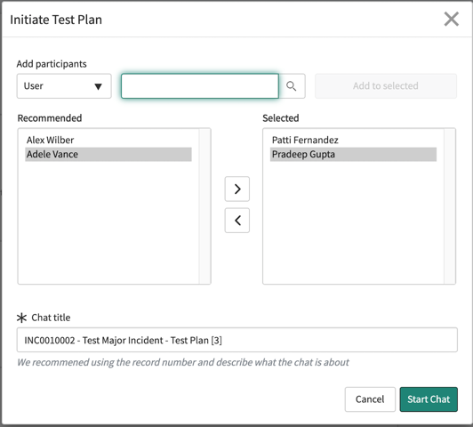

# コラボレーション機能（Visual Task Boards・Connect・Microsoft Teams/Slack 連携）

## 概要

ServiceNow のコラボレーション（Collaboration、協働）機能は、単一の製品ではない。複数のアプリケーション・プラグイン・Store アプリに分かれており、提供時期も UI の世代も異なる。本ファイルは、これまで複数のファイルに断片的に書かれていた次の機能を、仕様（プラグイン ID、テーブル、ロール、プロパティ、メニュー位置、制約）の単位でまとめる。

| 区分 | 機能 | 主な用途 | UI の前提 | Australia 時点の状態 |
|---|---|---|---|---|
| タスクの可視化 | **Visual Task Boards（VTB、ビジュアルタスクボード）** | タスクをカンバン形式のボードで管理する | Core UI または Next Experience | 利用可（新規インスタンスでは既定で有効） |
| 社内チャット（旧） | **Connect Chat（コネクトチャット）** | ユーザー同士やグループでチャットし、レコードについて会話する | **Core UI のみ** | 保守モード。Next Experience では動作しない |
| 社内サポートチャット（旧） | **Connect Support（コネクトサポート）** | キューを使ったリアルタイムの有人サポート | **Core UI のみ** | **Utah で廃止**（新規の有効化は不可） |
| 社内チャット（新） | **Sidebar（サイドバー）** | Workspace や Core UI のレコード上でリアルタイムにディスカッションする。Teams または Slack とも連携できる | Next Experience（Workspace / Core UI フォーム） | Australia では既定で有効 |
| 会話型 AI の外部チャネル | **Conversational Integration with Microsoft Teams / Slack** | Teams や Slack の中で Virtual Agent・ServiceNow Otto（旧 Now Assist）・Live Agent を使う | Teams / Slack 側 | Store アプリ（`sn_va_teams` / `sn_va_slack`） |
| ITSM のコラボレーション | **ServiceNow for Microsoft Teams and Microsoft 365**（ITSM / MIM 連携） | チケットから Teams チャットを開始する、トランスクリプトを取り込む、MIM workbench からグループチャット・会議を開始する | Teams | Store アプリ群・プラグイン群 |
| ITSM のコラボレーション | **Collaboration Services**（Slack / Teams / Zoom） | インシデント用の Slack チャネルを作る、`/now` スラッシュコマンドを使う | Slack ほか | Store アプリ（`sn_tcm_collab_hook`） |

[出典](https://www.servicenow.com/docs/r/australia/platform-user-interface/visual-task-boards/c_VisualTaskBoards.html) [出典](https://www.servicenow.com/docs/r/australia/servicenow-platform/connect/c_Connect.html) [出典](https://www.servicenow.com/docs/r/australia/servicenow-platform/connect/c_ConnectSupport.html) [出典](https://www.servicenow.com/docs/r/Cz0Un5C85RB3j2nhhAK1aQ/7f0pRxvdAFeBpjrnMiKQFw) [出典](https://www.servicenow.com/docs/r/australia/conversational-interfaces/virtual-agent/teams-conv-integration.html) [出典](https://www.servicenow.com/docs/r/australia/employee-service-management/employee-experience-foundation/c_ServiceNowForMSTeams.html) [出典](https://www.servicenow.com/docs/r/australia/it-service-management/collaboration-services/collab-services-tcm.html)

関連ファイル：Virtual Agent そのものの仕様は [Virtual Agent と会話型AI](./virtual-agent.md)、生成 AI（ServiceNow Otto / Now Assist）は [Now Assist と AI Agents](./now-assist-ai-agents.md)、Next Experience と Sidebar の UI 上の位置づけは [Next Experience UI](./next-experience-ui.md)、Major Incident の業務プロセスは [Incident Management](../itsm/incident-management.md)、スポークと課金は [IntegrationHub](./integrationhub.md) を参照。

---

## 1. 全体像

### 1.1 機能群の関係

次の図は、各コラボレーション機能が「ServiceNow の画面の中」と「外部のコラボレーションツール」のどちらで使われるかを示す。

### 1.2 世代交代の要点

- **Connect（Connect Chat / Connect Support）は Core UI 専用である。** Next Experience を有効にすると Connect の機能は動作しなくなる。[出典](https://www.servicenow.com/docs/r/australia/servicenow-platform/connect/c_Connect.html)
- **Connect Support は Utah で廃止された。** 後継は Advanced Work Assignment（AWA、作業割り当ての高度化）と Agent Chat（エージェントチャット）である。[出典](https://www.servicenow.com/docs/r/australia/servicenow-platform/connect/c_ConnectSupport.html)
- **Connect Chat の後継は Sidebar である。** Connect Chat の一部の機能は、Next Experience では Sidebar で提供される。Connect Chat と Sidebar の違いは KB1123615 に記載されている。[出典](https://www.servicenow.com/docs/r/VSGj5uf15r1UFmxfhJoyeg/KRbbj9rQVkqX9jbRMiId_A)
- **Visual Task Boards は Next Experience でも使える。** 公式ドキュメントには「Core UI or Next Experience is required」と記載されている。ただし、VTB に付属する Connect Chat 連携（ボードの会話）は Connect と同じく Core UI 専用である（2.11 節）。[出典](https://www.servicenow.com/docs/r/australia/platform-user-interface/visual-task-boards/c_VisualTaskBoards.html)
- **Now Assist は ServiceNow Otto に改称された。** Australia のドキュメントでは「ServiceNow Otto for Virtual Agent」のように新しい名称が使われている（詳細は [Now Assist と AI Agents](./now-assist-ai-agents.md)）。[出典](https://www.servicenow.com/docs/r/australia/conversational-interfaces/virtual-agent/activate-na-va-msteams.html)
- **「ServiceNow for Microsoft Teams」は「ServiceNow for Microsoft 365」に名称が変わった。** 改称は IT Service Management for Microsoft 365 v2.6.7 と HR Service Delivery for Microsoft 365 v3.3.6 からである。[出典](https://www.servicenow.com/docs/r/australia/employee-service-management/employee-experience-foundation/c_ServiceNowForMSTeams.html)

---

## 2. Visual Task Boards（VTB）

### 2.1 概要と前提条件

**Visual Task Boards（VTB）** は、リストやフォームで行っていたタスク操作を、カード・レーンを使ったグラフィカルなボード（カンバン）で行えるようにする機能である。チームはボード上でタスクの割り当て・再割り当て、状態の更新、優先順位付けを行う。主な用途はプロジェクト管理、個人やチームのタスク管理、従業員オンボーディングなどである。[出典](https://www.servicenow.com/docs/r/australia/platform-user-interface/visual-task-boards/exploring-vis-task-boards.html)

| 項目 | 内容 |
|---|---|
| プラグイン | Visual Task Boards（`com.glide.ui.vtb`）。新規インスタンスでは**既定で有効**。アップグレードしたインスタンスでは admin が `All > System Applications > All Available Applications > All` から有効化する |
| UI の前提 | Core UI または Next Experience |
| メニュー | `All > Self-Service > Visual Task Boards`（「My Task Boards」の横の **New** でボードを作成） |
| 作成に必要なロール | ロールは不要（Freeform ボード、Data Driven ボードとも） |
| 利用できないユーザー | **外部ユーザー（external users）は VTB を使えない**。それ以外のユーザーについては、ボードへのアクセスとカードの表示可否を ACL（アクセス制御ルール）が決める |
| デバイス | ブラウザ（最新の Firefox / Firefox ESR / Chrome、Safari 12）と、ネイティブのモバイルアプリ |
| ドメインセパレーション | 対応（サポートレベルは Basic） |

[出典](https://www.servicenow.com/docs/r/australia/platform-user-interface/visual-task-boards/t_ActivateVisualTaskBoards.html) [出典](https://www.servicenow.com/docs/r/australia/platform-user-interface/visual-task-boards/c_VisualTaskBoards.html) [出典](https://www.servicenow.com/docs/r/platform-user-interface/visual-task-boards/t_CreateAFlexibleOrGuidedBoard.html) [出典](https://www.servicenow.com/docs/r/australia/platform-user-interface/visual-task-boards/exploring-vis-task-boards.html) [出典](https://www.servicenow.com/docs/r/australia/platform-user-interface/visual-task-boards/r_BrowsersVTB.html) [出典](https://www.servicenow.com/docs/r/australia/platform-user-interface/visual-task-boards/domain-separation-visual-task-boards.html)

### 2.2 ボードの種類（Freeform / Flexible / Guided）

VTB のボードは 3 種類ある。作成画面では「Freeform Board」と「Data Driven Board」の 2 つから選ぶ。Data Driven Board を選んだ場合は、Lane Field（レーンフィールド）の指定によって Flexible か Guided かが決まる。

| 種類 | 作成時の選択 | 表示されるカード | レーン | カードを移動したときの動作 |
|---|---|---|---|---|
| **Freeform board**（フリーフォームボード） | Freeform Board | 任意の種類のタスクと個人タスク（Private Task、`vtb_task`）。メンバーがカードを追加・削除する | 既定は To Do / Doing / Done。追加・名前変更・並べ替え・削除ができる | レーンが変わるだけで、元のタスクのフィールドは変わらない |
| **Flexible board**（フレキシブルボード） | Data Driven Board + Lane Field = **None**（または reference / choice 以外のフィールド） | 特定のタスクテーブルに対するフィルターに一致するタスク。フィルターに一致しなくなったカードは自動的に除去される | 既定は To Do / Doing / Done。編集できる。全カードは最初 To Do に入る | タスクの状態を変えるには、別途 Update Record などの処理が必要 |
| **Guided board**（ガイド付きボード） | Data Driven Board + Lane Field = **choice または reference フィールド**（例：State） | Flexible と同じくフィルターで決まる | レーンはフィールドの値に対応し、**通常は編集できない**。choice フィールドの場合は取りうる値ごとに 1 レーン。reference フィールドの場合は、カードが現に使っている値ごとに 1 レーンで、新しい値が出てくるとレーンが追加される | **カードを移動すると、そのレーンに対応するタスクのフィールド値が更新される** |

- ボードの一覧では種類ごとにアイコンが異なる。カードの色は、ボードのカラーパレットで選んだ色になる。[出典](https://www.servicenow.com/docs/r/australia/platform-user-interface/visual-task-boards/vtb-types.html)
- Data Driven Board のベーステーブルには、Task［`task`］を拡張したテーブル（Incident、Change など）を指定する。[出典](https://www.servicenow.com/docs/r/platform-user-interface/visual-task-boards/t_CreateAFlexibleOrGuidedBoard.html)
- カード移動時の動作の違いは、VTB Spoke の「Move VTB Card」アクションの説明に明記されている（Flexible ではタスクの状態変更に Update Record アクションが必要、Guided ではレーンに対応するフィールドが更新される）。[出典](https://www.servicenow.com/docs/r/zurich/build-workflows/workflow-studio/vtb-actions.html)
- Flexible ボードであることは、`vtb_board` の Lane field に「-- Kanban Board --」という選択肢が入ることで表される（クライアントスクリプト「Add Kanban Choice」がこの選択肢を追加する）。[出典](https://www.servicenow.com/docs/r/australia/platform-user-interface/visual-task-boards/r_InstalledWithVisualTaskBoards.html)

> **注記：** ServiceNow Community のブログでは、Data Driven Board を 4 つ目の「種類」として説明している 【第三者情報】。公式ドキュメントでは、Data Driven は作成時の選択肢であり、結果として Flexible か Guided のどちらかになる。[出典](https://www.servicenow.com/community/next-experience-forum/blog-visual-task-boards-vtb-types-a-complete-servicenow-guide/m-p/3475077)

### 2.3 ボードの作成手順

**Data Driven Board（Flexible / Guided）の作成**（ロールは不要）

1. `All > Self-Service > Visual Task Boards` を開く。
2. 「My Task Boards」の横の **New** を選ぶ（初めて作成する場合は **Create New Visual Task Board**）。
3. 「Create New Board」ウィンドウで **Data Driven Board** を選ぶ。
4. **Task Table** でベースのタスクテーブル（例：Incident）を選ぶ。
5. （任意）**Lane Field** でレーン見出しにするフィールドを選ぶ。**None** を選ぶと、レーン見出しを編集できる Flexible ボードになる。
6. （任意）フィルターを作成して、表示するレコードを絞り込む。
7. （任意）ボード名をクリックして名前を変える。

カードの詳細を表示するには、Card View を有効にする（Show Compact Cards をオフにし、Show Card Info をオンにする）。[出典](https://www.servicenow.com/docs/r/platform-user-interface/visual-task-boards/t_CreateAFlexibleOrGuidedBoard.html)

- 既存の Flexible / Guided ボードでは、ボードのオーナーが Info タブからクエリ（フィルター）と Lane field を変更できる。変更してもメンバー、ボードの構成、Connect Chat の履歴は保持される。[出典](https://www.servicenow.com/docs/r/australia/platform-user-interface/visual-task-boards/configuring-vis-task-boards.html)
- ボードにはフォームやリストからもタスクを追加できる [出典](https://www.servicenow.com/docs/r/australia/platform-user-interface/visual-task-boards/exploring-vis-task-boards.html)。ボードは `$vtb.do?sysparm_board=<vtb_board の sys_id>` 形式の URL で開ける（2.4 節の図の Info パネルの SHARE 欄を参照）。

### 2.4 ボードの要素とツール

*図: Visual Task Board の画面要素（Guided ボード「Incidents by Category」の例）*
画面上部の **Board Header**（ボードヘッダー）に、ボード名「Incidents by Category」と種類「Guided Board」、「Filter by title or number」入力欄、「Due By」ドロップダウンが並ぶ。その下に、ボードメンバーのアバター（Beth Anglin、Bud Richman など）が横一列に並ぶ。本体には **Lanes**（レーン。「-- None --」「Inquiry / Help」「Software」「Hardware」で、それぞれ件数を表示）が縦に並び、各レーンに **Cards**（カード。短い説明、担当者アバター、INC 番号、経過時間）が積まれる。レーンの下部には「+ Add Card」ボタンがある。右上には **Task Board Tools**（Info / Members / Labels / Activity / Configuration の 5 つのアイコン）があり、右側の **Quick Panel**（クイックパネル）に Info タブの内容が表示される。内容は THE BASICS（Name、Board Type = Guided、Owned by、Members、Assignees、Vertical Lanes、Tasks）、STRUCTURE（Table = Incident、Board Filter、Sorted By、「Edit Filter & Sort」ボタン、Exclude Child Table Records、Vertical Lane Field = Category、**Swimlane Field = --No Swimlanes--**、Due Date Field = Due date）、SHARE（`https://<instance>.service-now.com/$vtb.do?sysparm_board=<sys_id>`）である。
出典: https://www.servicenow.com/docs/r/australia/platform-user-interface/visual-task-boards/vtb-elements.html （取得日: 2026-11-08）

| 要素 | 説明 |
|---|---|
| Board header（ボードヘッダー） | ボード名を表示する（ダブルクリックで名前を変更できる）。カードのタイトル・番号や Due By で絞り込める |
| Lanes（レーン） | カードを縦にまとめる単位。Guided ボードでは各レーンがフィールド値（例：Incident の State）に対応する |
| Cards（カード） | 1 件のタスクを表す。コメント、添付ファイル、ラベルを付けられる。カードはタスクレコードと連動し、片方の更新はもう片方に反映される。Freeform では個人タスク、Flexible / Guided では元のリストのレコードを表す |
| Quick panel（クイックパネル） | ボードのラベルとユーザーを表示する。ラベル付けや担当者割り当てをすばやく行える |
| Swimlanes（スイムレーン） | カードを横方向にまとめるレーン。担当者ごとに分けることが多い |
| Task board tools（ボードツール） | Info / Members / Labels / Activity / Configuration のタブ |

[出典](https://www.servicenow.com/docs/r/australia/platform-user-interface/visual-task-boards/vtb-elements.html)

**Task board tools のタブ**

| タブ | 内容 |
|---|---|
| Info | Board Name、Board type、Board Owner、メンバー数・担当者数・レーン数・タスク数、Table name、Edit Filter（Data Driven のみ）、Lane field（Data Driven のみ・オーナーにだけ表示）、Swimlane field、Due Date field、URL |
| Members | メンバーと担当者の一覧。メンバーの追加・削除、担当者のメンバーへの昇格、メンバー・担当者による絞り込みができる |
| Labels | ラベルでタスクを色分けし、ラベルのオン・オフで絞り込む（使う前にラベルを有効にする必要がある） |
| Activity | ボード上のカードのアクティビティをすべて表示する |
| Configuration | ボードの設定（見た目など）。**ボードのオーナーだけ**が使える |

[出典](https://www.servicenow.com/docs/r/australia/platform-user-interface/visual-task-boards/task-board-tools.html)

### 2.5 メンバーとアクセス

- **ボードにアクセスできるのはメンバーだけ**である。どのメンバーも、他のメンバーを追加・削除できる。[出典](https://www.servicenow.com/docs/r/zurich/build-workflows/workflow-studio/vtb-actions.html)
- 外部ユーザーは VTB を使えない。その他のユーザーについては ACL がボードへのアクセスとカードの表示を決める。カードの元のタスクを読む権限がないユーザーには、そのカードは見えない。[出典](https://www.servicenow.com/docs/r/australia/platform-user-interface/visual-task-boards/exploring-vis-task-boards.html)
- ボードのアクセス制御は、スクリプトインクルード `VTBBoardSecurity`（ボード）と `VTBTaskSecurity`（タスク）が担う。[出典](https://www.servicenow.com/docs/r/australia/platform-user-interface/visual-task-boards/r_InstalledWithVisualTaskBoards.html)

### 2.6 レーン・スイムレーン・レーン制限（WIP）

**スイムレーン（Swimlanes）**

スイムレーンは、縦のレーンに加えてカードを横方向にまとめる機能である。**スイムレーンを使うと、カードはコンパクト表示（compact cards）だけになる。**[出典](https://www.servicenow.com/docs/r/australia/platform-user-interface/visual-task-boards/configuring-vis-task-boards.html)

| ボードの種類 | スイムレーンの有効化方法 |
|---|---|
| Freeform | Info タブの **Swimlanes** トグルをオンにする |
| Data Driven Flexible | 作成時に Vertical Lane Field を None にして Next を押し、Info タブの Swimlanes トグルをオンにする |
| Data Driven Guided | 作成時に Vertical Lane Field と **Swimlane Field** の両方を選ぶ。既存のボードでは Info タブで Swimlane Field を追加できる |

カードはスイムレーンをまたいでドラッグできる。レーンはドラッグか Lane Configuration で並べ替えられ、折りたたみ・展開もできる。[出典](https://www.servicenow.com/docs/r/australia/platform-user-interface/visual-task-boards/configureswimlanes.html)

*図: Data Driven Guided ボードにスイムレーンを設定した例*
ヘッダーにボード名「Incidents by Categ…（Guided Board）」、フィルター入力欄、Due By、ツールアイコン（Info が選択中）が並ぶ。縦レーンは「Inquiry / Help 33」「Software 12」「Hardware 11」の 3 列で、それぞれに横方向のスイムレーン「Bud Richman 4」「David Loo 9」（担当者ごと。折りたたみ用の ^ アイコンと ⋮ メニュー付き）が区切り線として表示される。各スイムレーンの中に、その担当者のインシデントカード（例：「Missing my home directory INC0000014」「CPU load high for over 10 minutes INC0000005」）がコンパクト表示で並ぶ。
出典: https://www.servicenow.com/docs/r/australia/platform-user-interface/visual-task-boards/configureswimlanes.html （取得日: 2026-11-08）

**レーン制限（Lane limit / WIP limit）**

- 設定方法：レーンヘッダーの More アイコンから **Set Lane Limit** を選び、数値を入れて保存する。空欄にすると無制限になる。公式ドキュメントでの必要ロールは admin。[出典](https://www.servicenow.com/docs/r/australia/platform-user-interface/visual-task-boards/configure-wip-lane-limit.html)
- 制限を超えた場合：全メンバーに対し、レーンヘッダーに**赤い記号**が表示される。制限を超えたレーンにカードを移動したメンバーには、ページ上部にエラーメッセージが表示される。[出典](https://www.servicenow.com/docs/r/australia/platform-user-interface/visual-task-boards/configure-wip-lane-limit.html)
- メール通知「VTB lane limit reached」「VTB lane limit exceeded」も用意されている（2.8 節）。
- 【第三者情報（Community）】制限を設定していないレーンでも「Lane limit Exceeded」通知が送られる不具合が Community で報告されている。スレッドでは PRB1358194（「The notification 'Lane limit Exceeded' appears in Visual Task Boards when no lane limits are set」、New York Patch 3 で修正）が挙げられている。修正後も再発したという投稿や、Lane WIP limit が空のレーンに無制限を表す `-1` を設定して様子を見たという投稿もある。古いリリースの報告なので、Australia で再現するかは公開情報では確認できず。[出典](https://www.servicenow.com/community/servicenow-ai-platform-forum/notification-triggered-from-visual-task-board/td-p/991308/page/2)

### 2.7 カードの機能（ラベル・チェックリスト・SLA・アーカイブ）

| 機能 | 仕様 |
|---|---|
| ラベル（Labels） | 各ボードには既定で **7 つ**のラベルがある。ボードのメンバーはラベルを編集できる。ラベルの追加・名前変更には `global_tags_creator`（ドキュメントの記載では `tags_admin` / `global_tags_creator`）が必要で、ラベルの削除はボードのオーナーだけができる。有効にしたラベルだけがクイックフィルターに出て、カードに付けられる。ラベルのテーブルはタグ（Tags）と共用である [出典](https://www.servicenow.com/docs/r/VSGj5uf15r1UFmxfhJoyeg/p3hTqg6QtaFYCi70xmi80g)（Zurich 版） |
| 添付ファイル | カード 1 枚あたりの添付ファイルの上限サイズは `vtb.board.upload_limit`（整数、MB、既定 10）で決まる [出典](https://www.servicenow.com/docs/r/australia/platform-user-interface/visual-task-boards/r_InstalledWithVisualTaskBoards.html) |
| チェックリスト | カードにチェックリストを作れる。チェックリスト項目からタスクを作るときに選べるタスクの種類は、プロパティ `glide.ui.create_task_type_option_list` で制御する（Task を拡張したテーブル名をカンマ区切り・空白なしで書く。例：`change_request`）。ユーザーには、アクセス権のあるタスクの種類だけが表示される [出典](https://www.servicenow.com/docs/r/australia/platform-user-interface/visual-task-boards/t_TasksChecklistItems.html) |
| SLA インジケーター | ボードの設定メニューで有効にする（設定は**その利用者だけ**に適用される）。SLA が付いたカードには経過率のステータスバーが表示される。SLA 違反のカードがあると、ボード上部にアラートが出て、クイックパネルにフィルターが追加される。SLA が複数ある場合は、経過率が最も大きい SLA を表示する [出典](https://www.servicenow.com/docs/r/australia/platform-user-interface/visual-task-boards/c_VTBSLAIndicators.html) |
| アーカイブ | **Freeform ボードでのみ**カードをアーカイブできる（削除はされない）。カード 1 枚の X アイコン、カード詳細の Tools > Archive、またはレーンメニューの **Archive All Tasks** で行う。アーカイブしたカードはボード情報メニューの **View Archived Tasks** で表示し、**Restore** で戻す。ロールは不要 [出典](https://www.servicenow.com/docs/r/australia/platform-user-interface/visual-task-boards/t_ArchiveACard.html) |
| 並べ替え（Sort） | Sort-Filter オプションで、カードをプロパティ別に並べ替え・グループ化できる [出典](https://www.servicenow.com/docs/r/australia/platform-user-interface/visual-task-boards/configuring-vis-task-boards.html) |
| 外観 | 既定ではユーザーの Theme 設定を引き継ぐ。ボードごとに上書きできる [出典](https://www.servicenow.com/docs/r/australia/platform-user-interface/visual-task-boards/configuring-vis-task-boards.html) |

### 2.8 テーブル・プロパティ・スクリプト・通知

**テーブル**

| テーブル | 表示名 | 内容 |
|---|---|---|
| `vtb_board` | Visual Task Board | 各ボードのレコード |
| `vtb_lane` | Visual Task Board Lane | 各ボードの各レーン |
| `vtb_card` | Visual Task Board Card | 各ボードの各カード |
| `vtb_board_member` | Board Member | 各ボードの各メンバー |
| `vtb_task` | Private Task | Freeform ボードの個人タスク（Task を拡張している） |
| `vtb_card_history` | Visual Task Board Card History | カードの一部の変更（レーンや担当者の変更）の旧値と新値 |

**プロパティ**

| プロパティ | 型・既定値 | 内容 |
|---|---|---|
| `vtb.board.upload_limit` | integer / 10 | カード 1 枚あたりの添付ファイルの上限サイズ（MB） |
| `glide.vtb.board_max` | integer / （未作成時は 1,000） | ボード 1 つあたりに表示するカードの上限。**既定では作成されていない**ため、admin が `sys_properties` に追加する。Freeform と Data Driven（Flexible / Guided）の両方に適用される。**1,000 を超えると、特にタブレットで性能が落ちる可能性がある**と公式に注意書きがある |
| `glide.ui.create_task_type_option_list` | 文字列（テーブル名のカンマ区切り） | チェックリスト項目から作れるタスクの種類 |

**スクリプトインクルード**：`VisualTaskBoards`（汎用ユーティリティ）、`VTBBoardSecurity`（ボードのアクセス制御）、`VTBGetBoardsByUser`（ユーザーが所有するボード、またはメンバーになっているボードの取得）、`VTBTaskSecurity`（タスクのアクセス制御）。

**主なビジネスルール**：Update Board on Card Change（`vtb_card`）、Update Board on Lane Change（`vtb_lane`）、VTB Previous Additional Assignees（`vtb_task`）。Connect Chat 連携用のルールは 2.11 節を参照。

**通知（メール）**

| 通知 | 送信のきっかけ |
|---|---|
| VTB member addition notification / VTB member deletion notification | ボードへのメンバーの追加・削除 |
| VTB assignee notification | 個人タスクの主担当者に指定されたとき |
| VTB additional assignee notification | 追加の担当者に指定されたとき |
| VTB lane change notification | タスクのレーンが変わったとき（担当者宛て） |
| VTB lane limit reached / VTB lane limit exceeded | レーンのタスク数が制限に達したとき・超えたとき |
| VTB card movement across vertical lanes and swimlanes | カードが縦レーンやスイムレーンをまたいで移動したとき |

[出典](https://www.servicenow.com/docs/r/australia/platform-user-interface/visual-task-boards/r_InstalledWithVisualTaskBoards.html) [出典](https://www.servicenow.com/docs/r/VSGj5uf15r1UFmxfhJoyeg/dAW2Pa_EFbGaIxzYtzR73g)（カード上限、Zurich 版。Xanadu・Kingston 版も同じ 1,000）

### 2.9 利用上の制限・注意点

| 項目 | 内容 | 出典 |
|---|---|---|
| カード数の上限 | 既定で 1 ボード 1,000 枚。`glide.vtb.board_max` で変更できるが、1,000 を超えると性能が落ちる可能性がある | [出典](https://www.servicenow.com/docs/r/VSGj5uf15r1UFmxfhJoyeg/dAW2Pa_EFbGaIxzYtzR73g) |
| クライアントスクリプト | **VTB はクライアントスクリプトと連携しない。** VTB 上の操作に入力規則をかけたい場合は UI Policy か Data Policy を使う | [出典](https://www.servicenow.com/docs/r/australia/platform-user-interface/visual-task-boards/r_BrowsersVTB.html) |
| スイムレーンとカード表示 | スイムレーンを使うとカードはコンパクト表示だけになる | [出典](https://www.servicenow.com/docs/r/australia/platform-user-interface/visual-task-boards/configuring-vis-task-boards.html) |
| Guided ボードのレーン | レーンはフィールド値に対応し、通常は編集できない | [出典](https://www.servicenow.com/docs/r/australia/platform-user-interface/visual-task-boards/vtb-types.html) |
| アーカイブ | Freeform ボードだけ | [出典](https://www.servicenow.com/docs/r/australia/platform-user-interface/visual-task-boards/t_ArchiveACard.html) |
| 外部ユーザー | 利用できない | [出典](https://www.servicenow.com/docs/r/australia/platform-user-interface/visual-task-boards/exploring-vis-task-boards.html) |
| Connect 連携 | ボードの会話（Connect Chat）は Core UI 専用で、Next Experience では動作しない | [出典](https://www.servicenow.com/docs/r/australia/servicenow-platform/connect/c_Connect.html) |
| スクリプトによるカード作成 | レーンとスイムレーンの両方があるボードで、スクリプトやフローで作ったカードが表示されない事例が報告されている。回避策として、`vtb_card` に対して Create Record アクションで作成する方法が挙げられている 【第三者情報（Community）】 | [出典](https://www.servicenow.com/community/workflow-automation-forum/creating-a-vtb-card-on-a-board-with-swimlanes-card-not-appearing/m-p/3525112) |

### 2.10 VTB Spoke（Workflow Studio 用アクション）

**Visual Task Board (VTB) Spoke** は、Workflow Studio / Flow Designer から VTB を操作するアクションを提供する。

| 分類 | アクション | 主な入力 | 補足 |
|---|---|---|---|
| ボード | Create Freeform VTB | Name、Board Owner、Default view、Label visibility、Picker visibility、Background color | 既定レーンは Todo / Doing / Done |
| ボード | Create Flexible VTB | 上記 + Task table、Filter | |
| ボード | Create Guided VTB | 上記 + Task table、Lane field、Filter | |
| メンバー | Add VTB Member / Remove VTB Member | Board record、User record | |
| レーン | Add VTB Lane / Rename VTB Lane / Delete VTB Lane | Board / Lane record、Lane name | Freeform と Flexible のみ |
| レーン | Reorder VTB Lane | Lane record | すべての種類 |
| カード | Create VTB Card | Lane record、Task record | Freeform のみ |
| カード | Assign VTB Card / Remove Assignee from VTB Card / Move VTB Card | Card record、User / Lane record | Move の動作は Flexible と Guided で異なる（2.2 節） |

[出典](https://www.servicenow.com/docs/r/zurich/build-workflows/workflow-studio/vtb-actions.html)（Zurich 版。スポークの利用条件は [IntegrationHub](./integrationhub.md) を参照）

### 2.11 VTB と Connect Chat の連携（Core UI 専用）

VTB には、ボードを Connect Chat の会話として共有する機能と、ボードから Connect Chat の会話を作成する機能がある（「Share a Visual Task Board in a Connect conversation」「Create a Connect conversation from a Visual Task Board」）。会話とボードは次のビジネスルールで同期される。[出典](https://www.servicenow.com/docs/r/australia/platform-user-interface/visual-task-boards/viewing-sharing-vis-task-brds.html) [出典](https://www.servicenow.com/docs/r/australia/platform-user-interface/visual-task-boards/r_InstalledWithVisualTaskBoards.html)

| ビジネスルール | テーブル | 動作 |
|---|---|---|
| Add members to live group | `vtb_board_member` | ボードのメンバーを会話のメンバーに追加する |
| Remove member from live group | `vtb_board_member` | ボードから外したユーザーを会話からも外す |
| Remove member from VTB | `live_group_member` | 会話から外したユーザーをボードからも外す |
| Sync Members With VTB | `live_group_member` | 会話に追加したユーザーをボードのメンバーにする |
| Sync board name to Connect | `vtb_board` | ボード名の変更を会話名に反映する |
| Sync chat name to VTB board | `live_group_profile` | 会話名の変更をボード名に反映する |

Connect は Next Experience では動作しないため、この連携は Core UI でボードを使う場合に限られる（3 章）。

---

## 3. Connect（Connect Chat / Connect Support）と後継の Sidebar

### 3.1 Connect の概要

**Connect** は、同僚とリアルタイムにメッセージをやり取りする仕組みである。メールや静的なドキュメントを介さずに会話できる。Connect は Visual Task Boards、HR、Customer Service Management などと連携する。Connect の画面は標準 UI の上に重なって表示される（オーバーレイ）ため、作業しながら会話できる。[出典](https://www.servicenow.com/docs/r/australia/servicenow-platform/connect/c_Connect.html)

| 機能 | 内容 | プラグイン |
|---|---|---|
| **Connect Chat** | 個人やグループとのチャット、ファイル共有、レコードについての会話（record conversation） | Connect（`com.glide.connect`）。新規インスタンスでは既定で有効 |
| **Connect Support** | サポート担当者がキューを使ってエンドユーザーをリアルタイムに支援する | Connect Support（`com.glide.connect.support`） |

- **Core UI が前提である。** 「Connect is not supported in Next Experience. If you turn on Next Experience, Connect functionality will no longer work.」と記載されている（Australia 版、Brazil 版とも）。[出典](https://www.servicenow.com/docs/r/australia/servicenow-platform/connect/c_Connect.html) [出典](https://www.servicenow.com/docs/r/servicenow-platform/connect/c_Connect.html)
- Connect は旧来のチャット（legacy chat）の置き換えではない。両方を同時に使ってはいけない。[出典](https://www.servicenow.com/docs/r/australia/servicenow-platform/connect/c_Connect.html)
- **Connect workspace**：Connect Chat と Connect Support の会話を全画面で表示するビュー。`Collaborate > Connect Chat`、またはミニウィンドウの新規ウィンドウアイコンで開く。左側に Sidebar（Connect サイドバー）、中央に会話ペイン、右側に会話ツール（Info、メンバー、添付ファイル、通知設定など）が表示される。Info タブの「Related Records」には、会話中に参照された VTB やタスクレコードが一覧表示される。[出典](https://www.servicenow.com/docs/r/australia/servicenow-platform/connect/c_CollaborationWorkspace.html)
- **Record conversation（レコード会話）**：Task を拡張したすべてのテーブルで既定で有効。フォームヘッダーの **Follow** ボタンから会話を始める。他のテーブルで使うには、辞書属性 `live_feed=true` と、プロパティ `glide.live_feed.task_header_button` の値 `both` または `collaboration` が必要である。[出典](https://www.servicenow.com/docs/r/australia/servicenow-platform/connect/c_CollaborationAdministration.html)

### 3.2 Connect のプロパティ

Connect のプロパティは、admin が `Connect > Administration > Properties`（一部は `Collaborate > Administration > Properties`）で設定する。多くのプロパティは Connect Support にも影響する。

| プロパティ | 型・既定値 | 内容 |
|---|---|---|
| `glide.ui.presence.disabled` | true/false・false | ユーザープレゼンスを無効にする（**Connect だけでなくプラットフォーム全体**に影響する） |
| `collaboration.frameset` | true/false・true | Connect のオーバーレイを表示するかどうか |
| `glide.ui.url.external` / `glide.ui.url.external.content` | true/false・true | 外部 URL をリンクとして表示するか、メタデータを取得してリッチ表示するか |
| `collaboration.email_interval` | integer・3（分） | オフラインのユーザーに未読メッセージのメールを送るまでの待ち時間。`collaboration.new_offline_message` イベント → 待機 → `collaboration.notify_offline_user`（グループ会話では `.group`）イベントの順に処理される |
| `collaboration.polling_interval` | integer・10（秒） | 新しいメッセージをポーリングする間隔 |
| `connect.search.conversation_limit` | integer・50 | 会話の検索結果に表示する件数 |
| `connect.notification.audio_alert` | string・`connect_alert.mp3` | 通知音（`db_audio` テーブルの Name を指定する） |
| `connect.roles` | 文字列・空 | Connect を使えるロールの許可リスト（カンマ区切り）。空なら全ロールが使える |
| `glide.live_feed.task_header_button` | choice・`collaboration` | タスクフォームに Live Feed / Follow ボタンを表示するかどうか |
| `glide.connect.enabled` | true/false・true | Incident フォームの旧チャットのリンク「Create or Join Chat Room」を隠す（変更しないことが推奨されている） |

[出典](https://www.servicenow.com/docs/r/australia/servicenow-platform/connect/r_PropertiesForConnect.html) [出典](https://www.servicenow.com/docs/r/australia/servicenow-platform/connect/t_ActivateConnect.html) [出典](https://www.servicenow.com/docs/r/australia/servicenow-platform/connect/c_CollaborationAdministration.html)

Connect Chat の会話は `live_group_profile`（会話）と `live_group_member`（会話メンバー）に保存される（VTB 連携のビジネスルールの対象テーブルから確認できる）。メッセージ本体のテーブル名は、今回参照した公式ページでは確認できなかった。[出典](https://www.servicenow.com/docs/r/australia/platform-user-interface/visual-task-boards/r_InstalledWithVisualTaskBoards.html)

### 3.3 Connect Support の廃止とタイムライン

| 時期 | 内容 |
|---|---|
| Paris | 新規顧客へのインストールを停止。Connect Chat は保守モードに入った（新機能なし、P1 不具合のみ修正） |
| San Diego（2022-03） | `com.glide.connect.support` の配布と有効化を停止 |
| Utah（2023） | Connect Support のサポートを終了（廃止）。既存の利用はアップグレード後も動作するが、ServiceNow のサポート対象外 |
| Australia | 公式ドキュメントにも「Starting in Utah, Connect Support has been deprecated and is no longer supported or available for new activation」と記載されている |

[出典](https://www.servicenow.com/community/agent-chat-routing-and-sidebar/connect-support-migration-faq-s/ta-p/2305874)（Paris・San Diego の時期は Community の公式 FAQ による）[出典](https://www.servicenow.com/docs/r/australia/servicenow-platform/connect/c_ConnectSupport.html)

- 移行先は **Advanced Work Assignment（AWA）と Agent Chat** である（Workspace で利用する。詳細は [Virtual Agent と会話型AI](./virtual-agent.md)）。
- 移行しない場合の選択肢として、FAQ には「サポート対象外のカスタムコードとして使い続ける」「ServiceNow Customer Outcomes やパートナーと代替策を検討する」が挙げられている。[出典](https://www.servicenow.com/community/agent-chat-routing-and-sidebar/connect-support-migration-faq-s/ta-p/2305874)
- Virtual Agent を Microsoft Teams や Slack で使う場合も、Connect Support は利用できない機能として明記されている（4 章）。

### 3.4 Next Experience での扱い

| 機能 | Next Experience での扱い |
|---|---|
| Connect Chat | 利用できない。一部の機能は Sidebar で提供される（違いは KB1123615）。Sidebar への移行が推奨されている |
| Connect Support | 利用できない。Utah で廃止。AWA と Agent Chat へ移行する |
| Live Feed | サポートされない（KB1157068） |
| Visual Task Boards | 利用できる（Core UI または Next Experience が前提） |

[出典](https://www.servicenow.com/docs/r/VSGj5uf15r1UFmxfhJoyeg/KRbbj9rQVkqX9jbRMiId_A)（Zurich 版の Next Experience UI ページ）[出典](https://www.servicenow.com/docs/r/australia/platform-user-interface/visual-task-boards/c_VisualTaskBoards.html)

- Connect を使い続けたい場合の回避策は、Next Experience を無効にして Classic UI16 を使うことである（KB1113554）。[出典](https://www.servicenow.com/community/agent-chat-routing-and-sidebar/connect-support-migration-faq-s/ta-p/2305874)
- Sidebar が Connect Chat の機能を提供し始めたリリースは、ドキュメントの版によって記載が異なる（詳細は [Next Experience UI](./next-experience-ui.md) の 5.2 節）。

### 3.5 Sidebar（Connect Chat の後継）

**Sidebar（サイドバー）** は、エージェント向けのリアルタイムコラボレーション機能である。Workspace のレコードに紐づくディスカッションと、レコードに紐づかない単独のディスカッション（standalone discussion）を作れる。1 つのレコードに複数のディスカッションを作れる。[出典](https://www.servicenow.com/docs/r/Xh633tLbz1TiB0XwDksy6A/aUn8OpY1MEGTKhjphleuJA)（Zurich 版）[出典](https://www.servicenow.com/docs/r/australia/conversational-interfaces/sidebar/exploring-sidebar.html)

| 項目 | 内容 |
|---|---|
| パッケージ | ServiceNow AI Platform の機能。Omni-Experience Standard Feature Set に含まれる。ServiceNow Store でも提供される |
| 有効化 | **Australia では既定で有効**（個別の有効化は不要）。アプリの更新は引き続き ServiceNow Store から配布される（Australia のリリースノートにも「Sidebar is available in the ServiceNow Store」とある）。設定は admin が `All > Conversational Interfaces > Settings` の **Sidebar** で行う |
| 対応 Workspace（Zurich 版の記載） | CSM Configurable Workspace、CSM Manager Workspace、HR Agent Workspace、ITSM Manager Workspace、Security Incident Response Workspace、Vendor Management Workspace。その他の Workspace（Service Operations Workspace など）やカスタム Workspace には **Discuss ボタン**を追加する（KB1213249） |
| Core UI | Next Experience の Core UI のフォームから、タスク型・インタラクション型レコードのディスカッションを作れる |
| 主な機能 | 未読バッジ、ドッキングしたチャットウィンドウ（既定で最大 25。変更可）、お気に入り、@メンション、絵文字、ファイルのドラッグ＆ドロップ、参加者の提案、クイックアクション（`search-kb` でナレッジ検索、`/summarize` でディスカッションを要約）、アクティビティストリームへの投稿、スレッド返信（Zurich）、ウィンドウの移動・サイズ変更（Australia）、件名に任意のフィールドを使う設定（Australia） |
| 設定項目 | User chat（絵文字）、Record types（Task / Interaction レコードでの自動有効化、Sidebar Enabled Tables の個別選択、Requester mapping）、Participants（User query）、Participant suggestions、Integrations（Microsoft Teams または Slack） |
| ドメインセパレーション | 対応（ただし Teams / Slack 連携はドメインセパレーションに対応しない） |
| ショートカット | Shift+Alt+d で Sidebar discussions を開く（[Next Experience UI](./next-experience-ui.md) 参照） |

[出典](https://www.servicenow.com/docs/r/Xh633tLbz1TiB0XwDksy6A/ve3Vy2vvziOgn6dgxqBu4g) [出典](https://www.servicenow.com/docs/r/Cz0Un5C85RB3j2nhhAK1aQ/7f0pRxvdAFeBpjrnMiKQFw) [出典](https://www.servicenow.com/docs/r/delta-yokohama-brazil/brazil-yokohama-sidebar-release-notes.html)

**Sidebar のリリース別の変更**

| リリース | 主な変更 |
|---|---|
| Xanadu | ユーザーグループをディスカッションに追加、Mobile Platform でのエージェント向け Sidebar、全レコードタイプでのディスカッション作成（Interaction・Task 以外にも拡大）、アクセス元に応じた Expert finder サービスの切り替え、チャット要約のクイックアクション |
| Yokohama | Slack 連携、単独ディスカッション、参加者だけが見られる非公開のレコードディスカッション。Store からインストール |
| Zurich | スレッド返信。Omni-Experience Standard Feature Set に含まれた |
| Australia | ウィンドウの移動・サイズ変更（dynamic window framework）、ディスカッション件名に任意のフィールドを使う設定、単独ディスカッション。既定で有効（Store でも引き続き提供） |
| Brazil | 更新なし（「No updates for this release」） |

[出典](https://www.servicenow.com/docs/r/Cz0Un5C85RB3j2nhhAK1aQ/7f0pRxvdAFeBpjrnMiKQFw) [出典](https://www.servicenow.com/docs/r/delta-yokohama-brazil/brazil-yokohama-sidebar-release-notes.html)

#### 3.5.1 Sidebar と Microsoft Teams / Slack の連携

Sidebar は **Microsoft Teams と Slack のどちらか一方**と連携できる（両方は同時に使えない）。設定は Sidebar 設定画面の Integrations で **Set up** を選び、連携後は Manage メニューから View configuration / View permissions（Teams 側で Sidebar ディスカッションを使えるグループの設定）/ Remove integration を操作する。[出典](https://www.servicenow.com/docs/r/Xh633tLbz1TiB0XwDksy6A/ve3Vy2vvziOgn6dgxqBu4g)

| 項目 | Sidebar – Microsoft Teams | Sidebar – Slack |
|---|---|---|
| 仕組み | Teams のグループチャットと Sidebar のディスカッションを双方向に同期する | Slack のプライベートチャネルと Sidebar のディスカッションを双方向に同期する |
| 認証 | Sidebar ユーザーは Teams アカウントが必要。Teams がアカウントを確認する | Sidebar ユーザーは Slack アカウントが必要。Slack がアカウントを確認する |
| 外部ユーザーの表示 | ディスカッションと検索結果で Teams アイコンが付く（アクティビティストリームには付かない） | Slack アイコンが付く |
| 参加者の上限 | Teams のグループチャットは最大 250 ユーザー | Slack のプライベートチャネルは最大 250 ユーザー |
| メッセージの種類 | テキスト、絵文字、URL、添付ファイル。Teams での返信の表示は、**公式ドキュメント内で記述が食い違っている**（Messaging の節では「Sidebar には表示されるが元のメッセージへの返信としては表示されない」、同期の節では「Sidebar でも該当メッセージへの返信として表示される」）。実機で確認すること | テキスト、画像、絵文字、URL、添付ファイル、レコードへのリンク。Slack での返信は Sidebar でも返信として表示される |
| 過去の履歴 | 連携を有効にする前のメッセージは連携先に表示されない | 同左 |
| 基本の動作条件 | **参加者のうち少なくとも 1 人が外部専用ユーザー（`sys_user` レコードがないユーザー）であること**（API 呼び出しを減らすため）。これは既定の動作である。Manage Microsoft Teams permissions（Manage メニューの View permissions）で内部ユーザーやそのユーザーが属するグループを許可すると、外部ユーザーがいなくても同期できる | 同左（既定の動作） |
| ドメインセパレーション | 非対応（設定ボタンが無効になる） | 非対応 |
| その他 | ServiceNow がアクセスするのは、連携で作られたチャットとメッセージだけ | Slack の signing secret でメッセージを検証する。30 分ごとのジョブがメールアドレスの一致で Slack ユーザーと Sidebar ユーザーを対応づける |

[出典](https://www.servicenow.com/docs/r/australia/conversational-interfaces/sidebar/sidebar-teams-overview.html) [出典](https://www.servicenow.com/docs/r/zurich/conversational-interfaces/sidebar/sidebar-slack-overview.html)

> **Microsoft による課金：** Sidebar – Teams 連携は ServiceNow の標準機能だが、**Microsoft は Teams API の呼び出しをメッセージ単位で課金する**としている。ServiceNow から Teams へのメッセージ送信と、その逆の両方が対象である。ユーザー検索、グループチャットへのユーザー追加、プレゼンス、リアクションは対象外である。請求は Microsoft から顧客の Azure アカウントに直接行われる。[出典](https://www.servicenow.com/docs/r/australia/conversational-interfaces/sidebar/sidebar-teams-overview.html)

*図: Teams と連携した Sidebar discussions パネル*
Next Experience のヘッダー右側（Search 欄の横）の吹き出しアイコンから開いた「Sidebar discussions」パネル。上部に All / Unread / This record / More のフィルタータブがある。TODAY の下に「Issue with email」というディスカッションが表示され、参加者は「Beth Anglin, David Loo, External One」、最新メッセージは「External One: thank you!」、紐づくレコードは「INC0000047 • In Progress」である。「External One」の名前の横に Microsoft Teams アイコンが付いており（丸で強調されている）、Teams 側のユーザーであることが分かる。右端にはお気に入り（星）と ⋮ メニューがある。
出典: https://www.servicenow.com/docs/r/australia/conversational-interfaces/sidebar/sidebar-teams-overview.html （取得日: 2026-11-08）

---

## 4. Conversational Integration（Microsoft Teams / Slack での Virtual Agent・ServiceNow Otto）

この章では、Teams・Slack を Virtual Agent の**チャネル**として使う連携の要点をまとめる。Virtual Agent の Topic 設計や Assistant Designer の詳細は [Virtual Agent と会話型AI](./virtual-agent.md) を参照。

### 4.1 Conversational Integration with Microsoft Teams

**Conversational Integration with Microsoft Teams** は、依頼者（requester）が Microsoft Teams のアプリから Virtual Agent や Live Agent（有人オペレーター）とチャットするための Store アプリである。[出典](https://www.servicenow.com/docs/r/australia/conversational-interfaces/virtual-agent/teams-conv-integration.html)

| 項目 | 内容 |
|---|---|
| アプリ / プラグイン | Conversational Integration with Microsoft Teams（`sn_va_teams`、Store アプリ）＋ Glide Virtual Agent（`com.glide.cs.chatbot`）。機能を限定した版は Virtual Agent Lite（`com.glide.cs.chatbot.lite`）。依存アプリとして Microsoft Teams Graph spoke が入る（Community 記事では `sn_msteams_ahv2` と記載）【第三者情報】 |
| ServiceNow 側のロール | インストール：admin（または `virtual_agent_admin` と `external_app_install_admin`）。会話の作成・公開：admin または `virtual_agent_admin` |
| Microsoft 側の権限 | 管理者権限のある Microsoft 365 アカウント（admin.microsoft.com にアクセスできること）。Global administrator、Application administrator、Cloud Application administrator のいずれかを推奨。管理者以外の同意（non-admin consent）は予期しない動作の原因になるため推奨されない |
| インストール手順 | `All > Conversational Interfaces > Channels and integrations`（または Settings > Channels の View all）で Microsoft Teams タイルの **Get Teams plugin** → Store で Get → Request Install → インスタンス名と理由を入力 → Request（自動承認される） |
| ボットの方式 | **ServiceNow Virtual Agent（事前公開された「Now Virtual Agent」ボット）** と、**Self-configured bot（自社で構成するボット）** の 2 通り。Self-configured bot では、Teams 側でボットを作成し、ServiceNow で管理・設定してマニフェストファイルを生成し、Teams にアップロードする（Message Extensions を有効にしてマニフェストを作ること、ボット名は 1 語にすること） |
| テナントとの対応 | Teams アプリは **ServiceNow インスタンスと Teams テナントを 1 対 1 で対応づける**。インスタンスごとに別のテナントを使う |
| クローン時の注意 | 非本番インスタンスをクローンした場合は、クローン先で構成手順を再実行してボットを新しいインスタンスに対応づける。再実行すると、元の非本番インスタンスとテナントの対応は解除される |
| 非対応 | Teams premium アカウント（Office 365 以外のメールアドレスを使えるアカウント）は非対応 |
| Teams で使えない VA の機能 | Connect Support、Geo-location topic block |
| 課金上の注意 | **Microsoft Teams Graph spoke は IntegrationHub のトランザクションを消費する**ため、Teams での Virtual Agent の利用は IntegrationHub のトランザクションとしてカウントされる。Microsoft も Teams API の利用を課金するため、Microsoft 365 サブスクリプション側にも影響する |
| 特殊な環境 | GCC（Government Community Cloud）環境では Self-configured bot を使う。Australia SPP（ServiceNow Protected Platform）には別の手順がある |

[出典](https://www.servicenow.com/docs/r/australia/conversational-interfaces/virtual-agent/teams-conv-integration.html) [出典](https://www.servicenow.com/docs/r/australia/conversational-interfaces/virtual-agent/exploring-ci-microsoft-teams.html) [出典](https://www.servicenow.com/docs/r/Xh633tLbz1TiB0XwDksy6A/mTsRE9Ax3PoXevM9U65fvw)（Zurich 版のインストール手順）[出典](https://www.servicenow.com/docs/r/australia/conversational-interfaces/virtual-agent/limited-features-msteams.html) [出典](https://www.servicenow.com/community/ceg-ai-coe-articles/now-assist-in-virtual-agent-on-microsoft-teams/ta-p/3542389)

*図: Conversational Integration with Microsoft Teams の導入ワークフロー*
左上の「Prerequisites」枠には「Access to Microsoft Teams Account」「Install all the dependent apps」と書かれている。左端の「Install Conversational Integration with Microsoft Teams app from the ServiceNow Store」から「Add integrations」に進み、2 つに分岐する。上の分岐は「Integrate with ServiceNow Virtual Agent」→「Manage ServiceNow Virtual Agent」→「Configure Virtual Agent Settings」。下の分岐は「Integrate with Self-configured bot」で、「Create a bot in Microsoft Teams」（→「Configure Virtual Agent Settings」へ合流）、「Manage Self-configured bot」、「Configure and generate the manifest file」、「Upload the manifest file to Microsoft Teams」の 4 つの作業に分かれる。
出典: https://www.servicenow.com/docs/r/australia/conversational-interfaces/virtual-agent/exploring-ci-microsoft-teams.html （取得日: 2026-11-08）

#### 4.1.1 ServiceNow Otto（旧 Now Assist in Virtual Agent）を Teams / Copilot で使う

Australia の公式ドキュメントでは、**ServiceNow Otto for Virtual Agent** を Microsoft Teams と Microsoft Copilot のボットに追加する手順が説明されている。

| 項目 | 内容 |
|---|---|
| 前提 | Microsoft Copilot 用の Self-configured bot を作成済みであること。Microsoft Teams アプリの Version を更新すること |
| ロール | admin または `virtual_agent_admin` |
| 手順の要点 | ① Assistant Designer の Assistants タブで「Otto for Virtual Agent (default)」を編集 → Review display experiences > Channels で Teams 用の Self-configured bot を選んで保存 ② Channels and Integrations の Microsoft Teams タイル > Manage > 対象ボットの Manage bot > 構成を編集して **Copilot** チェックボックスをオン → 保存 ③ マニフェスト（zip）をダウンロードして Teams にアップロードする |
| 結果 | ボットが Microsoft のアプリストアに公開され、Copilot の **Custom Engine Agent（CEA）** として有効になる |
| 注意 | ①の Assistant Designer でのボット選択を先にしないと、Copilot ではメッセージ拡張（message extension）として表示される |

[出典](https://www.servicenow.com/docs/r/australia/conversational-interfaces/virtual-agent/activate-na-va-msteams.html)

Community の実装記事（Australia で検証）では、次の点が補足されている 【第三者情報】。[出典](https://www.servicenow.com/community/ceg-ai-coe-articles/now-assist-in-virtual-agent-on-microsoft-teams/ta-p/3542389)

- 前提として AI Search の有効化、Now Assist for ITSM などの Now Assist（Otto）製品、既定のアシスタント、Now LLM 接続の `sys_connection` レコードが必要。
- 事前公開の「Now Virtual Agent」ボットは ServiceNow が所有し、複数インスタンスには対応しない。Self-configured bot は顧客がボットの ID を所有し、複数インスタンスやブランド変更に対応する。
- Teams のエンドポイント URL がインスタンスと完全に一致しないと、ボットが何も応答しない。クライアントシークレットの有効期間は 12 か月で、期限切れになると `invalid_client` / `AADSTS7000222` エラーになる。
- AI Agent の実行記録は `sys_cs_message` ではなく `sn_aia_execution_plan` / `sn_aia_execution_task` に残る。

Australia の ServiceNow Otto for Virtual Agent のリリースノートには、Microsoft Teams のチャネルを編集して standard chat と premium chat を切り替えられることが記載されている。[出典](https://www.servicenow.com/docs/r/delta-australia-brazil/brazil-australia-servicenowottoforvirtualagent-release-notes.html)

### 4.2 Conversational Integration with Slack

**Conversational Integration with Slack** は、Slack のワークスペースから Virtual Agent や Live Agent とチャットするための Store アプリである。[出典](https://www.servicenow.com/docs/r/australia/conversational-interfaces/virtual-agent/mssg-slack.html)

| 項目 | 内容 |
|---|---|
| アプリ / プラグイン | Conversational Integration with Slack（`sn_va_slack`）＋ `com.glide.cs.chatbot`（または `com.glide.cs.chatbot.lite`） |
| ロール | インストール：`virtual_agent_admin` と `external_app_install_admin`、または admin。Self-configured bot の連携：`virtual_agent_admin` または admin と、Slack ワークスペースの管理者 |
| インストール手順 | `All > Conversational Interfaces > Settings` → General settings の Channels and routing で Channels の View all → Slack タイルの **Get Slack plugin** → Store で Get → Request Install → Request（自動承認される）。インストールすると Slack は Available Channels から Integrations に移る |
| 連携方式 | **Integrate with ServiceNow Virtual Agent**（Slack ワークスペースの URL を入れてサインインし、Slack の権限要求を許可する）と、**Integrate with Self-configured bot**（Slack で作ったボットの Name of the bot、Team ID、Signing Secret、Access Token を入力する） |
| ワークスペースとの対応 | ServiceNow インスタンスと Slack ワークスペースを 1 対 1 で対応づける。非本番でのテストには Self-configured bot を使う。Self-configured bot に使うインスタンスは、本番ボットに連携したインスタンスとは別にする |
| Slack Enterprise Grid | エンドユーザーはグリッド内のどのワークスペースからでもボットを使える。非本番のテストには別のグリッドかグリッド外のワークスペースを使う |
| クローン時 | クローン先でインストール（連携）をやり直す |
| Slack で使えない VA の機能 | Connect Support、Geo-location topic block（legacy NLU） |

[出典](https://www.servicenow.com/docs/r/Xh633tLbz1TiB0XwDksy6A/S_4OJJWAydeiJek5tRiFNA)（Zurich 版のインストール手順）[出典](https://www.servicenow.com/docs/r/australia/conversational-interfaces/virtual-agent/integ-slack-self-config-bot.html) [出典](https://www.servicenow.com/docs/r/australia/conversational-interfaces/virtual-agent/limited-slack-features.html)

**ServiceNow Otto（旧 Now Assist）を Slack で使う**

- 前提：Virtual Agent ボットまたは Self-configured bot を Slack と連携済みであること。AI Search を有効にしておくこと。
- 有効化（Zurich 版の手順、ロールは admin）：`All > Conversational Interfaces > Assistant Designer` → Slack と連携するアシスタントを Edit → Review display experiences > Channels で Slack チャネルを選ぶ → Chat features の Response streaming で **Allow response streaming** をオン → Save and Continue。
- Slack での機能（Australia）：会話の最初に AI 生成であることの免責表示（`sys_cs_custom_adapter_property` テーブルのプロバイダープロパティ `support-system-action` で制御、既定は true）、選択肢のページ送りと検索、Generative AI の QnA カード（引用付き）、回答への 👍/👎 フィードバック、要約された回答（synthesized response）。Zurich 版ではストリーミング回答、エージェント型の回答（AI エージェントの各ステップをリアルタイムに表示）、ピープルカードも挙げられている。

[出典](https://www.servicenow.com/docs/r/Xh633tLbz1TiB0XwDksy6A/29xSqum_3xaLuAhmexc1DA) [出典](https://www.servicenow.com/docs/r/australia/conversational-interfaces/virtual-agent/na-va-llm-slack.html)

### 4.3 Teams と Slack の比較（Conversational Integration）

| 観点 | Microsoft Teams | Slack |
|---|---|---|
| Store アプリ | `sn_va_teams` | `sn_va_slack` |
| 対応づけ | インスタンスと Teams テナントを 1 対 1 | インスタンスと Slack ワークスペースを 1 対 1 |
| 自社ボット | Self-configured bot（Teams Developer Portal / Azure でボットを作成し、マニフェストをアップロード） | Self-configured bot（Slack でボットを作成し、Team ID・Signing Secret・Access Token を登録） |
| 生成 AI | ServiceNow Otto for Virtual Agent。Microsoft Copilot の Custom Engine Agent にも対応 | ServiceNow Otto for Virtual Agent（ストリーミング、QnA カードなど） |
| 使えない機能 | Connect Support、Geo-location topic block | Connect Support、Geo-location topic block |
| 追加費用の可能性 | IntegrationHub トランザクションの消費と、Microsoft の Teams API 課金 | 公開情報では確認できず |

[出典](https://www.servicenow.com/docs/r/australia/conversational-interfaces/virtual-agent/teams-conv-integration.html) [出典](https://www.servicenow.com/docs/r/australia/conversational-interfaces/virtual-agent/mssg-slack.html)

---

## 5. ITSM / Incident のための Microsoft Teams 連携

### 5.1 ServiceNow for Microsoft Teams and Microsoft 365 の構成

**ServiceNow for Microsoft Teams and Microsoft 365** は、Teams・Outlook・Microsoft 365 アプリと ServiceNow をつなぐ連携群の総称である。目的ごとに必要な製品と機能が決まっている。

| 目的 | 必要な製品・プラグイン | 主な機能 |
|---|---|---|
| 従業員体験（ITSM） | IT Service Management Pro または Standard | アクション可能な通知（actionable notifications）、Teams での Virtual Agent、Teams への Employee Center の埋め込み |
| 従業員体験（HR） | HR Service Delivery Pro（Virtual Agent をフルに使う場合） | 同上 |
| Teams での Virtual Agent | ITSM Pro / Standard、または HRSD Pro | Virtual Agent のデザイナー機能、通知、AI Search の結果 |
| エージェント体験（Major Incident） | **Notify plugin、Major Incident Management、Chat to Call** | チケットから Teams チャットを始め、トランスクリプトをチケットのコメントとして取り込む。MIM workbench の作業を Teams 経由で行う |
| 政府クラウド | GCC-H / DoD 用の手順 | GCC-H・DoD 環境での Employee Center、Virtual Agent、リクエストベースのチャット |
| 独自の連携 | Microsoft Teams Graph spoke、Microsoft Teams Communications spoke | フローによる独自の連携 |
| Universal Request | Universal Request | Virtual Agent 経由で Teams から Universal Request を作成する |

[出典](https://www.servicenow.com/docs/r/australia/employee-service-management/employee-experience-foundation/c_ServiceNowForMSTeams.html)

> **改称：** IT Service Management for Microsoft 365（v2.6.7）と HR Service Delivery for Microsoft 365（v3.3.6）から、ServiceNow for Microsoft Teams は **ServiceNow for Microsoft 365** に変わった。ServiceNow for Microsoft 365 では、Employee Center を Teams に加えて Outlook と Microsoft 365 アプリでも使える。[出典](https://www.servicenow.com/docs/r/australia/employee-service-management/employee-experience-foundation/c_ServiceNowForMSTeams.html)

#### 5.1.1 インスタンスと Microsoft テナントの接続

- インスタンスを Microsoft 365 テナントに接続してアプリを承認するには、ServiceNow 側の **`external_app_install_admin`** ロールと、Microsoft 365 側の **Application administrator** ロールの**両方**が必要である。
- アプリの構成方式は 2 通りある。

| 観点 | Pre-published app（事前公開アプリ。旧称 multi-tenant） | Self-configured app（自社構成アプリ。旧称 single-tenant） |
|---|---|---|
| Azure アプリ | ServiceNow が提供する。自分で作る必要はない | Azure portal で自分で作り、所有・管理する |
| 必要なスキル | Azure の中程度の知識 | Azure portal に習熟していること |
| 更新 | 管理者が同意すると、ServiceNow が Azure アプリを自動更新する | 自分で管理する。同意すると Service Principal が作られる |
| 使い分け | 1 つの Microsoft テナント ↔ 1 つの ServiceNow インスタンス（推奨） | 1 つの Microsoft テナント ↔ **複数**の ServiceNow インスタンス、または 1 つのインスタンス ↔ 複数のテナント |

[出典](https://www.servicenow.com/docs/r/australia/employee-service-management/employee-experience-foundation/setup-sn-ms-teams.html)

> 【経験則】本番・開発・テストの複数インスタンスを 1 つの Microsoft テナントにつなぐ構成が一般的なため、実際の導入では Self-configured app を選ぶことが多い。Pre-published app は「テナント 1 つにインスタンス 1 つ」の前提なので、非本番インスタンスの検証方法を最初に決めておく必要がある。

### 5.2 IT Service Management integration with Microsoft Teams

**IT Service Management integration with Microsoft Teams** アプリは、Teams での Virtual Agent 連携を拡張し、従業員が Teams の中でサービスを依頼・受け取れるようにする。

| 機能 | 内容 | ライセンス要件 |
|---|---|---|
| Actionable notifications（アクション可能な通知） | 承認：Request（Requested Item が 1 件のもの）と Change Request。チケットへのコメント：Incident、Requested Item、Change Request について、通知に Teams 上で返信できる | **ITSM Pro** |
| Chat（エージェント ↔ 従業員、エージェント ↔ エージェント） | Incident、Change Request、Requested Item から Teams チャットを始め、トランスクリプトをチケットのコメントとしてコピーする | ITSM Standard 以上 |
| Employee Center | Teams に Employee Center を埋め込む | ITSM Standard 以上 |
| 情報通知 | Incident：Resolved、Updated。Requested Item：Completed、Approved、Rejected、Updated。上記以外の承認 | — |

- **電子署名（e-Signature）付きの承認は、この連携ではまだサポートされていない。**
- 導入手順：IT Service Management integration with Microsoft Teams アプリをインストール → Microsoft Teams 連携用にインスタンスを設定 → 構成・カスタマイズ。

[出典](https://www.servicenow.com/docs/r/australia/employee-service-management/employee-experience-foundation/sn-ms-teams.html)

### 5.3 チケットから Teams チャットを開始する（Request-based chat）

**Start Microsoft Teams Chat** は、チケットから依頼者や関係者との Teams チャットを開始し、その内容をチケットに残す機能である。Core UI のフォームのアクション、Workspace のアクション、フィールドデコレーターから開始できる。

| 項目 | 内容 |
|---|---|
| 対象レコード | Incident、Change Request、Requested Item、HR case、Catalog Task |
| ロール | 対象レコードにアクセスできるユーザー |
| 参加者の選択 | ダイアログに Recommended（担当グループのユーザー）と Selected（開始したユーザー）が表示される。Teams のプレゼンス状態も表示される。User / Group / Email で参加者を追加する。**On-Call Scheduling（`com.snc.on_call_rotation`）が有効ならグループ選択時にオンコール担当者が追加され、無効ならグループの全員が追加される** |
| その他の入力 | Chat title（既定はチケット番号 + 短い説明）、最初のメッセージ（任意）、優先するクライアント（Desktop Application / Web Client。選択は記憶される） |
| 記録 | Start Chat を押すと Teams チャットのインタラクションが自動作成され、作業メモにチャットの情報が記録される。Activities のリンクからチャットを開ける。チャットのアクティビティには Users、Document（元のレコード番号）、Initiated by、**Auto Import**、Topic、Activities（トランスクリプト）が含まれる |
| Auto Import | オンにすると、レコードに関するメッセージが自動的に取り込まれる。オフの場合は自動では取り込まれない |
| 再開 | 同じユーザーと再びチャットを始めると、ダイアログに **Continue Chat** ボタンが表示される |
| その他 | Workspace から開始してメッセージを取り込む機能（Import messages from Agent Workspace）、ゲストユーザーとしてのチャット開始・取り込みもある |

[出典](https://www.servicenow.com/docs/r/australia/employee-service-management/employee-experience-foundation/initiate-chat-record.html) [出典](https://www.servicenow.com/docs/r/australia/employee-service-management/employee-experience-foundation/initiate-chat-agent-workspace.html)

Service Operations Workspace（SOW）では、Contextual side panel に Microsoft Teams によるコラボレーションのタブがある（[Next Experience UI](./next-experience-ui.md)、[Incident Management](../itsm/incident-management.md) 参照）。

### 5.4 Major Incident Management（MIM）での Teams 連携（スウォーミング）

Major Incident（重大インシデント）では、関係者を素早く集めて並行して対応する「スウォーミング（swarming）」が必要になる。MIM workbench には、そのための Teams 連携が 3 つある。

| 機能 | 目的 | 前提 |
|---|---|---|
| ① Teams グループチャットの開始 | workbench の Collaborate タブから関係者とのグループチャットを開始する | `major_incident_manager` ロール、Teams 連携の設定 |
| ② Notify connector for Microsoft Teams | workbench やタスクレコードから Teams 会議（通話）を開始・管理する | Notify ほか（下表） |
| ③ Meeting Extensions for Microsoft Teams | 会議中に Teams の中で、インシデントの詳細とコミュニケーションタスクを表示する | ②の設定済みであること |

#### 5.4.1 MIM workbench から Teams グループチャットを開始する

ロールは **`major_incident_manager`**。手順は次のとおり。[出典](https://www.servicenow.com/docs/r/australia/employee-service-management/employee-experience-foundation/initiate-ms-teams-group-chat-mim-workbench.html)

1. `All > Incident > Major Incidents > Open` を開き、対象の重大インシデントを開く。
2. **View Workbench** → **Collaborate** タブ → **Initiate** ボタンを選ぶ。
3. ダイアログで参加者を選ぶ。Recommended には担当グループの全ユーザーが既定で入り、開始したユーザーは Selected に入る。
4. Add Participants で User / Group / Email を指定して **Add to selected** を選ぶ（Group を選んだときの On-Call Scheduling の動作は 5.3 節と同じ）。
5. Chat Title は参加者が 3 人以上のときだけ表示される。
6. **Start Chat** を選ぶと Teams アプリが開き、選んだ参加者とのチャットが始まる。

*図: MIM workbench から Teams グループチャットを開始するダイアログ*
タイトルは「Initiate Test Plan」。上部に「Add participants」があり、種類のドロップダウン（User）、検索入力欄、虫眼鏡アイコン、「Add to selected」ボタンが並ぶ。左の「Recommended」リストには Alex Wilber と Adele Vance、右の「Selected」リストには Patti Fernandez と Pradeep Gupta が表示され、中央の > / < ボタンで移動する。下部の必須項目「Chat title」には「INC0010002 - Test Major Incident - Test Plan [3]」が入っており、その下に「We recommend using the record number and describe what the chat is about」と表示される。右下に Cancel と Start Chat のボタンがある。
出典: https://www.servicenow.com/docs/r/australia/employee-service-management/employee-experience-foundation/initiate-ms-teams-group-chat-mim-workbench.html （取得日: 2026-11-08）

#### 5.4.2 Notify connector for Microsoft Teams（会議・通話）

| 項目 | 内容 |
|---|---|
| プラグイン | Notify Connector for Microsoft Teams（`sn_notify_msteams`）。`All > System Definition > Plugins` で検索してインストールする（ロールは admin） |
| 前提プラグイン | Notify（`com.snc.notify`）、Microsoft Teams Communications spoke（`sn_msteams_com_spk`）、Azure Active Directory User Mapping（`sn_now_azure`） |
| アプリの方式 | Pre-published app（1 テナント ↔ 1 インスタンス）または Self-configured app（1 テナント ↔ 複数インスタンス） |
| 使い方（Australia） | 重大インシデントの workbench の **Collaborate** タブで参加者を選び **Start Call** を選ぶ。参加者に Teams の通知が届き、2 人以上が参加すると会議が始まる。参加者の追加（Active participants の +）、ミュート、**End call** ができる [出典](https://www.servicenow.com/docs/r/etYGEBUVr6RQYKLnfpRuhw/9bcmG0ruV~FkUsRFpoKWIg) |
| 通話終了時の注意 | ServiceNow から End call を選んでも、**会議から抜けるのはホストのボットだけ**である。他の参加者は自分で退出するまで接続したままになり、ボットが抜けた後の通話の詳細は記録されない [出典](https://www.servicenow.com/docs/r/etYGEBUVr6RQYKLnfpRuhw/9bcmG0ruV~FkUsRFpoKWIg) |
| ロール | 会議を管理できるのは Notify administrators、major incident managers、communications managers（`notify_admin`、`major_incident_manager`、`communication_manager`。ロール名の表記はページにより `communications_manager` とも書かれるため、インスタンスで確認すること） [出典](https://www.servicenow.com/docs/r/etYGEBUVr6RQYKLnfpRuhw/9bcmG0ruV~FkUsRFpoKWIg) |
| テーブル | `notify_conference_call`（Notify Conference Calls、電話会議）、`notify_participant`（Notify Conference Call Participants、会議参加者） [出典](https://www.servicenow.com/docs/r/etYGEBUVr6RQYKLnfpRuhw/9bcmG0ruV~FkUsRFpoKWIg) |

[出典](https://www.servicenow.com/docs/r/australia/employee-service-management/employee-experience-foundation/setup-notify-ms-teams.html)（プラグイン・前提プラグイン・アプリの方式） [出典](https://www.servicenow.com/docs/r/etYGEBUVr6RQYKLnfpRuhw/9bcmG0ruV~FkUsRFpoKWIg)（Use Notify connector for Microsoft Teams with a major incident、Australia 英語版。使い方・通話終了時の注意・ロール・テーブル） [出典](https://www.servicenow.com/docs/r/XbpkTdWa3HBo31srdD0Rdg/reS53NsQkCBdhfoLlaJxyw)（同ページの Australia de-DE 版）

**Collaborate タブの関連設定**（Zurich 版）：

- Collaborate タブを表示して使うには、Notify プラグイン（`com.snc.notify`）が必要である（タブが表示されない場合は KB0754834）。
- 通話を開始するには、`sn_major_inc_mgmt.notify_webrtc_number` に音声対応の Notify 番号を設定する。
- `com.snc.iam.conference_call_follow_on_call_escalation` を true にすると、ユーザーグループを通話に追加したときにオンコールのエスカレーション階層に従う。
- Collaborate タブと Communicate タブからは、重大インシデントの関係者へ Teams 通知を送れる。

[出典](https://www.servicenow.com/docs/r/MlbQAgTiiiMOLOw9T36wJg/yD9PlrV2Is9gqhQzY6MCXA)

> 【第三者情報（Community）】Notify をインストールしても workbench に Teams や Collaborate の選択肢が表示されないという質問や、重大インシデントへの昇格時に Teams チャットを**自動で**作成する標準機能がないため Flow Designer で作る、という回答が見られる。自動作成が必要な場合は、Microsoft Teams Graph spoke（5.5 節）を使ったフローの作成を検討する。[出典](https://www.servicenow.com/community/developer-forum/servicenow-integration-with-microsoft-teams-for-module-major/m-p/2973326) [出典](https://www.servicenow.com/community/incident-management-forum/assistance-required-microsoft-teams-integration-with-mim/m-p/3530609)

#### 5.4.3 Meeting Extensions for Microsoft Teams

**Meeting Extensions for Microsoft Teams** は、会議中の Teams の中に、重大インシデントの Incident details タブと Communication tasks タブを表示する。ServiceNow 側で重大インシデントが更新されると、表示も自動で更新される。前提は Notify connector for Microsoft Teams の設定が済んでいることで、Pre-published app と Self-configured app のどちらでも構成できる（Self-configured の場合は Teams Developer Portal でアプリを作成する）。ServiceNow Store のアプリ説明では、Major Incident Management アプリのインストールが前提とされている（[Store](https://apprepo.service-now.com/store/app/4a0ceb2e1b246a50a85b16db234bcb26)、検索結果の抜粋で確認）。[出典](https://www.servicenow.com/docs/r/australia/employee-service-management/employee-experience-foundation/meeting-extensibility-ms-teams.html)

### 5.5 Microsoft Teams Graph spoke / Communications spoke

| 項目 | 内容 |
|---|---|
| Microsoft Teams Graph spoke | Teams のアプリ、カレンダー、チーム、チャネル、チャット、通知、Webhook を管理する。Australia 時点の最新版は v4.5.2。Microsoft Graph REST API v1.0 を使う |
| ユーザー・グループ管理 | Graph spoke ではできない。**Microsoft Entra ID spoke**（旧 Azure AD spoke）を使う。チームは Entra ID の Microsoft 365 グループから作られる（チーム ID はグループ ID と同じ） |
| サブスクリプション | **IntegrationHub のサブスクリプションが必要** |
| サンプル | フロー「Post ServiceNow Incident Worknotes Updates to Microsoft Teams Chat」（インシデントの最新の作業メモを担当者の Teams チャットに投稿する）、サブフロー「Post Incident Details」（インシデントの詳細を Teams チャネルに投稿する）など |
| 依存プラグイン | `com.glide.hub.integration.runtime`、`com.glide.hub.designer_backend.model`、`com.glide.cobject`、`com.glide.hub.action_step.rest`、`com.glide.hub.action_type.datastream`、`com.glide.script.vtable`、`com.glide.hub.action_step.get_connection_info` |
| Microsoft Teams Communications spoke | `sn_msteams_com_spk`。Notify connector の前提になる |

[出典](https://www.servicenow.com/docs/r/australia/integrate-applications/integration-hub/msteams-spoke.html) [出典](https://www.servicenow.com/docs/r/australia/employee-service-management/employee-experience-foundation/setup-notify-ms-teams.html)

---

## 6. ITSM / Incident のための Slack 連携（Collaboration Services）

### 6.1 Collaboration Services

**Collaboration Services** は、タスクレコードから直接コラボレーションツールを使えるようにし、コミュニケーションプラン（communication plan）のチャネルとしても使えるようにする Store アプリである（Madrid 以降のリリースに対応）。[出典](https://www.servicenow.com/docs/r/australia/it-service-management/collaboration-services/collab-services-tcm.html)

| 連携先 | 主な機能 |
|---|---|
| Slack | タスク用の Slack チャネルを動的に作成し、内容を取り込む。スラッシュコマンドでインシデントを参照・操作する。インシデントから Slack のユーザー・チャネルとのチャットを始める。タスクのクローズ時に Slack チャネルをアーカイブする |
| Microsoft Teams | タスクから Teams チャットを始める。Teams のメッセージ履歴を手動または自動でタスクに取り込む |
| Slack / Teams 共通 | Major Incident と Incident Communication Plan で、個別の通知と協働を行う |
| Zoom | タスクから Zoom Team Chat を始め、履歴を取り込む。Zoom で Employee Center を使う |

### 6.2 Slack integration – Incident Management

| 項目 | 内容 |
|---|---|
| 主な機能 | 発信者へのダイレクトメッセージ、インシデントの割り当て、インシデント用のコラボレーションチャネルの作成、インシデントからのチャネルの表示・参加、スラッシュコマンドによるインシデントの作成・更新、グループのオンコール担当者の表示 |
| システム要件 | Incident Management（`com.snc.incident`）、**Collaboration Services（`sn_tcm_collab_hook`）v2.0.x**、**Slack Spoke（`com.sn.slack.ahv2`）v1.3.x と IntegrationHub のライセンス** |
| Slack 側の準備 | Slack spoke 用の OAuth 2.0 トークンを発行するため、Slack アカウントでカスタムアプリを作る |
| 互換性 | Collaboration Services v2.0.x は Paris Patch 3 以降に対応 |

[出典](https://www.servicenow.com/docs/r/australia/it-service-management/collaboration-services/im-slack-collaboration.html)

**Slack スラッシュコマンド**（実行できるのは `sn_incident_write`、`itil`、admin のいずれかのロールを持つユーザー）

| コマンド | 内容 | 実行できる場所 |
|---|---|---|
| `/now help` | 使えるコマンドの一覧 | どこでも |
| `/now create incident` | 入力内容からインシデントを作成する | どこでも |
| `/now list incidents` | 自分に割り当てられたアクティブなインシデントの一覧 | どこでも |
| `/now oncall [group name]` | グループの現在のシフトとオンコール担当者（`itil` または admin のみ） | どこでも |
| `/now comment [comment]` | 関連インシデントの Additional comments に投稿する | ServiceNow と関連づいたチャネルのみ |
| `/now note [note]` | 関連インシデントの Work notes に投稿する | 同上 |
| `/now assigntome` | 関連インシデントを自分（Slack ユーザー）に割り当てる | 同上 |
| `/now assign [@slack_user]` | 関連インシデントを指定ユーザーに割り当てる | 同上 |

[出典](https://www.servicenow.com/docs/r/australia/it-service-management/collaboration-services/slack-commands.html)

### 6.3 Major Incident での Slack コミュニケーション

1. コミュニケーションプランに、モードを **Slack** にしたコミュニケーションタスクを追加し、タスクごとにチャネルを決める（事前に定義できない場合は、インシデントからその場でプランを作る）。
2. Slack を使うプランがある重大インシデントでは、workbench の **Communicate** タブにコミュニケーションタスクが一覧表示される。
3. Slack のタスクで **Compose** を選び、To（プランの連絡先）と Message を入力して送信する。
4. **この連絡は ServiceNow から Slack への一方向**で、Slack 側の受信者は返信できない。
5. 内部では「TCM Slack -- Create Channel」「Add Users to Channel」「Send Message」「Remove User From Channel」「Archive Channel」のサブフローが使われる。Slack ユーザーは組織の従業員であり、組織のメールアドレスを共有している必要がある。

[出典](https://www.servicenow.com/docs/r/MlbQAgTiiiMOLOw9T36wJg/suIakLSKuVs~0ZJ15puN8g)（Zurich 版）

Major Security Incident Management（SecOps）には、インシデントごとに Slack チャネルを作る別の Slack chat connector がある（[Security Operations](../secops/security-operations.md) を参照）。

### 6.4 従業員向けの Slack 連携（通知・承認・Employee Center）

Teams 側の ServiceNow for Microsoft 365（5.1 節）に相当する、従業員体験向けの Slack 連携の Australia 時点の状況は次のとおり。

| 用途 | Australia 時点の状況 |
|---|---|
| 通知と承認 | **Now Actions** アプリ（メッセージングアプリ）をインスタンスと Slack ワークスペースの両方に関連づけると、ServiceNow の通知を Slack（または Teams）で受け取れる。アカウントをリンクしたユーザーは、Approval Request の **Approve / Reject** ボタンなどのアクション可能な通知を Slack 上で操作できる。アクション可能な通知は個人宛てにだけ送れる（グループ宛ては不可）。前提は Messaging Notification プラグイン、**IntegrationHub の Starter サブスクリプション**、ServiceNow と Slack の両方の管理者権限 [出典](https://www.servicenow.com/docs/r/australia/platform-administration/messaging-integration.html) |
| 従業員のセルフサービス（チャット） | Conversational Integration with Slack（`sn_va_slack`）による Virtual Agent（4.2 節） |
| Employee Center を Slack に埋め込む機能 | Teams の「Employee Center in Teams」に相当する ServiceNow 公式の Slack 向けアプリは、**公開情報では確認できず** |

> 【第三者情報】Slack Marketplace には「ServiceNow for Slack」というアプリが掲載されており、レコードのプレビュー、Service Catalog 依頼の開始と状況確認、保留中の承認の確認、Slack メッセージからのインシデント作成などを挙げている。掲載ページには提供元の記載がなく、ServiceNow Store のどのアプリに対応するかも確認できなかった。[出典](https://slack.com/app-pages/servicenow-for-slack)

---

## 7. プラグイン・ロール・ライセンス一覧

### 7.1 プラグイン / アプリ

| 機能 | プラグイン / アプリ ID | 提供形態 |
|---|---|---|
| Visual Task Boards | `com.glide.ui.vtb` | プラットフォーム（既定で有効） |
| Connect（Connect Chat） | `com.glide.connect` | プラットフォーム（既定で有効、Core UI 専用） |
| Connect Support | `com.glide.connect.support` | Utah で廃止 |
| Sidebar | （公式ページでは ID を確認できず） | Omni-Experience Standard Feature Set / Store |
| Glide Virtual Agent / VA Lite | `com.glide.cs.chatbot` / `com.glide.cs.chatbot.lite` | プラットフォーム |
| Conversational Integration with Microsoft Teams | `sn_va_teams` | Store |
| Conversational Integration with Slack | `sn_va_slack` | Store |
| IT Service Management integration with Microsoft Teams / ITSM for Microsoft 365 | （公式ページでは ID を確認できず） | Store |
| Notify | `com.snc.notify` | プラグイン |
| Notify Connector for Microsoft Teams | `sn_notify_msteams` | プラグイン / Store |
| Microsoft Teams Communications spoke | `sn_msteams_com_spk` | Store（IntegrationHub） |
| Azure Active Directory User Mapping | `sn_now_azure` | Store |
| Microsoft Teams Graph spoke | `sn_msteams_ahv2`【第三者情報】 | Store（IntegrationHub） |
| Collaboration Services | `sn_tcm_collab_hook` | Store |
| Slack Spoke | `com.sn.slack.ahv2` | Store（IntegrationHub） |
| Now Actions（Slack / Teams への通知・承認） | Messaging Notification プラグイン（ID は公式ページでは確認できず） | プラグイン + メッセージングアプリ（IntegrationHub Starter が必要）。Slack 向けの Employee Center アプリは公開情報では確認できず（6.4 節） |
| On-Call Scheduling | `com.snc.on_call_rotation` | プラグイン（チャット参加者の追加に影響） |

### 7.2 ロール

| ロール | 用途 |
|---|---|
| （ロールなし） | VTB の作成と利用、カードのアーカイブ |
| `global_tags_creator`（`tags_admin`） | VTB ラベルの追加・名前変更 |
| admin | VTB・Connect のプラグイン有効化、VTB のレーン制限、`glide.vtb.board_max` の作成、Connect のプロパティ、Sidebar の設定 |
| `virtual_agent_admin` | Teams / Slack の Conversational Integration の設定、Otto for Virtual Agent のチャネル設定 |
| `external_app_install_admin` | 外部アプリ（Teams / Slack / Microsoft 365）の接続と承認 |
| `sn_now_teams.admin` | ServiceNow for Microsoft Teams の管理操作の一部を admin の代わりに行える【第三者情報】 |
| `major_incident_manager` | MIM workbench からの Teams グループチャット開始、Notify による通話 |
| `notify_admin`、`communication_manager` | Notify connector による会議の管理 |
| `itil`、`sn_incident_write` | Slack スラッシュコマンドの実行（`/now oncall` は `itil` か admin のみ） |

### 7.3 ライセンス上の要点

| 機能 | ライセンス上の要点 |
|---|---|
| Visual Task Boards、Connect Chat、Sidebar | プラットフォームの標準機能（Sidebar は Omni-Experience Standard Feature Set）。個別の SKU は公開情報では確認できず |
| Teams のアクション可能な通知 | **ITSM Pro** |
| Teams のチャット（エージェント ↔ 従業員）、Employee Center in Teams | ITSM Standard 以上 |
| Teams での Virtual Agent | ITSM Pro / Standard、または HRSD Pro |
| ServiceNow Otto for Virtual Agent（Teams / Slack） | Now Assist（Otto）製品のエンタイトルメントが必要（[Now Assist と AI Agents](./now-assist-ai-agents.md) 参照） |
| MIM の Teams 連携 | Notify、Major Incident Management、Chat to Call |
| Microsoft Teams Graph spoke、Slack spoke | **IntegrationHub のサブスクリプション**。Teams での VA 利用も IntegrationHub トランザクションを消費する |
| Microsoft 側 | Teams API のメッセージ単位の課金（Sidebar – Teams 連携、Teams での VA） |

[出典](https://www.servicenow.com/docs/r/australia/employee-service-management/employee-experience-foundation/sn-ms-teams.html) [出典](https://www.servicenow.com/docs/r/australia/employee-service-management/employee-experience-foundation/c_ServiceNowForMSTeams.html) [出典](https://www.servicenow.com/docs/r/australia/conversational-interfaces/virtual-agent/teams-conv-integration.html) [出典](https://www.servicenow.com/docs/r/australia/integrate-applications/integration-hub/msteams-spoke.html) [出典](https://www.servicenow.com/docs/r/australia/it-service-management/collaboration-services/im-slack-collaboration.html)

ライセンスの全体像は [プラットフォームのパッケージ構成](./platform-licensing-packaging.md) と [ライセンスモデル](../../03_導入編/01-licensing-model.md) を参照。

---

## 8. 廃止・改称状況のまとめ

| 対象 | 状況 | 移行先・新名称 | 出典 |
|---|---|---|---|
| Connect Support | Paris で新規インストール停止 → San Diego で配布停止 → **Utah で廃止** | Advanced Work Assignment + Agent Chat | [出典](https://www.servicenow.com/docs/r/australia/servicenow-platform/connect/c_ConnectSupport.html) |
| Connect Chat | Paris から保守モード。正式な廃止日は未発表。Next Experience では動作しない | Sidebar（KB1123615） | [出典](https://www.servicenow.com/community/agent-chat-routing-and-sidebar/connect-support-migration-faq-s/ta-p/2305874) |
| Live Feed | Next Experience では非サポート | — | [出典](https://www.servicenow.com/docs/r/VSGj5uf15r1UFmxfhJoyeg/KRbbj9rQVkqX9jbRMiId_A) |
| ServiceNow for Microsoft Teams | ITSM for M365 v2.6.7 / HRSD for M365 v3.3.6 から改称 | ServiceNow for Microsoft 365 | [出典](https://www.servicenow.com/docs/r/australia/employee-service-management/employee-experience-foundation/c_ServiceNowForMSTeams.html) |
| Now Assist in Virtual Agent | ブランド変更 | ServiceNow Otto for Virtual Agent | [出典](https://www.servicenow.com/docs/r/australia/conversational-interfaces/virtual-agent/activate-na-va-msteams.html) |
| Microsoft Azure Active Directory spoke | Microsoft 側の改称に合わせた | Microsoft Entra ID spoke | [出典](https://www.servicenow.com/docs/r/australia/integrate-applications/integration-hub/msteams-spoke.html) |
| Teams アプリの方式名 | single-tenant / multi-tenant の呼び方を変更 | Self-configured app / Pre-published app | [出典](https://www.servicenow.com/docs/r/australia/employee-service-management/employee-experience-foundation/setup-sn-ms-teams.html) |
| Visual Task Boards | 廃止の予定は公開情報では確認できず。Brazil 版のドキュメントも「Core UI or Next Experience is required」のまま | — | [出典](https://www.servicenow.com/docs/r/australia/platform-user-interface/visual-task-boards/c_VisualTaskBoards.html) |

---

## 9. Brazil での変更

> **Brazil での変更:** Brazil 版（2026-09-10 更新）の Connect のページも「Connect is not supported in Next Experience」のままで、扱いは変わっていない。[出典](https://www.servicenow.com/docs/r/servicenow-platform/connect/c_Connect.html)

> **Brazil での変更:** Sidebar のリリースノートでは、Brazil の行はすべて「No updates for this release」である。[出典](https://www.servicenow.com/docs/r/delta-yokohama-brazil/brazil-yokohama-sidebar-release-notes.html)

> **Brazil での変更:** Virtual Agent の Australia → Brazil 統合リリースノートでは、Brazil の Removed と Deprecations の行は「No updates for this release」である。ServiceNow Otto for Virtual Agent の Brazil の新機能は premium chat 関連（複数のインタラクティブビューの切り替え、生成ファイルのプレビュー・ダウンロード、Live Agent リクエストのキャンセル、会話の自動評価など）が中心で、Teams / Slack 固有の変更は、今回参照した範囲では確認できなかった。[出典](https://www.servicenow.com/docs/r/delta-australia-brazil/brazil-australia-virtualagent-release-notes.html) [出典](https://www.servicenow.com/docs/r/delta-australia-brazil/brazil-australia-servicenowottoforvirtualagent-release-notes.html)

> **Brazil での変更:** Visual Task Boards は、Brazil 版のドキュメント（2026-09-10 更新）でも Types・Elements・作成手順の内容が Australia 版と同じであることを確認した。機能の変更は確認できなかった。[出典](https://www.servicenow.com/docs/r/platform-user-interface/visual-task-boards/t_CreateAFlexibleOrGuidedBoard.html)

---

## 10. 設計上の注意点

| 観点 | 注意点 |
|---|---|
| UI 移行 | 【経験則】Next Experience に移行する前に、Connect Chat・Connect Support・Live Feed・Homepage を使っている業務がないかを洗い出す。Connect は Next Experience を有効にした時点で動かなくなるため、Sidebar（社内の会話）、AWA + Agent Chat（サポートのチャット）、Teams / Slack 連携のどれに移すかを先に決める。 |
| VTB の使いどころ | 【経験則】VTB はチームのカンバンとして手軽だが、クライアントスクリプトが効かない（2.9 節）ため、入力チェックをクライアントスクリプトに頼っているテーブルを Guided ボードで操作させると、チェックを経ずに状態が変わる。UI Policy・Data Policy・ビジネスルールで制御する。 |
| VTB の規模 | 【経験則】1 ボードのカード上限は既定で 1,000 枚。大量のインシデントを 1 枚のボードに載せず、フィルターで担当グループや期間を絞る。SPM の Agile ボードや Workspace のプランニングボードなど、用途に合った専用のボードがある場合はそちらを検討する（[Agile Development・APM・EAM](../spm/agile-apm-eam.md)）。 |
| Teams のテナント設計 | 【経験則】Conversational Integration（`sn_va_teams`）はインスタンスとテナントを 1 対 1 で対応づけるため、非本番での検証は Self-configured bot か別テナントで行う。クローン後は連携の再実行が必要で、その時点で元のインスタンスとの対応が外れる（4.1 節）。クローン後の作業手順書に入れておく。 |
| コスト | Teams での VA 利用は IntegrationHub トランザクションを消費し、Microsoft の Teams API 課金も発生しうる（4.1 節、3.5.1 節）。【経験則】利用者が多い Teams ボットや Sidebar – Teams 連携では、両方の課金を事前に見積もる。 |
| Major Incident | 【経験則】MIM のスウォーミングでは、Teams のグループチャット（5.4.1）、Notify による会議（5.4.2）、Slack の一方向の連絡（6.3）で、記録の残り方が異なる。監査やポストインシデントレビューで何を証跡にするかを決め、Auto Import やトランスクリプト取り込みの運用を合わせて設計する。 |
| オンコール連携 | On-Call Scheduling が有効かどうかで、グループを選んだときに追加される参加者が変わる（オンコール担当者だけか、グループ全員か）。大きなグループを選ぶと全員がチャットに入るため注意する。 |
| ドメインセパレーション | Sidebar の Teams / Slack 連携はドメインセパレーションに対応しない。マルチテナント（MSP）構成では Sidebar 連携を使えない前提で設計する（[ドメインセパレーション](./domain-separation.md)）。 |

---

## 関連ファイル

- [Virtual Agent と会話型AI](./virtual-agent.md) — Assistant Designer、Topic、Live Agent、Agent Chat、Teams / Slack 連携の Virtual Agent 側の仕様
- [Now Assist と AI Agents](./now-assist-ai-agents.md) — ServiceNow Otto（旧 Now Assist）のブランド変更、エンタイトルメント
- [Next Experience UI](./next-experience-ui.md) — Unified Navigation、Sidebar、Contextual side panel、Connect の扱い
- [Workspace と UI Builder](./workspaces-ui-builder.md) — Workspace への Discuss ボタンの追加
- [IntegrationHub](./integrationhub.md) — スポーク、トランザクション課金
- [通知とメール](./notifications-email.md) — VTB の通知、Notify
- [Incident Management](../itsm/incident-management.md) — Major Incident、On-Call Scheduling、SOW
- [ITSM Pro/Enterprise 固有機能](../itsm/itsm-pro-features.md)
- [Security Operations](../secops/security-operations.md) — Major Security Incident の Slack chat connector
- [ドメインセパレーション](./domain-separation.md)
- [連携設計](../../03_導入編/09-integration-design.md)

## 参照元

**Visual Task Boards**
- https://www.servicenow.com/docs/r/australia/platform-user-interface/visual-task-boards/c_VisualTaskBoards.html
- https://www.servicenow.com/docs/r/australia/platform-user-interface/visual-task-boards/exploring-vis-task-boards.html
- https://www.servicenow.com/docs/r/australia/platform-user-interface/visual-task-boards/vtb-types.html
- https://www.servicenow.com/docs/r/australia/platform-user-interface/visual-task-boards/vtb-elements.html
- https://www.servicenow.com/docs/r/australia/platform-user-interface/visual-task-boards/task-board-tools.html
- https://www.servicenow.com/docs/r/australia/platform-user-interface/visual-task-boards/configureswimlanes.html
- https://www.servicenow.com/docs/r/australia/platform-user-interface/visual-task-boards/configure-wip-lane-limit.html
- https://www.servicenow.com/docs/r/australia/platform-user-interface/visual-task-boards/configuring-vis-task-boards.html
- https://www.servicenow.com/docs/r/australia/platform-user-interface/visual-task-boards/c_VTBSLAIndicators.html
- https://www.servicenow.com/docs/r/australia/platform-user-interface/visual-task-boards/t_ArchiveACard.html
- https://www.servicenow.com/docs/r/australia/platform-user-interface/visual-task-boards/t_ActivateVisualTaskBoards.html
- https://www.servicenow.com/docs/r/australia/platform-user-interface/visual-task-boards/r_InstalledWithVisualTaskBoards.html
- https://www.servicenow.com/docs/r/australia/platform-user-interface/visual-task-boards/domain-separation-visual-task-boards.html
- https://www.servicenow.com/docs/r/australia/platform-user-interface/visual-task-boards/r_BrowsersVTB.html
- https://www.servicenow.com/docs/r/australia/platform-user-interface/visual-task-boards/t_TasksChecklistItems.html
- https://www.servicenow.com/docs/r/australia/platform-user-interface/visual-task-boards/viewing-sharing-vis-task-brds.html
- https://www.servicenow.com/docs/r/platform-user-interface/visual-task-boards/t_CreateAFlexibleOrGuidedBoard.html （Brazil 版）
- https://www.servicenow.com/docs/r/VSGj5uf15r1UFmxfhJoyeg/dAW2Pa_EFbGaIxzYtzR73g （カード上限、Zurich 版）
- https://www.servicenow.com/docs/r/VSGj5uf15r1UFmxfhJoyeg/p3hTqg6QtaFYCi70xmi80g （ラベル、Zurich 版）
- https://www.servicenow.com/docs/r/zurich/build-workflows/workflow-studio/vtb-actions.html （VTB Spoke）
- https://www.servicenow.com/community/next-experience-forum/blog-visual-task-boards-vtb-types-a-complete-servicenow-guide/m-p/3475077 【第三者情報】
- https://www.servicenow.com/community/workflow-automation-forum/creating-a-vtb-card-on-a-board-with-swimlanes-card-not-appearing/m-p/3525112 【第三者情報】
- https://www.servicenow.com/community/servicenow-ai-platform-forum/notification-triggered-from-visual-task-board/td-p/991308/page/2 （Lane limit Exceeded 通知の不具合、PRB1358194）【第三者情報】

**Connect / Sidebar**
- https://www.servicenow.com/docs/r/australia/servicenow-platform/connect/c_Connect.html
- https://www.servicenow.com/docs/r/australia/servicenow-platform/connect/t_ActivateConnect.html
- https://www.servicenow.com/docs/r/australia/servicenow-platform/connect/c_ConnectSupport.html
- https://www.servicenow.com/docs/r/australia/servicenow-platform/connect/r_PropertiesForConnect.html
- https://www.servicenow.com/docs/r/australia/servicenow-platform/connect/c_CollaborationWorkspace.html
- https://www.servicenow.com/docs/r/australia/servicenow-platform/connect/c_CollaborationAdministration.html
- https://www.servicenow.com/docs/r/servicenow-platform/connect/c_Connect.html （Brazil 版）
- https://www.servicenow.com/docs/r/VSGj5uf15r1UFmxfhJoyeg/KRbbj9rQVkqX9jbRMiId_A （Next Experience UI、Zurich 版）
- https://www.servicenow.com/community/agent-chat-routing-and-sidebar/connect-support-migration-faq-s/ta-p/2305874
- https://www.servicenow.com/docs/r/australia/conversational-interfaces/sidebar/exploring-sidebar.html
- https://www.servicenow.com/docs/r/Xh633tLbz1TiB0XwDksy6A/aUn8OpY1MEGTKhjphleuJA （Exploring Sidebar、Zurich 版）
- https://www.servicenow.com/docs/r/Xh633tLbz1TiB0XwDksy6A/ve3Vy2vvziOgn6dgxqBu4g （Setting up Sidebar、Zurich 版）
- https://www.servicenow.com/docs/r/australia/conversational-interfaces/sidebar/sidebar-teams-overview.html
- https://www.servicenow.com/docs/r/zurich/conversational-interfaces/sidebar/sidebar-slack-overview.html
- https://www.servicenow.com/docs/r/Cz0Un5C85RB3j2nhhAK1aQ/7f0pRxvdAFeBpjrnMiKQFw （Sidebar 統合リリースノート Xanadu → Australia）
- https://www.servicenow.com/docs/r/delta-yokohama-brazil/brazil-yokohama-sidebar-release-notes.html

**Conversational Integration（Teams / Slack）**
- https://www.servicenow.com/docs/r/australia/conversational-interfaces/virtual-agent/teams-conv-integration.html
- https://www.servicenow.com/docs/r/australia/conversational-interfaces/virtual-agent/exploring-ci-microsoft-teams.html
- https://www.servicenow.com/docs/r/Xh633tLbz1TiB0XwDksy6A/mTsRE9Ax3PoXevM9U65fvw （Install Conversational Integration with Microsoft Teams、Zurich 版）
- https://www.servicenow.com/docs/r/australia/conversational-interfaces/virtual-agent/limited-features-msteams.html
- https://www.servicenow.com/docs/r/australia/conversational-interfaces/virtual-agent/activate-na-va-msteams.html
- https://www.servicenow.com/docs/r/australia/conversational-interfaces/virtual-agent/mssg-slack.html
- https://www.servicenow.com/docs/r/Xh633tLbz1TiB0XwDksy6A/S_4OJJWAydeiJek5tRiFNA （Install the Conversational Integration with Slack、Zurich 版）
- https://www.servicenow.com/docs/r/australia/conversational-interfaces/virtual-agent/integ-slack-self-config-bot.html
- https://www.servicenow.com/docs/r/australia/conversational-interfaces/virtual-agent/limited-slack-features.html
- https://www.servicenow.com/docs/r/australia/conversational-interfaces/virtual-agent/na-va-llm-slack.html
- https://www.servicenow.com/docs/r/Xh633tLbz1TiB0XwDksy6A/29xSqum_3xaLuAhmexc1DA （Enable Now Assist in Virtual Agent for Slack、Zurich 版）
- https://www.servicenow.com/community/ceg-ai-coe-articles/now-assist-in-virtual-agent-on-microsoft-teams/ta-p/3542389 【第三者情報】
- https://www.servicenow.com/docs/r/delta-australia-brazil/brazil-australia-servicenowottoforvirtualagent-release-notes.html
- https://www.servicenow.com/docs/r/delta-australia-brazil/brazil-australia-virtualagent-release-notes.html

**ITSM / MIM の Teams・Slack 連携**
- https://www.servicenow.com/docs/r/australia/employee-service-management/employee-experience-foundation/c_ServiceNowForMSTeams.html
- https://www.servicenow.com/docs/r/australia/employee-service-management/employee-experience-foundation/setup-sn-ms-teams.html
- https://www.servicenow.com/docs/r/australia/employee-service-management/employee-experience-foundation/sn-ms-teams.html
- https://www.servicenow.com/docs/r/australia/employee-service-management/employee-experience-foundation/initiate-chat-record.html
- https://www.servicenow.com/docs/r/australia/employee-service-management/employee-experience-foundation/initiate-chat-agent-workspace.html
- https://www.servicenow.com/docs/r/australia/employee-service-management/employee-experience-foundation/initiate-ms-teams-group-chat-mim-workbench.html
- https://www.servicenow.com/docs/r/australia/employee-service-management/employee-experience-foundation/setup-notify-ms-teams.html
- https://www.servicenow.com/docs/r/etYGEBUVr6RQYKLnfpRuhw/9bcmG0ruV~FkUsRFpoKWIg （Use Notify connector for Microsoft Teams with a major incident、Australia 英語版）
- https://www.servicenow.com/docs/r/XbpkTdWa3HBo31srdD0Rdg/reS53NsQkCBdhfoLlaJxyw （同上、Australia de-DE 版）
- https://www.servicenow.com/docs/r/australia/employee-service-management/employee-experience-foundation/meeting-extensibility-ms-teams.html
- https://apprepo.service-now.com/store/app/4a0ceb2e1b246a50a85b16db234bcb26 （Meeting Extensions for Microsoft Teams、ServiceNow Store）
- https://www.servicenow.com/docs/r/MlbQAgTiiiMOLOw9T36wJg/yD9PlrV2Is9gqhQzY6MCXA （MIM workbench の Collaborate タブ、Zurich 版）
- https://www.servicenow.com/docs/r/australia/integrate-applications/integration-hub/msteams-spoke.html
- https://www.servicenow.com/docs/r/australia/it-service-management/collaboration-services/collab-services-tcm.html
- https://www.servicenow.com/docs/r/australia/it-service-management/collaboration-services/im-slack-collaboration.html
- https://www.servicenow.com/docs/r/australia/it-service-management/collaboration-services/slack-commands.html
- https://www.servicenow.com/docs/r/MlbQAgTiiiMOLOw9T36wJg/suIakLSKuVs~0ZJ15puN8g （Process flow for Slack communication、Zurich 版）
- https://www.servicenow.com/docs/r/australia/platform-administration/messaging-integration.html （Notifications in messaging applications / Now Actions、Australia 版）
- https://slack.com/app-pages/servicenow-for-slack （Slack Marketplace「ServiceNow for Slack」）【第三者情報】
- https://www.servicenow.com/community/developer-forum/servicenow-integration-with-microsoft-teams-for-module-major/m-p/2973326 【第三者情報】
- https://www.servicenow.com/community/incident-management-forum/assistance-required-microsoft-teams-integration-with-mim/m-p/3530609 【第三者情報】
