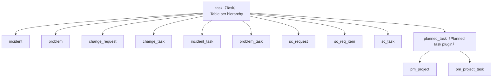
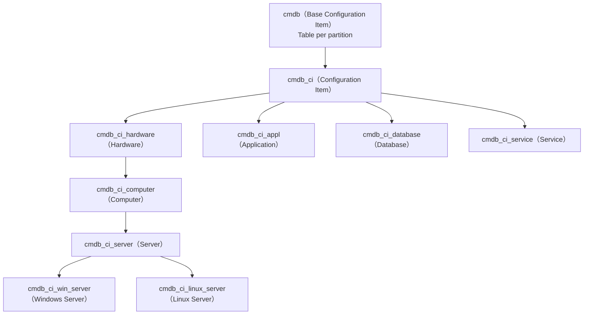
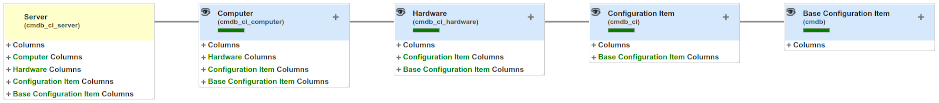
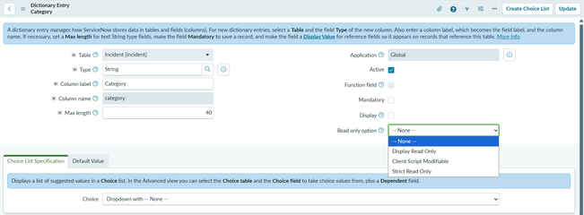
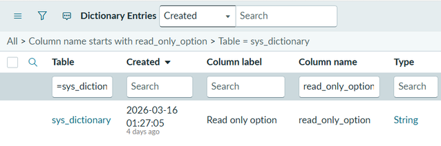
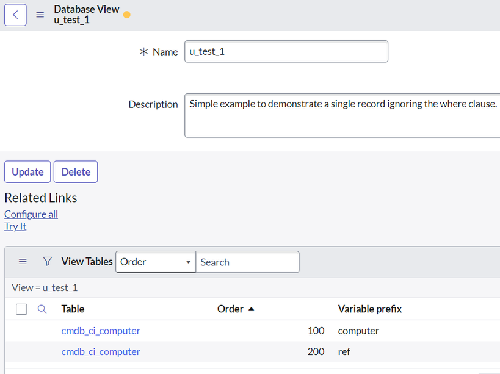
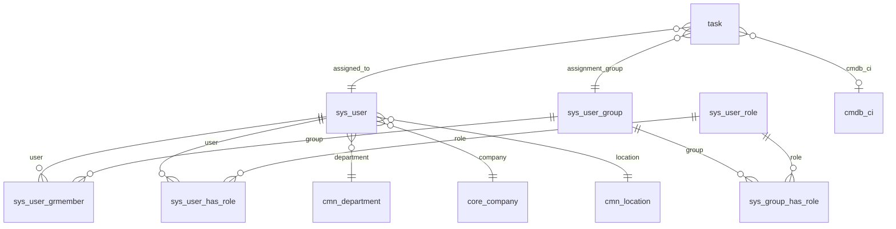

# Data Model and System Dictionary（データモデルとシステムディクショナリ）

## 概要

ServiceNow のすべてのアプリケーション（ITSM、HRSD、CSM、カスタムアプリ等）は、単一のリレーショナルデータベース上の **Table（テーブル）** と **Field / Column（フィールド／カラム）** で構成される。テーブルとフィールドの定義そのものもテーブルに格納されており、テーブル定義は `sys_db_object`（Tables）、フィールド定義は `sys_dictionary`（Dictionary Entries＝**System Dictionary（システムディクショナリ）**）、ラベル・ヒントは `sys_documentation`（Field Labels＝Language File）に保持される。[出典](https://www.servicenow.com/docs/r/UrSRFFKWBbfQBgoRlt~ltw/df1i9ScWQDJQdBX9nlUwqA)

ServiceNow のデータモデルの最大の特徴は **Table extension（テーブル拡張）** である。`task` や `cmdb_ci` のような親テーブル（基底クラス）を子テーブルが拡張し、親のフィールドと（モデルによっては）レコードを共有する。これにより Incident・Problem・Change 等が共通の `task` 機能（割り当て、SLA、承認、ワークフロー）を利用できる。[出典](https://www.servicenow.com/docs/r/australia/platform-administration/table-administration-and-data-management/table-extension-and-classes.html)

本ファイルは次の問いに答える。

| 問い | 該当する節 |
|---|---|
| テーブル・フィールド定義はどこに格納されているか | [1](#1-データディクショナリを構成するテーブル) |
| テーブルはどう作るか、命名規則・ライセンス上の注意は | [2](#2-テーブルtablesys_db_object) |
| すべてのテーブルに自動で付くフィールドは / sys_id とは | [3](#3-システム既定フィールドglobal-default-fieldsと-sys_id) |
| テーブル拡張と 3 つの Extension model の違いは | [4](#4-テーブル拡張table-extensionとクラス階層) |
| Dictionary entry の各項目の意味は | [5](#5-system-dictionarysys_dictionaryと-dictionary-entry-フォーム) |
| Australia で追加された Read-only option とは | [6](#6-read-only-optionaustralia-で導入) |
| どのようなフィールドタイプがあるか | [7](#7-フィールドタイプfield-types) / [付録A](#付録a-フィールドタイプ全一覧australia158-種) |
| Reference・List・Document ID・ドット・ウォークの仕組みは | [8](#8-referenceリストdocument-id-とドットウォーク) |
| Choice list はどう定義・管理されるか | [9](#9-choice-list選択リスト) |
| Dictionary override で何を上書きできるか | [10](#10-dictionary-overrideディクショナリオーバーライド) |
| Dictionary attributes の主なものは | [11](#11-dictionary-attributesディクショナリ属性) |
| Database views の作り方と制約は | [12](#12-database-viewsデータベースビュー) |
| Schema map の使い方は | [13](#13-schema-mapスキーママップ) |
| 主要なシステムテーブル・業務テーブルは | [14](#14-主要テーブル一覧) |
| 設計時の注意点は | [15](#15-データモデル設計の注意点) |

> 基準リリースは Australia（2026-05 GA）。Brazil で判明している変更は「Brazil での変更」として併記する。本ファイルで扱う範囲について、Australia→Brazil の差分として公式に確認できた変更は Table Builder release notes 上「No updates」であり、主要な変更は Australia で導入された Read-only option である（[6 章](#6-read-only-optionaustralia-で導入)）。

関連ファイル：

- 基本概念の入門は [必須の基本概念](../../01_入門編/04-core-concepts.md)
- リスト・フォームの UI 操作は [リストとフォーム](./lists-forms.md)
- フィールド単位のアクセス制御は [アクセス制御（ACL）](./access-control-acl.md)
- CMDB のクラス設計・CSDM は [CMDB と CSDM](./cmdb-csdm.md)
- ユーザー・グループ・ロールの詳細は [ユーザー・グループ・ロール](./users-groups-roles.md)
- スクリプトからのデータアクセス（GlideRecord）は [サーバーサイドスクリプト](./scripting-server-side.md)
- アプリ開発（App Engine Studio / Table Builder / スコープ）は [アプリケーション開発](./app-development.md)

---

## 1. データディクショナリを構成するテーブル

### 1.1 3 つの中核テーブル

ServiceNow のデータディクショナリ（Data dictionary）は、次の 3 つのテーブルで構成される。[出典](https://www.servicenow.com/docs/r/UrSRFFKWBbfQBgoRlt~ltw/df1i9ScWQDJQdBX9nlUwqA)

| Label（ラベル） | テーブル名 | 内容 | アクセス方法 |
|---|---|---|---|
| Tables（テーブル） | `sys_db_object` | データベース内の各テーブルにつき 1 レコード | All > System Definition > Tables |
| Dictionary Entries（ディクショナリエントリ） | `sys_dictionary` | 別名 System Dictionary。全テーブル・全フィールドを定義し、データタイプ、文字数上限、既定値、依存関係などの属性を保持 | All > System Definition > Dictionary、またはリストヘッダー／フォームヘッダー／フィールドラベルの右クリック > **Configure Dictionary** |
| Field Labels（フィールドラベル） | `sys_documentation` | 別名 Language File（言語ファイル）。テーブル・カラムのラベルとヒントを言語ごとに保持 | All > System Definition > Language File、またはフォームのフィールドラベル右クリック |

`sys_dictionary` の各行は「テーブル」または「カラム」のいずれかを表す。テーブル自体を表す行は Type が **Collection** で、カラム名が空のエントリである。[出典](https://www.servicenow.com/docs/r/australia/platform-administration/table-administration-and-data-management/c_SystemDictionary.html) / [出典（Dictionary entry form）](https://www.servicenow.com/docs/r/fBdxWC~8p08POQuUubVDig/wjzwd4JRag1gCOtvm5HoaA)

### 1.2 関連する定義テーブル

| テーブル | 内容 | 根拠 |
|---|---|---|
| `sys_dictionary_override` | Dictionary override（[10 章](#10-dictionary-overrideディクショナリオーバーライド)） | Table Builder release notes（Australia）で Read-only option の対象として `sys_dictionary` と並んで明記 [出典](https://www.servicenow.com/docs/r/delta-australia-brazil/brazil-australia-tablebuilder-release-notes.html) |
| `sys_choice` | Choice list の各選択肢（[9 章](#9-choice-list選択リスト)） | [出典](https://www.servicenow.com/docs/r/fBdxWC~8p08POQuUubVDig/Q6oLXa6325O0jz_TUTjkhQ) |
| `sys_choice_set` | Choice list を持つフィールドごとに 1 レコード。選択肢一式をアプリケーションファイルとして束ねる | [出典](https://www.servicenow.com/docs/r/australia/platform-administration/t_ViewChoiceListDefinitions.html) |
| `sys_db_view` / `sys_db_view_table` / `sys_db_view_table_field` | Database view とその構成テーブル・返却フィールド（[12 章](#12-database-viewsデータベースビュー)） | テーブル名は【経験則】。公式ページは画面名（Database View / View Tables / View Fields）で記載 |
| `sys_filter_option_dynamic` | Dynamic filter option（動的参照修飾子・動的既定値で利用） | テーブル名は【経験則】。メニューは All > System Definition > Dynamic Filter Options [出典](https://www.servicenow.com/docs/r/australia/platform-administration/c_ReferenceQualifiers.html) |
| `sys_schema_attribute` / `sys_schema_attribute_m2m` | Dictionary attribute の定義と、ディクショナリエントリへの割り当て | 【経験則】（公式ページでは「Attributes related list」として記載） |
| `sys_glide_object` | フィールドタイプ（internal type）の定義 | 【経験則】公式ドキュメントでの説明は確認できず |

### 1.3 System Dictionary 変更時の注意（公式）

- System Dictionary レコードの変更は機能に大きな影響を与えうるため、慎重に行う。`sys_` で始まるシステムテーブルのディクショナリ変更は、アップデートセットが使えなくなる等のインスタンス全体の問題を引き起こすことがある。
- ディクショナリ変更は元に戻すのが難しい。
- 変更は、Dictionary override がない限り、すべての拡張（子）テーブルに伝播する。
- 本番適用前に十分テストする。
- ディクショナリから作成したフィールドは、既定フォームビューの先頭セクションの末尾に追加される。通常の作業では Tables モジュールやフォームの構成（Configure）からフィールドを作るのが推奨。

[出典](https://www.servicenow.com/docs/r/australia/platform-administration/table-administration-and-data-management/c_SystemDictionary.html)

---

## 2. テーブル（Table、`sys_db_object`）

### 2.1 テーブル作成手順（System Definition > Tables）

テーブルは **admin** ロールで All > System Definition > Tables > **New** から作成する。作成前に Subscription Management でカスタムテーブルのエンタイトルメント（Custom table entitlements）を確認することが公式に求められている。[出典](https://www.servicenow.com/docs/r/UrSRFFKWBbfQBgoRlt~ltw/IRcVTu7Sn8ugmzuv4V_gRA)

1. All > System Definition > Tables に移動し、**New** を選択。
2. Table フォームの各項目を入力。
3. **Columns** セクションの Table Columns 埋め込みリストでカラムを追加。
4. **Controls** セクションで追加オプションを設定。
5. **Application Access** セクションでスコープ保護を設定。
6. **Submit**。

テーブル作成後のテーブルラベルの変更は Field Label [`sys_documentation`] で、対象テーブルを絞り込み **Element を空** にしたレコードを編集する。[出典](https://www.servicenow.com/docs/r/UrSRFFKWBbfQBgoRlt~ltw/IRcVTu7Sn8ugmzuv4V_gRA)

> アプリ開発者向けには App Engine Studio の **Table Builder**（Store アプリ）からもテーブル・フィールドを作成できる。詳細は [アプリケーション開発](./app-development.md) を参照。

### 2.2 Table フォームの項目

[出典](https://www.servicenow.com/docs/r/UrSRFFKWBbfQBgoRlt~ltw/IRcVTu7Sn8ugmzuv4V_gRA)

**Table（基本）**

| 項目（英語） | 日本語 | 説明 |
|---|---|---|
| Label | ラベル | リスト・フォームに表示される一意の表示名 |
| Name | 名前 | ラベルから接頭辞付きで自動生成。接頭辞以降のみ編集可 |
| Extends Table | 拡張元テーブル | 拡張する親テーブル。Extensible な（かつ同一スコープまたは他スコープから構成可能な）テーブルのみ選択可。Remote Table 選択時は不可 |
| Application | アプリケーション | 読み取り専用。現在のアプリケーションまたは Global |
| Remote Table | リモートテーブル | 外部ソースのデータをスクリプト定義で取得するテーブルとして作成 |
| Create module | モジュール作成 | リストモジュールを作成（テーブル作成時のみ） |
| Add module to menu | メニューへのモジュール追加 | 既存メニュー選択または新規メニュー作成（Create module 選択時のみ表示） |

**Columns（Table Columns 埋め込みリスト）**

| 項目 | 説明 |
|---|---|
| Column label | リストヘッダー・フォームに表示されるラベル |
| Type | フィールドタイプ。データ保全のため、同じ基本型間（例：Choice と String）でのみ変更すべき |
| Reference | 参照先テーブル名。存在しないテーブル名を入れると保存時に新規作成される |
| Max length | String のみ。概ね 254 以下は 1 行、255 以上は複数行（テキストエリア）（境界値の表記はページ間で揺れあり。[7.2](#72-よく使うフィールドタイプカテゴリ別) の注記参照） |
| Default value | 既定値。フィールドタイプと整合する必要あり |
| Display | このテーブルを参照するレコードでの表示値（Display value）にするか |

**Controls**

| 項目 | 説明 |
|---|---|
| Extensible | 他テーブルからの拡張を許可。外すと新たな子テーブルは作れないが既存の子テーブルは残る |
| Live feed | レコードフィードと Show Live Feed アイコンを有効化 |
| Auto-number | 自動採番フィールドを追加（番号書式が未定義の場合のみ） |
| Create access controls | 基本的な ACL を作成（User role の指定が必要） |
| User role | テーブルにアクセスするのに必要なロール |

**Application Access（スコープ保護）**

| 項目 | 説明 |
|---|---|
| Accessible from | All application scopes（全スコープ）／ This application scope only（自スコープのみ） |
| Can read | 他スコープによるレコード読み取りを許可。他の Can 系の前提 |
| Can create / Can update / Can delete | 他スコープによる作成／更新／削除を許可（各々 Can read が前提） |
| Allow access to this table via web services | Web サービス経由のアクセスを許可（ユーザー権限は別途必要） |
| Allow configuration | 他スコープがこのテーブルを参照する構成レコード（Business rule 等）を作成可能 |

スコープ保護の詳細は [アプリケーション開発](./app-development.md) を参照。

### 2.3 テーブル命名規則

| 種別 | 接頭辞 | 例 |
|---|---|---|
| Global スコープのカスタムテーブル | `u_` | `u_contract_request` |
| スコープアプリのテーブル | ネームスペース識別子（通常 `x_<会社コード>_<アプリ>_`） | `x_acme_hr_onboarding` |
| Global のリモートテーブル | `u_st_` | `u_st_weather` |
| スコープアプリのリモートテーブル | ネームスペース識別子 + `st_` | `x_acme_app_st_xxx` |

- 接頭辞は変更できない。残りの部分は小文字 ASCII 英字・数字・アンダースコアのみ使用可。[出典](https://www.servicenow.com/docs/r/UrSRFFKWBbfQBgoRlt~ltw/IRcVTu7Sn8ugmzuv4V_gRA)
- `x_<会社コード>` 形式のスコープ接頭辞は一般的な形式（【経験則】。公式の Create a table ページでは「namespace identifier」とのみ記載）。
- テーブル名・カラム名の最大長は、公開情報では確認できず。

### 2.4 テーブル作成時の注意点（公式）

- **`sys_choice` を拡張しない**（非サポート）。[出典](https://www.servicenow.com/docs/r/UrSRFFKWBbfQBgoRlt~ltw/IRcVTu7Sn8ugmzuv4V_gRA)
- 必要なテーブルのみ作る。不要なテーブルは管理工数とアップグレード時間を増やす。
- **カスタムテーブルはサブスクリプションのエンタイトルメント上限に計上される**。使用状況管理者（usage administrator）がカスタムテーブルをサブスクリプションに割り当てる。ライセンスの考え方は [ライセンスモデル](../../03_導入編/01-licensing-model.md) を参照。
- Database view はカスタムテーブルとして扱われず、ライセンス影響はない。[出典](https://www.servicenow.com/docs/r/UrSRFFKWBbfQBgoRlt~ltw/17ueFRy1zGyQJEdsA0Zg0w)
- テーブル拡張は **テーブル作成時にのみ** 指定できる（後から親を変更できない）。[出典](https://www.servicenow.com/docs/r/australia/platform-administration/table-administration-and-data-management/table-extension-and-classes.html)

### 2.5 `sys_db_object` の主なカラム

以下は `sys_db_object` の主なカラム名である（フォーム項目との対応は【経験則】。インスタンスの `sys_db_object.list` の列で確認可能）。

| カラム名 | 対応するフォーム項目 / 意味 |
|---|---|
| `name` | Name（テーブル名） |
| `label` | Label |
| `super_class` | Extends table（親テーブルへの参照。基底クラスでは空） |
| `is_extendable` | Extensible |
| `extension_model` | Extension model（基底クラスで設定。`task` の子テーブルなどでは空で、親のモデルを継承）[出典](https://www.servicenow.com/community/developer-forum/how-to-identify-if-a-table-structure-is-table-per-hierarchy/m-p/2534280) |
| `number_ref` | Auto-number の番号書式（`sys_number`）への参照 |
| `sys_scope` / `sys_package` | Application（スコープ）/ パッケージ |
| `access` | Accessible from |
| `read_access` / `create_access` / `update_access` / `delete_access` | Can read / create / update / delete |
| `ws_access` | Allow access to this table via web services |
| `configuration_access` | Allow configuration |

---

## 3. システム既定フィールド（Global default fields）と `sys_id`

### 3.1 Global default fields

すべてのテーブルには必須のシステムフィールドが自動で追加され、削除・変更はできない。[出典](https://www.servicenow.com/docs/r/australia/platform-administration/table-administration-and-data-management/r_GlobalDefaultFields.html)

| Label | 名前 | タイプ | 説明 |
|---|---|---|---|
| Class（クラス） | `sys_class_name` | System Class Name | 拡張可能なテーブルで、レコードが属する子テーブル名を示す |
| Created（作成日時） | `sys_created_on` | Date/Time | レコード作成日時 |
| Created by（作成者） | `sys_created_by` | String | 作成したユーザー（ユーザー ID 文字列。参照型ではない） |
| Sys_id | `sys_id` | Sys ID（GUID） | レコードを一意に識別する 32 文字の GUID |
| Updates（更新回数） | `sys_mod_count` | Integer | 作成以降の更新回数 |
| Updated by（更新者） | `sys_updated_by` | String | 最後に更新したユーザー |
| Updated（更新日時） | `sys_updated_on` | Date/Time | 最終更新日時 |

上記に加え、ドメインセパレーション有効時の `sys_domain` / `sys_domain_path`、タグ機能の `sys_tags` などが存在するテーブルもある（【経験則】）。ドメインについては [ドメインセパレーション](./domain-separation.md) を参照。

### 3.2 Unique record identifier（`sys_id`）

- 各レコードは 32 文字の GUID（Globally Unique ID）である **Sys ID（`sys_id`）** で識別される。[出典](https://www.servicenow.com/docs/r/SbrhqYG7UKQCk7uYwvgVBA/uPAKWbHDiI~Pagf56dbUGw)
- アプリケーション内で作成された `sys_id` は一意である。ただし Update Set や XML でレコードをコピーした場合は同じ `sys_id` が維持される（インスタンス間で同一レコードを識別できるのはこのため）。
- 未保存の新規レコードの `sys_id` は `-1` で、挿入時に新しい値が割り当てられる。
- `sys_id` はレコード URL の `sys_id=` パラメータやスクリプト（例：`current.sys_id`）で確認できる。
- Reference フィールドの実データは参照先レコードの `sys_id` である（[8 章](#8-referenceリストdocument-id-とドットウォーク)）。

---

## 4. テーブル拡張（Table extension）とクラス階層

### 4.1 親テーブル・子テーブル・基底クラス

- 子テーブル（Child table / Child class）は親テーブル（Parent table / Parent class）のフィールドとレコードを共有できる。拡張は **テーブル作成時のみ** 可能。[出典](https://www.servicenow.com/docs/r/australia/platform-administration/table-administration-and-data-management/table-extension-and-classes.html)
- 他のテーブルを拡張していない親クラスを **Base class（基底クラス）** と呼ぶ。テーブルは親であり同時に子でもありうる。
- ベースシステムの例：
  - Task [`task`] → Incident [`incident`]、Problem [`problem`]、Change Request [`change_request`]
  - Configuration Item [`cmdb_ci`] → Application、Computer、Database
- 親テーブル上のフィールドを変更すると、親と **すべての子テーブル** に影響する（子テーブル側から親由来フィールドを編集しても同様）。[出典](https://www.servicenow.com/docs/r/australia/platform-administration/c_IntroductionToFields.html)

### 4.2 3 つの Extension model（拡張モデル）

テーブル拡張の物理的な格納方式は 3 種類あり、作成される DB テーブル数、親からのフィールドの導出方法、レコード複製の有無が異なる。[出典](https://www.servicenow.com/docs/r/australia/platform-administration/table-administration-and-data-management/table-extension-and-classes.html)

| 観点 | Table per class（クラスごとのテーブル） | Table per hierarchy（階層ごとのテーブル） | Table per partition（パーティションごとのテーブル） |
|---|---|---|---|
| 物理 DB テーブル | 親・子それぞれに別テーブル | 親と全子クラスで **1 つ** の物理テーブル | 親の 1 テーブル。ストレージ上限到達時に **パーティション（ストレージテーブル）を自動追加** |
| 子のフィールド | 親から導出（子のディクショナリは固有フィールドのみ） | 親から導出（子のディクショナリは固有フィールドのみ） | 導出しない。各子クラスが自身のフィールドリストを持つ（親のディクショナリ変更は子のディクショナリへ複製） |
| レコード複製 | 子レコードは同じ `sys_id` で親テーブルにも複製され、変更も親に同期 | 不要 | 不要 |
| クラス識別カラム | — | `sys_class_name` | `sys_class_name` と `sys_class_path` |
| 公式の例 | Contract [`ast_contract`]：ディクショナリレコード 59 | Task [`task`]：66 / Incident [`incident`]：固有 22 | Base Configuration Item [`cmdb`]：48 / Hardware [`cmdb_ci_hardware`]：73 |

- `sys_class_name` は hierarchy / partition モデルで親クラスのディクショナリに存在し、レコードがどの子クラスに属するかを示す（例：`incident`、`change_request`、`cmdb_ci_hardware`、`cmdb_ci_computer`）。公式ページの例示では「change」と表記されているが、Change Request の実際のテーブル名・`sys_class_name` の値は `change_request` である（[4.3 節](#43-代表的なクラス階層task)・14.4 節の表も同じ）。
- 上記のディクショナリレコード数はベースシステムの例示であり、上限値ではない。
- 拡張モデルはインスタンスの `sys_db_object` リストに `Extension model` 列を追加して確認できる。子テーブルでは空欄で親のモデルを継承する。[出典](https://www.servicenow.com/community/developer-forum/how-to-identify-if-a-table-structure-is-table-per-hierarchy/m-p/2534280)
- Table per hierarchy の `task` 系では、`incident` 等の子テーブル用の物理テーブルは作られず、全レコードが `task` の物理テーブルに格納される（公式の「1 つの DB テーブル」の記述と一致。【第三者情報】コミュニティでも同旨）。

### 4.3 代表的なクラス階層（Task）

- `incident`、`problem`、`planned_task` が `task` を拡張することは公式に明記されている。その他の子テーブル（`change_request`、`sc_req_item` 等）の親子関係は【経験則】（インスタンスで `sys_db_object` を `super_class=task` で絞り込めば確認可能）。[出典](https://www.servicenow.com/docs/r/UrSRFFKWBbfQBgoRlt~ltw/4zrtHLsaC2WjPKRXQyU35w)
- `pm_project` / `pm_project_task` が `planned_task` の子であることも【経験則】。
- HRSD の HR Case、CSM の Case、SecOps の Security Incident など、多くの製品のケース／タスクテーブルも `task` を拡張している（【経験則】。各製品ファイル参照）。

### 4.4 代表的なクラス階層（CMDB）

CMDB は `cmdb`（Base Configuration Item）を基底とする Table per partition 構成で、その下に `cmdb_ci`、さらに数百のクラスが連なる。

- `cmdb_ci_server` → `cmdb_ci_computer` → `cmdb_ci_hardware` → `cmdb_ci` → `cmdb` の階層は公式の Schema map 解説（Server が Computer・Hardware・Configuration Item を拡張）および下図で確認できる。[出典](https://www.servicenow.com/docs/r/UrSRFFKWBbfQBgoRlt~ltw/UCMpmIhbwDlrLLB~LGIxHg)
- `cmdb_ci_win_server`、`cmdb_ci_linux_server`、`cmdb_ci_appl`、`cmdb_ci_database`、`cmdb_ci_service` の位置付けは【経験則】。CMDB クラスの管理は **CI Class Manager** で行うのが推奨。詳細は [CMDB と CSDM](./cmdb-csdm.md) を参照。

- **キャプション:** Schema map で `cmdb_ci_server`（Server）を表示した際の派生階層ノード群。
- **画面の説明:** 左端の黄色のノードが選択テーブル Server（`cmdb_ci_server`）。右へ順に Computer（`cmdb_ci_computer`）、Hardware（`cmdb_ci_hardware`）、Configuration Item（`cmdb_ci`）、Base Configuration Item（`cmdb`）の青いノードが線で接続され、拡張（Extending）関係を示す。各ノードには「+ Columns」に加え、「+ Computer Columns」「+ Hardware Columns」「+ Configuration Item Columns」「+ Base Configuration Item Columns」のように親クラス由来カラムを展開するリンクが派生順の逆順で並ぶ。ノード見出しには表示/非表示の目のアイコンと展開用の「+」がある。
- **出典:** https://www.servicenow.com/community/developer-blog/servicenow-things-to-know-101-schema-map-in-a-table-schema/ba-p/2919252 （取得日: 2026-11-02）

### 4.5 Task テーブルを扱う際の公式ガイド

[出典](https://www.servicenow.com/docs/r/UrSRFFKWBbfQBgoRlt~ltw/4zrtHLsaC2WjPKRXQyU35w)

- `task` テーブルに直接タスクを作成しない。`task.list` から New を選ぶと **Task Interceptor** で子テーブルを選択させる。
- `task` を拡張したテーブルでは、Approvals（承認）、Assignment rules（割り当てルール）、Service levels（SLA）、Inactivity monitors（非活動モニター）、Workflow Studio のフローがそのまま使える。
- `task` への変更は全子テーブルに及ぶ。フィールド追加は（不要な画面で非表示にできるため）低影響だが、共有フィールドの削除はデータ消失を招く。
- `task` に追加する Choice list の値は一意にする。
- 子テーブル固有の定義変更は Dictionary override で行う。

---

## 5. System Dictionary（`sys_dictionary`）と Dictionary entry フォーム

### 5.1 Dictionary entry へのアクセス

- All > System Definition > Dictionary（`sys_dictionary.list`）
- フォームのフィールドラベル右クリック > **Configure Dictionary**（または Show *<フィールド名>*）
- リストのカラムヘッダー右クリック > Configure > Dictionary

[出典](https://www.servicenow.com/docs/r/UrSRFFKWBbfQBgoRlt~ltw/df1i9ScWQDJQdBX9nlUwqA) / [出典](https://www.servicenow.com/docs/r/platform-administration/table-administration-and-data-management/make-field-read-only.html)

フォームには **Default view（既定ビュー）** と **Advanced view（詳細ビュー）** があり、UI Action で切り替える。参照修飾子の種類、動的既定値、計算値、属性などは Advanced view にのみ表示される。[出典](https://www.servicenow.com/docs/r/fBdxWC~8p08POQuUubVDig/wjzwd4JRag1gCOtvm5HoaA)

- **キャプション:** Australia リリースにおける Dictionary Entry フォーム（`incident.category`）。
- **画面の説明:** 上部に説明バナー（「A dictionary entry manages how ServiceNow stores data in tables and fields (columns)…」）。左列に Table（Incident [incident]）、Type（String）、Column label（Category）、Column name（category）、Max length（40）。右列に Application（Global）、Active（チェック済）、Function field、Mandatory、Display の各チェックボックスと **Read only option** ドロップダウン（選択肢：-- None -- / Display Read Only / Client Script Modifiable / Strict Read Only）。下部タブに **Choice List Specification**（Choice = Dropdown with -- None --）と Default Value。旧来の「Read only」チェックボックスはこの画面では表示されていない。
- **出典:** https://www.servicenow.com/community/itsm-articles/new-read-only-options-australia-release/ta-p/3511146 （取得日: 2026-11-02）

### 5.2 Dictionary entry フォームの全項目（Australia）

[出典](https://www.servicenow.com/docs/r/fBdxWC~8p08POQuUubVDig/wjzwd4JRag1gCOtvm5HoaA)（Australia 版、pt-BR ページを英訳・和訳）。「上書き可」は Dictionary override で拡張テーブル側の値を変更できる項目。カラム名（`sys_dictionary` 上の物理名）は `read_only_option` を除き【経験則】。

**基本項目**

| 項目（英語） | 日本語 | カラム名 | 説明 |
|---|---|---|---|
| Table | テーブル | `name` | 要素を作成するテーブル。スコープ制約上フィールド追加が許可されたテーブルのみ表示 |
| Type | タイプ | `internal_type` | フィールドタイプ。Collection の場合はテーブル自体を表す。データ保全のため、同じ物理 DB 型に対応する論理型間（例：Choice ⇔ String）でのみ変更可 |
| Column label | カラムラベル | `column_label` | リストヘッダー・フォームに表示される一意のラベル。変更すると現在の言語の Language File も更新 |
| Column name | カラム名 | `element` | 内部名。ラベルから自動生成。Global アプリでは `u_`、他スコープのテーブルではスコープ接頭辞、同一スコープアプリ内では接頭辞なし。作成後変更不可。小文字 ASCII・数字・アンダースコアのみ、連続アンダースコアは 1 つに集約 |
| Max length | 最大長 | `max_length` | String の論理サイズ上限。UI 表示（254 以下は 1 行、255 以上は複数行）と物理 DB 型を決める（物理型は切り上げられる場合あり）。Oracle インスタンスは UI から 4000 文字超に設定不可（サポート依頼が必要）。データ消失の恐れがあるため縮小は新規アプリでのみ。ベースシステムのフィールドはデータ消失を招く変更不可 |
| Active | 有効 | `active` | 無効にするとクラシックフォーム・リストから非表示になるが、クエリ・スクリプトからは利用可。管理者が構成したリストには削除するまで残り、既存レポートも動作。API は Active を検査しない |
| Function field | 関数フィールド | `function_field` | DB 関数（四則演算、文字列長、曜日など）の結果を表示するフィールド。保存後はクリア不可 |
| Function definition | 関数定義 | `function_definition` | `glidefunction:` で始まり、演算名とパラメータを続ける。定数はシングルクォート。パラメータにドット・ウォーク可 |
| Read only | 読み取り専用（レガシー） | `read_only` | Australia 以前からの旧オプション。Australia 前に読み取り専用だったフィールド、または Read-only option が選択されている場合は選択済みかつグレーアウト（UI から編集不可） |
| Read-only option | 読み取り専用オプション | `read_only_option` | Australia で追加。[6 章](#6-read-only-optionaustralia-で導入)参照。上書き可 |
| Mandatory | 必須 | `mandatory` | 保存前に値が必要。上書き可 |
| Display | 表示値 | `display` | このテーブルへの参照リンクに表示されるフィールド（Display value）。Task 系は既定で Number。レイアウトは制御しないが、レコードのフォームタイトルの一部になる。上書き可 |
| Unique | 一意 | `unique` | 値の一意性を強制。既存データに重複がある状態で有効化するとデータ消失が起こるため事前確認必須 |
| Spell check | スペルチェック | `spell_check` | スペルチェックの有効/無効 |
| Auditing | 監査 | `audit` | テーブル単位（Collection エントリのみ）で監査（履歴）を有効化 |
| Text index | テキストインデックス | `text_index` | テーブル単位でテキスト検索のインデックス対象にするか |
| Attributes [Advanced] | 属性 | `attributes` | フィールドやそれに依存する機能の動作を変更。Attributes related list で管理。上書き可（[11 章](#11-dictionary-attributesディクショナリ属性)） |

**既定値（Default Value タブ）**

| 項目 | 説明 |
|---|---|
| Default value | 新規レコードに設定される値。フィールドタイプと整合が必要。`javascript:` で始まるスクリプトも可（例：`javascript:gs.getUserID()`、【経験則】）。上書き可 |
| Dynamic default [Advanced] | Dynamic filter option から既定値を動的生成 |
| Dynamic filter value [Advanced] | Dynamic default 選択時に使う Dynamic filter option |

**参照（Reference Specification タブ）**

| 項目 | 説明 |
|---|---|
| Reference | 参照先テーブル。存在しないテーブル名を入れると保存時に新規テーブルが作られ、現在のテーブルにナビゲーターのモジュールがあれば同じメニューに新テーブルのモジュールも追加 |
| Use reference qualifier [Advanced] | 修飾子の種類：Simple（条件ビルダー）／ Dynamic（Dynamic filter option）／ Advanced（静的エンコードクエリまたは JavaScript） |
| Reference qualifier condition | Simple 選択時の条件 |
| Dynamic reference qualifier [Advanced] | Dynamic 選択時の Dynamic filter option |
| Reference qualifier [Advanced] | Advanced 選択時のクエリ／スクリプト。上書き可 |
| Reference key [Advanced] | 参照の一意キーとして `sys_id` 以外のフィールドを使う |
| Reference cascade rule [Advanced] | 参照先レコード削除時の動作：**Clear**（既定。`-- None --` 表示時も同じ。参照元レコードは残り参照値だけ空になる）／ **Delete**（= **Cascade**。参照元レコードも削除。慎重に使う）／ **Restrict**（参照されている間は削除を阻止）／ **None**（参照元レコードを変更せず、参照値も残す）。既定の「Clear / -- None --」と選択肢の「None」は別物。**多対多（m2m）関係のテーブルではこの設定は効かず、参照先レコードはルールに関係なく削除される**。[出典](https://www.servicenow.com/docs/r/australia/platform-administration/t_CascadeDeleteRules.html) |
| Floating references [Advanced] | 1 対多の関連リストで Edit ボタンを有効化 |
| Dynamic creation [Advanced] | 一致レコードがない値を入力したとき参照先に新規レコードを作るか |
| Dynamic creation script [Advanced] | Dynamic creation 時の作成ロジック |

**依存・選択肢（Dependent Field / Choice List Specification タブ）**

| 項目 | 説明 |
|---|---|
| Dependent field [Advanced] | 同一テーブル内の依存元フィールド。選択肢・参照候補を絞る。上書き可 |
| Choice | 候補値の表示方法：Dropdown with -- None --／ Dropdown without -- None --／ Suggestion など。使う場合は Choice list を定義するか Choice table / Choice field で他フィールドの選択肢をコピー |
| Choice table [Advanced] | 選択肢の取得元テーブル（Choice field の指定が必要） |
| Choice field [Advanced] | 選択肢の取得元 Choice フィールド |

**計算値（Calculated Value タブ）**

| 項目 | 説明 |
|---|---|
| Calculated value [Advanced] | 選択すると他の値から計算。並べ替え・フィルター・グループ化は最後に更新されたときの保存値を使用。Business rule 実行前に計算され、必要に応じ実行後にも再計算 |
| Calculation type [Advanced] | スクリプトベースまたは数式（formula）ベース |
| Calculation [Advanced] | スクリプトまたは数式。上書き可。計算スクリプトを持つフィールドは読み取り専用表示でインライン編集不可 |

**テーブル（Collection）エントリのみの項目**

| 項目 | 説明 |
|---|---|
| Class | このテーブルが拡張しているテーブル（拡張していない場合は自身の名前） |
| Defaultsort | 非推奨 |
| Size class | 大規模テーブルとして扱い、クエリ時の行あたりメモリを削減するか。スケジュールジョブが設定 |

**Related lists（関連リスト）**

| 関連リスト | 内容 |
|---|---|
| Access Controls | テーブルデータへのアクセスを許可・制限する ACL |
| Choices | Choice list の選択肢 |
| Dictionary Overrides | このフィールドの Dictionary override |
| Attributes | このエントリのディクショナリ属性 |
| Labels | テーブル／フィールドのラベル（`sys_documentation`） |

### 5.3 フィールドの作成・変更に関する公式ルール

[出典](https://www.servicenow.com/docs/r/australia/platform-administration/c_IntroductionToFields.html)

- フィールドはフォームでは入力項目、リストではカラムとして表示される。管理者は新規フィールド作成と既存フィールドのタイプ変更ができる。
- カスタムフィールドには **サポート対象のフィールドタイプ** を使う。**User Input** などは内部用で、カスタムフィールドには使えない。
- **Field Name** 型は **Table Name** 型フィールドへの依存関係が必須で単独では存在できない。Field Name は常に値を持ち、既定値は `sys_id`。`allow_null=true` でも None にできない。
- 子テーブルで親にもあるフィールドを編集すると、親と他のすべての子テーブルにも変更が及ぶ。
- **漢字は現在カラム識別子としてサポートされない**。漢字を使ったカラム識別子はフォームの挿入・更新で無視される（日本語環境で特に注意）。
- フィールドのデータ型を変えたい場合は、新タイプで新カラムを作成 → バックグラウンドスクリプトで旧カラムから値をコピー → 旧カラムのラベルを変更、の手順を取る。

### 5.4 フィールドの作成・変更に必要なロール

| 操作 | ロール | 根拠 |
|---|---|---|
| テーブル作成、Dictionary override 作成 | `admin` | [出典](https://www.servicenow.com/docs/r/UrSRFFKWBbfQBgoRlt~ltw/IRcVTu7Sn8ugmzuv4V_gRA) / [出典](https://www.servicenow.com/docs/r/7LhbZn3yz3Q58qhjZoU9iQ/CEhaqRsBfnCRMYqTKXwXxw) |
| Read only option の設定 | `admin` | [出典](https://www.servicenow.com/docs/r/platform-administration/table-administration-and-data-management/make-field-read-only.html) |
| Dictionary の編集、「-- None --」の削除、他フィールドタイプの Choice list 化 | `personalize_dictionary` | [出典](https://www.servicenow.com/docs/r/fBdxWC~8p08POQuUubVDig/Q6oLXa6325O0jz_TUTjkhQ) |
| 選択肢の表示・構成（Configure Choices） | `personalize_choices`（ACL 経由ではなくユーザーに明示付与が必要） | 同上 |
| フィールドの全選択肢の削除 | `personalize` | 同上 |
| Database view 構成テーブルの追加 | `admin` | [出典](https://www.servicenow.com/docs/r/platform-administration/table-administration-and-data-management/t_AddATableToTheDatabaseView.html) |

---

## 6. Read-only option（Australia で導入）

### 6.1 概要

Australia リリースで、Dictionary entry（`sys_dictionary`）と Dictionary override（`sys_dictionary_override`）に **Read only option（読み取り専用オプション）** フィールド（String 型で選択肢（Choice list）付き、カラム名 `read_only_option`）が追加された。旧来の **Read only** チェックボックスはロックされ UI から編集できなくなった。[出典](https://www.servicenow.com/docs/r/delta-australia-brazil/brazil-australia-tablebuilder-release-notes.html) / [出典](https://www.servicenow.com/docs/r/fBdxWC~8p08POQuUubVDig/Kd8BqSKDYlEDs0kQpmEWfA)

### 6.2 選択肢

[出典](https://www.servicenow.com/docs/r/fBdxWC~8p08POQuUubVDig/Kd8BqSKDYlEDs0kQpmEWfA)

| オプション | UI 表示 | クライアントスクリプトからの変更 | サーバー側 API（Table API、GraphQL、`GlideRecordSecure()`）・バックグラウンドスクリプトからの変更 |
|---|---|---|---|
| **Instance Configured**（インスタンス構成） | 読み取り専用 | プロパティ `glide.read_only.legacy_read_only_behavior` に従う | 同左 |
| **Display Read Only**（表示のみ読み取り専用） | 読み取り専用 | 可 | 可 |
| **Client Script Modifiable**（クライアントスクリプト変更可） | 読み取り専用 | 可 | 不可 |
| **Strict Read Only**（厳格な読み取り専用） | 読み取り専用 | 不可 | 不可 |

- **Instance Configured** は Australia 以前に作成された読み取り専用フィールドの既定値で、アップグレード後も既存動作を維持するためのもの。`sys_choice` 上では非アクティブで、ユーザーが新たに選択することはできない【第三者情報】。[出典](https://www.servicenow.com/community/itsm-articles/new-read-only-options-australia-release/ta-p/3511146)
- 既定フォームではドロップダウンに Display Read Only / Client Script Modifiable / Strict Read Only の 3 つが表示される（5.1 の画像参照）。

### 6.3 システムプロパティ `glide.read_only.legacy_read_only_behavior`

| 項目 | 内容 |
|---|---|
| 値 | `display_read_only` / `client_script_modifiable` / `strict_read_only` |
| 既定値 | `client_script_modifiable`（Australia 以前と同じ「表示は読み取り専用だがクライアントスクリプトで変更可能」） |
| 適用範囲 | Read only option が **Instance Configured** のフィールドのみ |
| 想定用途 | 非本番インスタンスでのテスト。変更すると Instance Configured の全フィールドに影響するため **本番では変更しない** |

[出典](https://www.servicenow.com/docs/r/fBdxWC~8p08POQuUubVDig/Kd8BqSKDYlEDs0kQpmEWfA)

推奨手順（公式）：非本番でプロパティを `strict_read_only` にしてクライアントスクリプトやカスタマイズが動作するか検証 → 本番では個々のフィールドを順次 **Strict Read Only** に変更する。

設定手順：Dictionary entry を開く（フィールドラベル右クリック > Configure Dictionary、または System Definition > Dictionary）→ Read only option を選択 → Update。ロールは `admin`。[出典](https://www.servicenow.com/docs/r/platform-administration/table-administration-and-data-management/make-field-read-only.html)

- **キャプション:** `sys_dictionary` テーブル自身のディクショナリに追加された `read_only_option` カラムの定義。
- **画面の説明:** Dictionary Entries リストを「Column name starts with read_only_option」「Table = sys_dictionary」で絞り込んだ結果。1 行のみ表示され、Table = `sys_dictionary`、Created = 2026-03-16 01:27:05、Column label = Read only option、Column name = `read_only_option`、Type = String（Choice 指定付きの String）である。
- **出典:** https://www.servicenow.com/community/itsm-articles/new-read-only-options-australia-release/ta-p/3511146 （取得日: 2026-11-02）

### 6.4 注意点

- **Strict Read Only でも通常の `GlideRecord` からは更新できたという報告がある**。公式は「server-side APIs（Table API、GraphQL、`GlideRecordSecure()`）」と記載しており、ACL を評価しない素の `GlideRecord`（バックグラウンドスクリプトや Business rule の `current.setValue()`）が対象外である可能性がある【第三者情報】。重要フィールドの保護はフィールドレベル ACL と併用すること。[出典](https://www.servicenow.com/community/developer-forum/strict-read-only-field-can-still-be-updated-via-gliderecord/m-p/3599570)
- クライアント側の読み取り専用（UI Policy、`g_form.setReadOnly()`）はセキュリティ制御ではない。データ保護は ACL・Data policy で行う（[アクセス制御（ACL）](./access-control-acl.md)、[クライアントサイドスクリプト](./scripting-client-side.md)）。
- コミュニティ記事では OOTB クライアントスクリプト「Read Only Option warn message」による警告表示が紹介されている【第三者情報】。

> **Brazil での変更:** Table Builder の Australia→Brazil 差分リリースノートでは Read-only option を含め「No updates」。Brazil の公式ページ（Make a field read-only）は Australia と同じ 3 オプションを記載している。[出典](https://www.servicenow.com/docs/r/delta-australia-brazil/brazil-australia-tablebuilder-release-notes.html) / [出典](https://www.servicenow.com/docs/r/platform-administration/table-administration-and-data-management/make-field-read-only.html)

---

## 7. フィールドタイプ（Field types）

### 7.1 概要

フィールドタイプは管理者がフィールドを作成するとき、または既存フィールドのタイプを変更するときに選択する。Australia の公式 Field types リファレンスには **158 種** の内部名（Internal name）が掲載されており、一覧の内容は Yokohama 版と同一であった（2026-11-02 確認）。全一覧は [付録A](#付録a-フィールドタイプ全一覧australia158-種) に掲載。[出典](https://www.servicenow.com/docs/r/australia/platform-administration/r_FieldTypes.html)

- 一覧には内部用・システム用のタイプ（`collection`、`sys_class_name`、`user_input` 等）も含まれる。カスタムフィールドにはサポート対象のタイプを使う。[出典](https://www.servicenow.com/docs/r/australia/platform-administration/c_IntroductionToFields.html)
- タイプ変更は同じ物理 DB 型に対応する論理型間（例：Choice ⇔ String）でのみ安全に行える。[出典](https://www.servicenow.com/docs/r/fBdxWC~8p08POQuUubVDig/wjzwd4JRag1gCOtvm5HoaA)

### 7.2 よく使うフィールドタイプ（カテゴリ別）

説明は公式 Field types リファレンスの記述に基づく（[出典](https://www.servicenow.com/docs/r/VbEA8DxUy61CFZ25mbYrcQ/UBa8Uv8EEvVDdAhswzjcdg)）。

**文字列・テキスト**

| 表示名 | 内部名 | 説明 |
|---|---|---|
| String | `string` | テキスト。Max length が小さいと 1 行、大きいと複数行（注記参照） |
| String (Full UTF-8) | `string_full_utf8` | String と同じ最大長で絵文字等の 4 バイト UTF-8 に対応 |
| Multi Small / Two Line Text Area | `multi_small` / `multi_two_lines` | 短文用テキストエリア |
| HTML | `html` | リッチテキストエディタ付き |
| Translated Text / Translated HTML | `translated_text` / `translated_html` | ユーザーの言語に応じた翻訳を表示（[ローカライゼーション](./localization.md)） |
| Wiki | `wiki_text` | 簡易 Wiki 記法のエディタ |
| Journal / Journal Input / Journal List | `journal` / `journal_input` / `journal_list` | 追記型の履歴テキスト。`journal_input` は過去分を表示しない入力欄（例：`work_notes`、`comments`）。実データは `sys_journal_field` に格納（【経験則】） |
| URL | `url` | ロック時にリンク表示。HTTPS 有無の許可を制御可 |
| Email | `email` | メールアドレス |
| JSON / XML | `json` / `xml` | 構造化テキスト |
| Name-Value Pairs | `name_values` | 一意な名前と値の組（例：HTTP ヘッダー） |

> **注記（String の 1 行／複数行の境界）:** 公式ページ間で表記が揺れている。Dictionary entry form（Australia）は「255 未満は 1 行、254 超は複数行」、Create a table（Australia）は「254 未満は 1 行、255 以上は複数行」、Field types リファレンスは「255 文字までは 1 行、256 以上は複数行」と記載する。実務上は 255 前後が境界と理解し、厳密な挙動はインスタンスで確認すること。[出典](https://www.servicenow.com/docs/r/fBdxWC~8p08POQuUubVDig/wjzwd4JRag1gCOtvm5HoaA) / [出典](https://www.servicenow.com/docs/r/UrSRFFKWBbfQBgoRlt~ltw/IRcVTu7Sn8ugmzuv4V_gRA) / [出典](https://www.servicenow.com/docs/r/VbEA8DxUy61CFZ25mbYrcQ/UBa8Uv8EEvVDdAhswzjcdg)

**数値・通貨**

| 表示名 | 内部名 | 説明 |
|---|---|---|
| Integer | `integer` | 整数。リスト検索時は `=` を前置 |
| Long / Longint | `long` / `longint` | 標準整数の上限を超える大きな整数 |
| Decimal | `decimal` | 小数（既定小数点以下 2 桁、`scale` 属性で変更） |
| Floating Point Number | `float` | 既定スケール 7。最大長は 7 未満に設定不可 |
| Currency | `currency` | 小数点以下 4 桁と通貨セレクター。後から FX Currency に変更不可 |
| FX Currency | `currency2` | 為替換算対応通貨 |
| Price | `price` | 換算・表示を制御できる通貨 |
| Percent Complete | `percent_complete` | リストで進捗バー表示。既存 Decimal から変換可 |

**日付・時刻**

| 表示名 | 内部名 | 説明 |
|---|---|---|
| Date | `glide_date` | 日付 |
| Date/Time | `glide_date_time` | 日時（DB には UTC で格納しユーザーのタイムゾーンで表示、【経験則】） |
| Due Date | `due_date` | 日時を保持する期限日 |
| Time | `glide_time` / `time` | 時刻のみ（固定日付上に保持、DST 自動調整なし） |
| Duration | `glide_duration` | 期間 |
| Timer | `timer` | 経過時間（例：`task.time_worked`） |
| Calendar Date and Time / Schedule Date/Time | `calendar_date_time` / `schedule_date_time` | カレンダー・スケジュール用 |

**選択・真偽**

| 表示名 | 内部名 | 説明 |
|---|---|---|
| True/False | `boolean` | 真偽値（チェックボックス） |
| Choice | `choice` | 固定の選択肢リスト（例：Priority、Category） |
| Radio | `radio` | 排他的な選択肢をラジオボタン表示 |

**参照・関連**

| 表示名 | 内部名 | 説明 |
|---|---|---|
| Reference | `reference` | 他テーブルのレコードを参照（実値は `sys_id`） |
| List | `glide_list` | 複数レコード参照（カンマ区切りの `sys_id`、例：Watch list） |
| Document ID | `document_id` | 任意テーブルのレコードを参照（テーブル名フィールドと組み合わせ） |
| Table Name | `table_name` | テーブル選択。スコープアプリでは自スコープのテーブルのみ表示 |
| Field Name | `field_name` | Table Name フィールドで選んだテーブルのフィールドを参照（依存設定必須） |
| Field List | `field_list` | フィールドの複数選択 |
| Conditions | `conditions` | 条件ビルダー（依存するテーブル名フィールドが必要） |
| Domain ID | `domain_id` | ドメインへの参照 |
| Sys ID (GUID) | `GUID` | GUID |

**スクリプト・テンプレート**

| 表示名 | 内部名 | 説明 |
|---|---|---|
| Script | `script` | 構文チェック・整形・API リスト付きの JS エディタ（依存テーブル名フィールドが必要） |
| Script (Plain) | `script_plain` | 構文チェック付き JS 入力 |
| Condition String | `condition_string` | JS 条件。更新前に検証 |
| Email Script / HTML Script | `email_script` / `html_script` | `${fieldname}` 変数ピッカー付きテンプレート |
| Template Value | `template_value` | テンプレート値 |

**セキュリティ・その他**

| 表示名 | 内部名 | 説明 |
|---|---|---|
| Password (1 Way Encrypted) | `password` | 一方向ハッシュ。復号不可 |
| Password (2 Way Encrypted) | `password2` | インスタンス内で復号可能。最小長 255 |
| IP Address | `ip_address` | IPv4/IPv6 |
| Phone number (E164) | `phone_number_e164` | E.164 形式の整形・検証 |
| Image / Audio / Video | `image`（`user_image`）/ `audio` / `video` | メディアのアップロード・埋め込み |
| File Attachment | `file_attachment` | 1 ファイル（任意形式） |
| Geo Point | `geo_point` | 経度・緯度 |
| Color / Icon | `color` / `icon` | CSS 色（プレビュー付き）／アイコンピッカー |
| Compressed | `compressed` | 大きなバイナリを圧縮格納 |
| Data Structure | `data_structure` | string/boolean/integer/decimal/object/array の値を構造化 |

---

## 8. Reference、リスト、Document ID とドット・ウォーク

### 8.1 Reference フィールド

- **Reference（参照）** フィールドは他テーブルのレコードを参照する。値として参照先レコードの `sys_id` を保持し、画面には参照先テーブルの **Display value**（Display=true のフィールド。Task 系は Number）を表示する。[出典](https://www.servicenow.com/docs/r/fBdxWC~8p08POQuUubVDig/wjzwd4JRag1gCOtvm5HoaA)
- `sys_id` 以外を一意キーにしたい場合は Reference key を指定する。
- 参照先削除時の動作は **Reference cascade rule**（Clear［既定、`-- None --` 表示時も同じ］／ Delete［= Cascade］／ Restrict ／ None）で決まる。m2m 関係のテーブルではこの設定は効かない（[5.2](#52-dictionary-entry-フォームの全項目australia)）。[出典](https://www.servicenow.com/docs/r/australia/platform-administration/t_CascadeDeleteRules.html)
- 参照候補のオートコンプリートは Dictionary attributes（`ref_auto_completer`、`ref_ac_columns`、`ref_ac_columns_search`、`ref_ac_order_by` 等）で制御する（[11 章](#11-dictionary-attributesディクショナリ属性)）。

### 8.2 Reference qualifier（参照修飾子）

Reference qualifier は参照フィールドの候補レコードを絞り込む。未設定の場合、非アクティブを含む参照先テーブルの全レコードが表示される。[出典](https://www.servicenow.com/docs/r/australia/platform-administration/c_ReferenceQualifiers.html)

| 種類 | 定義方法 | 用途・特徴 |
|---|---|---|
| **Simple**（単純） | 条件ビルダーで AND/OR 条件を作成 | 例：アクティブな会社のみ、特定ロールを持つユーザーのみ。**条件は最大 13 個** |
| **Dynamic**（動的） | Dynamic filter option（エンコードクエリ、JavaScript、Script Include を保存したフィルター）を指定 | 複数フィールドで再利用。フィルター側を修正すると全利用箇所に反映。例：CI フォームの Model ID は「CI Model Qualifier」→ Script Include `ModelAndCategoryFilters` を呼ぶ。All > System Definition > Dynamic Filter Options で「Available for ref qual = true」を確認 |
| **Advanced**（高度） | Reference qual フィールドにエンコードクエリまたは JavaScript を直接記述 | 再利用しない固有の条件向け。例：`vendor=true`、`javascript:new myScriptInclude().my_refqual()`、`javascript:'u_active=true^' + "u_hr_service=" + current.hr_service` |

- 定義場所：Dictionary entry（そのテーブルと拡張テーブル全体に適用）または Dictionary override（拡張テーブルとその子のみ）。1 フィールドにつき 1 フォーム／テーブルあたり 1 つ。
- Reference qualifier は **条件ビルダーには適用されない**（条件ビルダーは Dynamic filter option を使う）。
- Advanced / Dynamic では `current` オブジェクトでフォーム上のレコード値を参照できる（例：`javascript:"company=" + current.company`、ドット・ウォークで `current.assigned_to.email`）。
- 同一フォームの複数関連リストに同じフィールドがある場合、List control の List edit tag を設定し、スクリプトで `listEditRefQualTag` を読んで条件を分けられる。
- ベストプラクティス：グローバル Business rule ではなく **Script Include の関数を呼ぶ**。
- **アクセス制御には使わない**。Reference qualifier はフォームでの候補を絞るだけで、データアクセスの制御は ACL で行う。

### 8.3 List（`glide_list`）フィールド

- **List** 型は複数の参照を 1 フィールドに保持する。参照先テーブルを持つ場合、値は参照先の `sys_id` の **カンマ区切り文字列** である【第三者情報】。[出典](https://www.servicenow.com/community/developer-forum/list-field-value/m-p/3145552)
- 代表例は `task.watch_list`（Watch list）と `task.work_notes_list`（Work notes list）。Watch list はユーザーの `sys_id` に加えメールアドレスも保持できる【第三者情報】。
- 参照先レコードを削除しても、単一の Reference と異なり List 内の `sys_id` は自動的にはクリアされない（無効な `sys_id` が残りうる）【第三者情報】。
- 関連属性：`no_email`（`sys_user` 参照の List でメール入力欄を消す）、`start_locked`（既定でロック表示）、`maintain_order`（選択順の並べ替え矢印）。[出典](https://www.servicenow.com/docs/r/australia/platform-administration/table-administration-and-data-management/c_DictionaryAttributes.html)

### 8.4 Document ID フィールド

- **Document ID**（`document_id`）型は、任意のテーブルのレコードを参照する（テーブルが固定されない参照）。[出典](https://www.servicenow.com/docs/r/VbEA8DxUy61CFZ25mbYrcQ/UBa8Uv8EEvVDdAhswzjcdg)
- 通常、参照先テーブル名を保持する **Table Name** 型フィールドと対にし、Document ID 側をそれに依存させる（例：`sysapproval_approver.document_id` と `source_table`、【経験則】）。
- 属性 `show_all_tables` でシステムテーブルのドキュメント選択を許可できる。

### 8.5 Dot-walking（ドット・ウォーク）

**Dot-walking（ドット・ウォーク）** は、Reference フィールドをたどって関連テーブルのフィールドにアクセスする仕組みで、フォーム、リスト、条件ビルダー、スクリプト、変数、ツリーピッカーで使える。データを複製せずに関連データの照会・絞り込み・表示ができる。[出典](https://www.servicenow.com/docs/r/australia/platform-user-interface/dot-walking-examples.html)

| 利用箇所 | 例 | 補足 |
|---|---|---|
| リスト / 条件ビルダー | Incident の Caller → User fields → Company（`caller_id.company`） | 「Show Related Fields」で関連フィールドを展開、「Remove Related Fields」で解除 |
| フォーム・リストのレイアウト（スラッシュバケット） | 「Assigned to.Active」のようにフルパスで追加 | 参照フィールドは「+」付きで表示され、展開アイコンで関連フィールドを表示 |
| サーバースクリプト | `current.opened_by.manager` | Business rule 等では `current` が必要。try/catch での保護を推奨 |
| クライアントスクリプト | `g_form.getReference('caller_id', callback)` | 参照レコードを非同期に取得（例：VIP 判定） |
| 変数（通知・テンプレート） | `${assigned_to.manager}`、`${assigned_to.department.manager.mobile_phone}` | 多段も可 |
| Reference qualifier | `current.assigned_to.email` | 8.2 参照 |
| Function field（関数フィールド）の Function definition | `glidefunction:` の関数パラメータにドット・ウォークしたフィールドを指定 | 5.2 参照 |

**注意点**

- 公式の Data visualization 系ページ（Dot-walking from reference fields in a data visualization）では、ドット・ウォークの連鎖は **3 階層までを推奨** している。Australia 版でも同じ記載がある。[出典（Australia 版）](https://www.servicenow.com/docs/r/AZQZDvc5eDr4fb4UyPv03g/9VaevvaYQg70M5CKstZn1w)
- 拡張テーブルのフィールド（例：`cmdb_ci` 参照から `cmdb_ci_computer` 固有のフィールド）へのドット・ウォークがリストで使えない場合、システムプロパティ `glide.ui.list.allow_extended_fields` の有効化を確認する。この記述は同ページの Xanadu 版で確認したもので、Australia 版の該当箇所は公開情報では確認できず。[出典（Xanadu 版）](https://www.servicenow.com/docs/r/bB1Dk50bqXxOZKZ5dD_4fw/eo8d5EhoowmtY66BuyF6vg)
- ツリーピッカー（`tree_picker=true` 属性）は最大 1,000 ノードまで表示でき、`glide.ui.group_heirarchy.max_nodes`（綴りは公式表記のまま）で設定する。[出典](https://www.servicenow.com/docs/r/australia/platform-user-interface/dot-walking-examples.html)
- 参照が空（null）の場合、深いドット・ウォークは失敗・遅延の原因になる【経験則】。GlideRecord のクエリで `addQuery('caller_id.department', ...)` のようにドット・ウォーク条件を使うと内部的に JOIN が発生する【経験則】。パフォーマンスについては [パフォーマンスチューニング](../../04_応用編/03-performance-tuning.md) を参照。

---

## 9. Choice list（選択リスト）

### 9.1 格納構造

| テーブル | 内容 |
|---|---|
| `sys_choice` | 選択肢 1 件ごとのレコード |
| `sys_choice_set` | Choice list を持つフィールドごとに 1 レコード。アプリケーションファイルに紐づくため、Update Set や Team Development で **フィールドの選択肢一式を 1 つの更新レコード** として追跡・移送できる |

[出典](https://www.servicenow.com/docs/r/australia/platform-administration/t_ViewChoiceListDefinitions.html)

**`sys_choice` の主な項目** [出典](https://www.servicenow.com/docs/r/fBdxWC~8p08POQuUubVDig/Q6oLXa6325O0jz_TUTjkhQ)

| 項目 | 説明 |
|---|---|
| Table | 選択肢が適用されるテーブル |
| Element | フィールド名（自動入力） |
| Language | ラベルの言語（ISO コード）。日本語ラベルは `ja` の選択肢レコードとして別に持つ（[ローカライゼーション](./localization.md)） |
| Label | ドロップダウンの表示テキスト（Script Include 呼び出し等の JavaScript も可） |
| Value | 保存値。**最大 40 文字**、数値は **-999〜999** の範囲 |
| Sequence | 表示順 |
| Inactive | 選択肢を非表示にする |
| Dependent value | 依存元フィールドの値。この値のときのみ表示 |
| Hint | 選択肢のヘルプテキスト（List 型では非表示） |

### 9.2 主な操作

| 操作 | 方法 | ロール |
|---|---|---|
| 選択肢一覧の表示 | フィールドラベル右クリック > Show choice list | `personalize_choices` |
| 選択肢の追加・並べ替え・削除 | フィールドラベル右クリック > Configure choices（スラッシュバケット） | `personalize_choices`（ユーザーに明示付与） |
| 「-- None --」の削除 | Dictionary の Choice を「Dropdown without -- None --」に変更（既定値の指定が必要）、または Value=`NULL_OVERRIDE` の選択肢でラベル変更 | `personalize_dictionary` |
| 他フィールドの選択肢の再利用 | Dictionary の Choice table / Choice field を指定 | `personalize_dictionary` |
| フィールドの全選択肢の一括削除 | `sys_choice_set.list` でテーブル・要素を絞って削除 | `personalize` |
| 無効な選択肢値の表示 | All > System Properties > UI Properties の「Display missing choice list entries」 | `admin` |

[出典](https://www.servicenow.com/docs/r/australia/platform-administration/t_ViewChoiceListDefinitions.html) / [出典](https://www.servicenow.com/docs/r/fBdxWC~8p08POQuUubVDig/Q6oLXa6325O0jz_TUTjkhQ)

- 「-- None --」のラベルを変える場合、Value に `NULL_OVERRIDE` を入れないと、新ラベルが「-- None --」に **追加で** 表示される。
- 既定では、非アクティブまたは無効な選択肢値は黒ではなく **青字** で表示される（色表示は無効化可能）。
- 使用中の Choice list を更新する場合、削除ではなく **非アクティブ化** を検討する（既存データや既存スクリプトとの不整合を避けるため）。

### 9.3 依存選択肢（Dependent choice）

- 選択肢を別フィールドの値に依存させるには、子フィールドの Dictionary で Dependent field（依存元）を指定し、各選択肢の Dependent value に依存元の **値（Value）** を設定する。
- 代表例は Incident の **Category（カテゴリ）→ Subcategory（サブカテゴリ）**。[出典](https://www.servicenow.com/docs/r/fBdxWC~8p08POQuUubVDig/Q6oLXa6325O0jz_TUTjkhQ)
- Task 系の State や Priority の選択肢は `task` 上で定義され、子テーブルごとに異なる値は Dictionary override や子テーブル側の `sys_choice`（Table = 子テーブル名）で定義される（State の例は [14.2](#142-task-テーブル)）。

---

## 10. Dictionary override（ディクショナリオーバーライド）

### 10.1 概要

**Dictionary override** は、拡張テーブル上のフィールドを親テーブル上の同一フィールドと異なる定義にする仕組みである。例：Incident テーブルの Priority の既定値を、親（Task）の 4 から 5 に変更しても、Task や Change の既定値には影響しない。[出典](https://www.servicenow.com/docs/r/fBdxWC~8p08POQuUubVDig/WcHLSN2rcgpF3lNbznIwSQ)

上書きできる側面（公式、Australia／Brazil で同一）：

1. Reference qualifiers（参照修飾子）
2. Dictionary attributes（ディクショナリ属性）
3. Default values（既定値）
4. Calculations（計算）
5. Field dependencies（フィールド依存）
6. Default column display values（既定の表示値カラム）
7. Mandatory and read-only status（必須・読み取り専用）

ラベル（Column label）は Dictionary override ではなく、子テーブル名で `sys_documentation`（Field Labels）レコードを作成して変更する【経験則】。最大長（Max length）・タイプは上書きできない（上記リストに含まれない）。

### 10.2 作成手順

[出典](https://www.servicenow.com/docs/r/7LhbZn3yz3Q58qhjZoU9iQ/CEhaqRsBfnCRMYqTKXwXxw)（ロール：`admin`）

1. All > System Definition > Dictionary に移動。
2. 対象フィールドの（親テーブル側の）Dictionary レコードを開く。
3. **Dictionary Overrides** 関連リストで **New**。
4. フォームを入力して **Submit**。

### 10.3 Dictionary override フォームの項目

| 項目（英語） | 日本語 | 説明 |
|---|---|---|
| Application | アプリケーション | レコードが属するスコープ |
| Base table | 基底テーブル | 上書き対象フィールドを持つ親テーブル |
| Table | テーブル | 上書きを適用する拡張テーブル。上書きと同一スコープのテーブル・Database view のみ表示 |
| Override reference qualifier | 参照修飾子を上書き | チェックすると Reference qualifier 欄が表示 |
| Override dependent | 依存を上書き | Dependent 欄が表示 |
| Override attributes | 属性を上書き | Attributes 欄が表示。**基底テーブルの属性は無視される** ため、引き続き必要な属性は再記入する |
| Override default value | 既定値を上書き | Default Value 欄が表示 |
| Override calculation | 計算を上書き | Calculation 欄が表示 |
| Override mandatory | 必須を上書き | Mandatory 欄が表示 |
| Override read only | 読み取り専用を上書き | Read only 欄が表示（Australia 以降は Read only option も `sys_dictionary_override` に存在） |
| Override display value | 表示値を上書き | このフィールドを拡張テーブルでの表示値にする。公式には「task テーブルに存在するフィールドのみ使用可能」と記載 |

### 10.4 制約と注意点

- Dictionary override は **テーブル拡張をサポートするテーブル** でのみ利用可能。
- override は **さらに下位の拡張テーブルへ継承される**。例：Hardware テーブルの override は、Hardware を拡張したテーブルにも適用される。下位で別の値にしたい場合は追加の override が必要。
- スコープアプリでは、そのアプリのスコープに切り替えてから override を作成する。選べるのは同一スコープの子テーブルのみ。
- Dictionary override の既定値は **新規レコード作成時のみ** 有効で、既存レコードには影響しない【第三者情報】。

[出典](https://www.servicenow.com/docs/r/7LhbZn3yz3Q58qhjZoU9iQ/CEhaqRsBfnCRMYqTKXwXxw)

---

## 11. Dictionary attributes（ディクショナリ属性）

### 11.1 書式と管理

[出典](https://www.servicenow.com/docs/r/fBdxWC~8p08POQuUubVDig/fiT67HlnnCnOZdqqmbO7rA)

- Dictionary entry の Advanced view の **Attributes** 欄、または **Attributes 関連リスト** の New で追加・削除する。
- 複数の属性は **カンマ区切り・スペースなし**（例：`tree_picker=true,ref_ac_columns=email;user_name`）。
- 真偽値属性は、属性名のみまたは `=true` で true、省略または `=false` で false。
- **システム属性を削除してもアップグレードで復元される**。カスタム動作を維持したい場合は属性を残して値を変更する（例：`knowledge_search` を削除せず `false` にする）。
- Override attributes を使う場合、基底の属性は無視される（[10.3](#103-dictionary-override-フォームの項目)）。

### 11.2 主な属性一覧（Australia）

属性名は Australia en-US 版で確認。対象は Field（フィールド）／ Table（テーブル＝Collection エントリ）。[出典](https://www.servicenow.com/docs/r/australia/platform-administration/table-administration-and-data-management/c_DictionaryAttributes.html) / [出典（説明）](https://www.servicenow.com/docs/r/fBdxWC~8p08POQuUubVDig/fiT67HlnnCnOZdqqmbO7rA)

**参照・オートコンプリート**

| 属性 | 対象 | 説明 |
|---|---|---|
| `ref_auto_completer` | Field | オートコンプリートを制御する JS クラス（例：`AJAXTableCompleter`）。他の `ref_ac_*` の前提 |
| `ref_ac_columns` | Field | オートコンプリート一覧に追加表示するカラム（セミコロン区切り） |
| `ref_ac_columns_search` | Field | `ref_ac_columns` の全カラムでテキスト一致させる |
| `ref_ac_display_value` | Field | 表示値カラムをオートコンプリート照合から除外 |
| `ref_ac_order_by` | Field | オートコンプリート一覧の並び順カラム |
| `ref_contributions` | Field | 参照フィールド描画時に実行する UI マクロ（例：VIP アイコン等） |
| `ref_decoration_disabled` | Field | 参照アイコン（i アイコン）を非表示 |
| `ref_qual_elements` | Field | 参照候補の再計算時にサーバーへ送るフィールド |
| `ref_sequence` | Field | 参照先リストの並び順フィールド |
| `tree_picker` | Field | 参照値を階層ツリーで表示（例：Location） |
| `long_label` / `short_label` | Field | 参照フィールドで長い／短いラベルを強制 |
| `target_form` | Table | ポップアップ参照に使う代替フォーム |

**表示・入力**

| 属性 | 対象 | 説明 |
|---|---|---|
| `allow_null` | Field | None（null）値を許可 |
| `allow_references` | Field | ドット・ウォーク用の参照ツリーを表示 |
| `default_rows` | Field | 複数行フィールドの既定行数 |
| `no_truncate` | Field | リストで文字列を省略せず全表示 |
| `ro_collapsible` | Field | 複数行フィールドを展開／折りたたみ可能に |
| `scale` | Field | Decimal の小数点以下桁数（既定 2） |
| `format` | Field | 名前付き数値書式（`glide_duration` 等） |
| `vertical_layout` | Field | ラジオボタンを縦に表示 |
| `knowledge_search` | Field | 文字列フィールド横にナレッジ検索アイコン |
| `field_decorations` | Field | フィールド描画時に実行する UI マクロ（セミコロン区切り） |
| `html_sanitize` | Field | HTML フィールドのサニタイズ有効/無効 |
| `barcode` / `current_location` | Field | モバイルでカメラによるバーコード読取／GPS 位置取得 |
| `detail_row` | Table | リスト各行の下に指定フィールドを表示（UI15 が必要） |
| `no_attachment` | Table | フォームヘッダーの添付（クリップ）アイコンを非表示 |
| `email_client` | Table | フォームヘッダーにメールクライアントを開くアイコンを追加 |
| `use_document_viewer` | Table | 添付をドキュメントビューアで開く |
| `calendar_elements` | Table | カレンダーイベントの説明に使うフィールド |

**Task・SLA 関連**

| 属性 | 対象 | 説明 |
|---|---|---|
| `close_states` | Field | `TaskStateUtil` で使う非アクティブ状態値（セミコロン区切り） |
| `default_close_state` / `default_work_state` | Field | Task テーブルの既定クローズ状態／既定作業状態 |
| `sla_basis` / `sla_closure` | Field | この日付を SLA の開始／終了とするテーブル |
| `approval_user` | Field | 承認者を保持するフィールドを指定 |

**監査・データ管理・パフォーマンス**

| 属性 | 対象 | 説明 |
|---|---|---|
| `no_audit` | Field（公式表ではテーブル列に記載） | 監査対象から除外 |
| `no_audit_delete` | Table | 削除時に `sys_audit_delete` を作らない |
| `no_update` | Table | 挿入・削除のみのテーブル向け。更新追跡フィールドをスキップ |
| `update_synch` | Table | テーブル変更を Update Set で追跡（管理者は変更不可） |
| `synch_attachments` | Table | 添付を Update Set に書き込む |
| `update_exempt` | Field | アップグレード時にこのフィールドの値を保持 |
| `exclude_from_rollback` | Table | ロールバックのログ対象から除外 |
| `extensions_only` | Table | 拡張テーブルにのみレコードを許可（親への直接作成不可） |
| `text_index_filter_junk` | Table | `false` で 2 桁数字・1 文字もインデックス |
| `no_text_index` | Field | テキストインデックスから除外 |
| `attachment_index` | Table | 添付をテキスト検索でインデックス |
| `LargeTable` / `SmallTable` | Table | 大規模／小規模テーブルとしてクエリを最適化 |
| `AllowHugeAlter` | Table | 1 億行超のテーブルへのカラム追加を許可 |
| `iterativeDelete` | Table | 一括削除ではなく行単位の削除を強制 |
| `nibble_size` / `nibble_sleep` | Table | テーブルクリーナーの 1 回あたり削除件数（既定 250）／休止有無 |
| `no_separation` / `global_visibility` | Table | ドメインセパレーション対象外／ドメイン制限に関わらず可視 |
| `edge_encryption_enabled` 等 | Field | Edge Encryption 用（[プラットフォームセキュリティと暗号化](./platform-security-encryption.md)） |

---

## 12. Database views（データベースビュー）

### 12.1 概要

**Database view（データベースビュー）** は、レポート目的で複数テーブルの結合（JOIN）を定義する仕組みである。例：Incident・Metric Definition・Metric Instance を結合してインシデントのメトリクスをレポートする。レポートを作成できるユーザーは、Database view をレポートのソースに使える。[出典](https://www.servicenow.com/docs/r/UrSRFFKWBbfQBgoRlt~ltw/17ueFRy1zGyQJEdsA0Zg0w)

- 提供プラグイン：**Database View** プラグイン、**Database Views for Service Management** プラグイン。
- Database view はカスタムテーブルとして扱われず、**ライセンス影響はない**。
- レポートの詳細は [レポートとアナリティクス](./reporting-analytics.md) を参照。

### 12.2 作成手順

All > System Definition > **Database Views** から作成する（ロール：`admin`）。[出典](https://www.servicenow.com/docs/r/7LhbZn3yz3Q58qhjZoU9iQ/9w1vT1f0o9o492seUH1s7w) / [出典](https://www.servicenow.com/docs/r/platform-administration/table-administration-and-data-management/t_AddATableToTheDatabaseView.html)

1. Database View レコードを作成（Name、Label 等）。
2. **View Tables** 関連リストの New で、結合するテーブルを追加（必要に応じフォームを構成して Left join チェックボックスを表示。`personalize_form` ロールが必要）。
3. 必要なら各 View Table の **View Fields** 関連リストで返却フィールドを限定。
4. Database View レコードの関連リンク **Try It** で結果を確認。

**View Table の項目**

| 項目 | 説明 |
|---|---|
| Table | ビューに結合するテーブル |
| Order | 結合順。Order の小さい順に左から右へ結合 |
| Variable prefix | 必須。Where clause で「接頭辞_フィールド名」（例：`inc_sys_id`）として使う。**小文字のみ使用**（大文字はリストに表示されなくなる場合あり） |
| Where clause | 結合条件。例：`inc_rfc = chg_sys_id \|\| chg_parent = inc_sys_id` |
| Left join | 左側テーブルの全レコードを、右側に一致がなくても表示。Where clause のない View Table には効果なし |

- Where clause で使える演算子：`=`、`!=`、`<`、`<=`、`>`、`>=`、`&&`、`||`。**LIKE・CONTAINS は非サポート**。全データセットを扱うには `sys_id` を `=` で結合する。
- Where clause はエンコードクエリではない（`^` や `^OR` は使わない）【第三者情報】。[出典](https://servicenow.github.io/sdk/guides/database-view-guide)
- View Fields を 1 つでも定義すると定義したフィールドのみ返却される。その場合、親の Where clause で使う **結合フィールドの View Field も必ず追加** しないと結合に失敗する。[出典](https://www.servicenow.com/docs/r/7LhbZn3yz3Q58qhjZoU9iQ/9w1vT1f0o9o492seUH1s7w)
- カスタマースコープではビュー名にスコープ接頭辞、Global では `u_` 接頭辞が必要。

- **キャプション:** Database View フォーム（`u_test_1`）と View Tables 関連リスト。
- **画面の説明:** フォーム上部に Name（必須、`u_test_1`）と Description。Update / Delete ボタンの下の Related Links に「Configure all」「**Try It**」。下部の View Tables 関連リストには Table / Order / Variable prefix の列があり、`cmdb_ci_computer`（Order 100、prefix `computer`）と `cmdb_ci_computer`（Order 200、prefix `ref`）の 2 行が表示されている。Left join 列と Active 列は既定では表示されず、リストの個人設定で追加する。
- **出典:** https://www.servicenow.com/community/developer-blog/servicenow-admin-101-observations-on-database-views-part-i/ba-p/2270977 （取得日: 2026-11-02）

### 12.3 制約

[出典](https://www.servicenow.com/docs/r/UrSRFFKWBbfQBgoRlt~ltw/17ueFRy1zGyQJEdsA0Zg0w)

- **Table rotation** に参加しているテーブル上には作成できない。
- ビューの出力データは **編集不可**（読み取り専用）。
- Database view テーブルは **FTP エクスポートに含まれず**、クローン要求の **Data preserver に追加できない**（[アップデートセットとクローン](./update-sets-cloning.md)）。
- Table Name フィールドは他スコープのテーブル／ビューも参照できるが、そのフィールドのテーブルが `sys_metadata` を拡張している場合は同一スコープである必要がある。

### 12.4 ACL の評価

[出典](https://www.servicenow.com/docs/r/UrSRFFKWBbfQBgoRlt~ltw/17ueFRy1zGyQJEdsA0Zg0w)

- ビューの ACL が先に評価され、なければ各構成テーブル（の親テーブル）の ACL が使われる。ビュー ACL はテーブル ACL を上書きする。
- フィールドレベル ACL が存在すれば評価される（ビューのフィールドに ACL を作る必要はない）。
- システムプロパティ `glide.security.expander.view.legacy` を `true` にするとビューの read ACL が必須となり、基になるテーブル ACL は無視される（既定 `false`。アップグレードしたインスタンスでレガシー動作を保つ場合はこのプロパティを追加して `true`）。

### 12.5 パフォーマンス上の注意

- 影響はビュー内のテーブル数とレコード数に比例して大きくなる。
- Where clause は **インデックス付きフィールド** に基づける。
- MySQL の予約語に含まれる語を使うと想定外の性能問題を起こしうる。

[出典](https://www.servicenow.com/docs/r/UrSRFFKWBbfQBgoRlt~ltw/17ueFRy1zGyQJEdsA0Zg0w)

実務上の知見【第三者情報】：Where clause は 1 行で書く（複数行は無視・エラーの原因）、コメントは `/* */`、Order は 100 刻みで採番、Choice の比較はラベルでなく値で行う、Variable prefix の参照は `.` より `_` を使う。[出典](https://www.servicenow.com/community/developer-blog/servicenow-admin-101-observations-on-database-views-part-i/ba-p/2270977)

### 12.6 ベースシステムの Database views

Database Views / Database Views for Service Management プラグインで次の 25 ビューが提供される。[出典](https://www.servicenow.com/docs/r/7LhbZn3yz3Q58qhjZoU9iQ/IbAIhoT1WYVJvMmH4haM6A)

| 名前 | 結合内容（レポート例） |
|---|---|
| `incident_metric` | Incident × Metric definition × Metric instance（初回解決したインシデントのカテゴリ別等） |
| `incident_sla` | Incident × SLA（カテゴリ別の SLA 内解決等） |
| `incident_time_worked` | Incident × Time worked |
| `problem_metric` / `problem_sla` | Problem × Metric / SLA |
| `change_request_metric` / `change_request_sla` | Change × Metric / SLA |
| `change_task_metric` / `change_task_sla` / `change_task_time_worked` | Change task × Metric / SLA / Time worked |
| `sc_request_metric` / `sc_request_sla` | Request × Metric / SLA |
| `sc_req_item_metric` / `sc_req_item_sla` | Requested item × Metric / SLA |
| `sc_task_metric` / `sc_task_sla` | Catalog task × Metric / SLA |
| `pm_project_metric` / `pm_project_sla` | Project × Metric / SLA |
| `pm_project_task_metric` / `pm_project_task_sla` / `pm_project_task_time_worked` | Project task × Metric / SLA / Time worked |
| `release_feature_metric` / `release_project_metric` / `release_task_metric` / `release_task_sla` | Release 系 × Metric / SLA |

---

## 13. Schema map（スキーマ・マップ）

### 13.1 概要

**Schema map** はテーブルの詳細とテーブル間の関係を視覚的に表示する機能で、ブラウザから直接印刷できる。[出典](https://www.servicenow.com/docs/r/platform-administration/table-administration-and-data-management/c_SchemaMapForTables.html)

| 関係の種類 | 色 | 意味 |
|---|---|---|
| Referenced by（被参照） | 赤 | 他テーブルがこのテーブルを参照 |
| Referencing（参照） | オレンジ | このテーブルが他テーブルを参照 |
| Extended by（被拡張） | 緑 | 他テーブルがこのテーブルを拡張 |
| Extending（拡張） | 青 | このテーブルが他テーブルを拡張 |

選択テーブルは黄色で通常中央に、関連テーブルは主に左右に配置される。既定では全関係が表示され、上部のチェックボックスで種類ごとに表示/非表示を切り替える。

### 13.2 開き方

- All > System Definition > **Tables & Columns** → Table Names ペインでテーブルを選択 → **Schema map**。[出典](https://www.servicenow.com/community/developer-blog/servicenow-things-to-know-101-schema-map-in-a-table-schema/ba-p/2919252)
- テーブル定義（System Definition > Tables のレコード）の関連リンクから開くこともできる。Next Experience ではテーブル定義画面のメニュー > Configure > Table > **Schema** から辿る手順も紹介されている【第三者情報】。[出典](https://www.servicenow.com/community/servicenow-ai-platform-articles/mastering-servicenow-understanding-parent-and-child-tables-for/ta-p/3449679)
- 必要なロールは公開情報では確認できず（通常 `admin` で利用、【経験則】）。

### 13.3 操作

[出典](https://www.servicenow.com/docs/r/UrSRFFKWBbfQBgoRlt~ltw/UCMpmIhbwDlrLLB~LGIxHg)

| 操作 | 内容 |
|---|---|
| 接続線にポイント | 関係の詳細を表示（関係は 1 本線で描かれ、ER 図ではない） |
| Table selector（右上） | マップを一覧表示。テーブル名クリックでスクロール、目のアイコンで表示/非表示、ピンで一覧を固定 |
| ノード見出しの右クリック | **Focus on this table**（そのテーブルを中心に再描画、パンくずに追加）／ **Go to list**（レコード一覧）／ **Go to dictionary**（ディクショナリをそのテーブルで絞り込み） |
| ノード見出しの「+」 | そのテーブル自身の派生階層をマップに追加 |
| Columns の「+」 | テーブルのフィールドを表示。Reference フィールドは参照先テーブル名が赤字で表示 |
| 拡張テーブルのカラム | 派生順の逆順で表示（例：Server は Computer・Hardware・Configuration Item のカラムを表示。[4.4 の画像](#44-代表的なクラス階層cmdb)参照） |

表形式で関係を調べたい場合は、`sys_dictionary` を Type = Reference、Reference = 対象テーブルで絞り込む方法もある【第三者情報】。

---

## 14. 主要テーブル一覧

### 14.1 データモデル・システム定義系

| テーブル | ラベル | 用途 |
|---|---|---|
| `sys_db_object` | Tables | テーブル定義 |
| `sys_dictionary` | Dictionary Entries | フィールド定義（System Dictionary） |
| `sys_dictionary_override` | Dictionary Overrides | Dictionary override |
| `sys_documentation` | Field Labels | ラベル・ヒント（Language File） |
| `sys_choice` / `sys_choice_set` | Choices / Choice Sets | 選択肢 |
| `sys_db_view` | Database Views | Database view 定義【経験則】 |
| `sys_number` | Numbers | Auto-number の書式（接頭辞・桁数）【経験則】 |
| `sys_metadata` | Application File | すべてのアプリケーションファイル（構成レコード）の基底テーブル。Update Set で追跡される構成レコードの多くがこれを拡張する【経験則】 |
| `sys_scope` / `sys_app` | Application | アプリケーションスコープ【経験則】 |
| `sys_properties` | System Properties | システムプロパティ【経験則】 |
| `sys_attachment` / `sys_attachment_doc` | Attachments | 添付ファイルのメタデータと本体（分割格納）【経験則】 |
| `sys_journal_field` | Journal Entry | Journal 型（Work notes、Additional comments）の実データ【経験則】 |
| `sys_audit` | Audit | 監査履歴（フィールド変更履歴）【経験則】 |
| `sys_audit_delete` | Deleted Records | 削除レコードの記録（`no_audit_delete` 属性で抑止）[出典](https://www.servicenow.com/docs/r/fBdxWC~8p08POQuUubVDig/fiT67HlnnCnOZdqqmbO7rA) |
| `sys_update_xml` / `sys_update_set` | Customer Updates / Update Sets | Update Set の変更記録（[アップデートセットとクローン](./update-sets-cloning.md)）【経験則】 |
| `sys_script` / `sys_script_include` / `sys_script_client` / `sys_ui_policy` | Business Rules / Script Includes / Client Scripts / UI Policies | スクリプト類（[サーバーサイド](./scripting-server-side.md)／[クライアントサイド](./scripting-client-side.md)）【経験則】 |
| `sys_security_acl` | Access Controls | ACL（[アクセス制御（ACL）](./access-control-acl.md)）【経験則】 |
| `sys_email` | Emails | 送受信メール（[通知とメール](./notifications-email.md)）【経験則】 |
| `sys_filter_option_dynamic` | Dynamic Filter Options | 動的フィルター【経験則】 |

### 14.2 Task テーブル

`task` は Incident、Problem、Change 等のコア ITSM アプリにフィールドを提供する基底クラスである。主要フィールドは次のとおり。[出典](https://www.servicenow.com/docs/r/UrSRFFKWBbfQBgoRlt~ltw/YBBnyfX~Z7Sg6UCnbRkV~g)

| Label | 名前 | タイプ | 説明 |
|---|---|---|---|
| Active | `active` | boolean | 作業が継続中か終了か。通常アプリ固有の Business rule が設定 |
| Additional comments | `comments` | journal_input | タスクに関するコメントの閲覧・追加。各コメントは Activity に記録（依頼者等にも見えるコメントとして使われる、【経験則】） |
| Approval History | `approval_history` | journal | 承認履歴 |
| Assigned To | `assigned_to` | reference（`sys_user`） | 担当者。既定では `itil` ロールを持つユーザーに限定 |
| Assignment group | `assignment_group` | reference（`sys_user_group`） | 担当グループ（公式の Important fields 表には未掲載。【経験則】） |
| Created | `sys_created_on` | glide_date_time | 作成日時 |
| Description | `description` | string | 複数行の詳細説明 |
| Escalation | `escalation` | integer | Normal / Moderate / High / Overdue（SLA により遷移、リストで色分け） |
| Number | `number` | string | 作成時に自動採番。Task テーブルの表示値 |
| Opened | `opened_at` | glide_date_time | 最初に起票された日時 |
| Priority | `priority` | integer | 優先度。Business rule `calculatePriority` が Impact と Urgency から算出 |
| Short Description | `short_description` | String | 人が読むタイトル |
| State | `state` | Integer | 状態（下表）。アプリごとに Dictionary override で独自の状態を持つことが多い |
| Sys ID | `sys_id` | GUID | 一意識別子 |
| Task Type | `sys_class_name` | sys_class_name | 子クラス（`incident` 等）。子テーブルでの作成時に自動設定 |
| Time Worked | `time_worked` | timer | フォーム表示中の作業時間 |
| Watch list | `watch_list` | glide_list | 更新時にメール/SMS 通知を受けるユーザー。既定で通知するのは Incident・Change・Service Catalog のみ |
| Work notes | `work_notes` | journal_input | ITIL ユーザー間のみで見える作業メモ |
| Work notes list | `work_notes_list` | glide_list | 作業メモ追加時の通知先。既定で使うのは Change・Problem・Service Catalog のみ |

`task.state` の基本の選択肢（値）は次のとおり。ラベルは公式の Task fields 表、値は Project task states ページおよび `TaskStateUtil` リファレンス（非アクティブ状態 = 3, 4, 7）による。[出典](https://www.servicenow.com/docs/r/UrSRFFKWBbfQBgoRlt~ltw/YBBnyfX~Z7Sg6UCnbRkV~g) / [出典](https://www.servicenow.com/docs/r/api-reference/server-api-reference/c_TaskStateUtil.html)

| 値 | ラベル | Active |
|---|---|---|
| -5 | Pending | true |
| 1 | Open | true |
| 2 | Work in Progress | true |
| 3 | Closed Complete | false |
| 4 | Closed Incomplete | false |
| 7 | Closed Skipped | false |

> 子テーブルは独自の状態値を持つ。例：`incident.state` は New(1) / In Progress(2) / On Hold(3) / Resolved(6) / Closed(7) / Canceled(8)【経験則】。`change_task` は Pending(-5) / Open(1) / In Progress(2) / Closed(3) / Canceled(4) と報告されている【第三者情報】。各値は対象テーブルの Choice list で確認すること。詳細は [Incident Management](../itsm/incident-management.md)、[Change Management](../itsm/change-management.md) を参照。

### 14.3 ユーザー・グループ・組織

ユーザーレコードは `sys_user` テーブルに格納される。ロールはグループに付与し、グループのメンバーがロールを継承させる運用が推奨される。[出典](https://www.servicenow.com/docs/r/eh2NFokZCOdK5kPblQPzog/BXZHm6adRxyvy4QxA2YPIA)

| テーブル | ラベル | 用途 |
|---|---|---|
| `sys_user` | User | ユーザー。主なフィールド：`user_name`（User ID、ログイン名）、`first_name`、`last_name`、`email`、`active`、`locked_out`、`manager`、`department`、`company`、`location`、`cost_center`、`title`、`phone`、`mobile_phone`、`time_zone`、`preferred_language`、`vip`、`last_login_time`、`failed_attempts`（フィールド名は【経験則】） |
| `sys_user_group` | Group | グループ。主なフィールド：`name`、`manager`、`email`、`parent`（親グループ）、`type`、`active`【経験則】 |
| `sys_user_role` | Role | ロール定義 |
| `sys_user_grmember` | Group Member | ユーザーとグループの多対多（1 レコード = 1 グループ × 1 ユーザー） |
| `sys_user_has_role` | User Role | ユーザーとロールの多対多（`inherited` フラグでグループ経由の継承を区別） |
| `sys_group_has_role` | Group Role | グループとロールの多対多 |
| `sys_user_role_contains` | Contains Role | ロールの包含関係【経験則】 |
| `sys_user_delegate` | Delegate | 代理人【経験則】 |
| `core_company` | Company | 会社（顧客・ベンダー・メーカー等） |
| `cmn_department` | Department | 部門 |
| `cmn_location` | Location | 所在地（`parent` で階層化、`tree_picker` の代表例） |
| `cmn_cost_center` | Cost Center | コストセンター |
| `cmn_schedule` | Schedule | スケジュール（[SLA とスケジュール](./sla-schedules.md)）【経験則】 |

多対多テーブルの関係はコミュニティ回答による【第三者情報】。[出典](https://www.servicenow.com/community/itom-forum/how-are-users-related-to-groups-or-roles/m-p/982928) 詳細は [ユーザー・グループ・ロール](./users-groups-roles.md) を参照。

### 14.4 ITSM・カタログ・ナレッジ

| テーブル | ラベル | 親 | 関連ファイル |
|---|---|---|---|
| `incident` | Incident | `task` | [Incident Management](../itsm/incident-management.md) |
| `incident_task` | Incident Task | `task` | 同上 |
| `problem` / `problem_task` | Problem / Problem Task | `task` | [Problem Management](../itsm/problem-management.md) |
| `change_request` / `change_task` | Change Request / Change Task | `task` | [Change Management](../itsm/change-management.md) |
| `sc_request` | Request | `task` | [Request Management](../itsm/request-management.md) |
| `sc_req_item` | Requested Item（RITM） | `task` | 同上 |
| `sc_task` | Catalog Task | `task` | 同上 |
| `sc_cat_item` / `sc_catalog` / `sc_category` | Catalog Item / Catalog / Category | — | [サービスカタログ](./service-catalog.md) |
| `sc_item_option` / `sc_item_option_mtom` | Options（変数値）/ Variable Ownership | — | 同上 |
| `sysapproval_approver` | Approval | — | 承認レコード（`document_id` で任意テーブルを参照）【経験則】 |
| `task_sla` / `contract_sla` | Task SLA / SLA Definition | — | [SLA とスケジュール](./sla-schedules.md)【経験則】 |
| `kb_knowledge` / `kb_knowledge_base` / `kb_category` | Knowledge / Knowledge Base / Category | — | [ナレッジ管理](./knowledge-management.md) |
| `service_offering` | Service Offering | `cmdb_ci_service` 系 | [CMDB と CSDM](./cmdb-csdm.md) |

親子関係（`task` の子であること）は、`incident`・`problem` 以外は【経験則】。テーブル一覧は【第三者情報】のコミュニティ記事も参照。[出典](https://www.servicenow.com/community/itsm-articles/most-used-tables-principais-tabelas/ta-p/2312889)

### 14.5 CMDB

| テーブル | ラベル | 用途 |
|---|---|---|
| `cmdb` | Base Configuration Item | CMDB の基底（Table per partition） |
| `cmdb_ci` | Configuration Item | CI の基本クラス |
| `cmdb_ci_hardware` / `cmdb_ci_computer` / `cmdb_ci_server` | Hardware / Computer / Server | ハードウェア系クラス |
| `cmdb_ci_appl` | Application | アプリケーション（ソフトウェアのインスタンス） |
| `cmdb_ci_business_app` | Business Application | CSDM のビジネスアプリケーション |
| `cmdb_ci_service` / `cmdb_ci_service_discovered` | Service / Mapped Application Service | サービス |
| `cmdb_rel_ci` | CI Relationship | CI 間の関係（Parent、Child、Type）【経験則】 |
| `cmdb_rel_type` | CI Relationship Type | 関係タイプ（例：Depends on::Used by）【経験則】 |
| `alm_asset` / `alm_hardware` | Asset / Hardware Asset | 資産（[ITAM](../itam/itam-overview.md)）【経験則】 |

`cmdb`→`cmdb_ci`→`cmdb_ci_hardware`→`cmdb_ci_computer`→`cmdb_ci_server` の階層は Schema map で確認済み（[4.4](#44-代表的なクラス階層cmdb)）。CMDB の詳細設計・Identification and Reconciliation Engine（IRE）・CSDM は [CMDB と CSDM](./cmdb-csdm.md) を参照。

---

## 15. データモデル設計の注意点

以下は公式記述と一般的な実務知見の整理である。

| # | 注意点 | 根拠 |
|---|---|---|
| 1 | **既存テーブルの拡張・既存フィールドの再利用を優先** し、カスタムテーブルは必要最小限にする（カスタムテーブルはエンタイトルメントに計上され、アップグレード時間も増える） | 公式 [出典](https://www.servicenow.com/docs/r/UrSRFFKWBbfQBgoRlt~ltw/IRcVTu7Sn8ugmzuv4V_gRA) |
| 2 | 親テーブル（特に `task`、`cmdb_ci`）へのフィールド追加は全子テーブルに影響する。子固有なら子テーブルに追加する | 公式 [出典](https://www.servicenow.com/docs/r/UrSRFFKWBbfQBgoRlt~ltw/4zrtHLsaC2WjPKRXQyU35w) |
| 3 | 子テーブルだけ挙動を変えたい場合は、親のディクショナリを変更せず Dictionary override を使う | 公式（10 章） |
| 4 | テーブル拡張は作成時のみ。後から親を変えられないため、`task` を拡張するか（承認・SLA・割り当て等が必要か）を最初に決める | 公式 [出典](https://www.servicenow.com/docs/r/australia/platform-administration/table-administration-and-data-management/table-extension-and-classes.html) |
| 5 | フィールドタイプ変更は同一物理型間のみ。それ以外は新カラム作成＋データ移行で行う | 公式（5.3） |
| 6 | Max length の縮小や Unique の有効化はデータ消失リスクがある | 公式（5.2） |
| 7 | Choice の不要値は削除ではなく非アクティブ化。値（Value）は 40 文字以内で、ラベル変更に強い不変のコード値にする | 公式（9.2）＋【経験則】 |
| 8 | Reference qualifier・UI の読み取り専用はセキュリティではない。保護は ACL で行う | 公式（8.2、6.4） |
| 9 | カラム識別子に漢字を使わない | 公式 [出典](https://www.servicenow.com/docs/r/australia/platform-administration/c_IntroductionToFields.html) |
| 10 | `sys_` テーブルのディクショナリ変更は避ける（Update Set 不能など全体障害の恐れ） | 公式 [出典](https://www.servicenow.com/docs/r/australia/platform-administration/table-administration-and-data-management/c_SystemDictionary.html) |
| 11 | 深いドット・ウォークや Database view の非インデックス結合は性能劣化の原因 | 公式（8.5、12.5） |
| 12 | Australia へのアップグレード後、重要な読み取り専用フィールドは非本番で検証のうえ Strict Read Only へ段階移行し、ACL も併用 | 公式（6.3）＋【第三者情報】（6.4） |

カスタマイズのガバナンスとアップグレード時の影響の観点は [ガバナンスと CoE の実践](../../04_応用編/09-governance-coe-practice.md) と [アップグレードの教訓](../../04_応用編/04-upgrade-lessons.md) を参照。

---

## 付録A フィールドタイプ全一覧（Australia、158 種）

Australia の公式 Field types リファレンス掲載の全内部名。表示名・説明は Yokohama 版の同一表に基づき、公式表に説明がないものは「—」とした。用途がシステム内部向けのタイプも含まれる（カスタムフィールドでの使用可否は公式のサポート対象タイプを確認）。[出典（Australia の一覧）](https://www.servicenow.com/docs/r/australia/platform-administration/r_FieldTypes.html) / [出典（表示名・説明）](https://www.servicenow.com/docs/r/VbEA8DxUy61CFZ25mbYrcQ/UBa8Uv8EEvVDdAhswzjcdg)

| # | 内部名（Internal name） | 表示名（Platform name） | 説明 |
|---|---|---|---|
| 1 | `approval_rules` | Approval Rules | — |
| 2 | `audio` | Audio | .mp3 / .ogg 音声のアップロード・埋め込み |
| 3 | `auto_increment` | Auto Increment | — |
| 4 | `auto_number` | Auto Number | — |
| 5 | `boolean` | True/False | 真偽値（チェックボックス） |
| 6 | `bootstrap_color` | Bootstrap Color | — |
| 7 | `breakdown_element` | Breakdown Element | — |
| 8 | `calendar_date_time` | Calendar Date and Time | — |
| 9 | `catalogue_preview` | Catalog Preview | — |
| 10 | `char` | Char | — |
| 11 | `choice` | Choice | 固定の選択肢リスト |
| 12 | `collection` | Collection | テーブル全体に属性等を適用するためのエントリ。1 テーブルに 1 つ自動作成 |
| 13 | `color` | Color | CSS 色値（16 進／RGB）とプレビュー |
| 14 | `color_display` | Color Display | — |
| 15 | `composite_field` | Composite Field | — |
| 16 | `composite_name` | Composite Name | — |
| 17 | `compressed` | Compressed | 大きなバイナリを圧縮格納 |
| 18 | `condition_string` | Condition String | JavaScript 条件（更新前に検証） |
| 19 | `conditions` | Conditions | 条件ビルダー（依存テーブル名フィールドが必要） |
| 20 | `counter` | Counter | — |
| 21 | `css` | CSS | — |
| 22 | `currency` | Currency | 小数点以下 4 桁＋通貨セレクター。後から FX Currency に変更不可 |
| 23 | `currency2` | FX Currency | — |
| 24 | `data_array` | Data Array | — |
| 25 | `data_object` | Data Object | — |
| 26 | `data_structure` | Data Structure | 値を string/boolean/integer/decimal/object/array として構造化 |
| 27 | `date` | Other date | カレンダーピッカー付き日付 |
| 28 | `datetime` | Date/Time | カレンダーピッカー付き日時 |
| 29 | `day_of_week` | Day of Week | — |
| 30 | `days_of_weeks` | Days of Week | — |
| 31 | `decimal` | Decimal | 小数（既定 2 桁） |
| 32 | `document_id` | Document ID | テーブル内のレコードを参照 |
| 33 | `documentation_field` | Documentation Field | テーブル・フィールド作成時にラベルを付与 |
| 34 | `domain_id` | Domain ID | ドメインへの参照 |
| 35 | `domain_path` | Domain Path | 3 文字コードをスラッシュで連ねたドメインパス |
| 36 | `due_date` | Due Date | 日時を保持する日付フィールド |
| 37 | `email` | Email | — |
| 38 | `email_script` | Email Script | `${fieldname}` 変数ピッカー付きテキストテンプレート |
| 39 | `expression` | Expression | — |
| 40 | `external_names` | External Names | — |
| 41 | `field_list` | Field List | — |
| 42 | `field_name` | Field Name | Table Name フィールドで選んだテーブルのフィールドを参照（依存必須） |
| 43 | `file_attachment` | File Attachment | 任意形式の 1 ファイル |
| 44 | `float` | Floating Point Number | 既定スケール 7。最大長は 7 未満不可 |
| 45 | `formula` | Formula | — |
| 46 | `geo_point` | Geo Point | 経度・緯度 |
| 47 | `glide_action_list` | Action List | — |
| 48 | `glide_date` | Date | — |
| 49 | `glide_date_time` | Date/Time | — |
| 50 | `glide_duration` | Duration | — |
| 51 | `glide_list` | List | — |
| 52 | `glide_precise_time` | Precise Time | — |
| 53 | `glide_time` | Time | — |
| 54 | `glide_utc_time` | UTC Time | — |
| 55 | `glide_var` | Var | — |
| 56 | `glyphicon` | Glyph Icon | — |
| 57 | `graphql_schema` | GraphQL Schema | — |
| 58 | `GUID` | Sys ID (GUID) | — |
| 59 | `html` | HTML | リッチテキストエディタ付き文字列 |
| 60 | `html_script` | HTML script | `${fieldname}` 変数ピッカー付きリッチテキスト |
| 61 | `html_template` | HTML template | — |
| 62 | `icon` | Icon | アイコンピッカー付き文字列 |
| 63 | `image` | Image | 画像のアップロード・埋め込み |
| 64 | `index_name` | Index Name | — |
| 65 | `insert_timestamp` | Insert Timestamp | — |
| 66 | `int` | Int | — |
| 67 | `integer` | Integer | 整数（検索時は `=` を前置） |
| 68 | `integer_date` | Integer date | — |
| 69 | `integer_time` | Integer time | — |
| 70 | `internal_type` | Internal Type | — |
| 71 | `ip_addr` | IP Address (Validated IPV4, IPV6) | — |
| 72 | `ip_address` | IP address | IPv4 / IPv6 アドレス |
| 73 | `journal` | Journal | テキスト入力と、過去エントリのユーザー・日時付き表示 |
| 74 | `journal_input` | Journal Input | 過去エントリを表示しないテキスト入力 |
| 75 | `journal_list` | Journal List | Journal フィールドの内容を時系列表示 |
| 76 | `json` | JSON | — |
| 77 | `json_translations` | JSON Translations | — |
| 78 | `language` | Language | — |
| 79 | `long` | Long | 標準整数を超える大きな整数 |
| 80 | `longint` | Longint | 標準整数を超える大きな整数 |
| 81 | `mask_code` | Mask code | — |
| 82 | `metric_absolute` | Metric Absolute | — |
| 83 | `metric_counter` | Metric Counter | — |
| 84 | `metric_derive` | Metric Derive | — |
| 85 | `metric_gauge` | Metric Gauge | — |
| 86 | `mid_config` | Mid Config | — |
| 87 | `month_of_year` | Month of Year | — |
| 88 | `multi_small` | Multi Small | 短文用テキストエリア |
| 89 | `multi_two_lines` | Two Line Text Area | — |
| 90 | `name_values` | Name-Value Pairs | 一意な名前と値の組 |
| 91 | `nds_icon` | NDS Icon | — |
| 92 | `nl_task_int1` | NL Task Int1 | — |
| 93 | `order_index` | Order Index | リスト・階層での表示順を決める数値 |
| 94 | `password` | Password (1 Way Encrypted) | 一方向ハッシュ（復号不可） |
| 95 | `password2` | Password (2 Way Encrypted) | インスタンス内で復号可。最小長 255 |
| 96 | `percent_complete` | Percent Complete | リストで進捗バー表示 |
| 97 | `ph_number` | Phone Number | — |
| 98 | `phone_number` | Phone Number (Unused) | — |
| 99 | `phone_number_e164` | Phone number (E164) | E.164 書式・検証付き文字列 |
| 100 | `price` | Price | 換算・表示を制御できる通貨 |
| 101 | `properties` | Properties | — |
| 102 | `radio` | Radio | 排他的選択肢のラジオボタン |
| 103 | `records` | Records | — |
| 104 | `reference` | Reference | 他テーブルのレコードを表示・参照 |
| 105 | `reference_name` | Reference Name | — |
| 106 | `related_tags` | Related Tags | — |
| 107 | `reminder_field_name` | Reminder Field Name | — |
| 108 | `repeat_count` | Repeat Count | — |
| 109 | `repeat_type` | Repeat Type | — |
| 110 | `replication_payload` | Replication Payload | — |
| 111 | `schedule_date_time` | Schedule Date/Time | — |
| 112 | `schedule_interval_count` | Schedule Interval Count | — |
| 113 | `script` | Script | 構文チェック・整形・API リスト付き JS エディタ（依存テーブル名フィールドが必要） |
| 114 | `script_client` | Script Client | — |
| 115 | `script_plain` | Script (Plain) | 構文チェック・整形付き JS 入力 |
| 116 | `script_server` | Script Server | — |
| 117 | `short_field_name` | Short Field Name | — |
| 118 | `short_table_name` | Short Table Name | 構成・URL・ログ向けの短いテーブル識別子 |
| 119 | `simple_name_values` | Name-Value Pairs | — |
| 120 | `slushbucket` | Slushbucket | — |
| 121 | `snapshot_template_value` | Snapshot Template Value | — |
| 122 | `source_id` | Source ID | — |
| 123 | `source_name` | Source Name | — |
| 124 | `source_table` | Source Table | — |
| 125 | `string` | String | テキスト。255 文字までは 1 行、256 以上は複数行（Field types リファレンスの記載。7.2 注記参照） |
| 126 | `string_boolean` | String Boolean | — |
| 127 | `string_full_utf8` | String (Full UTF-8) | String と同じ最大長で絵文字に対応 |
| 128 | `structure` | Structure | — |
| 129 | `sys_class_name` | System Class Name | テーブル名を保持するシステムフィールド |
| 130 | `sys_class_path` | System Class Path | — |
| 131 | `sysevent_name` | System Event Name | — |
| 132 | `sysrule_field_name` | System Rule Field Name | — |
| 133 | `table_name` | Table Name | テーブル選択（スコープアプリは自スコープのみ表示） |
| 134 | `template_value` | Template Value | — |
| 135 | `time` | Time | 時刻のみ（固定日付上に保持、DST 自動調整なし） |
| 136 | `timer` | Timer | — |
| 137 | `translated` | Translated | — |
| 138 | `translated_field` | Translated Field | — |
| 139 | `translated_html` | Translated HTML | ユーザーの言語に応じた翻訳 HTML |
| 140 | `translated_text` | Translated Text | ユーザーの言語に応じた翻訳テキスト |
| 141 | `tree_code` | Tree Code | — |
| 142 | `tree_path` | Tree Path | — |
| 143 | `url` | URL | ロック時にリンク表示。HTTPS 有無の許可を制御 |
| 144 | `user_image` | Image | — |
| 145 | `user_input` | User Input | ワークフロー・サーベイでのユーザー入力（内部用。カスタムフィールド不可） |
| 146 | `user_roles` | User Roles | — |
| 147 | `variable_conditions` | Variable Conditions | — |
| 148 | `variable_template_value` | Variable Template Value | — |
| 149 | `variables` | Variables | — |
| 150 | `version` | Version | — |
| 151 | `video` | Video | 動画のアップロード・埋め込み |
| 152 | `week_of_month` | Week of Month | — |
| 153 | `wide_text` | Wide Text | — |
| 154 | `wiki_text` | Wiki | 簡易 Wiki 記法エディタ付き文字列 |
| 155 | `wms_job` | WMS Job | — |
| 156 | `workflow` | Workflow | ワークフローのステージを示すリスト |
| 157 | `workflow_conditions` | Workflow Conditions | — |
| 158 | `xml` | XML | — |

---

## 公開情報で確認できなかった事項

- テーブル名・カラム名の最大文字数（公式ページに記載なし）。
- `sys_glide_object`、`sys_schema_attribute`、`sys_db_view_table` 等の内部テーブルの公式なスキーマ説明。
- `sys_dictionary` / `sys_db_object` の各フォーム項目と物理カラム名の公式な対応表（本ファイルでは `read_only_option` 以外は【経験則】）。
- `task` の全子テーブルの公式一覧（公式に明記されているのは `incident`、`problem`、`planned_task`）。
- Schema map の利用に必要なロール。
- Strict Read Only が素の `GlideRecord`（ACL 非評価）による更新も阻止するかどうか（公式記述とコミュニティ報告が一致しない）。
- Brazil でのデータモデル・ディクショナリ関連の新機能（Table Builder の Australia→Brazil 差分は「No updates」で、それ以外の変更は確認できず）。

## 参照元

**ServiceNow 公式ドキュメント（Australia 版を優先）**

- Data dictionary tables: https://www.servicenow.com/docs/r/australia/platform-administration/table-administration-and-data-management/c_DataDictionaryTables.html
- Data dictionary tables（Australia）: https://www.servicenow.com/docs/r/UrSRFFKWBbfQBgoRlt~ltw/df1i9ScWQDJQdBX9nlUwqA
- System dictionary: https://www.servicenow.com/docs/r/australia/platform-administration/table-administration-and-data-management/c_SystemDictionary.html
- Table extension and classes（Australia）: https://www.servicenow.com/docs/r/australia/platform-administration/table-administration-and-data-management/table-extension-and-classes.html
- Table extension and classes（Zurich）: https://www.servicenow.com/docs/r/7LhbZn3yz3Q58qhjZoU9iQ/BUxyXK477Tqn8ccS0fkp5A
- Create a table（Australia）: https://www.servicenow.com/docs/r/UrSRFFKWBbfQBgoRlt~ltw/IRcVTu7Sn8ugmzuv4V_gRA
- Global default fields（Australia）: https://www.servicenow.com/docs/r/australia/platform-administration/table-administration-and-data-management/r_GlobalDefaultFields.html
- Unique record identifier (sys_id): https://www.servicenow.com/docs/r/SbrhqYG7UKQCk7uYwvgVBA/uPAKWbHDiI~Pagf56dbUGw
- Dictionary entry form（Australia, pt-BR）: https://www.servicenow.com/docs/r/fBdxWC~8p08POQuUubVDig/wjzwd4JRag1gCOtvm5HoaA
- Introduction to fields（Australia）: https://www.servicenow.com/docs/r/australia/platform-administration/c_IntroductionToFields.html
- Field types（Australia）: https://www.servicenow.com/docs/r/australia/platform-administration/r_FieldTypes.html
- Field types reference（Yokohama、表示名・説明）: https://www.servicenow.com/docs/r/VbEA8DxUy61CFZ25mbYrcQ/UBa8Uv8EEvVDdAhswzjcdg
- Reference qualifiers（Australia）: https://www.servicenow.com/docs/r/australia/platform-administration/c_ReferenceQualifiers.html
- Dot-walking examples（Australia）: https://www.servicenow.com/docs/r/australia/platform-user-interface/dot-walking-examples.html
- Dot-walking from reference fields in a data visualization（Australia）: https://www.servicenow.com/docs/r/AZQZDvc5eDr4fb4UyPv03g/9VaevvaYQg70M5CKstZn1w
- Dot-walking from reference fields in a data visualization（Xanadu、`glide.ui.list.allow_extended_fields` の記述）: https://www.servicenow.com/docs/r/bB1Dk50bqXxOZKZ5dD_4fw/eo8d5EhoowmtY66BuyF6vg
- Configure cascade delete rules（Australia）: https://www.servicenow.com/docs/r/australia/platform-administration/t_CascadeDeleteRules.html
- View choice list definitions（Australia）: https://www.servicenow.com/docs/r/australia/platform-administration/t_ViewChoiceListDefinitions.html
- View choice list definitions（Australia, pt-BR）: https://www.servicenow.com/docs/r/fBdxWC~8p08POQuUubVDig/Q6oLXa6325O0jz_TUTjkhQ
- Dictionary overrides（Australia, pt-BR）: https://www.servicenow.com/docs/r/fBdxWC~8p08POQuUubVDig/WcHLSN2rcgpF3lNbznIwSQ
- Define a dictionary override（Zurich）: https://www.servicenow.com/docs/r/7LhbZn3yz3Q58qhjZoU9iQ/CEhaqRsBfnCRMYqTKXwXxw
- Dictionary attributes（Australia）: https://www.servicenow.com/docs/r/australia/platform-administration/table-administration-and-data-management/c_DictionaryAttributes.html
- Altering tables and fields using dictionary attributes（Australia, pt-BR）: https://www.servicenow.com/docs/r/fBdxWC~8p08POQuUubVDig/fiT67HlnnCnOZdqqmbO7rA
- Configuring read-only security options（Australia）: https://www.servicenow.com/docs/r/fBdxWC~8p08POQuUubVDig/Kd8BqSKDYlEDs0kQpmEWfA
- Make a field read-only（Brazil）: https://www.servicenow.com/docs/r/platform-administration/table-administration-and-data-management/make-field-read-only.html
- Table Builder release notes（Australia→Brazil）: https://www.servicenow.com/docs/r/delta-australia-brazil/brazil-australia-tablebuilder-release-notes.html
- Working with database views for reporting（Australia）: https://www.servicenow.com/docs/r/UrSRFFKWBbfQBgoRlt~ltw/17ueFRy1zGyQJEdsA0Zg0w
- Add a table to the database view（Brazil）: https://www.servicenow.com/docs/r/platform-administration/table-administration-and-data-management/t_AddATableToTheDatabaseView.html
- Specify a field to return: https://www.servicenow.com/docs/r/7LhbZn3yz3Q58qhjZoU9iQ/9w1vT1f0o9o492seUH1s7w
- Database views in the base system: https://www.servicenow.com/docs/r/7LhbZn3yz3Q58qhjZoU9iQ/IbAIhoT1WYVJvMmH4haM6A
- Schema map for tables（Brazil）: https://www.servicenow.com/docs/r/platform-administration/table-administration-and-data-management/c_SchemaMapForTables.html
- Analyzing table relationships（Australia）: https://www.servicenow.com/docs/r/UrSRFFKWBbfQBgoRlt~ltw/UCMpmIhbwDlrLLB~LGIxHg
- Working with the Task table（Australia）: https://www.servicenow.com/docs/r/UrSRFFKWBbfQBgoRlt~ltw/4zrtHLsaC2WjPKRXQyU35w
- Important Task table fields（Australia）: https://www.servicenow.com/docs/r/UrSRFFKWBbfQBgoRlt~ltw/YBBnyfX~Z7Sg6UCnbRkV~g
- The User record（Australia）: https://www.servicenow.com/docs/r/eh2NFokZCOdK5kPblQPzog/BXZHm6adRxyvy4QxA2YPIA
- TaskStateUtil API: https://www.servicenow.com/docs/r/api-reference/server-api-reference/c_TaskStateUtil.html

**ServiceNow Community・その他（【第三者情報】を含む）**

- New Read Only Options - Australia Release: https://www.servicenow.com/community/itsm-articles/new-read-only-options-australia-release/ta-p/3511146
- Strict Read Only field can still be updated via GlideRecord: https://www.servicenow.com/community/developer-forum/strict-read-only-field-can-still-be-updated-via-gliderecord/m-p/3599570
- ServiceNow Things to Know 101: Schema Map in a Table Schema: https://www.servicenow.com/community/developer-blog/servicenow-things-to-know-101-schema-map-in-a-table-schema/ba-p/2919252
- ServiceNow Admin 101: Observations on Database Views Part I: https://www.servicenow.com/community/developer-blog/servicenow-admin-101-observations-on-database-views-part-i/ba-p/2270977
- Mastering ServiceNow: Understanding Parent and Child Tables: https://www.servicenow.com/community/servicenow-ai-platform-articles/mastering-servicenow-understanding-parent-and-child-tables-for/ta-p/3449679
- How are users related to groups or roles?: https://www.servicenow.com/community/itom-forum/how-are-users-related-to-groups-or-roles/m-p/982928
- How to identify if a table structure is table per hierarchy: https://www.servicenow.com/community/developer-forum/how-to-identify-if-a-table-structure-is-table-per-hierarchy/m-p/2534280
- List field value: https://www.servicenow.com/community/developer-forum/list-field-value/m-p/3145552
- Most used tables / Principais tabelas: https://www.servicenow.com/community/itsm-articles/most-used-tables-principais-tabelas/ta-p/2312889
- ServiceNow SDK Database view guide: https://servicenow.github.io/sdk/guides/database-view-guide
