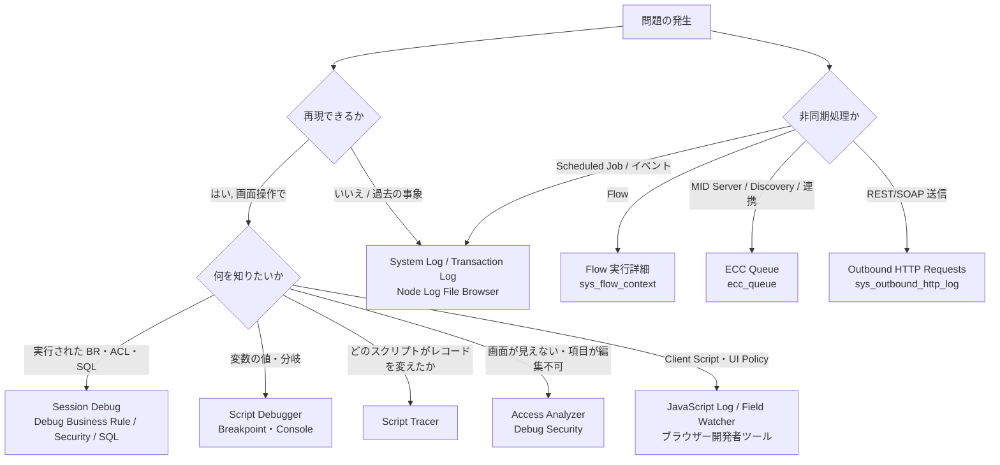
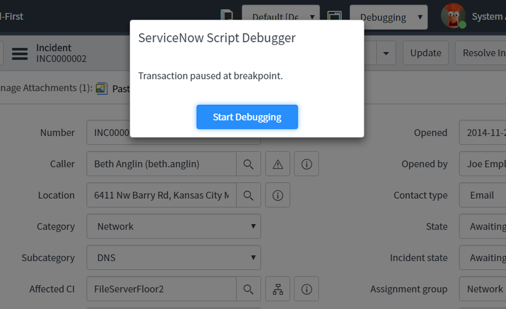
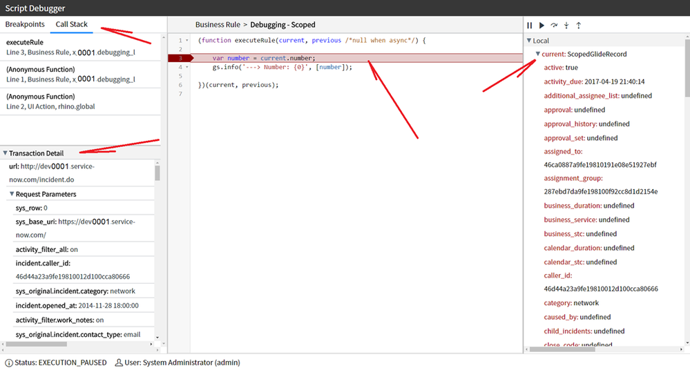
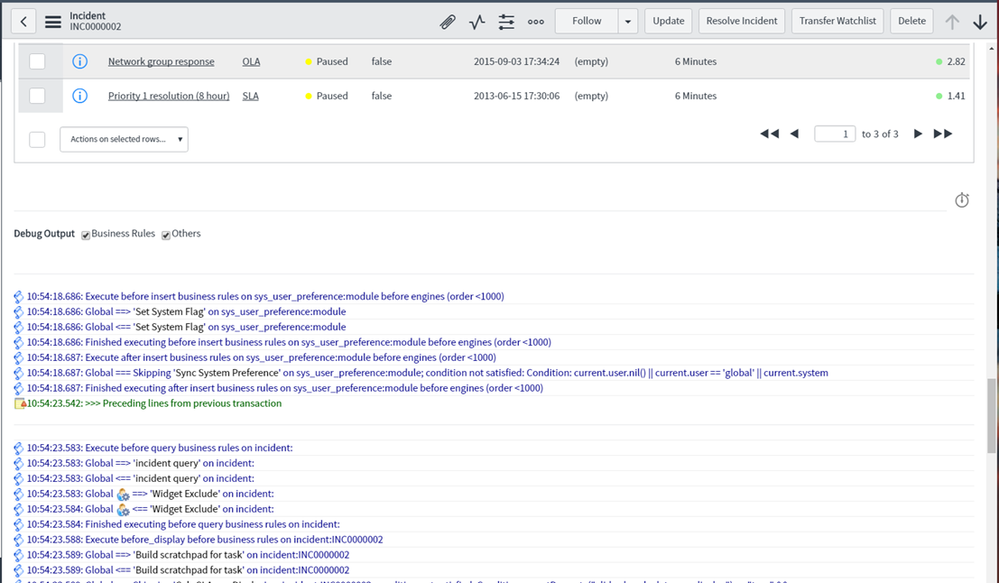
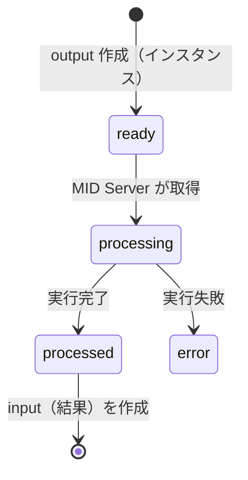

# デバッグ・トラブルシューティング（ログ・Script Debugger・Session Debug）

## 概要

ServiceNow インスタンス上の不具合調査は、**「ログを見る」「実行中のスクリプトを止めて見る」「セッション単位でエンジンの判断理由を表示させる」「非同期処理の記録を辿る」** の 4 系統の手段を組み合わせて行う。本ファイルは、これらの手段を Australia リリース（2026-05 GA）基準で横断的に整理し、各ツールのロール・プロパティ・メニュー位置・制約と、典型的な症状からの調査手順をまとめる。

| 系統 | 主な手段 | 主なテーブル／画面 | 本ファイルの章 |
|---|---|---|---|
| ログを見る | System Log、Application Logs、Transaction Log、Node Log File Browser、Outbound HTTP Requests | `syslog`、`syslog_app_scope`、`syslog_transaction`、ノードの `localhost` ログ、`sys_outbound_http_log` | 2〜4 章、10 章 |
| スクリプトを止めて見る | Script Debugger（Breakpoint／Logpoint／Console）、Script Tracer | Script Debugger ウィンドウ、Session Log | 5〜6 章 |
| エンジンの判断理由を出す | Session Debug（Business Rule／Security／SQL 等）、Access Analyzer、JavaScript Log と Field Watcher | フォーム下部の Debug Output、Session Log タブ | 7〜8 章 |
| 非同期処理を辿る | Flow 実行詳細、ECC Queue、Transaction Cancellation Log | `sys_flow_context`、`sys_flow_log`、`ecc_queue` | 9〜11 章 |

ServiceNow 社への問い合わせ（Now Support）は 13 章、症状別の調査手順は 12 章にまとめる。各ログテーブルの保持期間（Table Rotation）や System Properties 全般は [システム管理](./system-administration.md)、スクリプトの API 仕様は [サーバーサイドスクリプト](./scripting-server-side.md)、性能問題の深掘りは [パフォーマンスチューニング](../../04_応用編/03-performance-tuning.md) を参照する。

### 本ファイルが答える主な問い

| 問い | 章 |
|---|---|
| `gs.info()` の出力はどこに出るか／`gs.debug()` が出ないのはなぜか | [4](#4-スクリプトからのログ出力gslog--gsinfo--gslog) |
| System Log に昨日以前のログが出ない。どこで見るか | [2](#2-system-logsシステムログの全体像), [3](#3-node-log-file-browser-と-transaction-log) |
| Business Rule にブレークポイントを置いて変数を見たい | [5](#5-script-debuggerスクリプトデバッガーと-console) |
| どの Business Rule がどの順で動いたか／なぜ ACL で拒否されたかを知りたい | [7](#7-session-debugセッションデバッグ), [8](#8-access-analyzer-とクライアント側のデバッグ) |
| Flow が動かない／途中でエラーになる | [9](#9-flow-実行詳細workflow-studio--flow-designer) |
| MID Server 経由の処理が終わらない | [10](#10-ecc-queue-とアウトバウンド連携の調査) |
| 「maximum execution time exceeded」で画面が止まる | [11](#11-transaction-quota-によるキャンセル) |
| ServiceNow 社にケースを出すとき何をそろえるか | [13](#13-now-supporthiへの問い合わせ) |

---

## 1. デバッグ手段の全体マップ

### 1.1 公式ドキュメントにおけるデバッグツールの分類

公式ドキュメントの「Debugging scripts」概要ページは、デバッグ手段を次のように分類している（Yokohama 版。Australia でも各ツールの個別ページが存在する）。[出典](https://www.servicenow.com/docs/r/yokohama/api-reference/scripts/script-debug-overview.html)

| 区分 | ツール | 内容 | 必要ロール |
|---|---|---|---|
| サーバーサイド | Script Debugger and Session Log | サーバーサイド JavaScript のステップ実行と、セッション単位のログ表示・ダウンロード | `script_debugger`（Debugger）、`log_debugger`（Session Log） |
| サーバーサイド | Session debug | クライアント操作が引き起こしたサーバー処理のデバッグメッセージを UI に表示 | none（公式。ただし System Diagnostics メニューは通常 admin 向け【経験則】。7.1 参照） |
| サーバーサイド | GSLog | 呼び出し元ごとの `sys_properties` 値でログレベルを選べるスクリプトインクルード | — |
| クライアントサイド | Session log | Script Include や Agent Workspace 等のカスタム UI のログを表示 | `log_debugger` |
| クライアントサイド | ブラウザーの開発者ツール | Client Script 等のデバッグ | — |
| クライアントサイド | `jslog()` | クライアント側 JavaScript や UI Policy からデバッグログへ書き込むグローバル関数 | — |
| クライアントサイド | JavaScript debug window（JavaScript Log） | 管理者がデバッグを有効にすると画面下部ペインに表示 | 管理者 |
| アプリ・スコープ | Debug Scopes | サーバーサイドスクリプト実行時にアプリケーションスコープが切り替わったことを表示 | — |
| その他 | Field Watcher | フォーム上の選択したフィールドに対するシステムの処理を追跡表示 | 管理者 |
| その他 | JS Code Coverage Debug | セッション中に実行されたサーバーサイドスクリプトの行を記録し、どの行が実行されたかを確認 | 管理者・アプリ開発者 |
| その他 | Script Tracer | UI トランザクション中に実行されたスクリプトと GlideRecord の変化を一覧化 | `admin` |

### 1.2 症状から手段を選ぶ



上図は本ファイルの章構成に沿った【経験則】の整理である。

### 1.3 共通の注意事項【経験則】

- **本番インスタンスでのデバッグは最小限にする。** Session Debug の Enable All、Flow reporting の Full、アウトバウンド HTTP ログの `all` レベルは、処理時間・ログ量・情報露出（ヘッダーや本文）を増やす。公式ドキュメントも Flow の Full reporting とアウトバウンド HTTP ログの override について本番での常用を戒めている（9 章、10 章）。
- **再現はサブプロダクション（クローン直後の環境）で行う。** データ依存の不具合はクローンで再現性が上がる。クローンは [アップデートセットとクローン](./update-sets-cloning.md) を参照。
- **ユーザー依存の問題は Impersonate（なりすまし）で再現する。** ACL・ロール・ドメイン・ユーザープリファレンスに依存する不具合は、管理者のままでは再現しない。Impersonate 操作は System Log に記録される。
- **ノードを意識する。** インスタンスは複数のアプリケーションノードで構成され、Node Log File Browser は自分がログインしているノードのログしか見られない（3 章）。

---

## 2. System Logs（システムログ）の全体像

### 2.1 System Logs アプリケーションメニュー

**System Logs** アプリケーションメニューは、インスタンス内のトランザクション・イベント・エラーのトラブルシューティング用ログをまとめたメニューである。主要なモジュールとテーブルは次のとおり。各モジュールの詳細と保持期間は [システム管理 3 章](./system-administration.md#3-system-logsシステムログ) にもある。

| モジュール（メニュー） | 内容 | 主なテーブル | 確度 |
|---|---|---|---|
| System Log > All | すべての System Log エントリ（当日分） | `syslog` | 公式（テーブル名は【第三者情報】） |
| System Log > Errors／Warnings | Level で絞り込んだビュー | `syslog` | 公式 |
| System Log > Application Logs | スコープアプリケーションのログ（`gs.info()` 等） | `syslog_app_scope` | 【第三者情報】 |
| System Log > Script Log Statements | グローバルの `gs.log()` 等のスクリプトログ | `syslog`（フィルタービュー） | 【第三者情報】 |
| System Log > Transaction Cancellation Log | Transaction Quota 等でキャンセルされたトランザクション | — | 公式（11 章） |
| Transactions | ページ・REST・スケジューラー等のトランザクション記録 | `syslog_transaction` | 公式（3.3） |
| Events | 発生したイベント | `sysevent` | 【第三者情報】 |
| Emails | 送受信メール | `sys_email` | 【第三者情報】 |
| Outbound HTTP Requests | アウトバウンド REST／SOAP の要求・応答 | `sys_outbound_http_log` | 公式（10 章） |
| Utilities > Node Log File Browser／Node Log File Download | ノード上のテキストログ | ファイル（`localhost_log` 形式） | 公式（3 章） |

GSLog API のドキュメントは、ログの確認場所を「All > System Logs > System Log」とし、「すべてのログ、または Application Logs や Errors などの種類で絞り込んで表示できる。All ビューで Source 列を絞り込むと GSLog のエントリを見つけやすい」と説明している。[出典](https://www.servicenow.com/docs/r/api-reference/server-api-reference/GSLogBoth.html)

`syslog` テーブルはグローバル・スコープ両方のログ出力を保持し、`syslog_app_scope` はスコープアプリケーション内で書かれたログのみを保持する。【第三者情報】[出典](https://www.servicenow.com/community/developer-articles/just-another-log-helper/ta-p/2315453)

### 2.2 System Log エントリの項目と Level

System Log のエントリは Created（作成日時。インスタンスを実行するマシンのロケール）、Level、Message、Source、Source Package の各項目を持ち、Level は次の 4 種類である。[出典](https://www.servicenow.com/docs/r/platform-security/r_SystemLogs.html)

| Level | 意味 |
|---|---|
| Debug | 開発・トラブルシューティング用の詳細診断情報 |
| Information | 操作が期待どおり完了したことの確認 |
| Warning | 想定外の状況が発生したが処理されて回復したもの |
| Error | 操作が失敗または完了できなかったもの。Error の多くはプラットフォーム由来で、必ずしも問題を示すわけではない |

- System Log のリストには**当日分のエントリのみ**が表示される。前日以前は Node Log File Browser で参照する。[出典](https://www.servicenow.com/docs/r/platform-security/r_SystemLogs.html)
- 長いメッセージとスタックトレースは既定で折りたたまれて表示される。[出典](https://www.servicenow.com/docs/r/platform-security/r_SystemLogs.html)
- System Log が追跡する範囲は、Workflow（アクティビティの開始・終了、状態、結果、遷移履歴）、構成変更、チャットセッション、ページトランザクション、受信／送信メール、イベント、インポートと連携、警告・エラー・スクリプトログ、アップグレード情報である。[出典](https://www.servicenow.com/docs/r/platform-security/r_SystemLogs.html)

### 2.3 System Log を効率よく検索するコツ【経験則】

| やりたいこと | 方法 |
|---|---|
| 自分のデバッグ出力だけを見る | メッセージに固有の接頭辞（例：`[INC-CHK]`）を付け、`Message` *contains* で絞る。`gs.log(msg, source)` の第 2 引数や GSLog の caller で Source を固定する |
| 特定トランザクションのログだけ見る | Transaction レコードの **Show Syslog Records** ボタン（3.3）を使う |
| 一定時刻の前後を見る | `Created` の範囲指定。タイムゾーンはインスタンスのロケールである点に注意 |
| ノイズを減らす | Level = Error／Warning のビューを使い、Source でプラットフォーム由来（例：`EMAIL`、`Memory`）を除外する |

> 補足：`syslog` は肥大化しやすく、コンポーネントごとのログレベルプロパティ（例：`com.glide.document.log.level`、`glide.amb.log.level`）を info から warn に下げてノイズを減らす事例がある。また `syslog` は Table Rotation の対象で、Data Management のクリーンアップルールは適用されない。【第三者情報】[出典](https://www.servicenow.com/community/developer-blog/managing-syslog-growth-in-servicenow/ba-p/3383522)

---

## 3. Node Log File Browser と Transaction Log

### 3.1 Node Log File Browser（ノードログファイルブラウザー）

**Node Log File Browser** は、アプリケーションノード上のテキストログ（いわゆる `localhost` ログ）を検索するユーティリティで、**All > System Logs > Utilities > Node Log File Browser** にある。[出典](https://www.servicenow.com/docs/r/platform-security/r_LogUtilities.html)

| フィルター | 説明 |
|---|---|
| Start time／End time | 検索範囲の開始・終了（インスタンスのマシンのロケール） |
| Session ID | ログを生成したセッションを識別する 16 進文字列 |
| Message | システムが生成した事象の説明 |
| Level | Debug、Error、Warning、Information |
| Thread name | ログを生成したスレッドの識別子 |
| Max rows | フィルターで返す最大件数 |

| 制約・仕様 | 内容 |
|---|---|
| 参照範囲 | **ログインしているノードのログのみ**。現在のノードは System Diagnostics > Stats で確認する |
| アーカイブ | 2 日ごとにシステムログの圧縮アーカイブを作成 |
| 保持 | アーカイブは 21 日後に削除。退役（retire）したノードのログは即時削除され、21 日間のアーカイブも残らない |
| ダウンロード | **System Logs > Utilities > Node Log File Download** でアーカイブを選び、Related Links の **Download log** |

[出典](https://www.servicenow.com/docs/r/platform-security/r_LogUtilities.html)

**ノードログでトランザクションを追う手順**（ServiceNow 社員によるコミュニティ記事）【第三者情報】[出典](https://www.servicenow.com/community/now-platform-articles/how-to-troubleshoot-a-slow-transaction/ta-p/2322007)

1. 問題を再現する（ノードログは同じノードで確認する必要がある）。
2. System Logs > Transactions で対象トランザクションを探し、Session ID と Transaction Number を控える。
3. Node Log File Browser で Start／End time をトランザクション時刻の前後に設定し、Session ID と Message（Transaction Number）を指定、Max rows を 10000 程度に上げて検索する。
4. ヒットしたエントリの `txid` 値で再検索し、トランザクションの全詳細を得る。
5. `EXCESSIVE` と表示されたエントリを探し、時間を最も消費した要素を特定する。

ダウンロードしたノードログには個人情報が含まれ得るため、調査後に削除するよう勧められている。【第三者情報】[出典](https://www.servicenow.com/community/developer-blog/servicenow-things-to-know-81-localhost-logs/ba-p/2786992)

### 3.2 Transaction Log（トランザクションログ）

**Transaction Log** は、インスタンス上のアプリケーションアクティビティ（ページ表示、REST 呼び出し、スケジューラー等）を記録するログで、**All > System Logs > Transactions** で開く。テーブルは `syslog_transaction` である（テーブル名は Log Export Service およびコミュニティ記事で言及）。項目は次の 16 項目で、Australia 版・Brazil 版のドキュメントで同一である。[出典（Australia 版）](https://www.servicenow.com/docs/r/hX5GtoLUEU58KgyL7CW5Ag/~xhzwsymyJvn8SUCtas4lg)、[出典（Brazil 版）](https://www.servicenow.com/docs/r/platform-security/r_TransactionLogs.html)

| 項目 | 説明 |
|---|---|
| Created | 実行日時（インスタンスのマシンのロケール） |
| Type | 記録されたトランザクションの種類 |
| Created by | 実行ユーザー |
| Origin application | トランザクションが開始されたアプリケーションスコープ（グローバルは Global） |
| Response time | 要求の往復応答時間（ミリ秒） |
| Network time | 要求後のネットワーク遅延（ミリ秒） |
| Output length | インスタンスが返した出力サイズ（バイト） |
| SQL count | 実行された SQL 文の数 |
| Business rule count | 実行された Business Rule の数 |
| Business rule time | Business Rule の実行に要した経過時間 |
| URL | クライアントが接続したアプリケーション／モジュール |
| System ID | 要求を処理したノードの識別子（クラスター環境） |
| IP address | 要求元クライアントの IP アドレス |
| GZipped | 圧縮ページを要求したか |
| Protocol | 使用した HTTP プロトコル |
| HTTP Response Code | HTTP 要求の結果ステータスコード（Australia 版・Brazil 版のページに記載。Washington DC〜Zurich 版のページには記載なし） |

- **Background／Scheduler トランザクションは実行時間が 1000 ミリ秒を超えた場合のみ記録される。** 記録対象トランザクションの全一覧は KB0778299 にある（Australia 版・Brazil 版で同一）。[出典（Australia 版）](https://www.servicenow.com/docs/r/hX5GtoLUEU58KgyL7CW5Ag/~xhzwsymyJvn8SUCtas4lg)
- コミュニティ記事では「応答時間 100 ミリ秒超のトランザクションのみログに出る」とされている。【第三者情報】[出典](https://www.servicenow.com/community/now-platform-articles/how-to-troubleshoot-a-slow-transaction/ta-p/2322007)
- `syslog_transaction` には応答本文は記録されない。REST の応答内容を見るにはアウトバウンド HTTP ログ（10 章）や Scripted REST 側のログ出力を使う。【第三者情報】[出典](https://www.servicenow.com/community/developer-forum/where-can-i-find-the-rest-api-response-for-a-transaction-log/m-p/3388894)

**リストに追加すると便利な列**（クライアント側の計測値を含む）【第三者情報】[出典](https://www.servicenow.com/community/now-platform-articles/how-to-troubleshoot-a-slow-transaction/ta-p/2322007)

| 列 | 用途 |
|---|---|
| Browser time／Client script time／Client network time／Client response time／Total page load time | ブラウザー側（描画・Client Script）の遅延を切り分ける |
| Business rule time／UI policy time／Transaction processing time | サーバー側処理の内訳 |
| Semaphore wait time／Session wait time／Total wait time | 同時実行制御による待ち（セマフォ、同一セッションの直列化） |
| Session／Session ID／Transaction Number | Node Log File Browser との突き合わせ |

### 3.3 Show Syslog Records

Transaction および Active Transaction のフォームにある **Show Syslog Records** ボタンは、そのトランザクションの実行中に生成された System Log エントリを検索する URL を組み立てて表示する。1 つのトランザクションは任意の数の `syslog` エントリを持ち得る。デバッグやセキュリティ調査でトランザクションと `syslog` を対応付ける際に使う。[出典](https://www.servicenow.com/docs/r/platform-security/r_LogUtilities.html)

### 3.4 Active Transactions（実行中トランザクション）

**User Administration > Active Transactions** は、現在実行中のトランザクションを一覧し、長時間実行中のトランザクションを特定・キャンセルするために使う。Transaction Quota の Quota Manager も同様の一覧を定期取得して上限超過を判定している（11 章）。[出典](https://www.servicenow.com/docs/r/platform-administration/platform-performance/c_TransactionQuotas.html)

---

## 4. スクリプトからのログ出力（gs.log / gs.info / GSLog）

### 4.1 GlideSystem のログメソッド

スクリプトからのログ出力は GlideSystem（`gs`）のメソッドで行う。グローバルとスコープで使えるメソッドが異なる。API の詳細は [サーバーサイドスクリプト](./scripting-server-side.md) を参照。

| メソッド | 利用可能な範囲 | 出力先・特徴 |
|---|---|---|
| `gs.info(msg, [p1..p5])` | Scoped／Global | Information レベル。`{0}` 形式のパラメーター置換が可能 |
| `gs.warn(...)`／`gs.error(...)` | Scoped／Global | Warning／Error レベル |
| `gs.debug(...)` | Scoped／Global | Debug レベル。スコープアプリでは verbosity が debug でないと出力されない（4.2） |
| `gs.isDebugging()` | Scoped（グローバル版 GlideSystem API ページの `is` で始まるメソッド一覧には見当たらず、グローバルでの利用は公開情報では確認できず） | デバッグ出力が有効か。Session Debug が有効、またはスコープの verbosity が debug の場合に true とされる【第三者情報】 |
| `gs.log(msg, source)` | **Global のみ** | `syslog` に保存。第 2 引数が Source 列になる |
| `gs.logError()`／`gs.logWarning()` | Global のみ | Error／Warning レベルで `syslog` へ |
| `gs.print(msg)` | Global のみ | Scripts - Background の実行結果に表示。デバッグ有効時以外は `syslog` に保存されない |

[出典（GlideSystem）](https://www.servicenow.com/docs/r/api-reference/server-api-reference/c_GlideSystemAPI.html)、[出典（gs.isDebugging）](https://www.servicenow.com/community/developer-forum/how-to-properly-debug/m-p/1566866)

- スコープアプリの `gs.info()` 出力は **System Logs > System Log > Application Logs** に出る（Script Log Statements ではない）。【第三者情報】[出典](https://www.servicenow.com/community/developer-forum/how-to-add-logging-for-a-scoped-application/m-p/1897357)
- Business Rule から出した `gs.info()` は Script Debugger には表示されず、System Log で検索する必要がある。【第三者情報】[出典](https://www.servicenow.com/community/developer-blog/mini-lab-scoped-debugging-and-logging-part-2/ba-p/2266303)
- グローバルのスクリプトログの保存先は `glide.script.log_level`（既定 `all`。データベース／ファイルシステム／無効）で制御する（[システム管理](./system-administration.md)）。

### 4.2 スコープ別ログ設定（logging.verbosity / logging.destination）

スコープアプリケーションでは、スコープ名を接頭辞とするアプリケーションプロパティでログの詳細度と出力先を制御する。【第三者情報】[出典](https://www.servicenow.com/community/developer-forum/how-to-add-logging-for-a-scoped-application/m-p/1897357)、[出典](https://www.servicenow.com/community/developer-forum/gslog-logging-not-showing-on-syslog/m-p/2380578)

| プロパティ | 値 | 既定（コミュニティ情報） | 意味 |
|---|---|---|---|
| `<scope>.logging.verbosity` | `error`／`warn`／`info`／`debug`／`trace` | `info` | 出力する最低レベル。`info` なら info・warn・error が出力され debug は出ない |
| `<scope>.logging.destination` | `db`／`file` | `db` | 出力先（データベース＝`syslog_app_scope`、またはノードのファイル） |

- プロパティは自動作成されないため、必要に応じて `sys_properties` に手動で作成する。【第三者情報】
- **`gs.debug()` が出ない**原因の多くは、verbosity が既定の `info` のままであることである。開発中のみ `debug` にし、本番では `info` 以上に戻す。【経験則】
- 旧来のドキュメントでは「その他のレベルはカンマ区切りで指定」との記述があるが、コミュニティでは上位レベルを包含する階層として扱う解釈が一般的である。【第三者情報】

### 4.3 GSLog（ログレベル付きロガー）

**GSLog** は、システムプロパティの値でログレベルを切り替えられるスクリプトインクルードで、Scoped／Global の両方で利用できる。BSD の syslog.h に基づくレベル（debug、info、notice、warning、err、crit 等）を持ち、既定レベルは `notice` である。[出典](https://www.servicenow.com/docs/r/api-reference/server-api-reference/GSLogBoth.html)

| メソッド | 説明 |
|---|---|
| `GSLog(traceProperty, caller)` | コンストラクター。`traceProperty` はログの最低レベルを保持するシステムプロパティ名、`caller` は呼び出し元スクリプト名（Source 列に出る） |
| `setLevel(level)`／`getLevel()` | レベルの設定・取得 |
| `debugOn()` | debug が有効か（Boolean） |
| `log(level, msg)` | 指定レベルで出力 |
| `logDebug`／`logInfo`／`logNotice`／`logWarning`／`logErr`／`logCrit`／`logAlert`／`logEmerg` | レベル別の出力 |

```javascript
// 公式ドキュメントの例（TaskSLA のロガー）
var gl = new GSLog("com.snc.sla.tasksla.log", "TaskSLA");
gl.setLevel("debug");
gs.print(gl.debugOn());          // true
gl.logDebug("This is a debug message");
// 出力: *** Script [TaskSLA]: This is a debug message
```

[出典](https://www.servicenow.com/docs/r/api-reference/server-api-reference/GSLogBoth.html)

GSLog は OOB の SLA エンジン等でも使われており、`com.snc.sla.tasksla.log` のような既存プロパティを `debug` に変えることで、製品機能の内部ログを一時的に詳しく出せる（SLA の詳細は [SLA とスケジュール](./sla-schedules.md)）。

### 4.4 ログ出力の実践ルール【経験則】

| ルール | 理由 |
|---|---|
| 本番コードに `gs.log`／`gs.info` の大量出力を残さない。ループ内のログは特に避ける | `syslog` の肥大化・性能劣化 |
| デバッグ出力は `gs.debug()` または GSLog の debug にし、プロパティで切り替える | 本番でもプロパティ変更だけで調査用ログを出せる |
| メッセージに一意な接頭辞と対象レコードの番号・sys_id を含める | 検索性 |
| 個人情報・認証情報（トークン、パスワード）をログに出さない | ログは `admin` 等が広く閲覧できる |

スクリプト品質全般は [スクリプトのベストプラクティス](../../04_応用編/07-scripting-best-practices.md) を参照。

---

## 5. Script Debugger（スクリプトデバッガー）と Console

### 5.1 概要とロール

**Script Debugger** は、サーバーサイド JavaScript にブレークポイントを設定し、対話的にステップ実行・変数確認を行うツールである。**Session Log** は、セッション単位でログを表示・ダウンロードする読み取り専用ビューで、Script Debugger と同じ画面群に含まれる。[出典](https://www.servicenow.com/docs/r/api-reference/scripts/script-debugger.html)

| ロール | 権限 |
|---|---|
| `script_debugger` | サーバーサイド JavaScript のデバッグ（Script Debugger の利用） |
| `log_debugger` | Session Log の表示・ダウンロード |
| `admin` | 上記を含む |

- ブレークポイントの設定・削除の手順ページでは、必要ロールを `admin` または `script_debugger` としている。[出典](https://www.servicenow.com/docs/r/a3E8xg0zsiQLBPKbKO15Mg/Dx0ae_3a9r3Yrn1jsYHKLg)
- ロールの正式名はアンダースコア付きの `script_debugger`／`log_debugger` である。公式ページの要約表示部分ではアンダースコアが欠落して表示される箇所があるが、本文の表記が正しい。[出典](https://www.servicenow.com/docs/r/api-reference/scripts/script-debugger.html)
- **Impersonation（なりすまし）中のデバッグ**は、なりすまされたユーザーが `script_debugger` ロールと対象スクリプトへの読み取りアクセスを持つ場合のみ可能である。[出典](https://www.servicenow.com/docs/r/api-reference/scripts/script-debugger.html)
- 複数の開発者が互いに影響せずに各自のトランザクションをデバッグでき、ドメインセパレーションにも対応する。[出典](https://www.servicenow.com/docs/r/api-reference/scripts/script-debugger.html)

### 5.2 デバッグ対象と制約

| 項目 | 仕様 |
|---|---|
| 一時停止できるスクリプト | **対話型（interactive）トランザクション**で実行される Business Rule、Script Include、Script Action、UI Action 等。`GlideSystem.isInteractive()` が true の文脈のみ |
| Script Include | 対話型・非対話型（バックグラウンド、スケジュール）どちらからも呼ばれ得るが、停止できるのは対話型の文脈のみ |
| 非対話型トランザクション | 停止できない（Scheduled Job、非同期 Business Rule、イベント処理など） |
| Scripts - Background | スクリプト欄に直接ブレークポイントは置けない。そこから呼ばれる Script Include 等のスクリプトオブジェクトはデバッグ可能 |
| Strict mode | strict mode で動くスクリプトはデバッガーと非互換で、オブジェクトを正しく見つけられず失敗し得る |
| 実行モード | デバッガーを有効にするとコードはインタープリターモードで実行される（処理が遅くなる） |
| クライアントサイド | 対象外。ブラウザーの開発者ツールを使う |
| 1 行あたり | 同じ行には Breakpoint か Logpoint のどちらか一方のみ |
| 所有 | ブレークポイントは設定した開発者に属する。各自が設定・削除する |

[出典](https://www.servicenow.com/docs/r/api-reference/scripts/script-debugger.html)、[出典（Breakpoint）](https://www.servicenow.com/docs/r/a3E8xg0zsiQLBPKbKO15Mg/Dx0ae_3a9r3Yrn1jsYHKLg)

コミュニティの実践記事では次の注意点も挙げられている。【第三者情報】[出典](https://www.servicenow.com/community/developer-blog/mini-lab-scoped-debugging-and-logging-part-2/ba-p/2266303)

- Script Debugger ウィンドウは**開いたまま**にしておく必要がある（最小化は可）。
- 停止したまま長時間放置するとブレークポイントがタイムアウトし、実行が打ち切られる。
- ブレークポイントで止まるのは同期呼び出しで実行されたスクリプトのみ。Ajax（GlideAjax）、イベント、Scheduled Job などの非同期処理、Fix Script では止まらない。

### 5.3 デバッガーの状態

| 状態 | 説明 |
|---|---|
| Active | 現在のセッション専用のデバッグトランザクションが存在する。セッションが有効な間は開いたまま |
| Paused | ブレークポイントで実行が停止し、式の評価・変数・コールスタックの確認ができる |
| Resumed | Script Debugger をオフにすると、停止中のスクリプトは再開される |
| Closed | ログアウトまたはセッションタイムアウトでデバッグトランザクションが閉じる |

[出典](https://www.servicenow.com/docs/r/api-reference/scripts/script-debugger.html)

### 5.4 ブレークポイントを設定してデバッグする手順

公式手順（Xanadu 版。Australia でも同等）は次のとおり。[出典](https://www.servicenow.com/docs/r/a3E8xg0zsiQLBPKbKO15Mg/Dx0ae_3a9r3Yrn1jsYHKLg)

1. デバッグしたいサーバースクリプトを開く（例：System Definition > Business Rules）。
2. Syntax Editor の行番号横のガターで操作する。
   - **Breakpoint の設定:** 空の行をクリック。
   - **Conditional breakpoint の設定:** 空の行を右クリックし「Add conditional breakpoint」。
   - **削除:** ブレークポイントをクリック（条件付きは右クリック >「Remove breakpoint」）。
3. Syntax Editor ツールバーの **Open Script Debugger** アイコンをクリックし、Script Debugger ウィンドウを開く。
4. スクリプトを起動する操作を行う（例：insert の Business Rule ならレコードを作成）。最初のブレークポイントで一時停止し、確認ウィンドウが表示される。
5. **Start Debugging** をクリックすると Script Debugger にフォーカスが移り、停止中のスクリプトが表示され Console が有効になる。
6. 終了後、ブレークポイントを削除する。

Script Debugger はアプリケーションナビゲーター（フィルターに「Script Debugger」と入力）、Studio、Syntax Editor の 3 か所から開ける。[出典](https://www.servicenow.com/docs/r/api-reference/scripts/script-debugger.html)



- **キャプション:** ブレークポイント到達時に、操作していたフォーム上に表示される確認ウィンドウ。
- **画面の説明:** Incident フォーム（INC0000002）を更新した直後に、中央に「ServiceNow Script Debugger」というタイトルのダイアログが表示され、本文に「Transaction paused at breakpoint.」、下部に青い **Start Debugging** ボタンがある。背景のフォームには Number、Caller、Category、Subcategory、Affected CI などの項目が見える。ボタンを押すと Script Debugger ウィンドウに移り、停止箇所が表示される。2017 年（Istanbul 期）のコミュニティ記事のスクリーンショットで、現行の Next Experience UI とは外観が異なる。
- **出典:** https://www.servicenow.com/community/developer-blog/mini-lab-scoped-debugging-and-logging-part-2/ba-p/2266303 （取得日 2026-11-04、著作権は ServiceNow, Inc. および投稿者に帰属）

### 5.5 Script Debugger の画面構成

Australia 版ドキュメントによる Script Debugger の構成要素は次のとおり。[出典](https://www.servicenow.com/docs/r/eJIqiaxRKVcMaR8XQU6_oA/QM2~r1wydQVw90Akx2t0_g)

| 要素 | 説明 |
|---|---|
| Breakpoints | 設定済みブレークポイントをスクリプト種別・スクリプト名・行番号で一覧。追加・削除に応じて更新 |
| Call stack | 現在行に至るまでのスクリプト呼び出し履歴（停止中のみ） |
| Transaction details | 処理中トランザクションの情報（URL、リクエストパラメーター等。停止中のみ） |
| Status | ブレークポイント待ち／ブレークポイントで停止中／例外発生のいずれか |
| User | デバッガーセッションを実行しているユーザー名 |
| Coding pane header | コーディングペインに表示中のスクリプトの種別と名前 |
| Breakpoint icon | 停止中の行を示す |
| Pause debugging | 現在のセッションを止め、再開するまでそのユーザーのデバッガーを無効化 |
| Console | 実行時に式を評価するコマンドライン（停止中のみ） |
| Resume script execution | 次のブレークポイント（なければ完了）まで実行 |
| Step over next function call | 次のメソッド呼び出しを 1 ステップとして実行 |
| Step into next function call | メソッド呼び出しの中に入る。そのメソッドへの読み取り権限がなければ Step over と同じ動作 |
| Step out of current function | 現在のメソッドを抜けて呼び出し元へ戻る。メソッド内でなければ Step over と同じ動作 |
| Local／Closures／Global | ローカル変数、クロージャーに捕捉された変数、グローバル変数の名前と値（停止中のみ） |



- **キャプション:** Script Debugger ウィンドウでスコープアプリの Business Rule「Debugging - Scoped」の実行を一時停止した状態。
- **画面の説明:** 左上に **Breakpoints**／**Call Stack** タブがあり、Call Stack には `executeRule`（Line 3, Business Rule）、匿名関数（Business Rule）、匿名関数（Line 2, UI Action, rhino.global）が積まれている。左下の **Transaction Detail** には url（`/incident.do`）と Request Parameters（`sys_row`、`incident.caller_id`、`sys_original.incident.category: network` など）が並ぶ。中央のコーディングペインはヘッダーが「Business Rule > Debugging - Scoped」で、3 行目 `var number = current.number;` が赤く強調され停止位置を示す。右上に一時停止・再開・ステップオーバー・ステップイン・ステップアウトのボタン、右側の **Local** ペインに `current: ScopedGlideRecord` が展開され、`active: true`、`assignment_group`、`category: network` などのフィールド値が見える。最下部のステータスバーは「Status: EXECUTION_PAUSED」「User: System Administrator (admin)」。画像中の赤い矢印は元記事の著者による注記。2017 年のスクリーンショットで現行 UI とは外観が異なる。
- **出典:** https://www.servicenow.com/community/developer-blog/mini-lab-scoped-debugging-and-logging-part-2/ba-p/2266303 （取得日 2026-11-04、著作権は ServiceNow, Inc. および投稿者に帰属）

### 5.6 Logpoint（ログポイント）

**Logpoint** は、スクリプトの実行を止めずに、指定した行でログメッセージを出力するポイントである。出力は Script Debugger ウィンドウの **Session Log** で確認する。[出典](https://www.servicenow.com/docs/r/api-reference/scripts/set-remove-logpts.html)

| 項目 | 内容 |
|---|---|
| 前提条件 | システムプロパティ `glide.debug.log_point` を `true` にする |
| 必要ロール | `admin` または `script_debugger` |
| スクリプトの書式 | Script Include の GSLog／GSInfo と同じ形式で書く |
| 所有 | Logpoint は設定した開発者に属し、各自が設定・削除する |
| 1 行あたり | 同じ行には Logpoint か Breakpoint のどちらか一方のみ |

**Logpoint を設定して出力を確認する手順**（公式）[出典](https://www.servicenow.com/docs/r/api-reference/scripts/set-remove-logpts.html)

1. デバッグしたいサーバースクリプトを開く（例：System Definition > Business Rules）。
2. Syntax Editor で操作する。
   - **追加:** 空の行を右クリックし「Add logpoint」。
   - **編集:** 既存の Logpoint を右クリックし「Edit logpoint」。
   - **削除:** 既存の Logpoint を右クリックし「Remove logpoint」。
3. Syntax Editor ツールバーから Script Debugger を開く。
4. スクリプトを起動する操作を行う（例：insert の Business Rule ならレコードを作成）。
5. Script Debugger ウィンドウで **Session Log** をクリックし、Logpoint の出力を確認する。
6. デバッグが終わったら Logpoint を削除し、`glide.debug.log_point` を元に戻す（12.3）。

### 5.7 Console（コンソール）

**Console** は、一時停止中に変数や関数を定義・宣言・確認できるコマンドラインである。[出典](https://www.servicenow.com/docs/r/api-reference/scripts/script-debugger.html)

| 仕様 | 内容 |
|---|---|
| 利用条件 | スクリプトが一時停止中のときのみ |
| 履歴 | 実行した文はブラウザーにキャッシュされ、上下矢印キーで呼び出せる |
| キャッシュ件数 | `glide.debugger.console.cached_stmt_limit`（既定 20、最大 100）。正式名はアンダースコア付き（公式ページの要約表示ではアンダースコアが欠落して表示される箇所がある） |
| キャッシュの範囲 | セッションとブラウザーに固有。ブラウザーキャッシュのクリア、別ブラウザー・別端末からのログインで失われる |

Console での典型的な使い方【経験則】：`current.getValue('state')`、`previous.assigned_to.toString()`、`gs.getUser().getRoles()` のように停止時点の値を評価する。Console からの代入はそのまま実行中のトランザクションに影響するため、本番相当のデータでは注意する。

### 5.8 Session Log（セッションログ）

**Session Log** は、デバッガーと同じ画面で、現在のセッションのトランザクションとログを表示する読み取り専用ビューである（`log_debugger` ロールが必要）。[出典](https://www.servicenow.com/docs/r/api-reference/scripts/script-debugger.html)、[出典（UI）](https://www.servicenow.com/docs/r/eJIqiaxRKVcMaR8XQU6_oA/QM2~r1wydQVw90Akx2t0_g)

| 要素 | 説明 |
|---|---|
| Transactions | トランザクション ID とその情報 |
| Filter for log text | 特定のテキストを含むログで絞り込む |
| Debug Output／Apps／Message Type | デバッグ出力の種類、アプリ、ログレベルで絞り込む |
| Clear log／Download log | ログの全消去、HTML ファイルとしてダウンロード |
| Settings | Session Debug のオプション（7 章）を開く |

| プロパティ／ユーザープリファレンス | 既定 | 内容 |
|---|---|---|
| `glide.debugger.log.ui` | — | `Page`：フォーム・リストの下と Session Log タブの両方に表示。`Session`：Session Log タブのみに表示 |
| `glide.debugger.log.transaction.count` | 100 | Session Log に保持するトランザクション数 |
| `glide.debugger.log_messages_limit` | 10,000 | Session Log に保持するメッセージ数（正式名はアンダースコア付き。公式ページの要約表示では欠落して表示される箇所がある） |

- 上限を超えるとログは消去され、新しいエントリが表示される。[出典](https://www.servicenow.com/docs/r/api-reference/scripts/script-debugger.html)
- Australia 版では、トランザクション数・メッセージ数の 2 つは**ユーザープリファレンス**として設定する旨が記載されている。
- Session Log のフィルターは Business Rule、Script Include、UI コンポーネント（GraphQL コンポーネントを使う Agent Workspace を含む）に対応する。[出典](https://www.servicenow.com/docs/r/api-reference/scripts/script-debugger.html)

---

## 6. Script Tracer（スクリプトトレーサー）

### 6.1 概要

**Script Tracer** は、UI トランザクションの実行中に動いたスクリプトを一覧化し、GlideRecord のどの値がどのスクリプトのどの行で変わったかを特定するツールである。「保存したら値が勝手に変わる」「どの Business Rule が書き換えたか分からない」という調査に向く。[出典](https://www.servicenow.com/docs/r/api-reference/scripts/script-tracer.html)

| 項目 | 内容 |
|---|---|
| 開き方 | アプリケーションナビゲーターで「Script Tracer」を検索（System Diagnostics 配下とする記事もある【第三者情報】） |
| ロール | `admin` |
| フィルター | File type、Table |
| 操作 | **Start Tracer**（記録開始）、**Clear trace**（記録の消去）、**Debug Script**（Script Debugger で開く）、**View File**（スクリプトレコードを開く） |

### 6.2 タブ

| タブ | 内容 |
|---|---|
| State | 実行前後の値の差分。**Show only changed values**（既定オン）を外すと全フィールドを表示。エラーは発生順に行番号・メッセージ付きでタブ上部に表示 |
| Script | 実行中に GlideRecord を変更したスクリプト行。**Show Script** で行全体を表示 |
| Transaction | トレース中に捕捉したトランザクションの一覧 |

[出典](https://www.servicenow.com/docs/r/api-reference/scripts/script-tracer.html)

### 6.3 制限とプロパティ

- 1 回のトレースセッションで記録できるのは既定で **1,000 行**。上限に達したら Clear trace してから新しいトレースを開始する。Clear すると結果は破棄されるため、確認を終えてから消す。
- 上限は `glide.debug.trace.trace_line_limit` で変更できる。正式名はアンダースコア付きで、公式ページ内でアンダースコアが欠落して表示される箇所（`tracelinelimit`）はページの表示崩れである（Script Debugger ページの要約表示と同じ現象）。
- トレースに現れないファイルは、システムが GlideRecord の変更として認識しなかったことを意味する。

[出典（Brazil 版）](https://www.servicenow.com/docs/r/api-reference/scripts/script-tracer.html)、[出典（Australia 版）](https://www.servicenow.com/docs/r/yGcreuX~M6JqQUKHJarF7w/Yw6YdIqd761ymXmzcEX~Qw)

使い方の流れ【第三者情報】：Script Tracer を開く → Start Tracer → 対象フォームで Save／Update や UI Action を実行 → 実行されたスクリプトが表に並び、エラーは赤で表示 → 行を選んで Trace Details の State／Script／Transaction を確認 → 必要なら Debug Script でステップ実行。[出典](https://www.servicenow.com/community/spm-articles/mastering-the-script-tracer-in-servicenow-a-guide-to-debugging/ta-p/3115890)

---

## 7. Session Debug（セッションデバッグ）

### 7.1 概要

**Session Debug** は、現在のユーザーセッションに限って、プラットフォームの各エンジン（Business Rule、ACL、SQL 等）の判断過程をデバッグメッセージとして画面に出す機能である。**All > System Diagnostics > Session Debug** の各モジュールを選んで有効化し、有効化したセッションの間、または無効化するまで有効である。[出典](https://www.servicenow.com/docs/r/api-reference/scripts/c_SessionDebug.html)

- デバッグログの表示に必要なロールは公式ページで「Role required: none」と記載されている。ただし System Diagnostics メニュー自体は通常 `admin` 向けである。【経験則】
- 出力先は `glide.debugger.log.ui` の設定により、フォーム／リストの下部（Debug Output）と Session Log タブ、または Session Log タブのみとなる（5.8）。

### 7.2 Session Debug のオプション一覧

Australia 版ドキュメントに記載されたオプションは次のとおり。[出典](https://www.servicenow.com/docs/r/api-reference/scripts/c_SessionDebug.html)

| モジュール | 表示されるもの |
|---|---|
| Debug AI Search | AI Search のメッセージ |
| Debug Business Rule | Business Rule のデバッグメッセージ。複数アプリの Business Rule が同じテーブル・レコードに作用する場合はどのアプリ由来かも表示 |
| Debug Business Rule (Details) | 上記に加え、Business Rule が行った値の変更 |
| Debug Escalations | SLA／SLO のエスカレーションのメッセージ |
| Debug Data Policies | Data Policy のメッセージ |
| Debug Date/Time | 入力が必要な書式に合わない場合の Date/Time の失敗 |
| Debug Homepage Render | ホームページ描画のメッセージ |
| Debug Log | すべてのログエントリ（Debug Log を開く） |
| Debug Metric Statistics | 遅いトランザクション・スクリプト・クエリ・イベント・ミューテックスの集計性能データをトランザクション別に表示 |
| Debug NLQ | Natural Language Query（自然言語クエリ）のメッセージ |
| Debug Quotas | Transaction Quota のメッセージ |
| Debug Scopes | スクリプトオブジェクト実行時にアプリケーションスコープへ出入りしたことのメッセージ |
| Debug Security | ACL（アクセス制御）のメッセージ。複数アプリの ACL が作用する場合はアプリも表示 |
| Debug SQL | SQL クエリのメッセージ |
| Debug SQL (Detailed) | SQL 文と、それによる変更のメッセージ |
| Debug Text Search | 検索の関連度・インデックス処理のメッセージ |
| Debug UI Policies | UI Policy のメッセージ（ブラウザーの開発者コンソールに出力） |
| Debug UI Macro | 各 UI Macro の開始・終了位置を示す HTML コメント（テーブル名とマクロ名付き）を DOM に挿入 |
| Debug Upgrade | 直近のファミリーアップグレード／パッチアップグレードで処理されたレコードの詳細ログ |
| Enable All | すべてのデバッグメッセージを有効化 |
| Disable All | すべてのデバッグメッセージを無効化 |
| Disable Debug UI Macro／Disable UI Policies Debug | 個別に無効化 |

### 7.3 Debug Business Rule の読み方

**Debug Business Rule** を有効にしてフォームを保存・表示すると、フォーム下部の **Debug Output** に Business Rule の実行順・判定結果がタイムスタンプ付きで出力される。



- **キャプション:** Incident フォーム下部に表示された Business Rule のデバッグ出力。
- **画面の説明:** フォーム上部は Incident INC0000002 のヘッダー（Follow、Update、Resolve Incident、Transfer Watchlist、Delete ボタン）と、関連リストの SLA 行（Network group response／Priority 1 resolution）。その下に **Debug Output** の見出しと「Business Rules」「Others」のチェックボックスがある。出力は 1 行ずつ `10:54:18.686: Execute before insert business rules on sys_user_preference:module before engines (order <1000)`、`Global ==> 'Set System Flag' on sys_user_preference:module`（開始）、`Global <== 'Set System Flag' ...`（終了）、`Global === Skipping 'Sync System Preference' ...; condition not satisfied: Condition: current.user.nil() || ...`（条件不成立でスキップ）、`>>> Preceding lines from previous transaction`（前のトランザクションの出力の区切り）、続いて `Execute before query business rules on incident:`、`Execute before_display business rules on incident:INC0000002`、`Global ==> 'Build scratchpad for task' on incident:INC0000002` などが並ぶ。2017 年のスクリーンショットで、現行 UI とは外観が異なる。
- **出典:** https://www.servicenow.com/community/developer-blog/mini-lab-scoped-debugging-and-logging-part-2/ba-p/2266303 （取得日 2026-11-04、著作権は ServiceNow, Inc. および投稿者に帰属）

| 記号・表現 | 意味【経験則】（上図の出力形式に基づく） |
|---|---|
| `==>` | Business Rule の実行開始 |
| `<==` | Business Rule の実行終了 |
| `===` Skipping ... condition not satisfied | 条件（Condition）不成立でスキップ。不成立となった条件式が表示される |
| `Execute before insert business rules on <table> ... (order <1000)` | before・order 1000 未満のグループ開始（エンジン実行前） |
| `before engines`／`after engines` | Data Policy・Workflow・承認等のエンジン処理の前後（order 1000 を境界とする） |
| `>>> Preceding lines from previous transaction` | 直前のトランザクション（Ajax 等）の出力 |
| 行頭の `Global`／スコープ名 | Business Rule が属するアプリケーションスコープ |

- **Debug Business Rule (Details)** は値の変更まで出るため情報量が非常に多く、目的の行を探しにくい。通常は Debug Business Rule で足りる。【第三者情報】[出典](https://www.servicenow.com/community/developer-blog/mini-lab-scoped-debugging-and-logging-part-2/ba-p/2266303)
- 実行時間（ミリ秒）が表示されるため、遅い Business Rule の特定にも使える。【第三者情報】
- Business Rule の when／order の仕様は [サーバーサイドスクリプト](./scripting-server-side.md) を参照。

### 7.4 Debug Security の読み方

**Debug Security**（Debug Security Rules）を有効にすると、フォームの各フィールド横に虫アイコンが表示され、ACL の評価結果と評価順を確認できる。デバッグ出力ブロックには次の要素が含まれる。【第三者情報】[出典](https://www.servicenow.com/community/platform-privacy-security-blog/troubleshooting-access-control/ba-p/3446022)

| 要素 | 意味 |
|---|---|
| TIME | ACL 評価に要した合計時間 |
| PATH | ルール種別・名前・操作（例：`record/incident.short_description/write`） |
| CONTEXT | 評価対象のオブジェクト |
| RC | 戻り値（true＝許可、false＝拒否） |
| 内訳 | IAccessHandler、Roles、Security Attributes、Data Conditions、Controlled By Reference、Script の各段階の結果 |

よくある原因【第三者情報】（同出典）：

- テーブルに明示的な ACL がなく、ワイルドカード（`*`）の挙動（既定で admin のみ）に落ちている。
- テーブルレベルの ACL が失敗し、フィールド ACL が評価される前に短絡している。
- スクリプト ACL の GlideRecord 照会や戻り値の誤り。
- リストとフォームで条件・スクリプトの挙動が異なる。

ACL の評価順序・ルールの仕様は [アクセス制御（ACL）](./access-control-acl.md) を参照。

### 7.5 Debug SQL と Debug Metric Statistics

- **Debug SQL** はトランザクション内で発行された SQL とその所要時間を出力する。遅いクエリには `EXCESSIVE` などの表示が付くため、Session Debug の **Enable All** で再現 → Session Log で `EXCESSIVE` を検索 → 該当クエリの Slow Query レコードから Index Suggestion Engine を使う、という流れが紹介されている。【第三者情報】[出典](https://www.servicenow.com/community/now-platform-articles/how-to-troubleshoot-a-slow-transaction/ta-p/2322007)
- **Debug Metric Statistics** は、遅いトランザクション・スクリプト・クエリ・イベント・ミューテックスの集計をトランザクション別に表示する。[出典](https://www.servicenow.com/docs/r/api-reference/scripts/c_SessionDebug.html)
- Slow Queries、インデックス作成、Index Suggestion Engine は [システム管理](./system-administration.md) と [パフォーマンスチューニング](../../04_応用編/03-performance-tuning.md) を参照。

### 7.6 Session Debug 利用時の注意【経験則】

- Session Debug は**有効化したユーザーのセッションのみ**に作用する。他ユーザーで発生する問題は Impersonate してから有効化する（Impersonate 後のセッションで改めて有効化が必要かは状況により異なるため、出力が出ない場合は再度有効化する）。
- Enable All は出力量が多く画面描画も遅くなる。必要なオプションだけを有効にし、調査後は **Disable All** する。
- 非同期処理（async Business Rule、Scheduled Job、イベント処理）はユーザーセッション外で動くため、Session Debug の出力には現れない。これらは System Log・Flow 実行詳細・ECC Queue で追う。

---

## 8. Access Analyzer とクライアント側のデバッグ

### 8.1 Access Analyzer（アクセスアナライザー）

**Access Analyzer** は、ユーザーを指定してテーブル・レコード・フィールド等へのアクセス可否を評価し、どの Business Rule・ACL・Data Filter が許可／拒否したかを表示する ACL 調査ツールである。公式の Access Analyzer Debug logs ページ（Zurich 版）によるデバッグログの項目は次のとおり。[出典](https://www.servicenow.com/docs/r/zurich/platform-security/access-control/access-analyzer-logs.html)

| 項目 | 内容 |
|---|---|
| Name | Business Rule または ACL の詳細（選択で詳細表示） |
| Applies to | ACL の適用レベル（field／record／table） |
| Status | 対象ロール・権限に対する ACL の状態 |
| Requires ACL | アクセスに必要なロール |
| Role／Security Attribute／Condition／Script | それぞれ Blocked／Passed／Skipped |
| Customized | カスタマイズされた ACL の詳細 |
| Application | Global か Store アプリか |

評価順序（同出典）：

1. Business Rule（Access Analyzer の照会中に最初に実行されるサーバーサイドスクリプト）
2. Access Handler（内部のシステムチェック）
3. Data Filtration（ACL を補完する読み取り専用フィルター）
4. ACL（Role → Security Attribute → Condition → Script の順）

- 継承 ACL はワイルドカード ACL より先に評価され、1 つの ACL が通れば残りはスキップされる。フィールドレベル ACL はテーブルレベル ACL より先に実行される。
- スクリプトを含む ACL は状態にかかわらず警告アイコンが付くため、最終的なアクセスを個別に確認する。
- Data Filter は読み取り操作のみ対応。
- Access Analyzer は 2 ユーザー間のロール・グループ・属性の差と評価結果を比べる **Compare Access** 機能を持ち、REST API については execute チェックのみ対応する。【第三者情報】[出典](https://www.servicenow.com/community/platform-privacy-security-blog/troubleshooting-access-control/ba-p/3446022)
- 同記事では、ロール・グループの追加・削除の影響を事前に確認する **Access Simulator**、ACL 編集時に追加・マスク・上書きされる ACL を表示する **ACL Configuration Watcher** も紹介されている。【第三者情報】

**Access Analyzer は ServiceNow Store から入手するアプリ（ServiceNow Store product）** で、利用にはインストールが必要である。必要ロールは `access_analyzer_admin`（Yokohama 版のページでは `admin`、`access_analyzer_admin` と併記）。Australia 版の公式手順では、**All > Access Analyzer > Analyze Permissions** を開き、Evaluate access で評価対象（Table、UI page、REST Endpoint、Client callable script include、AI agent、Agentic workflow 等）を選ぶ。[出典（Australia 版）](https://www.servicenow.com/docs/r/q0JUS4fl39QNjim0ATT18w/TeCTU8CoNz7KXDldITR82Q)、[出典（Yokohama 版）](https://www.servicenow.com/docs/r/GypxAX2jEErwkCxugICKdg/6ywxrDcu1n56D~Tt5mGqcg)

詳細は [アクセス制御（ACL）](./access-control-acl.md) を参照。

### 8.2 JavaScript Log と Field Watcher

**JavaScript Log and Field Watcher** は、Client Script・UI Policy などクライアント側の挙動を画面下部のペインで追跡する機能である。有効化手順は次のとおり。[出典](https://www.servicenow.com/docs/r/ZBJfJs3UPs428WJZE~UP1A/vc9Y_SEWJI9bGGpNXaFDpw)

1. バナーの設定（歯車）アイコンから **System Settings** を開く。
2. **Developer** タブで **JavaScript Log and Field Watcher** をオンにする。
3. 画面下部のペインに **JavaScript Log** タブと **Field Watcher** タブが表示される。

| 機能 | 内容 |
|---|---|
| JavaScript Log | クライアント側スクリプトのログとエラーを表示。`jslog()` の出力先 |
| Field Watcher | 選択したフィールドに対するシステムの処理（ACL、Client Script、UI Policy、Data Policy、値の変更等）を追跡表示。フィールドラベルの右クリックメニューから **Watch** を選ぶ【経験則】 |
| Variable Watcher | Service Catalog の変数ラベルを右クリック > **Watch Variable** で、Field Watcher タブが Variable Watcher タブに置き換わる。同時に監視できる変数は 1 つ。必要ロールは `admin` または `catalog_admin` |

[出典](https://www.servicenow.com/docs/r/ZBJfJs3UPs428WJZE~UP1A/vc9Y_SEWJI9bGGpNXaFDpw)

- Next Experience UI や Workspace（UI Builder で作られた画面）、Service Portal では JavaScript Log ペインは使えない場面が多く、ブラウザーの開発者ツール（Console、Network タブ）を主に使う。【経験則】
- `g_form`、`GlideAjax` の仕様は [クライアントサイドスクリプト](./scripting-client-side.md) を参照。

### 8.3 クライアントサイドのデバッグ手段のまとめ

| 手段 | 用途 |
|---|---|
| ブラウザー開発者ツール（Console、Sources、Network） | Client Script のブレークポイント（`debugger;` 文）、GlideAjax／REST の通信内容確認 |
| `jslog(msg)` | JavaScript Log への出力 |
| Debug UI Policies（Session Debug） | UI Policy の評価結果をブラウザーの開発者コンソールに出力 |
| Debug UI Macro（Session Debug） | UI Macro の境界を HTML コメントとして挿入 |
| Field Watcher | 特定フィールドに作用した処理の追跡 |
| Session Log（UI コンポーネントフィルター） | Agent Workspace の GraphQL コンポーネント等のログ |

[出典](https://www.servicenow.com/docs/r/yokohama/api-reference/scripts/script-debug-overview.html)、[出典（Session Debug）](https://www.servicenow.com/docs/r/api-reference/scripts/c_SessionDebug.html)

---

## 9. Flow 実行詳細（Workflow Studio / Flow Designer）

### 9.1 Execution details（実行詳細）

Workflow Studio（旧 Flow Designer）の Flow の実行状況は、**Workflow Studio の Operations タブ**で Flow の実行を選択し、実行詳細ページで確認する。Flow 全般の仕様は [Workflow Studio / Flow Designer](./flow-designer-workflow-studio.md) を参照。[出典（Brazil 版）](https://www.servicenow.com/docs/r/build-workflows/workflow-studio/flow-execution-details.html)

実行詳細ページに表示される主な情報：

- Flow 名、Flow の状態、関連レコードへのリンク、統計
- 統計：呼び出し元（calling source）、Run as、Run with roles、連携メタデータ（Integration Hub サブスクリプションが必要）、構成情報、出力データ、ログ、ステップ、開始時刻、実行時間（ミリ秒）、リトライ情報
- スクリプトやペイロードなど長いテキストは埋め込みビューアーで表示され、エラー行が強調表示される
- **Open Context Record**（コンテキストレコード `sys_flow_context` を別タブで開く）、**Open Flow Logs**（フローログを開く）

| Flow の状態 | 意味 |
|---|---|
| Completed | すべてのアクションが成功 |
| Cancelled | タイムアウトまたは手動キャンセル |
| Waiting | 条件成立待ちで一時停止 |
| Paused | 優先度の高い Flow やノード停止のために一時停止 |
| Presumed Interrupted | トランザクションを失った、または長時間実行（ノード再起動等の可能性） |
| Error | アクションのエラーで停止。エラー詳細が表示される |

[出典](https://www.servicenow.com/docs/r/build-workflows/workflow-studio/flow-execution-details.html)

### 9.2 Reporting level（`com.snc.process_flow.reporting.level`）

実行詳細にどこまで記録するかは、システムプロパティ `com.snc.process_flow.reporting.level`（既定 **Off**）で全 Flow に対して設定する。既定が Off でも、Flow／Action ごとにレポーティングをオプトインできる。[出典](https://www.servicenow.com/docs/r/build-workflows/workflow-studio/enable-flow-reporting.html)

| レベル | 記録内容 |
|---|---|
| Off | 記録しない（テスト実行時を除く） |
| Basic | 実行時の状態と所要時間、トリガーとサブフローの値 |
| Full | すべての要素の構成と実行時の値（デバッグ用） |
| Trace | ステップを含むすべての値（テスト・サポート用） |

- **Workflow Studio から Flow／Action をテスト実行すると、常に Trace レベルの詳細が生成される。**
- reporting が Off の間に実行された Flow の詳細は、後からレベルを上げても生成されない。レベル変更は過去の実行に影響しない。
- 本番インスタンスで Full を有効にすることは避ける（全 Flow・全 Action の実行詳細が生成される）。
- 実行時の値は `com.snc.process_flow.reporting.serialized.val_size_limit` で切り詰められる。

[出典](https://www.servicenow.com/docs/r/build-workflows/workflow-studio/flow-execution-details.html)、[出典](https://www.servicenow.com/docs/r/build-workflows/workflow-studio/enable-flow-reporting.html)

> **Australia での報告:** Australia の PDI で `gs.setProperty('com.snc.process_flow.reporting.level', 'FULL')` を設定しても完全な実行詳細が表示されなくなったとのコミュニティ報告がある。公式回答は確認できていない。【第三者情報】[出典](https://www.servicenow.com/community/servicenow-ai-platform-forum/the-action-details-for-this-flow-have-been-removed-according-to/m-p/3540342)

### 9.3 実行詳細を見るためのロール

| ロール | 権限 |
|---|---|
| `flow_operator` | ダッシュボード、ログ、実行詳細の閲覧（編集権限なし） |
| `fd_read_operations` | 基本的な実行時情報のみ閲覧 |
| `fd_read_operations_all` | reporting level が許すすべての詳細を閲覧（`fd_read_operations` を含む） |

- 上記に加え、Flow が実行時に使う特権ロールも必要である。例えば System として実行される Flow の詳細を見るには `admin` が必要。[出典](https://www.servicenow.com/docs/r/build-workflows/workflow-studio/flow-execution-details.html)

### 9.4 Flow 関連テーブル

| テーブル | 内容 | 保持（[Workflow Studio](./flow-designer-workflow-studio.md) の調査結果） |
|---|---|---|
| `sys_flow_context` | すべての Flow コンテキストレコードの親テーブル。状態（Queued、Waiting、Error 等）で絞り込める | Completed は 2 週間、Error／Cancelled は 6 週間 |
| `sys_flow_log` | Flow エンジンのログ（`com.glide.hub.flow_engine.log_level` 以上のメッセージ）。`syslog` から複製されたエントリ | 28 日またはローテーション・コンテキスト削除時 |
| `sys_flow_report_doc` | 実行詳細のレポーティングデータへの参照 | コンテキスト削除時 |

### 9.5 Flow が動かない／止まるときの確認項目

| 症状 | 確認項目 | 確度 |
|---|---|---|
| トリガー条件を満たしても Flow が起動しない | Flow が Active・Published か。トリガー種別（Created／Updated）と条件。更新元の Business Rule が `setWorkflow(false)` を呼んでいないか（Flow の起動をスキップする） | 【第三者情報】[出典](https://www.servicenow.com/community/developer-forum/flows-stuck-in-queued-state-even-though-the-trigger-conditions/m-p/3399302) |
| コンテキストが Queued のまま進まない | `sys_trigger` の **Flow Engine Event Handler** ジョブが Ready 状態か（Queued のまま滞留していないか）、`sysevent` に滞留がないか | 【第三者情報】同上 |
| アクションでアクセス拒否 | Run as（ユーザー／System）の設定、実行ユーザーのロール・ACL | 【第三者情報】同上 |
| 実行詳細が「詳細が削除された」等で見られない | reporting level、`fd_read_operations_all` ロール、保持期間の経過 | 公式（9.2〜9.4） |
| 連携アクションの失敗 | 実行詳細のステップ出力、`sys_outbound_http_log`（10.3）、MID Server 経由なら ECC Queue（10.1） | 【経験則】 |

---

## 10. ECC Queue とアウトバウンド連携の調査

### 10.1 ECC Queue（`ecc_queue`）

**ECC Queue（External Communication Channel、外部通信チャネルキュー、`ecc_queue` テーブル）** は、インスタンスと MID Server などの外部システムとの間でやり取りされるメッセージを保持するキューである。MID Server 経由の Discovery、Orchestration／IntegrationHub、MID Server 経由の REST／SOAP、JDBC 等の調査の起点になる。MID Server 全般は [MID Server](./mid-server.md) を参照。[出典](https://www.servicenow.com/docs/r/servicenow-platform/mid-server/ecc-queue-mid-server.html)

| メニュー | 備考 |
|---|---|
| アプリケーションナビゲーターの **ECC Queue** | `ecc_queue.list` |
| Discovery > Output and Artifacts > ECC Queue | Discovery 用 |
| Discovery Status レコード > ECC Queue 関連リスト | スケジュール単位で絞り込み |

| 項目 | 内容 |
|---|---|
| Agent | メッセージの送受信先。MID Server の場合は `mid.server.<MID 名>` |
| Topic | MID Server が実行したプローブ名（パターン型 Discovery では「Horizontal Pattern probe」） |
| Name | プローブが実行したコマンド（SSHCommand ならシェルコマンド、パターンなら「Pattern Launcher:」＋パターン名） |
| Source | 対象の IP アドレス等 |
| Response to | このメッセージが応答している ECC Queue メッセージへの参照（任意） |
| Queue | **output**（インスタンス → MID Server への指示）／**input**（MID Server → インスタンスへの結果） |
| State | 現在の状態（自動更新。MID Server がタスクを取得すると Processing） |
| Processed／Created | 処理日時／作成日時 |
| Sequence | 挿入時に生成される一意の連番（用途は非推奨） |
| Error string | 処理失敗時のエラーメッセージ（エラー時のみフォームに表示） |
| Payload | XML 本文。ルートは `<results>`、プローブのデータは `<result>`、プローブへの指示は `<parameters>` |

[出典](https://www.servicenow.com/docs/r/servicenow-platform/mid-server/ecc-queue-mid-server.html)

**状態遷移**：output レコードは `ready` で作成され、MID Server が取得すると `processing`、完了すると `processed` になる。結果は input レコードとして返り、同様に `ready` → `processing` → `processed` と進む。エラー時は `error` になる。[出典](https://www.servicenow.com/docs/r/it-operations-management/discovery/r_DiscoveryStatusECCQueue.html)



`ecc_queue` の State の全選択肢は Australia の公式ページに列挙がなく、上図は Discovery ドキュメントの記述に基づく。

### 10.2 ECC Queue での調査手順

| 症状 | 見るところ | 確度 |
|---|---|---|
| output が `ready` のまま | MID Server が Up か、Agent 名が正しいか、MID Server が `ecc_queue` をポーリングできているか（`mid.poll.time` 既定 40 秒、AMB 通知で即時取得） | 公式（ポーリング）、【経験則】（切り分け） |
| output が `processing` のまま | MID Server 側で処理中または停止。MID Server の `agent0.log.0` を確認 | 公式／【経験則】 |
| input が `ready` のまま | インスタンス側のセンサー（input を処理する Business Rule）が未処理。キューの滞留やスケジューラーの状態を確認 | 【第三者情報】[出典](https://www.servicenow.com/community/virtual-agent-forum/ecc-queue-stuck-in-ready-state/m-p/2748465) |
| `error` | **Error string** と Payload を確認。Related Links の **Run again** で失敗したプローブを再実行可能 | 公式 |

MID Server レコードからの調査手段（公式）：[出典](https://www.servicenow.com/docs/r/servicenow-platform/mid-server/ecc-queue-mid-server.html)

- **Grab MID logs**：`agent0.log.0`（最新）〜`agent0.log.9`（最古）と `wrapper.log` を取得（MID Server ホストの `\agent\logs\` にもある）。
- **MID Statistics**：`queue.stats` エントリでメモリ・CPU を確認。
- **ECC Queue Retry Policy** プラグイン（`com.glideapp.ecc_retry_policy`）を有効化するとリトライポリシーとリトライ履歴のモジュールが使える。

| プロパティ | 既定 | 内容 |
|---|---|---|
| `mid.poll.time` | 40 秒 | AMB の状態に関係なく行う定期ポーリング間隔 |
| `mid.poll.time.standard` | 5 秒 | MID Server が多忙で、非 Interactive の AMB メッセージを受けたときのポーリング間隔 |
| `mid.disable_amb` | — | `true` で AMB クライアントを無効化し、ポーリングのみで取得 |

[出典](https://www.servicenow.com/docs/r/servicenow-platform/mid-server/ecc-queue-mid-server.html)

### 10.3 アウトバウンド HTTP ログ（`sys_outbound_http_log`）

RESTMessageV2／SOAPMessageV2 や IntegrationHub の REST ステップによるアウトバウンド通信は、**System Logs > Outbound HTTP Requests**（`sys_outbound_http_log`、Outbound HTTP Logs テーブル）で確認する。ログの詳細度は次のシステムプロパティで制御する（Brazil 版）。[出典](https://www.servicenow.com/docs/r/api-reference/web-services/outbound-logging-properties.html)

| プロパティ | 型 | 既定 | 内容 |
|---|---|---|---|
| `glide.outbound_http.db.log` | true／false | true | ログファイルに加えてインスタンスのデータベースにも記録する。false でデータベース記録を停止 |
| `glide.outbound_http.text.content_types` | String | なし | 要求・応答本文を記録するコンテンツタイプを追加（カンマ区切り）。`text/*`、`application/json`、`application/xml` は常に記録 |
| `glide.outbound_http.content.max_limit` | Integer | 100 | 本文を先頭から何文字記録するか。最大 1000 |
| `glide.outbound_http_log.override` | true／false | false | true のとき、`override.level` のレベルを全要求・応答に強制適用。**トラブルシューティング中の短期間のみ使う** |
| `glide.outbound_http_log.override.level` | String | basic | `basic`／`elevated`／`all`。それ以外の値は basic とみなす |

- override.level が `elevated` または `all` の場合、要求・応答**ヘッダー**が記録される。Authorization ヘッダーや Cookie が記録され得るため、公式のセキュリティ強化ガイドは override を false、level を basic にすることを推奨している（これらのプロパティが `sys_properties` に存在しなければ既定で安全な状態）。[出典](https://www.servicenow.com/docs/r/hX5GtoLUEU58KgyL7CW5Ag/NQMG5hRGCuJOJ7mH_Q19Dg)
- 本文の既定記録長は 100 文字で、ペイロードの調査には不足しがちである。調査中のみ `glide.outbound_http.content.max_limit` を上げる。【経験則】
- インバウンド REST の詳細ログには `glide.rest.debug` プロパティを true にする方法がコミュニティで紹介されている（ベースラインには存在せず作成が必要との記述あり）。【第三者情報】[出典](https://www.servicenow.com/community/developer-forum/debugging-web-services-in-servicenow/m-p/2127645)
- REST API・認証の仕様は [Web Services / REST API](./web-services-api.md)、[IntegrationHub](./integrationhub.md)、連携設計上の落とし穴は [連携の落とし穴](../../04_応用編/08-integration-pitfalls.md) を参照。

---

## 11. Transaction Quota によるキャンセル

**Transaction Quota（トランザクションクォータ）** は、長時間実行されるトランザクションを Quota Rule の上限時間で自動キャンセルする仕組みである。Quota Manager（`glide.quota.manager` スレッド）が Active Transactions と同様の一覧を定期取得し、Quota Rule の Maximum Duration（秒）を超えたトランザクションをキャンセルする。チェック間隔は `glide.quota.manager.heartbeat` で決まる。条件に合致する Quota Rule は**すべて**評価される。Order の小さいルールから順にチェックされ（例：order 80 を order 90 より先に）、いずれか 1 つでも上限を最初に超えた時点でトランザクションがキャンセルされる。トランザクションが変化した場合や新しい Quota Rule が追加された場合は再評価される。[出典](https://www.servicenow.com/docs/r/platform-administration/platform-performance/c_TransactionQuotas.html)

| キャンセルメッセージ | 意味 |
|---|---|
| `maximum execution time exceeded` | Quota Manager スレッドがキャンセルした（Quota Rule の上限超過） |
| `canceled by other transaction` | そのトランザクションを発行したセッションスレッド自身がキャンセルした |
| `canceled by user request` | ユーザーが赤い X（キャンセル）をクリックした |

- キャンセルは **All > System Logs > System Log > Transaction Cancellation Log** に Warning として記録される。Quota によるキャンセルは Message *contains*「maximum execution time exceeded」で検索する。[出典](https://www.servicenow.com/docs/r/platform-administration/platform-performance/c_TransactionQuotas.html)
- Session Debug の **Debug Quotas** で、セッション内の Quota 判定メッセージを確認できる（7.2）。
- レポートやウィジェットで「Widget cancelled - maximum execution time exceeded」が出る事例では、クエリへのインデックス追加や専用の Quota Rule の追加が解決策として挙げられている。【第三者情報】[出典](https://www.servicenow.com/community/developer-forum/snow-report-not-loading-showing-error-quot-widget-cancelled/m-p/3069888)
- OOB の Quota Rule の名称・上限値（UI トランザクションの 298 秒等）は [サポートと監視](../../03_導入編/14-support-monitoring.md) を参照。本調査で取得した公式ページには既定ルールの一覧は記載されていない。

---

## 12. よくあるエラー・症状と調査手順

本章は、日常の問い合わせで頻出する症状と、最初に使う調査手段の対応表である。原因の記述は【経験則】を含むため、各ツールの章の公式仕様と合わせて判断する。

### 12.1 症状別の調査手順

| 症状 | まず見るところ | 次に見るところ | 主な原因候補 |
|---|---|---|---|
| フォームで項目が表示されない／読み取り専用になる | Field Watcher、Debug Security | Access Analyzer、UI Policy・Client Script（Debug UI Policies） | ACL、UI Policy、Data Policy、Client Script の `setReadOnly` |
| レコードが一覧に出ない（件数が少ない） | Debug Security（行レベル ACL） | Before Query Business Rule（Debug Business Rule） | 行レベル ACL、Query Business Rule、ドメインセパレーション（[ドメインセパレーション](./domain-separation.md)） |
| 保存すると値が勝手に変わる | Script Tracer | Debug Business Rule (Details)、Flow 実行詳細 | Before Business Rule、Flow の Update Record、Data Lookup Rule、Assignment Rule |
| 保存時に「Invalid update」や更新が中止される | Debug Business Rule | System Log（Error） | Business Rule の `current.setAbortAction(true)`、Data Policy 違反 |
| 画面が遅い | Transaction Log（Response time の内訳） | Debug SQL／Metric Statistics、Node Log の `EXCESSIVE` | 非効率なクエリ、インデックス不足、重い Business Rule・ACL スクリプト、Client Script の同期呼び出し |
| 「maximum execution time exceeded」 | Transaction Cancellation Log | Debug SQL、Slow Queries | 長時間クエリ、全件走査、Quota Rule の上限 |
| スクリプトのエラー（`TypeError`、`undefined` 等） | System Log（Error）の Message とスタックトレース | Script Debugger でステップ実行 | null 参照、`getValue` と ドットウォークの混同、スコープ違い |
| スコープアプリからの操作が拒否される | System Log（Error）のクロススコープ関連メッセージ、Debug Scopes | Application Cross-Scope Access（`sys_scope_privilege`） | クロススコープ権限、テーブルの Application Access 設定（[アプリケーション開発](./app-development.md)） |
| `gs.debug()`／`gs.info()` が出ない | `<scope>.logging.verbosity`、Application Logs | `glide.script.log_level` | verbosity が info、出力先が file、ビュー違い（Script Log Statements を見ている） |
| Flow が起動しない／Error | Flow 実行詳細、`sys_flow_context` | `sys_flow_log`、`sys_trigger` の Flow Engine ジョブ | トリガー条件、`setWorkflow(false)`、Run as の権限 |
| MID Server 経由の処理が終わらない | ECC Queue（Queue／State／Error string） | MID Server の `agent0.log.0` | MID Server Down、認証情報、ファイアウォール、プローブのエラー |
| アウトバウンド REST が失敗する | Outbound HTTP Requests（ステータスコード、本文） | override レベルを一時的に elevated／all | 認証、証明書、タイムアウト（`glide.http.outbound.max_timeout`）、ペイロード |
| メールが送信されない／受信が処理されない | System Logs > Emails（`sys_email` の Type／State）、Email Log | Event Log（`sysevent`） | 通知の条件、イベント未発行、受信アクションの条件（[通知とメール](./notifications-email.md)） |
| Scheduled Job が動かない | `sys_trigger`（State、Next action）、System Log | Transaction Log（Scheduler、1000ms 超のみ記録） | ジョブの無効化、実行ユーザー、ノードの状態 |
| インポートで行がスキップ／エラー | Import Set Row の State・Comment、Transform History | Import Log | Coalesce、Transform Script、必須項目（[データインポート/エクスポート](./import-export-data.md)） |
| アップグレード後に動作が変わった | Debug Upgrade、Upgrade History（Skipped レコード） | [アップグレード管理](../../03_導入編/13-upgrade-management.md) | カスタマイズによるスキップ、廃止機能 |

### 12.2 再現から原因特定までの標準手順【経験則】

1. **事象の特定**：発生日時（タイムゾーン付き）、ユーザー、画面 URL、レコード番号、エラーメッセージの原文、再現性（常に／特定ユーザー／特定データ）を集める。
2. **ログの確認**：System Log（当日）または Node Log File Browser（過去）、Transaction Log で該当トランザクションを特定し、Show Syslog Records で関連ログを見る。
3. **サブプロダクションで再現**：可能ならクローン環境で、対象ユーザーに Impersonate して再現する。
4. **判断理由の可視化**：Session Debug（Business Rule／Security／SQL）や Field Watcher で、どのルールが効いたかを特定する。
5. **スクリプトの深掘り**：Script Tracer で値を変えたスクリプトを特定し、Script Debugger でブレークポイントを置いて変数を確認する。
6. **修正と検証**：修正を Update Set に入れ、ATF（[Automated Test Framework](./automated-test-framework.md)）で回帰テストを追加する。
7. **後始末**：Session Debug の Disable All、ブレークポイント・Logpoint の削除、一時的に変更したログプロパティ（verbosity、reporting level、outbound override、`glide.debug.log_point`）を元に戻す。

### 12.3 調査で変更したプロパティの戻し忘れ防止【経験則】

| プロパティ | 調査時の値 | 平常時の推奨 |
|---|---|---|
| `<scope>.logging.verbosity` | `debug` | `info` 以上 |
| `com.snc.process_flow.reporting.level` | `Full`／`Trace` | 本番は `Off` または `Basic` |
| `glide.outbound_http_log.override`／`.override.level` | `true`／`all` | `false`／`basic` |
| `glide.outbound_http.content.max_limit` | 1000 | 100（既定） |
| GSLog のトレースプロパティ（例：`com.snc.sla.tasksla.log`） | `debug` | 既定値 |
| `glide.debug.log_point`（Logpoint、5.6） | `true` | `false` |

---

## 13. Now Support（HI）への問い合わせ

### 13.1 Now Support とは

**Now Support**（旧称 **HI**、`hi.service-now.com`。現 URL は `https://support.servicenow.com/`）は、ServiceNow 社が顧客向けに提供するセルフヘルプ・ケース起票・インスタンス管理のポータルである。ログインには ServiceNow ID を使い、会社の Now Support アカウントに登録されている必要がある（登録は Customer Administrator（`customer_admin`）が行う）。詳細は [サポートと監視](../../03_導入編/14-support-monitoring.md) を参照。

### 13.2 ケース優先度と応答目標

ServiceNow の標準サポートの優先度は Customer Support Addendum（CSA）で定義される。公開されている 2020 年版 CSA および ServiceNow のサポートページでは次のとおり。【第三者情報】（CSA はリセラー掲載の写し）[出典](https://static.carahsoft.com/concrete/files/9116/2998/6889/customer-support-addendum-upgrades.pdf)

| 優先度 | 定義 | 目標初回応答 | 対応体制 |
|---|---|---|---|
| P1 | インスタンスが利用不能（Instance Unavailable） | 30 分 | 24 時間 365 日継続 |
| P2 | 重要機能が失敗する不具合（mission-critical defect） | 2 時間 | 必要に応じて 24 時間 365 日 |
| P3 | 業務・進捗を著しく妨げる不具合 | 1 営業日 | 営業時間内 |
| P4 | 業務・進捗を著しくは妨げない不具合 | 2 営業日 | 営業時間内 |

- ServiceNow Impact の Total パッケージでは P1 の初回応答目標が 15 分、P2 が 60 分に短縮される。[出典](https://www.servicenow.com/docs/r/impact/impact-packages1.html)
- 数値は契約版により異なるため、必ず自社の Order Form・有効版 CSA を確認する。

### 13.3 ケース起票の手順と準備

1. Now Support にログインし、**Create a Case** を選ぶ（Developer Support の場合は Developer support タイル。Impact の Developer Support 契約の名義コンタクトのみ）。[出典](https://www.servicenow.com/docs/r/ja-JP/impact/create-developer-support-case.html)
2. 対象インスタンス、件名、説明、再現手順を入力し、連絡先を確認して送信する。
3. P1／P2 で緊急の場合は、ポータルからの起票に加えて電話でも連絡する（CSA では電話またはサポートポータルで 24 時間 365 日受け付けるとされる）。【第三者情報】

**起票前にそろえる情報**【経験則】

| 項目 | 本ファイルのどのツールで取得するか |
|---|---|
| インスタンス名・ノード | System Diagnostics > Stats、Transaction Log の System ID |
| 発生日時（UTC 併記） | Transaction Log の Created |
| 影響ユーザー・業務影響 | — |
| 再現手順（OOB 状態で再現するか） | サブプロダクション／PDI での再現 |
| エラーメッセージ原文・スタックトレース | System Log、Node Log File Browser |
| Session ID・Transaction Number・`txid` | Transaction Log、Node Log |
| Session Debug／Session Log の出力 | Session Log の **Download log**（HTML） |
| Flow のコンテキスト sys_id | `sys_flow_context` |
| ECC Queue レコード・MID ログ | `ecc_queue`、Grab MID logs |
| 直近の変更（Update Set、プラグイン、アップグレード） | Update Set、Upgrade History、`sys_plugin_log` |

- 標準サポートの対象は **製品の不具合（defect）** であり、カスタムスクリプトの不具合や設定方法の相談は対象外となる場合が多い（パートナー、Impact の Developer Support、Community を使う）。【経験則】
- サポートエンジニアがインスタンスにアクセスして調査することがあるため、インスタンスへのアクセス許可（Support access）の運用ルールを事前に決めておく。【経験則】

---

## 14. Brazil での変更点

> **Brazil での変更:** 本調査で確認した Brazil 版ドキュメント（Transaction Log、Script Tracer、Outbound web service logging properties、Flow execution details、Transaction quotas）は、本ファイルに記載した Australia 版の仕様と同内容であった。デバッグ・ログ機能に関する Brazil 固有の変更点は、公開情報では確認できず。

- Transaction Log の **HTTP Response Code** 項目は Australia 版以降のドキュメントに記載がある（Zurich 以前のページには記載なし）。[出典](https://www.servicenow.com/docs/r/platform-security/r_TransactionLogs.html)
- Access Analyzer の Debug logs ページは Zurich 版で確認できる（Evaluate access の手順ページは Australia 版で確認、8.1）。[出典](https://www.servicenow.com/docs/r/zurich/platform-security/access-control/access-analyzer-logs.html)

---

## 15. 関連ファイル

| ファイル | 関係 |
|---|---|
| [システム管理](./system-administration.md) | System Log の保持（Table Rotation）、System Properties、Slow Queries、Transaction Quota |
| [サーバーサイドスクリプト](./scripting-server-side.md) | GlideSystem のログメソッド、Business Rule の when／order |
| [クライアントサイドスクリプト](./scripting-client-side.md) | Client Script、GlideAjax、UI Policy |
| [アクセス制御（ACL）](./access-control-acl.md) | ACL の評価順序、Access Analyzer |
| [Workflow Studio / Flow Designer](./flow-designer-workflow-studio.md) | Flow の実行詳細、関連テーブル |
| [MID Server](./mid-server.md) | ECC Queue、MID Server のログ |
| [Web Services / REST API](./web-services-api.md) | インバウンド／アウトバウンド REST |
| [インスタンスアーキテクチャ](./instance-architecture.md) | ノード構成 |
| [Automated Test Framework (ATF)](./automated-test-framework.md) | 回帰テスト |
| [サポートと監視](../../03_導入編/14-support-monitoring.md) | Now Support、ケース優先度、性能監視 |
| [パフォーマンスチューニング](../../04_応用編/03-performance-tuning.md) | 遅いトランザクションの深掘り |
| [スクリプトのベストプラクティス](../../04_応用編/07-scripting-best-practices.md) | ログ出力・デバッグコードの扱い |

---

## 確認できなかった事項

- Session Debug のモジュール別の必要ロール（公式ページはページ全体として「Role required: none」とのみ記載し、モジュールごとの記載はない）。
- `gs.isDebugging()` をグローバルの GlideSystem API リファレンスに記載した公式ページ（取得したグローバル版ページの `is` で始まるメソッド一覧には見当たらず、スコープでの利用はコミュニティ情報に依拠）。
- `syslog`／`syslog_app_scope`／`syslog_transaction` のテーブル名を明記した Australia 版公式ページ（コミュニティ等での言及に依拠）。
- スコープ別ログプロパティ（`<scope>.logging.verbosity`、`<scope>.logging.destination`）の既定値を明記した Australia 版公式ページ。
- `ecc_queue` の State の全選択肢。
- Transaction Quota の OOB ルール一覧と Quota Rule のテーブル名（取得した公式ページに記載なし）。
- 現行（2025 年版以降）CSA の優先度定義・応答時間の原文。
- デバッグ・ログ機能に関する Brazil 固有の変更点。

## 参照元

### 公式ドキュメント（servicenow.com/docs）

- Script Debugger and Session Log: https://www.servicenow.com/docs/r/api-reference/scripts/script-debugger.html
- Script Debugger user interface（Australia）: https://www.servicenow.com/docs/r/eJIqiaxRKVcMaR8XQU6_oA/QM2~r1wydQVw90Akx2t0_g
- Set or remove breakpoints（Xanadu）: https://www.servicenow.com/docs/r/a3E8xg0zsiQLBPKbKO15Mg/Dx0ae_3a9r3Yrn1jsYHKLg
- Set or remove logpoints: https://www.servicenow.com/docs/r/api-reference/scripts/set-remove-logpts.html
- Session debug: https://www.servicenow.com/docs/r/api-reference/scripts/c_SessionDebug.html
- Script Tracer and debugging scripts（Brazil）: https://www.servicenow.com/docs/r/api-reference/scripts/script-tracer.html
- Script Tracer and debugging scripts（Australia）: https://www.servicenow.com/docs/r/yGcreuX~M6JqQUKHJarF7w/Yw6YdIqd761ymXmzcEX~Qw
- Debugging scripts（Yokohama）: https://www.servicenow.com/docs/r/yokohama/api-reference/scripts/script-debug-overview.html
- System log: https://www.servicenow.com/docs/r/platform-security/r_SystemLogs.html
- Use the log file browser: https://www.servicenow.com/docs/r/platform-security/r_LogUtilities.html
- Transaction logs（Brazil）: https://www.servicenow.com/docs/r/platform-security/r_TransactionLogs.html
- Transaction logs（Australia）: https://www.servicenow.com/docs/r/hX5GtoLUEU58KgyL7CW5Ag/~xhzwsymyJvn8SUCtas4lg
- GSLog - Scoped, Global: https://www.servicenow.com/docs/r/api-reference/server-api-reference/GSLogBoth.html
- GlideSystem API: https://www.servicenow.com/docs/r/api-reference/server-api-reference/c_GlideSystemAPI.html
- Flow execution details: https://www.servicenow.com/docs/r/build-workflows/workflow-studio/flow-execution-details.html
- Enable flow reporting: https://www.servicenow.com/docs/r/build-workflows/workflow-studio/enable-flow-reporting.html
- MID Server ECC Queue: https://www.servicenow.com/docs/r/servicenow-platform/mid-server/ecc-queue-mid-server.html
- The ECC queue for Discovery: https://www.servicenow.com/docs/r/it-operations-management/discovery/r_DiscoveryStatusECCQueue.html
- Outbound web service logging properties: https://www.servicenow.com/docs/r/api-reference/web-services/outbound-logging-properties.html
- Prevent verbose HTTP request logging: https://www.servicenow.com/docs/r/hX5GtoLUEU58KgyL7CW5Ag/NQMG5hRGCuJOJ7mH_Q19Dg
- Access Analyzer Debug logs（Zurich）: https://www.servicenow.com/docs/r/zurich/platform-security/access-control/access-analyzer-logs.html
- Using Evaluate access（Australia）: https://www.servicenow.com/docs/r/q0JUS4fl39QNjim0ATT18w/TeCTU8CoNz7KXDldITR82Q
- Using Evaluate access（Yokohama）: https://www.servicenow.com/docs/r/GypxAX2jEErwkCxugICKdg/6ywxrDcu1n56D~Tt5mGqcg
- Transaction quotas: https://www.servicenow.com/docs/r/platform-administration/platform-performance/c_TransactionQuotas.html
- Debug a Service Catalog variable（JavaScript Log and Field Watcher）: https://www.servicenow.com/docs/r/ZBJfJs3UPs428WJZE~UP1A/vc9Y_SEWJI9bGGpNXaFDpw
- Impact packages: https://www.servicenow.com/docs/r/impact/impact-packages1.html
- Create a Developer Support case: https://www.servicenow.com/docs/r/ja-JP/impact/create-developer-support-case.html

### ServiceNow Community（公式社員記事・投稿）

- Mini-Lab: Scoped Debugging and Logging - Part 2（2017、画像出典）: https://www.servicenow.com/community/developer-blog/mini-lab-scoped-debugging-and-logging-part-2/ba-p/2266303
- How to troubleshoot a slow transaction（ServiceNow 社員、2021）: https://www.servicenow.com/community/now-platform-articles/how-to-troubleshoot-a-slow-transaction/ta-p/2322007
- Troubleshooting Access Control（ServiceNow 社員、2025）: https://www.servicenow.com/community/platform-privacy-security-blog/troubleshooting-access-control/ba-p/3446022
- Mastering the Script Tracer in ServiceNow（2024）: https://www.servicenow.com/community/spm-articles/mastering-the-script-tracer-in-servicenow-a-guide-to-debugging/ta-p/3115890
- ServiceNow things to know 81: localhost logs: https://www.servicenow.com/community/developer-blog/servicenow-things-to-know-81-localhost-logs/ba-p/2786992
- Managing syslog growth in ServiceNow: https://www.servicenow.com/community/developer-blog/managing-syslog-growth-in-servicenow/ba-p/3383522
- Just another log helper: https://www.servicenow.com/community/developer-articles/just-another-log-helper/ta-p/2315453
- How to add logging for a scoped application?: https://www.servicenow.com/community/developer-forum/how-to-add-logging-for-a-scoped-application/m-p/1897357
- GSLog logging not showing on syslog: https://www.servicenow.com/community/developer-forum/gslog-logging-not-showing-on-syslog/m-p/2380578
- How to properly debug（gs.isDebugging）: https://www.servicenow.com/community/developer-forum/how-to-properly-debug/m-p/1566866
- Where can I find the REST API response for a transaction log: https://www.servicenow.com/community/developer-forum/where-can-i-find-the-rest-api-response-for-a-transaction-log/m-p/3388894
- Debugging web services in ServiceNow: https://www.servicenow.com/community/developer-forum/debugging-web-services-in-servicenow/m-p/2127645
- Flows stuck in queued state: https://www.servicenow.com/community/developer-forum/flows-stuck-in-queued-state-even-though-the-trigger-conditions/m-p/3399302
- The action details for this flow have been removed（Australia PDI 報告）: https://www.servicenow.com/community/servicenow-ai-platform-forum/the-action-details-for-this-flow-have-been-removed-according-to/m-p/3540342
- ECC queue stuck in ready state: https://www.servicenow.com/community/virtual-agent-forum/ecc-queue-stuck-in-ready-state/m-p/2748465
- Widget cancelled - maximum execution time exceeded: https://www.servicenow.com/community/developer-forum/snow-report-not-loading-showing-error-quot-widget-cancelled/m-p/3069888

### その他

- Customer Support Addendum（2020-04-15 版、Carahsoft 掲載の写し）: https://static.carahsoft.com/concrete/files/9116/2998/6889/customer-support-addendum-upgrades.pdf
