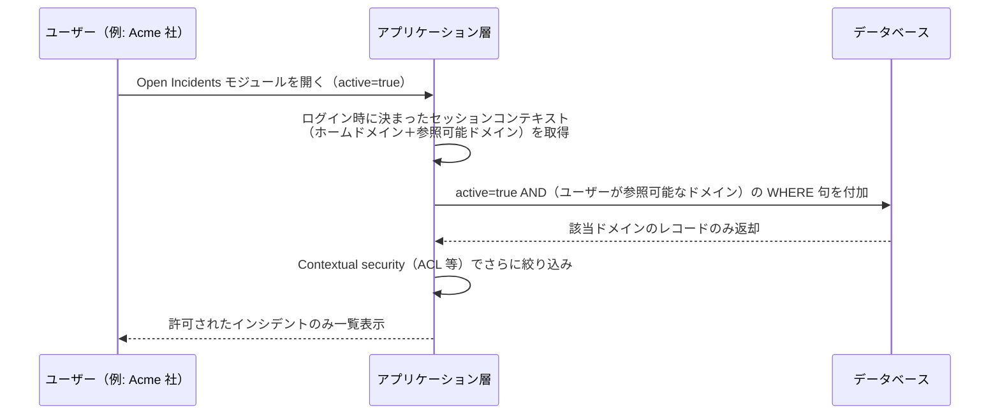
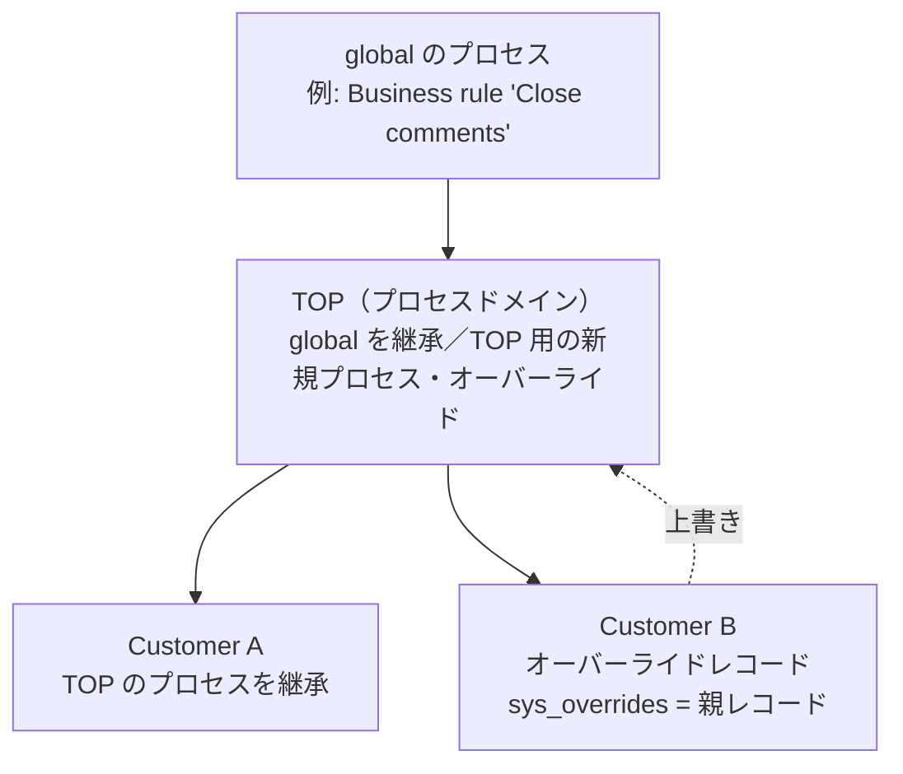
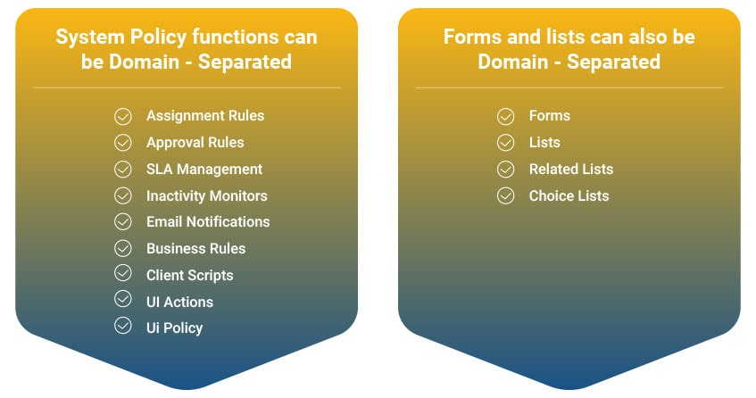
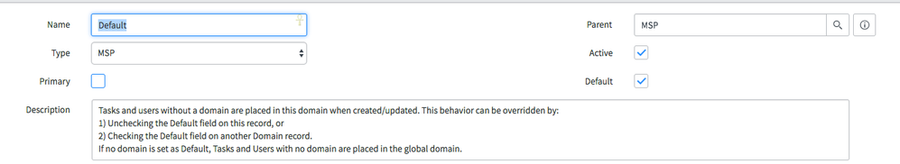
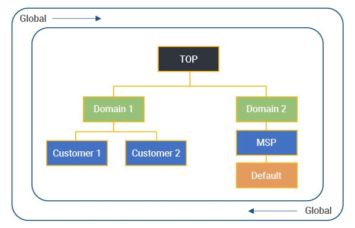
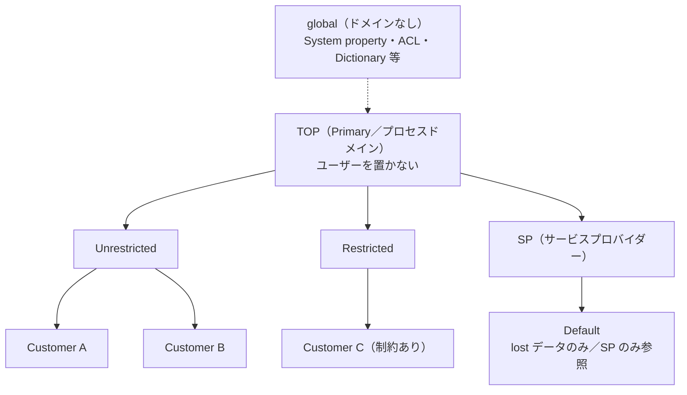
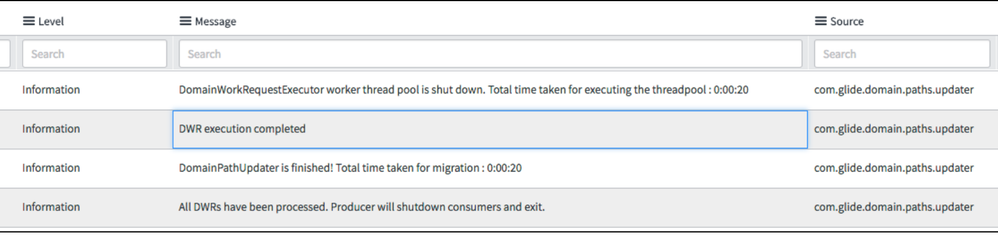
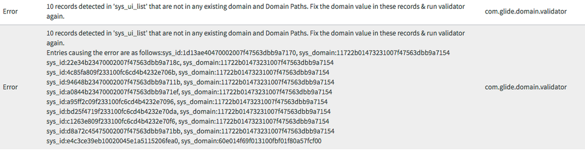

# Domain Separation（ドメインセパレーション）

## 概要

Domain Separation（ドメインセパレーション、ドメイン分離）は、1つの ServiceNow インスタンスの中で **データ（data）・プロセス（process）・管理タスク（administrative tasks）** を「Domain（ドメイン）」と呼ぶ論理グループに分割する機能である。1インスタンス上で **マルチテナンシー（multi-tenancy）** を実現するための仕組みであり、主な利用者は複数の顧客企業へサービスを提供する **Service Provider（SP、サービスプロバイダー）／MSP（Managed Service Provider）** である。[出典](https://www.servicenow.com/docs/access?context=c_DomainSeparation&version=australia&pubname=australia-platform-security&ft:locale=en-US)

Domain Separation の要点は次のとおり。

| 観点 | 要点 |
|---|---|
| 実体 | 各レコードはちょうど1つのドメインに属し、ドメインは `sys_domain` フィールドに格納される |
| 分離対象 | データ、UI（ビュー・リスト・ラベル等）、ビジネスロジック（Business rule、Client script、UI policy、UI action、Notification 等） |
| 階層 | 親子（parent/child）階層を持ち、親ドメインは子ドメインのデータを参照でき、親のプロセスは子に継承される（子で上書き可能） |
| 共有されるもの | System Property、ACL、Dictionary、Script Include などはグローバル（全ドメイン共通）であり、ドメイン単位にはできない |
| 有効化 | プラグインの有効化を ServiceNow に依頼する。**一度有効化すると無効化はできても削除（アンインストール）はできない** |
| 代替案 | 完全な分離が必要で、グローバルなレポートやプロセスが不要なら **インスタンスを分ける（separate instances）** ほうが推奨される |

本ファイルの基準リリースは Australia（2026-05 GA）である。Australia 時点の公式ドキュメント（2026-03-12 更新版）を主に参照し、Australia 版ページが取得できなかった項目は Zurich／Yokohama／Brazil 版の公式ドキュメントで補った（各節に出典を記載）。

関連ファイル:
- アクセス制御（ACL）の詳細は [アクセス制御（ACL）](access-control-acl.md)
- ユーザー・グループ・ロールの基本は [ユーザー・グループ・ロール](users-groups-roles.md)
- インスタンス構成（シングル/マルチインスタンス）の考え方は [インスタンスアーキテクチャ](instance-architecture.md)、[インスタンス戦略と環境](../../03_導入編/07-instance-strategy.md)

---

## 1. 概念

### 1.1 Domain Separation とは

Domain Separation は、1インスタンス内でデータ・プロセス・管理タスクを Domain（ドメイン）単位に論理分割し、「どのユーザーがどのデータを参照・操作できるか」などをドメインごとに制御する機能である。公式ドキュメントは、Domain Separation が次のような顧客に最適であるとしている。[出典](https://www.servicenow.com/docs/access?context=c_DomainSeparation&version=australia&pubname=australia-platform-security&ft:locale=en-US)

- 事業体（business entities）間で厳格なデータ分離が必要
- ドメインごとにビジネスプロセスや UI をカスタマイズしたい（Delegated administration（委任管理））
- 一部のプロセスやレポートはグローバル（全体横断）で維持したい
- サービスプロバイダーとその顧客・パートナー・下位組織の間でデータを分離したい
- 顧客間のプロセスの違いが「軽微〜中程度（minor or moderate）」にとどまる

### 1.2 Domain Separation の5つの特徴（サポートの段階）

Domain Separation の公式ドキュメントは、機能を次の段階的な特徴として説明している。後の段階は前の段階を前提とする。[出典](https://www.servicenow.com/docs/access?context=c_DomainSeparation&version=australia&pubname=australia-platform-security&ft:locale=en-US)

| 特徴（英語） | 日本語 | 内容 |
|---|---|---|
| Data separation | データ分離 | ユーザーは自分に割り当てられたドメインとその子ドメインのデータのみ参照できる。ユーザーとレコードは、再割り当てされない限り global に属する |
| UI separation | UI 分離 | ビュー、リスト、ラベルなどをテナント（ドメイン）ごとに変えられる |
| Business logic separation | ビジネスロジック分離 | Email notification、Business rule、Client script、UI policy、UI action などをテナント固有に定義できる |
| Hierarchical modeling | 階層モデリング | ネストしたマルチテナンシー。親ドメインは子ドメインを管理でき、親のビジネスロジックは子でも実行され、任意の階層で上書き（override）できる |
| Cross-tenant intelligence（Domain scope） | テナント横断インテリジェンス | 追加のテナントデータへのアクセス権を持つテナントのために、データ・メタデータ・ビジネスロジック・処理コンテキストを自動的に扱う |

> 補足: 上位階層で定義されたデータは、原則として下位階層からは見えない（Data defined at a higher level in the hierarchy is generally not visible at lower levels）。ただし「プロセス」レコードは逆に親から子へ流れる（後述 3.3）。

### 1.3 Domain Separation と「インスタンス分割」の比較

Domain Separation は「1インスタンス内のマルチテナンシー」であるため、一部のプロパティ・データ・プロセスは必ずグローバルに残る。公式ドキュメントは、ログイン画面の「Remember me」設定をドメイン単位に設定できない例として挙げている。すべてのシステムプロパティを完全に分けたい、かつグローバルなレポートやプロセスが不要な場合は、別インスタンスを推奨している。[出典](https://www.servicenow.com/docs/access?context=c_DomainSeparation&version=australia&pubname=australia-platform-security&ft:locale=en-US)

| 比較軸 | Domain Separation（1インスタンス） | Separate instances（インスタンス分割） |
|---|---|---|
| 分離の強さ | 論理分離（同一 DB・同一プロパティ） | 物理的・設定的に完全分離 |
| グローバルレポート／横断プロセス | 可能 | 不可（統合が別途必要） |
| システムプロパティ・ACL・Dictionary | 全ドメイン共通 | インスタンスごとに個別 |
| 運用負荷 | 管理オーバーヘッドが増える（公式記載） | インスタンス数に比例して増える |
| 顧客間のプロセス差異 | 軽微〜中程度向き | 大きくても対応可 |
| 後戻り | 無効化は可能だが削除不可。分割したい場合は Domain Migration Tool（後述 8.6） | — |

> 【経験則】ライセンス・費用面でもインスタンス追加と Domain Separation の比較が論点になることが多い。価格・契約は [ライセンスモデル](../../03_導入編/01-licensing-model.md) を参照。公式ドキュメントは、Domain Separation のサブスクリプション購入についてはアカウントマネージャーに問い合わせるよう記載している（[出典](https://www.servicenow.com/docs/r/oJu9n0q6rU~F9UHAnNCt5w/de_7ezFo_xfmGY89kUFsIw)）。

### 1.4 Company Separation との関係

Domain Separation は旧機能 **Company Separation** の後継である。Helsinki リリース以降、Company Separation プラグインは新規に有効化できない。Domain Separation 有効化前から Company Separation が有効だった場合は両方が共存でき、Company Separation の状態は `glide.db.separation.field` プロパティで制御する。[出典](https://www.servicenow.com/docs/r/oJu9n0q6rU~F9UHAnNCt5w/de_7ezFo_xfmGY89kUFsIw)

### 1.5 主要用語

Domain Separation の用語は次のとおり（Domain separation terms ページより。同ページの Australia 版は取得できず Zurich 版を参照）。[出典](https://www.servicenow.com/docs/r/zurich/platform-security/servicenow-ai-platform-security/bp-terms-conditions.html)

| 用語（英語） | 日本語 | 説明 |
|---|---|---|
| Domain | ドメイン | データ・プロセス・UI をまとめる論理単位。ドメインレコードは `domain` テーブルに作成する |
| global | グローバル | 「ドメインを持たない」状態。ドメインフィールドのないテーブルのレコードはすべて global。ドメインフィールドがあるテーブルでドメイン未設定のレコードは「global」と表示される |
| Customer domain | 顧客ドメイン | 顧客のデータの扱い方を制御する UI とプロセスを持つドメイン（例: ACME） |
| Process domain | プロセスドメイン | 複数ドメインで共有するプロセスと UI 設定を置くドメイン。ユーザー等のコアデータを置いてはならない（例: TOP） |
| Data domain | データドメイン | 複数顧客に関係するデータを、顧客ドメインを露出させずに共有するためのドメイン。一般的ではなく、多用するとパフォーマンス問題を招くため SP アーキテクトに相談すべきとされる |
| Global domain（global の領域） | — | System property、Dictionary override、データモデル、ACL、インデックスなど全ドメイン共通の設定を保持。admin アカウントは管理目的に限り global に置く |
| Managed domain | 管理ドメイン | User、Group、Department、Location、CI レコードに対し、Company から自動継承されるドメインではなく手動でドメインを割り当てるためのチェックボックス |
| Overrides（`sys_overrides`） | オーバーライド | プロセステーブルやレポートにあるフィールド。値があれば「プロセスオーバーライドレコード」が存在する＝委任管理が有効であることを示す |
| Delegated administration | 委任管理 | 管理者がドメイン固有のポリシーを設定する方法。オーバーライドレコードとして表現される |
| Expand / Collapse Domain Scope | ドメインスコープの拡張／縮小 | 関連リンク。global から Expand するとオーバーライドを含むすべてのプロセスレコードが見える |
| Domain picker | ドメインピッカー | セッションのドメインを切り替える UI（後述 5.3） |
| Domain path（`sys_domain_path`） | ドメインパス | 階層上の位置を表すクエリ用の値。スクリプトで使ってはならない（後述 4.3） |
| Contains | 包含 | ドメイン間の多対多のデータ可視性関係（後述 5.1） |
| Visibility | 可視性 | ユーザー／グループに他ドメインのデータ参照を与える関係（後述 5.1） |

---

## 2. プラグインと有効化

### 2.1 関連プラグイン

Domain Separation に関係するプラグインは次のとおり。

| プラグイン名 | ID | 説明 | 出典 |
|---|---|---|---|
| Domain Support - Domain Extensions Installer（通称 Domain Separation plugin） | `com.glide.domain.msp_extensions.installer` | Domain Separation の各機能・プロパティを一括で有効化するインストーラー。先に有効化する | [plugin](https://www.servicenow.com/docs/r/platform-security/domain-sep-plugin.html) |
| Domain Separation | `com.snc.pa.domain_support`（公式ドキュメント記載どおり） | 公式の「Domain separation plugin」ページは、Domain Extensions Installer の後にこの ID の Domain Separation を有効化すると記載。Domain reference picker の前提プラグインとしても同 ID が記載されている | [plugin](https://www.servicenow.com/docs/r/platform-security/domain-sep-plugin.html) |
| Domain Support | `com.glide.domain` | 既にこのプラグインが有効な場合、Domain Extensions Installer／Domain Extensions の内容は既存実装との衝突回避のためインストールされない | [Request](https://www.servicenow.com/docs/r/oJu9n0q6rU~F9UHAnNCt5w/de_7ezFo_xfmGY89kUFsIw) |
| MSP Extensions | 公開情報では ID 確認できず | `task.task_for` フィールド、Group の `type`（Security/Support/Visibility）を追加 | [Installed with](https://www.servicenow.com/docs/r/platform-security/r_InstalledWithDomainSeparation.html) |
| Post-Production Domain Separation Activation Utility | `com.glide.domain.activation_utility` | 本番稼働後のインスタンスに Domain Separation を導入するためのユーティリティ（Yokohama で導入。後述 2.4） | [Utility](https://www.servicenow.com/docs/r/oJu9n0q6rU~F9UHAnNCt5w/Nm0oneI9R3EaMMDZnTKfkA)、[RN](https://www.servicenow.com/docs/r/yokohama/delta-xanadu-yokohama/yokohama-xanadu-domainseparation-release-notes.html) |
| Domain Migration Tool | `com.glide.domain.migration_tool` | 特定テナントをドメイン分離インスタンスから専用インスタンスへ移行（後述 8.6） | [Migration](https://www.servicenow.com/docs/r/zurich/platform-security/tenant-domain-migration-tool.html) |
| Domain Separation AI Agent | 公開情報では ID 確認できず | AI Agent for Domain Visibility Management（Australia 新機能。後述 8.8） | [RN](https://www.servicenow.com/docs/access?context=domain-separation-rn&version=australia&pubname=australia-release-notes&ft:locale=en-US) |
| Service Catalog - Domain Separation | `com.glideapp.servicecatalog.domain_separation` | Service Catalog の Domain Separation 対応 | [Catalog](https://www.servicenow.com/docs/r/zS6yb8e~gR8BPjeviYdV9g/tTZqEeVCqk1_0K6_HeyV9A) |

> 注意: `com.snc.pa.domain_support` は一般に「Performance Analytics のドメインサポート」を連想させる ID だが、公式の Domain separation plugin ページ（Brazil 版、2026-09-10 更新）は「Domain Separation (plugin com.snc.pa.domain_support)」と記載している。実インスタンスの Application Manager（`v_plugin`）で名称を確認すること。また Australia のリリースノートは「Domain Separation は `com.glide.domain.activation_utility` プラグインの有効化で利用可能」と記載しているが、この ID は Post-Production Activation Utility のものであり、記述の範囲（新規導入全般か本番後導入か）は公開情報では確認できず。

### 2.2 有効化の順序とタイミング

Domain separation plugin ページは次のように記載している。[出典](https://www.servicenow.com/docs/r/platform-security/domain-sep-plugin.html)

1. 管理者が Domain Extensions Installer（`com.glide.domain.msp_extensions.installer`）の有効化を依頼する。
2. その後に Domain Separation プラグインを有効化する。
3. **有効化は開発の初期段階、理想的には他のプラグインより前に行う。**

導入後期や本番稼働（go-live）後に有効化した場合のリスクとして、公式は次を挙げている。

- Task テーブルに Domain（`sys_domain`）列が追加され、**既存レコードはすべて global になる**。
- Business rule、Client script、フォームビュー、Workflow など多くのプラットフォームコードも global に置かれる。
- 既存レコードをスクリプトでドメインに再割り当てすると、データ破損・損失や本番停止のリスクがある。
- その過程で ServiceNow のコードを改変すると、パフォーマンスとユーザビリティのリスクが増す。

### 2.3 有効化の依頼手順（Request domain separation）

Domain Separation プラグインは管理者が自分で有効化するのではなく、ServiceNow に有効化を依頼する。手順は次のとおり（Australia 版「Request domain separation」、2026-03-12 更新。対象は Domain Support - Domain Extensions Installer プラグイン、必要ロールは `admin`）。[出典](https://www.servicenow.com/docs/r/oL66E_cwDD_tnWQYzYPRdA/wDM7KfGusyXJhxqShBc8cg)

1. **All > System Applications > All Available Applications > All** に移動する。
2. **Request plugin** を選択し、Now Support の Activate Plugin フォームを開く。
3. **What is your target instance** で対象インスタンスを、**Which plugin would you like to activate** でプラグインを選ぶ（一覧にない場合や OEM／オンプレミスの場合は「Plugin I'm looking for is not listed」チェックボックスをオンにして名称を入力）。
4. **Select Maintenance Date and Time** で有効化する日時を選び、**Submit** する。
5. メンテナンスウィンドウ中にインストールされる。Application Manager の **Installed** タブで確認する。

> アカウントマネージャー経由で依頼した場合、通常は「数日以内（within a few days）」に有効化されると Australia 版に記載されている（同出典）。旧リリース版では「米国太平洋時間で1営業日2回のバッチで有効化」とされていた（[出典](https://www.servicenow.com/docs/r/oJu9n0q6rU~F9UHAnNCt5w/de_7ezFo_xfmGY89kUFsIw)）が、Australia 版にはこのバッチ有効化の記述はなく、依頼者がメンテナンス日時を選ぶ方式になっている。Brazil 版も同じ手順である（[出典](https://www.servicenow.com/docs/r/q0JUS4fl39QNjim0ATT18w/_l2_WFrafREEU5DZj4RW5w)）。

有効化によって次が有効になる（公式記載）: Domain テーブルに基づくドメイン分離、ドメインごとのポリシーを持てる委任管理、すべてのレコードが最初は global に置かれること、現在のユーザーのドメインによって他ドメインのレコードの見え方・操作可否が決まること。[出典](https://www.servicenow.com/docs/r/platform-security/domain-sep-plugin.html)

### 2.4 Post-Production Domain Separation Activation Utility

Post-Production Domain Separation Activation Utility（`com.glide.domain.activation_utility`、Yokohama で導入）は、稼働中（post-production）の環境で Domain Separation を有効化するためのユーティリティである。[出典](https://www.servicenow.com/docs/r/oJu9n0q6rU~F9UHAnNCt5w/Nm0oneI9R3EaMMDZnTKfkA)、[導入リリース](https://www.servicenow.com/docs/r/yokohama/delta-xanadu-yokohama/yokohama-xanadu-domainseparation-release-notes.html)

| 機能 | 内容 |
|---|---|
| ガイド付きセットアップ | ドメイン作成をステップバイステップで案内 |
| バックグラウンドジョブ | Process separation と Data separation のプロパティを **無効** にした状態で Domain Separation をインストール |
| プロセスレコード | 対象（最初の）ドメインからプロセスレコードが見える状態を維持 |
| エラー処理 | ドメイン作成中のエラーを検出・記録し、よくあるエラーの解決策を提示 |
| 監査 | すべての操作を監査用にログ出力、作成ドメイン・変更内容のサマリーを生成 |
| 制約 | ドメイン分離テーブルのドメイン値を埋める処理には **ダウンタイムまたはインスタンスへのアクセス制限が必要** |

### 2.5 有効化で追加されるもの（Installed with domain separation）

Domain Separation の有効化で追加・変更される主な要素は次のとおり。[出典](https://www.servicenow.com/docs/r/platform-security/r_InstalledWithDomainSeparation.html)

**ロール**

> 注記: Installed with domain separation ページに記載のロールは `domain_admin` のみである。`domain_expand_scope` は Domain scope ページに記載されたロールで、参考として併記する（3.4 節）。

| ロール | 説明 |
|---|---|
| `domain_admin` | ドメインの作成・編集・削除ができる |
| `domain_expand_scope` | フォーム上の Toggle Domain Scope UI action を使ってドメインスコープを拡張／縮小できる（[出典](https://www.servicenow.com/docs/access?context=c_DomainScope&version=australia&pubname=australia-platform-security&ft:locale=en-US)） |

**`sys_domain` フィールドが追加されるテーブル（13テーブル）**

`sys_attachment`、`sys_user_has_role`、`sys_group_has_role`、`sys_email`、`sys_user_group`、`core_company`、`cmn_location`、`cmn_department`、`sys_gauge`、`sys_report`、`kb_feedback`、`sysapproval_approver`、`sys_user_grmember`

> 補足: `task` テーブル（および `incident` など拡張テーブル）は Domain フィールドを持ち、子テーブルに継承される（[出典](https://www.servicenow.com/docs/access?context=bp-db-query-with-ds&version=australia&pubname=australia-platform-security&ft:locale=en-US)）。【第三者情報】ベースプラットフォームの約2,000テーブルが既に `sys_domain` 列を持つとするコミュニティ投稿がある（[出典](https://www.servicenow.com/community/now-platform-forum/domain-separation/td-p/3185701)）。

**MSP Extensions による変更**

| 対象 | 変更 |
|---|---|
| Task テーブル | `task_for`（User テーブルへの参照）フィールドを追加 |
| Group テーブル | `type` フィールドに Security、Support、Visibility の選択肢を追加 |

**Business rule（主なもの、合計41件）**

| 分類 | 代表例 | 役割 |
|---|---|---|
| Activate/Deactivate | Domain - Activate/Deactivate（`core_company`）、Domain - Deactivate Companies（`domain`） | ドメイン無効化時に会社を無効化 |
| Cascade Domain（7件） | Company、Email、Group、Knowledge、Task、User、Version | 親レコードのドメイン変更を関連レコードへ伝播 |
| Default／Validate | Domain - Default - Task、Domain - Default - User、Domain - Disallow Global Domain Record、Domain - Validate Default、Domain - Validate Primary | ドメイン未設定時の Default 振り分け、Default/Primary の一意性検証 |
| Override Copy（6件） | `sys_app_application`、`sys_data_policy2`、`sys_gauge`、`sys_ui_action`、`sys_ui_list_control_embedded`、`sys_ui_policy` | 親レコードがドメイン向けにオーバーライドされた際、付随レコード（モジュール、ビュー等）をコピー |
| Set Domain（17件） | 承認、添付、CMDB CI、部門、メール、フィードバック、グループ、グループロール、ロケーション、Task SLA、ユーザー、ユーザーロール、Workflow 関連など | 作成時にドメインを設定（例: User のドメインを Company のドメインに合わせる） |
| Set task for（2件） | Domain - Set task for - Change／Incident | `task_for` を設定 |
| Domain Support Plugin 付属 | Change Domain Set（`sys_dictionary`）、Domain support properties（`sys_properties`） | ドメインクエリ方式（domain paths／numbering）に合わせてプロパティを設定 |

**Client script**: Domain - Set Company and Location（Incident の Caller から Company・Location を補完）、(BP) Set Location to User。

---

## 3. データ分離とプロセス分離

### 3.1 データ分離（Data separation）の仕組み

Domain Separation のデータ分離は、テーブルの `sys_domain` フィールドに基づく。[出典](https://www.servicenow.com/docs/access?context=c_DomainAssignment&version=australia&pubname=australia-platform-security&ft:locale=en-US)

- Domain Separation は既定でテーブルとその拡張テーブルにドメインフィールドを追加するが、対象は「プラットフォームおよびベースラインアプリケーションのうち適切なもの」に限られる。
- 新規テーブルを分離するには、Dictionary 定義に `sys_domain` フィールドを追加する（後述 3.5）。
- **各レコードはちょうど1つのドメインに割り当てられる**（Each record is assigned a single domain）。

データ参照時のクエリ処理は次の流れである。[出典](https://www.servicenow.com/docs/access?context=bp-db-query-with-ds&version=australia&pubname=australia-platform-security&ft:locale=en-US)

- ドメインによる WHERE 句は **すべてのデータベースクエリ（インテグレーション経由のクエリを含む）** に適用される。
- ドメインフィルタの後に ACL などの Contextual security が適用される。Domain Separation は ACL を置き換えるものではない（ACL は [アクセス制御（ACL）](access-control-acl.md) 参照）。

### 3.2 レコードのドメインの決まり方（Domain assignment）

新規レコードの `sys_domain` には、次のいずれかの方法で割り当てられたドメインが入る（原文の要旨: The value of the sys_domain field contains the domain assigned to the record by any of the following）。**公式ドキュメントは評価の優先順位を明記していない**。明記されている順序のルールはフォールバックだけで、他のどの条件にも該当しない場合、レコードは作成ユーザーのドメインを自動的に継承する（If no other domain conditions apply, a record automatically inherits the domain of the user who creates it）。下表の「#」は公式ページの掲載順であり、優先順位ではない。[出典](https://www.servicenow.com/docs/access?context=c_DomainAssignment&version=australia&pubname=australia-platform-security&ft:locale=en-US)

| # | 決定要素 | 説明 |
|---|---|---|
| 1 | ユーザーの Company | ユーザーを Company に割り当てると、その Company のドメインに属し、作成するレコードもそのドメインを継承する |
| 2 | 作成時に動く Business rule | 管理者が `sys_domain` を設定する Business rule を作成できる（テーブルに `sys_domain` 列が必要） |
| 3 | レコード作成に使ったモジュール | モジュールの引数に `sysparm_domain=<ドメインの sys_id>` を指定すると、そのドメインに作成される |
| 4 | フォームテンプレート | テンプレートに `sys_domain` フィールドを含めてドメインを選択しておく |
| 5 | 親レコードのドメイン | 関連レコードは親のドメインを継承（例: Change task は Change request のドメイン、Problem は親 Incident のドメイン） |
| 6 | User レコードに割り当てたドメイン | — |
| 7 | 作成ユーザーのドメイン | 他のどれにも該当しない場合のフォールバック（公式に明記された唯一の順序ルール） |

**Company とドメインの関係**（[出典](https://www.servicenow.com/docs/access?context=c_DomainScope&version=australia&pubname=australia-platform-security&ft:locale=en-US)）:

- ユーザーは既定で自分の Company と同じドメインに割り当てられる（例: ACME 社のユーザーは TOP/ACME ドメイン）。
- Company のドメインを変更すると、関連する Location、Department、Group、User のドメインも変更される。
- **Managed domain** チェックボックスがオンのレコードは自動変更されない。
- admin ロールを持つユーザーは自分の User レコード（＝自分のドメイン）を変更できるため、SP は委任管理の無効化や承認制を検討すべきとされる。

### 3.3 プロセス分離（Process separation／Delegated administration）

Domain Separation のプロセス分離は、プロセス系テーブル（Business rule、Client script、UI policy、UI action、Notification 等）の `sys_domain` と `sys_overrides` によって実現される。[出典](https://www.servicenow.com/docs/r/zurich/platform-security/servicenow-ai-platform-security/bp-terms-conditions.html)

- **プロセスは親から子へ流れる**: 親ドメインのプロセスレコードは子ドメインで有効（見える）が、子ドメインのプロセスレコードは親では見えない。
- **オーバーライド**: 子ドメインで親のプロセスを変えたい場合、そのドメインにオーバーライドレコードを作成する。オーバーライドレコードの `sys_overrides` には上書き元（親）レコードが入る。
- `sys_overrides` に値があることは、そのドメインで委任管理（Delegated administration）が有効であることを示す。
- global から **Expand Domain Scope** 関連リンクを使うと、オーバーライドを含むすべてのプロセスレコードを確認できる。**Collapse Domain Scope** で global 関連のみの表示に戻る。レポートも同様に Expand Domain Scope で全件を確認する。

**分離できるプロセス・UI の例**: 【第三者情報】Jade Global のブログは、Assignment rule、Approval rule、SLA、Inactivity monitor、Email notification、Business rule、Client script、UI action、UI policy、フォーム、リスト、関連リスト、Choice list をドメイン分離可能な対象として挙げている（[出典](https://www.jadeglobal.com/blog/servicenow-domain-separation)）。

- **キャプション**: ドメイン分離できるプロセス／UI 要素の一覧図【第三者情報】
- **画面の説明**: 左のボックス「System Policy functions can be Domain-Separated」に Assignment Rules、Approval Rules、SLA Management、Inactivity Monitors、Email Notifications、Business Rules、Client Scripts、UI Actions、UI Policy が、右のボックス「Forms and lists can also be Domain-Separated」に Forms、Lists、Related Lists、Choice Lists が列挙されている。
- **出典**: https://www.jadeglobal.com/blog/servicenow-domain-separation （Jade Global, 2023-01-06）／取得日 2026-11-03

**オーバーライドの挙動に関する注意（コミュニティ情報）**:

- 【第三者情報】オーバーライドは「異なるドメインスコープ間」でのみ機能し、Domain Separation がない環境では機能しないとする投稿がある（[出典](https://www.servicenow.com/community/developer-articles/business-rules-does-the-sys-override-work-outside-of-domain/ta-p/2321678)、2020年）。
- 【第三者情報】親の処理を子ドメインで止めたい場合、オーバーライドを inactive にすると「オーバーライドが無視されて親が動く」ため、オーバーライドの条件を false にする方法が紹介されている。また、オーバーライドを削除する際は先に Override フィールドの参照を外さないと両方のレコードを削除してしまうとの投稿がある（[出典](https://www.servicenow.com/community/developer-forum/notifications-and-sys-overrides/m-p/2166794)、2017年。現行リリースでの挙動は公開情報では確認できず）。

### 3.4 Record scope と Session scope（Domain scope）

Domain scope（ドメインスコープ）は、ユーザーが何にアクセスできるかを定める。ドメイン分離インスタンスでは、各ユーザーが次の2つのスコープを持つ。[出典](https://www.servicenow.com/docs/access?context=c_DomainScope&version=australia&pubname=australia-platform-security&ft:locale=en-US)

| スコープ | 決まり方 | 適用場面 |
|---|---|---|
| Session scope（セッションスコープ） | セッション開始時に User レコードのドメインに設定。Domain picker で変更可能 | リスト表示など |
| Record scope（レコードスコープ） | 表示中のレコードのドメイン | 任意レコードのフォーム表示時 |

- **既定では Record scope が優先**され、上位ドメインのユーザーであっても、各レコードのドメインのデータ・プロセス制約に従う（例: SP の担当者が ACME のインシデントを開くと ACME のプロセスが適用される）。
- `domain_expand_scope` ロールを持つユーザーは、フォームの **Toggle Domain Scope** UI action で Record scope ⇔ Session scope を切り替えられる。Record scope から拡張すると、ユーザーのドメインと子ドメインにまたがる全データが表示される。
- Toggle Domain Scope は、global ドメインのレコード、またはユーザーのドメインとレコードのドメインが同じ場合には表示されない。
- Visibility domain で明示的に付与されたドメインのデータは常に見える。

**他ドメインの値の選択**: 複数ドメインを参照できるユーザーは、レコードのドメインを変えずに他ドメインの値を選べる（例: SP のエージェントが ACME のインシデントを SP のユーザーに割り当てても、インシデントは ACME ドメインのまま）。

| 条件 | 参照フィールドの表示値 | 選択できる値 |
|---|---|---|
| ユーザーがレコードのドメインにアクセスできる | 表示される、関連レコードも開ける | 参照可能な任意のドメインの値 |
| ユーザーがレコードのドメインにアクセスできない | 表示されない（Madrid 以降に Domain Separation を有効化した場合） | レコードのドメインの値のみ |

**関連プロパティ／ユーザープリファレンス**（Domain system properties and user preferences。Australia 版は取得できず Yokohama 版を参照）[出典](https://www.servicenow.com/docs/r/GypxAX2jEErwkCxugICKdg/0rpQRISDpnpRznW37gNvPg)

| 名前 | 種別 | 説明 | 既定値 |
|---|---|---|---|
| `glide.sys.domain.use_record_domain_for_processes` | System property | プロセスのスコープをレコードのドメインに限定する（Business rule には適用されない。Business rule は常にドメインレコードから処理） | true |
| `glide.sys.domain.use_record_domain_for_data` | System property | データのスコープをレコードのドメインに限定する | Fuji 以降の新規有効化では true。Fuji 以前からのアップグレードではプロパティ自体が存在しない |
| `glide.sys.domain.skip_domain_insert_businessrules` | System property | Domain テーブルの Business rule のスコープ設定。true だとセッションドメインで適用ルールを決め、ドメイン挿入性能が向上 | Jakarta 以降の新規有効化で true、既存実装では false |
| `glide.sys.domain.skip_non_global_businessrule_if_nodomain` | System property | `queryNoDomain()` 呼び出し時や非ドメイン分離テーブルでは global の Business rule のみ実行。false で旧挙動（非推奨） | 公開情報では確認できず |
| `glide.domain.session_scope` | User preference | 既定スコープをレコードではなくセッションドメインにする（admin のみ設定） | false |
| `glide.domain.session_scope_notification` | User preference | 拡張スコープの値を含むときに視覚的な合図を表示（admin のみ設定） | true |

> `use_record_domain_for_processes` または `use_record_domain_for_data` が true の場合、旧プロパティ `glide.sys.domain.use_record_domain`、`glide.sys.domain.use_record_domain_for_client_scripts`、`glide.sys.domain.domain_change_notify`、`glide.sys.domain.no_change_roles` は設定に関係なく無視される。

**Data separation／Process separation の全体スイッチ**: Domain Migration Tool のドキュメントには、データ分離のプロパティ `glide.sys.domain.partitioning`、プロセス分離のプロパティ `glide.sys.domain.delegated_administration`、および `glide.sys.domain.enabled` が登場する（[出典](https://www.servicenow.com/docs/r/zurich/platform-security/tenant-domain-migration-tool.html)）。これらは手動で切り替える設定ではなく、ServiceNow のユーティリティが制御するものとして扱うのが安全である【推定】。

### 3.5 カスタムテーブルのドメイン分離

カスタムテーブルをドメイン分離する手順（Domain-separate a custom table）は次のとおり。[出典](https://www.servicenow.com/docs/r/washingtondc/platform-security/bp-ds-custom-table.html)

1. 型 `domain_id`、**列名（Column name）** を `sys_domain` としたフィールドを追加する（ラベルではなく列名）。属性は自動適用され、`sys_domain_path` も自動作成される。
2. `Domain - Set Domain - Task` に倣い、作成時にドメインを設定する Business rule を作成する（通常は Company のドメイン）。
3. `Domain - Default - Task` に倣い、ドメインが決まらない場合に Default ドメインへ振り分ける Business rule を作成する。
4. Order（低い順に実行）を確認し、Set Domain が Default より先に動くようにする。
5. ドメインが空または global のままなら `task_for`（caller／requested_for）からユーザーのドメインを設定し、なければ Default にするフォールバックを追加する。
6. `Domain - Cascade Domain - Task` に倣い、ドメイン変更時に関連レコード（Workflow context／history、承認、SLA、添付、メール、メトリクス）を更新する Business rule を作成する（Default ドメインからレコードを移すときによく発火する）。

**ドメイン分離できないテーブル（システムが防止）**: 次のテーブルは、システムによってドメイン分離が防止されている（原文の要旨: The system prevents the following tables from being domain separated）。運用上の推奨ではなく、技術的に分離できない。[出典](https://www.servicenow.com/docs/access?context=c_DomainAssignment&version=australia&pubname=australia-platform-security&ft:locale=en-US)

| テーブル | 名称 |
|---|---|
| `sys_security_acl` | Access Control |
| `sys_script_include` | Script Include |
| `sys_properties` | System Property |
| `sys_security_restricted_list` | Security Exclusion/Inclusion List Entities |
| `sys_dictionary` | Dictionary Entry |
| `sys_dictionary_override` | Dictionary Entry Override |

> 上表の「分離できない（システムが防止）」とは別に、推奨レベルの注意として、ServiceNow は `sys_` 接頭辞を持つプラットフォームテーブル全般のドメイン分離を推奨していない（予期しない結果になるため）。【第三者情報】`sys_domain` を追加するだけでは不十分なテーブルについては KB0662346「Tips for Domain Separating 'NON Out of Box Domain separated' Tables」が参照先として紹介されている（[出典](https://www.servicenow.com/community/now-platform-articles/platform-domain-separation-knowledge-amp-troubleshooting/ta-p/2426446)）。

### 3.6 UI 分離と Choice list

- ビュー、リスト、ラベルなどの UI 要素はドメインごとに変えられる（[出典](https://www.servicenow.com/docs/access?context=c_DomainSeparation&version=australia&pubname=australia-platform-security&ft:locale=en-US)）。
- Choice（`sys_choice`）はテーブル・ドメイン・言語ごとにグループ化されて保存される。global で選択肢を追加すると全ドメインのリストに伝播し、「Selected」はアクティブ、「Available」は非アクティブになる（[出典](https://www.servicenow.com/docs/r/zurich/platform-security/servicenow-ai-platform-security/bp-terms-conditions.html)）。
- ドメイン固有の Choice list は管理タスク「Create a domain-specific choice list」で作成する（[出典](https://www.servicenow.com/docs/access?context=c_DomainSeparationAdministration&version=australia&pubname=australia-platform-security&ft:locale=en-US)）。
- ただし Choice field は顧客（テナント管理者）に委任できない設定とされる（後述 6.4）。

### 3.7 スクリプトでの扱い

| API／手法 | 説明 | 出典 |
|---|---|---|
| `GlideRecord.addDomainQuery(GlideRecord)` | クエリのドメインを、ユーザーのドメインから引数で渡した GlideRecord のドメインに変更する。Domain Extensions Installer プラグインが必要。グローバルスコープ専用（スコープアプリでは利用不可と記載） | [GlideRecord](https://www.servicenow.com/docs/r/xanadu/api-reference/server-api-reference/c_GlideRecordAPI.html) |
| `GlideRecord.queryNoDomain()` | ドメイン条件なしでクエリする。ドメイン分離環境でのみ意味を持ち、サーバーサイド専用 | 【第三者情報】[Community](https://www.servicenow.com/community/developer-forum/glidequery-querynodomain/m-p/1816569) |
| `sysparm_domain` URL パラメーター | モジュールからのレコード作成時のドメイン指定 | [Assignment](https://www.servicenow.com/docs/access?context=c_DomainAssignment&version=australia&pubname=australia-platform-security&ft:locale=en-US) |
| `sys_domain` による判定 | ドメインの判定は `sys_domain`（sys_id）で行う。**`sys_domain_path` をスクリプトで使ってはならない**（階層再計算で値が変わり、スクリプトが壊れるため） | [Query method](https://www.servicenow.com/docs/access?context=bp-domain-query-method&version=australia&pubname=australia-platform-security&ft:locale=en-US) |
| Before Query business rule | データ分離を補強する目的で利用できる | [Terms](https://www.servicenow.com/docs/r/zurich/platform-security/servicenow-ai-platform-security/bp-terms-conditions.html) |

スクリプト全般は [サーバーサイドスクリプト](scripting-server-side.md) を参照。

---

## 4. ドメイン階層

### 4.1 ドメインレコードの作成（Domain テーブル）

ドメインは **Domain [`domain`]** テーブルにレコードを追加して作成する。必要ロールは `admin`。[出典](https://www.servicenow.com/docs/r/platform-security/t_CreateADomain.html)

> 補足: Request domain separation ／ Domain separation plugin ページは「Domain [sys_domain] table に基づくドメイン分離」と表現している（[出典](https://www.servicenow.com/docs/r/platform-security/domain-sep-plugin.html)）。レコード作成先としては Create a domain ページの `domain` テーブルを記載した。両テーブルの継承関係は公開情報では確認できず。

**手順**: **All > Domain Admin > Domains** → **New** → 各フィールドを入力 → **Submit**

| フィールド | 説明 |
|---|---|
| Name | ドメインの一意な名前 |
| Type | ドメインの種類。既定の選択肢は Vendor、Customer、MSP。独自の選択肢を追加可能 |
| Primary | 階層の最上位ドメイン（子のみ持ち親を持たない）とする場合にオン。**Primary は1つだけ** |
| Default | 階層の Default ドメインとする場合にオン。**Default は1つだけ** |
| Parent | 上位ドメイン。Domain map に表示されるには値が必要 |
| Active | ドメインを利用可能にする。Domain map に表示されるにはオンが必要 |
| Description | 説明 |

**関連リスト**: Companies、Contains Domains、Contained By。公式手順では、階層を変更するには Contains Domains 関連リストで子（包含される）ドメインを選択する、と記載されている。

> 注意: 親子階層は Parent フィールドで決まり、Contains（包含）は親子とは独立した「データのみ」の関係である（5.1 節）。Create a domain ページの上記記述と Contains の定義との関係は公開情報では明確でないため、階層変更は Parent フィールドの変更（Domain Job Manager の Hierarchy change ジョブが発生）として扱うのが安全である【推定】。

- **キャプション**: Domain レコードのフォーム（Default ドメインの例）
- **画面の説明**: Domain Admin > Domains で開いたドメインレコード。左列に Name（Default）、Type（MSP）、Primary（オフ）、右列に Parent（MSP）、Active（オン）、Default（オン）があり、下部の Description には「ドメインのない Task と User は作成・更新時にこのドメインに置かれる。この動作はこのレコードの Default をオフにするか、他のドメインレコードの Default をオンにすることで変更できる。Default に設定されたドメインがない場合、ドメインのない Task と User は global ドメインに置かれる」という旨が記載されている。UI16 時代（2018年）の画面である。
- **出典**: https://www.servicenow.com/community/now-platform-blog/8-best-practices-for-supporting-domain-separation/ba-p/2286278 （ServiceNow Community, 2018-01-15）／取得日 2026-11-03

その他の管理タスク（Make a domain the default、Enable or disable a domain、Manually manage the domain for particular records、View domain relationships、Delete by domain など）は Domain separation administration ページに一覧がある。[出典](https://www.servicenow.com/docs/access?context=c_DomainSeparationAdministration&version=australia&pubname=australia-platform-security&ft:locale=en-US)

### 4.2 推奨される階層構造（global／TOP／SP／Default／顧客）

公式の Domain separation hierarchies は次の構造を推奨している。[出典（Brazil 版）](https://www.servicenow.com/docs/r/platform-security/bp-domain-sep-hierarchies.html)、[出典（Zurich 版）](https://www.servicenow.com/docs/r/oJu9n0q6rU~F9UHAnNCt5w/VVgj0ZDighDyk~AA57JHJg)

| 要素 | 役割 | ルール |
|---|---|---|
| global | ドメインではなく「ドメインを持たない」状態 | global のレコードは、セキュリティ設定で制限しない限り全ユーザーが利用可能 |
| TOP | 階層のルートとなる **プロセスドメイン** | インスタンスオーナーが開発する新規プロセスと、global のプロセスのオーバーライドを置く。**ユーザーを置いてはならない** |
| Unrestricted／Restricted | TOP 配下の分岐（推奨例） | 可視性制約のない顧客を Unrestricted 配下、制約のある顧客を Restricted 配下に置く |
| SP（Service Provider） | サービスプロバイダー自身のドメイン | Default ドメインにアクセスできるのは SP のみ |
| Default | 行き場のない（"lost"）データの受け皿 | アクティブなユーザーを置かない。ここにデータがあること自体が設定・手順上の問題のサイン。インスタンスオーナーが定期的にトリアージして正しいドメインへ移す |
| 顧客（テナント） | 顧客ごとのドメイン | 親子の縦のライン上に置く。自ドメインと上位ドメインのプロセスを利用し、ライン外のドメインのプロセスは適用されない。顧客同士は完全に分離（部門のようにリソースを共有するものではない） |

追加ルール:

- 「スーパーバーティカル」（例: Restricted、Managed Services）は、各顧客がどれか1つだけに属するなら可。
- 全顧客に水平に提供するサービスは、個別のドメイン階層には定義しない。
- 利用中のインスタンスでドメイン間のデータ移動を行わない。
- Default ドメインを設定しない場合、ドメインのない Task と User は global に入り、**全員から見えてしまう**。

- **キャプション**: ドメイン階層の構成例【第三者情報】
- **画面の説明**: 外枠が「Global」（ドメインを持たない領域）。その内側に TOP を頂点とした階層があり、TOP の下に Domain 1 と Domain 2、Domain 1 の下に Customer 1 と Customer 2、Domain 2 の下に MSP、MSP の下に Default が配置されている。公式推奨の「TOP（プロセスドメイン）→ 分岐 → 顧客」「SP の下に Default」という構造と対応する。
- **出典**: https://www.jadeglobal.com/blog/servicenow-domain-separation （Jade Global, 2023-01-06）／取得日 2026-11-03

### 4.3 ドメインパスとクエリ方式

Domain Separation のクエリ方式には domain paths、spooling、numbering がある。**現在はすべての顧客が domain paths を使用** し、domain numbering は使われない（[出典](https://www.servicenow.com/docs/access?context=c_DomainSeparation&version=australia&pubname=australia-platform-security&ft:locale=en-US)）。domain paths は Domain Separation 有効インスタンスの既定方式で、spooling や numbering より大幅に高速である。[出典](https://www.servicenow.com/docs/access?context=bp-domain-query-method&version=australia&pubname=australia-platform-security&ft:locale=en-US)

| 状態 | `glide.sys.domain.provider` | `glide.sys.domain.paths.installed` |
|---|---|---|
| domain paths 有効 | `domain_paths` | `true` |
| domain paths 無効 | `domain_paths` 以外 | `false` |

- domain paths でない場合はカスタマーサポートに相談する（【第三者情報】[Community](https://www.servicenow.com/community/now-platform-blog/8-best-practices-for-supporting-domain-separation/ba-p/2286278)）。
- `sys_domain_path` は階層変更時に再計算されるため、スクリプトで使ってはならない。

### 4.4 階層変更（再親子付け）の影響と Domain Job Manager

ドメイン階層の変更（re-parenting）は、多数のドメイン対応テーブルに対して更新処理を連鎖させる。

- 既定では、Domain レコードの変更（再親子付けなど）でドメイン分離テーブルのレコードを補正するジョブが起動する。**Domain Job Manager** を使うと、複数のドメイン変更をキューに入れ、1つのバックグラウンドジョブとして順に実行できる（Zurich で導入。Australia の管理ページに記載）。[導入リリース](https://www.servicenow.com/docs/r/zurich/delta-washingtondc-zurich/zurich-washingtondc-domainseparation-release-notes.html)、[出典](https://www.servicenow.com/docs/access?context=c_DomainSeparationAdministration&version=australia&pubname=australia-platform-security&ft:locale=en-US)
- Domain Job Management ページ（Brazil 版）の詳細: 対応ジョブ種別は **Hierarchy change** のみ。状態は Active（実行）と Paused（保留）。Paused のジョブは既定で **1時間後に自動再開**し、チェックボックスで自動再開を無効化して手動再開にできる。**View Job Progress** ボタンで Job Type、Status、Progress を確認できる。[出典](https://www.servicenow.com/docs/r/q0JUS4fl39QNjim0ATT18w/lbaahW14AZ6oslGmzKZliA)
- 【第三者情報】階層変更は必要なときだけ小さなバッチで行い、各バッチ完了を `syslog_domain` の「DWR execution completed」と `domain_work_request` レコードの State 3（Processed）で確認するよう推奨されている（[出典](https://www.servicenow.com/community/now-platform-blog/8-best-practices-for-supporting-domain-separation/ba-p/2286278)、2018年）。

- **キャプション**: 階層変更後の Domain Log（`syslog_domain`）一覧
- **画面の説明**: Level・Message・Source 列を持つログ一覧。Source はすべて `com.glide.domain.paths.updater`、Level は Information で、「DomainWorkRequestExecutor worker thread pool is shut down」「DWR execution completed」「DomainPathUpdater is finished! Total time taken for migration : 0:00:20」「All DWRs have been processed」などのメッセージが並ぶ。ドメインパス更新処理（Domain Work Request）の完了確認に使う。
- **出典**: https://www.servicenow.com/community/now-platform-blog/8-best-practices-for-supporting-domain-separation/ba-p/2286278 （ServiceNow Community, 2018-01-15）／取得日 2026-11-03

### 4.5 ドメインの無効化

ドメインを無効化すると、そのドメインのすべての Company が無効化され、その Company のユーザーはログインできなくなる（「Company inactive - your access to this instance is not authorized.」に類するメッセージが表示される）。サンプルデータで ACME ドメインを無効化すると ACME 社と3名のサンプルユーザーがロックアウトされる。[出典](https://www.servicenow.com/docs/access?context=c_DomainScope&version=australia&pubname=australia-platform-security&ft:locale=en-US)

---

## 5. ドメインの可視性

### 5.1 3種類の関係（Parent/child、Contains、Visibility）

ドメイン間の参照関係は次の3種類である。[出典](https://www.servicenow.com/docs/access?context=c_DomainVisibility&version=australia&pubname=australia-platform-security&ft:locale=en-US)、[出典（階層）](https://www.servicenow.com/docs/r/platform-security/bp-domain-sep-hierarchies.html)

| 種類 | 対象 | 影響範囲 | 特徴 | 推奨度 |
|---|---|---|---|---|
| Parent/child（親子） | ドメイン⇔ドメイン | データとプロセスの両方 | 親は子のデータをすべて参照できる。プロセスは親から子へ流れる | 基本 |
| Contains domains（包含） | ドメイン⇔ドメイン（多対多） | **データのみ**（プロセスには影響しない） | 親子階層と独立。Domain picker で制御される。DB クエリに条件を追加するため大量データで性能低下の恐れ | 例外的に使用 |
| Visibility domains（可視性） | ユーザー／グループ⇒ドメイン | **データのみ** | User・Group レコードの関連リストで明示付与。階層や Domain picker に依存せず常時有効。可視性ドメインの子ドメインも見える。ACL に基づき権利が与えられる | 控えめに使用（意図しない完全なアクセスを許しうるため。原文: Use sparingly, as Visibility can allow complete access that you may not intend） |

**Contains の例**: ユーザーのホームドメインが A で、A が B と C を包含（contains）している場合、A・B・C はピアとなり、ユーザーは A にいる間 A・B・C のデータを参照できる。Domain picker を B に切り替えると B のデータのみになる。

**Contains の注意**: ドメインレコードを開くとスコープがそのドメインに設定され、子ドメインしか表示されない。関連リストを表示するにはメニューから **Toggle Domain Scope** を選ぶ。Contains は「SP が TOP を contains しても SP のプロセスが TOP で動くわけではない」ように、データのみに作用する（[出典](https://www.servicenow.com/docs/r/oJu9n0q6rU~F9UHAnNCt5w/VVgj0ZDighDyk~AA57JHJg)）。

**Visibility の例**: Database ドメインの Don Goodliffe と Network ドメインの Bow Ruggeri は、データ分離により互いのインシデントを参照できない（global にインシデントがない前提）。一方に他方のドメインの Visibility を付与すれば参照できる。

**グループ経由の継承**: ドメインテーブルを Group［`sys_user_group`］に設定した場合、ユーザーはグループメンバーシップ経由で Visibility domain を継承し、グループから外れると失う。

### 5.2 関連テーブル

| テーブル | 用途 | 出典 |
|---|---|---|
| `domain` | ドメインレコード | [公式](https://www.servicenow.com/docs/r/platform-security/t_CreateADomain.html) |
| `sys_user_visibility` | ユーザーの Visibility domain（AI エージェントが追加・削除・一覧を行う対象テーブル） | [公式](https://www.servicenow.com/docs/r/intelligent-experiences/domain-sep-aia.html) |
| `sys_user_group_visibility` | グループの Visibility domain | 【第三者情報】[Jade](https://www.jadeglobal.com/blog/servicenow-domain-separation) |
| `domain_contains` | Contains 関係 | 【第三者情報】[Jade](https://www.jadeglobal.com/blog/servicenow-domain-separation) |
| `domain_work_request` | 階層変更などのドメイン更新処理 | 【第三者情報】[Community](https://www.servicenow.com/community/now-platform-blog/8-best-practices-for-supporting-domain-separation/ba-p/2286278) |
| `syslog_domain` | ドメイン関連ログ（Domain Log） | [公式](https://www.servicenow.com/docs/r/zurich/platform-security/servicenow-ai-platform-security/domain-separation-center.html) |
| `domain_audit_definition` | Domain Separation Center の監査対象定義 | [公式](https://www.servicenow.com/docs/r/zurich/platform-security/servicenow-ai-platform-security/domain-separation-center.html) |
| `sys_application_property`／`sys_application_property_value` | Domain separation application properties（SP がドメイン分離アプリをカスタマイズするためのテーブル） | [公式](https://www.servicenow.com/docs/access?context=c_DomainSeparationAdministration&version=australia&pubname=australia-platform-security&ft:locale=en-US) |

> 【第三者情報】`sys_user_visibility` にはグループ経由で継承した可視性も含まれ、`sys_user_group_visibility` は継承経路の追跡に使う、とするコミュニティ回答がある（[出典](https://www.servicenow.com/community/developer-forum/does-the-sys-user-visibility-table-accurately-reflect-all/m-p/3363273)）。

### 5.3 Domain picker（ドメインピッカー）

Domain picker は、ユーザーがセッションのドメイン（Session scope）を手動で切り替える UI である。形式は2つある。[出典](https://www.servicenow.com/docs/r/q0JUS4fl39QNjim0ATT18w/4kWXoG_GomxdQsCiX9G8FQ)

| 形式 | 説明 |
|---|---|
| Domain selector | 利用可能ドメインの単純なドロップダウン |
| Domain reference picker | フィルタと先行入力（type-ahead）付きの参照フィールド。ドメイン数が多い場合に推奨 |

| UI | 設定 | 出典 |
|---|---|---|
| Core UI | ヘッダーで Domain picker を表示すると Domain selector が既定で有効。Reference picker は `glide.ui.domain_reference_picker.enabled` を `true` で追加（Domain Separation プラグインが前提）。Reference picker を有効にすると一覧から global の選択肢が消える | [Core UI](https://www.servicenow.com/docs/r/8yND1KuvF7tjP~F577YThQ/j_jAnv7xteAqYYkkAX2vOg) |
| Next Experience | Unified Navigation の Scope picker（スコープ選択アイコン）内に Domain picker が表示される。Domain Separation へのアクセス権を持つユーザーのみ表示。既定では `itil` ロールおよび `itil` を含むロール（admin 等）が利用可能 | [Pickers（Xanadu）](https://www.servicenow.com/docs/r/B5UZKOeMGcpyrvR2CNl5Dw/TLQtlpn8CnSf2CtGjqDGuQ)、[Restrict](https://www.servicenow.com/docs/r/GypxAX2jEErwkCxugICKdg/j21_~Yi3buFnvpSbO376lQ) |
| アクセス制限 | `sys_properties` に `glide.ui.polaris.domain_picker.role` を追加し、カンマ区切りのロール（例: `admin,itil`）を設定。公式は admin のみに制限することを推奨。公式ページ冒頭は「Core UI と Next Experience」の制限と述べるが、手順は Next Experience のピッカー用プロパティ（`polaris`）の設定であり、Core UI 側の Domain selector は「Enable domain selection menus in Core UI」で別途扱われる | [Restrict](https://www.servicenow.com/docs/r/GypxAX2jEErwkCxugICKdg/j21_~Yi3buFnvpSbO376lQ) |
| キーボードショートカット（Next Experience） | 既定では無効。管理者が `glide.ui.keyboard.shortcuts.polaris.domain_separation_picker.enabled`（値 `true`）と `glide.ui.keyboard.shortcuts.polaris.domain_separation_picker.key_combo`（キーの組み合わせ。例 Ctrl+Alt+D）の2つのシステムプロパティを作成する | [Pickers（Xanadu）](https://www.servicenow.com/docs/r/B5UZKOeMGcpyrvR2CNl5Dw/TLQtlpn8CnSf2CtGjqDGuQ) |

> 【第三者情報】`glide.ui.polaris.domain_picker.role` を設定しても admin が制限されないとのコミュニティ報告（2023年）がある（[出典](https://www.servicenow.com/community/csm-forum/restrict-the-domain-picker-at-admin-level/m-p/2480825)）。

Next Experience UI 全般は [Next Experience UI](next-experience-ui.md) を参照。

---

## 6. MSP（サービスプロバイダー）向け利用

### 6.1 典型的なユースケース

Domain Separation の主要なユースケースは、SP（MSP）が1インスタンス上で複数顧客のデータとプロセスを分離しつつ、SP 自身は横断的に運用・レポートすることである。公式は「SP が顧客に提供するサービスを構成できるようにする」ことを Concepts for service providers の目的としている。[出典](https://www.servicenow.com/docs/access?context=c_DomainSeparation&version=australia&pubname=australia-platform-security&ft:locale=en-US)

| 典型シナリオ | Domain Separation での実現 |
|---|---|
| 顧客ごとのインシデントを相互に見せない | 顧客ごとのドメインにユーザー・Company・Task を配置（データ分離） |
| SP のエージェントが全顧客のチケットを処理 | SP ユーザーを上位ドメインに置く、または Contains／Visibility を付与 |
| 顧客 A だけクローズ時コメント必須 | 顧客 A ドメインに Business rule／UI policy のオーバーライド（プロセス分離。Standard レベル） |
| 顧客が自分で Impact/Urgency/Priority を調整 | Enhanced レベルのアプリで UI ベースの委任設定 |
| 顧客ごとのカタログ | Service Catalog のドメイン分離（後述 7.3） |
| SP 全体のレポート | 上位ドメインからのレポート、Performance Analytics（Enhanced） |

### 6.2 SP 向け「80/15/5」アプローチ

Australia 版の公式ページ「Configuring domain separation with the domain picker」（2026-03-12 更新）は、カスタマイズしすぎてインスタンスの性能に影響しないよう、Domain picker を賢く使い「80/15/5 アプローチ」を守るよう推奨している（原文の要旨: You need to use an "80-15-5" approach in configuring your domains to avoid too large a margin for customization）。推奨される構成比は次のとおり。[出典](https://www.servicenow.com/docs/r/oL66E_cwDD_tnWQYzYPRdA/0XZatCCIrKdtYhhZ3iSj7A)

| 区分 | 推奨比率 | 意味 |
|---|---|---|
| Standard | 80%以上 | 全顧客（ドメイン）共通の標準設定 |
| Parametric | 15%以上 | パラメータ（設定可能なプロパティ等）で顧客ごとに変える部分 |
| Configuration | 5%未満 | ドメイン固有の設定（オーバーライド等） |

> 各区分の「意味」列は本ナレッジによる解釈であり、公式ページは区分名と比率のみを示している【推定】。

### 6.3 管理者ロールの分担

公式ドキュメントは、ベースの管理者ロールは「インスタンスあたり単一の SP 管理チーム」を前提に設計されているとしている。[出典](https://www.servicenow.com/docs/r/zurich/platform-security/servicenow-ai-platform-security/ds-before-you-begin.html)

| 担当 | 役割 |
|---|---|
| Instance owner administrators（SP の管理者） | 通常のプロセス作成・変更・保守のすべて。`domain_admin` によるドメイン設定・作成。ロール管理 |
| Domain managers | ユーザー管理、サポートグループのメンバー管理、ロケーション、テナント管理アプリなど、データ駆動の一部プロセス |
| 顧客管理者（Customer admin） | SP が作成する専用の「customer admin」ロールとアクセス制御で、限定的な管理を委任 |

- admin アカウントは global に置き、管理目的に限って使う（[出典](https://www.servicenow.com/docs/r/zurich/platform-security/servicenow-ai-platform-security/bp-terms-conditions.html)）。
- ユーザーレコードは global やプロセスドメインに置かず、主に顧客ドメイン（まれにデータドメイン）に作成する。
- 【第三者情報】`admin` ロールはインスタンス全体に効くため、ドメインに属するユーザーに付与すると全体設定に影響しうる（[出典](https://www.servicenow.com/community/servicenow-ai-platform-forum/restrict-admins-at-domain-level/m-p/2447820)）。顧客に `admin` を渡さない設計が前提となる【経験則】。

### 6.4 顧客（内部・外部）に委任できる設定

Configuration that can be delegated to internal or external customers（Zurich 版）は、委任可否を次のように整理している。[出典](https://www.servicenow.com/docs/r/zurich/platform-security/servicenow-ai-platform-security/ds-before-you-begin.html)

| 区分 | 設定 | 備考 |
|---|---|---|
| 安全に委任可 | CMDB の CI データ管理 | — |
| 安全に委任可 | レポート作成 | — |
| 安全に委任可 | 既存ユーザーの更新、ロールなしユーザーの作成 | — |
| 安全に委任可 | Department、Group、Location、Cost center の更新／ロールなしグループ等の作成 | — |
| 注意して委任 | Catalog item | インスタンスオーナーが顧客ドメインにアイテムを作成し、価格・説明・画像など安全な項目のみ顧客に更新させるロールを作る。Catalog Builder（Quebec で導入）のテンプレートでドメイン内作成が可能 |
| 注意して委任 | ユーザー・グループ管理 | ロール付与・剥奪はセキュリティとライセンスに影響し、ベースシステムでは付与可能なロールを制限できない |
| 注意して委任 | Flow Designer | `flow_designer` ロールでスクリプトなしのフロー作成。顧客は親ドメインのフローを参照・クローンでき、自ドメインで作成・変更できる。プロセスに影響する人はグローバルの管理ガバナンスチームに参加させる |
| 委任不可 | Choice field | `sys_choice` はテーブル・ドメイン・言語でグループ化され、アップデート適用でそのフィールドの全値が置き換わるため、顧客の変更がインスタンス全体に影響しうる（例: Task の State） |
| 委任不可 | フィールド、Business rule その他のプロセス | 他の顧客に影響しうる箇所は顧客にカスタマイズさせない |

### 6.5 SP 向け推奨プラクティス（パフォーマンス・運用）

公式ドキュメントと ServiceNow Community の SP 向けプラクティスをまとめる。

| 項目 | 推奨 | 出典 |
|---|---|---|
| ドメイン数 | 不要なドメインを作らない。ドメインが多いと Domain picker やログインが遅くなる。作成前に **Domain Admin > Domain Map** で階層を確認 | 【第三者情報】[Community](https://www.servicenow.com/community/now-platform-blog/8-best-practices-for-supporting-domain-separation/ba-p/2286278)、[CPG 公式](https://www.servicenow.com/docs/r/Tm19yM2Ui3~uN9XFBacppg/75P0nGTig6npTw7HESD3Mg) |
| 大量ドメインの一括投入 | インテグレーションや Import set で大量のドメインを一括作成しない | 【第三者情報】[Community](https://www.servicenow.com/community/now-platform-blog/8-best-practices-for-supporting-domain-separation/ba-p/2286278) |
| 階層変更 | 必要時のみ、小バッチで | 同上 |
| Default ドメイン | 「Default」という名前のドメインを1つ作り Default に設定。中身を定期的にトリアージ | [公式](https://www.servicenow.com/docs/r/platform-security/bp-domain-sep-hierarchies.html) |
| Contains | 例外的にのみ使用。DB クエリに OR 条件を加え、大規模なドメイン・データでは性能に影響する。可能なら階層の見直しやユーザーの移動で解決 | [公式](https://www.servicenow.com/docs/r/platform-security/bp-domain-sep-hierarchies.html) |
| Visibility | 意図しない広範な（完全な）アクセスを与えうるため控えめに使う（セキュリティ上の理由）。なお大規模 MSP では Visibility クエリも性能課題になっていた（Australia で改善、下記注記） | [公式](https://www.servicenow.com/docs/r/platform-security/bp-domain-sep-hierarchies.html)、[Australia RN](https://www.servicenow.com/docs/access?context=domain-separation-rn&version=australia&pubname=australia-release-notes&ft:locale=en-US) |
| クエリ方式 | domain paths を使用 | [公式](https://www.servicenow.com/docs/access?context=bp-domain-query-method&version=australia&pubname=australia-platform-security&ft:locale=en-US) |
| SQL デバッグ | 遅い場合は SQL debug、または System Diagnostics > Stats > Slow Queries（`sys_query_pattern`）で OR 条件過多・インデックス不足を確認 | 【第三者情報】[Community](https://www.servicenow.com/community/now-platform-blog/8-best-practices-for-supporting-domain-separation/ba-p/2286278) |
| スクリプト | `sys_domain_path` を使わず `sys_domain` で判定 | [公式](https://www.servicenow.com/docs/access?context=bp-domain-query-method&version=australia&pubname=australia-platform-security&ft:locale=en-US) |
| プロパティ過多 | プロパティの多いドメインが増えるとインスタンス性能に影響 | [公式](https://www.servicenow.com/docs/access?context=bp-domain-query-method&version=australia&pubname=australia-platform-security&ft:locale=en-US) |
| プロセス作成 | ドメイン固有プロセスは、正しいドメインに切り替えてから作成する。レコード作成時は `sysparm_domain` を使うとピッカー切り替え不要 | 【第三者情報】[Jade](https://www.jadeglobal.com/blog/servicenow-domain-separation) |

> **Australia での変更（性能改善）**: 「Domain Visibility Performance Improvements for Large MSPs」により、Visibility クエリの平均時間が 3.2秒から1秒未満（約70%減）になった。設定されたドメインコレクションサイズの閾値を超えるインスタンスでは、複数の OR 条件をドメイン ID に対する単一の IN 句に置き換える。リリースノートは、全785の Domain Separation 顧客が恩恵を受け、特に10,000以上のドメインを持つ20顧客で効果が大きいとしている。閾値のプロパティ名は公開情報では確認できず。[出典](https://www.servicenow.com/docs/access?context=domain-separation-rn&version=australia&pubname=australia-release-notes&ft:locale=en-US)

### 6.6 MSP 向けの製品別考慮事項（抜粋）

| 製品 | 考慮事項 | 出典 |
|---|---|---|
| Service Catalog | Service Catalog - Domain Separation プラグインで有効化。カスタムでドメイン分離していた場合は既存動作を上書きする可能性。カタログアイテムは作成したドメインでのみ閲覧・検索・依頼可能（ピア・子・親ドメインからは不可）。保守・管理の可視性のみデータドメイン階層ルールに従う。User criteria はカタログアイテムのドメインから見えなければ関連付けがないものとみなされる | [公式](https://www.servicenow.com/docs/r/zS6yb8e~gR8BPjeviYdV9g/tTZqEeVCqk1_0K6_HeyV9A) |
| CMDB（IRE） | IRE はドメイン対応。既定の Strict mode では同一ドメインの CI のみ照合。`glide.identification_engine.platform_domain_separation_enabled`（既定 false）を true にすると親ドメインが子ドメインの CI を照合（重複検出の急増に注意） | [公式](https://www.servicenow.com/docs/r/zS6yb8e~gR8BPjeviYdV9g/tyaXQ2ZDl6xBAa2UbiB5aw) |
| Cloud Provisioning and Governance | `domain_admin` は SP 組織のユーザーに厳格に限定する | [公式](https://www.servicenow.com/docs/r/Tm19yM2Ui3~uN9XFBacppg/75P0nGTig6npTw7HESD3Mg) |
| Now Assist AI Agents | Basic レベル。全 AI agent テーブルに `sys_domain` を追加、プロセス分離は `sn_aia_agent_config` と `sn_aia_usecase_config_override` のみ | [公式（Brazil）](https://www.servicenow.com/docs/r/intelligent-experiences/enable-ai-experiences/aia-studio-domain-separation.html) |

詳細は各製品ファイル（[サービスカタログ](service-catalog.md)、[CMDB と CSDM](cmdb-csdm.md)、[Now Assist と AI Agents](now-assist-ai-agents.md)、[Customer Service Management](../customer/customer-service-management.md)）を参照。

> **Brazil での変更（CSM）:** Customer Service Management で、新規 Account 作成時に同名のドメインを自動生成する機能がプロパティで制御可能になったとされる。プロパティの正式名は公開情報では確認できず（[出典](https://www.servicenow.com/docs/r/customer-service-management/domain-separation-customer-service.html)、検索結果要約）。

---

## 7. アプリケーション別サポートレベル

### 7.1 サポートレベルの定義

アプリケーションごとの Domain Separation 対応度は、次のレベルで示される。[出典](https://www.servicenow.com/docs/access?context=bp-domain-levels&version=australia&pubname=australia-platform-security&ft:locale=en-US)、[詳細（Brazil 版）](https://www.servicenow.com/docs/r/platform-security/bp-domain-levels.html)

| レベル | 名称 | 定義 | 例 |
|---|---|---|---|
| No support | 非対応 | データテーブルにドメインフィールドがあっても、データを管理するビジネスロジックがない。ドメイン分離とはみなされない | — |
| Basic | Customer data management | SP ユースケースのためにビジネスロジックがデータを正しいドメインへ振り分ける。アプリ、UI、キャッシュキー、レポート、ロールアップ、集計が実行時にドメインを考慮する | 顧客が SP のチャット応答を見られる |
| Standard | Customer process management | Basic に加え、SP が顧客ごとにプロセスを作成・変更できる（MVP のビジネスロジックとデータパラメーターを顧客ごとに設定） | 顧客 A のみクローズ時コメント必須 |
| Enhanced | Customer self-managed configuration | Basic・Standard に加え、顧客自身が UI ベースのフェイルセーフな設定でビジネスロジックを変更でき、他顧客に影響しない | 顧客が自ドメイン内で Impact／Urgency／Priority を変更 |
| Effective domain（*） | 実効的ドメイン対応 | ドメインフレームワークを使わずに SP ユースケースを満たす。詳細なユースケース定義が必要。アスタリスクで表示 | New York 以前の Service Catalog は User criteria で顧客別カタログを構成し、実質 Standard 相当だった |

### 7.2 主要アプリのサポートレベル（Australia）

Australia 版「Application support for domain separation」（2026-03-12 更新）での主要アプリのレベルは次のとおり。[出典](https://www.servicenow.com/docs/access?context=domain-separated-apps&version=australia&pubname=australia-platform-security&ft:locale=en-US)

| 領域 | アプリケーション | レベル |
|---|---|---|
| ITSM | Incident Management | Standard |
| ITSM | Problem Management | Standard |
| ITSM | Change Management | Basic |
| ITSM | Request Management | Standard |
| ITSM | Service Catalog | Standard |
| ITSM | Service Level Management | Basic |
| Platform | Knowledge Management | Standard |
| Platform | Configuration Management（CMDB） | Standard |
| Platform | Notifications | Standard |
| Platform | Flow Designer | Standard* |
| Platform | Integration Hub | Standard* |
| Platform | Workspace | Standard |
| Platform | UI Builder | Standard |
| Platform | Automated Test Framework | Standard* |
| Platform | Advanced Work Assignment | Standard |
| Platform | Virtual Agent | Basic（AI Platform 表）／Standard（Platform Fundamentals 表）※同一ページ内で不一致 |
| Platform | Predictive Intelligence | Standard（AI Platform 表）／Basic+Standard（Platform Fundamentals 表）※同一ページ内で不一致 |
| Platform | Now Assist AI Agents | Basic |
| Platform | Service Portal | **No support** |
| Platform | App Engine Studio | **No support** |
| Platform | Field Encryption | **No support** |
| Now Intelligence | Reporting | Basic |
| Now Intelligence | Performance Analytics | Enhanced |
| ITOM | Discovery | Standard |
| ITOM | Service Mapping | Basic |
| ITOM | Event Management | Basic |
| ITAM | Hardware Asset Management | Enhanced |
| ITAM | Software Asset Management | Enhanced |
| ESM | HR Service Delivery | Basic* |
| CSM | Customer Service Management | Basic |
| FSM | Field Service Management | Basic |
| SecOps | Security Incident Response | Standard |
| SecOps | Vulnerability Response | Standard |
| GRC | Governance, Risk, and Compliance | Basic |
| SPM | Agile Development | Basic* |
| SPM | Project Portfolio Management | Basic* |

（* は Effective domain を示す）

Brazil 版（2026-09-10 更新）の一覧では、上記に加え Model Context Protocol Client（Basic）、Decision Builder（Standard）、Workflow Data Fabric Hub/Zero Copy Connectors（No support）、ServiceNow Studio（No support）、Data Classification（Enhanced）、Remote Tables（No support）、Service Graph Connectors（表によって No support／Standard*）などが掲載されている。[出典](https://www.servicenow.com/docs/r/platform-security/domain-separated-apps.html)

> 【経験則】Service Portal が No support である点は MSP 設計で重要になる。ポータルのページ・ウィジェット自体はドメイン分離されないため、顧客ごとのポータル差異はポータルを分ける・User criteria を使うなどで対応することになる。ポータルは [Service Portal と Employee Center](portals-employee-center.md) を参照。

---

## 8. 管理・運用ツール

### 8.1 Domain Admin メニュー

Domain Separation 有効化後、Application Navigator に **Domain Admin** アプリケーションメニューが表示される。主なモジュールは Domains、Domain Map（階層のグラフィカル表示）、Configuration である【第三者情報】（[出典](https://www.emergys.com/blog/domain-separation-in-servicenow)、[出典](https://www.jadeglobal.com/blog/servicenow-domain-separation)）。Domain Map の存在と「作成前に Domain Admin > Domain Map で階層を確認」という推奨は公式ドキュメントにも記載がある（[出典](https://www.servicenow.com/docs/r/Tm19yM2Ui3~uN9XFBacppg/75P0nGTig6npTw7HESD3Mg)）。

### 8.2 Domain Separation Center

Domain Separation Center は、`domain_audit_definition` テーブルに定義されたドメインに対して監査（audit）を設定・スケジュールするダッシュボードである。[出典](https://www.servicenow.com/docs/r/zurich/platform-security/servicenow-ai-platform-security/domain-separation-center.html)

| 項目 | 内容 |
|---|---|
| アクセス | `<インスタンス名>/domaincenter`、または All > Domain Separation Center |
| 画面構成 | Configure Audits、Audit Schedules、Configure Domain Center、Errors and Warnings（件数から詳細へ）、Running Audits、Inactive Audits |
| 監査の作成 | ServiceNow 提供の監査のみ。**独自監査は作成不可**。有効化と頻度設定のみ可能。既定はすべて無効 |
| 頻度 | Daily、Weekly（曜日。1＝日曜）、Monthly（日付）。時刻は24時間表記（14＝午後2時） |
| 実行 | 同じ頻度の監査は設定時刻から順次実行。**Execute Now** で即時実行し Running Audits で進捗確認 |
| 大規模テーブル | Configure Domain Center のスラッシュバケットで大規模テーブルを Selected に移し、日次監査から除外。日次監査を大規模テーブルに設定しない |
| 結果操作 | Rerun Audit、Deactivate Audit、Copy Details |
| ログ | `syslog_domain`（Domain Log）。Source 欄に `=<Detail-ID>` で検索 |
| 例 | Validate Domain Separated Table Schema 監査（Domain Migration Tool の前提チェックで使用） |

### 8.3 Domain Override Viewer

Domain Override Viewer は、インスタンス全体のプロセスオーバーライドを確認・管理するビューである（Xanadu 版ドキュメント）。[出典](https://www.servicenow.com/docs/r/8yND1KuvF7tjP~F577YThQ/U2uDuZV_6DglqcfLMZGPpw)

- All フィルタに「domain」と入力すると左ナビゲーションに表示される。
- テーブルセレクターには **オーバーライドを含むテーブルのみ** がオーバーライド件数付きで表示される。
- テーブルを選ぶと、オーバーライドを持つ親レコードがドメインと件数付きで一覧表示される。
- テーブル単位／レコード単位の **View Overrides** で、親レコードを含むオーバーライドを標準リストで表示する。

### 8.4 Global Domain Upgraded Process Overrides Report（Australia 新機能）

Australia で追加された管理ダッシュボードで、global のプロセスがアップグレードされた際に影響を受けるプロセスオーバーライドを追跡・レビューする。日付・プロセス種別でのフィルタ・ソートと、カスタム連携用のスクリプタブル API を備える。[出典](https://www.servicenow.com/docs/access?context=domain-separation-rn&version=australia&pubname=australia-release-notes&ft:locale=en-US)

関連する管理タスクとして「View upgraded processes or records in the global domain」が Australia の管理ページに掲載されている（[出典](https://www.servicenow.com/docs/access?context=c_DomainSeparationAdministration&version=australia&pubname=australia-platform-security&ft:locale=en-US)）。アップグレード時の確認観点は [アップグレード管理](../../03_導入編/13-upgrade-management.md) を参照。

### 8.5 ログとトラブルシューティング

| 手段 | 内容 | 出典 |
|---|---|---|
| `syslog_domain` | ドメイン関連ログ。階層変更・ドメインパス検証・監査・移行ツールの結果を確認 | [公式](https://www.servicenow.com/docs/r/zurich/platform-security/servicenow-ai-platform-security/domain-separation-center.html) |
| Enable verbose domain logging and debug messages | 詳細ログとデバッグメッセージの有効化（管理タスク） | [公式](https://www.servicenow.com/docs/access?context=c_DomainSeparationAdministration&version=australia&pubname=australia-platform-security&ft:locale=en-US) |
| ドメインパスバリデーター | 存在しないドメインを参照する孤立レコードなどを検出。エラー修正後に再実行 | 【第三者情報】[Community](https://www.servicenow.com/community/now-platform-blog/8-best-practices-for-supporting-domain-separation/ba-p/2286278) |
| Known Error Portal | 「Domain Separation」で絞り込んだ既知エラーの検索 | 【第三者情報】[Community](https://www.servicenow.com/community/now-platform-articles/platform-domain-separation-knowledge-amp-troubleshooting/ta-p/2426446) |
| KB | KB0715934（Understanding Domain Separation - Basics）、KB0716268（Advanced Concepts and Configurations）、KB0662346（非 OOB テーブルのドメイン分離のヒント） | 【第三者情報】同上 |

- **キャプション**: `syslog_domain` に記録されたドメインバリデーターのエラー
- **画面の説明**: Level が Error、Source が `com.glide.domain.validator` のログ。メッセージは「10 records detected in 'sys_ui_list' that are not in any existing domain and Domain Paths. Fix the domain value in these records & run validator again.」で、続けて原因となったレコードの `sys_id` と `sys_domain` の組が10件列挙されている。存在しないドメインを参照する孤立レコードを修正してからバリデーターを再実行する必要があることを示す。
- **出典**: https://www.servicenow.com/community/now-platform-blog/8-best-practices-for-supporting-domain-separation/ba-p/2286278 （ServiceNow Community, 2018-01-15）／取得日 2026-11-03

### 8.6 Domain Migration Tool（テナントの専用インスタンス化）

Domain Migration Tool（`com.glide.domain.migration_tool`）は、ドメイン分離環境の特定顧客を専用インスタンスへ移すためのツールである（Zurich 版ドキュメント）。[出典](https://www.servicenow.com/docs/r/zurich/platform-security/tenant-domain-migration-tool.html)

**前提**

- クローンインスタンスを依頼し、そのインスタンスで本プラグインの有効化を依頼する。
- 元インスタンスで `glide.sys.domain.partitioning`（データ）と `glide.sys.domain.delegated_administration`（プロセス）が両方 `true` であること。
- ロール: `admin`（`security_admin` に昇格）。

**手順**

1. `security_admin` に昇格する。
2. **All > Domain Admin > Domain Migration Tool**（または `domain_migration_tool_status.list`）を開き **New**。
3. **Target domain**（残すドメイン。子ドメインは列挙しない限り残らない）と、任意で **Additional data domains** を入力して Submit。
4. **All > Domain Separation Center > Configure > Audits** で **Validate Domain Separated Table Schema** 監査を Active にしてスケジュールを割り当て、実行して問題を修正する。
5. **Start Migration** を実行し、`sys_execution_tracker`（「Running Migration on Tables」）または **Show status** で進捗を確認する。

**処理内容**: 対象外ドメインと global 以外のデータを削除、プロセスデータを畳み込み（できなければ削除）、`sys_choice`・`sys_ui_list`・`sys_ui_related_list` を更新、ドメイン分離プラグインが追加した Business rule・UI action・Scheduled job・Installation exit・モジュールを削除、Domain Separation を無効化し対象以外のドメインを削除。クローン後のインスタンスでは `glide.sys.domain.partitioning`、`glide.sys.domain.delegated_administration`、`glide.sys.domain.enabled` が false になる。

**テーブル単位のステータス**: Pending、Running（同時に1テーブルのみ）、Successful、Failure、Finished successfully、Finished with errors。ログは `syslog_domain`（Source = `MigrationTool`）。

**制約**: インスタンスのクローンやドメイン分離インスタンスの作成は行わない。元インスタンスのデータは変更しない。移行後に残った設定（ドメイン設定用 Business rule 等）のレビューが必要。失敗したテーブルの対象外レコードは手動削除が必要。

### 8.7 Delete by domain

ドメイン単位でのデータ削除は管理タスク「Delete by domain」として提供されている（Zurich で導入。リリースノートは「Domain Admin がドメイン単位で削除し、ドメイン管理を効率化しストレージのオーバーヘッドを削減できる」と記載。[導入リリース](https://www.servicenow.com/docs/r/zurich/delta-washingtondc-zurich/zurich-washingtondc-domainseparation-release-notes.html)。手順詳細は公式ページ参照）。[出典](https://www.servicenow.com/docs/access?context=c_DomainSeparationAdministration&version=australia&pubname=australia-platform-security&ft:locale=en-US)

### 8.8 AI Agent for Domain Visibility Management（Australia 新機能）

Australia のリリースノートは、ドメイン管理者が会話形式で Visibility 設定の照会・検証・追加・削除を行え、冗長または過度に広い可視性を指摘する AI エージェントを新機能として掲載している（Domain Separation AI Agent プラグインが必要）。[出典](https://www.servicenow.com/docs/access?context=domain-separation-rn&version=australia&pubname=australia-release-notes&ft:locale=en-US)

Domain Separation AI agent の製品ページ（Brazil 版、2026-10-22 更新）の詳細は次のとおり。[出典](https://www.servicenow.com/docs/r/intelligent-experiences/domain-sep-aia.html)

| 項目 | 内容 |
|---|---|
| 操作 | ユーザーの Visibility 一覧、追加、削除（追加・削除はユーザー名・ドメイン名の存在を検証し、確認後に実行） |
| 対象テーブル | `sys_user_visibility` |
| 前提 | Domain Separation プラグイン有効、インスタンスで AI 機能有効、Domain Admin ロールでサインイン |
| 管理者の入口 | All > AI Agent Studio > Create and manage > AI Agents タブ > Domain Visibility |
| 利用者の入口 | ServiceNow Otto パネルで「domain visibility help」と入力 |

AI エージェント全般は [Now Assist と AI Agents](now-assist-ai-agents.md) を参照。

---

## 9. 制約事項・注意点

### 9.1 制約事項一覧

| # | 制約 | 出典 |
|---|---|---|
| 1 | **一度有効化すると無効化はできても削除できない**。有効化前に ServiceNow の担当者に相談する | [公式](https://www.servicenow.com/docs/access?context=c_DomainSeparation&version=australia&pubname=australia-platform-security&ft:locale=en-US) |
| 2 | 管理オーバーヘッドが増える | 同上 |
| 3 | 一部のプロパティ・データ・プロセスは global 固定（例: ログインの「Remember me」はドメイン単位にできない） | 同上 |
| 4 | ACL、Script Include、System Property、Security Exclusion/Inclusion List、Dictionary、Dictionary Override はシステムによりドメイン分離が防止されている（技術的に分離できない）。`sys_` 系テーブル全般も非推奨 | [公式](https://www.servicenow.com/docs/access?context=c_DomainAssignment&version=australia&pubname=australia-platform-security&ft:locale=en-US) |
| 5 | 本番稼働後の有効化は、既存レコードが global になる・再割り当てでデータ破損リスク・ダウンタイムが必要など、リスクが大きい | [公式](https://www.servicenow.com/docs/r/platform-security/domain-sep-plugin.html) |
| 6 | すべてのアプリがドメイン分離に対応しているわけではない（Service Portal、App Engine Studio、Field Encryption などは No support） | [公式](https://www.servicenow.com/docs/access?context=domain-separated-apps&version=australia&pubname=australia-platform-security&ft:locale=en-US) |
| 7 | Choice field、Business rule など他顧客に影響する設定は顧客に委任できない。ベースシステムでは顧客管理者が付与できるロールを制限できない | [公式](https://www.servicenow.com/docs/r/zurich/platform-security/servicenow-ai-platform-security/ds-before-you-begin.html) |
| 8 | Contains は DB クエリに OR 条件を加え性能に影響する。Visibility は意図しない広範なアクセスを与えうるため控えめに使う（大規模 MSP では Visibility クエリも性能課題になっていたが Australia で改善。6.5 参照） | [公式](https://www.servicenow.com/docs/r/platform-security/bp-domain-sep-hierarchies.html)、[Australia RN](https://www.servicenow.com/docs/access?context=domain-separation-rn&version=australia&pubname=australia-release-notes&ft:locale=en-US) |
| 9 | `sys_domain_path` はスクリプトで使用不可（値が変わる） | [公式](https://www.servicenow.com/docs/access?context=bp-domain-query-method&version=australia&pubname=australia-platform-security&ft:locale=en-US) |
| 10 | 利用中のインスタンスでドメイン間のデータ移動をしない。階層変更は大量の更新処理を伴う | [公式](https://www.servicenow.com/docs/r/platform-security/bp-domain-sep-hierarchies.html) |
| 11 | Default ドメイン未設定だとドメインなしの Task/User が global に入り全員から見える | 同上 |
| 12 | Domain Separation Center の監査は独自作成不可 | [公式](https://www.servicenow.com/docs/r/zurich/platform-security/servicenow-ai-platform-security/domain-separation-center.html) |
| 13 | `admin` ロールはインスタンス全体に効く。管理者ロール群は単一の SP 管理チームを前提に設計されている | [公式](https://www.servicenow.com/docs/r/zurich/platform-security/servicenow-ai-platform-security/ds-before-you-begin.html) |
| 14 | ユーザーがレコードのドメインにアクセスできない場合、参照フィールドの表示値が見えない（Madrid 以降に有効化した場合） | [公式](https://www.servicenow.com/docs/access?context=c_DomainScope&version=australia&pubname=australia-platform-security&ft:locale=en-US) |

### 9.2 Australia でのアップグレード時注意

- **Dot-Walk Scoping Bypass Compliance（DIRS0000335）**: Domain Separation がプラットフォーム全体のドットウォーク・スコーピングバイパス指令に準拠した。ドメイン分離テーブルに対してドットウォーククエリを使っている顧客は、アップグレード後に設定を見直すべきとされる。
- **Java 21 Runtime Support**: Domain Separation は Australia で導入された Java 21 ランタイム上で動作し、非推奨の Java API が削除された。顧客の対応は不要（アップグレードに自動で含まれる）。

[出典](https://www.servicenow.com/docs/access?context=domain-separation-rn&version=australia&pubname=australia-release-notes&ft:locale=en-US)

---

## 10. リリース別の変更点

| リリース | 変更 | 出典 |
|---|---|---|
| Helsinki | Company Separation が新規有効化不可に（Domain Separation が後継） | [公式](https://www.servicenow.com/docs/r/oJu9n0q6rU~F9UHAnNCt5w/de_7ezFo_xfmGY89kUFsIw) |
| Fuji | 新規有効化で `glide.sys.domain.use_record_domain_for_data` が既定 true | [公式](https://www.servicenow.com/docs/r/GypxAX2jEErwkCxugICKdg/0rpQRISDpnpRznW37gNvPg) |
| Madrid | 以降に有効化した場合、アクセスできないドメインの参照表示値を非表示 | [公式](https://www.servicenow.com/docs/access?context=c_DomainScope&version=australia&pubname=australia-platform-security&ft:locale=en-US) |
| New York | Service Catalog がドメインサポートを持つ（それ以前は User criteria による Effective domain） | [公式](https://www.servicenow.com/docs/r/platform-security/bp-domain-levels.html) |
| Yokohama | Post-Production Domain Separation Activation Utility（`com.glide.domain.activation_utility`） | [公式](https://www.servicenow.com/docs/r/yokohama/delta-xanadu-yokohama/yokohama-xanadu-domainseparation-release-notes.html) |
| Zurich | Delete by domain（ドメイン単位の削除。ストレージ削減）、Domain job manager（Domain テーブルへの変更を順次キューに入れ、1つのバックグラウンドジョブにバッチ化） | [公式](https://www.servicenow.com/docs/r/zurich/delta-washingtondc-zurich/zurich-washingtondc-domainseparation-release-notes.html) |
| Australia | AI Agent for Domain Visibility Management、Global Domain Upgraded Process Overrides Report、Domain Visibility Performance Improvements for Large MSPs、Dot-Walk Scoping Bypass Compliance、Java 21 Runtime Support | [公式](https://www.servicenow.com/docs/access?context=domain-separation-rn&version=australia&pubname=australia-release-notes&ft:locale=en-US) |

> **Brazil での変更:** Zurich→Brazil の統合リリースノート（2026-10-08 更新）では、Brazil の新機能・変更表は「No updates for this release」とされている。同ページには有効化プラグイン `com.glide.domain.activation_utility`、必要ロールとして「Domain Separation Admin」「Domain Policy Admin」などの記載があるが、ページ自体に AI 生成コンテンツである旨の注記があり、ロール名（技術名）は公開情報では確認できず。[出典](https://www.servicenow.com/docs/r/delta-zurich-brazil/brazil-zurich-domainseparation-release-notes.html)
>
> **Brazil での変更（ドキュメント）:** Brazil 版の管理ページでは Domain separation application properties（`sys_application_property`／`sys_application_property_value`）と Domain Job Manager が「Domain Separation の高度な管理」として紹介されている。両者は Australia 版の管理ページにも既に記載がある。[出典](https://www.servicenow.com/docs/r/platform-security/c_DomainSeparationAdministration.html)
>
> **Brazil での変更（CSM）:** 6.6 節を参照。

---

## 11. 学習リソース

| リソース | 種別 | 出典 |
|---|---|---|
| Domain Separation Basics | Now Learning コース | 【第三者情報】[Community 一覧](https://www.servicenow.com/community/now-platform-articles/platform-domain-separation-knowledge-amp-troubleshooting/ta-p/2426446) |
| Service Provider Architecture | Now Learning コース | 同上 |
| Domain Separation Implementation | Now Learning コース（シミュレーター付き） | 同上 |
| Developing Domain-Separated Applications | Developer サイトのラーニングプラン | 同上 |
| A comparison of four complex ServiceNow architectural models | ServiceNow Success の PDF | 同上 |
| How can I enable multitenancy using domain separation? | ServiceNow Success の Quick Answer PDF | 同上 |

学習パス全般は [学習パスと認定資格](../../01_入門編/09-learning-path.md) を参照。

---

## 確認できなかった事項

- `com.snc.pa.domain_support` が Domain Separation プラグイン ID として正しいか（公式ページ記載どおりに転記したが、名称との整合は公開情報では確認できず）。
- Australia リリースノートの「`com.glide.domain.activation_utility` による有効化」の適用範囲。
- `domain` テーブルと `sys_domain` テーブルの継承関係。
- `domain_contains`、`sys_user_group_visibility` の公式なテーブル定義（第三者情報で確認）。
- Visibility 性能改善の「ドメインコレクションサイズ閾値」のプロパティ名。
- Brazil の統合リリースノートに記載された「Domain Separation Admin」「Domain Policy Admin」ロールの技術名。
- 公式ドキュメントのスクリーンショット（公式ページの図はポータル上で取得できず、Community および第三者ブログの画像を使用）。

## 参照元

**ServiceNow 公式ドキュメント（Australia 版）**
- Exploring domain separation: https://www.servicenow.com/docs/access?context=c_DomainSeparation&version=australia&pubname=australia-platform-security&ft:locale=en-US
- Domain assignment: https://www.servicenow.com/docs/access?context=c_DomainAssignment&version=australia&pubname=australia-platform-security&ft:locale=en-US
- Visibility domains and Contains domains: https://www.servicenow.com/docs/access?context=c_DomainVisibility&version=australia&pubname=australia-platform-security&ft:locale=en-US
- Domain scope: https://www.servicenow.com/docs/access?context=c_DomainScope&version=australia&pubname=australia-platform-security&ft:locale=en-US
- Domain separation levels of support: https://www.servicenow.com/docs/access?context=bp-domain-levels&version=australia&pubname=australia-platform-security&ft:locale=en-US
- Application support for domain separation: https://www.servicenow.com/docs/access?context=domain-separated-apps&version=australia&pubname=australia-platform-security&ft:locale=en-US
- Domain paths query method: https://www.servicenow.com/docs/access?context=bp-domain-query-method&version=australia&pubname=australia-platform-security&ft:locale=en-US
- How a database query works with domain separation: https://www.servicenow.com/docs/access?context=bp-db-query-with-ds&version=australia&pubname=australia-platform-security&ft:locale=en-US
- Domain separation administration: https://www.servicenow.com/docs/access?context=c_DomainSeparationAdministration&version=australia&pubname=australia-platform-security&ft:locale=en-US
- Domain Separation release notes（Australia）: https://www.servicenow.com/docs/access?context=domain-separation-rn&version=australia&pubname=australia-release-notes&ft:locale=en-US
- Request domain separation（Australia、2026-03-12 更新）: https://www.servicenow.com/docs/r/oL66E_cwDD_tnWQYzYPRdA/wDM7KfGusyXJhxqShBc8cg
- Configuring domain separation with the domain picker（Australia、2026-03-12 更新）: https://www.servicenow.com/docs/r/oL66E_cwDD_tnWQYzYPRdA/0XZatCCIrKdtYhhZ3iSj7A

**ServiceNow 公式ドキュメント（他リリース版）**
- Domain separation plugin（Brazil）: https://www.servicenow.com/docs/r/platform-security/domain-sep-plugin.html
- Domain separation hierarchies（Brazil）: https://www.servicenow.com/docs/r/platform-security/bp-domain-sep-hierarchies.html
- Domain separation hierarchies（Zurich）: https://www.servicenow.com/docs/r/oJu9n0q6rU~F9UHAnNCt5w/VVgj0ZDighDyk~AA57JHJg
- Create a domain（Brazil）: https://www.servicenow.com/docs/r/platform-security/t_CreateADomain.html
- Installed with domain separation（Brazil）: https://www.servicenow.com/docs/r/platform-security/r_InstalledWithDomainSeparation.html
- Domain separation levels of support（Brazil）: https://www.servicenow.com/docs/r/platform-security/bp-domain-levels.html
- Application support for domain separation（Brazil）: https://www.servicenow.com/docs/r/platform-security/domain-separated-apps.html
- Domain separation administration（Brazil）: https://www.servicenow.com/docs/r/platform-security/c_DomainSeparationAdministration.html
- Domain separation terms（Zurich）: https://www.servicenow.com/docs/r/zurich/platform-security/servicenow-ai-platform-security/bp-terms-conditions.html
- Configuration that can be delegated to internal or external customers（Zurich）: https://www.servicenow.com/docs/r/zurich/platform-security/servicenow-ai-platform-security/ds-before-you-begin.html
- Request domain separation（Zurich）: https://www.servicenow.com/docs/r/oJu9n0q6rU~F9UHAnNCt5w/de_7ezFo_xfmGY89kUFsIw
- Domain system properties and user preferences（Yokohama）: https://www.servicenow.com/docs/r/GypxAX2jEErwkCxugICKdg/0rpQRISDpnpRznW37gNvPg
- Domain-separate a custom table: https://www.servicenow.com/docs/r/washingtondc/platform-security/bp-ds-custom-table.html
- Post-Production Domain Separation Activation Utility（Zurich）: https://www.servicenow.com/docs/r/oJu9n0q6rU~F9UHAnNCt5w/Nm0oneI9R3EaMMDZnTKfkA
- Domain Migration Tool（Zurich）: https://www.servicenow.com/docs/r/zurich/platform-security/tenant-domain-migration-tool.html
- Domain Separation Center（Zurich）: https://www.servicenow.com/docs/r/zurich/platform-security/servicenow-ai-platform-security/domain-separation-center.html
- Domain Override Viewer（Xanadu）: https://www.servicenow.com/docs/r/8yND1KuvF7tjP~F577YThQ/U2uDuZV_6DglqcfLMZGPpw
- Domain Job Management（Brazil）: https://www.servicenow.com/docs/r/q0JUS4fl39QNjim0ATT18w/lbaahW14AZ6oslGmzKZliA
- Use domain selection menus（Brazil）: https://www.servicenow.com/docs/r/q0JUS4fl39QNjim0ATT18w/4kWXoG_GomxdQsCiX9G8FQ
- Enable domain selection menus in Core UI: https://www.servicenow.com/docs/r/8yND1KuvF7tjP~F577YThQ/j_jAnv7xteAqYYkkAX2vOg
- Restrict access to the domain picker（Yokohama）: https://www.servicenow.com/docs/r/GypxAX2jEErwkCxugICKdg/j21_~Yi3buFnvpSbO376lQ
- Exploring Next Experience pickers: https://www.servicenow.com/docs/r/ja-JP/platform-user-interface/next-experience-pickers.html
- Exploring Next Experience pickers（Xanadu）: https://www.servicenow.com/docs/r/B5UZKOeMGcpyrvR2CNl5Dw/TLQtlpn8CnSf2CtGjqDGuQ
- Request domain separation（Brazil）: https://www.servicenow.com/docs/r/q0JUS4fl39QNjim0ATT18w/_l2_WFrafREEU5DZj4RW5w
- Combined Domain Separation release notes（Xanadu→Yokohama）: https://www.servicenow.com/docs/r/yokohama/delta-xanadu-yokohama/yokohama-xanadu-domainseparation-release-notes.html
- Combined Domain Separation release notes（Washington DC→Zurich）: https://www.servicenow.com/docs/r/zurich/delta-washingtondc-zurich/zurich-washingtondc-domainseparation-release-notes.html
- Domain separation and Service Catalog: https://www.servicenow.com/docs/r/zS6yb8e~gR8BPjeviYdV9g/tTZqEeVCqk1_0K6_HeyV9A
- Domain separation（CMDB IRE、Zurich）: https://www.servicenow.com/docs/r/zS6yb8e~gR8BPjeviYdV9g/tyaXQ2ZDl6xBAa2UbiB5aw
- Domain separation in Cloud Provisioning and Governance - considerations for service providers: https://www.servicenow.com/docs/r/Tm19yM2Ui3~uN9XFBacppg/75P0nGTig6npTw7HESD3Mg
- Domain separation and Now Assist AI Agent Studio（Brazil）: https://www.servicenow.com/docs/r/intelligent-experiences/enable-ai-experiences/aia-studio-domain-separation.html
- Domain Separation AI agent（Brazil）: https://www.servicenow.com/docs/r/intelligent-experiences/domain-sep-aia.html
- Domain separation and Customer Service Management: https://www.servicenow.com/docs/r/customer-service-management/domain-separation-customer-service.html
- Combined Domain Separation release notes（Zurich→Brazil）: https://www.servicenow.com/docs/r/delta-zurich-brazil/brazil-zurich-domainseparation-release-notes.html
- GlideRecord - Global（Xanadu）: https://www.servicenow.com/docs/r/xanadu/api-reference/server-api-reference/c_GlideRecordAPI.html

**ServiceNow Community**
- 8 Best Practices for Supporting Domain Separation（2018-01-15）: https://www.servicenow.com/community/now-platform-blog/8-best-practices-for-supporting-domain-separation/ba-p/2286278
- Platform: Domain Separation Knowledge & Troubleshooting: https://www.servicenow.com/community/now-platform-articles/platform-domain-separation-knowledge-amp-troubleshooting/ta-p/2426446
- Business Rules: Does the sys_override work outside of domain?（2020）: https://www.servicenow.com/community/developer-articles/business-rules-does-the-sys-override-work-outside-of-domain/ta-p/2321678
- Notifications and sys_overrides（2017）: https://www.servicenow.com/community/developer-forum/notifications-and-sys-overrides/m-p/2166794
- Does the sys_user_visibility table accurately reflect all...: https://www.servicenow.com/community/developer-forum/does-the-sys-user-visibility-table-accurately-reflect-all/m-p/3363273
- GlideQuery queryNoDomain: https://www.servicenow.com/community/developer-forum/glidequery-querynodomain/m-p/1816569
- Restrict the domain picker at admin level: https://www.servicenow.com/community/csm-forum/restrict-the-domain-picker-at-admin-level/m-p/2480825
- Restrict admins at domain level: https://www.servicenow.com/community/servicenow-ai-platform-forum/restrict-admins-at-domain-level/m-p/2447820
- DOMAIN SEPARATION（フォーラム）: https://www.servicenow.com/community/now-platform-forum/domain-separation/td-p/3185701

**第三者情報**
- Jade Global「Understanding Domain Separation in ServiceNow」（2023-01-06）: https://www.jadeglobal.com/blog/servicenow-domain-separation
- Emergys「Domain Separation in ServiceNow」: https://www.emergys.com/blog/domain-separation-in-servicenow
