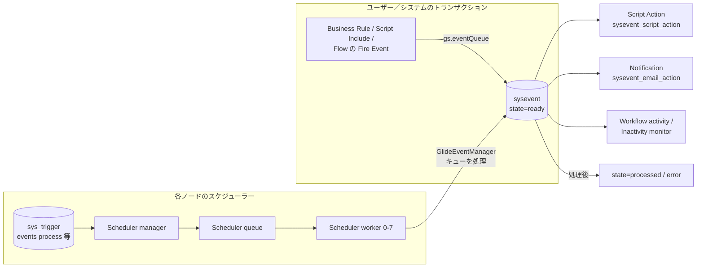
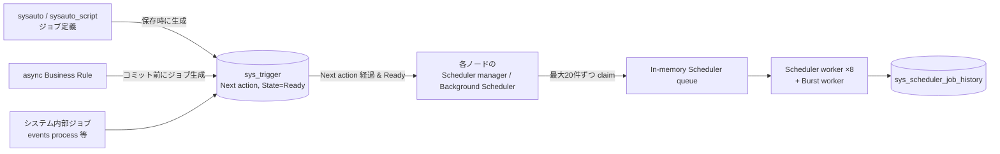
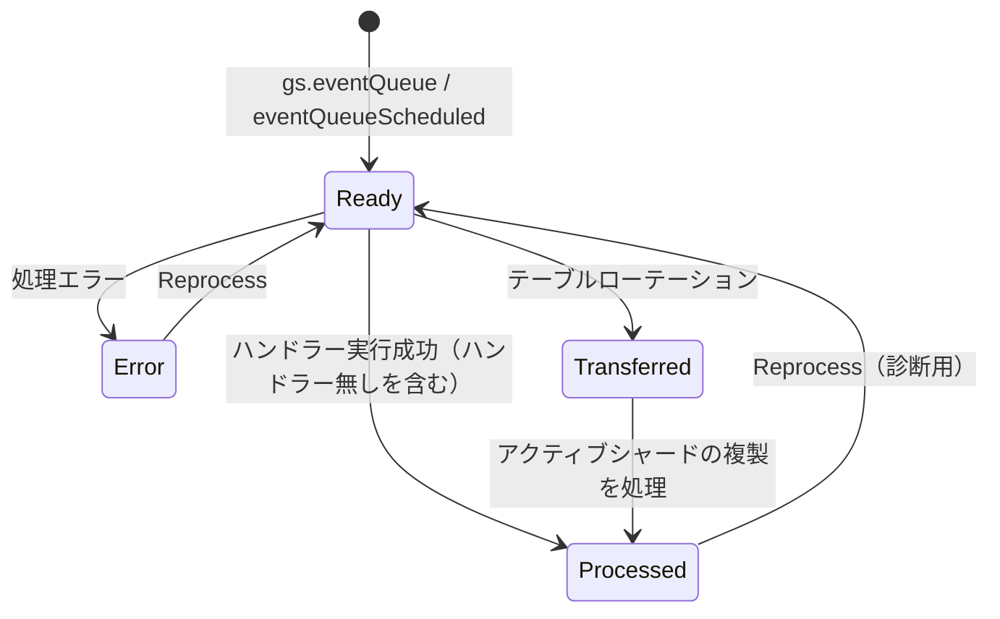
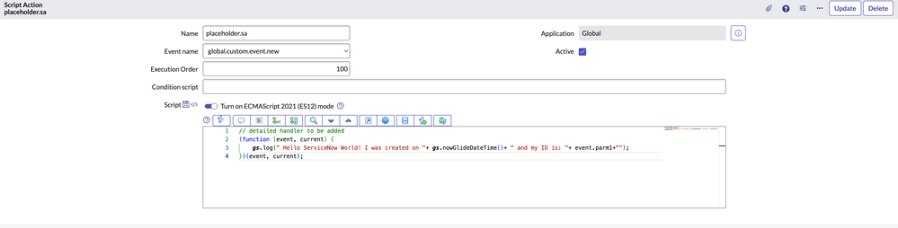
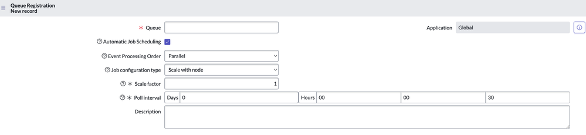
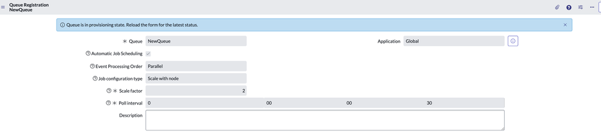
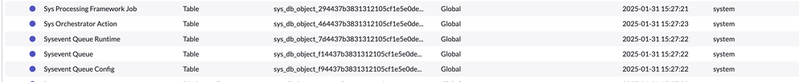
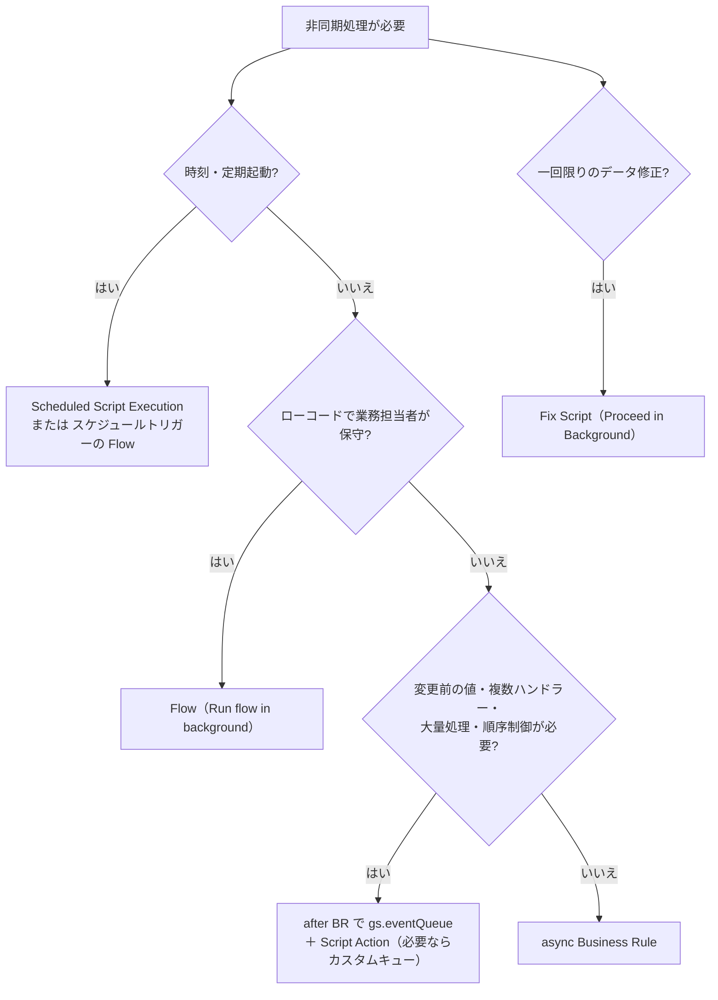

# イベント（Event Registry）・Script Action・スケジュールジョブ

## 概要

ServiceNow のサーバー側非同期処理は、大きく **イベント（System Events）** と **スケジューラー（Scheduler / Scheduled Jobs）** の 2 つの仕組みで成り立っている。両者は独立した機能に見えるが、実際には **イベントキューを読み出して処理するのもスケジュールジョブ** であり、非同期 Business Rule もスケジュールジョブとして実行される。つまりサーバー側非同期処理の多くは、最終的に `sys_trigger`（Schedule Item）とノードごとのスケジューラーワーカー上で動く。

本ファイルが答える主な問い:

- `sysevent`（Event、イベントログ／イベントキュー）とは何で、どのように処理されるか
- Event Registry（`sysevent_register`）の各フィールドとキュー・優先度の意味
- `gs.eventQueue()` / `gs.eventQueueScheduled()` の引数と使い分け
- Script Action（`sysevent_script_action`）の定義方法と利用できるオブジェクト
- カスタムキューの作り方（旧来の GlideEventManager 方式と、Queue Registry による Automatic Job Scheduling）
- スケジュールジョブ（`sysauto` / `sysauto_script`）と Schedule Item（`sys_trigger`）の関係、スケジューラーワーカーの構造
- 非同期 Business Rule、Fix Script、Background Script、Flow のバックグラウンド実行の比較と使い分け
- System Events and Jobs Dashboard / Scheduled Jobs Dashboard による監視とトラブルシューティング

関連ファイル:

- スクリプト API の全体像（Business Rule、Script Include、GlideSystem 等）→ [サーバーサイドスクリプト](./scripting-server-side.md)
- イベントを契機とするメール通知 → [通知とメール](./notifications-email.md)
- フローのトリガー・Fire Event アクション → [Workflow Studio / Flow Designer](./flow-designer-workflow-studio.md)
- システムプロパティ、ログ、テーブルローテーション、Scheduled Jobs 一般 → [システム管理](./system-administration.md)
- ノード構成 → [インスタンスアーキテクチャ](./instance-architecture.md)
- 性能面の実践知 → [パフォーマンスチューニング](../../04_応用編/03-performance-tuning.md)、[スクリプトのベストプラクティスとアンチパターン](../../04_応用編/07-scripting-best-practices.md)

---

## 1. 全体アーキテクチャ

### 1.1 構成要素一覧

| 構成要素 | テーブル / 実体 | 役割 | 出典・確度 |
|---|---|---|---|
| Event（イベント） | `sysevent` | 「ある条件が発生した」ことを記録する特別なレコード。イベントログ、イベントキューとも呼ばれる | [出典](https://www.servicenow.com/docs/r/platform-administration/system-events/events.html) |
| Event Registration（イベント登録） | `sysevent_register` | Event Registry。イベント名・対象テーブル・キュー・優先度を登録する | [出典](https://www.servicenow.com/docs/r/HGWDpzjgkfvaJWTdMzNy2w/8VvFPbXwvyft4ygQa7Gvmg)、[出典（テーブル名）](https://www.servicenow.com/docs/r/xanadu/build-workflows/workflow-studio/fire-event-action.html) |
| Script Action（スクリプトアクション） | `sysevent_script_action` | イベントによってのみ起動されるサーバーサイドスクリプト | [出典](https://www.servicenow.com/docs/r/platform-administration/system-events/r_ScriptActions.html) |
| Notification（通知） | `sysevent_email_action` | 「Event is fired」契機の通知はイベントのハンドラーの一種 | [通知とメール](./notifications-email.md) |
| Queue Registration（キュー登録） | `sysevent_queue` ほか | Automatic Job Scheduling 対応のカスタムキュー定義（Event Processing Framework） | 【第三者情報】[出典](https://www.servicenow.com/community/developer-blog/new-event-processing-framework/ba-p/3167288) |
| Scheduled Job（スケジュールジョブ定義） | `sysauto`（親）、`sysauto_script`（Scheduled Script Execution） 等 | ユーザーが定義するジョブ（スクリプト、レポート配信、テンプレートからのレコード生成） | [出典](https://www.servicenow.com/docs/r/UrSRFFKWBbfQBgoRlt~ltw/PWUqMa2pdX9M0u89y_hQqg)、[出典（sysauto_script）](https://www.servicenow.com/docs/r/api-reference/server-api-reference/c_GlideSystemScopedAPI.html) |
| Schedule Item（スケジュールアイテム） | `sys_trigger` | 実際の実行トリガー。次回実行時刻（Next action）、State、System ID 等を持つ。システム内部ジョブ・非同期 BR もここに登録される | [出典（ダッシュボード）](https://www.servicenow.com/docs/r/7LhbZn3yz3Q58qhjZoU9iQ/nI3hXW7MRqrtiv2l2HxDlQ)、【第三者情報】[出典](https://www.servicenow.com/community/in-other-news/scheduled-jobs-set-adrift/ba-p/2294301) |
| Scheduled Job History | `sys_scheduler_job_history` | ジョブ実行履歴（ダッシュボードの実行数・待ち時間グラフのデータ源。最大 7 日分） | [出典](https://www.servicenow.com/docs/r/7LhbZn3yz3Q58qhjZoU9iQ/nI3hXW7MRqrtiv2l2HxDlQ) |
| Cluster State | `sys_cluster_state` | ノードごとの状態。`schedulers` 列でそのノードが「any」ジョブを拾うか「specified」のみかを決める | 【第三者情報】[出典](https://www.servicenow.com/community/in-other-news/scheduled-jobs-set-adrift/ba-p/2294301) |

### 1.2 処理の流れ（イベント）

公式ドキュメントは、イベント処理を次のように説明する。[出典](https://www.servicenow.com/docs/r/platform-administration/system-events/events.html)

1. Business Rule 等がシステム上の条件を監視し、`GlideSystem.eventQueue()` で `sysevent` テーブルにイベントレコードを挿入する。
2. イベントレコードは通常、名前（name）、2 つのパラメーター（Parm1 / Parm2）、テーブル、インスタンス（対象レコードの sys_id）を持つ。
3. **スケジュールジョブが定期的にイベントキューを読み出し**、適切なハンドラーへ渡す。
4. ハンドラーは Script Action の実行、通知の送信、ワークフローアクティビティの起動、Inactivity Monitor の起動などを行う。



- キュー（Queue）が空の既定イベントは既定キューで処理される。既定キューを処理するスケジュールジョブは一般に `events process` という名前で、30 秒間隔で動くとされる。【第三者情報】[出典](https://www.servicenow.com/community/developer-articles/custom-event-queues/ta-p/3045097)、[出典（Packt）](https://www.packtpub.com/en-IN/learning/how-to-tutorials/events-notifications-and-reporting)
- そのため、イベント経由の処理（Script Action、通知）は **発火から実行までに数秒〜数十秒の遅延がある** のが通常動作である。【経験則】

### 1.3 処理の流れ（スケジュールジョブ）



- `sysauto` は「クラス」、`sys_trigger` は「インスタンス」に相当し、`sysauto` にレコードを作ると対応する `sys_trigger` が自動作成される。【第三者情報】[出典](https://www.servicenow.com/community/itsm-forum/where-can-i-go-and-see-the-quot-scheduled-jobs-gt-scheduled/m-p/492739)
- スケジューラーの詳細は「6. スケジューラーとワーカーノード」を参照。

---

## 2. イベント（`sysevent`）

### 2.1 Event テーブル

`sysevent` テーブルは Event テーブルであり、公式には「event log」または「event queue」とも呼ばれる。[出典](https://www.servicenow.com/docs/r/platform-administration/system-events/events.html) ナビゲーターでは **System Policy > Events > Event Log** で一覧できる。【経験則】

主なフィールド（公式ドキュメントで明示されているのは name / parm1 / parm2 / table / instance / state / user_id / sys_created_on のみ。その他は一般に知られた列名）:

| フィールド（列名） | 意味 | 確度 |
|---|---|---|
| Name（`name`） | イベント名（例：`incident.commented`） | 公式 |
| Parm1 / Parm2（`parm1` / `parm2`） | 任意の文字列パラメーター | 公式 |
| Table（`table`） | 対象テーブル | 公式 |
| Instance（`instance`） | 対象レコードの sys_id | 公式 |
| State（`state`） | ready / processed / error / transferred（2.2 参照） | 公式 |
| User ID（`user_id`） | イベントを作成したユーザーの sys_id（存在する場合）。Script Action から `event.user_id` で参照可 | 公式 [出典](https://www.servicenow.com/docs/r/platform-administration/system-events/r_ScriptActions.html) |
| Queue（`queue`） | 処理キュー名。空なら既定キュー | 【第三者情報】[出典](https://www.servicenow.com/community/developer-articles/custom-event-queues/ta-p/3045097) |
| Process on（`process_on`） | この日時以降に処理される。`eventQueueScheduled()` で将来日時を設定 | 【経験則】[出典（コミュニティ）](https://www.servicenow.com/community/developer-forum/delete-scheduled-events/m-p/1985469) |
| Processed（`processed`）、Processing duration（`processing_duration`）、Claimed by（`claimed_by`） | 処理日時、処理時間、処理したノード | 【経験則】 |
| Priority（`priority`） | 処理優先度（Event Registry 由来、小さいほど高優先） | 【経験則】 |

> 注記：`sysevent` はテーブルローテーション（シャード化）されており、古いイベントは自動的に消えていく。ローテーションについては [システム管理](./system-administration.md) を参照。【経験則】

### 2.2 イベントの状態（Event states）

| State | 意味 |
|---|---|
| Ready | システムがイベントを作成し、キューで処理待ちの状態 |
| Processed | イベントが正常に処理された。ただし「処理された」ことは、何らかのアクションが起きたことを意味しない（ハンドラーが存在しなければ何も起きない） |
| Error | 処理中にエラー。無効なイベントパラメーターが原因であることが多い。再処理で解消することがある |
| Transferred | `sysevent` の別シャードへローテーションされた。アクティブなシャードに複製が作られ、後でスケジュールジョブが処理する。再処理可能 |

[出典](https://www.servicenow.com/docs/r/7LhbZn3yz3Q58qhjZoU9iQ/letlRpfVFqsFVJWlOVif0w)

- イベントはテスト・診断目的で再処理（Reprocess）できる。[出典](https://www.servicenow.com/docs/r/7LhbZn3yz3Q58qhjZoU9iQ/letlRpfVFqsFVJWlOVif0w)
- 状態遷移（概略）:



### 2.3 アップグレード中のイベント処理

アップグレード中、イベント処理は既定で制限される。以下のシステムプロパティで制御する。[出典](https://www.servicenow.com/docs/r/platform-administration/system-events/events.html)

| プロパティ | 既定値 | 意味 |
|---|---|---|
| `glide.event_processor.all_events_upgrade_safe` | `false` | `true` にするとアップグレード中も全イベントを処理する |
| `glide.event_processor.upgrade_safe_events` | 空 | 上記が `false` の場合に、アップグレード中も処理するイベント名のカンマ区切りリスト |

> 注記：Yokohama 以前の一部ドキュメントでは `glide.eventprocessor.*` という表記も見られる。Australia / Brazil の現行ドキュメントは `glide.event_processor.*` 表記。【第三者情報】（検索結果の要約に基づく。実インスタンスの `sys_properties` で確認を推奨）

---

## 3. Event Registry（`sysevent_register`）

### 3.1 概要と登録手順

Event Registry は、プラットフォームで使うイベントを定義する台帳である。Event is fired 契機の通知や Script Action では、イベントを Event Registry から選択するため、カスタムイベントは事前登録が必要である。[出典](https://www.servicenow.com/docs/r/HGWDpzjgkfvaJWTdMzNy2w/8VvFPbXwvyft4ygQa7Gvmg)

- メニュー：**System Policy > Events > Registry** → **New**
- 必要ロール：`admin`
- テーブル名 `sysevent_register` は、Workflow Studio の Fire Event アクションの入力型「Reference.Event Registration[sysevent_register]」で確認できる。[出典](https://www.servicenow.com/docs/r/xanadu/build-workflows/workflow-studio/fire-event-action.html)

### 3.2 フィールド

| フィールド | 説明 |
|---|---|
| Event name（イベント名） | 新しいイベントの名前 |
| Table（テーブル） | イベントの対象テーブル。イベントと同じスコープのテーブル・データベースビューのみ選択肢に出る |
| Queue（キュー） | イベント発火時に投入されるキュー。**英小文字のみ、空白不可、アンダースコア以外の特殊文字不可**（例：`my_queue`） |
| Priority（優先度） | 処理順序。**値が小さいほど優先度が高い**。システムプロパティ `com.glide.sysevent.priority.enabled`（既定で有効）が無効の場合、優先度による処理順制御は行われない |
| Caller Access（呼び出し元アクセス） | Caller Restriction（呼び出しは手動承認が必要）／Caller Tracking（自動承認） |
| Fired by（発火元） | イベントを発火する Business Rule 名。**参照用のみで、どの処理にも使われない**。後から発火元を探せるよう十分な情報を書く |
| Description（説明） | イベントの目的 |

[出典](https://www.servicenow.com/docs/r/zurich/build-workflows/system-events/t_RegisterAnEvent.html)、[出典（Australia）](https://www.servicenow.com/docs/r/HGWDpzjgkfvaJWTdMzNy2w/8VvFPbXwvyft4ygQa7Gvmg)

### 3.3 命名と運用の注意

- 既定イベント名は `<table>.<action>` 形式（例：`incident.commented`、公式 API ドキュメントの例）。[出典](https://www.servicenow.com/docs/r/api-reference/server-api-reference/c_GlideSystemScopedAPI.html) スコープアプリでは `x_vendor_app.` 等のスコーププレフィックスが付く。【経験則】
- 未登録のイベント名で `gs.eventQueue()` を呼んでもイベントレコード自体は作成されるが、通知や Script Action からは選べないため、実質的に何も起きない。【経験則】
- ServiceNow SDK（Fluent）には `sysevent_register` 専用の API がなく、`Record()` API で `table: 'sysevent_register'` を指定して定義する。`priority` は整数で渡す（文字列不可）。Flow から参照するイベントはエクスポート対象に含める。[出典](https://servicenow.github.io/sdk/guides/registering-events-guide)（ServiceNow 公式 SDK ドキュメント、GitHub Pages）

---

## 4. イベントの発火

### 4.1 `gs.eventQueue()`

```
gs.eventQueue(String name, Object instance, String parm1, String parm2, String queue)
```

| 引数 | 型 | 説明 |
|---|---|---|
| `name` | String | キューに入れるイベント名 |
| `instance` | Object | GlideRecord（例：`current`） |
| `parm1` | String | 任意。指定すればイベントに保存される |
| `parm2` | String | 任意。指定すればイベントに保存される |
| `queue` | String | 任意。キュー名 |

戻り値：void。[出典](https://www.servicenow.com/docs/r/api-reference/server-api-reference/c_GlideSystemScopedAPI.html)

公式の例は「コメントが変更された更新時に `incident.commented` を発火し、parm1 / parm2 に現在ユーザーの ID と名前を渡す」もの。

```javascript
// after update Business Rule の例（公式例をもとに簡略化）
if (current.operation() != 'insert' && current.comments.changes()) {
  gs.eventQueue('incident.commented', current, gs.getUserID(), gs.getUserName());
}
```

- 第 5 引数 `queue` を指定すると、イベントはそのカスタムキューに投入される。Event Registry 側の Queue 値と異なる値を指定した場合は、呼び出し時に指定した値が優先されるとされる。【第三者情報】[出典](https://www.servicenow.com/community/developer-articles/custom-event-queues/ta-p/3045097)
- 第 5 引数を省略した場合に Event Registry の Queue 値だけでルーティングされるかどうかは方式によって異なる。公式の「Create a queue」手順（旧来の GlideEventManager 方式）は第 5 引数でキューを指定することを前提にしている（→ [6.2](#62-方式-aglideeventmanager-によるキュー処理ジョブ)）。Queue Registry（Automatic Job Scheduling）では Registry 側でキューを指定すれば第 5 引数は不要とされる（→ [6.3](#63-方式-bqueue-registryautomatic-job-scheduling)）。【第三者情報】[出典](https://www.servicenow.com/community/developer-articles/custom-event-queues/ta-p/3045097)
- `parm1` / `parm2` の最大長は公式ドキュメントでは確認できず。

### 4.2 `gs.eventQueueScheduled()`

```
gs.eventQueueScheduled(String name, Object instance, String parm1, String parm2, Object expiration)
```

| 引数 | 型 | 説明 |
|---|---|---|
| `name` | String | イベント名 |
| `instance` | Object / String | GlideRecord、または対象レコードの sys_id |
| `parm1` | String | 任意。`instance` が GlideRecord の場合の既定値はそのレコードの表示値、それ以外は null |
| `parm2` | String | 任意。既定 null |
| `expiration` | Object | 任意。GlideDateTime または日時要素。イベントを処理する日時。既定は現在日時 |

戻り値：void。スケジュール情報は `sysevent` テーブルに保存される。[出典](https://www.servicenow.com/docs/r/api-reference/server-api-reference/c_GlideSystemScopedAPI.html)

```javascript
// 7 日後に処理されるイベント（公式例をもとに簡略化）
var gdt = new GlideDateTime();
gdt.addDaysLocalTime(7);
gs.eventQueueScheduled('x_app.reminder', current, 'p1', 'p2', gdt);
```

- **用途**：リマインダー、期限前通知など「将来時点での 1 回の処理」。将来日付の `sysevent` が Ready のまま残り、`process_on` 到来後に処理される。【経験則】
- **取り消し**：スケジュール済みイベントを取り消す専用 API は公式ドキュメントでは確認できず。コミュニティでは `sysevent` を `state=ready` 等で検索して削除する方法が紹介されている。【第三者情報】[出典](https://www.servicenow.com/community/developer-forum/delete-scheduled-events/m-p/1985469)
- `eventQueueScheduled()` の引数にキュー名はない（第 5 引数は処理日時）。

### 4.3 Flow からの発火（Fire Event action）

Workflow Studio の **Fire Event** アクションは、Event Registration（`sysevent_register`）を参照入力に取り、`sysevent` にシステムイベントレコードを作成する。作成されたイベントはスケジュールされたイベントハンドラーによって処理される。[出典](https://www.servicenow.com/docs/r/xanadu/build-workflows/workflow-studio/fire-event-action.html) 詳細は [Workflow Studio / Flow Designer](./flow-designer-workflow-studio.md) を参照。

### 4.4 クライアントからの発火

`gs.eventQueue()` はサーバー API であり、クライアントスクリプトから直接呼べない。クライアント起点で発火したい場合は GlideAjax（Script Include）や UI Action（サーバー側）経由で呼ぶ。【経験則】[出典（コミュニティ）](https://www.servicenow.com/community/servicenow-ai-platform-forum/can-we-call-events-from-client-side/m-p/1194454)

---

## 5. Script Action（`sysevent_script_action`）

### 5.1 概要

Script Action は、**イベントによってのみ起動される** サーバーサイドスクリプトであり、CI の更新やログイン失敗の処理などに使われる。[出典](https://www.servicenow.com/docs/r/platform-administration/system-events/r_ScriptActions.html)

- メニュー：**System Policy > Events > Script Actions** → **New**
- 必要ロール：`sysevent_script_action_admin` または `admin`（Australia ドキュメントでロール記載が追加。Brazil も同じ）

### 5.2 フィールド

| フィールド | 説明 |
|---|---|
| Name（名前） | 一意の名前 |
| Application（アプリケーション） | スクリプトを含むアプリケーション |
| Event name（イベント名） | 起動するイベント。適切なものがなければ新規作成（Event Registry） |
| Active（有効） | true で有効 |
| Execution order（実行順序） | 同じイベントの Script Action 間での実行順 |
| Condition script（条件スクリプト） | true の場合のみ Script フィールドが解析・実行される。Script 内で条件判定するなら空にする（併用しない） |
| Script（スクリプト） | 実行するスクリプト |

[出典](https://www.servicenow.com/docs/r/platform-administration/system-events/r_ScriptActions.html)



- **キャプション**：Script Action（`sysevent_script_action`）のレコードフォーム。
- **画面説明**：上部に Name（例 `placeholder.sa`）、Application（Global）、Event name（ドロップダウンで `global.custom.event.new` を選択）、Active チェック、Execution Order（100）、Condition script（空）、Script（「Turn on ECMAScript 2021 (ES12) mode」トグル付きのエディター）が並ぶ。スクリプトは `(function(event, current){ gs.log("..." + event.parm1); })(event, current);` 形式で、`event` と `current` を受け取る。右上に Update / Delete ボタン。
- **出典**：ServiceNow Community「New Event Processing Framework」(Surendra_, 2025-02-03) https://www.servicenow.com/community/developer-blog/new-event-processing-framework/ba-p/3167288 （取得日 2026-11-04）【第三者情報】

### 5.3 Script 内で利用できるオブジェクト

| オブジェクト | 内容 |
|---|---|
| `event` | 起動元の `sysevent` の GlideRecord。`event.parm1`、`event.parm2`（パラメーター）、`event.sys_created_on`（イベント日時）、`event.user_id`（イベントを作成したユーザーの sys_id。存在する場合） |
| `current` | イベントが対象とするレコード（例：incident）の GlideRecord |

[出典](https://www.servicenow.com/docs/r/platform-administration/system-events/r_ScriptActions.html)

- `current` はイベント処理時点で DB から読み直したレコードであり、発火時点の値ではない。発火時点の値が必要なら `parm1` / `parm2` に渡す。【経験則】
- `previous` は利用できない。【経験則】
- Script Action はスケジューラーワーカー上で実行されるため、ユーザーセッション（`gs.getUserID()` 等）は発火ユーザーではなくシステムのコンテキストになる。発火ユーザーは `event.user_id` で取得する。【経験則】（公式ドキュメントでは実行ユーザーのコンテキストを明記していない）

### 5.4 ServiceNow Fluent（SDK）での定義

ServiceNow SDK の Script Action API（`ScriptAction` オブジェクト）では次のプロパティを持つ。[出典](https://www.servicenow.com/docs/r/application-development/servicenow-sdk/fluent-script-action-api.html)

| プロパティ | 型 | 必須 / 既定値 | 説明 |
|---|---|---|---|
| `$id` | String / Number | 必須 | メタデータの一意 ID |
| `name` | String | 必須 | 一意の名前 |
| `script` | Script | 必須 | モジュールの関数、ファイル参照、インラインコードのいずれか |
| `eventName` | String | 必須 | 起動イベント |
| `active` | Boolean | 既定 `false` | 有効フラグ（**既定 false に注意**） |
| `order` | Number | 既定 `100` | 実行順（小さいほど先） |
| `conditionScript` | String | — | 条件。`script` 内で条件判定するなら使わない |
| `description` | String | — | 説明 |
| `$meta` | Object | — | `installMethod`（`demo` / `first install`） |

### 5.5 Script Action と他のハンドラー

1 つのイベントには複数のハンドラー（複数の Script Action、通知、ワークフロー）を紐づけられる。同一イベント・同一キューで OOB 通知とカスタム通知が競合する場合、通知の Weight（重み）設定によって送信が抑止されることがある（通知の Weight の仕様は [通知とメール](./notifications-email.md) を参照）。【第三者情報】[出典](https://www.servicenow.com/community/developer-articles/custom-event-queues/ta-p/3045097)

---

## 6. カスタムキュー

### 6.1 なぜカスタムキューが必要か

カスタムキューは、大量のイベントを生成するアプリケーションや、処理に時間がかかるイベントに使う。既定キューに大量・重量級のイベントが入ると、通知など他のイベント処理が遅延する。[出典](https://www.servicenow.com/docs/r/ja-JP/yokohama/api-reference/scripts/queues-create.html)、【第三者情報】[出典](https://www.servicenow.com/community/developer-articles/custom-event-queues/ta-p/3045097)

カスタムキューの作り方には 2 方式ある。

| 方式 | 概要 | 推奨度 |
|---|---|---|
| A. 旧来方式（GlideEventManager） | `text index events process` ジョブを複製し、Job context のキュー名を書き換える | 既存環境で多い |
| B. Queue Registry（Automatic Job Scheduling） | Event Registration フォームの Queue Registration リンクからキューを登録し、ジョブを自動生成させる | 新規はこちらが推奨とされる 【第三者情報】 |

### 6.2 方式 A：GlideEventManager によるキュー処理ジョブ

公式ドキュメント「Create a queue」の手順要旨:[出典](https://www.servicenow.com/docs/r/ja-JP/yokohama/api-reference/scripts/queues-create.html)

1. Event Registry でイベントの Queue フィールドに値を入れる（これでカスタムキューが作られる）。
2. **System Scheduler > Scheduled Jobs** で `text index events process` ジョブを開く。
3. 追加アクションメニューから **Insert and Stay** で複製する（**上書きしないこと**。上書きすると既定の `text_index` キューを処理できなくなる）。
4. 複製の名前を変え、Job context の `GlideEventManager('<queue>')` のキュー名を自分のキュー名に置き換える。
5. 既定では 30 秒ごとにキューをチェックする（Trigger type = Interval、Repeat = 30 秒）。
6. イベントは `gs.eventQueue()` の第 5 引数でキューに送る（この方式では第 5 引数を省略しないのが安全。省略時の扱いは [4.1](#41-gseventqueue) を参照）。

Job context の例（`sys_trigger.job_context`）:

```
fcScriptName=javascript\:GlideEventManager('my_queue').process();
```

【第三者情報】[出典](https://www.servicenow.com/community/developer-articles/custom-event-queues/ta-p/3045097)

- `GlideEventManager()` に渡す値は Event Registry の Queue 値と **完全一致** させる。[出典](https://www.servicenow.com/docs/r/ja-JP/yokohama/api-reference/scripts/queues-create.html)
- この方式では処理順序の制御が乏しく、ノード追加時に `sys_trigger` ジョブが自動でスケールしないという課題がある。【第三者情報】[出典](https://www.servicenow.com/community/developer-blog/new-event-processing-framework/ba-p/3167288)

### 6.3 方式 B：Queue Registry（Automatic Job Scheduling）

Queue Registry は、メッセージ処理フレームワーク（Automated job scheduling）をイベント登録画面から設定する仕組みである。Zurich ドキュメントで「Implement automated job scheduling」として記載されている。[出典](https://www.servicenow.com/docs/r/7LhbZn3yz3Q58qhjZoU9iQ/OHgbcaNbsiyccyxFXIns2w) 基盤プラグインは `com.glide.processing.framework` で、PDI では OOB で有効とされる（Xanadu / Yokohama 期のコミュニティ記事。導入リリースは公開情報では確認できず）。【第三者情報】[出典](https://www.servicenow.com/community/developer-blog/new-event-processing-framework/ba-p/3167288)

**手順**（必要ロール `admin`）:

1. **All > System Policy > Events > Registry** でイベントを新規作成または開く。
2. Event Registration フォームのバナーにある **Queue Registration** リンクをクリック。
3. キューを新規作成してフォームに入力し、Submit。キューが Queue Registry 一覧に表示される。
4. キューを開き、Queue Details 関連リストの Status が Active であることを確認。
5. 必要に応じてジョブ数の手動調整、Rollback、Retrieve Configurations を行う。

**Queue Registration フォームのフィールド**:

| フィールド | 説明 |
|---|---|
| Queue | キュー名 |
| Application | アプリケーションスコープ |
| Automatic Job Scheduling | 自動ジョブスケジューリングを有効化（ON で `sys_trigger` が自動生成される） |
| Event Processing Order | **Parallel**（並列）または **Sequential**（逐次＝1 件ずつ処理）。送信後は変更不可 |
| Job configuration type | **Constant**（固定数）または **Scale with node**（ノード数倍）。Sequential では無効 |
| Scale factor | ジョブ総数（Scale with node ならノード数を掛けた数） |
| Poll interval | ジョブがこのキューのイベントをポーリングして処理する間隔 |
| Description | 任意 |

**ボタン・関連リンク**:

| 名称 | 場所 | 内容 |
|---|---|---|
| Disable Automatic Job Scheduling | Queue Registry 一覧 | 自動ジョブスケジューリングを無効化 |
| Rollback | Queue Registration フォーム（自動構成時のみ） | 以前の手動（非自動）構成に戻す |
| Retrieve Configurations | 同上 | 同名キューの手動構成から既存ジョブ設定を取り込む |

[出典](https://www.servicenow.com/docs/r/7LhbZn3yz3Q58qhjZoU9iQ/OHgbcaNbsiyccyxFXIns2w)



- **キャプション**：Queue Registration（キュー登録）の新規レコードフォーム。
- **画面説明**：必須の Queue（キュー名）、Application（Global）、Automatic Job Scheduling チェックボックス（オン）、Event Processing Order（Parallel）、Job configuration type（Scale with node）、必須の Scale factor（1）、必須の Poll interval（Days 0 / Hours 00 / 00 / 30 ＝ 30 秒）、Description が並ぶ。
- **出典**：ServiceNow Community「New Event Processing Framework」https://www.servicenow.com/community/developer-blog/new-event-processing-framework/ba-p/3167288 （取得日 2026-11-04）【第三者情報】



- **キャプション**：送信直後の Queue Registration レコード（キュー名 `NewQueue`）。
- **画面説明**：上部に「Queue is in provisioning state. Reload the form for the latest status.」という情報メッセージ。各フィールドは読み取り専用となり、Parallel / Scale with node / Scale factor 2 / Poll interval 30 秒が表示されている。プロビジョニング完了後、Queue Details 関連リストの Status が Active になる。
- **出典**：同上（取得日 2026-11-04）【第三者情報】



- **キャプション**：Event Processing Framework プラグインが追加するテーブルのアプリケーションファイル一覧（抜粋）。
- **画面説明**：Sys Processing Framework Job、Sys Orchestrator Action、Sysevent Queue Runtime、Sysevent Queue、Sysevent Queue Config の各テーブル（いずれも Global スコープ、作成者 system）が並ぶ。キュー定義の実体は Sysevent Queue（`sysevent_queue`）。その他のテーブル名（列名）は画像からは判別できない。
- **出典**：同上（取得日 2026-11-04）【第三者情報】

補足（コミュニティ記事の観察）:

- Parallel キューでは親ジョブと子ジョブの `sys_trigger` が自動作成される。Sequential キューはキューあたりジョブ 1 本。【第三者情報】
- ジョブ数の上限は `global.ProcessingFrameworkUtil` / `SNC.ProcessingFrameworkUtil` で安全側に制御されている。【第三者情報】
- Queue Registry でキューを登録し Event Registry 側でそのキューを指定すれば、`gs.eventQueue()` の第 5 引数は不要とされる（方式 A では第 5 引数で指定する。[4.1](#41-gseventqueue)、[6.2](#62-方式-aglideeventmanager-によるキュー処理ジョブ) 参照）。【第三者情報】[出典](https://www.servicenow.com/community/developer-articles/custom-event-queues/ta-p/3045097)

> 関連：ITOM Event Management の「Event Framework jobs の scale factor 調整」はアラート用イベント（`em_event`）処理の話であり、本ファイルの System Events（`sysevent`）とは別物。→ [Event Management と AIOps](../itom/event-management-aiops.md)

---

## 7. スケジュールジョブ

### 7.1 概要とジョブ種別

Scheduled Jobs は、特定の時刻または定期スケジュールで実行される自動化された作業である。用途例はレポートの自動生成・配信、テンプレートからのレコード（インシデント、変更、CI 等）生成、スクリプトや Business Rule からのジョブ実行、月末・平日のスケジューリングなど。[出典](https://www.servicenow.com/docs/r/platform-administration/time-configuration/c_ScheduledJobs.html)

**作成方法**（Schedule Job `sysauto` テーブル上に作成）:[出典](https://www.servicenow.com/docs/r/UrSRFFKWBbfQBgoRlt~ltw/PWUqMa2pdX9M0u89y_hQqg)

- メニュー：**All > System Definition > Scheduled Jobs** → **New** → ジョブ種別を選択
- 必要ロール：Australia ドキュメントでは `system_scheduler_admin`
- 「すべての新しいスケジュールジョブはこの方法で作成する」と明記されている

| ジョブ種別（New 時の選択肢） | 主なテーブル | 確度 |
|---|---|---|
| Automate the generation and distribution of a report（レポートの生成と配信） | `sysauto_report` | 公式（テーブル名は【第三者情報】[出典](https://www.servicenow.com/community/in-other-news/scheduled-jobs-set-adrift/ba-p/2294301)） |
| Automatically generate something (a change, an incident, a CI, etc.) from a template（テンプレートからの生成） | `sysauto_template` | 公式（テーブル名は【経験則】） |
| Automatically run a script of your choosing（任意スクリプトの実行＝Scheduled Script Execution） | `sysauto_script` | 公式 [出典](https://www.servicenow.com/docs/r/api-reference/server-api-reference/c_GlideSystemScopedAPI.html) |

> **Brazil での変更:** Brazil の「Create a scheduled job」「Automatically run a script of your choosing」ページは必要ロールを `admin` と記載している（Australia 版は `system_scheduler_admin`）。ドキュメント表記の差であり、粒度の細かい管理ロールの扱いが変わったかは公開情報では確認できず。[出典（Brazil）](https://www.servicenow.com/docs/r/platform-administration/time-configuration/t_ScheduleAScriptExecution.html)

### 7.2 ジョブの状態

| State | 意味 |
|---|---|
| Ready | 次回のスケジュール間隔を待機中 |
| Running | 実行中 |
| Queued | スケジューラーキューに追加され実行待ち |
| Error | 実行中に失敗 |

[出典](https://www.servicenow.com/docs/r/platform-administration/time-configuration/c_ScheduledJobs.html)

このほか Scheduled Jobs Dashboard では **Permanent Error**（恒久エラー）状態が扱われる。Utah より前のバージョンからのアップグレードで自動設定されることがあり、手動設定も可能。Recover すると Ready に戻る。[出典](https://www.servicenow.com/docs/r/7LhbZn3yz3Q58qhjZoU9iQ/nI3hXW7MRqrtiv2l2HxDlQ)

> `sys_trigger.state` の数値コード（0=Ready 等）は公式ドキュメントでは確認できず。

### 7.3 Scheduled Script Execution（`sysauto_script`）のフィールド

| フィールド | 説明 |
|---|---|
| Name | ジョブ名 |
| Active | 有効にすると指定日時に実行される |
| Application | スクリプトを含むアプリケーション（グローバルなら Global） |
| Conditional | 有効にすると、条件を満たす場合のみ実行 |
| Condition | Conditional 選択時に表示。スクリプトの最後の式が true / false を返す必要がある |
| Run | 実行間隔：Daily、Day and Month in Year、Day in Week in Month in Year、Week in Month、Weekly、Monthly、Periodically、Once、On Demand、Business Calendar（Entry Start / Entry End） |
| Day | Weekly（曜日）または Monthly（日）で表示 |
| Repeat Interval | 日・時・分で繰り返し間隔を指定（例：4 日ごとなら Days に 04） |
| Time zone | -None-（ユーザーの既定）、Use System Time Zone、特定タイムゾーン |
| Time | 実行時刻（24 時間制、選択タイムゾーン基準） |
| Advanced | 開始日・終了日・繰り返しオプションを有効化 |
| Starting / Ending | Advanced と一部の Run 種別で表示。Periodically の場合 Starting は最初のジョブ生成日時 |
| Business Calendar | Run が Business Calendar Entry Start / End のとき、使用するビジネスカレンダー。全スパンが過去なら実行されない |
| Run as（任意） | 別ユーザーとして実行。フォームになければ追加する |
| Run this script | 実行するスクリプト |

ドメインセパレーション環境（Domain Support - Domain Extensions Installer プラグイン）では、Domain iterator（複数ドメインで実行）、Domain source table（例：Department `cmn_department`）、Domain source filter が追加され、ソーステーブルの `sys_domain` からドメインを集めて各ドメインで実行する。[出典](https://www.servicenow.com/docs/r/platform-administration/time-configuration/t_ScheduleAScriptExecution.html)

フォーム下部の操作：Update、**Execute Now**（即時実行）、Delete。[出典](https://www.servicenow.com/docs/r/platform-administration/time-configuration/t_ScheduleAScriptExecution.html)

**条件スクリプトのサンドボックス制約**：スケジュールレポートのメール送信や Performance Analytics データ収集ジョブの条件スクリプトはサンドボックスで実行され、関数定義や一部 API・キーワードが禁止される。アップグレード後、禁止要素を含むジョブはエラーで終了する。[出典](https://www.servicenow.com/docs/r/platform-administration/time-configuration/t_ScheduleAScriptExecution.html)

条件付きジョブの例（公式例の趣旨）:

```javascript
// Condition: 30 日以上前に作成されたアクティブなインシデントがある場合のみ実行
var gr = new GlideRecord('incident');
gr.addActiveQuery();
gr.addQuery('sys_created_on', '<', gs.daysAgoStart(30));
gr.setLimit(1);
gr.query();
gr.hasNext();   // 最後の式が true/false
```

### 7.4 run 種別の注意点

- Run 種別 Day and Month in Year、Day in Week in Month in Year、Week in Month には Day / Month / Year フィールドの表示が必要。これらを表示しない子テーブルではこの種別のジョブは作れない。[出典](https://www.servicenow.com/docs/r/UrSRFFKWBbfQBgoRlt~ltw/PWUqMa2pdX9M0u89y_hQqg)
- `max_drift` は設定時刻の周辺に実行の揺らぎ幅を持たせ、ジョブの一斉起動を防ぐ。`sysauto` に紐づく `sys_trigger` はロックされており `max_drift` を変更できない（スタンドアロンの `sys_trigger` は変更可）。スケジュールレポートは `max_drift` を無視する。【第三者情報】（2014 年の記事）[出典](https://www.servicenow.com/community/in-other-news/scheduled-jobs-set-adrift/ba-p/2294301)
- `sys_trigger` 上の Trigger type は直接変更できない（グレーアウト）ことがあり、親の定義側（`sysauto` やディスカバリスケジュール等）で変更すると `sys_trigger` が作り直される。【第三者情報】[出典](https://www.servicenow.com/community/itom-forum/how-to-disable-trigger-type-for-a-discovery-schedule/m-p/2888251)

### 7.5 スクリプトからのジョブ実行

| 方法 | 内容 | 確度 |
|---|---|---|
| `gs.executeNow(GlideRecord job)` | スコープアプリ用。ジョブを実行し、ジョブの sys_id を返す（ジョブがグローバルなら null）。**呼び出し元スクリプトと同じアプリケーションに属するジョブのみ実行可能** | 公式 [出典](https://www.servicenow.com/docs/r/api-reference/server-api-reference/c_GlideSystemScopedAPI.html) |
| フォームの Execute Now | `sysauto_script` を即時実行 | 公式 [出典](https://www.servicenow.com/docs/r/platform-administration/time-configuration/t_ScheduleAScriptExecution.html) |
| `gs.eventQueueScheduled()` ＋ Script Action | 「特定レコードについて将来 1 回」の実行 | 公式（API）＋【経験則】 |
| グローバルの `ScheduleOnce` Script Include 等 | 一回限りの `sys_trigger` を生成するユーティリティ | 【経験則】（公式ドキュメントでは確認できず） |

```javascript
// 公式例の趣旨：同一スコープのジョブを即時実行
var job = new GlideRecord('sysauto_script');
if (!job.get('<sys_id>')) { throw 'Job not found'; }
gs.executeNow(job);
```

---

## 8. スケジューラーとワーカーノード

### 8.1 ノードごとのスケジューラー構造

公式ドキュメントはスケジューラー内部の詳細を体系的には公開していない。以下はコミュニティ（ServiceNow 社員の記事を含む）と Instance Observer のメトリクス定義に基づく。

| 要素 | 内容 | 確度・出典 |
|---|---|---|
| Scheduler manager / Background Scheduler | 各ノードに 1 つ。`sys_cluster_state` を見て自ノードが「any」か「specified」かを確認し、`sys_trigger` から Next action を過ぎた Ready ジョブを探してスケジューラーキューへ移す。**一度に最大 20 件** を claim | 【第三者情報】[出典1](https://www.servicenow.com/community/in-other-news/scheduled-jobs-set-adrift/ba-p/2294301)、[出典2](https://www.servicenow.com/community/developer-articles/understanding-scheduled-job-workers/ta-p/2602616) |
| Scheduler queue | ノードのメモリ上のキュー。claim 済みで未実行のジョブ | 公式（メトリクス定義）[出典](https://www.servicenow.com/docs/r/impact/io-schedulers-perf-metrics.html) |
| Scheduler worker | **ノードあたり 8 スレッド（0〜7）** でキュー内ジョブを実行 | 【第三者情報】[出典](https://www.servicenow.com/community/developer-articles/understanding-scheduled-job-workers/ta-p/2602616) |
| Burst worker | 9 番目の特別スレッド。全ワーカーが埋まっているとき、**Priority ≤ 25 かつ 60 秒以上キューに滞留** した重要ジョブを実行。設定不可 | 【第三者情報】同上 |
| Progress worker | 長時間ジョブをラップして UI に進捗（%）を表示するための仕組み。スケジューラースレッド上で動く | 【第三者情報】同上 |
| System ID | `sys_trigger` の実行ノード指定。未実行時は空。「ACTIVE NODES」にすると、`sys_cluster_state.schedulers = any` の各ノードにピン留めされたコピーが作られる | 【第三者情報】同上 |

- HA 構成ではパッシブ側データセンターのノードを「specified」にしてジョブを拾わせない（DB との遅延のため）。【第三者情報】[出典](https://www.servicenow.com/community/in-other-news/scheduled-jobs-set-adrift/ba-p/2294301)
- ワーカー数（8）が上限であるため、長時間ジョブがワーカーを占有すると他ジョブ（イベント処理ジョブ、非同期 BR を含む）の待ち時間が延びる。【経験則】
- ワーカーの状態は `stats.do` のノード情報で確認できる。【第三者情報】[出典](https://www.servicenow.com/community/developer-articles/understanding-scheduled-job-workers/ta-p/2602616)
- ワーカースレッド数を変更するプロパティは公式ドキュメントでは確認できず（SaaS では顧客が変更すべきでない）。【経験則】

### 8.2 スケジューラーの性能メトリクス（Instance Observer）

| メトリクス | 定義 | 判断基準 |
|---|---|---|
| Completed Scheduled Jobs | ノードごとの完了ジョブ数 | 急増は処理圧迫・遅延の原因になり得る |
| Scheduler Mean Queue Age | ノードのメモリ内スケジューラーキューにある未処理ジョブの平均経過時間（`sys_trigger` で claim 前に待った時間は含まない） | 大きい値はノードが claim 済みジョブを適時処理できていない兆候 |
| Scheduler Queue Length | ノードのメモリ内キューにある claim 済みジョブ数（実行中は含まない） | 複数ジョブを一括 claim するため一時的に大きいのは正常。**60 分超 0 に戻らず、かつ age が増え続ける** 場合はノードの問題の可能性 |

[出典](https://www.servicenow.com/docs/r/impact/io-schedulers-perf-metrics.html)

### 8.3 並行実行の注意

- マルチスレッド・マルチノードで並行実行されるため、競合状態（race condition）によるデータ不整合に注意する。【第三者情報】[出典](https://www.servicenow.com/community/developer-articles/understanding-scheduled-job-workers/ta-p/2602616)
- 順序保証が必要な処理は Queue Registry の **Sequential** キューを使うか、1 本のジョブで逐次処理する。【経験則】（Sequential の仕様は [出典](https://www.servicenow.com/docs/r/7LhbZn3yz3Q58qhjZoU9iQ/OHgbcaNbsiyccyxFXIns2w)）

---

## 9. 非同期 Business Rule

### 9.1 仕様

| 項目 | 内容 |
|---|---|
| 実行タイミング | フォーム送信後、Business Rule から作成されたスケジュールジョブをスケジューラーが実行したとき |
| ジョブの作成タイミング | フォーム送信後、レコードが DB で変更される前にスケジュールジョブが作られる |
| `previous` | **利用不可**。したがって `changes()`、`changesTo()`、`changesFrom()` はスクリプト内では機能しない（条件ビルダーと詳細ビューの Condition フィールドでは利用可） |
| 実行順序 | 保証されない。短時間の連続更新で順不同・不正な実行になり得る。同じレコードを更新する async ルールが複数あると互いに上書きし得る |
| 代替 | 可能なら After ルール、または System Events（イベント＋Script Action）を使う |

[出典](https://www.servicenow.com/docs/r/api-reference/business-rules-classic/c_BusinessRules.html)

When 値の比較:

| When | 実行タイミング |
|---|---|
| before | フォーム送信後、DB 操作の前 |
| after | フォーム送信後、DB 操作の後（同一トランザクション） |
| async | フォーム送信後、スケジュールジョブ経由 |
| display | フォーム表示前、DB 読み出し直後 |

[出典](https://www.servicenow.com/docs/r/api-reference/business-rules-classic/c_BusinessRules.html)

### 9.2 実務上の補足

- async BR の `sys_trigger` は実行後に削除されるため追跡が難しい。【第三者情報】[出典](https://www.servicenow.com/community/developer-forum/async-business-rule-does-not-get-triggered-not-using-previous-or/m-p/1389179)
- delete 操作の async BR で `current` を参照すると動作しないという報告がある。【第三者情報】同上
- 変更前後の値を非同期処理で使いたい場合は、after BR で変更を判定して値を `parm1` / `parm2` に入れてイベントを発火し、Script Action で処理するのが定石。【第三者情報】同上
- 詳細なスクリプト API は [サーバーサイドスクリプト](./scripting-server-side.md) を参照。

---

## 10. Fix Script と Background Script

### 10.1 Fix Script（`sys_script_fix`）

- メニュー：**System Definition > Fix Scripts**。手動実行は対象レコードを開いて **Run Fix Script**。必要ロール `admin`。[出典](https://www.servicenow.com/docs/r/application-development/t_RunFixScripts.html)
- アプリケーションに追加された Fix Script は、**追加後の最初のインストールまたは更新時に自動実行** される。以前の Fix Script はその後のアプリ更新では実行されないため、必要なら手動実行する。[出典](https://www.servicenow.com/docs/r/application-development/t_RunFixScripts.html)
- 実行時に「バックグラウンドで続行（Proceed in Background）」を選べ、Progress worker で進捗を監視できる。【第三者情報】[出典](https://www.servicenow.com/community/now-platform-blog/fix-script-vs-background-script-which-is-the-better-choice/ba-p/2286510)
- レコードとして保存され、アップデートセット・アプリケーションで移送できる。Unloadable フラグで現在のアップデートセットに追加される。【第三者情報】同上
- テーブル名 `sys_script_fix` は [サーバーサイドスクリプト](./scripting-server-side.md) に準拠。

**Fix Script の作成**（公式「Create a fix script」、Australia 版）：**All > System Definition > Fix Scripts** で New をクリックし、フォームに入力して Submit する。作成後はスクリプトをテストし、必要に応じて修正する。必要ロールは `script_fix_admin` または `admin`。[出典](https://www.servicenow.com/docs/r/yEOfGyFTg0Q8oBn1GnIy5Q/3fDdxyw~mHNhY6DwRd3_3g)

| フィールド | 説明 |
|---|---|
| Name（名前） | Fix Script の一意でわかりやすい名前 |
| Unloadable（アンロード不可） | Fix Script 実行時に Customer Update レコード（`sys_update_xml`）を作成するオプション。Fix Script のテストでは Unloadable が強制される |
| Before（前） | アプリケーションのインストールまたはアップグレードの前に Fix Script を実行するオプション |
| Record for rollback（ロールバック用に記録） | スクリプトの実行を記録し、必要に応じて元に戻せるようにするオプション |
| Description（説明） | Fix Script の説明 |
| Script（スクリプト） | Fix Script のコード |

[出典](https://www.servicenow.com/docs/r/yEOfGyFTg0Q8oBn1GnIy5Q/3fDdxyw~mHNhY6DwRd3_3g)

- `script_fix_admin` ロールのユーザーは Fix Script を作成・管理できるが、実行はできないとされる（実行は `admin`）。【第三者情報】[出典](https://www.servicenow.com/community/servicenow-ai-platform-forum/what-is-the-difference-between-fixed-scripts-background-scripts/m-p/1081924)
- Record for rollback の既定値や、このフィールドがフォームに既定で表示されるかどうかは、リリースやインスタンスによって異なるという報告がある（「既定ではロールバックなし。Record for rollback チェックボックスをフォームに追加する必要がある」とする投稿もある）。公式ドキュメントでは既定値は確認できず。【第三者情報】同上
- 記録されたロールバックコンテキストは **Rollback & Recovery > Rollback Contexts** モジュールで管理する（公式には、このモジュールはパッチアップグレードとプラグイン有効化のロールバック用と説明されている）。Scripts - Background の実行は **Script Execution History** から戻す。Fix Script 実行のロールバック手順は、今回参照した公式ページでは確認できず。ロールバックコンテキストは既定で 10 日後に削除される。[出典](https://www.servicenow.com/docs/r/yokohama/platform-administration/table-administration-and-data-management/rollback-delete-recovery.html)

### 10.2 Background Script（Scripts - Background）

管理者が Scripts - Background モジュールでサーバー上の任意の JavaScript を実行する機能。[出典](https://www.servicenow.com/docs/r/api-reference/scripts/c_ScriptsBackground.html)

| 項目 | 内容 |
|---|---|
| スコープセレクター | 実行するアプリケーションスコープを指定 |
| Record for rollback? | 既定オン。ロールバックコンテキストを作成（実行後、Script Execution History から戻せる） |
| Execute in sandbox? | オンだとデータの insert / update / delete 不可 |
| Execute as scriptlet? | オンだとグローバルスコープとサーバー側機能にアクセス可能 |
| Cancel after 4 hours | 既定オン。4 時間を超えたらキャンセル |
| 警告 | 「任意 JavaScript の実行はシステム障害やデータ損失を起こし得る。本番インスタンスから自由形式スクリプトを実行しないこと」 |

[出典](https://www.servicenow.com/docs/r/api-reference/scripts/c_ScriptsBackground.html)

- Background Script は名前に反して **フォアグラウンド（現在のセッション）で実行** され、終了までセッションを占有する。【第三者情報】[出典](https://www.servicenow.com/community/now-platform-blog/fix-script-vs-background-script-which-is-the-better-choice/ba-p/2286510)
- 実行には `admin` に加えセキュリティ昇格（`security_admin`）が必要な構成が一般的。【経験則】（今回参照した公式ページには記載なし）
- ロールバックコンテキストの保持期間は既定 10 日（Yokohama ドキュメント）。【第三者情報】（検索結果要約に基づく）[出典](https://www.servicenow.com/docs/r/yokohama/platform-administration/table-administration-and-data-management/rollback-delete-recovery.html)

### 10.3 比較

| 観点 | Fix Script | Background Script |
|---|---|---|
| 保存・再利用 | レコードとして保存 | 保存されない |
| 移送（アップデートセット／アプリ） | 可 | 不可 |
| バックグラウンド実行 | 可（Proceed in Background） | 不可（セッションを占有） |
| ロールバック | Record for rollback フィールドあり（公式）。既定値やフォームに既定で表示されるかはリリース・インスタンスによって異なるという報告がある【第三者情報】 | 既定オン（Record for rollback）（公式） |
| サンドボックス | なし | あり（Execute in sandbox） |
| 変更レコードのレポート・ログ | 乏しい | 実行履歴・変更件数・ログ出力あり |
| アプリ導入時の自動実行 | あり | なし |
| 典型用途 | データ修正の本番適用、導入後の初期データ整備、長時間処理 | 開発・検証時の調査、単発の確認 |

【第三者情報】[出典](https://www.servicenow.com/community/now-platform-blog/fix-script-vs-background-script-which-is-the-better-choice/ba-p/2286510)（2020 年記事。現行 UI との差異に注意）、公式部分は 10.1 / 10.2 の出典

> 注意：ロールバックは監査履歴（Activity）までは戻さないため、本番のバックアウト手段として過信しない。【第三者情報】同上

---

## 11. Flow の非同期実行との比較

### 11.1 Flow のバックグラウンド／フォアグラウンド実行

レコードトリガーのフローには「Where to run the flow」の設定がある。[出典](https://www.servicenow.com/docs/r/build-workflows/workflow-studio/flow-triggers.html)

| 選択肢 | 動作 |
|---|---|
| Run flow in background（**既定**） | 非同期にバックグラウンドで実行 |
| Run flow in foreground | 現在のセッションで同期実行。フロー終了まで現在のセッションスレッドをブロックし、ユーザー入力を妨げる可能性がある（フローを一時停止するアクション・ロジックはセッションをブロックしない） |

その他の関連設定:

- Run Trigger：For each unique change、Once、Only if not currently running、For every update。For each unique change は非対話セッションで再帰を起こし得る。
- セッション種別：Only Run for Non-Interactive Session／Only Run for User Interactive Session／Run for Both。
- スケジュールトリガーのフローは非同期処理のため、正確な予定時刻に実行されないことがある。

[出典](https://www.servicenow.com/docs/r/build-workflows/workflow-studio/flow-triggers.html)

### 11.2 非同期手段の使い分け

| 手段 | 起点 | `previous` / 変更前値 | 遅延 | 順序 | 主な用途 |
|---|---|---|---|---|---|
| async Business Rule | レコード操作 | 不可 | スケジューラー依存（通常数秒） | 保証なし | 単一テーブルの軽い後続処理、外部連携の非同期化 |
| イベント＋Script Action | `gs.eventQueue()`（BR、Script Include、Flow 等） | parm1 / parm2 で渡す | イベント処理ジョブの間隔（既定キュー 30 秒程度とされる） | 優先度順。Sequential キューで逐次化可 | 疎結合な後続処理、複数ハンドラー、通知との共用、大量処理（カスタムキュー） |
| `gs.eventQueueScheduled()` | スクリプト | parm で渡す | 指定日時 | — | 将来 1 回のリマインダー |
| Scheduled Script Execution | 時刻・間隔 | — | 設定スケジュール | — | バッチ、定期メンテナンス、集計 |
| Flow（background） | レコード・スケジュール・アプリ等 | トリガーのデータピル | フローエンジン依存 | — | ローコードの業務プロセス、承認・待機を含む長期処理 |
| Fix Script（Proceed in Background） | 手動・アプリ導入 | — | 即時 | — | 一回限りのデータ修正 |

（遅延・用途の記述は【経験則】を含む。仕様部分の出典は各節を参照）



（判断フローは【経験則】）

---

## 12. 監視とトラブルシューティング

### 12.1 System Events and Jobs Dashboard

System Events and Jobs Dashboard は、イベント処理システムとスケジュールジョブ処理システムを監視するモジュールである。[出典](https://www.servicenow.com/docs/r/platform-administration/track-events.html)

- **インストールが必要**：イベント・キュー情報を見るにはダッシュボードアプリケーションをインストールする（ServiceNow Store アプリ「System Events and Jobs Dashboard」として提供）。[出典](https://www.servicenow.com/docs/r/platform-administration/track-events.html)、[出典（Store）](https://store.servicenow.com/store/app/356a2f261b246a50a85b16db234bcba0)
- 必要ロールは別ページ「System Events and Jobs dashboard roles」に記載（今回の調査では内容を確認できず）。
- イベント側の構成：
  - **Scores**：System Event processing health checks（イベント処理の状況）、Current Scores（`sysevent` を直接チェックした現在の状態別件数）、Trends（メトリクスベースのグラフ）
  - **Details**：アラートは概ね 15 分ごとにレビューされ、主にインスタンスレベル。既定で 5 種類のアラート（対象キュー等の条件に基づく）を同梱
- **Scheduled Jobs タブ**：スコア、ジョブ分類の内訳、ジョブ処理トレンド。

ストアアプリのリリースノート（v2.0.5、2024-09）では、時間範囲・ジョブ分類・優先度のフィルター追加、既定の時間範囲 24 時間、Stuck jobs と Permanent error のスコアカード追加が記載されている。【第三者情報】（検索結果要約に基づく）[出典](https://docs.servicenow.com/bundle/store-release-notes/page/release-notes/store/security-operations/store-plat-sys-events-jobs-dashboard.html)

### 12.2 Scheduled Jobs Dashboard

- メニュー：**All > System Diagnostics > System Events and Job Monitoring > Scheduled Jobs Dashboard**

| カード | 内容 | データ源 |
|---|---|---|
| Stuck Jobs | **存在しないノードにピン留めされた** ジョブ（Trigger Type が Startup 以外の親ジョブ）。System ID 列にノード。削除、または Recover で Next Action 時刻に再実行 | `sys_trigger` |
| Permanent Error Jobs | State が Permanent Error のジョブ。削除、または Recover で Ready に戻す | `sys_trigger` |
| Pending Jobs | 間もなく実行予定のジョブ | — |
| Running Jobs | 実行中のジョブ | — |
| Jobs Classification（任意） | Job Classification Rules テーブルのフィルター条件でジョブを分類。既定は TriggerType.JobName | — |
| Total Execution Count | 実行数の推移（既定 24 時間、最大 7 日分） | `sys_scheduler_job_history` |
| Average Job Wait Time | 平均待ち時間（ミリ秒）。データ点クリックで Scheduled Job History 一覧へ | `sys_scheduler_job_history` |
| Scheduled Job Trends | 完了ジョブをジョブ分類ごとに集計（Job Classification、Priority、Execution Count、Average / Total Processing Time(s)） | — |

- Stuck / Permanent Error 一覧の **Wait time** は、Next Action が過去なら「現在時刻 − Next Action」、未来なら 0。
- Priority は「数値が小さいほど優先度が高い」。

[出典](https://www.servicenow.com/docs/r/7LhbZn3yz3Q58qhjZoU9iQ/nI3hXW7MRqrtiv2l2HxDlQ)

### 12.3 症状別チェックリスト

| 症状 | 確認箇所 | 主な原因・対処 |
|---|---|---|
| Script Action / 通知が動かない | **System Policy > Events > Event Log** で該当イベントの有無と State | イベント名の不一致（大文字小文字含む）、Event Registry 未登録、発火元 BR の条件不成立、Script Action の Active が false（Fluent 既定 false）、Condition script が false【経験則】 |
| イベントが Ready のまま滞留 | Event Log の `queue`、`process_on`、Scheduled Jobs | カスタムキューに処理ジョブが無い（GlideEventManager のキュー名不一致、Queue Registry 未登録）、`process_on` が未来日時、スケジューラー全体の滞留【第三者情報】[出典](https://www.servicenow.com/docs/r/ja-JP/yokohama/api-reference/scripts/queues-create.html) |
| イベントが Error | イベントの parm、System Log | 無効なパラメーターが多い。修正後に Reprocess [出典](https://www.servicenow.com/docs/r/7LhbZn3yz3Q58qhjZoU9iQ/letlRpfVFqsFVJWlOVif0w) |
| アップグレード中にイベントが処理されない | `glide.event_processor.*` | 仕様。必要なイベントのみ `upgrade_safe_events` に追加 [出典](https://www.servicenow.com/docs/r/platform-administration/system-events/events.html) |
| ジョブが実行されない／遅れる | Scheduled Jobs Dashboard（Stuck / Permanent Error / Average Job Wait Time）、`sys_trigger` の Next action・State・System ID | 存在しないノードへのピン留め（クローン後・ノード入替後に多い）、Permanent Error、ワーカー枯渇【経験則＋公式】 |
| 全体的に非同期処理が遅い | Instance Observer の Scheduler Queue Length / Mean Queue Age、`stats.do` | 長時間ジョブがワーカーを占有、同時刻開始ジョブの集中。開始時刻の分散、重いジョブの分割、カスタムキュー化 [出典](https://www.servicenow.com/docs/r/impact/io-schedulers-perf-metrics.html)、【経験則】 |
| async BR の結果が不正・上書き | 同一テーブル・同一レコードの async ルール | 順序非保証の仕様。after BR やイベントへ置換 [出典](https://www.servicenow.com/docs/r/api-reference/business-rules-classic/c_BusinessRules.html) |
| async BR で変更判定が効かない | スクリプト内の `changes()` | `previous` 不可の仕様。条件ビルダー側で判定するか、イベント＋parm に置換 [出典](https://www.servicenow.com/docs/r/api-reference/business-rules-classic/c_BusinessRules.html) |
| 条件付きジョブがアップグレード後にエラー | 条件スクリプト | サンドボックスで禁止された API・関数定義の使用 [出典](https://www.servicenow.com/docs/r/platform-administration/time-configuration/t_ScheduleAScriptExecution.html) |

### 12.4 調査用スクリプト例（参考）

```javascript
// 滞留している Ready イベントをキュー別に集計（Background Script で実行する想定）【経験則】
var ga = new GlideAggregate('sysevent');
ga.addQuery('state', 'ready');
ga.addQuery('process_on', '<', new GlideDateTime());
ga.addAggregate('COUNT');
ga.groupBy('queue');
ga.query();
while (ga.next()) {
  gs.info((ga.getValue('queue') || '(default)') + ': ' + ga.getAggregate('COUNT'));
}
```

> 本番での Background Script 実行は公式に非推奨（10.2 参照）。読み取り専用でも、Execute in sandbox を併用する、またはサブ本番で行う。【経験則】

---

## 13. 設計上のベストプラクティス

| 推奨 | 理由・出典 |
|---|---|
| 長時間処理はユーザートランザクションから外し、async BR、イベント＋Script Action、Scheduled Job に逃がす | ユーザー応答時間の確保。[出典](https://www.servicenow.com/docs/r/application-development/business-rules-and-script-includes.html) |
| 変更前の値が必要な非同期処理は after BR ＋ `gs.eventQueue()`（parm に値）＋ Script Action | async BR は `previous` 不可。[出典](https://www.servicenow.com/docs/r/api-reference/business-rules-classic/c_BusinessRules.html) |
| 大量・重いイベントは専用キューに分離する。新規は Queue Registry（Automatic Job Scheduling）を検討 | 既定キューの遅延回避。[出典](https://www.servicenow.com/docs/r/ja-JP/yokohama/api-reference/scripts/queues-create.html)、[出典](https://www.servicenow.com/docs/r/7LhbZn3yz3Q58qhjZoU9iQ/OHgbcaNbsiyccyxFXIns2w) |
| `text index events process` などの OOB ジョブは上書きせず Insert and Stay で複製 | 既定キュー処理の喪失防止。[出典](https://www.servicenow.com/docs/r/ja-JP/yokohama/api-reference/scripts/queues-create.html) |
| Event Registry の Fired by・Description を必ず記入 | Fired by は処理に使われず、後の追跡用。[出典](https://www.servicenow.com/docs/r/zurich/build-workflows/system-events/t_RegisterAnEvent.html) |
| スケジュールジョブは Run as を明示し、個人ユーザーに依存させない（システム用ユーザー等） | 退職・ロール変更でジョブが失敗するのを防ぐ【経験則】 |
| 同時刻（例：00:00）にジョブを集中させない | ワーカー 8 本の取り合い。【経験則】、[出典](https://www.servicenow.com/community/in-other-news/scheduled-jobs-set-adrift/ba-p/2294301) |
| 長時間バッチは分割し、処理件数上限・再開ポイントを持たせる | ワーカー占有・ノード再起動時の中断対策【経験則】 |
| 定期的に Scheduled Jobs Dashboard の Stuck / Permanent Error を確認（特にクローン・アップグレード後） | [出典](https://www.servicenow.com/docs/r/7LhbZn3yz3Q58qhjZoU9iQ/nI3hXW7MRqrtiv2l2HxDlQ) |
| 本番での Background Script は避け、Fix Script をアップデートセットで移送して実行 | [出典](https://www.servicenow.com/docs/r/api-reference/scripts/c_ScriptsBackground.html)、【第三者情報】[出典](https://www.servicenow.com/community/now-platform-blog/fix-script-vs-background-script-which-is-the-better-choice/ba-p/2286510) |

詳細なアンチパターンは [スクリプトのベストプラクティスとアンチパターン](../../04_応用編/07-scripting-best-practices.md) と [パフォーマンスチューニング](../../04_応用編/03-performance-tuning.md) を参照。

---

## 14. ロール・メニュー・プロパティ早見表

### 14.1 ロール

| ロール | 用途 | 出典 |
|---|---|---|
| `admin` | Event Registry 登録、Queue Registry、Fix Script 実行、Scheduled Script（Brazil 表記） | [出典](https://www.servicenow.com/docs/r/zurich/build-workflows/system-events/t_RegisterAnEvent.html)、[出典](https://www.servicenow.com/docs/r/7LhbZn3yz3Q58qhjZoU9iQ/OHgbcaNbsiyccyxFXIns2w) |
| `sysevent_script_action_admin` | Script Action の作成・管理 | [出典](https://www.servicenow.com/docs/r/platform-administration/system-events/r_ScriptActions.html) |
| `system_scheduler_admin` | スケジュールジョブの作成（Australia 表記） | [出典](https://www.servicenow.com/docs/r/UrSRFFKWBbfQBgoRlt~ltw/PWUqMa2pdX9M0u89y_hQqg) |

### 14.2 メニュー

| メニュー | 対象 |
|---|---|
| System Policy > Events > Registry | `sysevent_register` |
| System Policy > Events > Script Actions | `sysevent_script_action` |
| System Policy > Events > Event Log | `sysevent`【経験則】 |
| Event Registration フォーム > Queue Registration リンク | Queue Registry |
| System Definition > Scheduled Jobs | `sysauto` 系 |
| System Scheduler > Scheduled Jobs | `sys_trigger`（Schedule Item 一覧）【第三者情報】 |
| System Scheduler > Scheduled Jobs > Today's Scheduled Jobs | 当日の `sys_trigger`【第三者情報】[出典](https://packtpub.com/en-fi/product/servicenow-building-powerful-workflows-9781788628730/chapter/events-notifications-and-reporting-30/section/scheduling-jobs-30lvl1sec238) |
| System Diagnostics > System Events and Job Monitoring > Scheduled Jobs Dashboard | Scheduled Jobs Dashboard |
| System Definition > Fix Scripts | `sys_script_fix` |
| System Definition > Scripts - Background | Background Script【経験則】 |

### 14.3 プロパティ

| プロパティ | 既定 | 内容 |
|---|---|---|
| `com.glide.sysevent.priority.enabled` | 有効 | Event Registry の Priority による処理順を有効化 [出典](https://www.servicenow.com/docs/r/zurich/build-workflows/system-events/t_RegisterAnEvent.html) |
| `glide.event_processor.all_events_upgrade_safe` | false | アップグレード中に全イベントを処理 [出典](https://www.servicenow.com/docs/r/platform-administration/system-events/events.html) |
| `glide.event_processor.upgrade_safe_events` | 空 | アップグレード中も処理するイベント名リスト [出典](https://www.servicenow.com/docs/r/platform-administration/system-events/events.html) |

---

## 15. Brazil での変更点（判明分）

> **Brazil での変更:** 今回参照した Brazil 版ドキュメント（System Events、Script Actions、Scheduled jobs、Automatically run a script of your choosing、Fix Scripts、Background scripts、Flow triggers、Scheduler performance metrics）は、Australia 版から機能的な変更が読み取れなかった。差分として確認できたのは、スケジュールジョブ作成の必要ロール表記が `admin` になっている点のみ（Australia は `system_scheduler_admin`）。Brazil リリースノートでイベント・スケジューラー関連の変更は公開情報では確認できず。

---

## 16. 確認できなかった事項

- `sysevent` の全フィールド定義、`sys_trigger.state` の数値コード、Trigger type の全選択肢（公式ドキュメントで体系的な表を確認できず）
- 既定キューを処理する `events process` ジョブの公式な名称・間隔（30 秒は書籍・コミュニティ情報）
- スケジューラーワーカー数（8）・Burst worker の条件の公式記載（コミュニティ記事のみ）
- Script Action の実行ユーザーコンテキストの公式記載
- Queue Registry（`com.glide.processing.framework`）の導入リリース
- System Events and Jobs dashboard の必要ロール
- `parm1` / `parm2` の最大長、`eventQueueScheduled()` で登録したイベントの公式な取り消し方法
- Background Script の必要ロール（`security_admin` 昇格）の今回参照ページでの記載

---

## 参照元

公式ドキュメント:

- System Events（Brazil）: https://www.servicenow.com/docs/r/platform-administration/system-events/events.html
- Register an event（Australia）: https://www.servicenow.com/docs/r/HGWDpzjgkfvaJWTdMzNy2w/8VvFPbXwvyft4ygQa7Gvmg
- Register an event（Zurich）: https://www.servicenow.com/docs/r/zurich/build-workflows/system-events/t_RegisterAnEvent.html
- Event states: https://www.servicenow.com/docs/r/7LhbZn3yz3Q58qhjZoU9iQ/letlRpfVFqsFVJWlOVif0w
- Script Actions: https://www.servicenow.com/docs/r/platform-administration/system-events/r_ScriptActions.html
- Script Action API - ServiceNow Fluent: https://www.servicenow.com/docs/r/application-development/servicenow-sdk/fluent-script-action-api.html
- Implement automated job scheduling: https://www.servicenow.com/docs/r/7LhbZn3yz3Q58qhjZoU9iQ/OHgbcaNbsiyccyxFXIns2w
- Create a queue: https://www.servicenow.com/docs/r/ja-JP/yokohama/api-reference/scripts/queues-create.html
- GlideSystem（Scoped）API: https://www.servicenow.com/docs/r/api-reference/server-api-reference/c_GlideSystemScopedAPI.html
- Fire Event action: https://www.servicenow.com/docs/r/xanadu/build-workflows/workflow-studio/fire-event-action.html
- Scheduled jobs: https://www.servicenow.com/docs/r/platform-administration/time-configuration/c_ScheduledJobs.html
- Create a scheduled job（Australia）: https://www.servicenow.com/docs/r/UrSRFFKWBbfQBgoRlt~ltw/PWUqMa2pdX9M0u89y_hQqg
- Automatically run a script of your choosing: https://www.servicenow.com/docs/r/platform-administration/time-configuration/t_ScheduleAScriptExecution.html
- Monitor System Events and Scheduled Jobs dashboards: https://www.servicenow.com/docs/r/platform-administration/track-events.html
- Understand your Scheduled Jobs dashboard: https://www.servicenow.com/docs/r/7LhbZn3yz3Q58qhjZoU9iQ/nI3hXW7MRqrtiv2l2HxDlQ
- Scheduler performance metrics: https://www.servicenow.com/docs/r/impact/io-schedulers-perf-metrics.html
- Business rules: https://www.servicenow.com/docs/r/api-reference/business-rules-classic/c_BusinessRules.html
- Business rules and script includes: https://www.servicenow.com/docs/r/application-development/business-rules-and-script-includes.html
- Run fix scripts: https://www.servicenow.com/docs/r/application-development/t_RunFixScripts.html
- Create a fix script（Australia）: https://www.servicenow.com/docs/r/yEOfGyFTg0Q8oBn1GnIy5Q/3fDdxyw~mHNhY6DwRd3_3g
- Background scripts: https://www.servicenow.com/docs/r/api-reference/scripts/c_ScriptsBackground.html
- Roll back and delete recovery（Yokohama）: https://www.servicenow.com/docs/r/yokohama/platform-administration/table-administration-and-data-management/rollback-delete-recovery.html
- Flow triggers: https://www.servicenow.com/docs/r/build-workflows/workflow-studio/flow-triggers.html
- System Events and Jobs Dashboard release notes: https://docs.servicenow.com/bundle/store-release-notes/page/release-notes/store/security-operations/store-plat-sys-events-jobs-dashboard.html
- System Events and Jobs Dashboard（ServiceNow Store）: https://store.servicenow.com/store/app/356a2f261b246a50a85b16db234bcba0
- ServiceNow SDK - Registering Events Guide: https://servicenow.github.io/sdk/guides/registering-events-guide

ServiceNow Community・第三者:

- New Event Processing Framework（Surendra_, 2025-02-03）: https://www.servicenow.com/community/developer-blog/new-event-processing-framework/ba-p/3167288
- Understanding Scheduled Job Workers（Allen Andreas, 2023-06-30）: https://www.servicenow.com/community/developer-articles/understanding-scheduled-job-workers/ta-p/2602616
- Scheduled jobs set adrift（Alex North, 2014-09-30）: https://www.servicenow.com/community/in-other-news/scheduled-jobs-set-adrift/ba-p/2294301
- Custom Event Queues（Saura Sambit, 2024-09-16）: https://www.servicenow.com/community/developer-articles/custom-event-queues/ta-p/3045097
- Fix Script vs Background Script（paulmorris, 2020-11-24）: https://www.servicenow.com/community/now-platform-blog/fix-script-vs-background-script-which-is-the-better-choice/ba-p/2286510
- Async business rule does not get triggered: https://www.servicenow.com/community/developer-forum/async-business-rule-does-not-get-triggered-not-using-previous-or/m-p/1389179
- What is the difference between fix scripts and background scripts（Community フォーラム）: https://www.servicenow.com/community/servicenow-ai-platform-forum/what-is-the-difference-between-fixed-scripts-background-scripts/m-p/1081924
- Delete scheduled events: https://www.servicenow.com/community/developer-forum/delete-scheduled-events/m-p/1985469
- Can we call events from client side: https://www.servicenow.com/community/servicenow-ai-platform-forum/can-we-call-events-from-client-side/m-p/1194454
- Where can I see Scheduled Script Execution history: https://www.servicenow.com/community/itsm-forum/where-can-i-go-and-see-the-quot-scheduled-jobs-gt-scheduled/m-p/492739
- How to disable trigger type for a discovery schedule: https://www.servicenow.com/community/itom-forum/how-to-disable-trigger-type-for-a-discovery-schedule/m-p/2888251
- Packt「Events, notifications and reporting」: https://www.packtpub.com/en-IN/learning/how-to-tutorials/events-notifications-and-reporting
- Packt「Scheduling jobs」: https://packtpub.com/en-fi/product/servicenow-building-powerful-workflows-9781788628730/chapter/events-notifications-and-reporting-30/section/scheduling-jobs-30lvl1sec238
