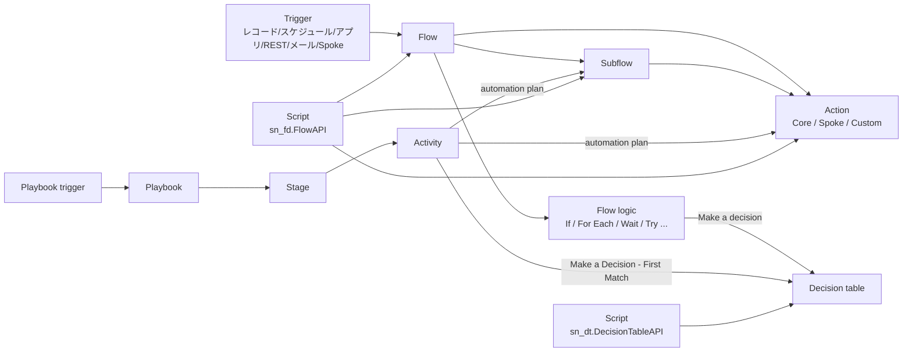
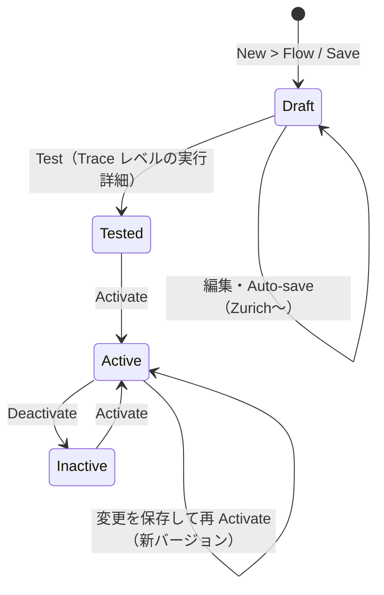
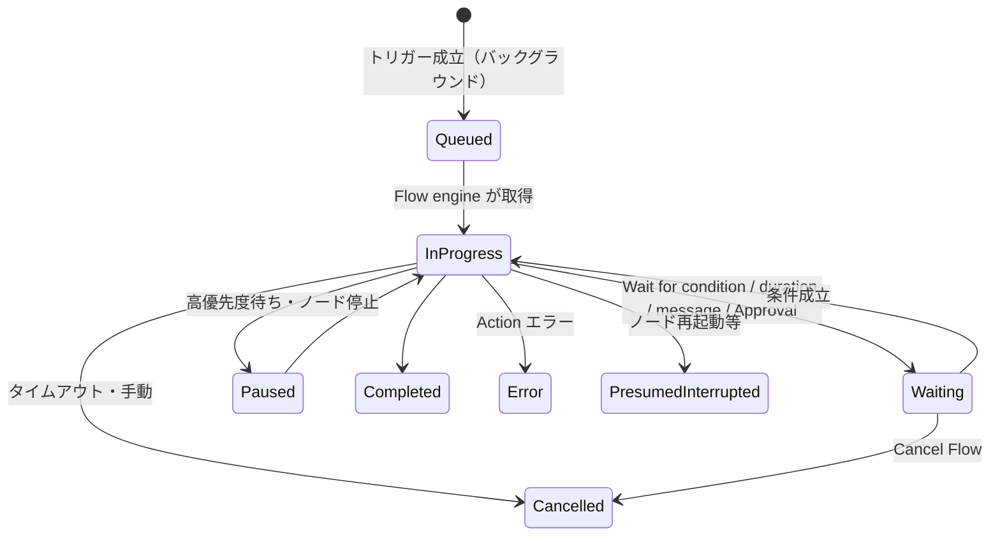
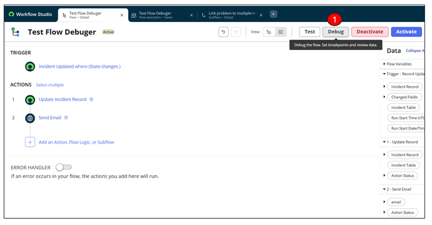
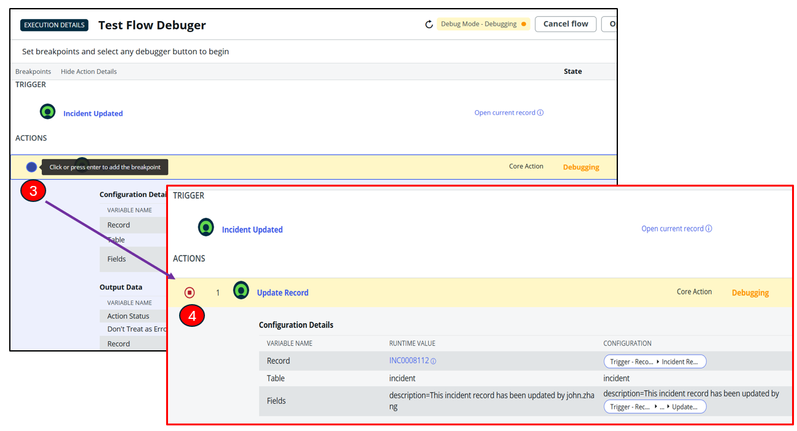
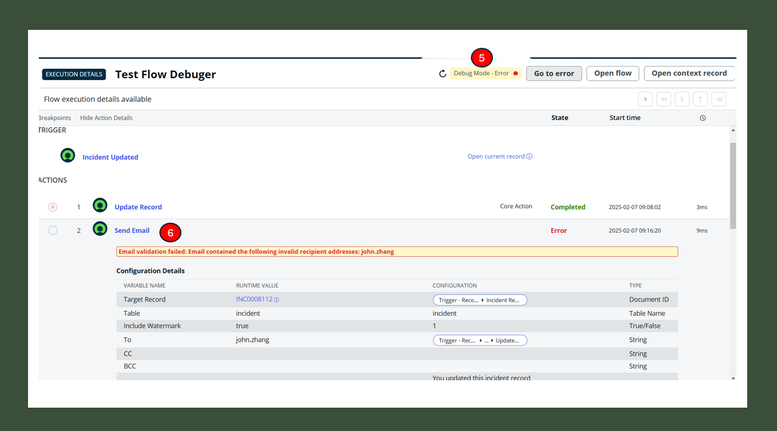
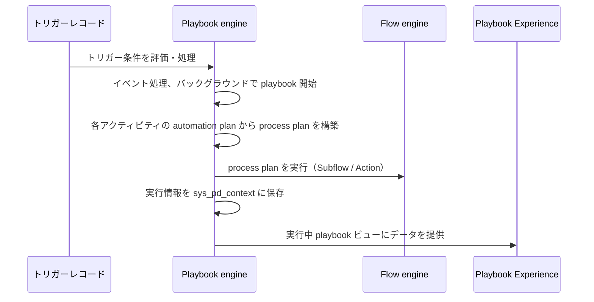

# Workflow Studio / Flow Designer（ワークフロースタジオ／フローデザイナー）

## 概要

**Workflow Studio（ワークフロースタジオ）** は、ServiceNow AI Platform（旧称 Now Platform）上でプロセス自動化を設計・構成・監視するための統合ローコード環境である。公式ドキュメントは Workflow Studio を「ワークフローの作成（authoring）、構成（configuration）、監視（monitoring）を 1 つのページにまとめ、Playbooks・Flows・Actions・Decision tables・Integrations を単一のデザイン環境に集約したもの」と説明している。[出典](https://www.servicenow.com/docs/r/build-workflows/workflow-studio/workflow-studio.html)

Workflow Studio は、従来個別アプリケーションだった以下のビルダーを統合したものである。

| 旧来のビルダー | Workflow Studio 内での位置付け | 主な用途 |
|---|---|---|
| Flow Designer（フローデザイナー） | Flows / Subflows / Actions タブ | トリガー起動の業務自動化（レコード更新、承認、通知、連携） |
| Process Automation Designer（PAD、プロセス自動化デザイナー） | Playbooks タブ（Playbook builder） | 複数部門・複数ステージにまたがる「人＋自動化」のプロセス可視化 |
| Decision Builder（デシジョンビルダー） | Decision tables タブ | if-then ルールの表形式管理（ロジックとコードの分離） |
| Integration Hub の接続設定 | Integrations タブ | Spoke・Connection・Credential の管理（詳細は [IntegrationHub](./integrationhub.md)） |

- Workflow Studio は ServiceNow AI Platform の機能として **既定で有効（active by default）** であり、インスタンスに自動インストールされるが、最新機能を得るには **ServiceNow Store から手動で更新** する必要がある。[出典](https://www.servicenow.com/docs/r/build-workflows/workflow-studio/configuring-workflow-studio.html)
- Playbooks、Flows/Subflows、Actions は Workflow Studio に含まれる。**Data stream actions は Integration Hub の別サブスクリプションが必要**。Decision Builder は ServiceNow Store からインストール・更新できる。[出典](https://www.servicenow.com/docs/r/build-workflows/workflow-studio/configuring-workflow-studio.html)
- Decision Builder は **Washington DC リリース以降** Workflow Studio の一部となった。[出典](https://www.servicenow.com/docs/r/build-workflows/workflow-studio/decision-designer-overview.html)
- **Zurich リリース以降**、新規顧客には ServiceNow 作成のレガシー Workflow が提供されず、その機能は Workflow Studio のコンテンツに置き換えられた。新機能・機能拡張は Workflow Studio のみに提供される。[出典](https://www.servicenow.com/docs/r/build-workflows/legacy-workflow/workflow-editor.html)

本ファイルの基準リリースは **Australia（2026-05-05 GA）** である。Brazil で判明している変更は「Brazil での変更」として併記する。

> **名称について:** 画面・メニューやドキュメント本文には現在も「Flow Designer」という名称が残っている（例：メニュー `All > Process Automation > Flow Designer`、ロール `flow_designer`、プロパティ `sn_flow_designer.*`）。本ナレッジでは、製品全体を **Workflow Studio**、そのうちフロー／サブフロー／アクションの設計機能を **Flow Designer** と呼び分ける。

### 関連ファイル

- サーバーサイドスクリプト（GlideRecord、Script Include 等）：[scripting-server-side.md](./scripting-server-side.md)
- Spoke、Connection & Credential alias、Data Stream：[integrationhub.md](./integrationhub.md)
- サービスカタログ（Catalog item に紐づく flow）：[service-catalog.md](./service-catalog.md)
- 通知：[notifications-email.md](./notifications-email.md)
- SLA と SLA flow：[sla-schedules.md](./sla-schedules.md)
- アプリケーションスコープ・Delegated development：[app-development.md](./app-development.md)
- アップデートセットによる移送：[update-sets-cloning.md](./update-sets-cloning.md)
- ATF によるフローテスト：[automated-test-framework.md](./automated-test-framework.md)
- RPA / Process Mining：[process-automation-rpa-mining.md](./process-automation-rpa-mining.md)
- AI Agents / Now Assist：[now-assist-ai-agents.md](./now-assist-ai-agents.md)
- ドメインセパレーション：[domain-separation.md](./domain-separation.md)
- 技術的負債とカスタマイズ方針：[../../04_応用編/02-customization-technical-debt.md](../../04_応用編/02-customization-technical-debt.md)

---

## 1. Workflow Studio の全体構造

### 1.1 構成要素の関係

Workflow Studio の構成要素は以下の関係にある。Playbook は Subflow / Action をアクティビティとして呼び出し、Flow は Trigger で起動されて Action・Flow logic・Subflow を順に実行する。Decision table は Flow・Subflow・Playbook・スクリプトから参照される。[出典](https://www.servicenow.com/docs/r/build-workflows/workflow-studio/exploring-process-automation-designer.html) [出典](https://www.servicenow.com/docs/r/build-workflows/workflow-studio/exploring-decision-builder.html)



### 1.2 Workflow Studio の画面（ホームページとタブ）

Workflow Studio の画面は以下で構成される。[出典](https://www.servicenow.com/docs/r/build-workflows/workflow-studio/exploring-workflow-studio.html)

| 画面要素 | 内容 |
|---|---|
| Homepage（ホームページ） | 作成・編集可能なワークフローアプリケーションの一覧、種類別ワークフロー、「Pick up where you left off（前回の続き）」、「Latest updates（最近の更新：誰がいつ変更したか）」、Resources（製品ドキュメント、動画、Community、Center of Excellence、Developer Portal） |
| Create / New ボタン | Playbook、Flow、Subflow、Action、Data stream action、Decision table を作成。**Xanadu 以降**、タブヘッダーの Create ボタンからどのページでも作成可能 |
| Playbooks / Flows / Subflows / Actions / Data stream actions / Decision tables タブ | 各種類の一覧（リフレッシュ、リストアクション、URL コピー、フィルタパネル、削除） |
| Operations（運用）タブ | Playbooks と Flows のダッシュボード（例：最も実行された playbook、状態別 playbook 実行数）、Monitoring（実行詳細）、Setup（設定とプロパティ）。**運用ダッシュボードの閲覧は `admin` ロールのみ** |
| Integrations（連携）タブ | 利用可能・構成済みの Integration Hub spoke と connection の一覧。Connection カードで追加・構成・参照 |

- メニュー位置：`All > Process Automation > Workflow Studio`。旧ビルダーのメニュー項目も引き続き動作し、例えば `Process Automation Designer` メニューは Workflow Studio の Playbooks 一覧を開く。`All > Process Automation > Flow Designer` からも Workflow Studio のランディングページが開く。[出典](https://www.servicenow.com/docs/r/build-workflows/workflow-studio/exploring-workflow-studio.html) [出典](https://www.servicenow.com/docs/r/build-workflows/workflow-studio/build-your-first-flow.html)

### 1.3 自動化手段の選択（Automation type recommendations）

Yokohama（2025-05）で、自動化の内容に関する質問に答えると Playbook / Flow / Subflow / Action / Data stream のいずれが適するかを推奨する **Automation type recommendations** が追加された。[出典](https://www.servicenow.com/docs/r/yokohama/release-notes/flow-designer-rn.html)

一般的な使い分けは以下のとおり。

| 手段 | 適する場面 | 根拠 |
|---|---|---|
| Playbook | 複数ステージ・複数担当者にまたがり、エージェント/フルフィラーが Workspace 上で進捗を見ながら進めるプロセス | [出典](https://www.servicenow.com/docs/r/build-workflows/workflow-studio/process-automation-designer-architecture-overview.html) |
| Flow | 固定のトリガーで起動する自動処理（レコード作成・更新、スケジュール、カタログ要求など） | [出典](https://www.servicenow.com/docs/r/build-workflows/workflow-studio/when-to-use-flow-types.html) |
| Subflow | 入力が可変、他のフローやスクリプトから呼ばれる、再利用されるロジック | [出典](https://www.servicenow.com/docs/r/build-workflows/workflow-studio/when-to-use-flow-types.html) |
| Action | 固定構成で再利用されるステップの集合（スクリプト、REST 呼び出し等） | [出典](https://www.servicenow.com/docs/r/build-workflows/workflow-studio/actions.html) |
| Data stream action | ページネーションを伴う大量データ取得（Integration Hub 別サブスクリプション） | [出典](https://www.servicenow.com/docs/r/build-workflows/workflow-studio/configuring-workflow-studio.html) |
| Decision table | 複雑・多分岐で、複数箇所で再利用される判定ロジック | [出典](https://www.servicenow.com/docs/r/build-workflows/workflow-studio/create-decision-table-in-decision-designer.html) |
| Business Rule（ビジネスルール） | 同期的・即時のレコード操作（Before/After）。詳細は [scripting-server-side.md](./scripting-server-side.md) | 【経験則】 |

---

## 2. Flow（フロー）

### 2.1 Flow の構成要素

**Flow（フロー）** は「1 つの Trigger と 1 つ以上の Action で構成される」自動化単位である。[出典](https://www.servicenow.com/docs/r/build-workflows/workflow-studio/when-to-use-flow-types.html) Flow は以下の要素で構成される。[出典](https://www.servicenow.com/docs/r/build-workflows/workflow-studio/flows.html)

| 構成要素 | 説明 |
|---|---|
| Trigger（トリガー） | Flow を起動する条件。条件を満たすたびに Flow が実行される。Trigger は常に同じ形の入力データを提供する |
| Actions and flow logic（アクションとフローロジック） | Trigger の後に続く処理の並び。既定で 1 Flow あたり **最大 50 Action**（`sn_flow_designer.max_actions` で変更可能） |
| Data panel（データパネル） | Flow の実行中に収集・生成されるデータ（Data pill）を一覧表示する右側パネル |
| Flow variables（フロー変数） | Flow 全体でデータを設定・取得する変数。Data panel に Data pill として表示される |
| Stages（ステージ） | リクエスト・Flow・Subflow の現在段階をエンドユーザーに伝える（例：RITM の Stage 表示） |
| Subflows（サブフロー） | 複数の Flow から呼び出せる再利用可能な処理 |
| Error handler（エラーハンドラ） | エラーを捕捉し、是正のための Action / Subflow を実行するセクション |
| Inline scripts（インラインスクリプト） | 構成時に入力値をスクリプトで算出・変更する仕組み |

### 2.2 Flow properties（フロープロパティ）

Flow 作成時（`New > Flow`）に入力する **Flow properties** は以下のとおり。[出典](https://www.servicenow.com/docs/r/build-workflows/workflow-studio/create-flow.html) [出典](https://www.servicenow.com/docs/r/build-workflows/workflow-studio/flows.html)

| プロパティ | 説明 |
|---|---|
| Flow name（フロー名） | 一意の名前。内部名ではスペースがアンダースコアに変換される |
| Description（説明） | 自由記述 |
| Application（アプリケーション） | Flow を作成するアプリケーションスコープ。既定は Global。**作成後は変更不可** |
| Domain（ドメイン） | Flow のドメインスコープ |
| Protection（保護） | `None` または `Read-only`。自分が所有するアプリケーションスコープの Flow にのみ設定可能。Read-only の Flow は参照・テスト・無効化・編集リクエストのみ可能 |
| Run As（実行ユーザー） | `System user（システムユーザー）` または `User who initiates session（セッション開始ユーザー、既定）` |
| Run with role(s)（実行ロール） | Run As がセッション開始ユーザーの場合のみ設定可能（→ 2.4） |
| Flow Priority Default（既定の優先度） | `Low` / `Medium`（既定）/ `High`。待機中のバックグラウンドフローの実行順に影響 |

Run As に関する補足：

- 更新をトリガーしたユーザー名義で記録したい場合（例：インシデントのコメント）はセッション開始ユーザーを選ぶ。
- **Run As の設定は子 Subflow には適用されない。**
- **Inbound email トリガーの Flow は常にセッション開始ユーザー（メール送信者）として実行される。**
- セッション開始ユーザーを選ぶと、実行ユーザーが個人 OAuth トークンを持つ場合はそれを使って実行できる。

[出典](https://www.servicenow.com/docs/r/build-workflows/workflow-studio/create-flow.html) [出典](https://www.servicenow.com/docs/r/build-workflows/workflow-studio/flows.html)

> **注意（公式ガイドライン）:** 一般ガイドラインは「System user として Flow を実行しない」ことと、ロール保護されたデータへのアクセスには **Flow roles** を使うことを推奨している。また `flow_designer` ロールを直接付与することは、Flow が System user（全テーブルにアクセス可能）として実行できるため、実質的に `admin` 付与と同等であると明記されている。[出典](https://www.servicenow.com/docs/r/QG7EzyJSIJf6bo5K1OVTbw/n34SkDxnSs7Mbd8OVmEGow) [出典](https://www.servicenow.com/docs/r/build-workflows/workflow-studio/user-access-flow-designer.html)

### 2.3 Flow のライフサイクル（作成・保存・テスト・有効化）

Flow の作成から有効化までの手順は以下のとおり。必要ロールは `flow_designer` または `admin`。[出典](https://www.servicenow.com/docs/r/build-workflows/workflow-studio/create-flow.html)

1. `All > Process Automation > Workflow Studio` を開く。
2. ホームページで `New > Flow` を選択。
3. Now Assist で生成するか、`Build from scratch` タブでゼロから作成するかを選ぶ。
4. Flow properties を入力し `Submit`。デザイン環境が開く。
5. `TRIGGER` セクションで `Add a trigger` を選ぶ（保存済みトリガーは `INSTALLED SPOKES` 配下のアプリケーションから選択）。
6. `ACTIONS` セクションで `Add an Action, Flow Logic, or Subflow` から処理を追加。ハンドルをドラッグして順序を変更。各項目を構成して `Done`。
7. `Save` で Flow・Trigger・Action のドラフトが保存される。
8. `Test` でテスト実行し、Execution details で値を確認する。
9. `Activate` で有効化。**有効化された Flow のみが自動的にトリガーされる。**
10. 実行履歴は Flow を開いて main header の `Executions` から参照する。

[出典](https://www.servicenow.com/docs/r/build-workflows/workflow-studio/build-your-first-flow.html)



> 上図の「Tested」は概念上の段階であり、公式の状態値ではない。公式ドキュメントで明示されているのは「draft（保存済み・未有効）」と「activated（有効）」である。[出典](https://www.servicenow.com/docs/r/build-workflows/workflow-studio/create-flow.html) 有効な Flow を編集して再有効化した場合、実行中のコンテキストは旧バージョンのまま進むと実行詳細ページの「Open Flow: Active flows aren't changed」の記述から読み取れる。【推定】[出典](https://www.servicenow.com/docs/r/build-workflows/workflow-studio/flow-execution-details.html)

#### 保存・履歴機能

| 機能 | 導入 | 内容 |
|---|---|---|
| Auto-save（自動保存） | Zurich | Flow・Subflow・Action が作業中に自動保存される。`sn_flow_designer.autosave_version_interval`（既定 60 分）以内の自動保存エントリは前のエントリを上書きする |
| Flow / Subflow history（履歴） | Zurich | 過去の構成を参照し、コピー・復元・削除できる。`sn_flow_designer.maximum_flow_history_records_per_flow`（既定 100、範囲 30〜200）が 1 Flow あたりの最大履歴数 |
| Flow history compare view（履歴比較） | Australia | 2 つの履歴エントリを並べて比較。追加・削除・変更をステップのハイライトと変更種別アイコンで表示 |

[出典](https://www.servicenow.com/docs/r/zurich/release-notes/flow-designer-rn.html) [出典](https://www.servicenow.com/docs/r/australia/release-notes/flow-designer-rn.html) [出典](https://www.servicenow.com/docs/r/build-workflows/workflow-studio/flow-designer-system-properties.html)

> **アップグレード時の注意:** 「Save as you go（逐次保存）」機能は Washington DC で一度リリースされ撤回された。Washington DC からアップグレードし、システムプロパティでこの機能をオフにしていた場合は、公式手順に従って復元する必要がある（Zurich・Australia のリリースノートに記載）。[出典](https://www.servicenow.com/docs/r/australia/release-notes/flow-designer-rn.html)

#### 移送（デプロイ）

- Flow はアプリケーションリポジトリからデプロイするか、アップデートセット XML で別インスタンスに移送する。**Flow を保存すると、その Subflow と Action を含む単一のアップデートセットファイルが生成される。** [出典](https://www.servicenow.com/docs/r/build-workflows/workflow-studio/create-flow.html)
- Flow が生成する `sys_complex_object` レコードをアップデートセットに含めること。含めないと実行時に問題が発生する。[出典](https://www.servicenow.com/docs/r/build-workflows/workflow-studio/flows.html)
- **新しいリリースで作成した Flow を古いリリースのインスタンスにデプロイしない**（データモデルがリリース間で変わるため失敗の原因になる）。[出典](https://www.servicenow.com/docs/r/QG7EzyJSIJf6bo5K1OVTbw/n34SkDxnSs7Mbd8OVmEGow)
- 移送の詳細は [update-sets-cloning.md](./update-sets-cloning.md) を参照。

### 2.4 Flow roles（フローロール／Run with roles）

**Flow roles** は、Flow 実行時にのみ付与されるロールを指定する機能で、実行ユーザー本人のロールは変わらない。仕様は以下のとおり。[出典](https://www.servicenow.com/docs/r/build-workflows/workflow-studio/flow-roles.html)

| 項目 | 仕様 |
|---|---|
| 設定可能条件 | Run As が「セッション開始ユーザー」の Flow のみ。System user で実行する Flow は system ロールで実行され、手動選択不可 |
| 複数指定 | 可。新たに選択すると既存のロールは置き換えられる |
| 未指定時 | セッション開始ユーザーのロールで実行 |
| 選択可能なロール | 設定者自身のロールと Flow のアプリケーションスコープに依存 |
| 付与禁止ロール | `admin`、`security_admin`、アプリケーション固有の admin ロール（例：HR アプリケーションの admin ロール）などの高セキュリティロール |
| 編集権限 | Flow に割り当てられた全ロールを持つユーザーのみ編集可能。1 つでも欠けると読み取り専用 |
| コピー時 | コピーした Flow からはロールが削除される |
| ロール欠落時 | インスタンス間移送やロール削除により欠落すると、Run with 欄にロール名ではなく sys_id が表示され、ロールを削除するかインスタンスにロールを追加するまで保存できない |
| Subflow | Subflow は独自のロールで実行され、親のロールを継承しない。子が親に制御を返すと子の特別ロールは外れる |
| ACL | ロール付与はレコード・テーブルへのアクセスを保証しない（ACL に他の条件がありうる）。詳細は [access-control-acl.md](./access-control-acl.md) |
| AI Agents | Flow roles は AI エージェントが動的/特定 AI ユーザーから継承するロールより優先される。AI ユーザーのロールで実行したい場合は Flow roles を外す |
| 監査 | Execution details に Run with roles と Run As ユーザーが表示される |

### 2.5 Flow priority（フロー優先度）

公式ガイドラインでの優先度設定指針は以下のとおり。[出典](https://www.servicenow.com/docs/r/QG7EzyJSIJf6bo5K1OVTbw/n34SkDxnSs7Mbd8OVmEGow)

| 優先度 | 推奨用途 |
|---|---|
| High | 業務上重要で、まれにしか実行されず、すぐ終わる Flow のみ。**すべての Flow を High にしない** |
| Medium（既定） | 時間に敏感な Flow。**一時停止（Wait）する Flow は既定の Medium のままにする**（再開時に優先度を失うため） |
| Low | 大量だが時間に敏感でない Flow |

- `com.glide.hub.pause_low_priority_flows_enabled`（既定 `true`）が有効な場合、高優先度の Flow が待機していると低優先度の Flow が一時停止される。[出典](https://www.servicenow.com/docs/r/build-workflows/workflow-studio/flow-designer-system-properties.html)

### 2.6 Flow 設計の一般ガイドライン（公式）

公式「General guidelines for Workflow Studio flows, subflows, and actions」の主要項目は以下のとおり。[出典](https://www.servicenow.com/docs/r/QG7EzyJSIJf6bo5K1OVTbw/n34SkDxnSs7Mbd8OVmEGow)

| 観点 | ガイドライン |
|---|---|
| 規模 | Flow は短く、モジュール化し、再利用可能に。実行に 1 時間以上かかる Flow は長すぎる可能性が高い |
| 競合 | 置き換える既存の自動化（Flow、Business Rule、Workflow、Integration Hub）は無効化してから Workflow Studio に移行する |
| 待機 | `gs.sleep()` はスレッドをブロックするため使わない。特定時刻はスケジュールトリガー、一時停止は `Wait for a duration` / `Wait for condition` を使う |
| 並列分岐 | 互いに依存する並列分岐を作らない。Subflow を呼んで結果を返す形にする |
| ループ | For Each / Do Until は 1,000 回以内に（`sn_flow_designer.max_iterations` 既定 1,000、変更は非推奨）。Look Up Records には最大件数を設定。ネストした各ループにそれぞれ上限が適用される。大量データはバッチ化 |
| スクリプト内ループ | 上限がないため、カウンタは `var` でスコープし（`for (var i=0; i<length; i++)`）、有効な終了条件を確保する |
| 再帰 | Flow は自分自身を直接呼べない。間接再帰（A → B → A）は 3 回まで（`com.glide.hub.flow_engine.indirect_recursion_limit` 既定 3）。代わりに Do Until を使う |
| 実行モード | 既定で非同期（バックグラウンド）実行。QuickAPI は高速だがデバッグ情報が少ない |
| MID Server | インスタンスと MID Server のステップ間の切り替えは 1 回に抑える |
| カスタムトリガー | 適切なトリガーがない場合、不要なトリガー付き Flow を作るのではなく、条件成立時にスクリプトから Subflow を呼ぶ |
| レポーティング | 本番では Flow reporting をオフ（既定はオフ）。トラブルシュートにはログを使う。ネストしたループで reporting を使う場合は `com.snc.process_flow.reporting.iteration.lastn` を `1` に |
| アプリ開発 | Flow / Action はカスタムアプリケーションに格納し、アプリケーションリポジトリで配布 |

---

## 3. Trigger（トリガー）

### 3.1 トリガーの種類

Workflow Studio の Flow で利用できる **Trigger（トリガー）** の種類は以下のとおり。[出典](https://www.servicenow.com/docs/r/build-workflows/workflow-studio/flow-triggers.html)

| 分類 | トリガー | 説明・制約 |
|---|---|---|
| Record（レコード） | Created | 非システムテーブルでレコード作成時に起動。一部のリクエスト系レコードには専用のアプリケーショントリガーがある |
| Record | Updated | レコード更新時に起動。Run option（→ 3.2）の指定が必要 |
| Record | Created or Updated | 作成または更新時に起動。Run option の指定が必要 |
| REST | REST API - Asynchronous | インバウンド API 呼び出しや Webhook で起動。**Integration Hub Enterprise サブスクリプションが必要** |
| Scheduled（スケジュール） | Daily / Weekly / Monthly | 毎日・毎週・毎月の指定時刻 |
| Scheduled | Run Once | 指定時刻に 1 回。過去の時刻を指定した場合は可能な限り早く実行 |
| Scheduled | Repeat | 指定間隔で繰り返し |
| Application（アプリケーション） | Kafka Message | Kafka トピックへのメッセージ到着で起動 |
| Application | MetricBase | MetricBase のトリガー条件成立で起動（MetricBase アプリが必要） |
| Application | Proactive Analytics | Proactive Analytics の KPI スコア/閾値成立で起動（Performance Analytics サブスクリプションが必要） |
| Application | Service Catalog | カタログアイテム要求時に起動。**トリガー条件にカタログ変数は使えない**（Flow 本体で Get Catalog Variables 等を使う） |
| Application | SLA Task | SLA Definition から起動し、Flow を SLA の action plan として実行（詳細は [sla-schedules.md](./sla-schedules.md)） |
| Inbound Email（受信メール） | Inbound Email | インスタンスがメールを受信したときに起動 |
| Spoke | Spoke triggers | サードパーティアプリの Webhook やイベント駆動でデータを Flow に送る |

スケジュールトリガーに関する補足：

- **インスタンスのタイムゾーン**を使用する。Flow は非同期処理のため、スケジュール時刻ちょうどに開始されるとは限らない。[出典](https://www.servicenow.com/docs/r/build-workflows/workflow-studio/flow-triggers.html)
- **Reusable scheduled triggers（再利用可能なスケジュールトリガー）**：Zurich で追加。1 つのスケジュールトリガーを複数の Flow で共有できる。[出典](https://www.servicenow.com/docs/r/zurich/release-notes/flow-designer-rn.html)
- **Business calendar as a scheduled trigger（ビジネスカレンダーのスケジュールトリガー）**：Australia で追加。既存のビジネススケジュール（シフト、休日、営業時間）に合わせて Flow を起動できる。[出典](https://www.servicenow.com/docs/r/australia/release-notes/flow-designer-rn.html)

Inbound Email トリガーに関する補足：

- **Inbound Email Actions（受信メールアクション）より優先される。**
- メール送信者として実行される。送信者を識別できない場合は **Guest ユーザー**として実行される。
- 添付ファイルやレコード関連付けを Inbound Email Actions より細かく制御できる。
- 既定では 1 通のメールを複数の Flow で処理しない（追加構成が必要）。

[出典](https://www.servicenow.com/docs/r/build-workflows/workflow-studio/flow-triggers.html) メール処理全般は [notifications-email.md](./notifications-email.md) を参照。

### 3.2 Record トリガーの Run option（実行オプション）

Updated / Created or Updated トリガーでは、以下の Run option を選択する。[出典](https://www.servicenow.com/docs/r/build-workflows/workflow-studio/flow-triggers.html)

| Run option | 動作 |
|---|---|
| Once（1 回のみ） | レコードの存続期間中に 1 回だけ起動 |
| For each unique change（一意の変更ごと） | 非システムフィールドの一意な更新ごとに起動（Flow 実行中でも起動）。変更履歴と比較するため、以前の値に戻す変更では起動しない。**非対話セッションで Flow が自身のトリガーレコードを更新すると再帰の原因になる** |
| Only if not currently running（実行中でない場合のみ） | 一意の変更ごとに起動するが、そのレコードで Flow が実行中でない場合のみ。旧リリースの「Always」オプションに相当 |
| For every update（すべての更新） | 実行中コンテキストの有無にかかわらず、すべての更新で起動 |

> **承認を含む Flow:** Ask for Approval を含む Flow のトリガーは `Once` にすべきとされる。承認を再提出するには `Go back to flow logic` を使う。[出典](https://www.servicenow.com/docs/r/build-workflows/workflow-studio/flow-triggers.html)

### 3.3 トリガーの Advanced options（詳細オプション）

| オプション | 選択肢 |
|---|---|
| Where to run（セッション種別） | Only Run for Non-Interactive Session / Only Run for User Interactive Session / Run for Both Interactive and Non-Interactive Sessions |
| ユーザー制限 | Do not run if triggered by the following users / Only run if triggered by the following users / Run for any user |
| テーブル範囲 | Run only on current table / Run on current and extended tables |
| 実行モード | **Run flow in background（既定）**：非同期で実行。**Run flow in foreground**：現在のセッションで同期実行し、ユーザーに即時反映するがセッションをブロックしうる（スクリプトアクションなど中断できない処理では避ける） |

[出典](https://www.servicenow.com/docs/r/build-workflows/workflow-studio/flow-triggers.html)

### 3.4 トリガー設計のガイドライン

- Flow を起動して一時停止させるより、具体的な条件を持つ Record トリガーを使う。
- 同一テーブル上の複数 Flow には**重複しない一意のトリガー条件**を与える。重複すると実行順序が予測不能になる。
- **Record トリガーはアップデートセットや XML インポートで追加・更新されたレコードでは起動しない。**
- Service Catalog のテーブルには Service Catalog アプリケーショントリガーを使う。Flow Designer ではこれらのテーブルを Record トリガーの対象として提供していない。

[出典](https://www.servicenow.com/docs/r/QG7EzyJSIJf6bo5K1OVTbw/n34SkDxnSs7Mbd8OVmEGow)

### 3.5 保存済みトリガー（Reusable flow triggers）と外部イベントソース

| 機能 | 導入 | 内容 |
|---|---|---|
| Reusable flow triggers（再利用可能なトリガー） | Yokohama（2025-02 EA） | トリガー定義を保存し、他のアプリケーションの Flow で再利用。作成者が条件を参照・追加できるかを制御可能。作成・編集・削除には `trigger_designer` ロール |
| External event sources（外部イベントソース） | Zurich | 外部システムのイベントを待ち受けるイベントソースを作成し、外部トリガー定義で 1 つ以上の Flow を起動。Integrations の spokes ページに Event sources メニューが追加 |
| Domain-separated saved external triggers | Zurich | 変更は自動保存。公開後は Label のみ編集可能 |

[出典](https://www.servicenow.com/docs/r/yokohama/release-notes/flow-designer-rn.html) [出典](https://www.servicenow.com/docs/r/zurich/release-notes/flow-designer-rn.html) [出典](https://www.servicenow.com/docs/r/build-workflows/workflow-studio/user-access-flow-designer.html)

---

## 4. Action（アクション）

### 4.1 Action の種類

**Action（アクション）** は Flow や Subflow の中で実行される処理単位である。種類は以下の 3 つ。[出典](https://www.servicenow.com/docs/r/build-workflows/workflow-studio/actions.html)

| 種類 | 説明 |
|---|---|
| Core actions（コアアクション） | インスタンスに同梱される組み込みアクション。インストール済み spoke に関係なくどの Flow でも利用可能。**Workflow Studio の UI から中身を参照・編集できない** |
| Spoke actions（スポークアクション） | アプリケーション（spoke）に含まれるアクション。通常は読み取り専用だが、コピーしてカスタマイズ可能。詳細は [integrationhub.md](./integrationhub.md) |
| Custom actions（カスタムアクション） | 固定構成の再利用可能アクション。Core action は追加のたびに構成するのに対し、Custom action は追加するたびに同じ構成が使われる |

### 4.2 主な Core actions

公式「Actions」リファレンスに掲載されている主な Core actions を機能別に整理する（分類は本ナレッジによる）。[出典](https://www.servicenow.com/docs/r/build-workflows/workflow-studio/flow-actions.html)

| 分類 | Action | 説明 |
|---|---|---|
| レコード操作 | Create Record | 任意テーブルにレコードを作成 |
| | Create or Update Record | 既存レコードを更新、なければ作成 |
| | Update Record | 既存レコードのフィールドを更新 |
| | Update Multiple Records | 複数レコードを検索して一括更新 |
| | Delete Record | レコードを削除 |
| | Look Up Record | 条件に一致する 1 件を検索 |
| | Look Up Records | 条件に一致する複数件を検索（最大件数は `sn_flow_designer.action_picker_limit` 既定 1,000） |
| タスク・カタログ | Create Task | Task 拡張テーブルにタスクを作成し、親レコードに紐づけ可能 |
| | Create Catalog Task | Requested Item に紐づくカタログタスクを作成 |
| | Submit Catalog Item Request | サービスカタログ要求上に Requested Item を作成 |
| | Record Producer | Record producer からタスクを作成し、変数値を引き継ぐ |
| | Get Catalog Variables | カタログアイテム・変数セットの変数を取得 |
| 承認・待機 | Ask for Approval | 承認を依頼。ルールや期日に基づき自動承認・却下・取消も可能 |
| | Wait For Condition | レコード値が条件を満たすまで Flow を一時停止 |
| | Wait For Email Reply | 送信メールへの返信が届くまで一時停止（Zurich で追加） |
| | Wait For Message | Flow API 経由で特定メッセージが届くまで一時停止（タイムアウト任意、Yokohama で追加） |
| メール・通知 | Send Email | ユーザー/グループにメールを送信 |
| | Send Notification | 通知レコードを使って定義済み通知を送信 |
| | Send SMS | SMS デバイスを持つユーザー/グループにメールベースの SMS を送信 |
| | Associate Record to Email | レコードをメールレコードに関連付け |
| | Get Email Header | メールヘッダー値を Data pill として取得 |
| | Get Latest Response Text From Email | メールスレッドの最新返信・転送本文を取得 |
| 添付ファイル | Copy Attachment / Move Attachment / Delete Attachment | 添付ファイルのコピー・移動・削除 |
| | Get Attachments on Record | レコードの添付一覧と件数を取得 |
| | Look Up Attachment | 添付の sys_id を取得 |
| | Look up email attachments / Move Email Attachments to Record | メール添付の検索・レコードへの移動 |
| ログ・イベント | Log | フローログテーブル（`sys_flow_log`）にメッセージを書き込み |
| | Fire Event | イベントレコードを生成（スケジュールハンドラが処理） |
| | Add Worknote Link to Context | Flow の実行詳細へのリンクを持つジャーナルエントリを追加 |
| スクリプト・AI | Run script | アクション内でカスタム JavaScript を実行 |
| | Execute Skill | 公開済みの Now Assist skill を実行し出力を利用 |
| | Use an AI agent | Flow のデータで AI エージェントを実行し、期待する出力を返す（Zurich 2025-12 追加、Australia リリースノートにも記載） |
| SLA | SLA Percentage Timer | Task SLA が指定割合に達したときに処理 |
| Playbooks | Create Flow Data | Workspace の playbook で作業するエージェントからデータを収集 |

> `sys_flow_log` テーブル名はシステムプロパティ `com.glide.hub.flow_engine.log_level` の説明で確認。[出典](https://www.servicenow.com/docs/r/build-workflows/workflow-studio/flow-designer-system-properties.html)

Ask for Approval 関連のシステムプロパティ（`com.glide.hub.flow.approval.*`）は 9 章を参照。

### 4.3 Custom action の構成（Action designer）

**Action designer（アクションデザイン環境）** では以下を行える。作成・テストには `action_designer` または `admin` ロールが必要。[出典](https://www.servicenow.com/docs/r/build-workflows/workflow-studio/actions.html)

- Inputs（入力）の定義と Steps（ステップ）の追加
- テスト実行と実行時値の確認（**テストはレコードを大きく変更しうるため、関連デモデータのある非本番インスタンスで行う**）
- 既存アクションのテンプレートとしてのコピー
- Publish（公開）

**Publish** すると Action が有効化され、有効な Flow から利用可能になる。同時に現在のステップ・変数・順序がスナップショットとして保存され、以降の構成変更とは分離される。[出典](https://www.servicenow.com/docs/r/build-workflows/workflow-studio/actions.html)

Action 構成の上限（システムプロパティ）：

| プロパティ | 既定値 | 意味 |
|---|---|---|
| `sn_flow_designer.max_action_steps` | 20 | 1 Action あたりの最大ステップ数 |
| `sn_flow_designer.max_action_vars` | 20 | 1 Action あたりの最大入力数 |
| `sn_flow_designer.max_script_variables` | 20 | Script step 1 つあたりの最大入出力変数数 |

[出典](https://www.servicenow.com/docs/r/build-workflows/workflow-studio/flow-designer-system-properties.html)

Action の More actions メニューの主な項目：別アプリケーションへのコピー、インラインスクリプトの有効/無効、コードスニペット生成、**Callable by Client API** の有効/無効、Natural language titles の管理。[出典](https://www.servicenow.com/docs/r/build-workflows/workflow-studio/actions.html)

#### Step（ステップ）の種類

Action を構成する Step の種類については、公式リファレンス「Workflow Studio steps」が存在するが本調査では本文を取得できなかった（公開情報では詳細確認できず）。一般に Script step、Look Up Record 等のデータ操作 step、REST / SOAP step、PowerShell / SSH 等の連携 step（Integration Hub サブスクリプションが必要なものを含む）、Payload builder 等がある。【経験則】連携系 step の詳細は [integrationhub.md](./integrationhub.md) を参照。

### 4.4 Action のエラー評価（Action error evaluation）

Action のエラー処理は以下の仕組みで行われる。[出典](https://www.servicenow.com/docs/r/build-workflows/workflow-studio/action-error-evaluation.html)

| 要素 | 仕様 |
|---|---|
| If this step fails（ステップ失敗時） | ステップごとに「次のステップに進む」か「エラー評価に進む（go to error evaluation）」を設定。Step Status は変えない |
| Step Status（ステップ状態） | 各ステップが返すオブジェクト型 Data pill。**Code**：エラー時 `1`、成功時 `0`（カスタマイズ不可）。**Message**：エラー/システムメッセージ（カスタマイズ不可） |
| Error conditions（エラー条件） | Error Evaluation セクションに並べ、上から評価し最初に一致したものが結果になる（else if と同様）。各条件はラベル、一致条件、エラー状態、Action Status code、Action Status message を持つ |
| Action Status（アクション状態） | すべての Action が返すオブジェクト型 Data pill。最初に一致したエラー条件の code / message。どれにも一致しなければ最後に実行されたステップの Step Status |

推奨事項：エラー条件は 10 個程度以下に、具体的な条件を一般的な条件より前に置く、説明的なラベルを付ける、後続ステップが出力を必要とするステップは失敗時に停止させる。[出典](https://www.servicenow.com/docs/r/QG7EzyJSIJf6bo5K1OVTbw/n34SkDxnSs7Mbd8OVmEGow)

### 4.5 インラインスクリプトと Action のスクリプト指針

| 指針 | 内容 |
|---|---|
| 適用範囲 | 小規模で再利用しないロジックはインラインスクリプト、再利用・複雑なロジックは Action / Subflow |
| 既存機能優先 | Transform functions や Create Record / Update Record 等のベースラインアクションをカスタムスクリプトより優先 |
| Script Include | 共通コードは Script Include に集約し、インラインスクリプトから呼ぶ |
| 変数 | `var` で宣言してスコープを保つ |
| 型 | スクリプト出力が期待される入出力の型に一致するようにする |
| Look Up Records 出力 | For Each 経由で `fd_data` と `item` の参照を使ってのみアクセスする |
| 有効化制御 | インラインスクリプトは `sn_flow_designer.input_scripts_enabled`（既定 `true`）で制御。作成には `flow_designer_scripting` ロール |

[出典](https://www.servicenow.com/docs/r/QG7EzyJSIJf6bo5K1OVTbw/n34SkDxnSs7Mbd8OVmEGow) [出典](https://www.servicenow.com/docs/r/build-workflows/workflow-studio/flow-designer-system-properties.html) [出典](https://www.servicenow.com/docs/r/build-workflows/workflow-studio/user-access-flow-designer.html)

### 4.6 Complex data（複合データ）と Password2

Complex data（Object / Array of Objects 等の構造化データ）の指針：[出典](https://www.servicenow.com/docs/r/QG7EzyJSIJf6bo5K1OVTbw/n34SkDxnSs7Mbd8OVmEGow)

- 階層は子 7 レベル程度以下に抑える。
- レコード種別ごとに別オブジェクトを作り、レコードオブジェクトはデータディクショナリの構造をミラーする。
- String 入力を使うと複合データは自動的に JSON に変換される。
- 再利用するオブジェクトはテンプレートとして保存する。

Password2（双方向暗号化）データの指針：

- 値は既存の password2 Data pill を選択してのみ割り当て可能（手入力不可）。
- password2 pill をドラッグできるのは特定フィールド（メール本文、HTML、password2 フィールド、PowerShell 入力変数、一部 REST/SOAP フィールド等）のみ。他フィールドでは警告が出て実行がブロックされる。
- password2 変数は条件に使えない。

---

## 5. Subflow（サブフロー）

### 5.1 Subflow の概要

**Subflow（サブフロー）** は、プロパティ、1 つ以上の入力と出力、Action の並び、収集・生成するデータで構成される再利用可能な処理である。**Trigger を持たず、別の Flow またはスクリプトからのみ起動される。** [出典](https://www.servicenow.com/docs/r/build-workflows/workflow-studio/when-to-use-flow-types.html) [出典](https://www.servicenow.com/docs/r/build-workflows/workflow-studio/subflows.html)

Flow と Subflow の使い分け：[出典](https://www.servicenow.com/docs/r/build-workflows/workflow-studio/when-to-use-flow-types.html)

| 状況 | 使うもの |
|---|---|
| 固定の入力から Action を開始する | Flow |
| 可変の入力から Action を開始する | Subflow |
| 別の Flow やスクリプトから起動する | Subflow |
| 同じ Action を他の Flow で再利用する | Subflow |
| 呼び出しごとに異なる入力型が必要 | Subflow |
| 親フロー向けに入出力を明示的に定義する | Subflow |
| レコードデータのエラーを自動是正する | Subflow |
| エラー処理が 10 項目を超える | Subflow |
| Subflow の出力で他の Flow の自動化を起動する | Subflow |

- **25 Action 以上の Flow は Subflow に分割**することが推奨される（`sn_flow_designer.max_actions` の上限は既定 50 だが、性能上は 25 が推奨）。[出典](https://www.servicenow.com/docs/r/QG7EzyJSIJf6bo5K1OVTbw/n34SkDxnSs7Mbd8OVmEGow)
- **Dynamic Flow** は名前に反して Flow の種類ではなく Flow logic の一種である。[出典](https://www.servicenow.com/docs/r/build-workflows/workflow-studio/when-to-use-flow-types.html)

### 5.2 入力と出力

| 項目 | 仕様 |
|---|---|
| Inputs（入力） | 各入力は Subflow を Flow に追加した際の構成項目になる。必須入力には値が必要。全入力でヒントと既定値を設定でき、選択肢リストも利用可能。**入力は 20 個以下を推奨**（多いと開閉・実行が遅くなる） |
| Outputs（出力） | 名前とデータ型を持つ変数。`Assign subflow outputs` flow logic で値を割り当てる（定義済みの出力のみ）。値が分岐で異なる場合は条件ロジックを使う。**条件ロジックがないと、Subflow 内で最後に定義された値のみが実行時に出力に適用される** |
| Manage security | More Actions メニューの **Callable by Client API** でクライアント API からの呼び出し可否を設定 |
| 必要ロール | `flow_designer` または `admin` |

[出典](https://www.servicenow.com/docs/r/build-workflows/workflow-studio/subflows.html)

### 5.3 Subflow のテスト

1. `All > Process Automation > Flow Designer` を開き、Subflows タブから保存済みの Subflow を開く。
2. `Test` を選択して Test Subflow ダイアログを開く。
3. 入力値を定義する（値は次回テスト時のために記憶される）。
4. `Run Test` を実行。Trigger がないため、定義した入力で Action が実行される。
5. 完了メッセージのリンクから Execution Details を開く。

- `Run test in background` を選ぶと非同期実行され、実行詳細は完了後に表示・関連付けされる。
- テスト対象は**保存済みで 1 つ以上の Action を含む Subflow**のみ。
- テストはレコードを作成・変更するため、非本番インスタンスで実施する。
- 必要ロール：`flow_designer` または `admin`。

[出典](https://www.servicenow.com/docs/r/build-workflows/workflow-studio/test-subflow.html)

### 5.4 並列 Subflow と Dynamic flows

- 出力が相互に関連する、またはすべての結果を待つ必要がある場合は並列 Subflow を使う。そうでなければ 1 つのイベントで複数 Flow をトリガーする方が単純である。
- 並列 Subflow では、各 Subflow を待機なしで起動し、それぞれが終端状態（complete、error、canceled）に達するまで `Wait for condition` を置く。
- Dynamic flows（実行時に呼ぶ Flow/Subflow を選ぶ）は、IntegrationHub spoke のように類似した Subflow が多数ある場合に使う。**動的 Subflow の入力はテンプレートフローの入力と一致しないとメインフローが失敗する。** 繰り返し実行の出力を取得する際は正しいコンテキストレコードを選ぶ。

[出典](https://www.servicenow.com/docs/r/build-workflows/workflow-studio/subflows.html) [出典](https://www.servicenow.com/docs/r/QG7EzyJSIJf6bo5K1OVTbw/n34SkDxnSs7Mbd8OVmEGow)

### 5.5 Conversational subflows / actions（会話型サブフロー・アクション）

Subflow と Action は、Now Assist / Virtual Agent の会話から呼び出せる「会話型（conversational）」として構成できる。主な変遷は以下のとおり。

| リリース | 内容 |
|---|---|
| Yokohama（2025-02 EA） | Conversational settings：会話互換の Subflow / Action を確認し、会話インターフェース向けに構成 |
| Yokohama（2025-05） | 会話互換チェック、入力既定値と会話での非表示、Dynamic Choice / Array of Objects 入力型対応、生成 AI による説明生成 |
| Zurich（2025-08 EA） | Skills for conversational subflows and actions：1 つの Subflow/Action に複数の skill を作成可能。サブフロー固有のエラーメッセージ表示 |
| Zurich（2025-09 GA） | Now Assist 製品をインストールすると会話型 Subflow/Action が既定で有効 |
| Australia | Test conversational action / Test conversational subflow：本番展開前にユーザー入力への応答を検証 |

[出典](https://www.servicenow.com/docs/r/yokohama/release-notes/flow-designer-rn.html) [出典](https://www.servicenow.com/docs/r/zurich/release-notes/flow-designer-rn.html) [出典](https://www.servicenow.com/docs/r/australia/release-notes/flow-designer-rn.html)

詳細は [virtual-agent.md](./virtual-agent.md)、[now-assist-ai-agents.md](./now-assist-ai-agents.md) を参照。

---

## 6. Flow logic（フローロジック）

### 6.1 Flow logic の一覧

Workflow Studio が提供する 17 種類の **Flow logic（フローロジック）** は以下のとおり。[出典](https://www.servicenow.com/docs/r/build-workflows/workflow-studio/flow-logic.html)

| Flow logic | 説明 |
|---|---|
| If（Else If / Else を含む） | 条件を満たす場合のみ Action を実行 |
| Make a decision | Decision table を使って多分岐。ネストした If/Else If/Else より可読性が高い |
| For Each | リスト内の各レコードに Action を適用 |
| Do the following until | 終了条件を満たすまで繰り返し |
| Do the following in parallel | 独立したブロック内で複数経路を並列実行 |
| Exit Loop | If 条件成立時にループを抜ける（break） |
| Skip Iteration | If 条件成立時に現在の反復をスキップ（continue） |
| Go back to flow logic | 前のステップに戻って一連の Action を繰り返す |
| Wait for a duration | 一定時間または特定日時まで一時停止 |
| Try | ブロック内でエラーが発生しても Flow を継続し、対応 Action を実行 |
| End Flow | 現在の Flow を停止（分岐内で終了条件として使う） |
| Set Flow Variables | フロー変数に値を設定（Data pill として利用可能） |
| Append to Flow Variables | Array of Objects 型のフロー変数に値を追加 |
| Assign subflow outputs | Subflow 終了時に返すデータを定義 |
| Call a workflow | 公開済み・有効なレガシー Workflow を Flow から実行（現在のレコードなどを渡せる） |
| Dynamic flows | 実行時に Flow / Subflow を選択して実行（テンプレートで入力を供給） |
| Get Flow Outputs | Dynamic flows / Subflow の出力を実行時に取得 |

関連する上限：

| プロパティ | 既定値 | 意味 |
|---|---|---|
| `sn_flow_designer.max_iterations` | 1000 | ループ（Do the following until、Go back to flow logic）の最大反復数。変更は実行中の Flow に影響しない |
| `sn_flow_designer.max_decision_branches` | 100 | Make a decision の最大分岐数 |
| `sn_flow_designer.flow_variables_enabled` | true | カスタムフロー変数を作成できるか |

[出典](https://www.servicenow.com/docs/r/build-workflows/workflow-studio/flow-designer-system-properties.html)

### 6.2 Wait 条件・並列・ステージの注意点

| 対象 | 公式ガイドライン |
|---|---|
| Wait conditions | 可能なら Record トリガーを使う（待機中の Flow はリソースを消費）。再開条件が起こりえない Flow（例：クローズ済みインシデントを待つ）は End Flow を置くかキャンセルする。**Wait 条件は現在のテーブルのフィールドのみ監視可能**で、関連レコードやカタログ変数の変更は検知できず、ドットウォークすべきでない |
| Parallel flow logic | 経路間にデータ依存を作らない（実行順序は保証されない）。**経路間での Data pill 共有は Workflow Studio がブロックする** |
| Stages | For Each ブロック内にステージを定義しない（前後に置く）。複数の Flow/Subflow が同じレコードのステージを更新しないようにする。ステージフィールドを Flow 外から手動更新しない。**Error ステージは実行を止めない** |
| Error handling | エラー処理ステップは Error Handler セクションに置く。Error Status で失敗した Action と影響データを特定。Subflow のエラーを親に伝播させないには Subflow の Error Handler を空にする。10 項目制限を超える場合は Subflow を使う |
| SLA Percentage Timer | SLA Task トリガーで起動する Flow でのみ使用（Subflow には含められない）。各タイマーに一意の累積待機割合（25%、50%、75% 等）を設定 |

[出典](https://www.servicenow.com/docs/r/QG7EzyJSIJf6bo5K1OVTbw/n34SkDxnSs7Mbd8OVmEGow)

ステージ表示に関するプロパティ：`com.glide.hub.flow_engine.stage_display.show_duration`（既定 true、ステージ列に所要時間を表示）、`com.glide.hub.flow_engine.stage_display.show_approvers`（既定 true）、`com.glide.hub.flow_engine.stage_display.show_approvers_limit`（既定 5、10 超はリスト表示エラーの恐れ）、`com.glide.hub.flow.current_stage_status_on_cancel`（既定 `complete`、Flow キャンセル時の実行中ステージの状態。後続ステージは cancelled）。[出典](https://www.servicenow.com/docs/r/build-workflows/workflow-studio/flow-designer-system-properties.html)

---

## 7. Data pill（データピル）

### 7.1 Data pill の仕組み

**Data pill（データピル）** は、Trigger・Action・Flow logic・Subflow が生成するデータを表す部品で、後続のステップの入力欄にドラッグ＆ドロップまたは pill picker で挿入して使う。

- **Action を Flow に追加するたびに、その結果を格納する Data pill が追加される。** pill 名には Flow 内の順番（シーケンス番号）とデータ型が表示され、設計者はこの番号で正しい pill を選ぶ。[出典](https://www.servicenow.com/docs/r/build-workflows/workflow-studio/data-population.html)
- Data pill は Data panel（データパネル）に、Flow Variables、Trigger（例：`Trigger - Record Updated` 配下の対象レコード、Changed Fields、テーブル名、Run Start Time）、各 Action の出力（例：`1 - Update Record` 配下のレコード、Action Status）の順に表示される（9.1 の図 1 参照）。
- **Pill picker（ピルピッカー）** で参照フィールドをドットウォークできる（例：`Trigger - Service Catalog > Requested Item Record > Price`）。[出典](https://www.servicenow.com/docs/r/build-workflows/workflow-studio/build-your-first-flow.html)

### 7.2 値の確定タイミング（Washington DC 以降の挙動）

| 項目 | 仕様 |
|---|---|
| 値の生成 | pill の値は**使われる時点**で生成される。後続ステップが基になるデータを更新すると、その後のステップは新しい値を参照する |
| 値の投入 | pill は、それを生成する Action / Flow logic / Subflow が完了した時点で値が入る。以降の変更は Flow の残りに反映される |
| 例 | インシデントトリガーの Flow で、Set Flow Variables で元の Short description を保存 → Update Record でトリガーの Short description を変更 → 後続の Log はトリガー pill の新しい値を表示し、フロー変数は元の値を保持 |
| Washington DC より前 | Flow 内の位置に関係なく、データが利用可能になった時点ですべての pill に値が入っていた。旧挙動を保つには、生成時に pill の値をフロー変数に保存する |

[出典](https://www.servicenow.com/docs/r/build-workflows/workflow-studio/data-population.html)

### 7.3 HTML サニタイズ

Workflow Studio は、クロスサイトスクリプティングやコードインジェクション対策として、文字列データの HTML マークアップを評価し、**固定の許可リスト（inclusion list）にあるマークアップのみ残してそれ以外を除去**する。許可リストは変更できない。例：`a` は `class` / `href` / `target` / `title`、`img` は `alt` / `class` / `height` / `src` / `title` / `width` 属性を許可。[出典](https://www.servicenow.com/docs/r/build-workflows/workflow-studio/data-population.html)

### 7.4 Transform functions（変換関数）

**Transform functions（変換関数）** は Data pill の値を変換して入力に渡す機能である。指針は以下のとおり。[出典](https://www.servicenow.com/docs/r/QG7EzyJSIJf6bo5K1OVTbw/n34SkDxnSs7Mbd8OVmEGow)

- 互換性のある型の Data pill にのみ適用する。非互換の型はスキップされ、解析できない結果はエラーになる。
- 変換は元の pill を変更しないため、入力ごとに個別に適用する。
- 実行詳細には最終的な変換後の値のみ表示される。
- 公開前にテストする。

変換関数の一覧（カテゴリと関数名）は公式「Transform functions」リファレンスにあるが、本調査では本文を取得できなかった（公開情報では詳細確認できず）。

### 7.5 Flow variables（フロー変数）

- **Flow variables（フロー変数）** は Flow 全体でデータを設定・取得する変数で、Data panel に Data pill として表示される。[出典](https://www.servicenow.com/docs/r/build-workflows/workflow-studio/flows.html)
- `Set Flow Variables` で値を設定し、Array of Objects 型には `Append to Flow Variables` で追加する。[出典](https://www.servicenow.com/docs/r/build-workflows/workflow-studio/flow-logic.html)
- Yokohama（2025-05）で、Trigger・Action・Flow logic ブロックが使うデータの **自然言語による説明（Natural language data descriptions）** が UI に追加された。[出典](https://www.servicenow.com/docs/r/yokohama/release-notes/flow-designer-rn.html)

---

## 8. Flow の実行コンテキストと監視

### 8.1 実行の仕組みと関連テーブル

Flow は既定でバックグラウンド（非同期）で実行され、実行ごとに **context record（コンテキストレコード）** が生成される。主な関連テーブルは以下のとおり。

| テーブル | 内容 | 確度 |
|---|---|---|
| `sys_flow_context` | Flow / Subflow / Action の実行コンテキスト（状態、所要時間、ログ） | 【経験則】（公式ページでは「Open Context Record」として言及され、テーブル名は本調査で未確認） |
| `sys_flow_log` | フローエンジンのログ（`com.glide.hub.flow_engine.log_level` 以上のメッセージ） | 公式 [出典](https://www.servicenow.com/docs/r/build-workflows/workflow-studio/flow-designer-system-properties.html) |
| `sys_complex_object` | Flow が生成する複合データ定義。アップデートセットに含める必要あり | 公式 [出典](https://www.servicenow.com/docs/r/build-workflows/workflow-studio/flows.html) |
| `sys_hub_flow` | Flow / Subflow の定義 | 【経験則】 |
| `sys_hub_action_type_definition` | Custom action の定義 | 【経験則】 |
| `sys_hub_trigger_instance` | Flow に設定されたトリガーのインスタンス | 【経験則】 |
| `sys_trigger` | スケジュールジョブ。Flow Engine Event Handler ジョブが滞留すると Flow が Queued のまま進まない事例がある | 【第三者情報】[出典](https://www.servicenow.com/community/workflow-automation-forum/flow-designer-sys-context-table/m-p/3100580) |

### 8.2 Flow の実行状態（state）

Execution details に表示される Flow の状態は以下のとおり。[出典](https://www.servicenow.com/docs/r/build-workflows/workflow-studio/flow-execution-details.html)

| 状態 | 意味 |
|---|---|
| Completed（完了） | すべての Action が正常に実行された |
| Cancelled（取消） | タイムアウトまたは手動キャンセルで停止 |
| Waiting（待機） | 条件成立まで一時停止中。`Cancel Flow` アクションが表示される |
| Paused（一時停止） | 高優先度フローの待機やノードのグレースフルシャットダウンにより一時停止 |
| Presumed Interrupted（中断と推定） | 現在のノードで有効なトランザクション ID なしに 15 分超実行中、または他ノードで 8 時間超実行中（再起動・終了の可能性） |
| Error（エラー） | Action のエラーで停止。`Go to error` アクションと失敗 Action の詳細が表示される |

このほか、実行待ちの `Queued`（キュー投入）や実行中の `In Progress` の状態がある。【経験則】



> 上図の Queued / In Progress は【経験則】に基づく。その他の状態は公式ページで確認済み。

### 8.3 Reporting level（実行詳細の記録レベル）

Execution details（実行詳細）にどこまで記録するかは `com.snc.process_flow.reporting.level`（既定 `Off`）で決まる。[出典](https://www.servicenow.com/docs/r/build-workflows/workflow-studio/flow-execution-details.html) [出典](https://www.servicenow.com/docs/r/build-workflows/workflow-studio/flow-designer-system-properties.html)

| レベル | 記録内容 |
|---|---|
| Off（既定） | テスト時を除き何も生成しない |
| Basic | Flow・Subflow・Action の実行状態と所要時間、Trigger と Subflow の入出力の構成値・実行時値 |
| Full | すべての項目（入力、出力、ステップ）の構成値と実行時値。デバッグ向け |
| Trace | ステップを含む最も詳細なレベル。テストとサポート向け |

重要な挙動：

- **Workflow Studio から Flow / Action をテストすると、reporting level に関係なく常に Trace レベルの詳細が生成される。**
- **Reporting がオフの状態で実行された Flow の詳細は、後でレベルを変えても参照できない。** オンで実行された詳細はレベル変更後も参照できる。
- Reporting level はコンテキストレコードやログレコードには影響しない。
- 実行時値のサイズ上限は `com.snc.process_flow.reporting.serialized.val_size_limit`（既定 16384 バイト、0 以下で切り詰め無効）。
- 公式ガイドラインは本番では reporting をオフにし、ログで調査することを推奨している。

コミュニティでは、Washington DC 期に実行詳細が表示されない問題の対処として本プロパティを `FULL` にし、変更は新しいコンテキストにのみ反映されることが報告されている。【第三者情報】[出典](https://www.servicenow.com/community/developer-forum/flow-debuging-troubles-in-washington-dc-workflow-studio/m-p/2952214)

### 8.4 Execution details（実行詳細）画面

Execution details は Workflow Studio の **Operations** タブで Flow 実行を選ぶか、Flow の `Executions` から開く。表示内容は以下のとおり。[出典](https://www.servicenow.com/docs/r/build-workflows/workflow-studio/flow-execution-details.html)

| 表示項目 | 内容 |
|---|---|
| Header | Flow 名、リフレッシュ、Flow の状態、関連レコードオプション |
| Calling source（呼び出し元） | Workflow Studio テスト、CRUD トリガー、日付トリガー、メトリックトリガー、サービスカタログトリガー、スクリプト、バックグラウンドスクリプト等 |
| Run as / Run with roles | System と起動ユーザーのどちらで実行したか、適用されたロール |
| Integration metadata | Connection、Credential、MID Server、ターゲットホスト、ペイロードサイズ（Integration Hub サブスクリプションが必要、連携ステップのみ） |
| Configuration details | 入力変数のデータ型、設定、実行時値 |
| Output data | 出力変数 |
| Logs | 作成日時・レベル・メッセージ（時刻は UTC） |
| Steps | カスタム Action のステップの構成値と実行時値（**Core action はステップを表示しない**） |
| Start time / Run duration | ミリ秒単位の所要時間（キュー、ECC キュー、イベント処理、フローエンジン、MID Server 時間を含む） |
| Retry info | リトライポリシーが有効な場合のリトライ戦略、経過時間、次回リトライ予定 |
| Viewer | スクリプト・ペイロード・メールなど大きな出力をシンタックスハイライト付きで表示 |
| Subflows | 親フロー内にインライン表示、個別表示も可能。Zurich 以降、Subflow のステージも親フローの実行詳細に表示 |

関連レコードオプション：

| オプション | 内容 |
|---|---|
| Open Flow | Flow を開き新バージョンを編集・公開（有効な Flow は変更されない） |
| Open Context Record | コンテキストレコードをフォームで開き、状態・所要時間・ログを参照 |
| Open Flow Logs | 詳細な Action ログを参照 |
| Open Current Record | Record トリガーの対象レコードを開く |
| Open Action | カスタム Action を編集・公開（Core action では不可） |

### 8.5 実行詳細の閲覧権限

| ロール | 閲覧範囲 |
|---|---|
| `flow_operator` | 実行詳細・ダッシュボード・ログを参照（編集不可） |
| `fd_read_operations` | 基本的な状態と所要時間のみ（より詳細が生成されていても非表示） |
| `fd_read_operations_all` | reporting level が許す範囲のすべての詳細（`fd_read_operations` を含む） |

- 読み取り専用ロールと書き込みロールを同一ユーザーに組み合わせない。
- Flow が特権ロール（例：System）で実行された場合、その詳細を見るにはユーザーも同じロールが必要。フィールド暗号化のロールも同様。
- レコードからフローコンテキストを開く UI アクション等は、アプリケーション固有ロール（例：`itil`）を要する場合がある。

[出典](https://www.servicenow.com/docs/r/build-workflows/workflow-studio/flow-execution-details.html) [出典](https://www.servicenow.com/docs/r/build-workflows/workflow-studio/user-access-flow-designer.html)

---

## 9. デバッグとトラブルシューティング

### 9.1 Flow debugger（フローデバッガー）

**Flow debugger（フローデバッガー）** は Yokohama（2025-02 EA）で追加された機能で、専用タブで Flow / Subflow をデバッグし、ブレークポイントを設定し、一時停止中の Flow をステップ実行して値を確認できる。Zurich で起動ボタンが更新された。Brazil では **デバッグ中の入力変更（Input modification during flow debugging）** が追加された。[出典](https://www.servicenow.com/docs/r/yokohama/release-notes/flow-designer-rn.html) [出典](https://www.servicenow.com/docs/r/zurich/release-notes/flow-designer-rn.html) [出典](https://www.servicenow.com/docs/r/brazil/release-notes/flow-designer-rn.html)

ServiceNow Community の解説記事による操作手順は以下のとおり。【第三者情報】[出典](https://www.servicenow.com/community/in-other-news/yokohama-release-new-feature-flow-debugger-walkthrough/ba-p/3171821)

1. Flow のヘッダーで `Debug` ボタンを押す。
2. デバッグ実行に使うレコードを選ぶ。
3. 任意のステップにブレークポイントを設定する。
4. `Resume` で実行を続行する（ブレークポイントで一時停止）。
5. エラーがあると「Debug Mode - Error」と表示される。
6. Flow を修正し、エラーがなくなるまで繰り返す。



**図 1：Flow 編集画面と Debug ボタン（Yokohama 期の画面）**

画面説明：Workflow Studio のタブに「Test Flow Debuger（Flow • Global）」が開かれ、Flow 名の横に「Active」バッジがある。ヘッダー右側に `Test`、`Debug`、`Deactivate`、`Activate` ボタンと View 切替（リスト/ダイアグラム）があり、`Debug` にカーソルを当てると「Debug the flow. Set breakpoints and review data.」とツールチップが出る。左側には `TRIGGER`（Incident Updated where (State changes)）、`ACTIONS`（1 Update Incident Record、2 Send Email、`Add an Action, Flow Logic, or Subflow`）、`ERROR HANDLER` トグルがある。右側の `Data` パネルには Flow Variables、Trigger - Record Updated（Incident Record、Changed Fields、Incident Table、Run Start Time UTC、Run Start Date/Time）、1 - Update Record（Incident Record、Incident Table、Action Status）、2 - Send Email（email、Action Status）の Data pill が並ぶ。

出典：https://www.servicenow.com/community/in-other-news/yokohama-release-new-feature-flow-debugger-walkthrough/ba-p/3171821 （取得日：2026-11-03）



**図 2：ブレークポイントの設定（Execution Details、Debug Mode - Debugging）**

画面説明：「EXECUTION DETAILS」画面の上部に「Debug Mode - Debugging」インジケーターと `Cancel flow` ボタンがある。「Set breakpoints and select any debugger button to begin」と表示され、ACTIONS の各行の左端をクリックしてブレークポイントを追加する（ツールチップ「Click or press enter to add the breakpoint」）。ブレークポイントを設定した「1 Update Record（Core Action）」行は State が「Debugging」となり、Configuration Details に VARIABLE NAME / RUNTIME VALUE / CONFIGURATION の列で Record（INC0008112）、Table（incident）、Fields（description=...）の実行時値と、対応する Data pill（Trigger - Record ▸ Incident Record 等）が表示されている。

出典：https://www.servicenow.com/community/in-other-news/yokohama-release-new-feature-flow-debugger-walkthrough/ba-p/3171821 （取得日：2026-11-03）



**図 3：Debug Mode - Error とエラー詳細**

画面説明：Execution Details 上部に「Debug Mode - Error」表示と `Go to error`、`Open flow`、`Open context record` ボタン、ステップ実行用のデバッガーボタン群がある。ACTIONS 一覧に State と Start time と所要時間の列があり、「1 Update Record」は Completed（3ms）、「2 Send Email」は Error（9ms）。Send Email 行の下に「Email validation failed: Email contained the following invalid recipient addresses: john.zhang」というエラーメッセージと、Target Record、Table、Include Watermark、To、CC、BCC などの Configuration Details（RUNTIME VALUE / CONFIGURATION / TYPE）が表示される。

出典：https://www.servicenow.com/community/in-other-news/yokohama-release-new-feature-flow-debugger-walkthrough/ba-p/3171821 （取得日：2026-11-03）

同記事によれば、デバッガーでは実行中の変数値の確認・変更、失敗時の値変更と再試行、実行ステップのタイムライン表示が可能とされる。【第三者情報】必要ロール・プロパティ等の公式仕様は本調査では確認できなかった（公開情報では確認できず）。

### 9.2 AI によるトラブルシューティング

| 機能 | リリース | 内容 |
|---|---|---|
| Flow execution analysis（フロー実行分析） | Australia | 実行詳細を分析してエラーを特定し、修正案を提示 |
| Flow troubleshooting agent（フロートラブルシューティングエージェント） | Brazil（EA） | Flow の問題を調査する AI エージェント |

[出典](https://www.servicenow.com/docs/r/australia/release-notes/flow-designer-rn.html) [出典](https://www.servicenow.com/docs/r/brazil/release-notes/flow-designer-rn.html)

公式「Flow troubleshooting scenarios」（Brazil 版）は、エージェントが扱うシナリオとして以下を挙げている。[出典](https://www.servicenow.com/docs/r/build-workflows/workflow-studio/flow-troubleshooting-scenarios.html)

| 分類 | シナリオ | 原因 | 対処 |
|---|---|---|---|
| Approval | 承認者が欠落・空 | 承認者フィールドが空、またはユーザー参照を解決できない | 前段のステップで値が失われる箇所を追跡、フィールドをクリアする Business Rule / Flow を確認、ステップの並べ替えや競合ルールの修正 |
| Approval | 承認の監査証跡の欠落 | 監査履歴の判断追跡が欠落・不正 | 承認エンジンの期待動作と Flow 構成を比較し、ログ有効化や承認アクション設定を調整 |
| Approval | Business Rule と承認エンジンの競合 | Business Rule が承認処理を妨げる | Business Rule をスキャンし、条件追加や実行順序の変更を提案 |
| Trigger | トリガーが期待どおり起動しない | トリガー条件と実際のデータ変更・イベントが不一致 | トリガー構成と実データを比較し、ロジックを修正 |
| Trigger | トリガーのロール・権限の問題 | 起動ユーザー/プロセスに必要な権限がない | ロールと権限設定をレビューし、ロール付与やトリガー可視性を調整 |

### 9.3 よくある原因（実務）

| 症状 | 確認ポイント | 確度 |
|---|---|---|
| Flow が起動しない | Flow が Activate されているか／トリガー条件・Run option／Where to run（対話・非対話）／ユーザー制限／アップデートセット・インポートによる更新ではないか | 公式（3 章） |
| Business Rule から更新したのに起動しない | スクリプトで `setWorkflow(false)` を使うと Flow Designer がスキップされる | 【第三者情報】[出典](https://www.servicenow.com/community/workflow-automation-forum/flow-designer-sys-context-table/m-p/3100580) |
| コンテキストが Queued のまま | `sys_trigger` に Flow engine event ジョブが大量に滞留していないか、「Flow Engine Event Handler」ジョブが Ready 状態か | 【第三者情報】[出典](https://www.servicenow.com/community/workflow-automation-forum/flow-designer-sys-context-table/m-p/3100580) |
| ステップが権限不足で失敗 | Run As が起動ユーザーで、そのユーザーの権限が不足していないか（Flow roles の付与を検討） | 公式（2.4）／【第三者情報】 |
| 実行詳細が空 | reporting level が Off（テスト以外は記録されない、後から変更しても過去分は見えない） | 公式（8.3） |
| 同一テーブルの複数 Flow の実行順が不定 | トリガー条件の重複 | 公式（3.4） |
| ループが途中で止まる | `sn_flow_designer.max_iterations`（1,000）到達 | 公式（6.1） |
| 再帰で停止 | `com.glide.hub.flow_engine.indirect_recursion_limit`（3）到達、For each unique change による自己更新 | 公式 |

ログ関連プロパティ：`com.glide.hub.flow_engine.log_level`（既定 `WARN`、`sys_flow_log` に書く最小レベル）、`com.glide.hub.flow_engine.listener_trace.threshold`（既定 `ERROR`、フローログにコピーするシステムログの最小レベル）。[出典](https://www.servicenow.com/docs/r/build-workflows/workflow-studio/flow-designer-system-properties.html)

ATF による Flow の自動テストは [automated-test-framework.md](./automated-test-framework.md) を参照。

---

## 10. スクリプトからの呼び出し（FlowAPI）

### 10.1 `sn_fd.FlowAPI`

サーバーサイドスクリプトから Flow / Subflow / Action を実行・制御するには `sn_fd.FlowAPI` を使う。主なメソッドは以下のとおり。[出典](https://www.servicenow.com/docs/r/api-reference/server-api-reference/ScriptableFlowAPI.html)

| メソッド | 説明 |
|---|---|
| `startFlow(name, inputs)` | Flow を非同期実行し、コンテキスト sys_id を返す |
| `startSubflow(name, inputs)` | Subflow を非同期実行し、コンテキスト sys_id を返す |
| `startAction(name, inputs)` | Action を非同期実行し、コンテキスト sys_id を返す |
| `executeFlow(name, inputs, timeout)` | Flow を同期実行 |
| `executeSubflow(name, inputs, timeout)` | Subflow を同期実行し、出力を返す |
| `executeAction(name, inputs, timeout)` | Action を同期実行し、出力を返す |
| `executeDataStreamAction(name, inputs, timeout)` | Data Stream action を同期実行し `ScriptableDataStream` を返す |
| `startFlowQuick` / `startSubflowQuick` / `startActionQuick` | 実行レコードを作らずに非同期実行（Flow/Subflow は System ユーザーとして） |
| `executeFlowQuick` / `executeSubflowQuick` / `executeActionQuick` | 実行レコードを作らずに同期実行 |
| `getStatus(contextId)` | Flow/Subflow/Action の状態を返す |
| `getOutputs(contextId)` | 完了した Action/Subflow の出力を返す |
| `getErrorMessage(contextId)` | エラーメッセージを返す |
| `cancel(contextId, reason)` | 一時停止中・実行中の Flow/Subflow/Action を取り消す |
| `scheduleCancel(contextId, reason, delaySeconds)` | 遅延後の取り消しを予約 |
| `restartFlowFromContext(contextId, providedInputs)` | バックグラウンド Flow 等を（新しい入力で）再実行 |
| `sendMessage(contextSysID, message, payload)` | Wait for Message で一時停止中の Flow にメッセージとペイロードを送る |
| `getFlowStages(scopedFlowName)` | Flow のステージ一覧を JSON 文字列で返す |
| `hasApprovals(scopedFlowName)` | Ask for Approval の有無を `ALWAYS` / `CONDITIONALLY` / `NO` / `UNKNOWN` で返す |
| `getRunner()` | `ScriptableFlowRunner` ビルダーを返す |

- 公式ドキュメントは、多くの execute / start 系メソッドが **`ScriptableFlowRunner`（ドメインセパレーション対応）** に置き換えられたと記載している。ビルダーは `flow()` / `action()` / `inForeground()` / `inBackground()` / `inDomain()` / `withInputs()` / `run()` を持ち、`run()` の結果オブジェクトは `getContextId()` / `getOutputs()` 等を持つ。
- Flow API 呼び出しの既定実行時間は `com.glide.hub.flow_api.default_execution_time`（既定 30000 ミリ秒）。REST トランザクションクォータ（既定 60 秒で停止）の上限を受ける。[出典](https://www.servicenow.com/docs/r/build-workflows/workflow-studio/flow-designer-system-properties.html)
- QuickAPI のフォアグラウンド実行は呼び出しユーザーのセッションで、バックグラウンド実行は System ユーザーとしてバックグラウンドスレッドで実行される。高速だがデバッグ情報が少ない。[出典](https://www.servicenow.com/docs/r/QG7EzyJSIJf6bo5K1OVTbw/n34SkDxnSs7Mbd8OVmEGow)

コード例（Workflow Studio の `Create code snippet` が生成する形式に準じたもの）：

```javascript
(function() {
    try {
        var inputs = {};
        inputs['user'] = gs.getUserID();
        // ScriptableFlowRunner（推奨）
        var result = sn_fd.FlowAPI.getRunner()
            .subflow('x_acme_app.notify_manager')   // スコープ名.内部名
            .inBackground()
            .withInputs(inputs)
            .run();
        gs.info('Context: ' + result.getContextId());
    } catch (ex) {
        gs.error(ex.getMessage());
    }
})();
```

> 上記の `.subflow()` メソッドは公式ページ本文（本調査で取得した範囲）では `flow()` / `action()` のみ例示されており、`subflow()` の存在は【経験則】である。正確なシグネチャは Workflow Studio の `Create code snippet` で生成されるコードを確認すること。

スクリプト全般は [scripting-server-side.md](./scripting-server-side.md) を参照。

### 10.2 Client API からの呼び出し

Flow 作成者は個々の Flow・Subflow・Action を **Callable by Client API（クライアント呼び出し可能）** にでき、開発者は Workflow Studio の API を利用できる。[出典](https://www.servicenow.com/docs/r/build-workflows/workflow-studio/user-access-flow-designer.html) クライアントスクリプトについては [scripting-client-side.md](./scripting-client-side.md) を参照。

---

## 11. Playbooks（プレイブック／旧 Process Automation Designer）

### 11.1 Playbooks の概要

**Playbooks（プレイブック）** は、部門横断のビジネスプロセスを ServiceNow AI Platform 上で表現するもので、**1 つのトリガー、ステージの並び、アクティビティの並び**で構成される。旧称は **Process Automation Designer（PAD）**。[出典](https://www.servicenow.com/docs/r/build-workflows/workflow-studio/building-a-process.html) [出典](https://www.servicenow.com/docs/r/xanadu/build-workflows/workflow-studio/process-definitions.html)

| 環境 | 内容 |
|---|---|
| Design environment（設計環境） | `All > Process Automation > Workflow Studio > Playbooks` の **Playbook builder**。Playbook owner が playbook を作る |
| Runtime（実行時） | エージェント・フルフィラーが **Playbook Experience** で playbook に従って作業する（Workspace 等に表示） |

[出典](https://www.servicenow.com/docs/r/build-workflows/workflow-studio/process-automation-designer-architecture-overview.html)

| 役割 | 内容 |
|---|---|
| Playbook owner | 設計環境で playbook を作成 |
| Playbook agents / fulfillers | 実行時に playbook に従って業務を完了 |
| Playbook Experience administrators | playbook をエージェントにどこでどう表示するかを構成 |

- Playbooks のプラグインは `com.glide.pad.core`。スクリプト API の名前空間は `sn_pad`。[出典](https://www.servicenow.com/docs/r/api-reference/server-api-reference/PDAutomationProviderBothAPI.html)
- Playbooks はユーザーがアクセスできるプラットフォーム/アプリケーションテーブルからのみトリガーできる。[出典](https://www.servicenow.com/docs/r/build-workflows/workflow-studio/configuring-workflow-studio.html)

### 11.2 Playbook の構成要素

| 構成要素 | 説明 |
|---|---|
| Trigger definition（トリガー定義） | playbook 開始に必要なレコード操作とテーブル条件のテンプレート。通常 `admin`、`playbook.admin`、`pd_trigger_author` が作成 |
| Trigger instance（トリガーインスタンス） | Playbook owner がトリガーテンプレートを選択すると作成され、レコードが満たすべき条件を保持 |
| Stage（ステージ） | アクティビティの論理グループ。Start rule（開始ルール）を持つ |
| Activity definition（アクティビティ定義） | Subflow / Action の入出力をマッピングする定義。**Automation plan**（トリガーレコードのデータを入力にマップ）と **Activity experience**（出力をユーザー向けビューにマップ）を含む。通常 `admin`、`playbook.admin`、`pd_content_author` が作成。テーブルは `sys_pd_activity_definition` |
| Activity instance（アクティビティインスタンス） | playbook にアクティビティを追加すると作成。定義からのデータマッピングを保持し、owner が変更可能 |
| Start rule（開始ルール） | ステージ・アクティビティの開始タイミングを制御し、並列か直列かを決める |

[出典](https://www.servicenow.com/docs/r/build-workflows/workflow-studio/exploring-process-automation-designer.html)

アクティビティの種類：

| 種類 | 説明 |
|---|---|
| Subflow | 再利用可能な Action と Flow logic の並びを実行し、出力を生成 |
| Action | Flow 内でタスクを完了するステップの並びを実行 |
| Decision | **Diagram view でのみ利用可能**。Decision table を使う「Make a Decision - First Match」アクティビティ |
| Optional（任意） | 実行中にエージェント・フルフィラーがアクティビティを追加できる。**Board view でのみ利用可能** |

[出典](https://www.servicenow.com/docs/r/build-workflows/workflow-studio/exploring-process-automation-designer.html) [出典](https://www.servicenow.com/docs/r/build-workflows/workflow-studio/exploring-decision-builder.html)

ステージ・アクティビティのサイドパネル設定項目：名前と説明、Start rule、Restart behavior（再起動時の動作）、Inputs（アクティビティ）、Runtime rendering properties（実行時表示プロパティ）、AI agent involvement（AI エージェントがアクティビティを実行するかどうか・方法）。[出典](https://www.servicenow.com/docs/r/build-workflows/workflow-studio/exploring-process-automation-designer.html)

Playbook builder のヘッダー：状態と有効化状態、Diagram/Board 切替、Undo/Redo、Error tray、Optional activities 切替、Test と Activate、More actions（Deactivate、Duplicate、Properties 編集）。[出典](https://www.servicenow.com/docs/r/build-workflows/workflow-studio/exploring-process-automation-designer.html)

> Start rule の具体的な選択肢（前のステージ完了後、playbook 開始時、手動 等）は本調査では公式ページ本文を取得できず、公開情報では確認できず。PDAutomationProvider API の記述から、Optional activity の Start rule は `Manual` である必要があることは確認できる。[出典](https://www.servicenow.com/docs/r/api-reference/server-api-reference/PDAutomationProviderBothAPI.html)

### 11.3 Playbook のプロパティとトリガー動作

Playbook の作成：`Process Automation > Workflow Studio > Playbooks` で `New > Playbook`。プロパティは More actions の `Properties` で開く Additional properties モーダルで設定する。[出典](https://www.servicenow.com/docs/r/build-workflows/workflow-studio/creating-managing-playbooks.html)

| プロパティ | 説明 |
|---|---|
| Label | playbook 名（Workflow Studio と Playbook Experience に表示） |
| Description | playbook の説明 |
| Conditions | playbook 実行に必要な条件 |
| Run my trigger | トリガーの実行頻度 |
| Run on extended | 入力テーブルを拡張するテーブルの操作でも起動（例：Task テーブルの playbook が Problem の作成・更新でも起動） |

Run my trigger の選択肢：[出典](https://www.servicenow.com/docs/r/xanadu/build-workflows/workflow-studio/process-definitions.html)

| 選択肢 | 動作 |
|---|---|
| Once | トリガー入力レコードの存続期間中に 1 回 |
| For each unique change | 非システムフィールドの一意の更新ごと（実行中でも起動）。以前の値に戻す変更では起動しない。自分のトリガーレコードを更新すると非対話セッションで再帰の恐れ |
| Only if not currently running | 一意の変更ごとに起動するが、プロセス実行が実行中でない場合のみ |
| For every update | 実行中かどうかに関係なく、入力レコードの更新ごと |

> 現行版（Brazil）の「Creating and managing Playbooks」ページでは、Run my trigger の選択肢として Once / Only if not currently running / For every update の 3 つが記載され、For each unique change は記載されていない。リリースによって選択肢が異なる可能性がある。[出典](https://www.servicenow.com/docs/r/build-workflows/workflow-studio/creating-managing-playbooks.html)

制約・設計上の考慮：

- **作成後はトリガーの入力テーブルとトリガー種別を変更できない。**
- Record トリガーはアップデートセットや XML インポートで追加・更新されたレコードでは起動しない。
- 別々の Business Rule・Flow・Workflow を 1 つの playbook に置き換え、置き換えた外部ロジックは重複防止のため無効化する。
- 有効化前に、テストトリガーデータで Test を実行しエラーを解消する。

[出典](https://www.servicenow.com/docs/r/build-workflows/workflow-studio/creating-managing-playbooks.html)

Playbook 管理の関連機能：Playbook variants（バリアント）、Test a playbook、Restart（playbook・stage・activity の再開）、Duplicate（トリガー・ステージ・アクティビティ・Experience 構成をコピー）、テキスト/画像/ナレッジ記事からの playbook 生成、Placeholder activity の推奨、Playbook summarization、Ideal path、翻訳の追加。[出典](https://www.servicenow.com/docs/r/build-workflows/workflow-studio/creating-managing-playbooks.html)

### 11.4 Playbook の実行処理と関連テーブル

Playbook の実行処理の流れ：[出典](https://www.servicenow.com/docs/r/build-workflows/workflow-studio/process-automation-designer-architecture-overview.html)



| テーブル | 内容 |
|---|---|
| `sys_pd_process_definition` | Process Definitions（playbook 定義。status は `draft` / `published`、公開済み playbook を無効化すると draft に戻る） |
| `sys_pd_activity_definition` | Activity Definitions（アクティビティ定義） |
| `sys_pd_activity` | Activities（playbook 内のアクティビティ） |
| `sys_pd_context` | Process Executions（プロセス実行。トラブルシュート用のコンテキストレコード） |
| `sys_pd_activity_context` | Activity Context（アクティビティ実行） |
| `sys_pd_lane_context` | Lane Context（レーンの実行コンテキスト。レーンは UI 上のステージに相当すると考えられる【推定】） |
| `sys_pd_trigger_type` | Trigger Type |

[出典](https://www.servicenow.com/docs/r/api-reference/server-api-reference/PDAutomationProviderBothAPI.html) [出典](https://www.servicenow.com/docs/r/xanadu/build-workflows/workflow-studio/process-definitions.html) [出典](https://www.servicenow.com/docs/r/build-workflows/workflow-studio/process-automation-designer-architecture-overview.html)

> テーブル名に `lane` が残っているのは、UI 上の「Stage（ステージ）」が旧 PAD で「Lane（レーン）」と呼ばれていた名残である。【推定】

Playbook Experience では、すべての文字列データが HTML マークアップについて評価され、固定の許可リストにあるマークアップのみ残される（Flow の Data pill と同じ仕組み）。[出典](https://www.servicenow.com/docs/r/build-workflows/workflow-studio/process-automation-designer-architecture-overview.html)

### 11.5 `sn_pad.PDAutomationProvider` API

| メソッド | 説明 |
|---|---|
| `activateProcess(processDefinitionSysId)` | playbook を有効化 |
| `deactivateProcess(processDefinitionSysId)` | playbook を無効化 |
| `duplicateProcess(processDefinitionSysId, label, description, scopeId, triggerTypeId)` | playbook を複製（description は任意）。global スコープの sys_id を渡すと任意スコープで実行可能 |
| `addOptionalActivityRelativeToActivityContext(contextID, activityId, where, relativeToId)` | アクティビティコンテキストを基準に Optional activity を追加（where：`AFTER` / `WITH`） |
| `addOptionalActivityRelativeToLaneContext(contextID, activityId, where, relativeToId)` | レーンコンテキストに Optional activity を割り当て（where：`LAST` / `NEXT`） |

- 呼び出し元は Optional activity のトリガーを作成したスコープと同じスコープにいるか、admin 権限が必要。
- Optional activity の追加は、`contextID` のプロセス実行が In Progress である必要がある。
- activate / deactivate / duplicate は `state`（`SUCCESS` / `FAILURE`）と `errors` を返す。

[出典](https://www.servicenow.com/docs/r/api-reference/server-api-reference/PDAutomationProviderBothAPI.html)

### 11.6 Playbook のロール

ロールは階層構造で、親ロールを付与すると含まれるロールも付与される。[出典](https://www.servicenow.com/docs/r/build-workflows/workflow-studio/process-automation-designer-roles.html)

| ロール | 内容 | 含むロール |
|---|---|---|
| `playbook.admin` | トリガー、playbook、アクティビティ定義、翻訳、共有 Experience テーブルの完全管理 | `pd_author`, `pd_content_author`, `pd_operator`, `pd_cancel`, `pd_restarter`, `pd_shared.admin` |
| `pd_author` | playbook の作成・有効化・編集・削除、全アクティビティ定義の参照 | `playbook.write`, `playbook.activity_def_read`, `pd_shared.user` |
| `pd_content_author` | アクティビティ定義・トリガー定義の管理、共有 Experience テーブルの参照 | `pd_trigger_author`, `playbook.activity_def_read`, `pd_shared.user` |
| `pd_trigger_author` | トリガー定義の作成・更新・削除 | — |
| `pd_operator` | プロセス実行・アクティビティ実行・実行ログの参照 | — |
| `pd_cancel` | 親レコードへの admin / 書き込み権限なしで実行中 playbook を取り消し | — |
| `pd_restarter` | 有効な playbook の再開 | — |
| `pd_shared.user` | 共有 Experience のアクティビティ種別・プロパティテーブルの参照 | — |
| `pd_shared.admin` | 共有 Experience のアクティビティ種別・プロパティテーブルの編集 | `pd_shared.user` |
| `playbook.write` | playbook の作成・有効化・編集・削除（単独では読み取り権限なし） | `playbook.designer_access`, `pd_shared.user` |
| `playbook.read` | 全 playbook の読み取り | — |
| `playbook.designer_access` | 設計環境での playbook 参照（コンテンツアクセスフィルタ利用時） | `pd_shared.user`, `sn_workflow_studio.workflow_studio_read`, `sn_diagram_builder.db_read` |
| `playbook.activity_def_read` | 全アクティビティ定義の参照（必要ロール設定がない場合） | — |
| `delegated_developer` | Delegated developer に自動付与。既定のコンテンツフィルタで全アクティビティ定義にアクセス | — |
| `playbook.write.public_access` | Public access playbook の作成・編集（他は読み取り専用） | — |
| `playbook.content_author.public_access` | アクティビティ定義の public access フィールドの編集 | — |
| `playbook.automation_runner` | Public access playbook の自動化が実行される制限付き ID | — |

Delegated development：Playbooks の Delegated developer には `delegated_developer` とアプリ固有ロール `sn_dd_[appname]_processautomationdesigner` が自動付与される（Delegated admin の場合は `sn_dd_[appname]_delegatedadmin`）。Delegated developer は割り当てられたアプリケーションのスコープに切り替えるまで Workflow Studio を利用できない。[出典](https://www.servicenow.com/docs/r/build-workflows/workflow-studio/delegated-development-access.html)

---

## 12. Decision tables（デシジョンテーブル／Decision Builder）

### 12.1 概要

**Decision table（デシジョンテーブル）** は、意思決定ロジックをアプリケーションコードから分離し、実行時に入力データを評価する if-then ルールの集合である。ルールのすべての条件を満たすと 1 つ以上の結果を返す。[出典](https://www.servicenow.com/docs/r/build-workflows/workflow-studio/decision-designer-overview.html)

- Decision Builder は **Washington DC 以降** Workflow Studio の一部。Workflow Studio の Decision tables をインストールした後は、**Workflow Studio でのみ作成・変更でき、Classic 環境では作成・変更できない**（Classic で作成済みのテーブルは引き続き参照可能）。
- 入力は既存レコード、外部データソース、固定値から実行時に読み込む。
- Flow、Subflow、Playbook、およびコードを書くプラットフォーム上のあらゆる場所で利用できる。
- App Engine Studio のウィザードからも作成できる。

[出典](https://www.servicenow.com/docs/r/build-workflows/workflow-studio/decision-designer-overview.html)

### 12.2 作成手順と構成

必要ロール：`admin`、`decision_table_admin`、または Delegated developer。[出典](https://www.servicenow.com/docs/r/build-workflows/workflow-studio/create-decision-table-in-decision-designer.html)

1. `All > Process Automation > Workflow Studio` で `New > Decision table`。
2. プロパティフォームを入力。
3. `Build decision table` を選び、入力・条件列・結果列・ルールを追加。
4. `Save` → `Publish` して確認。

| プロパティ | 説明 |
|---|---|
| Decision table name / Description | 名前と説明 |
| Application | アプリケーションスコープ |
| Accessible from | `Application scope only` または `All application scopes` |
| Enable draft authoring | 公開前にドラフトで作成し、公開後もドラフトで編集できる |

| 構成要素 | 仕様 |
|---|---|
| Inputs（入力） | Label、Type、Mandatory、Add reference filter。型：Choice、Currency、Date、Date/Time、Decimal、Due Date、Integer、Long、Reference、String、String (Full UTF-8)、True/False。Choice は同じアプリケーションスコープのテーブルから。**入力が 30 個を超えると作成時に動作が遅くなる** |
| Condition columns（条件列） | label、description、紐づく input、table（Reference 入力時）、Data to evaluate（参照レコード自体か参照先のフィールドか）、condition type、default operator（True/False 以外は必須）。各セルは演算子と値 |
| Result columns（結果列） | label、description、result type、Add reference filter。型：入力型に加え **Duration**。結果列を増やすと複数の結果を返せる。代替値がない場合、Currency は `0.00`、True/False は `false` を返す |
| Rules（行） | `Add new decision row` で追加。グリッドに収まらない複雑な条件は Decision rule view で編集。高度な条件を含む行は Excel 編集時に読み取り専用 |
| Draft / Publish | draft authoring 無効時は作成と同時に有効。有効時は公開済みテーブルを編集するにはドラフトを作成して再公開 |
| Excel | Excel へのエクスポート、行の編集、インポートが可能 |

[出典](https://www.servicenow.com/docs/r/build-workflows/workflow-studio/create-decision-table-in-decision-designer.html)

- Decision Builder のシステムプロパティで、入力数と決定数の上限を設定できる（プロパティ名は本調査では確認できず）。Decision table はドメインセパレーションに対応する。[出典](https://www.servicenow.com/docs/r/build-workflows/workflow-studio/decision-builder-reference.html)
- **Xanadu 以降**、Flow や Playbook の中でテーブル構造を先に作成し、後からルールを埋めることができる。[出典](https://www.servicenow.com/docs/r/build-workflows/workflow-studio/create-decision-table-in-decision-designer.html)

### 12.3 Decision table の利用方法

| 利用箇所 | 方法 |
|---|---|
| Flow / Subflow | `Make a decision` flow logic でテーブルを参照（最大分岐数 `sn_flow_designer.max_decision_branches` 既定 100） |
| Playbook | `Make a Decision - First Match` アクティビティ（Diagram view） |
| スクリプト | Workflow Studio でコードスニペットを生成して挿入、または `sn_dt.DecisionTableAPI` |

[出典](https://www.servicenow.com/docs/r/build-workflows/workflow-studio/exploring-decision-builder.html) [出典](https://www.servicenow.com/docs/r/build-workflows/workflow-studio/flow-designer-system-properties.html)

### 12.4 `sn_dt.DecisionTableAPI` と関連テーブル

`sn_dt.DecisionTableAPI` はスコープ/グローバルのサーバースクリプトで利用でき、`decision_table_crud_api` ロールを要する（ドキュメント記載）。主なメソッド：[出典](https://www.servicenow.com/docs/r/api-reference/server-api-reference/DecisionTableAPI.html)

| メソッド | 説明 |
|---|---|
| `getDecision(decisionID, inputs)` | 入力でテーブルを評価し、一致する回答を 1 つ返す |
| `getDecisions(decisionID, inputs)` | 一致するすべての回答を返す |
| `getDecisionTable(decisionID)` / `getAll()` | テーブル 1 件／全件を返す |
| `getInputs(decisionID)` / `getQuestions(decisionID)` / `getAnswers(decisionID)` | 入力・決定（行）・回答を返す |
| `createDecisionTable` / `createInputs` / `createConditions` / `createQuestions` / `createAnswerElements` / `createInputChoices` / `createAnswerElementChoices` | 各レコードを作成 |
| `update*` / `delete*` | 各レコードの更新・削除 |

```javascript
var dt = new sn_dt.DecisionTableAPI();
var inputs = new Object();
inputs['u_priority'] = '1';          // 入力名は Decision table の入力定義に合わせる
var answer = dt.getDecision('<decision table sys_id>', inputs);
if (answer) {
    gs.info(answer.getValue('u_assignment_group')); // 結果列（answer element）
}
```

> 上記の戻り値アクセス方法は【経験則】。結果の取得方法はテーブル構成（単一結果か multi-result か）で異なるため、公式 API リファレンスのサンプルを確認すること。

関連テーブル：

| テーブル | 内容 |
|---|---|
| `sys_decision` | Decision Tables |
| `sys_decision_input` | Decision Inputs |
| `sys_decision_question` | Decisions（行／質問） |
| `sys_decision_multi_result_element` | Result Elements（結果列） |
| `sys_decision_multi_result` | 複数結果の回答レコード |
| `sys_decision_question_list` | Decision Builder で作成したテーブルの Conditions |
| `sn_decision_table_decision_condition` | Decision Conditions |
| `sys_choice` | Choices |

[出典](https://www.servicenow.com/docs/r/api-reference/server-api-reference/DecisionTableAPI.html)

---

## 13. Legacy Workflow Editor（レガシーワークフロー）との違い

### 13.1 レガシー Workflow の現状

**Legacy Workflow（レガシーワークフロー、Workflow Editor で作成する `wf_` 系のワークフロー）** は、Flow Designer 以前から存在するグラフィカルなワークフローエンジンである。現状は以下のとおり。[出典](https://www.servicenow.com/docs/r/build-workflows/legacy-workflow/workflow-editor.html) [出典](https://www.servicenow.com/docs/r/build-workflows/workflow-activities/c_WorkflowActivities.html)

- **Zurich 以降、新規顧客には ServiceNow 作成・公開のレガシー Workflow が提供されない。** 「All legacy workflow functionality has been replaced by Workflow Studio content.」
- 旧リリースからアップグレードした顧客は既存のレガシー Workflow を引き続き利用・編集できる。
- 全顧客がレガシー Workflow を新規作成することは引き続き可能だが、ServiceNow はプロセス自動化に Workflow Studio を使うことを強く推奨している。
- **「Only Workflow Studio will receive new features and enhancements.」**（新機能・機能拡張は Workflow Studio のみ）
- Workflow Editor は `Workflow > Workflow Editor` から開く。**Next Experience UI は Classic の Workflow Editor を完全にはサポートしないため、Core UI での利用が推奨される。**
- `workflow_creator` ロールで作成、`workflow_admin` ロールで作成・変更・削除・公開が可能（公式ページ内で表記揺れあり）。

### 13.2 Workflow Studio（Flow Designer）とレガシー Workflow の比較

| 観点 | Workflow Studio（Flow / Subflow / Action） | Legacy Workflow（Workflow Editor） |
|---|---|---|
| 位置付け | 現行の標準。新機能はすべてこちら | 保守モード。新機能なし。Zurich 以降の新規顧客には OOTB Workflow なし |
| 起動方式 | Trigger（レコード、スケジュール、アプリ、REST、Inbound Email、Spoke）、FlowAPI、Playbook | テーブルと条件（Workflow properties）、`Workflow` スクリプト API、カタログアイテムの Workflow 指定 【経験則】 |
| 設計 UI | 自然言語風の上から下へのリスト（Diagram view あり）、Data pill によるデータ受け渡し | キャンバス上のアクティビティとトランジション（成功/失敗等の条件で遷移） |
| 部品 | Core / Spoke / Custom actions、Flow logic、Subflow | Core activities（Approval and rollback、Condition、Notification、Notify、Subflow としての Workflow、Task、Timer、Utility）、Orchestration activities（Active Directory、PowerShell、Puppet 等）、Custom activity |
| 再利用 | Subflow、Custom action、Spoke、Decision table | サブワークフロー、Custom activity（Orchestration activity designer） |
| 統合 | Integration Hub spoke（REST/SOAP/PowerShell 等 step） | Orchestration activities |
| 版管理 | Draft → Activate、Auto-save、Flow history・比較（Australia） | Checkout → Publish（ワークフローバージョン） |
| 実行記録 | Flow context、Execution details（reporting level）、Flow debugger、Operations ダッシュボード | Workflow context（All Contexts）、Workflow Activity History、Workflow Operations Dashboard、Workflow timeline 【経験則を含む】 |
| AI | Now Assist による Flow 生成・要約、AI agent action、トラブルシューティングエージェント | なし |
| 相互運用 | `Call a workflow` flow logic で公開済み Workflow を呼べる | — |

[出典](https://www.servicenow.com/docs/r/build-workflows/workflow-studio/flow-logic.html) [出典](https://www.servicenow.com/docs/r/build-workflows/workflow-activities/c_WorkflowActivities.html) [出典](https://www.servicenow.com/docs/r/build-workflows/legacy-workflow/c_TroubleshootWorkflows.html)

レガシー Workflow の主なテーブル：`wf_workflow`（ワークフロー）、`wf_workflow_version`（バージョン）、`wf_activity`（アクティビティ）、`wf_transition`（遷移）、`wf_context`（実行コンテキスト）、`wf_executing`（実行中アクティビティ）、`wf_history`（アクティビティ履歴）。【経験則】（公式ページ本文では Workflow Context フォームと Workflow Activity History 関連リストとして言及され、テーブル名は本調査で未確認）

### 13.3 移行の考え方

- 公式ガイドラインは、既存の自動化（Workflow を含む）を Workflow Studio で置き換える場合、**置き換える側を有効化する前に既存の自動化を無効化**して競合を避けるよう求めている。[出典](https://www.servicenow.com/docs/r/QG7EzyJSIJf6bo5K1OVTbw/n34SkDxnSs7Mbd8OVmEGow)
- Playbook でも、別々の Business Rule・Flow・Workflow を 1 つの playbook に置き換え、置き換えたロジックを無効化することが推奨されている。[出典](https://www.servicenow.com/docs/r/build-workflows/workflow-studio/creating-managing-playbooks.html)
- 段階移行では `Call a workflow` で Flow から既存 Workflow を呼び出し、徐々に置き換える方法がとれる。【経験則】
- レガシー Workflow を Flow に自動変換する公式ツールの有無は、本調査では公開情報で確認できず。
- アップグレード時の技術的負債としての扱いは [../../04_応用編/02-customization-technical-debt.md](../../04_応用編/02-customization-technical-debt.md) と [../../03_導入編/13-upgrade-management.md](../../03_導入編/13-upgrade-management.md) を参照。

---

## 14. ロールとアクセス制御（Flow / Action）

### 14.1 Workflow Studio（Flow・Subflow・Action）のロール

| ロール | 付与される権限 |
|---|---|
| `flow_admin` | すべての Flow・Subflow・Action コンテンツへの限定的管理者アクセス。`flow_designer`、`flow_operator`、`action_designer`、`flow_designer_scripting`、`connection_admin`、`flow_report_viewer` などを含む |
| `flow_designer` | Flow デザイン環境で Flow / Subflow を作成・編集。`flow_operator` と `trigger_designer` を含む |
| `flow_designer_scripting` | 入力値を設定・変更するインラインスクリプトを書ける |
| `flow_operator` | 実行詳細・ダッシュボード・ログを参照。Flow の作成・変更・テストは不可 |
| `flow_report_viewer` | Workflow Studio の Flow テーブルに関するレポートを参照 |
| `trigger_designer` | 保存済みトリガーの作成・編集・削除 |
| `action_designer` | Action デザイン環境で Action を作成・編集（任意のアプリケーションスコープの Action を含む） |
| `action_category_creator` | Action / Subflow のカテゴリを作成（`action_designer` が必要） |
| `fd_read` | Flow・Subflow・Action の構成と実行詳細の読み取り専用。`fd_read_flows`、`fd_read_actions`、`fd_read_operations` を含む |
| `fd_read_flows` | Flow / Subflow の構成と実行詳細の読み取り専用 |
| `fd_read_actions` | Action 構成の読み取り専用 |
| `fd_read_operations` | 基本的な実行詳細（状態・所要時間）のみ |
| `fd_read_operations_all` | reporting level の範囲で生成されたすべての実行詳細（`fd_read_operations` を含む） |
| `decision_table_admin` | Decision table の作成（12 章） |

[出典](https://www.servicenow.com/docs/r/build-workflows/workflow-studio/user-access-flow-designer.html) [出典](https://www.servicenow.com/docs/r/build-workflows/workflow-studio/create-decision-table-in-decision-designer.html)

### 14.2 アクセス制御の仕組み

- Flow を作成・編集するには `flow_designer` が必要。他のロールでさらに制限できる。
- **`flow_designer` の直接付与は、Flow が System user として実行でき全テーブルにアクセスできるため、実質的に `admin` 付与と同等。**
- 読み取り専用ロールと書き込みロールは競合するため同一ユーザーに付与しない。
- **Content filtering rules（コンテンツフィルタリングルール）と content definitions** で、どのロールがどの Flow・Trigger・Action・Subflow にアクセスできるかを制御する。
- **Feature Access List（機能アクセスリスト）** で、保存・テスト・有効化・コードスニペットのコピーなどの UI 機能を使えるロールを制御する。
- **Delegated development（委任開発）**：管理者がアプリケーションを作成し、ユーザーを Delegated development 権限付きの開発者として追加すると、Flow 設計者がロール割り当て・ACL 作成・スクリプト作成など通常 admin に限られる機能を使える。

[出典](https://www.servicenow.com/docs/r/build-workflows/workflow-studio/user-access-flow-designer.html) Delegated development の詳細は [app-development.md](./app-development.md) を参照。

> **Australia での変更:** Now Assist の生成 AI 機能を使うための `now.assist.creator` ロールは不要になった（Deprecations and removals に記載）。[出典](https://www.servicenow.com/docs/r/australia/release-notes/flow-designer-rn.html)

### 14.3 ドメインセパレーション

- テナントの Workflow Studio コンテンツは TOP ドメインの SP 管理者が作成・管理する。
- Flow・Action・Subflow にはドメインをまたいで一意の名前を付ける（例：ドメイン名を接尾辞に）。
- 兄弟ドメインのアーティファクトを参照する Flow は有効化できない。
- コンテンツは所属するドメインで編集する。
- スクリプトからのドメイン指定実行は `ScriptableFlowRunner.inDomain()` を使う。

[出典](https://www.servicenow.com/docs/r/QG7EzyJSIJf6bo5K1OVTbw/n34SkDxnSs7Mbd8OVmEGow) [出典](https://www.servicenow.com/docs/r/api-reference/server-api-reference/ScriptableFlowAPI.html) 詳細は [domain-separation.md](./domain-separation.md) を参照。

---

## 15. システムプロパティ一覧

Workflow Studio の Flow に関する主なシステムプロパティ（`sys_properties`）は以下のとおり。[出典](https://www.servicenow.com/docs/r/build-workflows/workflow-studio/flow-designer-system-properties.html)

| プロパティ | 既定値 | 説明 |
|---|---|---|
| `sn_flow_designer.max_actions` | 50 | 1 Flow / Subflow あたりの最大 Action 数（公式は 100 以下を推奨、ガイドラインでは 25 超で Subflow 分割を推奨） |
| `sn_flow_designer.max_action_steps` | 20 | 1 Action あたりの最大ステップ数 |
| `sn_flow_designer.max_action_vars` | 20 | 1 Action あたりの最大入力数 |
| `sn_flow_designer.max_script_variables` | 20 | Script step の最大入出力変数数 |
| `sn_flow_designer.max_iterations` | 1000 | ループの最大反復数（実行中の Flow には影響しない） |
| `sn_flow_designer.max_decision_branches` | 100 | Make a decision の最大分岐数 |
| `sn_flow_designer.action_picker_limit` | 1000 | Look up 系アクション/ステップが返す最大レコード数（超過分は無視） |
| `sn_flow_designer.trigger_picker_limit` | 1000 | トリガー検索クエリの最大件数 |
| `sn_flow_designer.input_scripts_enabled` | true | インラインスクリプトで入力値を計算できるか |
| `sn_flow_designer.flow_variables_enabled` | true | カスタムフロー変数を作成できるか |
| `sn_flow_designer.autosave_version_interval` | 60 | 自動保存エントリを上書きする間隔（分） |
| `sn_flow_designer.maximum_flow_history_records_per_flow` | 100 | Flow あたりの最大履歴数（30〜200） |
| `sn_flow_designer.action_picker.popular_actions.max_number` | 10 | Action picker の人気アクション表示数 |
| `sn_flow_designer.action_picker.popular_actions.last_num_of_days` | 7 | 人気アクション判定の対象日数 |
| `sn_flow_designer.sync_action_execution_timeout_in_seconds` | 300（ガイドライン記載） | 動的入出力のデータ収集タイムアウト（秒） |
| `com.snc.process_flow.reporting.level` | Off | 実行詳細の記録レベル（Off / Basic / Full / Trace） |
| `com.snc.process_flow.reporting.serialized.val_size_limit` | 16384 | 実行詳細の実行時値のバイト上限（0 以下で切り詰めなし） |
| `com.snc.process_flow.reporting.iteration.lastn` | — | ループ反復の記録数（ネストループで reporting を使う場合 `1` を推奨、ガイドライン記載） |
| `com.glide.hub.flow_engine.log_level` | WARN | `sys_flow_log` に記録する最小レベル |
| `com.glide.hub.flow_engine.listener_trace.threshold` | ERROR | フローログにコピーするシステムログの最小レベル |
| `com.glide.hub.flow_engine.indirect_recursion_limit` | 3 | 1 トランザクション内の間接再帰の上限（1 未満は 1 扱い） |
| `com.glide.hub.pause_low_priority_flows_enabled` | true | 高優先度フロー待機時に低優先度フローを一時停止 |
| `com.glide.hub.flow_api.default_execution_time` | 30000 | Flow API 呼び出しの既定実行時間（ミリ秒） |
| `com.glide.hub.flow.restricted_caller_access.track_flows_as_source` | true（Tokyo 以降） | Flow・Action について Restricted caller access リクエストを生成 |
| `com.glide.cs.fdih.interactive.timeout` | 120 | Integration Hub アクションワークフローのタイムアウト（秒） |
| `com.glide.oneapi.fdih.async.quick.mode` | true | カスタム skill から実行される Flow を quick mode（実行詳細なし）で実行 |
| `com.glide.hub.flow_engine.wait_for_email_reply_input_state` | sent,send-ready | Wait for Email Reply が待機対象とするメールレコードの Type |
| `com.glide.hub.flow_engine.stage_display.show_duration` | true | ステージ列に所要時間を表示 |
| `com.glide.hub.flow_engine.stage_display.show_approvers` | true | ステージフィールドに承認者を表示 |
| `com.glide.hub.flow_engine.stage_display.show_approvers_limit` | 5 | 表示する承認者の最大数（10 超はリスト表示エラーの恐れ） |
| `com.glide.hub.flow.current_stage_status_on_cancel` | complete | Flow キャンセル時の実行中ステージの状態（cancelled / complete） |
| `com.glide.hub.flow.approval.logging` | WARN | Ask for Approval のログの最小レベル |
| `com.glide.hub.flow.approval.allow_inactive_entity` | INDIVIDUAL,GROUP | どの種類の非アクティブなエンティティ（個人 INDIVIDUAL・グループ GROUP）に承認レコードを作成するか（null も可） |
| `com.glide.hub.flow.approval.default_approval_field` | true | Approval field 未指定時にテーブルの既定承認フィールドを使う |
| `com.glide.hub.flow.approval.show_approver_name_in_audit` | true | 承認者名を監査コメントに追加 |
| `com.glide.hub.flow.approval.show_higher_role_audit_comment` | true | ロールにより承認が許可された場合に監査コメントを追加 |
| `com.glide.hub.flow.approval.show_delegate_audit_comment` | true | 代理承認時に監査コメントを追加 |
| `com.glide.hub.flow.approval.show_impersonate_audit_comment` | true | 代理ログイン（impersonate）中の承認時に監査コメントを追加 |

ガイドラインに記載のある追加上限：動的入力は 40 値まで、動的選択肢・テンプレート出力は配列 5,000 項目まで。[出典](https://www.servicenow.com/docs/r/QG7EzyJSIJf6bo5K1OVTbw/n34SkDxnSs7Mbd8OVmEGow)

---

## 16. AI 関連機能（Flow Assist / Now Assist）

| 機能 | リリース | 内容 |
|---|---|---|
| Flow generation（テキストからの Flow 生成） | Vancouver 以降【経験則】 | Now Assist で自然言語から Flow を生成（Flow 作成時の「Now Assist で作成」） |
| Flows from images | Yokohama（2025-05） | 画像から Flow / Subflow を生成し、プレビューを修正・再生成 |
| Flow summaries | Yokohama（2025-05） | 生成 AI で Flow / Subflow の内容を要約 |
| Flows in app generation | Yokohama（2025-05） | Now Assist for app generation でアプリ作成時に Flow を作成・拡張 |
| Now Assist skills in actions | Yokohama（2025-05） | 公開済み Now Assist skill を Action から実行 |
| Now LLM LTS models | Zurich（2025-12） | Flow 生成・要約で Now LLM Long Term Stable モデルをサポート |
| AI agent action（Use an AI agent） | Zurich（2025-12）／Australia | Flow データで AI エージェントを実行し出力を後続で利用 |
| Flow recommendations | Zurich | Diagram view で次の Flow 項目を推奨 |
| Flow execution analysis | Australia | 実行詳細からエラーを特定し修正を提案 |
| Flow troubleshooting agent | Brazil（EA） | Flow の問題を調査する AI エージェント |
| Playbook generation | — | テキスト・画像・ナレッジ記事から Playbook を生成 |

[出典](https://www.servicenow.com/docs/r/yokohama/release-notes/flow-designer-rn.html) [出典](https://www.servicenow.com/docs/r/zurich/release-notes/flow-designer-rn.html) [出典](https://www.servicenow.com/docs/r/australia/release-notes/flow-designer-rn.html) [出典](https://www.servicenow.com/docs/r/brazil/release-notes/flow-designer-rn.html) [出典](https://www.servicenow.com/docs/r/build-workflows/workflow-studio/creating-managing-playbooks.html)

詳細は [now-assist-ai-agents.md](./now-assist-ai-agents.md) を参照。

---

## 17. リリース別の主な変更（Yokohama〜Brazil）

| リリース | 主な変更 |
|---|---|
| Washington DC | Decision Builder を Workflow Studio に統合。Data pill の値確定タイミングを変更（7.2）。Save as you go を一度リリース後撤回 |
| Xanadu | Create ボタンでどのページからも作成可能。Flow / Playbook 内で Decision table の構造を作成可能 |
| Yokohama | Flow debugger（EA）、Reusable flow triggers、Wait for message、Flow API sendMessage、Conversational settings、Flows from images、Flow summaries、Automation type recommendations、アクセシビリティ改善（400% ズーム対応）、Workflow Studio が既定で有効・Store から更新 |
| Zurich | Auto-save、Flow/Subflow history、Reusable scheduled triggers、External event sources、Wait for email reply、Subflow ステージを親フローに表示、Flow recommendations、Debugger ボタン更新、Conversational skills、AI agent action（2025-12）。レガシー Workflow の OOTB 提供終了（新規顧客） |
| **Australia（基準）** | Business calendar のスケジュールトリガー、Flow history compare view、Flow execution analysis、Test conversational action / subflow、Use an AI agent action、`now.assist.creator` ロール不要化、read-only フィールド保護（`read_only_option`、KB2718122） |

> **Brazil での変更:** Flow troubleshooting agent（EA）、デバッグ中の入力変更（Input modification during flow debugging）、Workflow Studio flow designer experience の強化（Enhanced Workflow Studio flow designer experience）が追加された。read-only フィールド保護（`read_only_option` フィールド、`strict_read_only` / `client_script_modifiable` 等）の記載は Brazil 版にもある。廃止項目の記載はない。[出典](https://www.servicenow.com/docs/r/brazil/release-notes/flow-designer-rn.html)

[出典](https://www.servicenow.com/docs/r/yokohama/release-notes/flow-designer-rn.html) [出典](https://www.servicenow.com/docs/r/zurich/release-notes/flow-designer-rn.html) [出典](https://www.servicenow.com/docs/r/australia/release-notes/flow-designer-rn.html) [出典](https://www.servicenow.com/docs/r/build-workflows/workflow-studio/decision-designer-overview.html) [出典](https://www.servicenow.com/docs/r/build-workflows/workflow-studio/data-population.html) [出典](https://www.servicenow.com/docs/r/build-workflows/workflow-studio/exploring-workflow-studio.html) [出典](https://www.servicenow.com/docs/r/build-workflows/legacy-workflow/workflow-editor.html)

---

## 18. 本調査で確認できなかった事項

以下は公開情報（本調査で取得できた範囲）では確認できなかった。

- Flow / Action 定義および実行コンテキストのテーブル名（`sys_hub_flow`、`sys_hub_action_type_definition`、`sys_flow_context` 等）の公式記載（本書では【経験則】として記載）。
- Action の Step 種類の公式一覧、Transform functions の関数一覧。
- Playbook の Start rule の選択肢一覧、Playbook のステータス・有効化状態の詳細。
- Flow debugger の必要ロール・関連プロパティ。
- Decision Builder の上限プロパティ名と既定値。
- レガシー Workflow から Flow への自動変換ツールの有無。
- `ScriptableFlowRunner` の全メソッドシグネチャ（`subflow()` 等）。

---

## 参照元

### ServiceNow 公式ドキュメント（Workflow Studio 全般・Flow）
- https://www.servicenow.com/docs/r/build-workflows
- https://www.servicenow.com/docs/r/build-workflows/workflow-studio/workflow-studio.html
- https://www.servicenow.com/docs/r/build-workflows/workflow-studio/exploring-workflow-studio.html
- https://www.servicenow.com/docs/r/build-workflows/workflow-studio/configuring-workflow-studio.html
- https://www.servicenow.com/docs/r/build-workflows/workflow-studio/flows.html
- https://www.servicenow.com/docs/r/build-workflows/workflow-studio/create-flow.html
- https://www.servicenow.com/docs/r/build-workflows/workflow-studio/build-your-first-flow.html
- https://www.servicenow.com/docs/r/build-workflows/workflow-studio/when-to-use-flow-types.html
- https://www.servicenow.com/docs/r/build-workflows/workflow-studio/flow-designer-reference.html
- https://www.servicenow.com/docs/r/QG7EzyJSIJf6bo5K1OVTbw/n34SkDxnSs7Mbd8OVmEGow （General guidelines for Workflow Studio flows, subflows, and actions）

### Subflow・Action・Trigger・Flow logic・Data pill
- https://www.servicenow.com/docs/r/build-workflows/workflow-studio/subflows.html
- https://www.servicenow.com/docs/r/build-workflows/workflow-studio/test-subflow.html
- https://www.servicenow.com/docs/r/build-workflows/workflow-studio/actions.html
- https://www.servicenow.com/docs/r/build-workflows/workflow-studio/flow-actions.html
- https://www.servicenow.com/docs/r/build-workflows/workflow-studio/action-error-evaluation.html
- https://www.servicenow.com/docs/r/build-workflows/workflow-studio/flow-triggers.html
- https://www.servicenow.com/docs/r/build-workflows/workflow-studio/flow-logic.html
- https://www.servicenow.com/docs/r/build-workflows/workflow-studio/data-population.html

### 実行・監視・ロール・プロパティ
- https://www.servicenow.com/docs/r/build-workflows/workflow-studio/flow-execution-details.html
- https://www.servicenow.com/docs/r/build-workflows/workflow-studio/flow-troubleshooting-scenarios.html
- https://www.servicenow.com/docs/r/build-workflows/workflow-studio/flow-roles.html
- https://www.servicenow.com/docs/r/build-workflows/workflow-studio/user-access-flow-designer.html
- https://www.servicenow.com/docs/r/build-workflows/workflow-studio/flow-designer-system-properties.html

### Playbooks
- https://www.servicenow.com/docs/r/build-workflows/workflow-studio/exploring-process-automation-designer.html
- https://www.servicenow.com/docs/r/build-workflows/workflow-studio/creating-managing-playbooks.html
- https://www.servicenow.com/docs/r/build-workflows/workflow-studio/building-a-process.html
- https://www.servicenow.com/docs/r/build-workflows/workflow-studio/process-automation-designer-architecture-overview.html
- https://www.servicenow.com/docs/r/build-workflows/workflow-studio/process-automation-designer-roles.html
- https://www.servicenow.com/docs/r/build-workflows/workflow-studio/delegated-development-access.html
- https://www.servicenow.com/docs/r/xanadu/build-workflows/workflow-studio/process-definitions.html

### Decision tables
- https://www.servicenow.com/docs/r/build-workflows/workflow-studio/decision-designer-overview.html
- https://www.servicenow.com/docs/r/build-workflows/workflow-studio/exploring-decision-builder.html
- https://www.servicenow.com/docs/r/build-workflows/workflow-studio/create-decision-table-in-decision-designer.html
- https://www.servicenow.com/docs/r/build-workflows/workflow-studio/decision-builder-reference.html

### Legacy Workflow
- https://www.servicenow.com/docs/r/build-workflows/legacy-workflow/workflow-editor.html
- https://www.servicenow.com/docs/r/build-workflows/legacy-workflow/c_TroubleshootWorkflows.html
- https://www.servicenow.com/docs/r/build-workflows/workflow-activities/c_WorkflowActivities.html

### API リファレンス
- https://www.servicenow.com/docs/r/api-reference/server-api-reference/ScriptableFlowAPI.html
- https://www.servicenow.com/docs/r/api-reference/server-api-reference/DecisionTableAPI.html
- https://www.servicenow.com/docs/r/api-reference/server-api-reference/PDAutomationProviderBothAPI.html

### リリースノート
- https://www.servicenow.com/docs/r/australia/release-notes/flow-designer-rn.html
- https://www.servicenow.com/docs/r/brazil/release-notes/flow-designer-rn.html
- https://www.servicenow.com/docs/r/zurich/release-notes/flow-designer-rn.html
- https://www.servicenow.com/docs/r/yokohama/release-notes/flow-designer-rn.html

### ServiceNow Community（第三者情報）
- https://www.servicenow.com/community/in-other-news/yokohama-release-new-feature-flow-debugger-walkthrough/ba-p/3171821 （画像 3 点の出典、取得日 2026-11-03）
- https://www.servicenow.com/community/workflow-automation-forum/flow-designer-sys-context-table/m-p/3100580
- https://www.servicenow.com/community/developer-forum/flow-debuging-troubles-in-washington-dc-workflow-studio/m-p/2952214
