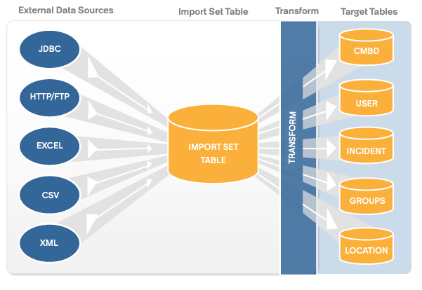
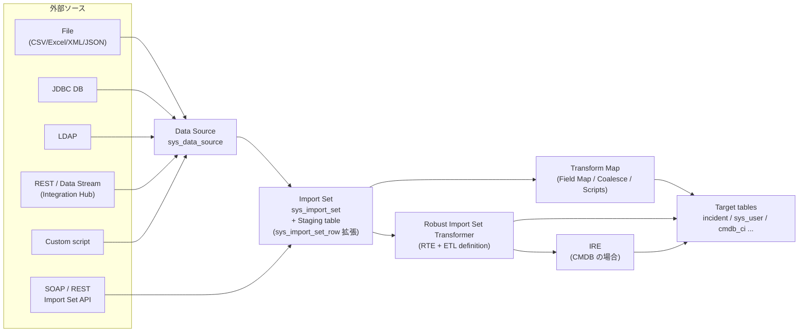
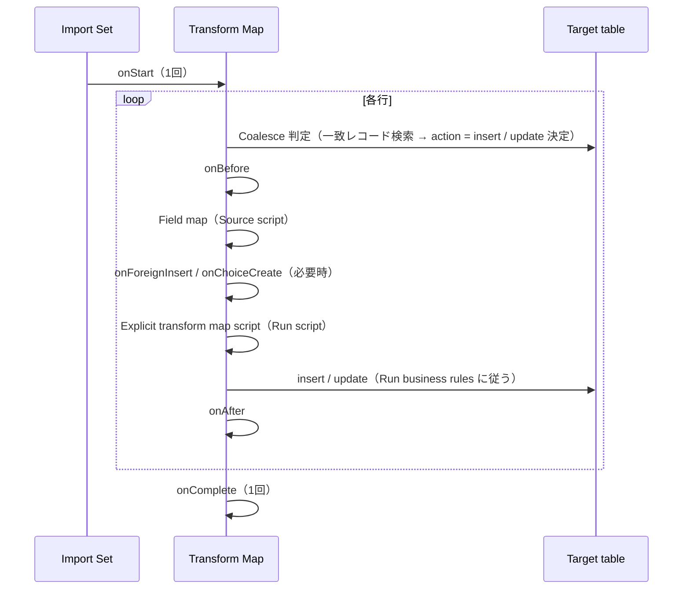
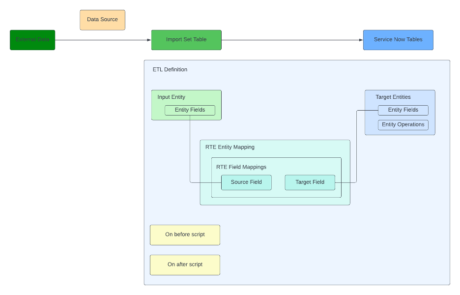
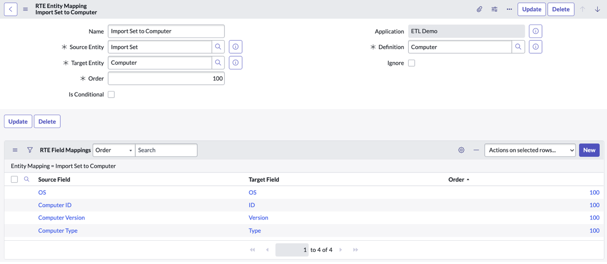
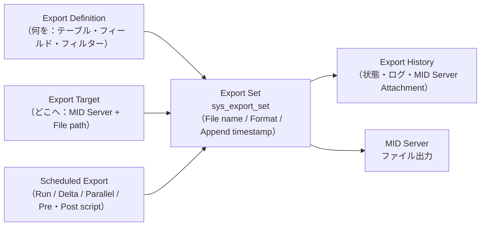

# データインポート/エクスポート（Import Sets・Transform Map・Export Sets・IntegrationHub ETL）

## 概要

ServiceNow AI Platform（旧 Now Platform）におけるデータの取り込み（インポート）と取り出し（エクスポート）は、次の機能群で構成される。

| 区分 | 機能 | 一言で | 主な用途 |
|---|---|---|---|
| インポート | **Import Sets（インポートセット）** | 外部データを Staging table（ステージングテーブル）に一旦格納し、変換してから本番テーブルへ書き込む仕組み | 初期データ移行、定期連携（ユーザー、CI、ロケーション等） |
| インポート | **Data Source（データソース）** | 取り込み元（File / JDBC / LDAP / OIDC / REST / Data Stream / Custom script）の定義 | 取り込み元の接続・形式の定義 |
| インポート | **Transform Map（変換マップ）** | Staging table → Target table（ターゲットテーブル）の項目対応と変換ルール | 単一ターゲットへの変換 |
| インポート | **Coalesce（コアレス）** | 既存レコードとの突合キー。一致すれば更新、なければ新規作成 | Upsert（更新/挿入）制御 |
| インポート | **Transform scripts（変換スクリプト）** | onStart/onBefore/onAfter/onComplete 等のイベントスクリプトとフィールド単位スクリプト | 変換ロジックの拡張 |
| インポート | **Scheduled Data Import（スケジュールインポート）** | インポートの定期実行。Concurrent import（並行インポート）・親子階層実行にも対応 | 定期連携 |
| インポート | **Robust Import Set Transformer / Robust Transform Engine（RTE）** | Transform Map の代替。1回の読み取りで複数ターゲットへ ETL | 多テーブルへの一括変換、CMDB 連携 |
| インポート | **IntegrationHub ETL** | RTE と IRE（Identification and Reconciliation Engine）を使い、CMDB 等へ第三者データを取り込むガイド付きツール | CMDB 連携（Service Graph Connector 開発等） |
| インポート | **Easy import（簡易インポート）** | リストからテンプレート（Excel/CSV）をダウンロードし、編集して取り込む | 管理者による小規模な一括登録・更新 |
| インポート | **Web service import sets / Import Set API** | SOAP/REST で Staging table に直接書き込み、変換させる | システム間連携 |
| インポート | **XML import（XML インポート）** | エクスポートした XML をそのまま別インスタンスに取り込む | 少量・一回限りのデータ移送 |
| エクスポート | **リスト/フォームからのエクスポート** | CSV、Excel、XML、JSON、PDF、Google Sheets | 画面からの手動出力 |
| エクスポート | **URL エクスポート** | `<table>_list.do?CSV&sysparm_query=...` 形式で直接出力 | スクリプトからの出力 |
| エクスポート | **Export Sets（エクスポートセット）** | MID Server 上のファイルへ定期出力。Delta export・Parallel export に対応 | 大量データの定期出力、外部 DWH 連携 |

本ファイルは Australia リリース（2026-05 GA）の公式ドキュメントを基準とする。Import Set / Export Set の基本仕様は長年大きく変わっておらず、Brazil 版ドキュメント（2026-09-10 更新）で確認した範囲でも主要仕様の差分は見られなかった（詳細は「[Brazil での変更点](#brazil-での変更点)」）。

関連ファイル:
- REST/SOAP API 全般は [Web Services / REST API](web-services-api.md)
- IntegrationHub（Spoke、Data Stream action、サブスクリプション）は [IntegrationHub](integrationhub.md)
- MID Server の構成は [MID Server](mid-server.md)
- CMDB と IRE は [CMDB と CSDM](cmdb-csdm.md)、Service Graph Connector は [Service Graph Connectors](../itom/service-graph-connectors.md)
- 外部データを複製せずに参照する Zero Copy 等は [Workflow Data Fabric](workflow-data-fabric.md)
- 移行プロジェクトとしての進め方は [データ移行](../../03_導入編/08-data-migration.md)、連携設計は [連携設計](../../03_導入編/09-integration-design.md)
- 定義（設定）レコードの移送は [アップデートセットとクローン](update-sets-cloning.md)

---

## 1. Import Sets（インポートセット）の全体像

### 1.1 Import Sets の基本概念

Import Sets（インポートセット）は、外部のデータソースからデータを取り込み、ServiceNow のテーブルへマッピングするための仕組みである。公式ドキュメントでは次のように整理されている [出典](https://www.servicenow.com/docs/r/u~ldaY8ZPxJiUgZ1Inf6mw/I1J3ifzWRL7k5C8oZuGVMw)。

- **Import set** は、Data Source から取り込まれ、Target table へ変換される前の「ステージングされたデータ」である。
- **Transform map** は、Import set のフィールドと Target table（例：Incident、User）のフィールドの対応を定義する。
- **Robust import set transformer** は Transform map の代替であり、同じ Data Source に Transform map と Robust transformer の両方が存在する場合、**Robust transformer が使われる**。
- 取り込んだデータがインスタンス上の既存データと一致する場合、そのレコードは Skip（スキップ）される。
- 対応ファイル形式：CSV、Excel、XML、JSON、Custom（Parse by Script）。対応外部ソース：JDBC、LDAP、OIDC、REST（Integration Hub）、Custom（Load by Script）。



- **キャプション:** Import Set によるデータ取り込みの概念図（公式ドキュメント「Importing data using import sets」掲載図）
- **図の説明:** 左側に External Data Sources（外部データソース）として JDBC、HTTP/FTP、EXCEL、CSV、XML の 5 つが並び、それらの矢印が中央の Import Set Table（インポートセットテーブル＝ステージングテーブル）に集約される。そこから右へ向かう矢印が縦帯の Transform（変換）を通過し、右端の Target Tables（ターゲットテーブル）である CMDB（図中の表記は「CMBD」）、USER、INCIDENT、GROUPS、LOCATION の各テーブルへ分配される。「取り込み → ステージング → 変換 → 本番テーブル」の 3 段構成を示している。
- **出典:** https://www.servicenow.com/docs/r/australia/integrate-applications/system-import-sets/c_ImportDataUsingImportSets.html （取得日：2026-11-02）

### 1.2 処理フロー



上記フローは公式ドキュメントの記述（Data Source → Import set → Transform map / Robust transformer → Target table）を図示したもの [出典](https://www.servicenow.com/docs/r/u~ldaY8ZPxJiUgZ1Inf6mw/I1J3ifzWRL7k5C8oZuGVMw) [出典](https://www.servicenow.com/docs/r/australia/integrate-applications/system-import-sets/robust-import-set-transformers.html)。

標準的な手動インポートの手順は次のとおり。

| 手順 | 操作 | 説明 |
|---|---|---|
| 1 | Data Source を作成（または Load Data で同時作成） | 取り込み元・形式・Staging table 名を定義 |
| 2 | **Test load 20 records**（20 件試験ロード）または **Load All Records**（全件ロード） | Staging table が自動生成／列追加され、Import set が作成される |
| 3 | Transform Map を作成 | Field map、Coalesce、スクリプトを定義 |
| 4 | Transform を実行 | Import set の各行を Target table に挿入・更新 |
| 5 | Import set／Import log を確認 | 件数（Inserts/Updates/Ignored/Skipped/Errors）とエラーを確認 |

- Staging table の列は入力データから自動生成される。列を手動で追加してはならない（スケジュールクリーンアップが壊れ、孤立レコードが残る原因になる）。列を増やしたい場合は入力データ側に列を加え、Test Load 20 Records または Load All Records を再実行する [出典](https://www.servicenow.com/docs/r/u~ldaY8ZPxJiUgZ1Inf6mw/I1J3ifzWRL7k5C8oZuGVMw)。
- Staging table の列型は元データと異なる場合がある（例：通貨値は Currency 列にマップされるまで String として保持される）[出典](https://www.servicenow.com/docs/r/u~ldaY8ZPxJiUgZ1Inf6mw/I1J3ifzWRL7k5C8oZuGVMw)。
- Import set は **System ユーザーとして実行される**ため、**Encrypted field（暗号化フィールド）にはデータを書き込めない** [出典](https://www.servicenow.com/docs/r/u~ldaY8ZPxJiUgZ1Inf6mw/I1J3ifzWRL7k5C8oZuGVMw)。
- 1 回で極端に大きな Import set を作ると遅延や障害の原因になる [出典](https://www.servicenow.com/docs/r/u~ldaY8ZPxJiUgZ1Inf6mw/I1J3ifzWRL7k5C8oZuGVMw)。公式のパフォーマンスガイドは **1 Import set あたり 10 万件未満** を目安とし、「100 万件を 1 回」より「10 万件を 10 回」の方が速く終わるとしている [出典](https://www.servicenow.com/docs/r/australia/integrate-applications/system-import-sets/c_TroubleshootImportSetPerformance.html)。

### 1.3 主要メニュー（Application Navigator）

| メニュー | 用途 | 出典 |
|---|---|---|
| All > System Import Sets > Create Transform Map | Transform Map の新規作成 | [出典](https://www.servicenow.com/docs/r/integrate-applications/system-import-sets/t_CreateATransformMap.html) |
| All > System Import Sets > Transform Maps | Transform Map 一覧、Field Map の編集 | [出典](https://www.servicenow.com/docs/r/australia/integrate-applications/system-import-sets/t_CreatingAFieldMap.html) |
| All > System Import Sets > Administration > Scheduled Imports | Scheduled Data Import の作成 | [出典](https://www.servicenow.com/docs/r/integrate-applications/system-import-sets/t_ScheduleADataImport.html) |
| All > System Import Sets > Administration > Robust Import Set Transformers | Robust transformer の作成・プロパティ設定 | [出典](https://www.servicenow.com/docs/r/oZRGKGLbfcn968v3Ubchmw/CbCoXuPOrVYLtth5Q3AnnA) |
| All > System Import Sets > Administration > ETL Definitions | ETL definition（RTE 定義）の作成 | [出典](https://www.servicenow.com/docs/r/australia/integrate-applications/system-import-sets/define-rte-operations.html) |
| All > System Import Sets > Advanced > Progress | 実行中インポートの進捗確認・キャンセル（Progress Worker の「Cancel job」） | [出典](https://www.servicenow.com/docs/r/integrate-applications/system-import-sets/t_ScheduleADataImport.html) |
| All > System Import Sets > Import Set Tables > Scheduled Cleanup | Import Set Deleter（クリーンアップジョブ）の設定 | [出典](https://www.servicenow.com/docs/r/australia/integrate-applications/system-import-sets/delete-import-sets.html) |
| All > System Import Sets > Load Data / Data Sources / Run Transform / Import Sets | データロード、Data Source 一覧、変換実行、Import set 一覧 | 【経験則】一般に使われる標準メニュー。今回参照した公式ページでは明示を確認できず |

### 1.4 関連ロール

| ロール | 権限の概要 | 出典 |
|---|---|---|
| `admin` | すべて。Easy import は admin のみ利用可 | [出典](https://www.servicenow.com/docs/r/australia/integrate-applications/easy-import/c_EasyImport.html) |
| `import_admin` | Import Sets 全般の管理（Transform Map 作成、Scheduled import 作成等を含む） | [出典](https://www.servicenow.com/docs/r/integrate-applications/system-import-sets/t_CreateATransformMap.html) |
| `import_transformer` | Transform Map・Field Map・Robust transformer・ETL definition・RTE operation の作成 | [出典](https://www.servicenow.com/docs/r/oZRGKGLbfcn968v3Ubchmw/CbCoXuPOrVYLtth5Q3AnnA) |
| `import_scheduler` | Scheduled Data Import の作成。**スクリプトを管理者相当の権限で実行できるため、付与は実質 admin 付与と同等**と公式に警告されている | [出典](https://www.servicenow.com/docs/r/integrate-applications/system-import-sets/t_ScheduleADataImport.html) |
| `import_set_loader` | `sys_import.do` への CSV/Excel 直接 POST | [出典](https://www.servicenow.com/docs/r/australia/integrate-applications/system-import-sets/t_PostCSVOrExcelFilesToImportSet.html) |
| `cmdb_inst_admin` | IntegrationHub ETL での統合作成・カスタマイズ | [出典](https://www.servicenow.com/docs/r/australia/servicenow-platform/integration-hub-etl/integrationhub-etl.html) |
| `export_set_admin` | Export Set・Export Definition・Export Target の作成、リストからの Export Set 実行 | [出典](https://www.servicenow.com/docs/r/u~ldaY8ZPxJiUgZ1Inf6mw/MShx2t2BSf5K_6G7KQvLuw) |
| `export_set_scheduler` | Scheduled Export の作成（`export_set_admin` でも可） | [出典](https://www.servicenow.com/docs/r/australia/integrate-applications/system-export-sets/t_ScheduleAnExport.html) |

### 1.5 主要テーブル

| テーブル | 内容 | 確度 |
|---|---|---|
| `sys_import_set_row` | すべての Staging table の親テーブル。Transform Map の Source table は `sys_import_set_row` を拡張している必要がある | 公式 [出典](https://www.servicenow.com/docs/r/integrate-applications/system-import-sets/t_CreateATransformMap.html) |
| `sys_import_set` | Import set（ロード単位）。Scheduled import の `import_set` 変数から `number`、`sys_id`、`state`、`table_name` を参照可能 | 公式 [出典](https://www.servicenow.com/docs/r/australia/integrate-applications/system-import-sets/r_DataImportScriptingOptions.html) |
| `import_log` | Import log。`glide.importlog.log_to_table`=true で情報レベルのログを書き込む | 公式 [出典](https://www.servicenow.com/docs/r/u~ldaY8ZPxJiUgZ1Inf6mw/lsl6hig2riuXWDpS0BmbNQ) |
| `sys_concurrent_import_set` | Concurrent Import Set（並行インポートの親レコード） | 公式 [出典](https://www.servicenow.com/docs/r/australia/integrate-applications/system-import-sets/concurrent-imports.html) |
| `sys_concurrent_import_set_job` | Concurrent Import Set Jobs（処理待ち Import set のキュー） | 公式（同上） |
| `sys_execution_context` | Scheduled import の実行コンテキスト（階層実行で次に実行するインポートを示す） | 公式（同上） |
| `sys_execution_plan` | 階層型 Scheduled import の実行計画（ツリー構造） | 公式（同上） |
| `sys_parallel_job` | Custom (Load by Script) の Parallel loading 用ジョブ | 公式 [出典](https://www.servicenow.com/docs/r/australia/integrate-applications/system-import-sets/custom-type-data-source.html) |
| `imp_notification`、`imp_user`、`imp_computer`、`imp_location` | 標準提供の Import set table（Notification、User、Computer、Location） | 公式 [出典](https://www.servicenow.com/docs/r/australia/integrate-applications/system-import-sets/c_WebServiceImportSets.html)（`imp_notification` の名称は公式で確認。他 3 つのテーブル名は【経験則】） |
| `sys_export_set` | Export set。Scheduled export の `export_set` 変数から `name`、`sys_id`、`state`、`table_name` を参照可能 | 公式 [出典](https://www.servicenow.com/docs/r/australia/integrate-applications/system-export-sets/t_ScheduleAnExport.html) |
| `sys_data_source`（Data Source）、`sys_transform_map`（Transform Map）、`sys_transform_entry`（Field Map）、`sys_transform_script`（Transform script）、`scheduled_import_set`（Scheduled Data Import）、`sys_import_set_run`（Import set run）、`sys_robust_import_set_transformer`、`sys_export_definition`、`sys_export_target` | 各定義・実行履歴 | 【経験則】一般に知られるテーブル名。今回参照した公式ページ本文ではテーブル名の明示を確認できず |

---

## 2. Data Source（データソース）

### 2.1 Data Source の種類

Data Source は Import set を作成するための取り込み元定義である。Australia の公式ドキュメントでは次の Type が定義されている [出典](https://www.servicenow.com/docs/r/australia/integrate-applications/system-import-sets/c_DataSources.html)。

| Type | 説明 |
|---|---|
| File | 既知のファイル形式のデータ。ローカルまたはリモートから各種 File retrieval method で取得 |
| JDBC | JDBC 経由でアクセスするデータベース。Customer Service and Support がサポートするドライバーは Oracle、MySQL、Sybase、DB2 Universal、MS SQL Server |
| LDAP | LDAP サーバー（LDAP 389 番／LDAPS 636 番ポート） |
| OIDC | OpenID Connect 経由で取得 |
| REST (Integration Hub) | Integration Hub 経由の REST API |
| Data Stream (Integration Hub) | Integration Hub の Data Stream action から取得 |
| Custom (Load by Script) | カスタムスクリプトで取得 |

### 2.2 共通フィールド

Data Source フォームの共通フィールドは次のとおり [出典](https://www.servicenow.com/docs/r/australia/integrate-applications/system-import-sets/r_DataSourceFileTypeFields.html)。

| フィールド | 説明 |
|---|---|
| Name | Data Source の一意名 |
| Import set table label | Staging table のラベル |
| Import set table name | ラベルから一意のテーブル名をプラットフォームが生成（既存テーブルとの名前衝突を防ぐ） |
| Type | 上表の種類 |
| Use Batch Import | Load data／Test load 20 records 時にバッチでコミットする。バッチサイズ分のレコードをメモリに保持するため、サイズ設定に注意 |
| Batch Size | バッチサイズ（Use Batch Import 選択時のみ表示） |
| Application | アプリケーションスコープ |

バッチ設定の優先順位は次のとおり [出典](https://www.servicenow.com/docs/r/australia/integrate-applications/system-import-sets/r_DataSourceFileTypeFields.html)。

1. プロパティ `glide.import_set_load_usebatch` / `glide.import_set_load_batch_size` が設定されていればプロパティ値を優先
2. プロパティ未設定ならフォームのフィールド値
3. どちらも未設定ならデフォルト **1000**
4. `glide.import_set_load_usebatch` = false の場合、フィールドで Use Batch Import = true でもバッチは使わない

### 2.3 File タイプ

**対応フォーマット** [出典](https://www.servicenow.com/docs/r/integrate-applications/system-import-sets/r_FileTypeDataSource.html)

| Format | 備考 |
|---|---|
| CSV | 文字コードは Properties フィールド（例：`charset=utf-8`）またはプロパティ `glide.import.csv.charset`（既定 WINDOWS-1252）で指定 |
| Excel (XLSX) | Excel 2007 以降の既定形式。性能面から、レガシーの XLS ではなく可能な限り XLSX を使うよう推奨されている [出典](https://www.servicenow.com/docs/r/integrate-applications/system-import-sets/r_FileTypeDataSource.html)。Data source fields の Format 欄には「Only the default XML-based file format (.xlsx) is supported, unless saved as "Strict Open XML Document."」とあり、既定の XML ベース形式（.xlsx）のみ対応、Strict Open XML Document 形式は例外扱いという趣旨の注記がある [出典](https://www.servicenow.com/docs/r/australia/integrate-applications/system-import-sets/r_DataSourceFileTypeFields.html) |
| Excel (XLS) | レガシー形式。1900 年日付システムが必須（1904 年日付システムでは日付が 4 年早くずれる） |
| XML | Xpath for each row で行となるノードを指定。`//` の使用はできるだけ避け、ルート要素を指定すると 1 行になる点に注意 |
| JSON | Path for each row で行となる JSON オブジェクトを指定（JSON オブジェクトには `//`） |
| Custom (Parse by Script) | Parsing script で 1 行ずつ解析し、`result.addRow()` で Staging table に行を追加 |

**File retrieval method（ファイル取得方式）** [出典](https://www.servicenow.com/docs/r/integrate-applications/system-import-sets/r_FileTypeDataSource.html)

| 方式 | 注意点 |
|---|---|
| Attachment | Data Source レコードに添付したファイルを取り込む |
| SFTP | 推奨方式の一つ |
| FTP | 平文送信で暗号化不可。SCP または SFTP を推奨 |
| FTPS (Auth SSL / Auth TLS / Implicit SSL / Implicit TLS) | 一部のファイアウォールベンダーがサポートを終了しているため非推奨。SFTP を推奨 |
| HTTP / HTTPS | ファイルパスは自動で URL エンコードされるため、エンコード済みパスを指定しない。インスタンス間転送には HTTPS を使う |
| SCP | — |

**File タイプ固有フィールド** [出典](https://www.servicenow.com/docs/r/australia/integrate-applications/system-import-sets/r_DataSourceFileTypeFields.html)

| フィールド | 説明 |
|---|---|
| Format | 上表の形式 |
| Zipped | 圧縮ファイルの場合に選択 |
| File retrieval method | 上表の方式 |
| File path | 取り込むファイルのパス。`${system.property.name}` 形式でシステムプロパティ値を埋め込める（HTTP/HTTPS では `glide.ds.file.http.variable_replacement`=true が必要。例：`/countries.csv?key=${datasource.apikey}`） |
| CSV delimiter | CSV の区切り文字 |
| Parsing script | Custom (Parse by Script) 用の行解析スクリプト |
| Sheet number / Header row | Excel のシート番号／列見出し行 |
| Path for each row | JSON の行選択パス |
| Discard Arrays | JSON 配列を値として破棄する（未選択時はシリアライズして保持） |
| Expand node children | XML ノード／JSON オブジェクトの子要素を追加列に展開（JSON はオブジェクトのみ展開し、配列は展開しない） |
| Data in single column | レコード全体を `data` という 1 列に格納（RTE / IntegrationHub ETL のネスト構造処理で使用） |
| Xpath for each row | XML で行となるノードを選択する XPath |
| SCP authentication method | ユーザー名/パスワードまたは公開鍵。ただし公開鍵・秘密鍵ペアでのデータソース認証は不可とされ、ユーザー名/パスワードを使うよう記載 |
| Server / Port / Username / Password | 接続先（Port は HTTP/HTTPS 選択時に表示） |
| Private keyfile | レガシー SCP 鍵ファイル。表示はされるがサポート外のため使用しない |
| System keystore | FTPS サーバー証明書を保存済み証明書で検証する（未選択時は Java 既定の証明書で検証） |

**XML/Excel 関連の挙動** [出典](https://www.servicenow.com/docs/r/integrate-applications/system-import-sets/r_FileTypeDataSource.html)

- XML ロード時は既定で先頭 10 ノードのみ走査して列を決める（`glide.db.impex.XMLLoader.max.scan_nodes`）。先頭 10 ノードに現れないフィールドは無視される。-1 で全ノードを走査するがロード時間が大幅に伸びうる。
- Excel の大文字 `TRUE`/`FALSE` は、`glide.transform.boolean.casesensitive` が true（既定）の場合いずれも false に変換される。

### 2.4 JDBC タイプ

JDBC タイプは MID Server 経由で外部 DB からデータを取得する [出典](https://www.servicenow.com/docs/r/australia/integrate-applications/system-import-sets/r_DataSourceFileTypeFields.html)。

| フィールド | 説明 |
|---|---|
| Use MID Server | 接続に使う MID Server |
| Format | MySQL、Oracle、SQLServer |
| Instance name | SQL Server の動的ポート接続用（SQLServer 選択時のみ） |
| Database name / Database port | DB 名／ポート（動的ポートの場合はポート空欄） |
| Use integrated authentication | Windows MID Server サービスのアカウントで SQL Server 認証 |
| Username / Password / Server | 認証情報と接続先 |
| Query | `All rows from Table` または `Specific SQL`（SQL statement を表示） |
| Query timeout | SELECT 完了待ち秒数。0 は無制限。超過時は結果にアクセス不可とみなしエラー状態 |
| Connection timeout | MID Server 接続キャッシュプールから接続を除去するまでの秒数。0 は無制限 |
| Table name / SQL statement | 取得対象テーブルまたは SQL |
| Use last run datetime | 差分取得を有効化。選択すると Last run datetime と Last run database field が表示される |
| Last run datetime | 前回実行時の最新値が自動設定され、次回の動的フィルターになる |
| Last run database field | 差分判定に使う元テーブルの列（DB によっては大文字小文字を区別） |
| Additional Database Parameters | 接続 URL 末尾に付加するパラメータ（セミコロン区切り。フォームレイアウトの構成が必要な場合あり） |

- JDBC プローブローダーの再試行回数は `glide.jdbcprobeloader.retry`（既定 60）、再試行間隔は `glide.jdbcprobeloader.retry_millis`（既定 5000 ms）[出典](https://www.servicenow.com/docs/r/u~ldaY8ZPxJiUgZ1Inf6mw/lsl6hig2riuXWDpS0BmbNQ)。
- 公式のパフォーマンスガイドは、変更のないデータを毎回取り込むと Skipped が大量発生するため、JDBC では **Use last run datetime** を使うよう推奨している [出典](https://www.servicenow.com/docs/r/australia/integrate-applications/system-import-sets/c_TroubleshootImportSetPerformance.html)。

### 2.5 LDAP / OIDC タイプ

- **LDAP**: LDAP target（LDAP OU 定義）を選択する。LDAP 連携を構成すると LDAP Data Source が自動作成される。LDAP サーバーがページングをサポートしない場合、OU 定義の Query フィールド（メールアドレスやユーザー ID 等の一意値を推奨）に基づき大きな要求を複数の小さな要求に分割する（"nibbling"）[出典](https://www.servicenow.com/docs/r/australia/integrate-applications/system-import-sets/r_LDAPTypeDataSource.html)。LDAP 連携自体の詳細は [認証とSSO](authentication-sso.md) を参照。
- **OIDC**: Format は `-- None --` 固定 [出典](https://www.servicenow.com/docs/r/australia/integrate-applications/system-import-sets/r_DataSourceFileTypeFields.html)。

### 2.6 REST (Integration Hub) / Data Stream (Integration Hub) タイプ

| フィールド | 説明 |
|---|---|
| Format（REST） | Custom (Parse by Script)、JSON、XML |
| Request action（REST） | Integration Hub の Data Source request action。**公開（Published）済みのアクションのみ**選択可 |
| Support pagination / Limit / Offset（REST） | ページング処理（例：Limit 50、Offset 0 で 50 件ずつ） |
| Data Stream action | 公開済み Data Stream action を選択、または新規作成 |
| Connection | Connection alias（親または子エイリアス） |
| Data Stream action inputs | アクションで定義した入力に応じて追加表示 |

- Data Stream action を本番利用するには **サブスクリプションが必要**と公式に注記されている [出典](https://www.servicenow.com/docs/r/australia/integrate-applications/system-import-sets/r_DataSourceFileTypeFields.html)。サブスクリプション体系は [IntegrationHub](integrationhub.md) を参照。

### 2.7 Custom (Load by Script) タイプ

Custom (Load by Script) は Data Loader フィールドの JavaScript で任意のデータ（REST API 応答、添付ファイル等）を取得し、Staging table に挿入する方式である [出典](https://www.servicenow.com/docs/r/australia/integrate-applications/system-import-sets/custom-type-data-source.html)。

**Data Loader スクリプトの入力パラメータ**

| パラメータ | 内容 |
|---|---|
| `import_set_table` | 挿入先の Staging table |
| `data_source` | Data Source レコード |
| `import_log` | インポートログ |
| `last_success_import_time` | 前回成功時刻（差分取得に利用） |
| `partition_info` | Parallel loading 用のパーティション情報 |

**`import_set_table` のメソッド**

| メソッド | 説明 |
|---|---|
| `addColumn(label, maxLength)` | String 型列を追加 |
| `addJSONColumn(label, maxLength)` | JSON 型列を追加 |
| `addXMLColumn(label, maxLength)` | XML 型列を追加 |
| `insert(rowData)` | 列名→値の Map を 1 行挿入 |
| `getMaximumRows()` | Test load 20 records 時は 20、それ以外は -1 を返す |

**Parallel loading（並列ロード）**

- Enable parallel loading を有効にすると、パーティション分割スクリプトでデータを分け並列ロードできる。**Concurrent import かつ Partition Method = Custom size** が前提。
- Parallel loading スクリプトの `parallel_job_loader.add(partitionInfo)` で Parallel Jobs（`sys_parallel_job`）にパーティションを登録する。遅延（秒単位）付きジョブも追加可能。
- 状態は `sys_concurrent_import_set` の Parallel Jobs タブ、または Events（`sysevent`）でキュー `impex_parallel_job_queue` を絞り込んで確認する。
- Running のまま 600 分を超えると Pending に戻る（`com.glide.system_parallel_job_inactive_time_minutes`）。2 回失敗で Error（`com.glide.system_parallel_job_max_retry_count`）。自動再試行は `com.glide.system_parallel_job_auto_retry`=false で無効化。

---

## 3. Transform Map（変換マップ）

### 3.1 Transform Map の概念と考慮事項

Transform Map は、Import set のフィールドと既存テーブル（例：Incident [`incident`]、User [`sys_user`]）のフィールドの関係を定める Field map の集合である。一度作れば別の Import set から同じテーブルへのマッピングにも再利用できる [出典](https://www.servicenow.com/docs/r/australia/integrate-applications/system-import-sets/c_CreatingNewTransformMaps.html)。

公式ドキュメントが挙げる考慮事項 [出典](https://www.servicenow.com/docs/r/australia/integrate-applications/system-import-sets/c_CreatingNewTransformMaps.html)：

- **Auto-mapping（自動マッピング）**: 自動でマップされたフィールドが本当に必要か確認する（例：暗号化パスワードはマップすべきでない場合が多い）。
- **参照フィールドのマッピング**: 参照先の sys_id が存在しない場合、sys_id が Display value として入ってしまう可能性がある。参照フィールドを大量にマップすると、参照先 sys_id の存在確認が行われるためオーバーヘッドが増える（参照の検証が不要なら onBefore スクリプトで `target.<field> = source.<field>` と直接代入して回避できる）。
- **複数 Transform Map**: 1 つの Data Source に複数の Transform Map を適用できる。Transform Map ごとに Import set row が作られるため一時レコードが大量になりうる。データインポート時に複数の Transform Map を選択すると、同じ Import set に対し指定順で実行される。

### 3.2 Transform Map フォームのフィールド

ナビゲーション：All > System Import Sets > Create Transform Map。ロール：`import_transformer`、`import_admin`、`admin` のいずれか [出典](https://www.servicenow.com/docs/r/integrate-applications/system-import-sets/t_CreateATransformMap.html)。

| フィールド | 説明 |
|---|---|
| Name | Transform Map 名 |
| Source table | Staging table。`sys_import_set_row` を拡張し、現在のアプリケーションスコープ内であること |
| Target table | 書き込み先。現在のスコープ、Global、または他アプリに書き込みを許可したテーブルのみ |
| Active | 有効化 |
| Run business rules | 変換時に Business rule、Workflow、Approval engine、Auditing（監査）、Field normalization を実行する。**オフは `setWorkflow(false)` 相当** |
| Enforce mandatory fields | 必須項目の強制：`No` / `Only Mapped Fields` / `All Fields` |
| Copy empty fields | 空値をコピーし、既存値を空で上書きする |
| Create new record on empty coalesce fields | Coalesce フィールドがすべて空のとき、無視や上書きではなく新規レコードを作成 |
| Order | 複数マップが該当する場合の実行順（小さい順） |
| Use Secondary Storage for References | 参照解決の読み取りクエリの一部をセカンダリ DB に振り向け、プライマリ DB の負荷を下げる。Secondary Database Pools プラグインが有効・構成済みの場合のみ表示 |
| Run script / Script | Explicit transform map script（後述）を有効化・記述 |
| Application | アプリケーションスコープ |

- 公式の重要注記：値として大文字の `"NULL"` を使うと、そのフィールドを**クリアする**意味になる（`"Null"` や `"null"` は通常の文字列として扱われる）。First name や Last name も対象 [出典](https://www.servicenow.com/docs/r/integrate-applications/system-import-sets/t_CreateATransformMap.html)。
- 空文字の扱いはプロパティ `glide.impex.transformer.empty_value_nil`（既定 false）で制御される [出典](https://www.servicenow.com/docs/r/u~ldaY8ZPxJiUgZ1Inf6mw/lsl6hig2riuXWDpS0BmbNQ)。

### 3.3 Field Map（フィールドマップ）

ナビゲーション：All > System Import Sets > Transform Maps → 対象を開く → Field Maps 関連リストで New。ロール：`import_transformer`、`import_admin`、`admin` [出典](https://www.servicenow.com/docs/r/australia/integrate-applications/system-import-sets/t_CreatingAFieldMap.html)。

| フィールド | 説明 |
|---|---|
| Map / Source table / Target table | 親 Transform Map から自動設定 |
| Source field | 変換元フィールド |
| Target field | 格納先フィールド |
| Choice action | Target field が Choice list または Reference の場合に、未知の値を受け取ったときの動作：**create**（選択肢／参照先レコードを新規作成）、**ignore**（新しい値を無視）、**reject**（その行全体をスキップし次の行へ） |
| Date format | Date/Date-Time フィールド向けの元データの日付書式 |
| Use source script / Source script | Source field の代わりにスクリプトで値を算出 |
| Referenced value field name | 参照フィールドの突合に使う参照先テーブルの列。空欄なら参照先の Display value 列（例：`sys_user` は `name`）で突合。ユーザー ID で突合するなら `user_name` を指定。一致がなければ参照先に新規レコードを作成 |
| Coalesce | このフィールドを一意キーとして扱う（次章） |
| Coalesce empty fields | 空値同士を一致とみなす |
| Coalesce case sensitive | 大文字小文字を区別して突合（既定は区別しない） |
| Application | スコープ |

**Field map script（Source script）で使える変数** [出典](https://www.servicenow.com/docs/r/australia/integrate-applications/system-import-sets/r_FieldMapScriptVars.html)

| 変数 | 型 | 説明 |
|---|---|---|
| `source` | GlideRecord | 処理中の Staging レコード |
| `target` | GlideRecord | 処理中の Target レコード |
| `answer` | String | Target に設定する値（スクリプトで代入） |
| `map` | GlideTransformMap | 現在の Transform Map（読み取り専用） |
| `log` | Function | インポートログ（`log.info()`、`log.warn()`） |
| `action` | String | `insert` または `update`。**Coalesce フィールドでない場合のみ利用可** |

### 3.4 Mapping options（マッピング方法：Auto map matching fields / Mapping Assist）

Table Transform Map でフィールドを対応付ける方法には、次の 2 つの補助機能と手動の Field map 作成（3.3）がある。1 つのインポートで複数の方法を併用できる [出典](https://www.servicenow.com/docs/r/u~ldaY8ZPxJiUgZ1Inf6mw/Ampy4HaQa~UfFefswyH93g)。

| 方法 | 起動場所 | 動作・用途 |
|---|---|---|
| **Auto map matching fields**（同名フィールドの自動マッピング） | Table Transform Map フォームの関連リンク **Auto Map Matching Fields** | Import set のフィールド名と Target table のフィールド名が一致するものを自動で Field map にする。公式は「最も簡単なマッピング方法（the simplest mapping method）」としている。実行後、対応が正しいか確認する。誤って対応付けられた場合は Mapping Assist で修正する |
| **Mapping Assist**（マッピング支援ユーティリティ） | 同ページには起動場所が書かれていない。Table Transform Map フォームの関連リンク **Mapping Assist** から開くのが一般的である【経験則】 | Import set のフィールドと Target table のフィールドを視覚的な UI で対応付ける。1 つの Source field を複数の Target field に対応付けることもできる。自動マッピングの誤りを直すときや、名前が一致しない場合に使う |

- **変換の実行:** すべてのフィールドの対応付けが済んだら、Transform Map フォームの関連リンク **Transform** をクリックし、Target table へのデータ変換を開始する [出典](https://www.servicenow.com/docs/r/u~ldaY8ZPxJiUgZ1Inf6mw/Ampy4HaQa~UfFefswyH93g)。
- **日付書式:** 同ページによると、Date format のマッピングで日付書式を変換できる。24 時間表記を扱うには `HH:mm:ss` を含むカスタム書式を使う。24 時間表記から 12 時間表記に変換すると、12:00〜23:59 が 00:00〜11:59 として書式化されることがある [出典](https://www.servicenow.com/docs/r/u~ldaY8ZPxJiUgZ1Inf6mw/Ampy4HaQa~UfFefswyH93g)。
- 自動マッピング後は、不要な対応（例：暗号化パスワード）が含まれていないかを確認する（3.1 の考慮事項）。

---

## 4. Coalesce（コアレス）

### 4.1 Coalesce の動作

Field map の **Coalesce** を選択すると、インスタンスは Target table 内で「Target field の値が Import 行の Source field の値と一致するレコード」を検索し、見つかれば**更新**、なければ**新規作成**する [出典](https://www.servicenow.com/docs/r/integrate-applications/system-import-sets/c_ImportSetCoalesce.html)。

| パターン | 動作 |
|---|---|
| Coalesce なし | すべての行が新規レコードとして挿入される。既存レコードは更新されない |
| 単一フィールド Coalesce | 1 フィールドで突合 |
| 複数フィールド Coalesce | **すべての** Coalesce フィールドが一致した場合のみ更新。1 つでも不一致なら新規挿入 |
| Conditional coalesce（条件付き） | `sys_id` フィールドの Field map の Source script で、更新対象の Target レコードの `sys_id` を返す。一致なしは -1 を返す（例：`caller_id.email` のドットウォーク突合、メールまたはユーザー名の OR 突合） |
| 更新のみ（挿入しない） | Transform Map に onBefore スクリプトを追加し、`action == 'insert'` のとき `ignore = true` とする |

- 複数の Target レコードが一致した場合、**最初に一致した 1 件のみ**が更新される。Coalesce には一意値を持つフィールドのみを選ぶこと [出典](https://www.servicenow.com/docs/r/integrate-applications/system-import-sets/c_ImportSetCoalesce.html)。
- **大文字小文字**: 既定は区別しない。Coalesce case sensitive を選択すると値と大小文字の両方が一致した場合のみ更新し、それ以外は新規作成する [出典](https://www.servicenow.com/docs/r/integrate-applications/system-import-sets/c_ImportSetCoalesce.html)。
- **空値**: 既定では空値は一致とみなさない。Coalesce empty fields を選択すると、Staging の空値と Target の空値を一致とみなす（例：User の Transform Map で `email` に Coalesce している場合、空メール同士が一致）[出典](https://www.servicenow.com/docs/r/integrate-applications/system-import-sets/c_ImportSetCoalesce.html)。
- **Skipped**: Coalesce 値が欠落している行は Skipped になる（SOAP 応答の `status` 定義）[出典](https://www.servicenow.com/docs/r/oZRGKGLbfcn968v3Ubchmw/MKJam7OOSjvZrgk~VAivgA)。なお Transform Map の「Create new record on empty coalesce fields」を選択すると、Coalesce フィールドがすべて空の行は新規作成される。

### 4.2 Coalesce とインデックス

Field map の公式説明によると、Coalesce フィールドのいずれにもインデックスがない場合は **Target table にインデックスを作成する必要がある**。全 Coalesce フィールドの設定を確定した後、Transform Map の関連リンク **Index Coalesce Fields** でインデックスを作成する。複数フィールドで Coalesce する場合は、**全 Coalesce フィールドを含む 1 つの複合インデックス**にするのが正しい構成とされている [出典](https://www.servicenow.com/docs/r/australia/integrate-applications/system-import-sets/t_CreatingAFieldMap.html)。

非インデックス列での Coalesce は大量データで変換が著しく遅くなり、極端な場合は DB 負荷問題を起こす。インデックスの有無は System Definition > Tables & Columns で確認できる（インデックス付き列には青い「i」アイコン）[出典](https://www.servicenow.com/docs/r/australia/integrate-applications/system-import-sets/c_TroubleshootImportSetPerformance.html)。

### 4.3 同時実行時の重複防止

Web service import set や並行変換で同一レコードが重複挿入されるのを防ぐため、次のプロパティがある [出典](https://www.servicenow.com/docs/r/oZRGKGLbfcn968v3Ubchmw/MKJam7OOSjvZrgk~VAivgA)。

| プロパティ | 説明 |
|---|---|
| `glide.import_set_insert_serialized.<table name>` | true で DB 挿入を直列化し重複を防ぐ（性能低下の可能性）。false で性能向上するが重複が起こりうる。`glide.soap.import_set_insert_serialized.<table name>` と両方ある場合はこちらが優先 |
| `glide.import_set_insert_serialized_when_no_coalesce` | Coalesce フィールドがない Import set の並行変換を制御 |

Concurrent import では、Import set がレコードを挿入する際に Target table への書き込みロックを確立し、他の Import set が同じレコードを挿入するのを防ぐ（Synchronized inserts）[出典](https://www.servicenow.com/docs/r/australia/integrate-applications/system-import-sets/concurrent-imports.html)。

---

## 5. Transform scripts（変換スクリプト）

### 5.1 スクリプトの種類

Transform Map のスクリプトには 2 種類ある [出典](https://www.servicenow.com/docs/r/australia/integrate-applications/system-import-sets/c_CreatingNewTransformMaps.html)。

| 種類 | 定義場所 | 実行タイミング |
|---|---|---|
| **Explicit transform map script**（明示的変換スクリプト） | Transform Map フォームの Run script / Script | Source の値が Target レコードにコピーされた**後**、DB に書き込まれる**前**に行ごとに実行 [出典](https://www.servicenow.com/docs/r/australia/integrate-applications/system-import-sets/c_MapExplicitTransformMapScripts.html) |
| **Transformation event script**（変換イベントスクリプト） | Transform Map の Transform Scripts 関連リスト（When で イベントを選択） | 下表のイベント発生時 |
| （参考）Field map の Source script | Field map | フィールド単位で値を算出（3.3 参照） |

公式の Explicit script 例には、ソフトウェアインスタンス取り込み時にソフトウェアパッケージ（`cmdb_ci_spkg`）を検索・作成して参照を設定する例、OS 名に応じて `target.sys_class_name` を `cmdb_ci_linux_server`／`cmdb_ci_win_server` に切り替えて子クラスへ振り分ける例、氏名を分割して First/Middle/Last name に格納するデータクレンジング例がある [出典](https://www.servicenow.com/docs/r/australia/integrate-applications/system-import-sets/c_MapExplicitTransformMapScripts.html)。

### 5.2 Transformation event script のイベントと変数

| イベント | 発生タイミング | 利用可能な変数 |
|---|---|---|
| **onStart** | インポート実行開始時、データ行を読む前 | `source`（最初の行、データ未読）、`import_set`、`map`、`log`、`ignore`、`error` |
| **onBefore** | 各行の変換開始時（Source → Target 変換前） | `source`、`target`、`import_set`、`map`、`log`、`action`、`ignore`、`status_message`、`error`、`error_message` |
| **onAfter** | 各行の変換終了時（Target 保存後） | `source`、`target`、`import_set`、`map`、`log`、`action`、`status_message`、`error`、`error_message` |
| **onForeignInsert** | 参照先の関連レコードを新規作成する直前（保存前） | `source`、`target`、`map`、`log`、`action`、`name`、`value`、`ignore`、`error` |
| **onChoiceCreate** | 新しい Choice 値を作成する直前（保存前） | `source`、`target`、`map`、`log`、`action`、`name`、`value`、`ignore`、`error` |
| **onReject** | 参照レコードまたは Choice の作成が拒否され（Choice action = reject）、行全体が保存されないとき | `source`、`target`、`map`、`action`、`log` |
| **onComplete** | インポート実行終了時（全行の読み取り・変換後） | `source`（最後の Source 行）、`target`（最後の Target 行）、`import_set`、`map`、`log`、`error` |

出典：Australia 版「Map with transformation event scripts」（ポルトガル語版ページで内容を確認）[出典](https://www.servicenow.com/docs/r/t2jQMKLZFp9AGt3V12O7mQ/R2ARiQQcmFmP4rFpLKJSDw)。インポートログをテーブルで参照するには `glide.importlog.log_to_table` を true にする（同ページの注記）。

### 5.3 Transformation script variables（変数の意味）

| 変数 | 型 | 説明 |
|---|---|---|
| `source` | GlideRecord | 変換中の Import 元レコード（例：`var x = source.incident_state;`） |
| `target` | GlideRecord | 挿入中の Target レコード（例：`target.incident_state = "active";`） |
| `map` | GlideRecord | 使用中の Transform Map（`name`、`sys_id`、`source_table`、`target_table`、`order`） |
| `log` | Function | `log.info()` / `log.warn()` / `log.error()` |
| `action` | String | `"insert"` または `"update"`（公式表では型が Function と表記されているが、値は `"insert"`／`"update"` の文字列であり、Field map script variables の表記（String）とも一致するため String とした） |
| `ignore` | Boolean | true で現在の処理をスキップ／中止。**onStart では変換処理全体を中止**、**onBefore では現在の行のみスキップ**（その行の onAfter は実行される）、onForeignInsert では関連レコードの作成をスキップ、onChoiceCreate では Choice 値の作成をスキップ |
| `error` | Boolean | true で現在の処理を中止し Import Set Log にエラーを記録。イベントで効果が異なる：**onStart では変換処理全体を中止**（`ignore` と同じ効果）、**onBefore／onAfter では現在の Import set の変換全体を中止**（現在の行だけではない）、**onForeignInsert／onChoiceCreate では行全体を reject**（その行のデータは保存されない）、**onComplete では完了後に Import set の状態を error にする** [出典](https://www.servicenow.com/docs/r/t2jQMKLZFp9AGt3V12O7mQ/R2ARiQQcmFmP4rFpLKJSDw) |
| `error_message` | String | エラー時に SOAP 応答へ付与するメッセージ |
| `status_message` | String | SOAP 応答へ付与するステータスメッセージ（Import set row の Comment にマップ） |

出典 [出典](https://www.servicenow.com/docs/r/australia/integrate-applications/system-import-sets/r_TransformationScriptVariables.html) [出典](https://www.servicenow.com/docs/r/oZRGKGLbfcn968v3Ubchmw/MKJam7OOSjvZrgk~VAivgA)

```javascript
// onBefore: 既存レコードの更新のみ許可し、新規挿入はスキップする（公式の「更新のみ」パターン）
(function runTransformScript(source, map, log, target) {
    if (action == 'insert') {
        ignore = true;
    }
})(source, map, log, target);
```

### 5.4 スクリプトの実行順



上図は公式ドキュメントのイベント定義（onBefore＝変換前、Explicit script＝コピー後・DB 書き込み前、onAfter＝保存後）から構成した順序である [出典](https://www.servicenow.com/docs/r/t2jQMKLZFp9AGt3V12O7mQ/R2ARiQQcmFmP4rFpLKJSDw) [出典](https://www.servicenow.com/docs/r/australia/integrate-applications/system-import-sets/c_MapExplicitTransformMapScripts.html)。

- **Coalesce 判定を onBefore より前に置く根拠:** 公式の変数表では onBefore で `action`（`insert`／`update`）が利用でき（5.2）、`action` は Coalesce の突合結果で決まる。公式の「更新のみ」パターン（4.1、5.3 のコード例）も onBefore で `action == 'insert'` を判定している。したがって Coalesce 判定は onBefore の前に済んでいる。なお Field map script の `action` は Coalesce フィールドでない場合のみ利用可（3.3）で、これも Coalesce フィールドが先に評価されることと整合する [出典](https://www.servicenow.com/docs/r/australia/integrate-applications/system-import-sets/r_TransformationScriptVariables.html) [出典](https://www.servicenow.com/docs/r/australia/integrate-applications/system-import-sets/r_FieldMapScriptVars.html)。
- 【第三者情報】ServiceNow Community の検証記事は、実際にスクリプトを仕込んで順序を確かめ、onStart → onBefore（各行で他の処理より前に実行）→ Field map scripts → Run script → onAfter → onComplete と結論づけている。この記事は Coalesce と onForeignInsert/onChoiceCreate の位置には触れていない [出典](https://www.servicenow.com/community/developer-blog/validating-the-order-of-execution-for-transform-map-scripts/ba-p/2289521)。
- onForeignInsert/onChoiceCreate が Field map 処理と Run script の間のどこで発生するか、その厳密な位置は公式ページでは図示されておらず【推定】である。

### 5.5 スクリプトのパフォーマンス上の注意

公式のトラブルシューティングガイドは次を挙げている [出典](https://www.servicenow.com/docs/r/australia/integrate-applications/system-import-sets/c_TroubleshootImportSetPerformance.html)。

- 行ごとに複数の GlideRecord クエリや大きなループを行うスクリプトは変換を遅くする。Case-sensitive coalesce 等、Import Set の標準機能で実現できるものはスクリプトで書かない。
- 大量移行時（旧システムの全件取り込み等）は **Run business rules をオフ**にし、通知・ワークフロー・監査を走らせない。計算等の業務ロジックは行ごとではなく **onComplete** でまとめて実行することを検討する。

スクリプト全般のベストプラクティスは [サーバーサイドスクリプト](scripting-server-side.md) と [スクリプトのベストプラクティスとアンチパターン](../../04_応用編/07-scripting-best-practices.md) を参照。

---

## 6. Import set と実行結果（状態・件数・ログ）

### 6.1 Import set の状態（Web service import set の Mode と State）

| State | 意味 |
|---|---|
| Loading | データ追加中。Asynchronous（非同期）モードではこの状態の間は変換を保留 |
| Loaded | ロード完了。非同期では変換可能になる。同期では次の挿入時に新しい同期 Import set を作る合図 |
| Processed | 同期 Import set は既定で毎日深夜 0 時にこの状態へ移る |

- **Synchronous（同期）**: SOAP で挿入された時点で Loading 状態の Import set がなければ同期モードの Import set が新規作成され、Transform Map があれば即時変換される。
- **Asynchronous（非同期）**: データはロードのみ行い（行は Pending）、Loaded になった後に手動または Scheduled job で変換する。

出典 [出典](https://www.servicenow.com/docs/r/oZRGKGLbfcn968v3Ubchmw/MKJam7OOSjvZrgk~VAivgA)（Zurich 版ページ。Australia 版の同名ページ「Web service import set mode」も存在）

### 6.2 行（Row）の状態

| 状態 | 意味 |
|---|---|
| Inserted | 新規作成された |
| Updated | 既存レコードを更新した |
| Ignored | スクリプト（例：onBefore の `ignore` 変数）等で意図的に無視された |
| Skipped | 処理がスキップされた（公式 Import run details では「内部的な問題によりシステムがスキップ」、SOAP 応答定義では「Coalesce 値の欠落」と説明。変更のないデータを再取込みした場合も Skipped が大量に計上される） |
| Error | エラー |
| Pending | 非同期 Import set に Loading 中に追加された行 |

出典 [出典](https://www.servicenow.com/docs/r/oZRGKGLbfcn968v3Ubchmw/MKJam7OOSjvZrgk~VAivgA) [出典](https://www.servicenow.com/docs/r/integrate-applications/system-import-sets/import-run-details.html) [出典](https://www.servicenow.com/docs/r/australia/integrate-applications/system-import-sets/c_TroubleshootImportSetPerformance.html)。Community では「Ignored＝入力が無視され更新も新規作成もされなかった、Skipped＝Coalesce 値の欠落などでスキップ（Ignored と類似）」と説明されている【第三者情報】[出典](https://www.servicenow.com/community/developer-forum/import-sets-there-are-states-like-quot-skipped-quot-and-quot/m-p/2014767)。

### 6.3 Import Set Runs（実行履歴）

Import set レコードの関連リストには Import Set Runs、Import Set Rows、Import Log、（Robust transformer の場合）Transform Target Rows がある [出典](https://www.servicenow.com/docs/r/integrate-applications/system-import-sets/import-run-details.html)。

| フィールド | 説明 |
|---|---|
| Started / Completed | 開始・終了日時（ログインユーザーのタイムゾーン） |
| State | Running / Complete / Complete with errors / Did not complete / Cancel requested / Cancelled |
| Run time | 所要時間 |
| Total | Import set row 数 |
| Inserts / Updates / Processed / Ignored / Skipped / Errors | 各件数 |
| Transform Map / Robust Transformer | 使用した変換定義 |

- 件数の関係：Transform Map の場合 **Total = Inserted + Updated + Ignored + Skipped + Errors**、Robust transformer の場合 **Total = Processed + Ignored + Skipped + Errors**。
- Import Set Rows タブ：Created、Row（0 始まり）、State、Target record、Error、Comment、Transform Map。
- Transform Target Rows（Robust transformer のみ）：State（Inserted/Updated/Error）、Target record、Import set run、Error message。Robust transformer では Verbose モードで変換ログと Transform Target Rows の詳細が得られる。

### 6.4 1 行あたりの最大サイズ

Import set の 1 行は DB の行サイズ上限 **8,126 バイト**を超えてはならない。行サイズは全フィールドの内容と文字セットで決まり（例：フランス語文字セットで 1,000 文字のテキスト 10 項目＝15,360 バイト）、超過した行はスキップされ Import log に記録される [出典](https://www.servicenow.com/docs/r/australia/integrate-applications/system-import-sets/r_MaximumRowSize.html)。

---

## 7. Scheduled Data Import（スケジュールインポート）

### 7.1 Scheduled Data Import のフィールド

ナビゲーション：All > System Import Sets > Administration > Scheduled Imports → New。ロール：`import_scheduler`、`import_admin`、`admin` [出典](https://www.servicenow.com/docs/r/integrate-applications/system-import-sets/t_ScheduleADataImport.html)。

| フィールド | 説明 |
|---|---|
| Name | 名前 |
| Data source | 取り込む Data Source。リモートソースはインポート開始前に接続先から再取得される。紐づく Transform Map／Robust transformer は Data Source の Transforms / Robust Transformer タブに表示 |
| Run as | 実行ユーザー。**空欄なら guest ユーザーで実行** |
| Active | 有効化 |
| Use connection / Connection | Connection alias を使う Data Source の場合に、親または子エイリアスを選択（選択 ID はセッションに保存され、スクリプトから参照可） |
| Run / Day / Time | 実行頻度・曜日／日・時刻 |
| Repeat interval / Starting | Run = Periodically の場合の間隔・開始日 |
| Parent | Run = After Parent Runs の場合の親 Scheduled import |
| Conditional / Condition | true を返したときだけ実行するスクリプト |
| Concurrent Import | 並行インポート（7.3） |
| Partition Method | Round Robin（既定・順繰り割当）／Custom Script（パーティションキーを返すスクリプト）／Custom size（固定件数） |
| Partition Script / Partition Size | パーティション方式に応じて表示 |
| Execute pre-import script / Prescript | インポート前スクリプト |
| Execute post-import script / Post script | インポート後スクリプト。Concurrent import では最後の Import Set Transformer ジョブ完了後に実行 |

警告事項 [出典](https://www.servicenow.com/docs/r/integrate-applications/system-import-sets/t_ScheduleADataImport.html)：

- 複数のインポートを同時刻にスケジュールしない（性能低下やインスタンス障害の可能性）。公式のパフォーマンスガイドでも、同一テーブルへの同時インポートはテーブル競合で特に深刻とされ、時間をずらすことが推奨されている [出典](https://www.servicenow.com/docs/r/australia/integrate-applications/system-import-sets/c_TroubleshootImportSetPerformance.html)。
- `import_scheduler` ロールは管理者権限でスクリプトを実行できる。
- 長時間実行中のインポートは System Import Sets > Advanced > Progress で Progress Worker を開き、Cancel job でキャンセルできる。実行履歴は Executions（実行番号、Scheduled import 名、Import set 名、Execution context 番号）で確認する。

### 7.2 Pre/Post script で使えるオブジェクト

| オブジェクト | 説明 |
|---|---|
| `cancel` | true でインポートを中止（Pre script で条件判定に使用：`cancel = true;`） |
| `import_set` | 新しい Import set の GlideRecord（`number`、`sys_id`、`state`、`table_name`） |
| `data_source` | 使用する Data Source の GlideRecord（例：`data_source.import_set_table_name = 'new_set_from_scheduler'; data_source.update();`） |

出典 [出典](https://www.servicenow.com/docs/r/australia/integrate-applications/system-import-sets/r_DataImportScriptingOptions.html)

親 Scheduled import がエラーになった場合に子の実行を止めるには `glide.scheduled_import.stop_on_error`（既定 false）を true にする [出典](https://www.servicenow.com/docs/r/u~ldaY8ZPxJiUgZ1Inf6mw/lsl6hig2riuXWDpS0BmbNQ)。

### 7.3 Concurrent import（並行インポート）と階層実行

Concurrent import は取り込みデータを複数の Import set に分割して並行変換し、処理時間を短縮する [出典](https://www.servicenow.com/docs/r/australia/integrate-applications/system-import-sets/concurrent-imports.html)。

- 作成される Import set 数の上限は `glide.scheduled_import.max.concurrent.import_sets`（既定 **10**）。公式の例では 2 ノードクラスターで 4、10 ノードクラスターで 10 の Import set が作られる。
- 各アクティブノードは毎分 2 つの **Import Set Transformer** ジョブを実行し、Concurrent Import Sets Jobs キューから Import set を取得して変換する。
- 各 Concurrent import は Concurrent Import Set レコードを作成し、関連 Import set・ジョブ・変換履歴を表示する。Import set 単位で再開（Resume）・再処理（Reprocess）が可能。
- **順序は保証されない**。順序が重要な場合はパーティションを使い、同じパーティションキーの行を同じ Import set に入れて、その中で順次処理させる。
- 並行インポートは処理・監視のオーバーヘッドを伴うため、大量データでのみ使用し、インデックスや変換の最適化を先に行うこと。
- **階層実行（Hierarchical imports）**: 親 Scheduled import 完了後に子を指定順で実行できる。親の開始時に実行計画（`sys_execution_plan`）が生成される。Concurrent の場合、子は全 Import Set Transformer ジョブ完了後に、最後のジョブが次のインポートを起動する。
- **ドメインセパレーション**: Scheduled import テーブルに `sys_domain` フィールドを追加すると、ロードと変換ジョブが指定ドメインで実行される（[ドメインセパレーション](domain-separation.md) 参照）。

並行インポート関連プロパティ [出典](https://www.servicenow.com/docs/r/u~ldaY8ZPxJiUgZ1Inf6mw/lsl6hig2riuXWDpS0BmbNQ)：

| プロパティ | 既定値 | 説明 |
|---|---|---|
| `glide.scheduled_import.max.concurrent.import_sets` | 10 | 1 回の Concurrent import の最大 Import set 数 |
| `com.glide.concurrent_import_set_insert_mutex_spin_wait` | 1000 (ms) | ロック取得済み時の mutex 待機時間 |
| `com.glide.concurrent_import_set_insert_mutex_expiration` | 300000 (ms) | mutex の有効期限 |
| `com.glide.concurrent_import_set_mutex_fast_lock` | false | true で高速ロック、false で SQL ベースのロック |

---

## 8. Import Sets のプロパティ一覧

Australia 版「Import sets properties」に記載のプロパティ [出典](https://www.servicenow.com/docs/r/u~ldaY8ZPxJiUgZ1Inf6mw/lsl6hig2riuXWDpS0BmbNQ)。

### 8.1 一般

| プロパティ | 型 | 既定値 | 説明 |
|---|---|---|---|
| `glide.import_set.preserve.leading.spaces` | true/false | false | Excel セルの先頭のノーブレークスペースを保持（末尾空白は常に除去） |
| `glide.import_set_row.dynamically_add_fields` | true/false | true | Staging table への列の動的追加を許可。false で追加を阻止しメッセージを記録 |
| `com.glide.loader.verify_target_field_size` | true/false | false | サンプル行に基づき Staging 列のサイズを調整 |
| `glide.ds.file.http.variable_replacement` | true/false | true | HTTP/HTTPS 取得の File Data Source でシステムプロパティ展開を有効化 |
| `glide.scheduled_import.stop_on_error` | true/false | false | 親 Scheduled import のエラー時に停止 |
| `glide.impex.transformer.empty_value_nil` | true/false | false | 変換時に空文字をそのまま保持するか文字列 NULL に変換するかを制御 |
| `com.glide.loader.max_scan_rows` | Integer | 20 | Staging 列生成のためにサンプリングする行数（JDBC、XLS、CSV、XML。JSON、XLSX は対象外） |

### 8.2 Web service import set

| プロパティ | 既定値 | 説明 |
|---|---|---|
| `com.glide.ws_import_set.column_resize` | false | Web service import set の Staging 列の動的リサイズ |
| `com.glide.ws_import_set.column_resize.max_row_count` | 100000 | この行数を超えると動的リサイズしない（最大 500,000） |

### 8.3 CSV

| プロパティ | 既定値 | 説明 |
|---|---|---|
| `com.glide.csv.loader.ignore_non_parseable_lines` | false | 列不足などの不正行をスキップ（false では最初のエラーで失敗） |
| `com.glide.csv.loader.max_errors_allowed` | 100 | 失敗とするまでにスキップ可能な行数 |
| `glide.import.csv.charset` | WINDOWS-1252 | CSV の文字コード（UTF-8 または WINDOWS-1252） |

日本語データの CSV を取り込む場合、既定の WINDOWS-1252 では文字化けするため UTF-8 指定が必要になる【推定】（文字コードの選択肢は公式記載。日本語での影響は公式記載からの推定）。

### 8.4 Excel

| プロパティ | 既定値 | 説明 |
|---|---|---|
| `glide.excel.multiplier` | 8 | XLS インポートのメモリ割当（ファイルサイズの倍数） |
| `glide.xlsx.multiplier` | 10 | XLSX のメモリ割当（変更非推奨） |
| `glide.excel.max_memory_percent` | 10 | Excel インポートの最大メモリ（インスタンス全メモリに対する %） |
| `glide.excel.use_disk_backed_strings_table` | true | 大きな XLSX データをディスクに退避 |
| `glide.excel.in_memory_strings_table_size_mb` | 5 | ディスク退避前にメモリ保持する XLSX データ量（MB） |
| `glide.xlsx.import.debug` | false | XLSX インポートのデバッグログ |
| `glide.import.excel.enhanced_number_conversions` | true | 1,000 万超の数値を指数表記に変換せず保持 |
| `glide.transform.boolean.casesensitive` | true | true の場合、大文字 TRUE/FALSE は常に false に変換 |

### 8.5 JDBC・ログ

| プロパティ | 既定値 | 説明 |
|---|---|---|
| `glide.jdbcprobeloader.retry` | 60 | JDBC プローブローダーの再試行回数 |
| `glide.jdbcprobeloader.retry_millis` | 5000 | 再試行間隔（ms） |
| `com.glide.import_set.importlog_level` | INFO | ログレベル（INFO / WARNING / ERROR） |
| `glide.import.debug` | false | 全インポート処理のデバッグログ |
| `glide.importlog.log_to_table` | false | 情報レベルのログを `import_log` テーブルに書き込む |
| `glide.import.sftp.debug` / `glide.import.scp.debug` | false | SFTP / SCP の SSH セッションメッセージをログ出力 |

---

## 9. Import set のクリーンアップと Staging table の管理

### 9.1 Import Set Deleter

- **Import Set Deleter** は毎日深夜 0 時に実行され、既定で **7 日より古い Import set と関連する Staging レコード**を削除する。非アクティブなら（特に定期インポートがある場合）有効化すべきとされる [出典](https://www.servicenow.com/docs/r/u~ldaY8ZPxJiUgZ1Inf6mw/I1J3ifzWRL7k5C8oZuGVMw)。
- 非アクティブのまま全 Import set table の合計が **500 万件**を超えている場合は、有効化前に手動削除が必要で、Customer Service and Support と調整する [出典](https://www.servicenow.com/docs/r/u~ldaY8ZPxJiUgZ1Inf6mw/I1J3ifzWRL7k5C8oZuGVMw)。パフォーマンスガイドでも、ジョブ停止時はサポートが全 Import set table を truncate してから有効化するとしている [出典](https://www.servicenow.com/docs/r/australia/integrate-applications/system-import-sets/c_TroubleshootImportSetPerformance.html)。

設定画面：All > System Import Sets > Import Set Tables > Scheduled Cleanup（ロール：`admin`）[出典](https://www.servicenow.com/docs/r/australia/integrate-applications/system-import-sets/delete-import-sets.html)

| フィールド | 説明 |
|---|---|
| Name | 既定「Import Set Deleter」 |
| Active | 有効/無効 |
| Application | Global 固定 |
| Conditional | 条件付き実行 |
| Run | Daily / Weekly / Monthly / Periodically / Once / On Demand |
| Time zone / Time / Day / Repeat Interval / Starting | 実行タイミング |
| Run this script | 削除スクリプト。既定は 7 日超の Import set と関連 Import set row を削除 |

Update で保存、Execute Now で即時実行する。

### 9.2 Staging table の削除とスキーマ変更

- Computer、User、Notification、Location の Import set table は手動削除できる。Transform Map ごと削除するか、データのみ削除して構造を残すか選べる [出典](https://www.servicenow.com/docs/r/u~ldaY8ZPxJiUgZ1Inf6mw/I1J3ifzWRL7k5C8oZuGVMw)。
- 新しい列を取り込むとスキーマ変更のため Import set table 全体が**ロック**され、テーブルサイズによっては 5〜10 分かかる。LDAP 用 Import テーブルのように頻繁に使われるテーブルでは問題になるため、新しい列を取り込む前に Import テーブルを truncate する [出典](https://www.servicenow.com/docs/r/australia/integrate-applications/system-import-sets/c_TroubleshootImportSetPerformance.html)。
- 大量の Import set を持つインスタンスでは、列追加時に応答停止となる場合があるため、`glide.import_set_row.dynamically_add_fields` で動的列追加を制御できる [出典](https://www.servicenow.com/docs/r/u~ldaY8ZPxJiUgZ1Inf6mw/lsl6hig2riuXWDpS0BmbNQ)。

### 9.3 参照解決の負荷軽減（Secondary storage）

参照フィールドが多い大量インポートでは DB 全体が遅くなることがある。対策として Secondary Database Pools（`com.glide.secondary_db_pools`）プラグインを有効化し、Secondary Database Categories（`sys_db_category`）の `import_reference_resoultion` カテゴリ（公式表記のまま）を構成・有効化すると、Transform Map に Use Secondary Storage for References が表示される。利用時は Field map の Choice action を **ignore または reject** にする（create にすると新規作成レコードを即時に検出できず重複作成の恐れ）。セカンダリ DB は常にわずかに古いため、最新データが必須なインポートでは使わない [出典](https://www.servicenow.com/docs/r/australia/integrate-applications/system-import-sets/c_TroubleshootImportSetPerformance.html)。

---

## 10. Robust Transform Engine（RTE）と Robust Import Set Transformer

### 10.1 Transform Map との違い

| 観点 | Transform Map | Robust Import Set Transformer（RTE） |
|---|---|---|
| ターゲット | 1 マップ＝1 ターゲットテーブル | 1 トランスフォーマーで複数ターゲット |
| 読み取り | ターゲットごとにデータを個別に解析（3 テーブルなら 3 回） | 1 回の読み取りで複数ターゲット分を準備 |
| 処理構造 | 変換と処理（挿入）を一体で実行 | 変換と処理を分離。中間データ構造に抽出 → 変換 → 1 つ以上のターゲットへロード |
| 処理単位 | 行単位 | バッチ処理 |
| 定義 | Field map + Scripts | ETL definition（Entity、Entity field、Entity mapping、Field mapping、Entity operation） |
| CMDB 連携 | IRE を使うには別途構成が必要 | CMDB definition を選べば IRE ペイロードを生成 |
| 優先順位 | 同じ Data Source に両方ある場合は Robust transformer が使われる | |

出典 [出典](https://www.servicenow.com/docs/r/australia/integrate-applications/system-import-sets/robust-import-set-transformers.html) [出典](https://www.servicenow.com/docs/r/u~ldaY8ZPxJiUgZ1Inf6mw/I1J3ifzWRL7k5C8oZuGVMw)

### 10.2 ETL definition（ETL 定義）

ETL definition は、Staging table（Import set）から 1 つ以上の ServiceNow テーブルへ、外部キー・一意キー制約を保ちながらデータをマッピングする方法を定める。ETL definition では次を定義する [出典](https://www.servicenow.com/docs/r/australia/integrate-applications/system-import-sets/robust-import-set-transformers.html) [出典](https://www.servicenow.com/docs/r/mGE8r5NBpLYtmri_sFVECw/cO5DitZByGLx5swFBTlllw)。

| 要素 | 説明 |
|---|---|
| Entity（エンティティ） | テーブルに相当する抽象。入力側の **Import Set entity**（Table = None、Staging table の各列に対応）と、出力側の **Target entity**（例：Computer、Disk） |
| Entity field | テーブル列に相当。Target entity では一時値（temp）も保持できる。Reference field（一意値で他エンティティを参照）、Coalesce field（一意キー）、Coercion action（参照先が存在しない場合に create／ignore（空で保存）／reject） |
| RTE Entity Mapping | エンティティ間のマッピング（ターゲットエンティティごとに 1 つ）。特定マッピングを Ignore 指定可能 |
| RTE Field Mapping | Source field → Target field の対応 |
| RTE Entity Operation | Target entity に到達する前のデータ加工（連結、変換等）。Entity field にのみ適用 |

Paris リリース以降、Data Source が JSON/XML ペイロードを単一列（Data in single column）で持つ場合にネスト構造をサポートする。配列パスは `emails[*].address` のようにアスタリスクで表す [出典](https://www.servicenow.com/docs/r/australia/integrate-applications/system-import-sets/robust-import-set-transformers.html) [出典](https://www.servicenow.com/docs/r/mGE8r5NBpLYtmri_sFVECw/cO5DitZByGLx5swFBTlllw)。



- **キャプション:** ETL definition を使ったインポート処理の全体像（公式「Extract Transform Load (ETL) definition overview」掲載図）
- **図の説明:** 上段は External Data（外部データ）→ Import Set Table → Service Now Tables（ServiceNow テーブル）の流れで、Data Source が External Data の上に添えられている。下段の大枠「ETL Definition」の中に、左に Input Entity（Entity Fields を含む）、右に Target Entities（Entity Fields と Entity Operations を含む）があり、中央の RTE Entity Mapping の内側の RTE Field Mappings で Source Field と Target Field が結ばれている。枠の左下には On before script と On after script が配置されている。
- **出典:** https://www.servicenow.com/docs/r/australia/integrate-applications/system-import-sets/etl-definition-overview.html （取得日：2026-11-02）



- **キャプション:** RTE Entity Mapping「Import Set to Computer」のフォーム（公式 ETL definition overview の例）
- **画面の説明:** フォーム上部に Name（Import Set to Computer）、Source Entity（Import Set、必須）、Target Entity（Computer、必須）、Order（100、必須）、Is Conditional（チェックボックス）、右側に Application（ETL Demo）、Definition（Computer、必須）、Ignore（チェックボックス）がある。下部の関連リスト「RTE Field Mappings」には Source Field → Target Field の対応として OS→OS、Computer ID→ID、Computer Version→Version、Computer Type→Type（いずれも Order 100）の 4 行が表示されている。
- **出典:** https://www.servicenow.com/docs/r/australia/integrate-applications/system-import-sets/etl-definition-overview.html （取得日：2026-11-02）

### 10.3 Robust Import Set Transformer の作成

ナビゲーション：All > System Import Sets > Administration > Robust Import Set Transformers → New。ロール：`import_transformer`。前提：ETL definition（またはCMDB definition）と Robust transform definition [出典](https://www.servicenow.com/docs/r/oZRGKGLbfcn968v3Ubchmw/CbCoXuPOrVYLtth5Q3AnnA)。

| フィールド | 説明 |
|---|---|
| Name | 名前 |
| Source table | データを供給する Staging table |
| Robust transform engine | ETL definition または CMDB definition を選択 |
| Description | 説明 |
| Properties | 処理時のカスタムプロパティ（下表の IRE 関連プロパティ等） |
| Application | スコープ |
| Active | 有効化 |
| Batch size | 一度に処理する Import set row 数（最小 1。例：1,000 行で 100 なら 10 バッチ）。公式は 100 から始めて調整することを提案 |
| Verbose | 操作の適用状況を示す変換ログを有効化 |

（このフォーム仕様は Zurich 版ページで確認。Australia 版の同名ページも存在する。）

### 10.4 Robust transformer の IRE 関連プロパティ（CI 再分類）

Robust Import Set Transformers フォームで定義するプロパティは IRE ペイロードレベルで全行に適用される。IntegrationHub ETL で個別アイテムレベルに定義したプロパティが優先される [出典](https://www.servicenow.com/docs/r/australia/integrate-applications/system-import-sets/robust-import-set-xform-props.html)。

| プロパティ | 既定 | 説明（概要） |
|---|---|---|
| `ire.input.items.settings.updateWithoutDowngrade` | false | true：更新するがクラスのダウングレードを許可しない |
| `ire.input.items.settings.updateWithoutUpgrade` | false | true：更新するがアップグレードを許可しない |
| `ire.input.items.settings.updateWithoutSwitch` | false | true：更新するがクラス切替を許可しない |
| `ire.input.items.classDowngrade` | false | クラスのダウングレードを許可 |
| `ire.input.items.classUpgrade` | false | クラスのアップグレードを許可 |
| `ire.input.items.classSwitch` | false | 別ブランチのクラスへの切替を許可 |
| `ire.skip_sys_object_source_matching` | false | true で、識別属性を含むペイロードを `sys_object_source` 検索より IRE 識別ルールで優先処理（Source native key は変わらないが識別属性が変わるソースでの重複 CI 防止に有用）。`sys_properties` に追加 |

注：公式表の説明文は `classDowngrade` と `classUpgrade` の記述が似通っており判読しにくいため、各プロパティの正確な意味は公式ページおよび [CMDB と CSDM](cmdb-csdm.md) の CI reclassification の説明を確認すること。

### 10.5 RTE Entity Operation（エンティティ操作）

ナビゲーション：All > System Import Sets > Administration > ETL Definitions → ETL definition → ETL Entities タブ → エンティティ → RTE Entity Operations タブ → New。ロール：`import_transformer`。1 つの操作は 1 エンティティ内のフィールドのみを対象にする [出典](https://www.servicenow.com/docs/r/australia/integrate-applications/system-import-sets/define-rte-operations.html)。

主な設定項目：Source Field(s)、Target Field(s)、Operation Group、Overwrite Existing Value、Optional Joining String、Decimal Places、Remainder Target Field、Glide Matching Fields / Target Table / Glide Target Fields（Glide Lookup 用）、Match Regular Expression / Replacement Regular Expression、Use Unique Input Sets、Literal Set Value、Splitting String、Date Format（Java の SimpleDateFormat 形式）、Order、Script、Is Conditional / Conditional Fields / Conditional Script、Operation Type、Entity、Definition。

**Integration Commons for CMDB アプリに含まれる RTE operation type** [出典](https://www.servicenow.com/docs/r/zS6yb8e~gR8BPjeviYdV9g/1OJW27a_F3vf9tYUrdGi8w)（Zurich 版ページ）

| Operation type | 内容 |
|---|---|
| Concatenation | 複数入力を区切り文字付きで連結 |
| Convert to Boolean | "true" / "1"（大小文字無視）を true、それ以外を false |
| Convert to Date | 指定書式で日時に変換（失敗時は空） |
| Convert to Numeric | 数値化（非数値は空） |
| Copy | 1 つ以上のターゲットへコピー（上書き可否指定） |
| Extract First Numeric | 文字列中の最初の数値を抽出（残りを別フィールドへ格納可） |
| Glide Lookup Operation | 一致フィールドで DB テーブルを検索して値を取得 |
| Multiple Input Script / Multiple Input/Output Script | 複数入力→1 出力／複数出力のスクリプト |
| Regex Replace / Replace | 正規表現置換／部分文字列置換 |
| Round Numeric | 四捨五入（非数値は切り捨て） |
| Script Operation | 単一入力のスクリプト（主に後方互換） |
| Set | 固定文字列を設定 |
| Set Min/Max | 複数入力の最小・最大（文字列・数値・日付） |
| Split | 区切り文字で分割し複数フィールドへ |
| Trim / Uppercase / Uppercase Trim | 空白除去／大文字化／両方 |

---

## 11. IntegrationHub ETL

### 11.1 IntegrationHub ETL の概要

IntegrationHub ETL は、第三者データを CMDB または対応する非 CMDB テーブルに取り込むための **ETL transform map** を作成・管理する ServiceNow Store アプリである。インポート・変換・マッピング・テストをガイド付き UI で行う [出典](https://www.servicenow.com/docs/r/australia/servicenow-platform/integration-hub-etl/integrationhub-etl.html) [出典](https://www.servicenow.com/docs/r/servicenow-platform/integration-hub-etl/integrationhub-etl.html)。

| 項目 | 内容 |
|---|---|
| プラグイン | IntegrationHub ETL（`sn_int_studio`） |
| 関連 Store アプリ | Integration Commons for CMDB（CMDB Integrations Dashboard、RTE transforms、Script include を含む） |
| ロール | `cmdb_inst_admin`（統合の作成、ServiceNow／ベンダー提供の既存統合のカスタマイズ） |
| UI | ETL Transform Map Assistant ページのガイド付きセットアップ（タスクを順序立て、完了を追跡し、依存関係を強制） |
| 処理エンジン | RTE（Staging のデータを ETL transform map に従い変換し IRE ペイロードを生成）→ IRE（重複 CI を防ぎ照合・統合） |
| 前提 | CMDB application（例：SCCM 2019。Name と Discovery Source を持つ）の Discovery source を事前に構成 |
| 構成単位 | 1 CMDB application に複数の接続。各接続が独自の Data Source と ETL transform map を持つ（例：SCCM の computer identity、disk、application で別マップ） |
| テスト | 小規模データで Integration test を実行し結果をプレビュー、調整後に定期実行をスケジュール。開発インスタンスでの開発・テストを推奨 |
| Read-only mode | ソースからの受信データが検出されない場合、読み取り専用で開く（設定の確認・コピー・トラブルシュート用） |

Transform（変換）は列に適用する操作で、書式変換、値の置換、複数列の連結などができる [出典](https://www.servicenow.com/docs/r/servicenow-platform/integration-hub-etl/integrationhub-etl.html)。

### 11.2 Import Sets と比べた利点

公式は、IntegrationHub ETL の利点として ①IRE 処理が組み込まれ全データが自動で照合される、②ガイド付きセットアップでエンドツーエンドが簡素化される、③Integration test でマッピングを早期に検証できる、を挙げている [出典](https://www.servicenow.com/docs/r/servicenow-platform/integration-hub-etl/integrationhub-etl.html)。

### 11.3 ネスト JSON と制約

Data Source の **Data in single column** を有効にすると、ネスト JSON をフラットではなくネスト構造として処理できる。制約は次のとおり [出典](https://www.servicenow.com/docs/r/servicenow-platform/integration-hub-etl/integrationhub-etl.html)。

- フィールド名は英字またはアンダースコアで始まり、英数字とアンダースコアのみ（特殊文字・空白・ドット不可）。
- `temp` と `object` は予約語のため使用不可。
- 同じ階層では配列かオブジェクトかを統一する（ある要素で配列を使うなら、1 件でもすべて配列にする）。

### 11.4 非 CMDB テーブル対応

IntegrationHub ETL は IRE がサポートする一部の非 CMDB テーブルへの取り込みに対応する。Zurich 版ドキュメントに「Starting with the Zurich release」と記載されているため **Zurich で導入**とみなせる（Australia 版・Brazil 版のページはそれぞれ自リリースを起点とする文言になっている）[出典](https://www.servicenow.com/docs/r/zurich/servicenow-platform/integration-hub-etl/integrationhub-etl.html) [出典](https://www.servicenow.com/docs/r/australia/servicenow-platform/integration-hub-etl/integrationhub-etl.html)。非 CMDB テーブルでは Class association は任意で、Relationship mapping は適用されず、Class association は CMDB relationship ではなく参照フィールドで表現される [出典](https://www.servicenow.com/docs/r/servicenow-platform/integration-hub-etl/integrationhub-etl.html)。

### 11.5 ガイド付きセットアップの段階とメニュー

公式ページ本文ではガイド付きセットアップの各ステップ名とメニュー位置を確認できなかった。一般には「基本情報の指定 → ソースデータの準備 → CMDB へのマッピングとリレーション追加 → テストとロールバック → インポートジョブのスケジュール」の順で進み、メニューは All > Configuration > IntegrationHub ETL（CMDB Workspace からも利用可）とされる【経験則】。実画面での確認を推奨する。

Service Graph Connector（ServiceNow 提供の CMDB 連携）の多くは IntegrationHub ETL と RTE/IRE を基盤としている。詳細は [Service Graph Connectors](../itom/service-graph-connectors.md) を参照。

---

## 12. その他のインポート手段

### 12.1 Easy import（簡易インポート）

Easy import は、取り込みたい列だけを扱う簡易インポートである。**admin のみ**利用でき、現在のスコープのテーブルと他アプリに書き込みを許可したテーブルが対象 [出典](https://www.servicenow.com/docs/r/australia/integrate-applications/easy-import/c_EasyImport.html)。

- 手順：対象リストから Import template（インポートテンプレート）をダウンロード → 行を追加（新規）または編集（更新）→ テンプレートを取り込む。Excel テンプレートでは選択した参照フィールドをドロップダウンリストとして表示できる。
- 検証は 2 段階：**Client-side validation**（テンプレート内に保存、不正セルを強調表示）と **Server-side validation**（インスタンス側、インポートを一時停止しエラー表示）。
- 更新用テンプレートは、現在のリストフィルターに一致するレコードを 1 行 1 レコードで出力する。公式には「The template only imports records on the first page of the template」とあり、取り込まれるのは**テンプレートの最初のページ（first page）にあるレコードのみ**で、他のページは取り込まれない。更新テンプレートの Updated by 欄には常にシステム管理者ユーザー（admin ロール）が表示される [出典](https://www.servicenow.com/docs/r/u~ldaY8ZPxJiUgZ1Inf6mw/Pk6NgIT5vjpU7e4mgA7suw)。
- **sys_id 列の扱い（Server-side validation の条件）:** **Insert template（新規用）は sys_id 列を含んではならない**。**Update template（更新用）は sys_id 列を含む必要がある**（既存レコードとの突合に使う）[出典](https://www.servicenow.com/docs/r/u~ldaY8ZPxJiUgZ1Inf6mw/zPq6nGGKlv0j1i8C8~siCA)。

Easy import のプロパティ [出典](https://www.servicenow.com/docs/r/australia/integrate-applications/easy-import/easy-import-properties.html)：

| プロパティ | 既定値 | 説明 |
|---|---|---|
| `glide.import_template.row_limit` | 10,000 | テンプレートに含める最大行数（超過分は出力されない） |
| `glide.easy_import.run_business_rules` | true | Business rule、Workflow、Approval engine、Auditing、Field normalization を実行（`setWorkflow()` 相当） |
| `glide.import_template.field_types_to_ignore` | `table_name, order_index, collection, user_image, video, timer, translated_field, conditions, field_name, sys_class_name, journal, journal_input, due_date, user_input, image, workflow, template_value, domain_id, documentation_field, user_roles, glide_list` | Easy import で無視するフィールド型 |

### 12.2 Web service import sets（SOAP）

Web service import set は Import set table に Web サービスインターフェースを提供する。既定では関連 Transform Map に基づき**同期**で変換し、Mode が Asynchronous なら後で変換する。WSDL は `<import set table>.do?WSDL`（例：`imp_notification.do?WSDL`）で取得でき、複数レコードは `insertMultiple` 操作で 1 リクエストにまとめられる [出典](https://www.servicenow.com/docs/r/australia/integrate-applications/system-import-sets/c_WebServiceImportSets.html)。

- セキュリティは SOAP Web Services と同じ：Basic 認証、対象テーブルの ACL（Contextual security）、高セキュリティ設定では `soap` ロールが必要な場合あり [出典](https://www.servicenow.com/docs/r/australia/integrate-applications/system-import-sets/c_SecurityRequirements.html)。
- SOAP 応答フィールド：`sys_id`、`table`（非同期時は Import set table）、`display_name`、`display_value`、`status`（inserted / updated / ignored / skipped / error）、`status_message`、`error_message` [出典](https://www.servicenow.com/docs/r/oZRGKGLbfcn968v3Ubchmw/MKJam7OOSjvZrgk~VAivgA)。
- 標準 Import set table：Notification（`imp_notification`。既定 Transform Map で `uuid` を Coalesce キーに Incident の `correlation_id` へマップし、Incident を作成・更新）、User、Computer、Location [出典](https://www.servicenow.com/docs/r/australia/integrate-applications/system-import-sets/r_StandardImportSetTables.html)。

### 12.3 Import Set API（REST）

| メソッド | エンドポイント | 説明 |
|---|---|---|
| POST | `/api/now/import/{stagingTableName}` | Staging table に挿入し、Transform Map を**同期**実行 |
| POST | `/api/now/import/{stagingTableName}/insertMultiple` | 複数レコードを 1 リクエストで挿入。変換は**既定で非同期**（Rest Insert Multiples テーブルにエントリを作り同期を指定可能） |
| GET | `/api/now/import/{stagingTableName}/{sys_id}` | Staging レコードと変換結果を取得 |

- insertMultiple のクエリパラメータ：`multi_import_set_id`（既存の Multi Import Set に追加）、`run_after`（指定 Import set の完了後に実行。非同期時のみ。順序保証用）。応答で `import_set_id` と `multi_import_set_id` を返す。
- テーブルへの REST アクセスは Basic 認証で制限され、ACL も適用される。

出典 [出典](https://www.servicenow.com/docs/r/api-reference/rest-apis/c_ImportSetAPI.html)（Brazil 版 API リファレンス）。REST API 全般は [Web Services / REST API](web-services-api.md) を参照。

### 12.4 CSV/Excel の直接 POST（sys_import.do）

ロール `import_set_loader` を持つユーザーは、`https://<instance>.service-now.com/sys_import.do?sysparm_import_set_tablename=<table_name>&sysparm_transform_after_load=true` に CSV/Excel ファイルを **multipart 添付**として POST できる。Import set table は事前に存在している必要があり（なければ手動インポートで作成）、`sysparm_transform_after_load=true` で Transform Map があれば即時変換する [出典](https://www.servicenow.com/docs/r/australia/integrate-applications/system-import-sets/t_PostCSVOrExcelFilesToImportSet.html)。

### 12.5 XML によるエクスポート/インポート（インスタンス間のレコード移送）

**XML export/import（Unload/Import XML）** はリストやフォームから XML を出力し、別インスタンスにそのまま取り込む方法である [出典](https://www.servicenow.com/docs/r/platform-administration/table-administration-and-data-management/c_ExportAndImportXMLFiles.html)。

- sys_id、作成日、更新日などシステム生成値を含む全フィールド値を保持する。
- 取り込み時はレコードを Target table に**直接挿入**し、**Business rule は実行されない**。変換もできない。一部テーブルでは参照フィールドの Display value がローカルの sys_id に自動照合される。
- 画像フィールドのデータは保持されない。
- 少量・単発の移送（ルックアップテーブル、本番を支えるテスト用レコード等）向け。検証・変換・参照 sys_id の照合が必要なら **XML import set**（XML Data Source でインスタンス間取り込み）を使う。

**XML import set** は、別インスタンスからの取り込みで Business rule の適用、データ変換、sys_id の照合を可能にする。onBefore スクリプトを 2 つ作り、①新規レコードの sys_id をソースからターゲットへコピー、②一意値は同じだが sys_id が異なるレコードを識別する。なお、Dictionary の `update_synch` 属性を使って Update set でデータを移送することは管理者でも設定できない（大規模テーブルで深刻な性能問題を起こしていたため）[出典](https://www.servicenow.com/docs/r/australia/integrate-applications/system-import-sets/c_XMLImportSets.html)。

### 12.6 その他（関連機能へのリンク）

- **Stream Connect for Apache Kafka** による Kafka 環境からのインポートは Import sets ランディングページから案内されている [出典](https://www.servicenow.com/docs/r/australia/integrate-applications/system-import-sets/import-sets-landing-page.html)。詳細は [IntegrationHub](integrationhub.md) を参照。
- **Apply CI Identification and Reconciliation to Import Sets**（Transform Map から IRE を使う構成）も同ランディングページから案内されている。詳細は [CMDB と CSDM](cmdb-csdm.md)。

---

## 13. エクスポート（リスト・フォーム・URL）

### 13.1 エクスポート方法の一覧

| 方法 | 説明 |
|---|---|
| フォームから | 単一レコードを PDF または XML へ |
| リストから | 複数レコードを CSV、Excel、PDF、XML、JSON、Google Sheets へ |
| URL から | CSV、Excel、XML、JSON 等のプロセッサーとパラメータで直接出力 |
| Web services | REST/SOAP で複数レコードを取得 |
| Export sets | 外部ファイル（MID Server）へプッシュ |

出典 [出典](https://www.servicenow.com/docs/r/australia/platform-administration/table-administration-and-data-management/c_ExportData.html) [出典](https://www.servicenow.com/docs/r/platform-administration/table-administration-and-data-management/c_ExportData.html)

### 13.2 フォーマットの特徴とロール

| Format | 内容 | 列見出し | 利用可能ロール（リスト） |
|---|---|---|---|
| CSV | 表示中のフィールドのカンマ区切りテキスト。ドットウォーク項目は完全名（例：`u_assignment_group.parent`）。既定の文字コードは Windows-1252。翻訳データを含む場合は `glide.export.csv.charset` を UTF-8 に | フィールド名 | 全ユーザー |
| Excel (.xlsx) | 表示中のフィールドのスプレッドシート | ラベル | 全ユーザー |
| XML | 全データまたは 1 レコード。列ごとに 1 要素。画像フィールドは保持されない | フィールド名 | **admin のみ** |
| PDF | 表示中のフィールド。左→右で印字するため右→左言語は崩れる可能性。Portrait / Landscape / Detailed（各レコードのフォームを含む） | ラベル | 全ユーザー |
| JSON | 列ごとに 1 要素の JSON 文字列 | フィールド名 | 全ユーザー |
| Google Sheets | Google Drive 上のスプレッドシートへ直接出力（行・列を保持し、オンラインで閲覧・編集・共有） | — | 全ユーザー |
| Export Set | Export set を作成 | — | `export_set_admin` または `admin` |

フォームからは PDF が全ユーザー、XML が admin のみ。出典 [出典](https://www.servicenow.com/docs/r/australia/platform-administration/table-administration-and-data-management/c_ExportData.html)。Google Sheets エクスポートの前提条件（Google アカウント連携等）と導入リリースは、今回参照した公式ページでは確認できなかった。

### 13.3 リストからのエクスポート手順と注意

手順：対象リストを開く → 任意の列見出しを右クリック（または長押し）→ Export から形式を選択（Excel (.xlsx)、CSV、XML、JSON、PDF（Portrait/Landscape）、PDF Detailed（Portrait/Landscape）、Export Set、Google Sheets）→ 完了後 **Download** [出典](https://www.servicenow.com/docs/r/australia/platform-administration/table-administration-and-data-management/export-list-data.html)。

- リストエクスポートは**バックグラウンドスレッド**で実行されるため、ユーザーセッションのデータにアクセスできない。テーブルの ACL がセッションに依存している場合、**エクスポート結果が画面のリスト表示と異なる**ことがある。
- 埋め込みリストは、それを含むレコード側をエクスポートする。
- アクセシビリティプロパティが有効な場合、PDF 出力時にアクセシブル PDF を作るか確認される。
- CSV の改行の扱いは `glide.csv.export.line_break` で制御する。

出典 [出典](https://www.servicenow.com/docs/r/australia/platform-administration/table-administration-and-data-management/export-list-data.html)。リスト UI の詳細は [リストとフォーム](lists-forms.md) を参照。

### 13.4 Export limits（エクスポート上限）

エクスポート件数の上限は「形式別プロパティ → `glide.ui.export.limit` → 既定値」の順で決まる。プロパティは System Properties > Import Export で設定する [出典](https://www.servicenow.com/docs/r/australia/platform-administration/table-administration-and-data-management/c_ExportLimits.html)。

| 形式 | 形式別プロパティ | 既定値 |
|---|---|---|
| XML | `glide.xml.export.limit` | 10,000 レコード |
| CSV | `glide.csv.export.limit` | 10,000 レコード |
| XLSX | `glide.xlsx.export.limit` | 10,000 レコード |
| XLS | `glide.excel.export.limit` | 10,000 レコード |
| JSON | `glide.json.export.limit` | 10,000 レコード |
| （共通） | `glide.ui.export.limit` | 形式別プロパティが未設定のときに適用。形式別プロパティも本プロパティも未設定なら、形式ごとの既定値 10,000 レコードが適用される |
| PDF 行数 | `glide.pdf.max_rows` | 1,000 行（0〜5,000。5,000 超を設定すると 1,000 になる） |
| PDF 詳細ページ | `glide.pdf.max_detail_pages` | 250（0〜250） |
| PDF 列数 | `glide.pdf.max_columns` | 25 列 |

| Excel 関連 | 内容 |
|---|---|
| `glide.xlsx.max_cells` / `glide.excel.max_cells` | 既定 **500,000 セル**。超過するとその時点でエクスポートが停止し、そこまでのファイルと「Export stopped due to excessive size. Use CSV for a complete export.」が返る。引き上げはメモリ問題の恐れ |
| シートあたり行数 | 既定 32,000 行。`glide.export.xls.max.rows.per.sheet` は最大 64,000、`glide.export.xlsx.max.rows.per.sheet` は最大 1,000,000 |
| `glide.ui.export.warn.threshold` | この件数を超えるとダイアログを表示し、完了を待つかメール添付で受け取るかを選べる（メールサイズ上限の範囲内） |

- URL パラメータ `sysparm_record_count` で件数を指定しても、上記上限は適用される。
- 既定値を超える設定は性能に影響しうるため、大量エクスポートは小分けにする。

### 13.5 URL エクスポート

URL エクスポートは、Basic 認証で直接 URL にアクセスしてデータを出力する方法で、認証ユーザーが読み取り権限を持つフィールドのみが出力される。特定ロールは不要 [出典](https://www.servicenow.com/docs/r/u~ldaY8ZPxJiUgZ1Inf6mw/S8On7RRV~4I9h_6NFFJOtQ)。

| パラメータ | 構文 | 説明 |
|---|---|---|
| 形式プロセッサー | `?CSV`、`?XLS`、`?XLSX`、`?JSON`、`?XML` | 出力形式 |
| `sysparm_query` | `sysparm_query=priority=1` | エンコードクエリで絞り込み |
| `sysparm_orderby` | `sysparm_orderby=assigned_to` | 1 列のみソート。複数列は `sysparm_query=ORDERBYassigned_to^ORDERBYpriority` |
| `sysparm_view` | `sysparm_view=ess` | ビューの列を出力。CSV/Excel でビュー未指定なら既定リストビュー。XML はビュー未指定なら全フィールド |
| `sysparm_fields` | `sysparm_fields=number,short_description` | 指定フィールドのみ |
| `sysparm_default_export_fields` | `sysparm_default_export_fields=all` | sys_id を含む全フィールド。XML では既定以外のビュー指定時のみ有効 |
| `sysparm_record_count` | `sysparm_record_count=10000` | 取得件数（上限は Export limits に従う）[出典](https://www.servicenow.com/docs/r/australia/integrate-applications/t_BreakUpALargeExport.html) |

- XML プロセッサーは添付ファイルと Journal フィールド（Work notes、Additional comments）を出力しない。これらが必要ならリストのコンテキストメニューの Export XML を使う [出典](https://www.servicenow.com/docs/r/u~ldaY8ZPxJiUgZ1Inf6mw/S8On7RRV~4I9h_6NFFJOtQ)。
- PDF は（公式の別記述によれば）リスト出力時にターゲットに `_list` を付ける。URL エクスポートページの Australia 版パラメータ表には PDF プロセッサーの記載がなかったため、PDF の URL 出力仕様は公開情報では確認しきれていない。

```text
# 全インシデントを CSV で出力
https://<instance>.service-now.com/incident_list.do?CSV

# 優先度 1 のインシデントを Assigned to 順で XML 出力
https://<instance>.service-now.com/incident_list.do?XML&sysparm_query=priority=1&sysparm_orderby=assigned_to
```

**大量データの分割エクスポート**：上限を超える場合は `sysparm_orderby=sys_id&sysparm_record_count=10000` で先頭 1 万件を出力し、次の開始レコードの sys_id を求めて `sysparm_query=sys_id%3E%3D<sys_id>`（`>=`）で次の 1 万件を取得する、を繰り返す（公式手順では次の sys_id を確認するために Database view を作成する方法が紹介されている）[出典](https://www.servicenow.com/docs/r/australia/integrate-applications/t_BreakUpALargeExport.html)。

**プログラムからの呼び出し**：任意の言語から Basic 認証付き HTTP GET で URL エクスポートを呼び出せる（公式は C#/.NET の `WebRequest` によるサンプルを掲載）[出典](https://www.servicenow.com/docs/r/australia/integrate-applications/t_CallURLExportProgrammatically.html)。

---

## 14. Export Sets（エクスポートセット）

### 14.1 Export Sets の概要と構成要素

Export Sets は、インスタンスのデータを **MID Server 経由**で外部ファイルへプッシュする機能である。Geneva 以降の MID Server が必要で、**クラスター構成の MID Server では非対応** [出典](https://www.servicenow.com/docs/r/australia/integrate-applications/system-export-sets/c_ExportSets.html)。



| 構成要素 | 内容 | 出典 |
|---|---|---|
| Export Definition | 出力するテーブル、1 つ以上のフィールド、任意のフィルター。メニュー：All > System Export Sets > Export Definition | [出典](https://www.servicenow.com/docs/r/australia/integrate-applications/system-export-sets/t_CreateAnExportDefinition.html) |
| Export Target | 出力先。MID Server（Validated = Yes、Status = Up）と、MID Server ディレクトリからの相対 File path（MID Server 実行アカウントに書き込み権限が必要）。メニュー：All > System Export Sets > Export Targets | [出典](https://www.servicenow.com/docs/r/t2jQMKLZFp9AGt3V12O7mQ/3EXsz4Jpt4jG~N2WI96hHA) |
| Export Set | Name、File name、Format、Append timestamp（ファイル名に日時付加）、Export definition、Export target | [出典](https://www.servicenow.com/docs/r/u~ldaY8ZPxJiUgZ1Inf6mw/MShx2t2BSf5K_6G7KQvLuw) |
| Scheduled Export | 定期実行（次節） | [出典](https://www.servicenow.com/docs/r/australia/integrate-applications/system-export-sets/t_ScheduleAnExport.html) |
| Export History | 実行履歴 | [出典](https://www.servicenow.com/docs/r/mGE8r5NBpLYtmri_sFVECw/XWo9PiI~fQJ_KIi6fm4ruA) |

- **対応ファイル形式**：CSV、XML、Excel、JSON [出典](https://www.servicenow.com/docs/r/australia/integrate-applications/system-export-sets/r_ExportSetsSupportedFileTypes.html)。
- **添付ファイルは出力されない**。添付が必要なら外部 HTTP クライアントから REST Attachment API を使うか、インスタンスから Outbound REST Message で送る [出典](https://www.servicenow.com/docs/r/u~ldaY8ZPxJiUgZ1Inf6mw/MShx2t2BSf5K_6G7KQvLuw)。

### 14.2 Export Set の作成手順

ナビゲーション：All > System Export Sets > Create Export Set。ロール：`export_set_admin` [出典](https://www.servicenow.com/docs/r/u~ldaY8ZPxJiUgZ1Inf6mw/MShx2t2BSf5K_6G7KQvLuw)。

1. 名前を入力する。
2. **何を出力するか**：既存の Export definition を選ぶ（Yes）か、テーブルを選ぶ（No）。No の場合、そのテーブルの既定リストビューのフィールドから Export definition が自動作成される（後で編集可）。
3. **どこへ出力するか**：既存の Export target を選ぶ（Yes）か、MID Server とファイルパスを指定する（No。Export target が自動作成される）。
4. Submit。続いて開く Export Set フォームで形式やスケジュールなどの詳細を設定する。

リストのコンテキストメニュー（Export > Export Set）からも作成できる（`export_set_admin` または `admin`）[出典](https://www.servicenow.com/docs/r/australia/platform-administration/table-administration-and-data-management/c_ExportData.html)。

### 14.3 Scheduled Export（スケジュールエクスポート）

ナビゲーション：All > System Export Sets > Administration > Scheduled Exports → New。ロール：`export_set_scheduler` または `export_set_admin` [出典](https://www.servicenow.com/docs/r/australia/integrate-applications/system-export-sets/t_ScheduleAnExport.html)。

| フィールド | 説明 |
|---|---|
| Name / Export set | 名前と対象 Export set |
| Run as | 実行ユーザー（出力対象を閲覧できるロールが必要） |
| Run / Day / Repeat interval / Time | 実行頻度・曜日/日・間隔・時刻 |
| Enable delta exports | 新規・変更レコードのみ出力 |
| Delta on or after | `Updated`（前回以降に変更されたもの、新規含む）／`Created`（前回以降に作成されたもののみ） |
| Last export scheduled run | 空欄で全件出力。Delta 利用時は実行のたびに自動設定 |
| Conditional / Condition | 条件付き実行スクリプト |
| Execute pre-export script / Pre script | 出力前スクリプト |
| Execute post-export script / Post script | 出力後スクリプト |
| Parallel export | 並列エクスポート（14.5） |

保存後、**Execute Now** で即時実行して出力を確認できる。

**Delta export の制約** [出典](https://www.servicenow.com/docs/r/australia/integrate-applications/system-export-sets/t_ScheduleAnExport.html) [出典](https://www.servicenow.com/docs/r/australia/integrate-applications/system-export-sets/t_CreateAnExportDefinition.html)

- 通常テーブル（例：`task`、`problem`）のみ。`sys_created_on` 等のシステム日付フィールドを持たない **Database view では使えない**。
- Export definition に Created（`sys_created_on`）／Updated（`sys_updated_on`）のフィルター条件があると、Delta export を有効にした Scheduled export を保存できない（フォーム上部にエラー）。

**Pre/Post script のオブジェクト**：`cancel`（Pre script のみ。true で中止し、子の Export set も中止）、`export_set`（`sys_export_set` の `name`、`sys_id`、`state`、`table_name` を参照）。

### 14.4 Export History（エクスポート履歴）

Export set が実行（スケジュールまたは手動）されるたびに Export History レコードが作成される [出典](https://www.servicenow.com/docs/r/mGE8r5NBpLYtmri_sFVECw/XWo9PiI~fQJ_KIi6fm4ruA)。

| フィールド | 説明 |
|---|---|
| Export set | 実行された Export set |
| Started / Completed | 開始・終了時刻 |
| Export time | データ出力時間（転送を除く） |
| Run time | 転送を含む総時間 |
| State | 下表 |
| Delta export | Delta export を使用したか |
| ECC queue | 関連 ECC Queue レコード（admin のみ表示） |
| MID Server Attachment | 出力ファイルのコピーを持つ MID Server 添付レコード（ファイルは MID Server 上にも保存） |

| State | 意味 |
|---|---|
| Exporting | データファイル作成中 |
| MID Server Processing | ファイル作成済みで MID Server が処理中 |
| Completed | ターゲットへの送信成功 |
| Completed with errors | 1 件以上のエラーを伴い完了（公式ページ上の表記は「Completed wth errors」） |
| Cancel requested | ユーザーがキャンセルを要求 |
| Cancelled | キャンセル済み |

Export Log 関連リストで状態変化の詳細を確認できる（上記は Yokohama 版ページで確認）。

### 14.5 Parallel export（並列エクスポート）

Parallel export は出力データを複数チャンクに分割し並列処理して時間を短縮する。Australia 版公式ドキュメントに記載がある（導入リリースは公開情報では確認できず）[出典](https://www.servicenow.com/docs/r/australia/integrate-applications/system-export-sets/parallel-exports.html)。

- 有効となるのは **5 万行以上**（`glide.scheduled_export.min_rows_for_parallel_export`、既定 50,000）。未満なら通常処理。
- 各チャンクは Parallel Export Set Job としてキューに入り、ワーカースレッドの空きに応じて処理される。
- レコード構造：Parallel Export Set（接頭辞 `PES`、例 PES010001）、チャンクごとの Parallel Export Set Job（`PESJ`）、チャンクごとの Export History（各々に出力ファイルを添付）。
- 出力先：`{MID_Server}/agent/export/parallel/{configured_path}/`。ファイル名は「Parallel export set 番号_Export set 名_タイムスタンプ_連番」（例：`PES0100001_incident__20251204001638_1.xlsx`）。

### 14.6 Export Set のプロパティ

| プロパティ | 既定値 | 説明 |
|---|---|---|
| `glide.excel.local_based_currency` | false | Excel の通貨値をインスタンスのロケールに合わせて書式化 |
| `glide.export.excel.duration.readable_string` | false | Excel の Duration を秒ではなく「2 Days, 5 Hours, 16 Minutes」形式で出力 |
| `glide.export.xlsx.zip64_mode` | false | XLSX を Zip64 で生成 |
| `glide.scheduled_export.stop_on_parent_error` | false | 親 Scheduled export がエラーなら子を実行しない |
| `glide.scheduled_export.min_rows_for_parallel_export` | 50000 | Parallel export の最小行数 |

出典 [出典](https://www.servicenow.com/docs/r/australia/integrate-applications/system-export-sets/r_ExportSetProperties.html)

### 14.7 Export Sets の実務上の注意

- Community の解説では、Export Definition が出力内容を、Export Target が MID Server と MID Server 内のファイルパスを定め、Scheduled Export が Export Set を指定して定期実行する構成として整理されている【第三者情報】[出典](https://www.servicenow.com/community/in-other-news/export-sets-the-forgotten-ones/ba-p/3445606)。
- 同一の File name で定期出力すると前回ファイルが上書きされうるため、世代を残したい場合は Append timestamp（ファイル名に日時を付加）を使う【推定】（Append timestamp の機能は公式記載 [出典](https://www.servicenow.com/docs/r/u~ldaY8ZPxJiUgZ1Inf6mw/MShx2t2BSf5K_6G7KQvLuw)、上書き挙動は推定）。
- 大量データの定期出力（DWH 連携など）では、Export Sets のほか REST API（Table API のページング）、Workflow Data Fabric（Zero Copy 等）も選択肢になる。比較は [連携設計](../../03_導入編/09-integration-design.md)、[Workflow Data Fabric](workflow-data-fabric.md) を参照。

---

## 15. 機能選択の早見表

| やりたいこと | 推奨手段 | 理由 |
|---|---|---|
| 初期移行で数十万件のユーザー・CI を取り込む | Import Set + Transform Map（Run business rules オフ、10 万件未満ずつ、Coalesce 列にインデックス） | 公式パフォーマンスガイドに準拠 |
| 外部 DB から日次差分連携 | JDBC Data Source（Use last run datetime）+ Scheduled Data Import | 変更なしデータの再取込み（Skipped 大量発生）を回避 |
| 1 つの入力から複数テーブル（親子）へ展開 | Robust Import Set Transformer（RTE） | 1 回の読み取りで複数ターゲット |
| 第三者データを CMDB に重複なく取り込む | IntegrationHub ETL（RTE + IRE）、または Service Graph Connector | IRE による照合が組み込み |
| 管理者が Excel で少量を一括登録・更新 | Easy import | テンプレートと 2 段階検証 |
| 外部システムからリアルタイムに投入 | Import Set API（REST）／Web service import set | Staging と Transform を経由して検証・変換 |
| 開発→本番へ少量のマスタデータを移す | XML export/import（変換・検証が必要なら XML import set） | sys_id を保持 |
| 画面で検索結果を手元に保存 | リストエクスポート（CSV/Excel/PDF/JSON/Google Sheets） | 上限 1 万件（既定） |
| 外部ファイルサーバーへ定期出力 | Export Sets + Scheduled Export（Delta/Parallel） | MID Server 経由で大量・差分出力 |

この早見表は本ファイル各節の公式記述を要約したもので、選択の判断軸自体は【経験則】を含む。

---

## Brazil での変更点

> **Brazil での変更:** 今回確認した Brazil 版公式ドキュメント（2026-09-10 更新。Coalesce、File type data sources、Create a transform map、Schedule a data import、Import run details、Exporting data、Export data from a list、IntegrationHub ETL、Easy import、Import Set API）では、本ファイルに記載した Australia の仕様からの機能差分は確認できなかった。IntegrationHub ETL の非 CMDB テーブル対応について、Brazil 版ページは「Starting with Brazil」と記載しているが、Zurich 版・Australia 版も各自のリリース名で同様に記載しており、文言がリリースごとに置き換わっているとみられる（機能自体は Zurich 版から記載あり）。Brazil の新機能・廃止予定は公開情報では確認できず。

---

## 確認できなかった事項

- Import Set 関連の一部テーブル名（`sys_data_source`、`sys_transform_map`、`sys_transform_entry`、`sys_transform_script`、`scheduled_import_set`、`sys_import_set_run`、`sys_robust_import_set_transformer`、`sys_export_definition`、`sys_export_target`）は今回参照した公式ページ本文で明示を確認できず、【経験則】として記載した。
- IntegrationHub ETL のガイド付きセットアップの正式ステップ名とメニュー位置。
- Google Sheets エクスポートの前提条件と導入リリース。
- Parallel export の導入リリース。
- URL エクスポートにおける PDF プロセッサーの Australia 版での正式なパラメータ仕様。
- XML インポート（Import XML）のファイルサイズ上限の公式値（Community では `glide.db.impex.XMLLoader.max.file.size.mb` への言及があるが、公式ページでは未確認）。

---

## 参照元

公式ドキュメント（Australia 版を中心に、一部 Brazil／Zurich／Yokohama 版。取得日：2026-11-02）

- Import sets（ランディング）: https://www.servicenow.com/docs/r/australia/integrate-applications/system-import-sets/import-sets-landing-page.html
- Import sets key concepts: https://www.servicenow.com/docs/r/u~ldaY8ZPxJiUgZ1Inf6mw/I1J3ifzWRL7k5C8oZuGVMw
- Importing data using import sets: https://www.servicenow.com/docs/r/australia/integrate-applications/system-import-sets/c_ImportDataUsingImportSets.html
- Data sources: https://www.servicenow.com/docs/r/australia/integrate-applications/system-import-sets/c_DataSources.html
- Data source fields: https://www.servicenow.com/docs/r/australia/integrate-applications/system-import-sets/r_DataSourceFileTypeFields.html
- File type data sources（Brazil）: https://www.servicenow.com/docs/r/integrate-applications/system-import-sets/r_FileTypeDataSource.html
- Custom (Load by Script) type data source: https://www.servicenow.com/docs/r/australia/integrate-applications/system-import-sets/custom-type-data-source.html
- LDAP type data source: https://www.servicenow.com/docs/r/australia/integrate-applications/system-import-sets/r_LDAPTypeDataSource.html
- Transform maps: https://www.servicenow.com/docs/r/australia/integrate-applications/system-import-sets/c_CreatingNewTransformMaps.html
- Create a transform map（Brazil）: https://www.servicenow.com/docs/r/integrate-applications/system-import-sets/t_CreateATransformMap.html
- Create a field map: https://www.servicenow.com/docs/r/australia/integrate-applications/system-import-sets/t_CreatingAFieldMap.html
- Mapping options（Australia）: https://www.servicenow.com/docs/r/u~ldaY8ZPxJiUgZ1Inf6mw/Ampy4HaQa~UfFefswyH93g
- Field map script variables: https://www.servicenow.com/docs/r/australia/integrate-applications/system-import-sets/r_FieldMapScriptVars.html
- Transformation script variables: https://www.servicenow.com/docs/r/australia/integrate-applications/system-import-sets/r_TransformationScriptVariables.html
- Map with transformation event scripts（Australia、ポルトガル語版）: https://www.servicenow.com/docs/r/t2jQMKLZFp9AGt3V12O7mQ/R2ARiQQcmFmP4rFpLKJSDw
- Map with explicit transform map scripts: https://www.servicenow.com/docs/r/australia/integrate-applications/system-import-sets/c_MapExplicitTransformMapScripts.html
- Updating records using coalesce（Brazil）: https://www.servicenow.com/docs/r/integrate-applications/system-import-sets/c_ImportSetCoalesce.html
- Schedule a data import（Brazil）: https://www.servicenow.com/docs/r/integrate-applications/system-import-sets/t_ScheduleADataImport.html
- Scheduled data import scripting options: https://www.servicenow.com/docs/r/australia/integrate-applications/system-import-sets/r_DataImportScriptingOptions.html
- Concurrent imports: https://www.servicenow.com/docs/r/australia/integrate-applications/system-import-sets/concurrent-imports.html
- Import run details（Brazil）: https://www.servicenow.com/docs/r/integrate-applications/system-import-sets/import-run-details.html
- Import sets properties: https://www.servicenow.com/docs/r/u~ldaY8ZPxJiUgZ1Inf6mw/lsl6hig2riuXWDpS0BmbNQ
- Import sets maximum row size: https://www.servicenow.com/docs/r/australia/integrate-applications/system-import-sets/r_MaximumRowSize.html
- Troubleshoot import set performance: https://www.servicenow.com/docs/r/australia/integrate-applications/system-import-sets/c_TroubleshootImportSetPerformance.html
- Delete import sets: https://www.servicenow.com/docs/r/australia/integrate-applications/system-import-sets/delete-import-sets.html
- Web service import sets: https://www.servicenow.com/docs/r/australia/integrate-applications/system-import-sets/c_WebServiceImportSets.html
- Web service import set mode（Zurich）: https://www.servicenow.com/docs/r/oZRGKGLbfcn968v3Ubchmw/MKJam7OOSjvZrgk~VAivgA
- Web service import sets security requirements: https://www.servicenow.com/docs/r/australia/integrate-applications/system-import-sets/c_SecurityRequirements.html
- Post CSV or Excel files directly to an import set: https://www.servicenow.com/docs/r/australia/integrate-applications/system-import-sets/t_PostCSVOrExcelFilesToImportSet.html
- Using XML import sets: https://www.servicenow.com/docs/r/australia/integrate-applications/system-import-sets/c_XMLImportSets.html
- Standard import set tables: https://www.servicenow.com/docs/r/australia/integrate-applications/system-import-sets/r_StandardImportSetTables.html
- Import Set API（Brazil API reference）: https://www.servicenow.com/docs/r/api-reference/rest-apis/c_ImportSetAPI.html
- Robust Import Set Transformers: https://www.servicenow.com/docs/r/australia/integrate-applications/system-import-sets/robust-import-set-transformers.html
- Create a robust import set transformer（Zurich）: https://www.servicenow.com/docs/r/oZRGKGLbfcn968v3Ubchmw/CbCoXuPOrVYLtth5Q3AnnA
- Robust import set transformer properties: https://www.servicenow.com/docs/r/australia/integrate-applications/system-import-sets/robust-import-set-xform-props.html
- Extract Transform Load (ETL) definition overview: https://www.servicenow.com/docs/r/australia/integrate-applications/system-import-sets/etl-definition-overview.html
- ETL definition overview（Yokohama）: https://www.servicenow.com/docs/r/mGE8r5NBpLYtmri_sFVECw/cO5DitZByGLx5swFBTlllw
- Define Robust Transform Engine operations: https://www.servicenow.com/docs/r/australia/integrate-applications/system-import-sets/define-rte-operations.html
- RTE operation types included within the Integration Commons for CMDB app（Zurich）: https://www.servicenow.com/docs/r/zS6yb8e~gR8BPjeviYdV9g/1OJW27a_F3vf9tYUrdGi8w
- IntegrationHub ETL（Australia）: https://www.servicenow.com/docs/r/australia/servicenow-platform/integration-hub-etl/integrationhub-etl.html
- IntegrationHub ETL（Zurich）: https://www.servicenow.com/docs/r/zurich/servicenow-platform/integration-hub-etl/integrationhub-etl.html
- IntegrationHub ETL（Brazil）: https://www.servicenow.com/docs/r/servicenow-platform/integration-hub-etl/integrationhub-etl.html
- Easy import: https://www.servicenow.com/docs/r/australia/integrate-applications/easy-import/c_EasyImport.html
- Easy import properties: https://www.servicenow.com/docs/r/australia/integrate-applications/easy-import/easy-import-properties.html
- Update a record in the template: https://www.servicenow.com/docs/r/u~ldaY8ZPxJiUgZ1Inf6mw/Pk6NgIT5vjpU7e4mgA7suw
- Easy import template validation: https://www.servicenow.com/docs/r/u~ldaY8ZPxJiUgZ1Inf6mw/zPq6nGGKlv0j1i8C8~siCA
- Exporting data（Australia）: https://www.servicenow.com/docs/r/australia/platform-administration/table-administration-and-data-management/c_ExportData.html
- Exporting data（Brazil）: https://www.servicenow.com/docs/r/platform-administration/table-administration-and-data-management/c_ExportData.html
- Export data from a list: https://www.servicenow.com/docs/r/australia/platform-administration/table-administration-and-data-management/export-list-data.html
- Export limits: https://www.servicenow.com/docs/r/australia/platform-administration/table-administration-and-data-management/c_ExportLimits.html
- Export directly from a URL: https://www.servicenow.com/docs/r/u~ldaY8ZPxJiUgZ1Inf6mw/S8On7RRV~4I9h_6NFFJOtQ
- Break up a large export: https://www.servicenow.com/docs/r/australia/integrate-applications/t_BreakUpALargeExport.html
- Call URL export programmatically: https://www.servicenow.com/docs/r/australia/integrate-applications/t_CallURLExportProgrammatically.html
- Exporting and importing data via XML（Brazil）: https://www.servicenow.com/docs/r/platform-administration/table-administration-and-data-management/c_ExportAndImportXMLFiles.html
- Export sets: https://www.servicenow.com/docs/r/australia/integrate-applications/system-export-sets/c_ExportSets.html
- Create an export set: https://www.servicenow.com/docs/r/u~ldaY8ZPxJiUgZ1Inf6mw/MShx2t2BSf5K_6G7KQvLuw
- Create an export definition: https://www.servicenow.com/docs/r/australia/integrate-applications/system-export-sets/t_CreateAnExportDefinition.html
- Create an export target（Australia、ポルトガル語版）: https://www.servicenow.com/docs/r/t2jQMKLZFp9AGt3V12O7mQ/3EXsz4Jpt4jG~N2WI96hHA
- Export set supported file types: https://www.servicenow.com/docs/r/australia/integrate-applications/system-export-sets/r_ExportSetsSupportedFileTypes.html
- Schedule an export: https://www.servicenow.com/docs/r/australia/integrate-applications/system-export-sets/t_ScheduleAnExport.html
- Export set history（Yokohama）: https://www.servicenow.com/docs/r/mGE8r5NBpLYtmri_sFVECw/XWo9PiI~fQJ_KIi6fm4ruA
- Export Set properties: https://www.servicenow.com/docs/r/australia/integrate-applications/system-export-sets/r_ExportSetProperties.html
- Parallel exports: https://www.servicenow.com/docs/r/australia/integrate-applications/system-export-sets/parallel-exports.html

ServiceNow Community（【第三者情報】）

- Import sets - there are states like "Skipped" and "Ignored": https://www.servicenow.com/community/developer-forum/import-sets-there-are-states-like-quot-skipped-quot-and-quot/m-p/2014767
- Export Sets: the forgotten ones: https://www.servicenow.com/community/in-other-news/export-sets-the-forgotten-ones/ba-p/3445606
- Validating the order of execution for transform map scripts: https://www.servicenow.com/community/developer-blog/validating-the-order-of-execution-for-transform-map-scripts/ba-p/2289521
