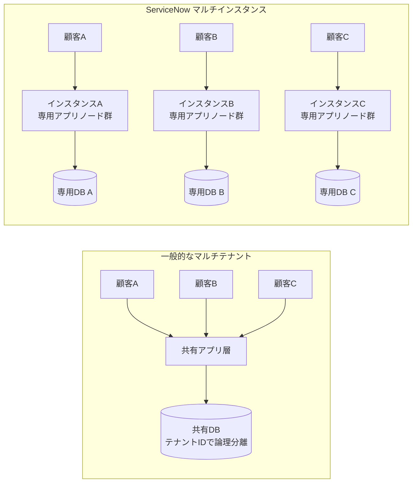
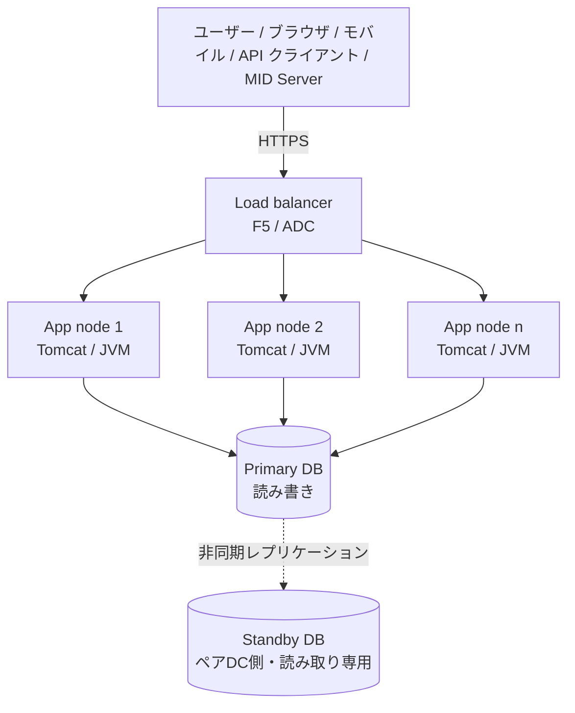
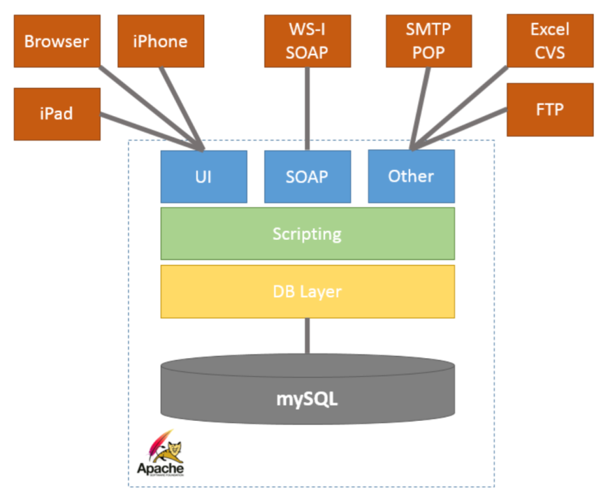
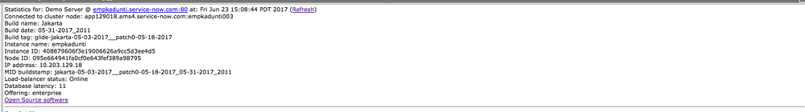
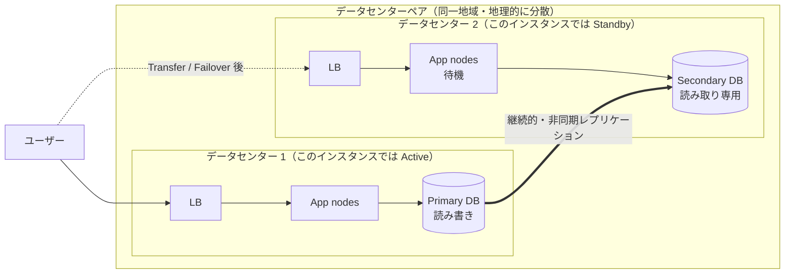
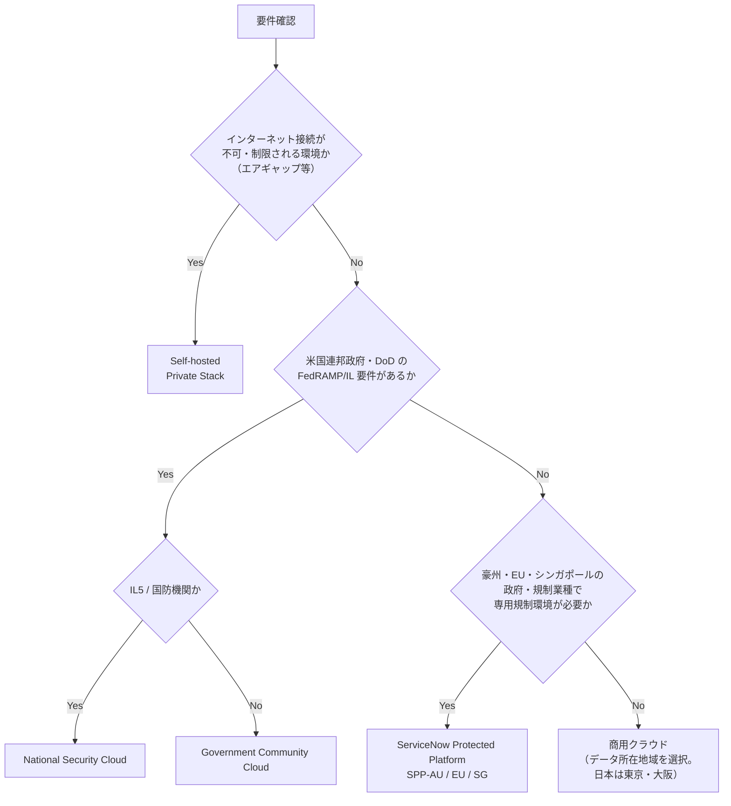
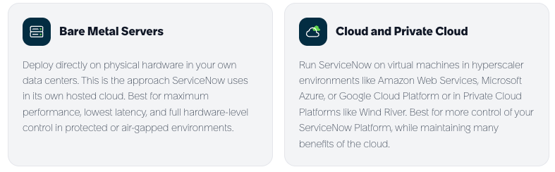
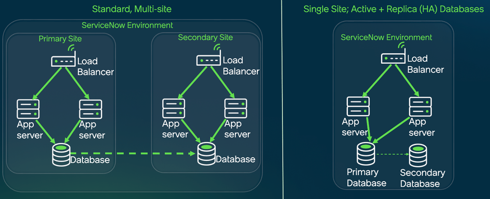
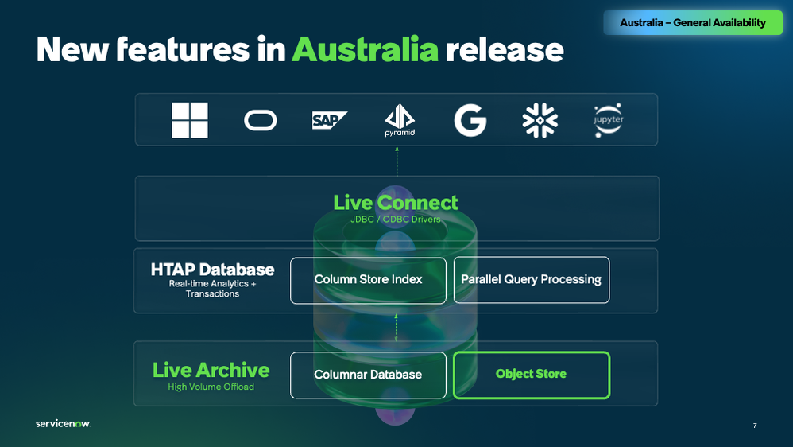

# Instance Architecture（インスタンスアーキテクチャ）

## 概要

ServiceNow は SaaS として提供され、顧客ごとに独立した **Instance（インスタンス）** を割り当てる **Multi-instance architecture（マルチインスタンスアーキテクチャ）** を採用している。各インスタンスは、ロードバランサー配下の複数の **Application node（アプリケーションノード）** と、顧客専用のデータベースで構成される。ServiceNow 運用のクラウドでは、データセンターは同一地域内で **ペア（Data center pair）** として配置され、本番インスタンスはペアの両データセンターに非同期レプリケーションされる **Advanced High Availability（AHA、高度高可用性）** 構成で稼働する。

本ファイルは次の問いに答える。

| 問い | 該当する節 |
|---|---|
| マルチインスタンスとマルチテナントは何が違うか | [2](#2-マルチインスタンスアーキテクチャmulti-instance-architecture) |
| インスタンスの中はどうなっているか（ノード、ロードバランサー、DB） | [3](#3-インスタンスの内部構成ノードとクラスタ) |
| データセンターはどこにあるか（日本DCは） | [4](#4-データセンターとリージョン) |
| HA・DR・バックアップの仕組みと RTO/RPO は | [5](#5-高可用性ahaと災害対策drバックアップ) |
| 本番／サブプロダクション／PDI の違いは | [6](#6-インスタンス種別) |
| どのような Hosting options（提供形態）があるか | [7](#7-hosting-options提供形態) |
| Self-hosted（Private Stack）で何が使えないか | [8](#8-self-hostedprivate-stack) |
| Government Community Cloud（GCC）とは | [9](#9-government-community-cloudgccと規制市場向け環境) |
| RaptorDB とは何か、Standard と Professional の差は | [10](#10-raptordb) |

> 基準リリースは Australia（2026-05 GA）。Brazil で判明している変更は「Brazil での変更」として併記する。インスタンス配置やデータセンターの物理所在地など、ServiceNow が契約者向けにのみ開示している情報（Now Support の KB、ホワイトペーパー、CORE 等）は、公開情報で確認できた範囲のみを記載する。

---

## 1. 用語の整理

インスタンスアーキテクチャに関する用語は、公式・コミュニティで表記揺れがある。本ファイルでは以下の意味で用いる。

| 用語（英語） | 日本語 | 意味 | 出典 |
|---|---|---|---|
| Instance | インスタンス | 顧客に割り当てられる、独立したアプリケーション層とデータベースを持つ ServiceNow 環境。URL は通常 `https://<インスタンス名>.service-now.com` | [出典](https://www.servicenow.com/community/now-platform-blog/13-reasons-why-the-stats-do-page-is-your-best-friend-for/ba-p/2286882) |
| Node（Server / Container） | ノード | インスタンスを構成する個々のアプリケーションサーバー（Apache Tomcat コンテナ上の JVM）。コミュニティ記事では Node・Server・Container を同義で使う | [出典](https://www.servicenow.com/community/now-platform-blog/13-reasons-why-the-stats-do-page-is-your-best-friend-for/ba-p/2286882) |
| Cluster | クラスタ | 1 インスタンスを構成するノード群。Instance と Cluster も同義で使われることがある | 同上 |
| Data center pair | データセンターペア | 同一地域内で地理的に離れた 2 つのデータセンターの組。本番データは両方に保持される | [出典](https://www.servicenow.com/community/platform-privacy-security-blog/data-backup-for-my-servicenow-instances/ba-p/2772922) |
| Advanced High Availability（AHA） | 高度高可用性 | データセンターペア間の非同期 DB レプリケーションと、Transfer／Failover による切替を中心とした可用性アーキテクチャ | 同上 |
| Production instance | 本番インスタンス | サブスクリプションを業務で実際に使用する環境 | [出典](https://www.servicenow.com/community/servicenow-ai-platform-forum/what-is-a-sub-production-instance/m-p/1005204) |
| Sub-production instance（Non-production） | サブプロダクション（非本番）インスタンス | 開発・テスト・UAT・トレーニング等、本番以外の全インスタンス。Non-production と同義 | 同上 |
| Personal Developer Instance（PDI） | 個人開発者インスタンス | developer.servicenow.com で個人が無償取得できる学習・検証用インスタンス。顧客契約のインスタンスではない | [出典](https://developer.servicenow.com/) |
| Developer Sandbox | 開発者サンドボックス | サブプロダクションインスタンス上に専用アプリノードを割り当てて作る、開発者個人用の分離環境（Zurich で一般提供（GA）。Xanadu・Yokohama では限定提供） | [出典](https://www.servicenow.com/docs/r/zurich/application-development/developer-sandboxes/sandboxes-landing.html)、[出典](https://www.servicenow.com/community/app-engine-articles/developer-sandboxes-road-to-k26-series/ta-p/3513799) |
| RaptorDB | RaptorDB | MariaDB に代わる ServiceNow の新データベース（PostgreSQL ベース。2024-05 の Knowledge 24 で発表） | [出典](https://www.servicenow.com/docs/r/q4dSP2Icgr1SFv5wanVXvQ/jdtu9CkREkfuKqRvW_YWvw)、PostgreSQL ベースである点は [出典](https://www.businesswire.com/news/home/20240508862498/en/)（公式プレスリリース "Postgres-based"）、[出典](https://www.theregister.com/2024/09/10/servicenow_xanadu_postgres_raptordb/) |

---

## 2. マルチインスタンスアーキテクチャ（Multi-instance architecture）

### 2.1 マルチインスタンスの定義

ServiceNow の Multi-instance architecture（マルチインスタンスアーキテクチャ）では、顧客ごとに**独立したアプリケーション層とデータベース**を持つインスタンスが割り当てられる。複数顧客のデータを 1 つのデータベース内で論理分離する一般的な **Multi-tenant architecture（マルチテナントアーキテクチャ）** とは異なり、顧客データは混在しない。このため、顧客単位でのフェイルオーバー、スケーリング、アップグレードの実施が可能になる。【第三者情報】MariaDB 社の事例紹介では、ServiceNow がこのモデルのために 85,000 を超える MariaDB サーバーインスタンスを運用していたと紹介されている。この数値は 2018-02 の MariaDB M|18 カンファレンスで ServiceNow が発表した **2018 年時点**の規模であり（報道によっては「85,000 データベース」と表記）、現在の規模ではない（RaptorDB 移行前の情報）。[出典](https://mariadb.com/resources/customer-stories/servicenow)、[出典](https://www.percona.com/blog/2018/09/21/this-week-in-data-with-colin-charles-53-its-mariadb-week-plus-percona-live-europe-update/)

### 2.2 マルチインスタンスの特徴と影響

| 観点 | マルチインスタンスでの扱い | 実務上の影響 |
|---|---|---|
| データ分離 | 顧客ごとに専用 DB。他顧客とデータを共有しない | データ所在地・分離要件の説明がしやすい |
| アップグレード | インスタンス単位で実施時期を選べる（サポート対象リリースの範囲内） | 本番とサブプロダクションで順次アップグレードできる。詳細は [アップグレード管理](../../03_導入編/13-upgrade-management.md) |
| 可用性 | インスタンス単位でデータセンターペア間の Transfer／Failover が可能 | 1 顧客の障害・メンテナンスが他顧客へ波及しにくい |
| カスタマイズ | インスタンスごとに独立したアプリケーション・スクリプト・設定 | 本番と非本番の間で構成の移送（Update Set／アプリ公開）が必要。[アップデートセットとクローン](./update-sets-cloning.md) |
| 環境複製 | Clone（クローン）でインスタンス間のデータ・構成を複製 | 非本番の定期リフレッシュ運用が一般的 |
| 1 社内の複数本番 | 1 社が複数の本番インスタンスを持つことも可能（契約次第） | 「シングル本番インスタンス」が推奨されることが多い【経験則】。[インスタンス戦略と環境](../../03_導入編/07-instance-strategy.md) |

> 1 つのインスタンス内で組織・顧客ごとにデータを分離したい場合は、インスタンス分割ではなく **Domain Separation（ドメインセパレーション）** を使う選択肢がある。[ドメインセパレーション](./domain-separation.md) を参照。

---

## 3. インスタンスの内部構成（ノードとクラスタ）

### 3.1 3 層構成（ロードバランサー／アプリケーションサーバー／データベース）

ServiceNow インスタンスは、**Load balancer（ロードバランサー）層**、**Application server（アプリケーションサーバー）層**、**Database（データベース）層**の 3 層で構成される。ServiceNow 自身のホスティングと同じ構成が Self-hosted（Private Stack）向けにも提供されており、Private Stack の公式紹介記事は「ロードバランサー層・アプリケーションサーバー層・データベース層という ServiceNow クラウドのアーキテクチャをミラーする」と説明している。[出典](https://www.servicenow.com/community/product-launch-blogs/private-stack-deploy-the-full-servicenow-ai-platform-on-your/ba-p/3524144)

- インスタンスは **Apache Tomcat コンテナのクラスタ**であり、**最低 2 ノード**で構成される。[出典](https://www.servicenow.com/community/now-platform-blog/13-reasons-why-the-stats-do-page-is-your-best-friend-for/ba-p/2286882)
- ユーザーがどのノードに接続するかは **F5 ロードバランサー**が決定する（同上）。【第三者情報】2020 年のコミュニティ投稿では、新しいロードバランサー技術（ADCv2）への移行に伴い、セッション Cookie 名が `BIGip...` から `adcsession` に変わると報告されている（現行仕様は公開情報で確認できず）。[出典](https://www.servicenow.com/community/developer-forum/how-does-node-assignment-work/m-p/1601693)
- 各ノードは独立した JVM であり、ログ（`localhost_log` 等）はノード単位で保存される。障害調査ではどのノードで事象が起きたかを特定することが重要になる。[出典](https://www.servicenow.com/community/now-platform-blog/13-reasons-why-the-stats-do-page-is-your-best-friend-for/ba-p/2286882)

- **キャプション:** ServiceNow ノード（Apache Tomcat コンテナ）の論理階層図。
- **画面の説明:** 上部にクライアント種別（Browser、iPad、iPhone、WS-I SOAP、SMTP/POP、Excel/CSV、FTP）が並び、それぞれがノード内の入口（UI、SOAP、Other）に接続される。その下に Scripting（スクリプト実行）層、DB Layer（データベースアクセス層）が積み重なり、最下部のデータベース（図中は「mySQL」と表記）に接続する。全体が Apache（Tomcat）のコンテナ枠で囲まれている。なお、この図は RaptorDB 導入以前（2010 年代）に作成されたもので、現在のデータベースは MariaDB または RaptorDB である（[10 章](#10-raptordb) 参照）。
- **出典:** https://www.servicenow.com/community/now-platform-blog/13-reasons-why-the-stats-do-page-is-your-best-friend-for/ba-p/2286882 （取得日: 2026-11-02）

### 3.2 ノードの確認方法（`sys_cluster_state` テーブル）

`sys_cluster_state` テーブル（ラベル：Node State）は、インスタンスに割り当てられたノードの一覧と状態を保持する。[出典](https://www.servicenow.com/community/developer-blog/servicenow-things-to-know-117-sys-cluster-state-table/ba-p/2930314)

| フィールド | 説明 | 確度 |
|---|---|---|
| `system_id` | ノード識別子（`<物理サーバー名>:<インスタンス名><番号>` 形式。例：`app129018.ams4.service-now.com:empkadunti003`） | 【第三者情報】 |
| `node_id` | ノードの一意 ID | 【第三者情報】 |
| `status` | ノードの稼働状態（例：online） | 【第三者情報】 |
| `node_type` | ノード種別 | 【第三者情報】 |
| `participation` | スケジューラー等への参加状況 | 【第三者情報】 |
| `node_stats` | ノード統計（XML） | 【第三者情報】 |
| `most_recent_message` | 直近のメッセージ | 【第三者情報】 |

※フィールド一覧は第三者が公開しているデータディクショナリのミラーに基づく。[出典](https://demo.erm4sn.com/table/100/d84e1316fc95d5a00605a336fa2c3a19) 実インスタンスの System Dictionary（[データモデルとSystem Dictionary](./data-model-dictionary.md)）で確認すること。各値（status、participation）の意味は公開情報では確認できず。

**データセンター所在の見分け方:** ServiceNow 社員のコミュニティ回答によれば、`sys_cluster_state` に表示される物理サーバー名に含まれる 3 文字のセグメント（例：`mel`）は通常、データセンター所在地の空港コードを示す。また Now Support の **KB0538621** でインスタンスの IP アドレスとデータセンター所在地を確認できる。AHA 構成の本番インスタンスでは、データセンターは Primary（プライマリ）と Standby（スタンバイ）のペアとして表示される。[出典](https://www.servicenow.com/community/architect-forum/servicenow-instance-geographic-location/m-p/2463227)

### 3.3 `stats.do`（ノード統計ページ）

`stats.do` は、現在接続しているノードの統計を表示する診断ページで、admin ロールで参照できる。アプリケーションナビゲーターで **System Diagnostics > Stats**（システム診断 > 統計）を開くか、フィルターナビゲーターに `stats.do` と入力して開く。ServiceNow のテクニカルサポートエンジニア（TSE）が多用するページである。[出典](https://www.servicenow.com/community/now-platform-blog/13-reasons-why-the-stats-do-page-is-your-best-friend-for/ba-p/2286882)

- **キャプション:** `stats.do` のセクション 1（インスタンスとノードの基本情報）。
- **画面の説明:** 「Statistics for: Demo Server @ <インスタンス>」の見出しの下に、Connected to cluster node（接続中のクラスタノード：`app129018.ams4.service-now.com:empkadunti003` の形式）、Build name / Build date / Build tag（ビルド名・日付・タグ）、Instance name、Instance ID、Node ID、IP address、MID buildstamp、Load-balancer status: Online、Database latency、Offering が縦に並ぶ。スクリーンショットは Jakarta リリース（2017 年）時点のもので、項目構成は現行リリースと異なる可能性がある。
- **出典:** https://www.servicenow.com/community/now-platform-blog/13-reasons-why-the-stats-do-page-is-your-best-friend-for/ba-p/2286882 （取得日: 2026-11-02）

`stats.do` の主なセクション（コミュニティ記事による 13 区分）：

| # | セクション | 内容 |
|---|---|---|
| 1 | インスタンス／ノード基本情報 | インスタンス名、ビルド情報、MID Server ビルド、F5 ロードバランサー状態、アプリサーバー名、ノード名 |
| 2 | Memory | Tomcat コンテナの最大／現在割当、使用中、空きメモリ |
| 3 | Servlet statistics | キャッシュフラッシュ回数、トランザクション数、エラー、キャンセル、ログインセッション、最大同時セッション、稼働時間等 |
| 4 | Semaphores | 同時にノード資源へアクセスできるスレッド数。Default、Debug、AMB_Received、AMB_Send、API_INT、Presence 等のセグメント |
| 5 | OS | OS 情報 |
| 6〜8 | Response time 等 | ノードの応答時間統計、DB 接続プール |
| 9 | Database | DB 名とオンライン状態 |
| 10 | Background scheduler | バックグラウンドのスケジュールジョブ。暴走ジョブは **User Administration > All Active Transactions** から Kill 可能 |
| 11 | Progress workers | インポート／エクスポート、Update Set コミット等のバックグラウンド処理 |
| 12 | DB Lazy Writer | バックグラウンドの挿入・更新・削除処理 |
| 13 | Sessions | ログイン中セッション数（詳細は **User Administration > Logged in users**） |

[出典](https://www.servicenow.com/community/now-platform-blog/13-reasons-why-the-stats-do-page-is-your-best-friend-for/ba-p/2286882)

- `stats.do` は**接続中の 1 ノード**の情報しか表示しない。全ノードを横断して見る標準ビューはなく、他ノードの値を見るにはそのノードに接続し直す必要があると報告されている。【第三者情報】[出典](https://www.servicenow.com/community/servicenow-ai-platform-forum/how-can-i-see-statistics-xmlstats-do-stats-do-for-all-my-nodes/m-p/1155773) ノード単位のメトリクスを時系列で見るには **Application Insights**（Node stats テーブルを利用）を使う。[出典](https://www.servicenow.com/docs/r/fBdxWC~8p08POQuUubVDig/hyfKrI6JDCCmR4uhzkZcFg)
- セマフォ設定の変更は TSE に相談のうえで行うよう推奨されている。[出典](https://www.servicenow.com/community/now-platform-blog/13-reasons-why-the-stats-do-page-is-your-best-friend-for/ba-p/2286882)
- パフォーマンス診断の詳細は [パフォーマンスチューニング](../../04_応用編/03-performance-tuning.md)、システム診断画面全般は [システム管理](./system-administration.md) を参照。

### 3.4 ノード数・サイジング

- 顧客インスタンスのノード数・スペックは ServiceNow が利用規模に応じて決定・運用する。ノード数の増設は顧客が直接操作するものではなく、Now Support 経由で相談する。【経験則】
- ノード数の算定基準やノードあたりのセッション上限などの数値は公開情報では確認できず。
- Developer Sandbox は「専用アプリノード」を割り当てる方式であり、ノードがインスタンスの拡張単位であることを示している（[6.4](#64-developer-sandbox) 参照）。

---

## 4. データセンターとリージョン

### 4.1 データセンターペアの考え方

ServiceNow 運用クラウドのデータセンターは、**同一地域内の地理的に離れた 2 拠点をペア**とした構成で配置される。[出典](https://www.servicenow.com/community/platform-privacy-security-blog/data-backup-for-my-servicenow-instances/ba-p/2772922)

- 顧客の本番データはペアの**両データセンターに同時に保持**され、非同期 DB レプリケーションで同期される（同上）。
- ペア内の各データセンターは常時稼働（active-active）しており、**各データセンターがペア全体の本番負荷を単独で処理できる**能力を持つ。[出典](https://www.servicenow.com/community/developer-articles/servicenow-datacenters/ta-p/2330303)
- インスタンス単位で見ると、一方が Active（読み書き）、他方が Standby（読み取り専用）である。ある顧客はデータセンター 1 側が Primary、別の顧客はデータセンター 2 側が Primary、というようにペア内で分散配置される（同上）。
- ある地域ペア内で顧客インスタンスの「固定の Primary 拠点」は存在しない（ServiceNow 社員ブログ）。[出典](https://www.servicenow.com/community/platform-privacy-security-blog/data-backup-for-my-servicenow-instances/ba-p/2772922)
- インスタンスをホストするデータセンターの地域は、契約（Order Form）で指定された地域に基づく。【第三者情報】[出典](https://www.lawinsider.com/clause/data-centers/_1)

### 4.2 データセンター数の推移

データセンター数・ペア数は時期と出典によって異なる。最新の公式数値は公開情報では確認できず。

| 時期 | 内容 | 出典の種類 |
|---|---|---|
| 2015 年頃 | 8 つの地域にペアで配置 | 報道【第三者情報】[出典](https://siliconangle.com/?p=228172) |
| 2018-08（コミュニティ記事） | 8 ペア（計 16 データセンター）、6 サポートセンター、5 大陸（アジア、オーストラリア、欧州、北米、南米） | コミュニティ記事 [出典](https://www.servicenow.com/community/developer-articles/servicenow-datacenters/ta-p/2330303) |
| 2018-10 | 日本（東京・大阪）のデータセンター開設を発表 | 報道 [出典](https://atmarkit.itmedia.co.jp/ait/articles/1810/19/news068.html) |
| 2020-06 | 欧州で英国ソブリンペア（London／Newport）と EU ソブリンペア（Amsterdam／Dublin）を追加し、**全世界で 11 ペア・5 大陸**に | 公式プレスリリース [出典](https://newsroom.servicenow.com/press-releases/details/2020/ServiceNow-Boosts-Data-Centre-Capacity-in-Europe-06-25-2020-12-00-AM/default.aspx)、Business Wire 掲載版 [出典](https://www.businesswire.com/news/home/20200625005133/en/ServiceNow-Boosts-Data-Centre-Capacity-in-Europe) |
| 2022-03 | インド（Mumbai／Bengaluru）に 2 拠点を開設 | 報道【第三者情報】[出典](https://prnewswire.com/in/news-releases/servicenow-opens-two-india-based-data-centres-in-response-to-strong-customer-growth-858798874.html) |
| 2024（LEAP 24） | サウジアラビアに国内データセンターペアの設置計画を発表。2025-02 の報道では 2026 年開設予定 | 報道【第三者情報】[出典](https://www.arabnews.pk/node/2589702) |

※2020 年のプレスリリースは ServiceNow newsroom から直接取得できなかった（HTTP 403）。Business Wire に掲載された同じリリース（2020-06-25、[出典](https://www.businesswire.com/news/home/20200625005133/en/ServiceNow-Boosts-Data-Centre-Capacity-in-Europe)）の内容で確認した。

### 4.3 地域一覧（参考）

2023-01 の ServiceNow Community 投稿では、選択可能なデータセンター地域として次が挙げられている。【第三者情報】（ServiceNow 社員ではない投稿者が、ServiceNow 提供の資料（standard documents）とされる一覧を引用したもの。原典の資料は未確認）[出典](https://www.servicenow.com/community/architect-forum/servicenow-instance-geographic-location/m-p/2463227)

| 地域 | 国・エリア |
|---|---|
| North America | Canada（北米では Canada が既定とされる）、United States |
| South East Asia | South Korea、Singapore |
| Europe | Germany、Switzerland、Netherlands、Ireland |
| U.K. | England and Wales |
| その他 | Japan、Australia、Brazil、India |

- 中国本土のデータセンターについては、同スレッドで質問されているが回答はなく、公開情報では確認できず。
- 最新かつ正式な地域一覧は ServiceNow の Trust Center、ホワイトペーパー、またはアカウントチームで確認する必要がある。

### 4.4 日本のデータセンター（東京・大阪）

| 項目 | 内容 | 出典 |
|---|---|---|
| 発表 | 2018-10（ServiceNow Japan と NTT コミュニケーションズの協業） | [出典](https://atmarkit.itmedia.co.jp/ait/articles/1810/19/news068.html)、[出典](https://www.voicendata.com/servicenow-partners-ntt-communications-establish-cloud-service-data-centers-japan/) |
| 所在地 | 東京と大阪のペア | 同上、[出典](https://www.servicenow.com/community/architect-forum/servicenow-instance-geographic-location/m-p/2463227) |
| 設備 | NTT コミュニケーションズの「Nexcenter」データセンターサービスを利用 | [出典](https://atmarkit.itmedia.co.jp/ait/articles/1810/19/news068.html) |
| サービス開始 | 2019 年春 | 同上 |
| 目的 | Now Platform 上の全サービスを国内でデータ保持したまま利用可能にする（データの国内保持要件への対応） | 同上 |

- 日本の顧客は、契約時に日本のデータセンターペアを指定することで、本番データおよびバックアップを国内（東京・大阪ペア内）に保持できる。バックアップは「インスタンスをホストするのと同じデータセンターペア内」に保管される（[5.4](#54-バックアップ) 参照）。
- 日本 DC で利用できない機能（例：一部の生成 AI 処理が地域外の LLM 基盤を使う場合など）の有無は製品ごとに異なる。生成 AI のデータ処理地域については [Now Assist と AI Agents](./now-assist-ai-agents.md) を参照。日本 DC 固有の機能制約の一覧は公開情報では確認できず。
- 日本市場向けの導入上の論点は [日本市場における導入](../../03_導入編/15-japan-market.md) を参照。

### 4.5 データセンターペア間のインスタンス移動

ServiceNow 社員のコミュニティ回答（2023-02）によると、インスタンスを別のデータセンターペアへ移動することは可能だが、次の条件・手順を伴う。[出典](https://www.servicenow.com/community/architect-forum/servicenow-instance-geographic-location/m-p/2463227)

1. 回答ではプロビジョニング後・本番稼働前（go-live 前）の移動依頼が例示されているが、稼働中（live）のインスタンスも対象となり得る。その場合は最大 1 時間程度のダウンタイムを前提に事前計画が必要とされる（手順 5 参照）。
2. アカウント担当（営業）またはソリューションコンサルタント経由で依頼する。**費用が発生する場合がある**。
3. 営業承認後、カスタマーサポートでケースが起票され、インフラチームが移動を実施する。
4. 移動先ペアにインスタンスをリストアしてレプリケーションを設定し、変更ウィンドウ開始時に移動元を停止、レプリケーション追いつき後に移動先で起動する。
5. 長いリードタイムと計画が必要で、**ダウンタイムは最大 1 時間程度**。稼働中のインスタンスであれば事前に計画すること（"plan this in advance if it is a live instance"）。

---

## 5. 高可用性（AHA）と災害対策（DR）・バックアップ

### 5.1 Advanced High Availability（AHA）の構成

**Advanced High Availability（AHA）** は、ServiceNow 運用クラウドにおける本番インスタンスの可用性アーキテクチャである。

| 要素 | 内容 | 出典 |
|---|---|---|
| ペア構成 | データセンターをペアで配置し、全本番データを両データセンターで同時にホスト | [出典](https://www.servicenow.com/community/platform-privacy-security-blog/data-backup-for-my-servicenow-instances/ba-p/2772922) |
| レプリケーション | Primary（読み書き）DB から Secondary（読み取り専用）DB への**継続的・非同期**レプリケーション | 同上、[出典](https://www.servicenow.com/community/developer-articles/servicenow-datacenters/ta-p/2330303) |
| 拠点の役割 | 地理的に分散した 2 拠点が active-active。インスタンス単位では Active／Standby | 同上、[出典](https://www.servicenow.com/docs/r/zS6yb8e~gR8BPjeviYdV9g/KufA2mI6WfAIsf2ymqoWdg) |
| 切替方式 | **Transfer**（計画的な役割入れ替え）と **Failover**（障害時の切替） | [出典](https://www.servicenow.com/community/platform-privacy-security-blog/data-backup-for-my-servicenow-instances/ba-p/2772922) |
| インフラ冗長 | 冗長化されたコンポーネントと複数のネットワーク経路で単一障害点を排除 | 同上 |
| ネットワーク | 各インスタンスはインターネットへの複数接続を持つマルチホーム構成 | 【第三者情報】[出典](https://m.e-book.qq.com/read/1036700721/38) |

**Transfer の用途:** Transfer は、ペア内の Primary と Secondary の役割を入れ替える計画的な切替である（「secondary を primary に、primary を secondary に指定する」）。なお、このコミュニティ記事（2018-08）は Standby という語を使わず、Secondary を「読み取り専用（read-only）」の DB と表現している。本ファイルでいう Standby は、インスタンス単位で見た Secondary 側を指す。[出典](https://www.servicenow.com/community/developer-articles/servicenow-datacenters/ta-p/2330303) Transfer をどのような契機（計画メンテナンス等）で実施するかの公式な説明は、公開情報では確認できず。

### 5.2 RTO・RPO・可用性 SLA

| 指標 | 値 | 出典・確度 |
|---|---|---|
| RTO（目標復旧時間） | **2 時間** | ServiceNow 社員によるコミュニティブログ [出典](https://www.servicenow.com/community/platform-privacy-security-blog/data-backup-for-my-servicenow-instances/ba-p/2772922) |
| RPO（目標復旧時点） | **1 時間** | 同上 |
| 可用性 SLA | 本番インスタンスで暦月あたり **99.8%**（契約上の Availability SLA） | 同上 |
| DR テスト | ISCP（Cloud DRP）テストを**年 1 回**実施。SOP とテストレポートは CORE で提供。結果は RTO/RPO 目標を一貫して大きく上回る | 同上 |

- 上記数値は契約（Subscription Service Guide 等）で規定されるものであり、契約形態・時期により異なる可能性がある。自社契約の条件を必ず確認する。
- 可用性 SLA の算定除外（計画メンテナンス等）の詳細は公開情報では確認できず。サポート・監視の運用は [サポートと監視](../../03_導入編/14-support-monitoring.md) を参照。

### 5.3 AHA と Hermes（Kafka）クラスタ

**Hermes** は、Stream Connect、LES、Instance Data Replication（IDR）を有効化した際にプロビジョニングされる Kafka ベースのメッセージング基盤で、AHA と連動する。[出典](https://www.servicenow.com/docs/r/zS6yb8e~gR8BPjeviYdV9g/KufA2mI6WfAIsf2ymqoWdg)（Zurich ドキュメント）

| 項目 | 内容 |
|---|---|
| クラスタ配置 | ペアの両データセンターに 1 つずつ Kafka クラスタ（active/active ペア） |
| Near cluster | インスタンスと同じデータセンターのクラスタ |
| Far cluster | ペア相手側データセンターのクラスタ |
| 通常時 | インスタンス／外部クライアントは Near cluster に Produce。トピックは両クラスタに作成。Consumer は 2 つ動くが、処理するのは Near 側のみ |
| ポート | 外部 Producer のブートストラップ URL は 400x 番台、Consumer は 410x／420x 番台 |
| AHA Transfer 時 | インスタンスは新たに Active になったデータセンターの Hermes クラスタを使用 |
| Hermes Failover | Near cluster の異常を検知すると Far cluster へ Produce し、回復後に Near へ戻る。遅延している Consumer がある場合、追いつくまで両 Consumer が処理する可能性がある |
| 順序保証 | メッセージ順序の維持は Consumer アプリケーション側の責任 |

### 5.4 バックアップ

ServiceNow は**バックアップをクラウドサービスの耐障害性（DR）の手段としては用いない**。DR は AHA が担い、バックアップは誤削除や、連携・自動化の誤設定／誤動作からのデータ復旧のために存在する。[出典](https://www.servicenow.com/community/platform-privacy-security-blog/data-backup-for-my-servicenow-instances/ba-p/2772922)

| 項目 | 内容 | 出典・確度 |
|---|---|---|
| 取得頻度 | 週次フルバックアップ＋日次差分バックアップ | ServiceNow 社員ブログ [出典](https://www.servicenow.com/community/platform-privacy-security-blog/data-backup-for-my-servicenow-instances/ba-p/2772922) |
| 保持期間 | 最低 **14 日**。**28 日**の延長保持をオプション購入可 | 同上 |
| 暗号化 | AES-256 で暗号化しディスクへ書き込み | 同上 |
| 保管場所 | インスタンスをホストする**同じデータセンターペア内**のオンサイトのみ。オフサイト転送なし、第三者事業者の関与なし | 同上 |
| 一覧確認 | Now Support の「List of backups for the instance」カタログアイテムで利用可能なバックアップと作成日時を確認 | 【第三者情報】[出典](https://www.servicenow.com/community/now-platform-articles/list-of-available-instance-backups/ta-p/2957002) |
| リストア（サブプロダクション） | Now Support の Automation Store のカタログアイテムから実施可能 | 同上 |
| リストア（本番） | サポートケースを起票して依頼。本番インスタンスはカタログの「Instance Restore」のターゲットにできない | 【第三者情報】同上、[出典](https://www.servicenow.com/community/developer-forum/rollback-clone/m-p/2233489) |

- 【第三者情報】古い書籍では「4 週分のフルバックアップ＋直近 6 日分の差分で計 28 日」との記述があるが、上記の公式社員ブログ（最低 14 日、28 日はオプション）と食い違う。本ファイルは公式社員ブログを優先する。[出典](https://m.e-book.qq.com/read/1036700721/38)
- 特定レコードの復元には、バックアップリストアよりも、削除レコードの復元機能（Deleted Records／Rollback Contexts）を先に検討するのが一般的。【経験則】詳細は [システム管理](./system-administration.md) を参照。
- 長期保管・法的保全目的で、外部へのデータ複製（サードパーティのバックアップ製品や IDR、エクスポート）を併用する顧客もいる。【経験則】

### 5.5 サブプロダクションの可用性

ServiceNow 社員のコミュニティ回答によれば、**サブプロダクションインスタンスには本番インスタンスと同等の完全な AHA 構成は含まれない**。[出典](https://www.servicenow.com/community/servicenow-ai-platform-forum/what-is-a-sub-production-instance/m-p/1005204) 可用性 SLA（99.8%）も本番インスタンスを対象とする。[出典](https://www.servicenow.com/community/platform-privacy-security-blog/data-backup-for-my-servicenow-instances/ba-p/2772922)

### 5.6 顧客側の責任範囲（DR 観点）

| 領域 | ServiceNow の責任 | 顧客の責任 |
|---|---|---|
| インフラ・DB の冗長化 | AHA、ペア間レプリケーション、Transfer／Failover | ― |
| バックアップ取得 | 週次フル＋日次差分、14 日保持 | 延長保持の要否判断、必要に応じた独自エクスポート |
| 論理障害（誤更新・誤削除） | バックアップからのリストア支援 | 原因特定、リストア判断、復元範囲の決定 |
| 連携先・MID Server | ― | MID Server の冗長化（複数 MID）、連携先システム側の DR。[MID Server](./mid-server.md) |
| SSO・IdP | ― | IdP 障害時の代替ログイン手段（ローカル admin 等）。[認証とSSO](./authentication-sso.md) |
| 運用手順 | 計画メンテナンスの通知 | 通知の受信体制、業務継続計画（BCP） |

※この表は公式の責任分界表ではなく、上記公式情報をもとに整理したもの。【推定】

---

## 6. インスタンス種別

### 6.1 種別一覧

| 種別 | 用途 | 取得方法 | AHA | 備考 |
|---|---|---|---|---|
| Production（本番） | 業務利用 | サブスクリプション契約 | あり（完全な AHA） | 可用性 SLA 99.8%/月の対象 |
| Sub-production（サブプロダクション／非本番） | 開発、テスト、UAT、トレーニング等 | サブスクリプションに 1 つ以上含まれる。追加は有償 | 完全な AHA ではない | Non-production と同義 |
| Personal Developer Instance（PDI） | 個人の学習・検証 | developer.servicenow.com で無償 | ― | 顧客契約外。一定期間未使用で回収される。業務データの投入は不可【経験則】 |
| Developer Sandbox | 開発者ごとの分離開発環境 | ライセンス機能（ServiceNow Store アプリ、アカウントマネージャー経由で導入）。サブプロダクション上に作成 | ― | 1 インスタンスあたり最大 30。Zurich で GA |
| Demo / Training 等 | パートナーのデモ、教育 | 契約・プログラムによる | ― | 詳細は公開情報では確認できず |

出典：[本番・サブプロダクション](https://www.servicenow.com/community/servicenow-ai-platform-forum/what-is-a-sub-production-instance/m-p/1005204)、[Developer Sandbox](https://www.servicenow.com/community/app-engine-articles/developer-sandboxes-road-to-k26-series/ta-p/3513799)、[PDI](https://developer.servicenow.com/)

### 6.2 本番インスタンス（Production instance）

- 本番インスタンスは、サブスクリプションを組織の業務で実際に利用する環境である。[出典](https://www.servicenow.com/community/servicenow-ai-platform-forum/what-is-a-sub-production-instance/m-p/1005204)
- 本番インスタンスのみが完全な AHA 構成と 99.8% の可用性 SLA の対象となる（[5 章](#5-高可用性ahaと災害対策drバックアップ) 参照）。
- 本番インスタンスへの直接開発は避け、サブプロダクションで開発・テストしたうえで移送するのが標準的な運用である。【経験則】

### 6.3 サブプロダクションインスタンス（Sub-production instance）

- サブプロダクションは、本番以外のすべてのインスタンス（開発、テスト、UAT、トレーニング等）を指し、Non-production と同義である。[出典](https://www.servicenow.com/community/incident-management-forum/differences-between-non-production-and-sub-production-instances/m-p/2413712)
- 顧客はサブスクリプションを購入すると 1 つ以上のサブプロダクションインスタンスの権利を得る（ServiceNow 社員回答）。[出典](https://www.servicenow.com/community/servicenow-ai-platform-forum/what-is-a-sub-production-instance/m-p/1005204)
- 【第三者情報】標準で含まれる数を超える追加インスタンスは有償となる。[出典](https://itsmnegotiations.pages.dev/blog/servicenow-sandbox-and-non-production-instance-costs) 含まれる数は契約により異なり、公開情報で標準数は確認できず。
- 典型的な環境構成（Dev → Test → Prod の 3 面構成など）とクローン戦略は [インスタンス戦略と環境](../../03_導入編/07-instance-strategy.md) と [アップデートセットとクローン](./update-sets-cloning.md) を参照。

### 6.4 Developer Sandbox

**Developer Sandbox（開発者サンドボックス）** は、既存のサブプロダクションインスタンスの上に**専用のアプリノード**を割り当てて作る、開発者個人用の分離開発環境である（Zurich で一般提供（GA）。公式ドキュメントでは Xanadu・Yokohama では限定提供（limited availability）とされ、Yokohama 以降での利用が目安とされている）。[出典](https://www.servicenow.com/docs/r/zurich/application-development/developer-sandboxes/sandboxes-landing.html)、[出典](https://www.servicenow.com/docs/r/u1slaAtcFiiXFQcd9RcR_A/ZQUHhCMbEepkvIztpLv8aA)、[出典](https://www.servicenow.com/community/app-engine-articles/developer-sandboxes-road-to-k26-series/ta-p/3513799)

| 項目 | 内容 |
|---|---|
| 分離範囲 | メタデータ（Business Rule、スクリプト、UI Policy、構成）の変更はプッシュするまでサンドボックス内に閉じる |
| 共有範囲 | トランザクションデータ（Incident、Problem、Case 等）は全サンドボックスとベースインスタンスで共有（DB を共有） |
| URL | サンドボックスごとに独自 URL |
| 上限 | 1 インスタンスあたり同時に最大 **30** サンドボックス |
| プロビジョニング時間 | 小規模インスタンスで約 10 分、大規模サブプロダクションで 2 時間超。30〜60 分を見込むことが推奨 |
| 対象外 | PDI では利用不可 |
| ライセンス | ライセンス機能。ServiceNow Store で配布されるアプリケーションで、インストールは ServiceNow のアカウントマネージャーに依頼する（Zurich リリースノート）。[出典](https://www.servicenow.com/docs/r/u1slaAtcFiiXFQcd9RcR_A/ZQUHhCMbEepkvIztpLv8aA) |
| ロール | Admin（割当・廃止）、Delegated Developer（要求・割当・廃止）、Sandbox Manager（全サンドボックスのライフサイクル管理。admin 権限不要）、Sandbox User（要求・閲覧） |
| 管理画面 | Sandbox Management Home ダッシュボード（所有者、最終アクセス、状態） |
| ワークフロー | 割当 → 分離環境で開発・テスト → Git または Update Set でプッシュ → 廃止（ノードはプールに返却） |

※Developer Sandbox は Self-hosted（Private Stack）では利用できない（[8.4](#84-private-stack-の機能可用性australia-時点)）。アプリ開発の詳細は [アプリケーション開発](./app-development.md) を参照。ロールの正式な内部名（`sn_...` 形式）は公開情報では確認できず。

---

## 7. Hosting options（提供形態）

### 7.1 提供形態一覧

ServiceNow の提供形態（Hosting options）は、運用主体と対象市場により次のように分類できる。

| 提供形態 | 運用主体 | 主な対象 | 概要 | 出典 |
|---|---|---|---|---|
| 商用クラウド（ServiceNow 運用データセンター） | ServiceNow | 一般企業（既定） | ServiceNow 自社データセンターのペア構成。AHA。日本は東京・大阪 | [4 章](#4-データセンターとリージョン) |
| ハイパースケーラー上の ServiceNow 運用クラウド（Microsoft Azure） | ServiceNow | 規制業種・公共（特定地域） | 2019 年に Azure を「優先（ただし排他ではない）クラウド」とし、豪州と米国 Azure Government から提供開始を発表。2021 年にフランス・シンガポールの Azure リージョンでの提供を発表 | 【第三者情報】[出典](https://datacenternews.asia/story/servicenow-moves-saas-solution-in-us-australia-to-microsoft-azure)、[出典](https://www.servicenow.com/company/media/press-room/servicenow-microsoft-for-singapore-regulated-industries.html) |
| ServiceNow Protected Platform（SPP-AU／SPP-EU／SPP-SG） | ServiceNow | 豪州・EU・シンガポールの政府・規制業種 | 地域のデータ主権要件向けの規制環境。独立した ServiceNow Store インスタンスを持つ | [出典](https://www.servicenow.com/docs/r/fBdxWC~8p08POQuUubVDig/YuAJRohMzb~AhTLgq_w_mA) |
| Government Community Cloud（GCC） | ServiceNow | 米国連邦政府・関連組織 | FedRAMP High、DoD IL4 | [9 章](#9-government-community-cloudgccと規制市場向け環境) |
| National Security Cloud（NSC） | ServiceNow | 米国国防・国家安全保障機関 | DoD IL5 | 同上 |
| Self-hosted（製品名 Private Stack。Self-hosted の旧称は on-premise） | 顧客またはパートナー | エアギャップ環境、データ主権、遠隔拠点 | 顧客のインフラに ServiceNow ソフトウェアを導入 | [8 章](#8-self-hostedprivate-stack) |

- 規制環境（GCC、NSC、SPP-AU、SPP-EU、SPP-SG）は、データセキュリティ要件のため**独立した ServiceNow Store インスタンス**を持つ。自環境に専用 Store がない場合は商用 ServiceNow Store を利用する。（Australia ドキュメント、2026-03-12 更新）[出典](https://www.servicenow.com/docs/r/fBdxWC~8p08POQuUubVDig/YuAJRohMzb~AhTLgq_w_mA)
- ServiceNow Protected Platform: Australia は、2022 年に豪州政府・規制業種向けに提供開始され、Microsoft Azure 上で稼働し、豪州信号局（ASD）の Information Security Manual に沿って設計されたと報じられている。【第三者情報】[出典](https://www.intelligentcio.com/apac/2022/06/09/major-australian-government-department-improves-corporate-services-for-4000-employees-with-servicenow/) SPP-EU、SPP-SG の提供開始時期・詳細は公開情報では確認できず。
- 日本向けの規制環境（日本版 Protected Platform 等）の存在は、公開情報では確認できず。日本の政府機関向けクラウド認定（ISMAP）の登録状況は [セキュリティとコンプライアンス](../../03_導入編/10-security-compliance.md) を参照。
- 提供形態ごとに利用可能な機能・アプリケーション・リリース提供時期が商用クラウドと異なる場合がある。契約前に対象環境での提供可否を確認する。【経験則】

### 7.2 提供形態の選択フロー（参考）

※このフローは公開情報から整理した参考図であり、ServiceNow の公式な選定基準ではない。【推定】

---

## 8. Self-hosted（Private Stack）

### 8.1 Private Stack の位置付け

**Private Stack（プライベートスタック）** は、ServiceNow の顧客・パートナー運用型の提供形態である **Self-hosted（セルフホスト）** の製品名として紹介されている（記事見出し「Introducing Private Stack: ServiceNow's Self-Hosted Deployment」）。Self-hosted は旧称 **On-premise（オンプレミス）** であり、Self-hosted 自体は現役の呼称として使われている。Self-hosted から Private Stack への名称変更を告げる公式発表の有無は、公開情報では確認できず。Private Stack は商用クラウドと**同じアプリケーションソフトウェア**を顧客のインフラ上に展開する。2026-04-30 付の ServiceNow 社員による公式紹介記事では、防衛、政府、銀行、通信、テクノロジー分野で、28 か国に顧客基盤があると紹介されている（"Our Self-Hosted customer base spans 28 countries"）。顧客数は公開情報では確認できず。[出典](https://www.servicenow.com/community/product-launch-blogs/private-stack-deploy-the-full-servicenow-ai-platform-on-your/ba-p/3524144)

主な用途（同記事より）：

| 用途 | 説明 |
|---|---|
| データ主権の義務 | すべてのデータを特定法域内に保持する必要がある規制業種・国 |
| 遠隔・エッジ拠点 | エネルギー、鉱業、製造、フィールド業務など、クラウド接続が保証されない拠点 |
| コンプライアンス制約環境 | 第三者クラウド基盤を経由したデータ転送を禁じる銀行、医療、公共機関。エアギャップ環境を含む |

### 8.2 責任分界

| 領域 | ServiceNow | 顧客／パートナー |
|---|---|---|
| アプリケーションソフトウェア | 提供（商用クラウドと同一） | 導入・運用 |
| 展開ガイダンス・リファレンスアーキテクチャ | 提供（DR・バックアップのリファレンスアーキテクチャを含む） | 設計・構築 |
| アップグレードパッケージ | 提供（ファミリーリリースのファイルは商用クラウドと同日に提供） | 適用 |
| サポート | 提供 | ― |
| ハードウェア、DB、ロードバランサー、ネットワーク、OS | ― | 所有・管理 |
| HA・DR | リファレンスアーキテクチャの提供 | 自前で構築・運用 |

[出典](https://www.servicenow.com/community/product-launch-blogs/private-stack-deploy-the-full-servicenow-ai-platform-on-your/ba-p/3524144)

- 商用クラウドには HA・DR が組み込まれているが、Self-hosted ではそれらを自ら構築する必要がある。【第三者情報】[出典](https://www.logiq.co.uk/insights/saas-or-self-hosted-servicenow-strategy/)
- 導入にあたっては有償の ServiceNow ワークショップ（アーキテクチャ計画、ハードウェアサイジング、データベース選定、周辺コンポーネント展開、運用準備）の購入が想定されている。導入の入口はアカウントチームである。[出典](https://www.servicenow.com/community/product-launch-blogs/private-stack-deploy-the-full-servicenow-ai-platform-on-your/ba-p/3524144)

### 8.3 展開方式とアーキテクチャ

- **キャプション:** Private Stack の 2 つの展開方式。
- **画面の説明:** 左のカード「Bare Metal Servers」は、自社データセンターの物理ハードウェアに直接展開する方式で、ServiceNow 自身のホスティングと同じアプローチであり、最大性能・最低遅延・ハードウェアレベルの完全な制御が必要な保護環境／エアギャップ環境に最適と説明されている。右のカード「Cloud and Private Cloud」は、Amazon Web Services、Microsoft Azure、Google Cloud Platform などのハイパースケーラー環境、または Wind River のようなプライベートクラウド基盤の仮想マシン上で稼働させる方式で、クラウドの利点を保ちつつ制御性を高めたい場合に向くと説明されている。
- **出典:** https://www.servicenow.com/community/product-launch-blogs/private-stack-deploy-the-full-servicenow-ai-platform-on-your/ba-p/3524144 （取得日: 2026-11-02）

- **キャプション:** Private Stack の代表的な構成パターン 2 種。
- **画面の説明:** 左の「Standard, Multi-site」では、ServiceNow Environment 内に Primary Site と Secondary Site があり、各サイトに Load Balancer → App server 2 台 → Database が配置され、Primary Site の Database から Secondary Site の Database へ破線矢印（レプリケーション）が引かれている。右の「Single Site; Active + Replica (HA) Databases」では、1 サイト内に Load Balancer → App server 2 台 → Primary Database があり、Primary Database から Secondary Database へ破線矢印（レプリカ）が引かれている。商用クラウドの AHA に相当する構成を、顧客がマルチサイトまたは単一サイトで構築することを示している。
- **出典:** https://www.servicenow.com/community/product-launch-blogs/private-stack-deploy-the-full-servicenow-ai-platform-on-your/ba-p/3524144 （取得日: 2026-11-02）

- 具体的にサポートされるハードウェア、OS、データベースのバージョンは同記事には記載がなく、公開情報では確認できず。
- RaptorDB の Self-hosted 環境サポートは **RaptorDB Professional のみ**の機能として記載されている（[10.3](#103-raptordb-standard-と-professional-の比較australia)）。

### 8.4 Private Stack の機能可用性（Australia 時点）

公式紹介記事は、Australia リリース時点で次の機能可用性を示している。完全なマトリクスは Now Support のナレッジベースで提供され、ファミリーリリース GA ごとに更新される。**すべての機能が商用リリースと同等ではない**。[出典](https://www.servicenow.com/community/product-launch-blogs/private-stack-deploy-the-full-servicenow-ai-platform-on-your/ba-p/3524144)

| 利用可能 | 利用不可 |
|---|---|
| Now Assist | Instance Clone（手動の代替手段あり） |
| AI Agents と Knowledge Graph（Zurich 以降） | Instance Data Replication（IDR） |
| AI Search と Predictive Intelligence | Cloud Encryption（ServiceNow Vault） |
| RPA、Process Mining、Automation Center | AI Gateway |
| Security Incident Response と Threat Intelligence | Dynamic Translation |
| Field Encryption と Key Management Framework | Workflow Data Fabric コネクター（Zero Copy Connectors、External Content Connectors） |
| Automated Upgrades（インターネット接続環境） | Impact - Instance Observer |
| Health Log Analytics（Yokohama 以降） | ServiceNow IDE／Developer Sandboxes |
| ServiceNow Store からのアプリダウンロード | Virtual Agent のサードパーティ連携（Teams、Slack 等） |

### 8.5 Private Stack における生成 AI

| 項目 | 内容 |
|---|---|
| 対象製品 | ITSM、CSM、ITOM、HRSD、SecOps、FSM、SPM など |
| LLM の選択肢 | ①顧客所有の GPU 基盤上で ServiceNow の本番 LLM を稼働 ②Bring Your Own Key（Azure OpenAI、AWS 上の Anthropic、Google Gemini） ③顧客提供の LLM（体験は限定的） |
| 更新頻度 | Self-hosted 向け GenAI イメージは年 2 回更新 |
| データ共有 | 既定で無効 |
| AI Agents | Zurich 以降でサポート |
| 課金 | Now Assist のクレジットは商用 SaaS と同じ価格モデル |

[出典](https://www.servicenow.com/community/product-launch-blogs/private-stack-deploy-the-full-servicenow-ai-platform-on-your/ba-p/3524144)

生成 AI 機能の詳細は [Now Assist と AI Agents](./now-assist-ai-agents.md) を参照。

---

## 9. Government Community Cloud（GCC）と規制市場向け環境

### 9.1 Government Community Cloud（GCC）

**Government Community Cloud（GCC、別名 GovCommunityCloud）** は、米国連邦政府機関および関連組織向けに ServiceNow が運用する規制クラウドである。

| 項目 | 内容 | 出典 |
|---|---|---|
| FedRAMP | **FedRAMP High**（JAB 経由、Rev5）。FedRAMP Marketplace 上の名称「ServiceNow, Government Community Cloud」、Package ID `F1305072116`、2019-08-12 から Certified（Ongoing Certification） | [出典](https://www.fedramp.gov/marketplace/products/F1305072116/) |
| DoD | DoD Impact Level 4（IL4）の Provisional Authorization | 【第三者情報】[出典](https://www.apmdigest.com/servicenow-secures-us-dod-impact-level-5-provisional-authorization) |
| ServiceNow Store | 独立した Store インスタンスを持つ | [出典](https://www.servicenow.com/docs/r/fBdxWC~8p08POQuUubVDig/YuAJRohMzb~AhTLgq_w_mA) |
| インフラ | 商用インスタンスとは別の基盤でホストされ、既存の商用インスタンスを GCC に移すには移行が必要 | 【第三者情報】コミュニティ投稿 [出典](https://www.servicenow.com/community/architect-forum/supporting-federal-customers-on-commercial-instances-and-the/m-p/2243403) |
| 人員要件 | admin ロールを持つユーザーに米国市民要件がある（本番・非本番とも）との報告。follow-the-sun 型サポートの制約となる | 【第三者情報】同上 |

- GCC と商用インスタンスの密結合連携は推奨されない、とのコミュニティ上の助言がある。【第三者情報】[出典](https://www.servicenow.com/community/architect-forum/supporting-federal-customers-on-commercial-instances-and-the/m-p/2243403)
- GCC のデータセンター所在地、商用クラウドとのリリース提供時期の差、利用不可機能の一覧は公開情報では確認できず。

### 9.2 National Security Cloud（NSC）

**National Security Cloud（NSC）** は、米国国防総省（DoD）など国家安全保障機関に限定された規制クラウドで、2022 年に DoD IL5 の Provisional Authorization を取得したと報じられている（430 のセキュリティコントロール）。【第三者情報】[出典](https://www.apmdigest.com/servicenow-secures-us-dod-impact-level-5-provisional-authorization) NSC も独立した ServiceNow Store インスタンスを持つ。[出典](https://www.servicenow.com/docs/r/fBdxWC~8p08POQuUubVDig/YuAJRohMzb~AhTLgq_w_mA)

### 9.3 規制環境の比較

| 環境 | 対象 | 認証・基準 | 独立 Store |
|---|---|---|---|
| GCC | 米国連邦政府 | FedRAMP High、DoD IL4 | あり |
| NSC | 米国国防・国家安全保障 | DoD IL5 | あり |
| SPP-AU | 豪州政府・規制業種 | ASD ISM に準拠した設計（報道） | あり |
| SPP-EU | EU の規制業種 | 公開情報では確認できず | あり |
| SPP-SG | シンガポールの規制業種 | 公開情報では確認できず | あり |

出典：[規制環境一覧（Australia ドキュメント）](https://www.servicenow.com/docs/r/fBdxWC~8p08POQuUubVDig/YuAJRohMzb~AhTLgq_w_mA)、各行の出典は上記各節を参照。

---

## 10. RaptorDB

### 10.1 RaptorDB の概要と経緯

**RaptorDB** は、ServiceNow が従来使用してきた MariaDB に代わる新しいデータベースで、ServiceNow AI Platform のワークロードに最適化されている。より多くのユーザー、ワークフロー、データを単一プラットフォームで支えることを目的とし、コアサービス・アプリケーション・データの基盤となる。（Australia ドキュメント、2026-03-12 更新）[出典](https://www.servicenow.com/docs/r/q4dSP2Icgr1SFv5wanVXvQ/jdtu9CkREkfuKqRvW_YWvw)

| 時期 | 出来事 | 出典 |
|---|---|---|
| 2022〜 | データベース・アプリケーション層の互換性テストを開始 | [出典](https://www.servicenow.com/community/now-platform-blog/servicenow-raptordb-migration-frequently-asked-questions/ba-p/3126045) |
| 2023〜 | 顧客固有テスト（大規模・複雑・高度カスタマイズのサブプロダクション、本番負荷テスト）を開始 | 同上 |
| 2024-05（Knowledge 24） | **Project RaptorDB**（Postgres ベースのデータベース）を公式発表。報道では、オープンソースの **PostgreSQL** と ServiceNow が 2021 年に買収した Swarm64 の技術（PostgreSQL のフォーク）をベースとし、2025 年末までに全顧客を MariaDB から移行する目標とされた（移行目標は報道ベース【第三者情報】。2026 年時点の移行完了状況は公開情報では確認できず） | [出典](https://www.businesswire.com/news/home/20240508862498/en/)（公式プレスリリース, 2024-05-08）、【第三者情報】[出典](https://techzine.eu/news/data-management/119846/servicenow-trades-mariadb-for-raptordb-postgresql)（Techzine, 2024-05-13） |
| 2024-09（Xanadu） | 商用エディション **RaptorDB Standard / RaptorDB Pro** を発表。Pro は新規・既存顧客向けに即時提供、Standard は新規顧客向けに提供開始し、既存顧客へは翌年（2025 年）提供予定とされた | [出典](https://newsroom.servicenow.com/press-releases/details/2024/ServiceNow-announces-powerful-data-enhancements-to-unlock-value-with-ultra-scale-and-performance-09-10-2024-traffic/default.aspx)（公式プレスリリース, 2024-09-10） |
| Australia（2026-05） | RaptorDB Professional で SQL API（Live Connect）と Archive Tier 2 ストレージ（Live Archive）を提供開始 | [出典](https://www.servicenow.com/docs/r/q4dSP2Icgr1SFv5wanVXvQ/jdtu9CkREkfuKqRvW_YWvw) |

- **RaptorDB の展開は Australia へのアップグレードとは連動しない**。展開時期はアカウントチームに確認する。[出典](https://www.servicenow.com/docs/r/q4dSP2Icgr1SFv5wanVXvQ/jdtu9CkREkfuKqRvW_YWvw)
- Xanadu での発表時、ServiceNow は公式プレスリリースで、RaptorDB Pro の初期ユースケースにおいて「全体のトランザクション時間 53% 改善」「レポート・分析・リスト表示の取得が 27 倍高速」「ワークフロー全体のトランザクションスループット 3 倍」を示したと公表した（いずれもベンダー自己申告の値であり、独立検証された数値ではない）。[出典](https://newsroom.servicenow.com/press-releases/details/2024/ServiceNow-announces-powerful-data-enhancements-to-unlock-value-with-ultra-scale-and-performance-09-10-2024-traffic/default.aspx)
- 【第三者情報】The Register は、ServiceNow がそれまで SaaS で性能ティアを設けたことはなかったと論評している。[出典](https://www.theregister.com/2024/09/10/servicenow_xanadu_postgres_raptordb/)

### 10.2 名称について（Pro と Professional）

公式ドキュメントでは **RaptorDB Standard** と **RaptorDB Professional** と表記され、コミュニティブログや報道では **RaptorDB Pro** と表記されることが多い。両者は同じ上位エディションを指す。[出典](https://www.servicenow.com/docs/r/q4dSP2Icgr1SFv5wanVXvQ/jdtu9CkREkfuKqRvW_YWvw)、[出典](https://www.servicenow.com/community/workflow-data-fabric-blog/raptordb-pro-what-s-new-in-australia/ba-p/3525741)

### 10.3 RaptorDB Standard と Professional の比較（Australia）

| 機能 | Standard | Professional |
|---|---|---|
| ServiceNow ワークロードへの最適化 | ○ | ○ |
| 応答時間の改善 | ○ | ○ |
| ウルトラスケールの性能・拡張性 | × | ○ |
| 組み込みカラムストアによる高度な分析 | × | ○ |
| Advanced instance topology support（高度なインスタンストポロジー） | × | ○ |
| Self-hosted 環境のサポート | × | ○ |
| Data snapshots（データスナップショット） | × | ○ |
| SQL API | × | ○（Australia から） |
| Archive Tier 2 storage（アーカイブ第 2 階層ストレージ） | × | ○（Australia から） |

[出典](https://www.servicenow.com/docs/r/q4dSP2Icgr1SFv5wanVXvQ/jdtu9CkREkfuKqRvW_YWvw)

- **RaptorDB Standard** は、目標状態（target state）の既定のプライマリデータベースである。ライセンスは不要（既定）。
- **RaptorDB Professional** はライセンス製品であり、生成 AI、マシンスケールのデータ、ユーザー増、分析など、ウルトラスケール・高性能のユースケース向け。ライセンスはアカウントチームに問い合わせる。
- ServiceNow の新しい製品ティア（Foundation／Advanced／Prime）では、RaptorDB は全ティアに Standard レベルで含まれ、Professional はより要求の高い分析用途向けと説明されている。[出典](https://www.servicenow.com/docs/r/intelligent-experiences/enable-ai-experiences/ai-native-sku-overview.html) パッケージ構成の詳細は [プラットフォームのパッケージ構成](./platform-licensing-packaging.md) を参照。
- 「Advanced instance topology support」の具体的内容（リードレプリカ等）は公開情報では確認できず。

### 10.4 Australia で追加された RaptorDB Professional の機能

- **キャプション:** 「New features in Australia release」— RaptorDB Pro の Australia GA 新機能の構成図。
- **画面の説明:** 右上に「Australia – General Availability」のラベル。最上段に外部 BI・データ基盤のロゴ（Microsoft、Oracle、SAP、Pyramid、Google、Snowflake、Jupyter）が並ぶ。その下に「Live Connect（JDBC / ODBC Drivers）」層、中段に「HTAP Database（Real-time Analytics + Transactions）」層があり Column Store Index と Parallel Query Processing の 2 要素を持つ。最下段は「Live Archive（High Volume Offload）」層で Columnar Database と Object Store の 2 要素を持つ。外部ツールが Live Connect を通じて HTAP データベースとアーカイブを参照する構造を示している。
- **出典:** https://www.servicenow.com/community/workflow-data-fabric-blog/raptordb-pro-what-s-new-in-australia/ba-p/3525741 （取得日: 2026-11-02）

| 機能 | 内容 |
|---|---|
| **Live Connect**（SQL API） | Tableau、Power BI などの BI ツールから JDBC／ODBC 経由で ServiceNow のライブデータを SQL で照会。定期エクスポート、ETL パイプライン、サードパーティのデータストアが不要。**読み取り専用**で、ServiceNow の ACL が完全に適用される |
| **Live Archive**（Archive Tier 2） | 管理者定義の保持ポリシーに基づき、レコードをコスト最適化されたストレージ階層へ移動。アーカイブ後も同じ SQL インターフェースで照会でき、1 つのクエリでライブとアーカイブのデータを横断可能。アーカイブ済みレコードは既存 ACL を継承し、より厳格なアクセスポリシーも適用可能 |
| **Intraday Analytics** | Data Snapshots により、当日の意思決定向けに運用メトリクスをほぼリアルタイムで可視化 |

[出典](https://www.servicenow.com/community/workflow-data-fabric-blog/raptordb-pro-what-s-new-in-australia/ba-p/3525741)

- 主なユースケース：Live Connect は運用・経営レポート、ウォーム／アーカイブ横断の傾向分析、アドホック分析、全社分析基盤への統制されたデータ供給。Live Archive は規制・監査のためのデータ保持、大量テーブルのストレージコスト最適化、複数年の傾向分析（同上）。
- ServiceNow のデータ連携基盤全体（Zero Copy 等）との関係は [Workflow Data Fabric](./workflow-data-fabric.md)、レポート全般は [レポートとアナリティクス](./reporting-analytics.md) を参照。

> **Brazil での変更:** Brazil リリースのドキュメント（2026-09-10 更新）では、RaptorDB Professional を **HTAP（Hybrid Transactional/Analytical Processing）データベース**として、単一エンジンで同一データに対するトランザクションと分析の両ワークロードを実行すると説明している。Live Archive は「レコードと**添付ファイル**をプライマリテーブルからオブジェクトストレージへ移動」すると記載され、Live Connect は ODBC/JDBC クライアントからの読み取り専用 SQL アクセスとして整理されている。データベース機能として Column store index（カラムストアインデックス）、Query parallelism（クエリ並列化）、Resource allocation（リソース割り当て）が独立したトピックとして整理され（Australia 時点の機能との差分の有無は未確認）、アーカイブ照会にはプラットフォーム要件と ACL 要件がある（要件の詳細は取得したページに記載なし）。[出典](https://www.servicenow.com/docs/r/servicenow-platform/raptordb.html)

### 10.5 MariaDB から RaptorDB への移行

ServiceNow Community の公式 FAQ（2024-12-12 公開）による移行の要点は以下のとおり。[出典](https://www.servicenow.com/community/now-platform-blog/servicenow-raptordb-migration-frequently-asked-questions/ba-p/3126045)

| 項目 | 内容 |
|---|---|
| アプリケーション層への影響 | アプリケーション層は移行前後で同一。データベースは顧客・エンドユーザーから透過的。プラットフォームと DB のベストプラクティスも不変 |
| テスト | 顧客インスタンスのプロファイルがテスト基準に該当する場合、サブプロダクションでのテストを推奨。追加の顧客固有テストはケースバイケース |
| スケジュール（Pro） | RaptorDB Pro のエンタイトルメント処理開始後に本番移行の日程調整を開始。アカウントチームと移行チームでサブプロダクションテスト開始日・本番カットオーバー日を決定。ハードウェア確保、セットアップ、シーディング、カットオーバーウィンドウ確保のリードタイムが必要 |
| カットオーバー前の失敗 | ServiceNow が移行をキャンセルし、問題解決と再スケジュールまで MariaDB のまま |
| カットオーバー後の問題 | 「Fix forward」（前進修正）方針でエスカレーションして解決 |
| MariaDB への切り戻し | 必要と判断された場合は緊急メンテナンスを実施。追加のダウンタイムが必要で、問題によってはデータ損失の可能性。RaptorDB からのデータ回収は顧客のプラットフォームチームと計画 |
| 混在環境 | 1 アカウント内で MariaDB と RaptorDB のインスタンスが混在可能。Update Set は通常どおり動作 |
| クローンの制約 | **RaptorDB のソースから MariaDB または RaptorDB のターゲットへのクローンのみ可**。MariaDB ソースを RaptorDB ターゲットにクローンしてはならない |
| ダウンタイム | 具体的な時間は FAQ に記載なし |

- 【第三者情報】Standard 顧客は本番が先に移行され、サブプロダクションはその後クローンで移行されるケース、非本番の移行を顧客自身で行うよう求められたケースが報告されている。[出典](https://www.servicenow.com/community/sysadmin-forum/about-migrated-to-raptordb/m-p/3483991)
- 【第三者情報】RaptorDB への移行状況は、admin でログインしインスタンス URL に `/replication.do` を付けて確認できるとのコミュニティ情報がある。[出典](https://www.servicenow.com/community/sysadmin-forum/about-migrated-to-raptordb/m-p/3484460)
- 【第三者情報】MariaDB から RaptorDB Pro への移行後にデータベースのフットプリントが約 50% 削減されたという顧客報告がある。[出典](https://www.servicenow.com/community/sysadmin-forum/migrating-from-mariadb-to-raptordb-pro/m-p/3566685)
- クローン運用の詳細は [アップデートセットとクローン](./update-sets-cloning.md)、性能面の知見は [パフォーマンスチューニング](../../04_応用編/03-performance-tuning.md) を参照。

---

## 11. インスタンス間のデータ連携：Instance Data Replication（IDR）

**Instance Data Replication（IDR、インスタンスデータレプリケーション）** は、**Producer instance（プロデューサーインスタンス）** のデータ更新を 1 つ以上の **Consumer instance（コンシューマーインスタンス）** に複製する機能で、複数本番インスタンスを持つ構成でのデータ共有に使われる。Hermes（Kafka）基盤を利用する（[5.3](#53-aha-と-hermeskafkaクラスタ)）。[出典](https://www.servicenow.com/docs/r/zS6yb8e~gR8BPjeviYdV9g/PLjsbkIFzkzJ30Rr2wVgqw)

| 項目 | 内容 |
|---|---|
| 構成 | 1 対多。双方向レプリケーション（Consumer → Producer）も可能 |
| 設定の流れ | Producer 管理者が Producer replication set（対象テーブル・列）を作成 → Consumer が Consumer replication set を作成して承認要求 → Producer 管理者が承認／却下 → 承認後に有効化 |
| 最大レコードサイズ | 10 MB |
| 継続レプリケーション量 | 約 100 万レコード／日 |
| シーディング | 7 日以内に完了する必要あり |
| スケジュール型 | スケジュール型レプリケーションセットは 1 つのみ、そのセット内のアウトバウンドエントリも 1 つ |
| 複製不可フィールド | Edge Encrypted、Field Encryption、Password (2-Way Encrypted) |
| 複製対象外テーブル | メタデータテーブル（`sys_metadata` とその拡張：`sys_script`、`sc_catalog`、`wf_workflow` 等）、その子テーブル、および大半のユーザー・システムテーブル（most user and system tables） |
| アーカイブ | インスタンス間で同期されない。各インスタンスでアーカイブルールが必要 |
| 非推奨 | 10 MB 超の添付の常時複製、CMDB テーブルの継続レプリケーション（性能懸念）、クローン目的での利用 |
| 注意 | データを上書きし、機微データも複製され得るため、本番前環境でのテストを推奨 |

[出典](https://www.servicenow.com/docs/r/zS6yb8e~gR8BPjeviYdV9g/PLjsbkIFzkzJ30Rr2wVgqw)

- 【第三者情報】IDR は別途サブスクリプションが必要で、プラグインは ServiceNow 担当者のみがインストールできる。また Producer と Consumer は同一地理的リージョンにある必要があるとされる（公式ドキュメントでは未確認）。[出典](https://www.servicenow.com/community/developer-articles/data-replication-from-one-instance-to-other-in-servicenow/ta-p/2319588)
- IDR は Self-hosted（Private Stack）では利用できない（[8.4](#84-private-stack-の機能可用性australia-時点)）。
- インスタンス間・外部システム連携全般は [連携設計](../../03_導入編/09-integration-design.md) と [IntegrationHub](./integrationhub.md) を参照。

---

## 12. 設計時の確認チェックリスト

インスタンスアーキテクチャに関して、導入・提案時に確認すべき項目を整理する。【経験則】

| # | 確認項目 | 確認先 | 関連節 |
|---|---|---|---|
| 1 | 提供形態（商用／SPP／GCC／NSC／Private Stack）の要件と、対象環境での提供機能 | アカウントチーム | [7](#7-hosting-options提供形態)、[8](#8-self-hostedprivate-stack) |
| 2 | データセンター地域（日本ペアの指定）とバックアップ保管場所 | Order Form、アカウントチーム | [4](#4-データセンターとリージョン)、[5.4](#54-バックアップ) |
| 3 | 本番インスタンス数（単一本番か複数本番か）、インスタンス間連携（IDR 等）の要否 | アーキテクト | [2](#2-マルチインスタンスアーキテクチャmulti-instance-architecture)、[11](#11-インスタンス間のデータ連携instance-data-replicationidr) |
| 4 | サブプロダクションの必要数（Dev／Test／UAT／Training）と契約上の付与数 | 契約、アカウントチーム | [6.3](#63-サブプロダクションインスタンスsub-production-instance) |
| 5 | 可用性 SLA（99.8%/月）、RTO 2h／RPO 1h が業務要件を満たすか | 契約、BCP 担当 | [5.2](#52-rtorpo可用性-sla) |
| 6 | バックアップ保持（14 日 or 28 日延長）と、長期保管要件への別手段 | コンプライアンス担当 | [5.4](#54-バックアップ) |
| 7 | RaptorDB の移行時期、Professional の要否（BI 直結、アーカイブ、Self-hosted） | アカウントチーム | [10](#10-raptordb) |
| 8 | 開発体制に応じた Developer Sandbox の要否 | 開発リード | [6.4](#64-developer-sandbox) |
| 9 | ネットワーク許可リスト用のインスタンス IP・データセンター情報（KB0538621） | Now Support | [3.2](#32-ノードの確認方法sys_cluster_state-テーブル) |
| 10 | MID Server・IdP など顧客側コンポーネントの冗長化 | インフラ担当 | [5.6](#56-顧客側の責任範囲dr-観点) |

---

## 13. 公開情報では確認できなかった事項

- 2026 年時点のデータセンターペア数と正式な地域一覧（最新の公式数値は未公開。2020 年時点で 11 ペア）。
- サウジアラビアのデータセンターペアの開設完了状況。
- ノード数の算定基準、ノードあたりの同時セッション上限などのサイジング数値。
- `sys_cluster_state` の各フィールド値（status、participation 等）の公式な意味。
- 可用性 SLA の算定除外条件の詳細（Subscription Service Guide は公開ページで確認できず）。
- Advanced High Availability ホワイトペーパーの最新版本文（契約者向け資料）。
- 日本 DC 固有の機能制約、日本向け規制環境（日本版 Protected Platform 等）の有無。
- GCC／NSC のデータセンター所在地、商用クラウドとの機能差・リリース提供時期の差。
- SPP-EU、SPP-SG の提供開始時期と準拠基準。
- Private Stack でサポートされるハードウェア、OS、データベースのバージョン。
- RaptorDB Professional の「Advanced instance topology support」の具体的内容（リードレプリカ等）。
- MariaDB → RaptorDB 移行時のダウンタイムの目安。
- RaptorDB への全顧客移行の完了状況（2024-05 の Knowledge 24 での Project RaptorDB 発表時の報道では 2025 年末目標とされ、2024-09 の Xanadu 公式発表では RaptorDB Standard の既存顧客向け提供は翌年とされたが、2026 年時点の達成状況は未確認）。
- Private Stack の顧客数、および Self-hosted から Private Stack への名称変更に関する公式発表の有無。
- AHA の Transfer をどのような契機（計画メンテナンス等）で実施するかの公式説明。
- Developer Sandbox 関連ロールの内部名。
- 新規サブプロダクションインスタンスを要求する Now Support カタログアイテムの現行名称。

---

## 関連ファイル

- [Now Platform（ServiceNow AI Platform）の全体像](../../01_入門編/02-platform-overview.md)
- [リリースサイクルとバージョン](../../01_入門編/07-release-cycle.md)
- [データモデルとSystem Dictionary](./data-model-dictionary.md)
- [プラットフォームセキュリティと暗号化](./platform-security-encryption.md)
- [アップデートセットとクローン](./update-sets-cloning.md)
- [システム管理](./system-administration.md)
- [ドメインセパレーション](./domain-separation.md)
- [Workflow Data Fabric](./workflow-data-fabric.md)
- [プラットフォームのパッケージ構成](./platform-licensing-packaging.md)
- [インスタンス戦略と環境](../../03_導入編/07-instance-strategy.md)
- [セキュリティとコンプライアンス](../../03_導入編/10-security-compliance.md)
- [アップグレード管理](../../03_導入編/13-upgrade-management.md)
- [サポートと監視](../../03_導入編/14-support-monitoring.md)
- [日本市場における導入](../../03_導入編/15-japan-market.md)
- [パフォーマンスチューニング](../../04_応用編/03-performance-tuning.md)

---

## 参照元

### ServiceNow 公式ドキュメント

- RaptorDB（Australia, 2026-03-12 更新）: https://www.servicenow.com/docs/r/q4dSP2Icgr1SFv5wanVXvQ/jdtu9CkREkfuKqRvW_YWvw
- RaptorDB（Australia, ドイツ語版）: https://www.servicenow.com/docs/r/ZUQIWHvhWUsSoHqqH5PGGw/5Qd2YfoK8IS79fmQigCt0Q
- RaptorDB Professional（Brazil, 2026-09-10 更新）: https://www.servicenow.com/docs/r/servicenow-platform/raptordb.html
- ServiceNow product tiers: https://www.servicenow.com/docs/r/intelligent-experiences/enable-ai-experiences/ai-native-sku-overview.html
- Advanced High Availability transfer with Hermes（Zurich）: https://www.servicenow.com/docs/r/zS6yb8e~gR8BPjeviYdV9g/KufA2mI6WfAIsf2ymqoWdg
- Exploring Instance Data Replication: https://www.servicenow.com/docs/r/zS6yb8e~gR8BPjeviYdV9g/PLjsbkIFzkzJ30Rr2wVgqw
- Environments with federal or regional ServiceNow Store instances（Australia）: https://www.servicenow.com/docs/r/fBdxWC~8p08POQuUubVDig/YuAJRohMzb~AhTLgq_w_mA
- Developer Sandboxes（Zurich）: https://www.servicenow.com/docs/r/zurich/application-development/developer-sandboxes/sandboxes-landing.html
- Developer Sandboxes release notes（Zurich）: https://www.servicenow.com/docs/r/u1slaAtcFiiXFQcd9RcR_A/ZQUHhCMbEepkvIztpLv8aA
- Application Insights detail graphs and metrics: https://www.servicenow.com/docs/r/fBdxWC~8p08POQuUubVDig/hyfKrI6JDCCmR4uhzkZcFg

### ServiceNow 公式サイト・プレスリリース・Developer

- ServiceNow Boosts Data Centre Capacity in Europe（2020-06-25）: https://newsroom.servicenow.com/press-releases/details/2020/ServiceNow-Boosts-Data-Centre-Capacity-in-Europe-06-25-2020-12-00-AM/default.aspx
- ServiceNow Boosts Data Centre Capacity in Europe（Business Wire 掲載版, 2020-06-25）: https://www.businesswire.com/news/home/20200625005133/en/ServiceNow-Boosts-Data-Centre-Capacity-in-Europe
- Project RaptorDB 発表（Knowledge 24, Business Wire, 2024-05-08）: https://www.businesswire.com/news/home/20240508862498/en/
- ServiceNow announces powerful data enhancements（RaptorDB Standard / Pro, 2024-09-10）: https://newsroom.servicenow.com/press-releases/details/2024/ServiceNow-announces-powerful-data-enhancements-to-unlock-value-with-ultra-scale-and-performance-09-10-2024-traffic/default.aspx
- ServiceNow and Microsoft for Singapore regulated industries: https://www.servicenow.com/company/media/press-room/servicenow-microsoft-for-singapore-regulated-industries.html
- ServiceNow Developer Program（PDI）: https://developer.servicenow.com/

### ServiceNow Community（社員による記事・回答を含む）

- Data backup for my ServiceNow instances（社員, 2023-12-26）: https://www.servicenow.com/community/platform-privacy-security-blog/data-backup-for-my-servicenow-instances/ba-p/2772922
- Private Stack / Self-Hosted Offering（社員, 2026-04-30）: https://www.servicenow.com/community/product-launch-blogs/private-stack-deploy-the-full-servicenow-ai-platform-on-your/ba-p/3524144
- RaptorDB Pro: What's new in Australia（社員, 2026-04-15）: https://www.servicenow.com/community/workflow-data-fabric-blog/raptordb-pro-what-s-new-in-australia/ba-p/3525741
- ServiceNow RaptorDB Migration FAQ（2024-12-12）: https://www.servicenow.com/community/now-platform-blog/servicenow-raptordb-migration-frequently-asked-questions/ba-p/3126045
- ServiceNow Datacenters（2018-08-23）: https://www.servicenow.com/community/developer-articles/servicenow-datacenters/ta-p/2330303
- ServiceNow instance geographic location: https://www.servicenow.com/community/architect-forum/servicenow-instance-geographic-location/m-p/2463227
- 13 reasons why the stats.do page is your best friend: https://www.servicenow.com/community/now-platform-blog/13-reasons-why-the-stats-do-page-is-your-best-friend-for/ba-p/2286882
- ServiceNow Things to Know 117: sys_cluster_state table: https://www.servicenow.com/community/developer-blog/servicenow-things-to-know-117-sys-cluster-state-table/ba-p/2930314
- What is a sub-production instance: https://www.servicenow.com/community/servicenow-ai-platform-forum/what-is-a-sub-production-instance/m-p/1005204
- Differences between non-production and sub-production instances: https://www.servicenow.com/community/incident-management-forum/differences-between-non-production-and-sub-production-instances/m-p/2413712
- Developer Sandboxes - Road to K26 Series: https://www.servicenow.com/community/app-engine-articles/developer-sandboxes-road-to-k26-series/ta-p/3513799
- How can I see statistics for all my nodes: https://www.servicenow.com/community/servicenow-ai-platform-forum/how-can-i-see-statistics-xmlstats-do-stats-do-for-all-my-nodes/m-p/1155773
- How does node assignment work: https://www.servicenow.com/community/developer-forum/how-does-node-assignment-work/m-p/1601693
- List of available instance backups: https://www.servicenow.com/community/now-platform-articles/list-of-available-instance-backups/ta-p/2957002
- Rollback clone: https://www.servicenow.com/community/developer-forum/rollback-clone/m-p/2233489
- About migrated to RaptorDB: https://www.servicenow.com/community/sysadmin-forum/about-migrated-to-raptordb/m-p/3483991
- About migrated to RaptorDB（replication.do）: https://www.servicenow.com/community/sysadmin-forum/about-migrated-to-raptordb/m-p/3484460
- Migrating from MariaDB to RaptorDB Pro: https://www.servicenow.com/community/sysadmin-forum/migrating-from-mariadb-to-raptordb-pro/m-p/3566685
- Supporting Federal customers on commercial instances and the need for GCC: https://www.servicenow.com/community/architect-forum/supporting-federal-customers-on-commercial-instances-and-the/m-p/2243403
- Data replication from one instance to other: https://www.servicenow.com/community/developer-articles/data-replication-from-one-instance-to-other-in-servicenow/ta-p/2319588

### 政府機関

- FedRAMP Marketplace: ServiceNow Government Community Cloud: https://www.fedramp.gov/marketplace/products/F1305072116/

### 第三者情報（報道・パートナー・書籍）

- @IT「ServiceNow、東京と大阪にデータセンターを開設」（2018-10-19）: https://atmarkit.itmedia.co.jp/ait/articles/1810/19/news068.html
- Voice&Data: ServiceNow partners NTT Communications: https://www.voicendata.com/servicenow-partners-ntt-communications-establish-cloud-service-data-centers-japan/
- The Register: ServiceNow Xanadu / RaptorDB（2024-09-10）: https://www.theregister.com/2024/09/10/servicenow_xanadu_postgres_raptordb/
- Techzine: ServiceNow trades MariaDB for RaptorDB（2024-05-13）: https://techzine.eu/news/data-management/119846/servicenow-trades-mariadb-for-raptordb-postgresql
- MariaDB customer story: ServiceNow: https://mariadb.com/resources/customer-stories/servicenow
- Percona: This Week in Data with Colin Charles 53（2018-09-21, M|18 の ServiceNow 発表に言及）: https://www.percona.com/blog/2018/09/21/this-week-in-data-with-colin-charles-53-its-mariadb-week-plus-percona-live-europe-update/
- SiliconANGLE（2015）: https://siliconangle.com/?p=228172
- PR Newswire: ServiceNow opens two India-based data centres: https://prnewswire.com/in/news-releases/servicenow-opens-two-india-based-data-centres-in-response-to-strong-customer-growth-858798874.html
- Arab News: ServiceNow to launch data centers in Saudi Arabia in 2026: https://www.arabnews.pk/node/2589702
- DataCenterNews Asia: ServiceNow moves SaaS solution in US, Australia to Microsoft Azure: https://datacenternews.asia/story/servicenow-moves-saas-solution-in-us-australia-to-microsoft-azure
- Intelligent CIO: Australian Government department / ServiceNow Protected Platform: https://www.intelligentcio.com/apac/2022/06/09/major-australian-government-department-improves-corporate-services-for-4000-employees-with-servicenow/
- APMdigest: ServiceNow secures US DoD IL5 Provisional Authorization: https://www.apmdigest.com/servicenow-secures-us-dod-impact-level-5-provisional-authorization
- Logiq: SaaS or Self-Hosted: https://www.logiq.co.uk/insights/saas-or-self-hosted-servicenow-strategy/
- ITSM Negotiations: ServiceNow sandbox and non-production instance costs: https://itsmnegotiations.pages.dev/blog/servicenow-sandbox-and-non-production-instance-costs
- Mastering ServiceNow（書籍抜粋, Advanced High Availability architecture）: https://m.e-book.qq.com/read/1036700721/38
- ERM4SN データディクショナリ（sys_cluster_state）: https://demo.erm4sn.com/table/100/d84e1316fc95d5a00605a336fa2c3a19
- Law Insider: Data Centers clause: https://www.lawinsider.com/clause/data-centers/_1
