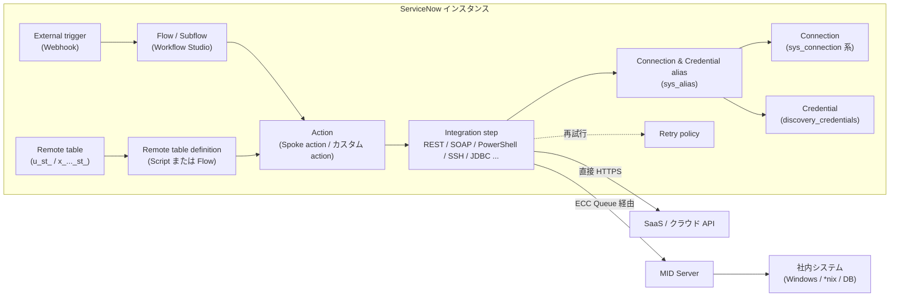
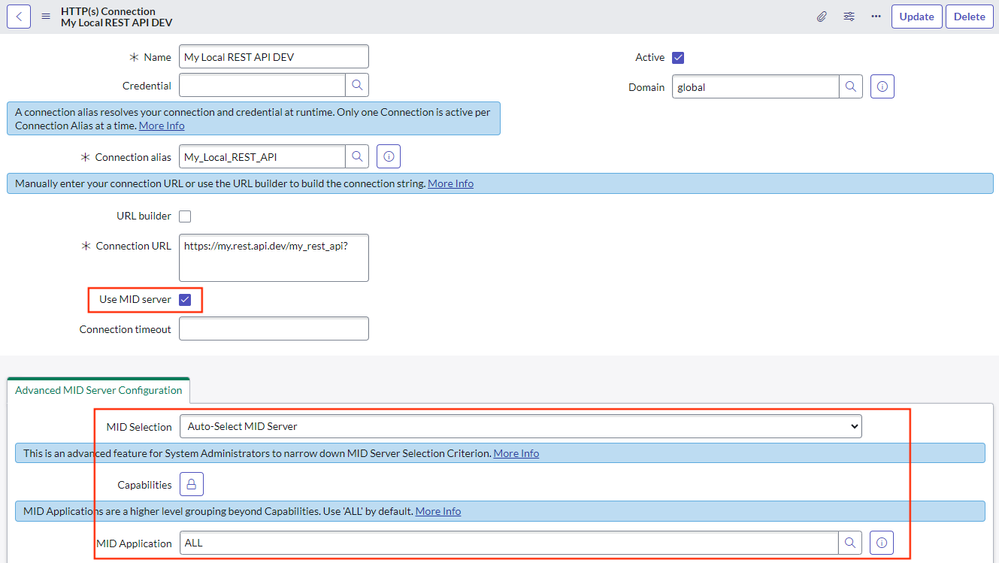
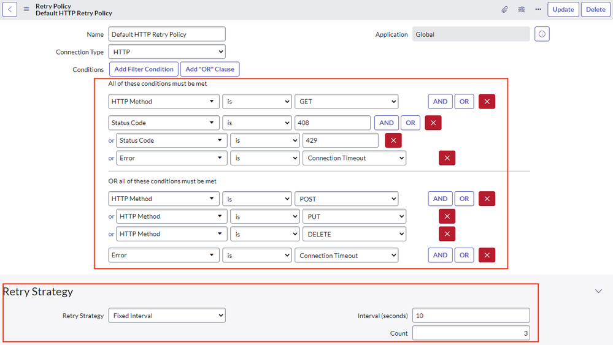
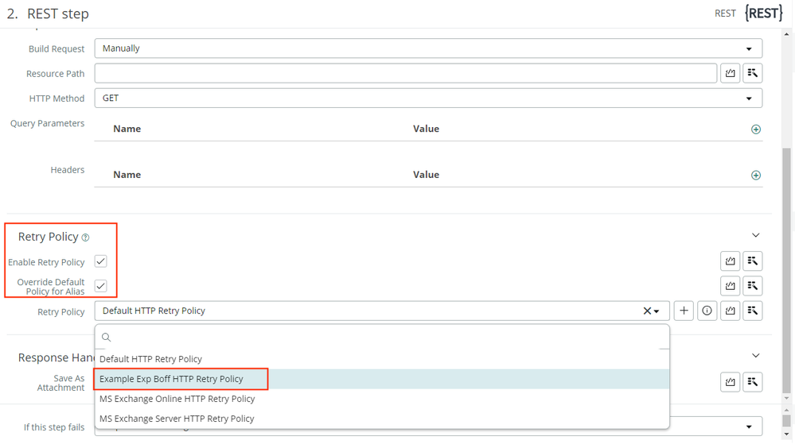
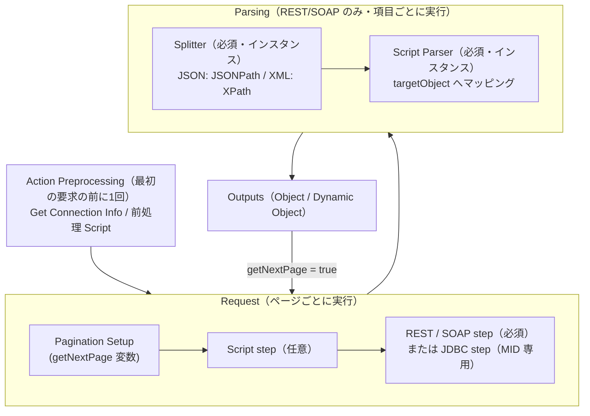
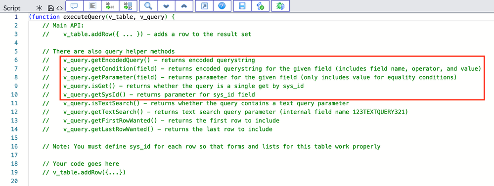

# IntegrationHub（インテグレーションハブ）

## 概要

IntegrationHub（Integration Hub、インテグレーションハブ）は、ServiceNow AI Platform（旧 Now Platform）のローコード統合基盤であり、Workflow Studio（旧 Flow Designer、ワークフロースタジオ）のフロー／サブフロー／アクションから外部システムを呼び出すための部品群とライセンス体系の総称である。IntegrationHub は **ベースシステムには含まれず、別途サブスクリプションが必要** な製品である [出典](https://www.servicenow.com/docs/r/integrate-applications/integration-hub/integrationhub.html)。

IntegrationHub の主要な構成要素は以下のとおり。

| 構成要素 | 概要 | 本ファイルの節 |
|---|---|---|
| Spoke（スポーク） | 特定の外部システム向けのアクション・サブフロー・フローテンプレート等をまとめたスコープアプリケーション | [Spokes](#spokes) |
| Connection & Credential alias（接続と資格情報エイリアス） | 接続先と資格情報を実行時に解決する論理名。環境ごとの差し替えを可能にする | [Connection & Credential aliases](#connection--credential-aliases) |
| Integration step（統合ステップ） | Action Designer で使う REST / SOAP / PowerShell / SSH / JDBC 等のプロトコルステップ | [Integration steps](#integration-stepsrestsoappowershellssh-ほか) |
| Retry policy（再試行ポリシー） | REST / SOAP / JDBC ステップ失敗時の自動再試行ルール | [Retry policy](#retry-policy再試行ポリシー) |
| Data Stream action（データストリームアクション） | 10 MB 超・ページング API の応答をストリームとして分割処理するアクション | [Data Stream](#data-stream-actionデータストリームアクション) |
| Remote tables（リモートテーブル） | 外部データを取り込まずにメモリ上の仮想テーブルとして参照・編集する仕組み | [Remote tables](#remote-tablesリモートテーブル) |
| External trigger / Remote Process Sync / Stream Connect / Integration Hub - Import | インバウンド Webhook、インスタンス間プロセス同期、Kafka 連携、データインポート | [その他の機能](#その他の-integrationhub-機能概要) |
| パッケージとトランザクション | Starter / Standard / Professional / Enterprise の各パックと、トランザクション数に基づく課金 | [パッケージとトランザクション課金](#integrationhub-パッケージとトランザクション課金) |

本ファイルの基準リリースは **Australia**（2026-05 GA）である。公式ドキュメント上、Integration Hub は Australia 以降 **Workflow Data Fabric（ワークフローデータファブリック）** のドキュメント群（"Australia Workflow Data Fabric" / "Brazil Workflow Data Fabric"）の一部として掲載されている [出典](https://www.servicenow.com/docs/r/u~ldaY8ZPxJiUgZ1Inf6mw/_Z13Mf2fauK1FAT029a_WA)。Workflow Data Fabric 全体像は [workflow-data-fabric.md](./workflow-data-fabric.md)、フロー／アクションの作り方そのものは [flow-designer-workflow-studio.md](./flow-designer-workflow-studio.md)、スクリプトベースの REST/SOAP（`sn_ws.RESTMessageV2` 等）や Scripted REST API は [web-services-api.md](./web-services-api.md)、MID Server は [mid-server.md](./mid-server.md) を参照。

---

## IntegrationHub の位置付けとアーキテクチャ

IntegrationHub は Workflow Studio の「アクション」レイヤーに統合機能を追加する製品である。フロー（Flow）／サブフロー（Subflow）がアクション（Action）を呼び出し、アクションの内部に Integration step（REST step 等）が置かれる。Integration step は Connection & Credential alias を参照して接続先・認証情報を実行時に解決し、必要に応じて MID Server 経由でファイアウォール内のシステムに到達する [出典](https://www.servicenow.com/docs/r/u~ldaY8ZPxJiUgZ1Inf6mw/_Z13Mf2fauK1FAT029a_WA)。

- Spoke は「アクション・サブフロー・フローテンプレート・サポート用アプリケーションファイルの論理的なまとまり」であり、実体は 1 つのスコープアプリケーションである [出典](https://www.servicenow.com/community/automation-engine-blog/integration-hub-spokes-and-how-to-build-them/ba-p/2788254)。
- Spoke はアウトバウンド呼び出しを担い、インバウンドの Webhook は External trigger（外部トリガー）が担う [出典](https://www.servicenow.com/docs/r/u~ldaY8ZPxJiUgZ1Inf6mw/_Z13Mf2fauK1FAT029a_WA)。
- MID Server 経由の REST/SOAP 呼び出しでは mTLS（相互 TLS）を利用できる [出典](https://www.servicenow.com/docs/r/u~ldaY8ZPxJiUgZ1Inf6mw/_Z13Mf2fauK1FAT029a_WA)。

---

## IntegrationHub のプラグイン

IntegrationHub の機能はプラグイン単位で提供される。サブスクリプションごとの「Pack Installer」プラグインが中核であり、各パックに含まれる内容はプラグイン説明ではなく **Legal schedules（法的スケジュール）の "IntegrationHub overview"** で定義される [出典](https://www.servicenow.com/docs/r/u~ldaY8ZPxJiUgZ1Inf6mw/EqBzLHWgmGUVzpChZ37M1w)。

### Pack Installer プラグイン（サブスクリプション別）

| プラグイン名 | Plugin ID | 対応サブスクリプション |
|---|---|---|
| ServiceNow IntegrationHub Starter Pack Installer | `com.glide.hub.integrations` | Starter |
| ServiceNow IntegrationHub Standard Pack Installer | `com.glide.hub.integrations.standard` | Standard |
| ServiceNow IntegrationHub Professional Pack Installer | `com.glide.hub.integrations.professional` | Professional |
| ServiceNow IntegrationHub Enterprise Pack Installer | `com.glide.hub.integrations.enterprise` | Enterprise |

[出典（Australia）](https://www.servicenow.com/docs/r/u~ldaY8ZPxJiUgZ1Inf6mw/EqBzLHWgmGUVzpChZ37M1w)

> 注記: Spoke Generator のページでは Starter Pack Installer の ID が `com.glide.hub.integrations.starter` と記載されており、プラグイン一覧ページ（`com.glide.hub.integrations`）と表記が一致しない。実インスタンスの `v_plugin` で確認すること [出典](https://www.servicenow.com/docs/r/zurich/build-workflows/workflow-studio/spoke-builder.html)。

### ステップ・機能系プラグイン

| プラグイン名 | Plugin ID | 説明 |
|---|---|---|
| Action Step - REST | `com.glide.hub.action_step.rest` | Workflow Studio で REST step を有効化 |
| Action Step - SOAP | `com.glide.hub.action_step.soap` | SOAP step を有効化 |
| Action Step - PowerShell | `com.glide.hub.action_step.powershell` | PowerShell step を有効化 |
| Action Step - SSH | `com.glide.hub.action_step.ssh` | MID Server 経由で *nix 系に SSH コマンドを実行、関連スクリプトを保持 |
| Action Step - JDBC | `com.glide.hub.action_step.jdbc` | リレーショナル DB に SQL を送る再利用可能アクション |
| Action Step - XML Parser | `com.glide.hub.action_step.xmlparser` | XML Parser step を有効化 |
| Flow Designer Action Step - Payload Builder | `com.glide.hub.action_step.payload` | 動的データから JSON / XML ペイロードを構築 |
| Action Template - Data Stream | `com.glide.hub.action_type.datastream` | 10 MB 超またはページング応答を返す API 向け Data Stream action |
| Integration Hub Designer Core | `com.glide.ihub.designer.core` | Integration Hub - Import 環境でのデータインポート自動化（Data Stream プラグインと共にインストール） |
| Stream Connect Installer | `com.glide.hub.stream_connect.installer` | Stream Connect for Apache Kafka のライセンス対象コンポーネントを有効化 |
| Flow Trigger - Kafka | `com.glide.hub.flow_trigger.kafka` | フロー内で Kafka トピックのメッセージを消費 |
| Action Step - Kafka Producer | `com.glide.hub.action_step.kafka` | フロー内で Kafka トピックにメッセージを生成 |
| Stream Connect MID Hermes API | `com.glide.mid.hermes_api` | MID Server から Hermes Messaging Service トピックへメッセージを生成 |
| Remote Tables | `com.glide.script.vtable` | Remote tables（IntegrationHub サブスクリプションとは別プラグイン。外部データ利用時は IH エンタイトルメントが必要） |

[出典（Zurich）](https://www.servicenow.com/docs/r/oZRGKGLbfcn968v3Ubchmw/lryjWJgrIfs_RXZtGCvRXw)、[出典（Australia）](https://www.servicenow.com/docs/r/u~ldaY8ZPxJiUgZ1Inf6mw/EqBzLHWgmGUVzpChZ37M1w)、[出典（Remote tables）](https://www.servicenow.com/docs/r/zS6yb8e~gR8BPjeviYdV9g/vmxDw5c65RgjKQmXdK~zZg)

### プラグインとして提供されるベースシステム Spoke

| Spoke | Plugin ID | 状態 |
|---|---|---|
| Slack Spoke | `com.sn.slack.ahv2` | 提供中 |
| Slack Webhooks Spoke | `com.sn.slack.ah` | 提供中 |
| Microsoft Teams Spoke | `com.sn.ms_teams.ah` | 提供中 |
| Microsoft SCCM Spoke | `com.sn.sccm.spoke` | 提供中 |
| Microsoft Azure AD Spoke | `com.sn.azure_ad.spoke` | 提供中（ストア版は Microsoft Entra ID spoke に改称） |
| ServiceNow eBonding Spoke | `com.glide.sn.ebonding.ah` | 提供中（後継は Remote Process Sync） |
| HipChat Spoke | `com.sn.hipchat.ah` | 非推奨（Deprecated） |
| ServiceNow IntegrationHub Content | `com.glide.hub.integration.content` | 非推奨（Deprecated） |

[出典](https://www.servicenow.com/docs/r/u~ldaY8ZPxJiUgZ1Inf6mw/EqBzLHWgmGUVzpChZ37M1w)、[出典（Spokes一覧）](https://www.servicenow.com/docs/r/integrate-applications/integration-hub/spokes-list.html)、[出典（Remote Process Sync）](https://www.servicenow.com/docs/r/u~ldaY8ZPxJiUgZ1Inf6mw/oZWx_TDSyhYmUV4x4_vgOA)

---

## Spokes

### Spoke とは

Spoke（スポーク）は、特定の外部システムと通信するための **アクション、サブフロー、フローテンプレート、サポート用アプリケーションファイルの論理的なまとまり** である。Spoke の実体はスコープアプリケーション（scoped application）であり、Workflow Studio から直接利用でき、複数のフローで再利用できる [出典](https://www.servicenow.com/community/automation-engine-blog/integration-hub-spokes-and-how-to-build-them/ba-p/2788254)。

Spoke に含まれる典型的な要素は以下のとおり。

| 要素 | 内容 |
|---|---|
| Actions（アクション） | 例: Jira spoke の「Create Issue」「Update Issue」。内部に REST step 等を持つ |
| Subflows（サブフロー） | 複数アクションを組み合わせた再利用処理 |
| Flow templates（フローテンプレート） | 典型的なユースケースのひな型フロー |
| Connection & Credential alias | Spoke 専用のエイリアス（例: `sn_jira_spoke.Jira`） |
| Configuration template（構成テンプレート） | 接続設定ウィザード用のフォーム定義 |
| External trigger definition（任意） | 外部 Webhook でフローを起動する定義 |
| Spoke-specific AI agents（任意） | Zurich で追加された、Spoke 固有の AI エージェント |

[出典](https://www.servicenow.com/community/automation-engine-blog/integration-hub-spokes-and-how-to-build-them/ba-p/2788254)、[出典（リリースノート）](https://www.servicenow.com/docs/r/delta-zurich-brazil/brazil-zurich-integrationhub-release-notes.html)

> エイリアス名の具体例（`sn_jira_spoke.Jira` 等）は Spoke のスコープ名 + エイリアス名という命名慣行に基づく例示であり、個々の Spoke の実名は各 Spoke のセットアップページで確認すること。【推定】

### Spoke の種類

IntegrationHub の Spoke は、提供元と配布形態により以下に分類できる。

| 種類 | 提供元 | 配布 | 特徴 |
|---|---|---|---|
| ベースシステム Spoke（Base system spokes） | ServiceNow | プラグイン（例: Slack、Microsoft Teams、Remote Process Sync） | プラグイン有効化で利用。ServiceNow がリリースごとに認定・保守 |
| ServiceNow 製ストア Spoke（ServiceNow-developed spokes） | ServiceNow | ServiceNow Store | Store からダウンロードし本番利用。リリースと独立してバージョンアップ |
| パートナー製 Spoke | ISV / パートナー | ServiceNow Store | Store で配布。ライセンス条件は提供元ごとに異なる【第三者情報】 |
| カスタム Spoke（Custom spokes） | 顧客・開発者 | 自社スコープアプリ | Spoke Generator や Action Designer で作成。既存 Spoke の拡張または単独 Spoke |
| Subscription Product 同梱 Spoke | ServiceNow | Store | ITSM 等の Subscription Product に含まれる Spoke。IntegrationHub サブスクリプションなしでも利用権がある（ただしトランザクションは別） |

[出典（Exploring Integration Hub）](https://www.servicenow.com/docs/r/u~ldaY8ZPxJiUgZ1Inf6mw/_Z13Mf2fauK1FAT029a_WA)、[出典（Spoke解説ブログ）](https://www.servicenow.com/community/automation-engine-blog/integration-hub-spokes-and-how-to-build-them/ba-p/2788254)、[出典（subscription usage）](https://www.servicenow.com/docs/r/integrate-applications/integration-hub/subscription-usage.html)

- ServiceNow 製（OOB）Spoke は ServiceNow が開発・保守・新リリースへの認定を行うため、**直接カスタマイズできない**。拡張したい場合は、アクションを複製（clone）するか、同 Spoke のスコープ内で新しいアクションを作成する [出典](https://www.servicenow.com/community/automation-engine-blog/integration-hub-spokes-and-how-to-build-them/ba-p/2788254)。
- ServiceNow のコミュニティ記事（2024-01）では、ServiceNow Store で入手できる Spoke は「180+」とされている [出典](https://www.servicenow.com/community/automation-engine-blog/integration-hub-spokes-and-how-to-build-them/ba-p/2788254)。

### Spoke のエンタイトルメント（利用権）

ServiceNow 製 Spoke を Store からダウンロードして本番環境で使うには、**IntegrationHub サブスクリプション** または **Spoke を含む Subscription Product**（例: ITSM Pro 等）のいずれかが必要である。Subscription Product に含まれる Spoke は、その製品の用途以外のユースケースにも利用できる。ただし **IntegrationHub トランザクションは Subscription Product には含まれず**、トランザクションを消費する場合は IntegrationHub または Workflow Data Fabric サブスクリプションの追加購入が必要になりうる [出典](https://www.servicenow.com/docs/r/integrate-applications/integration-hub/subscription-usage.html)。

Subscription Product ごとの Spoke 利用権は Now Support の **KB1224540「Spoke entitlement per Subscription Product」** に一覧化されている（KB 本文は要ログインのため本調査では未確認）[出典](https://www.servicenow.com/docs/r/integrate-applications/integration-hub/subscription-usage.html)。

### Spoke Generator（スポークジェネレーター）

Spoke Generator（アプリ ID `sn_spoke_builder`、Zurich 時点の最新 v4.5.0）は、ガイド付き UI でカスタム Spoke を作成するツールである [出典](https://www.servicenow.com/docs/r/zurich/build-workflows/workflow-studio/spoke-builder.html)。

| 作成方法 | 内容 | ライセンス要件 |
|---|---|---|
| OpenAPI Specification のインポート | OpenAPI 2.0 / 3.0 仕様からアクションを生成（各アクションは OpenAPI step を含む） | **Professional Pack Installer のライセンスが本番・非本番の双方に必要** |
| Postman collection のインポート | Postman コレクションからアクションを生成 | 同上 |
| AI による生成 | サードパーティ API ドキュメントの抜粋を入力にアクションを生成（Zurich ドキュメントでは "Otto" と表記） | 同上 |
| 手動作成 | Spoke とアクションを手で定義 | IntegrationHub サブスクリプション |
| 既存 Spoke へのアクション追加 | 再利用可能なアクションを追加 | IntegrationHub サブスクリプション |

[出典](https://www.servicenow.com/docs/r/zurich/build-workflows/workflow-studio/spoke-builder.html)

Spoke Generator の主な制約は以下のとおり [出典](https://www.servicenow.com/docs/r/zurich/build-workflows/workflow-studio/spoke-builder.html)。

| 項目 | 内容 |
|---|---|
| リクエストボディ | JSON メディアタイプのみ対応 |
| 未対応の OpenAPI 3.0 要素 | Schema Object の `oneOf` / `anyOf` / `additionalProperties`、Discriminator、Example、Link、Callback、Security Scheme、Security Requirement、Tag、External Documentation、Server Object、Info の termsOfService/contact/license、仕様拡張、再帰参照 |
| インポートサイズ | 既定 10 MB、`glide.rest.openapi.max_request_size` で最大 100 MB |
| 1 Spoke あたりのオペレーション数 | 既定 500、`glide.rest.openapi.max_operation_limit` で最大 1,000 |

Spoke Generator のロール別権限は以下のとおり [出典](https://www.servicenow.com/docs/r/zurich/build-workflows/workflow-studio/spoke-builder.html)。

| ロール | できること |
|---|---|
| `admin` | Spokes タブ表示、Spoke 作成、OpenAPI インポート、Connection alias 作成、アクション公開、下書き保存、Spoke アクティビティログ閲覧 |
| `action_designer` | Spokes タブ表示、アクション閲覧・追加 |
| `fd_read_actions` | Spokes タブ表示、アクション閲覧（追加不可） |
| `flow_operator` / `flow_designer` | フロー・サブフロー閲覧 |

> Zurich での変更: OpenAPI・Postman・Now Assist（AI）による Spoke 作成に Integration Hub **Professional** ライセンス（本番・非本番）が必要であることが明記された [出典](https://www.servicenow.com/docs/r/delta-zurich-brazil/brazil-zurich-integrationhub-release-notes.html)。

### カスタム Spoke 開発の推奨事項

ServiceNow 社員によるコミュニティ記事では、カスタム Spoke 開発について以下が推奨されている [出典](https://www.servicenow.com/community/automation-engine-blog/integration-hub-spokes-and-how-to-build-them/ba-p/2788254)。

- 1 Spoke = 1 スコープアプリケーションとする。
- 既存 OOB Spoke を拡張する場合は、その Spoke のスコープでアップデートセットを作成し、OOB アクションを複製または新規作成する。
- Connection & Credential alias は Spoke 名から "spoke" を除いた名前を付ける。
- 添付ファイル送信には binary または multipart の REST step を使う。
- ファイアウォール内のシステムには MID Server を使う。
- OOB Spoke の新バージョンが出たらカスタム部分を再テストする。

### Spokes 一覧（Brazil 時点の公式一覧からの抜粋）

公式ドキュメント「Integration Hub available spokes」に掲載されている Spoke をカテゴリ別に整理した（カテゴリ分けは本ナレッジによる）。どの Spoke がどのサブスクリプションに含まれるかは一覧上には記載されず、Legal schedules の IntegrationHub overview を参照する必要がある [出典](https://www.servicenow.com/docs/r/integrate-applications/integration-hub/spokes-list.html)。

| カテゴリ | 主な Spoke |
|---|---|
| AWS | Amazon Alexa、Amazon CloudWatch、Amazon Connect、Amazon DynamoDB、Amazon EBS、Amazon EC2、Amazon Elastic Container Service、Amazon RDS、Amazon Route 53、Amazon S3、Amazon SNS、Amazon SQS、Amazon VPC、AWS Certificate Manager、AWS CloudFormation、AWS Elastic Beanstalk、AWS Elastic Load Balancing、AWS IAM、AWS Lambda、AWS OpsWorks、AWS Translate |
| Google Cloud | Google Cloud Datastore、Cloud DNS、Cloud Functions、Cloud Load Balancer、Cloud Pub/Sub、Cloud SQL、Cloud Storage、Cloud Translator Service、Cloud Virtual Network、Cloud VPC Access、Compute Engine、Persistent Disk、Google Identity and Access |
| Microsoft Azure | Azure Application Insights、Azure Artifacts、Azure Automation、Azure Blob Storage、Azure Cosmos DB、Azure DevOps Boards、Azure DevOps Pipelines、Azure Managed Storage、Azure Notification Hub、Azure RBAC、Azure Resource Management、Azure SQL Database、Azure Traffic Manager、Azure Virtual Machine、Azure Virtual Network |
| Oracle Cloud | Oracle Autonomous DB、Block Storage、Boot Volume、Oracle Cloud IAM、Compute Engine、Object Storage Management、Virtual Cloud Network |
| Microsoft 製品 | Microsoft 365 Excel、Dynamics 365、Dynamics CRM、Dynamics 365 for Finance and Operations、Microsoft Active Directory、Microsoft Active Directory v2、Microsoft Entra ID（旧 Azure Active Directory）、Microsoft Entra Entitlement Management、Microsoft Endpoint Configuration Manager、Exchange Online、Exchange Server、Intune、OneDrive、Microsoft Security Response Center、SharePoint Online、Microsoft SCCM、Microsoft Teams、Microsoft Teams Communications、Microsoft Teams Graph |
| 開発・DevOps | CICD（Continuous Integration and Continuous Delivery）、GitHub、GitLab、Jenkins、Jenkins v2、Jira、Jira Service Management、Rally、Docker、Kubernetes、Ansible、Confluent Kafka REST Proxy、Aha! |
| インフラ・自動化 | Agent Client Collector、AI Search、BigFix Inventory、BMC Remedy、F5 BIG-IP、Infoblox、Gremlin、Snowflake、Databricks、Shodan、ServiceNow Remote Instance、Automation Anywhere、Blue Prism、UiPath、Utility Actions |
| コラボレーション | Asana、Box、Calendly、Cisco Webex Meetings、Cisco Webex Teams、Confluence Cloud、Docusign eSignature、Dropbox Business、Gmail、Google Calendar、Google Chat、Google Docs、Google Drive、Google Meet、Google Sheets、Google Tasks、iManage、Lucidchart、Miro、monday.com、Slack、Smartsheet、Trello、Workfront、Wrike、Zoom |
| ID・セキュリティ・リスク | Okta、OneLogin、CrowdStrike、Secureworks CTP、Equifax、First Advantage、Socure、Navex EthicsPoint、UCF |
| ERP・HR・財務 | Oracle EBS、Oracle Financial Cloud、Oracle HCM Cloud、Oracle NetSuite、Oracle PeopleSoft Financial、SAP Ariba、SAP Commerce Cloud、SAP Concur、SAP ECC IDoc、SAP ECC RFC、SAP Fieldglass、SAP S/4HANA IDoc、SAP S/4HANA OData、SAP S/4HANA Public Cloud、SAP S/4HANA RFC、SAP SuccessFactors、Workday Financials、Workday HR、Workday Learning、UKG、SmartRecruiters、Coupa、Salesforce、Salesforce Marketing Cloud、Legal Tracker |
| 顧客接点・通信 | Adobe Experience Platform、Adobe Sign、Twilio、Vonage、Plivo、Zendesk、PagerDuty、Qualtrics、SurveyMonkey、GovNotify、X（旧 Twitter）、YouTube |
| 学習 | Cornerstone、Pluralsight、SuccessFactors Learning、SumTotal、Udemy、Saba、Credly |
| BI | Tableau、Looker |

[出典](https://www.servicenow.com/docs/r/integrate-applications/integration-hub/spokes-list.html)

> **Brazil での変更:** 公式 Spokes 一覧に Metrikus spoke（センサーデータ連携）の Beta v1.0 が Brazil 専用として掲載されている [出典](https://www.servicenow.com/docs/r/integrate-applications/integration-hub/spokes-list.html)。

- Store 配布の Spoke はファミリーリリースとは独立してバージョンアップされ、Store リリースノート（例: GitHub spoke、Aha! spoke）で個別に変更が公開される [出典](https://www.servicenow.com/docs/r/store-release-notes/store-integrationhub-rn-github.html)。
- eBonding spoke の後継として、インスタンス間のプロセス同期は Remote Process Sync が位置付けられている [出典](https://www.servicenow.com/docs/r/u~ldaY8ZPxJiUgZ1Inf6mw/oZWx_TDSyhYmUV4x4_vgOA)。

---

## Connection & Credential aliases

### 用語の定義

Connections & Credentials（接続と資格情報）機能は、IntegrationHub だけでなく Flow Designer、Cloud Management、Discovery、Orchestration、Service Mapping でも共通利用されるプラットフォーム機能である [出典](https://www.servicenow.com/docs/r/platform-security/connections-and-credentials/credentials-connections-alias.html)。

| 用語 | 定義 |
|---|---|
| Connection（接続） | 統合先システムへの接続情報（エンドポイント URL、IP アドレス、DB 設定等） |
| Credential（資格情報） | 接続に必要な認証情報（ユーザー名/パスワード、OAuth、SSH 鍵等） |
| Alias（エイリアス） | 接続や資格情報レコードをまとめるタグ。統合処理は alias を参照し、開発・QA・本番など環境ごとに異なる接続/資格情報を **実行時に解決** する |

[出典](https://www.servicenow.com/docs/r/platform-security/connections-and-credentials/credentials-connections-alias.html)

### Alias の種類

| Alias 種別 | 解決対象 | 主な利用先 |
|---|---|---|
| Credential alias（資格情報エイリアス） | 資格情報のみ | Define Connection Inline を選んだステップの認証、Discovery 等 |
| Connection & Credential alias（接続と資格情報エイリアス） | 接続情報 + 資格情報 | Spoke アクション、カスタムアクションの REST/SOAP/PowerShell/SSH/JDBC step |

[出典](https://www.servicenow.com/docs/r/platform-security/connections-and-credentials/credentials-connections-alias.html)

- 1 つの Connection & Credential alias に対して **同時にアクティブにできる Connection は 1 つ** である。複数の接続先が必要な場合は child alias を使う [出典](https://www.servicenow.com/docs/r/yokohama/platform-security/connections-and-credentials/connection-information.html?contentId=cOWO0kJVtGk1MpE0SMpGTw)。

### 関連テーブル

| テーブル | ラベル | 説明 | 確度 |
|---|---|---|---|
| `sys_alias` | Connection & Credential Alias | Alias 本体。`sys_metadata` を拡張し、作成には `admin` が必要。`credential_admin` / `connection_admin` は読み取り可 | 公式（Orchestration ドキュメントの記述として検索結果で確認）|
| `sys_connection` | Connection | すべての接続テーブルの基底テーブル | 公式 |
| `http_connection` | HTTP(s) Connection | HTTP(s) 接続（REST/SOAP 用） | 【推定】（公開ドキュメント本文では未確認。インスタンスで確認推奨） |
| `jdbc_connection` | JDBC Connection | JDBC 接続。もとは `sys_metadata` 拡張だったが `sys_connection` を拡張するよう変更 | 公式 |
| `orch_jms_ds` | JMS Connection | JMS 接続。`sys_connection` を拡張 | 公式 |
| `discovery_credentials` | Credentials | 資格情報の基底テーブル | 公式 |

[出典（接続テーブル）](https://www.servicenow.com/docs/r/yokohama/platform-security/connections-and-credentials/connection-information.html?contentId=cOWO0kJVtGk1MpE0SMpGTw)、[出典（資格情報）](https://www.servicenow.com/docs/r/platform-security/connections-and-credentials/credentials-connections-alias.html)

HTTP(s) Connection フォームの主な項目は以下のとおり（下図参照）。

| 項目 | 説明 |
|---|---|
| Name | 接続名 |
| Credential | 使用する資格情報 |
| Connection alias | 紐づく Connection & Credential alias（必須） |
| Active | 有効フラグ（1 alias につき 1 接続のみ有効） |
| Domain | ドメインセパレーション利用時のドメイン |
| URL builder | URL ビルダーで接続文字列を組み立てるか |
| Connection URL | 接続先 URL（必須） |
| Use MID server | MID Server 経由で接続するか |
| Connection timeout | 接続タイムアウト |
| Advanced MID Server Configuration タブ | MID Selection（Auto-Select MID Server 等）、Capabilities、MID Application（既定 ALL） |

**キャプション:** HTTP(s) Connection レコードのフォーム画面（Connection alias に紐づく接続定義）。

**画面説明:** ヘッダーに「HTTP(s) Connection / My Local REST API DEV」と表示され、上部に Name（My Local REST API DEV）、Credential、Connection alias（My_Local_REST_API、必須）、右側に Active チェックボックスと Domain（global）が並ぶ。Connection alias の下に「A connection alias resolves your connection and credential at runtime. Only one Connection is active per Connection Alias at a time.」という説明文が表示される。続いて URL builder チェックボックス、Connection URL（必須、例: https://my.rest.api.dev/my_rest_api?）、赤枠で強調された **Use MID server** チェックボックス（オン）、Connection timeout がある。下部の「Advanced MID Server Configuration」タブでは MID Selection（Auto-Select MID Server）、Capabilities（鍵アイコン）、MID Application（ALL）を設定する。

**出典:** [Understanding Connection & Credential Alias - Part 2（ServiceNow Community, Queensland SNUG, Jake Gillespie, 2024-08）](https://www.servicenow.com/community/queensland-snug/understanding-connection-amp-credential-alias-part-2/ba-p/3011764)　取得日: 2026-11-02

### Child alias と複数接続（Multiple connections）

IntegrationHub は **1 つの統合先（プロバイダー）に対する複数接続** をサポートする。例として、複数の Jira 環境への接続を同じ Spoke で扱える。Connection & Credential alias の配下に **child alias（子エイリアス）** を作成すると、元の alias は parent（親）になり、child alias は親の設定を継承しつつ独自の接続・資格情報を持つ [出典](https://www.servicenow.com/docs/r/platform-security/connections-and-credentials/credentials-connections-alias.html)、[出典](https://www.servicenow.com/docs/r/u~ldaY8ZPxJiUgZ1Inf6mw/GM0rGzTy3rNW40ZWitXooQ)。

接続の選択・上書き（override）は 3 レベルで行え、優先順位は **アクション > サブフロー > フロー** である [出典](https://www.servicenow.com/docs/r/oZRGKGLbfcn968v3Ubchmw/SFUvqHBzISwCtunFf70TDA)。

| レベル | 操作手順 |
|---|---|
| フロー | フローを開き、More Actions メニュー → **Configure connections** を選択 → alias ごとに接続を選ぶ（既定が先頭、他はアルファベット順）→ Update |
| アクション | Action Properties の接続フィールドで接続を選択。歯車アイコン＝alias の作成/設定（Configuration template があればモーダル、なければ alias フォーム）、＋アイコン＝child alias 追加、鉛筆アイコン＝接続編集。テストアクションがあれば Save and Test |

- フロー単位の「Configure connections」メニューの表示は `sn_flow_designer.connections_override_enabled` プロパティで制御され、`false` で非表示、プロパティ未定義なら表示される [出典](https://www.servicenow.com/docs/r/oZRGKGLbfcn968v3Ubchmw/SFUvqHBzISwCtunFf70TDA)。
- alias に接続が未設定の場合は「Connection not configured」メッセージが表示される [出典](https://www.servicenow.com/docs/r/oZRGKGLbfcn968v3Ubchmw/SFUvqHBzISwCtunFf70TDA)。

### 本番移送時の注意

フロー・Spoke をアップデートセット等で本番へ移送すると、**alias の情報は移送されるが接続詳細（Connection）は移送されない**。移送先環境で接続を再設定する必要がある。フロー自体を修正する必要はない [出典](https://www.servicenow.com/docs/r/oZRGKGLbfcn968v3Ubchmw/SFUvqHBzISwCtunFf70TDA)。

| alias の種類 | 移送先での設定方法 |
|---|---|
| Configuration template を持つ alias | Connections dashboard で接続を構成 |
| それ以外の alias | プラットフォーム UI（Connection & Credential Aliases モジュール）で接続を構成 |

移送・クローン運用の詳細は [update-sets-cloning.md](./update-sets-cloning.md) を参照。

### Configuration template（構成テンプレート）

Configuration template は、Spoke の接続設定を 1 枚のカスタマイズ可能なフォームで行うための仕組みで、`admin` および `flow_designer` ロールが利用できる [出典](https://www.servicenow.com/docs/r/platform-security/connections-and-credentials/credentials-connections-alias.html)。Zurich では Configuration template からの接続 alias テスト（Test 実行）が追加された [出典](https://www.servicenow.com/docs/r/delta-zurich-brazil/brazil-zurich-integrationhub-release-notes.html)。テストアクションは、テストアクションを持つ Configuration template を使う alias でのみ利用できる [出典](https://www.servicenow.com/docs/r/oZRGKGLbfcn968v3Ubchmw/SFUvqHBzISwCtunFf70TDA)。

> ServiceNow SDK のガイドでは、alias テンプレートの定義テーブルとして `sys_alias_templates` が挙げられている（ウィザードのフォーム項目と既定値を定義）。公式製品ドキュメント本文での確認はできていない【第三者情報】 [出典](https://servicenow.github.io/sdk/guides/alias-template-guide)

### Connections dashboard（接続ダッシュボード）

Connections dashboard は、Connection & Credential alias と、それに紐づくすべての child 接続を 1 か所で閲覧・追加・編集する IntegrationHub の画面である。Connections dashboard の利用には IntegrationHub サブスクリプションが必要である（Connections and Credentials モジュールは基盤機能として利用可能）[出典](https://www.servicenow.com/docs/r/u~ldaY8ZPxJiUgZ1Inf6mw/GM0rGzTy3rNW40ZWitXooQ)、[出典](https://www.servicenow.com/docs/r/platform-security/connections-and-credentials/credentials-connections-alias.html)。

- Connection & Credential alias の作成は、**All > Connections & Credentials > Connection & Credential Aliases** から行い、Related Links の「Create New Connection & Credential」で接続と資格情報を一括作成できる（各 Spoke のセットアップ手順で案内される標準手順）[出典](https://www.servicenow.com/docs/r/u~ldaY8ZPxJiUgZ1Inf6mw/CeroxsMHhgCxKQpMYsGFsw)。
- 個人単位の OAuth 認証（ユーザーごとのトークン）は Personal Authentication dashboard で管理する [出典](https://www.servicenow.com/docs/r/u~ldaY8ZPxJiUgZ1Inf6mw/_Z13Mf2fauK1FAT029a_WA)。
- Connections dashboard 自体のメニューパスと必要ロールは、Australia の公開ドキュメント本文では確認できなかった。

### MID Server への資格情報同期

MID Server は資格情報のローカルコピーを保持し、ECC Queue の `credentials_reload` ジョブを契機に SOAP 呼び出しで同期する。カスタムフィールドや参照先データも応答に含まれるため、MID Server が多い環境では性能問題の原因になりうる [出典](https://www.servicenow.com/docs/r/platform-security/connections-and-credentials/credentials-connections-alias.html)。

| プロパティ | 既定値 | 説明 |
|---|---|---|
| `com.snc.credentials_user_fields` | `true` | `false` で資格情報フォームのカスタムフィールドを同期対象外にする |
| `com.snc.credentials_recursion_depth` | `3` | 同期時にたどる参照テーブルの深さ。性能問題時は下げる |

[出典](https://www.servicenow.com/docs/r/platform-security/connections-and-credentials/credentials-connections-alias.html)

- Connection & Credential レコードはスコープ保護（他スコープ専用レコードへのアクセス遮断）とドメインセパレーションに対応している [出典](https://www.servicenow.com/docs/r/platform-security/connections-and-credentials/credentials-connections-alias.html)。資格情報の暗号化・保護全般は [platform-security-encryption.md](./platform-security-encryption.md)、ドメインセパレーションは [domain-separation.md](./domain-separation.md) を参照。

---

## Retry policy（再試行ポリシー）

Retry policy は、ネットワーク障害やレート制限などで失敗した要求を自動で再試行するための IntegrationHub のルールである。Retry policy を作成できるのは **JDBC、REST、SOAP の各ステップのみ** である [出典](https://www.servicenow.com/docs/r/lsf5Yo~95~wig0yrxISJIA/bDj7eiMJxqf_pNxzKa~eFQ)。

- メニュー: **All > IntegrationHub > Retry Policy > Create New**（Xanadu ドキュメント）
- 必要ロール: `connection_admin` または `credential_admin`
- 適用単位: Connection & Credential alias の **Default Retry Policy** として設定すると、その alias を使う全アクションに適用される。個々のステップで上書き（Override Default Policy for Alias）も可能
- 既定の再試行ポリシー（Default HTTP Retry Policy）が提供されており、独自ポリシーに置き換えられる
- 再試行の実績は **System Logs > Outbound HTTP Requests** で確認する

[出典](https://www.servicenow.com/docs/r/lsf5Yo~95~wig0yrxISJIA/bDj7eiMJxqf_pNxzKa~eFQ)

| フォーム項目 | 説明 |
|---|---|
| Name | 一意な名前 |
| Connection Type | HTTP |
| Conditions | HTTP Method、Status Code、Error、ヘッダー、レスポンスボディ等の条件（演算子: is / is not / contains / contains not） |
| Retry Strategy | Exponential Backoff / Fixed Interval / Honor "Retry-After" Header |
| Interval (seconds) | 再試行間隔（Exponential Backoff と Fixed Interval のみ） |
| Count | 最大再試行回数（同上） |
| Max Elapsed Time (seconds) | 累積待機時間の上限（Honor "Retry-After" Header のみ） |

| 再試行戦略 | 動作 |
|---|---|
| Exponential Backoff | 再試行ごとに間隔を 2 倍（例: 10 → 20 → 40 秒） |
| Fixed Interval | 一定間隔で再試行 |
| Honor "Retry-After" Header | HTTP 応答の Retry-After ヘッダー（RFC 7231 7.1.3）に従う。REST/SOAP step のみ |

| プロパティ | 既定値 | 説明 |
|---|---|---|
| `glide.fdih.retry.max_count` | `0` | Count が空欄の場合に使われる試行回数 |
| `glide.fdih.retry.max_time_in_seconds` | `86400`（24 時間）、最大 `604800`（7 日） | 設定時は Max Elapsed Time を上書き |

[出典](https://www.servicenow.com/docs/r/lsf5Yo~95~wig0yrxISJIA/bDj7eiMJxqf_pNxzKa~eFQ)

**キャプション:** Retry Policy レコード「Default HTTP Retry Policy」のフォーム画面。

**画面説明:** 上部に Name（Default HTTP Retry Policy）、Connection Type（HTTP）、Application（Global）が表示される。Conditions 欄は 2 つの条件グループで構成され、1 つ目は「HTTP Method is GET」かつ「Status Code is 408 または 429、または Error is Connection Timeout」、2 つ目（OR）は「HTTP Method is POST / PUT / DELETE」かつ「Error is Connection Timeout」。下部の Retry Strategy セクションでは Retry Strategy = Fixed Interval、Interval (seconds) = 10、Count = 3 が設定されている。つまり既定ポリシーは、GET は 408/429/接続タイムアウトで、更新系メソッドは接続タイムアウト時のみ、10 秒間隔で最大 3 回再試行する例を示している（値はスクリーンショット取得時点のもの）。

**出典:** [Understanding Connection & Credential Alias - Part 2（ServiceNow Community, Queensland SNUG）](https://www.servicenow.com/community/queensland-snug/understanding-connection-amp-credential-alias-part-2/ba-p/3011764)　取得日: 2026-11-02

> 注意: Yokohama の PDI で、401 応答を再試行条件に加えても OAuth トークンを更新したうえで元の要求が再実行されなかったとの報告がコミュニティにある（公式な確認はない）【第三者情報】 [出典](https://www.servicenow.com/community/workflow-automation-forum/oauth-2-0-token-refresh-on-401-does-not-retry-the-original/m-p/3541972)

---

## Integration steps（REST/SOAP/PowerShell/SSH ほか）

### ステップ一覧

Integration step は Action Designer（アクションデザイナー）でアクション内に配置するプロトコル別ステップである。以下のステップはすべて **IntegrationHub サブスクリプションが必要** で、対応プラグインの有効化により表示される。カスタムアクションの作成には `action_designer` ロールが必要である [出典（REST）](https://www.servicenow.com/docs/bundle/yokohama-build-workflows/page/administer/flow-designer/reference/rest-request-action-designer.html)、[出典（SSH）](https://www.servicenow.com/docs/r/u~ldaY8ZPxJiUgZ1Inf6mw/uKxPLIVCFStvqwRsRumuog)。

| ステップ | 用途 | 実行場所 | 主な制限 |
|---|---|---|---|
| REST step | REST API 呼び出し（Text / Binary / Multipart / Form URL-Encoded） | インスタンス or MID Server | 添付保存しない応答は既定 5 MB、最大約 10 MB |
| SOAP step | SOAP Web サービス呼び出し（WSDL から Envelope 生成） | インスタンス or MID Server | 応答 5 MB、最大 10 MB |
| PowerShell step | Windows ホストで PowerShell 実行 | MID Server | PowerShell 3.0〜7.4 |
| SSH step | *nix ホストで SSH コマンド実行 | MID Server | 既定タイムアウト 120 秒 |
| JDBC step | RDB への SQL 実行 | MID Server | （Data Stream では読み取り専用） |
| OpenAPI / Postman step | OpenAPI 仕様・Postman コレクションに基づく REST 呼び出し | インスタンス or MID Server | Spoke Generator が生成 |
| XML Parser step | XML 応答の解析 | インスタンス | — |
| JSON Parser step | JSON 応答の解析 | インスタンス | — |
| Payload Builder step | JSON / XML ペイロード構築 | インスタンス | — |
| Script step（MID 実行可） | 統合 API を使うスクリプト | インスタンス or MID Server | — |
| Kafka Producer step | Kafka トピックへのメッセージ送信 | インスタンス | Stream Connect サブスクリプション |

[出典（Exploring Integration Hub）](https://www.servicenow.com/docs/r/u~ldaY8ZPxJiUgZ1Inf6mw/_Z13Mf2fauK1FAT029a_WA)、[出典（プラグイン）](https://www.servicenow.com/docs/r/oZRGKGLbfcn968v3Ubchmw/lryjWJgrIfs_RXZtGCvRXw)、[出典（OpenAPI/Postman step）](https://www.servicenow.com/docs/r/oZRGKGLbfcn968v3Ubchmw/xgysOlDxh6Tk0Kw77~tlZA)

> ZIP step、SFTP step、JSON Parser step がどのパッケージに含まれるかは情報源により異なる（後述の[パッケージ別の機能](#パッケージ別の機能)を参照）。

### REST step

REST step は、Connection & Credential alias または inline 定義の接続を使って REST API を呼び出すステップである [出典](https://www.servicenow.com/docs/bundle/yokohama-build-workflows/page/administer/flow-designer/reference/rest-request-action-designer.html)。

**Connection（接続）セクション**

| 項目 | 説明 |
|---|---|
| Connection | **Define Connection Inline**（ステップ内に直接定義）または **Use Connection Alias**（alias を参照） |
| Connection Alias | 使用する Connection & Credential alias（Use Connection Alias 時） |
| Credential Alias | 使用する Credential alias（Define Connection Inline 時） |
| Base URL | alias 使用時は alias の Base URL を表示（鍵アイコンで上書き可）、inline 時は手入力 |
| Connection Timeout | ホスト接続の待機時間（ミリ秒）。空欄でシステム既定。0 は非推奨 |
| Test REST Step | 入力値でステップを試行し、Test Results に出力やエラーを表示。Data Stream では splitter/parser/出力の自動生成にも使用 |

**Request（要求定義）セクション**

| 項目 | 説明 |
|---|---|
| Build Request | **Manually** / **From OpenAPI specification** / **From REST Message**（プラットフォームの REST Message レコードから取り込み） |
| API Source / API Operation | OpenAPI 仕様と対象オペレーション |
| REST Message / REST Message Function / Import REST Message | 取り込む REST Message、その関数（HTTP メソッド）、取り込みボタン |
| Resource Path | リソースパス |
| HTTP Method | GET / POST / PUT / PATCH / DELETE |
| Query Parameters | 名前と値の組。同名パラメーターの重複可（定義順に送信） |
| Headers | 要求ヘッダー。重複可（定義順に送信） |
| Request Type | **Text**（JSON/XML 等）/ **Binary**（添付レコード。JSONStreamingBuilder / XMLStreamingBuilder で作成するのが典型）/ **Multipart**（Name・Part Type〔Text/File〕・Value。File は添付 sys_id 指定）/ **Form URL-Encoded**。POST/PUT/PATCH/DELETE で変更可能 |
| Request Body [Text] | Text 時の本文 |

**MID Server オプション**

| 項目 | 説明 |
|---|---|
| Use MID | MID Server 経由で実行 |
| MID Selection | Auto-Select MID Server / Specific MID Server / Specific MID Cluster |
| MID Application / Capabilities | 自動選択時に必要なアプリケーション・機能 |
| MID Server / MID Cluster | 特定指定時のデータピル |

MID 経由の要求の実行時データは Outbound HTTP ログと同じ形では記録されず、Flow execution details で確認する [出典](https://www.servicenow.com/docs/bundle/yokohama-build-workflows/page/administer/flow-designer/reference/rest-request-action-designer.html)。

**Retry Policy・応答処理**

| 項目 | 説明 |
|---|---|
| Enable Retry Policy | 失敗時の自動再試行を有効化 |
| Override Default Policy for Alias | alias の既定ポリシーを上書き（inline 接続では不可） |
| Retry Policy | 使用するポリシー |
| Save As Attachment | 応答を Attachment [`sys_attachment`] に保存 |
| Attachment File Name / Attachment File Record | 保存ファイル名と、添付先レコード（Record データピル） |
| If this step fails | 次ステップへ継続 / Action error evaluation へ移動 |

**応答サイズ制限:** 添付保存しない応答は既定 **5 MB** に制限され、超過するとエラーになる。大きな応答は添付として保存するか、`glide.pf.rest.response_payload_max_size` で上限を引き上げる（最大 10240 KB ≒ 10 MB）。JSON 応答は Script step の `JSON.parse()`、XML 応答は XML Parser step で解析して出力変数にマッピングする [出典](https://www.servicenow.com/docs/bundle/yokohama-build-workflows/page/administer/flow-designer/reference/rest-request-action-designer.html)。

**キャプション:** Action Designer における REST step（ステップ 2）の設定画面。

**画面説明:** 右上に「REST {REST}」のアイコン。上から Build Request（Manually）、Resource Path、HTTP Method（GET）、Query Parameters（Name / Value の表）、Headers（Name / Value の表）が並ぶ。中段の **Retry Policy** セクション（赤枠）では Enable Retry Policy と Override Default Policy for Alias がオンになっており、Retry Policy のドロップダウンを開くと「Default HTTP Retry Policy」「Example Exp Boff HTTP Retry Policy」（赤枠で選択中）「MS Exchange Online HTTP Retry Policy」「MS Exchange Server HTTP Retry Policy」が候補として表示される。下部に Response Handling（Save As Attachment）と If this step fails が続く。

**出典:** [Understanding Connection & Credential Alias - Part 2（ServiceNow Community, Queensland SNUG）](https://www.servicenow.com/community/queensland-snug/understanding-connection-amp-credential-alias-part-2/ba-p/3011764)　取得日: 2026-11-02

### SOAP step

SOAP step は WSDL から SOAP Envelope を生成し、SOAP Web サービスを呼び出すステップである（Australia ドキュメント）[出典](https://www.servicenow.com/docs/r/u~ldaY8ZPxJiUgZ1Inf6mw/~lxQeTqLLVkQialozMRwng)。

| 項目 | 説明 |
|---|---|
| Connection | Define Connection Inline / Use Connection Alias |
| Connection Alias / Credential Alias | alias 接続時／inline 接続時の参照先 |
| Use MID・MID Selection | MID Server 経由実行（Auto-Select / Specific MID Server / Specific MID Cluster） |
| Endpoint | 宛先 URL（alias 使用時は読み取り専用、inline 時は編集可） |
| Connection Timeout | ミリ秒。空欄で既定、0 は非推奨 |
| Test SOAP Step | 入力値でテスト実行 |
| Build Envelope | **From WSDL**（選択オペレーションの XML を生成）/ **Manually** |
| Select a WSDL / Load New WSDL | 既存 WSDL レコードの選択、または新規登録（Name、Import Method〔Download from URL / Manually Populate WSDL Content〕、WSDL URL、User name、Password、WSDL Content） |
| Operation | 実行する WSDL オペレーション |
| SOAP Action | SOAP Action URL（From WSDL 時は読み取り専用） |
| Request Type | Text / Binary |
| SOAP Envelope | 送信 XML（Text 時） |
| Attachment | 要求を保持する添付レコード（Binary 時） |
| Reset Envelope | 手動編集を破棄して元に戻す |
| Enable WS-Security Policy / Policy | WS-Security ポリシーの適用 |
| Enable Retry Policy / Override Default Policy for Alias / Retry Policy | REST step と同様 |
| Headers / Omit if empty | HTTP ヘッダーと、空値ヘッダーの送信省略 |
| If this step fails | 継続 / エラー評価 |

- 必要ロール: アクション作成は `action_designer`、WSDL および WS-Security ポリシーの操作は `web_service_admin` [出典](https://www.servicenow.com/docs/r/u~ldaY8ZPxJiUgZ1Inf6mw/~lxQeTqLLVkQialozMRwng)。
- 応答サイズ: **5 MB** に制限。`glide.pf.soap.response_payload_max_size` で最大 10 MB まで引き上げ可能 [出典](https://www.servicenow.com/docs/r/u~ldaY8ZPxJiUgZ1Inf6mw/~lxQeTqLLVkQialozMRwng)。
- WS-Security: 旧リリースでは MID Server が WS-Security ポリシーに非対応だったが、**Zurich で MID Server 上の SOAP step における WS-Security ポリシー対応が追加** された [出典](https://www.servicenow.com/docs/r/delta-zurich-brazil/brazil-zurich-integrationhub-release-notes.html)。

### PowerShell step

PowerShell step は MID Server から Windows ホストに対して PowerShell スクリプトを実行するステップである（Australia、2026-03-12 更新）[出典](https://www.servicenow.com/docs/r/u~ldaY8ZPxJiUgZ1Inf6mw/qJDHoQdvlc_j~PZvpEHZug)。

| 項目 | 説明 |
|---|---|
| Connection | Define Connection Inline / Use Connection Alias |
| Connection Alias / Credential Alias | alias 接続時／inline 接続時の参照先 |
| Host | 対象ホストの FQDN（inline 時のみ） |
| Port | 待ち受けポート（例: 5985）。空欄で既定（inline 時のみ） |
| MID Selection | Auto-Select / Specific MID Server / Specific MID Cluster（inline 時のみ） |
| MID Application / Capabilities / MID Server / MID Cluster | MID の選択条件 |
| Remoting Type | **Explicit Remoting**（最も一般的。リモートサーバーに接続しスクリプト実行）/ **Implicit Remoting**（高度。MID Server 上で実行しつつリモートからモジュールをインポート）/ **MID Server 上で直接実行、またはスクリプト内でリモートセッションを確立**（既定） |
| Remote name prefix | リモートのモジュールパス（Implicit のみ） |
| Modules to import | インポートするモジュールのカンマ区切り一覧（Explicit / Implicit） |
| Test PowerShell Step | 資格情報のテスト |
| Script type | **Inline script**（Command 欄に記述）/ **MID Server Script File**（既定） |
| MID Server Script / Script path | MID Server Script Files テーブルの既定義スクリプトと、そのパス（読み取り専用） |
| Input variables | 名前・型（plain text / encrypted / boolean）・値。encrypted はフォーム上は平文表示だが ECC Queue 送信時に暗号化 |
| Command | インラインの PowerShell スクリプト |
| If this step fails | 継続 / エラー評価 |

スクリプト内で使える予約変数: `$computer`（alias のホスト IP）、`$cred`（資格情報オブジェクト）、`$log_info`（ログ有効時）[出典](https://www.servicenow.com/docs/r/u~ldaY8ZPxJiUgZ1Inf6mw/qJDHoQdvlc_j~PZvpEHZug)。

| MID Server プロパティ | 説明 |
|---|---|
| `mid.property.ihub.prefer_powershell6Plus` | `true` で PowerShell 6.0 以降を使用（既定は 3.0〜5.1）。Zurich で追加 |
| `mid.property.powershell.log_info` | `true` でスクリプトにログ情報を付加 |
| `mid.powershell.command.script.parameter_passing` | `false` の場合、入力変数は `$` ではなく `$env:SNC_` 接頭辞で参照 |

制約 [出典](https://www.servicenow.com/docs/r/u~ldaY8ZPxJiUgZ1Inf6mw/qJDHoQdvlc_j~PZvpEHZug):
- 対応バージョンは PowerShell 3.0〜7.4。3.0 は Windows 2003 Server 非対応。
- PowerShell 6.0 以降は MID Server にプリインストールされないため手動導入が必要（3.0〜5.1 と 6.0〜7.4 は共存可）。
- 入力パラメーターを持つ関数は param ブロックの定義が必要（Explicit / Implicit とも）。
- 入力変数名に予約語（`script`、`useCred`、`isMid`、`isDiscovery`、`debug`、`user`、`password`、`executingScriptDirectory`、`midScriptDirectory`、`hresult`）は使えない。

### SSH step

SSH step は MID Server から *nix 系ホストに SSH でコマンドを実行するステップである（Australia、2026-03-12 更新）[出典](https://www.servicenow.com/docs/r/u~ldaY8ZPxJiUgZ1Inf6mw/uKxPLIVCFStvqwRsRumuog)。

| 項目 | 説明 | 表示条件 |
|---|---|---|
| Connection | Define Connection Inline / Use Connection Alias | 常時 |
| Connection Alias | Connection & Credential alias | alias 使用時 |
| Credential Alias | **SSH private key または SSH 型** の資格情報。MID Server サービスアカウントを使う Windows 資格情報は不可 | inline 時 |
| Host | ホスト名または IP | inline 時 |
| Port | 1〜65535。範囲外は 22 に設定 | inline 時 |
| MID Selection | Auto-Select / Specific MID Server / Specific MID Cluster | inline 時 |
| MID Application / Capabilities | Capabilities は SSH を選択 | inline + Auto-Select |
| MID Server / MID Cluster | 特定指定 | inline + Specific |
| Working Directory | コマンド実行ディレクトリ（任意） | 常時 |
| Command | 実行コマンド。`${syncFile("<MID script name>")}` で MID Server スクリプトを呼び出せる | 常時 |
| Long Running | 既定 120 秒の SSH タイムアウトを無効化。エンジンは完了まで実行スレッドから切り離される | 常時 |
| Sudo Mode | 権限昇格して実行 | 常時 |
| If this step fails | 継続 / エラー評価 | 常時 |

- 例: `bash ${syncFile("<MID script name>")} argument1 argument2`。参照するスクリプト・ファイルは MID Server に同期済みである必要がある [出典](https://www.servicenow.com/docs/r/u~ldaY8ZPxJiUgZ1Inf6mw/uKxPLIVCFStvqwRsRumuog)。
- **セキュリティ:** Command 欄で使うデータピルは、任意コマンド実行を防ぐため「Sanitize shell arguments」系の transform function でエスケープ・検証すること [出典](https://www.servicenow.com/docs/r/u~ldaY8ZPxJiUgZ1Inf6mw/uKxPLIVCFStvqwRsRumuog)。
- IntegrationHub がサポートするのは ServiceNow SSH のみ。SSH step を含むカスタムアクションの作成には `action_designer`、接続レコード作成には `flow_designer` または `admin` が必要 [出典](https://www.servicenow.com/docs/r/u~ldaY8ZPxJiUgZ1Inf6mw/uKxPLIVCFStvqwRsRumuog)。
- 出力（終了コード、標準出力、標準エラー）の項目名は Australia の SSH step ページ本文では確認できなかった。

### JDBC step

JDBC step はリレーショナルデータベースに SQL コマンドを送る再利用可能なアクションを作成するステップで、MID Server 上で実行される。Retry policy の対象ステップである [出典（プラグイン）](https://www.servicenow.com/docs/r/oZRGKGLbfcn968v3Ubchmw/lryjWJgrIfs_RXZtGCvRXw)、[出典（Retry policy）](https://www.servicenow.com/docs/r/lsf5Yo~95~wig0yrxISJIA/bDj7eiMJxqf_pNxzKa~eFQ)、[出典（Data Stream）](https://www.servicenow.com/docs/r/integrate-applications/integration-hub/data-stream-actions.html)。JDBC step のフィールド詳細（Maximum Row、Maximum Payload Size 等）は Data Stream ページで言及があるのみで、個別ページは本調査では未確認。

---

## Data Stream action（データストリームアクション）

### 概要

Data Stream action は、Workflow Studio から REST、SOAP、JDBC の要求を送り、**10 MB を超える応答ストリーム** や **ページング（pagination）される API** の結果を、一連の complex object（複合オブジェクト）出力に分割して後続処理に渡すアクション種別である。Data Stream action には IntegrationHub サブスクリプションが必要である（Brazil ドキュメント、2026-09-10 更新）[出典](https://www.servicenow.com/docs/r/integrate-applications/integration-hub/data-stream-actions.html)。

主な利点:
- 10 MB 超の応答ストリームを解析・整形できる。
- ページング API に対して自動で複数要求を送る。
- Integration Hub - Import や Data Stream データソースで利用できる。
- フローで使うと Workflow Studio が自動的に **For each** ブロックで包み、各ストリーム項目を順に処理する。
- スクリプトからは FlowAPI の `executeDataStreamAction()` で実行できる。

[出典](https://www.servicenow.com/docs/r/integrate-applications/integration-hub/data-stream-actions.html)

### 構造

Data Stream action のアウトラインは固定構造であり、ステップは手動追加できず、プロンプト（オプションのオン/オフ）で追加・削除する。オプションをオフにすると対応ステップとそのデータは削除される [出典](https://www.servicenow.com/docs/r/integrate-applications/integration-hub/data-stream-actions.html)。

| セクション | 実行タイミング | 内容 |
|---|---|---|
| Action Preprocessing | 最初の API 要求の前に 1 回 | Retrieve connection info（Get Connection Info ステップを先頭に追加）、Enable preprocessing script（入力検証・既定値設定）。インスタンスまたは MID Server で実行 |
| Request | ページごとに 1 回 | **Pagination Setup**（手動設定または Limit / Offset 等のテンプレート。値は API に合わせて要修正。JDBC には適用なし）、任意の Script step（次ページ要求前の処理、例: JSON ペイロード生成）、必須の REST / SOAP step（インスタンスまたは MID）または JDBC step（MID Server のみ、全件を 1 要求で取得） |
| Parsing（REST / SOAP のみ） | ストリーム項目ごと | **Splitter**（必須、インスタンスのみ。JSON は JSONPath で配列、XML は XPath で繰り返し要素を特定）、**Script Parser**（必須、インスタンスのみ。各項目を `targetObject` にマッピング。`outputs.state = 'SKIP'` で項目をスキップ） |
| Outputs | — | REST/SOAP: Object または Dynamic Object 型の出力を 1 つ定義。JDBC: 取得レコード 1 件ごとに 1 オブジェクトの complex object stream |

[出典](https://www.servicenow.com/docs/r/integrate-applications/integration-hub/data-stream-actions.html)

- `getNextPage` 変数は予約済み・読み取り専用で、**スクリプトで明示的に `true` を設定しないと既定で `false`** となり次ページは要求されない [出典](https://www.servicenow.com/docs/r/integrate-applications/integration-hub/data-stream-actions.html)。
- Parsing セクションでは `fd_data` オブジェクトで前ステップの出力を参照できるが、REST/SOAP の Response Body、Stream、Error Message、および Splitter の出力は参照できない [出典](https://www.servicenow.com/docs/r/integrate-applications/integration-hub/data-stream-actions.html)。
- REST step の **Test REST Step** ボタンで Splitter・Parser・出力を自動構成できる（Zurich で REST ベース Data Stream の自動解析・出力設定が追加）[出典](https://www.servicenow.com/docs/r/delta-zurich-brazil/brazil-zurich-integrationhub-release-notes.html)。

### ライセンス上の注意（ページングとトランザクション）

公式ドキュメントは「**ライセンス上、各要求は 1 トランザクションとしてカウントされ、次ページの要求もそれぞれ 1 トランザクションとなる**」と明記している。ページサイズの設定は API 要件に合わせて慎重に行う必要があり、設定を誤るとデータの取りこぼしも起こりうる [出典](https://www.servicenow.com/docs/r/integrate-applications/integration-hub/data-stream-actions.html)。

### エラー処理と再試行

- Action error evaluation で各ステップのエラー処理を設定でき、ステータスコードやメッセージによるカスタムエラー条件を定義できる。
- Data Stream action の Retry policy は **Fixed Interval のみ対応、最大間隔 30 秒**。Exponential Backoff と Honor "Retry-After" Header は非対応（Brazil ドキュメントの記述。Australia でも同様と考えられるが Australia 版本文は未確認）。

[出典](https://www.servicenow.com/docs/r/integrate-applications/integration-hub/data-stream-actions.html)

### JDBC の Data Stream

- JDBC の Data Stream は **読み取り専用**（更新・削除不可）。JDBC step の Maximum Row と Maximum Payload Size は Data Stream では使えない。任意の transform script を使う場合は内部列名を使う。Splitter / Parser は不要。
- JDBC 処理は非同期で行い、結果を Attachments [`sys_attachment`] テーブルからポーリングする構成が推奨される。

| プロパティ | 既定値 | 範囲 | 説明 |
|---|---|---|---|
| `com.snc.process_flow.datastream.payload.timeout.seconds` | 600 秒 | 0〜7200 | ペイロード待機タイムアウト |
| `com.snc.process_flow.datastream.async_child.timeout.seconds` | 60 秒 | 0〜7200 | 非同期子処理のタイムアウト |
| `mid.jdbc.datastream.max.record.size`（MID） | — | — | JDBC Data Stream のレコードサイズ上限 |
| `mid.jdbc.datastream.fail.when.attachement.limit.exceeded`（MID） | — | — | 添付サイズ上限超過時に失敗させるか |

[出典](https://www.servicenow.com/docs/r/integrate-applications/integration-hub/data-stream-actions.html)

### 実行詳細（Execution details）

| 対象 | 表示内容 | 制御プロパティ |
|---|---|---|
| REST/SOAP: Data stream summary | ページ数、総項目数、エラー数 | — |
| REST/SOAP: Item details | 既定で直近 1,000 項目 | `com.snc.process_flow.reporting.datastream.item.lastn` |
| REST/SOAP: Page details | 既定で直近 5 ページ。`0` でページ情報なし、`-1` で全ページ（性能影響のため非推奨） | `com.snc.process_flow.page.reporting.lastn` |
| JDBC | クエリのテストと結果表示（スキーマ構築不要） | — |

[出典](https://www.servicenow.com/docs/r/integrate-applications/integration-hub/data-stream-actions.html)

---

## Remote tables（リモートテーブル）

### 概要

Remote tables（リモートテーブル）は、サードパーティのデータソースや他インスタンスのデータを **インスタンスのデータベースに取り込まず、メモリ上に保持して** リスト・フォームに表示し、スクリプトから参照できる仕組みである。Remote tables は既定で読み取り専用で、Editable を有効にすると外部レコードの追加・更新・削除も可能になる。内部テーブルと同様にグループ化・ソート・フィルター・集計ができ、対応プロトコルは REST と SOAP である（Zurich ドキュメント、2025-07-31 更新）[出典](https://www.servicenow.com/docs/r/zS6yb8e~gR8BPjeviYdV9g/vmxDw5c65RgjKQmXdK~zZg)。

- プラグイン: Remote Tables [`com.glide.script.vtable`]（デモデータ・依存プラグインを含む）。有効化には `admin` ロールが必要 [出典](https://www.servicenow.com/docs/r/zS6yb8e~gR8BPjeviYdV9g/vmxDw5c65RgjKQmXdK~zZg)。
- **ライセンス:** ServiceNow AI Platform 外部のデータソースを使う Remote table を作成する場合は **IntegrationHub サブスクリプションのエンタイトルメントが必要** [出典](https://www.servicenow.com/docs/r/zS6yb8e~gR8BPjeviYdV9g/vmxDw5c65RgjKQmXdK~zZg)。
- ServiceNow 社員のコミュニティ記事では、IntegrationHub トランザクションの定義に Remote Tables からのアウトバウンド呼び出しが含まれるとされる [出典](https://www.servicenow.com/community/automation-engine-blog/integration-hub-spokes-and-how-to-build-them/ba-p/2788254)。

### 定義方法と命名

| 項目 | 内容 |
|---|---|
| メニュー | **All > System Definition > Remote Tables > Definition** → New |
| スキーマ | 内部テーブルと同様に列・コントロール・アプリケーションアクセスを定義 |
| テーブル名 | グローバル: `u_st_` 接頭辞。スコープアプリ: 名前空間 + `st_` 接頭辞 |
| データ取得 | **Script definition**（Query script、Editable 時は Insert/Update/Delete script）または **Flow definition**（フローで取得。Flow 欄が空のときのみ Script セクションが表示される） |
| API | Query script は `v_table`・`v_query`、Insert/Update/Delete は `v_record`（いずれも Scoped / Global） |
| 各行の sys_id | フォーム・リストを正しく動作させるため、各行に `sys_id` の定義が必須 |

[出典（Script definition）](https://www.servicenow.com/docs/r/Ir~NPf1dr8MGFXQE6QlBoQ/npBkkvUbW4~ZXys3BFGk8g)、[出典（概要）](https://www.servicenow.com/docs/r/zS6yb8e~gR8BPjeviYdV9g/vmxDw5c65RgjKQmXdK~zZg)

**キャプション:** Remote table の Script definition における Query script の既定テンプレート。

**画面説明:** スクリプトエディターに `(function executeQuery(v_table, v_query) {` で始まる関数が表示されている。コメントで、主 API として `v_table.addRow({ ... })`（結果セットに行を追加）が示され、クエリ補助メソッドとして `v_query.getEncodedQuery()`（エンコードクエリ）、`v_query.getCondition(field)`（指定フィールドの条件）、`v_query.getParameter(field)`（等価条件の値）、`v_query.isGet()`（sys_id による単一取得か）、`v_query.getSysId()`（sys_id パラメーター）が赤枠で強調され、さらに `v_query.isTextSearch()`、`v_query.getTextSearch()`、`v_query.getFirstRowWanted()`、`v_query.getLastRowWanted()` が列挙されている。末尾に「Note: You must define sys_id for each row so that forms and lists for this table work properly」と記載されている。

**出典:** [Remote Tables Part 1: Best Kept Secret（ServiceNow Community, Queensland SNUG, Jake Gillespie, 2026-05-24）](https://www.servicenow.com/community/queensland-snug/remote-tables-part-1-best-kept-secret/ba-p/3531975)　取得日: 2026-11-02

### キャッシュと行数制限

| 項目 | 内容 |
|---|---|
| キャッシュなし時 | リスト・フォームを閉じるとメモリから破棄され、次回使用時に再取得。リスト更新のたびに Query script が実行される |
| Cache TTL | 秒単位。既定 `0`（キャッシュしない）、最大 3,600 秒（60 分） |
| キャッシュの分離 | ユーザー単位（既定）またはシステム共有 |
| 行数上限 | 既定 1,000 行。大量データはスクリプト定義の詳細オプション **Enhanced Capacity** を有効化 |
| Enhanced Capacity の制約 | Editable なテーブルでは使えない【第三者情報】 |

[出典（Script definition）](https://www.servicenow.com/docs/r/Ir~NPf1dr8MGFXQE6QlBoQ/npBkkvUbW4~ZXys3BFGk8g)、[出典（概要）](https://www.servicenow.com/docs/r/zS6yb8e~gR8BPjeviYdV9g/vmxDw5c65RgjKQmXdK~zZg)、[出典（コミュニティ）](https://www.servicenow.com/community/queensland-snug/remote-tables-part-1-best-kept-secret/ba-p/3531975)

### 制約と考慮事項

- Remote tables は **ドメインセパレーション非対応** [出典](https://www.servicenow.com/docs/r/zS6yb8e~gR8BPjeviYdV9g/vmxDw5c65RgjKQmXdK~zZg)。
- 行の追加後に行われる後段のフィルター・ソートはインスタンス内で処理されるため、大量結果では遅くなる。条件はスクリプト内で外部クエリに反映させて最適化する [出典](https://www.servicenow.com/docs/r/zS6yb8e~gR8BPjeviYdV9g/vmxDw5c65RgjKQmXdK~zZg)。
- リストビューのフィルター条件は外部クエリに自動では渡らないため、`v_query.getCondition()` 等で明示的に渡す必要がある。`isGet()` はフォームビュー（true）かリストビュー（false）かの判定に使える【第三者情報】 [出典](https://www.servicenow.com/community/queensland-snug/remote-tables-part-1-best-kept-secret/ba-p/3531975)。
- キャッシュは外部への統合トランザクション数の削減にも有効とされる【第三者情報】 [出典](https://www.servicenow.com/community/queensland-snug/remote-tables-part-1-best-kept-secret/ba-p/3531975)。
- 高度なインポート・変換・ワークフロー自動化が必要な場合は、Remote tables ではなく IntegrationHub（Import、Data Stream 等）を使うよう公式に案内されている [出典](https://www.servicenow.com/docs/r/zS6yb8e~gR8BPjeviYdV9g/vmxDw5c65RgjKQmXdK~zZg)。
- デバッグ: `glide.script.vtable.log.debug` を `true` にすると、Remote table のスクリプト定義がセッションデバッグログに出力される [出典](https://www.servicenow.com/docs/r/zS6yb8e~gR8BPjeviYdV9g/vmxDw5c65RgjKQmXdK~zZg)。
- Zero Copy（外部データをコピーせず参照する Workflow Data Fabric の機能群）との比較は [workflow-data-fabric.md](./workflow-data-fabric.md) を参照。

---

## その他の IntegrationHub 機能（概要）

以下は IntegrationHub の構成要素だが、詳細は他ファイルに委ねる。

| 機能 | 概要 | 詳細 |
|---|---|---|
| External trigger（外部トリガー） | サードパーティの Webhook を受信してフローを起動。インスタンスが Webhook を認証してから実行。Zurich で外部トリガー定義の下書き保存・公開・更新（ドメインセパレーション対応）と外部イベントソース管理が追加 | [flow-designer-workflow-studio.md](./flow-designer-workflow-studio.md) |
| REST API trigger | REST API 呼び出しでフローを起動するトリガー（第三者情報では Enterprise パック機能とされる） | [flow-designer-workflow-studio.md](./flow-designer-workflow-studio.md) |
| Remote Process Sync（RPS） | 複数の ServiceNow インスタンス間で一方向/双方向にプロセスを同期。レコード・添付・ジャーナルを同期し、相関エンジンとキューで順序を保証。eBonding spoke の後継。ロール `ih_process_sync`（同期定義の管理）、`ih_process_sync_run_as`（インバウンド/アウトバウンドフロー実行）。Australia で RPS Dashboard、エラーサブフローテンプレート、添付サイズ・拡張子設定、Push Attachment の再試行ポリシーが追加 | 本ファイル下記 |
| Stream Connect for Apache Kafka | Kafka との間でデータをストリーミング。Australia で Stream Producer（CDC によるテーブル変更の Kafka 送信）、Avro シリアライズ、Direct Kafka、Topic alias、SASL（PLAIN / SCRAM-SHA-256 / SCRAM-SHA-512）、OAUTHBEARER、読み取り専用ロール等が追加 | [workflow-data-fabric.md](./workflow-data-fabric.md) |
| Integration Hub - Import | データソース・ターゲットテーブル・フィールドマッピングをステップ形式で構成・実行・スケジュールするインポート環境 | [import-export-data.md](./import-export-data.md) |
| IntegrationHub ETL | CMDB 向け Service Graph Connector の取り込み基盤 | [service-graph-connectors.md](../itom/service-graph-connectors.md) |

[出典（Exploring Integration Hub）](https://www.servicenow.com/docs/r/u~ldaY8ZPxJiUgZ1Inf6mw/_Z13Mf2fauK1FAT029a_WA)、[出典（RPS）](https://www.servicenow.com/docs/r/u~ldaY8ZPxJiUgZ1Inf6mw/oZWx_TDSyhYmUV4x4_vgOA)、[出典（リリースノート）](https://www.servicenow.com/docs/r/delta-zurich-brazil/brazil-zurich-integrationhub-release-notes.html)

- Remote Process Sync はビジネスプロセスレベルの複雑な連携を対象とし、テーブル単位・API ベースの単純な連携には Instance Data Replication や ServiceNow Remote Instance spoke を使う、という位置付けである。RPS は IntegrationHub サブスクリプションを必要とする [出典](https://www.servicenow.com/docs/r/u~ldaY8ZPxJiUgZ1Inf6mw/oZWx_TDSyhYmUV4x4_vgOA)。
- RPS のロール名 `ih_process_sync` / `ih_process_sync_run_as` は Xanadu 版ドキュメントの記載であり、Australia 版では同じ権限領域が一般的な表現で説明されている（検索結果の要約に基づく）。

---

## IntegrationHub パッケージとトランザクション課金

### 公式に確認できる事項

IntegrationHub のライセンスについて、公式ドキュメントで確認できる事項は以下のとおりである。

| 事項 | 内容 | 出典 |
|---|---|---|
| サブスクリプションの要否 | IntegrationHub は別途サブスクリプションが必要。各 step / Data Stream / Remote tables（外部ソース）/ RPS もサブスクリプション前提 | [出典](https://www.servicenow.com/docs/r/integrate-applications/integration-hub/integrationhub.html) |
| パッケージ | Starter / Standard / Professional / Enterprise の 4 つの Pack Installer プラグインが存在。各パックの内容は Legal schedules の「IntegrationHub overview」で定義 | [出典](https://www.servicenow.com/docs/r/u~ldaY8ZPxJiUgZ1Inf6mw/EqBzLHWgmGUVzpChZ37M1w) |
| Spoke 利用権 | IntegrationHub サブスクリプション、または Spoke を含む Subscription Product が必要（KB1224540） | [出典](https://www.servicenow.com/docs/r/integrate-applications/integration-hub/subscription-usage.html) |
| トランザクションの扱い | プロトコル・Spoke の利用はトランザクションを消費しうる。**トランザクションは Subscription Product には含まれず**、IntegrationHub または Workflow Data Fabric サブスクリプションの追加購入が必要になりうる | [出典](https://www.servicenow.com/docs/r/integrate-applications/integration-hub/subscription-usage.html) |
| 年間上限 | 使用量レポートは、サブスクリプションパッケージの **年間トランザクション上限** と比較して表示される | [出典](https://www.servicenow.com/docs/r/oZRGKGLbfcn968v3Ubchmw/YU~AOTOCPYcjzdUECI~0TQ) |
| 集計対象 | 使用量は IntegrationHub、External Content Connectors、Orchestration のトランザクションの合計 | [出典](https://www.servicenow.com/docs/r/oZRGKGLbfcn968v3Ubchmw/YU~AOTOCPYcjzdUECI~0TQ) |
| Data Stream | 各要求（次ページ要求を含む）が 1 トランザクション | [出典](https://www.servicenow.com/docs/r/integrate-applications/integration-hub/data-stream-actions.html) |
| Spoke Generator | OpenAPI / Postman / AI による Spoke 作成は Professional ライセンス（本番・非本番）が必要 | [出典](https://www.servicenow.com/docs/r/zurich/build-workflows/workflow-studio/spoke-builder.html) |
| 通知 | サブスクリプション外の機能使用時は情報メッセージを表示するが、**利用を制限はしない**（ただし未ライセンス機能が本番で利用不可となる場合がある） | [出典](https://www.servicenow.com/docs/r/oZRGKGLbfcn968v3Ubchmw/aLHVQeDzNbQpz6WuzhRVFw) |

各パックの正確な内容とトランザクション数を定める Legal schedules「IntegrationHub overview」（`snc-addendum-integrationhub.pdf`）は、本調査ではアクセスが拒否され（HTTP 403）原文を確認できなかった。

### パッケージ別の機能

以下は第三者情報（Perspectium、2025-03）に基づくパッケージ比較であり、公式 Legal schedules との照合はできていない【第三者情報】 [出典](https://www.perspectium.com/blog/servicenow-integration-hub/)。

| パッケージ | 想定用途 | プロトコル（Integration steps） | 機能 |
|---|---|---|---|
| Starter | 統合の構築と開発者運用の自動化 | SOAP step、REST step、OpenAPI 対応、ZIP | Payload Builder step、Retry policy、Remote Tables |
| Standard | 開発者運用の自動化 | Starter + JDBC step | Starter + XML Parser |
| Professional | IT 運用の自動化 | Starter + PowerShell step、SFTP step、SSH step、JDBC step | Starter + JSON Parser + XML Parser |
| Enterprise | HR・CRM・ERP 等の自動化 | Professional と同じ | Professional + REST API Trigger、Data Stream actions、introspection（動的入出力） |

- 検索エンジンの要約上、旧リリースの公式プラグイン説明に「Standard pack は Starter pack と JDBC・XML parser step を含む」「Professional pack は Microsoft Azure AD spoke と SSH・PowerShell step を追加」「Enterprise pack は Professional pack、Microsoft SCCM spoke、Data Stream actions を含む」という記述があったとされるが、Australia / Yokohama / Zurich のプラグインページ本文ではパック内容は記載されておらず、原文を確認できなかった【第三者情報】。
- ZIP step の所属パッケージについては、Starter とする第三者情報と、Professional Pack Installer でのみ利用可能とするコミュニティ回答があり、情報が一致しない【第三者情報】 [出典](https://www.servicenow.com/community/servicenow-ai-platform-forum/what-integration-hub-subscription-is-required-to-get-zip-step-in/m-p/2577468)。

### パッケージ別トランザクション数

パッケージごとの年間トランザクション数は公式には公開されておらず、情報源により数値が一致しない。

| パッケージ | Perspectium（2025-03） | ServiceNow Community 投稿（2022-08） | 備考 |
|---|---|---|---|
| Starter | 1,000,000 / 年 | 1,000,000 / 年 | 一部コミュニティ回答では「最新の契約版では年 100,000 トランザクションかつ 1 日 300 MB の上限」とされ、契約バージョンにより異なる可能性 |
| Standard | 1,500,000 / 年 | （記載なし） | 3,000,000 とするコンサルティング会社の記事もある（[Redress Compliance](https://redresscompliance.com/servicenow-integrationhub-licensing-guide.html)、検索結果要約による。本文は取得不可） |
| Professional | 3,000,000 / 年 | 3,000,000 / 年 | — |
| Enterprise | 6,000,000 / 年 | 6,000,000 / 年 | — |

すべて【第三者情報】。[出典（Perspectium）](https://www.perspectium.com/blog/servicenow-integration-hub/)、[出典（Community 2022）](https://www.servicenow.com/community/servicenow-ai-platform-forum/how-does-servicenow-count-integration-hub-transactions/td-p/1099879)、[出典（Community: Starter 上限）](https://www.servicenow.com/community/servicenow-ai-platform-forum/how-does-servicenow-count-integration-hub-transactions/td-p/1099879/page/2)

- 追加のトランザクションパックが購入可能とされる【第三者情報】 [出典](https://www.servicenow.com/community/servicenow-ai-platform-forum/how-does-servicenow-count-integration-hub-transactions/td-p/1099879)。
- Starter パックは「無償」（ITSM 等の Subscription Product に付随）とする第三者情報があるが、利用資格はアカウントごとに異なるとして営業担当への確認が推奨されている【第三者情報】 [出典](https://www.perspectium.com/blog/servicenow-integration-hub/)。
- 契約・パッケージは時期により改定されるため、正確な値は注文書（Order Form）と最新の Legal schedules、またはアカウント担当者で確認する必要がある。

### トランザクションのカウント方法

IntegrationHub トランザクション（Integration Hub transaction）の正式な定義は Legal schedules に記載されるが、原文は確認できなかった。公開されている情報を確度別に整理する。

| 情報源 | 記述 | 確度 |
|---|---|---|
| 公式ドキュメント（Data Stream） | 各要求が 1 トランザクション。次ページの要求もそれぞれ 1 トランザクション | 公式 |
| 公式ドキュメント（Usage Dashboard） | IntegrationHub、External Content Connectors、Orchestration のトランザクションを合算 | 公式 |
| ServiceNow 社員によるコミュニティ記事（2024-01） | **IntegrationHub、Flow Designer、Remote Tables、Orchestration から発生するすべてのアウトバウンド呼び出し**。Flow Designer 外の従来型 Web サービス機能（`RESTMessageV2` 等）はトランザクションを消費しない | 公式コミュニティ（ServiceNow 社員の記事。契約文書ではない） |
| コミュニティ回答（2022-08、KB0783502 / KB0826675 を引用） | (Sub)Flow / Workflow 実行中に同期的に発生するアウトバウンド REST 呼び出しがカウント対象。同一スレッドで同期的でない呼び出し（例: 非同期 Business Rule）は対象外。ただし将来変更の可能性ありと注記 | 【第三者情報】 |
| コミュニティ回答（2026-01、解決済みマーク） | Integration step（REST、SOAP、PowerShell、SSH、JDBC、OpenAPI、OOB Spoke アクション）を含むアクションが Flow / Subflow から実行されるたびにカウント。同期/非同期は無関係。ループ内で 50 回実行すれば 50 トランザクション。ロジックのみのアクション（Look Up Record、Ask for Approval、Log）は対象外 | 【第三者情報】 |
| 同スレッドの反論（2026-01、ServiceNow MVP） | `sn_ws.RESTMessageV2()` のスクリプト呼び出しも「もはや無償ではない」可能性。UI Action から `RESTMessageV2` で呼んだ内部 API が IH 使用量に計上されたとの報告あり。契約により異なるため営業担当に確認すべき | 【第三者情報】 |

[出典（Data Stream）](https://www.servicenow.com/docs/r/integrate-applications/integration-hub/data-stream-actions.html)、[出典（Transaction reports）](https://www.servicenow.com/docs/r/oZRGKGLbfcn968v3Ubchmw/YU~AOTOCPYcjzdUECI~0TQ)、[出典（Spoke 解説記事）](https://www.servicenow.com/community/automation-engine-blog/integration-hub-spokes-and-how-to-build-them/ba-p/2788254)、[出典（Community 2022）](https://www.servicenow.com/community/servicenow-ai-platform-forum/how-does-servicenow-count-integration-hub-transactions/td-p/1099879)、[出典（Community 2026）](https://www.servicenow.com/community/servicenow-ai-platform-forum/what-does-servicenow-count-in-integration-hub-transactions/m-p/3471951)

これらを総合した実務上の目安は以下のとおり【推定】。

| ケース | カウントの目安 |
|---|---|
| フローから Spoke アクション（REST step 内蔵）を 1 回実行 | 1 トランザクション |
| For each で 1,000 件に対して Spoke アクションを実行（夜間スケジュールフロー等） | 1,000 トランザクション（同期/非同期を問わない） |
| Data Stream action で 50 ページ取得 | 50 トランザクション |
| 1 つのフロー内で 6 つの外部システムを呼ぶ | 6 トランザクション（フロー実行数ではなく外部呼び出し数） |
| Remote table の Query script / Flow による外部呼び出し | 外部呼び出しごとにカウント（キャッシュで削減可能） |
| Look Up Record、Ask for Approval 等のロジックのみのアクション | カウント対象外 |
| 失敗した呼び出し | 成功・失敗を問わずカウントされるとの第三者情報あり |
| フロー外のスクリプトから `RESTMessageV2` 直接呼び出し | 従来は対象外とされてきたが、計上事例の報告もあり不確定 |
| インバウンドの REST API 呼び出し（Table API 等） | IntegrationHub トランザクションとして扱うとする公開情報は見当たらない（インバウンド API 利用はダッシュボード上で別記事扱い） |

最終的な判断は契約文書と Integration Hub Usage Dashboard の実計上で確認する必要がある。インスタンスの実際の計上は Usage Dashboard（Spoke 別・呼び出し元スコープ別）で確認するのが最も確実である【経験則】 [出典](https://www.servicenow.com/community/servicenow-ai-platform-forum/what-does-servicenow-count-in-integration-hub-transactions/m-p/3471951)。トランザクション消費を抑える設計上の工夫は [08-integration-pitfalls.md](../../04_応用編/08-integration-pitfalls.md) と [06-license-cost-optimization.md](../../04_応用編/06-license-cost-optimization.md) を参照。

### Integration Hub Usage Dashboard（使用量ダッシュボード）

Integration Hub Usage Dashboard は IntegrationHub のトランザクション使用量とデータ送出量（Data egress）を可視化するダッシュボードで、Australia 時点の最新版は **v3.0.0** である。アクセスはロールベースで制御される（必要ロール名・メニューパスはドキュメント本文で確認できず）[出典](https://www.servicenow.com/docs/r/u~ldaY8ZPxJiUgZ1Inf6mw/o_fhijIqzMe8wYvwbL2I9g)。

**Transactions タブ**

| セクション | レポート | 内容 |
|---|---|---|
| Overview | IH Transactions (Tx) Usage | 直近 1 年の総使用量とサブスクリプションパッケージの比較 |
| Overview | Transactions by Type | 種類別トランザクション |
| Overview | Transactions (Tx) per Caller Scope | トランザクションを発生させたアプリケーション（スコープ）別。Spoke へドリルダウン可 |
| Overview | Transactions by Month | 事業単位・IH サブスクリプションプール別の月次使用量 |
| Spokes | Top Spokes | トランザクション量上位 10 Spoke |
| Spokes | Top Spoke Actions | 実行頻度の高い Spoke アクション |
| Spokes | Custom Spoke Transaction Usage | カスタム Spoke のトランザクション |
| Protocols and Features | Protocol Usage | Spoke が使ったプロトコル別 |
| Protocols and Features | Feature Usage | IntegrationHub 機能別 |

[出典（Transaction reports）](https://www.servicenow.com/docs/r/oZRGKGLbfcn968v3Ubchmw/YU~AOTOCPYcjzdUECI~0TQ)

**Data Egress タブ**

| セクション | 内容 |
|---|---|
| Overview | 総送出量、REST・SOAP・JSON・Export set・URI 別の送出量、送出量の推移 |
| API | REST / SOAP / JSON 別の送出量 |
| Export | エクスポート形式別の送出量と推移 |

各セクションに Data Egress、Data Egress by source、Data Egress Trends の共通レポートがある。インバウンド API 統合で各プロトコルに寄与するサービスアカウントは別記事で扱われる [出典](https://www.servicenow.com/docs/r/u~ldaY8ZPxJiUgZ1Inf6mw/o_fhijIqzMe8wYvwbL2I9g)。

### Subscription notifications（サブスクリプション通知）

IntegrationHub は、サブスクリプションが必要な Spoke・プロトコル・エンタイトルメント・機能を使うと情報メッセージを表示する [出典](https://www.servicenow.com/docs/r/oZRGKGLbfcn968v3Ubchmw/aLHVQeDzNbQpz6WuzhRVFw)。

| 状態 | 表示 |
|---|---|
| サブスクリプション情報あり | サブスクリプション外の機能を使うたびにメッセージ表示。フローやアクションのタイトルに情報アイコンが付き、選択すると未包含の機能一覧が表示される |
| サブスクリプション情報不明 | サブスクリプションが必要な機能の使用時に汎用リマインダーを表示 |

通知は情報提供のみで、IntegrationHub の Spoke・プロトコル・機能の利用を **制限しない**。ただし未ライセンス機能が本番インスタンスで利用できない場合がある [出典](https://www.servicenow.com/docs/r/oZRGKGLbfcn968v3Ubchmw/aLHVQeDzNbQpz6WuzhRVFw)。

### Workflow Data Fabric との関係

- 公式ドキュメントは、トランザクション消費には「IntegrationHub **または Workflow Data Fabric** サブスクリプション」の購入が必要になりうるとしており、IntegrationHub の販売が Workflow Data Fabric のパッケージにも組み込まれていることを示している [出典](https://www.servicenow.com/docs/r/integrate-applications/integration-hub/subscription-usage.html)。
- 検索結果上、Workflow Data Fabric Foundation の Legal schedule（`wdf-foundation-overview.pdf`）の含有アプリケーションとして Integration Hub Enterprise、Now Assist for Spokes、External Content Connectors、RPA Hub が挙げられているが、PDF 原文はアクセス拒否（HTTP 403）のため確認できなかった【第三者情報】。
- 価格アドバイザリーサイトは、2026 年 4 月にプラットフォームのパッケージ体系が Foundation / Advanced / Prime に移行したと主張しているが、公式情報では確認できなかった【第三者情報】。プラットフォーム全体のパッケージ構成は [platform-licensing-packaging.md](./platform-licensing-packaging.md)、ライセンスモデルは [01-licensing-model.md](../../03_導入編/01-licensing-model.md) を参照。

### 価格

IntegrationHub の定価は公式に公開されていない。コミュニティ投稿で「Standard edition は月額 100 USD から」とする記述があるが、根拠は不明で検証できない【推定】（取得日: 2026-11-02、[出典](https://www.servicenow.com/community/developer-forum/integrationhub-transaction-packs/m-p/3074830)）。Professional / Enterprise は個別見積もりとされる【第三者情報】。価格の考え方は [02-pricing.md](../../03_導入編/02-pricing.md) を参照。

---

## ロール一覧

| ロール | 用途 | 出典 |
|---|---|---|
| `admin` | プラグイン有効化、Spoke Generator での Spoke 作成・公開、`sys_alias` の作成、Configuration template 利用 | [出典](https://www.servicenow.com/docs/r/zurich/build-workflows/workflow-studio/spoke-builder.html) |
| `action_designer` | Action Designer でのカスタムアクション作成（REST / SOAP / SSH 等のステップ配置）、Spoke へのアクション追加 | [出典](https://www.servicenow.com/docs/r/u~ldaY8ZPxJiUgZ1Inf6mw/uKxPLIVCFStvqwRsRumuog) |
| `flow_designer` | フロー作成、接続レコード作成（SSH step の説明）、Configuration template 利用 | [出典](https://www.servicenow.com/docs/r/platform-security/connections-and-credentials/credentials-connections-alias.html) |
| `flow_operator` | フロー・サブフローの閲覧・運用 | [出典](https://www.servicenow.com/docs/r/zurich/build-workflows/workflow-studio/spoke-builder.html) |
| `fd_read_actions` | Spokes タブとアクションの閲覧のみ | [出典](https://www.servicenow.com/docs/r/zurich/build-workflows/workflow-studio/spoke-builder.html) |
| `connection_admin` | 接続の管理、Retry policy の作成、`sys_alias` の読み取り | [出典](https://www.servicenow.com/docs/r/lsf5Yo~95~wig0yrxISJIA/bDj7eiMJxqf_pNxzKa~eFQ) |
| `credential_admin` | 資格情報の管理、Retry policy の作成、`sys_alias` の読み取り | [出典](https://www.servicenow.com/docs/r/lsf5Yo~95~wig0yrxISJIA/bDj7eiMJxqf_pNxzKa~eFQ) |
| `web_service_admin` | SOAP step の WSDL・WS-Security ポリシー操作 | [出典](https://www.servicenow.com/docs/r/u~ldaY8ZPxJiUgZ1Inf6mw/~lxQeTqLLVkQialozMRwng) |
| `ih_process_sync` | Remote Process Sync の同期定義の管理（Xanadu 版記載） | [出典](https://www.servicenow.com/docs/r/u~ldaY8ZPxJiUgZ1Inf6mw/oZWx_TDSyhYmUV4x4_vgOA) |
| `ih_process_sync_run_as` | Remote Process Sync のインバウンド/アウトバウンドフロー実行（Xanadu 版記載） | [出典](https://www.servicenow.com/docs/r/u~ldaY8ZPxJiUgZ1Inf6mw/oZWx_TDSyhYmUV4x4_vgOA) |

ロール体系全般は [users-groups-roles.md](./users-groups-roles.md) を参照。

---

## システムプロパティ一覧

| プロパティ | 既定値 | 説明 |
|---|---|---|
| `glide.pf.rest.response_payload_max_size` | 5 MB 相当 | REST step の応答サイズ上限（最大 10240 KB） |
| `glide.pf.soap.response_payload_max_size` | 5 MB 相当 | SOAP step の応答サイズ上限（最大 10 MB） |
| `glide.fdih.retry.max_count` | `0` | Retry policy の Count 空欄時の試行回数 |
| `glide.fdih.retry.max_time_in_seconds` | `86400` | 再試行の累積時間上限（最大 604800） |
| `sn_flow_designer.connections_override_enabled` | 未定義（＝表示） | フローの「Configure connections」メニューの表示制御 |
| `com.snc.credentials_user_fields` | `true` | MID への資格情報同期にカスタムフィールドを含めるか |
| `com.snc.credentials_recursion_depth` | `3` | 資格情報同期で参照をたどる深さ |
| `com.snc.process_flow.datastream.payload.timeout.seconds` | `600` | Data Stream（JDBC）ペイロード待機タイムアウト |
| `com.snc.process_flow.datastream.async_child.timeout.seconds` | `60` | Data Stream 非同期子処理のタイムアウト |
| `com.snc.process_flow.reporting.datastream.item.lastn` | `1000` | Data Stream 実行詳細に残す項目数 |
| `com.snc.process_flow.page.reporting.lastn` | `5` | Data Stream 実行詳細に残すページ数（0 / -1 可） |
| `glide.rest.openapi.max_request_size` | 10 MB | Spoke Generator の OpenAPI インポート上限（最大 100 MB） |
| `glide.rest.openapi.max_operation_limit` | `500` | 1 Spoke あたりのオペレーション上限（最大 1000） |
| `glide.script.vtable.log.debug` | — | `true` で Remote table スクリプトをセッションデバッグログに出力 |
| `glide.ih.kafka.stream_connect.debug` | — | Stream Connect のデバッグ（Zurich で `glide.ih.kafka.debug.consume` を置換） |
| `glide.ih.kafka.producer.message_bytes_to_log` | — | Stream Connect Producer のログ出力バイト数（Australia で追加） |
| `mid.property.ihub.prefer_powershell6Plus`（MID） | `false` 相当 | PowerShell 6.0 以降を優先使用 |
| `mid.property.powershell.log_info`（MID） | — | PowerShell スクリプトにログ情報を付加 |
| `mid.powershell.command.script.parameter_passing`（MID） | — | `false` で入力変数を `$env:SNC_` で参照 |

各行の出典は本文の該当節を参照。

---

## リリースごとの主な変更

| リリース | IntegrationHub の主な変更 |
|---|---|
| Zurich | Data Stream の Test REST step による自動解析・出力設定、Configuration template からの接続 alias テスト、PowerShell 6.0+ 対応、MID Server 上の SOAP step での WS-Security ポリシー対応、Spoke 固有 AI エージェント、外部トリガー定義の下書き・公開・更新、外部イベントソース管理、Spoke Generator の AI/OpenAPI/Postman 作成に Professional ライセンス必須化、Stream Connect の各種強化 |
| Australia | 主に Stream Connect（Stream Producer〔CDC〕、Avro、Direct Kafka、Topic alias、SASL、OAUTHBEARER、読み取り専用ロール、アラート閾値）と Remote Process Sync（RPS Dashboard、エラーサブフローテンプレート、添付設定、Push Attachment の再試行ポリシー）の強化。変更・非推奨・削除は「No updates」 |

[出典](https://www.servicenow.com/docs/r/delta-zurich-brazil/brazil-zurich-integrationhub-release-notes.html)

> **Brazil での変更:** Zurich→Brazil の統合 IntegrationHub リリースノートでは、Brazil の New / Changed / Deprecated / Removed はいずれも「No updates for this release」と記載されている。ただし当該ページは「OpenAI を利用した新機能で生成された内容で、正確性・完全性は保証されない」と注記されているため、Brazil の正式なリリースノートで再確認が必要である [出典](https://www.servicenow.com/docs/r/delta-zurich-brazil/brazil-zurich-integrationhub-release-notes.html)。Brazil のドキュメントでは Integration Hub 関連ページが「Brazil Workflow Data Fabric」配下で 2026-09-10 付で更新されており、Spokes 一覧には Brazil 専用の Metrikus spoke（Beta v1.0）が追加されている [出典](https://www.servicenow.com/docs/r/integrate-applications/integration-hub/spokes-list.html)。

---

## 公開情報で確認できなかった事項

- Legal schedules「IntegrationHub overview」（`snc-addendum-integrationhub.pdf`）および Workflow Data Fabric Foundation の Legal schedule の原文（HTTP 403 でアクセス不可）。したがって各パックの正式な含有機能・年間トランザクション数・トランザクションの契約上の定義は公式には確認できていない。
- KB1224540（Spoke entitlement per Subscription Product）、KB0783502、KB0826675 の本文（Now Support ログインが必要）。
- Integration Hub Usage Dashboard と Connections dashboard のメニューパスおよび必要ロール。
- `http_connection` テーブル名の公式記載。
- SSH step / PowerShell step の出力変数名（終了コード、標準出力等）。
- Data Stream action の Retry policy 制約（Fixed Interval のみ・最大 30 秒）が Australia 版でも同一かどうか（Brazil 版で確認）。
- IntegrationHub の定価。

---

## 関連ファイル

- [flow-designer-workflow-studio.md](./flow-designer-workflow-studio.md) — Workflow Studio / Flow Designer（フロー、サブフロー、アクションの基本）
- [web-services-api.md](./web-services-api.md) — Web Services / REST API（`RESTMessageV2`、Scripted REST API、インバウンド API）
- [mid-server.md](./mid-server.md) — MID Server
- [workflow-data-fabric.md](./workflow-data-fabric.md) — Workflow Data Fabric（Zero Copy、Stream Connect 等）
- [import-export-data.md](./import-export-data.md) — データインポート/エクスポート
- [process-automation-rpa-mining.md](./process-automation-rpa-mining.md) — RPA Hub 等
- [platform-licensing-packaging.md](./platform-licensing-packaging.md) — プラットフォームのパッケージ構成
- [../itom/service-graph-connectors.md](../itom/service-graph-connectors.md) — Service Graph Connectors（IntegrationHub ETL）
- [../../03_導入編/09-integration-design.md](../../03_導入編/09-integration-design.md) — 連携設計
- [../../04_応用編/08-integration-pitfalls.md](../../04_応用編/08-integration-pitfalls.md) — 連携の落とし穴

---

## 参照元

公式ドキュメント（ServiceNow）
- Integration Hub（Brazil）: https://www.servicenow.com/docs/r/integrate-applications/integration-hub/integrationhub.html
- Exploring Integration Hub（Australia）: https://www.servicenow.com/docs/r/u~ldaY8ZPxJiUgZ1Inf6mw/_Z13Mf2fauK1FAT029a_WA
- Integration Hub plugins（Australia）: https://www.servicenow.com/docs/r/u~ldaY8ZPxJiUgZ1Inf6mw/EqBzLHWgmGUVzpChZ37M1w
- Integration Hub plugins（Zurich）: https://www.servicenow.com/docs/r/oZRGKGLbfcn968v3Ubchmw/lryjWJgrIfs_RXZtGCvRXw
- Integration Hub available spokes（Brazil）: https://www.servicenow.com/docs/r/integrate-applications/integration-hub/spokes-list.html
- Building spokes using Spoke Generator（Zurich）: https://www.servicenow.com/docs/r/zurich/build-workflows/workflow-studio/spoke-builder.html
- Explore credentials, connections, and aliases（Brazil）: https://www.servicenow.com/docs/r/platform-security/connections-and-credentials/credentials-connections-alias.html
- Getting started with connections（Yokohama）: https://www.servicenow.com/docs/r/yokohama/platform-security/connections-and-credentials/connection-information.html?contentId=cOWO0kJVtGk1MpE0SMpGTw
- Managing connections in Integration Hub（Australia）: https://www.servicenow.com/docs/r/u~ldaY8ZPxJiUgZ1Inf6mw/GM0rGzTy3rNW40ZWitXooQ
- Supporting multiple connections（Zurich）: https://www.servicenow.com/docs/r/oZRGKGLbfcn968v3Ubchmw/SFUvqHBzISwCtunFf70TDA
- Set up the ServiceNow Remote Instance spoke（Australia）: https://www.servicenow.com/docs/r/u~ldaY8ZPxJiUgZ1Inf6mw/CeroxsMHhgCxKQpMYsGFsw
- REST step（Yokohama）: https://www.servicenow.com/docs/bundle/yokohama-build-workflows/page/administer/flow-designer/reference/rest-request-action-designer.html
- SOAP step（Australia）: https://www.servicenow.com/docs/r/u~ldaY8ZPxJiUgZ1Inf6mw/~lxQeTqLLVkQialozMRwng
- PowerShell step（Australia）: https://www.servicenow.com/docs/r/u~ldaY8ZPxJiUgZ1Inf6mw/qJDHoQdvlc_j~PZvpEHZug
- SSH step（Australia）: https://www.servicenow.com/docs/r/u~ldaY8ZPxJiUgZ1Inf6mw/uKxPLIVCFStvqwRsRumuog
- OpenAPI/Postman step（Zurich）: https://www.servicenow.com/docs/r/oZRGKGLbfcn968v3Ubchmw/xgysOlDxh6Tk0Kw77~tlZA
- Retry policy（Xanadu）: https://www.servicenow.com/docs/r/lsf5Yo~95~wig0yrxISJIA/bDj7eiMJxqf_pNxzKa~eFQ
- Data Stream actions and pagination（Brazil）: https://www.servicenow.com/docs/r/integrate-applications/integration-hub/data-stream-actions.html
- Remote tables（Zurich）: https://www.servicenow.com/docs/r/zS6yb8e~gR8BPjeviYdV9g/vmxDw5c65RgjKQmXdK~zZg
- Create script definitions for a remote table: https://www.servicenow.com/docs/r/Ir~NPf1dr8MGFXQE6QlBoQ/npBkkvUbW4~ZXys3BFGk8g
- Integration Hub Remote Process Sync（Australia）: https://www.servicenow.com/docs/r/u~ldaY8ZPxJiUgZ1Inf6mw/oZWx_TDSyhYmUV4x4_vgOA
- Integration Hub usage and subscription（Brazil）: https://www.servicenow.com/docs/r/integrate-applications/integration-hub/subscription-usage.html
- Integration Hub subscription notifications（Zurich）: https://www.servicenow.com/docs/r/oZRGKGLbfcn968v3Ubchmw/aLHVQeDzNbQpz6WuzhRVFw
- Integration Hub Usage Dashboard（Australia）: https://www.servicenow.com/docs/r/u~ldaY8ZPxJiUgZ1Inf6mw/o_fhijIqzMe8wYvwbL2I9g
- Transaction reports in Integration Hub Usage Dashboard（Zurich）: https://www.servicenow.com/docs/r/oZRGKGLbfcn968v3Ubchmw/YU~AOTOCPYcjzdUECI~0TQ
- Combined Integration Hub release notes（Zurich→Brazil）: https://www.servicenow.com/docs/r/delta-zurich-brazil/brazil-zurich-integrationhub-release-notes.html
- GitHub spoke release notes: https://www.servicenow.com/docs/r/store-release-notes/store-integrationhub-rn-github.html

ServiceNow Community
- Integration Hub Spokes and How to Build Them（Joe Wilmoth, ServiceNow, 2024-01-10）: https://www.servicenow.com/community/automation-engine-blog/integration-hub-spokes-and-how-to-build-them/ba-p/2788254
- How does ServiceNow count Integration Hub transactions?（2022-08〜）: https://www.servicenow.com/community/servicenow-ai-platform-forum/how-does-servicenow-count-integration-hub-transactions/td-p/1099879
- 同スレッド 2 ページ目: https://www.servicenow.com/community/servicenow-ai-platform-forum/how-does-servicenow-count-integration-hub-transactions/td-p/1099879/page/2
- What does ServiceNow count in Integration Hub transactions?（2026-01）: https://www.servicenow.com/community/servicenow-ai-platform-forum/what-does-servicenow-count-in-integration-hub-transactions/m-p/3471951
- IntegrationHub transaction packs: https://www.servicenow.com/community/developer-forum/integrationhub-transaction-packs/m-p/3074830
- What Integration Hub subscription is required to get ZIP step: https://www.servicenow.com/community/servicenow-ai-platform-forum/what-integration-hub-subscription-is-required-to-get-zip-step-in/m-p/2577468
- Understanding Connection & Credential Alias - Part 2（Queensland SNUG）: https://www.servicenow.com/community/queensland-snug/understanding-connection-amp-credential-alias-part-2/ba-p/3011764
- Remote Tables Part 1: Best Kept Secret（Queensland SNUG, 2026-05-24）: https://www.servicenow.com/community/queensland-snug/remote-tables-part-1-best-kept-secret/ba-p/3531975
- OAuth 2.0 Token Refresh on 401 Does Not Retry the Original Request: https://www.servicenow.com/community/workflow-automation-forum/oauth-2-0-token-refresh-on-401-does-not-retry-the-original/m-p/3541972

第三者情報
- Perspectium「ServiceNow Integration Hub」（2025-03-13）: https://www.perspectium.com/blog/servicenow-integration-hub/
- ServiceNow SDK Alias template guide: https://servicenow.github.io/sdk/guides/alias-template-guide
