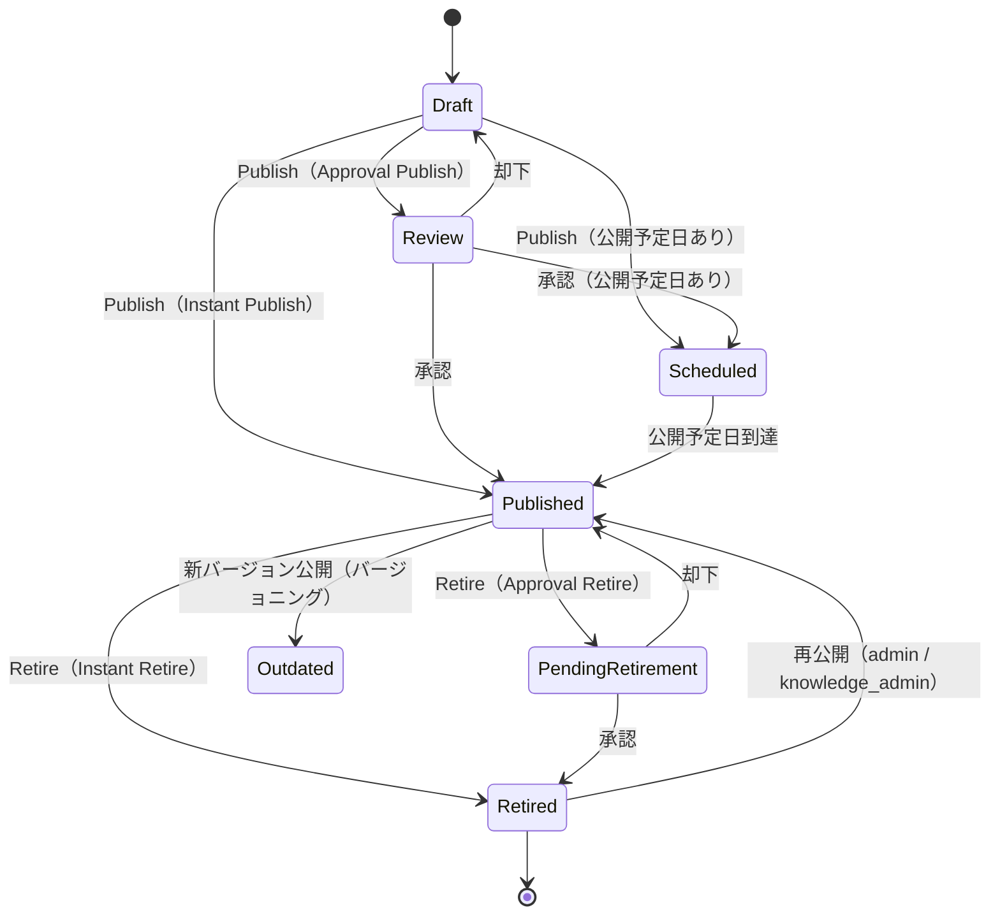
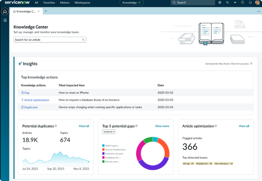
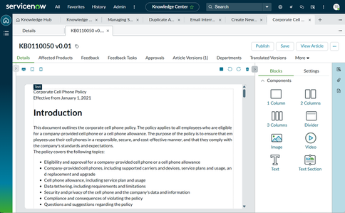
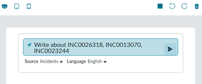

# Knowledge Management（ナレッジ管理）

## 概要

Knowledge Management（ナレッジ管理、以下 KM）は、ServiceNow AI Platform（旧 Now Platform）に標準搭載されたナレッジ記事の作成・レビュー・公開・検索・改善の仕組みである。KM の中核プラグイン `com.glideapp.knowledge`（Knowledge Management Core）はデフォルトで有効化されており、ITSM・CSM・HRSD などの各製品から共通に利用される。[出典](https://www.servicenow.com/docs/r/q4dSP2Icgr1SFv5wanVXvQ/QcBhmMq0qRTNxZ4PCJbo6g)

KM の構成要素は次のとおりである。

| 構成要素 | 英語名 | 主なテーブル | 説明 |
|---|---|---|---|
| ナレッジベース | Knowledge Base | `kb_knowledge_base` | 記事の格納単位。ワークフロー、アクセス権（User criteria）、テンプレート、カテゴリ、有効期限の既定値を持つ |
| ナレッジ記事 | Knowledge Article | `kb_knowledge` | 記事本体。1 記事は 1 つのナレッジベースにのみ属する |
| カテゴリ | Knowledge Category | `kb_category` | ナレッジベース内の階層分類 |
| ワークフロー／フロー | Knowledge workflow / flow | — | 公開（Publish）・退役（Retire）の手順。ナレッジベース単位で割当 |
| ユーザー条件 | User criteria | `user_criteria`、`kb_uc_can_read_mtom`、`kb_uc_can_contribute_mtom` 等 | 閲覧（Read）・寄稿（Contribute）権限の判定 |
| 記事テンプレート | Article template | `kb_article_template`、`kb_article_template_definition` | FAQ／How To／KCS 等の構造化記事 |
| ナレッジブロック | Knowledge Block | （ブロック専用テーブル） | 記事に差し込む再利用可能な部品。ブロック単位で閲覧制御 |
| フィードバック | Feedback | `kb_feedback`、`kb_feedback_task` | 評価・役に立った／立たない・フラグ・コメントと、それに基づく改善タスク |
| 利用履歴 | Usage | `kb_use` | 記事閲覧・利用の記録 |
| Knowledge Center | Knowledge Center | — | ナレッジ管理者向けのワークスペース（UI Builder ベース）。AI による重複検出・ギャップ分析・記事最適化 |

> テーブル名のうち `kb_knowledge_base`、`kb_category`、`kb_feedback`、`kb_feedback_task`、`kb_use`、`kb_uc_can_read_mtom`、`kb_uc_can_contribute_mtom` は公式ドキュメントの該当ページで明示を確認できず、ServiceNow Community の回答に基づく `【第三者情報】`。インスタンスの System Definition > Tables で確認すること。[出典](https://www.servicenow.com/community/servicenow-ai-platform-forum/when-does-kb-uc-can-read-mtom-have-no-user-criteria-for-a-kb/m-p/1094826) [出典](https://www.servicenow.com/community/developer-forum/kb-feedback-task-assignment/m-p/3469277) [出典](https://www.servicenow.com/community/expert-services-forum/triggers-for-quot-used-quot-flag-set-to-true-in-the-kb-use-table/m-p/3225036)

本ファイルは Australia リリース（2026-05 GA）を基準とする。Knowledge Management 本体については、公式の結合リリースノート上、Australia・Brazil ともに「No updates for this release」とされており、近年の機能追加は主に **Knowledge Center**（ストアアプリ。Australia・Brazil とも新機能・変更あり）と **Now Assist（ServiceNow Otto）** 側で行われている点に注意する。[出典](https://www.servicenow.com/docs/r/Cz0Un5C85RB3j2nhhAK1aQ/PIh1gIVWw0ZOjXx8J5AQvw) [出典](https://www.servicenow.com/docs/r/delta-zurich-brazil/brazil-zurich-knowledgemanagement-release-notes.html) [出典](https://www.servicenow.com/docs/r/delta-zurich-brazil/brazil-zurich-knowledgecenter-release-notes.html)

関連ファイル：

- ポータル上の記事表示・Employee Center は [Service Portal と Employee Center](./portals-employee-center.md)
- AI Search の詳細設定は [Predictive Intelligence と AI Search](./predictive-intelligence-ai-search.md)
- Now Assist のスキル全般は [Now Assist と AI Agents](./now-assist-ai-agents.md)
- User criteria の一般仕様は [ユーザー・グループ・ロール](./users-groups-roles.md)、ACL は [アクセス制御（ACL）](./access-control-acl.md)
- Flow の作り方は [Workflow Studio / Flow Designer](./flow-designer-workflow-studio.md)
- インシデントからのナレッジ作成は [Incident Management](../itsm/incident-management.md)、問題管理の既知のエラー記事は [Problem Management](../itsm/problem-management.md)
- 記事の翻訳・多言語化は [ローカライゼーション（日本語化）](./localization.md)

---

## リリース別の変更履歴（Yokohama〜Brazil）

Knowledge Management 本体と Knowledge Center の変更点を、公式の結合リリースノートに基づき整理する。

### Knowledge Management 本体

| リリース | 主な変更 |
|---|---|
| Yokohama | KB generation（記事生成）スキルを複製してプロンプトやテンプレートをカスタマイズ可能に。単一／複数ナレッジベースからの記事生成。HTML エディタ（TinyMCE）のツールバーにアクセシビリティチェッカーを追加 |
| Zurich | Flow（Workflow Studio）ベースの公開・退役処理を追加（公式表現は Workflow ベースの処理を「replacing」。ただしアップグレード環境ではナレッジベースごとに Workflow／Flow を選択でき、既定は Workflow。既存 Workflow が自動で Flow に置き換わるわけではない）。Coral テーマが新規ポータル等のデフォルトに。ダークテーマ。ワークスペースの Knowledge ビューページを刷新（レスポンシブ） |
| Australia | KM 本体は「No updates for this release」 |
| Brazil | KM 本体は「No updates for this release」 |

[出典](https://www.servicenow.com/docs/r/Cz0Un5C85RB3j2nhhAK1aQ/PIh1gIVWw0ZOjXx8J5AQvw) [出典](https://www.servicenow.com/docs/r/delta-zurich-brazil/brazil-zurich-knowledgemanagement-release-notes.html)

- 記事バージョニング・購読・テンプレート・AQI 等の Knowledge Management Advanced の機能自体は Yokohama 以前から存在する。Xanadu では、Knowledge Management Advanced（記事バージョニングを含む）が新規顧客に既定でインストールされるようになった（既存顧客は任意で有効化）。[出典](https://www.servicenow.com/docs/r/yokohama/delta-vancouver-xanadu/xanadu-vancouver-knowledgemanagement-release-notes.html)
- Xanadu で、今後 90 日以内に期限切れとなる記事を示すレポート（New report on Knowledge Management dashboard）が Knowledge Management ダッシュボードに追加され、退役か再公開かを判断できるようになった（後述「Valid to の計算ルール」参照）。[出典](https://www.servicenow.com/docs/r/Cz0Un5C85RB3j2nhhAK1aQ/PIh1gIVWw0ZOjXx8J5AQvw)

### Knowledge Center

| リリース | 主な変更 |
|---|---|
| Yokohama | Knowledge Center 登場（ストアアプリ）。記事検索によるギャップ・冗長コンテンツの発見、Article Optimization（記事スキャンと改善提案）、記事エディタでの Now Assist 生成・編集、Potential knowledge gaps（潜在ナレッジギャップ） |
| Zurich | 同機能群。リリースノート上、記事エディタの AI 機能は「ServiceNow Otto」ブランドで記載されている（Otto ブランドは 2026-05 の Knowledge 2026 で発表されたもので、Zurich GA 時点の名称ではなく、後からドキュメントに反映されたもの） |
| Australia | Knowledge health score（重み付け設定可能）、Stale／expiring 記事のレビュー、SharePoint を外部コンテンツ接続（XCC）経由のソースに、Article Optimization の自動修正、重複記事の自動マージ＆公開（ナレッジベース単位）、Box ファイルからの記事生成、Reading Ease スキャン、Now Assist による重複記事のマージ、記事エディタでの Knowledge blocks、Article length スキャン（300 語未満＝SEO、10,000 語超＝AI 検索の観点で警告）、HR ケースデータのギャップ分析対応、文字数表示、Style guides（AI 生成時のトーン・ボイス・用語をナレッジベース単位で定義。パッチの明記なし） 等 |
| Brazil | New features：Knowledge health score の設定（重み付け）、Stale／expiring 記事のレビュー、Microsoft SharePoint（XCC 経由）をソースとした AI 記事作成、Style guides。Changes：Image Alt Tag スキャン（AI）の信頼度ベース自動修正、重複マージで既存記事を更新（取り消し期間のプロパティ追加）、Article health score に Duplicate score を追加（エディタのサイドパネルに表示）、HR ケースデータのギャップ分析対応（AI Admin Hub で Knowledge gaps identification (HR) スキルを有効化）。多くは Australia（特に Patch 6）の内容と重複する |

Australia の Knowledge Center 新機能は Australia Patch 2、3、5、6 で段階的に追加されたものであり、適用パッチによって利用可否が異なる。主な対応は次のとおり：Now Assist による重複記事のマージ＝Patch 2／Knowledge health score、Reading Ease スキャン、Box からの記事生成＝Patch 3／Article Optimization の自動修正（タイトル・見出しタグ）、重複記事の自動マージ＆公開、ServiceNow Otto ブランドへの更新＝Patch 5／health score の重み設定、Stale／expiring 記事のレビュー、SharePoint ソース、Image Alt Tag の自動修正、自動マージの取り消し期間＝Patch 6。Knowledge blocks の挿入、Article length スキャン、Style guides 等はパッチの明記なし。[出典](https://www.servicenow.com/docs/r/Cz0Un5C85RB3j2nhhAK1aQ/BoP1_arUrSHNEuHg0RDFaw)

> **Brazil での変更:** Brazil の Knowledge Management 本体の結合リリースノートは「No updates for this release」である。一方、Knowledge Center の結合リリースノートには上表のとおり New features 4 件・Changes 4 件が記載されている（Removed 等の節は「No updates」。2026-11-02 時点）。また Deprecations として、2026 年 9 月リリースから Gemma 4 が Now LLM Service のオープンウェイトモデルに追加され、旧モデルは公開済みの既存 AI スキル・エージェント・agentic workflow でのみ引き続き利用可能で、新規の開発・構成には使用できない旨が記載されている（KB3066214「ServiceNow Otto Model Upgrades」）。[出典](https://www.servicenow.com/docs/r/delta-zurich-brazil/brazil-zurich-knowledgemanagement-release-notes.html) [出典](https://www.servicenow.com/docs/r/delta-zurich-brazil/brazil-zurich-knowledgecenter-release-notes.html)

---

## プラグイン構成

Knowledge Management の機能は複数のプラグインに分かれている。有効化にはいずれも `admin` ロールが必要である。デフォルトで有効なのは Knowledge Management Core と Knowledge Management Service Portal（Madrid 以降）である。加えて Xanadu 以降、Knowledge Management Advanced は**新規顧客では自動的に有効化**される（Installer による検証が成功した場合。デモデータは含まれない）。既存顧客（アップグレード環境）は Installer 経由で自ら有効化する。Knowledge Management v3 とともに自動有効化されるわけではない。[出典](https://www.servicenow.com/docs/r/q4dSP2Icgr1SFv5wanVXvQ/5N80Ri3iFeljtUtjTfIybw) [出典](https://www.servicenow.com/docs/r/yokohama/delta-vancouver-xanadu/xanadu-vancouver-knowledgemanagement-release-notes.html)

| プラグイン名 | プラグイン ID | 機能 | 有効化／ライセンス |
|---|---|---|---|
| Knowledge Management Core | `com.glideapp.knowledge` | KM の中核。他の KM プラグインが依存 | デフォルト有効 |
| Knowledge Management Advanced Installer | `com.snc.knowledge_advanced.installer` | Advanced 導入前に記事・ナレッジベースを検査。エラーを修正して再実行 | 要有効化 |
| Knowledge Management Advanced | `com.snc.knowledge_advanced` | 記事バージョニング、購読（Subscription）、記事テンプレート、AQI 等。全ナレッジベースが KV3 であることが前提で、Installer 経由で有効化 | Xanadu 以降の新規顧客は自動有効化。既存（アップグレード）顧客は Installer 経由で有効化 |
| Predictive Intelligence for Knowledge Management | `com.snc.knowledge_ml` | 類似記事、ナレッジ需要インサイト等の ML 機能。`com.snc.contextual_search_ml` も有効化 | 要有効化。本番では別ライセンスが必要な場合あり |
| Performance Analytics - Content Pack - Knowledge Management | `com.snc.pa.knowledge_v2` | KM の分析コンテンツパック | 要有効化。本番では PA ライセンスが必要な場合あり |
| Knowledge Management V3 | `com.snc.knowledge3` | KV3 対応（Eureka 以前からのアップグレード時に有効化） | 要有効化 |
| I18N: Knowledge Management Internationalization Plugin v2 | `com.glideapp.knowledge.i18n2` | 記事の多言語管理（翻訳記事） | 言語 i18n プラグイン有効化時に自動有効 |
| Knowledge Document | `com.snc.knowledge_document` | ドキュメントから記事を作成し改版に追随。Managed Documents の拡張 | 要有効化 |
| Knowledge Management - External Content Integration | `com.snc.knowledge.external_integration` | 外部コンテンツを KM 記事としてコピーし Zing 検索の対象に | 要有効化・設定 |
| Knowledge Management Wiki Support | `com.glideapp.knowledge2.wiki` | Wiki 型フィールドで記事を保存 | 要有効化 |
| Knowledge Management KCS Capabilities | `com.snc.knowledge_kcs_capabilities` | KCS ロール（`kcs_candidate`／`kcs_contributor`／`kcs_publisher`）と Governance／Confidence フィールド | 要有効化 |
| Knowledge Management - Add-in for Microsoft Word | `com.snc.knowledge.ms_word` | Microsoft Word で執筆して KM 記事として公開 | 要有効化 |
| Knowledge Blocks | `com.snc.knowledge_blocks` | 再利用可能なコンテンツブロック。ブロック単位の閲覧制御 | 要有効化 |
| Knowledge Overview | `com.sn_knowledge_overview` | ナレッジベース・記事の概要レポート | 要有効化 |
| Knowledge Management Service Portal | `com.snc.knowledge_serviceportal` | Service Portal 上の KM ページ・ウィジェット、Actionable feedback の前提 | Madrid 以降デフォルト有効 |

[出典](https://www.servicenow.com/docs/r/q4dSP2Icgr1SFv5wanVXvQ/QcBhmMq0qRTNxZ4PCJbo6g) [出典](https://www.servicenow.com/docs/r/servicenow-platform/knowledge-management/actionable-knowledge-feedback.html)

- 公式ページの要約欄と表では一部プラグイン ID の表記が異なる箇所がある。本表は表側の ID を採用した。
- Knowledge Blocks を有効化すると Knowledge Management Advanced も有効化され、記事バージョニングが有効になる（ブロック自体はバージョニングの有無に関わらず動作）。[出典](https://www.servicenow.com/docs/r/zS6yb8e~gR8BPjeviYdV9g/nEdAdIsWj0MJ9YK4EMvHKQ)
- KCS Integration for Incident Management（`com.snc.incident.knowledge`）は Incident と KM Advanced を統合するプラグインで、有効化時に Knowledge Management Advanced Installer も有効化される（詳細は「タスクからのナレッジ作成」節）。[出典](https://www.servicenow.com/docs/r/Mr7qUatbFXax1_h~z60rmA/zHUxot1dCYGogoLlz1owwg)

---

## ロール

Knowledge Management のロール（Australia）は次のとおり。`knowledge_manager`、`knowledge_admin`、`knowledge_coach`、`knowledge_domain_expert`、`knowledge_group_member`、`kcs_candidate`、`kcs_contributor`、`kcs_publisher` は `knowledge` ロールを包含する（`knowledge_group_manager` は `knowledge_group_member` を包含）。なお公式表の Contains Roles 欄はこれらのロールではすべて「None」であり、包含関係は各ロールの説明文（「Knowledge role comes as a subordinate role」等）で述べられている。

| ロール（日本語） | ロール名 | 説明 | 備考 |
|---|---|---|---|
| Knowledge | `knowledge` | 既定ナレッジベースへの寄稿と Knowledge アプリケーションメニューへのアクセス。フルフィラーロール | リクエスター（ロールなしユーザー）は閲覧・コメント・フィードバックのみ可能で作成・編集は不可 |
| Knowledge manager（ナレッジマネージャー） | `knowledge_manager` | 管理対象ナレッジベースの管理機能（カテゴリ定義、記事のピン留め、記事変更の承認等） | ナレッジベースの Managers に選ばれたユーザーへ自動付与 |
| Knowledge administrator（ナレッジ管理者） | `knowledge_admin` | KM 全体の管理作業 | スコープ付きナレッジベースは変更不可（明示的な User criteria 許可が必要） |
| Knowledge coach（ナレッジコーチ） | `knowledge_coach` | AQI（Article Quality Index）調査、記事の執筆・編集・レビュー、チームへのコーチング | |
| Knowledge domain expert（ドメインエキスパート） | `knowledge_domain_expert` | AQI 調査、記事の執筆・編集・レビュー、ナレッジベースの健全性追跡 | |
| Knowledge group manager（所有グループマネージャー） | `knowledge_group_manager` | 管理する所有グループ（Ownership group）のメンバー追加・削除。フィードバックタスクを既定で受領し再割当可能 | グループのマネージャー自体の変更は `knowledge_admin` のみ。`knowledge_group_member` を包含 |
| Knowledge group member（所有グループメンバー） | `knowledge_group_member` | 所有グループに所属し、記事の承認、フィードバックタスクの自己割当、グループ所有記事の編集 | |
| KCS candidate | `kcs_candidate` | KCS の基礎を理解した段階の執筆者 | KCS Capabilities プラグインで追加 |
| KCS contributor | `kcs_contributor` | 担当製品領域の記事を、ナレッジコーチのレビューなしで作成・検証。広い対象者向け記事の執筆・承認 | 同上 |
| KCS publisher | `kcs_publisher` | KCS 標準に精通し、外部向け記事を作成する執筆者 | 同上 |
| Administrator | `admin` | ナレッジワークフローの設定、KM プロパティ、フォーム、ダッシュボードの管理 | より専門的なロールがある場合は `admin` を付与しないことが推奨 |

[出典](https://www.servicenow.com/docs/r/q4dSP2Icgr1SFv5wanVXvQ/kxDB9bUAfQ2YmdJ9F26Biw)

---

## Knowledge Base（ナレッジベース）

### Knowledge Base の作成手順

ナレッジベースの作成には `knowledge_admin` または `admin` ロールが必要である。

1. **All > Knowledge > Administration > Knowledge Bases** を開く。
2. **New** をクリックする。
3. フォーム項目を入力し、フォームヘッダーを右クリックして **Save** する。
4. 関連リスト（Knowledge、Can Read、Can Contribute、Article Templates、Featured Content、Knowledge Categories）を確認・設定する。
5. **Submit** する。

[出典](https://www.servicenow.com/docs/r/q4dSP2Icgr1SFv5wanVXvQ/UIignkeSft0ySIS10rUiYQ)

### Knowledge Base フォームのフィールド

`kb_knowledge_base`（Knowledge Base フォーム）の主要フィールドは次のとおり（Australia）。

| フィールド | 説明 |
|---|---|
| Title（タイトル） | ナレッジベース名。一意であるべき |
| Article Validity（記事有効日数） | 記事作成から有効な日数。記事の Valid to の既定値計算に使う。空欄なら Valid to は 2100-01-01 |
| Icon（アイコン） | 検索結果で記事の横に表示される小画像 |
| Disable commenting（コメント無効） | 記事へのコメントを禁止 |
| Disable suggesting（提案無効） | 記事への編集提案を禁止 |
| Disable category editing（カテゴリ編集無効） | カテゴリの追加・編集をナレッジマネージャーに限定 |
| Disable rating（評価無効） | 記事の評価を禁止 |
| Disable mark as helpful（「役に立った」無効） | 「役に立った」操作を禁止 |
| Enable blocks（ブロック有効） | Knowledge Blocks の作成・記事への追加を許可 |
| Checklist（チェックリスト） | 記事品質評価用のチェックリスト（AQI） |
| Application（アプリケーション） | ナレッジベースのアプリケーションスコープ。アプリケーションピッカーから自動設定。スコープ付きナレッジベースは明示的に許可されない限り admin／knowledge_admin も管理できない |
| Owner（オーナー） | ナレッジベースの責任者。ナレッジベースに対し他者へ役割を割り当て可能 |
| Managers（マネージャー） | ナレッジベースの管理作業を行うユーザー |
| Publish workflow（公開ワークフロー） | Knowledge - Instant Publish（承認なし）または Knowledge - Approval Publish（マネージャー承認） |
| Retire workflow（退役ワークフロー） | Knowledge - Instant Retire（承認なし）または Knowledge - Approval Retire（マネージャー承認） |
| Active（有効） | 未選択の場合、admin と knowledge admin のみが記事の作成・検索・閲覧可能 |
| Description（説明） | ナレッジベースの概要 |
| Set default knowledge field values（記事フィールド既定値） | ナレッジベースの既定設定 |
| Related products（関連製品） | 関連する製品 |
| Auto-create translation tasks（翻訳タスク自動作成） | 記事公開時、設定言語の翻訳タスクを自動作成。翻訳管理と `glide.knowman.translation.enable_translation_task` が有効な場合のみ表示 |
| Languages（言語） | 記事に使える言語。後から追加は可能だが、削除はその言語の記事が存在しない場合のみ。表示条件は上と同じ |

[出典](https://www.servicenow.com/docs/r/q4dSP2Icgr1SFv5wanVXvQ/UIignkeSft0ySIS10rUiYQ)

> Zurich 以降、ナレッジベースでは Workflow と Flow のどちらかを選択できる（詳細は後述「公開・退役ワークフロー」）。フォーム上の Publish／Retire の項目が Flow を参照する構成になる。

### Knowledge Base の関連リスト

| 関連リスト | 説明 |
|---|---|
| Knowledge | ナレッジベースに格納されている記事 |
| Can Read | 閲覧権を与える User criteria。閲覧アクセスを保護するため設定が推奨される |
| Can Contribute | 作成・変更権を与える User criteria。寄稿アクセスを保護するため設定が推奨される |
| Article Templates | Knowledge Management Advanced（`com.snc.knowledge_advanced`）有効時のみ表示。テンプレートが登録されていれば記事はその中から選ぶ必要があり、空ならどのテンプレートも使用可。admin／knowledge admin／knowledge manager が編集可能 |
| Featured Content | ホームページの Featured Content に表示する記事（キーワード検索ベース） |
| Knowledge Categories | ナレッジベースのカテゴリ。非アクティブなカテゴリには新規に記事を紐付けられないが、既存記事には影響しない |

[出典](https://www.servicenow.com/docs/r/q4dSP2Icgr1SFv5wanVXvQ/UIignkeSft0ySIS10rUiYQ)

---

## Knowledge Article（ナレッジ記事）

### Knowledge 記事フォームのフィールド

`kb_knowledge`（Knowledge フォーム）の主要フィールドは次のとおり。表示されるフィールドは記事テンプレート・有効プラグイン・プロパティによって変わる。

| フィールド | 説明 | 表示条件 |
|---|---|---|
| Number（番号） | 自動採番（例：`KB0010003`）。バージョニング有効時は `KB0010003 v2.0` の形式で参照される | 常時 |
| Knowledge base | 記事を格納するナレッジベース（1 記事 1 ナレッジベース）。テンプレートが移動先にも存在する場合のみ変更可 | 常時 |
| Category（カテゴリ） | 選択中のナレッジベースのカテゴリのみ選択可。未設定記事は (empty) カテゴリに表示 | 常時 |
| Ownership Group（所有グループ） | 承認・フィードバック対応を担うグループ。公開・編集・退役が可能 | `glide.knowman.ownership_group.enabled` が true |
| Version（バージョン） | 自動採番。公開記事を変更すると増加 | 記事バージョニング有効時 |
| Workflow（ワークフロー状態） | Draft／Review／Published 等の状態。新規は Draft | 常時 |
| Language（言語） | 記事の言語（ナレッジベースで有効な言語） | `com.glideapp.knowledge.i18n2` |
| Short description（簡単な説明） | 記事タイトル。最大 100 文字。Agent assist の類似記事検索に使われる | 常時 |
| Article body（本文） | HTML エディタで編集する本文 | 常時（Standard テンプレート） |
| Source Task（ソースタスク） | 記事作成元のタスク（インシデント、ケース等）。自動設定 | タスクから作成時 |
| Scheduled publish date（公開予定日） | 将来日付での自動公開 | 常時 |
| Valid to（有効期限） | 期限切れ・空欄の記事は検索結果に出ない。既定値はナレッジベースの Article Validity から計算、未設定なら 2100-01-01 | 常時 |
| Confidence（信頼度） | 記事の成熟度（KCS） | KCS Capabilities |
| Governance（ガバナンス） | 経験ベース記事とコンプライアンスベース記事の区別（規制要件のある記事） | KCS Capabilities |
| Article type（記事タイプ） | HTML（Wiki は Wiki Support プラグイン） | Standard テンプレートのみ |
| Display attachments（添付表示） | 本文下に添付ファイルを表示 | 常時 |
| Attachment link（添付リンク） | 検索結果リンクから記事ではなく添付ファイルを直接ダウンロード | 常時 |
| Meta | 検索用の追加キーワード `【経験則】`（公式の定義文は未確認） | 常時 |
| Can Read／Cannot Read | 記事レベルの User criteria。既定ではフォームに出ていないことがあり、フォーム構成で追加する | 常時（要フォーム構成） |

[出典](https://www.servicenow.com/docs/r/q4dSP2Icgr1SFv5wanVXvQ/9hobQL13zXPKJqxXK11Z3Q) [出典](https://www.servicenow.com/docs/r/q4dSP2Icgr1SFv5wanVXvQ/ivWYcxKSOVPolBZ4o~rRTw)

- Meta フィールドは記事バージョニングの「マイナー編集」対象の例として公式に記載されている（Valid To と Meta）。Meta の詳細な仕様説明は今回確認した公式ページでは確認できず。[出典](https://www.servicenow.com/docs/r/q4dSP2Icgr1SFv5wanVXvQ/ivWYcxKSOVPolBZ4o~rRTw)
- Can Read／Cannot Read を記事フォームに追加する必要がある点は Community の回答に基づく `【第三者情報】`。[出典](https://www.servicenow.com/community/service-management-forum/restrict-specific-knowledge-article-to-users-or-groups/m-p/3398592)
- 公開済み記事の削除は `admin` ロールのみ可能。[出典](https://www.servicenow.com/docs/r/q4dSP2Icgr1SFv5wanVXvQ/9hobQL13zXPKJqxXK11Z3Q)

### 記事の作成方法と作成経路

| 経路 | 操作 | 必要ロール／条件 |
|---|---|---|
| Classic UI | Knowledge > Create New 等から作成。Knowledge Management Advanced とテンプレート有効時は Knowledge base と Article Template を選ぶダイアログが表示される | `knowledge` 等＋寄稿権 |
| Agent Workspace | All > Agent Workspace > Agent Workspace Home で New → テンプレート選択 → Save → 任意で Publish | `agent_workspace_user`＋対象ナレッジベースへの寄稿権 |
| Knowledge Center | Knowledge Center の新エディタ（ドラッグ＆ドロップのブロック編集）で作成。Now Assist による生成も可能 | 任意の Knowledge ロール（AI 機能は Now Assist ライセンス） |
| タスクから作成 | Incident 等から「Create Knowledge」で作成。Source Task が自動設定 | 後述 |
| Now Assist（KB generation） | 解決済みのインシデント・ケース等から記事ドラフトを生成 | Now Assist ライセンス |
| Microsoft Word アドイン | Word で執筆し KM 記事として公開 | `com.snc.knowledge.ms_word` |
| インポート | Word 文書等のインポート（推奨サイズ上限 30 MB：`glide.knowman.import.max_document_size`） | |

[出典](https://www.servicenow.com/docs/r/q4dSP2Icgr1SFv5wanVXvQ/9hobQL13zXPKJqxXK11Z3Q) [出典](https://www.servicenow.com/docs/r/q4dSP2Icgr1SFv5wanVXvQ/QcBhmMq0qRTNxZ4PCJbo6g) [出典](https://www.servicenow.com/docs/r/7WDM0xyEt0NzyWpxNsL_LQ/AC3ZHD3lXsQN1O4dPT92GA) [出典](https://servicenow.com/community/knowledge-management-articles/introducing-knowledge-center-with-advanced-editing-powered-by/ta-p/3447858)

### Valid to（有効期限）の計算ルール

記事の Valid to（有効期限）は、Knowledge 記事フォームの日付フィールドであり、期限切れの記事や Valid to が空欄の記事は検索結果に表示されない。

| 場面 | Valid to の既定値 |
|---|---|
| 新規作成時 | 作成日 + ナレッジベースの Article Validity 日数。Article Validity が空欄なら 2100-01-01 |
| 編集時（バージョニング有効） | Article Validity 設定ありなら「更新日 + 日数」に再計算。空欄なら前バージョンの Valid to を維持 |
| 別ナレッジベースへの移動時 | 移動先の Article Validity 設定ありなら「移動日 + 日数」。空欄なら従来値を維持 |
| Dictionary で既定値を変更した場合 | Valid to の Dictionary 値の変更が Article Validity による計算より優先 |

- バージョニング有効時に Valid to を変更するにはチェックアウトが必要。ただし `glide.knowman.versioning.enable_minor_edits` を true にすると、一部ユーザーはチェックアウトなしで変更可能。
- 毎月 1 日、翌月期限切れになる記事について権限のある受信者へリマインダーメールが送信される（プロパティ `glide.knowman.enable_article_expiry_notification`、既定 false）。受信者は Valid to を延長できる。
- 日付形式が 2 桁年だと既定 Valid to で問題が起き得るため、4 桁年形式を使う。

[出典](https://www.servicenow.com/docs/r/q4dSP2Icgr1SFv5wanVXvQ/vls7oH2IiLkkNiq5Jg4oXw) [出典](https://www.servicenow.com/docs/r/7WDM0xyEt0NzyWpxNsL_LQ/AC3ZHD3lXsQN1O4dPT92GA)

- Xanadu 以降、Knowledge Management ダッシュボードに、今後 90 日以内に期限切れとなる記事を示すレポートがあり、退役するか再公開（Valid to 延長）するかの判断に使える。Knowledge Center（Australia）でも Article Optimization スキャンで Stale／expiring 記事を特定できる（後述）。[出典](https://www.servicenow.com/docs/r/Cz0Un5C85RB3j2nhhAK1aQ/PIh1gIVWw0ZOjXx8J5AQvw) [出典](https://www.servicenow.com/docs/r/Cz0Un5C85RB3j2nhhAK1aQ/BoP1_arUrSHNEuHg0RDFaw)

> Valid to を過ぎても記事の状態が自動的に Retired に変わるわけではない（検索に表示されなくなるだけ）。期限切れ記事を自動退役させたい場合はスケジュールジョブ等で実装する、という Community 回答がある `【第三者情報】`。[出典](https://www.servicenow.com/community/developer-forum/kb-article-not-moved-to-retired-after-valid-to-date/m-p/2782136)

### 記事の状態（Workflow state）

`kb_knowledge` の Workflow フィールドの状態は次のとおり。

| 状態（表示名） | 意味 |
|---|---|
| Draft（下書き） | 作成・編集中。新規記事の初期状態 |
| Review／In Review（レビュー中） | Approval Publish による承認待ち |
| Scheduled for publish（公開予定） | 承認済み・公開予定日待ち |
| Published（公開済み） | 公開中。検索・閲覧可能（Valid to 内） |
| Pending retirement（退役保留） | Approval Retire による退役承認待ち |
| Retired（退役） | 退役済み。admin と knowledge admin のみ閲覧可能・再公開可能 |
| Outdated（旧版） | バージョニング有効時、新バージョン公開により置き換えられた旧バージョン |

[出典](https://www.servicenow.com/docs/r/servicenow-platform/knowledge-management/r_KnowledgeWorkflows.html) [出典](https://www.servicenow.com/docs/r/q4dSP2Icgr1SFv5wanVXvQ/KCDgieMIld7lV75D9KcGUw) [出典](https://www.servicenow.com/docs/r/q4dSP2Icgr1SFv5wanVXvQ/ivWYcxKSOVPolBZ4o~rRTw)

- Workflow state の内部値（`draft`、`review`、`published`、`retired` 等）は Community のスクリプト例で使用されているが、`pending_retirement`、`scheduled_publish`、`outdated` などの内部値は公式ページで確認できず。インスタンスの `kb_knowledge.workflow_state` の Choice を確認すること `【第三者情報】`。[出典](https://www.servicenow.com/community/servicenow-ai-platform-forum/kb-articles-stuck-in-review/td-p/1129793)
- 翻訳記事は親記事の子記事であり、親記事を退役しても翻訳記事は自動的には退役しない。[出典](https://www.servicenow.com/docs/r/servicenow-platform/knowledge-management/r_KnowledgeWorkflows.html)
- 退役時に後継記事（Replacement article）を指定できる（`glide.knowman.enable_article_replacement_on_retire`、既定 true）。[出典](https://www.servicenow.com/docs/r/7WDM0xyEt0NzyWpxNsL_LQ/AC3ZHD3lXsQN1O4dPT92GA)

---

## 公開・退役ワークフロー（Knowledge workflows / Knowledge flows）

### 既定のワークフロー／フロー

ナレッジベースごとに公開（Publish）と退役（Retire）の手順を割り当てる。既定で次の 6 種類が提供される（Workflow 版・Flow 版で同名）。

| 名前 | 種別 | 動作 |
|---|---|---|
| Knowledge - Approval Publish | 公開 | ナレッジベースのマネージャー承認後に公開。承認待ちの間は In Review。承認後 Published（公開予定日があれば Scheduled）。却下でワークフローがキャンセルされ Draft に戻る |
| Knowledge - Instant Publish | 公開 | 承認なしで即時（または公開予定日に）公開 |
| Knowledge - Approval Retire | 退役 | マネージャー承認後に退役。いずれかのマネージャーが却下するとキャンセルされ Published のまま |
| Knowledge - Instant Retire | 退役 | 承認なしで即時退役 |
| Knowledge - Publish Knowledge | サブフロー／アクション | 記事を Published にする部品。カスタムワークフローから利用 |
| Knowledge - Retire Knowledge | サブフロー／アクション | 記事を Retired にする部品。カスタムワークフローから利用 |

[出典](https://www.servicenow.com/docs/r/servicenow-platform/knowledge-management/r_KnowledgeWorkflows.html) [出典](https://www.servicenow.com/docs/r/servicenow-platform/knowledge-management/r_KnowledgeFlow.html)

### 承認者の決定ロジック

- 承認者は既定でナレッジベースの Managers（マネージャー）。
- Ownership group（所有グループ）が有効な場合は、記事の所有グループのメンバーに承認依頼が送られる。
- 承認者の決定ロジックを変更するには、Script Include `KBWorkflow` の `getApprovers()` 関数を編集する。
- 承認・却下時は記事の作成者（Author）または改訂者（Reviser）に通知される。
- 承認通知はプロパティ `glide.knowman.enable_approval_notification`（既定 true、New York 以降デフォルト有効）で制御。アクティブなユーザーのみ通知を受け取る。独自の承認通知を作っている場合は、本プロパティを有効化する前に独自通知を無効化する。
- Knowledge flow の承認レコードは削除できず、承認または却下のみ可能。

[出典](https://www.servicenow.com/docs/r/servicenow-platform/knowledge-management/r_KnowledgeWorkflows.html) [出典](https://www.servicenow.com/docs/r/servicenow-platform/knowledge-management/r_KnowledgeFlow.html) [出典](https://www.servicenow.com/docs/r/7WDM0xyEt0NzyWpxNsL_LQ/AC3ZHD3lXsQN1O4dPT92GA)

> 公式ページ内でプロパティ名が `glide.knowman.enableapprovalnotification`（要約欄）と `glide.knowman.enable_approval_notification`（本文）の 2 通りで記載されている。プロパティ一覧ページ（Australia）の表記 `glide.knowman.enable_approval_notification` を採用した。

### Workflow から Flow への移行（Zurich 以降）

Zurich で、Knowledge Management の公開・退役処理としてローコードの Flow（Workflow Studio）版が提供された。公式リリースノートは従来の Workflow（Workflow Editor）ベースの処理を「replacing」すると表現しているが、アップグレード環境で既存の Workflow が自動的に Flow へ置き換わるわけではない（下記のとおり既定は Workflow）。

- Zurich へのアップグレード後、Knowledge Base フォームでは Workflow と Flow の両方を選択できる。ナレッジベースごとにどちらか一方のみ使用でき、既定は Workflow。
- 同一ナレッジベースで「公開は Flow、退役は Workflow」のような混在（クロス選択）はできない。
- ナレッジベースごとに異なる Flow を割り当てられる。

[出典](https://www.servicenow.com/docs/r/servicenow-platform/knowledge-management/r_KnowledgeWorkflows.html) [出典](https://www.servicenow.com/docs/r/zS6yb8e~gR8BPjeviYdV9g/ssY56eDsVIpGRQzaDhM2jg) [出典](https://www.servicenow.com/docs/r/Cz0Un5C85RB3j2nhhAK1aQ/PIh1gIVWw0ZOjXx8J5AQvw)

Flow 化により、Workflow Studio でトリガーの再利用、定期実行、Decision table、AI ステップ、翻訳の自動化、外部イベント連携などを公開・退役フローに組み込めるようになったと ServiceNow Community の公式ブログで説明されている。[出典](https://www.servicenow.com/community/servicenow-ai-platform-blog/what-s-new-in-knowledge-management-zurich-release-highlights/ba-p/3408850)

> Community では「Zurich では Instant Publish／Instant Retire などの既定処理はすでに Flow で構築されている」「Workflow から Flow への移行は 1 対 1 変換ではない」といった指摘がある `【第三者情報】`。カスタムの承認 Workflow を持つ場合は、移行時に承認者ロジック（`KBWorkflow.getApprovers()` 依存部分）と通知を再検証すること `【経験則】`。[出典](https://www.servicenow.com/community/developer-forum/migrating-knowledge-workflow-to-flow/m-p/3533697)

---

## User criteria によるアクセス制御

### アクセスの種類と 4 種類の User criteria

Knowledge Management のアクセス権は「Read（閲覧）」と「Contribute（寄稿＝記事の作成・変更・退役）」の 2 種類で、ナレッジベースおよび記事に User criteria（ユーザー条件）を割り当てて制御する。User criteria の割当には `knowledge_manager`、`knowledge_admin`、`admin` のいずれかが必要。

| User criteria | ナレッジベースレベル | 記事レベル |
|---|---|---|
| Can Read | ナレッジベース内の記事の閲覧を許可 | その記事の閲覧を許可 |
| Cannot Read | ナレッジベース内の記事の閲覧を禁止 | その記事の閲覧を禁止 |
| Can Contribute | 記事の閲覧・作成・変更・退役を許可 | 設定不可 |
| Cannot Contribute | 記事の作成・変更・退役を禁止 | 設定不可 |

[出典](https://www.servicenow.com/docs/r/q4dSP2Icgr1SFv5wanVXvQ/3BXkJNu_yngCF5YeYJmACA)

### 優先順位（競合時の判定）

| 条件 | 結果 |
|---|---|
| ナレッジベースで Can Contribute と Cannot Contribute の両方に該当 | ナレッジベースとその記事への寄稿は拒否 |
| ナレッジベースで Can Read と Cannot Read の両方に該当 | ナレッジベースとその記事の閲覧は拒否 |
| ナレッジベースで Can Read、記事で Cannot Read に該当 | その記事の閲覧は拒否 |
| 記事で Cannot Read と Can Read の両方に該当 | その記事の閲覧は拒否 |

原則として「Cannot」（拒否）が「Can」（許可）に優先する。Contribute 権限はナレッジベース内の全記事の Read 権限も含む。[出典](https://www.servicenow.com/docs/r/q4dSP2Icgr1SFv5wanVXvQ/3BXkJNu_yngCF5YeYJmACA)

### User criteria に依らない特別権限

| 立場 | 権限 |
|---|---|
| Knowledge administrator（`knowledge_admin`） | 全ナレッジベース・記事の寄稿・閲覧、ナレッジベース定義の変更、User criteria の割当。ただしスコープ付きナレッジベースは明示的な User criteria による許可が必要 |
| ナレッジベースの Owner | そのナレッジベースの寄稿・閲覧、定義変更、User criteria 割当 |
| ナレッジベースの Manager | Owner と同じ。ただし記事バージョニング有効時は他の作成者の Draft 記事を変更できない |
| Ownership group のメンバー | 関連記事の閲覧・変更・承認・退役 |

[出典](https://www.servicenow.com/docs/r/q4dSP2Icgr1SFv5wanVXvQ/3BXkJNu_yngCF5YeYJmACA)

### User criteria 未設定時の既定動作と関連プロパティ

User criteria がナレッジベースに未設定の場合の動作は `glide.knowman.block_access_with_no_user_criteria` プロパティで決まる。

| プロパティ | 値 | 動作 |
|---|---|---|
| `glide.knowman.block_access_with_no_user_criteria` | true（推奨・既定） | Can Read／Can Contribute が未設定のナレッジベースでは、特別権限ユーザー以外に寄稿権を与えない。閲覧も特別権限ユーザーと寄稿者のみ |
| 同上 | false | ロールを 1 つ以上持つユーザーは寄稿可能。未認証ユーザーを含む全ユーザーがナレッジベースを閲覧可能（記事レベル条件は適用）。Explicit Roles 有効時は `snc_internal` 以外のロールを持つユーザーが寄稿可能 |
| `glide.knowman.apply_article_read_criteria` | false（既定） | ナレッジベースレベルの寄稿権が優先し、寄稿者は全記事を閲覧・寄稿できる |
| 同上 | true | 記事レベルの Can Read／Cannot Read がナレッジベースレベルの寄稿・閲覧権を上書き |
| `glide.knowman.search.apply_role_based_security` | （既定で存在しない。追加が必要） | false にすると、ロールに関係なく User criteria のみで記事アクセスを判定 |

[出典](https://www.servicenow.com/docs/r/q4dSP2Icgr1SFv5wanVXvQ/3BXkJNu_yngCF5YeYJmACA) [出典](https://www.servicenow.com/docs/r/7WDM0xyEt0NzyWpxNsL_LQ/AC3ZHD3lXsQN1O4dPT92GA)

- 既定では、寄稿権を持たないユーザーが記事を閲覧するには、ロール条件と User criteria の両方を満たす必要がある。[出典](https://www.servicenow.com/docs/r/q4dSP2Icgr1SFv5wanVXvQ/3BXkJNu_yngCF5YeYJmACA)
- `glide.knowman.block_access_with_no_user_criteria` の既定値について、プロパティ一覧（Australia）は true、Security Center の推奨値も true。ただし、古いインスタンスからアップグレードした環境では false のままの場合があるため確認を要する `【推定】`。[出典](https://www.servicenow.com/docs/r/7WDM0xyEt0NzyWpxNsL_LQ/AC3ZHD3lXsQN1O4dPT92GA) [出典](https://www.servicenow.com/docs/r/oL66E_cwDD_tnWQYzYPRdA/l0EydJMAWkh340uu4xJHvA)

### Explicit Roles（`snc_internal`／`snc_external`）との関係

Case Management Core（`com.sn_customerservice`）などのプラグインにより Explicit Roles プラグイン（`com.glide.explicit_roles`）が有効化されると、`snc_internal`（内部ユーザー）と `snc_external`（外部ユーザー）ロールが追加される。

- Explicit Roles 有効化後に作成したナレッジベースには、次の User criteria が自動で付与される。
  - Can Read：`snc_internal` ロールを持つユーザー
  - Can Contribute：`snc_internal` と他のロールを持つユーザー
- Explicit Roles 有効化前から存在するナレッジベース（Rome 以降へアップグレードした環境）には自動付与されないため、フィックススクリプト「Fix unsecured knowledge bases」を実行する。
- ロールによる制御は Knowledge Management v2 の方式、User criteria は v3 で導入された方式であり、User criteria の利用が推奨される。

[出典](https://www.servicenow.com/docs/r/q4dSP2Icgr1SFv5wanVXvQ/3BXkJNu_yngCF5YeYJmACA)

### アクセス制御の実務上の注意

- 寄稿者用の User criteria を Can Contribute にだけ設定し Can Read に含めないと、制限付きナレッジベースで寄稿者が行き詰まる事例が Community で報告されている。寄稿者の条件を Can Read にも含めるのが一般的な対処 `【第三者情報】`。[出典](https://www.servicenow.com/community/community-central-forum/getting-error-no-user-has-read-or-contribute-access-to-this-kb/td-p/3237776/page/2)
- 記事レベルの Can Read が「効かない」という問い合わせの多くは、`glide.knowman.apply_article_read_criteria` が false（既定）のため寄稿者に全記事が見えていることが原因 `【第三者情報】`。
- 「特定記事を誰が閲覧できるか」を一覧で得る標準的な方法はなく、閲覧時にユーザーごとに評価される `【第三者情報】`。[出典](https://www.servicenow.com/community/developer-forum/retrieve-servicenow-knowledge-base-permissons-acls/td-p/1977217/page/2)
- User criteria そのものの定義方法（ユーザー／グループ／ロール／部署／ロケーション／会社／スクリプト条件）は [ユーザー・グループ・ロール](./users-groups-roles.md) を参照。

---

## Ownership groups（所有グループ）

Ownership group（所有グループ）は、メンバーとマネージャーで構成され、関連付けられた記事の承認とフィードバック対応に責任を持つグループである。

| 項目 | 内容 |
|---|---|
| 有効化 | `glide.knowman.ownership_group.enabled` を true（既定 false）。Knowledge Management Advanced（`com.snc.knowledge_advanced`。Xanadu 以降の新規顧客は自動有効）有効時に利用可能 |
| 承認 | 記事に所有グループが設定されている場合、承認依頼は所有グループのメンバーへ |
| 自己承認 | `glide.knowman.ownership_group.allow_self_approval`（既定 true）でメンバーが自作記事を承認可能。無効化可 |
| 作成者の寄稿権 | 所有グループ設定時、作成者・改訂者は既定で公開記事への寄稿権を失う。`glide.knowman.ownership_group.override`（既定 false）を true にすると維持 |
| フィードバック | フィードバックタスクは所有グループのマネージャーに割当（後述） |
| ロール | `knowledge_group_manager`、`knowledge_group_member` |
| 無効化時の注意 | 一度 true にした後で戻す場合は、所有グループに紐づく記事の再割当、保留中承認のクローズ、未解決フィードバックタスクの解決を事前に手動で行う |

[出典](https://www.servicenow.com/docs/r/7WDM0xyEt0NzyWpxNsL_LQ/AC3ZHD3lXsQN1O4dPT92GA) [出典](https://www.servicenow.com/docs/r/q4dSP2Icgr1SFv5wanVXvQ/a2QHs7hbY4rMkoVRIxGuOg) [出典](https://www.servicenow.com/docs/r/q4dSP2Icgr1SFv5wanVXvQ/kxDB9bUAfQ2YmdJ9F26Biw)

> プロパティ名の表記揺れ：公式ドキュメントのリリースやページにより `glide.knowman.ownershipgroup.enabled`（アンダースコアなし）、自己承認について `glide.knowman.ownership_group.enable_self_approval` という記載も見られる。本ファイルは Australia のプロパティ一覧ページの表記を採用した。実機の System Properties で確認すること。[出典](https://www.servicenow.com/docs/r/q4dSP2Icgr1SFv5wanVXvQ/9hobQL13zXPKJqxXK11Z3Q)

> Community では `glide.knowman.ownership_group.override` を true にした際に ACL 条件が作成者を正しく判定しない既知問題（PRB1783762）が報告されている `【第三者情報】`。修正状況は公開情報では確認できず。[出典](https://www.servicenow.com/community/knowledge-managers/ownership-groups-amp-creating-articles-in-shared-kb-without/td-p/3097883/page/2)

---

## Article versioning（記事バージョニング）

記事バージョニングは、公開記事を変更せずに新バージョンを作成・レビュー・公開できる機能である。

| 項目 | 内容 |
|---|---|
| 前提 | Knowledge Management Advanced（`com.snc.knowledge_advanced`）有効（Xanadu 以降の新規顧客は自動有効、アップグレード環境は要有効化）、`glide.knowman.versioning.enabled` = true（既定 true） |
| チェックアウト | 公開記事を Knowledge フォームで **Checkout** すると新バージョン（Draft）が作られ、公開中のバージョンはそのまま |
| 操作 | チェックアウト（新バージョン作成）、旧版（Outdated）を選んで最新版にする、レビュー中／公開予定の記事のリコール（Recall）、最新公開版の退役 |
| 番号 | 記事番号にバージョンが付く（例：`KB0010003 v2.0`）。全バージョンは関連リストで確認 |
| Draft の編集者 | チェックアウトした作成者、ナレッジベースのオーナー、`knowledge_admin` のみ |
| マイナー編集 | `glide.knowman.versioning.enable_minor_edits` = true（既定 false）で、`glide.knowman.versioning.minor_edit_fields`（既定 `valid_to`）に列挙したフィールドを新バージョンなしで変更可。`attachments` を加えると添付の追加・削除もチェックアウト不要。マイナー編集を行えるのは KB オーナー、KM 管理者、KB マネージャー |
| 移行時 | バージョニング非対応のインスタンスからインポートした記事は、フィックススクリプト「Initialize Versions on Articles」を実行してからチェックアウトする |
| ドメイン | `glide.knowman.allow_edit_global_articles`（既定 true）で global 以外のドメインのユーザーも global 記事をチェックアウト・編集可能 |

[出典](https://www.servicenow.com/docs/r/q4dSP2Icgr1SFv5wanVXvQ/ivWYcxKSOVPolBZ4o~rRTw) [出典](https://www.servicenow.com/docs/r/7WDM0xyEt0NzyWpxNsL_LQ/AC3ZHD3lXsQN1O4dPT92GA)

- バージョン番号の増分規則（メジャー／マイナーの付け方）は別ページで説明されており、今回の調査では詳細を確認できず。

---

## Article templates（記事テンプレート）

### 概要と前提

Article templates（記事テンプレート）は、記事の構造（フィールド）を定義し、FAQ・手順・KCS 記事などを統一された形式で作成するための機能である。Knowledge Management Advanced（`com.snc.knowledge_advanced`。Xanadu 以降の新規顧客は自動有効、アップグレード環境は要有効化）で有効になり、有効化後は記事作成時にテンプレートの選択肢が表示される。管理メニューは **Knowledge > Administration > Article Templates**。[出典](https://www.servicenow.com/docs/r/q4dSP2Icgr1SFv5wanVXvQ/jdGN5HJDyrqEU8wCmeRgJw)

### テーブル構造

| テーブル | 役割 |
|---|---|
| `kb_article_template` | テンプレートの構造 |
| `kb_article_template_definition` | 各テンプレートのフィールド定義 |
| `kb_template_*`（テンプレートごとの子テーブル） | `kb_knowledge` を拡張した各テンプレートの記事テーブル。テンプレートにフィールドを追加すると子テーブルに列が追加される |

### 既定テンプレート

| テンプレート | フィールド | テーブル | SEO description タグに使うフィールド |
|---|---|---|---|
| FAQ | Question、Answer | `kb_template_faq` | Question |
| How To | Introduction、Instructions | `kb_template_how_to` | Introduction |
| What Is | Introduction、Explanation | `kb_template_what_is` | Introduction |
| KCS Article | Issue、Environment、Cause、Resolution | `kb_template_kcs_article` | Issue |
| Standard | Text | `kb_knowledge` | Text |

[出典](https://www.servicenow.com/docs/r/q4dSP2Icgr1SFv5wanVXvQ/jdGN5HJDyrqEU8wCmeRgJw)

### 動作と制約

- 既定テンプレートは初期状態で非アクティブ。テンプレートを有効化するまで記事は Standard テンプレートで作成される。
- 記事作成時に表示されるのは「アクティブ」かつ「ナレッジベースの Article Templates 関連リストに紐付いた」テンプレートのみ（関連リストが空なら全テンプレートが使用可能）。
- テンプレートとテンプレート列は子テーブルを伴うため**削除できない**（非アクティブ化のみ）。
- Standard テンプレートは常に利用可能で非アクティブにできない。
- Kingston 以降へのアップグレード後、既存記事は Standard テンプレートを使用する。
- 新しいテンプレートで作成する記事に重複チェックを行うには、Table Configuration の Search context を Knowledge ML Search に設定する必要がある。

[出典](https://www.servicenow.com/docs/r/q4dSP2Icgr1SFv5wanVXvQ/jdGN5HJDyrqEU8wCmeRgJw) [出典](https://www.servicenow.com/docs/r/q4dSP2Icgr1SFv5wanVXvQ/tE1Q22VhmMLDaC8qt6nzvg)

| ロール | テンプレートに関する権限 |
|---|---|
| `knowledge_admin` | テンプレートの作成・編集、フィールドの追加・カスタマイズ、アクティブ化／非アクティブ化 |
| `security_admin` | フィールドレベルのセキュリティ設定（特定フィールドを見せるユーザーの制御） |
| 執筆者 | 既定またはカスタムテンプレートから記事を作成（特定ロールの明記なし） |

[出典](https://www.servicenow.com/docs/r/q4dSP2Icgr1SFv5wanVXvQ/jdGN5HJDyrqEU8wCmeRgJw)

> Knowledge Center の新エディタは既存の記事テンプレート・フォームテンプレートと後方互換であると説明されている。[出典](https://servicenow.com/community/knowledge-management-articles/introducing-knowledge-center-with-advanced-editing-powered-by/ta-p/3447858)

---

## Knowledge Blocks（ナレッジブロック）

### 概要

Knowledge Blocks（ナレッジブロック）は、ナレッジ記事に挿入する再利用可能なコンテンツ部品である。ブロックごとに User criteria を設定でき、ユーザー・グループ・ロール・会社・ロケーション・部署に応じて「誰がそのブロックを読める／読めないか」を制御できる。ServiceNow AI Platform でのみサポートされる。[出典](https://www.servicenow.com/docs/r/q4dSP2Icgr1SFv5wanVXvQ/ejF5pyWvbIQ0vL~mkHfn4w)

公式ドキュメントの例：HR の休日カレンダーを、(1) 拠点ごとに別記事、(2) 1 記事に拠点別セクション、(3) 1 記事に拠点別ブロック、の 3 方式で比較し、(3) によって各拠点の従業員には自拠点のカレンダーだけが表示されることを示している。[出典](https://www.servicenow.com/docs/r/q4dSP2Icgr1SFv5wanVXvQ/ejF5pyWvbIQ0vL~mkHfn4w)

### 有効化と作成

1. Knowledge Blocks プラグイン（`com.snc.knowledge_blocks`、`admin` が有効化。デモデータと関連プラグインも有効化される）を有効化する。
2. ナレッジ管理者またはマネージャーが、対象ナレッジベースの **Enable blocks** を有効化する（ナレッジベース単位）。
3. 寄稿者がブロックを作成し、記事に挿入する。User criteria はナレッジベースレベルとブロックレベルの両方で適用される。

[出典](https://www.servicenow.com/docs/r/zS6yb8e~gR8BPjeviYdV9g/nEdAdIsWj0MJ9YK4EMvHKQ)

Knowledge Center では `knowledge` ロールを持つユーザーが **Lists > Knowledge Blocks > All** からブロックを作成できる。ブロックの公開はナレッジベースのワークフローに従う（Instant Publish なら即時、Approval Publish なら承認後）。ブロックにも Valid to があり、期限を過ぎると記事表示でそのブロックの内容が表示されなくなる。[出典](https://www.servicenow.com/docs/r/q4dSP2Icgr1SFv5wanVXvQ/rVIrrzTiMNCV5YpYj13xHQ)

### 制約と関連プロパティ

| 項目 | 内容 |
|---|---|
| 記事タイプ | Wiki 型記事では非サポート（HTML 型のみ） |
| 添付ファイル | ブロックの添付ファイルは既定で表示されない（テキストと画像は表示） |
| カスタム検索・ビューア | 独自の検索や記事ビューアを使う場合、Knowledge／Knowledge blocks API と連携しないとブロックの閲覧制御が保たれない |
| バージョニング | Knowledge Blocks の有効化で Knowledge Management Advanced が有効になりバージョニングも有効化される（プロパティで無効化可） |
| `glide.knowman.blocks.enable` | 既定 true。false にするとブロックの作成・追加ができず Enable blocks フィールドが無効化。既存ブロックは表示され続ける |
| `glide.knowman.allow_retire_block` | 既定 true。記事に付いたブロックの退役を許可 |
| `glide.knowman.add_blocks.search_results` | 記事作成・更新時のブロック検索結果数（6〜25） |

[出典](https://www.servicenow.com/docs/r/q4dSP2Icgr1SFv5wanVXvQ/ejF5pyWvbIQ0vL~mkHfn4w) [出典](https://www.servicenow.com/docs/r/zS6yb8e~gR8BPjeviYdV9g/nEdAdIsWj0MJ9YK4EMvHKQ) [出典](https://www.servicenow.com/docs/r/7WDM0xyEt0NzyWpxNsL_LQ/AC3ZHD3lXsQN1O4dPT92GA)

- ブロックを格納するテーブル名・API 名は今回確認した公式ページには記載がなく、「Components installed with knowledge blocks」ページの参照が必要（公開情報では確認できず）。

---

## KCS（Knowledge-Centered Service）

### KCS の位置付け

KCS（Knowledge-Centered Service）は Consortium for Service Innovation が提唱するナレッジ管理の方法論で、問題解決の過程でナレッジを作成・再利用・改善することを重視する。ServiceNow は KCS Capabilities プラグイン（`com.snc.knowledge_kcs_capabilities`）により、KCS ロールと KCS の記事状態メタデータ（Governance、Confidence）を提供する。有効化は `admin` が行い、ドメインセパレーションと Delegated Admin が有効なインスタンスでは管理ユーザーが global ドメインにいる必要がある。[出典](https://www.servicenow.com/docs/r/q4dSP2Icgr1SFv5wanVXvQ/KCDgieMIld7lV75D9KcGUw) [出典](https://www.servicenow.com/docs/r/zS6yb8e~gR8BPjeviYdV9g/z4RCsU5GsaV1j0nnzIlScQ)

### Workflow state と Confidence の対応

| Workflow state | Confidence（信頼度）の値 |
|---|---|
| Draft、Review、Scheduled for publish | Work in Progress |
| Published | Validated（`knowledge_coach`／`kcs_contributor`／`kcs_publisher` が公開した場合）または Not Validated（それ以外のロールが公開した場合） |
| Pending retirement、Outdated | Published と同じ値 |
| Retired | Archived |

[出典](https://www.servicenow.com/docs/r/q4dSP2Icgr1SFv5wanVXvQ/KCDgieMIld7lV75D9KcGUw)

- Confidence を変更できるのは `knowledge_coach`、`knowledge_admin`、`kcs_contributor`、`kcs_publisher`。
- admin でない `kcs_contributor` または `kcs_candidate` は記事を退役できない。
- プラグイン有効化前から存在する記事の Confidence は None。
- Governance は規制要件に関わる記事を管理できるユーザーを示す（経験ベースかコンプライアンスベースか）。記事に寄稿権を持つユーザーが変更できる。Governance の選択肢値は公開情報では確認できず。

[出典](https://www.servicenow.com/docs/r/q4dSP2Icgr1SFv5wanVXvQ/KCDgieMIld7lV75D9KcGUw)

### KCS ロールと KCS 実践の対応

| ServiceNow ロール | KCS v6 での役割 | ServiceNow 上の主な権限 |
|---|---|---|
| `kcs_candidate` | KCS Candidate（基礎を理解） | 記事作成。退役不可。公開すると Not Validated |
| `kcs_contributor` | KCS Contributor（担当領域で検証可能） | コーチのレビューなしで作成・検証。Confidence 変更可。公開で Validated。退役不可 |
| `kcs_publisher` | KCS Publisher（外部公開可能） | 外部向け記事の作成。Confidence 変更可。公開で Validated |
| `knowledge_coach` | KCS Coach | AQI 調査、レビュー、コーチング。Confidence 変更可 |

[出典](https://www.servicenow.com/docs/r/q4dSP2Icgr1SFv5wanVXvQ/kxDB9bUAfQ2YmdJ9F26Biw) [出典](https://www.servicenow.com/docs/r/q4dSP2Icgr1SFv5wanVXvQ/KCDgieMIld7lV75D9KcGUw)

> ロールと「内部向け／外部向け」公開範囲（Audience）を直接対応付ける公式の仕組みは確認できず。Community には「Candidate はまず Internal 向けで公開し、AQI レビュー後にコーチと相談して外部公開する」という運用例がある `【第三者情報】`。公開範囲の制御は User criteria（ナレッジベース分割や記事レベル条件）で実装するのが一般的 `【経験則】`。[出典](https://www.servicenow.com/community/knowledge-managers/kcs-coaching-what-you-need-to-know/ba-p/2275266)

### AQI（Article Quality Index）

AQI（Article Quality Index、記事品質指標）は、チェックリスト（真偽の質問と重み）で記事を評価する仕組みで、Knowledge Management Advanced（`com.snc.knowledge_advanced`）で有効になる。平均 AQI スコアは Knowledge Management ダッシュボードの Content Quality タブに表示される。チェックリストはナレッジベースの Checklist フィールドで指定する。[出典](https://www.servicenow.com/docs/r/ZUQIWHvhWUsSoHqqH5PGGw/qrHS6NBJF7q6ExfRv4zQ0g) [出典](https://www.servicenow.com/docs/r/q4dSP2Icgr1SFv5wanVXvQ/UIignkeSft0ySIS10rUiYQ)

| プロパティ | 既定値 | 説明 |
|---|---|---|
| `glide.knowman.aqi_pass_score` | 70 | AQI レビューの合格点（1〜100） |
| `glide.knowman.aqi.article_workflow_states` | draft, review, published | AQI レビューを実施できる記事の状態 |

[出典](https://www.servicenow.com/docs/r/7WDM0xyEt0NzyWpxNsL_LQ/AC3ZHD3lXsQN1O4dPT92GA)

- 記事スコアは「true とした回答の重みの合計」で算出される `【第三者情報】`。[出典](https://www.servicenow.com/community/knowledge-managers/what-we-use-as-criteria-for-kcs-article-quality-index-aqi-check/ba-p/2276131)
- KCS v6 では「Article Quality Index」の呼称は「Content Standard Checklist」に変更されている（ServiceNow の機能名は AQI のまま）`【第三者情報】`。[出典](https://library.serviceinnovation.org/KCS/KCS_v6/KCS_v6_Practices_Guide/030/040/010/065)

### タスクからのナレッジ作成（Solve Loop）

KCS の「解決しながら記録する」実践を支える仕組みとして、インシデント・ケース等のタスクから記事を作成する機能がある。

| 方式 | 動作 |
|---|---|
| KCS Integration for Incident Management（`com.snc.incident.knowledge`）有効時 | Incident フォームの Knowledge チェックボックスの代わりに **Create Knowledge** 関連リンクが表示される。インシデントが Resolved で、同インシデントの記事がまだ存在しない場合のみ表示。Incident Create Knowledge ビジネスルールは動作しない。KCS テンプレート（Incident-KCS article）で作成 |
| 同プラグイン無効時 | Knowledge チェックボックスを選び、Additional comments（顧客可視）に解決策を書いてクローズすると、Incident Create Knowledge ビジネスルールで記事が自動作成される（テンプレート・マッピングは使用しない） |
| 記事の格納先 | `glide.knowman.task_kb`：タスクから作成された記事を格納するナレッジベースの sys_id |
| Submission | `glide.knowman.submission.workflow`：通常記事ではなく Knowledge Submission（`kb_submission`）レコードを作成する旧方式 |
| 記事の添付 | `glide.knowman.attach.fields`：記事をタスクに添付したときに記事番号と内容をコピーするフィールド（空欄時は Comments） |

[出典](https://www.servicenow.com/docs/r/Mr7qUatbFXax1_h~z60rmA/zHUxot1dCYGogoLlz1owwg) [出典](https://www.servicenow.com/docs/r/7WDM0xyEt0NzyWpxNsL_LQ/AC3ZHD3lXsQN1O4dPT92GA)

- Knowledge チェックボックス方式が Resolved ではなく Closed のタイミングで動作する点は Community の回答に基づく `【第三者情報】`。[出典](https://www.servicenow.com/community/knowledge-managers/what-is-the-knowledge-check-box-for-in-resolution-information/m-p/2760353)
- インシデント側の詳細は [Incident Management](../itsm/incident-management.md) を参照。

---

## Feedback（フィードバック）と Actionable Knowledge Feedback

### フィードバックの種類

Knowledge Management では、記事閲覧者が次のフィードバックを送れる。それぞれの表示はプロパティとロールで制御する（ナレッジベース側の Disable rating／Disable mark as helpful／Disable commenting でも無効化可能）。

| フィードバック | 制御プロパティ（表示可否／対象ロール） |
|---|---|
| 評価セクション全体 | `glide.knowman.show_rating_options`／`glide.knowman.show_rating_options.roles`（下位オプションのロールもここに含める必要あり） |
| 役に立った（Yes/No） | `glide.knowman.show_yn_rating`／`glide.knowman.show_yn_rating.roles` |
| 5 段階評価（★） | `glide.knowman.show_star_rating`／`glide.knowman.show_star_rating.roles` |
| フラグ（不正確・不完全の報告） | `glide.knowman.show_flag`／`glide.knowman.show_flag.roles` |
| コメント | `glide.knowman.show_user_feedback`／`glide.knowman.show_user_feedback.roles`、表示上限 `glide.knowman.feedback.display_threshold`、1 日あたり投稿上限 `glide.knowman.max_comments_per_user_daily`、Live Feed 利用 `glide.knowman.use_live_feed` |

[出典](https://www.servicenow.com/docs/r/7WDM0xyEt0NzyWpxNsL_LQ/AC3ZHD3lXsQN1O4dPT92GA)

### Actionable Knowledge Feedback（フィードバックタスク）

Actionable Knowledge Feedback は、否定的なフィードバックから自動的に Feedback task（フィードバックタスク）を作成し、記事の改善を担当者に割り当てる仕組みである。Knowledge Management Service Portal プラグイン（`com.snc.knowledge_serviceportal`）と下記プロパティの有効化が必要。Knowledge Management Service Portal と Agent Workspace で動作し、その他のポータルでは Knowledge Article View ページのルートマップを有効化する（New York 以降は既定で有効）。[出典](https://www.servicenow.com/docs/r/servicenow-platform/knowledge-management/actionable-knowledge-feedback.html)

| プロパティ | 既定値 | タスク作成条件 |
|---|---|---|
| `glide.knowman.feedback.enable_actionable_feedback_for_flag` | true | 記事が不正確・不適切としてフラグされたとき |
| `glide.knowman.feedback.enable_actionable_feedback_for_helpful` | false | 「役に立たなかった」とされたとき |
| `glide.knowman.feedback.enable_actionable_feedback_for_rating` | なし | 評価（1〜5）がこの値以下のとき。0 または空で無効 |
| `glide.knowman.feedback.enable_explicit_feedback` | false | true の場合、詳細なフィードバック内容が入力されたときのみ作成 |

[出典](https://www.servicenow.com/docs/r/7WDM0xyEt0NzyWpxNsL_LQ/AC3ZHD3lXsQN1O4dPT92GA)

フィードバックタスクの割当ルール：

1. 記事に Ownership group がある場合 → 所有グループのマネージャーに割当。マネージャーはメンバーへ再割当でき、メンバーは自己割当できる。
2. 所有グループがない場合 → 記事の作成者（Author）または改訂者（Reviser）に割当。

担当者は、記事の更新、新規記事の作成、追加フィードバックの依頼、再割当を行える。フィードバック送信者には、フィードバックの更新・解決時に通知される。Knowledge Management ダッシュボードで未完了／完了タスクと各状態の滞留時間を追跡できる。[出典](https://www.servicenow.com/docs/r/servicenow-platform/knowledge-management/actionable-knowledge-feedback.html) [出典](https://www.servicenow.com/docs/r/q4dSP2Icgr1SFv5wanVXvQ/PDU2SSf2dqO8xF4_av6sgw)

- フィードバックタスクは `kb_feedback_task` テーブルに格納され、標準ビジネスルール「Knowledge Feedback Task Creation」で作成される `【第三者情報】`。割当先を CI のサポートグループ等に変える場合はこのテーブルにビジネスルールを追加する例が Community で紹介されている。[出典](https://www.servicenow.com/community/developer-forum/kb-feedback-task-assignment/m-p/3469277)
- Washington DC のドキュメントでは、フィードバックタスクの作成契機として「フラグ」「役に立たない」「低評価」に加え、トピックに対する「ナレッジギャップ」タスクも挙げられている。[出典](https://www.servicenow.com/docs/bundle/washingtondc-servicenow-platform/page/product/knowledge-management/concept/actionable-knowledge-feedback.html)

### 利用状況の記録

- 標準の記事表示ページ（`kb_view`、`kb_article_view` 等）で記事を閲覧すると、記事の `sys_view_count` が加算され、`kb_use` にレコードが追加される `【第三者情報】`。[出典](https://www.servicenow.com/community/expert-services-forum/triggers-for-quot-used-quot-flag-set-to-true-in-the-kb-use-table/m-p/3225036)
- `glide.knowman.view_age.days`（閲覧数の集計期間）と Count Knowledge スケジュールジョブは Vancouver 以降非推奨。0 に設定して使わないことが推奨されている。[出典](https://www.servicenow.com/docs/r/7WDM0xyEt0NzyWpxNsL_LQ/AC3ZHD3lXsQN1O4dPT92GA)
- `glide.knowman.usage_metrics_duration`（既定 60）で記事閲覧・ポータルページ閲覧・ポータル検索のメトリクス取得期間を設定する。[出典](https://www.servicenow.com/docs/r/7WDM0xyEt0NzyWpxNsL_LQ/AC3ZHD3lXsQN1O4dPT92GA)

### 購読（Subscription）

Knowledge Management Advanced で、ユーザーは記事・ナレッジベースを購読して更新通知を受け取れる。

| プロパティ | 既定値 | 説明 |
|---|---|---|
| `glide.knowman.enable_km_subscription` | true | 購読機能の有効化 |
| `glide.knowman.enable_km_subscription.roles` | knowledge | 購読できるロール |
| `glide.knowman.enable_km_subscription.workflow_state` | draft, review, published | 購読可能な記事状態 |

[出典](https://www.servicenow.com/docs/r/7WDM0xyEt0NzyWpxNsL_LQ/AC3ZHD3lXsQN1O4dPT92GA)

---

## Knowledge Center（ナレッジセンター）

### 概要

Knowledge Center は、ナレッジのオーナー・管理者向けに、構成・ガバナンス・編集・インサイト・最適化を 1 か所にまとめた UI Builder ベースのワークスペースである。ServiceNow Store のアプリとして提供され、Knowledge Management の全ロールで既定利用可能。公式リリースノートでは Yokohama の欄から Knowledge Center の機能が記載されている。Community の公式記事（2025-12）によれば、新エディタを含む現行の Knowledge Center は Zurich Patch 4 で提供され Yokohama Patch 11 にバックポートされており、これらのパッチ以降の新規顧客では既定で有効、アップグレード顧客はシステムプロパティで有効化する。[出典](https://www.servicenow.com/docs/r/Cz0Un5C85RB3j2nhhAK1aQ/BoP1_arUrSHNEuHg0RDFaw) [出典](https://servicenow.com/community/knowledge-management-articles/introducing-knowledge-center-with-advanced-editing-powered-by/ta-p/3447858)

*図 1：Knowledge Center のホーム画面（Insights）*

画面説明：上部ナビゲーションに「Knowledge」が表示され、ページ上部に「Knowledge Center — Set up, manage, and monitor your knowledge bases」というタイトルと記事検索ボックスがある。その下の「Insights」領域（"Generated by Now Assist" の注記あり）に「Top knowledge actions」の表があり、Knowledge actions（Gap／Article optimization／Duplicates）、Most impacted item、Date の 3 列で優先対応事項を一覧表示する。下段には 3 枚のカードがあり、「Potential duplicates」（重複候補の記事数とトピック数、トピック数の推移グラフ）、「Top 5 potential gaps」（Incidents などのソース別に、ナレッジ不足トピック上位 5 件をドーナツグラフで表示）、「Article optimization」（フラグが立った記事数と、Alt tag・Multiple H2・Title relevancy などの上位検出項目）を表示する。各カードに View all／View more リンクがある。
出典：https://servicenow.com/community/knowledge-management-articles/introducing-knowledge-center-with-advanced-editing-powered-by/ta-p/3447858 （取得日：2026-11-03）

### 主な機能

| 機能 | 内容 | Now Assist 要否 |
|---|---|---|
| Insights（ホーム） | 重複、ギャップ、期限切れ間近、最適化推奨を集約表示。Australia で Article health score、Knowledge health score、Adoption metrics を追加 | AI インサイトは要 |
| Potential duplicates | 類似・矛盾する記事の検出。Now Assist によるマージ（元記事への参照を保持）、ナレッジベース単位の自動マージ＆公開（Australia） | 要 |
| Potential knowledge gaps | インシデント・ケース（Australia で HR ケースも）のパターンから記事が不足しているトピックを抽出し、ドラフト生成 | 要 |
| Article Optimization | 見出し構造、画像の alt 属性、タイトルの関連性、リンク切れ、記事長（Article length）、読みやすさ（Reading Ease）等をスキャンし改善提案。Australia で自動修正 | スクリプトベースのスキャンは不要。AI スキャンは要 |
| Advanced editor | ドラッグ＆ドロップのコンテンツブロック（列、画像、見出し、テキスト、動画）、デスクトップ／タブレット／モバイルのプレビュー、画像のトリミング・回転、Knowledge blocks の挿入、文字数表示 | 基本編集は不要 |
| Stale／expiring レビュー | 古い記事・期限切れ間近記事を記事・ナレッジベース単位で特定（Australia） | — |
| 外部ソースからの記事生成 | SharePoint（XCC 経由）、Box ファイルをソースに記事生成（Australia） | 要 |
| Style guides | 管理者がスタイルガイド（AI が従うトーン・ボイス・用語）を作成し、ナレッジベースに割り当てて適用順序を設定。執筆者は AI による記事生成時に選択でき、Now Assist（ServiceNow Otto）による記事生成・編集に適用される（Australia、Brazil のリリースノートにも記載） | 要 |

[出典](https://www.servicenow.com/docs/r/Cz0Un5C85RB3j2nhhAK1aQ/BoP1_arUrSHNEuHg0RDFaw) [出典](https://www.servicenow.com/docs/r/delta-zurich-brazil/brazil-zurich-knowledgecenter-release-notes.html) [出典](https://servicenow.com/community/knowledge-management-articles/introducing-knowledge-center-with-advanced-editing-powered-by/ta-p/3447858) [出典](https://www.servicenow.com/docs/r/q4dSP2Icgr1SFv5wanVXvQ/r5wsT6sBWg~VO2qK9la2mw)

*図 2：Knowledge Center の Advanced editor（記事編集画面）*

画面説明：上部タブに Knowledge Center が表示され、記事番号「KB0110050 v0.01」の編集画面が開いている。右上に Publish、Save、View Article ボタン。記事フォームのタブとして Details、Affected Products、Feedback、Feedback Tasks、Approvals、Article Versions、Departments、Translated Versions がある。中央が本文の WYSIWYG 編集領域（例として「Corporate Cell Phone Policy」の記事）で、上部にデスクトップ／タブレット／モバイルのプレビュー切替アイコンがある。右側パネルの「Blocks」タブに Components として 1 Column、2 Columns、3 Columns、Divider、Image、Video、Text、Text Section のブロックが並び、ドラッグして本文に配置する。
出典：https://servicenow.com/community/knowledge-management-articles/introducing-knowledge-center-with-advanced-editing-powered-by/ta-p/3447858 （取得日：2026-11-03）

*図 3：ナレッジギャップから Now Assist で記事ドラフトを生成するプロンプト入力*

画面説明：エディタ上部に「Write about INC0026318, INC0013070, INC0023244」というプロンプトが入力されたボックスがあり、その下で Source（Incidents）と Language（English）を選択できる。ギャップとしてクラスタリングされた複数インシデントを元に、Now Assist が記事ドラフトを生成する操作を示す。
出典：https://servicenow.com/community/knowledge-management-articles/introducing-knowledge-center-with-advanced-editing-powered-by/ta-p/3447858 （取得日：2026-11-03）

### Article Optimization の操作

1. **All > Knowledge > Knowledge Center > Lists** を開く。
2. List メニューから記事種別（Unpublished、Published、Retired 等）を選ぶ。
3. 記事を開き **Edit** で Article Editor を開く。
4. Article Optimization アイコンを選択し、指摘と修正案を確認する。
5. 各フィードバックカードで修正案（例：「Review」「Add alt attribute」）を受け入れるか **Ignore** し、**Update** → **Save** する。

スキャンはジョブ（スケジュールと条件を定義、1 つ以上のスキャンを含む）として構成でき、保存時または定期実行で動く。スクリプトベースのスキャンは全ユーザーで実行され、AI ベースのスキャンは ServiceNow Otto（Now Assist）契約者のみ。[出典](https://www.servicenow.com/docs/r/q4dSP2Icgr1SFv5wanVXvQ/r5wsT6sBWg~VO2qK9la2mw)

### Knowledge Center の主要プロパティ

| プロパティ | 説明 |
|---|---|
| `sn_km_center.glide.knowman.enable` | Knowledge Center の有効化 `【第三者情報】` |
| `sn_km_center.glide.knowman.ece.enable` | 新エディタ（Enhanced content editor）の有効化 `【第三者情報】` |
| `sn_km_center.glide.knowman.redirect.enable` | Knowledge の編集操作を新エディタへリダイレクト `【第三者情報】` |
| `sn_km_center.ao_auto_update.enabled` | Article Optimization の自動更新（既定有効）。併せて Article Optimization スキルの有効化と、ナレッジベースごとの「Enable automatic updating and publishing of articles from AO findings」の有効化が必要 |
| `sn_km_gen_ai.auto_merge.enable` | 重複記事の自動マージ。Identify duplicate articles／Merge Articles スキルの有効化と、ナレッジベースごとの「Enable automatic merging and publishing of duplicate articles」の有効化が必要 |
| `sn_km_gen_ai.auto_merge.confidence_threshold` | 自動マージの信頼度しきい値 |
| `sn_km_gen_ai.auto_merge.revert_ttl_days` | 自動マージ・自動更新を元に戻せる期間（日） |

[出典](https://www.servicenow.com/docs/r/Cz0Un5C85RB3j2nhhAK1aQ/BoP1_arUrSHNEuHg0RDFaw) [出典](https://servicenow.com/community/knowledge-management-articles/introducing-knowledge-center-with-advanced-editing-powered-by/ta-p/3447858)

> 既知の問題 KB2678398：Knowledge Center を無効化していても Unified Navigation に表示される。Yokohama Patch 13、Zurich Patch 7、Australia Patch 1 で修正とされる `【第三者情報】`（Community コメントでの KB 引用）。[出典](https://servicenow.com/community/knowledge-management-articles/introducing-knowledge-center-with-advanced-editing-powered-by/ta-p/3447858)

---

## Now Assist（ServiceNow Otto）による生成 AI 機能

Knowledge Management 関連の生成 AI 機能は次のとおり。いずれも Now Assist のライセンスが必要。Now Assist は 2026 年から ServiceNow Otto ブランドに変更された（2026-05 の Knowledge 2026 で発表。Knowledge Center のリリースノートでは Australia Patch 5 のハイライトに記載）。[出典](https://newsroom.servicenow.com/press-releases/details/2026/ServiceNow-Otto-creates-the-unified-AI-experience-for-the-enterprise/) [出典](https://www.servicenow.com/docs/r/Cz0Un5C85RB3j2nhhAK1aQ/BoP1_arUrSHNEuHg0RDFaw)スキル全般・ライセンス体系は [Now Assist と AI Agents](./now-assist-ai-agents.md) を参照。

| 機能 | 内容 |
|---|---|
| KB generation（記事生成） | 解決済みのケース・インシデント・作業指示タスクの情報（短い説明、説明、解決メモ、クローズメモ、作業メモ、コメント等）から記事ドラフトを生成し、エージェントがレビュー・編集して公開する。Now Assist パネル、Classic 環境、構成可能ワークスペースから起動 |
| 生成条件（Incident） | インシデントが Resolved または Closed で、既存の記事がないこと。`com.snc.incident.create_knowledge.multistate.enable` で他の状態でも生成可能に |
| テンプレート | KCS Integration for Incident Management がある場合は KCS テンプレートで生成、ない場合は Standard |
| スキルのカスタマイズ | Yokohama 以降、KB generation スキルを複製してプロンプトやカスタムテンプレートを設定可能 |
| 記事エディタの AI | 選択テキストの拡張・要約・書き換え（Zurich 以降、サードパーティ LLM も利用可） |
| Knowledge Center の AI | 重複検出・マージ、ギャップ分析と記事生成、AI スキャン（Reading Ease、Image Alt Tag 等）と自動修正 |

[出典](https://www.servicenow.com/docs/r/x7YYxCVARboMBfN2zKAZsA/_CSz4yfJG8Svh8O92KusJg) [出典](https://www.servicenow.com/docs/r/zS6yb8e~gR8BPjeviYdV9g/TdGQGD9kqIC3w2eT6Y05Tw) [出典](https://www.servicenow.com/docs/r/Cz0Un5C85RB3j2nhhAK1aQ/PIh1gIVWw0ZOjXx8J5AQvw) [出典](https://www.servicenow.com/community/servicenow-ai-platform-blog/what-s-new-in-knowledge-management-zurich-release-highlights/ba-p/3408850)

- 生成 AI の出力は正確・完全とは限らないと公式に注記されており、公開前のレビューが前提である。[出典](https://www.servicenow.com/docs/r/x7YYxCVARboMBfN2zKAZsA/_CSz4yfJG8Svh8O92KusJg)
- Now Assist Q&A（Genius Results）や Virtual Agent は、ナレッジ記事を回答ソースとして利用する。記事品質（重複・古い記事・長すぎる記事）が AI 回答の品質に直結するため、Knowledge Center の Article length スキャンでは 10,000 語超の記事を AI 検索の観点から警告する。[出典](https://www.servicenow.com/docs/r/Cz0Un5C85RB3j2nhhAK1aQ/BoP1_arUrSHNEuHg0RDFaw)

---

## 検索（Zing と AI Search）

### 検索エンジンの種類

ServiceNow のナレッジ検索には、従来の **Zing**（テキストインデックス検索）と、新しい **AI Search** の 2 系統がある。Knowledge Management の検索プロパティ（`glide.knowman.search.*`、`glide.knowman.order.search` 等）は **Zing 検索にのみ適用**され、AI Search の設定は AI Search 側の構成（Search Profile、Search Source 等）で行う。[出典](https://www.servicenow.com/docs/r/7WDM0xyEt0NzyWpxNsL_LQ/AC3ZHD3lXsQN1O4dPT92GA)

| 観点 | Zing（従来検索） | AI Search |
|---|---|---|
| 設定場所 | Knowledge > Administration > Properties（`glide.knowman.search.*`） | AI Search の Search Application／Search Profile／Search Source／Indexed Source |
| ポータル | Search Sources 関連リスト（Service Portal レコード） | ポータルレコードの Enable AI Search で切替 |
| 生成 AI 回答 | なし | Now Assist in AI Search（Genius Results／Q&A） |
| アクセス制御 | `glide.knowman.search.apply_acls`（既定 true）で ACL を検索結果に適用 | インデックス時にロールベースのフィールド ACL、スクリプトなしの条件付き ACL、User criteria を保持。コンテンツセキュリティは常時有効で無効化不可 `【第三者情報】` |

[出典](https://www.servicenow.com/docs/r/7WDM0xyEt0NzyWpxNsL_LQ/AC3ZHD3lXsQN1O4dPT92GA) [出典](https://www.servicenow.com/docs/r/platform-user-interface/service-portal/enable-ais-sp.html) [出典](https://www.servicenow.com/community/intelligence-ml-articles/define-searchable-content-for-ai-search/ta-p/2307364)

### Service Portal／Employee Center で AI Search を有効化する

1. `sp_admin` または `admin` で **Service Portal > Portals** を開き、ポータルレコードを開く。
2. **Enable AI Search** を選択する。
3. **Search Application** にポータル用の検索アプリケーション構成（検索エンジン、検索結果上限、サジェスト上限等）を選ぶ（既定値あり）。
4. **Search Results Configuration** に結果表示の構成を選ぶ（既定値あり）。
5. **Update** する。ユーザーの次回ログインから AI Search が適用され、ポータルレコードの Search Sources 関連リストは非表示になる（検索ソースは AI Search アプリケーション側で定義）。

- ナレッジ記事の既定の検索ソースは **Knowledge Bases** search source。ナレッジ記事が AI Search で出ない場合、関連する Search Profile が Knowledge Bases search source に紐付いているか確認する。
- AI Search をサポートするポータル：Service Portal、Employee Center（ESC）、Consumer Service Portal、Business Portal、Customer Service Portal。カスタムポータルはこれらのいずれかをベースに作られている必要があり、許可ベースは `glide.service_portal.enable_ais_portal.allow_list` に列挙される。
- 新規（zBoot）顧客は AI Search が既定で有効、既存顧客はアップグレード後も既定で無効（ポータルレコードで有効化。無効のままなら従来検索）。
- アップグレード前に複製・カスタマイズした検索ウィジェットは AI Search で動作しない場合があり、検索ウィジェットインスタンスを再分類するフィックススクリプトを実行する。

[出典](https://www.servicenow.com/docs/r/platform-user-interface/service-portal/enable-ais-sp.html)

> **Brazil での変更:** 上記手順の公式ページは Brazil 版（2026-09-10 更新）であり、「既存顧客は Brazil へのアップグレード後も AI Search が既定で無効」と記載されている。Australia 版で同等の記載（Australia, 2026-04 更新）があることは検索結果の抜粋で確認したが、Australia 版ページ本文は直接取得できていない。[出典](https://www.servicenow.com/docs/r/platform-user-interface/service-portal/enable-ais-sp.html)

- Xanadu で Knowledge Management Service Portal 上の AI Search が有効化された（Xanadu→Australia の結合リリースノートに記載）。[出典](https://www.servicenow.com/docs/r/Cz0Un5C85RB3j2nhhAK1aQ/PIh1gIVWw0ZOjXx8J5AQvw)
- AI Search で「開けない記事が検索結果に出る」事例が Community で報告されているため、本番前に User criteria 別のテストユーザーで検証することが推奨される `【経験則】`。[出典](https://www.servicenow.com/community/intelligence-ml-articles/define-searchable-content-for-ai-search/ta-p/2307364)
- AI Search の詳細（Indexed Source、Search Profile、Genius Results、辞書・同義語等）は [Predictive Intelligence と AI Search](./predictive-intelligence-ai-search.md) を参照。

### Zing 検索の主要プロパティ

| プロパティ | 既定値 | 説明 |
|---|---|---|
| `glide.knowman.order.search` | — | KM 内検索の並び順（閲覧数、関連度、最終更新日） |
| `glide.knowman.search.operator` | — | 複数語検索の方式（OR、または AND→OR） |
| `glide.knowman.search.articles_per_page` | — | 1 ページの検索結果数（KM v3） |
| `glide.knowman.search.attachment` | 添付リンクのみ表示 | 添付の表示方法（非表示／リンクのみ／テキスト抜粋）。非表示またはリンクのみが性能上有利 |
| `glide.knowman.search.instant_results` | No | インスタント検索結果 |
| `glide.knowman.search.show_author`／`show_last_modified`／`show_published`／`show_category`／`show_view_count`／`show_relevancy`／`show_knowledgebase`／`show_rating`／`show_article_number` | — | 検索結果に表示する項目 |
| `glide.knowman.search.default_language` | ユーザー指定 | 記事検索の既定言語 |
| `glide.knowman.enable_multi_language_search` | false | 全言語を同時検索（true で既定言語設定を上書き） |
| `glide.knowman.search.facet_depth` | 300 | 検索ファセット作成に使う最大結果数 |
| `glide.knowman.search.apply_acls` | true | 検索結果にナレッジ ACL を適用 |
| `glide.knowman.list.filter` | false | リスト作成前に閲覧不可記事を除外（大規模 KB では性能影響） |

[出典](https://www.servicenow.com/docs/r/7WDM0xyEt0NzyWpxNsL_LQ/AC3ZHD3lXsQN1O4dPT92GA)

### コンテキスト検索と類似記事

- インシデント・ケース等のフォームでは、Short description 等をもとに関連記事を表示するコンテキスト検索（Contextual Search）が使われ、Agent Workspace の Agent assist にも類似記事が表示される。`glide.knowman.contextual_search.show_read_only_article`（既定 true）でコンテキスト検索から開いた記事を読み取り専用表示にする。
- Predictive Intelligence の類似性ソリューションを学習させると、Agent assist で「Similar Articles (ML)」検索が使えるようになる（`com.snc.knowledge_ml`）。

[出典](https://www.servicenow.com/docs/r/7WDM0xyEt0NzyWpxNsL_LQ/AC3ZHD3lXsQN1O4dPT92GA) [出典](https://www.servicenow.com/docs/r/q4dSP2Icgr1SFv5wanVXvQ/9hobQL13zXPKJqxXK11Z3Q) [出典](https://www.servicenow.com/docs/r/q4dSP2Icgr1SFv5wanVXvQ/QcBhmMq0qRTNxZ4PCJbo6g)

---

## ナレッジポータルと記事表示

Knowledge Management Service Portal（`com.snc.knowledge_serviceportal`）は、Service Portal 上でナレッジのホーム、検索、記事表示（`kb_article_view` 等）を提供する。Employee Center やカスタマーポータルもこれらのウィジェットを利用する。ポータルの構成は [Service Portal と Employee Center](./portals-employee-center.md) を参照。

### 記事表示・ホームページの主要プロパティ

| プロパティ | 既定値 | 説明 |
|---|---|---|
| `glide.knowman.show_unpublished` | — | 未公開記事をポータル・トピックリストに表示（ロールリストで制限） |
| `glide.knowman.section.view_roles.review` | — | Review 状態の記事を見られるロール |
| `glide.knowman.section.view_roles.draft` | — | Draft 状態の記事を見られるロール |
| `glide.knowman.section.view_roles.stagesAndRoles` | — | カスタム状態ごとのロール（`workflow state:[roles];` 形式）。Retired は `knowledge_admin` のみ |
| `glide.knowman.serviceportal.seo_portals` | なし | 記事の SEO インデックスを許可するポータルの sys_id（他ポータルは noindex）。空なら全ポータルがインデックス対象 |
| `glide.knowman.serviceportal.use_numbered_url.portals` | なし | 記事 URL に `sys_kb_id` ではなく `sysparm_number` を使うポータル |
| `glide.knowman.serviceportal.seo_user_agent` | なし | 検索クローラー判定用のボット名パターン |
| `glide.knowman.enable_view_as_user` | false | 他ユーザーとして記事を検索・閲覧（アクセス検証用） |
| `glide.knowman.use_session_cache_for_most_useful_articles` | true | 「最も役立つ記事」ウィジェットのセッションキャッシュ |
| `glide.knowman.recent_tasks.display`／`glide.knowman.recent_tasks` | — | 記事表示に関連タスクを表示／表示件数 |
| `glide.knowman.create_incident_link.display`／`glide.knowman.create_incident_link` | — | 記事表示に「インシデント作成」リンクを表示／リンク先 URL |
| `glide.knowman.text.check_can_read` | — | 記事プレビュー表示前に本文フィールドの ACL 読み取り権を確認 |
| `glide.knowman.show_number_on_homepage`／`glide.knowman.show_number_on_categories` | — | ホーム・カテゴリに記事数を表示 |
| `glide.knowman.default_keyword`／`glide.knowman.default_pinned_section_header_title` | — | ホームにピン留めする記事のキーワード／セクション見出し |
| `glide.knowman.show_home_if_one_kb` | — | アクセス可能な KB が 1 つでもホームページを表示 |

[出典](https://www.servicenow.com/docs/r/7WDM0xyEt0NzyWpxNsL_LQ/AC3ZHD3lXsQN1O4dPT92GA)

- 「KM v2 only」と注記されたプロパティ（`glide.knowman.columns`、`glide.knowman.section_sort` 等）は旧 Knowledge ポータル（v2）向けであり、v3／Service Portal 環境では効果がない。[出典](https://www.servicenow.com/docs/r/7WDM0xyEt0NzyWpxNsL_LQ/AC3ZHD3lXsQN1O4dPT92GA)

---

## 翻訳と多言語ナレッジ

- I18N: Knowledge Management Internationalization Plugin v2（`com.glideapp.knowledge.i18n2`）で、記事の翻訳版を親記事の子記事として管理する。言語 i18n プラグイン（日本語等）の有効化時に自動で有効になる。
- ナレッジベースの Languages／Auto-create translation tasks で、公開時に設定言語の翻訳タスクを自動作成できる（`glide.knowman.translation.enable_translation_task` が有効な場合）。有効化後は既存記事のナレッジベースを変更できなくなる。
- 検索の言語は `glide.knowman.search.default_language` と `glide.knowman.enable_multi_language_search` で制御する。
- 親記事を退役しても翻訳記事は自動退役しない。

[出典](https://www.servicenow.com/docs/r/q4dSP2Icgr1SFv5wanVXvQ/QcBhmMq0qRTNxZ4PCJbo6g) [出典](https://www.servicenow.com/docs/r/q4dSP2Icgr1SFv5wanVXvQ/UIignkeSft0ySIS10rUiYQ) [出典](https://www.servicenow.com/docs/r/7WDM0xyEt0NzyWpxNsL_LQ/AC3ZHD3lXsQN1O4dPT92GA) [出典](https://www.servicenow.com/docs/r/servicenow-platform/knowledge-management/r_KnowledgeWorkflows.html)

> `glide.knowman.translation.enable_translation_task` は、Australia のプロパティ一覧ページ内で 2 か所に記載され、既定値が false（翻訳タスク作成）と true（翻訳タスクからの翻訳）で食い違っている。実機で確認すること。[出典](https://www.servicenow.com/docs/r/7WDM0xyEt0NzyWpxNsL_LQ/AC3ZHD3lXsQN1O4dPT92GA)

日本語化・翻訳の全般は [ローカライゼーション（日本語化）](./localization.md) を参照。

---

## 外部コンテンツ連携

Knowledge Management - External Content Integration（`com.snc.knowledge.external_integration`）は、外部システムのコンテンツを KM 記事としてコピーし、Zing 検索の対象にする。ソースシステムからの再利用・コピー権限が前提。

| プロパティ | 既定値 | 説明 |
|---|---|---|
| `sn_km_intg.glide.knowman.external.max_content_size` | 2（GB） | 外部コンテンツ合計サイズ上限（読み取り専用） |
| `sn_km_intg.glide.knowman.external.max_article_size` | 8（MB） | 外部記事 1 件（添付含む）の上限（読み取り専用） |
| `sn_km_intg.glide.knowman.external.allow_content_types` | Office 文書、PDF、テキスト、HTML、GIF、JPEG、PNG | 許可する MIME タイプ（編集可） |
| `sn_km_intg.glide.knowman.external.reject_content_types` | `application/octet-stream` 等 | 拒否する MIME タイプ（許可より優先、読み取り専用） |
| `sn_km_intg.glide.knowman.external.ui_label_for_external_content` | 外部コンテンツ | 検索・表示画面での外部記事のラベル |

[出典](https://www.servicenow.com/docs/r/7WDM0xyEt0NzyWpxNsL_LQ/AC3ZHD3lXsQN1O4dPT92GA) [出典](https://www.servicenow.com/docs/r/q4dSP2Icgr1SFv5wanVXvQ/QcBhmMq0qRTNxZ4PCJbo6g)

- AI Search／Now Assist 側では、SharePoint 等の外部コンテンツを External Content Connector（XCC）でインデックスする方式もある（Australia の Knowledge Center は SharePoint を XCC 経由のソースとして利用）。[出典](https://www.servicenow.com/docs/r/Cz0Un5C85RB3j2nhhAK1aQ/BoP1_arUrSHNEuHg0RDFaw)
- Microsoft Word アドイン関連：`sn_km_word.glide.knowman.word.xframe`（埋め込みを許可する Office 365 ドメイン）、`sn_km_word.glide.knowman.enable_document_download`（既定 false、記事表示から元の Word 文書をダウンロード可）。[出典](https://www.servicenow.com/docs/r/7WDM0xyEt0NzyWpxNsL_LQ/AC3ZHD3lXsQN1O4dPT92GA)

---

## 管理メニューとナビゲーション一覧

| 操作 | メニュー |
|---|---|
| ナレッジベースの作成・設定 | All > Knowledge > Administration > Knowledge Bases |
| 記事テンプレート | All > Knowledge > Administration > Article Templates |
| KM プロパティ | All > Knowledge > Administration > Properties |
| Knowledge Center の記事リスト | All > Knowledge > Knowledge Center > Lists |
| Knowledge Center のブロック一覧 | Knowledge Center の Lists > Knowledge Blocks > All |
| Agent Workspace での記事作成 | All > Agent Workspace > Agent Workspace Home > New |
| AI Search の有効化（ポータル） | Service Portal > Portals > ポータルレコード > Enable AI Search |

[出典](https://www.servicenow.com/docs/r/q4dSP2Icgr1SFv5wanVXvQ/UIignkeSft0ySIS10rUiYQ) [出典](https://www.servicenow.com/docs/r/q4dSP2Icgr1SFv5wanVXvQ/jdGN5HJDyrqEU8wCmeRgJw) [出典](https://www.servicenow.com/docs/r/7WDM0xyEt0NzyWpxNsL_LQ/AC3ZHD3lXsQN1O4dPT92GA) [出典](https://www.servicenow.com/docs/r/q4dSP2Icgr1SFv5wanVXvQ/r5wsT6sBWg~VO2qK9la2mw) [出典](https://www.servicenow.com/docs/r/q4dSP2Icgr1SFv5wanVXvQ/rVIrrzTiMNCV5YpYj13xHQ) [出典](https://www.servicenow.com/docs/r/q4dSP2Icgr1SFv5wanVXvQ/9hobQL13zXPKJqxXK11Z3Q) [出典](https://www.servicenow.com/docs/r/platform-user-interface/service-portal/enable-ais-sp.html)

---

## 設計・運用上のポイント

以下は公式仕様から導かれる設計上の留意点と、一般的な実務知見である。

| 論点 | 推奨・留意点 |
|---|---|
| ナレッジベースの分割 | 閲覧範囲（社内全員／IT 内部／外部顧客／部門限定）と承認フロー（Instant／Approval）が異なる単位でナレッジベースを分ける。記事レベルの User criteria や Knowledge Blocks は例外対応に留める `【経験則】` |
| User criteria の必須化 | `glide.knowman.block_access_with_no_user_criteria` = true を維持し、すべてのナレッジベースに Can Read／Can Contribute を明示設定する（未設定 KB が全員に公開される事故を防ぐ）[出典](https://www.servicenow.com/docs/r/oL66E_cwDD_tnWQYzYPRdA/l0EydJMAWkh340uu4xJHvA) |
| 承認フロー | KCS を採用する場合、Validated／Not Validated の区別を Confidence で表現でき、全記事を事前承認にする必要はない。外部公開 KB のみ Approval Publish とする構成が多い `【経験則】` |
| 有効期限 | Article Validity を空欄にすると Valid to が 2100-01-01 になり、記事の棚卸しが働かない。KB ごとに 180〜365 日程度を設定し、期限切れ通知（`glide.knowman.enable_article_expiry_notification`）を有効化する `【経験則】` |
| 所有グループ | 作成者の異動・退職でフィードバックタスクが宙に浮くのを防ぐため、Ownership group の利用を検討する。ただし有効化後の無効化は手作業が多い点に注意 [出典](https://www.servicenow.com/docs/r/7WDM0xyEt0NzyWpxNsL_LQ/AC3ZHD3lXsQN1O4dPT92GA) |
| Workflow → Flow | Zurich 以降のアップグレードでは既存 KB は Workflow のまま。新規 KB は Flow での構成を検討し、カスタム承認ロジックは移行テストを行う `【経験則】` |
| AI 活用の前提 | Now Assist Q&A／Virtual Agent／AI Agents の回答品質は記事品質に依存する。重複・古い記事・長大記事の整理（Knowledge Center の重複検出・Article length スキャン）を AI 導入前に実施する `【経験則】` |
| AI Search への移行 | 既存顧客は AI Search を明示的に有効化する必要がある。KM 検索プロパティ（Zing 用）は AI Search には効かないため、並び順・表示項目は AI Search 側で再設計する [出典](https://www.servicenow.com/docs/r/7WDM0xyEt0NzyWpxNsL_LQ/AC3ZHD3lXsQN1O4dPT92GA) |

導入プロジェクトでの要件定義・運用ガバナンスは [要件定義と設計](../../03_導入編/06-requirements-design.md)、[運用とガバナンス](../../03_導入編/12-operations-governance.md)、AI 導入の知見は [Now Assist / AI Agents 導入の知見](../../04_応用編/10-ai-adoption-lessons.md) を参照。

---

## 確認できなかった事項

以下は今回の調査で公開情報から確認できなかったため、実機または ServiceNow サポートで確認が必要である。

- `kb_knowledge.workflow_state` の全内部値（`pending_retirement`、`scheduled_publish`、`outdated` 等の正確な値）
- Knowledge Blocks を格納するテーブル名と API 名
- 記事バージョン番号の増分規則（v1.0→v2.0／v1.01 等の条件）
- KCS の Governance フィールドの選択肢値
- Knowledge Center の Australia 版における正確なプラグイン ID とストアアプリのバージョン番号
- Australia 版「Enable AI Search in Service Portal」ページの本文（Brazil 版の内容で記載）
- `glide.knowman.translation.enable_translation_task` の正確な既定値（公式ページ内で矛盾）

---

## 参照元

### ServiceNow 公式ドキュメント（Australia）

- Create a knowledge base: https://www.servicenow.com/docs/r/q4dSP2Icgr1SFv5wanVXvQ/UIignkeSft0ySIS10rUiYQ
- Managing access to knowledge bases and knowledge articles: https://www.servicenow.com/docs/r/q4dSP2Icgr1SFv5wanVXvQ/3BXkJNu_yngCF5YeYJmACA
- Knowledge Management roles: https://www.servicenow.com/docs/r/q4dSP2Icgr1SFv5wanVXvQ/kxDB9bUAfQ2YmdJ9F26Biw
- Additional plugins for Knowledge Management: https://www.servicenow.com/docs/r/q4dSP2Icgr1SFv5wanVXvQ/QcBhmMq0qRTNxZ4PCJbo6g
- Activate the Knowledge Management Advanced plugin: https://www.servicenow.com/docs/r/q4dSP2Icgr1SFv5wanVXvQ/5N80Ri3iFeljtUtjTfIybw
- Combined Knowledge Management release notes for upgrades from Vancouver to Xanadu: https://www.servicenow.com/docs/r/yokohama/delta-vancouver-xanadu/xanadu-vancouver-knowledgemanagement-release-notes.html
- ServiceNow Otto creates the unified AI experience for the enterprise（プレスリリース、2026-05-05）: https://newsroom.servicenow.com/press-releases/details/2026/ServiceNow-Otto-creates-the-unified-AI-experience-for-the-enterprise/
- Knowledge article templates: https://www.servicenow.com/docs/r/q4dSP2Icgr1SFv5wanVXvQ/jdGN5HJDyrqEU8wCmeRgJw
- Create an article template and use it to create a knowledge article: https://www.servicenow.com/docs/r/q4dSP2Icgr1SFv5wanVXvQ/tE1Q22VhmMLDaC8qt6nzvg
- Knowledge blocks: https://www.servicenow.com/docs/r/q4dSP2Icgr1SFv5wanVXvQ/ejF5pyWvbIQ0vL~mkHfn4w
- Create a knowledge block in the Knowledge Center: https://www.servicenow.com/docs/r/q4dSP2Icgr1SFv5wanVXvQ/rVIrrzTiMNCV5YpYj13xHQ
- Article versioning: https://www.servicenow.com/docs/r/q4dSP2Icgr1SFv5wanVXvQ/ivWYcxKSOVPolBZ4o~rRTw
- Validity of a knowledge article: https://www.servicenow.com/docs/r/q4dSP2Icgr1SFv5wanVXvQ/vls7oH2IiLkkNiq5Jg4oXw
- Create a knowledge article in Agent Workspace: https://www.servicenow.com/docs/r/q4dSP2Icgr1SFv5wanVXvQ/9hobQL13zXPKJqxXK11Z3Q
- Managing KCS article states: https://www.servicenow.com/docs/r/q4dSP2Icgr1SFv5wanVXvQ/KCDgieMIld7lV75D9KcGUw
- Ownership groups: https://www.servicenow.com/docs/r/q4dSP2Icgr1SFv5wanVXvQ/a2QHs7hbY4rMkoVRIxGuOg
- Work on a feedback task: https://www.servicenow.com/docs/r/q4dSP2Icgr1SFv5wanVXvQ/PDU2SSf2dqO8xF4_av6sgw
- Review and optimize articles using Article Optimization: https://www.servicenow.com/docs/r/q4dSP2Icgr1SFv5wanVXvQ/r5wsT6sBWg~VO2qK9la2mw
- Knowledge Management properties（Australia、日本語版）: https://www.servicenow.com/docs/r/7WDM0xyEt0NzyWpxNsL_LQ/AC3ZHD3lXsQN1O4dPT92GA

### ServiceNow 公式ドキュメント（Brazil／Zurich／その他リリース）

- Knowledge workflows（Brazil）: https://www.servicenow.com/docs/r/servicenow-platform/knowledge-management/r_KnowledgeWorkflows.html
- Knowledge flows（Brazil）: https://www.servicenow.com/docs/r/servicenow-platform/knowledge-management/r_KnowledgeFlow.html
- Knowledge flows（Zurich）: https://www.servicenow.com/docs/r/zS6yb8e~gR8BPjeviYdV9g/ssY56eDsVIpGRQzaDhM2jg
- Knowledge blocks（Zurich）: https://www.servicenow.com/docs/r/zS6yb8e~gR8BPjeviYdV9g/nEdAdIsWj0MJ9YK4EMvHKQ
- Activate Knowledge Management KCS Capabilities（Zurich）: https://www.servicenow.com/docs/r/zS6yb8e~gR8BPjeviYdV9g/z4RCsU5GsaV1j0nnzIlScQ
- Now Assist in Knowledge Management（Zurich）: https://www.servicenow.com/docs/r/zS6yb8e~gR8BPjeviYdV9g/TdGQGD9kqIC3w2eT6Y05Tw
- Automating feedback management to improve content（Brazil）: https://www.servicenow.com/docs/r/servicenow-platform/knowledge-management/actionable-knowledge-feedback.html
- Automating feedback management to improve content（Washington DC）: https://www.servicenow.com/docs/bundle/washingtondc-servicenow-platform/page/product/knowledge-management/concept/actionable-knowledge-feedback.html
- Article quality index for knowledge management: https://www.servicenow.com/docs/r/ZUQIWHvhWUsSoHqqH5PGGw/qrHS6NBJF7q6ExfRv4zQ0g
- KB generation: https://www.servicenow.com/docs/r/x7YYxCVARboMBfN2zKAZsA/_CSz4yfJG8Svh8O92KusJg
- Activate KCS Integration for Incident Management: https://www.servicenow.com/docs/r/Mr7qUatbFXax1_h~z60rmA/zHUxot1dCYGogoLlz1owwg
- Restrict knowledge bases access（Security Center）: https://www.servicenow.com/docs/r/oL66E_cwDD_tnWQYzYPRdA/l0EydJMAWkh340uu4xJHvA
- Enable AI Search in Service Portal（Brazil）: https://www.servicenow.com/docs/r/platform-user-interface/service-portal/enable-ais-sp.html
- Knowledge Center（Brazil）: https://www.servicenow.com/docs/r/servicenow-platform/knowledge-center.html

### リリースノート

- Combined Knowledge Management release notes for upgrades from Xanadu to Australia: https://www.servicenow.com/docs/r/Cz0Un5C85RB3j2nhhAK1aQ/PIh1gIVWw0ZOjXx8J5AQvw
- Combined Knowledge Center release notes for upgrades from Xanadu to Australia: https://www.servicenow.com/docs/r/Cz0Un5C85RB3j2nhhAK1aQ/BoP1_arUrSHNEuHg0RDFaw
- Combined Knowledge Management release notes for upgrades from Zurich to Brazil: https://www.servicenow.com/docs/r/delta-zurich-brazil/brazil-zurich-knowledgemanagement-release-notes.html
- Combined Knowledge Center release notes for upgrades from Zurich to Brazil: https://www.servicenow.com/docs/r/delta-zurich-brazil/brazil-zurich-knowledgecenter-release-notes.html

### ServiceNow Community（公式ブログ・記事）

- What's New in Knowledge Management: Zurich Release Highlights: https://www.servicenow.com/community/servicenow-ai-platform-blog/what-s-new-in-knowledge-management-zurich-release-highlights/ba-p/3408850
- Introducing Knowledge Center with Advanced Editing（画像出典）: https://servicenow.com/community/knowledge-management-articles/introducing-knowledge-center-with-advanced-editing-powered-by/ta-p/3447858
- Define searchable content for AI Search: https://www.servicenow.com/community/intelligence-ml-articles/define-searchable-content-for-ai-search/ta-p/2307364
- KCS coaching: what you need to know: https://www.servicenow.com/community/knowledge-managers/kcs-coaching-what-you-need-to-know/ba-p/2275266
- What we use as criteria for KCS AQI check: https://www.servicenow.com/community/knowledge-managers/what-we-use-as-criteria-for-kcs-article-quality-index-aqi-check/ba-p/2276131

### ServiceNow Community（フォーラム投稿・【第三者情報】）

- kb_uc_can_read_mtom: https://www.servicenow.com/community/servicenow-ai-platform-forum/when-does-kb-uc-can-read-mtom-have-no-user-criteria-for-a-kb/m-p/1094826
- KB feedback task assignment: https://www.servicenow.com/community/developer-forum/kb-feedback-task-assignment/m-p/3469277
- kb_use table: https://www.servicenow.com/community/expert-services-forum/triggers-for-quot-used-quot-flag-set-to-true-in-the-kb-use-table/m-p/3225036
- KB article not moved to retired after valid to date: https://www.servicenow.com/community/developer-forum/kb-article-not-moved-to-retired-after-valid-to-date/m-p/2782136
- KB articles stuck in review: https://www.servicenow.com/community/servicenow-ai-platform-forum/kb-articles-stuck-in-review/td-p/1129793
- Migrating knowledge workflow to flow: https://www.servicenow.com/community/developer-forum/migrating-knowledge-workflow-to-flow/m-p/3533697
- Restrict specific knowledge article to users or groups: https://www.servicenow.com/community/service-management-forum/restrict-specific-knowledge-article-to-users-or-groups/m-p/3398592
- No user has read or contribute access to this KB: https://www.servicenow.com/community/community-central-forum/getting-error-no-user-has-read-or-contribute-access-to-this-kb/td-p/3237776/page/2
- Retrieve knowledge base permissions: https://www.servicenow.com/community/developer-forum/retrieve-servicenow-knowledge-base-permissons-acls/td-p/1977217/page/2
- Ownership groups & creating articles in shared KB: https://www.servicenow.com/community/knowledge-managers/ownership-groups-amp-creating-articles-in-shared-kb-without/td-p/3097883/page/2
- What is the Knowledge check box for: https://www.servicenow.com/community/knowledge-managers/what-is-the-knowledge-check-box-for-in-resolution-information/m-p/2760353

### 第三者

- Consortium for Service Innovation, KCS v6 Practices Guide: https://library.serviceinnovation.org/KCS/KCS_v6/KCS_v6_Practices_Guide/030/040/010/065
