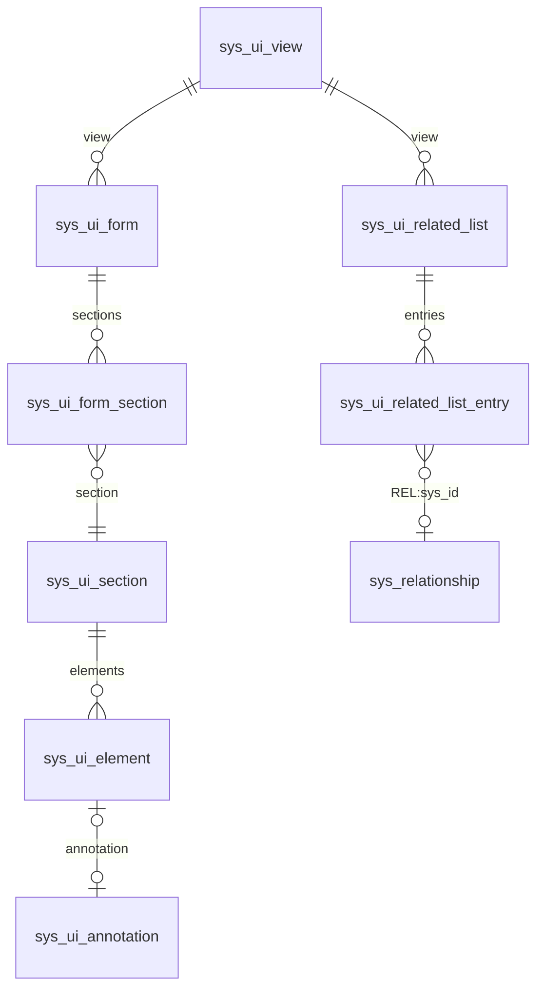
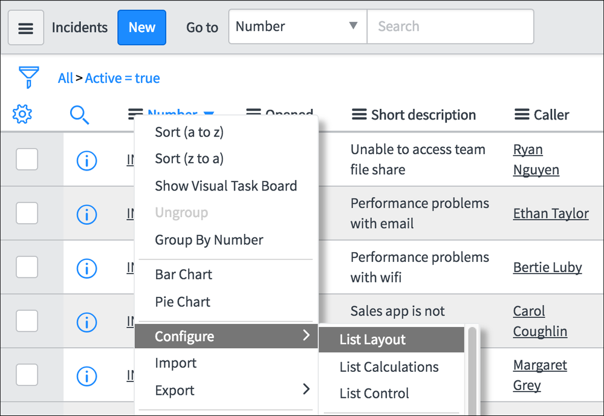
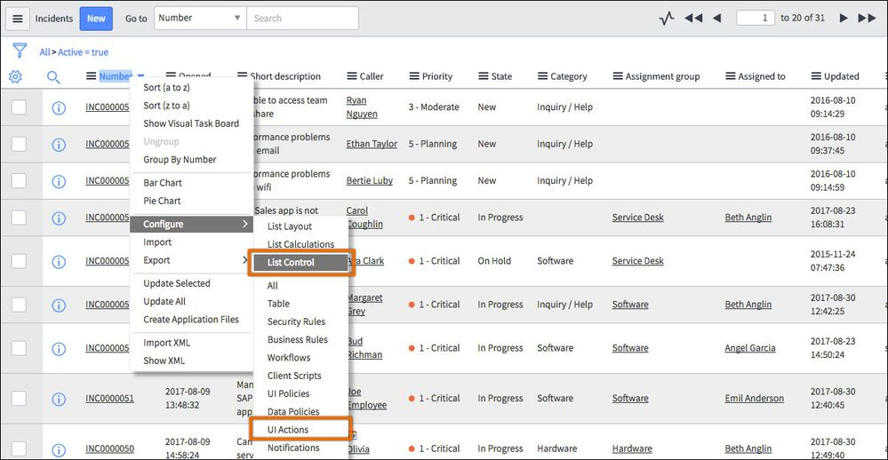
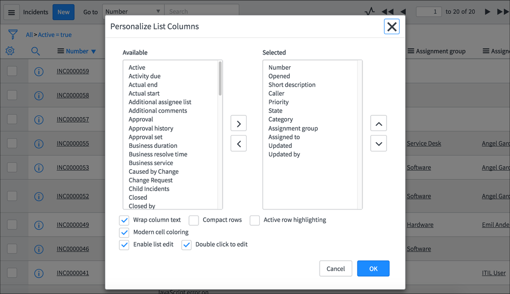
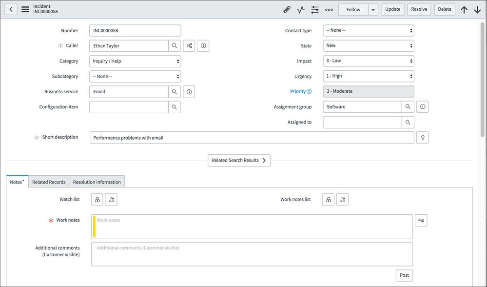
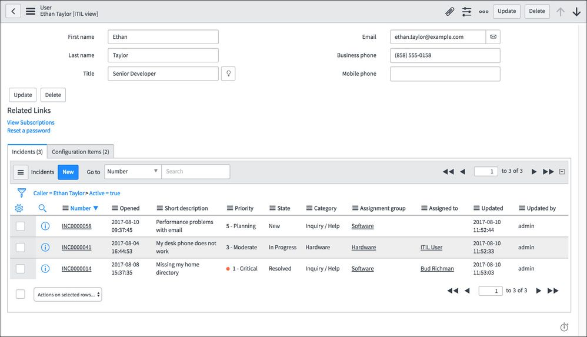
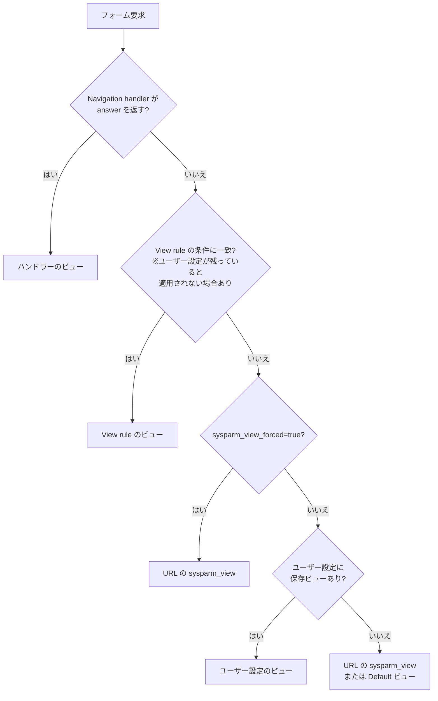
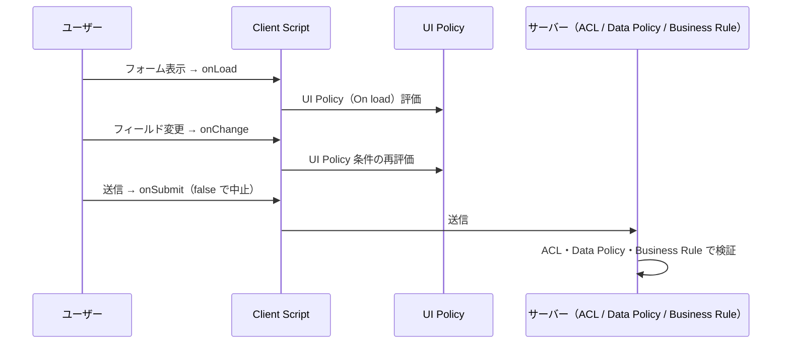

# Lists and Forms（リストとフォーム）

## 概要

**List**（リスト）と **Form**（フォーム）は、ServiceNow AI Platform（旧 Now Platform）のデータを画面で扱うための最も基本的な UI 要素である。List はテーブルの複数レコードを一覧表示し、検索・ソート・フィルタ・編集を行う画面であり、Form は 1 件のレコードを表示・編集する画面である [出典](https://www.servicenow.com/docs/r/EJbK9aB62eTqc6muCLNt9A/jv_VZlyurZbut3XoMZ343A)。

本ファイルが扱うリスト・フォームは、**classic environment**（クラシック環境）のリスト・フォームである。classic environment とは、Configurable Workspace（構成可能ワークスペース）ではなくリストとレコードフォームを直接操作する作業環境で、Next Experience UI の有効・無効どちらでも使われる。Next Experience 無効時のクラシック環境は **Core UI**（旧称 UI16）と呼ばれる [出典](https://www.servicenow.com/docs/r/australia/platform-user-interface/working-in-classic-lists-and-forms.html)。

本ファイルは Australia リリース（2026-05 GA）を基準とする。主な内容は次のとおり。

| 区分 | 主な内容 |
|---|---|
| リスト | List v2 / List v3、リストの構成要素、List Layout、List Control、List editor、Personal lists、階層リスト・詳細行 |
| フィルタ | Condition builder（条件ビルダー）、演算子とエンコードクエリ、Breadcrumbs（ブレッドクラム）、保存フィルタ `sys_filter` |
| フォーム | Form Builder / Form Designer / Form Layout、セクション・分割・アノテーション、フォームコンテキストメニュー、タブ表示 |
| ビュー | View（ビュー）、View rule（ビュールール）、Navigation handler（ナビゲーションハンドラー） |
| 関連リスト | 参照ベース・多対多・Defined related list（`sys_relationship`）、埋め込みリスト、読み込みタイミング |
| Formatter | Activity / Process flow / Parent breadcrumbs / Approval summarizer / CI relations、カスタム Formatter |
| ポリシー | UI Policy、Data Policy、Client Script との関係、Read only option（Australia） |
| パーソナライズ | Personalize list / Personalize form、関連ロールとプロパティ |

関連トピックは以下を参照。

- UI 全体（Unified Navigation、テーマ、Core UI との違い）：[Next Experience UI](./next-experience-ui.md)
- UI の初歩的な操作：[UIの基本](../../01_入門編/05-ui-basics.md)
- テーブル・フィールド・辞書属性：[データモデルとSystem Dictionary](./data-model-dictionary.md)
- Client Script・`g_form` API の詳細：[クライアントサイドスクリプト](./scripting-client-side.md)
- Business Rule 等サーバー側ロジック：[サーバーサイドスクリプト](./scripting-server-side.md)
- フィールド単位のアクセス制御：[アクセス制御（ACL）](./access-control-acl.md)
- Workspace のリスト・フォーム、UI Builder：[Workspace と UI Builder](./workspaces-ui-builder.md)
- Catalog UI Policy・Catalog Client Script：[サービスカタログ](./service-catalog.md)
- リスト表示のパフォーマンス：[パフォーマンスチューニング](../../04_応用編/03-performance-tuning.md)

---

## 1. 設定データを格納する主なテーブル

リスト・フォームの構成はすべてレコードとして各システムテーブルに保存され、Update Set（アップデートセット）で移送される。主なテーブルは以下のとおり。

| テーブル | 内容 | 根拠 |
|---|---|---|
| `sys_ui_view` | View（ビュー）定義。フォームとリストの両方で共有される | 公式 SDK ガイド [出典](https://servicenow.github.io/sdk/guides/form-layout-guide) |
| `sys_ui_form` | テーブルとビューを結び付けるフォーム本体 | 同上 |
| `sys_ui_form_section` | フォームとセクションの関連（セクションの並び順を保持） | 同上 |
| `sys_ui_section` | フォームセクション（caption、view 等を保持）。管理画面は System UI > Form Sections | 同上 / [出典](https://www.servicenow.com/docs/r/australia/platform-administration/configure-form-layout.html) |
| `sys_ui_element` | セクション内の要素（フィールド、アノテーション、Formatter、埋め込みリスト、分割マーカー `.begin_split` / `.split` / `.end_split`） | 公式 SDK ガイド [出典](https://servicenow.github.io/sdk/guides/form-layout-guide) |
| `sys_ui_annotation` / `sys_ui_annotation_type` | フォームアノテーションとその種類 | 同上 |
| `sys_ui_list` / `sys_ui_list_element` | List Layout（リストの列構成） | 【経験則】公式ドキュメント本文では確認できず |
| `sys_ui_list_control` | List Control（リストコントロール） | 公式 SDK ガイド [出典](https://servicenow.github.io/sdk/guides/list-control-guide) |
| `sys_ui_related_list` / `sys_ui_related_list_entry` | フォーム下部に表示する関連リストの構成（ビュー単位） | 同上 |
| `sys_relationship` | Defined related list 用の Relationship（リレーションシップ） | [出典](https://www.servicenow.com/docs/r/EJbK9aB62eTqc6muCLNt9A/gQQYn2fK0zeTu7kbv1vNUA) |
| `sys_ui_view_rule` | View rule（ビュールール） | 【経験則】公式ページでは画面名 System UI > View Rules のみ確認 |
| `sys_navigator` | Navigation handler（ナビゲーションハンドラー） | [出典](https://www.servicenow.com/docs/r/EJbK9aB62eTqc6muCLNt9A/3IiPPSN2QuYM8OjwlKZuoA) |
| `sys_ui_formatter` | Formatter 定義 | 【経験則】公式ページでは確認できず |
| `sys_ui_policy` / `sys_ui_policy_action` | UI Policy と UI Policy Action | [出典](https://servicenow.github.io/sdk/guides/data-policy-guide) / [出典](https://www.servicenow.com/docs/r/application-development/servicenow-sdk/fluent-ui-policy-api.html) |
| `sys_data_policy2` / `sys_data_policy_rule` | Data Policy と Data Policy Rule（`2` は歴史的経緯による命名） | 公式 SDK ガイド [出典](https://servicenow.github.io/sdk/guides/data-policy-guide) |
| `sys_script_client` | Client Script | 【経験則】 |
| `sys_filter` | 保存フィルタ | [出典](https://www.servicenow.com/docs/r/EJbK9aB62eTqc6muCLNt9A/6f6tSgvwYJ2j22WQivO7VA) |
| `sys_user_preference` | ユーザー設定（表示行数 `rowcount`、選択ビュー、関連リスト読み込みタイミング等） | 【第三者情報】[出典](https://www.servicenow.com/community/sysadmin-forum/glide-ui-per-page-can-it-be-changed-by-access-level/m-p/3167227) |

フォーム関連テーブルの構造は次のとおり。単一セクションのフォームではビューが直接セクションに紐づく場合もある 【第三者情報】 [出典](https://www.servicenow.com/community/developer-articles/forms-layout-documentation-database-view-style/ta-p/2329892)。



---

## 2. リスト（List）

### 2.1 リストの構成要素

classic environment のリストは、**Title bar**（タイトルバー）、**Filters and breadcrumbs**（フィルタとブレッドクラム）、データ列、**Footer**（フッター）で構成される。各列はテーブルのフィールドに対応する [出典](https://www.servicenow.com/docs/r/EJbK9aB62eTqc6muCLNt9A/jv_VZlyurZbut3XoMZ343A)。

| 要素 | 説明 |
|---|---|
| Title bar | リストタイトル、リストコントロールメニュー（ハンバーガー）、New ボタン、検索（Go to）、ページ送り |
| Filters and breadcrumbs | 現在の条件を左から右へ「一般 → 具体」の順で表示 |
| Columns | フィールドごとの列。列見出しのコンテキストメニューからソート・グループ化・Configure 等を実行 |
| Response time indicator | 一部リストの右下に表示される、リスト表示にかかった時間のアイコン |
| Hierarchical lists（階層リスト） | 参照アイコン横の矢印で、フォームを開かずに関連レコードを展開できる。管理者がテーブル単位で有効化 |
| Detail rows（詳細行） | 各レコードの行の下に、指定フィールドの値を表示する行。詳細行の元になったフィールドは列から非表示になる。管理者が有効化 |
| Activity streams | 現在のリストの全レコードのアクティビティをライブ表示 |
| Grouped lists | フィールドでグループ化し、グループごとの件数を表示 |

[出典](https://www.servicenow.com/docs/r/EJbK9aB62eTqc6muCLNt9A/jv_VZlyurZbut3XoMZ343A)



**図 1：リスト列見出しのコンテキストメニュー（List v2、UI16 時代の画面）**
Incidents リストのタイトルバー（左からハンバーガーメニュー、「Incidents」タイトル、青い **New** ボタン、「Go to」と検索列選択「Number」、Search 入力欄）の下に、漏斗アイコンとブレッドクラム「All > Active = true」が表示されている。その下の列見出し行には左から歯車アイコン（Personalize list）、虫眼鏡アイコン（列検索）、「Number」「Opened」「Short description」「Caller」の列見出しが並ぶ。「Number」列見出しのメニューが開かれており、Sort (a to z)、Sort (z to a)、Show Visual Task Board、Ungroup（無効表示）、Group By Number、Bar Chart、Pie Chart、**Configure**（サブメニューに **List Layout**、**List Calculations**、**List Control**）、Import、Export が並ぶ。
出典：ServiceNow Community「Best practices for configuring lists」（Dawn Jurek, ServiceNow, 2017）https://www.servicenow.com/community/now-platform-blog/best-practices-for-configuring-lists/ba-p/2283363 （取得日：2026-11-03）。Australia の Next Experience では配色・アイコンが異なるが、メニュー構成の考え方は同じ。

### 2.2 List v2 と List v3

ServiceNow のリストには **List v2** と **List v3** の 2 つの実装がある。

| 項目 | List v2 | List v3 |
|---|---|---|
| 位置付け | 標準（デフォルト）のリスト。全 UI でサポート | 管理者が有効化する別実装。UI16 でのみサポート 【第三者情報】 |
| 現在のステータス | 現行の標準 | London リリース以降、新規有効化は不可。既に有効化済みのインスタンスからは削除しない方針が示された 【第三者情報】。クライアント API `GlideListV3`（`g_list`）は「no longer supported」と明記され、`GlideList2` の利用が推奨されている |
| 構成メニュー | 列見出しの右クリック（コンテキストメニュー）> Configure | リストタイトルのメニュー（ハンバーガー）> Configure |
| 非対応機能 | — | 埋め込みリスト、リストレポート、階層リスト（例：`sys_update_set` のリスト）は List v3 非対応のため List v2 で表示 【第三者情報】 |
| List editor と Client Script | List editor は Client Script と UI Policy を適用しない | UI Policy と Mandatory 辞書属性は適用されるが、Client Script は適用されない |
| 管理機能 | Personal list の無効化・制限、List editor のユーザー設定管理が可能 | Personal list の無効化・制限は非対応。一部 List editor 管理オプションも非対応 |
| インスタンス全体の無効化 | — | システムプロパティ `glide.ui.list_v3.enable`（Enable List v3）を外す 【第三者情報】 |

[出典](https://www.servicenow.com/docs/r/api-reference/c_GlideListV3API.html) / [出典](https://www.servicenow.com/docs/access?context=r_AdministeringTheListEditor&version=australia&pubname=australia-platform-administration&ft:locale=en-US) / [出典](https://www.servicenow.com/docs/access?context=c_AdministeringPersonalLists&version=australia&pubname=australia-platform-administration&ft:locale=en-US) / 【第三者情報】[出典](https://www.servicenow.com/community/now-platform-blog/best-practices-for-configuring-lists/ba-p/2283363) / 【第三者情報】[出典](https://www.servicenow.com/community/now-platform-articles/list-v3-going-the-way-of-the-dodo/ta-p/2327789) / 【第三者情報】[出典](https://www.servicenow.com/community/in-other-news/disabling-lagging-list-v3/ba-p/2267104)

UI Action（UI アクション）には **List v2 Compatible** と **List v3 Compatible** のチェックボックスがあり、List v3 のリストに UI Action を表示するには List v3 Compatible を有効にする必要がある 【第三者情報】 [出典](https://www.servicenow.com/community/itsm-forum/what-is-the-difference-between-listv2-compatible-and-listv3/m-p/763224)。

> **実務上の扱い：** Australia 時点で新規に List v3 を採用する選択肢はなく、classic environment のリストは List v2 を前提に設計する。List v3 が残っている古いインスタンスは List v2 への切り戻しを検討する 【経験則】。リスト UI の将来の方向性は Configurable Workspace のリスト（Next Experience コンポーネント）に移っている 【第三者情報】 [出典](https://www.servicenow.com/community/now-platform-articles/list-v3-going-the-way-of-the-dodo/ta-p/2327789)。

### 2.3 List Layout（リストレイアウト）

**List Layout**（リストレイアウト）は、リストに表示する列とその順序を**全ユーザー共通**で定義する設定で、ビューごとに保持される。列見出しのコンテキストメニューから **Configure > List Layout** で開き、Available（利用可能）と Selected（選択済み）の 2 つのリストボックス（slushbucket）間で列を移動・並べ替える 【第三者情報】 [出典](https://www.servicenow.com/community/now-platform-blog/best-practices-for-configuring-lists/ba-p/2283363)。

- List Layout の変更には適切なロールが必要で、一般に `personalize_list` または `admin` が使われる 【経験則】。
- 同じメニューの **Configure > List Calculations** は列の集計（合計・平均等）の表示設定である 【第三者情報】 [出典](https://www.servicenow.com/community/now-platform-blog/best-practices-for-configuring-lists/ba-p/2283363)。
- 先頭列はレコードへのリンクとして表示される。先頭列が参照フィールドの場合、リンク先はリストのレコードではなく参照先テーブルのレコードになるため混乱を招く。先頭列には番号など一意のフィールドを置く [出典](https://www.servicenow.com/docs/r/EJbK9aB62eTqc6muCLNt9A/5iPPqZz17KuaclN6BnqZ5Q)。システムプロパティ `glide.ui.first.field.reference` を `true` にすると、先頭列が参照フィールドでも常にリストのレコードにリンクする [出典](https://www.servicenow.com/docs/r/UrSRFFKWBbfQBgoRlt~ltw/tZG20M4o7c0~GIjUctC8Qg)。

ServiceNow 社員によるリスト設計のベストプラクティスは次のとおり 【第三者情報】 [出典](https://www.servicenow.com/community/now-platform-blog/best-practices-for-configuring-lists/ba-p/2283363)。

| ベストプラクティス | 内容 |
|---|---|
| 先頭列は番号など一意の値 | 参照フィールドを先頭にしない |
| 列数を絞る | 横スクロールを避ける |
| 複雑な内容のフィールドを避ける | 長文、ジャーナル、HTML、画像は縦方向の領域を消費する |
| 関連操作の権限を確認 | List Control と リストの UI Action を見直す（例：Record Producer 経由で起票させたい場合は Incident リストの New ボタンを外す） |
| 1 ページの表示件数を抑える | 標準の選択肢は 10 / 15 / 20 / 50 / 100、デフォルトは 20 |

### 2.4 List Control（リストコントロール）

**List Control**（リストコントロール）は、リストまたは関連リストの New / Edit ボタン、フィルタ、リンク、インライン編集、ページ件数表示などの表示・動作を制御する設定で、`sys_ui_list_control` テーブルに保存される [出典](https://servicenow.github.io/sdk/guides/list-control-guide)。

- **必要ロール：** `personalize_control` [出典](https://www.servicenow.com/docs/r/7LhbZn3yz3Q58qhjZoU9iQ/v301y4IBfPa5kuUaIRp2MA)
- **開き方：** リストの列見出しを右クリック > **Configure > List Control**（List v3 ではリストタイトルのメニューから） [出典](https://www.servicenow.com/docs/r/7LhbZn3yz3Q58qhjZoU9iQ/v301y4IBfPa5kuUaIRp2MA)

List Control フォームのフィールドは以下のとおり（Australia）。「標準のみ」は通常のリスト（Standard list）でのみ有効で、埋め込みリスト（Embedded list）では効かない項目を示す [出典](https://www.servicenow.com/docs/r/UrSRFFKWBbfQBgoRlt~ltw/7Ip7Yp1p24C9V9jBxjOXJg) / [出典](https://www.servicenow.com/docs/r/7LhbZn3yz3Q58qhjZoU9iQ/v301y4IBfPa5kuUaIRp2MA)。

| フィールド | 列名（SDK） | 説明 | 適用 |
|---|---|---|---|
| Table | `name` | 対象テーブル（関連リストの場合は親テーブル）。自動設定 | 両方 |
| Related list | `related_list` | 関連リストを定義するテーブルとフィールド（`子テーブル.参照フィールド` または `REL:<sys_id>`）。自動設定。空の場合は最上位リストのみに効く | 両方 |
| Label | `label` | リストの表示ラベル。空ならテーブルの複数形ラベル | 両方 |
| Omit new button | `omit_new_button` | New ボタンを非表示 | 標準のみ |
| Omit edit button | `omit_edit_button` | Edit ボタンを非表示（Edit ボタンがないリストもある） | 標準のみ |
| Omit if empty | `omit_if_empty` | 関連リストが 0 件のとき、見出しを含めフォームから除去 | 両方 |
| Omit columns if empty | `omit_columns_if_empty` | 最上位リストで 0 件のとき、列見出しとフィルタ／ブレッドクラムを非表示 | 両方 |
| Omit filters | `omit_filters` | フィルタ／ブレッドクラムを非表示 | 標準のみ |
| Omit links | `omit_links` | 参照フィールドのリンクを生成しない | 両方 |
| Omit drill-down link | `omit_drilldown_link` | 先頭列からレコードへのリンクを無効化（参照アイコンからは開ける） | 標準のみ |
| Omit related list count | `omit_related_list_count` | 初期表示時の関連リスト件数を非表示 | 両方 |
| Hierarchical lists | `hierarchical_lists` | 階層リストを有効化 | 標準のみ |
| List edit type | `list_edit_type` | インライン編集の方式（下表） | 標準のみ |
| List edit tag | `list_edit_ref_qual_tag` | 参照修飾子（Reference qualifier）にスクリプト変数 `listEditRefQualTag` として渡す任意文字列 | 両方 |
| List edit insert row | `list_edit_insert_row` | リスト末尾に空行を表示し、リストからレコードを作成可能にする | 標準のみ |
| Remove pagination count | `omit_count` | ページ件数表示を除去 | 両方 |
| Disable Natural Language Query (NLQ) | `disable_nlq` | インスタンスで NLQ（自然言語クエリ）が有効な場合に、特定リストで NLQ フィルタを無効化 | 両方 |
| Application | — | 設定のスコープ。Global の場合は全ワークスペースで利用可能 | 両方 |
| New roles | `new_roles` | New ボタンを使えるロール。空なら全ユーザー。埋め込みリストには New ボタンがないため非適用 | 標準のみ |
| Filter roles | `filter_roles` | フィルタを表示できるロール | 標準のみ |
| Link roles | `link_roles` | 参照フィールドのリンクを表示できるロール | 両方 |

**List edit type** の選択肢は次のとおり [出典](https://www.servicenow.com/docs/r/7LhbZn3yz3Q58qhjZoU9iQ/v301y4IBfPa5kuUaIRp2MA) / [出典](https://servicenow.github.io/sdk/guides/list-control-guide)。

| 選択肢 | 動作 | 格納値（SDK） |
|---|---|---|
| Save immediately | セル編集モード。新しい値を入力するとその行が即時保存される | `NULL_OVERRIDE` |
| Save data by rows | ユーザーがその行を離れたときにのみ保存（複数セルを変更してからまとめて保存できる） | `save_by_row` |
| Disable list editing | インライン編集を無効化 | `disabled` |

上記のほか、`sys_ui_list_control` には条件スクリプト（`new_condition`、`edit_condition`、`link_condition`、`filter_condition`、`empty_condition`、`columns_condition`。`answer` が `true` で非表示）、`edit_roles`、`omit_count_views`、`edit_default_filter` などの列がある。`omit_*` フラグと条件スクリプトのどちらかが真なら非表示になるため、同じ要素に `omit_*` とロール制限を併用しても意味がない [出典](https://servicenow.github.io/sdk/guides/list-control-guide)。

> **NLQ に関する注意：** システムプロパティ `com.snc.listv2.nlq.lists.enabled` が `false` の場合、NLQ のクエリは機能せず、検索欄に入力したテキストが既存条件を置き換える [出典](https://www.servicenow.com/docs/r/7LhbZn3yz3Q58qhjZoU9iQ/v301y4IBfPa5kuUaIRp2MA)。

公式の手順例：Problem レコードの Incidents 関連リストで List Control を開き、Label を「Child Incidents」に変更し、Omit new button を選択して保存すると、関連リストのラベルが変わり New ボタンが表示されなくなる [出典](https://www.servicenow.com/docs/r/7LhbZn3yz3Q58qhjZoU9iQ/v301y4IBfPa5kuUaIRp2MA)。



**図 2：Configure サブメニューの全体（List v2、UI16 時代の画面）**
Incidents リスト（「1 to 20 of 31」件）の「Number」列見出しメニューから **Configure** を開いた状態。左側のメニューには Sort、Show Visual Task Board、Group By Number、Bar Chart / Pie Chart、Configure、Import、Export、Update Selected、Update All、Create Application Files、Import XML、Show XML が並ぶ。右側の Configure サブメニューは上から List Layout、List Calculations、**List Control**（オレンジ枠で強調）、All、Table、Security Rules、Business Rules、Workflows、Client Scripts、UI Policies、Data Policies、**UI Actions**（オレンジ枠で強調）、Notifications で、リストからテーブル関連の各種設定に直接移動できることを示している。背景のリストには Number、Opened、Short description、Caller、Priority、State、Category、Assignment group、Assigned to、Updated の列が表示されている。
出典：ServiceNow Community「Best practices for configuring lists」https://www.servicenow.com/community/now-platform-blog/best-practices-for-configuring-lists/ba-p/2283363 （取得日：2026-11-03）。

### 2.5 List editor（リストエディタ）とリスト編集

**List editor**（リストエディタ）は、フォームを開かずにリスト上で直接フィールド値を編集する機能である [出典](https://www.servicenow.com/docs/r/EJbK9aB62eTqc6muCLNt9A/0aBx7ZBinG1ER42M2pIqcA)。

リスト上の編集方法は次のとおり [出典](https://www.servicenow.com/docs/r/EJbK9aB62eTqc6muCLNt9A/0aBx7ZBinG1ER42M2pIqcA)。

| 方法 | 内容 |
|---|---|
| Quick edit functions | フィールドを右クリックして **Assign to me**（Assigned to に自分を設定）、**Approve** / **Reject**（承認状態の変更）、**Assign tag**（タグ付け）を実行 |
| List editor | セルを直接編集。一部のテーブルではデフォルトで無効、一部のフィールド型はリストから編集不可 |
| 複数レコード編集（List editor） | 複数レコードの 1 フィールドを同じ値に一括設定する場合に向く |
| 複数レコード編集（Editing form） | 複数フィールドや、リストに表示されていないフィールドを変更する場合に向く |

List editor の管理オプションは、グローバルプロパティの設定、テーブル単位の List Control 設定（List edit type 等）、コンテキストセキュリティルール（ACL）の設定、ユーザー設定の管理（List v2 のみ）である [出典](https://www.servicenow.com/docs/access?context=r_AdministeringTheListEditor&version=australia&pubname=australia-platform-administration&ft:locale=en-US)。

> **重要な制約（公式の警告）：**
> - List v2 の List editor は **Client Script と UI Policy を適用しない**。List v3 では UI Policy と Mandatory 辞書属性は適用されるが、Client Script は適用されない。
> - そのため、フォーム側の Client Script / UI Policy で値を制御している場合、リスト編集で不正なデータが保存され得る。リスト編集を無効化するか、Business Rule や ACL で値の設定を統制する。
> - Task テーブルから継承した状態フィールド `problem_state`、`incident_state`、`phase_state`、`request_state` は、task リスト上では編集できない（拡張テーブル側で編集する）。
>
> [出典](https://www.servicenow.com/docs/access?context=r_AdministeringTheListEditor&version=australia&pubname=australia-platform-administration&ft:locale=en-US)

リスト編集に対してクライアント側で処理を挟みたい場合は、Client Script の **onCellEdit()** 型を使う（2.7 節、9.4 節参照） [出典](https://www.servicenow.com/docs/r/australia/api-reference/scripts/client-scripts.html)。

### 2.6 Personal lists（パーソナルリスト）

**Personal list**（パーソナルリスト）は、ユーザーが自分のリスト表示の列と順序を変更する機能で、変更は本人のみに適用され他のユーザーには影響しない [出典](https://www.servicenow.com/docs/r/EJbK9aB62eTqc6muCLNt9A/5iPPqZz17KuaclN6BnqZ5Q)。

- **必要ロール：** `personalize_list` または `admin`
- **手順：** リスト右上（列見出し行の左端）の Personalize list アイコン（歯車）を選択 → 列と順序を選択 → 表示オプションとリスト編集オプションを設定 → OK
- **リセット：** 同じダイアログの **Reset to column defaults**
- **注意：** 管理者が設定したデフォルトビューから非アクティブなフィールドが削除されると、パーソナルリストはデフォルトビューに追従してリセットされる

ダイアログのオプションは**すべてのリストに適用**される [出典](https://www.servicenow.com/docs/r/EJbK9aB62eTqc6muCLNt9A/5iPPqZz17KuaclN6BnqZ5Q)。

| オプション | 区分 | 内容 |
|---|---|---|
| Wrap column text | 表示 | 長いテキストを折り返す（Core UI ではシステム設定の Lists にもある） |
| Compact rows | 表示 | 行の縦間隔を詰める |
| Active row highlighting | 表示 | カーソル下の行をハイライト（外すと固定の縞模様） |
| Modern cell coloring | 表示 | 新しいフィールドステータス表示を使用（Core UI ではシステム設定にもある） |
| Enable list edit | リスト編集 | List editor を開けるようにする（List editor が構成済みであることが前提） |
| Double click to edit | リスト編集 | シングルクリックではなくダブルクリックで List editor を開く |

List v2 では、管理者はリストのパーソナライズを無効化または制限できる（List v3 では非対応） [出典](https://www.servicenow.com/docs/access?context=c_AdministeringPersonalLists&version=australia&pubname=australia-platform-administration&ft:locale=en-US)。



**図 3：Personalize List Columns ダイアログ（List v2、UI16 時代の画面）**
Incidents リストの上に「Personalize List Columns」ダイアログが表示されている。左の **Available** には Active、Activity due、Actual end、Actual start、Additional assignee list、Additional comments、Approval、Approval history … などのフィールドが並び、中央の「>」「<」ボタンで右の **Selected**（Number、Opened、Short description、Caller、Priority、State、Category、Assignment group、Assigned to、Updated、Updated by）との間で移動する。右端の上下矢印で順序を変更する。下部にチェックボックス **Wrap column text**（オン）、**Compact rows**（オフ）、**Active row highlighting**（オフ）、**Modern cell coloring**（オン）、**Enable list edit**（オン）、**Double click to edit**（オン）と、Cancel / OK ボタンがある。
出典：ServiceNow Community「Best practices for configuring lists」https://www.servicenow.com/community/now-platform-blog/best-practices-for-configuring-lists/ba-p/2283363 （取得日：2026-11-03）。

### 2.7 リストに関するその他の仕様

| 項目 | 内容 | 出典 |
|---|---|---|
| 1 ページ表示件数 | リストタイトルメニュー > Show で 10 / 15 / 20 / 50 / 100 rows per page を選択（デフォルト 20）。選択肢はシステムプロパティで変更可能。ユーザーの選択は `sys_user_preference` の `rowcount` に保存される | 【第三者情報】[出典](https://www.servicenow.com/community/now-platform-blog/best-practices-for-configuring-lists/ba-p/2283363) / [出典](https://www.servicenow.com/community/sysadmin-forum/glide-ui-per-page-can-it-be-changed-by-access-level/m-p/3167227) |
| 選択肢のプロパティ | `glide.ui.per_page`（例：`10,15,20,50,100`）。100 超は非推奨とされる | 【第三者情報】同上 |
| グループ化の上限 | `glide.db.max.aggregate.size`：グループ化リスト・レポートが描画するグループ数の上限（デフォルト 20、プロパティ追加が必要） | [出典](https://www.servicenow.com/docs/r/UrSRFFKWBbfQBgoRlt~ltw/tZG20M4o7c0~GIjUctC8Qg) |
| Live list | `glide.lists.live_list_enabled`：リスト更新を促すプロンプトを有効化（デフォルト `false`） | 同上 |
| 二次ソート | `glide.secondary.query.sysid`：同値ソート時に `sys_id` で二次ソートし表示順を安定させる（デフォルト `false`、性能影響あり） | 同上 |
| 新規作成時の ACL | `com.glide.acl_check_all_filter_on_new`：リストから新規作成する際、フィルタ由来の値に ACL チェックを強制（デフォルト `false`、追加が必要） | 同上 |
| ハイライト表示 | `glide.ui.polaris.list_style.enable_highlighted_value_style`：Next Experience でリストセルのハイライト値スタイルを有効化（`glide.ui.polaris.experience` が true のときデフォルト true） | 同上 |
| ビューの記憶 | `glide.ui.remember_view`：最後に使用したビューをユーザー設定として使う（デフォルト `true`） | 同上 |
| Go to 検索 | `glide.ui.goto_use_contains`：Go to 検索を「contains」クエリにする（デフォルト `false` は「greater than」） | 同上 |
| CSV エクスポート | `glide.export.csv.raw.value`：CSV に表示値ではなく DB の生値を出力（デフォルト `false`） | 同上 |
| onCellEdit | Client Script はリスト編集に適用されないが、onCellEdit() 型のみ例外としてリストで動作する | [出典](https://www.servicenow.com/docs/r/australia/api-reference/scripts/client-scripts.html) |

---

## 3. フィルタと条件ビルダー

### 3.1 Filter（フィルタ）と Breadcrumbs（ブレッドクラム）

**Filter**（フィルタ）は、テーブルに適用してデータの一部だけを表示する条件の集合である。リストに表示されるレコードは、フィルタのすべての条件を満たす必要がある [出典](https://www.servicenow.com/docs/r/EJbK9aB62eTqc6muCLNt9A/H3TToBGiAtZwCLz6jXvevg)。

**Breadcrumbs**（ブレッドクラム）は、現在のフィルタ条件をリスト上部に階層的に表示したもので、左から右へ「一般 → 具体」の順に並ぶ [出典](https://www.servicenow.com/docs/r/EJbK9aB62eTqc6muCLNt9A/H3TToBGiAtZwCLz6jXvevg)。

| 操作 | 結果 |
|---|---|
| ブレッドクラムをクリック | そのブレッドクラムより右の条件をすべて削除し、最新データでリストを再表示 |
| 条件の前の区切り（`>`）をクリック | その条件だけを削除 |
| 「All」をクリック | すべての条件を削除 |
| 右クリック > Open new window | 結果を新しいタブ／ウィンドウで開く |
| 右クリック > Copy URL | 結果リストの URL をコピー（ブラウザのセキュリティ設定で阻止される場合あり） |
| 右クリック > Copy query | エンコードクエリをコピー（「All」では不可）。インスタンス URL や辞書の Reference qualifier に利用できる |

[出典](https://www.servicenow.com/docs/r/EJbK9aB62eTqc6muCLNt9A/H3TToBGiAtZwCLz6jXvevg)

その他のフィルタ関連仕様は次のとおり [出典](https://www.servicenow.com/docs/r/EJbK9aB62eTqc6muCLNt9A/H3TToBGiAtZwCLz6jXvevg)。

- **Quick filters（クイックフィルタ）：** フィールド値を右クリックして **Show Matching**（一致を表示）または **Filter Out**（除外）。日付フィールドでは **Show Before** / **Show After** / **Filter Out**。
- **フィルタ済みリストからの New：** フィルタ済みリストで New をクリックすると、フィルタ条件の値が新規レコードにプリセットされる（例：Active かつ Priority 1 のリストからは Active = true、Priority = 1 - Critical の新規レコード）。特定フィールドをプリセット対象外にするには、辞書属性 `ignore_filter_on_new=true` を付与する。
- **ロールなしユーザー：** デフォルトでロールを持たないユーザーにはブレッドクラムとフィルタが表示されない。管理者は Script Include により、未認証ユーザーに ESS ポータルで表示させることもできる。
- Core UI のリストのブレッドクラムが長い場合に切り詰める設定として、ブレッドクラムの最大表示項目数は `glide.ui.breadcrumb_max_entries`（デフォルト 10）、ブレッドクラムに表示する選択肢（choice list）値の最大文字数は `glide.ui.export.choice_list_max_characters`（デフォルト 80）で指定する [出典](https://www.servicenow.com/docs/r/B5UZKOeMGcpyrvR2CNl5Dw/ZQVOVSeKCf75U6R_c9ekmQ)。
- 条件ビルダーのクエリ最大文字長は `glide.list.filter_max_length`（デフォルト 0） [出典](https://www.servicenow.com/docs/r/UrSRFFKWBbfQBgoRlt~ltw/tZG20M4o7c0~GIjUctC8Qg)。
- 週の始まり（フィルタ・チャートの曜日計算）は `glide.ui.filter.first_day_of_week`（1=日曜、2=月曜。デフォルト 2） [出典](https://www.servicenow.com/docs/r/UrSRFFKWBbfQBgoRlt~ltw/tZG20M4o7c0~GIjUctC8Qg)。

### 3.2 Condition builder（条件ビルダー）

**Condition builder**（条件ビルダー）は、文脈に応じて生成されるフィールドの組み合わせから条件式を作る UI で、フィルタ、アンケート、アクセス制御などで使われる。1 つの条件は 3 要素で構成される [出典](https://www.servicenow.com/docs/r/B5UZKOeMGcpyrvR2CNl5Dw/ZQVOVSeKCf75U6R_c9ekmQ)。

| 要素 | 内容 |
|---|---|
| Field（フィールド） | テーブルとユーザーのアクセス権に基づく選択肢。**Show Related Fields** を選ぶとドットウォーク（dot-walking）で関連テーブルのフィールドを指定できる |
| Operator（演算子） | フィールドの型に応じた選択肢（例：Incident の Priority には greater than があるが、Active にはない） |
| Value（値） | フィールド型に応じたテキスト入力または選択肢（例：Active は true / false / empty） |

- **従属条件：** 既存条件の横の **AND** / **OR** をクリック。
- **トップレベル条件：** 条件ビルダー上部ツールバーの **AND** / **OR** をクリック（`^NQ` で結合される「OR フィルタ」）。
- **削除：** 条件横の削除アイコン（X）。
- 条件ビルダーで作れない条件（例：無関係なテーブルに基づくレコード集合）は **Scripted filter**（スクリプトフィルタ）で実装する。**Dynamic filter options**（動的フィルタオプション）を使うと、参照フィールドに対する「is (dynamic)」演算子の選択肢として、定義済みの Script Include / JavaScript を利用できる [出典](https://www.servicenow.com/docs/r/EJbK9aB62eTqc6muCLNt9A/6f6tSgvwYJ2j22WQivO7VA)。

[出典](https://www.servicenow.com/docs/r/B5UZKOeMGcpyrvR2CNl5Dw/ZQVOVSeKCf75U6R_c9ekmQ)（Xanadu 版ページ。Australia でも同じ構成であることを前提とする）

### 3.3 Encoded query（エンコードクエリ）と演算子

**Encoded query string**（エンコードクエリ文字列）は、複雑なフィルタを 1 本の文字列で表現したもので、リスト URL の `sysparm_query=` パラメータや Reference qualifier に使える。例：`active=true^impact=1^ORimpact=2`（アクティブかつ影響度が高または中） [出典](https://www.servicenow.com/docs/r/EJbK9aB62eTqc6muCLNt9A/H3TToBGiAtZwCLz6jXvevg)。

論理演算子は次のとおり [出典](https://www.servicenow.com/docs/r/australia/platform-user-interface/r_OpAvailableFiltersQueries.html)。

| 論理演算子 | エンコード |
|---|---|
| AND | `^` |
| OR 条件 | `^OR` |
| OR フィルタ（トップレベル OR） | `^NQ` |

フィールド型ごとの主な演算子とエンコード表記（Australia）は次のとおり [出典](https://www.servicenow.com/docs/r/australia/platform-user-interface/r_OpAvailableFiltersQueries.html)。

| フィールド型 | 演算子（エンコード） |
|---|---|
| String（文字列） | starts with（`STARTSWITH`）、ends with（`ENDSWITH`）、contains（`LIKE`）、does not contain（`NOT LIKE`）、is（`=`）、is not（`!=`）、is empty（`ISEMPTY`）、is not empty（`ISNOTEMPTY`）、is anything（`ANYTHING`）、is empty string（`EMPTYSTRING`）、less than or is（`<=`）、greater than or is（`>=`）、between（`BETWEEN`）、is same（`SAMEAS`）、is different（`NSAMEAS`） |
| Reference（参照） | is（`=`）、is not（`!=`）、is empty（`ISEMPTY`）、is not empty（`ISNOTEMPTY`）、starts with / ends with / contains / does not contain、is anything（`ANYTHING`）、is empty string（`EMPTYSTRING`）、is same / is different、**is (dynamic)（`DYNAMIC`）**、is in hierarchy（`IN_HIERARCHY`）、is in hierarchy (dynamic)（`IN_HIERARCHY_DYNAMIC`）。参照の種類によって使えない演算子がある |
| Choice（文字列値） | is / is not、is one of（`IN`）、is not one of（`NOT IN`）、contains / does not contain、starts with / ends with、is anything、is same / is different |
| Choice（整数値） | is / is not、is one of（`IN`）、is not one of（`NOT IN`）、is empty（`EMPTY`）、is not empty（`NOTEMPTY`）、less than（`<`）、greater than（`>`）、less than or is / greater than or is（`<=` / `>=`。条件ビルダーでは非対応でスクリプト条件が必要）、between、is anything、is same / is different |
| Date-time（日時） | on（`ONToday` 等）、not on（`NOTONToday` 等）、before（`<`）、at or before（`<=`）、after（`>`）、at or after（`>=`）、between（`BETWEEN`）、trend（`DATEPART`）、relative after（`RELATIVEGT`）、relative before（`RELATIVELT`）、is empty / is not empty、is anything、is same / is different、is more than（`MORETHAN`）、is less than（`LESSTHAN`） |
| Numeric（数値） | is / is not、is empty（`EMPTY`）、is not empty（`NOTEMPTY`）、`<` / `>` / `<=` / `>=`、between、is anything、is same / is different、greater than field（`GT_FIELD`）、less than field（`LT_FIELD`）、greater than or is field（`GT_OR_EQUALS_FIELD`）、less than or is field（`LT_OR_EQUALS_FIELD`） |
| Boolean（真偽値） | is / is not、is empty / is not empty、is anything、is same / is different |
| メール通知の条件 | changes（`VALCHANGES`）、changes from（`CHANGESFROM`）、changes to（`CHANGESTO`） |
| Tag（タグ） | have（`=`）、does not have（`DOESNOTHAVE`）、excluding（`EXCLUDING`） |

> **注意：** 「is empty」の表記は型により `ISEMPTY`（String / Reference / Date-time / Boolean）と `EMPTY`（Choice 整数 / Numeric）で異なる [出典](https://www.servicenow.com/docs/r/australia/platform-user-interface/r_OpAvailableFiltersQueries.html)。

### 3.4 保存フィルタ（`sys_filter`）

フィルタは名前を付けて保存でき、保存フィルタは **Filters**（`sys_filter`）テーブルに格納される。管理者は `sys_filter` で保存フィルタ（グローバル・グループ・個人）の作成・編集・削除を行う [出典](https://www.servicenow.com/docs/r/EJbK9aB62eTqc6muCLNt9A/6f6tSgvwYJ2j22WQivO7VA)。

保存手順：フィルタを作成 → **Save...** → **Save as:** に名前を入力し公開範囲を選択 → **Save**。適用はリストコントロールメニュー > **Filters** サブメニュー、個人フィルタの編集・削除は **Edit personal filters** から行う [出典](https://www.servicenow.com/docs/r/EJbK9aB62eTqc6muCLNt9A/1E18eIlS5QBKPW6o~4k1Qg)。

| 公開範囲 | 内容 | 必要条件 |
|---|---|---|
| Me | 自分だけが使える個人フィルタ | User フィールドへの Write 権限（ない場合は選択不可） |
| Everyone | 全ユーザーが使えるグローバルフィルタ | `filter_global` ロール |
| Group | 選択したグループのメンバーだけが使えるフィルタ | `filter_group` ロールと Group フィールドへの Write 権限 |

新しい Create ACL により、デフォルトで全ユーザーがフィルタを保存できる。この ACL はフィルタ保存を制限するカスタム ACL より優先される。全ユーザーがデフォルトで User フィールドにアクセスでき、Group フィールドは `filter_group` ロールを持ち、選択中のグループに所属するユーザーに限定される [出典](https://www.servicenow.com/docs/r/EJbK9aB62eTqc6muCLNt9A/1E18eIlS5QBKPW6o~4k1Qg)。

---

## 4. フォーム（Form）

### 4.1 フォームの構成とコンテキストメニュー

**Form**（フォーム）はデータテーブルの 1 レコードの情報を表示する画面で、ヘッダー（タイトル・操作ボタン）、フィールド群（セクション・2 列分割）、関連リンク（Related Links）、関連リストで構成される。フォームのヘッダーを右クリックするか **Additional actions**（追加アクション、ハンバーガー）アイコンを選ぶと、**form context menu**（フォームコンテキストメニュー）が開く [出典](https://www.servicenow.com/docs/r/platform-user-interface/c_FormContextMenu.html)。

| メニュー | 内容 | 利用者 |
|---|---|---|
| Save | フォームを離れずに保存 | — |
| Related actions | テーブル固有の標準アクション（例：Add to Visual Task Board、Incident の Create Change） | — |
| Insert | 新規レコードとして保存し、前のページに戻る | — |
| Insert and Stay | 新規レコードとして保存し、そのレコードを表示 | — |
| Configure | フォームの構成など管理機能（Form Builder、Form Layout、Form Design、Related Lists、UI Policies、Client Scripts、Data Policies 等） | 管理者・構成ロール |
| Export | PDF へのエクスポート（XML は管理者のみ） | — |
| View | 定義済みのビューに切り替える（切り替え時にフォームが送信される） | — |
| Create Favorite | レコードをお気に入りに追加 | Core UI のみ |
| Copy URL | レコードのフォーム URL をコピー | — |
| Copy sys_id | `sys_id` をコピー | 管理者のみ |
| Show XML | レコードを XML 表示 | 管理者のみ |
| History | 監査履歴を表示（テーブルの監査が有効な場合） | 管理者のみ |
| Reload Form | DB から再読み込み | — |

[出典](https://www.servicenow.com/docs/r/platform-user-interface/c_FormContextMenu.html)（Brazil 版ページ）。表示されるメニューはロール、インストール済みアプリケーション、UI バージョンにより異なる。Configure サブメニューの具体的項目は公式ページに一覧がなく、上表の括弧内は【経験則】。

なお Task 派生テーブル（Incident、Change、Problem 等）で Insert / Insert and Stay を有効にするにはシステムプロパティ `glide.ui.task.insert` を `true` にする（デフォルト `false`） [出典](https://www.servicenow.com/docs/r/UrSRFFKWBbfQBgoRlt~ltw/tZG20M4o7c0~GIjUctC8Qg)。



**図 4：Incident フォームのレイアウト例（UI16 時代の画面）**
ヘッダーに「Incident INC0000058」、右側に添付・アクティビティ・Personalize form（スライダー）・その他のアイコン、**Follow**、**Update**、**Resolve**、**Delete** ボタンと上下矢印がある。本体の最初のセクションは 2 列分割（split）で、左列に Number、Caller（必須マーク付き、参照アイコン・ツリーアイコン・情報アイコン付き）、Category、Subcategory、Business service、Configuration item、右列に Contact type、State、Impact、Urgency、Priority（読み取り専用でグレー表示）、Assignment group、Assigned to が並ぶ。その下に全幅の Short description（必須）がある。さらに下に「Related Search Results」ボタン、タブ化されたセクション **Notes**、**Related Records**、**Resolution Information** があり、Notes タブには Watch list、Work notes list、Work notes（必須）、Additional comments (Customer visible) と Post ボタンが表示されている。
出典：ServiceNow Community「Best practices for creating and editing forms」（Dawn Jurek, ServiceNow, 2017）https://www.servicenow.com/community/in-other-news/best-practices-for-creating-and-editing-forms/ba-p/2274237 （取得日：2026-11-03）。

### 4.2 フォーム構成ツール：Form Builder / Form Designer / Form Layout

フォームのレイアウトを変更するツールは 3 種類ある。Australia の公式ドキュメントは、**Form Builder** の利用を推奨し、Form Builder は Form Designer と Form Layout のすべての機能を含むとしている [出典](https://www.servicenow.com/docs/r/australia/platform-administration/configure-form-layout.html)。

| ツール | 概要 | 開き方 | 状況（Australia） |
|---|---|---|---|
| **Form Builder**（フォームビルダー） | Table Builder から使うことが多いフォーム編集アプリ。Form Layout と Form Designer の長所を統合した「streamlined」なフォーム構築体験 | フォームの Additional actions > **Configure > Form Builder**／任意テーブルの Related Links／Table Builder の Forms タブ／UI Builder のフォームコンポーネント（Table と View 設定済み）で **Edit Form** | 推奨ツール。スタンドアロン版・Related Links・UI Builder からのアクセスは Washington DC で追加 |
| **Form Designer**（フォームデザイナー） | ドラッグ＆ドロップでフィールド・セクション・Formatter・新規フィールドを配置する GUI | Additional actions > **Configure > Form Design**（Core UI が必要） | Australia から「将来の廃止に向けた準備中」。非表示化され新規有効化不可になるがサポートは継続。機能は Form Builder に移行 |
| **Form Layout**（フォームレイアウト） | slushbucket（Available / Selected の 2 リスト）方式の従来ツール | Additional actions > **Configure > Form Layout** | 引き続き利用可能 |

[出典](https://www.servicenow.com/docs/access?context=access-form-builder&version=australia&pubname=australia-application-development&ft:locale=en-US) / [出典](https://www.servicenow.com/docs/r/zurich/delta-washingtondc-zurich/zurich-washingtondc-tablebuilder-release-notes.html) / [出典](https://www.servicenow.com/docs/r/delta-zurich-brazil/brazil-zurich-tablebuilder-release-notes.html) / [出典](https://www.servicenow.com/docs/r/zurich/platform-administration/c_FormDesign.html)

> **リリース表記の揺れ：** Table Builder のリリースノート（Zurich→Brazil 統合版）は、Form Designer の「将来の廃止準備」について Zurich 行・Australia 行の両方に「Starting with the &lt;release&gt; release」と記載している。ただし Washington DC→Zurich 統合版の Zurich 行は全セクションで「No updates for this release」で、該当する記載がないため、本ファイルは Australia 導入として扱う 【推定】 [出典](https://www.servicenow.com/docs/r/delta-zurich-brazil/brazil-zurich-tablebuilder-release-notes.html) / [出典](https://www.servicenow.com/docs/r/zurich/delta-washingtondc-zurich/zurich-washingtondc-tablebuilder-release-notes.html)。

#### Form Builder の主な機能

Form Builder（Table Builder の Forms）で扱える要素は次のとおり [出典](https://www.servicenow.com/docs/r/zurich/application-development/form-builder-glide-family-release/form-view-configuration.html)。

| 要素 | 内容 |
|---|---|
| Form views | 各フォームはデフォルトビューを持ち、ユーザー群ごとに追加ビューを作成できる。All form views 一覧は名前・更新者・更新日でフィルタ・ソート可能 |
| Form layout（Sections） | ビューはセクションで構成され、セクションは 1 列または 2 列 |
| Form fields | テーブルの既存フィールドを配置、または新規作成。基本プロパティを編集可能 |
| Form annotations | セクション内に説明文などを追加 |
| Formatters | レコードの追加情報を表示する読み取り専用要素 |
| Embedded lists | 関連レコードをフォーム上に直接表示・編集（フォーム保存時に保存） |
| Preview | フォームのプレビュー |
| PDF extractor | ライセンスがあれば PDF からデータテーブルを作成 |

Table Builder では検索欄に `tablename.view`、`tablename.builder`、`tablename.sheet`、`tablename.flow` と入力してテーブルを直接開ける（Zurich の変更点） [出典](https://www.servicenow.com/docs/r/delta-zurich-brazil/brazil-zurich-tablebuilder-release-notes.html)。

#### Form Designer の仕様（参考）

Form Designer は新規インスタンスではデフォルトで利用可能、アップグレードしたインスタンスではプラグイン `com.glide.ui.ng.fd` の有効化が必要とされてきた。画面はページヘッダー（対象テーブルとビュー）、**Field navigator**（Filter、Fields タブ、Field Types タブ）、フォームレイアウト領域で構成される。Field Types タブからフィールド型をドラッグすると、保存時にそのテーブルの辞書エントリ（新しい列）が作成される。最初のセクションはテーブルラベルを表示する読み取り専用セクションで削除できない。各フォームはテーブルとビューの一意な組み合わせに対応する [出典](https://www.servicenow.com/docs/r/zurich/platform-administration/c_FormDesign.html)（Zurich 版ページ）。

### 4.3 Form Layout で行う作業とロール

Australia の「Configuring the form layout」ページに記載された作業と必要ロールは次のとおり [出典](https://www.servicenow.com/docs/r/australia/platform-administration/configure-form-layout.html)。

| 作業 | 必要ロール | 手順の要点 |
|---|---|---|
| フィールドの表示／非表示 | `personalize_form` | Configure > Form Layout で Available ↔ Selected を移動。関連テーブルのフィールドは緑色の「+」付き表示からドットウォークで追加 |
| 関連リストの追加 | `personalize_form` | Configure > Related Lists で Available → Related list に移動。フォーム下部に表示 |
| アノテーションの追加 | `personalize_form` | Form Layout で `*Annotation` を Selected に移動し、対象フィールドの上に配置。種類と Plain Text / HTML を選択 |
| アノテーションの表示切替 | なし（ユーザー操作） | More options アイコンから。ユーザー設定 `glide.ui.show_annotations` で制御 |
| フォームセクションの作成 | `form_admin` | Form Layout の Section リストで **New...** を選び caption を入力。上下矢印で並べ替え。最初のセクションの caption がフォームタイトルになる |
| セクションの削除 | — | System UI > Form Sections でテーブルを絞り込み、削除 |
| フォーム分割の移動 | `admin` | Selected 内の `\|- begin_split -\|`、`\|- split -\|`、`\|- end_split -\|` を矢印で移動 |
| 埋め込みリストの追加 | `personalize_form` | Form Layout の Available 末尾に赤字で表示されるリストを Selected に移動 |
| タブ表示 | `personalize_form`（公式ページの記載） | User Menu > Preferences > Display の「Organize form sections and related lists into tabs in classic forms」（ユーザー設定から切り替え可能）。新規インスタンスではデフォルト有効（システム設定 `tabbed.forms`） |
| Customer updates indicator | `admin` | ユーザー設定 `owned_by_indicator.form` を管理者に `true` で設定 |
| フォームへのチャート追加 | `personalize_form` | System UI > Forms でフォームを選択、Form Layout で Chart を追加し Configure chart でレポートを選択。List、Pivot、Multilevel Pivot、Calendar、Single Score 型は非対応 |

**アノテーションの種類：** Info Box Blue、Info Box Red、Line Separator、Section Details、Section Separator、Text [出典](https://www.servicenow.com/docs/r/australia/platform-administration/configure-form-layout.html)。アノテーション機能全体はシステムプロパティ `glide.ui.form_annotations`（デフォルト `true`）、複数分割・終了分割は `glide.ui.form_multiple_splits`（デフォルト `true`）で制御される [出典](https://www.servicenow.com/docs/r/UrSRFFKWBbfQBgoRlt~ltw/tZG20M4o7c0~GIjUctC8Qg)。

> **公式の警告：** 同じ編集可能フィールドを複数のセクションに配置しない。データ消失や、UI Policy・Data Policy の動作阻害の原因になる [出典](https://www.servicenow.com/docs/r/australia/platform-administration/configure-form-layout.html)。読み取り専用データであれば重複配置は許容される 【第三者情報】 [出典](https://www.servicenow.com/community/in-other-news/best-practices-for-creating-and-editing-forms/ba-p/2274237)。

### 4.4 フォーム設計のベストプラクティス

ServiceNow 社員によるフォーム設計のベストプラクティスは次のとおり 【第三者情報】 [出典](https://www.servicenow.com/community/in-other-news/best-practices-for-creating-and-editing-forms/ba-p/2274237)。

| ベストプラクティス | 内容 |
|---|---|
| すべてのテーブルにフォームを用意 | ログ・統計など管理者専用テーブルでも整ったフォームを作る |
| 読みやすい配置 | 左→右、上→下に読める配置。重要フィールドを上に、番号・名称を左上に |
| フォームを短く保つ | Form split（2 列化）、Annotation（画面上の説明）、Section（論理的グループ化）を使う |
| 長い文字列は全幅 | Short description や Comments は 2 列部分の下に全幅で配置 |
| 対象者別のビュー | 例：User フォームに Default ビュー（個人情報・ロール・グループ）と ITIL ビュー（個人情報を減らし、その人のインシデントと CI を表示） |
| 編集可能フィールドを重複配置しない | 4.3 節の警告を参照 |

### 4.5 フォームに関する主なシステムプロパティ

| プロパティ | 内容 | デフォルト |
|---|---|---|
| `glide.ui.dirty_form_support` | 未保存のままフォームを離れるときに警告（Safari 非対応） | `true` |
| `glide.ui.personalize_form` | Personalize Form メニューを有効化 | `true` |
| `glide.ui.personalize_form_role` | Personalize Form メニューを使えるロール | なし |
| `glide.ui.max_ref_dropdown` | 参照フィールドをドロップダウン（選択肢）として表示する件数上限。超えると通常の参照フィールド | `25` |
| `glide.ui.clickthrough.popup` | 参照フィールドのポップアップアイコン、Document ID フィールドの情報アイコンを表示 | `false` |
| `glide.ui.reference.readonly.clickthrough` | 読み取り専用の参照フィールドでポップアップを有効化 | `false` |
| `glide.ui.textarea_initial_rows` | 複数行フィールドの初期表示行数（0 または空で無視） | `0` |
| `glide.ui.textarea.character_counter` | ジャーナル・複数行フィールドに文字数カウンターを表示 | `false` |
| `glide.ui.show_template_bar` | テンプレートバーの表示可否（`glide.ui.show_template_bar.incident` のようにテーブル指定も可） | `true` |
| `glide.ui.task.insert` | Task 派生テーブルで Insert / Insert and Stay を有効化 | `false` |
| `glide.ui.update_on_iterate` | 青い矢印（前後レコード移動）クリック時に更新を保存するか | `false` |
| `glide.ui.escape_form_message` | GlideForm 関数の文字列をサニタイズ | `false` |
| `glide.ui.ui_policy_debug` | UI Policy の処理を JavaScript デバッグウィンドウに記録 | `false` |
| `glide.ui.buttons_bottom` | UI Action をフォームの上部と下部の両方に表示（true）するか、上部のみ（false）にするか | `false` |

[出典](https://www.servicenow.com/docs/r/UrSRFFKWBbfQBgoRlt~ltw/tZG20M4o7c0~GIjUctC8Qg)

> **注記：** Personalize Form のロール指定プロパティは、旧版ドキュメントでは `glide.ui.personalize_form.role` と記載されている例があり、Australia の Available system properties では `glide.ui.personalize_form_role` と記載されている。実インスタンスで確認すること 【推定】。

### 4.6 Read only option（読み取り専用オプション、Australia）

Australia では、辞書（`sys_dictionary` / `sys_dictionary_override`）に **Read only option**（`read_only_option`）という選択肢フィールドが追加され、既存の Read only チェックボックスは UI から編集できなくなった。Read only option により、読み取り専用フィールドを UI・Client Script・サーバー API のどこまで変更可能にするかを指定する [出典](https://www.servicenow.com/docs/r/UrSRFFKWBbfQBgoRlt~ltw/C9Dn7DtqTKg8A5Q2HpwUJw) / [出典](https://www.servicenow.com/docs/r/delta-zurich-brazil/brazil-zurich-tablebuilder-release-notes.html)。

| 選択肢 | UI 表示 | Client Script（例：`g_form.setValue()`） | サーバー側（Table API、GraphQL、`GlideRecordSecure()`） |
|---|---|---|---|
| Instance Configured | プロパティに従う（どの値でも UI 上は読み取り専用） | プロパティに従う | プロパティに従う |
| Display Read Only | 読み取り専用 | 変更可 | 変更可 |
| Client Script Modifiable | 読み取り専用 | 変更可 | 変更不可（バックグラウンドスクリプトも不可） |
| Strict Read Only | 読み取り専用 | 変更不可 | 変更不可 |

[出典](https://www.servicenow.com/docs/r/UrSRFFKWBbfQBgoRlt~ltw/C9Dn7DtqTKg8A5Q2HpwUJw)

- **Instance Configured** は Australia より前に作成された読み取り専用フィールドのデフォルトで、システムプロパティ `glide.read_only.legacy_read_only_behavior`（値：`display_read_only` / `client_script_modifiable`〔デフォルト〕/ `strict_read_only`）に従う。デフォルトでは「UI は読み取り専用、Client Script からは変更可」という従来動作を維持する。
- 公式は、このプロパティを**非本番環境でのテスト専用**とし、非本番で `strict_read_only` に設定して壊れるカスタマイズを洗い出したうえで、本番のフィールドを 1 つずつ Strict Read Only に移行する手順を示している。

[出典](https://www.servicenow.com/docs/r/UrSRFFKWBbfQBgoRlt~ltw/C9Dn7DtqTKg8A5Q2HpwUJw)

> **公開情報の不一致：** Display Read Only の説明は言語版・ページによって揺れがある（Australia の別ページ「Make a field read only」の検索結果要約では「Client Script は可、サーバー API は不可」と読める記述もあった）。本表は Australia 英語版「Configuring read-only security options」ページに従う。導入リリースについても Table Builder リリースノート（Zurich→Brazil 統合版）では Zurich 行・Australia 行の両方に同様の記載があるが、Washington DC→Zurich 統合版の Zurich 行には該当する記載がなく [出典](https://www.servicenow.com/docs/r/zurich/delta-washingtondc-zurich/zurich-washingtondc-tablebuilder-release-notes.html)、公式ページも「Australia より前に作成されたフィールド」を基準にしているため、本ファイルは Australia 導入として扱う 【推定】。
>
> **Brazil での変更:** Brazil 版「Make a field read only」ページでも Display Read Only（Client Script・サーバー側操作とも変更可）、Client Script Modifiable（Client Script のみ変更可）、Strict Read Only（Client Script・サーバー側 API とも変更不可）の 3 選択肢が同じ意味で説明されており、仕様の変更は確認されない [出典](https://www.servicenow.com/docs/r/platform-administration/table-administration-and-data-management/make-field-read-only.html)。

---

## 5. View（ビュー）

### 5.1 ビューの基本

**View**（ビュー）は、フォームまたはリストに表示する要素（フィールド、セクション、関連リスト、列）を定義するもので、`sys_ui_view` に保存される。フォームとリストは通常、テーブルの一部のフィールドだけを表示する。ベースシステムには **Default** ビューや **Advanced** ビューなど複数のビューが含まれ、公式は「ベースシステムのビューを削除しないこと」と警告している [出典](https://www.servicenow.com/docs/r/EJbK9aB62eTqc6muCLNt9A/ILzGiSsejKZ~fDlfUs5RuA)。

| 項目 | 内容 |
|---|---|
| ビューの作成 | 管理者と `personalize` ロールを持つユーザーは、任意のリスト・フォームにビューを作成できる。リスト・フォームのどちらからでも作成・削除可能 |
| ビューの削除 | 管理者は自分が作成したビューのみ削除可能 |
| ビューの切り替え（リスト） | 左上のリストコンテキストメニューから View を選択 |
| ビューの切り替え（フォーム） | 切り替えるとフォームが送信され、変更が保存され onSubmit Client Script が実行される。未保存の新規レコードではビューを切り替えられない |
| ユーザー設定 | 選択したビューはユーザー設定として保存され、次回以降のデフォルトになる（`glide.ui.remember_view`） |
| URL 指定 | URL の `sysparm_view` よりユーザー設定が優先される。URL のビューを強制するには `sysparm_view_forced=true` を指定 |
| ビュー変更権限 | `view_changer` ロールまたは `admin` を持つユーザーがビューを変更できる。管理者はロールごとに見られるビューを制限できる |

[出典](https://www.servicenow.com/docs/r/EJbK9aB62eTqc6muCLNt9A/ILzGiSsejKZ~fDlfUs5RuA) / [出典](https://www.servicenow.com/docs/r/UrSRFFKWBbfQBgoRlt~ltw/tZG20M4o7c0~GIjUctC8Qg)



**図 5：同じ User レコードを ITIL ビューで表示した例（UI16 時代の画面）**
ヘッダーに「User / Ethan Taylor [ITIL view]」と表示され、ビュー名が角括弧で示されている。フォーム本体は 2 列で、左に First name、Last name、Title、右に Email、Business phone、Mobile phone のみが並び、Default ビューにある詳細な個人情報やロール・グループ情報は表示されない。Update / Delete ボタンの下に Related Links（View Subscriptions、Reset a password）があり、その下に関連リストがタブ（**Incidents (3)**、**Configuration Items (2)**）で表示される。Incidents タブはブレッドクラム「Caller = Ethan Taylor > Active = true」付きのリストで、Number、Opened、Short description、Priority、State、Category、Assignment group、Assigned to、Updated、Updated by の列に 3 件のインシデントが表示されている。
出典：ServiceNow Community「Best practices for creating and editing forms」https://www.servicenow.com/community/in-other-news/best-practices-for-creating-and-editing-forms/ba-p/2274237 （取得日：2026-11-03）。

### 5.2 View rule（ビュールール）

**View rule**（ビュールール）は、ユーザー設定に保存されたビューを上書きし、条件に応じて特定のビューを強制する設定である [出典](https://www.servicenow.com/docs/r/EJbK9aB62eTqc6muCLNt9A/iYUqpQ3pH86pzGbN0IeUIw)。

- **必要ロール：** `admin`
- **メニュー：** All > System UI > View Rules

| フィールド | 説明 |
|---|---|
| Name | ルールの識別名 |
| Active | 有効時のみ条件に従って適用 |
| Advanced | 条件ビルダーの代わりにスクリプト条件を使う。Script が表示され、Match Conditions・Conditions・View は非表示 |
| Match Conditions | Any（いずれか）または All（すべて） |
| Conditions | ビューを適用する条件（条件ビルダー） |
| Application | ビュールールが属するアプリケーション（読み取り専用） |
| Table | 適用対象テーブル（同一スコープのテーブル・データベースビューのみ選択可） |
| Device type | 適用対象のインターフェース |
| View | 強制するビュー名（大文字小文字を区別し、完全一致が必要） |
| Script | ビューを決めるスクリプト（Advanced のみ） |

[出典](https://www.servicenow.com/docs/r/EJbK9aB62eTqc6muCLNt9A/iYUqpQ3pH86pzGbN0IeUIw)

> **注意：** ユーザー設定が既に存在するとビュールールが適用されない場合がある。その場合はユーザー設定のエントリを削除し、キャッシュをクリアする（`<instance>.service-now.com/cache.do`）。ただしキャッシュフラッシュは性能に影響するため、業務時間中に実行せず、自動化もしないよう公式は警告している [出典](https://www.servicenow.com/docs/r/EJbK9aB62eTqc6muCLNt9A/iYUqpQ3pH86pzGbN0IeUIw)。

### 5.3 Navigation handler（ナビゲーションハンドラー）

**Navigation handler**（ナビゲーションハンドラー、`sys_navigator`）は、指定テーブルのデータがフォームビューで要求されるたびに実行される「スクリプト化されたビュールール」である。主なフィールドは **Table** と **Script** で、フィルタナビゲーターに `sys_navigator.list` と入力して開く [出典](https://www.servicenow.com/docs/r/EJbK9aB62eTqc6muCLNt9A/3IiPPSN2QuYM8OjwlKZuoA)。

- 公式の例：HR プラグインのハンドラーは、ロールを持たないユーザーには ESS ビューを、ロールを持つユーザーには default ビューを設定する。
- ハンドラーのスクリプトが値（answer）を返すと、同じテーブルのビュールールより優先される。
- システムプロパティ `glide.ui.view_rule.check_after_nav_handler` を作成して `true` にすると、ハンドラーが値を返さなかった場合にビュールールが処理される。プロパティが存在しない場合は常にハンドラーが優先される。

[出典](https://www.servicenow.com/docs/r/EJbK9aB62eTqc6muCLNt9A/3IiPPSN2QuYM8OjwlKZuoA)

ビュー決定の優先関係を整理すると次のとおり。



上図はナビゲーションハンドラーとビュールール、URL パラメータ、ユーザー設定に関する公式記述を組み合わせた整理であり、各分岐の厳密な評価順序は公式に一枚の図として示されていない 【推定】。`glide.ui.view_rule.check_after_nav_handler` が未設定の場合、ハンドラーが存在すればハンドラーが優先される [出典](https://www.servicenow.com/docs/r/EJbK9aB62eTqc6muCLNt9A/3IiPPSN2QuYM8OjwlKZuoA)。

---

## 6. 関連リスト（Related lists）

### 6.1 関連リストの種類

**Related list**（関連リスト）は、フォーム下部に表示される、現在のレコードに関連する他テーブルのレコードの一覧である。関連リストの構成（どのビューにどの関連リストをどの順で出すか）は `sys_ui_related_list` / `sys_ui_related_list_entry` に保存される [出典](https://servicenow.github.io/sdk/guides/list-control-guide)。関連リストの元になる関係は次の 3 種類（＋参照用の `sys_collection`）である。

| 種類 | 仕組み | 例 | 定義場所 |
|---|---|---|---|
| Reference-based（参照ベース、1 対多） | 子テーブルの参照フィールドが親を指す | Asset の Assigned to → User フォームに Assets 関連リスト | 辞書の参照フィールド（自動で候補に出る） |
| Many-to-many（多対多） | 中間テーブルで両側を関連付け | ナレッジ記事 ↔ CI、グループメンバーシップ | Many-to-Many Definitions（`sys_m2m`）で作成。既存の多対多は `sys_collection` で参照 【第三者情報】 |
| Defined（定義済み、Relationship） | スクリプトで任意の 2 テーブルを関連付け | Incidents by Same Caller、Last 20 transactions | System Definition > Relationships（`sys_relationship`） |

[出典](https://www.servicenow.com/docs/r/EJbK9aB62eTqc6muCLNt9A/gQQYn2fK0zeTu7kbv1vNUA) / 【第三者情報】[出典](https://www.servicenow.com/community/servicenow-ai-platform-articles/different-types-of-related-lists-and-how-to-create-them/ta-p/2311450)

`sys_relationship` に保存されるのは Defined relationship のみで、参照フィールドに基づく標準の関連リストは `sys_relationship` には存在しない 【第三者情報】 [出典](https://www.servicenow.com/community/servicenow-ai-platform-articles/different-types-of-related-lists-and-how-to-create-them/ta-p/2311450)。

### 6.2 Defined related list（定義済み関連リスト）

- **必要ロール：** `related_list_admin`
- **手順：** System Definition > Relationships > New → フィールドを入力 → Submit。まず既存の Relationship で要件を満たせないか確認する。

| フィールド | 説明 |
|---|---|
| Name | フォーム構成画面の利用可能な関連リスト一覧に表示される名前 |
| Advanced | Applies to table / Queries from table の代わりに JavaScript を使う |
| Applies to table | 関連リストを表示するフォームのテーブル（例：User `sys_user`）。Advanced 時は非表示 |
| Queries from table | 関連リストのレコードを取得するテーブル（例：Task `task`）。Advanced 時は非表示 |
| Apply to | （Advanced のみ）対象フォームが開かれたとき `answer` を `true` にするスクリプト |
| Query from | （Advanced のみ）レコード取得元テーブル名を `answer` に設定するスクリプト |
| Query with | 表示するレコードを絞り込むスクリプト |
| Insert callback | （Advanced のみ）挿入成功後に実行するスクリプト |

[出典](https://www.servicenow.com/docs/r/EJbK9aB62eTqc6muCLNt9A/gQQYn2fK0zeTu7kbv1vNUA)

Query with の公式例は次のとおり。`current` は Queries from table 側のクエリ対象、`parent` は表示中のレコード（Applies to table 側）を指す [出典](https://www.servicenow.com/docs/r/EJbK9aB62eTqc6muCLNt9A/gQQYn2fK0zeTu7kbv1vNUA)。

```javascript
current.addQuery('opened_by', parent.sys_id);
```

スクリプト化した Relationship の関連リストでは Edit ボタンを提供できない 【第三者情報】 [出典](https://www.servicenow.com/community/now-platform-articles/how-to-create-scripted-relationships-or-defined-related-lists-in/ta-p/2313926)。List Control で Relationship ベースの関連リストを指す場合は `related_list` に `REL:<sys_id>` を指定する [出典](https://servicenow.github.io/sdk/guides/list-control-guide)。

### 6.3 関連リストと埋め込みリストの違い

| 項目 | 関連リスト（Related list） | 埋め込みリスト（Embedded list） |
|---|---|---|
| 位置 | フォーム下部（タブ化設定時はタブ） | フォームのセクション内（`sys_ui_element` として配置） |
| 編集 | 通常はリスト（New / Edit ボタン、List editor） | 行追加・セルのダブルクリック編集。変更はフォーム保存時に保存 |
| 用途 | 大量データの閲覧・管理 | 少量データのその場編集 |
| 設定方法 | Configure > Related Lists | Configure > Form Layout（Available 末尾の赤字項目） |
| List Control | New / Edit ボタン等の制御が効く | New ボタンがなく、「標準のみ」の項目は効かない |

[出典](https://www.servicenow.com/docs/r/australia/platform-administration/configure-form-layout.html) / [出典](https://servicenow.github.io/sdk/guides/form-layout-guide) / [出典](https://www.servicenow.com/docs/r/7LhbZn3yz3Q58qhjZoU9iQ/v301y4IBfPa5kuUaIRp2MA)

### 6.4 関連リストの読み込みタイミング

関連リストが多い、または件数が多い場合、フォームの表示が遅くなる。ユーザーは User menu > Preferences > Display の「Loads related lists in classic forms」で読み込みタイミングを変更できる（ロール不要、本人のセッションのみに影響） [出典](https://www.servicenow.com/docs/r/EJbK9aB62eTqc6muCLNt9A/BtYM9L4pF0EwJMRu4Zf~1w)。

| 選択肢 | 動作 | ユーザー設定 `glide.ui.related_list_timing` の値 |
|---|---|---|
| With the Form（デフォルト） | フォームと同時に読み込む | `default` |
| After Form Loads | フォームの他の部分の読み込み後に読み込む | `deferred` |
| On-demand | 自動で読み込まず、フォーム下部の **Load Related Lists** ボタンで読み込む | `ondemand` |

その他、関連リストには「デフォルトフィルタの作成」「Edit オプションの構成」「選択画面（list selector）へのフィールド追加」などの設定がある [出典](https://www.servicenow.com/docs/r/EJbK9aB62eTqc6muCLNt9A/gQQYn2fK0zeTu7kbv1vNUA)。多対多・1 対多の選択ボックス（collection box）の Available 側に表示する件数は `glide.xmlhttp.excessive`（デフォルト 100）で制御される [出典](https://www.servicenow.com/docs/r/UrSRFFKWBbfQBgoRlt~ltw/tZG20M4o7c0~GIjUctC8Qg)。

---

## 7. Formatters（フォーマッター）

**Formatter**（フォーマッター）は、レコードのフィールドではない情報をフォームに表示するフォーム要素で、フォーム構成（Form Layout / Form Builder 等）で配置する。Formatter は PDF にエクスポートされない [出典](https://www.servicenow.com/docs/access?context=c_Formatters&version=australia&pubname=australia-platform-administration&ft:locale=en-US)。

| ベースシステムの Formatter | 内容 |
|---|---|
| Activity formatter | タスクフォームのアクティビティ（履歴）一覧を表示 |
| Process flow formatter | 直線的なプロセスのステージをレコード上部に表示 |
| Parent breadcrumbs formatter | 現在のタスクの親（複数階層）を表示。Task を拡張する任意のテーブルで利用可能 |
| Approval summarizer formatter | 承認フォーム下部に承認対象リクエストの要約を動的に表示 |
| CI relations formatter | CI フォームに、関連 CI との関係を見るためのツールバーを表示 |

[出典](https://www.servicenow.com/docs/access?context=c_Formatters&version=australia&pubname=australia-platform-administration&ft:locale=en-US)

カスタム Formatter の作成手順は、(1) 表示内容を定義する **UI Macro**（UI マクロ）を作成、(2) その UI Macro を参照する Formatter を作成、(3) フォーム構成で Formatter をフォームに追加、の 3 段階である。既存 Formatter を Macro で上書き（Override）することもできる [出典](https://www.servicenow.com/docs/access?context=c_Formatters&version=australia&pubname=australia-platform-administration&ft:locale=en-US)。Formatter 定義は `sys_ui_formatter` に保存される 【経験則】。

Activity formatter に関する主なシステムプロパティは次のとおり [出典](https://www.servicenow.com/docs/r/UrSRFFKWBbfQBgoRlt~ltw/tZG20M4o7c0~GIjUctC8Qg)。

| プロパティ | 内容 | デフォルト |
|---|---|---|
| `glide.ui.activity.email_roles` | Activity formatter でメールを閲覧できるロール | `itil` |
| `glide.ui.activity.displayname` | name（true）と user_name（false）のどちらを表示するか | `false` |
| `glide.ui.activity_stream.style.work_notes` | Core UI のアクティビティストリームで Work notes 左バーの色 | `gold` |
| `glide.ui.activity_stream.style.comments` | 同、Comments 左バーの色 | `transparent` |
| `glide.ui.activity_stream.form_button` / `glide.ui.activity_stream.list_button` | フォーム／リストのアクティビティストリームボタンの非表示制御 | `true` |

> Workspace のフォームでは Formatter の代わりに Workspace 用コンポーネント（Activity stream 等）が使われる。Workspace のフォーム構成は [Workspace と UI Builder](./workspaces-ui-builder.md) を参照 【経験則】。

---

## 8. UI Policy と Data Policy

### 8.1 UI Policy（UI ポリシー）

**UI Policy**（UI ポリシー）は、条件に応じてフォームのフィールドを **Mandatory**（必須）・**Visible**（表示）・**Read only**（読み取り専用）に動的に変更する、クライアント側（ブラウザ）で動く仕組みである。UI Policy は `sys_ui_policy`、その動作（UI Policy Action）は `sys_ui_policy_action` に保存される [出典](https://www.servicenow.com/docs/r/australia/platform-administration/t_CreateAUIPolicy.html) / [出典](https://www.servicenow.com/docs/r/application-development/servicenow-sdk/fluent-ui-policy-api.html)。

- **必要ロール：** `ui_policy_admin`
- **メニュー：** All > System UI > UI Policies > New（フォームの Configure > UI Policies からも可）
- **フォームビュー：** Related Links の **Default view** / **Advanced view** で表示フィールドが切り替わる。UI Policy Actions 関連リストを表示するには、ヘッダーの右クリック > Save で一度保存する。

[出典](https://www.servicenow.com/docs/r/australia/platform-administration/t_CreateAUIPolicy.html)

#### UI Policy フォームのフィールド

| フィールド | 説明 |
|---|---|
| Table | ポリシーを適用するフォームのテーブル |
| Active | 有効なポリシーのみ適用 |
| Short description | 概要 |
| Order［Advanced］ | 処理順（小 → 大）。競合時は **Order が大きい方**が実行（優先）される。継承ポリシーは子テーブルのポリシーが先、次にベーステーブルのポリシー（それぞれ Order 昇順） |
| Conditions（When to Apply） | 条件ビルダーで指定。スクリプト条件が必要なら Client Script を使う。条件はユーザーがフォームのフィールドを**手動で変更したときのみ**再評価され、UI Action、コンテキストメニュー、List editor による変更では評価されない |
| Global［Advanced］ | 全ビューに適用（デフォルト選択）。外すと View フィールドが表示される |
| View［Advanced］ | 適用するビュー（Global を外したときのみ。空なら default ビュー） |
| Reverse if false［Advanced］ | 条件が false になったときにアクションを元に戻す |
| On load［Advanced］ | フォーム読み込み時にも実行（外すとフィールド変更時のみ） |
| Inherit［Advanced］ | 拡張（子）テーブルに継承するか。子テーブル側の継承ポリシーは Order に関係なく親より先に実行 |
| Run scripts［Advanced］ | 条件 true / false 時のスクリプトを有効化 |
| Execute if true［Advanced］ | 条件成立時のスクリプト（Run scripts 選択時のみ） |
| Execute if false［Advanced］ | 条件不成立かつ Reverse if false 選択時のスクリプト |
| Run scripts in UI type | スクリプトを実行する UI：Desktop、Mobile / Service Portal、Both |

[出典](https://www.servicenow.com/docs/r/australia/platform-administration/t_CreateAUIPolicy.html)

#### UI Policy Action のフィールド

| フィールド | 選択肢 | 説明 |
|---|---|---|
| Table | 読み取り専用 | 対象テーブル |
| Field name | — | ポリシーが true のときに作用するフィールド。フォームに同名フィールドがない場合は同名の変数（Variable）に作用 |
| Mandatory | Leave alone / True / False | 必須状態 |
| Visible | Leave alone / True / False | 表示状態 |
| Read only | Leave alone / True / False | 読み取り専用状態 |

[出典](https://www.servicenow.com/docs/r/australia/platform-administration/t_CreateAUIPolicy.html)

ServiceNow Fluent（SDK）の UI Policy API（Brazil 版ドキュメント）では、Action に上記に加えて `cleared`（条件成立時に値をクリア）、`fieldMessage` / `fieldMessageType`（`error` / `info` / `warning` / `none`）、`valueAction`（`set_value` / `clear_value` / `ignore`）と `value` が定義されている。また UI Policy 本体のデフォルトは `onLoad: true`、`reverseIfFalse: true`、`global: true`、`inherit: false`、`uiType: desktop` である [出典](https://www.servicenow.com/docs/r/application-development/servicenow-sdk/fluent-ui-policy-api.html)。これらの追加項目がどのリリースで UI Policy Action フォームに追加されたかは公開情報では確認できず。

#### UI Policy の主な注意点

- 条件はフォーム上にないフィールドも含めすべて評価される。
- UI Policy は検索画面ではサポートされない。
- UI Policy は Content Management System アプリケーション内のフォーム・リストにも適用される。
- UI Policy は一般に Client Script より読み込みが速いため、可能な限り UI Policy を使う（Client Script でも同じことは可能）。
- Execute if true / false のスクリプトはクライアント側で実行される。
- Service Catalog の UI Policy（Catalog UI Policy）はカタログアイテムまたは変数セットに適用され、別のガイダンスに従う（[サービスカタログ](./service-catalog.md) 参照）。

[出典](https://www.servicenow.com/docs/r/australia/platform-administration/t_CreateAUIPolicy.html)

公式の例：Incident の State が Resolved のとき、Close notes を必須、Opened by を非表示、Priority・Severity・Urgency を読み取り専用にする（Table = Incident、Conditions = Incident state is Resolved、Reverse if false と On load を選択し、各フィールドの UI Policy Action を作成） [出典](https://www.servicenow.com/docs/r/australia/platform-administration/t_CreateAUIPolicy.html)。

### 8.2 Data Policy（データポリシー）

**Data Policy**（データポリシー）は、フィールドを **Mandatory**（必須）または **Read only**（読み取り専用）にしてデータの一貫性を強制する、サーバー側の仕組みである。UI Policy が標準ブラウザのフォーム入力にしか効かないのに対し、Data Policy は Import Set、Web Service、モバイル UI など他の経路から入るデータにも適用される [出典](https://www.servicenow.com/docs/r/australia/platform-administration/c_DataPolicy.html)。

- **適用範囲：** デフォルトで Scripted REST API と REST Table API を含む**すべての GlideRecord 操作**に適用される。SOAP Web Service の対象レコード、Import Set、クライアント側 UI Policy としての適用は個別にオプトアウトできる。
- **ブラウザでの適用：** Data Policy レコードの **Use as UI Policy on client** を選択すると、ブラウザでも UI Policy として動作する。
- **UI からの送信：** Data Policy を定義すると、UI からのレコード送信時にも強制され、この動作は変更できない。
- **必要ロール：** Data Policy の編集には `admin` が必要（UI Policy からの変換は `ui_policy_admin`）。

[出典](https://www.servicenow.com/docs/r/australia/platform-administration/c_DataPolicy.html)

**メニュー：** System Policy > Rules > Data Policies／フォームヘッダー右クリック > Configure > Data Policies／List v2 の列コンテキストメニュー > Configure > Data Policies／List v3 のリストタイトルメニュー > Configure > Data Policies [出典](https://www.servicenow.com/docs/r/australia/platform-administration/t_CreateADataPolicy.html)。

**作成手順：** New → オプション選択 → 条件を作成（例：Problem state is Closed/Resolved）→ ヘッダー右クリック > Save → **Data Policy Rules** 関連リストで New → フィールドと適用ポリシーを指定 → Submit（必要に応じて繰り返し） [出典](https://www.servicenow.com/docs/r/australia/platform-administration/t_CreateADataPolicy.html)。

Data Policy（`sys_data_policy2`）と Data Policy Rule（`sys_data_policy_rule`）の主な項目は次のとおり（SDK のプロパティ名と既定値） [出典](https://servicenow.github.io/sdk/guides/data-policy-guide)。

| 項目 | 既定値 | 内容 |
|---|---|---|
| table | 必須 | 対象テーブル |
| conditions | 空（全レコード） | エンコードクエリ |
| active | `true` | 有効 |
| Apply to import sets（`applyToImportSets`） | `true` | Import Set に適用 |
| Apply to SOAP（`applyToSOAP`） | `true` | SOAP Web Service の対象レコードに適用（公式ドキュメントでは REST Table API・Scripted REST API は GlideRecord 操作として常に適用される。SDK ガイドは「REST/SOAP」と表記しており、公式ドキュメントと記述が一致しない） [出典](https://www.servicenow.com/docs/r/australia/platform-administration/c_DataPolicy.html) |
| Use as UI Policy on client（`useAsUiPolicyOnClient`） | `true` | クライアント側でも適用 |
| Reverse if false（`reverseIfFalse`） | `true` | 条件 false で必須→任意、読み取り専用→編集可に戻す |
| Inherit（`inherit`） | `false` | 子テーブル（例：`task` → `incident`）に継承 |
| Rule：mandatory | `ignore` | `true` / `false` / `ignore` |
| Rule：readOnly | `ignore` | `true` / `false` / `ignore` |

**制約と注意点：**

- 1 フィールドに複数ルールを作ることは可能だが推奨されない [出典](https://www.servicenow.com/docs/r/australia/platform-administration/t_CreateADataPolicy.html)。
- Data Policy は、Data Policy と同じスコープのテーブル・データベースビュー、またはそのスコープのフィールドを 1 つ以上持つテーブルにのみ作成できる。別スコープのテーブルでは同じスコープのフィールドに対してのみルールを作成でき、Mandatory にはできない [出典](https://www.servicenow.com/docs/r/australia/platform-administration/t_CreateADataPolicy.html)。
- Data Policy は表示／非表示（Visible）を制御できない。スクリプト、独自エラーメッセージ、`previous` 値の参照もできない（必要なら Business Rule）。複数の Data Policy が競合した場合は最も制限的な結果が採用され、評価順序はない [出典](https://servicenow.github.io/sdk/guides/data-policy-guide)。
- 条件は表示ラベルではなく保存値（stored value）で指定する [出典](https://servicenow.github.io/sdk/guides/data-policy-guide)。

### 8.3 UI Policy から Data Policy への変換

UI Policy の Related Links にある **Convert this to Data Policy** で Data Policy に変換できる。変換すると元の UI Policy は無効化されるため、UI でも動作させたい場合は Data Policy 側で **Use as UI Policy on client** を選択する [出典](https://www.servicenow.com/docs/r/UrSRFFKWBbfQBgoRlt~ltw/44J0lYDGAYaVrTi5QBH0MQ)。

- **必要ロール：** `ui_policy_admin`
- **変換の条件：** Run scripts が外れている／Global が選択されている／すべての UI Policy Action で Visible が Leave alone

[出典](https://www.servicenow.com/docs/r/UrSRFFKWBbfQBgoRlt~ltw/44J0lYDGAYaVrTi5QBH0MQ)

### 8.4 UI Policy と Data Policy の比較

| 観点 | UI Policy | Data Policy |
|---|---|---|
| 実行場所 | クライアント（ブラウザ） | サーバー（＋任意でクライアント） |
| 格納テーブル | `sys_ui_policy` / `sys_ui_policy_action` | `sys_data_policy2` / `sys_data_policy_rule` |
| 制御できる状態 | Mandatory / Visible / Read only（＋スクリプト、値設定、フィールドメッセージ） | Mandatory / Read only のみ |
| Import Set・API | 適用されない | デフォルトで適用。Import Set・SOAP はオプトアウト可、REST Table API・Scripted REST API は常に適用 |
| List editor | List v2 では適用されない | サーバー側で適用 【推定】（GlideRecord 操作に適用されるため） |
| スクリプト | 可（Execute if true / false） | 不可 |
| ビュー指定 | 可（Global / View） | なし |
| 主目的 | 入力体験（UX）の向上 | データ整合性の強制 |
| 編集ロール | `ui_policy_admin` | `admin` |

[出典](https://www.servicenow.com/docs/r/australia/platform-administration/c_DataPolicy.html) / [出典](https://www.servicenow.com/docs/r/australia/platform-administration/t_CreateAUIPolicy.html) / [出典](https://servicenow.github.io/sdk/guides/data-policy-guide) / [出典](https://www.servicenow.com/docs/access?context=r_AdministeringTheListEditor&version=australia&pubname=australia-platform-administration&ft:locale=en-US)

公式 SDK ガイドは、サーバー側の強制とクライアント側の表示制御・メッセージが両方必要な場合は両者を併用する（例：Data Policy で必須化し、UI Policy で警告メッセージを表示）ことを推奨している [出典](https://servicenow.github.io/sdk/guides/data-policy-guide)。

---

## 9. Client Script との関係

### 9.1 Client Script の概要

**Client Script**（クライアントスクリプト）は、クライアント側のイベント発生時にユーザーのブラウザで JavaScript を実行し、フォームやフィールドを調整する仕組みである。フィールドの表示／非表示、読み取り専用化、ロールに応じた必須化、他フィールドに基づく値設定、選択肢の変更、メッセージ表示などができる [出典](https://www.servicenow.com/docs/r/australia/api-reference/scripts/client-scripts.html)。詳細な API（`g_form` 等）は [クライアントサイドスクリプト](./scripting-client-side.md) を参照。

| 種類 | 実行タイミング | 備考 |
|---|---|---|
| onLoad() | フォームの初回描画時（ユーザー入力前） | フォーム操作や既定値設定 |
| onChange() | 特定フィールドの値変更時 | 引数 `control`、`oldValue`、`newValue`、`isLoading`、`isTemplate`。`control` はモバイル・Service Portal で使用不可 |
| onSubmit() | フォーム送信時 | 入力検証。`false` を返すと送信を中止 |
| onCellEdit() | List editor でセル値が変更されたとき | 引数 `sysIDs`、`table`、`oldValues`、`newValue`、`callback`。`callback(true)` で続行・確定、`callback(false)` で中止 |

[出典](https://www.servicenow.com/docs/r/australia/api-reference/scripts/client-scripts.html)

Client Script の主なフィールドは Name、Table、**UI Type**（Desktop＝Core UI のみ／Mobile / Service Portal＝モバイル・ポータル・Configurable Workspace／All）、Type、Field name（onChange・onCellEdit のみ）、Active、Inherited、**Global** と **View**（Global を外すとビュー指定）、**Isolate script**、Messages、Script である。新しい Client Script はデフォルトで厳格モード（Isolate script）で動作し、DOM、jQuery、prototype、window オブジェクトに直接アクセスできない。全グローバルスコープの新規スクリプトで厳格モードを無効にするにはシステムプロパティ `glide.script.block.client.globals` を `false` にする [出典](https://www.servicenow.com/docs/r/australia/api-reference/scripts/client-scripts.html)。

### 9.2 適用範囲と制約

- Client Script はフォームと検索ページにのみ適用される（例外：onCellEdit() はリストで動作）。
- Client Script は ServiceNow のモバイルアプリではサポートされない。ここでいうモバイルアプリは ServiceNow のネイティブモバイルアプリ（Now Mobile、Agent アプリ等）を指す。UI Type の Mobile / Service Portal はモバイル向けブラウザ UI・Service Portal・Configurable Workspace を対象とし、ネイティブアプリ上での実行を保証するものではない 【推定】。
- Client Script はデータ保護のための仕組みではない。機密フィールドの非表示・ロックには ACL や Data Policy を使う。
- リスト上の値を制御するには、ACL、Business Rule、Data Policy、onCellEdit() Client Script を使うか、テーブルのリスト編集を無効化する。

[出典](https://www.servicenow.com/docs/r/australia/api-reference/scripts/client-scripts.html)

### 9.3 UI Policy と Client Script の使い分け・実行順

| 観点 | UI Policy | Client Script |
|---|---|---|
| 記述方法 | 条件ビルダー＋アクション（ノーコード）、必要ならスクリプト | JavaScript |
| 性能 | 一般に Client Script より速く読み込まれる | — |
| 条件 | 条件ビルダーで表現できるもの | 任意のロジック（ロール判定、サーバー呼び出し等） |
| イベント | 読み込み時（On load）と手動のフィールド変更時 | onLoad / onChange / onSubmit / onCellEdit |
| 送信時の検証 | 不可 | onSubmit で可能 |
| リスト編集 | List v2 では適用されない | onCellEdit のみ適用 |
| 推奨 | 可能な限り UI Policy を使う | UI Policy で実現できない場合に使う |

[出典](https://www.servicenow.com/docs/r/australia/platform-administration/t_CreateAUIPolicy.html) / [出典](https://www.servicenow.com/docs/r/australia/api-reference/scripts/client-scripts.html)

**実行順序：** 公式ドキュメントでは確認できなかったが、ServiceNow Community では「Client Script が先に実行され、その後 UI Policy が実行される。同じフィールドで競合した場合は後から実行される UI Policy のロジックが最終的に有効になる」と説明されている 【第三者情報】 [出典](https://www.servicenow.com/community/developer-forum/%EF%B8%8F-understanding-execution-order-client-script-vs-ui-policy-in/m-p/3316166)。



上図は Community の説明に基づく概念図である 【第三者情報】。

**フィールド状態の優先関係：** Community では、フィールドの Mandatory / Visible / Read only 状態の優先順位を「ACL → 辞書（Dictionary）→ UI Policy → Data Policy（UI Policy として適用）→ Client Script」と整理し、ACL で書き込み権限がないフィールドは UI Policy で編集可能にしても編集できない、と説明している 【第三者情報】 [出典](https://www.servicenow.com/community/itsm-forum/what-will-be-the-execution-order-between-acl-client-script-ui/m-p/2614039)。Australia の Read only option（4.6 節）で Strict Read Only を設定したフィールドは、Client Script から変更できない [出典](https://www.servicenow.com/docs/r/UrSRFFKWBbfQBgoRlt~ltw/C9Dn7DtqTKg8A5Q2HpwUJw)。

### 9.4 制御手段の選び方（まとめ）

| 要件 | 推奨手段 |
|---|---|
| 条件に応じてフォーム上で必須・表示・読み取り専用を切り替える | UI Policy |
| 経路（フォーム・API・Import Set）を問わず必須・読み取り専用を強制 | Data Policy（必要なら Use as UI Policy on client） |
| ロール判定・サーバー照会・送信前検証などの複雑なクライアント処理 | Client Script（onLoad / onChange / onSubmit） |
| リスト編集時の制御 | List Control で無効化、onCellEdit Client Script、ACL、Business Rule、Data Policy |
| 機密データの保護 | ACL（[アクセス制御（ACL）](./access-control-acl.md)）、Data Policy |
| 値の検証・独自エラーメッセージ・前回値との比較 | Business Rule（[サーバーサイドスクリプト](./scripting-server-side.md)） |
| 辞書レベルで常に読み取り専用 | 辞書の Read only option（Australia） |

[出典](https://www.servicenow.com/docs/r/australia/api-reference/scripts/client-scripts.html) / [出典](https://servicenow.github.io/sdk/guides/data-policy-guide) / [出典](https://www.servicenow.com/docs/access?context=r_AdministeringTheListEditor&version=australia&pubname=australia-platform-administration&ft:locale=en-US)

---

## 10. パーソナライズ（Personalization）

### 10.1 Personalization と Configuration の違い

ServiceNow では、本人だけに効く **Personalize**（パーソナライズ）と、全ユーザーに効く **Configure**（構成）を区別する 【第三者情報】 [出典](https://www.servicenow.com/community/now-platform-blog/best-practices-for-configuring-lists/ba-p/2283363)。

| 区分 | 対象 | 影響範囲 | 保存先 | 操作 |
|---|---|---|---|---|
| Personalize list | リストの列・順序、表示オプション | 本人のみ | ユーザー設定 【経験則】 | リストの歯車アイコン |
| Personalize form | フォームのフィールドの非表示 | 本人のみ | ユーザー設定 【経験則】 | フォームヘッダーの Personalize form アイコン |
| Configure list layout | リストの列 | 全ユーザー（ビュー単位） | `sys_ui_list` / `sys_ui_list_element` 【経験則】 | Configure > List Layout |
| Configure form layout | フォームのフィールド・セクション | 全ユーザー（ビュー単位） | `sys_ui_section` / `sys_ui_element` 等 | Form Builder / Form Layout / Form Designer |

### 10.2 Personalize form（フォームのパーソナライズ）

**Personalize form**（フォームのパーソナライズ）は、ユーザーが特定のフォームビューで表示するフィールドを選ぶ機能で、Core UI で利用できる。変更は本人のみに適用される [出典](https://www.servicenow.com/docs/r/australia/platform-user-interface/t_PersonalizeAForm.html)。

- **必要ロール：** `itil`、`personalize_form`、または `admin`
- **手順：** レコードを開く → フォームヘッダーの Personalize form アイコン → フィールドのチェックを外すか hide アイコンで非表示 → メニュー外をクリックして保存。元に戻すには **Reset**。
- **制約：** フィールドの順序変更不可／フォームに構成されていないフィールドの追加不可／必須フィールドは非表示不可／UI Policy や Client Script で既に非表示のフィールドはグレーで選択済み表示（非表示にできない）。
- **注意：** フォームから移動すると、次回パーソナライズ時に非表示にしたフィールドを再表示するにはリセットが必要。

[出典](https://www.servicenow.com/docs/r/australia/platform-user-interface/t_PersonalizeAForm.html)

管理者は `glide.ui.personalize_form` を `false` にして Personalize Form メニューを無効化でき、`glide.ui.personalize_form_role` で利用ロールを指定できる [出典](https://www.servicenow.com/docs/r/UrSRFFKWBbfQBgoRlt~ltw/tZG20M4o7c0~GIjUctC8Qg)。

### 10.3 リスト・フォーム関連ロール一覧

| ロール | 主な権限 | 根拠 |
|---|---|---|
| `admin` | すべての構成。フォーム分割の移動、ビュールール作成、Data Policy 編集等 | 各公式ページ |
| `personalize` | ビューの作成（任意のリスト・フォームに対して） | [出典](https://www.servicenow.com/docs/r/EJbK9aB62eTqc6muCLNt9A/ILzGiSsejKZ~fDlfUs5RuA) |
| `personalize_list` | Personal list（リストのパーソナライズ）。List Layout の構成にも一般に使われる | [出典](https://www.servicenow.com/docs/r/EJbK9aB62eTqc6muCLNt9A/5iPPqZz17KuaclN6BnqZ5Q) / List Layout は【経験則】 |
| `personalize_form` | Form Layout／Form Designer によるフィールド・関連リスト・アノテーション・埋め込みリスト・チャートの構成、フォームのパーソナライズ | [出典](https://www.servicenow.com/docs/r/australia/platform-administration/configure-form-layout.html) |
| `form_admin` | フォームセクションの作成 | [出典](https://www.servicenow.com/docs/r/australia/platform-administration/configure-form-layout.html) |
| `personalize_control` | List Control の構成 | [出典](https://www.servicenow.com/docs/r/7LhbZn3yz3Q58qhjZoU9iQ/v301y4IBfPa5kuUaIRp2MA) |
| `ui_policy_admin` | UI Policy の作成、UI Policy → Data Policy 変換 | [出典](https://www.servicenow.com/docs/r/australia/platform-administration/t_CreateAUIPolicy.html) |
| `related_list_admin` | Defined related list（Relationship）の作成 | [出典](https://www.servicenow.com/docs/r/EJbK9aB62eTqc6muCLNt9A/gQQYn2fK0zeTu7kbv1vNUA) |
| `view_changer` | ビューの変更 | [出典](https://www.servicenow.com/docs/r/EJbK9aB62eTqc6muCLNt9A/ILzGiSsejKZ~fDlfUs5RuA) |
| `filter_global` | Everyone（全員）向け保存フィルタの作成 | [出典](https://www.servicenow.com/docs/r/EJbK9aB62eTqc6muCLNt9A/1E18eIlS5QBKPW6o~4k1Qg) |
| `filter_group` | Group 向け保存フィルタの作成 | 同上 |
| `itil` | フォームのパーソナライズ（デフォルトで可能）、Activity formatter でのメール閲覧（`glide.ui.activity.email_roles` の既定値） | [出典](https://www.servicenow.com/docs/r/australia/platform-user-interface/t_PersonalizeAForm.html) / [出典](https://www.servicenow.com/docs/r/UrSRFFKWBbfQBgoRlt~ltw/tZG20M4o7c0~GIjUctC8Qg) |

ロールの全体像は [ユーザー・グループ・ロール](./users-groups-roles.md) を参照。

---

## 11. Workspace のリスト・フォームとの関係

classic environment のリスト・フォームと、Configurable Workspace のリスト・フォームは別の UI 実装である。Workspace のフォームも `sys_ui_view` / `sys_ui_section` のビュー定義（ワークスペース用ビュー）を利用し、UI Policy や Client Script（UI Type が Mobile / Service Portal または All のもの）が適用される。一方、Workspace のリスト構成、Formatter の代替コンポーネント、レイアウトは UI Builder 側で定義される部分が多い 【経験則】。Client Script の UI Type「Mobile / Service Portal」が Configurable Workspace を含むことは公式に記載されている [出典](https://www.servicenow.com/docs/r/australia/api-reference/scripts/client-scripts.html)。また Form Builder は UI Builder のフォームコンポーネントから **Edit Form** で開ける [出典](https://www.servicenow.com/docs/access?context=access-form-builder&version=australia&pubname=australia-application-development&ft:locale=en-US)。詳細は [Workspace と UI Builder](./workspaces-ui-builder.md) を参照。

Configurable Workspace のフォームは classic フォームとは別にリリースごとに機能追加されている。Zurich→Brazil 統合リリースノートに記載された Workspace フォームの主な変更は次のとおり（いずれも Workspace 側の変更であり、classic フォームの変更ではない） [出典](https://www.servicenow.com/docs/r/delta-zurich-brazil/brazil-zurich-configurableworkspace-release-notes.html)。

| リリース | Workspace フォームの変更 |
|---|---|
| Zurich | Live presence（フォームを閲覧中のユーザー表示）、アバターからの Contact card、検索付き通貨メニュー |
| Australia | 住所の検索・検証・自動入力を行う Address field、未保存フィールドのインジケーター、Annotation のリッチテキスト、文字列フィールドのインライン検証、AI 生成内容で更新されたフィールドの AI indicator、Form template の適用前プレビュー |

> **Brazil での変更:** Workspace フォームに Dynamic schema field type の構成と、Form template の AI セマンティック検索が追加された [出典](https://www.servicenow.com/docs/r/delta-zurich-brazil/brazil-zurich-configurableworkspace-release-notes.html)。

---

## 12. リリースごとの主な変更点

| リリース | 変更内容 | 出典 |
|---|---|---|
| London | List v3 の新規有効化を停止（既存の有効化は維持） | 【第三者情報】[出典](https://www.servicenow.com/community/now-platform-articles/list-v3-going-the-way-of-the-dodo/ta-p/2327789) |
| Washington DC | Form Builder をフォームの Additional actions から単独で起動可能に。任意テーブルの Related Links、UI Builder ステージからも Form Builder を起動可能に | [出典](https://www.servicenow.com/docs/r/zurich/delta-washingtondc-zurich/zurich-washingtondc-tablebuilder-release-notes.html) |
| Zurich | Table Builder の検索で `tablename.view` 等によりテーブルを直接開けるように | [出典](https://www.servicenow.com/docs/r/delta-zurich-brazil/brazil-zurich-tablebuilder-release-notes.html) |
| Australia | Form Designer が「将来の廃止に向けた準備」段階に（非表示化・新規有効化不可、サポートは継続、機能は Form Builder へ）。辞書に Read only option を追加し、`glide.read_only.legacy_read_only_behavior` を導入 | [出典](https://www.servicenow.com/docs/r/delta-zurich-brazil/brazil-zurich-tablebuilder-release-notes.html) / [出典](https://www.servicenow.com/docs/r/UrSRFFKWBbfQBgoRlt~ltw/C9Dn7DtqTKg8A5Q2HpwUJw) |
| Australia | UI11 / UI15 と呼ばれる旧 UI が非推奨（Deprecated）となり、機能強化・不具合修正・サポートの対象外になった（Removed ではなく、削除はされていない）。一部機能（印刷用ビュー等）は旧レンダリングパスで表示される場合がある | [出典](https://www.servicenow.com/docs/r/delta-zurich-brazil/brazil-zurich-nextexperience-release-notes.html) |
| Brazil | Table Builder・Next Experience のリリースノートでは「No updates for this release」。classic のリスト・フォームに関する Brazil 固有の変更は公開リリースノートでは確認できず。`GlideListV3` は Brazil 版でも「no longer supported」 | [出典](https://www.servicenow.com/docs/r/delta-zurich-brazil/brazil-zurich-tablebuilder-release-notes.html) / [出典](https://www.servicenow.com/docs/r/delta-zurich-brazil/brazil-zurich-nextexperience-release-notes.html) / [出典](https://www.servicenow.com/docs/r/api-reference/c_GlideListV3API.html) |

> **Brazil での変更:** 上表のとおり、2026-11 時点で確認できた Brazil の公開リリースノート（Table Builder、Next Experience）には classic のリスト・フォーム機能の変更は記載されていない。Platform Administration 全体の Brazil リリースノートは本調査では取得できなかったため、変更がないことを保証するものではない。

---

## 13. 確認できなかった事項

以下は本調査（2026-11-03 時点）で公開情報から確認できなかった。

- `sys_ui_list` / `sys_ui_list_element`、`sys_ui_view_rule`、`sys_ui_formatter`、`sys_script_client` のテーブル名を明記した Australia 公式ドキュメントのページ（実務上は広く知られた名称）。
- List Layout（Configure > List Layout）の必要ロールを明記した Australia 公式ページ。
- UI Policy と Client Script の実行順序を明記した公式ページ（Community の説明のみ）。
- UI Policy Action の Clear / Field message / Value action 項目が UI Policy Action フォームに導入されたリリース。
- `glide.ui.per_page` の公式記載（Australia の Available system properties ページで当該プロパティを確認できなかった）。
- Platform Administration 全体の Brazil リリースノートにおけるリスト・フォーム関連の変更。

---

## 参照元

### ServiceNow 公式ドキュメント（servicenow.com/docs）

- Working in the classic environment（Australia）：https://www.servicenow.com/docs/r/australia/platform-user-interface/working-in-classic-lists-and-forms.html
- Lists in the classic environment：https://www.servicenow.com/docs/r/EJbK9aB62eTqc6muCLNt9A/jv_VZlyurZbut3XoMZ343A
- Filters and breadcrumbs：https://www.servicenow.com/docs/r/EJbK9aB62eTqc6muCLNt9A/H3TToBGiAtZwCLz6jXvevg
- Methods for list edits：https://www.servicenow.com/docs/r/EJbK9aB62eTqc6muCLNt9A/0aBx7ZBinG1ER42M2pIqcA
- Personal lists：https://www.servicenow.com/docs/r/EJbK9aB62eTqc6muCLNt9A/5iPPqZz17KuaclN6BnqZ5Q
- List editor administration：https://www.servicenow.com/docs/access?context=r_AdministeringTheListEditor&version=australia&pubname=australia-platform-administration&ft:locale=en-US
- Administering personal lists：https://www.servicenow.com/docs/access?context=c_AdministeringPersonalLists&version=australia&pubname=australia-platform-administration&ft:locale=en-US
- Configure list controls（Australia）：https://www.servicenow.com/docs/r/UrSRFFKWBbfQBgoRlt~ltw/7Ip7Yp1p24C9V9jBxjOXJg
- Configure list controls（Zurich、フィールド詳細）：https://www.servicenow.com/docs/r/7LhbZn3yz3Q58qhjZoU9iQ/v301y4IBfPa5kuUaIRp2MA
- Condition builder（Xanadu）：https://www.servicenow.com/docs/r/B5UZKOeMGcpyrvR2CNl5Dw/ZQVOVSeKCf75U6R_c9ekmQ
- Operators available for filters and queries（Australia）：https://www.servicenow.com/docs/r/australia/platform-user-interface/r_OpAvailableFiltersQueries.html
- Save and use filters in a list view：https://www.servicenow.com/docs/r/EJbK9aB62eTqc6muCLNt9A/1E18eIlS5QBKPW6o~4k1Qg
- Filter admin functions：https://www.servicenow.com/docs/r/EJbK9aB62eTqc6muCLNt9A/6f6tSgvwYJ2j22WQivO7VA
- Configuring the form layout（Australia）：https://www.servicenow.com/docs/r/australia/platform-administration/configure-form-layout.html
- Accessing Form Builder（Australia）：https://www.servicenow.com/docs/access?context=access-form-builder&version=australia&pubname=australia-application-development&ft:locale=en-US
- Forms in Table Builder（Zurich）：https://www.servicenow.com/docs/r/zurich/application-development/form-builder-glide-family-release/form-view-configuration.html
- Using the form designer（Zurich）：https://www.servicenow.com/docs/r/zurich/platform-administration/c_FormDesign.html
- Combined Table Builder release notes（Washington DC → Zurich）：https://www.servicenow.com/docs/r/zurich/delta-washingtondc-zurich/zurich-washingtondc-tablebuilder-release-notes.html
- Combined Table Builder release notes（Zurich → Brazil）：https://www.servicenow.com/docs/r/delta-zurich-brazil/brazil-zurich-tablebuilder-release-notes.html
- Combined Next Experience release notes（Zurich → Brazil）：https://www.servicenow.com/docs/r/delta-zurich-brazil/brazil-zurich-nextexperience-release-notes.html
- Combined Configurable Workspace release notes（Zurich → Brazil）：https://www.servicenow.com/docs/r/delta-zurich-brazil/brazil-zurich-configurableworkspace-release-notes.html
- Configuring read-only security options（Australia）：https://www.servicenow.com/docs/r/UrSRFFKWBbfQBgoRlt~ltw/C9Dn7DtqTKg8A5Q2HpwUJw
- Make a field read only（Brazil）：https://www.servicenow.com/docs/r/platform-administration/table-administration-and-data-management/make-field-read-only.html
- View management：https://www.servicenow.com/docs/r/EJbK9aB62eTqc6muCLNt9A/ILzGiSsejKZ~fDlfUs5RuA
- Create a view rule：https://www.servicenow.com/docs/r/EJbK9aB62eTqc6muCLNt9A/iYUqpQ3pH86pzGbN0IeUIw
- Navigation handler：https://www.servicenow.com/docs/r/EJbK9aB62eTqc6muCLNt9A/3IiPPSN2QuYM8OjwlKZuoA
- Create defined related lists：https://www.servicenow.com/docs/r/EJbK9aB62eTqc6muCLNt9A/gQQYn2fK0zeTu7kbv1vNUA
- Configure when a related list loads：https://www.servicenow.com/docs/r/EJbK9aB62eTqc6muCLNt9A/BtYM9L4pF0EwJMRu4Zf~1w
- Using formatters（Australia）：https://www.servicenow.com/docs/access?context=c_Formatters&version=australia&pubname=australia-platform-administration&ft:locale=en-US
- Create a UI policy（Australia）：https://www.servicenow.com/docs/r/australia/platform-administration/t_CreateAUIPolicy.html
- Convert a UI policy to a data policy（Australia）：https://www.servicenow.com/docs/r/UrSRFFKWBbfQBgoRlt~ltw/44J0lYDGAYaVrTi5QBH0MQ
- Data policy（Australia）：https://www.servicenow.com/docs/r/australia/platform-administration/c_DataPolicy.html
- Create a data policy（Australia）：https://www.servicenow.com/docs/r/australia/platform-administration/t_CreateADataPolicy.html
- Client scripts（Australia）：https://www.servicenow.com/docs/r/australia/api-reference/scripts/client-scripts.html
- Personalize a form（Australia）：https://www.servicenow.com/docs/r/australia/platform-user-interface/t_PersonalizeAForm.html
- Form context menu（Brazil）：https://www.servicenow.com/docs/r/platform-user-interface/c_FormContextMenu.html
- GlideListV3 (g_list) - Client (deprecated)（Brazil）：https://www.servicenow.com/docs/r/api-reference/c_GlideListV3API.html
- Available system properties（Australia）：https://www.servicenow.com/docs/r/UrSRFFKWBbfQBgoRlt~ltw/tZG20M4o7c0~GIjUctC8Qg
- UI Policy API - ServiceNow Fluent（Brazil）：https://www.servicenow.com/docs/r/application-development/servicenow-sdk/fluent-ui-policy-api.html

### ServiceNow SDK（開発者向け公式）

- Data Policy guide：https://servicenow.github.io/sdk/guides/data-policy-guide
- Form Layout guide：https://servicenow.github.io/sdk/guides/form-layout-guide
- List Controls guide：https://servicenow.github.io/sdk/guides/list-control-guide

### ServiceNow Community

- Best practices for configuring lists（Dawn Jurek, 2017）：https://www.servicenow.com/community/now-platform-blog/best-practices-for-configuring-lists/ba-p/2283363
- Best practices for creating and editing forms（Dawn Jurek, 2017）：https://www.servicenow.com/community/in-other-news/best-practices-for-creating-and-editing-forms/ba-p/2274237
- List V3 Going the Way of the Dodo?（2018）：https://www.servicenow.com/community/now-platform-articles/list-v3-going-the-way-of-the-dodo/ta-p/2327789
- Disabling lagging List v3：https://www.servicenow.com/community/in-other-news/disabling-lagging-list-v3/ba-p/2267104
- What is the difference between listv2 compatible and listv3：https://www.servicenow.com/community/itsm-forum/what-is-the-difference-between-listv2-compatible-and-listv3/m-p/763224
- Different types of related lists and how to create them（2018）：https://www.servicenow.com/community/servicenow-ai-platform-articles/different-types-of-related-lists-and-how-to-create-them/ta-p/2311450
- How to create scripted relationships or defined related lists：https://www.servicenow.com/community/now-platform-articles/how-to-create-scripted-relationships-or-defined-related-lists-in/ta-p/2313926
- Forms layout documentation (database view style)：https://www.servicenow.com/community/developer-articles/forms-layout-documentation-database-view-style/ta-p/2329892
- glide.ui.per_page can it be changed by access level?：https://www.servicenow.com/community/sysadmin-forum/glide-ui-per-page-can-it-be-changed-by-access-level/m-p/3167227
- Understanding Execution Order: Client Script vs UI Policy：https://www.servicenow.com/community/developer-forum/%EF%B8%8F-understanding-execution-order-client-script-vs-ui-policy-in/m-p/3316166
- What will be the execution order between ACL, Client Script, UI Policy, dictionary override：https://www.servicenow.com/community/itsm-forum/what-will-be-the-execution-order-between-acl-client-script-ui/m-p/2614039
