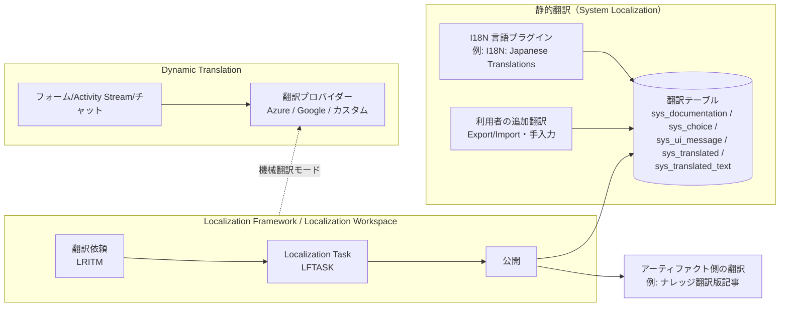
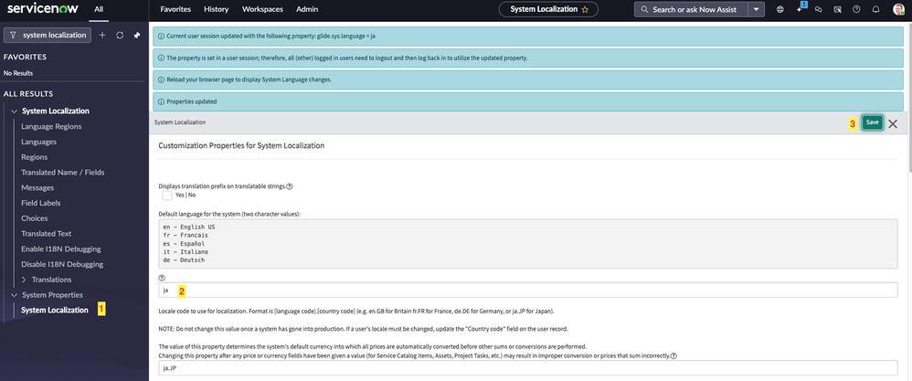
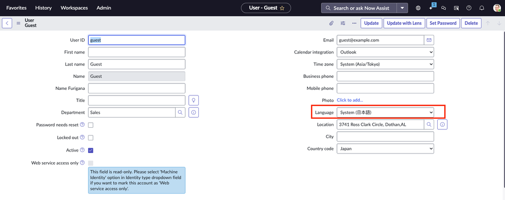
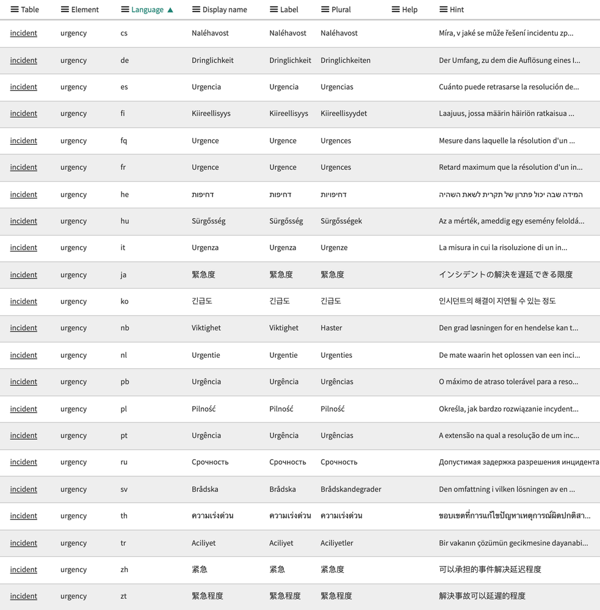
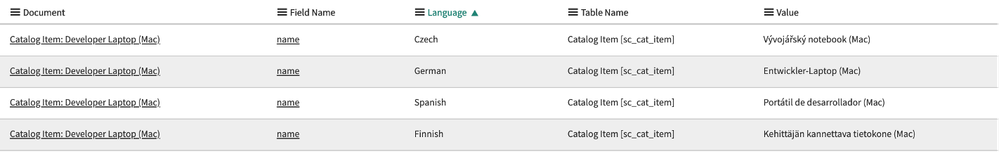
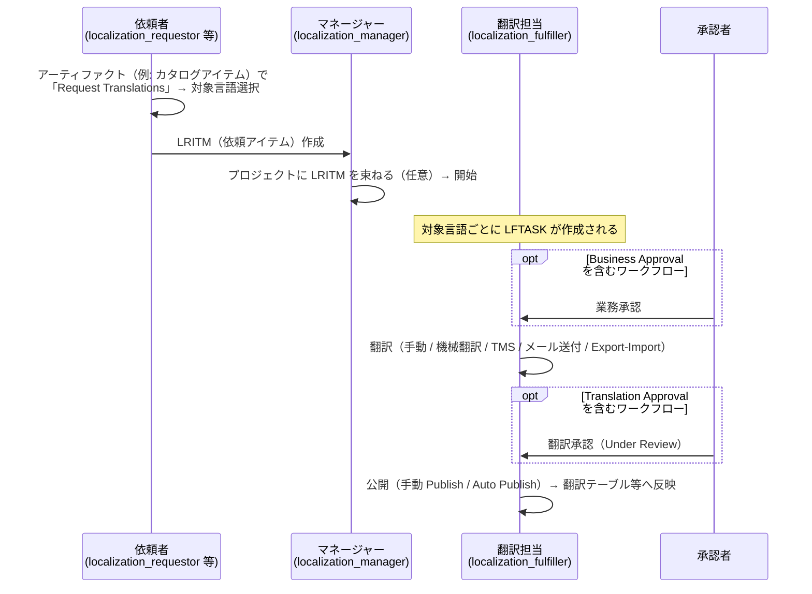
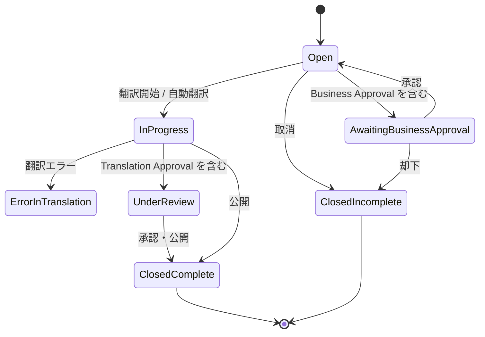

# ローカライゼーション（日本語化）— Localization / Internationalization

## 概要

ServiceNow AI Platform（Now Platform）の多言語対応は、次の 4 つの仕組みで構成される。ServiceNow 公式ドキュメントはこれらを「ServiceNow AI Platform translation and localization」として整理している。[出典](https://www.servicenow.com/docs/r/7LhbZn3yz3Q58qhjZoU9iQ/RqlKYndUCRjhXc3pW4yjuw)

| 仕組み | 対象 | 翻訳の性質 | 本書の節 |
|---|---|---|---|
| **System Localization（システムローカライゼーション）** | ベースシステムの UI 文字列（ラベル、選択肢、メッセージ等）、時刻・日付形式、通貨、ロケール | 静的翻訳（I18N 言語プラグインが提供する翻訳レコード＋利用者が追加する翻訳レコード） | 2〜5, 10〜11 |
| **Localization Framework（ローカライゼーションフレームワーク、LF）** | カタログアイテム、ナレッジ記事、Virtual Agent トピック、NLU モデル、サーベイ、通知、HR 文書テンプレート等の「アーティファクト」 | ワークフロー型の翻訳管理（依頼→翻訳→承認→公開） | 6 |
| **Localization Workspace（ローカライゼーションワークスペース）** | LF を基盤とした翻訳依頼・言語資産（用語集）管理の Workspace UI | 翻訳管理（ServiceNow Store アプリ） | 7 |
| **Dynamic Translation（動的翻訳）** | ユーザーが入力した文章（フォーム項目、Activity Stream のコメント／作業メモ、チャット、ナレッジ記事等） | 外部機械翻訳プロバイダー（Microsoft Azure Translator / Google Cloud Translation 等）によるリアルタイム機械翻訳 | 8 |

加えて、生成 AI 機能（Now Assist）は独自の多言語サービス（Multilingual service）を持ち、日本語はネイティブ対応（P2 区分）である（9 章）。

日本語化の最小構成は「**I18N: Japanese Translations プラグインの有効化 → ユーザーの言語（Language）を日本語に設定 → タイムゾーン・日付形式・ロケールを設定**」であり、カスタム開発部分（独自テーブル、カタログアイテム、通知、ポータルウィジェット等）の日本語化は利用者側の作業となる。ServiceNow はベースシステムの UI 文字列の翻訳のみを提供し、利用者が作成・変更したコンテンツは自動では翻訳されない。[出典](https://www.servicenow.com/docs/r/UrSRFFKWBbfQBgoRlt~ltw/8J24r2kgK5wtEy0kut416g)



関連ファイル：
- ユーザー設定や UI の基本は [UIの基本](../../01_入門編/05-ui-basics.md)、[Next Experience UI](./next-experience-ui.md)
- ナレッジ記事の翻訳版運用の詳細は [ナレッジ管理](./knowledge-management.md)
- 通知全般は [通知とメール](./notifications-email.md)、スケジュールとタイムゾーンを使う SLA は [SLAとスケジュール](./sla-schedules.md)
- Virtual Agent の多言語化は [Virtual Agent と会話型AI](./virtual-agent.md)、Now Assist は [Now Assist と AI Agents](./now-assist-ai-agents.md)
- 日本での導入実務は [日本市場における導入](../../03_導入編/15-japan-market.md)

---

## 1. 用語の整理

| 用語（英語） | 日本語訳 | 意味 |
|---|---|---|
| Internationalization（I18N） | 国際化 | 多言語化の基盤。プラグイン `com.glide.i18n`（I18N: Internationalization）が提供する翻訳テーブル・言語選択機能などの仕組み |
| Localization（L10N） | ローカライゼーション、地域化 | 特定言語・地域向けの翻訳、日時形式、通貨などの適用 |
| Language plugin / Language pack | 言語プラグイン／言語パック | ServiceNow が提供する言語別の翻訳レコード群（例：I18N: Japanese Translations） |
| Translation table | 翻訳テーブル | UI 文字列の翻訳を保持するテーブル（2 章） |
| Artifact | アーティファクト | Localization Framework で翻訳対象となるコンテンツ種別（カタログアイテム、ナレッジ記事など） |
| LRITM（Localization Requested Item） | ローカライゼーション依頼アイテム | LF における翻訳依頼の単位 |
| LFTASK（Localization Task） | ローカライゼーションタスク | 依頼アイテム×対象言語ごとに作成される翻訳作業タスク |
| TMS（Translation Management System） | 翻訳管理システム | RWS、XTM などの外部翻訳管理システム |
| Fallback language | フォールバック言語 | 利用者の言語に翻訳がない場合に英語より先に参照する中間言語 |
| Translator configuration | 翻訳プロバイダー設定 | Dynamic Translation が使う機械翻訳サービスの接続設定 |

---

## 2. 言語プラグイン（I18N）と言語の有効化

### 2.1 言語プラグインの構成

ServiceNow インスタンスの既定言語は American English（米国英語）であり、他言語の UI を表示するには `admin` ロールを持つ管理者が言語プラグインを有効化（インストール）する必要がある。Australia リリースのドキュメントでは以下のプラグインが列挙されている。[出典](https://www.servicenow.com/docs/r/fBdxWC~8p08POQuUubVDig/e76Brmu8bp8WBQFv14QrDQ)

| プラグイン名 | プラグイン ID | 役割 |
|---|---|---|
| I18N: Internationalization | `com.glide.i18n` | 国際化フレームワーク本体。翻訳済みデータが提供されない言語（非サポート言語）にローカライズする場合の基盤 |
| I18N: Knowledge Management Internationalization Plugin v2 | `com.glideapp.knowledge.i18n2` | ナレッジの多言語対応。**いずれかの言語プラグインを有効化すると自動的に有効化される** |
| I18N: Japanese Translations（日本語翻訳） | `com.snc.i18n.japanese`【第三者情報】 | 日本語の翻訳レコード一式 |

> **プラグイン ID について:** 公式の「Activate a language」ページは言語別翻訳プラグインの ID を掲載していない。日本語プラグインの ID `com.snc.i18n.japanese` は ServiceNow Community の回答に基づく。【第三者情報】[出典](https://www.servicenow.com/community/developer-forum/plugin-to-change-language-of-pdi/m-p/3111902)
>
> 言語プラグインを有効化すると **Localization Framework も有効化される**（公式：「Activate the required language plugins, which also enable the Localization Framework.」）。[出典](https://www.servicenow.com/docs/r/VbEA8DxUy61CFZ25mbYrcQ/ptRQDTom_plNMobzBDJYBw) ただし、日本語プラグインを入れると `com.glide.i18n`、`com.glideapp.knowledge.i18n2`、`com.glide.localization_framework.installer` が依存関係として入るという個々のプラグイン ID レベルの依存関係は Community の投稿に基づく。【第三者情報】[出典](https://www.servicenow.com/community/developer-forum/plugin-to-change-language-of-pdi/m-p/3111902) インスタンスの All Available Applications 画面で名称「I18N」で検索して確認すること。

### 2.2 提供言語（Australia）

Australia リリースのドキュメントには、以下 23 言語の翻訳プラグインが掲載されている。[出典](https://www.servicenow.com/docs/r/fBdxWC~8p08POQuUubVDig/e76Brmu8bp8WBQFv14QrDQ)

| # | 言語 | # | 言語 | # | 言語 |
|---|---|---|---|---|---|
| 1 | Arabic（アラビア語） | 9 | Hebrew（ヘブライ語） | 17 | Russian（ロシア語） |
| 2 | Brazilian Portuguese（ブラジルポルトガル語） | 10 | Hungarian（ハンガリー語） | 18 | Simplified Chinese（簡体字中国語） |
| 3 | Czech（チェコ語） | 11 | Italian（イタリア語） | 19 | Spanish（スペイン語） |
| 4 | Dutch（オランダ語） | 12 | **Japanese（日本語）** | 20 | Swedish（スウェーデン語） |
| 5 | Finnish（フィンランド語） | 13 | Korean（韓国語） | 21 | Thai（タイ語） |
| 6 | French Canadian（カナダフランス語） | 14 | Norwegian（ノルウェー語） | 22 | Traditional Chinese（繁体字中国語） |
| 7 | French（フランス語） | 15 | Polish（ポーランド語） | 23 | Turkish（トルコ語） |
| 8 | German（ドイツ語） | 16 | Portuguese（ポルトガル語） | | |

> **注記（Brazil）:** Brazil 版「Activate a language」ページでの提供言語数は公開情報では確認できず（検索結果抜粋では掲載言語が少なく見えたが、全量を確認できておらず、言語の削減か表示上の差異かは不明）。

### 2.3 有効化手順

`admin` ロールが必要。[出典](https://www.servicenow.com/docs/r/fBdxWC~8p08POQuUubVDig/e76Brmu8bp8WBQFv14QrDQ)

1. **All > System Applications > All Available Applications > All** を開く。
2. フィルタまたは検索バーで名称（例：`I18N: Japanese`）またはプラグイン ID で検索する。見つからない場合は ServiceNow への依頼が必要な場合がある。
3. **Install** を選択し、完了メッセージを待つ。
4. ブラウザを再読み込みし、ユーザーの言語を日本語に切り替える（3 章）。

有効化に関する制約・注意点：

| 項目 | 内容 | 出典 |
|---|---|---|
| アンインストール不可 | ローカライゼーションプラグインは**一度インストールするとアンインストールできない** | [出典](https://www.servicenow.com/docs/r/platform-administration/system-localization/t_ActivateALanguage.html) |
| ドメインセパレーション | Domain separation と Delegated admin が有効な場合、admin ユーザーは global ドメインにいる必要がある。そうでないと「別のプラグイン有効化が進行中」というエラーでインストールが失敗する | [出典](https://www.servicenow.com/docs/r/fBdxWC~8p08POQuUubVDig/e76Brmu8bp8WBQFv14QrDQ) |
| 製品名・アプリ名 | 「Activate a language」ページは、製品名・アプリ名は英語のまま残り、機能名は翻訳されると記載。一方「Language internationalization support」ページは、**Washington DC 以降は製品名・アプリ名も全サポート言語でローカライズされ、既存名称は段階的に対応中**と記載しており、両ページで記述が異なる。プラグイン名・Spoke 名は常に英語 | [出典1](https://www.servicenow.com/docs/r/fBdxWC~8p08POQuUubVDig/e76Brmu8bp8WBQFv14QrDQ) / [出典2](https://www.servicenow.com/docs/r/VbEA8DxUy61CFZ25mbYrcQ/QurF3629SykoZ_mEuWktCg) |
| 後から追加されたアプリの選択肢 | プラグインで後から追加したアプリの選択肢の翻訳を表示するには、対応する英語の選択肢レコードが追加された後に、翻訳済み選択肢レコードを有効化（activate）する必要がある | [出典](https://www.servicenow.com/docs/r/fBdxWC~8p08POQuUubVDig/e76Brmu8bp8WBQFv14QrDQ) |
| 製品別言語パック | 多くの製品の言語パックは、対応するベースシステム言語プラグインが有効なら自動でインストールされる | [出典](https://www.servicenow.com/docs/r/release-notes/rn-summary-localization.html) |

### 2.4 非サポート言語への翻訳

言語プラグインが提供されない言語に翻訳する場合は、`com.glide.i18n`（I18N: Internationalization）を有効化したうえで、以下を行う。[出典](https://www.servicenow.com/docs/r/UrSRFFKWBbfQBgoRlt~ltw/8J24r2kgK5wtEy0kut416g)

1. 対象言語の Choice [`sys_choice`] レコードを作成する。
2. 残りの翻訳レコードを Export と Import Set の方式で追加する。

公式は、非サポート言語への翻訳や大量のカスタム UI 文字列の翻訳には Localization Framework の利用を推奨している。言語自体は Languages [`sys_language`] テーブルにレコードを作成して追加する。[出典](https://www.servicenow.com/docs/r/UrSRFFKWBbfQBgoRlt~ltw/8J24r2kgK5wtEy0kut416g)

### 2.5 翻訳されないもの

ServiceNow 公式は、以下は翻訳されないと明記している。[出典](https://www.servicenow.com/docs/r/VbEA8DxUy61CFZ25mbYrcQ/QurF3629SykoZ_mEuWktCg)

- Journal フィールド（コメント、作業メモ）、Report のタイトル、自由入力テキストを格納するフィールド（例：`short_description`、`comments`）。これらには翻訳テーブルが存在せず、入力された言語のまま表示される（必要なら Dynamic Translation を使う。8 章）。
- 利用者が作成・編集したコンテンツ（カスタムフィールド、メッセージ、その他の UI テキスト）。手動で翻訳する必要がある。
- プラグイン名・Spoke 名。

---

## 3. 言語の決定ロジックとユーザー設定

### 3.1 セッション言語の決定順序

ServiceNow はログイン時に以下の優先順でセッション言語を決める。[出典](https://www.servicenow.com/docs/r/VbEA8DxUy61CFZ25mbYrcQ/QurF3629SykoZ_mEuWktCg)

| 優先度 | 決定要素 | 補足 |
|---|---|---|
| 1 | ログイン画面で選択した言語 | `glide.ui.login.language.select` が有効な場合 |
| 2 | ヘッダーバーの言語ピッカーで選択した言語 | |
| 3 | User [`sys_user`] レコードの Language（`preferred_language`）フィールド | Next Experience ではユーザーメニュー > Preferences > Language & region から設定 |
| 4 | システム既定言語 | プロパティ `glide.sys.language` |

ユーザー個人の設定は User レコードの Language フィールドに保存される。ユーザーメニュー > **Preferences > Language & region** で利用者自身が変更できる（多言語メール通知の設定手順中で案内されている）。[出典](https://www.servicenow.com/docs/r/platform-administration/multilingual-email-notifications.html)

### 3.2 フォールバック言語（Fallback language）

フォールバック言語は、利用者の優先言語に翻訳がない UI 文字列に対し、英語より先に参照する中間言語を指定する機能で、「利用者の言語 → フォールバック言語 → 英語」の 3 段階の階層を作る。[出典](https://www.servicenow.com/docs/r/UrSRFFKWBbfQBgoRlt~ltw/JiRHcKsVrbzZlq3z563_WA)

- 設定：**All > System Localization > Languages** で有効な言語レコードを開き、**Fallback** フィールドで言語を選んで Update。
- フォールバック先には有効（Active）な言語しか選べない。英語は既定のフォールバック先のため選択できない。
- 無効化：`glide_i18n.language_fallback_enabled` を `false` にすると常に英語にフォールバックする（既定 `true`）。
- Now Assist in Virtual Agent で LLM 会話が有効な場合、ロケール別言語のフォールバックは Languages テーブルでのみ設定可能。[出典](https://www.servicenow.com/docs/r/2OOsGpWOpQIq4ASG5~gt4g/iybPBxdU2EAPvytv_Gd9IQ)

日本語環境では通常フォールバックを設定する必要はないが、地域方言版のカスタム言語（例：Mexican Spanish → Spanish）を作る場合に有用である。【推定】

### 3.3 ログイン画面（未認証ユーザー）の言語

> **Yokohama / Australia での挙動変更【第三者情報】:** ServiceNow 社員による Community 記事（2026-07 公開、2026-09 更新）によれば、Yokohama・Australia へのアップグレード後は、ゲストユーザー（`guest`）の言語設定でログイン画面の UI 言語が決まらなくなった（セッション言語処理ロジックの追加による仕様）。記事は、System Localization ドキュメント中の「ゲストユーザーの言語を設定するとログイン画面とロールを持たないユーザーの言語が決まる」という記述は誤りで、ドキュメント修正中としている。[出典](https://www.servicenow.com/community/international-localization/best-practice-configuring-login-page-language-for/ta-p/3568168)

同記事が推奨する「未認証ユーザーのログイン画面を常に日本語にする」手順：

| 手順 | 設定対象 | 値 |
|---|---|---|
| 1 | システムプロパティ `glide.sys.language` | `ja` |
| 2 | User [`sys_user`] の `guest` レコードの Language（Preferred Language） | 空欄（English でも ja でもなく空欄。画面上は「System (日本語)」と表示される） |
| 3 | User Preference [`sys_user_preference`] で `name = user.language` かつ `user` が空のレコード | 削除（システム全体の設定として残っているとアップグレード後に言語が不安定になる） |
| 4 | キャッシュ | ナビゲーターで `cache.do` を実行し、シークレットウィンドウで確認 |

関連プロパティ `glide_i18n.ip_geolocation`（既定 No）を有効にすると、ゲストユーザーのロケールを他の方法で判定できない場合に IP アドレスの国から初期言語を決める。無効時ゲストは英語が既定。[出典](https://www.servicenow.com/docs/r/UrSRFFKWBbfQBgoRlt~ltw/BMJppzQikjX7L5w9DJeqNQ)



**キャプション:** System Properties > System Localization（Customization Properties for System Localization）画面。

**画面の説明:** 左のアプリケーションナビゲーターで「system localization」と検索した状態で、System Localization メニュー配下に Language Regions、Languages、Regions、Translated Name / Fields、Messages、Field Labels、Choices、Translated Text、Enable I18N Debugging、Disable I18N Debugging、Translations の各モジュールが並び、その下の System Properties > System Localization（番号 1）を開いている。右側のフォームには「Displays translation prefix on translatable strings（Yes | No）」、「Default language for the system (two character values)」（候補として en / fr / es / it / de が説明表示）の入力欄に `ja` を入力（番号 2）、「Locale code to use for localization」欄に `ja.JP`（本番稼働後は変更しないこと、ユーザーのロケール変更は User レコードの Country code で行うことの注記付き）が表示され、右上の Save（番号 3）で保存する。上部には「Current user session updated with the following property: glide.sys.language = ja」「他のログイン中ユーザーは再ログインが必要」「Reload your browser page to display System Language changes」「Properties updated」のメッセージが表示されている。

**出典:** ServiceNow Community「Best Practice: Configuring Login Page Language for Unauthenticated Users」 https://www.servicenow.com/community/international-localization/best-practice-configuring-login-page-language-for/ta-p/3568168 （取得日：2026-11-03）



**キャプション:** User - Guest（`guest` ユーザーの User レコード）。

**画面の説明:** 左列に User ID（guest）、First name、Last name（Guest）、Name、Name Furigana、Title、Department（Sales）、Password needs reset、Locked out、Active、Web service access only の各項目、右列に Email、Calendar integration（Outlook）、Time zone（`System (Asia/Tokyo)`）、Business phone、Mobile phone、Photo、**Language（`System (日本語)`、赤枠で強調）**、Location、City、Country code（Japan）が並ぶ。Language を空欄（＝System）にすると `glide.sys.language` の値に従い、この例ではシステム既定の日本語が表示される。なお画面には「Name Furigana（ふりがな）」フィールドが見えるが、このフィールドを追加するプラグインや条件は公開情報では確認できず。

**出典:** 同上 Community 記事 https://www.servicenow.com/community/international-localization/best-practice-configuring-login-page-language-for/ta-p/3568168 （取得日：2026-11-03）

---

## 4. 翻訳テーブル（Translation tables）

### 4.1 テーブル一覧

UI 文字列の翻訳は以下のテーブルに格納される。Languages テーブルは I18N プラグインを 1 つ以上有効化した後に利用可能になる。[出典](https://www.servicenow.com/docs/r/platform-administration/system-localization/r_TranslationTables.html)

| テーブル（表示名） | テーブル名 | 格納内容 | 翻訳プレフィックス |
|---|---|---|---|
| Languages（言語） | `sys_language` | 翻訳テキストが利用可能な言語の一覧。Fallback 設定もここ | （なし） |
| Field Label（フィールドラベル） | `sys_documentation` | テーブル名、各フィールドの単数形・複数形ラベル、ヘルプ、ヒント | `GMLD` |
| Choice（選択肢） | `sys_choice` | リスト（ドロップダウン）選択肢の表示テキスト | `CHC` |
| Message（メッセージ） | `sys_ui_message` | 情報・確認・エラーメッセージなど、スクリプトや UI で使われるメッセージ | `MSG` |
| Translated Name / Field（翻訳済み名前/フィールド） | `sys_translated` | フィールド型が `translated_field` の値の翻訳 | `TRF` |
| Translated Text（翻訳済みテキスト） | `sys_translated_text` | フィールド型が `translated_text` または `translated_html` の値の翻訳 | `TRT` |

翻訳プレフィックスと各テーブルの対応は Community 記事に基づく。【第三者情報】[出典](https://www.servicenow.com/community/developer-articles/debugging-language-translations-in-servicenow/ta-p/2296421)

> **注意:** Zurich 版の「Translation tables」ページでは見出しと説明の対応がずれている箇所がある。上表は Australia/Brazil 版の対応に従う。

### 4.2 各テーブルの構造と使い分け

以下は ServiceNow 社員（Globalization チーム）による Community 記事「Everything you ever wanted to know about the 5 translation tables」に基づく詳細である。【第三者情報】[出典](https://www.servicenow.com/community/international-localization/everything-you-ever-wanted-to-know-about-the-5-translation/ta-p/2326662)

#### `sys_documentation`（Field Label）

- `sys_dictionary` がフィールド定義（型・属性）を持つのに対し、`sys_documentation` はラベルを持つ。英語ラベルも同じテーブルに `language = en` のレコードとして存在し、翻訳は言語ごとの別レコード。
- 主なフィールド：Table、Element、Language、Display name、Label、Plural、Help、Hint。
- 照合キー：Table + Element + Language。継承フィールド（例：`task` 由来の `urgency`）は、ラベルを上書きする場合にどのテーブルで定義されているかを確認する。
- カスタムフィールドの抽出：Element が `u_` で始まるものでフィルタ。
- アップデートセット上の種別は「Field label」、名前は `sys_documentation_<テーブル>_<フィールド>`。



**キャプション:** Field Label [`sys_documentation`] のリスト（`incident` テーブル `urgency` フィールドの言語別レコード）。

**画面の説明:** 列は Table、Element、Language（昇順ソート）、Display name、Label、Plural、Help、Hint。すべて Table = `incident`、Element = `urgency` で、Language 列に cs、de、es、fi、fq、fr、he、hu、it、**ja**、ko、nb、nl、pb、pl、pt、ru、sv、th、tr、zh、zt が並ぶ。`ja` 行は Display name・Label・Plural がいずれも「緊急度」、Hint が「インシデントの解決を遅延できる限度」。言語コードは ServiceNow 独自のものを含み、`fq` = カナダフランス語、`pb` = ブラジルポルトガル語、`nb` = ノルウェー語、`zh` = 簡体字中国語、`zt` = 繁体字中国語である（ラベル内容からの判読）。

**出典:** ServiceNow Community「Everything you ever wanted to know about the 5 translation tables」 https://www.servicenow.com/community/international-localization/everything-you-ever-wanted-to-know-about-the-5-translation/ta-p/2326662 （取得日：2026-11-03）

#### `sys_choice`（Choice）

- 選択肢は Choice Set [`sys_choice_set`] の子レコード。英語と翻訳が同じテーブルに言語別レコードとして並ぶ。
- 主なフィールド：Table、Element、Language、Value、Label、Hint、Dependent value、Inactive、Sequence。
- **Value はサーバー側（ビジネスルール等）が判定する値のため、全言語で一致させる必要がある。** Sequence（表示順）、Inactive（無効化）も全言語で整合させる。Dependent value は依存選択肢の表示制御に使われる。
- アップデートセット上の種別は「Choice list」で、選択肢リスト全体が記録される（名前 `sys_choice_<テーブル>_<フィールド>`）。

#### `sys_ui_message`（Message）

- 主なフィールド：Key、Language、Message。スクリプトの Message API（`gs.getMessage()`、クライアントの `getMessage()`）が、Key とセッション言語で翻訳を引く。[出典](https://www.servicenow.com/docs/r/platform-administration/system-localization/t_TranslateAClientScriptMessage.html)
- Key は大文字小文字を区別しないため、同一言語で重複キーを作らない。コードから呼ぶすべてのキーについて英語レコードも作成するのが標準的なやり方。【第三者情報】
- アップデートセット上の種別は「Message」、名前は `sys_ui_message_<sys_id>`。

#### `sys_translated`（Translated Name / Field）

- フィールド型 `translated_field` の値（例：カタログ変数 `question` の質問文）の翻訳を持つ。
- **英語用の言語レコード（`language = en`）は持たない。** Value フィールドに英語原文を、Label フィールドに訳文を格納し、「テーブル＋フィールド＋英語原文」の一致で置換する。そのため同じ英語原文を持つ複数レコードに同じ翻訳が適用される。【第三者情報】
- アップデートセット上の種別は「Translated Name / Field」。

#### `sys_translated_text`（Translated Text）

- フィールド型 `translated_text` / `translated_html` の値（例：カタログアイテム `sc_cat_item` の `name`、`description`）の翻訳を持つ。
- 主なフィールド：Document（原文レコードへの Document ID）、Field name、Language、Table name、Value。
- 英語原文は元レコード側に残り、翻訳は Document ID で紐付く。**翻訳はアップデートセット上では元レコードのペイロード内に含まれる**（独立した更新レコードにならない）。
- フィールドに serializer 属性が必要（型設定時に自動付与されるはずだが、欠落していると翻訳が機能しない）。【第三者情報】



**キャプション:** Translated Text [`sys_translated_text`] のリスト。

**画面の説明:** 列は Document、Field Name、Language（昇順）、Table Name、Value。4 行とも Document = 「Catalog Item: Developer Laptop (Mac)」、Field Name = `name`、Table Name = 「Catalog Item [sc_cat_item]」で、Language = Czech / German / Spanish / Finnish に対し、Value にそれぞれの言語の品名（例：German は「Entwickler-Laptop (Mac)」）が入っている。英語原文はカタログアイテム側の `name` に残り、このテーブルには翻訳のみが格納されることが分かる。

**出典:** ServiceNow Community「Everything you ever wanted to know about the 5 translation tables」 https://www.servicenow.com/community/international-localization/everything-you-ever-wanted-to-know-about-the-5-translation/ta-p/2326662 （取得日：2026-11-03）

### 4.3 フィールド型と翻訳テーブルの対応

| フィールド型（Dictionary の Type） | 翻訳の格納先 | 代表例 |
|---|---|---|
| 通常のラベル（全フィールド共通） | `sys_documentation` | 全テーブルのフィールドラベル |
| Choice（選択肢付きフィールド） | `sys_choice` | `incident.state`、`urgency` |
| `translated_field` | `sys_translated` | カタログ変数の質問文（`question`） |
| `translated_text`、`translated_html` | `sys_translated_text` | `sc_cat_item.name` / `description` |
| String / Journal / HTML（通常型） | **翻訳テーブルなし**（入力言語のまま） | `short_description`、`comments`、`work_notes` |

通常の String 型フィールドを多言語表示したい場合は、型を `translated_text` 等に変更するか、Dynamic Translation による動的翻訳を使う。型変更は既存データ・スクリプトに影響しうるため慎重に判断する。【推定】

---

## 5. カスタムコンテンツの翻訳方法（System Localization）

### 5.1 コンテンツ種別ごとの方法

ServiceNow はベースシステム UI 文字列の翻訳だけを I18N プラグインで提供し、利用者が作成・変更したコンテンツは利用者が翻訳する。編集・更新のたびに翻訳を繰り返す必要がある。[出典](https://www.servicenow.com/docs/r/UrSRFFKWBbfQBgoRlt~ltw/8J24r2kgK5wtEy0kut416g)

| 対象 | 方法（公式手順の要約） |
|---|---|
| フィールドラベル（独自テーブル） | 全フィールドの英語版を作成 → Field Labels の翻訳レコードをエクスポート → 翻訳し Language を設定 → Import Set で再取り込み。個別ラベルの直接翻訳も可 |
| UI Page（HTML） | 翻訳対象テキストを `gs.getMessage()` で囲み、英語の Key/Value の `sys_ui_message` を作成し、言語ごとに `sys_ui_message` を追加 |
| Client Script のメッセージ | Client Script の **Messages** フィールド（複数行、1 行 1 キー）にキーを列挙し、`getMessage(key)` で取得。対応する `sys_ui_message` を作成 [出典](https://www.servicenow.com/docs/r/platform-administration/system-localization/t_TranslateAClientScriptMessage.html) |
| Service Catalog アイテム | `Display translation prefix on translatable strings` を Yes にし、英語でアイテムを作成 → 優先言語を切り替え → プレフィックス付き文字列を翻訳して保存。ただし現在は Localization Framework の利用が推奨（6 章） |
| Service Portal ウィジェット | HTML Template / Client Script / Server Script 内の文字列を `${}` または `gs.getMessage()` で囲み、文字列ごと・言語ごとに `sys_ui_message` を作成（詳細は 5.2） |
| Playbook | Playbook を有効化した後、プロセス定義 [`sys_pd_process_definition`] の翻訳対象テキストを翻訳 |
| プラグイン提供の翻訳の修正 | 翻訳テーブル上で直接編集せず、エクスポート → 外部で編集 → 再インポート。直接編集するとアップグレードや zBoot で上書きされうる |
| Support Chat | 大部分は I18N プラグインで翻訳済み。カスタム文言はポータルウィジェットと同じ手順 |
| 通知・サーベイ | System Localization の対象外（言語ごとの版を作り、ビジネスルールで振り分け）。ただし現在は通知翻訳プラグイン（5.4）と Localization Framework（6 章）で対応可能 |

出典：[Translating custom content（Australia）](https://www.servicenow.com/docs/r/UrSRFFKWBbfQBgoRlt~ltw/8J24r2kgK5wtEy0kut416g)

### 5.2 Service Portal ウィジェットのローカライズ

[出典](https://www.servicenow.com/docs/r/platform-user-interface/service-portal/c_WidgetLocalization.html)

- `${message}` は `${gs.getMessage("message")}` と等価で、翻訳は `sys_ui_message` から引かれる。
- HTML Template：`${}` で囲んだ文字列は直接翻訳される。
- Client Script：`${}` でタグ付けした文字列をプロパティ（例：`c.message`）に代入し、`{{c.message}}` で表示する。
- Server Script：`gs.getMessage()` の結果を `data` に渡す。ウィジェットオプション（例：`gs.getMessage(options.title)`）も同様に翻訳できる。
- **注意:** 翻訳文にシングル／ダブルクォートが含まれると、Client Script 内で `${}` を使った場合に JavaScript エラーになりうる。**Server Script で翻訳を取得してクライアントにバインドする方法が推奨**される。

ポータル全体の多言語化（言語セレクター、Employee Center の翻訳）は [Service Portal と Employee Center](./portals-employee-center.md) を参照。

### 5.3 翻訳のデバッグ（翻訳プレフィックス）

どの翻訳テーブルの文字列かを特定するには、翻訳プレフィックス表示を使う。[出典](https://www.servicenow.com/docs/r/platform-administration/system-localization/r_TranslationTables.html)

| 方法 | 範囲 | 操作 |
|---|---|---|
| プロパティ `glide.ui.i18n_test`（表示名「Display translation prefix on translatable strings」） | 全セッション | All > System Properties > System Localization で Yes（既定 No）[出典](https://www.servicenow.com/docs/r/UrSRFFKWBbfQBgoRlt~ltw/BMJppzQikjX7L5w9DJeqNQ) |
| モジュール **System Localization > Enable I18N Debugging** / **Disable I18N Debugging** | 自分のセッションのみ | 有効化後、対象ページを開いてブラウザを再読み込み。終了時は Disable またはログアウト【第三者情報】[出典](https://www.servicenow.com/community/developer-articles/debugging-language-translations-in-servicenow/ta-p/2296421) |

表示されるプレフィックス（`GMLD`、`CHC`、`MSG`、`TRF`、`TRT`）から 4.1 の表で格納テーブルを特定し、該当テーブルを言語でフィルタして修正する。新しい翻訳が表示されない場合は `cache.do` でキャッシュをクリアする（Community の回答例）。【第三者情報】

### 5.4 多言語メール通知（Multilingual email notifications）

メール通知を受信者の優先言語で送信する仕組み。[出典](https://www.servicenow.com/docs/r/platform-administration/multilingual-email-notifications.html)

| 項目 | 内容 |
|---|---|
| プラグイン | Glide Notification Translation（`com.glide.notification.translation`）。有効化に `admin` ロールが必要。有効化すると Localization Framework プラグインも既定で有効化される |
| 関連プラグイン | Translated Email Retention（`com.glide.email_retention.translation`）：翻訳済みメールのアーカイブ |
| プロパティ | `glide.email.translation.honour.user_preference` を `true` にすると受信者の優先言語が尊重される |
| Static translation（静的翻訳） | 言語ごとのメールテンプレートを翻訳者が作成（LF の翻訳依頼を経由） |
| Dynamic translation（動的翻訳） | 受信者の言語でメールを自動生成（機械翻訳） |
| 併用 | 例：フランス語・スペイン語テンプレートは存在しドイツ語はない場合、ドイツ語のみ動的翻訳 |
| グループ宛 | グループにメールアドレスがない場合はメンバーごとの言語で送信。グループにメールアドレスがある場合は単一言語で送信され個人設定は無視 |
| CC / BCC | スクリプトで指定した CC・BCC は多言語通知の対象外（サポートされない）とする Community 記事あり。公式の「Multilingual email notifications」ページ本文には CC / BCC の記載はなく、公式ドキュメントでは確認できず【第三者情報】[出典](https://www.servicenow.com/community/international-localization/dynamic-multi-lingual-notification-support/ta-p/2327260) |
| 固定アドレス宛 | 固定メールアドレス（ユーザーレコードに解決されない宛先）は英語になる、との Community 回答あり【第三者情報】 |

Localization Framework で翻訳できる通知関連アーティファクト（Email notification、Email template、Email layout）は 6.4 を参照。通知そのものの設定は [通知とメール](./notifications-email.md)。

---

## 6. Localization Framework（ローカライゼーションフレームワーク）

### 6.1 概要

Localization Framework（LF）は、ServiceNow インスタンスを地域・言語向けに翻訳するための体系的なプロセスを提供するアプリケーションである。翻訳プロジェクトの作成・管理、翻訳者へのタスク割り当て、進捗追跡、翻訳済みコンテンツの言語パック作成ができる。[出典](https://www.servicenow.com/docs/r/platform-administration/localization-framework/exploring-localization-framework.html)

| 項目 | 内容 |
|---|---|
| 主要プラグイン | Localization Framework（`com.glide.localization_framework`）、Localization Framework Installer（`com.glide.localization_framework.installer`）[出典](https://www.servicenow.com/docs/r/MMV5lKjf1f12mwR_Y135Lw/28dunCziSy6EXBofWr2fuQ) |
| 翻訳の依頼 | 英語から、有効化済みの 1 つ以上の言語へ翻訳を依頼できる（公式表現は "from English into different languages"） |
| メニュー | All > Localization Framework（Settings、Requests、Tasks、Projects、Insights 等）【推定：個別モジュール名は公開ページから網羅確認できず】 |
| 制約 | **Domain Separation（ドメインセパレーション）はサポートされない** |
| 機械翻訳 | 翻訳依頼を機械翻訳で処理する場合は、Dynamic Translation を設定し、Translator configuration（翻訳プロバイダー設定）を用意する。Localization Workspace の Language provider とは別物 [出典（Configuring Localization Workspace, Australia）](https://www.servicenow.com/docs/r/UrSRFFKWBbfQBgoRlt~ltw/~ndlEyIGWvAnMaieKBrbuQ)。必要なプラグインは Dynamic Translation（`com.glide.dynamic_translation`）。翻訳用の既定 Translator configuration を有効にしておく必要がある【第三者情報：ServiceNow 社員による Community ブログ、2021-10】[出典](https://www.servicenow.com/community/international-localization-blog/configure-localization-framework-lf-and-dynamic-translation-dt/ba-p/2289224) |

### 6.2 ロール

ロールはいずれもグループに既定では割り当てられていない。[出典](https://www.servicenow.com/docs/r/VbEA8DxUy61CFZ25mbYrcQ/_rVqmQelQ3RwZy3kNQ6OyA)

| ロール名（表示名） | ロール | 説明 | 含まれるロール |
|---|---|---|---|
| Localization administrator（LF 管理者） | `localization_admin` | アーティファクト、言語設定、翻訳依頼、TMS 設定、Insights ダッシュボードなど LF 全体を管理。TMS 設定のため `flow_designer`、`connection_admin` も継承する。専用ロールで足りる場合は付与を避けることが推奨 | `localization_editor`、`localization_fulfiller`、`localization_manager`、`localization_requestor` |
| Localization requester（依頼者） | `localization_requestor` | 設定済みアーティファクトの翻訳を 1 つ以上の言語に依頼 | なし |
| Localization fulfiller（翻訳担当） | `localization_fulfiller` | 依頼アイテムの翻訳の提供・検証・承認・公開 | なし |
| Localization editor（編集者） | `localization_editor` | ローカライゼーションタスクを経ずに直接翻訳 | `localization_requestor` |
| Localization manager（マネージャー） | `localization_manager` | プロジェクトのオーナー。依頼アイテムをプロジェクトに追加し、プロジェクトを開始できる唯一のロール。Hub and Spoke 構成ではハブ側の `sn_lf_hub_translation_request`、`sn_lf_hub_translation_item` テーブルにもアクセス | `localization_fulfiller` |

LF のロールは Localization Workspace でも使われる。[出典](https://www.servicenow.com/docs/r/platform-administration/localization-framework/exploring-localization-framework.html)

### 6.3 処理の流れ

[出典](https://www.servicenow.com/docs/r/platform-administration/localization-framework/exploring-localization-framework.html)



- 依頼アイテムは LRITM（Localization Requested Item）で、選択した言語ごとに 1 件作成される。[出典](https://www.servicenow.com/docs/r/platform-administration/localization-framework/exploring-localization-framework.html)
- 各依頼アイテムにはローカライゼーションタスクが紐づき、タスク番号は `LFTASK` + 連番のプレフィックスを持つ（"Each localization request item also has an associated localization task (LFTASK is the prefix with a sequential number)"）。この記述は Employee Service Management（Content Publishing 連携）の公式ページ（Xanadu 版）によるもので、LF の概要ページには記載がない。[出典（Integration with Localization Framework, Xanadu）](https://www.servicenow.com/docs/r/xGHm5nN1KlkEq58WJHJoPw/Sr_L9ApDA8wq_e4hICy0vw)
- 翻訳担当者の作業手段：手動翻訳（原文・訳文の両方を理解している場合）、翻訳設定で構成した機械翻訳、外部翻訳者へのエクスポートと取り込み。[出典](https://www.servicenow.com/docs/r/VbEA8DxUy61CFZ25mbYrcQ/_rVqmQelQ3RwZy3kNQ6OyA)

### 6.4 サポートされるアーティファクト

[出典（Australia）](https://www.servicenow.com/docs/r/MMV5lKjf1f12mwR_Y135Lw/28dunCziSy6EXBofWr2fuQ)

| アーティファクト | 必要なプラグイン／条件 |
|---|---|
| Catalog Items（カタログアイテム） | Localization Framework Installer（`com.glide.localization_framework.installer`） |
| NLU Models（NLU モデル） | 同上 |
| Surveys（サーベイ） | 同上 |
| Virtual Agent Topic（VA トピック） | Glide Virtual Agent Lite（`com.glide.cs.chatbot.lite`） |
| HR Document Template Block Content / HTML Document Template（HR 文書テンプレート） | HR Lifecycle Events for Enterprise（`com.sn_hr_lifecycle_ent`） |
| Knowledge Base articles（ナレッジ記事） | Knowledge Management Advanced（`com.snc.knowledge_advanced`）＋プロパティ `glide.knowman.translation.enable_lf_article_translation` = `true` |
| Email notifications / templates / layouts（メール通知・テンプレート・レイアウト） | Glide Notification Translation（`com.glide.notification.translation`） |
| カスタムアーティファクト | 利用者が Artifact processor（スクリプト）と UI Action を実装して追加可能。例：ポータルのお知らせ（Announcements）【第三者情報】[出典](https://www.servicenow.com/community/international-localization/extending-the-localization-framework-to-portal-announcements/ta-p/2326792) |

ServiceNow Store にはプロトタイプ（ベータ）のアーティファクト集（Service Portal ページ、Guided Tour、PA ダッシュボード等）もあるが、すべての文字列を期待どおり拾えない場合があると注記されている。【第三者情報】

カタログアイテムの翻訳では、アイテムに紐づく Variables、Variable sets、Catalog client scripts、Catalog UI policies もあわせて翻訳対象となる。**カタログアイテムは主言語でしか作成できず、言語を切り替えて Catalog Builder で編集した内容は翻訳されない**。翻訳状況は Localization Insights ダッシュボード（スケジュールジョブが生成する Insights レコードを集計）で監視できる。[出典](https://www.servicenow.com/docs/r/servicenow-platform/service-catalog/translate-catalog-items.html)

### 6.5 LF Settings（設定）

**All > Localization Framework > Settings** で New を選び設定を作成する（`localization_admin` または `localization_manager`）。設定はアーティファクト単位（または All Artifacts）で作成する。[出典](https://www.servicenow.com/docs/r/VbEA8DxUy61CFZ25mbYrcQ/VNZPli10xKyXcav8vyXULw)

| タブ | 項目 | 内容 |
|---|---|---|
| Settings | Name | 設定名 |
| | Artifact | All Artifacts または特定アーティファクト（例：`catalog_item`、`nlu_model`） |
| | Languages | アーティファクトに応じて選択可能な言語 |
| Translation Preferences | Machine Translation | Enable machine translate、Translator（翻訳プロバイダー） |
| | Translation Management System (TMS) | Enable TMS、TMS（既定で **RWS**、**XTM**、またはカスタム TMS）。Hub and Spoke 構成のスポーク側では「Localization Framework Hub」を指定 |
| | Send via Email | Enable send via email、Email subflow（既定：Send LF Email For Translation）、Default file format、Default recipient(s) list |
| | Export/Import | Enable export/import、Default file format |
| Workflow Preferences | Workflow | 6.6 のワークフローから選択 |
| | Auto translation mode | Machine Translate / Send to TMS / Send via Email |
| | Localization fulfiller group | 翻訳担当グループ（`localization_fulfiller` を含むこと） |
| | Business approver group | 業務承認を含むワークフロー時のみ表示（`localization_fulfiller` を含むこと） |
| | Translation approver group | 翻訳承認を含むワークフロー時のみ表示（`localization_fulfiller` を含むこと） |
| Project Preferences | Enable projects / Enable auto creation / Localization manager group | Localization Workspace 利用時は Enable projects = オン、Enable auto creation = オフにする。マネージャーグループは `localization_manager` を含むこと |

> 上表は Yokohama 版ページ（2025-11 更新）に基づく。Australia 版で項目変更があるかは公開情報では確認できず。

ServiceNow Store の Localization Workspace 掲載情報によれば、Localization Workspace を使う Yokohama 環境では、翻訳プロジェクトを自動作成・更新するために `sn_lf_setting` テーブルの読み取り・更新・Web サービスアクセスを許可する必要がある。【第三者情報：Store 掲載情報】[出典](https://store.servicenow.com/store/app/654451701bd5e650396216db234bcb11)

### 6.6 ワークフロー（10 種）

LF には以下 10 種類のワークフローがあり、Settings の Workflow で選択する。自動翻訳ステップを含むもの（3, 4, 5, 8, 9, 10）は Auto translation mode の選択が必須。「Publish」は手動公開、「Auto Publish」は自動公開。[出典（Australia）](https://www.servicenow.com/docs/r/UrSRFFKWBbfQBgoRlt~ltw/q26pI0_U23DQuXH5CL4LMA)

| # | ワークフロー | 必要なグループ／設定 |
|---|---|---|
| 1 | Translation → Publish | Localization Fulfiller |
| 2 | Translation → Translation Approval → Auto Publish | Localization Fulfiller, Translation Approver |
| 3 | Auto Translation → Translation Approval → Auto Publish | Localization Fulfiller, Translation Approver, Auto Translation Mode |
| 4 | Auto Translation → Publish | Localization Fulfiller, Auto Translation Mode |
| 5 | Auto Translation → Auto Publish | Localization Fulfiller, Auto Translation Mode |
| 6 | Business Approval → Translation → Publish | Business Approver, Localization Fulfiller |
| 7 | Business Approval → Translation → Translation Approval → Auto Publish | Business Approver, Localization Fulfiller, Translation Approver |
| 8 | Business Approval → Auto Translation → Translation Approval → Auto Publish | Business Approver, Localization Fulfiller, Translation Approver, Auto Translation Mode |
| 9 | Business Approval → Auto Translation → Publish | Business Approver, Localization Fulfiller, Auto Translation Mode |
| 10 | Business Approval → Auto Translation → Auto Publish | Business Approver, Localization Fulfiller, Auto Translation Mode |

日本語化での選び方の目安【経験則】：
- 機械翻訳の品質確認が必須な場合（社外向けポータル、法務・人事文書）は、翻訳承認を含む #3 または #8。
- 社内向けで量が多い場合は #4（機械翻訳→担当者が確認して手動公開）。
- 機械翻訳を無条件に公開する #5 / #10 は、用語のゆれ（例：「インシデント」「障害」）が残りやすいため、Exclusion Framework（8.6）や用語集（7 章）と併用する。

### 6.7 状態値（State）

[出典](https://www.servicenow.com/docs/r/7LhbZn3yz3Q58qhjZoU9iQ/oqxyMuk7LHZVwsrsqbT1Jw)

**プロジェクトの状態**

| State | 意味 |
|---|---|
| Draft | プロジェクト作成時の初期状態 |
| In progress | プロジェクト開始後 |
| Closed Complete | すべてのタスクが Closed Complete |
| Closed Incomplete | 1 つ以上のタスクが Closed Incomplete |

**ローカライゼーションタスク（LFTASK）の状態**

| State | 意味 |
|---|---|
| Open | まだ翻訳に送られていない |
| Awaiting Business Approval | 業務承認待ち |
| In Progress | 翻訳中 |
| Under Review | 承認者が翻訳をレビュー中 |
| Error in Translation | 翻訳中にエラー発生（機械翻訳・TMS 連携の失敗など） |
| Closed Complete | 翻訳完了・公開済み |
| Closed Incomplete | 依頼を満たさずにクローズ |

タスクがどの状態を通るかは、その言語に設定されたワークフローによって変わる。Translate アクションは Awaiting Business Approval、Closed Complete、Closed Incomplete 以外の状態で利用できる。[出典](https://www.servicenow.com/docs/r/platform-administration/localization-framework/fulfill-localization-task.html)



> 上図の遷移線は状態定義から再構成したもので、公式に遷移図は公開されていない。【推定】

### 6.8 Hub and Spoke 構成

複数インスタンスを運用する場合、翻訳依頼をハブインスタンスに集約する Hub and Spoke 構成がとれる。スポーク側の LF Settings で TMS に「Localization Framework Hub」を設定すると、Send to TMS がハブへの依頼送信になる。ハブ側では `sn_lf_hub_translation_request`、`sn_lf_hub_translation_item` テーブルに依頼が格納される。[出典](https://www.servicenow.com/docs/r/VbEA8DxUy61CFZ25mbYrcQ/VNZPli10xKyXcav8vyXULw) / [出典](https://www.servicenow.com/docs/r/VbEA8DxUy61CFZ25mbYrcQ/_rVqmQelQ3RwZy3kNQ6OyA)

---

## 7. Localization Workspace（ローカライゼーションワークスペース）

### 7.1 概要

Localization Workspace は、コンテンツオーナーと翻訳依頼者向けの翻訳管理アプリで、翻訳タスク作成とワークフローを自動化し、Language Asset Management（言語資産管理）領域で用語集（Glossary）を保管する。**ServiceNow Store から入手**する（ベースシステムには含まれない）。[出典](https://www.servicenow.com/docs/r/release-notes/localization-workspace-rn.html)

| 項目 | 内容 |
|---|---|
| 提供形態 | ServiceNow Store アプリ（Yokohama 以降で利用可能と Store に記載）【第三者情報：Store 掲載情報】 |
| 前提 | Localization Framework（`com.glide.localization_framework`）、Dynamic Translation（Workspace と同時に自動インストール）、I18N、必要な言語 [出典](https://store.servicenow.com/store/app/654451701bd5e650396216db234bcb11) |
| ロール | `sn_lw.user`（全利用者に必要）、`sn_lw.terminology_manager`（用語集・用語管理。従来 `sn_lw.user` に含まれていた権限を集約。v3.1.0 以降）、および LF のロール |
| UI テーマ | Coral テーマ（Zurich 以降の既定）、ダークテーマ対応 |

出典：[Combined Localization Workspace release notes（Zurich → Australia）](https://www.servicenow.com/docs/r/m4LmCVvkm6_8u3nlIuep5Q/tAvqLQWbHS2Tf9tZGwPPXg)

### 7.2 リリースごとの機能

| リリース（アプリ版） | 機能 |
|---|---|
| Zurich（1.1.0） | Dynamic artifact detection（カスタムアーティファクトを含む翻訳対象コンテンツの自動検出）、LF プロジェクトとのステータス同期 |
| Zurich（2.0.2） | Guided Setup（管理者向け 2 種）、Configuration Hub（Dynamic Translation 等依存アプリのテーブル・プロパティ管理）、Language Groups（対象言語セットの事前定義）、翻訳依頼作成時のコンテンツ一括選択・テキスト検索、任意の Due date（期限）と通知 |
| Australia（3.1.0 等） | Language Asset Management タブ（多言語用語集のアップロード・保管・編集）、用語集の CSV / スプレッドシート出力、`sn_lw.terminology_manager` ロール、言語プロバイダー・言語グループ設定の Guided Tour、ランディングページからの翻訳依頼取消・下書き削除・アーカイブ参照、依頼サマリーでの翻訳方式（TMS・機械翻訳等）表示、依頼の規模に基づく期限の自動提案 |

出典：[Combined Localization Workspace release notes（Zurich → Australia）](https://www.servicenow.com/docs/r/m4LmCVvkm6_8u3nlIuep5Q/tAvqLQWbHS2Tf9tZGwPPXg)

用語集（Glossary）に関する Australia 時点の制約：用語集は保管・編集のみ（翻訳への自動適用については記載なし）、作成は提供テンプレート（スプレッドシート）で行い、1 用語集あたり 50〜1,500 行が目安、1 つの原語に複数言語の訳語を持てる、無効化された言語は翻訳ワークフローで使えない。テンプレートのファイル名はページにより `ServiceNowGlossaryTemplate.xlsx` / `ServiceNow_Glossary_Template.xlsx` と表記が異なる。[出典](https://www.servicenow.com/docs/r/UrSRFFKWBbfQBgoRlt~ltw/HnQMfnKTTmb~laf8z5vjvg)

> **Brazil での変更:** Brazil Early Availability として **Generate glossary AI スキル** が追加され、**Globalization Terminology Agent** がナレッジ記事から英語用語と定義を抽出して用語集を生成する。利用者は抽出された用語と定義をレビュー・承認し、承認済み用語集は Language Asset Management で保管・編集する。[出典](https://www.servicenow.com/docs/r/release-notes/localization-workspace-rn.html)

翻訳メモリ（Translation Memory）機能の有無は、公開情報では確認できず。

---

## 8. Dynamic Translation（動的翻訳）

### 8.1 概要

Dynamic Translation は、インスタンス上でユーザーが入力したコンテンツ（フォーム項目、Activity Stream、チャット、ナレッジ記事）を外部機械翻訳プロバイダーでリアルタイムに翻訳する機能である。入力テキストの言語検出と、原文言語から対象言語への翻訳ができる。[出典](https://www.servicenow.com/docs/r/K~TMjGrGv2CmYjaGLbVoJQ/8E1d1k96X2CaSxjJpEOLuQ) / [出典](https://www.servicenow.com/docs/r/VbEA8DxUy61CFZ25mbYrcQ/ptRQDTom_plNMobzBDJYBw)

| 項目 | 内容 |
|---|---|
| プラグイン | Dynamic Translation（`com.glide.dynamic_translation`）。Zurich 版の一部ページに `com.glide.dynamictranslation` との表記揺れあり |
| サブスクリプション | Dynamic Translation を含む **Professional 以上**のサブスクリプションが必要 |
| 既定プロバイダー | Microsoft Azure Translator Service（Spoke）、Google Cloud Translator Service（Spoke、**ServiceNow Store から別途インストール**）。API の translator パラメータは IBM も受け付ける |
| カスタムプロバイダー | Integration Hub でカスタム翻訳プロバイダーを構成可能 |
| 翻訳プロバイダー設定テーブル | Translator Configuration [`sn_dt_translator_configuration`]（メニュー：All > Dynamic Translation > Translator Configurations、`admin` 必須） |
| ライセンス上の扱い | プロバイダー（Azure / Google）の利用料は別途プロバイダーとの契約に基づくと考えられる【推定】 |

### 8.2 セットアップ手順

[出典](https://www.servicenow.com/docs/r/VbEA8DxUy61CFZ25mbYrcQ/ptRQDTom_plNMobzBDJYBw)

1. Dynamic Translation を含む Professional 以上のサブスクリプションを用意する。
2. 言語プラグインを有効化する（Localization Framework もあわせて有効化される）。
3. Dynamic Translation プラグインを有効化する（必要な API がすべて有効になる）。
4. 翻訳プロバイダーと契約する。
5. Connection & Credential Alias を作成して資格情報を設定し、翻訳プロバイダー設定（Translator configuration）を有効化する。
6. **検出（Detection）の既定**と**翻訳（Translation）の既定**の翻訳プロバイダー設定をそれぞれ 1 つ以上指定する（翻訳の既定は 1 つのみ）。
7. ServiceNow とプロバイダーの言語コードが異なる場合は Language code mapping レコードを作成し、翻訳プロバイダー設定に関連付ける。
8. ユースケース（フォーム項目、Activity Stream など）を構成する。

### 8.3 利用箇所

| 利用箇所 | 有効化方法 | 出典 |
|---|---|---|
| フォームのフィールド | Dictionary 属性 **Dynamic Translation Enabled = true** を追加（Configure Dictionary > Attributes > New）。対応型は String、String (Full UTF-8)、Multi Line Small Text Area、Wide Text、HTML。フィールド横に翻訳アイコンが表示される | [出典](https://www.servicenow.com/docs/r/platform-administration/dynamic-translation/configure-field-translation.html) |
| Activity Stream（コメント・作業メモ） | プロパティ `sn.dt.activity_stream.allow_list` にテーブルをカンマ区切りで指定（例：`sn_hr_core_case,task`） | [出典](https://www.servicenow.com/docs/r/UrSRFFKWBbfQBgoRlt~ltw/8Z~hSqRoETdsBi5P16p3fw) |
| Workspace | Workspace のフォーム・Activity Stream のコメント／作業メモをオンデマンド翻訳 | [出典](https://www.servicenow.com/docs/r/zurich/platform-user-interface/dynamic-translation-support-in-your-workspace.html) |
| Agent Chat | Dynamic Translation for Agent Chat（DTAC）でエンドユーザーとエージェントの会話を翻訳 | [出典](https://www.servicenow.com/docs/r/VbEA8DxUy61CFZ25mbYrcQ/ptRQDTom_plNMobzBDJYBw) |
| Virtual Agent | Dynamic Translation for Virtual Agent プラグインで会話を翻訳（HTML・URL を含むメッセージは専用プロパティで制御） | [出典](https://www.servicenow.com/docs/r/UrSRFFKWBbfQBgoRlt~ltw/8Z~hSqRoETdsBi5P16p3fw) |
| ナレッジ記事 | LF でナレッジ記事の翻訳依頼（LRITM）作成時の機械翻訳 | [出典](https://www.servicenow.com/docs/r/VbEA8DxUy61CFZ25mbYrcQ/ptRQDTom_plNMobzBDJYBw) |
| 多言語メール | 受信者言語でのメール動的生成（5.4） | [出典](https://www.servicenow.com/docs/r/platform-administration/multilingual-email-notifications.html) |
| スクリプト | `sn_dt_api.DynamicTranslation` API（8.5） | [出典](https://www.servicenow.com/docs/r/api-reference/server-api-reference/DynamicTranslation.html) |

フォームのフィールド翻訳の制約：[出典](https://www.servicenow.com/docs/r/platform-administration/dynamic-translation/configure-field-translation.html)
- **Agent Workspace のフォーム上のフィールドは翻訳できない**（ドキュメント記載。現行 Configurable Workspace では上表「Workspace」の機能を使う）。
- 既定の翻訳プロバイダー設定がないと翻訳アイコンは表示されない。
- Google は 1 リクエスト 5,000 文字以下を推奨、入力上限 30,000 コードポイント。Microsoft は翻訳・検出ともに入力 50,000 文字（空白含む）まで。

### 8.4 Dynamic Translation のプロパティ（Australia）

**All > Dynamic Translation > Properties**。[出典](https://www.servicenow.com/docs/r/UrSRFFKWBbfQBgoRlt~ltw/8Z~hSqRoETdsBi5P16p3fw)

| プロパティ | 説明 | 型 / 既定 |
|---|---|---|
| `sn.dt.activity_stream.allow_list` | Activity Stream の作業メモ・コメントで翻訳を有効にするテーブル（カンマ区切り） | String / なし |
| `sn.dt.activity_stream.block_list` | Activity Stream で翻訳を無効にするテーブル（例：`change_request,sn_hr_core_case_payroll`） | String / なし |
| `sn_dt.dynamic_framework.enable_exclusion_framework` | Exclusion Framework（特定の単語・パターンを機械翻訳から除外）を有効化。ドメイン分離環境では全ドメインに適用 | Dynamic Translation 有効化時に有効 |
| `com.glide.cs.dynamic.translation.enable.html` | Virtual Agent の HTML コンテンツ（HTML を含む Output Text 等）を翻訳。Dynamic Translation for Virtual Agent プラグインが必要 | 記載なし |
| `com.glide.cs.dynamic.translation.enable.translating.message.containing.urls` | URL を含む Virtual Agent メッセージを翻訳。同上 | 記載なし |

### 8.5 DynamicTranslation API（スコープ API）

サーバー側で `sn_dt_api.DynamicTranslation` として呼び出す。`com.glide.dynamic_translation` の有効化が前提。[出典](https://www.servicenow.com/docs/r/api-reference/server-api-reference/DynamicTranslation.html)

| メソッド | 用途 |
|---|---|
| `getDetectedLanguage(String text, Object parms)` | 1 文字列の言語検出。信頼度・候補・使用プロバイダーを返す |
| `getDetectedLanguages(Array texts, Object parms)` | 複数文字列の一括言語検出。`status`（Error / Partial / Success）と文字列ごとの `detections` |
| `getTranslation(String textToTranslate, Object parms)` | 1 文字列の翻訳。`targetLanguages` 省略時はユーザーの優先言語、`sourceLanguage` 省略時は自動検出 |
| `getTranslations(Array texts, Object parms)` | 複数文字列の一括翻訳 |
| `isEnabled(String translator)` | 指定（省略時は既定）プロバイダーの `detection` / `batchDetection` / `translation` / `batchTranslation` 可否 |

補足：`parms.translator` は Google / Microsoft / IBM / カスタム（大文字小文字区別なし、省略時は既定の翻訳プロバイダー設定）。`additionalParameters` の `texttype`（`plain` / `html`、既定 `plain`）は Microsoft のみ。既定タイムアウト 40 秒。翻訳プロバイダー設定で該当機能が無効だとエラー（検出：40011 / 40013、翻訳：40012）。

```javascript
// 例：インシデントのコメントを日本語に翻訳する（サーバースクリプト）
var dt = new sn_dt_api.DynamicTranslation();
var result = dt.getTranslation(current.comments.getJournalEntry(1), {
  targetLanguages: ['ja'],
  additionalParameters: [{ parameterName: 'texttype', parameterValue: 'plain' }]
});
gs.info(JSON.stringify(result));
```

> 上記コード例は API 仕様から作成した参考例であり、`additionalParameters` の具体的な書式はリリースの API リファレンスで確認すること。【推定】

### 8.6 Exclusion Framework（翻訳除外）

Exclusion Framework は、製品名・社名・コード値などを機械翻訳から除外するための仕組みで、`sn_dt.dynamic_framework.enable_exclusion_framework` で有効化される。Zurich で **Test Exclusion Rule** モジュールが追加され、完全一致・正規表現の除外パターンを対象言語で試験し、検証したパターンから除外ルールを作成できる。[出典](https://www.servicenow.com/docs/r/delta-zurich-brazil/brazil-zurich-dynamictranslation-release-notes.html)

> **Brazil での変更:** Dynamic Translation について、Australia・Brazil とも「No updates for this release」とされている。[出典](https://www.servicenow.com/docs/r/delta-zurich-brazil/brazil-zurich-dynamictranslation-release-notes.html)

---

## 9. Now Assist（生成 AI）の多言語対応

Now Assist の多言語サービス（Multilingual service）は、ネイティブ翻訳と Dynamic Translation の 2 方式を持つ。[出典](https://www.servicenow.com/docs/r/intelligent-experiences/translation-for-now-assist.html)

| 方式 | 動作 | コスト |
|---|---|---|
| Native translation（ネイティブ） | テキストをそのまま LLM に渡し、LLM が利用者の言語で応答 | 追加費用なし（Pro Plus／Enterprise ライセンスに既定で含まれる）。両方有効なら優先 |
| Dynamic Translation | 英語に翻訳して LLM に渡し、応答を利用者の言語に再翻訳。ネイティブ非対応言語に適用。ServiceNow 経由の Microsoft Azure OEM 翻訳サービスを利用。対象は既定の言語パックのみで、利用者が自分でローカライズした言語（Self-localized languages）は対象外 | — |

言語区分（Brazil 版ページ）：
- **P1**（最も強い対応）：英語、フランス語、ドイツ語、イタリア語、スペイン語、ブラジルポルトガル語
- **P2**（ServiceNow の小型モデルと大半の外部プロバイダーがネイティブ対応するが、すべてのモデルが対応するわけではない。ニュアンスの理解で P1 に時折劣る）：カナダフランス語、**日本語**、オランダ語。非対応モデルの例として、公式ページは Anthropic Claude 4.0 Sonnet がカナダフランス語とオランダ語にネイティブ対応していないことを挙げている
- **P3**（広範だが学習深度が浅い）：スウェーデン語、フィンランド語、チェコ語、ヘブライ語、ハンガリー語、韓国語、ノルウェー語、ポーランド語、ポルトガル語、ロシア語、簡体字・繁体字中国語、タイ語、トルコ語、アラビア語、デンマーク語

設定は **Now Assist Admin > Settings > Multilingual service** タブ。言語は `sys_language` で Active にしておく必要があり、モデルごとの対応言語は `sys_generative_ai_model_config` の Supported languages で管理する。Now Assist の詳細は [Now Assist と AI Agents](./now-assist-ai-agents.md) を参照。

> **Brazil での変更:** ServiceNow Otto for Virtual Agent で、非ストリーミング会話に対する Dynamic Translation が動作するようになった。[出典](https://www.servicenow.com/docs/r/release-notes/rn-summary-localization.html)

---

## 10. タイムゾーン・日付形式・ロケール・通貨

### 10.1 System Localization プロパティ（Australia）

**All > System Properties > System Localization** で設定する。[出典](https://www.servicenow.com/docs/r/UrSRFFKWBbfQBgoRlt~ltw/BMJppzQikjX7L5w9DJeqNQ)

| プロパティ | 説明 | 値 | 既定 |
|---|---|---|---|
| `glide.sys.language` | システム既定言語（2 文字コード）。画面上の候補説明は en/fr/es/it/de だが、有効化済み言語のコード（例：`ja`）を設定できる（3.3 の画面参照） | 言語コード | `en` |
| `glide.system.locale` | ロケール（`言語.国` 形式、例：`ja.JP`）。**本番稼働後は変更しないこと**。ユーザー単位のロケールは User レコードの Country code で変更 | 例：`en.GB`、`ja.JP` | なし |
| `glide_i18n.date.default_to_locale` | ユーザー設定に日付形式がない場合、ユーザーのロケールに従って日付・時刻を表示。無効時は `glide.sys.date_format` / `glide.sys.time_format` を使用 | Yes / No | No |
| `glide_i18n.ip_geolocation` | ゲストユーザーの初期言語を IP アドレスの国から判定 | Yes / No | No |
| `glide.ui.login.language.select` | ログイン画面に言語セレクターを表示（I18N プラグイン必要） | Yes / No | Yes |
| `glide.ui.i18n_test` | 翻訳プレフィックス表示（5.3） | Yes / No | No |
| `com.glide.db.session_language_collation_feature` | 英語以外のセッション言語でリストの文字列ソートを言語順にする | Yes / No | No |
| `glide.ts.stemming_language` | テキスト検索のステミング言語（I18N プラグイン必要） | English / German / French | English |
| `glide.i18n.single_currency` | 単一通貨モード（全通貨を 1 つの通貨コードで表示） | Yes / No | No |
| `glide.i18n.single_currency.code` | 単一通貨モード時の通貨コード（ISO 4217） | 例：`JPY` | `USD` |
| `glide.spell.dictionary.en` | 英語ユーザー向けスペルチェック辞書 | 複数 | English US |

`sys_properties.list` で直接設定するもの：

| プロパティ | 説明 | 既定 |
|---|---|---|
| `com.glide.db.i18n_session_language_sortable_default` | 列のソートをセッション言語（true）または英語アルファベット（false）にする。`com.glide.db.session_language_collation_feature` = true が前提 | `true` |
| `glide_i18n.language_fallback_enabled` | フォールバック言語の有効化（3.2） | `true` |

> 通貨（Currency）の換算・表示ルールの詳細は本書の対象外。`glide.system.locale` の値はシステム既定通貨にも影響し、価格・通貨フィールドに値が入った後に変更すると換算・合計が不正になりうる、と画面上の説明に記載がある（3.3 の画像参照）。

### 10.2 タイムゾーン

[出典](https://www.servicenow.com/docs/r/VbEA8DxUy61CFZ25mbYrcQ/_NRJ6zXOIlufq6p7IOi~wg)

| 項目 | 仕様 |
|---|---|
| 保存形式 | すべての日時は **UTC** でデータベースに保存され、閲覧者のタイムゾーンで表示される |
| システム既定 | `glide.sys.default.tz`（例：`Asia/Tokyo`）。設定しないとサーバー JVM の既定に依存するため、必ず設定することが推奨 |
| ユーザー設定 | User レコードの Time zone が優先。「System (<既定値>)」を選ぶとシステム既定に従う |
| 選択肢 | `sys_user` の Time zone 選択肢リスト。既定ですべてのタイムゾーンが表示されるわけではなく、Show Choices で追加できる。Java のタイムゾーン ID はすべてサポート |
| セッション変更 | ヘッダーの歯車アイコン（Time zone changer、既定で有効）でセッション中のみ変更可。次回ログイン時にユーザー設定またはシステム既定に戻る |
| メール通知 | 通知内の日時は**受信者ではなくシステムのタイムゾーン**で出力される。`glide.email.append.timezone`（System Properties > Email）を true にすると「2010-07-02 04:01:14 PST」のようにタイムゾーンを付記 |
| SLA | SLA Definition の Timezone source で、Caller のタイムゾーン、SLA 定義のタイムゾーン等を選ぶ。Caller にタイムゾーン未設定だと予期しない動作になりうる（[SLAとスケジュール](./sla-schedules.md)） |
| 夏時間（DST） | 地域ベース ID（`Asia/Tokyo`、`America/Los_Angeles`）は DST を自動調整。名称ベース ID（`GMT` 等）は原則調整しない |
| スケジュール済みレポート | 既定は Run As ユーザーのタイムゾーン（変更可） |
| スケジュール済みインポート | 既定は作成者のタイムゾーン（変更可） |

日本は DST がないため `Asia/Tokyo`（または `Japan`）で問題は起きにくいが、グローバル展開時は地域ベース ID（Country/City 形式）を使う。【推定】

### 10.3 日付・時刻形式

[出典](https://www.servicenow.com/docs/r/VbEA8DxUy61CFZ25mbYrcQ/H7U5Hky9TSAZfU_jR~UWPg)

| 項目 | 内容 |
|---|---|
| プロパティ | `glide.sys.date_format`（既定 `yyyy-MM-dd`）、`glide.sys.time_format`（既定 `HH:mm:ss`）。System Properties > System で変更 |
| 表記揺れ | 同ページ要約部で `glide.sys.dateformat` / `glide.sys.timeformat` と表記されている箇所があるが、本文・System Localization プロパティページは `glide.sys.date_format` / `glide.sys.time_format`。インスタンスの `sys_properties` で確認すること |
| 優先順位 | ユーザー個人の日付・時刻形式設定 ＞ グローバル設定。`glide_i18n.date.default_to_locale` が Yes の場合、個人設定がなければロケール準拠 |
| 書式 | `java.text.SimpleDateFormat` 準拠（`yyyy`、`MM`、`dd`、`HH`、`hh`、`mm`、`ss`、`a`） |
| 禁止事項 | タイムゾーン記号 `z` は付けない（スクリプトと時刻形式で未サポート） |
| 年 | 4 桁年を使う。`yy` だと 20 年先／80 年前の範囲で解釈され、`51` が 1951 年と解釈される |
| 変更後 | 「Validate date and time」スクリプトで検証する。タイムゾーン略称が 3 文字でないと検証時に "Invalid Date" になる場合がある |

日本の一般的な表記（`yyyy/MM/dd`）にしたい場合は `glide.sys.date_format` を変更するか、ユーザーごとに Date format を設定する。和暦（元号）表示を標準でサポートするかは公開情報では確認できず。

---

## 11. 日本語環境での注意点

| # | 論点 | 内容 | 根拠 |
|---|---|---|---|
| 1 | プラグインは不可逆 | 日本語プラグインはアンインストールできない。サンドボックス（サブ本番）で検証してから本番に適用する | 公式 [出典](https://www.servicenow.com/docs/r/platform-administration/system-localization/t_ActivateALanguage.html) |
| 2 | ロケールは本番後に変えない | `glide.system.locale`（例：`ja.JP`）は本番稼働後に変更しない。通貨換算・合計に影響 | 公式 [出典](https://www.servicenow.com/docs/r/UrSRFFKWBbfQBgoRlt~ltw/BMJppzQikjX7L5w9DJeqNQ) |
| 3 | 標準訳語の変更方法 | 標準日本語訳（例：Incident=「インシデント」）を自社用語に変える場合、翻訳テーブルを直接編集するとアップグレードや zBoot で上書きされうる。エクスポート→編集→インポートで管理し、サブ本番で行ってアップデートセットで移送する | 公式 [出典](https://www.servicenow.com/docs/r/UrSRFFKWBbfQBgoRlt~ltw/8J24r2kgK5wtEy0kut416g)、Community【第三者情報】 |
| 4 | 言語パックの Transform Map 順序 | 翻訳テーブルへのカスタム Transform Map を、従来の言語パック用 Transform Map と同じ順序（order 100）で動かさない | Community【第三者情報】[出典](https://www.servicenow.com/community/international-localization/everything-you-ever-wanted-to-know-about-the-5-translation/ta-p/2326662) |
| 5 | 日本語検索（Kuromoji） | Zing 検索エンジンは日本語に Kuromoji トークナイザーを使う。属性は既定で有効だが、**テーブルごとに設定とテキストインデックス再生成が必要**。手順：System Definition > Dictionary で対象テーブルの Collection 行（Column name 空、Type = Collection）を開き、Attributes に「Text index tokenizer language」= `ja` を追加 → インデックス再生成。再生成中は性能低下・検索結果の欠落がありうる | 公式 [出典](https://www.servicenow.com/docs/r/VbEA8DxUy61CFZ25mbYrcQ/QRKsO1wIclwL6KZcSydeOQ)、[出典](https://www.servicenow.com/docs/r/release-notes/rn-summary-localization.html) |
| 6 | AI Search | AI Search の日本語対応・インデックス設定は [Predictive Intelligence と AI Search](./predictive-intelligence-ai-search.md) を参照 | — |
| 7 | 自由入力は翻訳されない | `short_description`、コメント、作業メモ、レポートタイトルは入力言語のまま。多国籍サービスデスクでは Dynamic Translation（Activity Stream の allow list）を検討 | 公式 [出典](https://www.servicenow.com/docs/r/VbEA8DxUy61CFZ25mbYrcQ/QurF3629SykoZ_mEuWktCg) |
| 8 | メールの日時 | 通知の日時はシステムタイムゾーン。海外拠点の受信者がいる場合は `glide.email.append.timezone` でタイムゾーン付記を検討 | 公式 [出典](https://www.servicenow.com/docs/r/VbEA8DxUy61CFZ25mbYrcQ/_NRJ6zXOIlufq6p7IOi~wg) |
| 9 | CSV エクスポートの文字化け | 既定の CSV エクスポート文字コードは Windows-1252 とされ、日本語が文字化けしうる。`glide.export.csv.charset` を `UTF-8` にする。Excel で開く場合は BOM なし UTF-8 だと文字化けすることがある | Community【第三者情報】[出典](https://www.servicenow.com/community/now-platform-forum/how-to-configure-csv-exports-to-use-utf-8-charset/m-p/1082776) |
| 10 | PDF 出力の日本語 | 文書テンプレートの PDF 生成で日本語フォントを使うには PDF font-family レコードにフォント（.ttf / .woff）を登録し、`glide.ui.html.editor.v4.font.collection` で HTML エディターにフォントを追加する方法が紹介されている。PDF 生成が日本語の禁則処理（行頭禁則等）を適用しない問題（PRB1745363）が報告されている | Community【第三者情報】[出典](https://www.servicenow.com/community/developer-forum/blog-1-tm-generate-a-japanese-pdf-with-custom-font-for-bia/m-p/3497671)、[出典](https://www.servicenow.com/community/grc-forum/article9-bcm-tm-generated-japanese-pdf-having-issue-like-grammer/m-p/3498094) |
| 11 | リストのソート順 | 日本語の文字列ソートを言語順にするには `com.glide.db.session_language_collation_feature` を Yes に | 公式 [出典](https://www.servicenow.com/docs/r/UrSRFFKWBbfQBgoRlt~ltw/BMJppzQikjX7L5w9DJeqNQ) |
| 12 | ログイン画面の言語 | Yokohama / Australia 以降は `guest` ユーザーではなく `glide.sys.language` で制御（3.3） | Community【第三者情報】 |
| 13 | 英語のみの製品 | 一部製品は英語のみ（例：Brazil 時点で Firewall Audits and Reporting、Kubernetes Visibility Agent）。導入前に対象製品の言語対応を確認する。新製品は 7 言語（米英・英英・仏・独・伊・**日**・西）から先行対応する例が多い | 公式 [出典](https://www.servicenow.com/docs/r/release-notes/rn-summary-localization.html) |
| 14 | Now Assist の日本語 | 日本語は P2（良好だがニュアンスで不足あり）。重要な回答は日本語での品質検証を行う | 公式 [出典](https://www.servicenow.com/docs/r/intelligent-experiences/translation-for-now-assist.html) |
| 15 | 祝日・営業時間 | 日本の祝日はスケジュール（`cmn_schedule`）で利用者が定義・毎年メンテナンスするのが一般的 | 【経験則】詳細は [SLAとスケジュール](./sla-schedules.md) |
| 16 | 開発時の文言 | カスタム開発のメッセージは最初から `gs.getMessage()` / `${}` でキー化し、英語・日本語の `sys_ui_message` を作る。ハードコードした日本語は後から多言語化しにくい | 【経験則】、公式手順は 5 章 |

---

## 12. 日本語化の実施手順（チェックリスト）

以下は公式手順を日本語環境向けに並べ直したもの。【推定：順序は本書による整理】

| # | 作業 | 設定箇所 |
|---|---|---|
| 1 | サブ本番で I18N: Japanese Translations を有効化（不可逆） | All > System Applications > All Available Applications |
| 2 | システム既定言語を `ja` に（全社日本語の場合） | `glide.sys.language` |
| 3 | ロケールを `ja.JP` に（本番前に確定） | `glide.system.locale` |
| 4 | システムタイムゾーンを `Asia/Tokyo` に | `glide.sys.default.tz` |
| 5 | 日付・時刻形式の決定 | `glide.sys.date_format` / `glide.sys.time_format`、または `glide_i18n.date.default_to_locale` |
| 6 | ユーザーの言語・タイムゾーン（ID 連携で設定する場合は属性マッピング） | `sys_user` の Language / Time zone（[認証とSSO](./authentication-sso.md)、[ユーザー・グループ・ロール](./users-groups-roles.md)） |
| 7 | ログイン画面の言語確認（`guest` の Language 空欄、`sys_user_preference` 確認） | 3.3 |
| 8 | 日本語検索の Kuromoji 設定とインデックス再生成 | 11 章 #5 |
| 9 | カスタム部分の翻訳（ラベル、選択肢、メッセージ、ポータル、カタログ、通知、ナレッジ） | 5〜6 章 |
| 10 | 必要に応じ Localization Framework / Localization Workspace / Dynamic Translation を構成 | 6〜8 章 |
| 11 | 翻訳プレフィックスで未翻訳箇所を確認 | `glide.ui.i18n_test` / Enable I18N Debugging |
| 12 | CSV / PDF 出力の文字化け確認 | 11 章 #9, #10 |
| 13 | 翻訳をアップデートセットで本番へ移送（`sys_translated_text` は元レコードに含まれる点に注意） | [アップデートセットとクローン](./update-sets-cloning.md) |

---

## 13. 確認できなかった事項

- 日本語翻訳プラグインの公式プラグイン ID（`com.snc.i18n.japanese` は Community 情報）および依存プラグインの個別 ID の公式一覧（言語プラグインで Localization Framework が有効化されること自体は公式に記載あり）。
- 多言語メール通知における CC / BCC の扱い（Community 記事のみ）。
- Localization Framework の内部テーブル名（依頼アイテム・タスク・プロジェクト・設定の各テーブル。`sn_lf_setting` は Store 掲載情報のみ）とメニューモジュールの全量。
- Localization Framework・Localization Workspace のライセンス要否（Dynamic Translation は Professional 以上と公式記載）。
- Localization Workspace の翻訳メモリ機能の有無、用語集の機械翻訳への自動適用可否。
- 和暦表示の標準サポート有無。
- Brazil 版「Activate a language」での提供言語数の変化。
- Localization Framework 本体の Australia / Brazil での変更点。

---

## 参照元

ServiceNow 公式ドキュメント（取得日：2026-11-02〜03）

- ServiceNow AI Platform translation and localization: https://www.servicenow.com/docs/r/7LhbZn3yz3Q58qhjZoU9iQ/RqlKYndUCRjhXc3pW4yjuw
- Activate a language（Australia）: https://www.servicenow.com/docs/r/fBdxWC~8p08POQuUubVDig/e76Brmu8bp8WBQFv14QrDQ
- Activate a language（最新）: https://www.servicenow.com/docs/r/platform-administration/system-localization/t_ActivateALanguage.html
- Translation tables: https://www.servicenow.com/docs/r/platform-administration/system-localization/r_TranslationTables.html
- Language internationalization support: https://www.servicenow.com/docs/r/VbEA8DxUy61CFZ25mbYrcQ/QurF3629SykoZ_mEuWktCg
- Set a fallback language: https://www.servicenow.com/docs/r/UrSRFFKWBbfQBgoRlt~ltw/JiRHcKsVrbzZlq3z563_WA
- Specify a fallback language for locale-specific languages and NLU prediction: https://www.servicenow.com/docs/r/2OOsGpWOpQIq4ASG5~gt4g/iybPBxdU2EAPvytv_Gd9IQ
- System Localization properties（Australia）: https://www.servicenow.com/docs/r/UrSRFFKWBbfQBgoRlt~ltw/BMJppzQikjX7L5w9DJeqNQ
- Translating custom content: https://www.servicenow.com/docs/r/UrSRFFKWBbfQBgoRlt~ltw/8J24r2kgK5wtEy0kut416g
- Translate a client script message: https://www.servicenow.com/docs/r/platform-administration/system-localization/t_TranslateAClientScriptMessage.html
- Widget localization（Service Portal）: https://www.servicenow.com/docs/r/platform-user-interface/service-portal/c_WidgetLocalization.html
- Explore Localization Framework: https://www.servicenow.com/docs/r/platform-administration/localization-framework/exploring-localization-framework.html
- Localization Framework Roles: https://www.servicenow.com/docs/r/VbEA8DxUy61CFZ25mbYrcQ/_rVqmQelQ3RwZy3kNQ6OyA
- Configure Localization Framework settings: https://www.servicenow.com/docs/r/VbEA8DxUy61CFZ25mbYrcQ/VNZPli10xKyXcav8vyXULw
- Workflows in the Localization Framework（Australia）: https://www.servicenow.com/docs/r/UrSRFFKWBbfQBgoRlt~ltw/q26pI0_U23DQuXH5CL4LMA
- States of Localization Framework projects and tasks: https://www.servicenow.com/docs/r/7LhbZn3yz3Q58qhjZoU9iQ/oqxyMuk7LHZVwsrsqbT1Jw
- Fulfill a localization task: https://www.servicenow.com/docs/r/platform-administration/localization-framework/fulfill-localization-task.html
- Supported artifacts in Localization Framework（Australia）: https://www.servicenow.com/docs/r/MMV5lKjf1f12mwR_Y135Lw/28dunCziSy6EXBofWr2fuQ
- Translate catalog items: https://www.servicenow.com/docs/r/servicenow-platform/service-catalog/translate-catalog-items.html
- Localization Workspace release notes（Brazil）: https://www.servicenow.com/docs/r/release-notes/localization-workspace-rn.html
- Combined Localization Workspace release notes（Zurich → Australia）: https://www.servicenow.com/docs/r/m4LmCVvkm6_8u3nlIuep5Q/tAvqLQWbHS2Tf9tZGwPPXg
- Language Asset Management: https://www.servicenow.com/docs/r/UrSRFFKWBbfQBgoRlt~ltw/HnQMfnKTTmb~laf8z5vjvg
- Translating with Dynamic Translation（Australia）: https://www.servicenow.com/docs/r/K~TMjGrGv2CmYjaGLbVoJQ/8E1d1k96X2CaSxjJpEOLuQ
- Exploring Dynamic Translation: https://www.servicenow.com/docs/r/VbEA8DxUy61CFZ25mbYrcQ/ptRQDTom_plNMobzBDJYBw
- Configure Dynamic Translation for a field: https://www.servicenow.com/docs/r/platform-administration/dynamic-translation/configure-field-translation.html
- Dynamic Translation support in your workspace: https://www.servicenow.com/docs/r/zurich/platform-user-interface/dynamic-translation-support-in-your-workspace.html
- Dynamic Translation properties（Australia）: https://www.servicenow.com/docs/r/UrSRFFKWBbfQBgoRlt~ltw/8Z~hSqRoETdsBi5P16p3fw
- DynamicTranslation - Scoped API: https://www.servicenow.com/docs/r/api-reference/server-api-reference/DynamicTranslation.html
- Dynamic Translation release notes（Zurich → Brazil）: https://www.servicenow.com/docs/r/delta-zurich-brazil/brazil-zurich-dynamictranslation-release-notes.html
- Multilingual service for Now Assist: https://www.servicenow.com/docs/r/intelligent-experiences/translation-for-now-assist.html
- Integration with Localization Framework（Employee Service Management, Xanadu）: https://www.servicenow.com/docs/r/xGHm5nN1KlkEq58WJHJoPw/Sr_L9ApDA8wq_e4hICy0vw
- Configuring Localization Workspace（Australia）: https://www.servicenow.com/docs/r/UrSRFFKWBbfQBgoRlt~ltw/~ndlEyIGWvAnMaieKBrbuQ
- Multilingual email notifications: https://www.servicenow.com/docs/r/platform-administration/multilingual-email-notifications.html
- Time zones: https://www.servicenow.com/docs/r/VbEA8DxUy61CFZ25mbYrcQ/_NRJ6zXOIlufq6p7IOi~wg
- Global date and time field format: https://www.servicenow.com/docs/r/VbEA8DxUy61CFZ25mbYrcQ/H7U5Hky9TSAZfU_jR~UWPg
- Configure tables to use the Japanese tokenizer: https://www.servicenow.com/docs/r/VbEA8DxUy61CFZ25mbYrcQ/QRKsO1wIclwL6KZcSydeOQ
- Product localization information（Brazil）: https://www.servicenow.com/docs/r/release-notes/rn-summary-localization.html

ServiceNow Store

- Localization Workspace: https://store.servicenow.com/store/app/654451701bd5e650396216db234bcb11

ServiceNow Community（【第三者情報】を含む）

- Everything you ever wanted to know about the 5 translation tables: https://www.servicenow.com/community/international-localization/everything-you-ever-wanted-to-know-about-the-5-translation/ta-p/2326662
- Best Practice: Configuring Login Page Language for Unauthenticated Users: https://www.servicenow.com/community/international-localization/best-practice-configuring-login-page-language-for/ta-p/3568168
- Debugging language translations in ServiceNow: https://www.servicenow.com/community/developer-articles/debugging-language-translations-in-servicenow/ta-p/2296421
- (Dynamic) Multi-lingual notification support: https://www.servicenow.com/community/international-localization/dynamic-multi-lingual-notification-support/ta-p/2327260
- Extending the Localization Framework to Portal Announcements: https://www.servicenow.com/community/international-localization/extending-the-localization-framework-to-portal-announcements/ta-p/2326792
- Configure Localization Framework (LF) and Dynamic Translation (DT): https://www.servicenow.com/community/international-localization-blog/configure-localization-framework-lf-and-dynamic-translation-dt/ba-p/2289224
- Plugin to change language of PDI: https://www.servicenow.com/community/developer-forum/plugin-to-change-language-of-pdi/m-p/3111902
- How to configure CSV exports to use UTF-8 charset: https://www.servicenow.com/community/now-platform-forum/how-to-configure-csv-exports-to-use-utf-8-charset/m-p/1082776
- Generate a Japanese PDF with custom font for BIA Document: https://www.servicenow.com/community/developer-forum/blog-1-tm-generate-a-japanese-pdf-with-custom-font-for-bia/m-p/3497671
- BCM generated Japanese PDF having issue like grammar: https://www.servicenow.com/community/grc-forum/article9-bcm-tm-generated-japanese-pdf-having-issue-like-grammer/m-p/3498094
