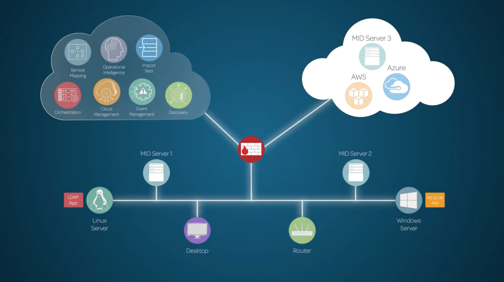
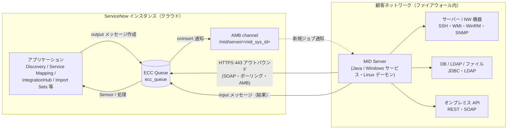
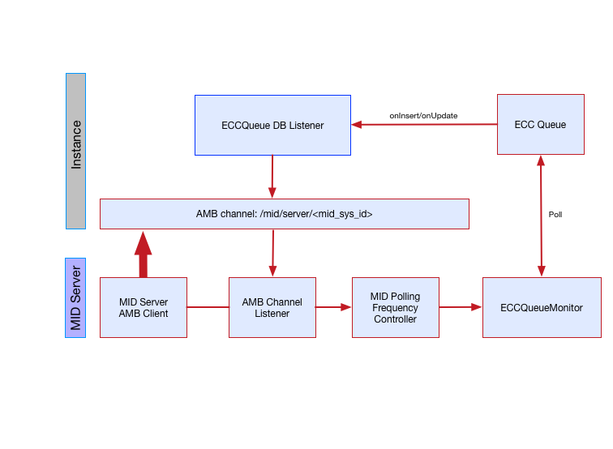
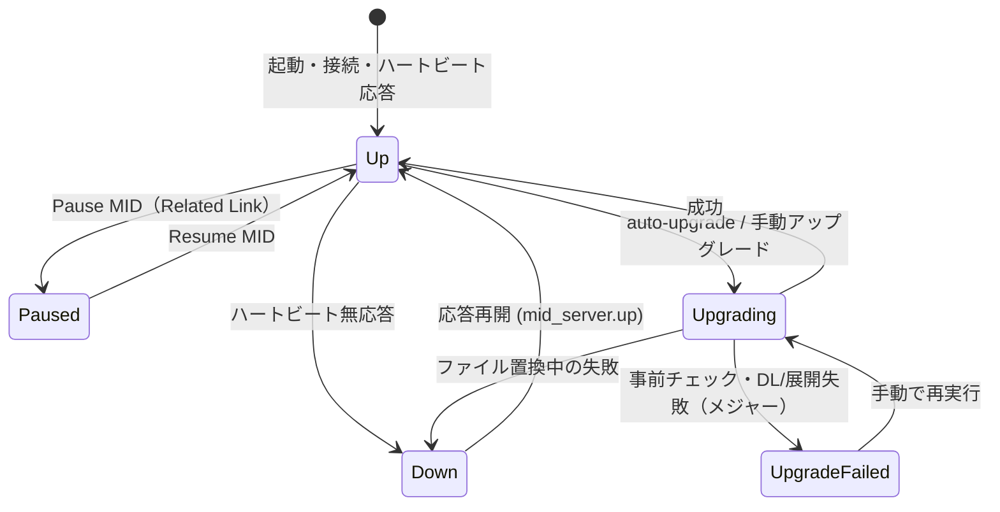
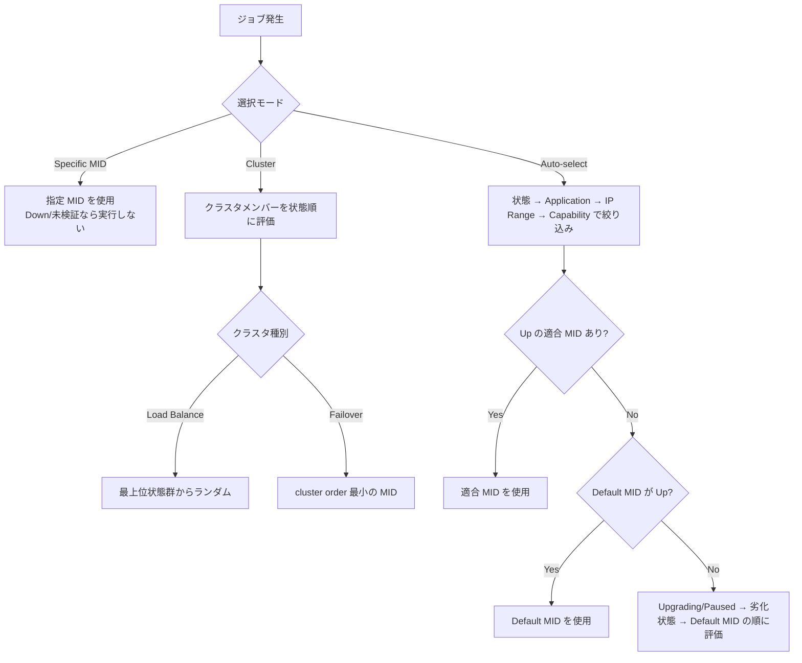
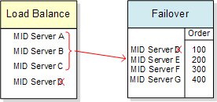
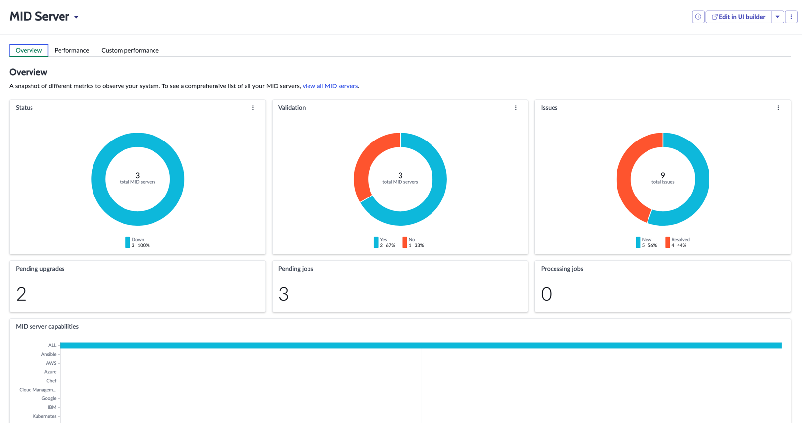

# MID Server（ミッドサーバー）

## 概要

MID Server（ミッドサーバー）は、顧客ネットワーク内のサーバー上で Windows サービスまたは UNIX/Linux デーモンとして動作する **Java アプリケーション**であり、ServiceNow インスタンス（クラウド側）と、顧客ネットワーク内の機器・アプリケーション・データソース・外部サービスとの間の通信とデータ移動を仲介する。公式ドキュメントは MID Server を「ネットワークとインスタンスの間の仲介者（mediator）」と表現している。[出典](https://www.servicenow.com/docs/r/australia/servicenow-platform/mid-server/mid-server-landing.html) [出典](https://www.servicenow.com/docs/r/australia/servicenow-platform/mid-server/explore-mid-server.html)

本ファイルの要点は以下のとおり。

| 観点 | 要点 |
|---|---|
| 通信方向 | MID Server からインスタンスへの**アウトバウンド TCP 443（HTTPS）のみ**。インバウンド接続は不要 |
| 仕事の受け渡し | インスタンス側の **ECC Queue（`ecc_queue` テーブル）** を介して非同期にジョブ（プローブ）と結果をやり取りする |
| 主な利用機能 | Discovery、Service Mapping、Event Management、Metric Intelligence、Cloud Management、Orchestration、IntegrationHub、Import Sets（JDBC/LDAP 等）、Agent Client Collector、Cloud Cost Management 等 |
| 要件（Australia） | Windows Server 2012〜2025 / Red Hat 6+・Ubuntu 14.04+・CentOS 9+（64 ビット）。同梱 Java 21.0.7、最低 JRE 17.0.10。最小 4 コア 2GHz 以上、JVM 既定 1 GB |
| 選択ロジック | Supported Applications（アプリケーション）→ IP Ranges（IP 範囲）→ Capabilities（機能）で適合 MID を選び、状態（Up 等）で優先順位付け |
| 冗長化 | MID Server Cluster（`ecc_agent_cluster`）で Load Balance（負荷分散）/ Failover（フェイルオーバー） |
| アップグレード | インスタンスのアップグレード後、MID Server が自動でバージョンを合わせる（auto-upgrade） |
| セキュリティ | Validate（検証）/ Rekey、Mutual authentication（相互認証）、config.xml 暗号化、MID Server Governance、Command audit log、ECC firewall / Code Signing 等 |

> 基準リリースは Australia（2026-05 GA）。Brazil での変更点は「[16. Brazil での変更点](#16-brazil-での変更点)」にまとめた。

---

## 1. 役割と位置付け

### 1.1 MID Server が必要な理由

ServiceNow インスタンスは ServiceNow のデータセンター（クラウド）上で稼働するため、顧客のファイアウォール内にあるサーバー、ネットワーク機器、データベース、オンプレミスのアプリケーションへ直接到達できない。MID Server は顧客ネットワーク内に設置され、インスタンスからの指示（ECC Queue 上の出力メッセージ）を取りに行き、ネットワーク内で処理を実行し、結果をインスタンスに返す。例えば Discovery 用に構成された MID Server は、ネットワーク上の機器をスキャンして収集データをファイアウォール越しにインスタンスへ送る。[出典](https://www.servicenow.com/docs/r/australia/servicenow-platform/mid-server/explore-mid-server.html)

MID は Management, Instrumentation, and Discovery の略称として説明されることが多い。ただし Australia の公式ドキュメント本文ではこの略称展開を確認できなかった。【第三者情報】

### 1.2 MID Server を利用するアプリケーション

Australia の公式ドキュメント「Exploring MID Server」は、MID Server を使うアプリケーションを次のように列挙している。[出典](https://www.servicenow.com/docs/r/australia/servicenow-platform/mid-server/explore-mid-server.html)

| 区分 | アプリケーション | MID Server の主な用途 | 詳細ファイル |
|---|---|---|---|
| ServiceNow アプリケーション | Discovery | ネットワーク内 CI の検出（SSH、WMI/WinRM、SNMP、PowerShell 等） | [discovery.md](../itom/discovery.md) |
| 〃 | Service Mapping | アプリケーションサービスのトップダウン検出 | [service-mapping.md](../itom/service-mapping.md) |
| 〃 | Event Management | Event connector によるイベント収集、SNMP trap 受信 | [event-management-aiops.md](../itom/event-management-aiops.md) |
| 〃 | Metric Intelligence | メトリック収集・異常検知 | [event-management-aiops.md](../itom/event-management-aiops.md) |
| 〃 | Cloud Management | クラウドリソースの検出、プロビジョニング、オーケストレーション | [cloud-management.md](../itom/cloud-management.md) |
| 〃 | Orchestration | MID Server 経由のアクティビティ（PowerShell、SSH、JDBC 等）実行 | [flow-designer-workflow-studio.md](flow-designer-workflow-studio.md) |
| 〃 | IntegrationHub | Spoke のステップを MID Server 経由で実行（オンプレミス到達、PowerShell/SSH/JDBC 等） | [integrationhub.md](integrationhub.md) |
| 〃 | Cloud Cost Management | クラウドコストデータの収集（ITAM 系の製品） | [itam-overview.md](../itam/itam-overview.md) |
| 〃 | Agent Client Collector | エージェント（ACC）との連携 | [discovery.md](../itom/discovery.md) |
| 外部アプリケーション連携 | Import Sets | JDBC / LDAP / ファイル等のデータソースからの取り込み | [import-export-data.md](import-export-data.md) |
| 〃 | Microsoft SMS/SCCM | SCCM 連携 | — |
| 〃 | LANDesk Maintenance Suite | LANDesk 連携 | — |
| 〃 | Microsoft SCOM | Event Management コネクタ | — |
| 〃 | Microsoft MIIS | ADAM 同期 | — |

### 1.3 全体像（公式図）

- **キャプション:** MID Server の概要図（公式ドキュメント「Exploring MID Server」の Figure）。
- **図の説明:** 左上の雲（ServiceNow インスタンス）に Service Mapping、Operational Intelligence、Import Sets、Orchestration、Cloud Management、Event Management、Discovery のアイコンが並ぶ。中央にファイアウォール（赤いレンガのアイコン）があり、その下の社内ネットワークのバス上に MID Server 1 と MID Server 2 が接続されている。社内ネットワークには Linux Server（LDAP App を併記）、Desktop、Router、Windows Server（MS SCCM App を併記）がぶら下がる。右上の雲（パブリッククラウド）には AWS と Azure、およびクラウド上に配置された MID Server 3 が描かれている。すなわち、MID Server はオンプレミスにもクラウド（IaaS）上にも配置でき、ファイアウォールの内側から各アプリケーションの処理を代行することを示す。
- **出典:** https://www.servicenow.com/docs/r/australia/servicenow-platform/mid-server/explore-mid-server.html （取得日: 2026-11-02）

---

## 2. アーキテクチャ

### 2.1 通信モデル

MID Server の通信は次の特徴を持つ。

| 項目 | 内容 | 出典 |
|---|---|---|
| インスタンスへの通信 | MID Server はインスタンスに **TCP 443** で安全に通信し、**インバウンド接続を必要としない** | [出典](https://www.servicenow.com/docs/r/australia/servicenow-platform/mid-server/c_MIDServerConnectionPrerequisites.html) |
| 接続方式 | MID Server は **SOAP Web サービス**でインスタンスに接続する。各 MID Server は ServiceNow のユーザーアカウントに紐づく | [出典](https://www.servicenow.com/docs/r/australia/servicenow-platform/mid-server/t_SetupMIDServerRole.html) |
| インスタンス側で有効化が必要な Scripted SOAP Web サービス | GetMIDInfo、InstanceInfo、MIDAssignedPackages、MIDFieldForFileProvider、MIDFileSyncSnapshot、MIDServerCheck、MIDServerFileProvider（加えて InstanceInfo public page） | [出典](https://www.servicenow.com/docs/r/australia/servicenow-platform/mid-server/c_MIDServerConnectionPrerequisites.html) |
| 通知 | Asynchronous Message Bus（AMB、非同期メッセージバス）の持続接続で新規ジョブ通知を受ける | [出典](https://www.servicenow.com/docs/r/australia/servicenow-platform/mid-server/ecc-queue-mid-server.html) |
| ポーリング | AMB の有無にかかわらず `mid.poll.time`（既定 40 秒）間隔で ECC Queue をポーリング | [出典](https://www.servicenow.com/docs/r/australia/servicenow-platform/mid-server/ecc-queue-mid-server.html) |
| ハートビート | インスタンスが 5 分ごとに Heartbeat probe を ECC Queue に投入し応答を確認 | [出典](https://www.servicenow.com/docs/r/australia/servicenow-platform/mid-server/r_MIDServerHeartbeat.html) |
| アップグレード取得 | `install.service-now.com` からパッケージをダウンロード | [出典](https://www.servicenow.com/docs/r/australia/servicenow-platform/mid-server/c_UpgradeAndTestMIDServer.html) |

上図は公式ドキュメントの記述（ECC Queue、AMB、ポーリング、ポート 443）を基に本ナレッジで作成した概念図である。

### 2.2 ECC Queue（External Communication Channel Queue）

`ecc_queue` テーブル（ECC Queue、外部通信チャネルキュー）は、インスタンスと MID Server の接続点である。MID Server が実行すべきジョブは、MID Server が処理可能になるまでこのキューに保存される。インスタンスから MID Server への指示は **output** メッセージ、MID Server からの結果は **input** メッセージとして記録される。MID Server はタスクを取得すると状態を「Processing」に設定し、処理が終わると結果を ECC Queue に返す。[出典](https://www.servicenow.com/docs/r/australia/servicenow-platform/mid-server/ecc-queue-mid-server.html)

#### ECC Queue の主要フィールド

| フィールド | 説明 |
|---|---|
| Agent（エージェント） | メッセージの送信元/送信先の外部システム名。MID Server の場合は `mid.server.xxx`（xxx は MID Server 名） |
| Topic（トピック） | MID Server が実行したプローブ名（例: `SSHCommand`、`queue.stats`）。パターンによる Discovery では Horizontal Pattern probe |
| Name（名前） | プローブが実行した実際のコマンド。Topic が SSHCommand ならシェルコマンド。パターンでは「Pattern Launcher:」+ パターン名 + マルチページ番号 |
| Source（ソース） | Discovery の対象 IP アドレス。複数 IP 対象のプローブでは人が読める説明 |
| Response to（応答先） | 応答元 ECC Queue メッセージへの参照（sys_id）。Discovery はメッセージ階層の追跡に多用する |
| Queue（キュー） | input / output の別 |
| State（状態） | レコードの状態（自動更新） |
| Processed / Created | 処理日時 / 作成日時 |
| Sequence | 一意の連番（非推奨） |
| Error string | エラー発生時のみ表示 |
| Payload（ペイロード） | XML 本文。ルートは `<results>`、データは `<result>`、プローブに渡したパラメータは単一の `<parameters>` |

[出典](https://www.servicenow.com/docs/r/australia/servicenow-platform/mid-server/ecc-queue-mid-server.html)

State（状態）の具体的な選択肢は Australia の ECC Queue ページでは列挙されていない（本文中で明示されるのは「Processing」のみ）。実務では ready / processing / processed / error の値がよく参照される。【経験則】

#### ECC Queue へのアクセス経路

- Discovery > Output and Artifacts > ECC Queue
- Discovery > Discovery Schedules > {スケジュール名} > {Discovery status レコード}
- ECC > Queue
- {Discovery Status レコード} > ECC Queue

ECC Queue フォームの Related Links（関連リンク）には **Run again**（プローブ再実行）、**Go to CMDB item**、**Go to Sensor** がある。`com.glideapp.ecc_retry_policy`（ECC Queue Retry Policy プラグイン）を有効化すると ECC Queue Retry Policy / Queue Retry Activity モジュールが使える。[出典](https://www.servicenow.com/docs/r/australia/servicenow-platform/mid-server/ecc-queue-mid-server.html)

#### ECC Queue を使った MID Server 操作（ロール: `admin`、`mid_server`）

| 操作 | 方法 |
|---|---|
| ホストへのリモートコマンド送信 | ECC Queue に Agent=`mid.server.<名前>`、Topic=`Command`（または `SystemCommand`）、Queue=Output のレコードを作成。Name 欄は 120 文字制限のため、長いコマンドは Payload に `<parameters><parameter name="name" value="..."/></parameters>` 形式で記述 |
| ログ取得 | MID Server レコードの Related Links > **Grab MID logs, files and thread dump**。`[Topic]=SystemCommand`、`[Source]=grabLog` の ECC レコードとして `agent0.log.0` と `wrapper.log` が取得される（`agent0.log.0` が最新、`agent0.log.9` が最古） |
| 統計取得 | Related Links > **MID Statistics**。`[Topic]=queue.stats` のレコードにメモリ・CPU 使用状況 |

[出典](https://www.servicenow.com/docs/r/australia/servicenow-platform/mid-server/ecc-queue-mid-server.html)

### 2.3 AMB とポーリング

MID Server は AMB Client で持続接続を張り、AMB channel `/mid/server/<mid_sys_id>` を購読する。`ecc_queue` に output レコードが挿入されると AMB メッセージがこのチャネルに送られ、MID Server は即座に ECC Queue をポーリングする（ただし MID Server がビジーでメッセージ優先度が Interactive 以外の場合を除く）。AMB 接続断に備え、MID Server は `mid.poll.time`（既定 40 秒）の最大間隔で常にポーリングする。ビジー時に Interactive 以外の AMB メッセージを受けると、ポーリング間隔は `mid.poll.time.standard`（既定 5 秒）に変わる。AMB が環境によって動作せず性能問題を起こす場合は `mid.disable_amb=true` で無効化できる。[出典](https://www.servicenow.com/docs/r/australia/servicenow-platform/mid-server/ecc-queue-mid-server.html)

なお MID Server parameters ページでは `mid.poll.time` の既定値を「40（AMB 有効時）、5（AMB 無効時）」と記載している。[出典](https://www.servicenow.com/docs/r/australia/servicenow-platform/mid-server/mid-server-parameters.html)

- **キャプション:** MID Server ECC queue polling process（公式ドキュメント「MID Server ECC Queue」の Figure 1）。
- **図の説明:** 上段が Instance（インスタンス）、下段が MID Server。インスタンス側では右端の **ECC Queue** の onInsert/onUpdate を **ECCQueue DB Listener** が受け、**AMB channel: /mid/server/<mid_sys_id>** にメッセージを流す。MID Server 側では **MID Server AMB Client** がこのチャネルに接続し、**AMB Channel Listener** → **MID Polling Frequency Controller** → **ECCQueueMonitor** の順に通知が伝わり、ECCQueueMonitor が ECC Queue を Poll（ポーリング）する。
- **出典:** https://www.servicenow.com/docs/r/australia/servicenow-platform/mid-server/ecc-queue-mid-server.html （取得日: 2026-11-02）

### 2.4 スレッドプール

MID Server は 3 つのワーカースレッドプールを持ち、`config.xml` のパラメータで上限を設定する。[出典](https://www.servicenow.com/docs/r/australia/servicenow-platform/mid-server/t_SetMIDServerThreadUse.html) [出典](https://www.servicenow.com/docs/r/australia/servicenow-platform/mid-server/mid-server-parameters.html)

| プール | パラメータ | 既定値 | 用途 |
|---|---|---|---|
| Interactive | `threads.interactive.max` | 10 | システムコマンド、ハートビート等の軽量な対話型メッセージ |
| Expedited | `threads.expedited.max` | 20 | 標準より優先度が高く Interactive より低いメッセージ |
| Standard | `threads.max` | 25（最大 200） | ほとんどのプローブ。CPU・メモリを最も消費 |

- 標準プールは 5 スレッドまで下げても問題なく動作する。ホストに余裕があれば増やせる。[出典](https://www.servicenow.com/docs/r/australia/servicenow-platform/mid-server/t_SetMIDServerThreadUse.html)
- Windows ではファイルハンドル数が固定のため、スレッドを増やしすぎると CPU 上限より先に「Out of file handles」エラーになる。PowerShell は資源消費が大きく、Discovery を実行する Windows MID Server では 50 スレッドで CPU を使い切る場合がある。スレッド増加時は JVM メモリ増加が必要な場合があり、不足すると「Out of memory」エラーとなる。[出典](https://www.servicenow.com/docs/r/australia/servicenow-platform/mid-server/t_SetMIDServerThreadUse.html)

### 2.5 ハートビートと MID Server の状態（Status）

インスタンスは **MID Server Monitor** スケジュールジョブ（System Scheduler > Scheduled Jobs で間隔変更可）により、**5 分ごと**に Heartbeat probe（合成トランザクション）を ECC Queue に投入する。MID Server は通常のポーリングでこれを取得・応答し、応答がなければインスタンスは MID Server を **Down** とする。[出典](https://www.servicenow.com/docs/r/australia/servicenow-platform/mid-server/r_MIDServerHeartbeat.html)

| Status（状態） | 意味 | 出典 |
|---|---|---|
| Up | 正常に応答・通信している | [出典](https://www.servicenow.com/docs/r/australia/servicenow-platform/mid-server/r_MIDServerHeartbeat.html) |
| Down | ハートビート応答がない | 同上 |
| Paused | 管理者が一時停止した（ECC Queue のポーリング・Discovery 結果送信を停止） | [出典](https://www.servicenow.com/docs/r/australia/servicenow-platform/mid-server/t_PauseTheMIDServer.html) |
| Upgrading | 自動アップグレード中（再開・再起動不可） | [出典](https://www.servicenow.com/docs/r/australia/servicenow-platform/mid-server/c_UpgradeAndTestMIDServer.html) |
| Upgrade Failed | メジャーアップグレードの事前チェックまたはダウンロード/展開で失敗 | 同上 |
| Degraded | Discovery 等が選択対象として許容する劣化状態（詳細定義は公開情報では確認できず） | [出典](https://www.servicenow.com/docs/r/australia/servicenow-platform/mid-server/c_MIDServerSelector.html) |
| Draining / Drained / Drain Failed | MID Server 選択アルゴリズムで低優先度に分類される状態（各状態の詳細定義は公開情報では確認できず） | 同上 |

状態変化時には以下のシステムイベントが発行され、通知やスクリプトのトリガーに使える。[出典](https://www.servicenow.com/docs/r/australia/servicenow-platform/mid-server/r_MIDServerHeartbeat.html)

| イベント | 発生条件 |
|---|---|
| `mid_server.up` | Down / Paused / Upgrading から Up へ |
| `mid_server.down` | Up から Down へ |
| `mid_server.paused` | 一時停止された |
| `mid_server.upgrading` | 自動アップグレード中 |
| `mid_server.cluster.down` | フェイルオーバークラスタで代替 MID Server が見つからない（[8 章](#8-mid-server-クラスタ)） |

既定で「MID Server Down」通知が有効になっている。[出典](https://www.servicenow.com/docs/r/australia/servicenow-platform/mid-server/r_MIDServerTroubleshooting.html)

上図は公式ドキュメントの記述を基に作成した概念図であり、全遷移を網羅するものではない。

### 2.6 主要テーブル一覧

| テーブル | ラベル（日本語訳） | 用途 |
|---|---|---|
| `ecc_agent` | MID Server（MID サーバー） | MID Server レコード本体。Governance の最終アクティビティ、コンテナ ID（`container_id`）なども保持 |
| `ecc_queue` | Queue（ECC Queue） | インスタンスと MID Server 間のメッセージ |
| `ecc_agent_config` | MID Server Configuration Parameters（構成パラメータ） | MID Server ごとのパラメータ（`mid.instance.username` 等） |
| `ecc_agent_property` | MID Server Property（プロパティ） | MID Server プロパティ（MID Server 欄空欄で全 MID 対象） |
| `ecc_agent_capability` | MID Server Capability（機能） | Capabilities の定義 |
| `ecc_agent_cluster` | MID Server Cluster（クラスタ） | クラスタ定義 |
| `ecc_agent_cluster_member_m2m` | クラスタメンバー | MID Server とクラスタの関連（「validate MID server capability」ビジネスルール） |
| `ecc_agent_issue` | MID Server Issue（課題） | 稼働上の課題・アラート。30 日保持 |
| `ecc_agent_status` | MID Server Status（状態） | ダッシュボードのソースデータ |
| `ecc_agent_scalar_metric` / `ecc_agent_memory_metric` | ECC Agent Scalar Metrics / Memory Metrics | CPU 平均使用率 / 最大メモリ使用率 |
| `ecc_agent_upgrade_history` / `ecc_agent_upgrade_history_stage` | MID Server Upgrade Histories / Stages | アップグレード履歴 / MID ごとの進捗 |
| `ecc_agent_command_audit_log` | Command Audit Log | コマンド監査ログ |
| `ecc_agent_sync_file` と拡張（`ecc_agent_mib`、`ecc_agent_jar`、`ecc_agent_script_file`） | MID Server Synchronized Files | MIB / JAR / スクリプトファイルの MID への同期 |
| `ecc_agent_router` / `ecc_agent_ip_address` | ルーター / IP アドレス | IPv4/IPv6 アドレス情報 |
| `mid_cert_check_policy` | MID Server certificate check policies | 証明書チェックポリシー |
| `mid_server_profile` 他 `mid_profile_*` | MID Server Profiles | プロファイル（[6.5 節](#65-mid-server-profiles)） |

[出典](https://www.servicenow.com/docs/r/australia/servicenow-platform/mid-server/ecc-queue-mid-server.html) [出典](https://www.servicenow.com/docs/r/australia/servicenow-platform/mid-server/t_ConfigureAMIDServerCluster.html) [出典](https://www.servicenow.com/docs/r/australia/servicenow-platform/mid-server/mid-server-active-issues.html) [出典](https://www.servicenow.com/docs/r/australia/servicenow-platform/mid-server/mid-resource-threshold-alerts.html) [出典](https://www.servicenow.com/docs/r/australia/servicenow-platform/mid-server/mid-server-upgrade-history.html) [出典](https://www.servicenow.com/docs/r/australia/servicenow-platform/mid-server/mid-audit-log.html) [出典](https://www.servicenow.com/docs/r/australia/servicenow-platform/mid-server/c_MIDServerDomainSeparation.html) [出典](https://www.servicenow.com/docs/r/australia/servicenow-platform/mid-server/mid-security-checks.html) [出典](https://www.servicenow.com/docs/r/australia/servicenow-platform/mid-server/containerized-mid-deployment.html) [出典](https://www.servicenow.com/docs/r/australia/servicenow-platform/mid-server/config-mid-ipv6.html) [出典](https://www.servicenow.com/docs/r/australia/servicenow-platform/mid-server/mid-server-connectivity-issues.html)

### 2.7 主なメニュー（モジュール）

| メニュー | 内容 |
|---|---|
| All > MID Server > Servers | MID Server 一覧（`ecc_agent`）。Validate / Invalidate / Rekey / Pause MID / Resume MID / Grab MID logs 等の Related Links |
| All > MID Server > Dashboard | MID Server ダッシュボード |
| All > MID Server > Downloads | インストーラーのダウンロード |
| All > MID Server > Applications | Supported Applications（対応アプリ）と Default MID Server、「Included in application ALL」 |
| All > MID Server > Capabilities | Capabilities の定義・割り当て |
| All > MID Server > Clusters | クラスタ定義 |
| All > MID Server > Properties | MID Server プロパティ |
| All > MID Server > Server Issues | `ecc_agent_issue` |
| All > MID Server > Command Audit Logs | `ecc_agent_command_audit_log_list.do` |
| All > MID Server > MID Security Policy | 証明書チェックポリシー |
| MID Server Profiles | MID Server プロファイル |
| Upgrade History | アップグレード履歴 |
| ITOM Infra Services Workspace > Set up a MID | コマンドラインインストーラー等のセットアップ |
| All > Guided Setup > ITOM Guided Setup | MID Server のガイド付きセットアップ |

[出典](https://www.servicenow.com/docs/r/australia/servicenow-platform/mid-server/t_ValidateAMIDServer.html) [出典](https://www.servicenow.com/docs/r/australia/servicenow-platform/mid-server/t_DownloadMIDServerFiles.html) [出典](https://www.servicenow.com/docs/r/australia/servicenow-platform/mid-server/t_SpecifyMIDServerApplications.html) [出典](https://www.servicenow.com/docs/r/australia/servicenow-platform/mid-server/t_ConfigureCapabilities.html) [出典](https://www.servicenow.com/docs/r/australia/servicenow-platform/mid-server/r_MIDServerProperties.html) [出典](https://www.servicenow.com/docs/r/australia/servicenow-platform/mid-server/mid-server-active-issues.html) [出典](https://www.servicenow.com/docs/r/australia/servicenow-platform/mid-server/mid-ipki-install-command.html) [出典](https://www.servicenow.com/docs/r/australia/servicenow-platform/mid-server/use-mid-server-guidedsetup.html)

---

## 3. ロールと MID Server ユーザー

### 3.1 ロール一覧

| ロール | 用途 | 出典 |
|---|---|---|
| `mid_server` | MID Server がインスタンスに接続するユーザーに必須。strict SOAP security 下で保護テーブルにアクセスするため。付与時に必要なロールが自動で追加される | [出典](https://www.servicenow.com/docs/r/australia/servicenow-platform/mid-server/t_SetupMIDServerRole.html) |
| `agent_admin` | MID Server の管理（Pause、Default MID 設定、アップグレード実行、プロファイル作成、ダッシュボード参照等） | [出典](https://www.servicenow.com/docs/r/australia/servicenow-platform/mid-server/t_PauseTheMIDServer.html) [出典](https://www.servicenow.com/docs/r/australia/servicenow-platform/mid-server/containerized-mid-deployment.html) |
| `agent_security_admin` | Command Audit Log テーブルの参照・変更 | [出典](https://www.servicenow.com/docs/r/australia/servicenow-platform/mid-server/mid-audit-log.html) |
| `mid_admin` | WinRM trusted host 設定タスクの必要ロールとして記載 | [出典](https://www.servicenow.com/docs/r/australia/servicenow-platform/mid-server/enable-winRM-MID-servers.html) |
| `admin` | インストール、クラスタ・Capabilities 設定、Validate、Rekey、相互認証等 | 各タスクページ |
| `sm_admin` | Capabilities 設定（Service Mapping 管理者） | [出典](https://www.servicenow.com/docs/r/australia/servicenow-platform/mid-server/t_ConfigureCapabilities.html) |
| `discovery_admin` | Discovery Admin Workspace の拡張ダッシュボード参照 | [出典](https://www.servicenow.com/docs/r/australia/servicenow-platform/mid-server/c_MIDServerDashboard.html) |

`mid_server` ロールは昇格権限（elevated privileges）を持てず、`security_admin` とは両立できない。インスタンスはどちらの組み合わせの保存もブロックする。[出典](https://www.servicenow.com/docs/r/australia/servicenow-platform/mid-server/t_SetupMIDServerRole.html)

ネットワーク前提条件のページでは、MID ユーザーに `mid_server` と `import_admin` ロールを付与する記載もある（ユーザー作成タスクのページでは `mid_server` のみを付与する手順）。[出典](https://www.servicenow.com/docs/r/australia/servicenow-platform/mid-server/c_MIDServerConnectionPrerequisites.html)

### 3.2 MID Server ユーザーの作成手順

1. User Administration > Users で **New**。
2. User ID、First name、Last name、Password を入力。User ID は `config.xml` の `mid.instance.username`、Password は `mid.instance.password` と一致させる。
3. 保存後、Roles 関連リストで **Edit** を選び `mid_server` を追加。
4. MID Server ホストのブラウザからインスタンスにログインしてアカウントを検証する。

`config.xml` は XML のため、パスワード内の 5 つの定義済み特殊文字は実体参照に置換する（`"`→`&quot;`、`&`→`&amp;`、`'`→`&apos;`、`<`→`&lt;`、`>`→`&gt;`）。Basic Auth を使う場合は MID Server ごとに別アカウントを使う。同じログインユーザーで複数の MID Server が同時に Up になると課題レコードが作成される（KB1552863）。セキュリティ強化のため Basic Auth より **MID Server mutual authentication（相互認証）** の利用が推奨されている。[出典](https://www.servicenow.com/docs/r/australia/servicenow-platform/mid-server/t_SetupMIDServerRole.html)

ユーザー作成時の一般的な手順は [users-groups-roles.md](users-groups-roles.md) を参照。

---

## 4. インストール要件

### 4.1 OS・ハードウェア・Java（Australia）

| 項目 | 要件 | 出典 |
|---|---|---|
| Windows | Windows Server 2012 / 2016 / 2019 / 2022 / 2025（64 ビット、仮想マシン含む）。Microsoft .NET Framework 4.5 以上 | [出典](https://www.servicenow.com/docs/r/australia/servicenow-platform/mid-server/r_MIDServerSystemRequirements.html) |
| Linux | Red Hat 6 以上、Ubuntu 14.04 以上、CentOS 9 以上（64 ビット、仮想マシン含む）。glibc 2.17 以上と 32 ビット GNU C ライブラリ（CentOS 例: `yum install glibc.i686`） | 同上 |
| 新規インストールのブロック | RPM / MSI インストーラーでは CentOS 7、Windows Server 2008 / 2008 R2、Windows 8、Windows 10 への新規インストールがブロックされる。32 ビット MID Server の新規インストールは非サポート | 同上 |
| ZIP 手動インストール | 任意 OS に可能だが Windows 10 は非サポート。非サポート MID Server が Rome へ自動アップグレードすると `ecc_agent_issue` に記録 | [出典](https://www.servicenow.com/docs/r/australia/servicenow-platform/mid-server/t_DownloadMIDServerFiles.html) |
| CPU | 最小: 4 コア 2GHz 以上（Windows Server 2012 R2 上で 1 MID Server・25 同時スレッドの構成を基準） | [出典](https://www.servicenow.com/docs/r/australia/servicenow-platform/mid-server/r_MIDServerSystemRequirements.html) |
| メモリ | JVM 既定 1 GB（`wrapper-override.conf` の `wrapper.java.maxmemory=1024`）。製品要件がこれを上回る場合は増やす。ホスト RAM の明示的な最小値は記載なし | 同上、[出典](https://www.servicenow.com/docs/r/australia/servicenow-platform/mid-server/t_MIDServerOptionalConfiguration.html) |
| ディスク | 要件ページに明示値なし。ただしアップグレード事前チェックは空き容量を検査（[10.3 節](#103-pre-upgrade-check事前チェック)） | 同上 |
| Java | インストーラーに **Java 21.0.7**（推奨）を同梱し自動構成。最低 JRE **17.0.10**（未満は暗号化関連の問題が起こり得る）。アップグレードされた MID Server は同梱 OpenJDK を使用 | 同上 |
| Java Service Wrapper | Tanuki Software 3.5.40 | 同上 |
| PowerShell（Windows） | 最低 3.0。5.1 と 7 をサポート、6 は非サポート。多くの場合 PowerShell 7 の Compatibility Mode は無効化する。`ecc_agent_list.do` の Host PowerShell Version 列、またはホストで `$Host.Version` で確認 | 同上 |
| Windows サービス | Microsoft Application Experience（Lookup）Service が有効であること（無効だと auto-upgrade が失敗、KB0597552） | [出典](https://www.servicenow.com/docs/r/australia/servicenow-platform/mid-server/mid-windows-install-landing.html) |

> 対応プラットフォームの変更履歴は KB0863694「Supported platform changes for MID Server」で管理されている。[出典](https://www.servicenow.com/docs/r/australia/servicenow-platform/mid-server/r_MIDServerSystemRequirements.html)

### 4.2 デプロイ種別とサイジングの目安

| 種別 | 対象製品 | 指針 |
|---|---|---|
| Standard（標準） | Discovery、Event Management、Integrations、Orchestration、Service Mapping | 最小ディスク・メモリ要件が共通のため、1 台の MID Server で複数製品を担当できる |
| High resource（高負荷） | Cloud Management Platform（CMP）、Operational Intelligence | 他の MID Server 製品を動かさない専用ホストを使う |
| その他 | Health Log Analytics | 個別の追加要件あり |

ホストを他のアプリケーションと共有しないこと、ワークロードが重複する複数の MID Server を同時稼働させないことが推奨されている。[出典](https://www.servicenow.com/docs/r/australia/servicenow-platform/mid-server/r_MIDServerSystemRequirements.html)

**公式ベンチマーク（Cloud Discovery、10,000 サーバー）** の要点:

- 最大 CPU はスレッド数や OS に関係なく 100% に達する（Discovery 中の 90〜100% のスパイクは想定内の挙動）。
- スレッドを 25 → 50 にしても CPU 負荷は増えなかったが、100 にすると Processor Queue が大きく伸びた。
- 平均 CPU: 専用ホスト単一 MID 48%、中程度負荷アプリと共有 77%、高負荷アプリと共有 97%。
- 4 CPU → 8 CPU で平均 CPU は 48% → 28% に低下（最大は 98% のまま）。
- 監視は CPU 単独ではなく、Windows の Processor Queue Length、Unix の Load Average を併用する。Queue Length がコア数の 2 倍を超え続ける場合はボトルネックの可能性が高い。

[出典](https://www.servicenow.com/docs/r/australia/servicenow-platform/mid-server/r_MIDServerSystemRequirements.html)

### 4.3 ネットワーク要件

**アウトバウンド（MID Server ホスト → 外部）**

| 宛先 | 用途 | 備考 |
|---|---|---|
| `<instance_name>.service-now.com`（または `*.service-now.com`）: TCP 443 | インスタンス通信 | プロキシ利用時は `config.xml` に設定 |
| `install.service-now.com` | インストーラー・アップグレードのダウンロード | IP は予告なく変わり得る。許可対象として 149.96.5.98、149.96.6.98 が記載。遮断環境では手動インポート（KB0760123）またはカスタム URL（`mid.install_server.base_uri`、KB1546609） |
| OCSP レスポンダー（例: `http://ocsp.digicert.com`） | 証明書失効確認 | OCSP は仕様上 HTTP。遮断すると接続に失敗し得る（KB1216223） |

- MID Server は ServiceNow への HTTPS 通信で x.509 証明書検証を行う。プロキシや SSL インスペクション機器が自己署名/社内 CA 証明書を提示する場合は MID Server の TrustStore にインポートする。
- 疎通確認は MID ホストからインスタンスの 443 に telnet する方法が示されている。

[出典](https://www.servicenow.com/docs/r/australia/servicenow-platform/mid-server/r_MIDServerSystemRequirements.html) [出典](https://www.servicenow.com/docs/r/australia/servicenow-platform/mid-server/c_MIDServerConnectionPrerequisites.html) [出典](https://www.servicenow.com/docs/r/australia/servicenow-platform/mid-server/t_DownloadMIDServerFiles.html)

**社内（MID Server → 対象機器）で使う主なプロトコル**

| プロトコル | ポート | 要件 |
|---|---|---|
| SSH | 22（SSH v2） | UNIX 系。ユーザー/パスワードまたは鍵認証。一部 sudo コマンドが必要 |
| WMI | 135 + DCOM の動的ポート | Windows。対象のローカル管理者権限を持つドメインユーザーで実行。DCOM のため MID ホストは対象の全ポートに到達できる必要がある |
| Windows PowerShell | — | Orchestration で使用。PowerShell 3.0〜5.1、Credential type: Windows |
| WinRM | 5985（HTTP）/ 5986（HTTPS） | パラメータ `mid.powershell_api.winrm.remote_port` / `remote_https_port` の既定値 |
| SNMP | 161 | v1 / v2c / v3。既定 community 「public」と構成済み文字列を試行 |
| WBEM | 5988 / 5989（SSL） | HTTP トランスポート、CIM 資格情報 |

対象機器が IP で接続元を制限している場合は MID Server の IP を許可するか、すでにアクセス権のあるホスト（DMZ 等）に MID Server を置く。Windows では SMB 署名の必須化、NetNTLM を使う場合の強固なパスワードとホストごとの一意アカウントが推奨されている。[出典](https://www.servicenow.com/docs/r/australia/servicenow-platform/mid-server/c_MIDServerConnectionPrerequisites.html) [出典](https://www.servicenow.com/docs/r/australia/servicenow-platform/mid-server/mid-server-parameters.html)

Discovery のプロトコル・資格情報の詳細は [discovery.md](../itom/discovery.md) を参照。

### 4.4 必要な権限・アカウント

| 対象 | 要件 |
|---|---|
| インストール作業者 | MID ホストのローカル管理者またはドメイン管理者 |
| サービスアカウント（Windows） | **非管理者**の専用アカウント（LocalSystem や Administrators グループは不可）。「Log on as a service」権限、インストールフォルダの Read/Write/Execute |
| サービスアカウント（Linux） | 非 root ユーザーで実行（初回インストール・構成には root が必要） |
| インスタンス側ユーザー | `mid_server` ロールを持つユーザー（[3 章](#3-ロールと-mid-server-ユーザー)） |
| インスタンス設定 | SOAP の Basic 認証と、前述の Scripted SOAP Web サービスの有効化 |

[出典](https://www.servicenow.com/docs/r/australia/servicenow-platform/mid-server/c_MIDServerConnectionPrerequisites.html) [出典](https://www.servicenow.com/docs/r/australia/servicenow-platform/mid-server/mid-windows-install-landing.html) [出典](https://www.servicenow.com/docs/r/australia/servicenow-platform/mid-server/t_InstallAMIDServerOnLinux.html)

---

## 5. インストール方式

### 5.1 方式一覧

| 方式 | 概要 | 推奨場面 |
|---|---|---|
| Command line installer（コマンドラインインストーラー） | ITOM Infra Services Workspace の Set up a MID > Download a MID Server > Set up a MID Server から生成されるコマンドを MID ホストの PowerShell 等で実行。多くの手順を自動化 | **初回インストールに推奨** |
| Windows installer（MSI） | 管理者として実行し Java と MID Server を導入 | Windows 標準 |
| Linux RPM / DEB | RPM（Red Hat/CentOS）、DEB（Debian/Ubuntu）。既定パス `/opt/servicenow/mid` | Linux 標準 |
| ZIP（手動） | 任意 OS に展開し設定ファイルを手で編集 | 特殊環境、同一ホスト複数 MID |
| Guided setup（ガイド付きセットアップ） | All > Guided Setup > ITOM Guided Setup。ユーザー作成から Validate まで誘導。他の ITOM ガイド付きセットアップより先に完了させる必要あり | 初めての導入 |
| Containerized MID Server | Docker イメージを Kubernetes / OpenShift で展開（[12 章](#12-containerized-mid-serverコンテナ化-mid-server)） | 大規模・自動スケール |

[出典](https://www.servicenow.com/docs/r/australia/servicenow-platform/mid-server/mid-installation-landing.html) [出典](https://www.servicenow.com/docs/r/australia/servicenow-platform/mid-server/mid-ipki-install-command.html) [出典](https://www.servicenow.com/docs/r/australia/servicenow-platform/mid-server/mid-windows-install-landing.html) [出典](https://www.servicenow.com/docs/r/australia/servicenow-platform/mid-server/t_InstallAMIDServerOnLinux.html) [出典](https://www.servicenow.com/docs/r/australia/servicenow-platform/mid-server/use-mid-server-guidedsetup.html)

### 5.2 認証方式（MID Server → インスタンス）

ITOM Infra Services Workspace からの導入では、MID Server のインスタンス認証方式を選択する。

| 認証方式 | 概要 | MSI | ZIP |
|---|---|---|---|
| ServiceNow certificate（private key JWT） | 24 時間有効の 1 回限りの登録トークンを生成し、コードブロックを `config.xml` に貼り付ける。コマンドラインインストーラーで文書化されている方式 | 記載なし | 可 |
| Basic authentication | `mid_server` ロールを持つユーザー（MID ごとに一意）のユーザー名/パスワード | 可 | 可 |
| Custom certificate（mutual TLS、相互認証） | クライアント証明書で認証。事前に ServiceNow サポートによるインスタンス側の有効化が必要 | 可 | 可 |

[出典](https://www.servicenow.com/docs/r/australia/servicenow-platform/mid-server/mid-windows-install-landing.html) [出典](https://www.servicenow.com/docs/r/australia/servicenow-platform/mid-server/mid-ipki-install-command.html) [出典](https://www.servicenow.com/docs/r/australia/servicenow-platform/mid-server/mid-installation-landing.html)

### 5.3 コマンドラインインストーラーの手順（要約）

1. ITOM Infra Services Workspace で MID Server のセットアップを開始（ロール: `admin`）。
2. 認証タイプ（ServiceNow certificate）、ホスト種別、インストール方法（Command Line Installer）を選択。
3. MID Server 名（必須）と任意の Purpose note を入力。Advanced で MID Server ユーザー、プロキシ IP/ポート、サービス名を指定可能。
4. ホスト上に専用サービスアカウントを作成。
5. インストール先ディレクトリで生成コマンドを実行（トークンは 24 時間で失効。リフレッシュ可）。
6. 5 分以内に MID Server レコードが表示されることを確認。表示されなければ `agent\logs` を確認。
7. 関連リストで Applications と Capabilities を割り当てる。**既定では MID Server はどのアプリケーション・機能も実行できない。**

[出典](https://www.servicenow.com/docs/r/australia/servicenow-platform/mid-server/mid-ipki-install-command.html)

### 5.4 Windows（ZIP 手動）でのポイント

- `agent\config.xml` に `url`、`name`、必要に応じてプロキシ（`mid.proxy.use_proxy`、`mid.proxy.host`、`mid.proxy.port`、`mid.proxy.username`、`mid.proxy.password`）を設定。Basic/mTLS では `mid.instance.username`、`mid.instance.password` も設定。
- `conf\wrapper-override.conf` でサービスアカウント（`wrapper.ntservice.account`、`wrapper.ntservice.permissions.1.account`）とサービス名 `wrapper.name`（ホスト内で一意）を設定。例: `wrapper.name=snc_mid_MID_Discovery_USA_1`、`wrapper.displayname=ServiceNow MID Server_MID_Discovery_USA_1`。
- `agent` フォルダの `start.bat` で起動（停止 `stop.bat`、再起動 `restart.bat`。Linux は `./start.sh`、`./stop.sh`、`./restart.sh`）。

[出典](https://www.servicenow.com/docs/r/australia/servicenow-platform/mid-server/mid-windows-install-landing.html) [出典](https://www.servicenow.com/docs/r/australia/servicenow-platform/mid-server/mid-server-install-prereqs.html) [出典](https://www.servicenow.com/docs/r/australia/servicenow-platform/mid-server/t_InstallMIDServerAsWinService.html)

### 5.5 Linux（RPM / DEB）でのポイント

1. インスタンスの MID Server > Downloads から RPM / DEB を取得（`wget` も可）。
2. 任意で署名検証（RPM: `openssl dgst -sha256 -verify <pem> -signature <bin> <rpm>`、DEB: `gpg --import` 後 `dpkg-sig --verify`）。
3. インストール: RPM `sudo rpm -ivh --nodeps <package>.rpm`（`--prefix=/path` でパス変更可）、DEB `sudo dpkg -i <package>.deb`（DEB はユーザー定義ディレクトリへのインストール非対応）。
4. root で `agent` フォルダの `./installer.sh` を実行し、インスタンス URL、MID ユーザー/パスワード、MID Server 名、プロキシ、サービス設定（`app_name`、`app_long_name`、`run_as_user`）を入力。デーモンとして自動起動する。

**サイレントインストール:** `./installer.sh -silent` に `-INSTANCE_URL`、`-MID_USERNAME`、`-MID_PASSWORD`、`-MID_NAME`、`-APP_NAME`、`-APP_LONG_NAME`、`-NON_ROOT_USER`、`-USE_PROXY`、`-MUTUAL_AUTH`、`-CERTIFICATE_REVOCATION`（プロキシ時は `-PROXY_HOST` 等、相互認証時は `-CERTIFICATE_PATH`）を渡す。`installer.sh` の再実行は既存設定を削除して再構成する。既存 JRE を使う場合は `agent/conf/wrapper-override.conf` に `wrapper.java.command=<java path>` を追加。アンインストールは `uninstall.sh`。

[出典](https://www.servicenow.com/docs/r/australia/servicenow-platform/mid-server/t_InstallAMIDServerOnLinux.html)

### 5.6 同一ホストへの複数 MID Server

同一ホスト（または VM）に複数の MID Server を導入でき、負荷分散やドメインセパレーションに使える。MID Server ごとにドライブ直下に一意のディレクトリ（例: `MIDServer_Disc1`）を作り、アーカイブを展開してそれぞれインストーラーを実行する。**Linux ホストでデーモンにできる MID Server サービスは 1 つだけ**（Tanuki wrapper の制約）。[出典](https://www.servicenow.com/docs/r/australia/servicenow-platform/mid-server/t_InstallMultplMIDSvrOnASingleSys.html)

### 5.7 Validate（検証）

インストール後、MID Server は**手動で Validate（検証）**しないと自動化タスクを実行できない。検証により、自動化用資格情報へのアクセスを信頼された MID Server に限定する。

1. All > MID Server > Servers で新しい MID Server を開く。
2. Related Links の **Validate** を選択。Supported Applications / IP Ranges / Capabilities のレコードが無い場合は「Set Initial Selection Criteria」ウィンドウが開き、全 Capabilities・全 Applications・全 IP Ranges を許可するかをスイッチで選ぶ（Cancel でも検証自体は完了するが何も追加されない）。
3. Validated フィールドが「Validating」→「Yes」になる。Validating のまま進まない場合は、サービス稼働と Status=Up、インスタンス到達性、ファイアウォール/プロキシを確認し、`agent0.log` を確認。

- **Invalidate:** 侵害が疑われる MID Server を無効化すると、自動化資格情報へのアクセスと ECC の outbound プローブ実行を遮断する。MID Server はメモリをクリアして再起動し、再起動時に新しい鍵ペアを生成する。
- **鍵ペア:** 検証時に初回生成され、秘密鍵は自動化資格情報の復号に使われる。
- 既存 MID Server はアップグレード時に自動で検証され、業務は中断しない。

[出典](https://www.servicenow.com/docs/r/australia/servicenow-platform/mid-server/t_ValidateAMIDServer.html)

---

## 6. 構成（パラメータ・プロパティ・プロファイル）

### 6.1 設定の種類と優先順位

| 種類 | 格納先 | 適用範囲 | 反映 |
|---|---|---|---|
| MID Server parameters（構成パラメータ） | MID ホストの `agent/config.xml`、およびインスタンスの `ecc_agent_config`（MID Server Configuration Parameters） | 特定の MID Server | 起動/再起動時 |
| MID Server properties（プロパティ） | `ecc_agent_property`（MID Server 指定 or 空欄でグローバル）、一部は `sys_properties` | 全 MID または特定 MID | 項目により異なる |
| wrapper 設定 | `agent/conf/wrapper-override.conf` | JVM メモリ、サービス名等 | 再起動時 |

優先順位（高 → 低）: **MID Configuration Parameter** → **MID Property（特定 MID）** → **MID Property（グローバル）**。MID Server を割り当てない「グローバルな構成パラメータ」はサポート外のため、全 MID 共通にしたい設定はグローバル MID Property を使う。同名の MID Property を同じ MID に重複作成しないこと。[出典](https://www.servicenow.com/docs/r/australia/servicenow-platform/mid-server/mid-config-param-priority.html) [出典](https://www.servicenow.com/docs/r/australia/servicenow-platform/mid-server/mid-server-parameters.html)

構成変更後は MID Server の再起動が必要（[出典](https://www.servicenow.com/docs/r/australia/servicenow-platform/mid-server/c_MIDServerConfiguration.html)）。

### 6.2 主な構成パラメータ（config.xml）

| 区分 | パラメータ | 既定値 | 説明 |
|---|---|---|---|
| 必須 | `url` | なし | インスタンス URL |
| 必須 | `mid_sys_id` | 自動設定 | MID Server レコードの GUID（変更禁止） |
| 必須 | `name` | `YOUR_MIDSERVER_NAME_GOES_HERE` | MID Server 表示名 |
| 必須 | `mid.instance.username` / `mid.instance.password` | なし | ログインユーザー（`mid_server` ロール） |
| 接続 | `mid.poll.time` | 40（AMB 有効）/ 5（AMB 無効） | ECC Queue ポーリング間隔（秒） |
| 接続 | `mid.disable_amb` | false | AMB 通知の無効化 |
| 接続 | `threads.max` / `threads.expedited.max` / `threads.interactive.max` | 25 / 20 / 10 | スレッド上限 |
| 接続 | `mid.probe.wait.resources` | true | リソース予約（Resource Reservation）の有効化（再起動要） |
| 接続 | `glide.mid.max.sender.queue.size` | 0.5 GB | 送信キューの上限 |
| 接続 | `mid.https.truststore.path` / `.password` | 同梱 JRE の TrustStore | AMB HTTPS 用 TrustStore |
| プロキシ | `mid.proxy.use_proxy`（`mid.instance.use_proxy`）、`mid.proxy.host`、`mid.proxy.port`、`mid.proxy.username`、`mid.proxy.password` | false / なし / 80 | インスタンス接続用 Web プロキシ |
| ログ | `mid.log.level` | info | debug / info / warn / error |
| ログ | `disable.status` | false | 10 分ごとのステータス報告停止 |
| ログ | `mid.file_cleaner.disabled` | false | File Cleaner の無効化 |
| 資格情報 | `mid.credentials.provider` | `com.service_now.mid.creds.standard.StandardCredentialsProvider` | 資格情報プロバイダークラス |
| アップグレード | `mid.pinned.version` | MID buildstamp | 個別 MID のバージョン固定 |
| アップグレード | `mid.upgrade.use_proxy`、`glide.mid.autoupgrade.proxy_host` 等 | true / なし | アップグレード URL 用プロキシ |
| セキュリティ | `mid.windows_host.file_permissions.enforce` | true | Windows ファイル権限制限の強制 |
| SSH | `mid.ssh_connections_per_host` | 7（SNC クライアント）/ 3（レガシー） | ホストあたり同時プローブ数 |
| SSH | `mid.ssh.command_timeout_ms` | 300000 | SSH コマンドタイムアウト |
| Windows | `mid.windows.management_protocol` | WMI | 分類に使うプロトコル（WMI / WinRM） |
| Windows | `mid.powershell_api.session_pool.max_size` | 25 | PowerShell セッションプール上限 |
| Windows | `mid.powershell.jea.endpoint` | "" | JEA（Just Enough Administration）エンドポイント |
| SNMP | `mid.snmp.use_snmp_v1_v2c` / `mid.snmp.use_snmp_v3` | true / true | SNMP バージョン許可 |
| Event Mgmt | `mid.probe.event.queue.max_size` | 100,000 | イベントキュー上限 |

[出典](https://www.servicenow.com/docs/r/australia/servicenow-platform/mid-server/mid-server-parameters.html)

パラメータは他にも CIM、DNS、FTP、mTLS（`mid.httpclient.protocol.<名前>.path` 等）、Pattern、Shazzam、リクエストタイムアウトなど多数ある。全量は公式の「MID Server parameters」ページを参照。

### 6.3 主な MID Server プロパティ

All > MID Server > Properties で設定する。代表的なもの:

| プロパティ | 既定値 | 説明 |
|---|---|---|
| `concurrent.dist.download` | 2 | インスタンスが同時に許可する MID Server 自動アップグレード数 |
| `mid.install_server.base_uri` | `https://install.service-now.com` | 更新ファイルのダウンロード元（変更には maint 権限） |
| `mid.eccq.max_payload_size` | 20000000 | MID → インスタンスへ送るペイロード上限（超過は破棄・エラー） |
| `mid.discovery.max_payload_size` | 5000000 | Discovery 結果の最大サイズ（負値で無制限） |
| `mid.discovery.max_pattern_payload_size` | 50000000 | パターン結果全体の最大サイズ |
| `mid.discovery.file_transfer_protocol` | SCP | ファイル転送方式（SCP / SFTP） |
| `mid.log.command_audit.enable` | false | Command audit log の有効化 |
| `mid.http_classy.allow_credentials_over_http` | false | HTTP Classify probe が HTTP で資格情報送信を許可（非推奨） |
| `mid.property.jdbc_operations` | select,update,insert,delete,show,create,describe,begin,if,end,not,exists | JDBCOrchestrationProbe が実行できる SQL 操作 |
| `mid.jdbc.datastream.max.record.size` | 64（最大 128） | レコード最大サイズ（KB） |
| `mid.servicewatch.max_concurrent_connections` | 7 | 1 MID から 1 ホストへの同時タスク数 |
| `mid.shazzam.threads` | 5 | Shazzam（ポートスキャン）の同時スレッド |
| `shazzam.chunk_size` | 100 | Shazzam が並列スキャンする IP 数の上限 |
| `mid.ssh.algorithms.kex` / `.host_key` / `.cipher` / `.mac` | （優先順リスト） | SSH アルゴリズムの優先順位 |
| `mid.keystore.max_backups` / `mid.keystore.max_live_backups` | 3 / 2 | キーストアのバックアップ数 |

[出典](https://www.servicenow.com/docs/r/australia/servicenow-platform/mid-server/r_MIDServerProperties.html)

インスタンスの `sys_properties` に置く MID 関連プロパティの例: `mid.version.override`（全 MID のバージョン固定）、`mid.inactivity.timeout.enabled` / `mid.inactivity.timeout.days`（Governance）、`mid.threshold.resource.breach.enable.cpu.alerts` / `.memory.alerts`（閾値アラート）、`mid.server.connector_default`（Event Management の既定 MID）。各節で詳述する。

### 6.4 JVM メモリ

既定の JVM メモリは 1024 MB で、`\agent\conf\wrapper-override.conf` の `wrapper.java.maxmemory=1024` で設定される。値を変更してコメント記号（#）を外し、保存後に MID Server サービスを再起動する。小規模拠点でプリントサーバー等とメモリを共有する場合は減らすこともある。[出典](https://www.servicenow.com/docs/r/australia/servicenow-platform/mid-server/t_MIDServerOptionalConfiguration.html)

### 6.5 MID Server Profiles

MID Server Profile（MID Server プロファイル）は、1 つ以上の MID Server に適用できる名前付きの設定集合で、wrapper 構成パラメータとインスタンス側設定をホストへ直接アクセスせずに同期できる。San Diego でコンテナ化 MID Server 向けに導入され、**Zurich 以降はすべてのデプロイ形態で利用可能**。[出典](https://www.servicenow.com/docs/r/australia/servicenow-platform/mid-server/mid-server-profiles.html)

プロファイル関連テーブル: `mid_server_profile`、`mid_profile_config`、`mid_profile_wrapper_config`、`mid_profile_property`、`mid_profile_application_m2m`、`mid_profile_capability_m2m`、`mid_profile_ip_range_m2m`、`mid_profile_cluster_m2m`。プロファイルの作成・変更には `agent_admin` ロールが必要。パスワードや証明書などの機密情報はプロファイルに含めない。[出典](https://www.servicenow.com/docs/r/australia/servicenow-platform/mid-server/containerized-mid-deployment.html)

プロファイルのクラスタ設定を MID Server に適用する際、MID Server に Capability が 1 つも割り当てられていないとクラスタ割り当てに失敗する（`ecc_agent_cluster_member_m2m` の「validate MID server capability」ビジネスルール）。[出典](https://www.servicenow.com/docs/r/australia/servicenow-platform/mid-server/containerized-mid-deployment.html)

### 6.6 MID Server Resource Reservation（リソース予約）

タスクをスレッドに割り当てる前に必要リソース（任意定義の「名前と数」）を予約し、確保できないタスクは作業キューで待機させる機能。PowerShell プローブが他のプローブを圧迫するのを防ぐ、対象システムへの Discovery の影響を抑える、大きなプローブの同時実行数を制限する、といった用途に使う。`mid.probe.wait.resources=true` が前提（変更は再起動要）。Discovery Definition > Limited Resources で Simple Value / Expanding / Scripted の 3 種のリソースを定義する。公式は「問題が特定されるまで設定すべきでない上級者向け機能」と位置付けている。[出典](https://www.servicenow.com/docs/r/australia/servicenow-platform/mid-server/mid_server_resource_reservation.html)

### 6.7 その他の構成項目

| 項目 | 概要 | 出典 |
|---|---|---|
| WinRM trusted host | WinRM で Discovery / Service Mapping を行う場合、対象を全 MID Server の trusted hosts に追加 | [出典](https://www.servicenow.com/docs/r/australia/servicenow-platform/mid-server/enable-winRM-MID-servers.html) |
| Windows ファイル権限強制 | Windows MID Server はファイルアクセスを許可リスト（`mid.windows_host.file_permissions.allow_list`）のユーザー/グループに制限 | [出典](https://www.servicenow.com/docs/r/australia/servicenow-platform/mid-server/mid-non-admin-permission.html) |
| JAR ファイル同期 | JAR をアップロードし接続中の MID Server に同期（カスタムプローブ、JDBC ドライバー等） | [出典](https://www.servicenow.com/docs/r/australia/servicenow-platform/mid-server/t_SynchronizeAJARFiletoMIDServers.html) |
| Nmap | 資格情報なし Discovery（Credential-less Discovery）用に Windows MID Server へ Nmap を導入。Nmap Capability が自動付与 | [出典](https://www.servicenow.com/docs/r/australia/servicenow-platform/mid-server/install-nmap-on-mid-server.html) |
| 拡張（Extensions） | vCenter event collector（vCenter の VM イベントで CMDB 更新）、SNMP trap collector（Event Management へトラップ送信。Event Management 非アクティブ時は破棄） | [出典](https://www.servicenow.com/docs/r/australia/servicenow-platform/mid-server/c_MIDServerConfiguration.html) |

---

## 7. MID Server 選択（Supported Applications / IP Ranges / Capabilities）

### 7.1 選択基準

アプリケーションは次の基準で MID Server を選ぶ。[出典](https://www.servicenow.com/docs/r/australia/servicenow-platform/mid-server/c_MIDServerSelector.html)

| 基準 | 内容 |
|---|---|
| Application（Supported Applications、対応アプリケーション） | MID Server に必要なアプリケーション（Discovery、Orchestration、Service Mapping、Event Management、Operational Intelligence、Cloud Management 等）または **ALL** が割り当てられていること |
| IP address / range（IP Ranges、IP 範囲） | 対象 IP が MID Server の IP 範囲内、または ALL IP ranges |
| Capabilities（機能） | 必要な Capability を持つ、または Capability が ALL |
| Behaviors（ふるまい） | Discovery と Service Mapping のポートスキャン方式の定義。自動選択・Default MID・Specific MID には使われない |

**アプリケーション別の要件**

| アプリケーション | Application | IP range | Capability |
|---|---|---|---|
| Discovery | Discovery または ALL | スケジュールの IP 範囲が MID の範囲に一致、または ALL | 対象外（behaviors は無視） |
| Orchestration | Orchestration または ALL | アクティビティの対象 IP が一致、または ALL | 必要 Capability が一致、または ALL |
| Service Mapping | Service Mapping または ALL | エントリーポイント IP が一致、または ALL | Service Mapping 対応 Capability、または ALL |
| Event Management | Event Management または ALL | コネクタの IP が一致 | 対象外 |
| Cloud Management | 対象外 | 対象外 | Cloud Management または ALL |

[出典](https://www.servicenow.com/docs/r/australia/servicenow-platform/mid-server/c_MIDServerSelector.html)

### 7.2 選択モード

| モード | 動作 |
|---|---|
| Auto-select MID Server（自動選択） | 下記の段階順に評価し、1 台以上見つかった段階で終了 |
| Use specific MID Server cluster（クラスタ指定） | クラスタメンバー内で状態順に評価。Load balance クラスタは最上位状態群からランダム、Fail-over クラスタは cluster order が最良（0 が最良）の MID |
| Use specific MID Server（MID 指定） | Discovery と Event Management のみ。指定 MID を常に使用し、Down や未検証なら何も実行しない（Default MID の「フォールバック」とは異なる）。Discovery / ALL を持たない MID を指定すると Discovery が自動追加される |

**自動選択の段階**:

1. 条件に適合し Status = Up の MID Server
2. Default MID Server（定義されていれば）で Status = Up
3. 適合 MID Server で Status = Upgrading または Paused
4. Default MID Server で Status = Upgrading または Paused
5. 適合 MID Server で Status = Upgrade Failed / Draining / Drained / Drain Failed / Down
6. Default MID Server（定義されていれば）

アプリケーションの最低ステータス水準を下回る段階はスキップされる。多くのアプリケーション（Discovery など）は Up または Degraded の MID を許容し、他は Up のみを許容する。[出典](https://www.servicenow.com/docs/r/australia/servicenow-platform/mid-server/c_MIDServerSelector.html)

上図は公式ドキュメントの記述を基に作成した概念図。

### 7.3 Default MID Server と ALL アプリケーション

All > MID Server > Applications でアプリケーションごとに **Default MID Server** を設定できる（ロール: `agent_admin` または `admin`）。Default MID Server は条件（Application、IP range、behavior、capability）を満たさなくても使われ、複数アプリケーションの既定に兼用できる。特定アプリの Default MID が使えない場合は ALL アプリケーションの Default MID が使われる。[出典](https://www.servicenow.com/docs/r/australia/servicenow-platform/mid-server/t_SpecifyMIDServerApplications.html)

| アプリケーション | Default MID の扱い |
|---|---|
| Discovery | スケジュールが Auto-Select MID Server で、適合 MID が見つからない場合に使用 |
| Orchestration | アクティビティの Capability を持つ MID が無い場合に使用。プロパティでも指定でき、アプリ側の選択と同期 |
| Alert aggregation and RCA | 対象外。RCA Capability を持つ MID が選ばれる |
| Service Mapping | Application / Capability / IP range が一致する MID が無い場合に使用 |
| Event Management | システムプロパティ `mid.server.connector_default` で指定。アプリケーションレコードの Default MID は使わない |
| Cloud Management | 他と同じ仕組み。クラウドのエンドポイントはパブリック IP のため、実際には Application と Capability の一致で決まることが多い |

- 「Included in application ALL」列で、ALL に含めるアプリケーションを true/false で絞り込める（例: 専用 MID がある Service Mapping を ALL から除外）。
- 同じ MID Server に ALL IP ranges（Include）と Exclude タイプの IP 範囲を両方設定すると、Exclude は無視される。
- アプリケーションは対応プラグインが有効な場合にのみ表示される。

[出典](https://www.servicenow.com/docs/r/australia/servicenow-platform/mid-server/t_SpecifyMIDServerApplications.html)

選択条件はアプリケーションごとにカスタムフィルター条件で上書き（Override）できる。Service Mapping には MID Selection Test（対象 IP・アプリ・Capability から選ばれる MID をプレビュー。MID Affinity ロジックは検証しない）がある。[出典](https://www.servicenow.com/docs/r/australia/servicenow-platform/mid-server/c_MIDServerSelector.html)

### 7.4 Capabilities（機能）

MID Server Capabilities（機能）は、MID Server が IP 範囲内で実行できる機能を定義し、アプリケーションが最適な MID Server を選ぶために使われる。Orchestration で使う MID Server には少なくとも 1 つの Capability が必要。[出典](https://www.servicenow.com/docs/r/australia/servicenow-platform/mid-server/t_ConfigureCapabilities.html)

**Discovery で既定提供される Capabilities（Australia）**

| | | | |
|---|---|---|---|
| All | Ansible | AWS | Azure |
| Chef | Cloud Management | Google | IBM |
| JDBC | NetApp | Nmap | OpenStack |
| PowerShell | RCA | Resolve DNS | REST |
| SNMP | SOAP | SSH | VMware |
| WMI | | | |

[出典](https://www.servicenow.com/docs/r/australia/servicenow-platform/mid-server/t_ConfigureCapabilities.html)

**Capability の値（value）**

| 値 | 意味 |
|---|---|
| 空（値なし） | そのプロトコルの任意のデバイスを扱える（既定の Capabilities は値なし） |
| 特定値 | 値が完全一致するデバイスのみ |
| `*`（ワイルドカード） | 空でない任意の要求値に一致 |
| Resolve DNS の値 | ドメインサフィックスの部分一致（値の先頭に自動でドットが付く。例: `service-now.com` は `lnxlab01.sandiego.service-now.com` に一致。空は全ドメイン） |

**Capability のマッチング順序**（MID 全体の絞り込みは「server status → applications → IP range → capabilities」の順）:

1. **Exact value match**: 要求された name/value ペアに完全一致（空も有効な値。ワイルドカードは無視）
2. **Wildcard value match**: 空でない要求値がワイルドカード（`*`）に一致
3. **ALL**: ALL Capability を持つ MID（値は無視）

ある段階で 1 台以上見つかれば以降はスキップし、複数候補があればランダムに選ぶ。要求 Capability 名が `ecc_agent_capability` に存在しない場合は ALL へフォールバックせず BadArgumentException になる。Capability はスクリプトによる値判定（例: Resolve DNS）も可能。Madrid 以降、Capability 追加時のスラッシュバケットに `[capability name]:[value]` の組み合わせで表示される。**Nmap** Capability は Nmap 導入済みの Windows MID Server に自動付与され、手動で追加・削除できない。[出典](https://www.servicenow.com/docs/r/australia/servicenow-platform/orchestration/mid-server-capabilities.html) [出典](https://www.servicenow.com/docs/r/australia/servicenow-platform/mid-server/t_ConfigureCapabilities.html)

**設定手順:** All > MID Server > Capabilities で既存 Capability（または ALL）を選ぶか New で作成（例: Capability `DOMAIN`、値 `service-now`）し、MID Servers 関連リストの Edit で MID を割り当てる（ロール: `admin` または `sm_admin`）。[出典](https://www.servicenow.com/docs/r/australia/servicenow-platform/mid-server/t_ConfigureCapabilities.html)

### 7.5 IP Ranges と自動割り当て

MID Server に IP 範囲（Include / Exclude）を設定して担当ネットワークを限定できる。**IP range auto-assignment（IP 範囲の自動割り当て）** は、適格な MID Server（Up、検証済み、1 つ以上のサブネットに到達可能）を IP 範囲に基づいてサブネットへ自動割り当てする機能で、Discovery が使うルーターの SNMP read-only 資格情報が必要。自動割り当ては ALL ranges の指定を、見つかった範囲で上書きする。[出典](https://www.servicenow.com/docs/r/australia/servicenow-platform/mid-server/mid-servers-auto-assignment.html) [出典](https://www.servicenow.com/docs/r/australia/servicenow-platform/mid-server/c_MIDServerConfiguration.html)

---

## 8. MID Server クラスタ

### 8.1 クラスタ種別

MID Server Cluster（MID サーバークラスタ、`ecc_agent_cluster`）は複数の MID Server をグループ化して冗長性・負荷分散を提供する。[出典](https://www.servicenow.com/docs/r/australia/servicenow-platform/mid-server/t_ConfigureAMIDServerCluster.html)

| 種別 | 動作 |
|---|---|
| Load Balance（負荷分散） | クラスタ内の MID Server に作業を自動で分散。同じ Capabilities を持つ MID をまとめる |
| Failover（フェイルオーバー） | 各メンバーに順序（order）を設定。MID Server が停止すると **MID Server Cluster Management** ビジネスルールが順序上位の稼働 MID を選び処理を引き継ぐ。フェイルオーバーメンバー同士は負荷分散しない |
| Distributed（分散） | Operational Intelligence（Event Management の異常アラート）専用 |

**Smart Workload Manager:** 固定的な配分ではなく、各 MID Server の実負荷（タスクキューサイズ、処理速度、システム負荷）のリアルタイム指標に基づいてジョブを割り当て、高速・低負荷の MID により多くのタスクを渡す。[出典](https://www.servicenow.com/docs/r/australia/servicenow-platform/mid-server/t_ConfigureAMIDServerCluster.html)

### 8.2 設定手順

1. All > MID Server > Clusters で New（ロール: `admin`）。
2. 名前と種別（Failover / Load Balance）を設定し保存。
3. Includes MID Servers 関連リストの Edit でメンバーを選択。

### 8.3 制約と注意点

- クラスタ内の MID Server は同じ Capabilities（Supported Applications、IP Ranges、Capabilities）を持つこと。フェイルオーバー先は少なくとも置き換え元と同じ機能を持つこと。
- MID Server は原則 1 つのクラスタにのみ所属させる。例外として、1 つの Load Balance クラスタと 1 つの Failover クラスタに同時所属でき、その MID が落ちると Failover 側のメンバーが Load Balance 側の仕事を引き継ぐ。
- **LDAP、Export sets、JDBC データソースはクラスタで使わず、専用（非クラスタ）MID Server を使う。** フェイルオーバー時、新しい MID は ECC Queue タスクを最初からやり直すため重複データが生じ得る。
- クラスタリングは ECC Queue トピック `Command` / `SystemCommand` をサポートしない（レコードは未処理のまま残りリダイレクトされない）。
- フェイルオーバーで選ばれた MID は ECC Queue の Processing / Ready 状態のジョブから処理を開始する。
- メンバーはインスタンスとすべての対象機器に到達できる必要があり、ACL を使う場合は全メンバーを追加する。クラスタの全メンバーが Down の場合、Discovery はキャンセルされる。
- Shazzam プローブ中に MID が停止した場合、auto-selection 有効時でもフェイルオーバーは行われず Discovery は停止する。
- Discovery スケジュールは特定の 1 クラスタを指定できるが、クラスタの連鎖はできない。
- フェイルオーバークラスタで適切な代替 MID が無い場合、MID Server Cluster テーブルで **`mid_server.cluster.down`** イベントが発火する（メール通知等に利用）。

[出典](https://www.servicenow.com/docs/r/australia/servicenow-platform/mid-server/t_ConfigureAMIDServerCluster.html)

- **キャプション:** MID Server failover example（公式ドキュメント「Configure a MID Server cluster」の図）。
- **図の説明:** 左の「Load Balance」クラスタに MID Server A、B、C、D が所属し、D に赤い × 印（停止）が付いている。右の「Failover」クラスタには Order 列があり、MID Server D（100、× 印）、E（200）、F（300）、G（400）が並ぶ。Load Balance 側の A〜C から Failover 側の D へ矢印が引かれており、両方のクラスタに所属する MID Server D が停止した場合に、Failover クラスタの順序に従って次の MID Server（E）が D の担っていた負荷分散側の仕事を引き継ぐことを表している。
- **出典:** https://www.servicenow.com/docs/r/australia/servicenow-platform/mid-server/t_ConfigureAMIDServerCluster.html （取得日: 2026-11-02）

---

## 9. 運用（一時停止・起動停止・ダッシュボード・課題・ログ）

### 9.1 Pause / Resume

検証済みの MID Server は MID Server フォームの Related Links **Pause MID** で一時停止でき、ECC Queue のポーリングと Discovery 結果の送信を止める（ロール: `agent_admin`。Istanbul で導入）。ネットワーク保守時の Discovery エラー抑止などに使う。一時停止中も、取得済みコマンドの処理継続、ログ参照・削除、統計参照（新規生成は停止）、スレッドダンプ取得、設定変更（再開後に反映）、ECC Queue のクリア、ハートビートは機能する。**Resume MID** で再開する。注意: Discovery は Paused の MID にもジョブを割り当て続ける（Down の MID には割り当てない）。[出典](https://www.servicenow.com/docs/r/australia/servicenow-platform/mid-server/t_PauseTheMIDServer.html)

### 9.2 MID Server ダッシュボード

All > MID Server > Dashboard（ロール: `agent_admin` または `admin`）。Discovery Admin Workspace 1.3.1 以降では Workspaces > Discovery Admin Workspace > Insights で拡張版を利用できる（ロール: `discovery_admin`）。ソースは `ecc_agent_status`（MID Server Status）。[出典](https://www.servicenow.com/docs/r/australia/servicenow-platform/mid-server/c_MIDServerDashboard.html)

| タブ / 要素 | 内容 |
|---|---|
| Overview | Status、Validation、Issues、Pending upgrades、Pending jobs、Processing jobs、Capability 別の MID 数 |
| Performance | CPU・メモリ使用率、ライフサイクルイベント履歴 |
| Custom performance | 任意の MID 選択条件・期間 |
| Status gauge | Name、Host name、Status、Validated、Max memory used %、Mean CPU used %（サンプリング既定 30 分）、Pending/Processing jobs、Version（赤=非互換、黄=アップグレード推奨、緑=互換、灰=未検出）、User（`mid_server` ロールと `mid.instance.username` の一致を示すアイコン） |

- **キャプション:** MID Server ダッシュボードの Overview タブ（公式ドキュメント「MID Server dashboard」の図）。
- **画面の説明:** 画面上部に「MID Server」の見出しと「Edit in UI builder」ボタン、タブ「Overview / Performance / Custom performance」が並ぶ。Overview には「view all MID servers」リンクがあり、上段に 3 つのドーナツグラフ（Status: 3 total MID servers で Down 100%、Validation: Yes 67% / No 33%、Issues: 9 total issues で New 56% / Resolved 44%）、中段に数値タイル（Pending upgrades 2、Pending jobs 3、Processing jobs 0）、下段に「MID server capabilities」の横棒グラフ（ALL、Ansible、AWS、Azure、Chef、Cloud Management、Google、IBM、Kubernetes…）が表示される。
- **出典:** https://www.servicenow.com/docs/r/australia/servicenow-platform/mid-server/c_MIDServerDashboard.html （取得日: 2026-11-02）

### 9.3 MID Server Issue（`ecc_agent_issue`）とアラート

All > MID Server > Server Issues。課題レコードは 30 日保持。対象となる課題: インスタンスクローン後の不正資格情報、非サポート JRE、CPU / JVM メモリ閾値接近、事前アップグレードチェックのエラー、ユーザー認証・認可失敗、ネットワーク接続断とロール設定エラー。[出典](https://www.servicenow.com/docs/r/australia/servicenow-platform/mid-server/mid-server-active-issues.html)

**Resource threshold alerts（リソース閾値アラート）:** 各 MID Server は 10 分ごとに CPU・メモリ指標をインスタンスへ送り、`ecc_agent_scalar_metric`（Mean CPU used %）と `ecc_agent_memory_metric`（Max memory used %）に記録される。アラートは既定で無効で、`sys_properties` に `mid.threshold.resource.breach.enable.cpu.alerts` と `mid.threshold.resource.breach.enable.memory.alerts` を追加して true にすると有効になる。閾値超過時は `mid.threshold.resource.breach` イベントが発火し、`ecc_agent_issue` に State=New で記録される（State は New / Acknowledged / Resolved 等）。[出典](https://www.servicenow.com/docs/r/australia/servicenow-platform/mid-server/mid-resource-threshold-alerts.html)

**クローン後の資格情報問題:** インスタンスクローンでは `ecc_agent` はコピーされず `sys_user` はコピーされるため、MID ユーザーの資格情報がターゲット側の既存 MID Server と一致せず Down になることがある。インスタンスはこれを検知し `ecc_agent_issue` で通知する。クローン運用は [update-sets-cloning.md](update-sets-cloning.md) を参照。[出典](https://www.servicenow.com/docs/r/australia/servicenow-platform/mid-server/mid-post-clone-issue-resolution.html)

### 9.4 ログとトラブルシューティング

| ログ / ツール | 場所・方法 | 内容 |
|---|---|---|
| `agent0.log.0` | `agent\logs` | メイン活動ログ（warning / critical / severe を確認）。`agent0.log.0.lck` の存在で稼働確認 |
| `wrapper.log`（`wrapper.txt`） | `agent\logs` | Java Service Wrapper のログ |
| インスタンスから取得 | Related Links > Grab MID logs, files and thread dump | ECC Queue 経由でログ取得 |
| Java Flight Recorder（JFR） | MID Server の Related Links で記録開始/停止/書き出し | 既定 24 時間で削除（`mid.jfr.data.clean.interval`）。カスタムイベント無効化は `mid.jfr.record.aprobe=false` |
| MID Server File Cleaner | 監視スレッドがインストールフォルダの古いファイルを削除 | `mid.file_cleaner.disabled` で無効化 |

主な既知事象: MID Server がダウン/無応答になる、Discovery で CI が重複する（KB0597571）、新規 MID が起動しない・すぐ停止する（多くは設定問題）。[出典](https://www.servicenow.com/docs/r/australia/servicenow-platform/mid-server/r_MIDServerTroubleshooting.html)

運用監視全般は [14-support-monitoring.md](../../03_導入編/14-support-monitoring.md) を参照。

---

## 10. アップグレード

### 10.1 自動アップグレードの仕組み

- インスタンスがアップグレードされ MID Server のバージョンと異なると、インスタンスは接続中の MID Server に **autoUpgrade** コマンドを送る。加えて各 MID Server は**毎時**バージョンを確認する（間隔は変更不可。起動時刻基準のため MID ごとにずれる）。インスタンスアップグレード時は複数 MID が同時にアップグレードし得る（同時数はプロパティ `concurrent.dist.download`、既定 2）。
- パッケージは `install.service-now.com` から取得され、検証後に旧ファイルを置換し、新バージョンで再起動する。
- 手動アップグレード: MID Server レコードの Related Link から即時実行、または「Upgrade Failed」後の再試行（ロール: `agent_admin` または `admin`。MID は Up かつ検証済みであること）。MID Server 一覧は All > Discovery > MID Servers または Orchestration > MID Server Configuration > MID Servers（いずれも無効なら `ecc_agent.list`）。
- **MID Server のバージョンがインスタンスより大きく遅れている（複数リリース遅れ等）場合、自動アップグレードが失敗することがあり、新規インストールを推奨。** 新バージョンを検証するまで旧 MID はアンインストールしない。

[出典](https://www.servicenow.com/docs/r/australia/servicenow-platform/mid-server/c_UpgradeAndTestMIDServer.html) [出典](https://www.servicenow.com/docs/r/australia/servicenow-platform/mid-server/trigger-mid-server-upgrade.html) [出典](https://www.servicenow.com/docs/r/australia/servicenow-platform/mid-server/r_MIDServerProperties.html)

### 10.2 アップグレード処理の流れ

| # | ステップ | 内容 |
|---|---|---|
| 1 | Pre-upgrade check | ホストの準備状況を検査。エラーがあればブロック |
| 2 | Download | ZIP パッケージを `package/incoming` へ保存 |
| 3 | 署名検証 | 各パッケージのデジタル署名を検証。失敗は `agent.log` と Issue テーブルに記録（手動検証は `jarsigner`） |
| 4 | 展開 | Rome 以降は `agent` 配下の `work/upgrade_temp` に展開（Rome 前は OS の一時フォルダ。`mid.upgrade.use_os_temp_folder=true` で旧動作） |
| 5 | 置換 | ServiceNow AI Platform Distribution Upgrade プロセスが `bin`、`lib`、`jre` を置換（Rome 以降は変更ファイルのみ）。必要に応じ Linux サービスを再インストール |
| 6 | 起動 | 新バージョンで起動し一時ファイルを削除 |

**失敗時の状態:** メジャーアップグレードの事前チェック・ダウンロード/展開での失敗は **Upgrade Failed**。マイナーアップグレードでは現行バージョンで稼働を続け、やがて Up に戻る。ファイル置換中の失敗は **Down**。JRE 更新時は移行前に TrustStore をバックアップし、失敗時に手動で復元できる。

**ログ:** `agent.log`（事前チェック・DL・展開）、`glide-dist-upgrade.log`（一時展開先の `upgrade-wrapper/logs`。起動失敗時はまずこれを確認）、`dist-upgrade.log`、`wrapper.log`。`agent/conf/upgrade-wrapper-override.conf` でアップグレード wrapper のタイムアウト等を上書きできる。

**前提:** `install.service-now.com` への到達（遮断環境は KB0760123）、OCSP DigiCert 通信の許可（KB1216223）、32 ビット OS 非対応、Windows の一部アンチウイルスによるブロック（KB0870329）、Madrid 以前に導入した Linux MID のサービス再インストール（KB0821436）。

[出典](https://www.servicenow.com/docs/r/australia/servicenow-platform/mid-server/c_UpgradeAndTestMIDServer.html)

### 10.3 Pre-upgrade check（事前チェック）

各 MID Server の AutoUpgrade monitor がバージョン差を検知すると事前検証を実行し、問題があれば `ecc_agent_issue` に記録してアップグレードをブロックする（毎時再試行）。インスタンスアップグレード起因・手動いずれでも実行される。[出典](https://www.servicenow.com/docs/r/australia/servicenow-platform/mid-server/mid-server-pre-upgrade-check.html)

| 区分 | 主なチェック |
|---|---|
| Mandatory（必須、失敗でブロック） | 空きディスク容量、`install.service-now.com` からのダウンロード可否、サンプルファイルのデジタル署名検証、アップグレード用ディレクトリの展開・作成・読取・削除権限、32 ビットホストでないこと、Linux の glibc 2.17 以上 |
| Alert（警告のみ） | Windows サービスの Log On As 形式やグループ参照、PowerShell 未導入/利用不可、CiscoAMP サービス（KB0870329）、Application Experience 無効（KB0597552）、サービスが LocalSystem / Administrators で実行されている旨の警告 |

**ディスク容量:** 本文では「空き 2 GB 未満を検知すると『Not enough free disk space』エラー」と記載される一方、アップグレード阻止の閾値パラメータ `mid.upgrade.min_disk_space_gb` の既定値は 4 GB と記載されており、ドキュメント内で 2 つの数値が併存している。加えて DiskSpaceCheckMonitor が起動時および `mid.disk_space_check.interval`（既定 12 時間）ごとに空き容量を監視し、`mid.disk_space_check.low_space_warning_threshold_gb`（既定 36 GB）を下回ると警告と課題レコードを作成する（いずれも 0 で無効化）。[出典](https://www.servicenow.com/docs/r/australia/servicenow-platform/mid-server/mid-server-pre-upgrade-check.html)

**無効化:** 構成パラメータ `mid.upgrade.run_precheck`（既定 true）を、単一 MID は `config.xml` で false、全 MID は `ecc_agent_property` に MID Server 欄空欄で false のレコードを追加する。[出典](https://www.servicenow.com/docs/r/australia/servicenow-platform/mid-server/mid-server-pre-upgrade-check.html)

### 10.4 バージョン固定（Pinning）

| 設定 | 種類 | 内容 |
|---|---|---|
| `mid.buildstamp` | システムプロパティ（非表示） | 既定バージョン（`mm-dd-yyyy-hhmm` 形式 + リリース名・パッチ情報）。インスタンス再起動・アップグレード時にリセット。**設定しないこと** |
| `mid.version.override` | システムプロパティ（要追加） | 全 MID を単一バージョンに固定し自動アップグレードを無効化。インスタンス再起動では残るが、**インスタンスアップグレード時にクリア**される |
| `mid.pinned.version` | 構成パラメータ（`config.xml`） | 個別 MID を固定（形式 `<version>-mm-dd-yyyy`）。システムプロパティより優先され、アップグレード後も残る |

公式は「ほとんどの場合、MID Server をバージョン固定しないこと。インスタンスと非同期になり機能が壊れる」と明記している。固定された MID は Upgrade Stages に空の MID Upgrade History のエントリを生成する。[出典](https://www.servicenow.com/docs/r/australia/servicenow-platform/mid-server/mid-server-version-selection.html) [出典](https://www.servicenow.com/docs/r/australia/servicenow-platform/mid-server/mid-server-upgrade-history.html)

### 10.5 Upgrade History

Upgrade History モジュール（ロール: `admin` / `agent_admin`）は `ecc_agent_upgrade_history`（インスタンスアップグレードごとの旧/新バージョン、成功数、保留数）と `ecc_agent_upgrade_history_stage`（MID ごとの進捗・エラー。Pending Upgrades / Complete Upgrade Details 関連リスト）で構成される。インスタンスアップグレード時、Up 状態の全 MID Server が自動でアップグレードされる。[出典](https://www.servicenow.com/docs/r/australia/servicenow-platform/mid-server/mid-server-upgrade-history.html)

インスタンス全体のアップグレード計画は [13-upgrade-management.md](../../03_導入編/13-upgrade-management.md) と [04-upgrade-lessons.md](../../04_応用編/04-upgrade-lessons.md) を参照。

---

## 11. セキュリティ

### 11.1 セキュリティ機能一覧

| 機能 | 概要 | 出典 |
|---|---|---|
| Validate / Invalidate | 検証済み MID のみ自動化資格情報にアクセス可能 | [出典](https://www.servicenow.com/docs/r/australia/servicenow-platform/mid-server/t_ValidateAMIDServer.html) |
| Rekey | 新しい秘密鍵を生成（鍵ローテーション）。定期実行を推奨 | [出典](https://www.servicenow.com/docs/r/australia/servicenow-platform/mid-server/t_RekeyAMIDServer.html) |
| Mutual authentication（相互認証） | クライアント証明書でインスタンスに認証し、Basic 認証の資格情報を Key Store に置かない | [出典](https://www.servicenow.com/docs/r/australia/servicenow-platform/mid-server/install-mid-mutual-auth.html) |
| config.xml 値の暗号化 / 構成ファイルセキュリティ | 既定暗号化、Windows DPAPI、カスタム暗号化（`IMidServerEncrypter`）、CyberArk、外部ストレージ（`ISecuredConfigProvider`） | [出典](https://www.servicenow.com/docs/r/australia/servicenow-platform/mid-server/mid-server-encrypter-api.html) |
| Certificate check policies | TLS 証明書、ホスト名、CRL、OCSP のチェック制御 | [出典](https://www.servicenow.com/docs/r/australia/servicenow-platform/mid-server/mid-security-checks.html) |
| Authentication credentials and SOAP requests | MID Server への受信 SOAP 要求に Basic 認証を強制 | [出典](https://www.servicenow.com/docs/r/australia/servicenow-platform/mid-server/mid-authentication-soap-requests.html) |
| Unified key store | MID 上の各製品が共通の証明書・鍵ペアを利用。カスタム証明書も可 | [出典](https://www.servicenow.com/docs/r/australia/servicenow-platform/mid-server/mid-unified-keystore.html) |
| Azure Key Vault integration | 資格情報をインスタンスに保存せず Orchestration / Discovery / Service Mapping を実行 | [出典](https://www.servicenow.com/docs/r/australia/servicenow-platform/mid-server/mid-azure-key-vault-integration.html) |
| Command audit log | Discovery で MID が実行したコマンドを記録 | [出典](https://www.servicenow.com/docs/r/australia/servicenow-platform/mid-server/mid-audit-log.html) |
| FIPS Enforced Mode | FIPS 検証済み暗号のみを使用（NSC IL-5 環境向け） | [出典](https://www.servicenow.com/docs/r/australia/servicenow-platform/mid-server/mid-fips-enforced.html) |
| MID Server Governance | 非アクティブな MID を自動で無効化・停止 | [出典](https://www.servicenow.com/docs/r/australia/servicenow-platform/mid-server/mid-timeout.html) |
| SSL certificates / External TrustStore | 接続先への SSL 設定、TrustStore をインストールディレクトリ外に置きアップグレード後も保持 | [出典](https://www.servicenow.com/docs/r/australia/servicenow-platform/mid-server/mid-server-security-encryption.html) |
| SSH cryptographic algorithms | SSH アルゴリズムの交渉・優先順位 | [出典](https://www.servicenow.com/docs/r/australia/servicenow-platform/mid-server/mid-ssh-algorithms.html) |
| ECC firewall / Code Signing | ECC メッセージの受け入れ制御と署名検証（[11.7 節](#117-ecc-queue-のセキュリティ上の考慮事項)） | [出典](https://www.servicenow.com/docs/r/australia/servicenow-platform/mid-server/ecc-queue-mid-server.html) |

インスタンス側のプラットフォームセキュリティ全般は [platform-security-encryption.md](platform-security-encryption.md)、実践的な強化策は [12-security-hardening-practice.md](../../04_応用編/12-security-hardening-practice.md) を参照。

### 11.2 Rekey（鍵の再生成）

All > MID Server > Servers で対象 MID を開き Related Links の **Rekey** を選ぶ（ロール: `admin`）。MID Server がオンラインに戻ると新しい鍵が自動検証され、自動化タスクの処理を再開する。カスタム証明書（Unified key store）を使う MID では Re-key UI アクションが無効になり、代わりに **Remove custom keypair** で自己署名証明書に戻せる。相互認証の MID は UI アクションで Rekey / Validate できない。[出典](https://www.servicenow.com/docs/r/australia/servicenow-platform/mid-server/t_RekeyAMIDServer.html) [出典](https://www.servicenow.com/docs/r/australia/servicenow-platform/mid-server/mid-unified-keystore.html) [出典](https://www.servicenow.com/docs/r/australia/servicenow-platform/mid-server/install-mid-mutual-auth.html)

### 11.3 Mutual authentication（相互認証）

**前提:** ロール `admin`。ServiceNow サポートへ依頼して有効化し、証明書ベース認証を先に設定する。

**証明書要件:** RSA のみ・2048 ビット以上（短いと「Insufficient key length」）、PKCS#8 秘密鍵を含む PEM バンドル、自己署名は不可（社内署名はプライベート CA 署名なら可）、インスタンスが証明書の OCSP / CRL エンドポイントに到達できること（社内限定エンドポイントは不可）、チェーン順は leaf → intermediate → root。

**手順（要約）:** CA チェーンを `sys_ca_certificate` に Type=CA Cert でアップロードし Publish Status が Exists になるのを待つ → leaf 証明書のみを `sys_user_certificate` に添付 → 検証済み MID なら Invalidate → MID Server 名で User Role=MID Server のレコードを作成し PEM を添付 → MID 停止 → `agent` で `manage-certificates`（`.bat` / `.sh`）を実行して鍵と証明書を導入 → 起動。

**`manage-certificates` オプション:** `-m`（相互認証有効化）、`-b <user> <password>`（Basic 認証に戻す）、`-a <alias> <file>`（インポート）、`-g <alias>`（詳細表示）、`-l`（一覧）、`-d <alias>`（削除）、`-r`（既定エイリアス以外を削除）。既定エイリアスは `defaultsecuritykeypairhandle`。

**制約:** 新規の相互認証 MID には Capabilities が自動付与されない、相互認証 MID は UI アクションで Rekey / Validate 不可、オンプレミスや Edge Encryption 有効インスタンスでは非対応、CRL チェックの選択的無効化は不可。

[出典](https://www.servicenow.com/docs/r/australia/servicenow-platform/mid-server/install-mid-mutual-auth.html)

### 11.4 構成ファイルのセキュリティ

MID Server は一度に 1 つの secured configuration provider を使う（混在不可）。[出典](https://www.servicenow.com/docs/r/australia/servicenow-platform/mid-server/mid-server-encrypter-api.html)

| プロバイダー | 内容 |
|---|---|
| Default security provider | `config.xml` の機微データを暗号化。再起動時に平文データを暗号化して書き戻す。暗号化方式は Default encryptor / **Windows DPAPI**（ログオンユーザーのアカウントに依存するため、アカウント変更時は再暗号化が必要）/ カスタム（`IMidServerEncrypter` 実装） |
| CyberArk | 機微データを CyberArk Vault に移す（暗号化ではなく外部保管）。`mid.secure_config.provider` に CyberArk 用クラスを指定し、`JavaPasswordSDK.jar` を `agent/extlib` に配置 |
| カスタム外部ストレージ | `ISecuredConfigProvider` を実装 |

[出典](https://www.servicenow.com/docs/r/australia/servicenow-platform/mid-server/mid-server-encrypter-api.html) [出典](https://www.servicenow.com/docs/r/servicenow-platform/mid-server/use-cyberark-secure-config-provider.html)

### 11.5 Certificate check policies（証明書チェックポリシー）

`config.xml` のブートストラップパラメータ:

| パラメータ | 既定値 | 内容 |
|---|---|---|
| `mid.ssl.bootstrap.default.check_cert_hostname` | true | ホスト名チェック |
| `mid.ssl.bootstrap.default.check_cert_chain` | true | 証明書チェーンチェック |
| `mid.ssl.bootstrap.default.check_cert_revocation` | false | 失効チェック |
| `mid.ssl.use.instance.security.policy` | false | true でインスタンスの `mid_cert_check_policy` テーブルの `*.servicenow.com` ポリシーがブートストラップ値を上書き |
| `mid.ssl.bootstrap.default.target_endpoint` | なし | セルフホスト/オンプレミスでインスタンス FQDN を指定 |

ポリシー種別は ServiceNow endpoint / Internet / Intranet / Overridden（最優先）。インスタンス側は All > MID Server > MID Security Policy で管理する。[出典](https://www.servicenow.com/docs/r/australia/servicenow-platform/mid-server/mid-security-checks.html)

### 11.6 Governance・監査・FIPS

**MID Server Governance:** 非アクティブな MID Server を自動で無効化（invalidate）・停止し、忘れられた MID の悪用を防ぐ。MID Server プラグインに含まれるが既定で無効。

| 設定 | 種類 | 既定 | 内容 |
|---|---|---|---|
| `mid.inactivity.timeout.enabled` | システムプロパティ | 未定義 | true で全 MID に Governance を有効化 |
| `mid.inactivity.timeout.days` | システムプロパティ（整数） | 30 | グローバルのタイムアウト日数 |
| `mid.inactivity.timeout.days` | 構成パラメータ | — | MID 個別の上書き（0 で無効化） |

MID Server は ECC Queue の送受信でアクティビティを追跡し、毎時インスタンスへ報告する（`ecc_agent` に記録）。残り 3〜7 日で情報メッセージ、3 日未満でエラーメッセージを表示。自動無効化後は **Clear auto invalidated** UI アクションでクリアしてから再起動する（クリアせずに再起動すると即停止し MID issue が記録される）。設定変更に再起動は不要。[出典](https://www.servicenow.com/docs/r/australia/servicenow-platform/mid-server/mid-timeout.html)

**Command audit log:** Discovery 中に MID が実行したコマンド（WMI / WinRM の PowerShell、SNCSSH の SSH。J2SSH は対象外）を記録。プロパティ `mid.log.command_audit.enable`（既定 false）で有効化し、All > MID Server > Command Audit Logs（`ecc_agent_command_audit_log`）で参照（ロール: `agent_security_admin`）。コマンド名とスクリプト内容のハッシュ、実行成否（「success」は実行されたことを意味し結果の成功ではない）、JEA プロファイルを記録し、7 日ごとにローテーションされる。[出典](https://www.servicenow.com/docs/r/australia/servicenow-platform/mid-server/mid-audit-log.html) [出典](https://www.servicenow.com/docs/r/australia/servicenow-platform/mid-server/r_MIDServerProperties.html)

**FIPS Enforced Mode:** National Security Cloud（NSC）IL-5 環境向けに FIPS 140-2 検証済み暗号のみを使うモード。Rome 以降かつ JRE 11.0.9+11 以降の MID が対象。SSH では `diffie-hellman-group1-sha1`、`hmac-md5`、`hmac-md5-96` が使えず、SNMP v1 / v2 は無効、SNMP v3 でも auth protocol none / MD5 等が使えない。[出典](https://www.servicenow.com/docs/r/australia/servicenow-platform/mid-server/mid-fips-enforced.html)

**SOAP 要求の Basic 認証:** MID Server は NTLM 認証のみのプロキシを経由できないため、プロキシで Basic 認証を使うか MID ホストを例外にする。strict security 有効時は MID がアクセスするテーブルへの権限を持つユーザーが必要。[出典](https://www.servicenow.com/docs/r/australia/servicenow-platform/mid-server/mid-authentication-soap-requests.html)

### 11.7 ECC Queue のセキュリティ上の考慮事項

Australia の ECC Queue ドキュメントは、ECC Queue が管理環境でコマンドやスクリプトを処理するため、セキュリティ境界と共有責任を理解する必要があるとして次を挙げている。[出典](https://www.servicenow.com/docs/r/australia/servicenow-platform/mid-server/ecc-queue-mid-server.html)

| 論点 | 内容と推奨 |
|---|---|
| JavaScript サンドボックス | MID Server は完全な JavaScript サンドボックスを実装していない。credential access protection はデジタル署名済み MID Script Include のみが資格情報取得用の制限 Java パッケージにアクセスできるようにするが、既定は audit モードで、保護対象は Discovery 資格情報に限られる。コンテナ化、OS レベル制御（seccomp、AppArmor）、アウトバウンド通信の制限で実行環境を強化する |
| HTTP probe 経由の SSRF | URL の許可文字の検証ギャップは対処済みだが、どの内部エンドポイントが機微かはプラットフォームでは定義しない。Windows Firewall / iptables・nftables でアウトバウンド許可リストと既定拒否を設定する |
| WMI Runner の OS コマンドインジェクション | 入力検証ギャップは対処済み。WMI 名前空間権限の最小化、グループポリシーでのサービスアカウント制限、ホストファイアウォールで横展開を制限する |
| ECC firewall の既定受け入れ | ECC firewall は `boot-config.yaml` で設定する opt-in のルールベース機構で、ルールに一致せず Code Signing も無効な場合、メッセージは既定で受け入れられる。Code Signing を有効にすると、一致しないメッセージは署名検証に回る。厳格な環境では ECC firewall ルールと Code Signing を併用し、明示的な accept ルールは意図を文書化する |

---

## 12. Containerized MID Server（コンテナ化 MID Server）

Containerized MID Server は MID Server の Docker イメージを使い、OpenShift や Kubernetes などのオーケストレーションツールで大規模に展開・保守（障害コンテナの自動置換、需要に応じた追加）する方式。[出典](https://www.servicenow.com/docs/r/australia/servicenow-platform/mid-server/containerized-mid.html)

| 項目 | 内容 |
|---|---|
| イメージ作成 | MID Server ダウンロードページから Linux 用 Docker recipe（署名付き ZIP）を取得し `docker build <path-to-docker-recipe> --tag <tag>` で作成。recipe は**現行リリースのイメージのみ**作成可能（過去バージョン不可、Rome 以前は非対応） |
| 対応 OS | AlmaLinux（64 ビット） |
| 非対応・未認定 | Nmap と CyberArk を使う Discovery は非対応。Orchestration や IntegrationHub 等は未認定 |
| 設定の受け渡し | 環境変数またはシークレットファイル（Docker / OpenShift / Kubernetes secrets）。コンテナ内では非管理者ユーザーのプロセスとして実行 |
| 識別 | `ecc_agent` の `container_id` 列（初回はランダム UUID、起動時に実際のコンテナ ID へ置換。非コンテナ MID は空） |
| クリーンアップ | スケジュールジョブ「Purge Orphaned Containerized MID Servers」が毎日実行。`max_retention_days`（既定 30）を超えて Down の孤立 MID を削除し、残り `warn_days`（既定 7）以下で警告の Issue を作成 |
| 自動アップグレード | 通常の MID と同様に動作するが、**コンテナでは無効化を推奨**（新イメージをビルドしデプロイ YAML を更新・再適用）。`mid.container.autoupgrade.enabled`（既定 true、読み取り専用）を MID Server プロファイルに追加して制御 |
| HealthCheck | ハートビートに基づき 5 分ごとに確認。直近 30 分ハートビートが無ければ失敗、3 回連続で `docker ps` 上 unhealthy |
| 基本操作 | `docker stop` / `docker start` / `docker restart <container_id>` |

[出典](https://www.servicenow.com/docs/r/australia/servicenow-platform/mid-server/containerized-mid.html) [出典](https://www.servicenow.com/docs/r/australia/servicenow-platform/mid-server/mid-build-docker-linux.html)

**Deployment Request と Auto-configuration:** `agent_admin` が MID Server Profile を作成し、Deployment Request を作成して Kubernetes 用 YAML にエクスポート（`kubectl apply -f <yaml_file>`）する。`mid_profile_config` / `mid_profile_wrapper_config` の値は新 MID の `config.xml` / `wrapper-override.conf` に反映され（例: `wrapper.java.maxmemory=2048`）、それ以外はインスタンス側の自動構成に使われる。Kubernetes のサービスアカウントにはリソースの create / delete / list の RBAC が必要。[出典](https://www.servicenow.com/docs/r/australia/servicenow-platform/mid-server/containerized-mid-deployment.html)

**Autoscaling:** StatefulSet で任意数のレプリカを展開し、Kubernetes Horizontal Pod Autoscaler（HPA、CPU とメモリ指標のみ）で自動スケールできる。PVC（Persistent Volume Claim）に `config.xml` やメタデータを保存し、Pod 再作成時に同じボリュームを接続して状態を引き継ぐ。Deployment Request で HPA v1 / v2 を選択できる。[出典](https://www.servicenow.com/docs/r/australia/servicenow-platform/mid-server/containerized-mid-autoscaling.html)

---

## 13. 利用する機能別の要点

| 機能 | MID Server に関する要点 | 出典 / 詳細 |
|---|---|---|
| Discovery | Discovery または ALL アプリケーションが必要。スケジュールの IP 範囲で選択（Capability は不使用）。Up / Degraded の MID を許容。Shazzam（ポートスキャン）、SSH・WMI・WinRM・SNMP 等のプローブ / パターンを MID 上で実行。Credential-less Discovery は Nmap を導入した Windows MID が必要。ペイロード分割プロパティ（`mid.discovery.max_ci_count_per_page` 既定 500 等）あり | [出典](https://www.servicenow.com/docs/r/australia/servicenow-platform/mid-server/c_MIDServerSelector.html) [出典](https://www.servicenow.com/docs/r/australia/servicenow-platform/mid-server/r_MIDServerProperties.html) / [discovery.md](../itom/discovery.md) |
| Service Mapping | Service Mapping または ALL、エントリーポイント IP 一致、Service Mapping 対応 Capability。MID Selection Test あり。WinRM 利用時は trusted hosts 設定 | [出典](https://www.servicenow.com/docs/r/australia/servicenow-platform/mid-server/c_MIDServerSelector.html) / [service-mapping.md](../itom/service-mapping.md) |
| Event Management / Operational Intelligence | コネクタの IP で選択。既定 MID は `mid.server.connector_default`。Operational Intelligence は高負荷種別で専用ホスト推奨、Distributed クラスタを使用。SNMP trap collector 拡張 | [出典](https://www.servicenow.com/docs/r/australia/servicenow-platform/mid-server/t_SpecifyMIDServerApplications.html) [出典](https://www.servicenow.com/docs/r/australia/servicenow-platform/mid-server/r_MIDServerSystemRequirements.html) / [event-management-aiops.md](../itom/event-management-aiops.md) |
| Cloud Management | Cloud Management Capability（値で論理データセンター等を区別可能、例: us-west）。CMP は高負荷種別で専用ホスト推奨 | [出典](https://www.servicenow.com/docs/r/australia/servicenow-platform/mid-server/t_ConfigureCapabilities.html) / [cloud-management.md](../itom/cloud-management.md) |
| Orchestration | Orchestration または ALL アプリケーションと、アクティビティで指定した Capability・対象 IP で選択。Capability が 1 つ以上必要。適合 MID が無い場合は Default MID | [出典](https://www.servicenow.com/docs/r/australia/servicenow-platform/orchestration/c_OrchestrationMID.html) |
| IntegrationHub | Spoke のアクション（PowerShell、SSH、JDBC、REST 等）で MID Server を指定・選択してオンプレミスへ到達。Workflow Studio のアクションログは `mid.process_flow.log_listener.max_size` で上限設定 | [出典](https://www.servicenow.com/docs/r/australia/servicenow-platform/mid-server/explore-mid-server.html) [出典](https://www.servicenow.com/docs/r/australia/servicenow-platform/mid-server/r_MIDServerProperties.html) / [integrationhub.md](integrationhub.md) |
| Import Sets（JDBC / LDAP / ファイル） | オンプレミスの DB（JDBC）や LDAP からのインポートに MID を使用。**LDAP・Export sets・JDBC データソースはクラスタ化しない専用 MID を使う**。JDBC ドライバー等は JAR 同期で配布 | [出典](https://www.servicenow.com/docs/r/australia/servicenow-platform/mid-server/t_ConfigureAMIDServerCluster.html) [出典](https://www.servicenow.com/docs/r/australia/servicenow-platform/mid-server/t_SynchronizeAJARFiletoMIDServers.html) / [import-export-data.md](import-export-data.md) |
| Agent Client Collector | ACC エージェントと MID Server が連携 | [出典](https://www.servicenow.com/docs/r/australia/servicenow-platform/mid-server/explore-mid-server.html) / [discovery.md](../itom/discovery.md) |
| Microsoft SCCM / Exchange | Orchestration 用に MID Server を SCCM / Exchange アクティビティ向けに構成するタスクが用意されている | [出典](https://www.servicenow.com/docs/r/australia/servicenow-platform/orchestration/c_OrchestrationMID.html) |

連携設計全般は [09-integration-design.md](../../03_導入編/09-integration-design.md)、落とし穴は [08-integration-pitfalls.md](../../04_応用編/08-integration-pitfalls.md) を参照。

---

## 14. ドメインセパレーション

MID Server がアクセスできるドメインは `config.xml` に設定したユーザーの資格情報で決まる。特定ドメイン内に `mid_server` ロールを持つユーザーを作成し、そのユーザーを `config.xml` に設定する（ロール: `agent_admin` または `admin`）。`ecc_agent_sync_file` を拡張するテーブル（`ecc_agent_mib`、`ecc_agent_jar`、`ecc_agent_script_files`）は、同じドメインの MID のみが使えるバージョンを作成できる。添付ファイル（`sys_attachment`）はデータ分離されるため、子ドメインのレコードから親ドメインの添付は参照できない。ドメインを変更する場合は MID を停止して `ecc_agent` レコードを削除し、新ドメインのユーザーで `config.xml` を更新して再起動する。ドメインセパレーション有効時、Discovery スケジュールと自動選択は設定ユーザーのドメインの MID のみを対象とする。[出典](https://www.servicenow.com/docs/r/australia/servicenow-platform/mid-server/c_MIDServerDomainSeparation.html) [出典](https://www.servicenow.com/docs/r/australia/servicenow-platform/mid-server/c_MIDServerSelector.html)

ドメインセパレーション全般は [domain-separation.md](domain-separation.md) を参照。

---

## 15. IPv6

純粋な IPv6 の MID Server は設定不要で IPv6 で接続し、`ecc_agent` に IPv6 が設定される（インスタンスの IPv6 有効化はサポートへ依頼、KB1166209）。デュアルスタックの MID Server は IPv6 を使うよう構成する手順があり、`ecc_agent_router` と `ecc_agent_ip_address` に IPv4・IPv6 両方が記録される。IPv6 上の Windows Discovery は **Australia 時点で WinRM のみ**対応。[出典](https://www.servicenow.com/docs/r/australia/servicenow-platform/mid-server/config-mid-ipv6.html)

---

## 16. Brazil での変更点

> **Brazil での変更:** Brazil 版「Install a MID Server on Windows」では、Windows サービスアカウントの要件として「Log on as a service」権限に加え、**「Increase a process working set」特権**（MID Server が自身のメモリ割り当てを管理するために必要）が明記された。Australia 版にはこの記載がない。[出典](https://www.servicenow.com/docs/r/servicenow-platform/mid-server/mid-server-install-prereqs.html)

> **Brazil での変更:** Brazil 版「MID Server system requirements」の PowerShell 要件は「最低 3.0、5.1 までサポート」と記載され、Australia 版にある「PowerShell 7 もサポート、6 は非サポート」の記述が見当たらない。仕様変更か記載差異かは公開情報では確認できず。Java（同梱 21.0.7、最低 17.0.10）と OS 一覧は Australia と同一。[出典](https://www.servicenow.com/docs/r/servicenow-platform/mid-server/r_MIDServerSystemRequirements.html)

> **Brazil での変更:** Brazil の en-US ドキュメントの MID Server 目次では、Australia にある「Install MID Server with the command line installer」「Installing MID Server on Windows」「Installing MID Server on Linux」「Installing the MID Server」ランディング、「Specify an external TrustStore for the MID Server」のページが見当たらず、代わりに「MIDSystem methods」「Map an IP address to a DNS name」「Use CyberArk as a secure configuration provider」「SNMP trap collector extension」「vCenter event collector」が MID Server 配下に置かれている（目次構成の比較に基づく。機能の廃止を意味するかは公開情報では確認できず）。[出典](https://www.servicenow.com/docs/r/servicenow-platform/mid-server/mid-server-installation.html)

> **Brazil での変更:** MID Server クラスタ（Smart Workload Manager を含む）、ECC Queue、MID Server 選択の各ページの本文は Australia と実質的に同一であった。[出典](https://www.servicenow.com/docs/r/servicenow-platform/mid-server/t_ConfigureAMIDServerCluster.html)

---

## 17. 設計上の考慮事項（実務の観点）

以下は公式ドキュメントの記述から導かれる設計指針と、一般に語られる実務知見をまとめたもの。

| 観点 | 指針 | 根拠 |
|---|---|---|
| 冗長化 | 本番では最低 2 台以上の MID Server をクラスタ化し、1 台の障害で業務が止まらないようにする | クラスタ機能とフェイルオーバー仕様（公式）。台数は【経験則】 |
| 用途分離 | LDAP / JDBC / Export sets 用の専用 MID を Discovery 用と分ける。CMP / Operational Intelligence は専用ホスト | 公式（[8.3 節](#83-制約と注意点)、[4.2 節](#42-デプロイ種別とサイジングの目安)） |
| ネットワーク配置 | 対象セグメント（DC、拠点、DMZ、各クラウド VPC）ごとに MID を配置し、IP Ranges / Capabilities で担当範囲を明確化 | 選択ロジック（公式）。配置パターンは【経験則】 |
| 環境分離 | 本番 / 非本番インスタンスで MID Server を共有しない（MID は 1 つのインスタンスに接続する）。クローン後は MID ユーザーの資格情報を確認 | クローン時の `ecc_agent` 非コピー仕様（公式）。運用は【経験則】 |
| 権限最小化 | 非管理者サービスアカウント、`mid_server` ユーザーは MID ごとに一意、相互認証の採用、定期 Rekey、Governance 有効化 | 公式 |
| アップグレード | `install.service-now.com` と OCSP の通信を事前に許可、ディスク空き容量を確保、バージョン固定は避ける。インスタンスアップグレード後に Upgrade History を確認 | 公式 |
| キャパシティ | スレッド数は 25 から始めて Processor Queue / Load Average を見ながら調整。JVM メモリはスレッド増加に合わせて増やす | 公式ベンチマーク。調整手順は【経験則】 |
| 監視 | MID Server Down 通知、`mid_server.cluster.down`、リソース閾値アラート、Issue テーブルを運用監視に組み込む | 公式 |

導入計画上の論点は [07-instance-strategy.md](../../03_導入編/07-instance-strategy.md)、[10-security-compliance.md](../../03_導入編/10-security-compliance.md) も参照。

---

## 18. 公開情報で確認できなかった事項

- MID の略称展開（Management, Instrumentation, and Discovery）の Australia 公式ドキュメント上の記載。
- `ecc_queue` の State フィールドの全選択肢（Australia の ECC Queue ページで列挙なし）。
- MID Server Status の Degraded、Draining、Drained、Drain Failed の正確な定義と遷移条件。
- MID Server ホストの最小 RAM・ディスク容量の明示値（要件ページに記載なし）。
- `mid_server` ロールに自動付与される内包ロールの一覧。
- 事前チェックのディスク容量閾値（本文の 2 GB とパラメータ既定値 4 GB の関係）。
- Brazil で PowerShell 7 の記載が無くなった理由、およびインストール関連ページが目次から消えた理由。
- MID Server 自体のライセンス費用の扱い（MID Server を利用する各製品のライセンスに依存するとされるが、本調査では一次情報を確認できず。ライセンスは [platform-licensing-packaging.md](platform-licensing-packaging.md) と [01-licensing-model.md](../../03_導入編/01-licensing-model.md) を参照）。

---

## 関連ファイル

- [instance-architecture.md](instance-architecture.md) — インスタンスアーキテクチャ
- [integrationhub.md](integrationhub.md) — IntegrationHub
- [import-export-data.md](import-export-data.md) — データインポート/エクスポート
- [web-services-api.md](web-services-api.md) — Web Services / REST API
- [platform-security-encryption.md](platform-security-encryption.md) — プラットフォームセキュリティと暗号化
- [domain-separation.md](domain-separation.md) — ドメインセパレーション
- [update-sets-cloning.md](update-sets-cloning.md) — アップデートセットとクローン
- [cmdb-csdm.md](cmdb-csdm.md) — CMDB と CSDM
- [../itom/itom-overview.md](../itom/itom-overview.md) — ITOM 概要とパッケージ
- [../itom/discovery.md](../itom/discovery.md) — Discovery
- [../itom/service-mapping.md](../itom/service-mapping.md) — Service Mapping
- [../itom/event-management-aiops.md](../itom/event-management-aiops.md) — Event Management と AIOps
- [../itom/cloud-management.md](../itom/cloud-management.md) — Cloud Management
- [../../03_導入編/09-integration-design.md](../../03_導入編/09-integration-design.md) — 連携設計
- [../../04_応用編/08-integration-pitfalls.md](../../04_応用編/08-integration-pitfalls.md) — 連携の落とし穴

---

## 参照元

**ServiceNow 公式ドキュメント（Australia）**

- MID Server（ランディング）: https://www.servicenow.com/docs/r/australia/servicenow-platform/mid-server/mid-server-landing.html
- Exploring MID Server: https://www.servicenow.com/docs/r/australia/servicenow-platform/mid-server/explore-mid-server.html
- MID Server ECC Queue: https://www.servicenow.com/docs/r/australia/servicenow-platform/mid-server/ecc-queue-mid-server.html
- MID Server system requirements: https://www.servicenow.com/docs/r/australia/servicenow-platform/mid-server/r_MIDServerSystemRequirements.html
- Prepare network connections for MID Servers: https://www.servicenow.com/docs/r/australia/servicenow-platform/mid-server/c_MIDServerConnectionPrerequisites.html
- Installing the MID Server: https://www.servicenow.com/docs/r/australia/servicenow-platform/mid-server/mid-installation-landing.html
- Install MID Server with the command line installer: https://www.servicenow.com/docs/r/australia/servicenow-platform/mid-server/mid-ipki-install-command.html
- Installing MID Server on Windows: https://www.servicenow.com/docs/r/australia/servicenow-platform/mid-server/mid-windows-install-landing.html
- Install a MID Server on Windows: https://www.servicenow.com/docs/r/australia/servicenow-platform/mid-server/mid-server-install-prereqs.html
- Install a MID Server on Linux: https://www.servicenow.com/docs/r/australia/servicenow-platform/mid-server/t_InstallAMIDServerOnLinux.html
- Installing the MID Server with manual or guided setup: https://www.servicenow.com/docs/r/australia/servicenow-platform/mid-server/mid-server-installation.html
- Create the MID Server user and grant the role: https://www.servicenow.com/docs/r/australia/servicenow-platform/mid-server/t_SetupMIDServerRole.html
- Download the MID Server files: https://www.servicenow.com/docs/r/australia/servicenow-platform/mid-server/t_DownloadMIDServerFiles.html
- Validate the MID Server: https://www.servicenow.com/docs/r/australia/servicenow-platform/mid-server/t_ValidateAMIDServer.html
- Install multiple MID Servers on a single system: https://www.servicenow.com/docs/r/australia/servicenow-platform/mid-server/t_InstallMultplMIDSvrOnASingleSys.html
- Use MID Server guided setup: https://www.servicenow.com/docs/r/australia/servicenow-platform/mid-server/use-mid-server-guidedsetup.html
- Manually start, stop, and restart a MID Server: https://www.servicenow.com/docs/r/australia/servicenow-platform/mid-server/t_InstallMIDServerAsWinService.html
- Configuring MID Servers: https://www.servicenow.com/docs/r/australia/servicenow-platform/mid-server/c_MIDServerConfiguration.html
- MID Server selection: https://www.servicenow.com/docs/r/australia/servicenow-platform/mid-server/c_MIDServerSelector.html
- Configure a default MID Server for each application: https://www.servicenow.com/docs/r/australia/servicenow-platform/mid-server/t_SpecifyMIDServerApplications.html
- Configure MID Server capabilities: https://www.servicenow.com/docs/r/australia/servicenow-platform/mid-server/t_ConfigureCapabilities.html
- MID Server capabilities: https://www.servicenow.com/docs/r/australia/servicenow-platform/orchestration/mid-server-capabilities.html
- Using MID Server IP range auto-assignment: https://www.servicenow.com/docs/r/australia/servicenow-platform/mid-server/mid-servers-auto-assignment.html
- Configure a MID Server cluster: https://www.servicenow.com/docs/r/australia/servicenow-platform/mid-server/t_ConfigureAMIDServerCluster.html
- Set MID Server thread use: https://www.servicenow.com/docs/r/australia/servicenow-platform/mid-server/t_SetMIDServerThreadUse.html
- Set the MID Server JVM memory size: https://www.servicenow.com/docs/r/australia/servicenow-platform/mid-server/t_MIDServerOptionalConfiguration.html
- Configure MID Server as WinRM trusted host: https://www.servicenow.com/docs/r/australia/servicenow-platform/mid-server/enable-winRM-MID-servers.html
- File permission enforcement for Windows MID Servers: https://www.servicenow.com/docs/r/australia/servicenow-platform/mid-server/mid-non-admin-permission.html
- Synchronize a JAR file to MID Servers: https://www.servicenow.com/docs/r/australia/servicenow-platform/mid-server/t_SynchronizeAJARFiletoMIDServers.html
- Install and uninstall Nmap on a MID Server: https://www.servicenow.com/docs/r/australia/servicenow-platform/mid-server/install-nmap-on-mid-server.html
- MID Server Resource Reservation: https://www.servicenow.com/docs/r/australia/servicenow-platform/mid-server/mid_server_resource_reservation.html
- MID Server profiles: https://www.servicenow.com/docs/r/australia/servicenow-platform/mid-server/mid-server-profiles.html
- Sync profile settings to MID Servers: https://www.servicenow.com/docs/r/australia/servicenow-platform/mid-server/sync-profile-settings-mid-servers.html
- MID Server domain separation: https://www.servicenow.com/docs/r/australia/servicenow-platform/mid-server/c_MIDServerDomainSeparation.html
- Configure a MID Server for IPv6: https://www.servicenow.com/docs/r/australia/servicenow-platform/mid-server/config-mid-ipv6.html
- MID Server properties: https://www.servicenow.com/docs/r/australia/servicenow-platform/mid-server/r_MIDServerProperties.html
- MID Server parameters: https://www.servicenow.com/docs/r/australia/servicenow-platform/mid-server/mid-server-parameters.html
- MID Server Configuration Parameter settings and priority: https://www.servicenow.com/docs/r/australia/servicenow-platform/mid-server/mid-config-param-priority.html
- MID Server heartbeat: https://www.servicenow.com/docs/r/australia/servicenow-platform/mid-server/r_MIDServerHeartbeat.html
- Pause the MID Server: https://www.servicenow.com/docs/r/australia/servicenow-platform/mid-server/t_PauseTheMIDServer.html
- MID Server dashboard: https://www.servicenow.com/docs/r/australia/servicenow-platform/mid-server/c_MIDServerDashboard.html
- Resolving MID Server issues: https://www.servicenow.com/docs/r/australia/servicenow-platform/mid-server/r_MIDServerTroubleshooting.html
- MID Server active issues: https://www.servicenow.com/docs/r/australia/servicenow-platform/mid-server/mid-server-active-issues.html
- MID Server resource threshold alerts: https://www.servicenow.com/docs/r/australia/servicenow-platform/mid-server/mid-resource-threshold-alerts.html
- Active MID Server post-cloning credential issues: https://www.servicenow.com/docs/r/australia/servicenow-platform/mid-server/mid-post-clone-issue-resolution.html
- MID Server user connectivity issues: https://www.servicenow.com/docs/r/australia/servicenow-platform/mid-server/mid-server-connectivity-issues.html
- MID Server upgrades: https://www.servicenow.com/docs/r/australia/servicenow-platform/mid-server/c_UpgradeAndTestMIDServer.html
- MID Server pre-upgrade check: https://www.servicenow.com/docs/r/australia/servicenow-platform/mid-server/mid-server-pre-upgrade-check.html
- Pinning a MID Server to a specific version: https://www.servicenow.com/docs/r/australia/servicenow-platform/mid-server/mid-server-version-selection.html
- Trigger MID Server upgrade: https://www.servicenow.com/docs/r/australia/servicenow-platform/mid-server/trigger-mid-server-upgrade.html
- MID Server Upgrade History: https://www.servicenow.com/docs/r/australia/servicenow-platform/mid-server/mid-server-upgrade-history.html
- Securing and encrypting MID Server data: https://www.servicenow.com/docs/r/australia/servicenow-platform/mid-server/mid-server-security-encryption.html
- MID Server certificate check policies: https://www.servicenow.com/docs/r/australia/servicenow-platform/mid-server/mid-security-checks.html
- MID Server configuration file security: https://www.servicenow.com/docs/r/australia/servicenow-platform/mid-server/mid-server-encrypter-api.html
- MID Server authentication credentials and SOAP requests: https://www.servicenow.com/docs/r/australia/servicenow-platform/mid-server/mid-authentication-soap-requests.html
- MID Server unified key store: https://www.servicenow.com/docs/r/australia/servicenow-platform/mid-server/mid-unified-keystore.html
- Enable MID Server mutual authentication: https://www.servicenow.com/docs/r/australia/servicenow-platform/mid-server/install-mid-mutual-auth.html
- MID Server Azure Key Vault integration: https://www.servicenow.com/docs/r/australia/servicenow-platform/mid-server/mid-azure-key-vault-integration.html
- MID Server command audit log: https://www.servicenow.com/docs/r/australia/servicenow-platform/mid-server/mid-audit-log.html
- Rekey a MID Server: https://www.servicenow.com/docs/r/australia/servicenow-platform/mid-server/t_RekeyAMIDServer.html
- MID Server SSH cryptographic algorithms: https://www.servicenow.com/docs/r/australia/servicenow-platform/mid-server/mid-ssh-algorithms.html
- MID Server FIPS Enforced Mode: https://www.servicenow.com/docs/r/australia/servicenow-platform/mid-server/mid-fips-enforced.html
- MID Server Governance: https://www.servicenow.com/docs/r/australia/servicenow-platform/mid-server/mid-timeout.html
- Containerized MID Server: https://www.servicenow.com/docs/r/australia/servicenow-platform/mid-server/containerized-mid.html
- Build MID Server Docker Image for Linux: https://www.servicenow.com/docs/r/australia/servicenow-platform/mid-server/mid-build-docker-linux.html
- Containerized MID Server Deployment and Auto-configuration: https://www.servicenow.com/docs/r/australia/servicenow-platform/mid-server/containerized-mid-deployment.html
- Containerized MID Server Autoscaling: https://www.servicenow.com/docs/r/australia/servicenow-platform/mid-server/containerized-mid-autoscaling.html
- MID Servers for Orchestration: https://www.servicenow.com/docs/r/australia/servicenow-platform/orchestration/c_OrchestrationMID.html

**ServiceNow 公式ドキュメント（Brazil / 最新版）**

- MID Server system requirements（Brazil）: https://www.servicenow.com/docs/r/servicenow-platform/mid-server/r_MIDServerSystemRequirements.html
- Install a MID Server on Windows（Brazil）: https://www.servicenow.com/docs/r/servicenow-platform/mid-server/mid-server-install-prereqs.html
- Installing the MID Server（Brazil）: https://www.servicenow.com/docs/r/servicenow-platform/mid-server/mid-server-installation.html
- Configure a MID Server cluster（Brazil）: https://www.servicenow.com/docs/r/servicenow-platform/mid-server/t_ConfigureAMIDServerCluster.html
- Use CyberArk as a secure configuration provider（Brazil）: https://www.servicenow.com/docs/r/servicenow-platform/mid-server/use-cyberark-secure-config-provider.html

**ServiceNow Knowledge Base（本文中で参照されている KB。本調査では本文未確認）**

- KB0863694 Supported platform changes for MID Server: https://support.servicenow.com/kb_view.do?sysparm_article=KB0863694
- KB1216223（OCSP）: https://support.servicenow.com/kb?id=kb_article_view&sysparm_article=KB1216223
- KB0752451（JRE）: https://support.servicenow.com/kb_view.do?sysparm_article=KB0752451
- KB0597552（Application Experience）: https://support.servicenow.com/kb_view.do?sysparm_article=KB0597552
- KB0960404 MID Server Landing page: https://support.servicenow.com/kb?id=kb_article_view&sysparm_article=KB0960404
