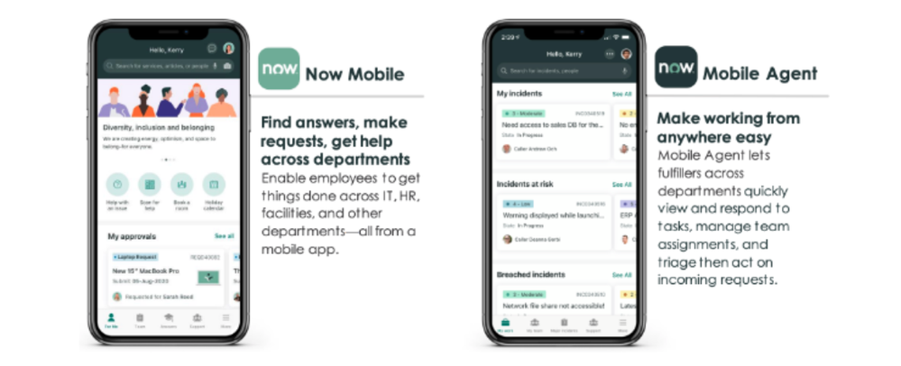
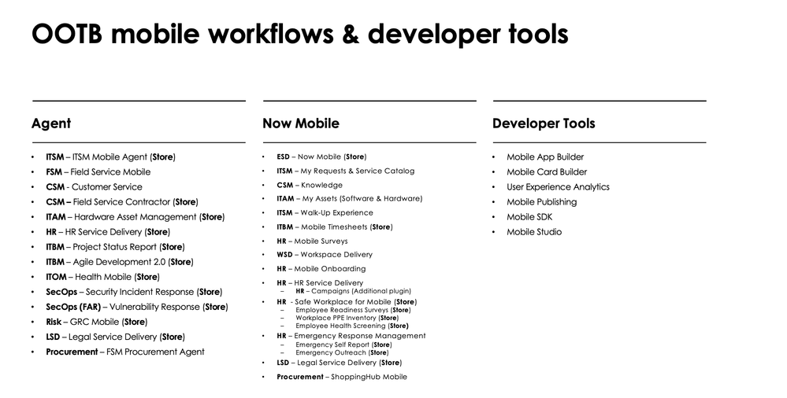
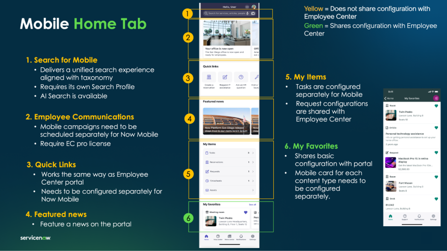
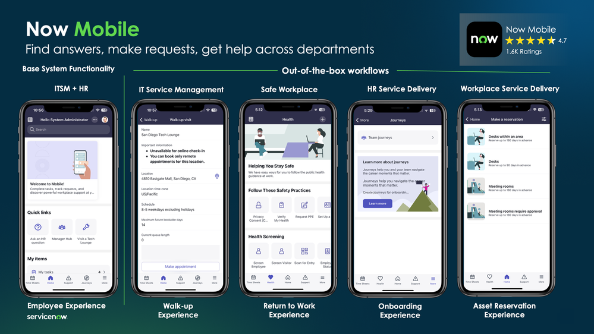
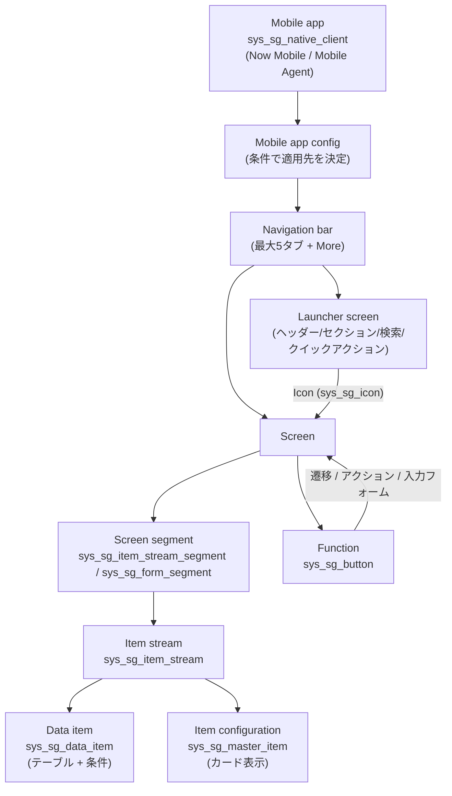

# モバイル（ServiceNow Mobile Platform）

## 概要

ServiceNow のモバイル領域は、**ServiceNow Mobile Platform（モバイルプラットフォーム）** と呼ばれる共通基盤の上に、ペルソナ別のネイティブアプリ（iOS / Android）を載せる構成になっている。Australia リリース時点の主要構成要素は次のとおり。

| 区分 | 構成要素 | 概要 |
|---|---|---|
| ネイティブアプリ（従業員向け） | **Now Mobile** | 一般従業員（Requester persona、依頼者）向け。リクエスト・インシデント起票、ナレッジ検索、承認、タスク、Virtual Agent など |
| ネイティブアプリ（担当者向け） | **ServiceNow Agent**（ドキュメント上の名称は **Mobile Agent**） | サービスデスク担当者・フルフィラー（Fulfiller persona、対応者）向け。トリアージ・対応・解決、オフライン作業、Field Service など |
| ネイティブアプリ（旧） | **ServiceNow Onboarding**（Mobile Onboarding） | 新入社員オンボーディング用。非推奨（deprecated）で、機能は Now Mobile（HR Service Delivery）へ統合済み |
| 構成ツール | **Mobile App Builder（MAB）**、**Mobile Card Builder**（旧 **Mobile Studio** は将来廃止に向け準備中） | 画面・データ・機能（Function）・カード・ナビゲーションの構成 |
| ブランド版配布 | **Mobile Publishing**（有償、ServiceNow Store） | 自社名・アイコン・スプラッシュ画面・MAM SDK を組み込んだブランドアプリのビルド |
| 自社アプリ組み込み | **Mobile SDK** | 自社開発の iOS / Android アプリから ServiceNow の API・Virtual Agent・Voice Agent 等を利用 |
| 横断機能 | オフラインモード、プッシュ通知、ディープリンク、PIN / 生体認証、共有デバイス、MDM / MAM 連携 | Mobile Platform が提供する共通機能 |

ネイティブアプリはいずれも **プラットフォームのメタデータ駆動** で動作し、iOS / Android のコードは共通だが、表示内容（画面・リスト・ボタン）はインスタンス側の `sys_sg_*` 系テーブルの構成で決まる。[出典](https://www.servicenow.com/docs/r/australia/mobile/mobile-security-landing.html) [出典](https://www.servicenow.com/docs/r/australia/mobile/explore-mobile-platform-landing.html)

本ファイルの基準リリースは Australia（2026-05 GA）。Brazil での変更は「> **Brazil での変更:**」として併記する。Field Service Mobile の業務仕様は [Field Service Management](../customer/field-service-management.md)、Virtual Agent の詳細は [Virtual Agent と会話型AI](virtual-agent.md)、Now Assist は [Now Assist と AI Agents](now-assist-ai-agents.md)、Employee Center との関係は [Service Portal と Employee Center](portals-employee-center.md) を参照。



- **キャプション:** Now Mobile（従業員向け）と Mobile Agent（担当者向け、ストア名 ServiceNow Agent）の2アプリを並べた紹介図。
- **画面の説明:** 左の Now Mobile のスマートフォン画面は「Hello, Kerry」の挨拶、検索バー、お知らせバナー、クイックアクション（Help with an issue、Book a room 等のアイコン）、「My approvals」（承認待ちの要求カード）を表示し、下部ナビゲーションバーに For Me 等のタブが並ぶ。説明文は「Find answers, make requests, get help across departments（IT・HR・ファシリティ等の部門横断で用事を済ませる）」。右の Mobile Agent の画面は「My incidents」「Incidents at risk」「Breached incidents」の各セクションにインシデントのカード（優先度、番号、状態、Caller）が並ぶ。説明文は「Make working from anywhere easy（担当者がタスク確認・チームの割り当て管理・トリアージを行える）」。
- **出典:** ServiceNow Community「ServiceNow Mobile Quick Start Guide」 https://www.servicenow.com/community/mobile-apps-platform-articles/servicenow-mobile-quick-start-guide/ta-p/2532845 （取得日: 2026-11-02）

---

## 1. アプリ名称とペルソナの整理

ServiceNow のモバイルアプリは、ドキュメント・アプリストア・プッシュ / OAuth 設定で名称が異なるため、対応関係を整理しておく。

| 公式ドキュメント上の名称 | App Store / Google Play 上の名称 | ペルソナ | Deep link / Push のクライアント種別 | OAuth エンティティ（Application Registry） | Push app 名 |
|---|---|---|---|---|---|
| Now Mobile | Now Mobile | 従業員（Requester） | `Request`（`MobileDeepLinkGenerator`）/ `request` | `ServiceNow Request` | `ServiceNow Request Application` |
| Mobile Agent | ServiceNow Agent | 担当者・フルフィラー（Fulfiller） | `Agent` / `agent` | `ServiceNow Agent` | `ServiceNow Mobile Application` |
| Mobile Onboarding | ServiceNow Onboarding | 新入社員（廃止済み） | `onboarding`（Push 生成スクリプトのクライアント種別） | 公開情報では確認できず | 公開情報では確認できず |

[出典](https://www.servicenow.com/docs/r/australia/mobile/deep-link-mobile-structure.html) [出典](https://www.servicenow.com/docs/r/australia/mobile/mentions-config.html) [出典](https://www.servicenow.com/docs/r/australia/mobile/configure-mobile-app-timeout.html) [出典](https://www.servicenow.com/community/mobile-apps-platform-articles/servicenow-mobile-quick-start-guide/ta-p/2532845)

- **Mobile Agent と ServiceNow Agent:** Australia の公式ドキュメントは「Mobile Agent」と表記するが、ストア上のアプリ名および Bundle ID 一覧の表記は「ServiceNow Agent」である。ServiceNow Community の公式記事も「Mobile Agent（アプリストア上は ServiceNow Agent）」と説明している。本ファイルでは両者を同一アプリとして扱う。[出典](https://www.servicenow.com/docs/r/australia/mobile/sg-mobile-package-ids.html) [出典](https://www.servicenow.com/community/mobile-apps-platform-articles/servicenow-mobile-quick-start-guide/ta-p/2532845)
- **Native Client:** 各アプリ（Mobile Agent、Now Mobile、Mobile Onboarding）は Native Clients テーブル `sys_sg_native_client` のレコードとして表現される（Mobile App Builder の「Mobile app configs」カテゴリはこのテーブルに基づく）。[出典](https://www.servicenow.com/docs/r/mobile/mab-menu-screen-listed.html)
- **アカウント表記の変更（Australia）:** Australia ではモバイル上の用語が「instance（インスタンス）」から「**account（アカウント）**」に変更された（共有デバイス機能の導入に伴う変更として記載）。[出典](https://www.servicenow.com/docs/r/delta-zurich-brazil/brazil-zurich-mobileplatform-release-notes.html)

### 1.1 Now Mobile と Mobile Agent が対応する業務領域

| アプリ | Australia ドキュメントが挙げる対応ワークフロー |
|---|---|
| Now Mobile | IT Service Management、Employee Service Management、IT Asset Management、Strategic Portfolio Management、Customer Service Management、Legal Service Delivery、Safe Workplace |
| Mobile Agent | IT Service Management、Field Service Management、Customer Service Management、IT Asset Management、IT Operations Management、Strategic Portfolio Management、Security Operations、Governance, Risk, and Compliance、Legal Service Delivery、Procurement |

[出典](https://www.servicenow.com/docs/r/australia/mobile/explore-mobile-platform-landing.html)



- **キャプション:** 「OOTB mobile workflows & developer tools」— ServiceNow が提供する標準モバイルワークフロー（Agent / Now Mobile）と開発者ツールの一覧スライド。
- **画面の説明:** 3列構成。左列「Agent」には ITSM Mobile Agent（Store）、Field Service Mobile、Customer Service、Field Service Contractor（Store）、Hardware Asset Management（Store）、HR Service Delivery（Store）、Project Status Report（Store）、Agile Development 2.0（Store）、Health Mobile（ITOM、Store）、Security Incident Response（Store）、Vulnerability Response（Store）、GRC Mobile（Store）、Legal Service Delivery（Store）、FSM Procurement Agent が並ぶ。中列「Now Mobile」には Now Mobile（ESD、Store）、My Requests & Service Catalog、Knowledge、My Assets、Walk-Up Experience、Mobile Timesheets（Store）、Mobile Surveys、Workspace Delivery、Mobile Onboarding、HR Service Delivery（Campaigns は追加プラグイン）、Safe Workplace for Mobile（Store）、Emergency Response Management、Legal Service Delivery（Store）、ShoppingHub Mobile が並ぶ。右列「Developer Tools」は Mobile App Builder、Mobile Card Builder、User Experience Analytics、Mobile Publishing、Mobile SDK、Mobile Studio。（Store）はServiceNow Store から入手するアプリを示す。スライド作成時点のスナップショットであり、Mobile Onboarding や Mobile Studio のように現在は非推奨のものも含まれる。
- **出典:** ServiceNow Community「ServiceNow Mobile Quick Start Guide」/「ServiceNow Mobile Overview」 https://www.servicenow.com/community/mobile-apps-platform-articles/servicenow-mobile-quick-start-guide/ta-p/2532845 （取得日: 2026-11-02）

---

## 2. 提供形態・ライセンス・前提条件

### 2.1 提供形態とライセンスの考え方

- Now Mobile と ServiceNow Agent（Mobile Agent）は Apple App Store / Google Play から**無償でダウンロード**できる。各製品のサブスクリプションに含まれ、利用できる機能は**エンタイトルメント（契約権利）に依存**する。[出典](https://www.servicenow.com/community/mobile-apps-platform-articles/getting-started-with-mobile-faq/ta-p/2301723)
- ServiceNow 製品以外のテーブル（カスタムテーブル）をモバイルで扱う場合は、製品にバンドルされたカスタムテーブル枠か App Engine のライセンスが必要とされる。Virtual Agent は ITSM Professional / CSM Professional などの対象パッケージが必要。[出典](https://www.servicenow.com/community/mobile-apps-platform-articles/getting-started-with-mobile-faq/ta-p/2301723)
- **Mobile Publishing**（ブランドアプリ）は ServiceNow Store から入手する**有償プラグイン**（`com.glide.sn-mobile-whitelab`）。Pro / Enterprise パッケージ、App Engine Studio SKU、単体 SKU のいずれかで利用できるとする ServiceNow Community 記事がある。[出典](https://www.servicenow.com/docs/r/australia/mobile/mobile-publishing-prerequisites.html) [出典](https://www.servicenow.com/community/employee-center-articles/getting-started-with-now-mobile/ta-p/3359190)
- Now Mobile 自体はすべての ServiceNow 顧客が利用可能。ただし Employee Center Pro が必要な機能（キャンペーン、Manager Hub、News 等）、Now Assist ライセンスが必要な機能（Genius results、Voice Agent、AI Lens 等）がある。[出典](https://www.servicenow.com/community/employee-center-articles/getting-started-with-now-mobile/ta-p/3359190)
- 価格・SKU の詳細は [ライセンスモデル](../../03_導入編/01-licensing-model.md)、[プラットフォームのパッケージ構成](platform-licensing-packaging.md) を参照。モバイル単体の定価は公開情報では確認できず。

### 2.2 プラグイン構成の基本

- モバイルの中核機能は**全インスタンスにインストール済みの非表示ベースプラグイン**として提供され、各クライアント（アプリ）を動作させるには**少なくとも1つのワークフロープラグイン**のインストールが必要。[出典](https://www.servicenow.com/community/mobile-apps-platform-articles/servicenow-mobile-quick-start-guide/ta-p/2532845)
- Mobile App Builder はベースシステムのプラグイン `sn_mab` に含まれ自動インストールされる。[出典](https://www.servicenow.com/docs/r/australia/mobile/mab-concept.html)
- Native Clients テーブル（`sys_sg_native_client`）は Mobile Agent Native Client プラグイン（`com.glide.sg.agent_native_client`）の有効化で追加される。[出典](https://www.servicenow.com/docs/r/mobile/mobile-platform/sg-mobile-migration-ny.html)
- 自己ホスト（オンプレミス）環境の顧客はサポートへの連絡でモバイルのプロビジョニングを受ける。[出典](https://www.servicenow.com/community/mobile-apps-platform-articles/servicenow-mobile-quick-start-guide/ta-p/2532845)

### 2.3 対応 OS・テスト済みデバイス・バージョン互換性

| 項目 | Australia ドキュメントの記載 |
|---|---|
| OS サポートポリシー | **iOS は最新 2 バージョン、Android は最新 4 バージョン**をサポート（OS 機能やロードマップに応じて見直す権利を留保） |
| 互換性の方向 | 新しいアプリはどのインスタンスバージョンとも動作するが、**古いアプリは新しいインスタンスでは動作しない**。表の最大インスタンスバージョンを超えないこと |
| 例（アプリ 22.x） | iOS 18 以上、Android 12.0（Snow Cone）以上。対応インスタンスは Utah〜Brazil |
| インスタンス要件 | Madrid リリース以降 |
| Android アーキテクチャ | アプリ 20.4.0 以降、Intel x86 / x86_64 の Android 端末はサポート外 |
| テスト済み iPhone | iPhone 11〜iPhone 17 系（iPhone Air、iPhone 17e を含む） |
| テスト済み Android | Samsung Galaxy S10〜S26 系、Google Pixel 4〜Pixel 10 系、OnePlus 8 Pro、Zebra TC51 |
| Android タブレット | 公式にはテスト対象外。推奨 RAM は 8GB 以上 |
| Apple Vision Pro | Mobile Agent（ServiceNow Agent）17.5 のベータ版が Apple Vision Pro App Store で提供（詳細は営業担当に問い合わせ） |

[出典](https://www.servicenow.com/docs/r/australia/mobile/mobile-supported-devices.html)

- **アプリのバージョン番号はプラットフォームのリリースファミリーとは独立**しており、毎月程度のペースで更新される。Now Mobile の場合、2026-10 時点で iOS v22.2.1（Hotfix）/ Android v22.2.0 が最新で、旧版はストアで「Unavailable」となる。[出典](https://www.servicenow.com/docs/r/mobile-release-notes/now-mobile-available-versions.html)

---

## 3. Now Mobile（従業員向けアプリ）

### 3.1 概要と標準機能

`Now Mobile` は従業員がインシデント・リクエストの起票、タスク管理、社内リソースへのアクセスを外出先から行うためのアプリで、iOS / Android 版とデモが提供される。主な機能は次のとおり。[出典](https://www.servicenow.com/docs/r/australia/mobile/now-mobile-app.html)

- リクエスト・問題の起票、グローバル検索とナレッジベース検索
- 資産（Asset）の参照と問題報告、タスクの参照・完了、画像・添付ファイルのアップロード
- Agent Chat / Virtual Agent によるヘルプ、Siri ショートカット（iOS）

インストール直後のベースエクスペリエンス（Australia ドキュメントの記載）:

| タブ / 領域 | 内容 |
|---|---|
| Home | タスク、リクエスト、資産、アセスメント、サーベイの確認と更新 |
| Support | ナレッジ記事の参照・トピックの閲覧 |
| Notifications | Web UI と通知設定に整合した通知の一覧 |
| Settings | インスタンス（アカウント）接続、位置情報、オフラインモード、言語・通知・PIN / 生体認証・テーマ・アナリティクスの設定、法的文書、フィードバック |

[出典](https://www.servicenow.com/docs/r/australia/mobile/now-mobile-app.html)

旧来のベースシステム説明では、For Me タブ（My To-Dos：承認・オンボーディングタスク、My Requests：状況追跡・更新依頼）、Services タブ（My Locker：所有物品の問題報告）、Information タブ、Notifications タブ、Siri ショートカット（チャットを開く、品目の閲覧、タスク / リクエストを開く）が記載されている。現行の Employee Center 連携構成（Home / Support タブ）とは構成が異なるため、導入済み構成を Mobile App Builder で確認すること。[出典](https://www.servicenow.com/docs/r/mobile/base-system-functionality.html)

### 3.2 Now Mobile のカスタマイズ手段

| 手段 | 内容 |
|---|---|
| Mobile App Builder | 画面とワークフローの構築・管理（推奨） |
| Portal configuration | Now Mobile はネイティブ機能と Web UI のポータルページを組み合わせる |
| Classic environment | 一部の設定はレコード直接更新が必要。誤設定回避のため、可能な限り Mobile App Builder を使う |
| Theming | Next Experience のテーマ（カラー変数）でインスタンスの Web の見た目に合わせる |
| Branded publishing | Mobile Publishing で独自名称・スプラッシュ・アイコン・MDM ベンダー対応のブランドアプリを配布 |

[出典](https://www.servicenow.com/docs/r/australia/mobile/now-mobile-app.html)

### 3.3 Employee Center との整合（Mobile Employee Service Portal 構成）

Now Mobile の Home / Support（Help Center）タブは Employee Center と一部構成を共有し、一部はモバイル専用の設定が必要になる。ServiceNow Community の公式記事（2025-08）は以下のように整理している。[出典](https://www.servicenow.com/community/employee-center-articles/getting-started-with-now-mobile/ta-p/3359190)

| 要素 | Employee Center との共有 | 補足 |
|---|---|---|
| Search for Mobile | 共有しない | Now Mobile 用の **Search Profile** を別途構成。AI Search 利用可。Genius results は **All > AI Search > Now Assist in AI Search Setup** で Now Mobile Default Search Profile 配下のアプリ（Now Mobile - Home / Help Center 等）を選択 |
| Employee Communications（キャンペーン） | 共有しない | Now Mobile 向けに別途スケジュール。Employee Center Pro が必要 |
| Quick Links | 仕組みは同じ | Now Mobile 用に別途設定が必要 |
| Featured news | 共有 | ポータルのニュースを表示 |
| My Items | 一部共有 | タスクはモバイル用に別構成、リクエストの構成は Employee Center と共有 |
| My Favorites | 基本構成を共有 | コンテンツ種別ごとのモバイルカード（Mobile Card Builder）が別途必要 |
| Popular Topics | 共有 | モバイルでは上位 6 トピックまで表示 |
| Browse All Topics | 分類（Taxonomy）を共有 | モバイル版の「メガメニュー」。トピック構成はモバイル向けに別途構成 |
| My Requests のフィルター | ― | **All > System Mobile > Now Mobile App > My Request filters**（フィールド: Title、Table、Filter、Application、Active、Applies to） |



- **キャプション:** 「Mobile Home Tab」— Now Mobile の Home タブを構成する 6 つの領域と、Employee Center との構成共有関係を示したスライド。
- **画面の説明:** 中央のスマートフォン画面に番号付きの枠が付いている。①最上部の検索バー（Search for Mobile：分類に沿った統一検索、専用 Search Profile が必要、AI Search 利用可）、②お知らせバナー（Employee Communications：モバイル向けキャンペーンは別スケジュール、EC Pro ライセンスが必要）、③Quick links（Employee Center と同じ仕組みだが Now Mobile 用に別設定）、④Featured news（ポータルのニュース）、⑤My items（Tasks、Reservations、Requests、Timesheets、Assets の件数付きリスト。タスクはモバイル用に別構成、リクエストは Employee Center と共有）、⑥My favorites（ポータルと基本構成を共有、コンテンツ種別ごとのモバイルカードは別途構成）。黄色枠は Employee Center と構成を共有しない領域、緑枠は共有する領域を示す。右端は My Favorites の一覧画面例。
- **出典:** ServiceNow Community「Getting Started With Now Mobile」 https://www.servicenow.com/community/employee-center-articles/getting-started-with-now-mobile/ta-p/3359190 （取得日: 2026-11-02）

### 3.4 Now Mobile 向けプラグイン（Australia）

| プラグイン名 | 説明 | 提供元 |
|---|---|---|
| Human Resources Scoped App: Mobile Employee Onboarding | Mobile Employee Experience Native Application プラグインと組み合わせて、HR オンボーディング項目を Now Mobile に表示 | インスタンス |
| Safe Workplace suite | Safe Workplace 系アプリを一括ダウンロード | Store |
| Emergency Response Management for Now Mobile | 緊急対応アプリのモバイル体験（健康状態報告、マネージャー向けのチーム健康状態の可視化、直属部下のタスク再割り当て） | Store |
| Mobile Time Sheets | タイムシートの作成・提出・編集、マネージャーの承認・却下・取り消し（iOS / Android） | Store |
| Walk-up Experience | テックラウンジ向けのウォークアップ窓口（オンライン / オンサイトのチェックイン） | インスタンス |

[出典](https://www.servicenow.com/docs/r/australia/mobile/sg-mobile-plugins-now.html)

上記のほか、ServiceNow Community 記事は Now Mobile 本体のアプリスコープを `sn_me`（自動インストールまたは Store から入手）、HR Service Delivery for mobile を `sn_hr_mobile`（プラグイン `com.sn_hr_mobile`）としている。[出典](https://www.servicenow.com/community/employee-center-articles/getting-started-with-now-mobile/ta-p/3359190)



- **キャプション:** 「Now Mobile — Find answers, make requests, get help across departments」— Now Mobile のベースシステム機能と標準提供ワークフローの画面例。
- **画面の説明:** 5 台のスマートフォン画面が並ぶ。左端は「Base System Functionality（ITSM + HR）」の Employee Experience（Welcome to Mobile バナー、Quick links：Ask an HR question / Manager Hub / Visit a Tech Lounge、My items）。以降は「Out-of-the-box workflows」として、IT Service Management の Walk-up Experience（Walk-up visit 画面：場所、タイムゾーン、スケジュール、Make appointment ボタン）、Safe Workplace の Return to Work Experience（Health 画面：Privacy Consent、Verify My Health、Request PPE、Health Screening）、HR Service Delivery の Onboarding Experience（Journeys 画面：Team journeys）、Workplace Service Delivery の Asset Reservation Experience（Make a reservation 画面：Desks、Meeting rooms 等）。右上に App Store の評価（4.7、1.6K Ratings）が表示されている。
- **出典:** ServiceNow Community「Getting Started With Now Mobile」 https://www.servicenow.com/community/employee-center-articles/getting-started-with-now-mobile/ta-p/3359190 （取得日: 2026-11-02）

---

## 4. ServiceNow Agent（Mobile Agent、担当者向けアプリ）

### 4.1 概要

`Mobile Agent`（ストア名 ServiceNow Agent）は、サービスデスク担当者（Fulfiller persona）が外出先でリクエストのトリアージ・対応・解決を行うためのアプリで、Apple App Store と Google Play から配布され、デモアプリもある。[出典](https://www.servicenow.com/docs/r/australia/mobile/explore-mobile-platform-landing.html)

- 機能はワークフロープラグイン（ITSM、FSM、CSM 等）の有効化で追加される。[出典](https://www.servicenow.com/docs/r/mobile/base-system-functionality.html)
- ITSM の担当者は、オンライン時に承認待ち要求の承認 / 却下、承認済み要求の参照を行える（Request 体験は Mobile Agent では提供されない）。[出典](https://www.servicenow.com/docs/r/Ir~NPf1dr8MGFXQE6QlBoQ/SPuOcL~UXA_rOyay_7O3tQ)
- オフラインモードやスケジュール型オフラインキャッシュ（後述）は主に Mobile Agent（特に Field Service）を想定している。

### 4.2 Mobile Agent 向けプラグイン（Australia）

| プラグイン名 | 説明 | 提供元 |
|---|---|---|
| ITSM Mobile Agent | インシデントのトリアージ・対応・解決、スケジュールとオンコール状況の確認、メジャーインシデント対応 | Store（以前のバージョンはインスタンス同梱） |
| Asset Receiving Mobile | 購買資産の受領 | インスタンス |
| PPM Mobile | プロジェクト状況・ステータスレポートの参照 | インスタンス |
| Customer Service Mobile | カスタマーサービスのモバイル体験 | インスタンス |
| Field Service Mobile | 作業指示タスクの実行・資産管理・クローズ（オンライン / オフライン）、ディスパッチャー機能 | インスタンス |
| GRC: Mobile | GRC のタスク・要求・承認・フォローアップ、重要資産・ベンダー・サービスのリスク / コンプライアンス状況とアラート | Store |
| Project Status Report | プロジェクト / プログラム / ポートフォリオマネージャー向けの進捗とリスク・課題・決定・アクション・変更要求の更新 | Store |
| Security Incident Response Mobile | 割り当てられたセキュリティインシデント / タスクの通知、修復、カスタム検索条件での監視 | Store |
| Vulnerability Response Mobile | 割り当てられた脆弱性グループ / 項目の通知、重大脆弱性の修復 | Store |

[出典](https://www.servicenow.com/docs/r/australia/mobile/sg-mobile-plugins-agent.html)

- プラグイン ID は当該ページに記載がない。ワークフロー固有のロール（例：Field Service Mobile のディスパッチャー `wm_dispatcher`）はプラグインごとに異なる。[出典](https://www.servicenow.com/community/mobile-apps-platform-articles/servicenow-mobile-quick-start-guide/ta-p/2532845)

---

## 5. Onboarding アプリ（Mobile Onboarding）と後継

`ServiceNow Onboarding`（Mobile Onboarding）は新入社員向けの独立アプリだったが、**非推奨（deprecated）** となっている。

| 項目 | 内容 |
|---|---|
| 段階的廃止の開始 | Rome リリースからサポートを段階的に廃止 |
| 現状 | 「新規に有効化できず、機能強化と重大でないバグ修正は行わない」 |
| プラグイン | Onboarding Mobile プラグインは Tokyo で deprecated とされ、Now Mobile の HR Mobile プラグインへの移行が案内された |
| ストア | Mobile Publishing のリリースノートでは 2023-03 にアプリストアから削除予定とされた |
| Intune 版の最終バージョン | ServiceNow Onboarding - Intune v15.5.0（2023-03）。全バージョンが「Unavailable」 |
| Mobile App Builder 上の扱い | 旧リリースの Mobile Onboarding app configuration は開けるが、**新規作成はできない** |
| 後継 | **Now Mobile app for HR Service Delivery**（Now Mobile に全モバイルオンボーディング機能を統合） |

[出典](https://www.servicenow.com/docs/r/mobile-release-notes/onboarding-intune-available-versions.html) [出典](https://www.servicenow.com/docs/r/mobile/mab-menu-screen-listed.html) [出典](https://docs.servicenow.com/bundle/vancouver-release-notes/page/release-notes/eol/plugin-changes-t-to-v.html) [出典](https://www.servicenow.com/docs/r/store-release-notes/store-rn-mobile-publishing.html)

> 廃止時期の記述は情報源により異なる（Rome から段階的廃止、Tokyo で plugin deprecated、2023-03 にストア削除予定）。いずれにしても Australia 時点で新規採用の選択肢ではない。

### 5.1 Now Mobile でのオンボーディング（後継構成）

| 要素 | 内容 |
|---|---|
| プラグイン | `com.sn_hr_mobile`（Human Resources Scoped App: Mobile。HR Service Delivery for mobile）。有効化にはデモデータが含まれ、関連プラグインも有効化される（admin ロールが必要） |
| ライフサイクルイベント連携 | `sn_hr_le.admin` ロールでオンボーディングに使う Lifecycle Event を選択。当該イベント種別のオンボーディングケースが作成されると、新入社員はケースに紐づく To-do を Now Mobile で完了する |
| マネージャー向け | Lifecycle Events for Enterprise（`com.sn_hr_lifecycle_ent`）を使う場合、採用マネージャーは新入社員のオンボーディング進捗を一元的に追跡できる |
| Journeys | Journey designer（`sn_jny`）、Journey Accelerator（`sn_ja`）、`sn_hr_mobile` を組み合わせ、Journey を従業員に割り当てて公開すると Now Mobile に表示 |

[出典](https://www.servicenow.com/docs/r/iMpltWWdX~aXgRlaoFVPCw/wUV54XL_44C9U~uXFaMZnw) [出典](https://www.servicenow.com/docs/r/SogDT~k7ktsbe1ZYegnaLg/wecmS6RpMy5RpMGyYNKtvA) [出典](https://www.servicenow.com/docs/r/XbpkTdWa3HBo31srdD0Rdg/KnWNcBSmZ~qFDaLIf5ktng)

HR Service Delivery 側の詳細は [HR Service Delivery](../employee/hr-service-delivery.md) を参照。

---

## 6. Mobile Platform の構成階層とテーブル

### 6.1 階層（Mobile hierarchy）

ServiceNow のモバイルアプリは以下の階層でメタデータとして構成される（Australia の「Mobile hierarchy」）。[出典](https://www.servicenow.com/docs/r/australia/mobile/mobile-hierarchy.html)

| コンポーネント | テーブル | 説明 |
|---|---|---|
| Mobile app（モバイルアプリ） | `sys_sg_native_client`（Native Clients） | Now Mobile と Mobile Agent。それぞれ 1 つ以上の Mobile app config を持つ |
| Mobile app config（アプリ構成） | 公開情報では単独のテーブル名を確認できず（MAB の「Mobile app configs」カテゴリは `sys_sg_native_client` に基づく） | ログイン後にユーザーが見る体験を定義。どの構成が適用されるかは構成に設定した条件で決まる。テーマ、利用者権限、ナビゲーションバーもここで設定 |
| Navigation bar（ナビゲーションバー） | ― | 画面下部のバー。最大 5 タブ。既定で通知タブと設定タブを含む |
| Navigation bar tabs | ― | 各タブは Screen または Launcher screen を開く。5 を超えるタブは「More」タブに格納 |
| Launcher screens（ランチャー画面） | ― | ホーム / ランディングページ。ヘッダー、セクション、検索バー（任意）、クイックアクションを構成 |
| Screens（画面） | ― | インスタンスのデータをリスト、マップ、レコード等で表示・更新。1 つ以上の Screen segment を持つ |
| Screen segments | `sys_sg_item_stream_segment`（リスト・カレンダー・マップ）、`sys_sg_form_segment`（レコード画面） | 画面内のリスト・レコード等。複数あるとタブ表示 |
| Icons | `sys_sg_icon` | ランチャー画面やナビゲーションバー上で画面を表すアイコン |
| Item streams | `sys_sg_item_stream` | 画面のデータソース。1 つの Data item から取得し、Item configuration と紐づく。複数の Item stream を 1 セグメントに供給可 |
| Data items（データ項目） | `sys_sg_data_item` | インスタンスのテーブルに紐づくデータセット。フィルター条件で返却データを制限 |
| Item configurations | `sys_sg_master_item` | セグメント内でのデータの表示パターン・外観 |
| Functions（機能） | `sys_sg_button` | ユーザーが実行する操作（タスク割り当て、レコード遷移、メール送信、地図を開く、電話をかける等） |



### 6.2 画面タイプ（Screen types）

| 画面タイプ | 説明 |
|---|---|
| Launcher screen | ホームページ。画面・クイックアクション・ユーザー情報への入口 |
| List screen | Data item のレコードをカード形式（限定フィールド）で一覧表示。Record screen と組み合わせて詳細表示 |
| Grouped list screen | 特定フィールドでグループ化したリスト |
| Record screen（Form） | 単一レコードの詳細。最大 4 種類の埋め込みセグメント（Details、Activity stream、Related list、Embedded list）を持てる |
| Calendar screen | 日付フィールドを持つレコードをカレンダー表示。日付選択でそのレコードを表示 |
| Map screen | Data item のレコードの位置情報を地図表示 |
| Mobile web screen（URL） | URL をアプリ内で開く。相対 URL はインスタンス内ページ、外部 URL は端末の既定ブラウザー |
| Chart screen | レポート / Performance Analytics（Analytics Center）のグラフ。時系列・スコア表示 |
| Input form screen | レコード作成・編集、サーベイ回答など入力を伴う操作の画面（Function から起動） |

[出典](https://www.servicenow.com/docs/r/mobile/sg-mobile-applet.html) [出典](https://www.servicenow.com/docs/r/australia/mobile/mobile-hierarchy.html)

> 画面タイプの分類・名称はリリース・ページにより揺れがある（例：Washington DC のページは Map screen を掲載し Input form を action screen として扱う。Australia の Mobile hierarchy は Calendar / Chart / Form / Grouped list / List / Map / URL を列挙）。旧称「Applet」は現在の「Screen」に相当する。

### 6.3 Function（機能）の種類

`sys_sg_button` に定義される Function は、ナビゲーション（画面・レコードへの遷移）、アクション（Action item：レコードの作成・更新・削除、write-back action）、入力フォーム（Input form screen を開く）、添付のアップロード、URL / 電話 / メール / 地図などの端末連携に大別される。Function を画面上の配置場所に紐づけたものが **Function instance（button instance）** で、配置場所ごとに有効 / 無効やオフライン可否を設定する。[出典](https://www.servicenow.com/docs/r/australia/mobile/mobile-hierarchy.html) [出典](https://www.servicenow.com/docs/r/australia/mobile/offline-capabilities.html) [出典](https://www.servicenow.com/docs/r/australia/mobile/functions-offline.html)

---

## 7. Mobile App Builder（MAB）

### 7.1 概要

`Mobile App Builder` は、ServiceNow モバイルアプリのワークフローを構成する画面とレコードを構築・管理するための構成ツール。[出典](https://www.servicenow.com/docs/r/australia/mobile/mab-concept.html)

| 項目 | 内容 |
|---|---|
| プラグイン | ベースシステムの `sn_mab`（自動インストール）。新しいバージョンがあると MAB 画面上部にバナーが表示され、**Update** で更新（バージョン 22.6 以降） |
| メニュー | **All > System Mobile > Mobile App Builder** |
| 必要ロール | `mobile_admin` または `admin`（ロールの詳細は 7.4） |
| 3 つの画面 | ①Application scope selection（作業スコープの選択）②Categories home（編集対象レコードの選択・作成）③Record screen（フィールド入力とレコード間の関連付け。作業の大半はここ） |
| 主な機能 | 階層レイアウトとツリーナビゲーション、ライブプレビュー、すべてのベースシステムのモバイルアプリスコープの編集、1 画面での複数レコード編集、不正な関連付けを防ぐガイド、関連付け時のフィールド自動入力 |
| 連携（Washington DC 以降） | Mobile Publishing（「Manage your branding」サイドパネルからブランドアプリのカードを開く）、プッシュ通知（メニューの Mobile notifications） |

[出典](https://www.servicenow.com/docs/r/australia/mobile/mab-concept.html) [出典](https://www.servicenow.com/docs/r/australia/mobile/user-roles-config.html)

### 7.2 Categories home のカテゴリと対応テーブル

| カテゴリ | テーブル | 用途 |
|---|---|---|
| Mobile app configs | `sys_sg_native_client` | アプリのテーマ、ユーザーアクセス権、ナビゲーションバー。**アプリ種別ごとに 1 つの構成を選択** |
| Screens | `sys_sg_screens`（ドキュメント表記。後述の注記を参照） | 画面タイプに応じた画面の構成 |
| Cards & icons | `sys_sg_icon`、`sys_sg_view_config`、`sys_sg_view_template`、`sys_sg_item_view` | カードとアイコンの作成・編集。アイコンは画面へのショートカットまたはアクションのトリガー |
| Functions | `sys_sg_button` | ユーザーが実行できる操作 |
| Data | `sys_sg_data_item` | ソーステーブルの選択と表示条件 |
| All mobile records | Record type フィールドで選択 | 構成ツリーをたどらずに全モバイルレコードをテーブル横断で検索・フィルター |

[出典](https://www.servicenow.com/docs/r/mobile/mab-menu-screen-listed.html)

- 画面テーブル名は MAB ドキュメント上 `sys_sg_screens` と記載されるが、Community 回答では `sys_sg_screen` とされる。インスタンスで実テーブル名を確認すること。【第三者情報】[出典](https://www.servicenow.com/community/servicenow-ai-platform-forum/creating-now-mobile-screen/m-p/1118568)
- 旧リリースの **Mobile Onboarding app configuration** と **legacy card** は開いて編集できるが新規作成はできない。[出典](https://www.servicenow.com/docs/r/mobile/mab-menu-screen-listed.html)

### 7.3 Australia での MAB の変更

| 変更 | 内容 |
|---|---|
| ライブコンポーネントプレビューの拡張 | Input form screen、ナビゲーションタブ、Mobile app configuration、UI rule のライブプレビューに対応 |
| 自動ロード | レコードを初めて開くと、そのレコードと下位コンポーネントを自動ロード |
| Input form screen のボタン | Screen presentation 属性の入力フォームで、上部アクションボタンを最大 2 つ表示可能 |
| Record screen の動的変数 | スクリプト画面フィールドで動的な値（例：メール内の翻訳済みコンテンツ）を表示 |
| ランチャーのロゴ | ランチャー画面の上部ナビゲーションバーでテキストタイトルの代わりにロゴを表示 |

[出典](https://www.servicenow.com/docs/r/australia/release-notes/mobile-rn.html)

ServiceNow Community の Australia 紹介ブログは、構成の簡素化、リスト作成の高速化、再利用可能コンポーネント、推奨コンポーネント / フィールド、**Web-to-mobile ツール**、ガイド付き構築ワークフローを MAB の強化点として挙げている。[出典](https://www.servicenow.com/community/mobile-apps-and-platform-blog/what-s-new-for-servicenow-mobile-in-the-australia-release/ba-p/3575645)

### 7.4 ロール：`mobile_admin`（Australia で新設）

`mobile_admin` は、`admin` より権限範囲を絞ってモバイル構成を行うための専用ロールで、Australia の新機能として追加された。[出典](https://www.servicenow.com/docs/r/australia/mobile/mobile-admin-role.html) [出典](https://www.servicenow.com/docs/r/australia/release-notes/mobile-rn.html)

| 付与される権限 | 内容 |
|---|---|
| モバイル関連テーブル | モバイルプラットフォーム上に構築された / 接続された製品・機能のテーブルを含む、すべてのモバイル関連テーブルの読み取り・書き込み・作成・削除 |
| システムプロパティ | モバイル関連のシステムプロパティの参照・編集（`sys_properties` 全体へのアクセスは付与しない） |
| ツール | Mobile App Builder、Mobile Card Builder、Mobile Publishing（Store で購入している場合） |

- **制約:** 個々のアプリケーションスコープへのアクセスは自動付与されない。例：Field Service Mobile を MAB で構成するには、そのスコープへの別途権限が必要。
- **推奨:** モバイル作業のみを行う担当者には `admin` ではなく `mobile_admin` を付与する（`admin` は無制限の権限でセキュリティリスクがあるため）。

[出典](https://www.servicenow.com/docs/r/australia/mobile/mobile-admin-role.html)

その他のモバイル関連ロール:

| ロール | 用途 |
|---|---|
| `admin` | プラグインのインストール、MAB でのロール割り当て等。`PINIdleTimeout` 作成やトークン寿命設定の手順も `admin` を要求 |
| `mobile_shared_device_mode_enabler` | 端末を共有デバイス（マルチユーザー）モードに切り替えられるユーザー（10.4 参照） |
| `delegated_developer` | 他の開発者によるモバイルアプリのピアレビュー・テストに利用（Community 記事の記載） |
| `snc_external` | 外部ユーザーに付与し、限定的なアクセスを与える（Community FAQ の記載） |
| Push admin（正式ロール名は未確認） | カスタムプッシュアプリの設定（Push admin = push app developer / mobile app developer） |

[出典](https://www.servicenow.com/docs/r/australia/mobile/user-roles-config.html) [出典](https://www.servicenow.com/community/mobile-apps-platform-articles/servicenow-mobile-quick-start-guide/ta-p/2532845) [出典](https://www.servicenow.com/community/mobile-apps-platform-articles/getting-started-with-mobile-faq/ta-p/2301723) [出典](https://www.servicenow.com/docs/r/washingtondc/platform-administration/r_PushNotificationSetupCustom.html)

> push admin ロールの正式なロール名は、参照したページでは確認できなかった。

### 7.5 モバイルコンポーネントのアクセス制御（Role / User criteria）

- モバイルのコンポーネントには、**User role（ロール）** を受け付けるもの、**User criteria（ユーザー基準）** を受け付けるもの、両方を受け付けるものがある。両方を受け付けるものは **Access control type** フィールドでどちらかを選ぶ。
- ロールが割り当てられていないコンポーネントは、アプリにアクセスできる全ユーザーに表示される（User criteria で非表示にすることは可能）。
- 新規ロールは Roles（`sys_user_role`）テーブルで作成し、既存ロールの割り当ては MAB で行う。

手順（必要ロール: `admin`）:

1. **All > System Mobile > Mobile App Builder** を開き、アプリケーションスコープを選択する。
2. **All mobile records** を選択する。
3. **Record type** でロールに対応したレコード種別を選択する。
4. ロールと User criteria の両方に対応している場合、**Access control type** を **User roles** にする。
5. **Role access** で **Choose** を選択し、ロールを選んで **Apply** する。
6. **Save** する。

[出典](https://www.servicenow.com/docs/r/australia/mobile/user-roles-config.html)

> モバイルの表示制御は「表示 / 非表示」の制御であり、データアクセスそのものはプラットフォームの ACL で制御される（モバイルアプリは ServiceNow の API を介してデータを取得するため）。ACL は [アクセス制御（ACL）](access-control-acl.md) を参照。添付ファイルのモバイルからの利用禁止も `sys_attachment` の ACL（`gs.isMobile()`）で実現する（10.3 参照）。[出典](https://www.servicenow.com/docs/r/australia/mobile/mobile-security-landing.html)

### 7.6 Mobile Card Builder

`Mobile Card Builder` は、モバイルアプリ（iOS / Android）で使われる**カードとテンプレート**を視覚的に編集するツール。カードはインスタンスのレコード情報を表示する UI 単位。[出典](https://www.servicenow.com/docs/r/mobile/mobile-card-builder.html)

| 項目 | 内容 |
|---|---|
| カードが使われる場所 | ランチャー画面のレコードセクション、カレンダー画面、フォーム画面、Genius 検索結果、リスト画面、マップ画面 |
| 起動画面 | 左側にセクション（Cards、Templates、Default templates、Custom templates、My templates）。**Create blank template** で空のテンプレートから作成 |
| ステージ | 左パネル＝カード名とコンポーネントツリー、中央＝レイアウト、右＝選択コンポーネントの設定 |
| テンプレート変更 | **Change template** でレイアウトを差し替え。カードテンプレートは **Quebec 以降に作成したカード**にのみ適用可能 |
| カードの種類 | legacy card、card、card template で利用できるオプションが異なる |

[出典](https://www.servicenow.com/docs/r/mobile/mobile-card-builder.html) [出典](https://www.servicenow.com/docs/r/yokohama/mobile/mcb-stage-ui.html)

### 7.7 Mobile Studio（非推奨化の準備中）

- Australia ドキュメントは「Starting with the Australia release, Mobile Studio is being prepared for future deprecation. It will be hidden and no longer activated on new instances but will continue to be supported.」と記載する（新規インスタンスでは非表示・有効化されないが、サポートは継続）。[出典](https://www.servicenow.com/docs/r/australia/mobile/mobile-config-navigation.html)
- なお Community の回答では同趣旨の記述が Vancouver / Washington DC リリースの時点で既にあったとされ、開始リリースの記載は情報源により異なる。いずれにせよ新規の構成は **Mobile App Builder** で行う。Studio で作成した項目が MAB に移行されていないと MAB 上で見えない場合がある、との指摘もある。【第三者情報】[出典](https://www.servicenow.com/community/developer-forum/unable-to-find-mobile-studio-option-in-the-create-application/m-p/2591611)

---

## 8. ディープリンク（MobileDeepLinkGenerator）

`MobileDeepLinkGenerator`（`global` スコープの Script Include）は、メール通知・プッシュ通知・QR コード等からモバイルアプリの特定画面を開くリンクを生成する。[出典](https://www.servicenow.com/docs/r/australia/mobile/deep-link-mobile-structure.html)

コンストラクター: `new global.MobileDeepLinkGenerator(app)` — `app` は `'Request'`（Now Mobile）または `'Agent'`（Mobile Agent）。

| メソッド | 引数 | 用途 |
|---|---|---|
| `getButtonLink(buttonId, tableName, recordSysId)` | `buttonId` 必須（Function の sys_id）、他は任意 | Input form screen へのリンク |
| `getFormScreenLink(formScreenId, tableName, recordSysId)` | すべて必須 | パラメーター化されていない Form screen へのリンク |
| `getLauncherScreenLink(launcherScreenId)` | 必須 | ランチャー画面へのリンク |
| `getPrefillLink(forceLocalLogin)` | 必須 | 初回ユーザー向けにインスタンス情報を事前入力するリンク（特定画面には遷移しない）。`true` でログイン情報を事前入力、`false` は手入力 |
| `getScreenLink(documentId, uiParams)` | `documentId` 必須、`uiParams` 任意 | List screen 等（パラメーター化 / 非パラメーター化）へのリンク |
| `getSSOPrefillLink(sys_id)` | 必須（IdP の sys_id） | `sso_properties` の IdP を使う事前入力リンク。Multi-Provider SSO プラグインと有効な IdP が必要 |
| `getUniversalLink(url)` | 必須 | インスタンス URL からリスト・フォーム・ブラウザーへのリンクを生成 |

```javascript
// Mobile Agent アプリの特定画面を開くリンクを生成する例（公式ドキュメントの例）
var deepLinkGen = new global.MobileDeepLinkGenerator('Agent');
return deepLinkGen.getScreenLink('73f3d135532033002d96ddeeff7b1212');
```

- IdP の sys_id は **All > Multi-Provider SSO > Identity Providers** でレコードを右クリック > **Copy sys_id** で取得する。
- ディープリンクの URL スキーム自体の書式は当該ページに記載がない（公開情報では確認できず）。

[出典](https://www.servicenow.com/docs/r/australia/mobile/deep-link-mobile-structure.html)

---

## 9. プッシュ通知

### 9.1 標準アプリへのプッシュ通知の構成

標準アプリ（Now Mobile / Mobile Agent）へのプッシュ通知は、**System Notification > Push** 配下の 3 種類のレコードで構成する。以下はアクティビティストリームの @メンションを通知する公式手順（必要ロール: `admin`）。[出典](https://www.servicenow.com/docs/r/australia/mobile/mentions-config.html)

| 手順 | メニュー | 主な設定 |
|---|---|---|
| 1. Push Message Content | System Notification > Push > Push Message Content | **Push app**: Mobile Agent は `ServiceNow Mobile Application`、Now Mobile は `ServiceNow Request Application`。**Push Message Generation** スクリプトで JSON ペイロードを生成（`aps` の sound、`MobileDeepLinkGenerator` で作るリンク、テーブル・ドキュメント） |
| 2. Push Message | System Notification > Push > Push Messages | Push app（手順 1 と一致）、Push Message Content、Table（例 `live_notification`）、Message（表示文言） |
| 3. Push Notification | System Notification > Push > Push Notifications | Active、Table、**Push Message Only**（自動選択・読み取り専用）、Category、When to send（例 Inserted）、Who will receive（Users/Groups in）、What to send（Push Messages） |
| 4. 端末側 | アプリの Settings > Notifications | **Allow Notifications** と該当アプリ（ServiceNow Mobile Application / ServiceNow Request Application）を有効化 |

- `sys_user` で非アクティブなユーザーには送信されない。[出典](https://www.servicenow.com/docs/r/australia/mobile/mentions-config.html)
- 通知そのもの（Notification レコード、配信条件）の詳細は [通知とメール](notifications-email.md) を参照。

### 9.2 カスタムプッシュアプリ / Mobile SDK / ブランドアプリ

- 自社アプリ（Mobile SDK 等）へのプッシュは、Push admin（モバイルアプリ開発者）とシステム管理者で設定する。iOS は Push 証明書のアップロード、Push application レコードの登録（端末とアプリの組み合わせで受信者を特定）、通知種別ごとの JSON ペイロード、任意で属性定義・Push action script（アクション可能な通知への応答時に実行）を設定し、**Push Installation API** でユーザーを受信登録する。標準アプリ用の手順とは別物である。[出典](https://www.servicenow.com/docs/r/washingtondc/platform-administration/r_PushNotificationSetupCustom.html)
- Mobile Publishing のブランドアプリでは Android のプッシュに Google Firebase アカウント（App ID、API key、Project ID）が必要（13 章）。[出典](https://www.servicenow.com/docs/r/australia/mobile/mobile-publishing-prerequisites.html)

### 9.3 Australia の変更

- **ログアウト中のユーザーへのプッシュ通知**（重要通知をログアウト状態でも届ける）が追加された。[出典](https://www.servicenow.com/docs/r/australia/release-notes/mobile-rn.html)
- 共有デバイスモードではプッシュ通知は既定で無効（10.4 の `EnablePushNotificationinSharedDeviceMode`）。

---

## 10. 認証・セッション・セキュリティ

### 10.1 アーキテクチャと認証方式

| 項目 | 仕様 |
|---|---|
| アプリ方式 | iOS / Android ともネイティブコード（ハイブリッドではない）。UI の大半はプラットフォームのメタデータで駆動 |
| 認証フロー | **OAuth 2.0（AppAuth）**。サインインは外部のモバイルブラウザーで行う |
| 対応認証方式 | Multi-Provider SSO（SAML、`com.snc.integration.sso.multi.installer`）、MFA（`com.snc.integration.multifactor.authentication`）、LDAP、ローカル DB ログイン、Digest |
| 資格情報 | アプリはパスワードを保存しない（OAuth の client ID のみ保持） |
| トークン | 初回ログイン時にアクセストークンとリフレッシュトークンを発行。アクセストークン失効時はリフレッシュトークンで再取得し、それも無効なら再ログイン。iOS Keychain / Android KeyStore に保存 |
| ユーザー削除時 | 管理者がユーザーを削除するとアクセストークンが無効になりログアウト |

[出典](https://www.servicenow.com/docs/r/australia/mobile/mobile-security-landing.html)

SSO・MFA の構成自体は [認証とSSO](authentication-sso.md) を参照。

### 10.2 トークン寿命（モバイルのタイムアウト）

モバイルアプリは OAuth トークンの失効でタイムアウトする。トークンはアプリがフォアグラウンドにあるか、長時間のバックグラウンドタスク実行中はアクティブとみなされる。[出典](https://www.servicenow.com/docs/r/australia/mobile/configure-mobile-app-timeout.html)

| 項目 | 内容 |
|---|---|
| 必要ロール | `admin` |
| メニュー | **System OAuth > Application Registry** |
| 対象 OAuth エンティティ | Mobile Agent → **ServiceNow Agent**、Now Mobile → **ServiceNow Request** |
| フィールド | **Refresh Token Lifespan**、**Access Token Lifespan**（いずれも秒） |
| 例 | 30 分でタイムアウトさせるには両方を `1800` |
| 反映 | ユーザーがサインアウト → 再サインインするまで既存のセッション / トークンが使われる |

既定値は当該ページに記載がない。Community の回答には「モバイルアプリのリフレッシュトークン既定値は 30 分」との記述があるが、公式ドキュメントでは確認できず。【第三者情報】[出典](https://www.servicenow.com/community/mobile-apps-platform-forum/how-long-does-the-mobile-keep-the-sso-session-active-is-there-a/m-p/214144)

### 10.3 データ保護（暗号化・DLP）

| 区分 | 仕様 / 設定 |
|---|---|
| 通信 | SSL/TLS、OAuth エンドポイントは HTTPS |
| 端末内（iOS） | Core Data に OS レベルの FIPS 140-2 検証済みディスク暗号化（端末 PIN または生体認証が前提） |
| 端末内（Android） | SQLCipher SDK（FIPS 140-2 検証済み暗号モジュール）で Room DB を暗号化 |
| Android の暗号スイート | クライアント 20.1.0 で `TLS_ECDHE_RSA_WITH_AES_256_GCM_SHA384` を追加し、CBC 系 3 スイートを廃止。SSL ハンドシェイク失敗時はインスタンス側の対応スイートを確認 |
| コピー＆ペースト制限 | `glide.sg.clear_pasteboard_when_background` = `true` |
| アプリ PIN の強制 | `glide.sg.require_mobile_application_pin` = `true`（6 桁。サインイン後および非アクティブ後に要求） |
| バックグラウンド時のぼかし | `glide.sg.blur_ui_when_backgrounded` = `true`（既定 `false`）。Android では画面共有が黒画面になりスクリーンショットも禁止（iOS には適用されない） |
| 添付ファイルのブロック | `sys_attachment` の ACL で `gs.isMobile()` の場合に `false` を返す |
| 端末キャッシュ | お気に入り・ホーム画面・ナビゲーター項目などの設定類はキャッシュされる。レコードデータは（Field Service 等で）オフライン同期を有効にしない限り端末に保存しない。オフラインデータは暗号化 |
| 侵入テスト | 第三者による侵入テストを通常年 1 回実施し、結果は顧客に提供 |
| 端末権限 | オプトインで位置情報・カメラ・通知にアクセス |

[出典](https://www.servicenow.com/docs/r/australia/mobile/mobile-security-landing.html)

ServiceNow Community の Mobile Security FAQ（ServiceNow 社員による Community 記事）は補足として次を挙げている。公式ドキュメント本文では確認できなかった項目を含み、記載時点が古い可能性があるため、最新仕様は ServiceNow に確認すること。[出典](https://www.servicenow.com/community/mobile-apps-platform-articles/mobile-security-faq/ta-p/2302507)

- Touch ID / Face ID は PIN を要求できる場面で利用可能だが、**認証手段ではなく**アプリをバックグラウンドから復帰させる際の端末セキュリティ機能という位置付け。
- Android はコード難読化（ProGuard）と root 検出（Rootbeer ライブラリ）を使用し、root 化を禁止するシステムプロパティが設定されている場合は root 化端末でログアウトさせる。
- オフラインのレコードデータは AES-256 で暗号化。iOS は「Complete」ファイル保護（端末ロック中はファイルにアクセスできない）を使用。
- 証明書ピンニングと改ざん防止（anti-tampering）は実装されていない。Android API レベル 24 以上では OEM 標準の CA のみを信頼し、ユーザー / 管理者追加の CA は信頼しない。

### 10.4 PIN タイムアウトと共有デバイス（マルチユーザー）

#### PIN タイムアウト（`PINIdleTimeout`、Australia で追加）

`PINIdleTimeout` は、アプリが非アクティブな状態で PIN 再入力を求めるまでの時間を**アプリ種別ごと**に設定するモバイルプロパティ。[出典](https://www.servicenow.com/docs/r/australia/mobile/pin-timeout.html)

| 項目 | 内容 |
|---|---|
| 格納先 | Mobile Properties（`sys_sg_properties`）※ `sys_properties` ではない |
| 必要ロール | `admin` |
| 型 / 値 | Integer、秒。30〜900 |
| 既定 | 300 秒。範囲外（30 未満 / 900 超）や未定義の場合も 300 秒 |
| 初期状態 | 既定では存在しない。インスタンスで作成して初めて有効 |
| 主なフィールド | Name、Application、Description、Type、Value、**Active**（選択必須）、**Is Public**（`/pre_auth` API 応答に含める。選択時は `/user_client` 応答から除外）、**Mobile App Config**、**Mobile Application**（適用対象の限定） |
| 挙動 | アプリを最小化・終了してもタイマーは進む。設定後、ユーザーはアプリのリフレッシュが必要 |
| 設計例 | Mobile Agent のような高セキュリティアプリは短く、Now Mobile は長めに |

#### 共有デバイスのマルチユーザーアクセス（Australia で追加）

小売・倉庫・病院・製造・フィールドサービスなどで、**1 台の端末を複数ユーザーが個人 PIN で切り替えて使う**機能。各ユーザーは個別の認証セッションを持つ。[出典](https://www.servicenow.com/docs/r/australia/release-notes/mobile-rn.html) [出典](https://www.servicenow.com/community/mobile-apps-and-platform-blog/what-s-new-for-servicenow-mobile-in-the-australia-release/ba-p/3575645)

設定手順（必要ロール: `mobile_admin` または `admin`）:

1. **All > sys_sg_properties.list**（Mobile Properties）で **New**。Name = `SupportSharedDevice`、Type = True/False、Value = `true`、**Mobile App Config** = Mobile Agent、**Mobile Application** = Agent を設定して保存。
2. **All > sys_user.list** で対象ユーザーを開き、Roles に `mobile_shared_device_mode_enabler` を追加（端末を共有モードに切り替える権限）。

[出典](https://www.servicenow.com/docs/r/australia/mobile/multi-user-create.html)

任意設定（Mobile Properties）:

| プロパティ | 既定 | 範囲 | 説明 |
|---|---|---|---|
| `MaxUsersPerSharedDevice` | 15 | 2〜30（範囲外は 15） | 共有端末あたりの最大ユーザー数 |
| `EnablePushNotificationinSharedDeviceMode` | `false` | true / false | `true` でアクティブユーザーにプッシュ通知とバナーを表示。他ユーザーの機微情報が見える、意図しないユーザーに届くリスクがある |
| `PINIdleTimeout` | 300 秒 | 30〜900 秒（上記） | PIN 再入力までの非アクティブ時間 |

[出典](https://www.servicenow.com/docs/r/australia/mobile/multi-user-optional.html)

- 共有モードでは端末に構成する ServiceNow アカウントは 1 つのみ（複数アカウントは不可）。初回ログイン後に 6 桁の PIN を設定し、以後そのアプリ・アカウント・端末で使用する。[出典](https://www.servicenow.com/docs/r/mobile/using-shared-device.html)

> **Brazil での変更:** **Microsoft Entra Shared Device Mode** に対応。端末レベルで一度認証すると Entra 対応アプリがその認証を利用し、サインアウト時には全アプリのデータが消去される。Microsoft Intune で管理するキオスク / シフト勤務型の展開を想定。[出典](https://www.servicenow.com/docs/r/delta-australia-brazil/brazil-australia-mobileplatform-release-notes.html)

### 10.5 その他のセキュリティ関連設定

| 設定 | 内容 |
|---|---|
| `impersonationEnabled`（Australia） | ユーザーのロールに関係なく、モバイルアプリの代理ログイン（Impersonation）オプションを非表示にする |
| Prelogin page（Australia で拡張） | ブランド化したランディングページのログインボタンをヘッダー上部または Web ページ内に配置。ページ内配置は認証セッション寿命が短い場合のより安全なフローに対応 |
| Enterprise public app experiences | 公開記事・情報ポータルなど、サインイン前に見せるコンテンツを制御（Australia 紹介ブログ） |

[出典](https://www.servicenow.com/docs/r/australia/release-notes/mobile-rn.html) [出典](https://www.servicenow.com/community/mobile-apps-and-platform-blog/what-s-new-for-servicenow-mobile-in-the-australia-release/ba-p/3575645)

- `impersonationEnabled` の格納先（`sys_sg_properties` か `sys_properties` か）はリリースノートに記載がなく、公開情報では確認できず。

---

## 11. オフラインモード

### 11.1 概要

オフラインモードは、特定のアプリ・画面・Function を端末にキャッシュし、ネットワークのない環境でも作業を継続できるようにする機能。[出典](https://www.servicenow.com/docs/r/australia/mobile/mobile-offline-mode.html)

| 項目 | 仕様 |
|---|---|
| 有効化の原則 | オフラインペイロードに含める**すべての項目を管理者が明示的に有効化**する必要がある |
| 対象アプリ | Now Mobile、Mobile Agent、カスタムアプリ、Mobile Publishing のアプリ（アプリ単位の有効化だけでは不十分で、画面・Function ごとの設定が必要） |
| キャッシュ有効期限 | 既定でダウンロード後 **48 時間**（`glide.sg.offline.expiration` = 172800 秒）。期限内に同期されない変更は Outbox に移る |
| オフラインで使える範囲 | キャッシュされたデータを持つ画面のみ（例：Tasks と Inventory だけ有効なら他は使えない） |
| 操作 | キャッシュ済みレコードの作成・更新・削除が可能。各操作は **Outbox（送信トレイ）** に記録され、再接続まで保持 |
| 同期 | 再接続時に Outbox を同期。競合がなければ自動反映、競合は Outbox でユーザーが解決 |
| OS 差異 | iOS は「Expires」フィールドで有効期限を表示。Android はキャッシュサイズと最終キャッシュ日時を表示（有効期限は表示しない） |
| 想定用途 | 短時間の通信断への対応。長期のデータ保持用途ではない |
| プラグイン | SG Offline support プラグイン（`com.glide.sg.offline`） |

[出典](https://www.servicenow.com/docs/r/australia/mobile/mobile-offline-mode.html) [出典](https://www.servicenow.com/docs/r/australia/mobile/offline-capabilities.html) [出典](https://www.servicenow.com/docs/r/mobile/config-offline-data-item.html) [出典](https://www.servicenow.com/docs/r/gW~WF5J9ksCMAF2lNB3mJw/QvGkDFo5aZXwubuUCmDsTQ)

計画時には、対象ユーザー、必要な画面、想定データ量、接続パターン（フィールド作業かオフィスか）を先に洗い出すことが推奨されている。[出典](https://www.servicenow.com/docs/r/australia/mobile/mobile-offline-mode.html)

### 11.2 オフライン対応の構成手順（管理者）

| レイヤー | 設定内容 |
|---|---|
| Screen | 画面を「available offline」に設定 |
| Data item | オフラインにしたい画面ごとに**オフライン専用の Data item** を作成（キャッシュするテーブル・フィールド・フィルター）。作成しない場合は通常の Data item がオンライン / オフライン共用になる（必要ロール: `mobile_admin` / `admin`） |
| Function | Function ごとに「available offline」または「online only」を設定 |
| Function instance | **button instance と button（Function）の両方**がオフライン可のときのみオフラインで利用可能。オンライン時の可否を引き継ぐかも選択可 |
| Offline mode properties | アクション Function について、オフラインで利用可能なフィールド・Function を定義 |
| ボタン表示（Mobile Agent） | オフライン時にボタンを表示 / 非表示にするかを選択 |
| 関連レコード | 関連レコードはオフラインキャッシュに登録（Register associated records）しないと表示されない |

[出典](https://www.servicenow.com/docs/r/australia/mobile/functions-offline.html) [出典](https://www.servicenow.com/docs/r/mobile/config-offline-data-item.html) [出典](https://www.servicenow.com/docs/r/gW~WF5J9ksCMAF2lNB3mJw/PGqVq2U09KPF5EkM0yEBTw)

オフラインに適する Function の例：コメント追加、レコード更新（変更を端末に保持して再接続時に送信）、「自分に割り当てられたタスク一覧」への遷移、バーコードスキャン。適さない例：外部 Web サイトやブラウザーベースのナレッジ記事を開く、グループ全体のタスク一覧（キャッシュが肥大化）。[出典](https://www.servicenow.com/docs/r/australia/mobile/functions-offline.html)

### 11.3 オフライン時に利用できるコンポーネント（Australia）

**完全対応**

| コンポーネント | 条件・制約 |
|---|---|
| Navigation tab（Launcher / Screen） | タブ先の画面が available offline であること |
| Record UI section | キャッシュ済みレコードのみ表示 |
| Icon UI section、legacy UI icon section | 遷移先の画面 / Function が available offline であること |
| Content UI section | 制約なし |
| Record screen の Related list / Record sections / Activity stream segment | 関連レコードがキャッシュされていること |
| List screen、Calendar screen | available offline 設定が必要。**1,000 件まで** |
| Mobile cards の UI rules | 制約なし |
| Function instance | button instance の配置場所は既定でオフライン可。特定の配置場所を無効化できる |
| Action item、write-back action / step | オフラインステップはローカル DB の変更を行い、対応するオンラインステップが再接続時に同期する。**スクリプトの write-back action step は非対応**。オフラインステップは宣言的のみで、アクションのコンテキストレコードのみ変更可 |
| Input form：Data source、Descriptive element、String / Number / Boolean / Date・Datetime / Barcode input | 制約なし |
| Input form：Input actions、Attachment input | スクリプトの write-back action が必要 |
| Input form：Auto-fill inputs / input actions | 依存データがキャッシュされていること（参照データがないとフォームが失敗し得る） |
| Input form：Save progress | ローカル保存の write-back action step が必要 |

**部分対応**

| コンポーネント | 条件・制約 |
|---|---|
| Media UI section | メディアはローカル保存が必要。YouTube 等のリモート資産は不可 |
| Record screen の Details segment | ローカルにレコードが必要。Checklist / Video フィールドは非対応 |
| Map screen | available offline 設定が必要。**リスト表示のみ**、1,000 件まで |
| Input form screen | 画面と起動元 Function がオフライン可であること。連続する Outbox 項目のマージが必要。**クライアントスクリプト非対応**。参照データ未キャッシュ時は依存入力が失敗し得る |
| Data item | オフラインキャッシュ用に構成し、ダウンロード前にプリキャッシュ。**セグメントあたり 1,000 件**。**パラメーター化 Data item は非対応**。**スクリプト条件はキャッシュ生成時にのみ評価** |
| Mobile cards | 動画は非対応 |
| Function | available offline 設定が必要。オフライン条件でボタン表示制御可。対応種別はナビゲーション、Action item（作成・更新・削除）、添付アップロード |
| Input form の UI rules | クライアントスクリプト非対応 |
| Reference input | 最大 1,000 件をキャッシュ。オフライン用属性を設定可 |

**非対応**

| コンポーネント | 備考 |
|---|---|
| Analytics section（KPI ダッシュボード） | 不可 |
| Launcher screen の検索バー | 不可 |
| Chart screen、Mobile web screen | Performance Analytics・埋め込み Web は不可（HTML コンテンツを持つ Record screen で代替） |
| Input form の Signature / Screen / Custom map input type | 不可 |
| AI summarization | AI 機能はオフライン不可 |
| Mobile pop-ups（Action dialog） | 不可 |
| Virtual Agent、Sidebar（Chat） | 不可 |

[出典](https://www.servicenow.com/docs/r/australia/mobile/offline-capabilities.html)

### 11.4 オフライン関連システムプロパティ（`sys_properties`）

| プロパティ | 型 | 既定値 | 説明 |
|---|---|---|---|
| `glide.sg.offline.enabled` | true/false | 有効（true） | オフラインモードの有効 / 無効。無効化する場合はプロパティを作成して `false` |
| `glide.sg.offline.roles` | 文字列（カンマ区切りのロール名） | 空 | オフラインを使えるロール。空なら全ユーザー |
| `glide.sg.offline.expiration` | 整数（秒） | 172800（48 時間） | キャッシュの有効期間。経過後は自動削除 |
| `glide.sg.offline.attachment.allowed_content_types` | 文字列 | `image/png, image/gif, image/jpeg, video/QuickTime` | オフラインで許可する添付の MIME タイプ |
| `glide.sg.offline.attachment.max_size` | 整数（バイト） | 50000（注記参照） | オフラインキャッシュに取り込む添付 1 件の最大サイズ。超過分はプレースホルダー表示。最小 0、最大 1073741824 |
| `glide.sg.offline.attachment.max_total_bytes` | 整数（バイト） | 52428800（50 MB） | 添付キャッシュ全体の上限。最小 0、最大 2147482548 |
| `glide.sg.offline.incremental.enabled` | true/false | false | 増分オフライン更新を全ユーザーで有効化 |
| `glide.sg.offline.incremental.client_polling_interval` | 整数（分） | 1 | オフライン / スリープ中に取りこぼした変更を端末が確認する間隔 |
| `glide.sg.offline.incremental.record_watcher_expiration` | 整数（時間） | 24 | 更新を発生させないレコードウォッチャーの有効時間（増分更新有効時のみ） |
| `glide.sg.offline.incremental.silent_push.max_pushes_per_hour` | 整数（最大 10） | 3 | 1 時間あたりの増分更新の最大回数（超過分は次の時間帯へ繰り越し） |
| `glide.sg.offline.incremental.silent_push.min_wait_time` | 整数（分、1〜1440） | 1 | 連続する増分更新の最小間隔 |
| `glide.sg.offline.scheduled_download.enabled` | true/false | false | スケジュールダウンロードを全ユーザーで有効化 |
| `glide.sg.offline.scheduled_download.cachesync_offset` | 整数（分） | 60 | ユーザーの予定時刻の何分前にサーバーがペイロード生成を開始するか |
| `glide.sg.offline.scheduled_download.reminder_offset` | 整数（分） | 15 | 有効なキャッシュがない場合、予定時刻の何分前にダウンロードのリマインダーを出すか |
| `glide.sg.offline_payload.refresh_frequency` | 整数（分） | 480（8 時間） | 初回スケジュールダウンロード後、接続中ならキャッシュを自動更新する間隔 |
| `glide.sg.offline.job.maxRuntime` | 整数（ミリ秒、5000〜1200000） | 600000（10 分） | ペイロード生成の最大時間。超過時は部分データでなくエラーを返す |

[出典](https://www.servicenow.com/docs/r/australia/mobile/mobile-system-properties.html)

> 注記：`glide.sg.offline.attachment.max_size` は、公式ページの説明文が「50 MB」である一方、既定値は `50000`（バイト単位なら約 50 KB）と記載されており、ドキュメント内で不整合がある。実インスタンスの値を確認すること。

オフラインの無効化手順（必要ロール: `mobile_admin` または `admin`）: **All > sys_properties.list** で **New** → Name = `glide.sg.offline.enabled`、Type = True/False、Value = False → Submit。[出典](https://www.servicenow.com/docs/r/australia/mobile/deactivate-offline.html)

### 11.5 スケジュール型オフラインキャッシュ（Scheduled offline caching）

ユーザーの勤務スケジュールに合わせて、オフラインキャッシュをバックグラウンドで自動ダウンロードする仕組み。[出典](https://www.servicenow.com/docs/r/australia/mobile/scheduled-offline-caching.html)

処理の流れ:

1. バックグラウンドジョブが各担当者の勤務スケジュールを読み、日次スケジュールレコードを作成する。
2. インスタンスがユーザーの予定時刻の一定分前（`cachesync_offset`）にオフラインペイロードを生成する。
3. 担当者はその日のうちに**サイレントプッシュ**を受け取り、オフラインキャッシュが更新される。
4. 必要に応じて、手動ダウンロードを促すリマインダーが表示される。
5. ペイロード生成と配信はイベントとして記録され、追跡できる。

| 要素 | 内容 |
|---|---|
| プラグイン | Agent Schedule（`com.snc.agent_schedule`） |
| スケジュールの元データ（Mobile Agent） | Agent Work Schedules（`agent_work_schedule`）→ Agent Daily Schedules（`agent_daily_schedule`）を生成 |
| その他のクライアント（例: Request） | offline download schedule（`sys_sg_offline_download_schedule`）にクライアント種別のエントリーが必要（スケジュールを保持するテーブルを指す）。Mobile Agent は有効化時に自動作成 |
| スケジュールジョブ | **Populate Agents Daily Schedule Table**（日次、バックグラウンドダウンロード有効ユーザー対象）、**Scheduled Download of Offline Payload**（当日初回ペイロードのイベントを `mobile_offline_payload_gen_queue` に作成） |
| 監視 | Events（`sysevent`）テーブル |
| ユーザー側 | アプリのオフライン設定でバックグラウンドダウンロードを有効化。**Wi-Fi only** オプションあり |

[出典](https://www.servicenow.com/docs/r/australia/mobile/scheduled-offline-caching.html) [出典](https://www.servicenow.com/docs/r/australia/mobile/offline-end-user.html)

### 11.6 エンドユーザー操作

| 操作 | 手順・挙動 |
|---|---|
| オフラインモードの開始 | **Settings > Offline** で **Offline Mode** をオン。キャッシュ未取得なら **Download cache** を促される |
| オフライン中 | 全画面上部に「Offline Mode」バナー。管理者が許可していない操作は非表示 / グレーアウト。未同期の変更にはクラウドオフラインアイコン |
| Outbox | **Settings > Offline > Outbox** でキャッシュ済みレコードへの変更履歴を確認 |
| 同期 | Offline Mode をオフにし、Outbox で **Sync all**。接続回復時は **Go Online and Sync** のポップアップ。同期成功後にオフラインキャッシュは削除される |
| 有効期限 | 期限前に定期的に警告が表示される。オフライン前後で同期することが推奨 |
| 競合 | オフライン中に他ユーザーが更新・クローズしたレコードへの変更は同期されず、Outbox にエラーとして残る。各項目で **Resolve**（修正）または **Delete**（削除） |

[出典](https://www.servicenow.com/docs/r/australia/mobile/offline-end-user.html)

### 11.7 Australia のオフライン強化

- オンラインで開始したフォームを保存し、同じデータ・添付・コメントのままオフラインで作業継続できる（接続回復時に同期）。
- フォームをオフラインで保存 / 送信し、後でデータを保持したまま再開できる。
- 入力フォームの Descriptive element と Input action がオフラインで動作する。
- Outbox が保存済み / 送信済みデータをより効率的にまとめる。
- Field Service の担当者は作業指示タスクのフォーム送信後に添付をバックグラウンドでアップロードでき、失敗時は自動リトライ。

[出典](https://www.servicenow.com/docs/r/australia/release-notes/mobile-rn.html)

---

## 12. MDM / MAM（EMM）連携

### 12.1 方針とサポート範囲

ServiceNow のモバイルアプリには、EMM（Enterprise Mobility Management）スイート経由で企業のアプリ保護ポリシーを適用するか、MAM SDK を組み込んだアプリ（私物端末向け）を使うことができる。MAM SDK は **Microsoft Intune** と **BlackBerry（Dynamics）** に対応する。[出典](https://www.servicenow.com/docs/r/mobile/enterprise-mobility-management.html) [出典](https://www.servicenow.com/docs/r/australia/mobile/sg-mam.html)

| 区分 | 内容 |
|---|---|
| MDM（端末管理）での配布・構成 | AppConfig 標準（MobileIron、SAP、IBM、VMware が策定）に対応。サポートする構成は「既定インスタンスの事前設定」と「既定ブラウザーの変更」 |
| MAM（アプリ保護） | Intune 版アプリ、BlackBerry 版アプリ、または Mobile Publishing のブランドアプリに MAM SDK を組み込み |
| ドキュメント化されている EMM 製品 | Microsoft Intune、Workspace ONE UEM（旧 AirWatch）、Jamf Pro、XenMobile、BlackBerry |

**ServiceNow がサポートしない MDM / MAM 機能:** アプリ配布、アプリ保護ポリシーの作成、GA バイナリ（ipa / apk）の配布、アプリのラッピング / 再署名、モバイルゲートウェイ / プロキシルールのトラブルシューティング、オンプレミス MDM 向けの AppConfig 用 plist ファイルの作成（AppConfig 自体はオンプレミス MDM でもサポート）。[出典](https://www.servicenow.com/docs/r/mobile/enterprise-mobility-management.html)

### 12.2 AppConfig キー（Australia）

キー・値とも大文字小文字を区別する。[出典](https://www.servicenow.com/docs/r/australia/mobile/appconfig.html)

| キー | 値 | 説明 | 対象 |
|---|---|---|---|
| `SNDefaultInstanceURL` | 例 `https://instancename.service-now.com` | 既定インスタンス URL を事前設定 | 管理対象アプリ |
| `SNDefaultInstanceName` | 表示名（例：会社名） | 既定インスタンスの表示名 | 管理対象アプリ |
| `SNBlockInstanceCreate` | `"true"` / `"false"` | `true` でインスタンス一覧の「+」を非表示にし、無許可のインスタンス追加を防止 | 管理対象アプリ |
| `SNBlockMultiInstance` | `"true"` / `"false"` | `true` で複数インスタンスへの同時ログインを禁止（切り替えにはログアウトが必要） | ― |
| `SNAuthenticationBrowseriOS` | `Safari`、`Chrome`、`Firefox`、`Edge`、`WorkspaceONE`、`WebAtWork`、`BlackBerry Access`、`MaaS360`、`Citrix` | 認証（AppAuth）に使うブラウザー | iOS |
| `SNAuthenticationBrowserAndroid` | `Chrome`、`Firefox`、`Samsung`、`WorkspaceONE`、`Edge`、`BlackBerry Access`、`MaaS360`、`Citrix` | 認証に使うブラウザー | Android |
| `SNExternalBrowseriOS` | `Safari`、`Chrome`、`Firefox`、`Edge`、`WorkspaceONE`、`WebAtWork`、`Blackberry Access`、`MaasS360`、`Citrix` | 外部リンクを開くブラウザー。未設定時は Safari | iOS |
| `SNExternalBrowserAndroid` | `Chrome`、`Firefox`、`WorkspaceONE`、`WebAtWork`、`Blackberry Access`、`MaasS360`、`Citrix` | 外部リンクを開くブラウザー。未設定時は Google Chrome | Android |

- 「外部リンク」はログイン中のインスタンスに相対でないリンク（アクティビティストリーム、URL ボタン、Virtual Agent の会話、カタログ / ナレッジのモバイル Web ビュー内など）。
- MAM SDK 組み込みアプリを非管理端末にインストールした場合も AppConfig 値は有効。
- 公式ページ上で `MaaS360` / `MaasS360`、`BlackBerry Access` / `Blackberry Access` の表記揺れがある。値は大文字小文字を区別するため、実装時は EMM ベンダーとともに検証すること。

[出典](https://www.servicenow.com/docs/r/australia/mobile/appconfig.html)

- BlackBerry Access を認証ブラウザーとする場合、BlackBerry Access ポータル側に `snappauth,snempappauth`（スペースなし）を追加する、と Community FAQ にある。[出典](https://www.servicenow.com/community/mobile-apps-platform-articles/mobile-security-faq/ta-p/2302507)

### 12.3 Bundle ID / Package ID（Australia）

| アプリ | iOS Bundle ID | Android Package ID |
|---|---|---|
| ServiceNow Agent | `com.servicenow.fulfiller` | `com.servicenow.fulfiller` |
| Now Mobile | `com.servicenow.requestor` | `com.servicenow.requestor` |
| ServiceNow Onboarding | `com.servicenow.onboarding` | `com.servicenow.onboarding` |
| NowSupport | `com.servicenow.support` | `com.servicenow.support` |
| ServiceNow Agent - Intune | `com.servicenow.intune.fulfiller` | `com.servicenow.fulfiller.mam.intune` |
| Now Mobile - Intune | `com.servicenow.intune.requestor` | `com.servicenow.requestor.mam.intune` |
| ServiceNow Onboarding - Intune | `com.servicenow.intune.onboarding` | `com.servicenow.onboarding.mam.intune` |

[出典](https://www.servicenow.com/docs/r/australia/mobile/sg-mobile-package-ids.html)

- BlackBerry Dynamics 版の ID は Australia ページには掲載されていない。過去リリースのページには iOS `com.servicenow.blackberry.fulfiller` / `com.servicenow.blackberry.requestor`、Android `com.servicenow.fulfiller.mam.blackberry` / `com.servicenow.requestor.mam.blackberry` の記載がある（現行での提供状況は公開情報では確認できず）。[出典](https://www.servicenow.com/docs/r/fr-FR/mobile/sg-mobile-package-ids.html)
- Onboarding 系 ID は旧アプリのもので、新規利用は不可（5 章）。

### 12.4 Microsoft Intune

| 項目 | 内容 |
|---|---|
| 対応開始 | Mobile Agent は Madrid、Now Mobile は New York から Intune 対応 |
| 適用できるポリシー | 端末登録なしのアプリ保護、コピー＆ペースト制限、添付の制御、リモートワイプ、Microsoft 条件付きアクセス |
| Entra ID 登録 | 2024 年後半以降、Microsoft は iOS の Intune アプリに **Microsoft Entra ID への登録**を必須化。未登録アプリは Intune ログインフローに失敗する。パブリック配布の iOS アプリはビルド後・配布前に顧客テナントで登録、プライベート配布の iOS アプリは配布前に Entra ID 管理者の同意が必要 |
| Azure 側の作業 | ①Intune 統合アプリを Microsoft Azure に追加、②Azure の保護ポリシーに追加、③既定の認証ブラウザーを Azure で構成（いずれも Azure アカウントが必要、事前に Intune の展開計画を完了） |

[出典](https://www.servicenow.com/docs/r/australia/mobile/sg-mam.html) [出典](https://www.servicenow.com/docs/r/australia/mobile/intune-mdm.html)

### 12.5 Workspace ONE UEM / Jamf Pro / XenMobile

- **Workspace ONE UEM（MDM）:** Workspace ONE で ServiceNow アプリを配布・管理する手順が iOS / Android 別に用意されている（Workspace ONE UEM へのアクセスが前提）。[出典](https://www.servicenow.com/docs/r/zurich/mobile/airwatch-mdm.html)
- **Jamf Pro:** アプリの App Configuration タブの Preferences フィールドに `SNDefaultInstanceURL` を含む XML dictionary を貼り付け、インスタンス URL を事前設定する。[出典](https://www.servicenow.com/docs/r/mobile/configure-mobile-app-jamf-pro.html)
- **XenMobile:** Bundle ID `com.servicenow.servicenow` に対してポリシーを追加し、`SNDefaultInstanceURL` を含む XML dictionary を設定する手順が旧ドキュメントにある（iOS のみ）。`com.servicenow.servicenow` は 12.3 表にない ID であり、旧アプリ（ServiceNow Classic）向けの記載の可能性がある。【推定】[出典](https://www.servicenow.com/docs/r/gW~WF5J9ksCMAF2lNB3mJw/9O6DvhQ4Vp0wtLWei2kUgw)

---

## 13. Mobile Publishing（ブランドアプリ）

`Mobile Publishing` は、ServiceNow のモバイルアプリを自社ブランド（アプリ名、アイコン、説明、スプラッシュ画面、テーマカラー、MAM 対応）でビルドして配布するための有償アプリ。ビルド・テスト・保守（OS 更新・バグ修正・新リリースへの対応通知を含む）は ServiceNow が行う。[出典](https://appstoreprod.service-now.com/store/app/81eb232e1b246a50a85b16db234bcb1e) [出典](https://www.servicenow.com/docs/r/australia/mobile/now-mobile-app.html)

### 13.1 前提条件（Australia）

**共通（インスタンス）**

- ビルド要求には**クラウド接続の本番インスタンス**が必要（生成したビルドは任意の単一インスタンスで使用可能）。
- Mobile Publishing プラグイン（`com.glide.sn-mobile-whitelab`）を ServiceNow Store からインストール（有償）。
- インスタンスが zip、apk、p12、aab、xcarchive、svg、png をダウンロードできるようにする（System Properties > Security の Attachment limits and behavior）。

**プライベート配布**

| 必要なもの | 用途 |
|---|---|
| Google Firebase アカウント | Firebase App ID・API key・Project ID の生成、Android のプッシュ通知 |
| Apple Business Manager（ABM） | DEP / Org ID と組織名の生成、プライベート iOS アプリの配布。インスタンスで「Custom Apps」設定を有効化 |
| iOS テスターの氏名・メール | テスト配布 |
| Apple TestFlight アカウント | 申請時は不要だが、完了には必要 |

**パブリック配布**

| 必要なもの | 用途 |
|---|---|
| Google Firebase アカウント | 同上 |
| Apple Connect アカウント | iOS アプリのテスト |
| Apple Developer アカウント | Apple ストアへのアップロード・配布 |
| Managed Google Play アカウント | Android アプリのアップロード・配布 |
| Xcode（Mac） | iOS ブランドアプリのコンパイル |
| Microsoft Entra ID アプリ登録 | iOS の Intune アプリで必須 |

Apple Connect / Developer、Managed Google Play、Xcode、Entra ID は申請時には不要だが、公開完了には必要。[出典](https://www.servicenow.com/docs/r/australia/mobile/mobile-publishing-prerequisites.html)

### 13.2 ビルド要求のオプションと運用

- 要求フォームでは iOS / Android、配布形態（public / private / custom）、MAM ベンダー（None / BlackBerry / Microsoft Intune）を選ぶ。ビルド完了後は Request details ページからテスト用ファイルをダウンロードし、ビルドを承認してから公開する。[出典](https://www.servicenow.com/docs/r/cLMoKyg1fxHieVWfxXRuxg/1ACx8ztFHpnMZ2zfN51spQ)
- BlackBerry MAM を使うパブリック Android アプリは BlackBerry Portal への公開手順（KB0813295）を参照。Intune の場合は Google から Intune へアプリを同期する。[出典](https://www.servicenow.com/docs/r/cLMoKyg1fxHieVWfxXRuxg/1ACx8ztFHpnMZ2zfN51spQ)
- **更新要求は承認済み・完了済みのビルドに対してのみ**可能。それ以外のオプションを変更する場合は新規のブランドアプリ要求が必要。[出典](https://www.servicenow.com/docs/r/zurich/mobile/update-branded-app.html)
- パブリック配布アプリでは独自の Package name / Bundle ID を指定できる（Store リスティングの新バージョンの記載）。[出典](https://appstoreprod.service-now.com/store/app/81eb232e1b246a50a85b16db234bcb1e)
- Mobile App Builder の「Manage your branding」サイドパネルからブランドアプリのカードを開いて Mobile Publishing に遷移できる（Washington DC 以降）。[出典](https://www.servicenow.com/docs/r/australia/mobile/mab-concept.html)

> **Brazil での変更:** Android アプリのビルド要求フォームとパイプラインが Google の**開発者認証（developer verification）とアプリ登録要件**に対応。フォームに開発者認証セクションが追加され、提供したスニペットを APK に埋め込むか、手動登録用の検証 APK を生成する。[出典](https://www.servicenow.com/docs/r/delta-australia-brazil/brazil-australia-mobileplatform-release-notes.html)

---

## 14. Mobile SDK

`Mobile SDK` は、統合開発環境（IDE）で開発する自社のネイティブ iOS / Android アプリから、ServiceNow のワークフローやデータを利用するためのツールキット。[出典](https://www.servicenow.com/docs/r/mobile/mobile-sdk.html)

| 機能 | 内容 |
|---|---|
| API アクセス | Mobile Platform の API へのアクセス、データのクエリ |
| 埋め込み | ServiceNow コンテンツの埋め込み、認証済み Web ビューの埋め込み |
| Virtual Agent | アプリ内で Virtual Agent を有効化 |
| 認証 | JSON Web Token（JWT）を使った簡易認証フロー（サードパーティ / 非認証ユーザー向けを含む） |
| プッシュ通知 | ServiceNow AI Platform からのプッシュ通知 |
| NowVoice（Australia） | SDK ベースのアプリに Voice Agent セッションをネイティブの全画面 UI で組み込むモジュール（ライブトランスクリプト、ミュート操作。iOS は NowUI、Android は SDK テーマで外観調整） |
| 入手 | iOS / Android のライブラリは ServiceNow Store から |

[出典](https://www.servicenow.com/docs/r/mobile/mobile-sdk.html) [出典](https://www.servicenow.com/docs/r/australia/release-notes/mobile-rn.html)

- Australia では Voice Assistant 構成の External Applications セクションでカスタムアプリを選ぶことで、SDK ベースアプリで Voice Agent を有効化できる（Mobile Voice Agent SDK support）。[出典](https://www.servicenow.com/docs/r/australia/release-notes/mobile-rn.html)

---

## 15. モバイルにおける AI・会話機能

| 機能 | 内容 | 前提 |
|---|---|---|
| **Mobile AI Voice Agent**（Australia） | アプリ内で AI 音声アシスタントとリアルタイムに会話（質問、問題報告、レコード作成、ワークフロー開始）。ライブトランスクリプトを表示し、通話後に保存・共有可能。ユーザーはサインイン済みのため依頼に直接対応できる。アプリをバックグラウンドにしても通話継続（iOS / Android、ホーム / ロック画面からミュート・終了） | インスタンスで Now Assist が有効、AI 音声機能の権限とライセンス、Assistant Designer で Now Assist Voice assistant を作成し voice function を割り当て。ランチャーの Type は **Voice Launcher**（直接起動）または **Chat launcher**（Virtual Agent から起動） |
| **ServiceNow AI Lens for mobile** | 画像・メール・手書きメモ・Web / アプリのスクリーンショット等から生成 AI で情報を抽出し、フォームに自動入力。対応ファイルは PDF、Word、Excel、PowerPoint、JPG / JPEG / PNG。Input form screen に **Lens launcher button** を追加して利用 | Now Assist（Now Assist プラグインの有効化）。ライセンス条件はページにより記述が異なり、営業担当への確認が推奨されている |
| **Virtual Agent / Premium chat**（Australia） | Web ベースのチャット（Premium chat）をアプリ内で開き、Web で構成した全機能を利用可能。検索結果の Chat ボタンからその結果について VA と会話。VA のブランド表示、トーンと応答長の調整（Assistant Designer）、Markdown の表表示 | Virtual Agent のライセンス（ITSM Pro 等） |
| **Now Assist Genius results** | Now Mobile の検索で Genius results（生成 AI 回答）を表示 | Now Assist ライセンス、AI Search |
| **Suggested actions**（Australia） | すべての agentic workflow で推奨アクションを構成可能 | Now Assist |

[出典](https://www.servicenow.com/docs/r/australia/release-notes/mobile-rn.html) [出典](https://www.servicenow.com/docs/r/mobile/mobile-platform/config-mobile-ai-voice-agent.html) [出典](https://www.servicenow.com/docs/r/australia/mobile/servicenow-lens-mobile.html) [出典](https://www.servicenow.com/community/employee-center-articles/getting-started-with-now-mobile/ta-p/3359190)

- AI 機能（AI summarization 等）と Virtual Agent はオフラインでは利用できない（11.3）。
- Voice Agent / Now Assist の詳細は [Now Assist と AI Agents](now-assist-ai-agents.md)、[Virtual Agent と会話型AI](virtual-agent.md) を参照。

> **Brazil での変更:** **Voice to form** — 端末上の AI が発話をフォームの適切なフィールドにマッピングし、モバイルフォーム全体を音声で入力できる（送信前に確認・編集可能）。[出典](https://www.servicenow.com/docs/r/delta-australia-brazil/brazil-australia-mobileplatform-release-notes.html)

---

## 16. Australia リリースのモバイル新機能・変更一覧

### 16.1 新機能

| 機能 | 概要 |
|---|---|
| Mobile offline enhancements | オンライン開始フォームのオフライン継続、オフライン保存 / 送信、Descriptive element と Input action のオフライン対応、Outbox の効率化 |
| Dedicated mobile_admin role | モバイル構成専用ロール |
| Shared device multi-user access | 共有端末で個人 PIN による複数ユーザー利用。「instance」→「account」の用語変更 |
| Configurable PIN timeout | `PINIdleTimeout` |
| Dynamic variable support in record screens | スクリプト画面フィールドで動的値を表示 |
| Mobile AI Voice Agent | AI 音声アシスタント、ライブトランスクリプト |
| Push notifications for logged-out users | ログアウト中ユーザーへの通知 |
| Mobile Voice Agent SDK support | SDK ベースアプリでの Voice Agent |
| Premium chat for mobile Virtual Agent | Web チャットのアプリ内表示 |
| Mobile experience switcher | Settings からロール・権限に合致する別の app config（体験）に切り替え |
| Unified language settings | クライアント 22.2 以降、Settings の言語オプションを 1 つに統一（Account Language ページへ） |
| Logo image in launcher navigation bar | ランチャーのナビゲーションバーにロゴ |

### 16.2 変更

| 変更 | 概要 |
|---|---|
| MAB live component previews / auto-loading | 7.3 参照 |
| Product branding in Virtual Agent、Chat button in standard search results、Tone in Virtual Agent、Markdown table support | 15 章参照 |
| Voice Agent background calling | バックグラウンドでの通話継続 |
| Enhanced prelogin page customization | 10.5 参照 |
| Suggested actions | agentic workflow 全体で推奨アクション |
| Input form screen buttons | 上部アクションボタン最大 2 つ |
| Turn off mobile impersonation | `impersonationEnabled` |
| 添付ファイル / ServiceNow Lens の更新 | 対応形式を PDF、DOC/DOCX、XLS/XLSX、PPT/PPTX、JPG/JPEG、PNG に拡大。Field Service の添付バックグラウンドアップロードと自動リトライ |
| Redesigned Settings screen | Now Mobile と Mobile Agent の Settings を折りたたみセクション（設定・プロフィール・アカウント切替）に再編し、Experience 領域を追加 |
| System default theme option | 端末のテーマに追従する System default（Light / Dark も選択可） |

[出典](https://www.servicenow.com/docs/r/australia/release-notes/mobile-rn.html) [出典](https://www.servicenow.com/docs/r/delta-zurich-brazil/brazil-zurich-mobileplatform-release-notes.html)

ServiceNow Community の Australia 紹介ブログは、上記に加えて「Richer mobile forms（複数ページのフォーム、ページ間ナビゲーション、説明・ヘルプの充実、画像撮影と注釈、検証とエラーメッセージの改善、全画面モード、AI 支援入力）」「Embedded web experiences の改善」「医療・小売・事業継続・リスク管理向けの新しい専用アプリ」を挙げている。[出典](https://www.servicenow.com/community/mobile-apps-and-platform-blog/what-s-new-for-servicenow-mobile-in-the-australia-release/ba-p/3575645)

- Australia のモバイルリリースノートでは**廃止（Deprecations）・削除（Removed）項目は記載されていない**。

---

## 17. Brazil での変更（判明分）

> **Brazil での変更:** Mobile Platform の Brazil リリースノート（Australia → Brazil 差分）で判明している項目は次のとおり。廃止（Deprecations）はなしと明記されている。[出典](https://www.servicenow.com/docs/r/delta-australia-brazil/brazil-australia-mobileplatform-release-notes.html)
>
> | 区分 | 項目 | 概要 |
> |---|---|---|
> | 新機能 | Voice to form | 発話でモバイルフォーム全体を入力（端末上 AI がフィールドへマッピング、送信前に確認） |
> | 新機能 | Microsoft Entra Shared Device Mode 対応 | 端末レベルの一度の認証を Entra 対応アプリで共有、サインアウト時に全アプリのデータ消去。Intune 管理のキオスク / シフト勤務向け |
> | 変更 | Android app build request form | Google の Android 開発者認証・アプリ登録要件への対応（Mobile Publishing） |
>
> Now Mobile 単体の Brazil リリースノートでは更新なしとされている。[出典](https://www.servicenow.com/docs/r/delta-yokohama-brazil/brazil-yokohama-nowmobile-release-notes.html)

---

## 18. 旧機能・非推奨機能の整理

| 旧機能 | 状況 | 後継 |
|---|---|---|
| ServiceNow Classic モバイルアプリ | 2022-09-15 で deprecated。Classic のコンポーネントを Mobile Platform へ直接移行する方法はない（Mobile UI Rules で基本的なカスタマイズ、クライアントスクリプトの対応は限定的） | Now Mobile / ServiceNow Agent を Mobile App Builder で再構築 |
| モバイルブラウザーの Classic UI（`$m.do`） | Classic アプリ廃止後もブラウザーからの利用は継続可能とされた（完全停止時期は公開情報では確認できず）。MAB の URL / browser 画面で `$m.do` を指すことも可能 | ネイティブアプリ、Service Portal / Employee Center のモバイル表示 |
| Mobile Onboarding アプリ | deprecated（5 章） | Now Mobile app for HR Service Delivery |
| Mobile Studio | 将来廃止に向け準備中、新規インスタンスでは非表示（7.7） | Mobile App Builder |
| legacy card | 開いて編集は可、新規作成は不可 | Mobile Card Builder の card / card template |
| Android Intel x86 / x86_64 | アプリ 20.4.0 以降サポート外 | ― |

[出典](https://www.servicenow.com/docs/r/mobile/classic-mobile-migration.html) [出典](https://www.servicenow.com/community/mobile-apps-platform-articles/getting-started-with-mobile-faq/ta-p/2301723) [出典](https://www.servicenow.com/community/mobile-apps-platform-articles/update-servicenow-classic-mobile-app-deprecation-effective/ta-p/2301729) [出典](https://www.servicenow.com/docs/r/mobile/mab-menu-screen-listed.html) [出典](https://www.servicenow.com/docs/r/australia/mobile/mobile-supported-devices.html)

- モバイル Web ブラウザーでのアクセス自体には廃止予定はないが、ネイティブアプリと比べて機能制限がある。[出典](https://www.servicenow.com/community/mobile-apps-platform-articles/getting-started-with-mobile-faq/ta-p/2301723)

---

## 19. 設計・導入時の考慮点

### 19.1 公式が推奨する導入ステップ

ServiceNow Community の Mobile Quick Start Guide は次のステップを示している。[出典](https://www.servicenow.com/community/mobile-apps-platform-articles/servicenow-mobile-quick-start-guide/ta-p/2532845)

| ステップ | 内容 |
|---|---|
| Step 0 | アプリの目的を定義し、アプリ（Now Mobile / Mobile Agent）を選び、ランチャー画面や Function のユーザーロールを定義 |
| Step 1 | ユーザーに必要なデータを定義し、Data item、画面、ランチャー画面、アクションを作成 |
| Step 2 | ランディングページ、テーマ、アイコン、バナーでパーソナライズ |
| Step 3 | セキュリティとコンプライアンス（ログイン方式、社内配布の VPN、データポリシー、MDM / MAM 要件） |
| Step 4 | 配布（社内ポータル、メール、App Store / Google Play、MDM / MAM） |
| Step 5 | 展開・監視・改善（User Experience Analytics のダッシュボード） |

### 19.2 チェックリスト

| 観点 | 確認事項 | 根拠 |
|---|---|---|
| アプリ選定 | 依頼者は Now Mobile、対応者は ServiceNow Agent。同じユーザーが両方を使うケースも想定する | 1 章 |
| 構成の適用条件 | 複数の Mobile app config を使う場合、条件の重なりと Australia の experience switcher の挙動を確認 | 6.1、16.1 |
| 権限 | MAB 作業者には `mobile_admin` ＋必要なアプリスコープ権限。表示制御（Role / User criteria）とデータ制御（ACL）を分けて設計 | 7.4、7.5 |
| 認証 | SSO（Multi-Provider SSO）での外部ブラウザー認証、MDM 下の認証ブラウザー（AppConfig）、トークン寿命 | 10.1、10.2、12.2 |
| DLP | PIN 強制、`PINIdleTimeout`、コピー＆ペースト制限、背景ぼかし、添付 ACL、Intune ポリシーの組み合わせ | 10.3、10.4、12.4 |
| オフライン | 対象画面・データ量（1,000 件 / セグメント）・キャッシュ期限（48 時間）・クライアントスクリプト非対応・競合解決の運用 | 11 章 |
| MDM / MAM | 私物端末なら MAM（Intune / BlackBerry 版または Mobile Publishing）。iOS Intune は Entra ID 登録必須 | 12 章 |
| ブランド化 | Mobile Publishing の追加費用、Apple / Google / Firebase アカウントの準備、更新時の再要求ルール | 13 章 |
| バージョン管理 | アプリは月次程度で更新され、古いアプリは新しいインスタンスで動作しない。MDM で配布バージョンを固定する場合はアップグレード計画と連動させる | 2.3 |
| Employee Center 連携 | 検索プロファイル・キャンペーン・Quick links・タスクはモバイル用の別構成が必要 | 3.3 |

### 19.3 実務上の知見

- モバイル構成は Web（Workspace / Portal）とは別のメタデータ（`sys_sg_*`）で管理されるため、Web 側の UI ポリシーやクライアントスクリプトがそのままモバイルで動くとは限らない。Classic からの移行では「業務ルールと権限の作り直し」が必要とされている。[出典](https://www.servicenow.com/community/mobile-apps-platform-articles/getting-started-with-mobile-faq/ta-p/2301723) [出典](https://www.servicenow.com/docs/r/mobile/classic-mobile-migration.html)
- オフライン対象を「自分に割り当てられたレコード」に絞り込むことが、キャッシュサイズと同期時間を抑えるうえで重要。グループ全体のリストは非推奨例として挙げられている。[出典](https://www.servicenow.com/docs/r/australia/mobile/functions-offline.html)
- 共有デバイスでのプッシュ通知の有効化は、他ユーザーへの情報漏えいリスクと引き換えになる。【経験則】医療・小売などの現場端末では既定（無効）のまま運用し、必要な通知は端末外（メール等）で補う設計が多い。[出典](https://www.servicenow.com/docs/r/australia/mobile/multi-user-optional.html)

---

## 20. 関連ファイル

- [Now Platform（ServiceNow AI Platform）の全体像](../../01_入門編/02-platform-overview.md)
- [UIの基本](../../01_入門編/05-ui-basics.md)
- [Next Experience UI](next-experience-ui.md)（テーマ）
- [Service Portal と Employee Center](portals-employee-center.md)
- [Workspace と UI Builder](workspaces-ui-builder.md)
- [アクセス制御（ACL）](access-control-acl.md)
- [認証とSSO](authentication-sso.md)
- [プラットフォームセキュリティと暗号化](platform-security-encryption.md)
- [通知とメール](notifications-email.md)
- [Virtual Agent と会話型AI](virtual-agent.md)
- [Now Assist と AI Agents](now-assist-ai-agents.md)
- [Predictive Intelligence と AI Search](predictive-intelligence-ai-search.md)
- [アプリケーション開発](app-development.md)
- [HR Service Delivery](../employee/hr-service-delivery.md)
- [Field Service Management](../customer/field-service-management.md)
- [Customer Service Management](../customer/customer-service-management.md)
- [ライセンスモデル](../../03_導入編/01-licensing-model.md)
- [セキュリティとコンプライアンス](../../03_導入編/10-security-compliance.md)

---

## 参照元

### ServiceNow 公式ドキュメント

- Exploring the Mobile Platform（Australia）: https://www.servicenow.com/docs/r/australia/mobile/explore-mobile-platform-landing.html
- Now Mobile app（Australia）: https://www.servicenow.com/docs/r/australia/mobile/now-mobile-app.html
- Base system functionality for ServiceNow mobile: https://www.servicenow.com/docs/r/mobile/base-system-functionality.html
- Mobile plugins for Mobile Agent（Australia）: https://www.servicenow.com/docs/r/australia/mobile/sg-mobile-plugins-agent.html
- Mobile plugins for Now Mobile（Australia）: https://www.servicenow.com/docs/r/australia/mobile/sg-mobile-plugins-now.html
- Fulfiller experience in Mobile Agent: https://www.servicenow.com/docs/r/Ir~NPf1dr8MGFXQE6QlBoQ/SPuOcL~UXA_rOyay_7O3tQ
- Mobile hierarchy（Australia）: https://www.servicenow.com/docs/r/australia/mobile/mobile-hierarchy.html
- Mobile screen types: https://www.servicenow.com/docs/r/mobile/sg-mobile-applet.html
- Mobile migration from Madrid to New York and later releases: https://www.servicenow.com/docs/r/mobile/mobile-platform/sg-mobile-migration-ny.html
- Mobile App Builder（Australia）: https://www.servicenow.com/docs/r/australia/mobile/mab-concept.html
- Mobile App Builder categories home: https://www.servicenow.com/docs/r/mobile/mab-menu-screen-listed.html
- Mobile admin role（Australia）: https://www.servicenow.com/docs/r/australia/mobile/mobile-admin-role.html
- Assign mobile user roles permissions（Australia）: https://www.servicenow.com/docs/r/australia/mobile/user-roles-config.html
- Mobile Card Builder: https://www.servicenow.com/docs/r/mobile/mobile-card-builder.html
- Mobile Card Builder user interface（Yokohama）: https://www.servicenow.com/docs/r/yokohama/mobile/mcb-stage-ui.html
- Mobile Platform configuration navigation（Australia）: https://www.servicenow.com/docs/r/australia/mobile/mobile-config-navigation.html
- Mobile deep link structure（Australia）: https://www.servicenow.com/docs/r/australia/mobile/deep-link-mobile-structure.html
- Configure push notifications for mobile activity stream mentions（Australia）: https://www.servicenow.com/docs/r/australia/mobile/mentions-config.html
- Push notification setup with a custom push application（Washington DC）: https://www.servicenow.com/docs/r/washingtondc/platform-administration/r_PushNotificationSetupCustom.html
- Mobile security（Australia）: https://www.servicenow.com/docs/r/australia/mobile/mobile-security-landing.html
- Configure mobile app token lifespan（Australia）: https://www.servicenow.com/docs/r/australia/mobile/configure-mobile-app-timeout.html
- PIN timeout（Australia）: https://www.servicenow.com/docs/r/australia/mobile/pin-timeout.html
- Configure multiple users to use a shared device（Australia）: https://www.servicenow.com/docs/r/australia/mobile/multi-user-create.html
- Optional settings for multi-user configuration（Australia）: https://www.servicenow.com/docs/r/australia/mobile/multi-user-optional.html
- Using a shared device with multiple users: https://www.servicenow.com/docs/r/mobile/using-shared-device.html
- Offline mode（Australia）: https://www.servicenow.com/docs/r/australia/mobile/mobile-offline-mode.html
- Mobile experience components available in offline mode（Australia）: https://www.servicenow.com/docs/r/australia/mobile/offline-capabilities.html
- Supported functions for offline mode（Australia）: https://www.servicenow.com/docs/r/australia/mobile/functions-offline.html
- Configure data items in offline mode: https://www.servicenow.com/docs/r/mobile/config-offline-data-item.html
- Register associated records in the offline cache: https://www.servicenow.com/docs/r/gW~WF5J9ksCMAF2lNB3mJw/PGqVq2U09KPF5EkM0yEBTw
- Configure offline mode behavior: https://www.servicenow.com/docs/r/gW~WF5J9ksCMAF2lNB3mJw/QvGkDFo5aZXwubuUCmDsTQ
- System properties in offline mode（Australia）: https://www.servicenow.com/docs/r/australia/mobile/mobile-system-properties.html
- Deactivate offline mode on your instance（Australia）: https://www.servicenow.com/docs/r/australia/mobile/deactivate-offline.html
- Scheduled offline caching（Australia）: https://www.servicenow.com/docs/r/australia/mobile/scheduled-offline-caching.html
- Offline mode for mobile（エンドユーザー、Australia）: https://www.servicenow.com/docs/r/australia/mobile/offline-end-user.html
- Enterprise mobility management (EMM): https://www.servicenow.com/docs/r/mobile/enterprise-mobility-management.html
- AppConfig for Mobile Apps（Australia）: https://www.servicenow.com/docs/r/australia/mobile/appconfig.html
- Mobile application management (MAM) integration（Australia）: https://www.servicenow.com/docs/r/australia/mobile/sg-mam.html
- Bundle and Package IDs for ServiceNow mobile apps（Australia）: https://www.servicenow.com/docs/r/australia/mobile/sg-mobile-package-ids.html
- Bundle and Package IDs（fr-FR 版、BlackBerry ID 掲載）: https://www.servicenow.com/docs/r/fr-FR/mobile/sg-mobile-package-ids.html
- Intune mobile device management (MDM)（Australia）: https://www.servicenow.com/docs/r/australia/mobile/intune-mdm.html
- Workspace ONE UEM Mobile Device Management（Zurich）: https://www.servicenow.com/docs/r/zurich/mobile/airwatch-mdm.html
- Configure the ServiceNow mobile app for Jamf Pro: https://www.servicenow.com/docs/r/mobile/configure-mobile-app-jamf-pro.html
- Configure the ServiceNow app for the default instance（XenMobile）: https://www.servicenow.com/docs/r/gW~WF5J9ksCMAF2lNB3mJw/9O6DvhQ4Vp0wtLWei2kUgw
- Prerequisites for Mobile Publishing（Australia）: https://www.servicenow.com/docs/r/australia/mobile/mobile-publishing-prerequisites.html
- Test and publish a new branded Android app for public distribution: https://www.servicenow.com/docs/r/cLMoKyg1fxHieVWfxXRuxg/1ACx8ztFHpnMZ2zfN51spQ
- Update a branded app（Zurich）: https://www.servicenow.com/docs/r/zurich/mobile/update-branded-app.html
- Mobile Publishing release notes: https://www.servicenow.com/docs/r/store-release-notes/store-rn-mobile-publishing.html
- Mobile SDK: https://www.servicenow.com/docs/r/mobile/mobile-sdk.html
- ServiceNow AI Lens for mobile（Australia）: https://www.servicenow.com/docs/r/australia/mobile/servicenow-lens-mobile.html
- Configure Mobile AI Voice Agent: https://www.servicenow.com/docs/r/mobile/mobile-platform/config-mobile-ai-voice-agent.html
- Tested devices and supported versions for ServiceNow mobile apps（Australia）: https://www.servicenow.com/docs/r/australia/mobile/mobile-supported-devices.html
- Now Mobile available versions: https://www.servicenow.com/docs/r/mobile-release-notes/now-mobile-available-versions.html
- ServiceNow Onboarding - Intune app version history: https://www.servicenow.com/docs/r/mobile-release-notes/onboarding-intune-available-versions.html
- Changes to plugins from Tokyo to Vancouver: https://docs.servicenow.com/bundle/vancouver-release-notes/page/release-notes/eol/plugin-changes-t-to-v.html
- Activate Now Mobile for HR Service Delivery: https://www.servicenow.com/docs/r/iMpltWWdX~aXgRlaoFVPCw/wUV54XL_44C9U~uXFaMZnw
- Select a Lifecycle Event for Now Mobile: https://www.servicenow.com/docs/r/SogDT~k7ktsbe1ZYegnaLg/wecmS6RpMy5RpMGyYNKtvA
- Configure Journeys for Now Mobile: https://www.servicenow.com/docs/r/XbpkTdWa3HBo31srdD0Rdg/KnWNcBSmZ~qFDaLIf5ktng
- Migrate from the ServiceNow Classic mobile app to the ServiceNow Mobile Platform: https://www.servicenow.com/docs/r/mobile/classic-mobile-migration.html
- Mobile Platform release notes（Australia）: https://www.servicenow.com/docs/r/australia/release-notes/mobile-rn.html
- Combined Mobile Platform release notes Zurich → Brazil: https://www.servicenow.com/docs/r/delta-zurich-brazil/brazil-zurich-mobileplatform-release-notes.html
- Combined Mobile Platform release notes Australia → Brazil: https://www.servicenow.com/docs/r/delta-australia-brazil/brazil-australia-mobileplatform-release-notes.html
- Combined Now Mobile release notes Yokohama → Brazil: https://www.servicenow.com/docs/r/delta-yokohama-brazil/brazil-yokohama-nowmobile-release-notes.html

### ServiceNow Store / Community

- Mobile Publishing（ServiceNow Store）: https://appstoreprod.service-now.com/store/app/81eb232e1b246a50a85b16db234bcb1e
- What's new for ServiceNow Mobile in the Australia release: https://www.servicenow.com/community/mobile-apps-and-platform-blog/what-s-new-for-servicenow-mobile-in-the-australia-release/ba-p/3575645
- Getting Started with Mobile FAQ: https://www.servicenow.com/community/mobile-apps-platform-articles/getting-started-with-mobile-faq/ta-p/2301723
- Mobile Security FAQ: https://www.servicenow.com/community/mobile-apps-platform-articles/mobile-security-faq/ta-p/2302507
- ServiceNow Mobile Quick Start Guide: https://www.servicenow.com/community/mobile-apps-platform-articles/servicenow-mobile-quick-start-guide/ta-p/2532845
- Getting Started With Now Mobile: https://www.servicenow.com/community/employee-center-articles/getting-started-with-now-mobile/ta-p/3359190
- UPDATE: ServiceNow Classic mobile app deprecation effective: https://www.servicenow.com/community/mobile-apps-platform-articles/update-servicenow-classic-mobile-app-deprecation-effective/ta-p/2301729

### フォーラム投稿（参考）

- Creating Now Mobile screen（`sys_sg_screen` の言及）: https://www.servicenow.com/community/servicenow-ai-platform-forum/creating-now-mobile-screen/m-p/1118568
- Unable to find Mobile Studio option: https://www.servicenow.com/community/developer-forum/unable-to-find-mobile-studio-option-in-the-create-application/m-p/2591611
- How long does the mobile keep the SSO session active?: https://www.servicenow.com/community/mobile-apps-platform-forum/how-long-does-the-mobile-keep-the-sso-session-active-is-there-a/m-p/214144
