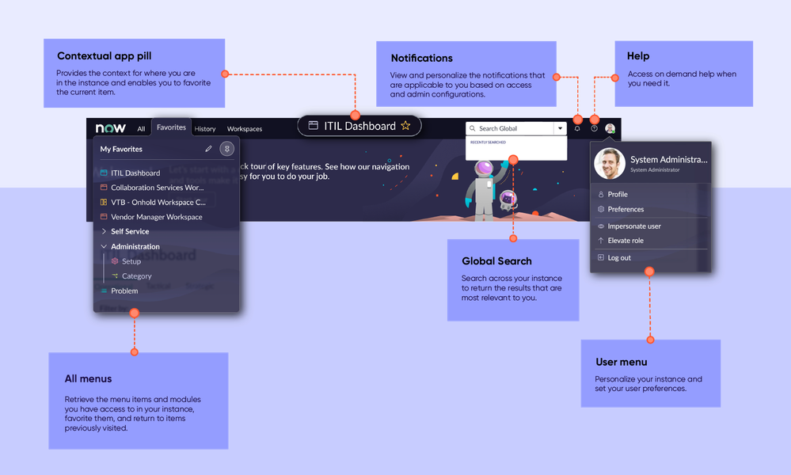
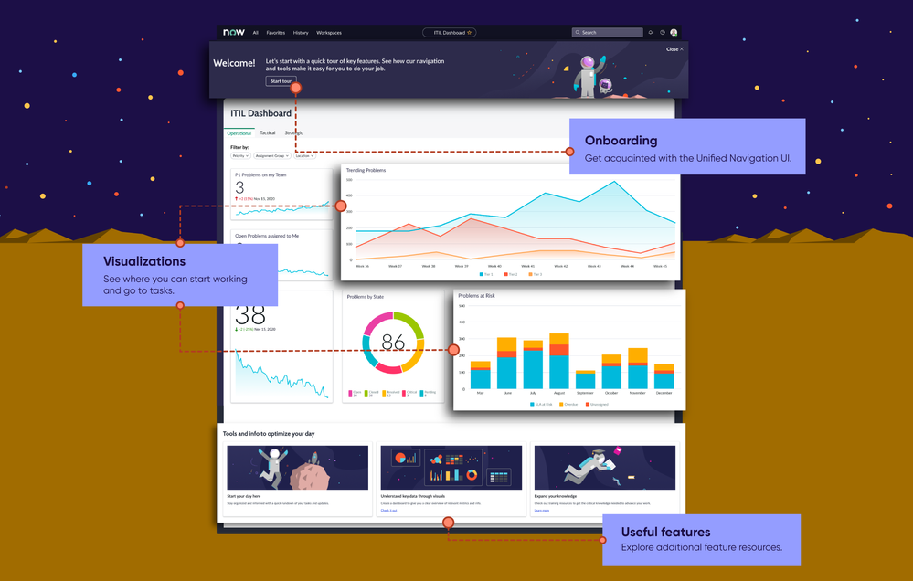
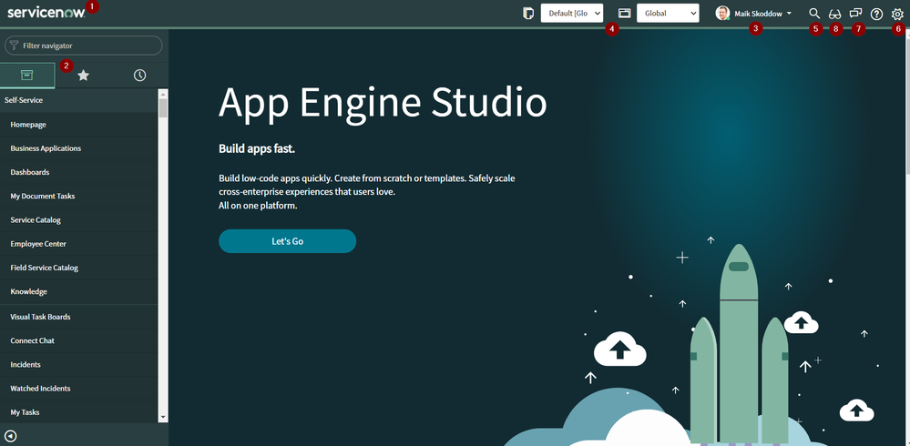
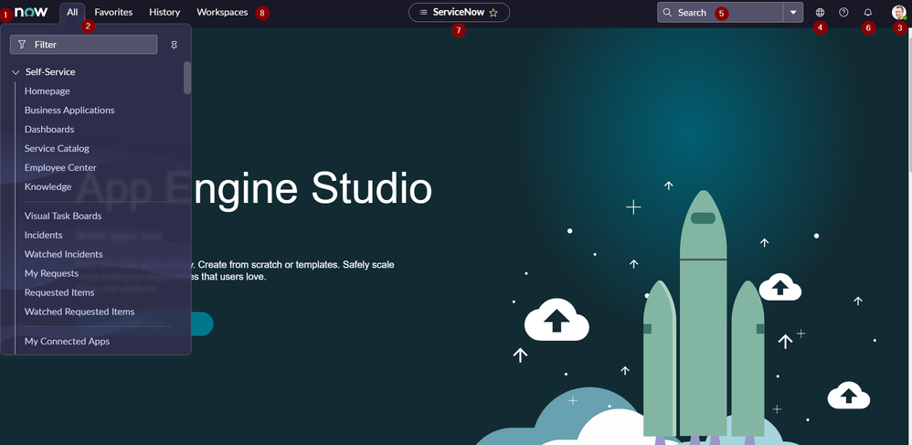
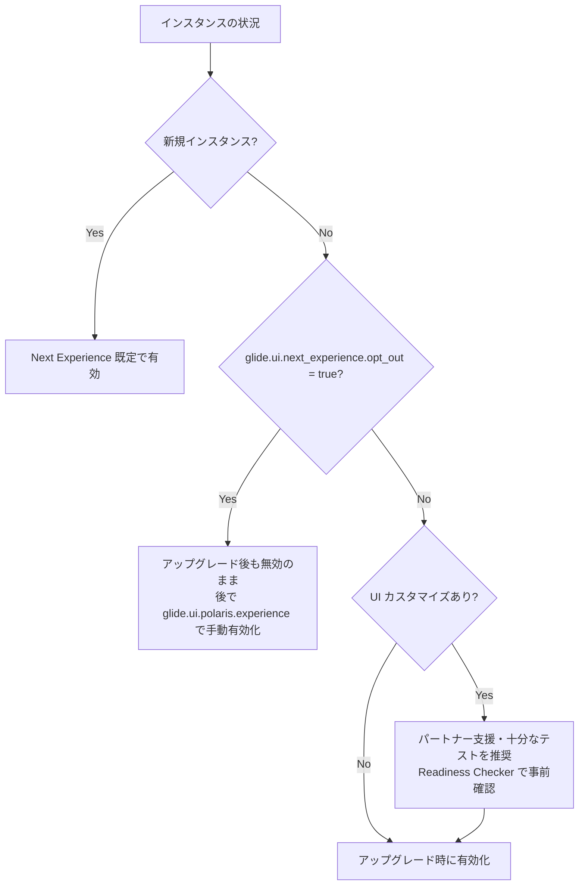

# Next Experience UI（ネクストエクスペリエンス UI）

## 概要

**Next Experience UI**（ネクストエクスペリエンス UI。開発コード名・旧称 **Polaris**）は、ServiceNow AI Platform（旧 Now Platform）のデスクトップ Web 向け標準ユーザーインターフェースである。Next Experience UI は、インスタンス内のアプリケーション間のナビゲーションを統合し、ユーザーが目的の画面に到達するまでのクリック数を減らすことを目的としている [出典](https://www.servicenow.com/docs/r/EJbK9aB62eTqc6muCLNt9A/N5p2A95EPBqJBIloBmUBSg)。

Next Experience UI の主な構成要素は次のとおりである [出典](https://www.servicenow.com/docs/r/EJbK9aB62eTqc6muCLNt9A/N5p2A95EPBqJBIloBmUBSg)。

| 構成要素 | 内容 |
|---|---|
| **Unified Navigation**（統合ナビゲーション） | 全画面の上部に表示されるヘッダー。コンテキスト App Pill、各種メニュー、通知、検索などのアプリケーションシェル要素を 1 か所に集約する |
| **Menus**（メニュー） | All / Favorites / History / Workspaces メニュー。クラシックアプリケーションと Configurable Workspace（構成可能ワークスペース）を行き来できる。管理者はカスタムメニューも作成できる |
| **Landing page**（ランディングページ） | ログイン時に表示される、ロールやタスクに応じたコンテンツ。管理者が開始ページを設定するか、ユーザー自身に選ばせることができる |
| **Dashboards**（ダッシュボード） | 旧 Homepage（ホームページ）に代わる Responsive dashboards / Analytics Overview dashboards |
| **Themes**（テーマ） | Coral / Polaris の基本テーマ、Theme Builder によるカスタムテーマ、ダークテーマ |
| **Sidebar**（サイドバー） | リアルタイムコラボレーション（チャット）機能。Connect Chat の後継 |

Next Experience UI の有効時、従来のリスト・フォーム画面は **classic environment**（クラシック環境）として Unified Navigation の内側に表示される。Next Experience を無効にした状態のクラシック環境は **Core UI**（旧称 **UI16**）と呼ばれる [出典](https://www.servicenow.com/docs/r/zurich/platform-user-interface/working-in-classic-lists-and-forms.html)。

本ファイルは Australia リリース（2026-05 GA）を基準とする。関連トピックは以下を参照。

- UI の初歩的な操作：[UIの基本](../../01_入門編/05-ui-basics.md)
- リスト・フォームの詳細仕様：[リストとフォーム](./lists-forms.md)
- Configurable Workspace・UI Builder：[Workspace と UI Builder](./workspaces-ui-builder.md)
- Now Assist / ServiceNow Otto：[Now Assist と AI Agents](./now-assist-ai-agents.md)
- モバイルの Next Experience：[モバイル](./mobile.md)

## 1. 名称と歴史

### 1.1 用語の整理

Next Experience UI に関しては複数の名称が混在しているため、以下に整理する。

| 用語 | 意味 |
|---|---|
| **Next Experience UI** | 現行の UI 全体の正式名称 |
| **Polaris** | Next Experience の開発コード名・旧称。システムプロパティ名（`glide.ui.polaris.*`）やクライアント変数名（`NOW.isUsingPolaris`）に名残がある。また**テーマ名**でもあり、Web の Next Experience では San Diego〜Yokohama、モバイルでは Utah〜Yokohama の既定テーマ |
| **Next Experience UI Framework**（旧 Now Experience UI Framework） | Next Experience を支える Web Components ベースのフロントエンドフレームワーク。UI Builder や Workspace もこの上に構築される |
| **Unified Navigation** | 画面上部の共通ヘッダー（旧称 global header） |
| **classic environment** | リスト・フォームで直接作業する従来型画面。Next Experience 有効時にも利用される |
| **Core UI**（旧 UI16） | Next Experience を無効にした状態のクラシック環境。Jelly ベースのページで構成される |
| **Coral** | Zurich 以降の新規インスタンスにおけるデフォルトテーマ |

[出典](https://www.servicenow.com/docs/r/zurich/platform-user-interface/working-in-classic-lists-and-forms.html) / [出典](https://www.servicenow.com/community/next-experience-articles/next-experience-ui-overview/ta-p/2332080)

### 1.2 リリースごとの主な変遷

Next Experience UI は San Diego リリースで導入され、その後のリリースで順次機能拡張された。

| リリース | 主な変更 |
|---|---|
| San Diego | Next Experience UI（Unified Navigation、Polaris テーマ、Default landing page）導入。新規顧客は既定で有効、既存顧客はアップグレードしても自動では有効化されなかった [出典](https://www.servicenow.com/community/next-experience-articles/next-experience-ui-overview/ta-p/2332080) |
| Utah | （モバイル）Polaris がモバイルの既定テーマに（モバイルでは Utah〜Yokohama が Polaris 既定。Web では San Diego から Polaris が既定） [出典](https://www.servicenow.com/docs/r/mobile/config-ne-theming.html) |
| Xanadu | 複数テーマの公開（multi-theme）、Preferences に「User experience」グループ（Turn off Next Experience / Enable analytics / Current start page）追加、通知メニューのピン留め、ページ性能メトリクス表示、クローン時に Next Experience / Theme Builder テーマを保持 [出典](https://www.servicenow.com/docs/r/Cz0Un5C85RB3j2nhhAK1aQ/7XmH8cwtqEte3Il5iPpjfg) |
| Yokohama | Unified Navigation メニューのファジー検索（精度スコア調整可）、キーボードショートカットのカスタマイズ、Preferences モーダルの刷新（検索バー付き）、Theme Builder が Next Experience のコアプラグインとして既定で有効 [出典](https://www.servicenow.com/docs/r/Cz0Un5C85RB3j2nhhAK1aQ/7XmH8cwtqEte3Il5iPpjfg) |
| Zurich | Coral が新規の Portal / Web / Mobile 体験のデフォルトテーマに。Web・Mobile のダークテーマオプション、Workspace の lazy loading ユーザー設定、Now Assist パネルのワイドモード、Usage Analytics ユーティリティメニュー（`analytics_viewer` ロール）、OpenFrame 通話バッジ。Unified Navigation Onboarding / Unified Navigation Onboarding With Feedback ツアー（とそのステップ）を削除 [出典](https://www.servicenow.com/docs/r/m4LmCVvkm6_8u3nlIuep5Q/vhUf~9psg0Cnu2nKIsNKxQ) |
| **Australia** | Coral テーマ刷新、In-Product Surveys、All Menu Editing、アクセシビリティ設定「Enable auto-focus on page alerts」、ユーザーメニューへの「Works with ServiceNow」バッジ、**UI11 / UI15 の非推奨化**。Unified Navigation Onboarding ツアー（とそのステップ）の削除が Australia 欄にも掲載 [出典](https://www.servicenow.com/docs/r/m4LmCVvkm6_8u3nlIuep5Q/vhUf~9psg0Cnu2nKIsNKxQ) |

> **Brazil での変更:** Zurich→Brazil の統合リリースノート（2026-10-08 更新）では、Brazil リリースにおける Next Experience の New / Changed / Deprecated / Removed / Activation の各項目はいずれも「No updates for this release」とされている [出典](https://www.servicenow.com/docs/r/delta-zurich-brazil/brazil-zurich-nextexperience-release-notes.html)。

## 2. Unified Navigation（統合ナビゲーション）

### 2.1 位置づけ

Unified Navigation は、すべてのページの上部に表示されるヘッダーで、Workspace とクラシック環境へのアクセス、インスタンス全体の検索、通知などを提供する。表示される項目はユーザーのアクセス権と管理者のカスタマイズにより異なる [出典](https://www.servicenow.com/docs/r/EJbK9aB62eTqc6muCLNt9A/FbF9igBfp51X~7gN0oPZBw)。

Unified Navigation は Core UI（UI16）アプリケーションと Configurable Workspace（UI Builder で作られた Workspace）を 1 つのヘッダーの下に統合する。ただし旧来の **classic Agent Workspace**（クラシック Agent Workspace）は Unified Navigation のアプリケーションシェル内には表示されない 【第三者情報（ServiceNow 社員によるコミュニティ記事、San Diego 時点）】 [出典](https://www.servicenow.com/community/next-experience-articles/next-experience-ui-overview/ta-p/2332080)。



**図 1：Unified Navigation の構成要素（San Diego 時点の Polaris テーマの画面）**
画面上部の暗色ヘッダーの左端に「now」ロゴ、その右に **All / Favorites / History / Workspaces** のメニュータブが並ぶ。図では Favorites メニューが開かれ、「My Favorites」の下にダッシュボード・Workspace・フォルダ（Self Service、Administration）・モジュールが一覧表示されている（右上に編集アイコンとピン留めアイコン）。ヘッダー中央には現在地を示す **Contextual app pill**（例：「ITIL Dashboard」と星アイコン）が表示される。右側には **Global Search**（「Search Global」入力欄と検索範囲ドロップダウン）、**Notifications**（ベルアイコン）、**Help**（?アイコン）、ユーザーアバターがあり、アバターを開くと **User menu**（Profile、Preferences、Impersonate user、Elevate role、Log out）が表示される。
出典：ServiceNow Community「Next Experience UI Overview」（Ashley Snyder, ServiceNow）https://www.servicenow.com/community/next-experience-articles/next-experience-ui-overview/ta-p/2332080 （取得日：2026-11-03）。Australia 時点ではテーマ（Coral）やアイコン構成が異なる。

### 2.2 構成要素一覧（Australia）

Australia の公式ドキュメント「Using the Next Experience Unified Navigation」に記載された構成要素は以下のとおりである [出典](https://www.servicenow.com/docs/r/EJbK9aB62eTqc6muCLNt9A/FbF9igBfp51X~7gN0oPZBw)。

| 構成要素 | 説明 |
|---|---|
| **Logo**（ロゴ） | Next Experience ランディングページに戻る。管理者は自社ロゴに置き換え可能 |
| **Filter**（フィルター） | モジュールへの素早い移動。文字の欠落を許容するファジー検索。`<テーブル名>.list` でリスト、`<テーブル名>.do` でフォームを直接開ける。既定では History 以外の全メニューから検索する |
| **All menu**（All メニュー） | ユーザーがアクセスできる全アプリケーションメニューとモジュールを表示。更新アイコンでキャッシュを消さずに最新項目を取得 |
| **Favorites menu**（お気に入りメニュー） | お気に入り登録した Workspace、クラシック環境のページ、レコードを表示。編集アイコンで管理用モーダルを開く |
| **History menu**（履歴メニュー） | インスタンス内の最近の操作履歴 |
| **Workspaces menu**（ワークスペースメニュー） | アクセス可能な Workspace の一覧。Workspace へのアクセス権がある場合のみ表示。1 つしかない場合はヘッダーにその Workspace 名が表示される |
| **Admin menu**（管理者メニュー） | 管理者向け項目 |
| **Contextual app pill**（コンテキスト App Pill） | 現在地を表示。星アイコンで現在ページをお気に入り登録 |
| **Global search**（グローバル検索） | インスタンス全体を文字列検索 |
| **Scope and update set**（Globe アイコン） | Application scope（アプリケーションスコープ）と Update set（アップデートセット）を選択。＋アイコンで新規アップデートセット作成。Global 以外のスコープ選択時は赤丸が表示される |
| **Show instance tools** | アプリケーションスコープと現在のアップデートセットを、ツールアイコンの下の行に常時表示する。有効化には `glide.ui.next_experience.instance_tools_disabled` を `false` にする必要があり、有効化すると Globe アイコンは非表示になる |
| **ServiceNow Otto**（旧 Now Assist パネル） | レコード・チャット・ケース・インシデントの要約、ヘルプ、解決メモ作成。標準／ワイド幅の切り替えが可能で、選んだ幅は保持される。設定は AI Admin Hub で行う |
| **Sidebar discussions**（サイドバーディスカッション） | Workspace のタスク型・インタラクション型レコード上でのリアルタイムコラボレーション |
| **Usage analytics**（利用状況分析） | アプリケーションや Web ページの利用状況データ |
| **Help**（ヘルプ） | Get help、What's new（新着は青丸表示）、Provide Feedback（現在ページへのフィードバック送信） |
| **OpenFrame phone** | 埋め込み型のコンテキスト通話の発着信。通話中は電話アイコンにバッジ |
| **Notifications menu**（通知メニュー） | Workspace を含むインスタンス全体の通知の表示と個人設定 |
| **User menu**（ユーザーメニュー） | Profile、Preferences、Keyboard shortcuts、Impersonate user、Elevate role、Printer friendly version（クラシック環境のみ） |

> **注記（ServiceNow Otto）:** Australia のドキュメントでは、Unified Navigation の AI パネルが「ServiceNow Otto」と表記されている。ServiceNow は Knowledge 2026 で Now Assist を含む AI 体験を ServiceNow Otto ブランドに統合すると発表しており、ドキュメント上の名称置き換えは段階的に進んでいる 【第三者情報】 [出典](https://www.servicenow.com/community/developer-advocate-blog/otto-vs-now-assist-what-actually-changed/ba-p/3594171)。一方、公式の Zurich→Australia 統合リリースノートでは、Changes 表の Zurich 欄と Australia 欄の両方に「ServiceNow Otto® announcement（ServiceNow Otto® is the conversational AI platform integrated into ServiceNow workflows）」が掲載されている [出典](https://www.servicenow.com/docs/r/m4LmCVvkm6_8u3nlIuep5Q/vhUf~9psg0Cnu2nKIsNKxQ)。Zurich のリリース時点で Otto の名称があったとは考えにくいため、Knowledge 2026 の発表後にリリースノートが遡って改訂された可能性が高い 【推定】。詳細は [Now Assist と AI Agents](./now-assist-ai-agents.md) を参照。

> **Domain picker（ドメインピッカー）について:** 上記の Australia ページには Domain picker の記載はない。ただし Next Experience キーボードショートカット一覧には「Open the instance toolbar to change domains（Control+Alt+t）」があり、ドメイン切り替えはインスタンスツールバーから行う [出典](https://www.servicenow.com/docs/r/EJbK9aB62eTqc6muCLNt9A/FfZNYroFMxGHyGktVkITZQ)。詳細は [ドメインセパレーション](./domain-separation.md) を参照。

### 2.3 All メニュー

All メニューは、ユーザーがアクセス可能なアプリケーションメニュー（Application menu、`sys_app_application`）とモジュール（Module、`sys_app_module`）を表示する。上部の Filter 欄に文字列を入力すると、メニュー項目をファジー検索で絞り込める [出典](https://www.servicenow.com/docs/r/EJbK9aB62eTqc6muCLNt9A/FbF9igBfp51X~7gN0oPZBw)。

Filter 欄の主な使い方は以下のとおりである。

| 入力例 | 動作 |
|---|---|
| `incident` | 名称が近いメニュー・モジュールを表示（文字の欠落を許容） |
| `incident.list` | `incident` テーブルのリストを新規に開く |
| `incident.do` | `incident` テーブルの新規フォームを開く |
| `sys_properties.list` | システムプロパティ一覧を開く（管理作業で頻用） |

フィルターの一致精度は `glide.ui.polaris.nav_filter_accuracy_score`（既定値 75、100 で完全一致のみ）で調整できる（Yokohama で導入） [出典](https://www.servicenow.com/docs/r/EJbK9aB62eTqc6muCLNt9A/9DTKB7jixSOEVtEdSYDa4Q)。

#### All Menu Editing（Australia で導入）

**Next Experience All Menu Editing** は、管理者が Next Experience の All メニュー内からアプリケーションメニューとモジュールを作成・編集できる機能である。画面は 2 ペイン構成で、片側にメニューツリー、もう片側に設定フォームまたはライブプレビューが表示され、変更は自動保存される [出典](https://www.servicenow.com/docs/r/EJbK9aB62eTqc6muCLNt9A/X62tP9vSHJDzqiWudJNjUg)。

| 区分 | モジュールタイプ |
|---|---|
| All Menu Editing 内で作成・編集可能 | Dashboard、List、New Record、Single Record |
| All メニューに追加できるが、編集は従来の UI16 ワークフローで行う | List of records、URL、Documentation link、New record、Run a report、Map page、Assessment、Timeline page、HTML、Search screen、List filter |

- メニューの作成は **All > ＋** から行い、admin ロールが必要である [出典](https://www.servicenow.com/docs/r/EJbK9aB62eTqc6muCLNt9A/fa0pZuUe3ROtm~PIlLwkwQ)。
- 管理者は system user preference（システムユーザー設定）で組織単位に本機能を無効化でき、その場合は従来の UI16 ワークフローでメニューを構成する。設定名は公開情報では確認できず [出典](https://www.servicenow.com/docs/r/EJbK9aB62eTqc6muCLNt9A/X62tP9vSHJDzqiWudJNjUg)。
- 本機能は ServiceNow Store でもアプリとして公開されている（自然言語プロンプトによるモジュール作成にも言及） [出典](https://store.servicenow.com/store/app/7bd5738647a3be50a342e65fe16d4306)。プラットフォーム同梱か Store 配布かの区別は公開情報では明確に確認できず。
- 対象はリスト・レコード・ランディングページ型モジュールで構成される小規模アプリであり、Workspace は対象外、クラシックモジュールのインコンテキスト編集は不可 【第三者情報（Community Platform Academy 記事）】 [出典](https://www.servicenow.com/community/servicenow-ai-platform-blog/platform-academy-next-experience-all-menu-editing/bc-p/3561070)。
- 同機能の公式ドキュメントでは「New record」が両方の区分に掲載されている。また Zurich→Australia の統合リリースノートでは、All Menu Editing で構成できるモジュールを「Record, List, Dashboard, and Custom page」と記載しており、上表（機能ページに基づく Dashboard / List / New Record / Single Record）と一致しない [出典](https://www.servicenow.com/docs/r/m4LmCVvkm6_8u3nlIuep5Q/vhUf~9psg0Cnu2nKIsNKxQ)。対象モジュールタイプは実機での確認を推奨する。

### 2.4 Favorites メニュー（お気に入り）

Favorites メニューは、お気に入り登録した Workspace、クラシック環境のページ、レコードを表示する [出典](https://www.servicenow.com/docs/r/EJbK9aB62eTqc6muCLNt9A/FbF9igBfp51X~7gN0oPZBw)。

- お気に入りの登録方法：Contextual app pill の星アイコン、All メニュー内の星アイコン、またはキーボードショートカット Control+Shift+f（Mac は Command+Shift+f）。
- ユーザーはお気に入りを**フォルダ**に整理できる [出典](https://www.servicenow.com/docs/r/EJbK9aB62eTqc6muCLNt9A/N5p2A95EPBqJBIloBmUBSg)。
- メニュー右上の編集アイコンから管理用モーダルを開き、お気に入りを管理する。
- お気に入りを保持するテーブル名は公開情報では確認できず。

### 2.5 History メニュー（履歴）

History メニューは、インスタンス全体の最近の操作履歴（閲覧したリスト・フォーム・Workspace ページ）を表示する [出典](https://www.servicenow.com/docs/r/EJbK9aB62eTqc6muCLNt9A/FbF9igBfp51X~7gN0oPZBw)。

- Yokohama 以降、Workspace のリストフィルター変更はそれぞれ別エントリとして記録される [出典](https://www.servicenow.com/docs/r/Cz0Un5C85RB3j2nhhAK1aQ/7XmH8cwtqEte3Il5iPpjfg)。
- 重複 URL の除外時に無視する URL パラメータは `glide.ui.polaris.history.url.param_blocklist`（既定値 `["tinyId"]`）で指定する [出典](https://www.servicenow.com/docs/r/EJbK9aB62eTqc6muCLNt9A/9DTKB7jixSOEVtEdSYDa4Q)。
- Filter による検索は、既定では History メニューを対象外とする。

### 2.6 Workspaces メニュー

Workspaces メニューは、ユーザーがアクセス可能な Configurable Workspace を一覧表示する。Workspace へのアクセス権を持つユーザーにのみ表示され、アクセス可能な Workspace が 1 つだけの場合はメニューの代わりに Workspace 名がヘッダーに表示される [出典](https://www.servicenow.com/docs/r/EJbK9aB62eTqc6muCLNt9A/FbF9igBfp51X~7gN0oPZBw)。

- Workspace を Workspaces メニューに表示するには、Experience Category（エクスペリエンスカテゴリ）レコードによる登録が必要である 【第三者情報（ServiceNow 社員によるコミュニティ記事）】 [出典](https://www.servicenow.com/community/next-experience-articles/next-experience-ui-overview/ta-p/2332080)。公式手順は「Add a workspace to the Workspaces menu」を参照 [出典](https://www.servicenow.com/docs/r/EJbK9aB62eTqc6muCLNt9A/IRKKARGDgaVUA_mtMg6gOQ)。
- 表示順は各 Workspace レコードの数値 Order（順序）で制御する（「Set workspace order」） [出典](https://www.servicenow.com/docs/r/EJbK9aB62eTqc6muCLNt9A/IRKKARGDgaVUA_mtMg6gOQ)。
- Workspace 自体の構成は [Workspace と UI Builder](./workspaces-ui-builder.md) を参照。

### 2.7 メニューのピン留め

All / Favorites / History などのメニューは、通常はページ上に重なるオーバーレイ表示だが、ピンアイコンでページ左側に固定（ピン留め）できる [出典](https://www.servicenow.com/docs/r/EJbK9aB62eTqc6muCLNt9A/FbF9igBfp51X~7gN0oPZBw)。同時にピン留めできるメニューは 1 つのみである 【第三者情報】 [出典](https://www.servicenow.com/community/now-platform-articles/interface-comparison-between-ui16-the-next-experience/ta-p/2307243)。

ピン留めされたメニューはユーザー設定 `glide.ui.menu.main.pinned.id` に保存され、管理者が事前にこの設定を作成しておくと全ユーザーの既定のピン留めメニューを決められる 【第三者情報（ServiceNow 社員によるコミュニティ記事）】 [出典](https://www.servicenow.com/community/next-experience-articles/next-experience-ui-overview/ta-p/2332080)。Xanadu 以降は通知メニューもピン留め可能 [出典](https://www.servicenow.com/docs/r/Cz0Un5C85RB3j2nhhAK1aQ/7XmH8cwtqEte3Il5iPpjfg)。

### 2.8 カスタムメニュー（Unified Navigation Menus）

管理者は、特定ユーザー向けに必要な項目だけを含む独自メニューを Unified Navigation に追加できる。必要ロールは admin [出典](https://www.servicenow.com/docs/r/EJbK9aB62eTqc6muCLNt9A/mDo8Q3jZ_~522NFO2kiYGg)。

**手順（Australia）**

1. **All > Unified Navigation Menus** を開き、**New** を選択する。
2. Unified Navigation Menu フォームを入力して **Submit** する。
3. 作成したメニューを開き、関連リストで **New** を選択して Menu item（メニュー項目）を追加する。
4. **Save / Update** する。新しいメニューが表示されない場合は Menu Active を確認し、インスタンスを再読み込みする。

**Unified Navigation Menu フォームの項目**

| フィールド | 説明 |
|---|---|
| Name | メニュー名 |
| Menu Active | チェックでメニューを有効化 |
| Order | 他メニューとの相対位置 |
| Application | メニューのスコープ（既定は Global） |
| Hidden Roles | メニューを表示しないロール |
| Visible Roles | メニューを表示するロール |

**Unified Navigation menu item フォームの項目**

| フィールド | 説明 |
|---|---|
| Menu | 追加先のメニュー |
| Type | Application または Module |
| Application / Module | 追加するアプリケーションメニューまたはモジュール（Type により切り替わる） |
| Application (scope) | 項目のスコープ（既定は Global） |
| Order | メニュー内の表示順 |

公式ドキュメントにはテーブル名の記載がない。コミュニティでは Unified Navigation Menu のテーブル名として `sys_polaris_menu_config` が挙げられており、標準メニュー（Workspaces メニュー等）のレコードを直接編集すると警告が表示されると報告されている 【第三者情報（フォーラム投稿）】 [出典](https://www.servicenow.com/community/upgrades-and-patching-forum/what-are-the-risks-of-updating-the-unified-navigation-menu-sys/td-p/3461975/page/2)。標準メニューを全体で非表示にする場合は、`glide.ui.polaris.menus` を `false` にするよりも、Hidden Roles / Visible Roles でロール単位に制御することが公式に推奨されている [出典](https://www.servicenow.com/docs/r/EJbK9aB62eTqc6muCLNt9A/9DTKB7jixSOEVtEdSYDa4Q)。

### 2.9 グローバル検索（Global search）

グローバル検索は Unified Navigation 右側の検索欄から、インスタンス全体を横断検索し、ユーザーとの関連度で結果を並べる [出典](https://www.servicenow.com/docs/r/EJbK9aB62eTqc6muCLNt9A/uisvpmI1QesG_Vn6gVgl8A)。

- 表示・非表示は `glide.ui.polaris.global_search`（既定 `true`）で制御する [出典](https://www.servicenow.com/docs/r/EJbK9aB62eTqc6muCLNt9A/9DTKB7jixSOEVtEdSYDa4Q)。
- 検索対象テーブルの追加、結果フィールドの変更、検索コンテキストメニューへの Workspace アプリの追加は「Configuring search」で行う [出典](https://www.servicenow.com/docs/r/EJbK9aB62eTqc6muCLNt9A/IRKKARGDgaVUA_mtMg6gOQ)。
- 検索エンジン（AI Search）の詳細は [Predictive Intelligence と AI Search](./predictive-intelligence-ai-search.md) を参照。

### 2.10 スコープ／アップデートセットピッカー

Unified Navigation の Globe アイコン（地球儀）から Application scope と Update set を選択する。Global 以外のスコープを選択中は赤丸のインジケーターが表示され、誤ったスコープでの開発を防ぐ [出典](https://www.servicenow.com/docs/r/EJbK9aB62eTqc6muCLNt9A/FbF9igBfp51X~7gN0oPZBw)。

UI16 ではピッカーをヘッダーに常時表示できたが、Next Experience では既定で Globe アイコンの中に格納されている。常時表示したい場合は、システムプロパティ `glide.ui.next_experience.instance_tools_disabled` を作成して `false` に設定し、「Show instance tools」を有効化する（有効化すると Globe アイコンは非表示） [出典](https://www.servicenow.com/docs/r/EJbK9aB62eTqc6muCLNt9A/FbF9igBfp51X~7gN0oPZBw)。アップデートセットの運用は [アップデートセットとクローン](./update-sets-cloning.md) を参照。

### 2.11 ユーザーメニュー

ユーザーメニュー（右上のアバター）には以下の項目がある [出典](https://www.servicenow.com/docs/r/EJbK9aB62eTqc6muCLNt9A/FbF9igBfp51X~7gN0oPZBw)。

| 項目 | 説明 |
|---|---|
| Profile | インスタンス上の自分のプロフィール |
| Preferences | Display、Accessibility、Notifications、Workspace 等の個人設定（3 章参照） |
| Keyboard shortcuts | 現在の画面で使えるショートカット一覧のモーダル（Control+/ / Command+/） |
| Impersonate user | 管理者が他ユーザーになりすましてテスト。なりすましログも参照可能 |
| Elevate role | `security_admin` 等の elevated role（昇格ロール）をセッション中に有効化 |
| Printer friendly version | 印刷用表示（クラシック環境のみ。Workspace では不可） |

なりすまし中は、画面上部の赤いバー、アバターの赤いリング、アバター上の目アイコン、「Impersonating User」表示で状態が明示される（UI16 では「End Impersonation」メニュー項目のみ） 【第三者情報】 [出典](https://www.servicenow.com/community/now-platform-articles/interface-comparison-between-ui16-the-next-experience/ta-p/2307243)。

Australia では、カスタムブランディングを行っているアカウントのユーザーメニューに「Works with ServiceNow」バッジが自動的に表示される（Web とモバイル。他のブランディングには影響しない） [出典](https://www.servicenow.com/docs/r/m4LmCVvkm6_8u3nlIuep5Q/vhUf~9psg0Cnu2nKIsNKxQ)。

### 2.12 キーボードショートカット

Next Experience のキーボードショートカットは、アクセシビリティ設定でキーボードショートカットが有効化されている必要がある。Yokohama 以降、管理者とユーザーはショートカットをカスタマイズできる。Linux は非対応 [出典](https://www.servicenow.com/docs/r/EJbK9aB62eTqc6muCLNt9A/FfZNYroFMxGHyGktVkITZQ)。

**主要ショートカット（Australia、Windows 表記。Mac は Control→Command、Alt→Option）**

| 区分 | 操作 | Windows |
|---|---|---|
| Common | 画面のショートカット一覧を表示 | Control+/ |
| Common | 新規レコード作成 | Shift+Alt+n |
| Common | ページのお気に入り登録／解除 | Control+Shift+f |
| Common | ユーザーのなりすまし | Control+Shift+i |
| Common | インスタンスのランディングページを開く | Control+Alt+z |
| Common | インスタンスツールバー（ドメイン切り替え） | Control+Alt+t |
| Common | リスト更新 | Shift+Alt+r |
| Common | レコード保存 | Control+s |
| Menus | All メニュー | Control+Alt+a |
| Menus | Admin メニュー | Control+Shift+a |
| Menus | Favorites メニュー | Control+Alt+f |
| Menus | History メニュー | Control+Alt+h |
| Menus | Workspaces メニュー | Control+Alt+w |
| Menus | Help メニュー | Control+Shift+/ |
| Menus | Notifications メニュー | Control+Shift+k |
| Menus | ServiceNow Otto（テキスト入力） | Alt+Shift+a |
| Menus | ServiceNow Otto（音声入力） | Alt+Shift+v |
| Menus | ユーザープロフィールメニュー | Control+Shift+u |
| Focus | グローバル検索 | Control+Alt+g |
| Focus | ページのメインコンテンツ | Control+Alt+p |
| Focus | パンくずナビゲーション | Control+Shift+c |
| Focus | サイドナビゲーション | Control+Alt+1 |
| Focus | Workspace タブ／ページタブ／レコードタブ | Control+Alt+2 / 3 / 4 |
| Focus | Contextual sidebar（コンテキストサイドバー） | Shift+Alt+x |
| Focus | フォームの最初のフィールド | Shift+Alt+f |
| Focus | 主要ページ要素を順方向／逆方向に移動 | Control+j / Control+Shift+j |
| Additional | Sidebar discussions チャットを開く | Shift+Alt+d |
| Additional | リスト検索／リストフィルター | Shift+Alt+s / Shift+Alt+b |
| Additional | OpenFrame ウィンドウを開く | Shift+Alt+z |
| Additional | リサイズ可能ペインの展開／折りたたみ | Shift+Alt+p |

[出典](https://www.servicenow.com/docs/r/EJbK9aB62eTqc6muCLNt9A/FfZNYroFMxGHyGktVkITZQ)

ショートカットのモーダルは Yokohama で 2 列化され、Page Action / Page Navigation / Global Navigation / General のグループと検索欄を持つ [出典](https://www.servicenow.com/docs/r/Cz0Un5C85RB3j2nhhAK1aQ/7XmH8cwtqEte3Il5iPpjfg)。

## 3. Preferences（ユーザー設定）

### 3.1 設定カテゴリ

Next Experience の Preferences モーダル（ユーザーメニュー > Preferences）は、検索欄・カテゴリパネル・設定パネルで構成され、検索はファジーマッチングに対応する。管理者はインスタンス全体に適用されるグローバル設定も定義できる [出典](https://www.servicenow.com/docs/r/EJbK9aB62eTqc6muCLNt9A/VsP_aQEuvsNDOuiWRcR89g)。

| カテゴリ | 内容 |
|---|---|
| **Display**（表示） | レイアウト、表示密度、表示方法。変更は本人の表示のみに影響 |
| **Accessibility**（アクセシビリティ） | キーボードナビゲーション、コントラスト、モーション |
| **Debugging**（デバッグ） | Next Experience コンポーネントやスクリプトのエラー調査。admin ロールのみ表示 |
| **Theme**（テーマ） | テーマとそのバリアント（代替カラーパレット）の選択。選択肢はアクセス権と管理者のカスタマイズによる |
| **Notifications**（通知） | バナー、バッジ、メールなどシステム通知・製品内通知の受け取り方 |
| **Language & Region**（言語と地域） | 言語、タイムゾーン、日付・時刻形式 |
| **Workspace** | 特定 Workspace のレイアウトと操作。Workspace アクセス権があり当該 Workspace を表示中の場合のみ表示 |
| **User Experience**（ユーザーエクスペリエンス） | Next Experience の有効／無効（Turn off Next Experience）、分析データ収集（Enable analytics）、開始ページ（Current start page）の選択 |

[出典](https://www.servicenow.com/docs/r/EJbK9aB62eTqc6muCLNt9A/VsP_aQEuvsNDOuiWRcR89g)

### 3.2 主なアクセシビリティ設定（リリース別の追加）

| リリース | 追加・変更された設定 |
|---|---|
| Yokohama | 「Enable keyboard focus on truncated text」を「Enable keyboard focus on text that displays a tooltip」に改称、矢印キーで行を展開／折りたたみ、Activity stream の全件自動展開設定 |
| Zurich | 「Do not auto-dismiss page alerts」（ページアラートを閉じるまで表示）、Workspace の lazy loading 無効化（スクリーンリーダー互換性向上）、ダークテーマ |
| Australia | 「Enable auto-focus on page alerts」（ページアラート表示時にフォーカスを移動）、アクセシビリティ設定・ナビゲーション・キーボード操作・テーマを紹介するガイドツアー |

[出典](https://www.servicenow.com/docs/r/Cz0Un5C85RB3j2nhhAK1aQ/7XmH8cwtqEte3Il5iPpjfg) / [出典](https://www.servicenow.com/docs/r/m4LmCVvkm6_8u3nlIuep5Q/vhUf~9psg0Cnu2nKIsNKxQ)

### 3.3 開始ページ（Start page）とランディングページ

Next Experience の開始ページには次の 3 種類がある [出典](https://www.servicenow.com/docs/r/ja-JP/platform-user-interface/ne-start-options-user.html)。

| 種類 | 説明 |
|---|---|
| Next Experience default landing page | 直近のタスクに関する可視化を表示する既定のランディングページ |
| Configurable workspace home | Configurable Workspace 内の任意のページ |
| User-selected landing page | ユーザーが設定で選ぶ任意のプラットフォームページ |

管理者は、個々のユーザーが上書きできない開始ページを設定することもできる [出典](https://www.servicenow.com/docs/r/ja-JP/platform-user-interface/ne-start-options-user.html)。

**ユーザー選択の開始ページ**：管理者が `glide.next_experience.user_selected_landing_page_enabled` が `true` であることを確認すると、ユーザーは Preferences > User Experience の **Current start page** から、Default landing page / Dashboards / 現在のページ / 前回の中断箇所から再開、を選択できる。ユーザー選択の開始ページは、管理者が設定した既定のランディングページより優先される [出典](https://www.servicenow.com/docs/r/EJbK9aB62eTqc6muCLNt9A/6dqE~NEoiVuQLW3PhQ0CUg)。

**`glide.login.home`**：ログイン後の遷移先パス。San Diego 時点の解説では、新規顧客は `now/nav/ui/home`（Default landing page）、既存顧客は従来の設定を維持するとされる 【第三者情報（ServiceNow 社員によるコミュニティ記事）】 [出典](https://www.servicenow.com/community/next-experience-articles/next-experience-ui-overview/ta-p/2332080)。Service Operations Workspace のランディングページへのリダイレクトでは、Homepage Destination Rule（ホームページ遷移先ルール）が `glide.login.home` を上書きする [出典](https://www.servicenow.com/docs/r/QykF2iRSIs6VXztArCSo3w/kVEIwt6LQo5zw2GyfhzsIA)。



**図 2：Next Experience Default landing page の構成（San Diego 時点）**
上部に Unified Navigation、その下に「Welcome!」の **Onboarding**（オンボーディング）バナー（Start tour ボタン、Close ボタン付き）がある。中央は「ITIL Dashboard」の **Visualizations**（可視化）領域で、Operational / Tactical / Strategic タブ、Priority・Assignment Group・Location のフィルター、「P1 Problems on my Team」「Open Problems assigned to Me」等の件数タイル、Trending Problems の折れ線グラフ、Problems by State のドーナツグラフ、Problems at Risk の棒グラフが並ぶ。最下部は「Tools and info to optimize your day」の **Useful features**（便利な機能）領域で、ダッシュボードやナレッジへのリンクカードが 3 枚表示される。
出典：ServiceNow Community「Next Experience UI Overview」https://www.servicenow.com/community/next-experience-articles/next-experience-ui-overview/ta-p/2332080 （取得日：2026-11-03）。

> **注記（Australia）:** Zurich→Australia の統合リリースノートでは、Zurich と Australia の両方の Deprecations に「The Unified Navigation Onboarding and Unified Navigation Onboarding With Feedback tours, and their steps, are removed」と記載されている。図 2 のオンボーディング領域（Start tour ボタン）は San Diego 時点の表示であり、Australia では Unified Navigation のオンボーディングツアーは削除済みである。下記のオンボーディング関連設定（`overview_help.visited.navui` 等）の Australia での実際の効果は実機で確認すること [出典](https://www.servicenow.com/docs/r/m4LmCVvkm6_8u3nlIuep5Q/vhUf~9psg0Cnu2nKIsNKxQ)。

Default landing page は直接変更できないが、UI Builder でカスタムランディングページを作るときのテンプレートとして利用できる 【第三者情報】 [出典](https://www.servicenow.com/community/next-experience-articles/next-experience-ui-overview/ta-p/2332080)。オンボーディング領域の表示はユーザー設定 `glide.ui.polaris.landing_page_header_collapsed`、初回ログイン時のオンボーディングポップアップは `overview_help.visited.navui` で制御される 【第三者情報】（`overview_help.visited.navui` は公式のシステムプロパティ一覧にも記載あり） [出典](https://www.servicenow.com/docs/r/EJbK9aB62eTqc6muCLNt9A/9DTKB7jixSOEVtEdSYDa4Q)。

## 4. テーマ（Themes）

### 4.1 テーマの基本

Next Experience のテーマは、ブランドに合わせて UI の外観をカスタマイズする仕組みである。テーマはクラシック環境（リスト、フォーム、ダッシュボード）にも適用されるが、カスタムコンポーネントにはテーマが反映されない [出典](https://www.servicenow.com/docs/r/australia/platform-user-interface/next-experience-theming.html)。

| 項目 | 内容 |
|---|---|
| テーマ定義テーブル | `sys_ux_theme`（UX Themes）。テーマは `sys_ux_style`（UX Style）レコードを参照し、色・形状・タイポグラフィ等を保持する [出典](https://www.servicenow.com/docs/r/mobile/config-ne-theming.html) |
| 基本テーマ | **Coral**（既定）と **Polaris**。いずれも固定・読み取り専用で、直接編集やコピーは不可（公式テーマページの記述） [出典](https://www.servicenow.com/docs/r/australia/platform-user-interface/next-experience-theming.html) |
| Core style（コアスタイル） | 色、形状とフォーム、タイポグラフィ、イメージ。既定で有効 |
| Variant style（バリアントスタイル） | 主に色覚多様性などアクセシビリティ目的の代替版。ユーザーが Preferences で選択すると Core style を上書き |
| スタイルの優先順位 | Order（順序）の大きいスタイルが、Applicability（適用条件）を満たす場合に小さいものを上書き。基本システムスタイルは Order 0 |
| その他テーマ化対象 | 空状態画像、ログインページのイラスト・背景色・グラデーション |

[出典](https://www.servicenow.com/docs/r/australia/platform-user-interface/next-experience-theming.html)

> **注記：** モバイル向けドキュメントでは「基本レコードは変更できないがコピーは作成できる」とされており、Web 向けテーマページの「コピー不可」と記述が異なる。Web ではカスタムテーマは Theme Builder テーマレコードをコピーし、UX Theme Styles のスタイルをコピーして修正する方法が案内されている（少なくとも 1 つの Core style が必須） [出典](https://www.servicenow.com/docs/r/australia/platform-user-interface/next-experience-theming.html) / [出典](https://www.servicenow.com/docs/r/mobile/config-ne-theming.html)。

### 4.2 Coral と Polaris

| 項目 | Polaris | Coral |
|---|---|---|
| デフォルトだったリリース | Web：San Diego〜Yokohama（Next Experience 有効時）／モバイル：Utah〜Yokohama | Zurich 以降（新規インスタンス） |
| アップグレード時の扱い | 既存顧客がアップグレードしても Polaris のまま維持される | 既存顧客が Coral に移行するには Theme Builder で公開するか、UX Parent App Theme テーブルに追加する |
| Australia での変更 | — | 色体系の刷新、柔らかいアウトラインと角丸コンポーネント、ダークモードの改善、AI グラデーションスタイル、控えめなアニメーション、マウス操作時のフォーカス挙動改善 |

[出典](https://www.servicenow.com/docs/r/mobile/config-ne-theming.html) / [出典](https://www.servicenow.com/docs/r/m4LmCVvkm6_8u3nlIuep5Q/vhUf~9psg0Cnu2nKIsNKxQ)

### 4.3 Theme Builder

**Theme Builder** は、管理者がテーマを作成・編集・プレビュー・公開するツールである。Yokohama 以降は Next Experience のコアプラグインとして同梱され、既定で有効である（Xanadu 以前は ServiceNow Store からのインストール） [出典](https://www.servicenow.com/docs/r/australia/platform-user-interface/next-experience-theming.html) / [出典](https://www.servicenow.com/docs/r/Cz0Un5C85RB3j2nhhAK1aQ/7XmH8cwtqEte3Il5iPpjfg)。

- メニュー位置：Australia 版のテーマ作成手順では **All > Now Experience Framework > Theme Builder** [出典](https://www.servicenow.com/docs/r/australia/platform-user-interface/tb-create-theme.html)。Washington DC 版では **All > Now Experience Framework > Themes > Theme Builder** と記載されていた [出典](https://docs.servicenow.com/bundle/washingtondc-platform-user-interface/page/administer/navigation-and-ui/task/tb-create-theme.html)。
- 必要ロール：Australia 版のテーマ作成手順・テーマ編集手順とも `ui_builder_admin`（Washington DC 版のテーマ作成手順では admin と記載されていた） [出典](https://www.servicenow.com/docs/r/australia/platform-user-interface/tb-create-theme.html) / [出典](https://www.servicenow.com/docs/r/platform-user-interface/tb-edit-theme.html)。
- 公開先：作成したテーマはインスタンスの Web または Mobile の実装に公開する。Theme Builder で公開したテーマは UX Parent App Theme テーブルに自動追加される [出典](https://www.servicenow.com/docs/r/EJbK9aB62eTqc6muCLNt9A/SMNFe5ibvd0WlSYjmh~yqw)。
- Xanadu 以降、クローン時に Next Experience / Theme Builder のテーマは上書きされず保持される [出典](https://www.servicenow.com/docs/r/Cz0Un5C85RB3j2nhhAK1aQ/7XmH8cwtqEte3Il5iPpjfg)。

### 4.4 複数テーマの公開（UX Parent App Theme）

Xanadu 以降、管理者は複数のテーマを公開し、ユーザーが Preferences の Theme から選択できるようにできる（Web インスタンスのみ） [出典](https://www.servicenow.com/docs/r/EJbK9aB62eTqc6muCLNt9A/SMNFe5ibvd0WlSYjmh~yqw)。

**手順**：フィルターナビゲーターで `m2m_app_theme.list`（**UX Parent App Theme** テーブル）を開き、New でレコードを作成する。

| フィールド | 説明 |
|---|---|
| Applicability | 適用対象。空欄の場合は全ユーザーに適用 |
| Theme | 公開するテーマ（`sys_ux_theme`） |
| Order | 表示順。最小値のテーマが既定となり、Theme 設定の先頭に表示される。ユーザーが未選択の場合は最小 Order のテーマが使われる |
| UX App | 親アプリケーション（Unified Navigation のアプリ） |

[出典](https://www.servicenow.com/docs/r/EJbK9aB62eTqc6muCLNt9A/SMNFe5ibvd0WlSYjmh~yqw)

UX Parent App Theme テーブルにレコードがなく、かつ `glide.ui.polaris.theme.custom` も空の場合は、Unified Navigation の基本テーマが表示される [出典](https://www.servicenow.com/docs/r/EJbK9aB62eTqc6muCLNt9A/SMNFe5ibvd0WlSYjmh~yqw)。

### 4.5 単一テーマの強制（`glide.ui.polaris.theme.custom`）

インスタンス全体に 1 つのテーマを強制する場合は、システムプロパティ `glide.ui.polaris.theme.custom` を使う。このプロパティは **UX Parent App Themes テーブルが空の場合にのみ**使われる。必要ロールは admin [出典](https://www.servicenow.com/docs/r/EJbK9aB62eTqc6muCLNt9A/PjDyAAZehAEfi~T19w_1zg)。

1. `sys_ux_theme.list` を開き、対象テーマを選んで sys_id をコピーする。
2. `sys_properties.list` で新規プロパティを作成する。
3. Name に `glide.ui.polaris.theme.custom`、Type に string、Value にコピーした sys_id を入力する。
4. 特定のアプリケーションスコープにのみ適用する場合は Suffix フィールドを入力する（その場合は必須）。
5. Submit し、ブラウザーを再読み込みする。

Polaris に戻す場合は、Polaris テーマの sys_id で同じ手順を行う [出典](https://www.servicenow.com/docs/r/EJbK9aB62eTqc6muCLNt9A/PjDyAAZehAEfi~T19w_1zg)。複数テーマの公開（UX Parent App Theme）は Xanadu で導入されたため、Xanadu より前はこのプロパティがカスタムテーマを全体に適用する主な方法であったと考えられる 【推定】 [出典](https://www.servicenow.com/docs/r/Cz0Un5C85RB3j2nhhAK1aQ/7XmH8cwtqEte3Il5iPpjfg)。

### 4.6 ダークテーマ

Polaris と Coral には **Dark Theme**（ダークテーマ）バリアントがあり、Configurable Workspace、リスト、フォーム、ダッシュボード、レポートに対応する。Theme Builder はダークバリアントを自動生成しないが、カスタマイズ範囲が限定された代替ダークカラーパレットを作成できる [出典](https://www.servicenow.com/docs/r/australia/platform-user-interface/next-experience-theming.html)。

| プロパティ | 既定値 | 説明 |
|---|---|---|
| `glide.ui.polaris.dark_themes_enabled` | `true` | ダークテーマを有効化。`false` にすると全 Next Experience でダークテーマを無効化 [出典](https://www.servicenow.com/docs/r/EJbK9aB62eTqc6muCLNt9A/Bv8aEfPBfbGqpfzfed8b5Q) |
| `glide.ui.polaris.core_ui_exclude_dark_mode` | `true` | クラシック環境をダークテーマの対象外にする |

[出典](https://www.servicenow.com/docs/r/EJbK9aB62eTqc6muCLNt9A/9DTKB7jixSOEVtEdSYDa4Q)

San Diego 時点の解説では `glide.ui.polaris.dark_themes_enabled` の既定値は `false` とされており、現行ドキュメント（既定 `true`）と異なる。既存インスタンスでは実際の値を確認すること 【第三者情報】 [出典](https://www.servicenow.com/community/next-experience-articles/next-experience-ui-overview/ta-p/2332080)。

### 4.7 ログインページのカスタマイズ

Next Experience の既定ログインページは、以下のシステムプロパティで外観を変更できる [出典](https://www.servicenow.com/docs/r/EJbK9aB62eTqc6muCLNt9A/9DTKB7jixSOEVtEdSYDa4Q)。

| プロパティ | 型 | 説明 |
|---|---|---|
| `glide.ui.polaris.login.show_illustrations` | string（既定 `true`） | ログインページのイラスト表示 |
| `glide.ui.polaris.login.style.background` | RGB colors | 背景色 |
| `glide.ui.polaris.login.style.background_gradient_begin` | RGB colors | 背景グラデーションの開始色 |
| `glide.ui.polaris.login.style.background_gradient_end` | RGB colors | 背景グラデーションの終了色 |
| `glide.ui.polaris.login.style.mountain_primary` | RGB colors | 山のイラストの主色 |
| `glide.ui.polaris.login.style.mountain_secondary` | RGB colors | 山のイラストの副色 |

UI16 のログインページ下部に表示されていた `sys_home_list` のテキストブロックは、Next Experience では既定で表示されない 【第三者情報】 [出典](https://www.servicenow.com/community/now-platform-articles/interface-comparison-between-ui16-the-next-experience/ta-p/2307243)。

### 4.8 Core UI（UI16）テーマとの関係

Core UI（UI16）のロゴ・色は **System Properties > Basic Configuration UI16** で `css.$navpage-header-bg` などの CSS プロパティとして設定していた。これらの設定は Next Experience を有効にしていないインスタンスにのみ適用される [出典](https://www.servicenow.com/docs/r/platform-user-interface/t_ConfigureLogoColorsSysDfltsUI16.html)。Core UI テーマから Next Experience テーマへの移行手段は提供されておらず、Theme Builder 等で作り直す必要がある 【第三者情報】 [出典](https://www.servicenow.com/community/next-experience-articles/next-experience-ui-theming-overview/tac-p/2511610)。

## 5. Contextual side panel と Sidebar

Next Experience には「サイドパネル／サイドバー」と呼ばれる機能が複数あるため、区別して理解する必要がある。

| 名称 | 所在 | 用途 |
|---|---|---|
| **Contextual side panel**（コンテキストサイドパネル） | Configurable Workspace のレコードページ右側 | レコードに関連する情報・機能（タブ形式）を表示 |
| **Sidebar / Sidebar discussions**（サイドバー） | Unified Navigation のユーティリティ | リアルタイムチャットによるコラボレーション。Connect Chat の後継 |
| **ServiceNow Otto パネル**（旧 Now Assist パネル） | Unified Navigation のユーティリティ | 生成 AI による要約・ヘルプ |

### 5.1 Contextual side panel（Workspace）

Contextual side panel は Configurable Workspace のレコードページ右側に表示される、複数タブを持つパネルである。例えば Service Operations Workspace では、インシデントやインタラクションなど全レコードページに表示され、既定のタブでレコード情報の参照、Microsoft Teams によるコラボレーション、レコメンデーション表示を行う [出典](https://www.servicenow.com/docs/r/australia/it-service-management/service-operations-workspace/customize-options-side-panel.html)。

- 標準的なタブ（Service Operations Workspace の公式記述）：レコード情報の参照、Microsoft Teams によるコラボレーション、レコメンデーション表示 [出典](https://www.servicenow.com/docs/r/australia/it-service-management/service-operations-workspace/customize-options-side-panel.html)。Workspace によっては Attachments（添付ファイル）、Templates（テンプレート）、Agent Assist（エージェントアシスト）などのタブも構成される 【第三者情報（ServiceNow Community ブログ）】 [出典](https://www.servicenow.com/community/next-experience-blog/workspace-for-a-custom-app-headers-highlighted-values-sidebar/ba-p/2618970)。
- **Ribbon**（リボン：Customer 360、Active SLA 等）は Workspace レコードページの上部に表示される要素であり、右側の Contextual side panel のタブではない 【経験則】。
- 構成方法（Service Operations Workspace の場合）：**All > Now Experience Framework > UI Builder** で Service Operations Workspace を開き、SRP Record ページの Body > Resizable panes > right の Tab sidebar を選択する。Config の「SOW - sidebar tabs top」からタブの variant（UX Screen）を開いて複製し、Screen Condition（表示位置）と UX Screen Conditions の Script（表示条件）を編集する。必要ロールは admin / `workspace_admin` / `ui_builder_admin` のいずれか [出典](https://www.servicenow.com/docs/r/australia/it-service-management/service-operations-workspace/customize-options-side-panel.html)。
- 基本システムの variant は直接編集せず複製する（アップグレードで上書きされるため） [出典](https://www.servicenow.com/docs/r/australia/it-service-management/service-operations-workspace/customize-options-side-panel.html)。
- App Engine Studio / Workspace Builder からの構成手順は、上記の公式ページには記載がなく、本ファイルでは公開情報で確認できていない。
- キーボードショートカット Shift+Alt+x で Contextual sidebar にフォーカスを移動できる [出典](https://www.servicenow.com/docs/r/EJbK9aB62eTqc6muCLNt9A/FfZNYroFMxGHyGktVkITZQ)。
- Contextual side panel は Configurable Workspace の機能であり、クラシック環境（Core UI のフォーム）には存在しない 【経験則】。詳細な構成は [Workspace と UI Builder](./workspaces-ui-builder.md) を参照。

### 5.2 Sidebar（Connect Chat の後継）

**Connect Chat** は Next Experience では利用できない。代替として **Sidebar** が一部のチャット機能を提供する。Connect Chat と Sidebar の違いは KB1123615「Moving from Connect Chat to Sidebar」に記載されている [出典](https://www.servicenow.com/docs/r/EJbK9aB62eTqc6muCLNt9A/N5p2A95EPBqJBIloBmUBSg)。

> **注記：** Sidebar がチャット機能を提供し始めたリリースは、ドキュメントのバージョンにより「Xanadu 以降」「Yokohama 以降」「Australia 以降」と記載が揺れている（各版の文書が自版のリリース名で書かれているためと考えられる 【推定】）。Australia 版の「Considerations for activating Next Experience」では「Starting with Australia, certain Connect Chat functions are available in Next Experience by using Sidebar」と記載されており [出典](https://www.servicenow.com/docs/r/australia/platform-user-interface/next-experience-adoption-paths.html)、同ページの Brazil 版（バージョン指定なし URL で表示される版）では「starting with Brazil」と記載されている [出典](https://www.servicenow.com/docs/r/platform-user-interface/next-experience-adoption-paths.html)。

Sidebar discussions は Workspace のタスク型・インタラクション型レコードでのリアルタイムコラボレーションを提供し、Shift+Alt+d で開ける [出典](https://www.servicenow.com/docs/r/EJbK9aB62eTqc6muCLNt9A/FbF9igBfp51X~7gN0oPZBw) / [出典](https://www.servicenow.com/docs/r/EJbK9aB62eTqc6muCLNt9A/FfZNYroFMxGHyGktVkITZQ)。

## 6. Core UI（UI16）との違い

### 6.1 画面比較



**図 3：UI16（Core UI）のナビゲーション**
画面上部に「servicenow」ロゴ（①）のバナーがあり、右側にアップデートセットピッカー（「Default [Global]」）とアプリケーションピッカー（「Global」）（④）、ユーザー名（③）、検索（⑤）、Connect Chat 関連のアイコン（⑦⑧）、ヘルプ、歯車の System Settings（⑥）が並ぶ。画面左側には固定の **Application Navigator**（アプリケーションナビゲーター）があり、上部に「Filter navigator」入力欄、その下に All アプリケーション／Favorites（星）／History（時計）の 3 タブ（②）、さらに Self-Service 配下のモジュール（Homepage、Business Applications、Dashboards、Service Catalog、Employee Center、Knowledge、Visual Task Boards、Connect Chat、Incidents など）が縦に並ぶ。右側のコンテンツ領域には App Engine Studio のページが表示されている。
出典：ServiceNow Community「Interface comparison between UI16 & the Next Experience」（Maik Skoddow）https://www.servicenow.com/community/now-platform-articles/interface-comparison-between-ui16-the-next-experience/ta-p/2307243 （取得日：2026-11-03）。



**図 4：Next Experience（Polaris テーマ）のナビゲーション**
図 3 と同じページを Next Experience で表示したもの。左端に「now」ロゴ（①）、その右に **All / Favorites / History / Workspaces**（②⑧）のタブがヘッダーに横並びになる。All メニューは固定フレームではなくページ上に重なるオーバーレイとして開き、上部に「Filter」欄とピン留めアイコン、その下に Self-Service 配下のモジュール一覧（Homepage、Business Applications、Dashboards、Service Catalog、Employee Center、Knowledge、Visual Task Boards、Incidents、Watched Incidents、My Requests など）が表示される。UI16 にあった Connect Chat モジュールは表示されない。ヘッダー中央に Contextual app pill（「ServiceNow」と星）（⑦）、右側に Search（⑤）、Globe アイコン（スコープ／アップデートセット）（④）、Help、Notifications（⑥）、ユーザーアバター（③）が並ぶ。
出典：ServiceNow Community「Interface comparison between UI16 & the Next Experience」https://www.servicenow.com/community/now-platform-articles/interface-comparison-between-ui16-the-next-experience/ta-p/2307243 （取得日：2026-11-03）。

### 6.2 機能・要素の比較表

| 観点 | Core UI（UI16） | Next Experience UI |
|---|---|---|
| 技術基盤 | Jelly ベースのページ | Next Experience UI Framework（Web Components）。クラシック環境は Unified Navigation 内に表示 |
| ナビゲーション | 画面左の固定・折りたたみ可能な Application Navigator | 上部ヘッダーの All / Favorites / History / Workspaces メニュー（オーバーレイ、1 つだけピン留め可） |
| Workspace へのアクセス | 一元化された入口なし | Workspaces メニューから Configurable Workspace にアクセス |
| 現在地表示 | パンくずリスト | Contextual app pill（星でお気に入り登録） |
| 検索 | 目立たないヘッダー検索 | ヘッダー中央右の大きなグローバル検索 |
| スコープ／アップデートセットピッカー | ヘッダーに常時表示可能 | Globe アイコン内（Show instance tools で常時表示可能） |
| Preferences | 歯車アイコンの System Settings | ユーザーメニュー > Preferences（検索付きモーダル） |
| なりすまし表示 | 「End Impersonation」メニューのみ | 赤いバー、アバターの赤リング等で明示 |
| テーマ | Basic Configuration UI16 の CSS プロパティ、`sys_ui_theme` 等 | `sys_ux_theme` / `sys_ux_style`、Theme Builder、Coral / Polaris、ダークテーマ |
| ダークテーマ | なし | あり（クラシック環境は既定で対象外） |
| チャット | Connect Chat / Connect Support | Sidebar（Connect Chat / Connect Support は利用不可） |
| ホーム画面 | Homepage | Landing page / Responsive dashboards（既存 Homepage は閲覧のみ） |
| セッションタイムアウト通知 | — | Next Experience で新たに表示（`glide.ui.session_timeout` に依存） 【第三者情報】 |
| 拡張機能アイコン | ヘッダーにプラグインのクイックアクセスアイコン（例：Notify、Xplore）が表示されうる | 提供されない 【第三者情報】 |

[出典](https://www.servicenow.com/community/now-platform-articles/interface-comparison-between-ui16-the-next-experience/ta-p/2307243) / [出典](https://www.servicenow.com/community/next-experience-articles/next-experience-ui-overview/ta-p/2332080) / [出典](https://www.servicenow.com/docs/r/EJbK9aB62eTqc6muCLNt9A/N5p2A95EPBqJBIloBmUBSg)

リスト画面では、Next Experience 有効時にリストのセル値がハイライト表示される（`glide.ui.polaris.list_style.enable_highlighted_value_style`、`false` で値の横にドット表示）、レコードがない場合のイメージ表示（`glide.ui.polaris.style.hide_empty_list_image`）など、スタイル面の差異がある。`glide.ui.polarisberg` はリスト・フォームの Core UI スタイルを Next Experience で無効化する [出典](https://www.servicenow.com/docs/r/EJbK9aB62eTqc6muCLNt9A/9DTKB7jixSOEVtEdSYDa4Q)。リスト・フォームの詳細は [リストとフォーム](./lists-forms.md) を参照。

### 6.3 Next Experience でサポートされない／制限される機能

| 機能 | 状況 |
|---|---|
| Connect Chat | 利用不可。Sidebar に一部機能を移行（KB1123615） |
| Connect Support | 利用不可。Advanced Work Assignment と Agent Chat への移行を推奨。公式ページ（Australia 版）には「Utah で完全廃止予定（scheduled to be completely deprecated in Utah）」という古い時点の記述がそのまま残っており、Australia 時点で廃止が完了しているかどうかは公開情報では確認できず |
| Homepages | 直接 URL を知っていれば既存のものは閲覧可能だが、作成・編集は不可。Homepage deprecation help tool で Responsive dashboards に変換 |
| Live Feed | 非サポート（KB1157068） |
| JavaScript console log | Next Experience フレームワークでは非サポート |
| ATF（Automated Test Framework） | UI Builder ページ、Configurable Workspace、ランディングページは未サポート（将来対応予定）。クラシックリスト・フォームを含む Core UI はサポート |

[出典](https://www.servicenow.com/docs/r/EJbK9aB62eTqc6muCLNt9A/N5p2A95EPBqJBIloBmUBSg) / [出典](https://www.servicenow.com/docs/r/australia/platform-user-interface/next-experience-adoption-paths.html)

このほか、コミュニティでは Guided Tours（ガイドツアー）の対応や Update Set タブなどの一部機能が Next Experience で欠落・制限されているとの指摘がある 【第三者情報（フォーラムのコメント、時点不明）】 [出典](https://www.servicenow.com/community/now-platform-articles/interface-comparison-between-ui16-the-next-experience/ta-p/2307243)。

### 6.4 旧 UI（UI11 / UI15）の非推奨化（Australia）

Australia で、UI11 および UI15 と通称される旧 UI は非推奨（deprecated）となり、機能強化も不具合修正も行われず、サポート対象外となった。印刷用表示など一部の旧来のレンダリング経路は引き続き表示される場合があり、個別に対応される [出典](https://www.servicenow.com/docs/r/m4LmCVvkm6_8u3nlIuep5Q/vhUf~9psg0Cnu2nKIsNKxQ)。なお Next Experience を有効化するには UI16 がインストールされている必要がある [出典](https://www.servicenow.com/docs/r/australia/platform-user-interface/next-experience-adoption-paths.html)。

### 6.5 ブラウザー要件

Next Experience は Internet Explorer 11 と iOS 版 Firefox をサポートしない（Zurich・Australia とも変更なし） [出典](https://www.servicenow.com/docs/r/m4LmCVvkm6_8u3nlIuep5Q/vhUf~9psg0Cnu2nKIsNKxQ)。

## 7. 有効化・無効化とシステムプロパティ

### 7.1 導入パス（Adoption paths）

Next Experience の有効化状況は、インスタンスの経緯とカスタマイズ度合いにより異なる [出典](https://www.servicenow.com/docs/r/australia/platform-user-interface/next-experience-adoption-paths.html)。

| 顧客の状況 | 動作・推奨 |
|---|---|
| 新規顧客（最新リリースで新規インスタンス） | Next Experience は既定で有効 |
| 既存顧客・UI カスタマイズなしでアップグレード | アップグレード時に Next Experience が有効化される |
| 既存顧客・UI カスタマイズあり（独自 UI スタイル・UI スクリプト、classic Workspace の利用、classic Workspace のカスタムコンポーネント） | カスタマイズの作成者またはパートナーの支援を推奨。Scriptable PolarisUI API、Next Experience クライアントスクリプトのグローバル変数、Jelly タグで調整 |
| 以前のアップグレードで有効化モーダルを見逃した顧客 | システムプロパティで手動有効化し、インスタンスを再読み込み（モーダルはアップグレード時のみ表示） |
| アップグレード前にオプトアウトしたい顧客 | システムプロパティ `glide.ui.next_experience.opt_out` を `true` に設定すると、アップグレード時に Next Experience が有効化されない。導入パスのページは「作成して設定」と案内しているが、Australia の公式システムプロパティ一覧には既定値 `false` で掲載されている（アップグレード中に一度だけ評価され、まだ Next Experience を使っていないインスタンスにのみ適用） [出典](https://www.servicenow.com/docs/r/EJbK9aB62eTqc6muCLNt9A/9DTKB7jixSOEVtEdSYDa4Q) |

Zurich・Australia のリリースノートでも「Next Experience はリリースのロードまたはアップグレード時に既定で有効。既知の問題がある場合はアップグレード前にオプトアウト用システムプロパティを作成できる」「Theme Builder も同梱され既定で有効」とされている [出典](https://www.servicenow.com/docs/r/m4LmCVvkm6_8u3nlIuep5Q/vhUf~9psg0Cnu2nKIsNKxQ)。

> **注記：** San Diego 導入当初は「アップグレードしても既存顧客では自動で有効にならない」という扱いであった 【第三者情報】 [出典](https://www.servicenow.com/community/next-experience-articles/next-experience-ui-overview/ta-p/2332080)。どのリリースから既存顧客のアップグレード時に自動有効化されるようになったかは、公開情報では特定できず。



### 7.2 管理者による有効化手順

admin ロールのユーザーがログイン時に表示される「Turn on Next Experience」モーダルから有効化する [出典](https://www.servicenow.com/docs/r/australia/platform-user-interface/next-experience-adoption-paths.html)。

1. ログイン時のモーダルで **Get started** を選択する。
2. 影響範囲を確認する（管理者本人だけでなく**全ユーザー**に影響する）。
3. **Turn on Next Experience** を選択し、表示されるバナーで確認する。
4. ログアウトして再ログインする（Australia 版ドキュメントの手順に記載あり）。

インスタンス全体で無効化する場合は `sys_properties.list` で `glide.ui.polaris.experience` を `false` に設定する [出典](https://www.servicenow.com/docs/r/australia/platform-user-interface/next-experience-adoption-paths.html)。

> **警告（公式）:** Next Experience の有効化・無効化は、インスタンスの機能への影響を理解するまでは推奨されない。円滑な有効化にはパートナーの支援が必要な場合がある [出典](https://www.servicenow.com/docs/r/australia/platform-user-interface/next-experience-adoption-paths.html)。

### 7.3 ユーザー単位の有効／無効切り替え

Next Experience がインスタンスで有効化されている場合、管理者はユーザーが自分のセッションで Next Experience をオン／オフできるようにできる。この切り替えは `glide.ui.polaris.on_off_user_pref_enabled` で制御し、`true` のときユーザーは Preferences の「Turn off Next Experience」トグルで切り替えられる。トグルはユーザー設定 `glide.ui.polaris.use` を設定し、プロパティが `false` のときトグルは表示されない [出典](https://www.servicenow.com/docs/r/IMox7xm_aeG3Rv607AxPnQ/0fML3S0RgyIgakMUuqfCcg) / [出典](https://www.servicenow.com/docs/r/EJbK9aB62eTqc6muCLNt9A/9DTKB7jixSOEVtEdSYDa4Q)。

- Australia の公式システムプロパティ一覧では、`glide.ui.polaris.on_off_user_pref_enabled` の既定値は `true` である [出典](https://www.servicenow.com/docs/r/EJbK9aB62eTqc6muCLNt9A/9DTKB7jixSOEVtEdSYDa4Q)。「既定ではシステムプロパティ一覧に存在せず、true/false 型で新規作成する」とするコミュニティ記事は旧リリース時点の情報である 【第三者情報（コミュニティ記事）】 [出典](https://www.servicenow.com/community/now-platform-articles/enabling-toggle-button-to-switch-next-experience-ui/ta-p/2316088)。既存インスタンスではレコードの有無と値を確認すること。
- トグルの表示位置は、公式システムプロパティ一覧では「Display section of the user preferences」、Preferences ページ（3.1 参照）や有効化手順ページでは User Experience グループと、公式ドキュメント間で記載が揺れている [出典](https://www.servicenow.com/docs/r/EJbK9aB62eTqc6muCLNt9A/9DTKB7jixSOEVtEdSYDa4Q) / [出典](https://www.servicenow.com/docs/r/EJbK9aB62eTqc6muCLNt9A/VsP_aQEuvsNDOuiWRcR89g)。
- 値は小文字の `true` でなければ反映されなかったとの報告がある 【第三者情報（フォーラム）】 [出典](https://www.servicenow.com/community/servicenow-ai-platform-articles/enabling-toggle-button-to-switch-next-experience-ui/tac-p/3281281)。
- 本設定は `glide.ui.polaris.experience` が `true` であることが前提。`glide.ui.polaris.experience` は他のすべての Next Experience プロパティとユーザー設定より優先される [出典](https://www.servicenow.com/docs/r/EJbK9aB62eTqc6muCLNt9A/9DTKB7jixSOEVtEdSYDa4Q)。

### 7.4 Next Experience Readiness Checker

**Next Experience Readiness Checker** は、Next Experience で動作しない機能の利用状況をスキャンし、有効化の可否を推奨するツールである。Now Experience Framework メニュー配下にモジュールがあり、admin ロールで利用する。スキャンは手動で開始する [出典](https://www.servicenow.com/docs/r/EJbK9aB62eTqc6muCLNt9A/aDCln_VLw5CjlOnfuATPpA)。

- チェック対象：Guided Tours、Connect Chat（過去 30 日のメッセージ／会話）、Connect Support、Live Feed、Follow。
- 制限：公式ドキュメントに記載されたカスタマイズ（独自 UI スクリプト、マクロ、クライアントスクリプト）はチェックしない。
- 当初は ServiceNow Store アプリとして提供された（San Diego / Tokyo 向け） 【第三者情報（ServiceNow 社員によるコミュニティ記事）】 [出典](https://www.servicenow.com/community/next-experience-articles/introducing-the-next-experience-readiness-checker/ta-p/2372939)。

### 7.5 システムプロパティ一覧（Australia 公式）

Australia の公式「Next Experience system properties」に掲載されたプロパティは以下のとおりである [出典](https://www.servicenow.com/docs/r/EJbK9aB62eTqc6muCLNt9A/9DTKB7jixSOEVtEdSYDa4Q)。

| プロパティ | 型 | 既定値 | 説明 |
|---|---|---|---|
| `glide.ui.polaris.experience` | true \| false | true | インスタンス全体で Next Experience UI をオン／オフ。他のすべての Next Experience プロパティとユーザー設定より優先され、`false` で全ユーザーに対しオフ |
| `glide.ui.next_experience.opt_out` | true \| false | false | アップグレード時に Next Experience UI が自動でオンになるのを防ぐ。まだ Next Experience を使っていないインスタンスにのみ適用され、アップグレード中に一度だけ評価される |
| `glide.ui.polaris.on_off_user_pref_enabled` | true \| false | true | ユーザー設定に Next Experience のオン／オフのトグルを表示（ユーザー設定 `glide.ui.polaris.use` を設定）。`false` でトグル非表示 |
| `glide.ui.polaris.menus` | true \| false | true | ヘッダーの Unified Navigation メニューを表示。`false` にするよりロール単位で非表示にすることを推奨 |
| `glide.ui.polaris.global_search` | true \| false | true | ヘッダーのグローバル検索を表示 |
| `glide.ui.polaris.nav_filter_accuracy_score` | integer | 75 | メニューのフィルター精度。100 で完全一致 |
| `glide.ui.polaris.history.url.param_blocklist` | string | `["tinyId"]` | History の重複判定で無視する URL パラメータ |
| `glide.ui.polarisberg` | true \| false | true | Next Experience でリスト・フォームの Core UI スタイルを無効化 |
| `glide.ui.polaris.dark_themes_enabled` | true \| false | true | ダークテーマを有効化 |
| `glide.ui.polaris.core_ui_exclude_dark_mode` | true \| false | true | クラシック環境をダークテーマの対象外にする |
| `glide.ui.polaris.list_style.enable_highlighted_value_style` | true \| false | true | リストのセル値をハイライト表示（`false` で値の横にドット） |
| `glide.ui.polaris.style.hide_empty_list_image` | true \| false | true | レコードがない画面のイメージを非表示（Core UI のみ） |
| `glide.ui.polaris.login.show_illustrations` | string | true | ログインページのイラスト表示 |
| `glide.ui.polaris.login.style.background` | RGB colors | — | ログイン背景色 |
| `glide.ui.polaris.login.style.background_gradient_begin` | RGB colors | — | ログイン背景グラデーション開始色 |
| `glide.ui.polaris.login.style.background_gradient_end` | RGB colors | — | ログイン背景グラデーション終了色 |
| `glide.ui.polaris.login.style.mountain_primary` | RGB colors | — | ログインの山イラスト主色 |
| `glide.ui.polaris.login.style.mountain_secondary` | RGB colors | — | ログインの山イラスト副色 |
| `overview_help.visited.navui` | string | true | 初回ログイン時のオンボーディングポップアップ表示制御 |

### 7.6 その他の関連プロパティ（上記一覧外）

| プロパティ | 説明 | 出典 |
|---|---|---|
| `glide.ui.next_experience.instance_tools_disabled` | `false` で Show instance tools（スコープ・アップデートセットの常時表示）を有効化（作成して設定） | [公式](https://www.servicenow.com/docs/r/EJbK9aB62eTqc6muCLNt9A/FbF9igBfp51X~7gN0oPZBw) |
| `glide.ui.polaris.theme.custom` | 単一テーマを強制（テーマの sys_id。UX Parent App Theme テーブルが空の場合のみ有効） | [公式](https://www.servicenow.com/docs/r/EJbK9aB62eTqc6muCLNt9A/PjDyAAZehAEfi~T19w_1zg) |
| `glide.next_experience.user_selected_landing_page_enabled` | ユーザーによる開始ページ選択を許可 | [公式](https://www.servicenow.com/docs/r/EJbK9aB62eTqc6muCLNt9A/6dqE~NEoiVuQLW3PhQ0CUg) |
| `glide.login.home` | ログイン後の遷移先（例：`now/nav/ui/home`） | 【第三者情報】[コミュニティ](https://www.servicenow.com/community/next-experience-articles/next-experience-ui-overview/ta-p/2332080) |
| `glide.banner.image.url` | ロゴクリック時の遷移先 URL | 【第三者情報】[コミュニティ](https://www.servicenow.com/community/next-experience-articles/next-experience-ui-overview/ta-p/2332080) |

## 8. 開発者向け情報

### 8.1 URL 構造

Next Experience では、クラシック環境のページは Unified Navigation のラッパー内に表示される。公式のクライアントスクリプト例では、クラシックページを Unified Navigation 内で開くために `/now/nav/ui/classic/params/target/<URL エンコードしたパス>` 形式の URL を使用している [出典](https://www.servicenow.com/docs/r/ja-JP/platform-user-interface/next-exp-client-script-globals.html)。

| URL 例 | 内容 |
|---|---|
| `/now/nav/ui/home` | Next Experience のランディングページ 【第三者情報】 |
| `/now/nav/ui/classic/params/target/incident_list.do` | `incident` リストを Unified Navigation 内で表示 |
| `/incident_list.do` | ラッパーなしでクラシックページを直接表示 |
| `/now/<workspace の URL パス>/...` | Configurable Workspace（例：Service Operations Workspace は `/now/sow/...`） 【経験則】 |

### 8.2 クライアントスクリプトのグローバル変数

Next Experience は、ページが Next Experience 上で動作しているかをクライアントスクリプトで判定するためのグローバル変数を提供する [出典](https://www.servicenow.com/docs/r/ja-JP/platform-user-interface/next-exp-client-script-globals.html)。

| 変数 | 説明 |
|---|---|
| `NOW.isUsingPolaris` | 現在のページで Next Experience UI が有効な場合に `true` |
| `NOW.isPolarisWrapper` | ページが Unified Navigation 内で動作している場合に `true`。Unified Navigation 内にのみ存在 |

公式のサンプル（Unified Navigation 外で開かれた場合に Unified Navigation 内で開き直す）：

```javascript
// Reload the current page in the unified navigator if not currently in the unified nav
if (NOW.isUsingPolaris && (!top.NOW || top.NOW.isPolarisWrapper !== "true")) {
    var currentPath = window.location.pathname + window.location.search;
    top.window.location.href = "/now/nav/ui/classic/params/target/" + encodeURIComponent(currentPath)
}
```

DOM や jQuery を直接操作する UI スクリプト・クライアントスクリプトは、Next Experience のラッパー構造（iframe）により動作しなくなる場合がある。カスタマイズの詳細は [クライアントサイドスクリプト](./scripting-client-side.md) を参照 【経験則】。

### 8.3 その他の構成項目

「Configuring the Next Experience UI」配下には以下の構成トピックがある [出典](https://www.servicenow.com/docs/r/EJbK9aB62eTqc6muCLNt9A/IRKKARGDgaVUA_mtMg6gOQ)。

| トピック | 内容 |
|---|---|
| Admin user functions | ユーザーメニューからのロール昇格、なりすまし、Workspace 構成 |
| Custom notifications | 文脈情報を含む製品内通知の作成（[通知とメール](./notifications-email.md) 参照） |
| In-product help | UI やタスクの操作を案内する製品内ヘルプ |
| In-Product Surveys | 製品内アンケートの管理（Australia で導入。インスタンス単位で無効化可能） |
| Banner announcements | 保守・障害・イベントの告知バナー（対象を限定または全体） |
| Scope pickers | インスタンス全体で一貫したスコープ選択 |
| Instance performance | クライアントインタラクションテーブルによる、最近アクセスしたページの UI 読み込み時間 |

## 9. 実務上の留意点

- **ロール別のメニュー制御**：不要なメニューを `glide.ui.polaris.menus = false` で全体非表示にするのではなく、Unified Navigation Menus の Hidden Roles / Visible Roles でロール単位に制御する（公式推奨） [出典](https://www.servicenow.com/docs/r/EJbK9aB62eTqc6muCLNt9A/9DTKB7jixSOEVtEdSYDa4Q)。
- **アップグレード前の確認**：UI スクリプトや独自スタイルが多いインスタンスでは、Readiness Checker と非サポート機能一覧（6.3）を確認し、必要に応じて `glide.ui.next_experience.opt_out` で有効化を延期する [出典](https://www.servicenow.com/docs/r/australia/platform-user-interface/next-experience-adoption-paths.html)。
- **テーマ移行**：Zurich 以前からアップグレードした既存インスタンスは Polaris のまま。Coral に移行する場合は Theme Builder で公開するか UX Parent App Theme に追加する [出典](https://www.servicenow.com/docs/r/australia/platform-user-interface/next-experience-theming.html)。
- **ATF**：Configurable Workspace・UI Builder ページは ATF の UI テスト対象外のため、テスト計画で手動テストを補う（[ATF](./automated-test-framework.md) 参照）。
- **開発者の誤スコープ防止**：Show instance tools を有効にしてスコープとアップデートセットを常時表示すると、誤ったスコープ・アップデートセットでの作業を防ぎやすい 【経験則】。
- **ユーザー教育**：UI16 に慣れたユーザーには、All メニューの Filter（`.list` / `.do`）、ピン留め、キーボードショートカット（Control+/）を案内すると移行がスムーズである 【経験則】。導入時の定着化は [定着化と組織変革](../../04_応用編/13-adoption-change-management.md) を参照。

## 10. 確認できなかった事項

- Unified Navigation Menus のテーブル名（公式ドキュメントには記載なし。コミュニティでは `sys_polaris_menu_config` とされる）。
- All Menu Editing を組織単位で無効化する system user preference の名称、および同機能がプラットフォーム同梱か Store 配布か。
- 既存顧客のアップグレード時に Next Experience が自動有効化されるようになった最初のリリース。
- 管理者がユーザーに上書きさせない開始ページを設定する具体的な手順とプロパティ名。
- Theme Builder の必要ロール（Australia 版は `ui_builder_admin`、Washington DC 版のテーマ作成手順は admin と記載が異なる）。
- Contextual side panel を App Engine Studio / Workspace Builder から構成する公式手順。
- Connect Support の廃止が完了したリリース（公式ページは「Utah で完全廃止予定」の記述のまま）。
- Brazil における Next Experience の変更点（公式統合リリースノートでは「更新なし」）。

## 参照元

### ServiceNow 公式ドキュメント
- Next Experience UI（Australia）: https://www.servicenow.com/docs/r/EJbK9aB62eTqc6muCLNt9A/N5p2A95EPBqJBIloBmUBSg
- Exploring Next Experience UI（Australia）: https://www.servicenow.com/docs/r/EJbK9aB62eTqc6muCLNt9A/uisvpmI1QesG_Vn6gVgl8A
- Using the Next Experience Unified Navigation（Australia）: https://www.servicenow.com/docs/r/EJbK9aB62eTqc6muCLNt9A/FbF9igBfp51X~7gN0oPZBw
- Next Experience system properties（Australia）: https://www.servicenow.com/docs/r/EJbK9aB62eTqc6muCLNt9A/9DTKB7jixSOEVtEdSYDa4Q
- Next Experience system properties（Zurich）: https://www.servicenow.com/docs/r/VSGj5uf15r1UFmxfhJoyeg/Gw05DR_0pM_547g4M81Clg
- Considerations for activating Next Experience（Australia）: https://www.servicenow.com/docs/r/australia/platform-user-interface/next-experience-adoption-paths.html
- Considerations for activating Next Experience（Brazil。バージョン指定なし URL）: https://www.servicenow.com/docs/r/platform-user-interface/next-experience-adoption-paths.html
- Configuring the Next Experience UI（Australia）: https://www.servicenow.com/docs/r/EJbK9aB62eTqc6muCLNt9A/IRKKARGDgaVUA_mtMg6gOQ
- Next Experience preferences（Australia）: https://www.servicenow.com/docs/r/EJbK9aB62eTqc6muCLNt9A/VsP_aQEuvsNDOuiWRcR89g
- Next Experience user start options: https://www.servicenow.com/docs/r/ja-JP/platform-user-interface/ne-start-options-user.html
- Configure a user-selected start page（Australia）: https://www.servicenow.com/docs/r/EJbK9aB62eTqc6muCLNt9A/6dqE~NEoiVuQLW3PhQ0CUg
- Configure custom menus for Unified Navigation（Australia）: https://www.servicenow.com/docs/r/EJbK9aB62eTqc6muCLNt9A/mDo8Q3jZ_~522NFO2kiYGg
- Next Experience All Menu Editing（Australia）: https://www.servicenow.com/docs/r/EJbK9aB62eTqc6muCLNt9A/X62tP9vSHJDzqiWudJNjUg
- Create a Next Experience Menu Application（Australia）: https://www.servicenow.com/docs/r/EJbK9aB62eTqc6muCLNt9A/fa0pZuUe3ROtm~PIlLwkwQ
- Next Experience keyboard shortcuts（Australia）: https://www.servicenow.com/docs/r/EJbK9aB62eTqc6muCLNt9A/FfZNYroFMxGHyGktVkITZQ
- Working with themes in Next Experience（Australia）: https://www.servicenow.com/docs/r/australia/platform-user-interface/next-experience-theming.html
- Create a theme with Theme Builder（Australia）: https://www.servicenow.com/docs/r/australia/platform-user-interface/tb-create-theme.html
- Override the Next Experience default theme（Australia）: https://www.servicenow.com/docs/r/EJbK9aB62eTqc6muCLNt9A/PjDyAAZehAEfi~T19w_1zg
- Publish multiple themes in Next Experience（Australia）: https://www.servicenow.com/docs/r/EJbK9aB62eTqc6muCLNt9A/SMNFe5ibvd0WlSYjmh~yqw
- Disable the dark theme in all Next Experience instances（Australia）: https://www.servicenow.com/docs/r/EJbK9aB62eTqc6muCLNt9A/Bv8aEfPBfbGqpfzfed8b5Q
- Enable the Next Experience dark theme for limited classic environment and configurable workspaces: https://www.servicenow.com/docs/r/ja-JP/platform-user-interface/tb-enable-dark-theme-using-sysprops.html
- Configure Next Experience theming for mobile: https://www.servicenow.com/docs/r/mobile/config-ne-theming.html
- Create a theme with Theme Builder（Washington DC）: https://docs.servicenow.com/bundle/washingtondc-platform-user-interface/page/administer/navigation-and-ui/task/tb-create-theme.html
- Configure logo, colors, and system defaults for Core UI: https://www.servicenow.com/docs/r/platform-user-interface/t_ConfigureLogoColorsSysDfltsUI16.html
- Working in classic lists and forms（Zurich）: https://www.servicenow.com/docs/r/zurich/platform-user-interface/working-in-classic-lists-and-forms.html
- Next Experience client-side scripting global variables: https://www.servicenow.com/docs/r/ja-JP/platform-user-interface/next-exp-client-script-globals.html
- Next Experience Readiness Checker（Australia）: https://www.servicenow.com/docs/r/EJbK9aB62eTqc6muCLNt9A/aDCln_VLw5CjlOnfuATPpA
- Configure contextual side panel tabs in Service Operations Workspace（Australia）: https://www.servicenow.com/docs/r/australia/it-service-management/service-operations-workspace/customize-options-side-panel.html
- Redirect non-admin users to Service Operations Workspace: https://www.servicenow.com/docs/r/QykF2iRSIs6VXztArCSo3w/kVEIwt6LQo5zw2GyfhzsIA
- Combined Next Experience release notes for upgrades from Zurich to Australia: https://www.servicenow.com/docs/r/m4LmCVvkm6_8u3nlIuep5Q/vhUf~9psg0Cnu2nKIsNKxQ
- Combined Next Experience release notes for upgrades from Xanadu to Australia: https://www.servicenow.com/docs/r/Cz0Un5C85RB3j2nhhAK1aQ/7XmH8cwtqEte3Il5iPpjfg
- Combined Next Experience release notes for upgrades from Zurich to Brazil: https://www.servicenow.com/docs/r/delta-zurich-brazil/brazil-zurich-nextexperience-release-notes.html

### ServiceNow Store
- Next Experience All Menu Editing: https://store.servicenow.com/store/app/7bd5738647a3be50a342e65fe16d4306

### ServiceNow Community（第三者情報を含む）
- Next Experience UI Overview（ServiceNow 社員）: https://www.servicenow.com/community/next-experience-articles/next-experience-ui-overview/ta-p/2332080
- Interface comparison between UI16 & the Next Experience: https://www.servicenow.com/community/now-platform-articles/interface-comparison-between-ui16-the-next-experience/ta-p/2307243
- Next Experience UI Theming Overview（コメント）: https://www.servicenow.com/community/next-experience-articles/next-experience-ui-theming-overview/tac-p/2511610
- Enabling toggle button to switch Next Experience UI: https://www.servicenow.com/community/now-platform-articles/enabling-toggle-button-to-switch-next-experience-ui/ta-p/2316088
- 同コメント: https://www.servicenow.com/community/servicenow-ai-platform-articles/enabling-toggle-button-to-switch-next-experience-ui/tac-p/3281281
- Introducing the Next Experience Readiness Checker: https://www.servicenow.com/community/next-experience-articles/introducing-the-next-experience-readiness-checker/ta-p/2372939
- Workspace for a custom app: headers, highlighted values, sidebar: https://www.servicenow.com/community/next-experience-blog/workspace-for-a-custom-app-headers-highlighted-values-sidebar/ba-p/2618970
- Platform Academy: Next Experience All Menu Editing: https://www.servicenow.com/community/servicenow-ai-platform-blog/platform-academy-next-experience-all-menu-editing/bc-p/3561070
- What are the risks of updating the Unified Navigation Menu (sys_polaris_menu_config) table?: https://www.servicenow.com/community/upgrades-and-patching-forum/what-are-the-risks-of-updating-the-unified-navigation-menu-sys/td-p/3461975/page/2
- Otto vs Now Assist: what actually changed: https://www.servicenow.com/community/developer-advocate-blog/otto-vs-now-assist-what-actually-changed/ba-p/3594171
