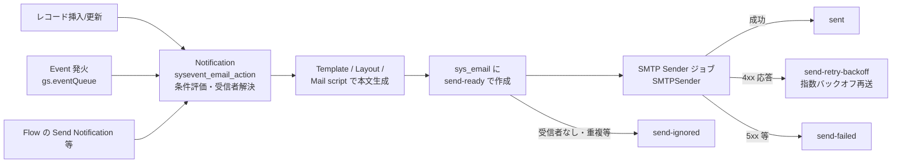
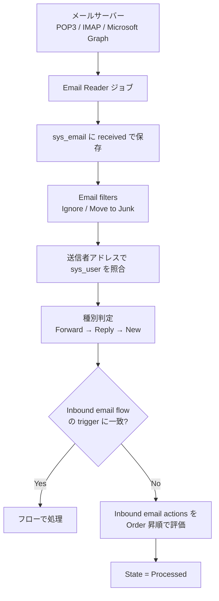
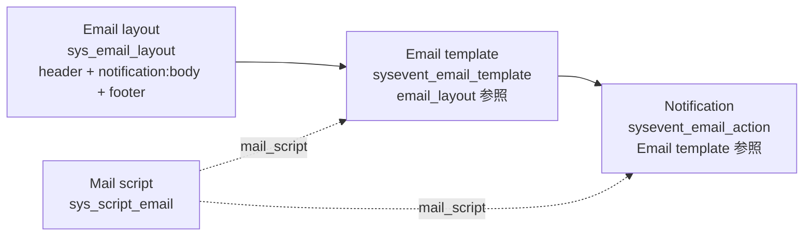
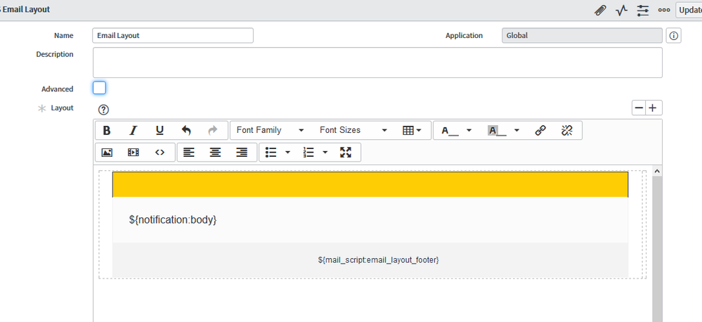
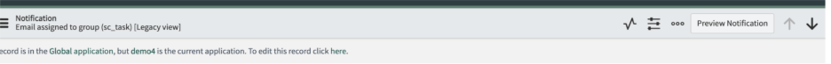
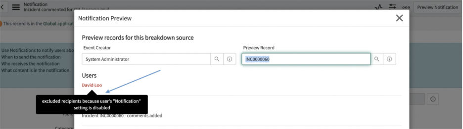

# Notifications and Email（通知とメール）

## 概要

ServiceNow の **Notifications（通知）** は、レコードの挿入・更新、Event（イベント）の発火、または Workflow Studio / Flow Designer のフローを契機として、ユーザーへ Email（メール）・SMS・Push（プッシュ）・Meeting Invitation（会議招待）などのメッセージを送る Now Platform（ServiceNow AI Platform）の標準機能である。メールの受信側は **Inbound email actions（受信メールアクション）** と **Inbound email flows（受信メールフロー）** が担い、返信メールによるインシデント更新や新規レコード作成を自動化する。

本ファイルは以下の問いに答える。

- 通知レコード（`sysevent_email_action`）の各タブ・フィールドは何を意味するか
- Email template（`sysevent_email_template`）、Email layout（`sys_email_layout`）、Mail script（`sys_script_email`）の役割分担
- 受信メールはどう分類（New / Reply / Forward）され、どの Inbound email action が実行されるか
- Email accounts（`sys_email_account` 相当の Email Account 画面）で SMTP / POP3 / IMAP / OAuth 2.0 / Microsoft Graph をどう設定するか
- ユーザーの Notification preferences（通知設定）、Subscribable / Mandatory / Force delivery の関係
- メールが届かないときにどこを見ればよいか（Email logs、Preview Notification、Email diagnostics dashboard）

> **基準リリースと出典についての注記:** 本ファイルは Australia（2026-05 GA）を基準とする。ServiceNow 公式ドキュメントサイトは 2026-11 時点で多くのページの既定表示（`/docs/r/platform-administration/...` 形式の URL）が Brazil 版になっており、一部の仕様は Brazil 版ページで確認した。URL に `UrSRFFKWBbfQBgoRlt~ltw` を含むページは Australia 版（英語、2026-03-12 更新）、`7LhbZn3yz3Q58qhjZoU9iQ` は Zurich 版、`VbEA8DxUy61CFZ25mbYrcQ` は Yokohama 版、`SbrhqYG7UKQCk7uYwvgVBA` は Xanadu 版、`eh2NFokZCOdK5kPblQPzog` は Australia 版（ドイツ語）である（2026-11-03 にページ表示で確認）。Australia と Brazil で差異が判明している箇所は「Brazil での変更」として明記し、それ以外は両リリース共通の仕様として記載している。

関連ファイル：

- イベントを発火するサーバーサイドスクリプト（`gs.eventQueue()` 等）→ [サーバーサイドスクリプト](./scripting-server-side.md)
- フローからの通知送信、Inbound email trigger → [Workflow Studio / Flow Designer](./flow-designer-workflow-studio.md)
- ユーザー・グループ（Include members 等）→ [ユーザー・グループ・ロール](./users-groups-roles.md)
- OAuth / SSO 全般 → [認証とSSO](./authentication-sso.md)
- クローン時のメール停止 → [アップデートセットとクローン](./update-sets-cloning.md)
- 通知の翻訳 → [ローカライゼーション（日本語化）](./localization.md)
- ドメイン分離環境の通知 → [ドメインセパレーション](./domain-separation.md)
- モバイルアプリの Push → [モバイル](./mobile.md)

---

## 1. 全体アーキテクチャ

### 1.1 構成要素

ServiceNow のメール構成は「インスタンス」「メールサーバー」「メールクライアント」の3要素から成る。[出典](https://www.servicenow.com/docs/r/washingtondc/platform-administration/c_EmailConfiguration.html)

| 構成 | 説明 |
|---|---|
| Standard configuration（標準構成） | ServiceNow 提供のメールサーバーを使う。すべての本番インスタンスは ServiceNow 提供リソースで送受信でき、インスタンスのアドレスは `<instance>@service-now.com` となる。 |
| Alternate configuration（代替構成） | 顧客自身の SMTP サーバー、POP3 / IMAP サーバー、または Microsoft Graph（Exchange Online）を使う高度な構成。 |

[出典](https://www.servicenow.com/docs/r/washingtondc/platform-administration/c_EmailConfiguration.html)

### 1.2 主要テーブル一覧

| テーブル | 表示名 | 用途 |
|---|---|---|
| `sysevent_email_action` | Notification（通知） | メール通知の定義（いつ・誰に・何を）。[出典](https://www.servicenow.com/docs/r/platform-administration/r_MailScriptAPI.html) |
| `sysevent_email_template` | Email Template（メールテンプレート） | 件名・本文の再利用可能なテンプレート。[出典](https://www.servicenow.com/docs/r/application-development/servicenow-sdk/fluent-email-notification-api.html) |
| `sys_email_layout` | Email Layout（メールレイアウト） | ヘッダー・フッター等のブランディング用 HTML。[出典](https://www.servicenow.com/docs/r/platform-administration/email-layouts.html) |
| `sys_script_email` | Notification Email Script（メールスクリプト） | `${mail_script:...}` で呼び出すスクリプト。[出典](https://www.servicenow.com/docs/r/platform-administration/r_ExScptEmlNtfn.html) |
| `sysevent` | Event（イベント） | 通知を発火させたイベントのレコード。[出典](https://www.servicenow.com/docs/r/platform-administration/r_MailScriptAPI.html) |
| `sys_email` | Email（メールログ） | 送受信したすべてのメール。System mailboxes はこのテーブルのフィルタビュー。[出典](https://www.servicenow.com/docs/r/platform-security/r_EmailLogs.html) |
| `sys_watermark` | Email Watermarks（ウォーターマーク） | 送信メールと対象レコードの対応付け。[出典](https://www.servicenow.com/docs/r/platform-administration/inbound-action-processing.html) |
| `sysevent_in_email_action` | Inbound Email Action（受信メールアクション） | 受信メールの処理ルール。[出典](https://servicenow.github.io/sdk/tags/sysevent-in-email-action) 【第三者情報】（ServiceNow SDK ドキュメント） |
| `sys_email_account` | Email Account（メールアカウント） | SMTP / POP3 / IMAP / Microsoft Graph の接続設定。※テーブル名は公式ページ本文では未確認、画面は「E-mail Accounts」【経験則】 |
| `sys_notif_subscription` | Notification Subscription（通知購読） | 全通知へのユーザー購読情報。[出典](https://www.servicenow.com/docs/r/platform-administration/c_SubscriptionBasedNotifications.html) |
| `cmn_notif_device` | Notification Device（通知デバイス / 配信チャネル） | ユーザーごとの配信先（メール、SMS 等）。[出典](https://www.servicenow.com/docs/r/platform-administration/advanced-notification-prefrences.html) |
| `cmn_notif_service_provider` | Notification Service Provider（通知サービスプロバイダー） | SMS 送信プロバイダー。[出典](https://www.servicenow.com/docs/r/eh2NFokZCOdK5kPblQPzog/H4bE0Tu_H1TqbXjsLeACEg) |
| `sys_email_digest_interval` | Digest Intervals（ダイジェスト間隔） | メールダイジェストの集約間隔。[出典](https://www.servicenow.com/docs/r/platform-administration/email-digests.html) |
| `sys_notification_category` | Notification Category（通知カテゴリ） | 通知のグルーピング（設定画面での分類）。[出典](https://www.servicenow.com/docs/r/platform-administration/granular-admin-roles-notifications.html) |
| `sys_push_application` / `sys_push_notif_msg` / `sys_push_notif_msg_content` | Push Application / Push Notification Message / Push Message Content | Push 通知の定義。[出典](https://www.servicenow.com/docs/r/api-reference/developer-guides/mobsdk-and-setup-push-instance.html) |
| `sys_push_notif_act_script` | Push Notification Action Script | カスタム Push アプリでユーザーが通知に応答したときに実行するアクション。[出典](https://www.servicenow.com/docs/r/UrSRFFKWBbfQBgoRlt~ltw/5dNWWGLImNF1k_wqO8fhdw) |
| `ar_sys_email` | Archive Email（アーカイブ済みメール） | Email retention で `sys_email` から移されたメール。[出典](https://www.servicenow.com/docs/r/platform-administration/email-retention.html) |
| `sysevent_email_style` | Email Style（メールスタイル） | 通知に適用する HTML スタイル（`style` フィールド）。【第三者情報】[出典](https://servicenow.github.io/sdk/guides/email-notification-guide) |
| `email_access_restriction` | Email Access Restriction | 通知単位でメール閲覧を制限する条件。【第三者情報】[出典](https://servicenow.github.io/sdk/guides/email-notification-guide) |

### 1.3 送信処理の流れ（アウトバウンド）



送信は `SMTPSender` ジョブ（SMTP Sender、既定で 1 分間隔）が行い、未配信メールは指数バックオフで再送される（詳細は「9.4 再送とバックオフ」）。SMS は別の SMS Sender ジョブ（既定 1 分間隔）が送る。[出典](https://www.servicenow.com/docs/r/platform-administration/troubleshooting-notification-emails.html)、[出典](https://www.servicenow.com/docs/r/UrSRFFKWBbfQBgoRlt~ltw/sp6pw~dNTfmO33y7YagiYA)

### 1.4 受信処理の流れ（インバウンド）



Inbound email flows は Inbound email actions より優先される。[出典](https://www.servicenow.com/docs/r/platform-administration/inbound-action-processing.html) Email Reader ジョブはメールサーバーで待機中のメールをダウンロードし、`email.read` イベントを作成する（Email Reader の既定間隔は公式ページに記載なし）。[出典](https://www.servicenow.com/docs/r/UrSRFFKWBbfQBgoRlt~ltw/sp6pw~dNTfmO33y7YagiYA)

> **暗号化メール非対応:** インスタンスは暗号化されたメールを送受信できず、暗号化メールの本文は削除される。[出典](https://www.servicenow.com/docs/r/australia/platform-administration/c_EmailNotifications.html) 一方で S/MIME 用のプラグイン（`com.glide.email.smime`）と管理ロール `smime_certificate_admin` も存在する（「10.2」参照）。両記述の適用範囲（S/MIME 署名・暗号化をどこまでサポートするか）は公開情報では確認できず。

---

## 2. Email notifications（メール通知）

### 2.1 作成場所とロール

- メニュー：**All > System Notification > Email > Notifications > New** [出典](https://www.servicenow.com/docs/r/platform-administration/t_CreateANotification.html)
- 必要ロール：`admin`、または Australia で導入された粒度の細かい管理ロール `notification_admin`（`sysevent_email_action`、`sys_email_layout`、`sysevent_email_template` の設定とダイジェスト間隔設定が可能）。[出典](https://www.servicenow.com/docs/r/platform-administration/granular-admin-roles-notifications.html)
- 保存後、フォームヘッダーの **Preview Notification** で内容と受信者を確認できる。[出典](https://www.servicenow.com/docs/r/platform-administration/t_CreateANotification.html)

### 2.2 フォーム上部のフィールド

| フィールド | 説明 |
|---|---|
| Name（名前） | 一意で説明的な名前。 |
| Table（テーブル） | 通知を紐付けるテーブル。`task` テーブルそのものは使わない。同じアプリケーションスコープのテーブルのみ表示される。 |
| Type（種類） | `EMAIL` または `Meeting Invitation`（会議招待）。 |
| Active（有効） | 通知を有効化。 |
| Category（カテゴリ） | 関連通知のグルーピング。ユーザーの通知設定画面ではこのカテゴリ単位で表示される。Uncategorized のままにしないことが推奨。 |
| Allow Digest（ダイジェストを許可） | メールダイジェストを有効にし、「What Digest will contain」タブを表示する。 |
| Description（説明） | 自由記述。 |

[出典](https://www.servicenow.com/docs/r/platform-administration/t_CreateANotification.html)

> フィールドがすべて表示されない場合は Advanced view（詳細ビュー）に切り替える。[出典](https://www.servicenow.com/docs/r/UrSRFFKWBbfQBgoRlt~ltw/vaPuVLOcN_zPS8jyrTPDmw) 「Create an email notification」ページのフィールド表には載っていないが、`sysevent_email_action` には Mandatory（必須、既定 false）、Force delivery（強制配信＝ユーザーの通知設定を無視、既定 false）、Enable dynamic translation（動的翻訳、既定 false）などの属性もあることが ServiceNow Fluent（SDK）の Email Notification API で確認できる。[出典](https://www.servicenow.com/docs/r/a3E8xg0zsiQLBPKbKO15Mg/drqUzUBvvocxxduE9UZ3zQ) Mandatory / Force delivery の挙動は「6.3」を参照。

### 2.3 When to send（送信タイミング）タブ

| フィールド | 説明 |
|---|---|
| Send when（送信契機） | `Record inserted or updated`（レコード挿入/更新）、`Event is fired`（イベント発火）、`Triggered`（Flow Designer の Notification ステップから送信）のいずれか。 |
| Weight（重み） | 必須。同一テーブル・同一受信者に重複する通知が発生した場合、最も Weight の高い通知だけが送られる。既定値は 0。 |
| Conditions（条件） | 条件ビルダーで送信条件を絞る。 |
| Inserted / Updated | レコード契機の場合に、挿入時・更新時のどちらで送るかを指定。 |
| Event name（イベント名） | `Event is fired` の場合に、契機となるイベントを指定。 |
| Advanced condition（詳細条件） | `true` を返す（またはグローバル変数 `answer` を `true` にする）スクリプト。`current` と `event` を参照可能。Conditions と両方満たす必要がある。 |

[出典](https://www.servicenow.com/docs/r/platform-administration/t_CreateANotification.html)

**Weight の挙動（重要）:** 1 つの契機で複数の通知が生成された場合、対象テーブルと受信者が同じ通知は件名・本文が異なっていても重複とみなされ、Weight が最も高い通知だけが送信される。他の通知は Outbox から Skipped mailbox に移る。Weight が同じ場合は件名・本文を比較して重複を判定する。この制御は **Ignore Duplicates** ビジネスルールが行う。公式の例では、エージェントがインシデントにコメントしてからクローズすると「Incident commented」と「Incident Closed」の両方が発火し得るが、同じテーブル・同じ Caller 宛のため Weight の高い方のみ送られる。既定値 0 は「条件を満たせば送信する」を意味する。Fluent API の仕様では Weight の最大値は 1000。[出典](https://www.servicenow.com/docs/r/7LhbZn3yz3Q58qhjZoU9iQ/arqcJvflekHKxKqf4TzPqg)、[出典](https://www.servicenow.com/docs/r/a3E8xg0zsiQLBPKbKO15Mg/drqUzUBvvocxxduE9UZ3zQ)

**Flow からの送信（Send Notification action）:** Workflow Studio の ServiceNow core action **Send Notification** は、既存の Notification（`sysevent_email_action`）レコードを選んで、事前定義された受信者・内容のメール通知を送る。入力は Record（通知対象のレコード）、Table（Record 選択で自動設定）、Notification（送る通知レコード）の 3 つで、出力はない。`flow_designer` または `admin` ロールでフローに追加できる。Microsoft Teams など他チャネルへの送信には Integration Hub の spoke action を使う。[出典](https://www.servicenow.com/docs/r/HGWDpzjgkfvaJWTdMzNy2w/eJfasrMSS9MA7SrAVM_~Vg) なお Fluent API では Send when の内部値として `engine`（レコード挿入/更新）、`event`（イベント）、`triggered`（手動/フロー等からの起動）の 3 種が定義されている。[出典](https://www.servicenow.com/docs/r/a3E8xg0zsiQLBPKbKO15Mg/drqUzUBvvocxxduE9UZ3zQ)

**イベント契機の推奨:** 本番では `Event is fired` を使い、業務ロジック（どの状況で通知するか）をビジネスルール等に置き、通知ロジックと分離する設計がよく推奨される。【第三者情報】[出典](https://s2-labs.com/servicenow-admin/servicenow-email-notifications-configuration/)

### 2.4 Who will receive（受信者）タブ

| フィールド | 説明 |
|---|---|
| Users（ユーザー） | 個別ユーザーの静的リスト。検索選択またはメールアドレスの直接入力。 |
| Groups（グループ） | グループの静的リスト。グループレコードで **Include members** が選択されている場合のみ、メンバー個々に通知される。 |
| Users/Groups in fields（フィールド内のユーザー/グループ） | 対象レコードのユーザー参照・グループ参照・メールアドレスを含むフィールドから受信者を取得（動的）。 |
| Exclude delegates（代理人を除外） | 選択したユーザー・グループメンバーの Delegates（代理人）に送らない。 |
| Send to event creator（イベント作成者に送信） | 通知を引き起こした本人も受信者に含まれる場合に送信する。新規通知では既定でオン。 |
| Event parm 1 contains recipient / Event parm 2 contains recipient | イベントの parm1 / parm2 にカンマ区切りの受信者リストが入っていることを示す。イベント契機の場合のみ表示。 |
| Subscribable（購読可能） | ユーザーが通知を購読できるようにする。機微な情報を含む通知では有効化しない。 |

[出典](https://www.servicenow.com/docs/r/platform-administration/t_CreateANotification.html)

> **セキュリティ注意:** インスタンスは受信者に ACL（アクセス制御）を適用しない。UI からアクセスできないレコードについてもメールは届くため、受信者がレコード内容を見てよいか確認する必要がある。[出典](https://www.servicenow.com/docs/r/platform-administration/t_CreateANotification.html)

**受信者の前提条件と上限（公式）**

- 受信者は `sys_user` でアクティブであり、かつ Notification Device（`cmn_notif_device`）の Primary channel（主チャネル）に有効なメールアドレスを持つ必要がある。どちらかを欠くユーザーには届かない。
- Subscribable な通知では、各受信者が通知設定でその通知とチャネルを有効にしている必要がある（管理者はユーザーを Impersonate して確認できる）。
- Users/Groups in fields はドットウォークに対応する。非アクティブユーザーには送られない。
- 1 通知の受信者は 1,000 ユーザー以内に抑えることが推奨される。受信者が 100 を超えると最大 100 名ずつの複数メッセージに分割される（上限は `glide.email.smtp.max_recipients` で変更）。
- 既定では、ループ防止のため通知の送信者自身にはメールしない。

[出典](https://www.servicenow.com/docs/r/7LhbZn3yz3Q58qhjZoU9iQ/arqcJvflekHKxKqf4TzPqg)

**よくある落とし穴:** 「Send to event creator」がオフだと、自分で更新したレコードの通知が自分に届かない。テスト時に「通知が来ない」と誤認しやすい【経験則】。

### 2.5 What it will contain（内容）タブ

| フィールド | 説明 |
|---|---|
| Email template（メールテンプレート） | 内容を供給する再利用可能なテンプレート。選べるのは、通知と同じスコープ・同じテーブルのもの、同じスコープでテーブル未指定のもの、または同じテーブルでグローバルスコープのもの。 |
| Subject（件名） | 変数を含められる。入力すればテンプレートの件名を上書きする。 |
| Message HTML（HTML 本文） | 変数を含められる。Content type が HTML を含む場合に表示。 |
| Message Text（テキスト本文） | プレーンテキスト本文。 |
| SMS alternate（SMS 代替） | SMS デバイスに送るテキスト（140 文字まで）。空の場合はテンプレートの値、それもなければメールの件名が使われる。 |
| Importance（重要度） | Low / High。 |
| Content type（コンテンツ種別） | `HTML and plain text` / `HTML only`（既定）/ `Plain text only`。 |
| Include attachments（添付を含める） | 契機レコードの添付ファイルを送る。 |
| From（差出人） | 差出人アドレス（有効な形式であること）。 |
| Reply to（返信先） | 返信先アドレス（1 つのみ）。 |
| Omit watermark（ウォーターマーク省略） | このメールにウォーターマークを付けない。 |
| Push message only / Push messages | Push 通知のみ送る / 送る Push メッセージを指定。Push Notification 機能が有効である必要があり、Push メッセージは通知と同じテーブルでなければならない。 |

[出典](https://www.servicenow.com/docs/r/platform-administration/t_CreateANotification.html)

**From の優先順位:** 通知レコードの From は、Email Account レコードの From より優先される。[出典](https://www.servicenow.com/docs/r/eh2NFokZCOdK5kPblQPzog/W8GfPLrU_pj2nnEXlPSe4Q) また Mail script の `email.setFrom()` で上書きもできる。[出典](https://www.servicenow.com/docs/r/platform-administration/r_MailScriptAPI.html)

### 2.6 What Digest will contain（ダイジェスト内容）タブ

Allow Digest がオンの場合のみ表示される。

| フィールド | 説明 |
|---|---|
| Digest Template | ヘッダー・フッター等のダイジェスト用テンプレート。 |
| Digest Subject | ダイジェストの件名。 |
| Digest HTML | ダイジェスト内の各項目に繰り返される HTML。 |
| Digest Separator (HTML) | HTML ダイジェストの項目区切り線。 |
| Digest From / Digest Reply To | ダイジェストの差出人・返信先。 |
| Digest Text | プレーンテキストの繰り返し部分。 |
| Digest Separator (text) | プレーンテキストの区切り（ダッシュ線等、任意）。 |

[出典](https://www.servicenow.com/docs/r/platform-administration/t_CreateANotification.html)

### 2.7 Email digests（メールダイジェスト）

- Email digest は、1 つの通知について一定期間の活動を 1 通のメールにまとめる機能。ユーザーが自身の通知設定でダイジェストを有効化し、間隔を選ぶ。
- 間隔は `sys_email_digest_interval`（Digest Intervals）テーブルで管理。基本系では「1 時間」「4 時間ごと」「1 日（24 時間）」「7 日（週次）」の 4 つが用意されている。
- 間隔は日または時間で設定し、最小 1 時間、最大 7 日。使用中の間隔は削除できない。
- システムは 15 分ごとにダイジェスト送信要否を判定する。例：1 時間ダイジェストで最初の通知が 08:15 なら、およそ 09:15 に送られる。
- 従来、1 通のダイジェストは 1 つの対象レコードに関する通知だけをまとめていた（「Create an email notification」ページには現在も「別の対象レコードのダイジェストは結合されない」と記載がある）。一方、Zurich のリリースノートでは Allow Digest チェックボックスが動的になり **Digest type** が追加され、単一または複数の対象レコードをまとめられるようになったとされる。Digest type は次の 2 種類。[出典](https://www.servicenow.com/docs/r/m4LmCVvkm6_8u3nlIuep5Q/qGcZZMODgMoKBj2yZ1trWw)、[出典](https://www.servicenow.com/docs/r/7LhbZn3yz3Q58qhjZoU9iQ/arqcJvflekHKxKqf4TzPqg)

| Digest type | 内容 |
|---|---|
| Single（単一レコード） | 選択した間隔中に、1 つの対象レコード（例：INC001 だけ）について通知が複数回発火した場合にまとめる。 |
| Multiple（複数レコード） | 選択した間隔中に、複数の対象レコード（例：INC001、INC002 …）にまたがって発火した通知をまとめる。 |

- Who will receive タブの受信者は、自分の通知設定でダイジェストを有効にした後にダイジェストを受け取る。
- 関連プロパティ：`glide.email.digest.default_interval`（既定のダイジェスト間隔の sys_id）、`glide.email.digest.max_intervals`（定義できる間隔数の上限、既定 100）。

[出典](https://www.servicenow.com/docs/r/platform-administration/email-digests.html)、[出典](https://www.servicenow.com/docs/r/UrSRFFKWBbfQBgoRlt~ltw/qs_ERsmJrgl_vpiw9HL4gw)、[出典](https://www.servicenow.com/docs/r/platform-administration/email-digest-properties.html)

> ダイジェスト関連テーブル `sys_email_digest_part` / `sys_email_digest_part_user` の管理には `email_digest_admin` ロールが用意されている（プラグイン `com.glide.email_digest`）。[出典](https://www.servicenow.com/docs/r/platform-administration/granular-admin-roles-notifications.html)

---

## 3. Email templates、Email layouts、変数、Mail scripts

### 3.1 3 つの部品の役割分担

| 部品 | テーブル | 役割 | 動的内容 |
|---|---|---|---|
| Email layout（メールレイアウト） | `sys_email_layout` | ヘッダー・本文枠・ボタン・フッター等、全通知共通のブランディング | 静的（`${notification:body}` に本文が差し込まれる） |
| Email template（メールテンプレート） | `sysevent_email_template` | 件名・本文の再利用部品。Email layout を参照できる | 変数・Mail script 可 |
| Notification（通知） | `sysevent_email_action` | いつ・誰に・何を送るか。Template を参照、または Subject / Message HTML を直接記述 | 変数・Mail script 可 |

[出典](https://www.servicenow.com/docs/r/platform-administration/email-layouts.html)



### 3.2 Email layouts（メールレイアウト）

Email layout は、Email template の本文に挿入される再利用可能な HTML である。用途は以下。[出典](https://www.servicenow.com/docs/r/platform-administration/email-layouts.html)

- 通知全体で一貫したレイアウト（ヘッダー、本文、フッター）を保つ
- 会社ロゴや背景など全通知共通の静的内容を表示する
- フォント・サイズ・色などのインラインスタイルを定義し、テンプレート本文から利用させる
- 購読解除や通知設定変更など共通アクションへのリンクを置く

仕様・制約：

- レコードは `sys_email_layout` テーブルに格納される。
- スタイルは `<style>` 要素（内部スタイルシート）と `style` 属性（インラインスタイル）の両方を使える。
- 基本系にサンプルレイアウトが複数含まれ、出発点として使える。インライン HTML エディタまたは HTML 直接入力で作成する。
- Mail script のような動的内容はレイアウトではなく Email template 側で扱うことが推奨される。
- 通知レコードにもテンプレートにも本文がない場合、レイアウトは適用されない。
- `${notification:body}` 変数をレイアウト内に置くと、そこにテンプレートまたは通知の本文が差し込まれる。[出典](https://www.servicenow.com/docs/r/platform-administration/notification-variables.html)



*図1: Email Layout（`sys_email_layout`）レコードのフォーム例。*
画面説明：Email Layout レコードのフォームで、上部に Name（例：Email Layout）、Application（Global）、Description、Advanced チェックボックスがある。必須の Layout フィールドは HTML エディタで、上部が黄色のヘッダー帯、中央に `${notification:body}`（通知本文の差し込み位置）、下部にフッター領域として `${mail_script:email_layout_footer}`（フッター用 Mail script の呼び出し）が配置されている。コミュニティ記事で用いられた San Diego 時期の画面であり、現行 UI と細部が異なる可能性がある。
出典：https://www.servicenow.com/community/itsm-articles/learn-how-to-apply-your-company-branding-using-email-layout-for/ta-p/2302026 （取得日：2026-11-03）

**ブランディング適用の典型手順**【第三者情報】[出典](https://www.servicenow.com/community/itsm-articles/learn-how-to-apply-your-company-branding-using-email-layout-for/ta-p/2302026)

1. Email layout を作成（または基本系レイアウトを複製）し、`${notification:body}` を本文位置に置く。
2. Email template を作成し、Email layout 参照フィールドに 1 を設定。Table を空にすると全テーブルで使える。レイアウト 1 つにつきテンプレートを 1 つ作る。
3. 各通知の Email template フィールドに 2 を設定。基本系（OOB）通知を直接改変せず、複製して元を無効化する。
4. Scheduled reports（スケジュールレポート）のメールにはレイアウトが標準では適用されないため、`sys_email` の before insert ビジネスルールで差し込む回避策が紹介されている。

> 通知フォームでは Email template と Email layout を同時に直接指定できないため、「レイアウト＝ブランディング、テンプレート＝本文」と分けるのがコミュニティでの推奨。【第三者情報】[出典](https://www.servicenow.com/community/developer-forum/applying-employee-notification-template-to-notifications-that/m-p/2978732)

### 3.3 Email templates（メールテンプレート）

- テーブル：`sysevent_email_template`。メニュー：**System Notification > Email > Templates**【経験則】。
- 主なフィールド（ServiceNow SDK ガイドの定義）【第三者情報】[出典](https://servicenow.github.io/sdk/guides/email-notification-guide)

| フィールド | 型 | 内容 |
|---|---|---|
| `name` | String | 必須。テンプレート名。 |
| `subject` | String | 件名（最大 100）。 |
| `message_html` | HTMLScript | HTML 本文。リンクやスタイルを含む場合はこちらを使う。 |
| `message_text` | EmailScript | プレーンテキスト本文。 |
| `message` | EmailScript | レガシー。プレーンテキストとして扱われタグ・リンクが除去される。 |
| `sms_alternate` | EmailScript | SMS 用テキスト。 |
| `collection` | TableName | 対象テーブル（空なら汎用）。 |
| `email_layout` | Reference | `sys_email_layout` への参照。 |
| `message_list` | List | `sys_push_notif_msg` への参照（Push メッセージ）。 |

- **Rich HTML（リッチ HTML）:** Rich HTML 形式は新規メール通知の既定であり、管理者は既存の通知を Rich HTML 形式に変換できる。インスタンス内レコードや画像への相対リンクは絶対リンクに変換される。[出典](https://www.servicenow.com/docs/r/australia/platform-administration/c_EmailNotifications.html) 変換時は「Newlines to HTML」チェックボックスが自動で選択され、既存 Mail script の改行の扱いが従来と同じに保たれる。[出典](https://www.servicenow.com/docs/r/UrSRFFKWBbfQBgoRlt~ltw/uiysJuIQRfxqUuUoqMtlvg)
- 通知側で Subject を入力すると、テンプレートの件名より通知側が優先される。[出典](https://www.servicenow.com/docs/r/platform-administration/t_CreateANotification.html)
- 互換性のため、HTML 本文とプレーンテキスト本文の両方を用意することが推奨される。【第三者情報】[出典](https://servicenow.github.io/sdk/guides/email-notification-guide)

### 3.4 Notification variables（通知変数）

通知・テンプレートの Subject / Message HTML では `${variable-name+variable-parameters}` 形式の変数を使える。変数名は必須、パラメータは任意（パラメータ非対応の変数もある）。[出典](https://www.servicenow.com/docs/r/platform-administration/notification-variables.html)

| 構文 | 内容 | パラメータ |
|---|---|---|
| `${field-name}` | 指定フィールドの値（例：`${number}`、`${short_description}`）。ドットウォーク可（例：`${caller_id.email}`）。 | なし |
| `${image-field-name}` | 画像フィールドの画像（`img` の src 等）。 | なし |
| `${URI}` | 現在レコードへのリンク（リンク文字列は "LINK"）。 | 任意の sysparm URL パラメータ（`sysparm_view` 等） |
| `${URI_REF}` | 現在レコードへのリンク（リンク文字列はレコードの表示値）。 | 任意の sysparm URL パラメータ |
| `${reference-field.URI}` / `${reference-field.URI_REF}` | 参照フィールド先レコードへのリンク。 | 任意の sysparm URL パラメータ |
| `${CMS_URI+<CMS-site>/<CMS-page>}` | CMS ページ内のレコードへのリンク。 | CMS ページへの相対パス（必須） |
| `${notification:body}` | テンプレート/通知の本文。Email layout 内に置く。 | なし |
| `${mail_script:script-name}` | 指定した Mail script を実行。 | なし |
| `${NOTIF_UNSUB}` | 通知の購読解除リンク。 | `link_text`（引用符付き） |
| `${NOTIF_PREFS}` | 通知設定変更リンク。 | `link_text`（引用符付き） |
| `${comments}` / `${comments:n}` | 全コメント / 直近 n 件のコメント。 | n（1 以上） |
| `${comments_and_work_notes}` / `${comments_and_work_notes:n}` | 全コメント+作業メモ / 直近 n 件。 | n（1 以上） |

[出典](https://www.servicenow.com/docs/r/platform-administration/notification-variables.html)

> **Workspace 非対応:** `${URI}` / `${URI_REF}` は Workspace（例：Service Operations Workspace）のレコード URL を生成しない。Workspace へのリンクが必要な場合は、URL を出力する Mail script を作る。[出典](https://www.servicenow.com/docs/r/VbEA8DxUy61CFZ25mbYrcQ/zgzUY2z4rVDa09Gw4VbXfw)

> `${mailto:...}`（承認/却下などの返信用 mailto リンク）変数は、プロパティ `glide.email.mail_to`（`${mailto:}` で使われるアドレス、既定はアクティブな SMTP アドレス）から存在が確認できるが、変数一覧ページ本体には記載がない。[出典](https://www.servicenow.com/docs/r/eh2NFokZCOdK5kPblQPzog/cS1am5QcxH6cwzdYWjEBYw)

### 3.5 Mail scripts（メールスクリプト / Notification Email Scripts）

- メニュー：**System Notification > Email > Notification Email Scripts**。テーブル：`sys_script_email`。
- 通知・テンプレート本文に `${mail_script:script_name}` を書くと実行される。
- 通知の Message HTML に `<mail_script>…</mail_script>` で直接スクリプトを書くことも可能で、保存時にスクリプトは `sys_script_email` へ移され、埋め込みタグに置き換わる。

[出典](https://www.servicenow.com/docs/r/platform-administration/r_ExScptEmlNtfn.html)

**Mail script で使えるグローバル変数**

| 変数 | 内容 |
|---|---|
| `current` | 対象レコード（GlideRecord）。 |
| `template` | 本文への出力オブジェクト。 |
| `email` | `EmailOutbound` オブジェクト。 |
| `email_action` | 通知レコード（`sysevent_email_action` の GlideRecord）。 |
| `event` | 通知を発火したイベント（`sysevent` の GlideRecord）。`event.parm1` 等を参照可能。 |

[出典](https://www.servicenow.com/docs/r/platform-administration/r_MailScriptAPI.html)

**メソッド**

| メソッド | 説明 |
|---|---|
| `template.print(message)` | 本文に文字列を出力。 |
| `template.space(number)` | 本文に空白を出力。 |
| `email.addAddress(type, address, displayname)` | CC / BCC 受信者を追加（type は `cc` または `bcc`）。 |
| `email.setFrom(address)` | 差出人を上書き。 |
| `email.setReplyTo(address)` | 返信先を上書き。 |
| `email.setSubject(subject)` | 件名を上書き。 |
| `email.setBody(message)` | 本文を上書き。 |

`setFrom` / `setReplyTo` のアドレスは `helpdesk@sn.com` または `Display Name <helpdesk@sn.com>` の形式。アドレス内の表示名はインスタンスの表示名を上書きする。[出典](https://www.servicenow.com/docs/r/platform-administration/r_MailScriptAPI.html)

**例：Watch list を CC に追加する Mail script**（公式例を基にした構成）

```javascript
(function runMailScript(current, template, email, email_action, event) {
    // Watch list のユーザーを CC に追加
    if (!current.watch_list.nil()) {
        var users = current.watch_list.toString().split(',');
        for (var i = 0; i < users.length; i++) {
            var u = new GlideRecord('sys_user');
            if (u.get(users[i]) && u.email) {
                email.addAddress('cc', u.getValue('email'), u.getDisplayValue('name'));
            }
        }
    }
    template.print('Incident: ' + current.number);
})(current, template, email, email_action, event);
```

[出典](https://www.servicenow.com/docs/r/platform-administration/r_ExScptEmlNtfn.html)

> Catalog item（カタログアイテム）の変数は `current.variables.<name>` で参照する（`current.<name>` ではない）。【第三者情報】[出典](https://www.servicenow.com/community/developer-forum/display-variable-and-multiple-row-variable-sets-data-into/td-p/2619133)

### 3.6 Watermarks（ウォーターマーク）

- 送信メールには既定でウォーターマーク（例：`Ref:MSG0000123`）が付与され、`sys_watermark`（Email Watermarks）テーブルで対象レコードと対応付けられる。受信時にこのウォーターマークで返信先レコードを特定する。[出典](https://www.servicenow.com/docs/r/platform-administration/inbound-action-processing.html)
- 形式：ウォーターマークは常に `Ref:` で始まり、既定ではその後に 31 文字が続く。内訳はプレフィックス（既定 `MSG`）、対象レコードの自動採番 ID、アンダースコアと 20 文字のランダム文字列。ランダム化ウォーターマークは Jakarta 以降の基本系で自動生成される（それ以前からのアップグレードでは Random Watermark Support プラグインが必要）。（Washington DC 版ページで確認）[出典](https://www.servicenow.com/docs/r/bAHg1_u_N~ocpdu34t_qJA/cOxvFcaKTeHmRKpKY5BcKA)
- カスタムプレフィックス：Email Watermark（`sys_watermark`）テーブルの `MSG` レコードを開き、一意のプレフィックスを入力して Update する。コロンは予約文字のため使わない（ウォーターマークが無視される可能性がある）。既存通知のウォーターマークは変わらない。[出典](https://www.servicenow.com/docs/r/7LhbZn3yz3Q58qhjZoU9iQ/qFVPEpxNaZxAHuJsp9QwHw)
- Jakarta より前からアップグレードしたインスタンスは、移行期間中ランダム化/非ランダム化両方のウォーターマークを認識できる。[出典](https://www.servicenow.com/docs/r/platform-administration/inbound-action-processing.html)
- 本文に複数のウォーターマークがある場合、Paris 以降は本文中の最後のウォーターマークが使われる。[出典](https://www.servicenow.com/docs/r/washingtondc/platform-administration/c_InboundEmailActions.html)
- 通知単位では「Omit watermark」で省略できる。全体の可視/非表示はプロパティ `glide.email.watermark.visible`（既定 `false`。false の場合は hidden div で囲まれた不可視のウォーターマークになり、ウォーターマーク自体は残る）で制御する。[出典](https://www.servicenow.com/docs/r/UrSRFFKWBbfQBgoRlt~ltw/bv0fJhcFJU0KUWWDeL7slw) Mail script が本文にウォーターマークを出力していると、このプロパティを変えても表示が変わらない事例が報告されている。【第三者情報】[出典](https://www.servicenow.com/community/itsm-forum/how-to-display-watermark-on-all-emails/m-p/2612927)
- ウォーターマークを省略すると、返信時の対象レコード照合ができなくなる（件名のレコード番号による照合にフォールバック）。

---

## 4. Inbound email actions（受信メールアクション）

### 4.1 概要

Inbound email action は、受信メールに対するシステムの応答をスクリプト化したもので、ビジネスルールと同様に条件とスクリプトで対象テーブルに作用する。アクション種別は 2 つ。[出典](https://www.servicenow.com/docs/r/washingtondc/platform-administration/c_InboundEmailActions.html)

| Action type | 内容 |
|---|---|
| Record Action（レコードアクション） | 対象テーブルのフィールド値を設定（レコード作成・更新）。 |
| Reply Email（返信メール） | 送信者へメールで返信する。 |

基本系では、ウォーターマークが特定できないメールはインシデント作成を試み（Create Incident）、ウォーターマークが既存インシデントに一致すればスクリプトに従って更新する（Update Incident）。[出典](https://www.servicenow.com/docs/r/washingtondc/platform-administration/c_InboundEmailActions.html)

### 4.2 フォームの主なフィールド

| フィールド | 説明 |
|---|---|
| Name | アクション名。 |
| Target table（対象テーブル） | レコードを追加・更新するテーブル（例：`incident`）。 |
| Action type | `Record Action`（レコードを変更）/ `Reply Email`（送信者へ返信）。 |
| Active | 有効化。 |
| Stop processing（処理停止） | このアクション実行後、以降の Inbound email actions を実行しない。 |
| Redact sensitive data（機微データのマスキング） | 個人情報・社会保障番号・クレジットカード番号などの機微データをマスクする。**Sensitive Data Redaction for Inbound Emails** プラグイン有効時のみ表示。 |
| Type（When to run） | 受信種別：`New`（Reply / Forward と認識されないもの）/ `Reply`（In-Reply-To ヘッダー付きのウォーターマーク、または件名の返信プレフィックス）/ `Forward`（件名の転送プレフィックス。既定ではウォーターマークがあっても新規インシデントを作成。プレフィックス設定を変えれば返信扱いにできる）。 |
| Required roles（必要ロール） | アクションを起動するために送信者が持つべきロール。 |
| Order（順序） | 同じ Target table のアクション間の実行順。小さい順に実行。**Ordered Email Processing** プラグインを有効にするとこのフィールドは無効になる。 |
| From | 特定ユーザーからのメールに限定。そのユーザーがアーカイブ・削除されると制限は外れ、誰でも起動できる状態になる。 |
| Condition（条件） | 起動条件（例：`email.subject.startsWith("chg:")`）。 |
| Description | アクションの説明。 |
| Field actions（Actions タブ） | Record Action の場合に、メールの情報をレコードへどう書き込むか（例：送信者を Created by に記録）。 |
| Reply email（Actions タブ） | Reply Email の場合に、元の送信者へ送るメッセージ。 |
| Script（Actions タブ） | 実行するコード。通常 `validators` script include とメール変数を使う。テンプレートは `current`、`event`、`email`、`logger` を受け取る `runAction` 関数を定義する。 |

[出典](https://www.servicenow.com/docs/r/UrSRFFKWBbfQBgoRlt~ltw/IotxvPgylxxX6jqlNwKyjA)

メニュー：**All > System Policy > Email > Inbound Actions > New**。必要ロール：`admin`。すべてのフィールドを表示するにはフォームの構成変更が必要な場合がある。[出典](https://www.servicenow.com/docs/r/UrSRFFKWBbfQBgoRlt~ltw/IotxvPgylxxX6jqlNwKyjA)

> 上表の Type 列の説明は「Create an inbound email action」ページの簡略な定義である。実際の分類ロジック（Forward 判定に本文の転送文字列も要る等）は「4.3」の「Inbound email actions」ページの定義に従う。

### 4.3 受信種別（Receive type）の判定

受信メールは以下の順に分類される（Australia 版ページで確認）。[出典](https://www.servicenow.com/docs/r/UrSRFFKWBbfQBgoRlt~ltw/jgDDyP_KVTlRQFYHIoH46g)

1. **Forward（転送）**：件名に転送プレフィックス（`FW:` 等）があり、**かつ**本文に転送文字列（`From:` 等）がある。ウォーターマークを含んでいても Forward と分類される（Reply 判定より優先）。
2. **Reply（返信）**：Forward ではなく、以下のいずれかに該当。
   - 認識可能なウォーターマーク（例：`Ref:MSG0000008`）を含む
   - ウォーターマークはないが、件名に返信プレフィックス（`RE:` 等）とレコード番号（例：`INC0005574`）がある
   - ウォーターマークはないが、Reply-To ヘッダーにウォーターマーク付きメールのメッセージ ID が入っている
   - Thread-Index ヘッダーがある（プロパティ `glide.inbound.email.classify.by.thread_index` を `true` にした場合のみ。Microsoft Outlook からのメールにのみ適用され、他の Reply 条件に一致しない場合のフォールバックとして使われる。Australia で導入）
3. **New（新規）**：Forward にも Reply にも該当しない。

[出典](https://www.servicenow.com/docs/r/UrSRFFKWBbfQBgoRlt~ltw/jgDDyP_KVTlRQFYHIoH46g)、[出典](https://www.servicenow.com/docs/r/m4LmCVvkm6_8u3nlIuep5Q/qGcZZMODgMoKBj2yZ1trWw)

**関連プロパティ**

| プロパティ | 型 | 既定値 | 説明 |
|---|---|---|---|
| `glide.email.reply_subject_prefix` | string | `re:,aw:,r:,Accepted:,Tentative:,Declined:` | 返信と判定する件名プレフィックス。**大文字小文字を区別**するため、`RE:`、`Re:` 等の混在形も定義することが推奨。 |
| `glide.email.forward_subject_prefix` | string | `fw:,fwd:` | 転送と判定する件名プレフィックス。空の場合は `fw:`、`fwd:` が使われる。大文字小文字の扱いは下記注記を参照。 |
| `glide.inbound.email.classify.by.thread_index` | boolean | （既定値は公式ページに記載なし） | `true` にすると Thread-Index ヘッダーで返信判定する。 |
| `glide.email.inbound_action.extract_from_header` | boolean | false（プロパティが存在しない場合） | `true` の場合、送信元アドレス（`email.fromAddress`）をヘッダーから算出する。 |

[出典](https://www.servicenow.com/docs/r/platform-administration/inbound-action-processing.html)、[出典](https://www.servicenow.com/docs/r/UrSRFFKWBbfQBgoRlt~ltw/mr3~FBJbBs91HBS6zyeFpQ)、[出典](https://www.servicenow.com/docs/r/yokohama/platform-administration/r_AccessingEmailObjsWithVars.html)

> **ドキュメント間の不一致:** `glide.email.forward_subject_prefix` について、「Inbound action processing」ページは「大文字小文字を区別しない」と書き、Australia 版「Inbound email configuration」ページは「大文字小文字を区別するため混在形も定義する」と書いている。実機で確認するか、安全側として `fw:,FW:,Fw:,fwd:,FWD:,Fwd:` のように混在形を定義しておくのが無難である【経験則】。`glide.email.reply_subject_prefix` は両ページとも大文字小文字を区別するとしている。

**転送を返信として処理したい場合:** `glide.email.reply_subject_prefix` に `re:,Re:,RE:,aw:,r:,fw:,fwd:,Fwd:,FWD:` を含め、`glide.email.forward_subject_prefix` は転送でない何らかの文字列に設定する（空は不可）。これにより Update Incident が転送・返信の両方を処理する。[出典](https://www.servicenow.com/docs/r/platform-administration/inbound-action-processing.html)

**ウォーターマークがない返信の照合:** 件名中のレコード番号（INC、CHG 等）を検索して対応テーブルのレコードと照合する。番号に引用符等が付くと照合できず、件名に複数番号がある場合は非対応。レコードが存在しなければ New 用アクションが新規作成する。[出典](https://www.servicenow.com/docs/r/platform-administration/inbound-action-processing.html)

### 4.4 実行条件と処理順序

- Inbound email flows（Flow の Inbound Email trigger）が先に処理し、一致したメールはフローで処理される。[出典](https://www.servicenow.com/docs/r/platform-administration/inbound-action-processing.html)
- Inbound email actions は Order の昇順で評価される。アクションが実行されるのは次の 3 条件をすべて満たす場合。
  1. メールの種別がアクションの Type と一致
  2. ウォーターマークまたはレコード番号が Target table のレコードを指す（Reply の場合）
  3. Conditions が true
- いずれかを満たさなければ、次の有効なアクションへ進む。
- Stop processing がオンの場合、Script 実行後にメールの State を Processed にし、以降のアクションは評価しない。
- 一致するアクションがなくても、処理されたメールはすべて Processed になる。

[出典](https://www.servicenow.com/docs/r/platform-administration/inbound-action-processing.html)、[出典](https://www.servicenow.com/docs/r/washingtondc/platform-administration/c_InboundEmailActions.html)

**Inbound email flow（受信メールフロー）の要点**

- Flow Designer / Workflow Studio でフローを作り、Trigger に **Inbound Email** を選ぶ。**Email conditions** で起動対象のメールを絞り込む（条件ビルダーの項目は Email［`sys_email`］テーブル）。例：システム通知への返信なら `Receive type is Reply`、返信元レコードの種別には対象テーブル（例：Incident［`incident`］）を指定する。
- Run as は **User who initiates session** に設定する。送信者がユーザーとして認識されない場合、フローは Guest ユーザーとして実行される。昇格した権限が必要な処理は、必要なロールで実行される Subflow を呼び出す。
- アクセス制御の検証は、典型的な受信メールユーザーを Impersonate してフローを手動起動して行う。

[出典](https://www.servicenow.com/docs/r/build-workflows/workflow-studio/create-inbound-email-flow.html)。フロー全般は [Workflow Studio / Flow Designer](./flow-designer-workflow-studio.md) を参照。

### 4.5 送信者とユーザーの照合

- 送信元アドレス（`email.from`）を `sys_user` のアクティブユーザーと照合し、そのユーザーを現在のユーザーとして処理する。そのため Create Incident は `gs.getUserID()` で `caller_id` を設定できる。
- 非アクティブユーザーとは照合しない。同一アドレスのユーザーが複数いる場合はアクティブなユーザーが選ばれる。ユーザーごとにメールアドレスを一意にすることが推奨。

[出典](https://www.servicenow.com/docs/r/platform-administration/inbound-action-processing.html)

- プロパティ `glide.email.inbound_action_set_email_ignored_when_user_disabled`（既定 true）：照合されたアカウントが非アクティブ、またはロックアウト（かつ `glide.pop3.process_locked_out` が false）の場合、受信メールを Ignored にする。[出典](https://www.servicenow.com/docs/r/eh2NFokZCOdK5kPblQPzog/cS1am5QcxH6cwzdYWjEBYw)
- 未登録送信者の扱いは Inbound email configuration のプロパティで決まる（Australia 版で確認）。[出典](https://www.servicenow.com/docs/r/UrSRFFKWBbfQBgoRlt~ltw/mr3~FBJbBs91HBS6zyeFpQ)

| プロパティ | 既定値 | 説明 |
|---|---|---|
| `glide.pop3readerjob.create_caller` | `false` | `true` の場合、信頼済みドメインからの未知の送信者についてユーザーレコードを自動作成し、Caller に設定する。`false` の場合 Caller は Guest。 |
| `glide.user.trusted_domain` | `servicenow.com` | ユーザー自動作成を許可するドメイン（カンマ区切り、`*` で全ドメイン）。信頼されないドメインからのメールは Guest として処理され、ユーザーは作成されない。 |
| `glide.user.default_password` | `password` | 自動作成ユーザーの初期パスワード（初回ログイン時に変更必須）。 |

> 自動作成を有効にする場合は `glide.user.trusted_domain` を自社ドメインに絞り、初期パスワードの既定値を変更すること【経験則】。

### 4.6 スクリプトで使える変数

| 変数 | 内容 |
|---|---|
| `current` | メールが参照するレコード（例：`current.assigned_to`）。New では新規作成されるレコード。 |
| `event` | 発生元イベントのパラメータ（例：`event.parm1`）。 |
| `email` | 受信メールオブジェクト（例：`email.subject`）。 |
| `logger` | ログ出力。`logger.log("Some information")` のように書くと、Source が `email.<受信メールの Sys ID>` のログが作成される。 |
| `sys_email` | 受信アクションを起動した `sys_email` レコード（`uid`、`sys_id`、`content_type` 等）。 |

[出典](https://www.servicenow.com/docs/r/UrSRFFKWBbfQBgoRlt~ltw/IotxvPgylxxX6jqlNwKyjA)、[出典](https://www.servicenow.com/docs/r/yokohama/platform-administration/r_AccessingEmailObjsWithVars.html)

**`email` オブジェクトの主な変数**

| 変数 | 内容 |
|---|---|
| `email.to` | To と Cc のアドレス（カンマ区切り）。 |
| `email.direct` | To のアドレスのみ（カンマ区切り）。 |
| `email.copied` | Cc のアドレスのみ（カンマ区切り）。 |
| `email.recipients` / `email.recipients_array` | To の受信者（文字列 / 配列）。 |
| `email.subject` | 件名（プレーンテキスト）。 |
| `email.body_text` / `email.body_html` | 本文（プレーンテキスト / HTML）。 |
| `email.from` | 送信者アドレス。既存ユーザーのメールと一致すればそのアドレス、なければヘッダーのアドレス。 |
| `email.origemail` | ヘッダー上の送信者アドレス。 |
| `email.fromAddress` | `glide.email.inbound_action.extract_from_header` が true のとき、ヘッダーから算出した元の送信者アドレス。 |
| `email.from_sys_id` | 送信したユーザーの sys_id。 |
| `email.content_type` | MIME コンテンツタイプ（例：`text/plain; charset="us-ascii"`）。 |
| `email.headers` | ヘッダー（送信者・経路・受信者情報、プレーンテキスト）。 |
| `email.importance` | 送信者が指定した重要度（High / Low / 空）。 |

[出典](https://www.servicenow.com/docs/r/yokohama/platform-administration/r_AccessingEmailObjsWithVars.html)

> 複数アドレスは RFC 2822 に従いカンマで区切る必要がある。セミコロン区切りだと `email.to`、`email.direct`、`email.copied` が設定されない場合がある。Washington DC 版ページでは配列変数が `email.recipients-array`（ハイフン）と表記されており、リリースによって表記が異なる。[出典](https://www.servicenow.com/docs/r/yokohama/platform-administration/r_AccessingEmailObjsWithVars.html)、[出典](https://www.servicenow.com/docs/r/washingtondc/platform-administration/r_AccessingEmailObjsWithVars.html)

**本文の name:value 解析:** 本文中の `name:value` 形式の行は `email.body.<name>` で参照できる。解析対象範囲はプロパティ `glide.pop3.parse_start` / `glide.pop3.parse_end` で区切れる。[出典](https://www.servicenow.com/docs/r/eh2NFokZCOdK5kPblQPzog/cS1am5QcxH6cwzdYWjEBYw)（`email.body.<name>` 構文自体は【経験則】）

**例：Update Incident 相当のスクリプト**【経験則】

```javascript
// Type = Reply, Target table = incident
gs.include('validators');
if (current.getTableName() == 'incident') {
    current.comments = 'reply from: ' + email.origemail + '\n\n' + email.body_text;
    if (email.body.priority != undefined && isNumeric(email.body.priority))
        current.priority = email.body.priority;
    current.update();
}
```

### 4.7 その他の受信仕様

| 項目 | 仕様 |
|---|---|
| 添付ファイル | 最初に作成されたレコードに添付される。 |
| 文字コード | ASCII-7 と UTF-8 は保持。ISO-8859-1 は Windows-1252 に変換。その他はプレーンテキストに変換され、読めない可能性がある。 |
| ドメイン | アクションレコードのドメインはレコード作成時に無視される。Inbound action はグローバルドメインに置くことが推奨。作成されたインシデントは Caller ユーザーのドメイン（ユーザー不在ならグローバル）になる。 |
| Outlook の RTF | Outlook が RTF で送ると空のインシデントと `winmail.dat` 添付ができる。Outlook / Exchange 側で RTF を送らない設定にする。 |

[出典](https://www.servicenow.com/docs/r/washingtondc/platform-administration/c_InboundEmailActions.html)、[出典](https://www.servicenow.com/docs/r/platform-administration/troubleshooting-notification-emails.html)

> **Australia での変更:** Thread-Index ヘッダーによる Microsoft / Outlook メールの返信分類（Email threading）、Column Level Encryption（列レベル暗号化）が有効なテーブルでの受信添付の暗号化（送信時は復号）、インテントに基づく Inbound email actions での複数インテント識別と不足入力（missing inputs）の扱いモード（不足入力を要求する／インテントをスキップする／処理を続行する）が追加された。[出典](https://www.servicenow.com/docs/r/m4LmCVvkm6_8u3nlIuep5Q/qGcZZMODgMoKBj2yZ1trWw)

> **Brazil での変更:** Privacy Policy Advanced Configuration に受信メール専用チャネルが追加され、受信メール中の機微データのマスキング（Sensitive data redaction）を設定できるようになった。受信メールヘッダーの情報から送信元メールボックスを識別する機能（Source mailbox identification）も追加された。なお Inbound action フォームの Redact sensitive data フィールド（Sensitive Data Redaction for Inbound Emails プラグイン）自体は Australia 版ページにも記載がある。[出典](https://www.servicenow.com/docs/r/delta-australia-brazil/brazil-australia-notifications-release-notes.html)、[出典](https://www.servicenow.com/docs/r/UrSRFFKWBbfQBgoRlt~ltw/IotxvPgylxxX6jqlNwKyjA)

---

## 5. Email accounts と接続方式（SMTP / POP3 / IMAP / OAuth 2.0 / Microsoft Graph）

### 5.1 Email Account フォーム

メニュー：**All > System Mailboxes > Administration > Email Accounts > New**。必要ロール：「Create an email account」ページでは `admin`、「Create an email account with SMTP OAuth2.0」ページおよび Microsoft Graph 関連ページでは `email_account_admin`（Email account administrators）と記載されている。[出典](https://www.servicenow.com/docs/r/UrSRFFKWBbfQBgoRlt~ltw/YRcRFOSUJxRtgvq5356UnQ)、[出典](https://www.servicenow.com/docs/r/platform-administration/create-email-account-smtp.html)、[出典](https://www.servicenow.com/docs/r/UrSRFFKWBbfQBgoRlt~ltw/yh1EpzEZzPCJdWGx3u~LhQ)

前提：SMTP / POP3 / IMAP に対応したメールサーバーが必要。localhost やループバック（127.0.0.1）の SMTP サーバーは受け付けられない。OAuth の選択肢は **Email: OAUTH support for IMAP, Microsoft Graph (Receiving), and SMTP**（`com.glide.email.oauth`）プラグインが有効な場合のみ表示される。[出典](https://www.servicenow.com/docs/r/UrSRFFKWBbfQBgoRlt~ltw/YRcRFOSUJxRtgvq5356UnQ)

| フィールド | 説明 |
|---|---|
| Name | アカウント名。 |
| Account type | `Shared Address`（複数ユーザーで使う共有メールボックス）または `Forwarding Address`（他アカウントからの自動転送を受ける。個人の会社メールボックス連携用、Australia で追加）。 |
| Type | `SMTP` / `POP3` / `IMAP`（Microsoft Graph プラグイン導入時は `Microsoft Graph (Send)` / `Microsoft Graph (Receive)` も）。**同時に有効にできる SMTP アカウントは 1 つのみ**。 |
| Authentication | `None` / `Password` / `OAUTH` / `OAUTH 2.0`。OAuth 系はプラグイン有効時のみ表示。 |
| OAuth provider | OAuth 2.0 選択時に、Application Registry（OAuth アプリケーション登録）レコードを指定。 |
| Server | 接続先サーバー（オンプレミスノードは FQDN）。 |
| Port | TCP ポート。 |
| Connection security | `None` / `STARTTLS` / `SSL/TLS`。SSL/TLS 推奨（STARTTLS や None はデータ露出のおそれ）。 |
| User name | 認証用ユーザー名。既定の From としても使われる。SMTP では完全なメールアドレスが必要。 |
| Password | Password 認証時のパスワード（既定の長さ上限は 40 文字。必要に応じて拡張）。 |
| From | このアカウントで送る通知の差出人（SMTP のみ）。User name を上書きする。ただし通知レコードの From が優先。 |
| Email user label | 送信メールの表示名（SMTP のみ）。 |
| Active | アカウント有効化。 |
| ServiceNow configured | ServiceNow 提供アカウントかどうか。新規作成時はオフ。 |
| Enable debug output | メールサーバーとの生通信をノードログに出力。トラブルシュート時のみ一時的に有効化。 |
| System address filter | 適用するシステムアドレスフィルター。空なら既定フィルター。 |

[出典](https://www.servicenow.com/docs/r/UrSRFFKWBbfQBgoRlt~ltw/YRcRFOSUJxRtgvq5356UnQ)

> SMTP OAuth 2.0 アカウント作成ページ（Brazil 版）では、OAuth 2.0 選択時の参照フィールド名が **OAuth Profile**（Application Registry 登録時に作成した OAuth プロファイル）と表記されており、「Create an email account」ページの **OAuth Provider** と表記が異なる。[出典](https://www.servicenow.com/docs/r/platform-administration/create-email-account-smtp.html)

保存後、フォームの接続テスト（SMTP / POP3 / IMAP のテストリンク）を実行し、失敗時は **View Logs** で詳細を確認する。[出典](https://www.servicenow.com/docs/r/eh2NFokZCOdK5kPblQPzog/W8GfPLrU_pj2nnEXlPSe4Q)

**ポート番号の目安（プロトコル一般の慣例。公式ページには既定ポートの記載なし）**【経験則】

| プロトコル | 典型ポート | Connection security |
|---|---|---|
| SMTP（Submission） | 587 | STARTTLS |
| SMTP（SMTPS） | 465 | SSL/TLS |
| IMAP | 993 | SSL/TLS |
| POP3 | 995 | SSL/TLS |

### 5.2 OAuth 2.0（IMAP / SMTP）

- 前提プラグイン：**E-mail: OAUTH support for IMAP, Microsoft Graph (receive), and SMTP**（`com.glide.email.oauth`）。[出典](https://www.servicenow.com/docs/r/eh2NFokZCOdK5kPblQPzog/W8GfPLrU_pj2nnEXlPSe4Q)
- 公式手順の流れ：メールプロバイダーからアクセストークン/リフレッシュトークンを取得できるよう、Application Registry（`oauth_entity`）レコードを作成 → 認可（Authorize）→ 同じ OAuth 設定で SMTP / IMAP アカウントを作成。[出典](https://www.servicenow.com/docs/r/VbEA8DxUy61CFZ25mbYrcQ/617JZFVINYrJgHWfdnGhsw)
- Australia の粒度管理ロール `oauth_admin` は、メールアカウントのアクセス認可と接続テストを行える（ログ閲覧には `email_log_viewer` が別途必要）。[出典](https://www.servicenow.com/docs/r/platform-administration/granular-admin-roles-notifications.html)

**Microsoft 365（Exchange Online）での典型設定**【第三者情報】[出典](https://www.servicenow.com/community/now-platform-forum/how-to-setup-smtp-and-imap-email-accounts-via-oauth-2-0/m-p/2350383)

| 項目 | 値 |
|---|---|
| Azure アプリのスコープ | `https://outlook.office.com/IMAP.AccessAsUser.All`、`https://outlook.office.com/SMTP.Send`、`offline_access` |
| Client ID / Client Secret | Azure アプリの Application ID / シークレットの Value |
| Authorization URL | `https://login.microsoftonline.com/<Tenant ID>/oauth2/v2.0/authorize` |
| SMTP アカウント | `smtp.office365.com`、ポート 587、STARTTLS |
| IMAP アカウント | SSL/TLS |

実務上の注意（同スレッドより）：

- 認可はメールボックス自身の資格情報で行う（ServiceNow ユーザーではない）。誤ったアカウントで認可されないよう、プライベートブラウザで認可するのが無難。
- Microsoft 365 側でメールボックスの IMAP / SMTP AUTH が無効化されていると失敗する。
- 関連 KB：`smtp.office365.com` 接続失敗（KB0825391）、IMAP OAuth の "AUTHENTICATE failed"（KB0963959）。[出典](https://www.servicenow.com/docs/r/platform-administration/troubleshooting-notification-emails.html)

### 5.3 Microsoft Graph

ServiceNow AI Platform は IMAP / SMTP / POP3 に加え、Microsoft Graph をメール種別としてサポートし、Exchange Online と連携できる。[出典](https://www.servicenow.com/docs/r/UrSRFFKWBbfQBgoRlt~ltw/yh1EpzEZzPCJdWGx3u~LhQ)

| 項目 | 内容 |
|---|---|
| プラグイン | **Email - Support for Email Processing by Microsoft Graph API**（`com.glide.email.graph`）。`admin` で **System Applications > All Available Applications** から導入。見つからない場合は ServiceNow に依頼が必要な場合がある。 |
| ドメイン分離環境 | Domain separation と Delegated admin が両方有効な場合、導入ユーザーはグローバルドメインにいる必要がある。 |
| 受信 | Email Account の Type を `Microsoft Graph (Receive)` にする。Graph API で Exchange Online からメールを取得し `sys_email` に保存。認証はクライアント ID+シークレット、または証明書。 |
| 送信 | `Microsoft Graph (Send)`。認証はクライアント ID+シークレット。 |
| 前提 | OAuth プロファイルと、OAuth プロバイダーとしての Azure アプリ登録。 |
| 注意 | スパム対策・マルウェアスキャンは ServiceNow ではなく顧客側の管理となる。 |

[出典](https://www.servicenow.com/docs/r/platform-administration/ms-graph-plugin.html)、[出典](https://www.servicenow.com/docs/r/platform-administration/read-email-using-ms-graph.html)、[出典](https://www.servicenow.com/docs/r/platform-administration/send-email-using-ms-graph.html)

> **Australia での変更:** Zurich→Australia の統合リリースノートでは「Microsoft のメールアカウントを Microsoft Graph 経由で接続し、送信メールを送れるようになった（Microsoft Graph sending）」と記載されている。すなわち `Microsoft Graph (Send)` は Australia の変更点である。送信時は SMTP Sender を通じて Exchange Online 経由で配信される。[出典](https://www.servicenow.com/docs/r/m4LmCVvkm6_8u3nlIuep5Q/qGcZZMODgMoKBj2yZ1trWw)、[出典](https://www.servicenow.com/docs/r/UrSRFFKWBbfQBgoRlt~ltw/yh1EpzEZzPCJdWGx3u~LhQ) Graph の API 権限（Mail.Read / Mail.Send 等）の種類は、取得した公式ページ本文では確認できず。

### 5.4 User mailbox integration（個人メールボックス連携、Australia で導入）

Australia では、エージェントが自分の個人の会社メールボックスを接続してメールを送受信できる **User mailbox integration** が追加された。[出典](https://www.servicenow.com/docs/r/m4LmCVvkm6_8u3nlIuep5Q/qGcZZMODgMoKBj2yZ1trWw)

| 項目 | 内容 |
|---|---|
| プラグイン | `com.glide.email.user_mailbox.integration`（User Mailbox Integration） |
| 送信 | Email client template（メールクライアントテンプレート）で **From Generation Type** を `User Email Addresses` にする（共有アドレスを含めるオプションあり）。メニューは **User Mailboxes > Administration**。 |
| 受信 | `email_admin` ロールで、System Mailboxes に Account type = `Forwarding Address` のアカウントを作成し、個人メールボックス（Outlook、Gmail 等）側で転送ルールを設定する。 |

[出典](https://www.servicenow.com/docs/r/eh2NFokZCOdK5kPblQPzog/H42pu2eX85DSpz9XUlRvnA)、[出典](https://www.servicenow.com/docs/r/UrSRFFKWBbfQBgoRlt~ltw/S~BYd7D0YS0QVjkxnUFP3A)

### 5.5 メールサイズ上限

| 構成 | 上限 |
|---|---|
| Standard（ServiceNow メールサーバー） | エンコード前で約 50 MB、エンコード後のハード上限 75 MB（添付サイズ上限の設定に関わらず） |
| Alternate（独自サーバー） | 約 50 MB の制限が依然適用される可能性あり。送受信で上限が異なる場合があるため、メールサービス管理者に確認 |

[出典](https://www.servicenow.com/docs/r/washingtondc/platform-administration/c_EmailConfiguration.html)

加えて、プロパティで添付数・合計サイズ・本文文字数の上限がある（「7.2」参照）。

---

## 6. Notification preferences（通知設定）と購読

### 6.1 ユーザーが設定できること

| 区分 | 内容 |
|---|---|
| System notifications（システム通知） | レコード変更等の通知。Email / SMS / Push / メッセージングアプリで受け取る。カテゴリでの検索・絞り込み、全体/個別の有効・無効、グローバル設定、チャネルごとのスケジュール設定が可能。 |
| Custom notifications（カスタム通知 / 個人通知） | システム通知の購読に条件を付けて個人用にカスタマイズしたもの。作成・変更・削除、チャネルの有効/無効が可能。 |
| Delivery channels（配信チャネル） | Email、SMS、Instant message、Voice。有効/無効、作成・編集・削除、配信方式、スケジュールを設定。チャネルは `cmn_notif_device` に格納され、**`cmn_notif_device` から削除できるのは admin のみ**。 |

[出典](https://www.servicenow.com/docs/r/platform-administration/advanced-notification-prefrences.html)

**画面の場所**

- Core UI：System Settings（システム設定）ウィンドウの **Notifications** タブ。[出典](https://www.servicenow.com/docs/r/platform-administration/c_SubscriptionBasedNotifications.html)
- Next Experience：Preferences（環境設定）内の通知設定画面。Next Experience のカスタム通知は「関連する影響レコード（affected record）を必要とする通知」に対応しないため、それらは Core UI で設定する。[出典](https://www.servicenow.com/docs/r/platform-administration/advanced-notification-prefrences.html)
- 管理者がユーザーの設定を確認する場合：ユーザーレコード（**User Administration > Users**）の Related Links にある **Notification Preferences**。【第三者情報】[出典](https://www.servicenow.com/community/servicenow-ai-platform-articles/tips-to-troubleshoot-undelivered-email-like-a-pro/ta-p/3422567)

**管理者向けプロパティ・プラグイン**

| 名前 | 内容 |
|---|---|
| `glide.notification.preference.sn_form_enabled` | `true` にするとカスタム通知設定と配信チャネルで標準化フォームを使う（Yokohama 以降）。 |
| AI Search for Notifications（`com.glide.notification.ais`） | 通知名だけでなく通知レコードのフィールド内も AI Search で検索。有効化に `admin` が必要。インデックスソース Platform Notifications V1 / V2 を索引化する。 |

[出典](https://www.servicenow.com/docs/r/platform-administration/advanced-notification-prefrences.html)

### 6.2 Subscription-based notifications（購読型通知）

- **Subscription Based Notifications 2.0** プラグインが必要（新規・アップグレードインスタンスとも既定で有効）。
- `sys_notif_subscription`（Notification Subscription）テーブルが全通知へのユーザー購読を保持する。
- Subscribable に設定した通知は自動的にユーザーの通知設定に表示される。1 通知につき 1 ユーザー 1 購読。
- 購読にはスケジュールやフィルターを付けられ、通知ごとに追加の配信チャネルを指定できる。
- **Notification filters（通知フィルター）**で複数テーブルにまたがる再利用可能な条件を作れる。
- 購読型通知は**ドメイン非対応**（ドメイン別設定はサポートされない）。
- SMS 配信にはサービスプロバイダーの設定が必要。

[出典](https://www.servicenow.com/docs/r/platform-administration/c_SubscriptionBasedNotifications.html)

### 6.3 Subscribable / Mandatory / Force delivery の関係

公式ドキュメントでは「Mandatory にすると購読解除できない」「Force delivery を有効にすると指定ユーザーに強制配信される」とされる。[出典](https://www.servicenow.com/docs/r/platform-administration/c_SubscriptionBasedNotifications.html) より詳細な挙動はコミュニティの検証記事で以下のように整理されている。【第三者情報】[出典](https://www.servicenow.com/community/developer-blog/subscribable-mandatory-and-force-delivery-options-on/ba-p/2290562)

| 項目 | 役割 |
|---|---|
| Subscribable | **誰を追加するか**。true の場合、特定レコード（Item table と Item、例：`cmdb_ci` と `event.parm1`）を購読しているユーザーを受信者に追加する。 |
| Mandatory | **オプトアウトできるか**。true の場合、ユーザーが設定を切り替えても ON で保存される。ただし `sys_user` の Notification フィールドは尊重される。 |
| Force delivery | **ユーザー全体の通知無効設定を無視するか**。true の場合、`sys_user` の Notification = Disable でも送る。ただし `cmn_notif_device` がアクティブである必要がある。 |

| 設定 | `sys_user.notification` = Disable のユーザー | ユーザーの個別設定 |
|---|---|---|
| Mandatory=false, Force=false | 除外 | 尊重（ON/OFF） |
| Mandatory=true, Force=false | 除外 | 強制 ON |
| Mandatory=false, Force=true | デバイスが有効なら送信 | 尊重（ON/OFF） |
| Mandatory=true, Force=true | デバイスが有効なら送信 | 強制 ON |

注意：ユーザーの Notification フィールドを Disable にすると、ビジネスルール「Update Email Devices」によりメールデバイスも非アクティブ化されるため、Force delivery が効くのはデバイスがアクティブなままの場合に限られる。【第三者情報】（同出典）

### 6.4 配信の優先関係（Primary email と他デバイス）

| ユーザーの通知設定 | Primary email（主メール） | その他デバイス |
|---|---|---|
| Enabled | 送信 | 送信 |
| Disabled | 送信しない | 送信しない |
| 設定なし（Not listed） | 送信 | 送信しない |

【第三者情報】（ServiceNow 社員によるコミュニティ記事）[出典](https://www.servicenow.com/community/servicenow-ai-platform-articles/tips-to-troubleshoot-undelivered-email-like-a-pro/ta-p/3422567)

### 6.5 Notification categories と Classifications

- Notification category（`sys_notification_category`）はユーザーの通知設定画面での分類単位。管理ロール `notification_category_admin`（プラグイン `com.glide.notification.preference.service`）。
- Notification classification（`sys_notification_classification`）の追加には `notification_classification_admin`（`com.glide.notification.classification`）。
- Service Portal のウィジェット設定用 `sys_recipient_user_mapping` には `portal_notification_pref_admin`（`com.glide.notification.unify.preference.service`）。

[出典](https://www.servicenow.com/docs/r/platform-administration/granular-admin-roles-notifications.html)

---

## 7. Email properties（メールプロパティ）

### 7.1 基本プロパティ（System Properties > Email Properties）

メニュー：**All > System Properties > Email Properties**。このページの設定は全メールアカウントに適用される。[出典](https://www.servicenow.com/docs/r/platform-administration/t_ConfiguringStandardEmail.html)、[出典](https://www.servicenow.com/docs/r/washingtondc/platform-administration/c_EmailConfiguration.html)

| ラベル | プロパティ | 説明 |
|---|---|---|
| Email sending enabled（メール送信を有効化） | `glide.email.smtp.active` | 送信の有効化（必須設定）。無効でも `sys_email` に送信レコードは作成される【第三者情報】。 |
| Email receiving enabled（メール受信を有効化） | `glide.email.read.active` | 受信の有効化（必須設定）。 |
| Send all email to this test address（テストアドレスへ全送信） | `glide.email.test.user` | 全メールを指定アドレス（カンマ区切りで複数可）へ転送するテスト用設定。 |

[出典](https://www.servicenow.com/docs/r/platform-administration/t_ConfiguringStandardEmail.html)、[出典](https://www.servicenow.com/docs/r/washingtondc/platform-administration/c_EmailConfiguration.html)、`glide.email.test.user` の複数指定・挙動は【第三者情報】[出典](https://www.servicenow.com/community/servicenow-ai-platform-forum/glide-email-test-user/m-p/1007065)

**Outbound email configuration（送信設定）のプロパティ一覧（Australia 版）**

| プロパティ | ラベル（要約） | 既定値 | 説明 |
|---|---|---|---|
| `glide.email.smtp.active` | Email sending enabled | `true` | 送信メールサーバーの有効/無効。 |
| `glide.email.test.user` | Send all email to this test email address | なし | 全送信メールを受け取るアドレス（カンマ区切り）。主に非本番のテスト用。 |
| `glide.email.append.timezone` | Append time zone to dates and times in sent mail | `true`（下記注記） | 送信メールの日付・日時値にタイムゾーンを付加。 |
| `glide.email.watermark.visible` | Create visible watermark in sent mail | `false` | ウォーターマークを可視にするか。false なら hidden div で不可視化。 |
| `glide.smtp.defer_retry_ids` | Resend email if server returns these SMTP error codes | `421,450,451,452` | 再送対象とする SMTP エラーコード。 |
| `glide.smtp.fail_message_ids` | Do not resend email if server returns these SMTP error codes | `500,501,502,503,504,550,551,552,553,554` | 再送しない SMTP エラーコード。 |
| `glide.smtp.default_retry` | Resend email when server returns unknown SMTP error codes | `true` | 未知のエラーコード時に再送するか（認識されるのは `glide.smtp.defer_retry_ids` のコードのみ）。 |
| `glide.ui.activity.email_roles` | Roles that can view email in the Activity formatter | `itil` | アクティビティフォーマッターで「Sent/Received Emails」を閲覧できるロール。 |
| `glide.email.journal.lines` | Number of journal entries included in email notifications | `3` | 通知に含めるジャーナル（Additional comments、Work notes 等）の件数。`-1` で全件。 |

[出典](https://www.servicenow.com/docs/r/UrSRFFKWBbfQBgoRlt~ltw/bv0fJhcFJU0KUWWDeL7slw)

> **ドキュメント間の不一致:** `glide.email.append.timezone` の既定値は、「Outbound email configuration」ページでは `true`（システムのタイムゾーンを付加）、「Advanced email properties」ページでは `false`（ユーザーのタイムゾーンを付加）と記載が異なる（いずれも Australia 版）。実インスタンスの `sys_properties` で確認すること。[出典](https://www.servicenow.com/docs/r/UrSRFFKWBbfQBgoRlt~ltw/bv0fJhcFJU0KUWWDeL7slw)、[出典](https://www.servicenow.com/docs/r/UrSRFFKWBbfQBgoRlt~ltw/uITBeOSeftmhjmhSe~uW2Q)

> 「9.4」のとおり、現行の指数バックオフ再送では `glide.smtp.fail_message_ids` / `glide.smtp.defer_retry_ids` は考慮されないと「Email FAQs and troubleshooting」ページに記載されている。両プロパティは Outbound email configuration ページに残っているため、どちらが有効かは公開情報では確認できず。

**Inbound email configuration（受信設定）のプロパティ一覧（Australia 版）**

| プロパティ | 既定値 | 説明 |
|---|---|---|
| `glide.email.read.active` | `true` | 受信メールサーバーの有効/無効。 |
| `glide.email.reply_subject_prefix` | `re:,aw:,r:,Accepted:,Tentative:,Declined:` | 返信と判定する件名プレフィックス（「4.3」参照）。 |
| `glide.email.forward_subject_prefix` | `fw:,fwd:` | 転送と判定する件名プレフィックス（「4.3」参照）。 |
| `glide.pop3readerjob.create_caller` | `false` | 信頼済みドメインの未知送信者のユーザー自動作成（「4.5」参照）。 |
| `glide.user.default_password` | `password` | 自動作成ユーザーの初期パスワード。 |
| `glide.user.trusted_domain` | `servicenow.com` | ユーザー自動作成を許可するドメイン。 |

[出典](https://www.servicenow.com/docs/r/UrSRFFKWBbfQBgoRlt~ltw/mr3~FBJbBs91HBS6zyeFpQ)

> **クローン時:** クローンしたインスタンスでは、配信済みメールの再送を防ぐためメールが意図的に停止される。[出典](https://www.servicenow.com/docs/r/washingtondc/platform-administration/c_EmailConfiguration.html) 非本番でメール送信を有効化する場合は、`glide.email.test.user` を設定して実ユーザーに届かないようにすることが推奨される。【第三者情報】[出典](https://www.servicenow.com/community/now-platform-articles/enable-email-sending-failsafe-automatically-enabling-after/ta-p/3178736)

### 7.2 Advanced email properties（高度なプロパティ）

以下は Australia 版「Advanced email properties」ページに記載された主要プロパティである（`sys_properties` に直接作成・変更するものを含む）。[出典](https://www.servicenow.com/docs/r/UrSRFFKWBbfQBgoRlt~ltw/uITBeOSeftmhjmhSe~uW2Q)、[出典](https://www.servicenow.com/docs/r/eh2NFokZCOdK5kPblQPzog/cS1am5QcxH6cwzdYWjEBYw)

**送信（アウトバウンド）**

| プロパティ | 型 | 既定値 | 説明 |
|---|---|---|---|
| `glide.email.smtp.max_recipients` | integer | 100 | 1 通の To / CC / BCC 合計の最大受信者数。超えると受信者を分割した重複通知が作られる。セキュリティ上 100 以下が推奨。 |
| `glide.email.smtp.max_recipients_overall` | integer | 100000 | 1 メールの総受信者数上限。 |
| `glide.email.smtp.max_send` | integer | 100 | 1 SMTP 接続あたりの送信数（超えると新規接続）。 |
| `glide.email.smtp.claim.lookback.hrs` | integer | 24 | この時間より古いメールは送信しない。滞留解消時は段階的に増やす。 |
| `glide.smtp.send_partial` | boolean | true | 有効な受信者にのみ送信し、無効な受信者には新規メールを作成して再試行する。 |
| `glide.smtp.precedence_bulk` | boolean | true | 送信メールに `Precedence: bulk` ヘッダーを付ける。 |
| `glide.email.outbound.header.auto_submitted` | string | `auto-generated` | `Auto-Submitted` ヘッダー値。空にするとヘッダーを削除。 |
| `glide.email.outbound.max_attachment_count` | integer | 30 | 送信メールあたりの最大添付数。 |
| `glide.email.outbound.max_total_attachment_size_bytes` | integer | 18874368（18 MB） | 送信メールの添付合計サイズ上限。 |
| `glide.email.outbound.max_body_chars` | integer | 524288 | 送信メール本文の最大文字数。 |
| `glide.email.outbound.check_attachment_availability` | boolean | true | ウイルス判定済み添付を含むメールの送信を防ぐ。 |
| `glide.email.override.url` | string | インスタンス URL | メール内リンクに使う URL（`nav_to.do` で終わること）。 |
| `glide.email.mail_to` | string | アクティブな SMTP アドレス | `${mailto:}` 変数で使うアドレス。 |
| `glide.email.append.timezone` | boolean | false | 送信メールの日時にユーザーのタイムゾーンを付加。 |
| `glide.smtp.dateformat` / `glide.smtp.timeformat` | string | 送信者のユーザー形式 | 送信通知の日付・時刻形式。 |
| `glide.email.notification.save_when_no_recipients` | boolean | false | `true` にすると、受信者がいない通知でもメールレコードを保存する（トラブルシュート用）。 |
| `glide.email.outbound.static_translation.enabled` | boolean | true | 静的な通知翻訳をグローバルに有効化。 |
| `glide.notification.translation.dynamic` | boolean | true | 動的な通知翻訳をグローバルに有効化。 |

**受信（インバウンド）**

| プロパティ | 型 | 既定値 | 説明 |
|---|---|---|---|
| `com.glide.email.max_read` | integer | 20 | POP3 リーダーが一度に処理する最大メール数。 |
| `glide.email.inbound.max_attachment_count` | integer | 30 | 受信メールあたりの最大添付数。 |
| `glide.email.inbound.max_total_attachment_size_bytes` | integer | 18874368（18 MB） | 受信メールの添付合計サイズ上限。 |
| `glide.email.inbound.max_body_chars` | integer | 524288 | 受信メール本文の最大文字数。 |
| `glide.email.inbound.calendar_behavior` | string | `Attach` | カレンダーデータ（招待・返信）の扱い：Attach / Ignore / Inline。 |
| `glide.email.inbound.check_attachment_availability` | boolean | true | ウイルス感染添付の利用をブロック。 |
| `glide.email.inbound.convert_html_inline_attachment_references` | boolean | true | 受信 HTML の埋め込み画像（CID）参照をプレビュー可能に変換。 |
| `glide.email.inbound.generate.missing.html.part` / `...text.part` | boolean | true | テキストのみ/HTML のみのメールに欠けたパートを生成。 |
| `glide.email.inbound.attachment_extensions_blacklist` | （未記載） | （未記載） | 疑わしい拡張子の添付を制限。 |
| `glide.security.file.mime_type.validation.inbound_email` | boolean | false | 受信添付の MIME タイプ検証。 |
| `glide.email.allow_duplicate_message_ids` | boolean | false | `true` にすると Message-ID が重複するメールも保存し、エラーメッセージを付加する。 |
| `glide.email.remove_illegal_address_quotes` | boolean | false | 受信アドレスの不正な引用符を除去。 |
| `glide.email.name_split` | string | `.` | アドレス中の姓名区切り（ユーザー検索用）。 |
| `glide.pop3.parse_start` / `glide.pop3.parse_end` | string | なし | 本文の name:value 解析範囲の開始/終了文字列。 |

**表示・その他**

| プロパティ | 型 | 既定値 | 説明 |
|---|---|---|---|
| `glide.email.email_with_no_target_visible_to_all` | boolean | true | false にすると対象レコードのないメールを送信者と admin のみ閲覧可能にする。 |
| `glide.ui.activity.email.use_display` | boolean | false | メールヘッダーにメールアドレスではなくユーザーの表示名を表示するか。 |
| `glide.email.inbound_action_set_email_ignored_when_user_disabled` | boolean | true | 処理ユーザーが非アクティブまたはロックアウトの場合に受信メールを `received-ignored` にする（「4.5」参照）。 |
| `glide.cms.use_email_override_url` | boolean | false | 通知内の CMS リンクにインスタンス URL ではなく Override URL を使う。 |
| `glide.email.email_client.check_attachment_availability` | boolean | true | メール下書き（Email client）の添付をウイルススキャンする。 |
| `glide.ui.incident_activity.max_addresses` | string | 5 | メール監査レコードに表示する最大アドレス数。 |
| `NotifyAffectedCI.max_rel_level` | integer | 5 | Affected CI 通知で親 CI を辿る階層数。 |
| `glide.email_address_filter.max_domains` / `.max_exceptions` | integer | 100 / 1000 | アドレスフィルターあたりの最大ドメイン数/例外数。 |

**受信者ログ（Recipient logging）**

`glide.notification.recipient.include_logging`（含めた理由）と `glide.notification.recipient.exclude_logging`（除外した理由）がマスタースイッチ（既定 true）で、以下のサブプロパティ（いずれも既定 true）で理由別に制御する。[出典](https://www.servicenow.com/docs/r/eh2NFokZCOdK5kPblQPzog/cS1am5QcxH6cwzdYWjEBYw)

| 区分 | サブプロパティ（接尾辞） | 記録される理由 |
|---|---|---|
| 除外 | `.device_inactive` | 通知デバイスが非アクティブ |
| 除外 | `.device_schedule` | デバイスのスケジュール外 |
| 除外 | `.event_creator` | イベント作成者本人 |
| 除外 | `.invalid_email` | メールアドレスが不正 |
| 除外 | `.user_calendar_integration_disabled` | カレンダー連携が None（会議招待） |
| 除外 | `.user_inactive` | ユーザーが非アクティブ |
| 除外 | `.user_notification_disabled` | ユーザーレコードで通知無効 |
| 包含 | `.delegate` | 代理人として |
| 包含 | `.event_parm` | イベントの parm1 / parm2 |
| 包含 | `.recipient_fields` | 対象レコードの受信者フィールド |
| 包含 | `.recipient_groups.group_email` / `.manager` / `.membership` | グループのメール / マネージャー / メンバー |
| 包含 | `.recipient_users` | Users フィールド |
| 包含 | `.subscription` | ユーザーの購読 |

これらのログは各メールレコードの Message log（メッセージログ）で確認でき、「なぜこの人に届いた/届かなかったか」の調査に使う（「9.3」参照）。

---

## 8. SMS / Push / その他チャネル

### 8.1 SMS 通知

| 方式 | 内容 |
|---|---|
| Email-to-text（メール→SMS ゲートウェイ） | 通知デバイスの SMS 宛先を携帯キャリアのメールアドレスとして構成する旧方式。**非推奨**で、AT&T や Verizon などのキャリアはもはやサポートしていない。 |
| Notify（推奨） | Twilio 等のサードパーティサービスと連携して SMS を送る。支援ワークフローの構成が必要。 |

[出典](https://www.servicenow.com/docs/r/0MvJg~UYByX0VxWLomI71w/SRrJoqf_VO13y17DgI~XuQ)

- SMS プロバイダー（Email-to-text 方式）は `cmn_notif_service_provider`（Notification Service Provider）テーブルで管理する。アプリケーションナビゲーターに `cmn_notif_service_provider.list` と入力して開く（`admin` ロール）。主なフィールドは下表。[出典](https://www.servicenow.com/docs/r/fBdxWC~8p08POQuUubVDig/h_nfQzgf_8YrsDRq5NWFkg)、[出典](https://www.servicenow.com/docs/r/eh2NFokZCOdK5kPblQPzog/H4bE0Tu_H1TqbXjsLeACEg)

| フィールド | 内容 |
|---|---|
| Name | プロバイダー名（キャリア名など）。 |
| Type | デバイス種別（SMS）。 |
| Active | このプロバイダーを有効化。 |
| SMS provider email prefix / suffix | デバイスの電話番号の前後に付ける文字列。これで「電話番号@キャリアのゲートウェイドメイン」形式の宛先アドレスを組み立てる。 |
| Build address manually / Build script | プレフィックス・サフィックスの代わりに、スクリプト（ビジネスルールに類似）で宛先アドレスを組み立てる。 |
| Advanced notification / Advanced script | 標準の SMS / メール生成の代わりにスクリプトを実行する特殊用途（全 SMS を中央ハブ経由にする、旧式の数字ページャーに送る等）。通常は使わない。 |
| Notification device variables | Advanced script 内でだけ使うデバイス属性。外部 SMS プロバイダーの構成には不要。 |

- Notify は ServiceNow のアプリケーションと Twilio の接続を容易にする製品で、コミュニティ記事では Platform SMS（上記の Email-to-text 方式）と Notify の 2 つの SMS フレームワークが比較されている。同記事のコメントで ServiceNow 社員が「公式にサポートされるプロバイダーは Twilio のみだが、他プロバイダーのコネクターを作ることは可能」と述べている。【第三者情報】[出典](https://www.servicenow.com/community/now-platform-articles/sms-frameworks-which-to-use/ta-p/2827586)
- Twilio 社のチュートリアルでは、Notify の Provider に TwilioDirect を選び、Twilio の Account SID と Auth Token を登録して Twilio アカウントの電話番号をインポートし、Notify Number Groups に割り当てる手順が示されている。【第三者情報】[出典](https://twilio.com/en-us/blog/create-notification-system-servicenow-using-twilio-sms-and-voice)
- SMS の送信は SMS Sender ジョブ（既定 1 分間隔）が行い、Email Diagnostics ページで状態を確認できる。[出典](https://www.servicenow.com/docs/r/UrSRFFKWBbfQBgoRlt~ltw/sp6pw~dNTfmO33y7YagiYA)
- ServiceNow 側で Processed / sent になっていても、キャリア側で配信に失敗することがあり、その部分は ServiceNow の制御外である。【第三者情報】[出典](https://www.servicenow.com/community/developer-forum/sms-delivery-issue/td-p/1591401/page/2)
- 通知の **SMS alternate**（140 文字まで）が SMS デバイス向けの本文となり、空なら件名が使われる。[出典](https://www.servicenow.com/docs/r/platform-administration/t_CreateANotification.html)
- `sys_email` の Notification Type フィールドは `SMS` / `SMTP` を区別する。[出典](https://www.servicenow.com/docs/r/platform-security/r_EmailLogs.html)
- Notify の導入には SMS プロバイダーの API キーと電話番号の購入が必要。【第三者情報】[出典](https://www.servicenow.com/community/developer-forum/sms-notification-and-at-amp-t-replacement/m-p/3284861)

> **Brazil での変更:** Notify には Australia→Brazil で新機能はない。[出典](https://www.servicenow.com/docs/r/delta-australia-brazil/brazil-australia-notify-release-notes.html)

### 8.2 Push 通知

**Push notification system（Push 通知の仕組み、Australia 版）**[出典](https://www.servicenow.com/docs/r/UrSRFFKWBbfQBgoRlt~ltw/5dNWWGLImNF1k_wqO8fhdw)

| 構成要素 | 内容 |
|---|---|
| Customer instance | 通知の契機となる活動が起きる顧客インスタンス。 |
| Push proxy | ServiceNow Classic モバイルアプリ向けの通知を集約し、iOS / Android アプリへ転送する中継。カスタム Push アプリは使わない。 |
| Push provider | Apple Push Notification service（APNs）または Firebase Cloud Messaging（FCM）。 |
| Push application | ユーザー端末上のアプリ（Classic アプリまたは独自に作ったアプリ）。 |

配信の流れ：①インスタンスで活動が発生 → ②受信者を特定し、通知設定のデバイス設定を確認 → ③APNs / FCM に送信（Classic アプリは Push proxy 経由）→ ④アプリに配信。メッセージにはインスタンス名と ID が含まれ、応答は REST で正しいインスタンスに返る → ⑤応答を処理するスクリプトを特定 → ⑥スクリプトがインスタンス上で処理を実行（JSON 不正やスクリプト失敗時はデバイスにエラーを返す）。

- カスタム Push アプリの応答エンドポイント：`https://{instance_name}/api/now/v1/push/{application Name}/action/{action}`。application Name は `sys_push_application` のレコード、action は `sys_push_notif_act_script` レコードの sys_id。
- **Mobile UI**（`com.glide.ui.m`）プラグインを有効化すると、Push 通知に必要なプラグインも自動で有効になる。

ServiceNow モバイルアプリ（Now Mobile、Mobile Agent 等）や Mobile SDK アプリへの Push は、以下の構成で通知に紐付ける。[出典](https://www.servicenow.com/docs/r/api-reference/developer-guides/mobsdk-and-setup-push-instance.html)

1. Push Application（`sys_push_application`）を作成
2. Push Notification Message Content（`sys_push_notif_msg_content`）を作成
3. 既定の Push registration を作成
4. Push Notification Message（`sys_push_notif_msg`）を作成
5. Notification（`sysevent_email_action`）の「What it will contain」で Push messages を指定（Push のみなら Push message only）

運用のポイント【第三者情報】[出典](https://www.servicenow.com/community/developer-articles/how-to-configure-custom-push-notifications-in-the-servicenow/ta-p/2950923)

- メニュー：**System Notification > Push > Push Messages**。Push app は Mobile Agent なら「Mobile Application」、Now Mobile なら「Request Application」を選ぶのが一般的。
- デバイスとユーザーの紐付けは `sys_push_notif_app_install` で確認。システムログの Source = `notification.push` で登録や既読の記録を追える。
- 別インスタンスへ移送後に Push が届かない場合、既定の registration レコードを削除・再作成する。
- Push 用資格情報テーブル `sys_push_instance_credential` の管理には `push_admin` ロール（`com.glide.push_proxy`）。[出典](https://www.servicenow.com/docs/r/platform-administration/granular-admin-roles-notifications.html)

> **Australia での変更:** ログアウト中のユーザーにも Push 通知を届けられるよう構成できるようになった（Push notifications for logged-out users）。詳細な設定方法は公開情報の取得範囲では確認できず。[出典](https://www.servicenow.com/docs/r/m4LmCVvkm6_8u3nlIuep5Q/qGcZZMODgMoKBj2yZ1trWw)

モバイル固有の設定は [モバイル](./mobile.md) を参照。

### 8.3 Meeting Invitation（会議招待）と Instant message / Voice

- 通知の Type を `Meeting Invitation` にすると会議招待（iCalendar）として送られる。受信者のカレンダー連携が None の場合は除外され、`...exclude_logging.user_calendar_integration_disabled` でログされる。[出典](https://www.servicenow.com/docs/r/platform-administration/t_CreateANotification.html)、[出典](https://www.servicenow.com/docs/r/eh2NFokZCOdK5kPblQPzog/cS1am5QcxH6cwzdYWjEBYw)
- 配信チャネルとして Instant message（Microsoft Teams / Slack 等のメッセージングアプリ）と Voice も定義できる。[出典](https://www.servicenow.com/docs/r/platform-administration/advanced-notification-prefrences.html)

---

## 9. 通知のデバッグとトラブルシューティング

### 9.1 Email logs と System mailboxes

- メニュー：**System Logs > Emails**（`sys_email`）。System mailboxes（Inbox、Outbox、Sent、Failed、Junk 等）は `sys_email` のフィルタビューで、Mailbox は Type と State から自動設定される。[出典](https://www.servicenow.com/docs/r/platform-security/r_EmailLogs.html)
- メールレコードの Related Link **Preview HTML Body** で HTML 本文を確認できる。

**Type（種別）の値**

| Type | 意味 |
|---|---|
| `send-ready` | 生成済みでメールサーバーにまだ取り込まれていない（通常は短時間）。 |
| `sent` | エラーなく送信された。 |
| `send-ignored` | 受信者アドレスがない、重複などにより送信をスキップ。 |
| `send-failed` | 送信を試みたがエラー。Error String に詳細。 |
| `send-translation-ready` | 翻訳待ち。 |
| `send-retry-backoff` | 4xx 応答による指数バックオフ再送待ち。 |
| `send-retry-delayed` | アドレス検証エラーにより 30 分ごとに再送待ち。 |
| `received` | 受信済み。 |
| `received-ignored` | 受信したが無視（フィルター、Junk、返送通知など）。 |

[出典](https://www.servicenow.com/docs/r/platform-security/r_EmailLogs.html)、[出典](https://www.servicenow.com/docs/r/platform-administration/troubleshooting-notification-emails.html)

**その他の主なフィールド**

| フィールド | 値・内容 |
|---|---|
| State | `Ready` / `Processed` / `Ignored` / `Error` |
| Receive type | `None` / `New` / `Reply` / `Forward` |
| Notification type | `None` / `SMS` / `SMTP` |
| Target | 対象レコード |
| Originating Event and Notification | 発火元イベントと通知（どの通知から生成されたか） |
| Weight / Importance | 重み・重要度 |
| Error String | 送信エラーの内容（サーバーによっては返されない） |
| Recipients / Subject / Body / Content type / Headers / UID / User | 宛先・件名・本文・ヘッダー等 |

[出典](https://www.servicenow.com/docs/r/platform-security/r_EmailLogs.html)

> Australia の粒度管理ロール：`email_log_viewer`（メールログ・S/MIME ログ閲覧、`com.glide.mailbox`）、`email_admin`（受信メールの再処理・送信メールの再送）。[出典](https://www.servicenow.com/docs/r/platform-administration/granular-admin-roles-notifications.html)

### 9.2 Preview Notification（通知プレビュー）

通知フォームヘッダーの **Preview Notification** は、実際の件名・本文・受信者を確認する機能である。手順と項目は次のとおり（Brazil 版ページで確認）。[出典](https://www.servicenow.com/docs/r/platform-administration/t_PreviewingNotifications.html)

1. **All > System Notification > Email > Notifications** で通知を開く（新規作成時は先に保存しないとプレビューが正確にならない）。
2. フォームヘッダーの **Preview Notification** を選ぶ。
3. Notification Preview ウィンドウで内容と受信者を確認する。

| 項目 | 内容 |
|---|---|
| Preview records for this breakdown source | イベント契機の通知のみ。`Generated Event`（プレビュー用に生成される汎用イベント。イベントレコードとしては保存されない）または `Existing Event`（既存イベント）を選ぶ。 |
| Event Record | Existing Event を選んだ場合に、使うイベントを選択。 |
| Event Creator | プレビュー上で通知を起こしたユーザー。既定は Preview Notification をクリックしたユーザーで、変更可能。 |
| Preview Record | 通知の契機となるレコード。既定は通知のテーブルのレコードで、変更可能。 |
| Users | 指定された受信者がすべて表示される。受信するユーザーは黒字、受信しないユーザーは**赤字・取り消し線**で表示され、名前にカーソルを合わせると理由（例：通知設定がオフ）が表示される。 |
| Subject / Body | テンプレート等で定義された内容。契機レコードへのリンクは Preview Record のリンクで表示される。 |

調査時の活用法は ServiceNow 社員のコミュニティ記事でも紹介されている（KB0954694 参照）。【第三者情報】[出典](https://www.servicenow.com/community/servicenow-ai-platform-articles/tips-to-troubleshoot-undelivered-email-like-a-pro/ta-p/3422567)



*図2: Notification フォームのヘッダー。*
画面説明：Notification レコード（例：「Email assigned to group (sc_task)」、Legacy view）のフォームヘッダー右側に、アクティビティ・設定アイコン、「…」メニューと並んで **Preview Notification** ボタンがある。その下に「このレコードは Global アプリケーションにあり、現在のアプリケーションは別」という編集スコープの注意バナーが出ている。
出典：https://www.servicenow.com/community/servicenow-ai-platform-articles/tips-to-troubleshoot-undelivered-email-like-a-pro/ta-p/3422567 （取得日：2026-11-03）



*図3: Notification Preview ウィンドウ。*
画面説明：「Notification Preview」ダイアログの上部に「Preview records for this breakdown source」として **Event Creator**（例：System Administrator）と **Preview Record**（例：INC0000060）の参照フィールドがある。その下の **Users** セクションに受信者「David Loo」が赤字・取り消し線で表示され、吹き出しで「excluded recipients because user's "Notification" setting is disabled（ユーザーの Notification 設定が無効のため除外）」と注記されている。下部には件名プレビュー「Incident INC0000060 - comments added」が見える。
出典：https://www.servicenow.com/community/servicenow-ai-platform-articles/tips-to-troubleshoot-undelivered-email-like-a-pro/ta-p/3422567 （取得日：2026-11-03）

### 9.3 調査手順（チェックリスト）

公式の Log checking scenarios とコミュニティの手順を統合した切り分け順序。[出典](https://www.servicenow.com/docs/r/platform-administration/troubleshooting-notification-emails.html)、【第三者情報】[出典](https://www.servicenow.com/community/servicenow-ai-platform-articles/tips-to-troubleshoot-undelivered-email-like-a-pro/ta-p/3422567)

| # | 確認項目 | 見る場所 | 主な原因 |
|---|---|---|---|
| 1 | 送信が全体で有効か | Email Properties の `glide.email.smtp.active`、`glide.email.test.user` | 送信無効、テストアドレスへの転送 |
| 2 | イベントが発火したか（イベント契機の場合） | **System Policy > Events > Event Log**（`sysevent`）【経験則】 | イベント名の不一致、イベント未登録（Event Registry）、ビジネスルール条件 |
| 3 | 通知が生成されたか | `sys_email` を Target や Subject で検索 | 通知の Active・Conditions・Advanced condition・Weight（重複時に低い方は送られない） |
| 4 | 受信者が正しいか | Preview Notification、メールレコードの Message log（include/exclude 理由） | ユーザー非アクティブ、Notification=Disable、デバイス非アクティブ・スケジュール外、Send to event creator オフ、グループの Include members オフ、不正アドレス |
| 5 | 送信されたか | Sent / Failed mailbox、Type、Error String | `send-ignored`（受信者なし・重複、KB0790932）、`send-failed`、再送待ち |
| 6 | 相手に届いたか | Junk mailbox（返送通知は `received-ignored`）、Email diagnostics dashboard の Bounce | 相手側スパム判定、ハード/ソフトバウンス、ブロック済みアドレス |
| 7 | 送信ジョブが滞留していないか | Email diagnostics dashboard の Queue / Job overview | SMTP Sender ジョブ停止（KB0755061、KB0679998） |

**受信側の切り分け**

| # | 確認項目 | 見る場所 |
|---|---|---|
| 1 | 受信が有効か | `glide.email.read.active`、Email Account の Active・接続テスト |
| 2 | メールが取り込まれたか | `sys_email` の `received` / `received-ignored` |
| 3 | フィルターで無視されていないか | Email filters（Ignore / Move to Junk） |
| 4 | 送信者がユーザーに照合されたか | `sys_email` の User、ユーザーのアクティブ/ロックアウト状態 |
| 5 | 種別判定は想定どおりか | Receive type（New / Reply / Forward）、件名プレフィックス、ウォーターマーク |
| 6 | どのアクションが実行されたか | Inbound flow の実行履歴、Inbound action の Order・Stop processing・Condition・Required roles |

関連 KB：受信 FAQ（KB0957760）、受信できない（KB0524472、KB0520595）、送信できない（KB0521382）、重複メール（KB0529413）、受信処理滞留アラート（KB0855277）、Email Reader 2 時間超（KB0755063）、POP のセキュアポートエラー（KB0829289）。[出典](https://www.servicenow.com/docs/r/platform-administration/troubleshooting-notification-emails.html)

### 9.4 再送とバックオフ（Exponential back-off）

- インスタンスのメール送信は `SMTPSender` ジョブが行う。未配信メールは 1、5、10、20、40、60、120、120 の間隔で再送される（単位はドキュメントに明記なし【推定】では分）。
- 再送は `glide.email.smtp.claim.lookback.hrs` の期間が切れるまで続く。
- 4xx 応答は再送対象、5xx 等は恒久エラーとして扱う。
- この方式では `glide.smtp.fail_message_ids` / `glide.smtp.defer_retry_ids` は考慮されない。
- 再送待ちメールの Type は `send-retry-backoff`。アドレス検証エラーは `send-retry-delayed` となり、lookback 期間が切れるまで 30 分ごとに再送される。

[出典](https://www.servicenow.com/docs/r/platform-administration/troubleshooting-notification-emails.html)

### 9.5 Email diagnostics dashboard（メール診断ダッシュボード）

Email diagnostics dashboard は Zurich で導入され、配信指標・バウンス管理・送受信ジョブの健全性を追跡する（その土台の Email notifications dashboard は Yokohama で導入、既定で管理者が利用可能で他ユーザー向けにも構成可能）。[出典](https://www.servicenow.com/docs/r/Cz0Un5C85RB3j2nhhAK1aQ/KyNXlaj8w6jqNvTXE94X8g)

メニュー：**All > System Notification > Email > Email notifications dashboard > Diagnostics** タブ。直近 6 時間のデータを表示し、随時更新できる。現在の状態の確認用で、履歴レポート用ではない。[出典](https://www.servicenow.com/docs/r/7LhbZn3yz3Q58qhjZoU9iQ/DGk9TINPzf9pzEgP~yIOjw)、【第三者情報】[出典](https://www.servicenow.com/community/servicenow-ai-platform-articles/email-delivery-not-working-right-check-the-email-diagnostics/ta-p/3567260)

> 非本番インスタンスで送信を 1 つのテストアドレスに転送している等の制限がある場合、ダッシュボードはその構成を反映した値を示すだけで、障害を意味するわけではない。【第三者情報】（ServiceNow 社員によるコミュニティ記事、2026-07-01）[出典](https://www.servicenow.com/community/servicenow-ai-platform-articles/email-delivery-not-working-right-check-the-email-diagnostics/ta-p/3567260)

| セクション | 主な指標 |
|---|---|
| Analytics | Email status、Bounce management、Throughput rate、Avg Latency per email、Avg Job processing time、Avg email sending time |
| Queue overview | send-ready 件数、retry 件数、キューから消化された件数、平均レイテンシ（send-ready→sent）、作成トレンド、キュー遅延トレンド |
| Job overview | 送信数、失敗ジョブ数、実行中ジョブ、完了ジョブ、ジョブ処理時間（平均/最大）、処理トレンド、ジョブ遅延トレンド |
| Error log overview | エラー数、ブロック済みアドレス、Hard bounce、Soft bounce、上位 5 エラー、Bounce トレンド |
| Connection status | 構成済み全メールアカウントのリアルタイム接続状態 |

> バウンス管理の詳細は「9.7」を参照。

### 9.6 Email Diagnostics（Diagnostics and Connection ページ）

ダッシュボードとは別に、送受信ジョブとアカウント接続の現在状態を 1 ページで示す **Diagnostics and Connection** ページがある。メニュー：**System Mailboxes > Email Diagnostics** または **System Diagnostics > Email Diagnostics**。各項目は緑のチェック（正常）または赤の X（停止中・想定範囲外）で表示され、ページを開くたびに接続テストが再実行される。[出典](https://www.servicenow.com/docs/r/UrSRFFKWBbfQBgoRlt~ltw/sp6pw~dNTfmO33y7YagiYA)

| 区分 | 項目 | 内容 |
|---|---|---|
| Email Sending | Email Sending（Enabled/Disabled） | 「Modify Email Sending/Receiving」リンクから Email Properties の「Email sending enabled」を変更。 |
| | Email in Queue / Last Sent Mail | 送信待ち件数 / 最終送信日時。 |
| | SMTP Sender State / Processing Time / Job Last Run | SMTP Sender ジョブ（既定 1 分間隔）の状態・前回処理時間（間隔より短いこと）・最終実行。 |
| | Default SMTP Status | 既定 SMTP 接続の成否（Email accounts 機能が有効な場合のみ）。 |
| SMS Sending | SMS Sender State / Processing Time / Job Last Run | SMS Sender ジョブ（既定 1 分間隔）の状態等。 |
| Email Receiving | Email Receiving（Enabled/Disabled） | Email Properties の「Email receiving enabled」。 |
| | Last Received Email | 最終受信日時。 |
| | Email Reader Status / Processing Time / Job Last Run | Email Reader ジョブの状態・前回処理時間（間隔より短いこと）・最終実行。 |
| Connection Status | {各アカウント} | アカウントごとの接続テスト結果。 |

### 9.7 Email bounce management（バウンス管理）

- 繰り返しバウンス（不達）するアドレスを監視・フィルタリングし、送信を止める機能。Yokohama で「バウンスを生じることが分かっているアドレスへの再送を防ぐ」Email bounce handling として変更が入った。[出典](https://www.servicenow.com/docs/r/platform-administration/email-bounce.html)、[出典](https://www.servicenow.com/docs/r/Cz0Un5C85RB3j2nhhAK1aQ/KyNXlaj8w6jqNvTXE94X8g)
- 既定で有効。無効化するとメールプロバイダーが配信を遅延・ブロックするおそれがあるため、無効化は推奨されない。
- アドレスは 10 回バウンスするとブロックされる。既定でブロック対象となる拡張ステータスコードは `5.0.*`、`5.1.*`、`5.7.*`（`class.subject.detail` 形式。class は 2 / 4 / 5。例：`5.1.1` は宛先メールボックスが存在しない）。
- メニュー：バウンスしたアドレスは **All > System Logs > Bounce Email Addresses**、ブロック対象ステータスコードは **All > System Mailboxes > Administration > Bounce Email Address Status**。ステータスは type / class / subject / detail 単位で構成でき、アドレスのブロック解除とブロック中メールの一括再送（Resend all blocked emails）が可能。
- 一部のメールプロバイダーは非標準のコードを返すため、正常なアドレスがブロックされることがある。その場合は管理者が手動でブロックを解除する。
- 関連ロール：`email_bounce_admin`（`com.glide.email.bounce_management`）。

[出典](https://www.servicenow.com/docs/r/platform-administration/email-bounce.html)（Brazil 版）、[出典](https://www.servicenow.com/docs/r/UrSRFFKWBbfQBgoRlt~ltw/Ara8rGFtsz768fd2O47rwQ)

> **Brazil での変更:** Bounce Email Address Logs レコード（Original Email フィールド）から、バウンスしたアドレスに対応する元のメールを表示できるようになった。[出典](https://www.servicenow.com/docs/r/delta-australia-brazil/brazil-australia-notifications-release-notes.html)

### 9.8 Enable debug output（アカウントのデバッグ）

Email Account の **Enable debug output** をオンにすると、メールサーバーとの生の通信がノードログに出力される。認証エラー（OAuth の AUTHENTICATE failed 等）の切り分けに有効だが、トラブルシュート時のみ一時的に使う。[出典](https://www.servicenow.com/docs/r/eh2NFokZCOdK5kPblQPzog/W8GfPLrU_pj2nnEXlPSe4Q)

---

## 10. Email filters とセキュリティ

### 10.1 Email filters（メールフィルター）

- 受信メールのうち無視するもの、または特定メールボックスへ移すものを指定する。無視されたメールもインスタンスには保存され、`sys_email` で閲覧できる。
- Email Filters プラグイン（ドキュメント内で `com.glide.email_filter` / `com.glide.emailfilter` の表記揺れあり）は Kingston 以降既定で有効。
- メニュー：**System Mailboxes > Administration > Filters**。
- アクション：**Mark as Ignored** / **Move to Junk**。Action script で追加処理も可能。

| 既定フィルター | 内容 |
|---|---|
| Ignore VCAL | vCalendar（会議招待）を含むメールを無視し、応答メールからインシデントが作られるのを防ぐ（`EmailUtils` で判定）。 |
| Ignore Header | 指定ヘッダーを持つメールを無視。`glide.pop3.ignore_headers` を上書き。 |
| Ignore Subject | 件名に指定語を含むメールを無視。`glide.pop3.ignore_subjects` を上書き。 |
| Junk Email - Sender Equals Recipient | SMTP ユーザー自身からのメールを Junk へ（ループ防止）。 |
| Move Spam to Junk Folder | スパムヘッダー `X-ServiceNow-Spam-Status:Yes` のメールを Junk へ。 |

[出典](https://www.servicenow.com/docs/r/VbEA8DxUy61CFZ25mbYrcQ/na_3389RgRNm63u9iquJwQ)

### 10.2 スパム・ウイルス

- ServiceNow のメール基盤を使う場合、すべてのメッセージにスパムスコアが付与され、フィルター用のヘッダーが追加される。ウイルス感染添付には `X-ServiceNow-Virus:INFECTED` が付き、そのメールは無視される（KB0549426）。[出典](https://www.servicenow.com/docs/r/VbEA8DxUy61CFZ25mbYrcQ/na_3389RgRNm63u9iquJwQ)
- スパム判定のしきい値は合計スコア 6.2 以上で、SPF のソフトフェイルは 6.0、ハードフェイルは 7.0 が加算される（KB0549426 を引用したコミュニティ記事）。送信元ドメインの SPF レコードが誤っている・古いと、正当なメールがスパム扱いになりやすい。【第三者情報】[出典](https://www.servicenow.com/community/developer-blog/important-new-spam-configurations-sn-to-sn-mail-integrations/ba-p/2291167)
- Microsoft Graph 利用時のスパム・マルウェア対策は顧客側の管理。[出典](https://www.servicenow.com/docs/r/platform-administration/send-email-using-ms-graph.html)
- Instance Security Center で受信メールのブロック/許可の指標を確認でき、信頼済み/非信頼ドメインを指定できる。[出典](https://www.servicenow.com/docs/r/washingtondc/platform-administration/c_EmailConfiguration.html)
- Instance Security Center の推奨：`glide.email.smtp.max_recipients` を 100 以下にする（DoS 対策）。[出典](https://www.servicenow.com/docs/r/oL66E_cwDD_tnWQYzYPRdA/No8m7wPZa6LBx2v_Z4CM0A)
- S/MIME：CA・メール証明書のインストールは `smime_certificate_admin`（`com.glide.email.smime`）。秘密鍵の導入には `sn_kmf.cryptographic_manager` も必要。[出典](https://www.servicenow.com/docs/r/platform-administration/granular-admin-roles-notifications.html)

- Australia では、Column Level Encryption（列レベル暗号化）が有効なテーブルに対し、受信メールの添付を暗号化して保存し、送信時に復号するようになった。[出典](https://www.servicenow.com/docs/r/m4LmCVvkm6_8u3nlIuep5Q/qGcZZMODgMoKBj2yZ1trWw)

セキュリティ強化全般は [プラットフォームセキュリティと暗号化](./platform-security-encryption.md) と [セキュリティ強化の実践](../../04_応用編/12-security-hardening-practice.md) を参照。

### 10.3 Email retention（メールの保持期間）

`sys_email` は増え続けるため、**Email Retention** で古いメールをアーカイブ・削除する（Helsinki から提供）。[出典](https://www.servicenow.com/docs/r/platform-administration/email-retention.html)

| 項目 | 内容 |
|---|---|
| プラグイン | Email Retention（新規インスタンスでは既定で有効、アップグレードしたインスタンスでは手動で有効化）。アーカイブ・削除には Data Archiving プラグインも有効である必要がある。 |
| テーブル | Email［`sys_email`］→ Archive Email［`ar_sys_email`］。 |
| 既定のアーカイブルール | 「Email - Over a year old or Ignored」：作成から 365 日超のメール、および Type が `received-ignored` / `send-ignored` のメールが対象（ルール名と「既定では 1 年後にアーカイブ」という記述に基づく解釈。ページ本文の条件記述は「365 日超かつ ignored 種別」とも読めるため、実インスタンスのルール条件で確認すること）。 |
| 既定の削除（Destroy）ルール | 「Email Archive - Over a year old」：アーカイブから 365 日超のメールを削除。 |
| 合計保持期間 | 既定でおよそ 2 年（各テーブル 1 年ずつ）。 |

[出典](https://www.servicenow.com/docs/r/platform-administration/email-retention.html)（Brazil 版）

注意点：

- ルールは有効化前にレビュー・承認することが推奨される。既存のメール管理プロセス（Table cleaner 等）がある場合は、それを無効化してから有効化する。複数のメール管理プロセスを同時に動かすと意図しない削除が起こる。
- アーカイブ後は活動フォーマッター（Activity formatter）の「Sent Email」セクションに表示されなくなり、`In-Reply-To` による返信照合もできなくなる（レコード番号・ウォーターマークによる照合は引き続き有効）。
- 受信メール本文は作業メモにコピーされるため、受信メールを削除しても本文のコピーは残る。
- 削除ルールは Inbound email actions が必要とするウォーターマークを削除しない。

[出典](https://www.servicenow.com/docs/r/platform-administration/email-retention.html)。アーカイブ全般は [システム管理](./system-administration.md) を参照。

---

## 11. 管理ロール一覧（Australia の Granular admin roles）

Australia では、通知・メール管理を `admin` 全権でなく細分化したロールで委任できる **Granular admin roles for Notifications** が導入された。[出典](https://www.servicenow.com/docs/r/platform-administration/granular-admin-roles-notifications.html)、[出典](https://www.servicenow.com/docs/r/m4LmCVvkm6_8u3nlIuep5Q/qGcZZMODgMoKBj2yZ1trWw)

| ロール | 権限・対象 | プラグイン |
|---|---|---|
| `notification_admin` | `sysevent_email_action`、`sys_email_layout`、`sysevent_email_template` の設定、ダイジェスト間隔設定。翻訳依頼には `localization_requestor` も必要。 | `com.glide.notification` |
| `email_admin` | 受信メールの再処理、送信メールの再送。ログ閲覧には `email_log_viewer` が必要。 | `com.glide.mailbox` |
| `email_log_viewer` | メールログ・S/MIME ログの閲覧。 | `com.glide.mailbox` |
| `oauth_admin` | メールアカウントのアクセス認可と接続テスト。 | `com.glide.mailbox` |
| `email_digest_admin` | `sys_email_digest_part_user`、`sys_email_digest_part`。 | `com.glide.email_digest` |
| `email_bounce_admin` | バウンス関連テーブルの設定。 | `com.glide.email.bounce_management` |
| `smime_certificate_admin` | CA 証明書・メール証明書のインストール。 | `com.glide.email.smime` |
| `notification_classification_admin` | `sys_notification_classification` への分類追加。 | `com.glide.notification.classification` |
| `notification_category_admin` | `sys_notification_category` へのカテゴリ追加。 | `com.glide.notification.preference.service` |
| `push_admin` | `sys_push_instance_credential`。 | `com.glide.push_proxy` |
| `portal_notification_pref_admin` | `sys_recipient_user_mapping`（ポータルのウィジェット設定）。 | `com.glide.notification.unify.preference.service` |

ロール設計全般は [ユーザー・グループ・ロール](./users-groups-roles.md) を参照。

---

## 12. AI 関連機能（Notification Agent ほか）

| 機能 | 導入 | 内容 |
|---|---|---|
| Notification Agent | Australia | 自然言語プロンプトでメール通知・メールテンプレートを作成・変更する。Implementation Agent（IA）Orchestration フレームワークが前提で、単体機能としてはサポートされない。メールエージェント類は ServiceNow Store から依頼に応じて導入。 |
| Email agentic workflow | Zurich | 受信メールのインテント（意図）を識別し、対応するアクションを実行して返信案を作成する。ServiceNow Store からのインストールが必要。 |
| Notification Agent の LLM 対応 | Australia | サードパーティ LLM を含む LLM に対応し、Agent が作る通知に使うメールテンプレートを構成できる。 |
| Email Generator Agent のテンプレート | Australia | AI 生成の返信に、顧客固有のレイアウト・ロゴ・スタイルを持つブランドテンプレートを使える。 |
| 複数インテントの識別 | Australia | 1 通の受信メールに複数のインテントを認識し、複数の返信メールアクションを起動できる。 |
| 不足入力（missing inputs）の扱い | Australia | 実行モードを構成し、不足入力を要求する／インテントをスキップする／処理を続行する、を選べる。 |
| Reply Email Notification Intent Action の Email Template フィールド | Australia | インテント検出に基づく返信メールのアクション種別に Email Template フィールドが追加。 |
| Omnichannel intent detection and resolution | Brazil（変更） | グローバルなインテントライブラリを使い、複数チャネル横断で意図検出・解決を行う。 |

[出典](https://www.servicenow.com/docs/r/m4LmCVvkm6_8u3nlIuep5Q/qGcZZMODgMoKBj2yZ1trWw)、[出典](https://www.servicenow.com/docs/r/delta-australia-brazil/brazil-australia-notifications-release-notes.html)

> Notification Agent の詳細な操作手順・ライセンス要件は公開情報の取得範囲では確認できず。Now Assist / AI Agents 全般は [Now Assist と AI Agents](./now-assist-ai-agents.md) を参照。

---

## 13. 設計・運用上のポイント

| テーマ | 推奨 | 確度 |
|---|---|---|
| 通知の契機 | 業務ロジックをイベント（ビジネスルール/フロー）に置き、通知は `Event is fired` で受ける。条件の重複・スパム化を防ぐ。 | 【第三者情報】 |
| OOB 通知の改変 | 基本系通知・テンプレートは直接変更せず、複製して元を無効化する（アップグレード時の Skipped を回避）。 | 【第三者情報】[出典](https://www.servicenow.com/community/itsm-articles/learn-how-to-apply-your-company-branding-using-email-layout-for/ta-p/2302026) |
| ブランディング | 1 つの Email layout → 汎用 Email template → 各通知、の 3 層にする。 | 【第三者情報】（同上） |
| Category 設定 | Uncategorized を避け、ユーザーが通知設定で見つけやすくする。 | 公式 |
| 機微情報 | 受信者に ACL は適用されない。Subscribable は機微情報の通知で使わない。 | 公式 |
| 大量受信者 | `glide.email.smtp.max_recipients` は 100 以下。DL（配布リスト）アドレス 1 件で送るか、グループ通知を使う。 | 公式（前段）/【経験則】（後段） |
| 非本番 | クローン後はメール停止が既定。テスト時は `glide.email.test.user` を設定してから送信を有効化。 | 公式/【第三者情報】 |
| 受信アドレス | 全ユーザーのメールアドレスを一意に保つ（照合の誤り防止）。 | 公式 |
| Inbound actions | グローバルドメインに置く。Order と Stop processing を明示し、新規作成系と更新系を整理する。新規開発は Inbound email flow も検討（フローが優先）。 | 公式/【経験則】 |
| Workspace リンク | `${URI_REF}` は Core UI のリンク。Workspace 中心の運用では Mail script で Workspace URL を生成する。 | 公式 |
| 認証方式 | Microsoft 365 は Basic 認証ではなく OAuth 2.0 または Microsoft Graph を用いる。 | 【経験則】 |

通知過多による「通知疲れ」対策、ITSM 通知設計の実務は [ITSMプロセス設計の実践知](../../04_応用編/11-itsm-process-design-tips.md)、連携全般の落とし穴は [連携の落とし穴](../../04_応用編/08-integration-pitfalls.md) を参照。

---

## 14. リリース差分のまとめ

| リリース | 変更 |
|---|---|
| Kingston 以降 | Email Filters プラグインが既定で有効。 |
| Paris 以降 | 本文に複数ウォーターマークがある場合、最後のものを使用。 |
| Yokohama | 新機能：Email notifications dashboard。変更：通知設定の Advanced filters（カテゴリ・配信チャネル・有効/無効・購読・ダイジェスト有効で絞り込み）、カスタム通知設定・配信チャネルの標準フォーム（`glide.notification.preference.sn_form_enabled`）、Provider framework の Assignment group 対応・Advanced condition・Mandatory 通知、Email bounce handling（バウンスが分かっているアドレスへの再送防止）。 |
| Zurich | 新機能：Email agentic workflow、Email diagnostics dashboard。変更：Coral テーマが新規ポータル・Web・モバイル体験の既定に、Allow Digest の動的化と Digest type、複数対象レコードのダイジェスト、管理者が詳細通知設定でユーザーに見せる通知を制御。 |
| Australia | 新機能：Notification Agent、User mailbox integration、Granular admin roles for Notifications。変更：Reply Email Notification Intent Action への Email Template フィールド追加、Notification Agent の LLM 対応、Email Generator Agent のテンプレート、複数インテント識別、不足入力の扱いモード、Email client template のチェックボックス追加、個人メールボックス用の From Generation Type（User Email Addresses）、Account type の Forwarding Address、Microsoft Graph による送信、Thread-Index による返信分類（Email threading）、CLE テーブルでの受信添付暗号化、ログアウト中ユーザーへの Push 通知。削除・非推奨はなし。 |
| Brazil | 新機能・非推奨・削除はなし。変更として、Omnichannel intent detection and resolution、受信メールの機微データマスキング（Privacy Policy Advanced Configuration の受信メールチャネル）、受信ヘッダーによる送信元メールボックス識別、Bounce Email Address Logs からの元メール表示。 |

[出典](https://www.servicenow.com/docs/r/VbEA8DxUy61CFZ25mbYrcQ/na_3389RgRNm63u9iquJwQ)、[出典](https://www.servicenow.com/docs/r/washingtondc/platform-administration/c_InboundEmailActions.html)、[出典](https://www.servicenow.com/docs/r/Cz0Un5C85RB3j2nhhAK1aQ/KyNXlaj8w6jqNvTXE94X8g)、[出典](https://www.servicenow.com/docs/r/m4LmCVvkm6_8u3nlIuep5Q/qGcZZMODgMoKBj2yZ1trWw)、[出典](https://www.servicenow.com/docs/r/delta-australia-brazil/brazil-australia-notifications-release-notes.html)

> 注記：Yokohama〜Australia の各項目は「Combined Notifications release notes」（Xanadu→Australia、Zurich→Australia）で確認した。Brazil の項目は Australia→Brazil 差分ページで確認した。

---

## 15. 確認できなかった事項

- `sys_email_account` のテーブル名（画面名「Email Accounts」は確認、テーブル名は公式ページ本文で未確認）。`sysevent_in_email_action` も公式ページ本文では未確認（SDK ドキュメント・第三者情報のみ）。
- Email account 作成に必要なロール（`admin` と `email_account_admin` でページにより記載が異なる）。
- `glide.email.forward_subject_prefix` の大文字小文字の扱い、`glide.email.append.timezone` の既定値（公式ページ間で不一致）。
- `glide.inbound.email.classify.by.thread_index` の既定値、Email Reader ジョブの既定実行間隔。
- 指数バックオフの再送間隔の時間単位、および `glide.smtp.defer_retry_ids` / `glide.smtp.fail_message_ids` が現行の再送処理で有効かどうか。
- Microsoft Graph 連携で必要な API 権限（Mail.Read / Mail.Send 等）の種類。
- S/MIME サポートの範囲と「暗号化メールは送受信できない」という記述の関係。
- Email Retention の既定アーカイブ条件が「365 日超 または ignored」か「365 日超 かつ ignored」か。
- ログアウト中ユーザーへの Push 通知の設定方法。
- Notification Agent のライセンス要件・操作手順。
- `email.body.<name>`（本文 name:value 解析）の構文の公式な記載。

---

## 参照元

公式ドキュメント（ServiceNow）

- Create an email notification: https://www.servicenow.com/docs/r/platform-administration/t_CreateANotification.html
- Create an email notification（Australia）: https://www.servicenow.com/docs/r/UrSRFFKWBbfQBgoRlt~ltw/vaPuVLOcN_zPS8jyrTPDmw
- Create an email notification（Zurich、フィールド詳細）: https://www.servicenow.com/docs/r/7LhbZn3yz3Q58qhjZoU9iQ/arqcJvflekHKxKqf4TzPqg
- Email and SMS notifications（Australia）: https://www.servicenow.com/docs/r/australia/platform-administration/c_EmailNotifications.html
- Email and SMS notifications（Australia、Rich HTML）: https://www.servicenow.com/docs/r/UrSRFFKWBbfQBgoRlt~ltw/uiysJuIQRfxqUuUoqMtlvg
- Inbound email actions（Australia）: https://www.servicenow.com/docs/r/UrSRFFKWBbfQBgoRlt~ltw/jgDDyP_KVTlRQFYHIoH46g
- Create an inbound email action（Australia）: https://www.servicenow.com/docs/r/UrSRFFKWBbfQBgoRlt~ltw/IotxvPgylxxX6jqlNwKyjA
- Accessing email object variables（Yokohama）: https://www.servicenow.com/docs/r/yokohama/platform-administration/r_AccessingEmailObjsWithVars.html
- Create a flow with an inbound email trigger: https://www.servicenow.com/docs/r/build-workflows/workflow-studio/create-inbound-email-flow.html
- Send Notification action（Australia）: https://www.servicenow.com/docs/r/HGWDpzjgkfvaJWTdMzNy2w/eJfasrMSS9MA7SrAVM_~Vg
- Inbound email configuration（Australia）: https://www.servicenow.com/docs/r/UrSRFFKWBbfQBgoRlt~ltw/mr3~FBJbBs91HBS6zyeFpQ
- Outbound email configuration（Australia）: https://www.servicenow.com/docs/r/UrSRFFKWBbfQBgoRlt~ltw/bv0fJhcFJU0KUWWDeL7slw
- Advanced email properties（Australia、英語）: https://www.servicenow.com/docs/r/UrSRFFKWBbfQBgoRlt~ltw/uITBeOSeftmhjmhSe~uW2Q
- Create an email account（Australia、英語）: https://www.servicenow.com/docs/r/UrSRFFKWBbfQBgoRlt~ltw/YRcRFOSUJxRtgvq5356UnQ
- Create an email account with SMTP OAuth2.0: https://www.servicenow.com/docs/r/platform-administration/create-email-account-smtp.html
- Email diagnostics（Australia）: https://www.servicenow.com/docs/r/UrSRFFKWBbfQBgoRlt~ltw/sp6pw~dNTfmO33y7YagiYA
- Email FAQs and troubleshooting notification emails（Australia）: https://www.servicenow.com/docs/r/UrSRFFKWBbfQBgoRlt~ltw/D_yFPyVFKtPooU6ZggERxg
- Preview a notification: https://www.servicenow.com/docs/r/platform-administration/t_PreviewingNotifications.html
- Email bounce management: https://www.servicenow.com/docs/r/platform-administration/email-bounce.html
- Email retention: https://www.servicenow.com/docs/r/platform-administration/email-retention.html
- Configure email digests（Australia）: https://www.servicenow.com/docs/r/UrSRFFKWBbfQBgoRlt~ltw/qs_ERsmJrgl_vpiw9HL4gw
- Email digest properties: https://www.servicenow.com/docs/r/platform-administration/email-digest-properties.html
- Watermarks on notification emails（Washington DC）: https://www.servicenow.com/docs/r/bAHg1_u_N~ocpdu34t_qJA/cOxvFcaKTeHmRKpKY5BcKA
- Create a custom watermark prefix（Zurich）: https://www.servicenow.com/docs/r/7LhbZn3yz3Q58qhjZoU9iQ/qFVPEpxNaZxAHuJsp9QwHw
- Notification variables（Australia）: https://www.servicenow.com/docs/r/UrSRFFKWBbfQBgoRlt~ltw/qXGF1q75LE5lBHK2SHbjQA
- Push notification system（Australia）: https://www.servicenow.com/docs/r/UrSRFFKWBbfQBgoRlt~ltw/5dNWWGLImNF1k_wqO8fhdw
- Create a service provider（Australia、pt-BR）: https://www.servicenow.com/docs/r/fBdxWC~8p08POQuUubVDig/h_nfQzgf_8YrsDRq5NWFkg
- Granular admin roles for Notifications（Australia）: https://www.servicenow.com/docs/r/UrSRFFKWBbfQBgoRlt~ltw/Ara8rGFtsz768fd2O47rwQ
- Inbound action processing: https://www.servicenow.com/docs/r/platform-administration/inbound-action-processing.html
- Inbound email actions: https://www.servicenow.com/docs/r/washingtondc/platform-administration/c_InboundEmailActions.html
- Accessing email object variables: https://www.servicenow.com/docs/r/washingtondc/platform-administration/r_AccessingEmailObjsWithVars.html
- Email layouts: https://www.servicenow.com/docs/r/platform-administration/email-layouts.html
- Notification variables: https://www.servicenow.com/docs/r/platform-administration/notification-variables.html
- Notification variables（Yokohama、Workspace 注記）: https://www.servicenow.com/docs/r/VbEA8DxUy61CFZ25mbYrcQ/zgzUY2z4rVDa09Gw4VbXfw
- Mail script variables: https://www.servicenow.com/docs/r/platform-administration/r_MailScriptAPI.html
- Example scripting for email notifications: https://www.servicenow.com/docs/r/platform-administration/r_ExScptEmlNtfn.html
- Advanced email properties（Australia）: https://www.servicenow.com/docs/r/eh2NFokZCOdK5kPblQPzog/cS1am5QcxH6cwzdYWjEBYw
- Email administration: https://www.servicenow.com/docs/r/washingtondc/platform-administration/c_EmailConfiguration.html
- Enable basic email（Email Properties）: https://www.servicenow.com/docs/r/platform-administration/t_ConfiguringStandardEmail.html
- Create an email account（Australia）: https://www.servicenow.com/docs/r/eh2NFokZCOdK5kPblQPzog/W8GfPLrU_pj2nnEXlPSe4Q
- Enable OAuth 2.0 for email: https://www.servicenow.com/docs/r/VbEA8DxUy61CFZ25mbYrcQ/617JZFVINYrJgHWfdnGhsw
- Activate Email - Support for Email Processing by Microsoft Graph API: https://www.servicenow.com/docs/r/platform-administration/ms-graph-plugin.html
- Read or send emails using Microsoft Graph: https://www.servicenow.com/docs/r/UrSRFFKWBbfQBgoRlt~ltw/yh1EpzEZzPCJdWGx3u~LhQ
- Send email using Microsoft Graph: https://www.servicenow.com/docs/r/platform-administration/send-email-using-ms-graph.html
- Read email using Microsoft Graph: https://www.servicenow.com/docs/r/platform-administration/read-email-using-ms-graph.html
- Configure templates for personal corporate mailboxes: https://www.servicenow.com/docs/r/eh2NFokZCOdK5kPblQPzog/H42pu2eX85DSpz9XUlRvnA
- Integrate personal corporate mailbox for receiving emails: https://www.servicenow.com/docs/r/UrSRFFKWBbfQBgoRlt~ltw/S~BYd7D0YS0QVjkxnUFP3A
- Email filters: https://www.servicenow.com/docs/r/VbEA8DxUy61CFZ25mbYrcQ/na_3389RgRNm63u9iquJwQ
- Minimize SMTP Recipient Quantity（Instance Security Center）: https://www.servicenow.com/docs/r/oL66E_cwDD_tnWQYzYPRdA/No8m7wPZa6LBx2v_Z4CM0A
- Subscription-based notifications: https://www.servicenow.com/docs/r/platform-administration/c_SubscriptionBasedNotifications.html
- System and custom notification and delivery channel preferences in Next Experience: https://www.servicenow.com/docs/r/platform-administration/advanced-notification-prefrences.html
- Email digests: https://www.servicenow.com/docs/r/platform-administration/email-digests.html
- System email log and mailboxes: https://www.servicenow.com/docs/r/platform-security/r_EmailLogs.html
- Email diagnostics dashboard: https://www.servicenow.com/docs/r/7LhbZn3yz3Q58qhjZoU9iQ/DGk9TINPzf9pzEgP~yIOjw
- Email FAQs and troubleshooting notification emails: https://www.servicenow.com/docs/r/platform-administration/troubleshooting-notification-emails.html
- Granular admin roles for Notifications: https://www.servicenow.com/docs/r/platform-administration/granular-admin-roles-notifications.html
- Combined Notifications release notes（Zurich→Australia）: https://www.servicenow.com/docs/r/m4LmCVvkm6_8u3nlIuep5Q/qGcZZMODgMoKBj2yZ1trWw
- Combined Notifications release notes（Xanadu→Australia）: https://www.servicenow.com/docs/r/Cz0Un5C85RB3j2nhhAK1aQ/KyNXlaj8w6jqNvTXE94X8g
- Notifications release notes（Australia→Brazil）: https://www.servicenow.com/docs/r/delta-australia-brazil/brazil-australia-notifications-release-notes.html
- Notify release notes（Australia→Brazil）: https://www.servicenow.com/docs/r/delta-australia-brazil/brazil-australia-notify-release-notes.html
- Send SMS action: https://www.servicenow.com/docs/r/0MvJg~UYByX0VxWLomI71w/SRrJoqf_VO13y17DgI~XuQ
- Create a service provider: https://www.servicenow.com/docs/r/eh2NFokZCOdK5kPblQPzog/H4bE0Tu_H1TqbXjsLeACEg
- Setting up push notifications on your ServiceNow instance: https://www.servicenow.com/docs/r/api-reference/developer-guides/mobsdk-and-setup-push-instance.html
- Email Notification API - ServiceNow Fluent: https://www.servicenow.com/docs/r/application-development/servicenow-sdk/fluent-email-notification-api.html

ServiceNow Community / Developer（公式コミュニティ・SDK）

- Subscribable, Mandatory and Force delivery options: https://www.servicenow.com/community/developer-blog/subscribable-mandatory-and-force-delivery-options-on/ba-p/2290562
- Tips to troubleshoot undelivered email like a pro（2025-11-07）: https://www.servicenow.com/community/servicenow-ai-platform-articles/tips-to-troubleshoot-undelivered-email-like-a-pro/ta-p/3422567
- Learn how to apply your company branding using Email Layout: https://www.servicenow.com/community/itsm-articles/learn-how-to-apply-your-company-branding-using-email-layout-for/ta-p/2302026
- Applying 'Employee notification template' to Notifications: https://www.servicenow.com/community/developer-forum/applying-employee-notification-template-to-notifications-that/m-p/2978732
- How to Setup SMTP and IMAP email accounts via OAuth 2.0 using MS O365: https://www.servicenow.com/community/now-platform-forum/how-to-setup-smtp-and-imap-email-accounts-via-oauth-2-0/m-p/2350383
- glide.email.test.user: https://www.servicenow.com/community/servicenow-ai-platform-forum/glide-email-test-user/m-p/1007065
- Enable Email Sending failsafe: https://www.servicenow.com/community/now-platform-articles/enable-email-sending-failsafe-automatically-enabling-after/ta-p/3178736
- How to display watermark on all emails: https://www.servicenow.com/community/itsm-forum/how-to-display-watermark-on-all-emails/m-p/2612927
- Display variable and multi-row variable sets data into notification: https://www.servicenow.com/community/developer-forum/display-variable-and-multiple-row-variable-sets-data-into/td-p/2619133
- SMS notification and AT&T replacement: https://www.servicenow.com/community/developer-forum/sms-notification-and-at-amp-t-replacement/m-p/3284861
- SMS Frameworks - which to use: https://www.servicenow.com/community/now-platform-articles/sms-frameworks-which-to-use/ta-p/2827586
- SMS delivery issue: https://www.servicenow.com/community/developer-forum/sms-delivery-issue/td-p/1591401/page/2
- Email delivery not working right? Check the Email Diagnostics（2026-07-01）: https://www.servicenow.com/community/servicenow-ai-platform-articles/email-delivery-not-working-right-check-the-email-diagnostics/ta-p/3567260
- Important new spam configurations (SN to SN mail integrations): https://www.servicenow.com/community/developer-blog/important-new-spam-configurations-sn-to-sn-mail-integrations/ba-p/2291167
- How to configure custom push notifications: https://www.servicenow.com/community/developer-articles/how-to-configure-custom-push-notifications-in-the-servicenow/ta-p/2950923
- ServiceNow SDK - Email Notification Guide: https://servicenow.github.io/sdk/guides/email-notification-guide
- ServiceNow SDK - sysevent_in_email_action: https://servicenow.github.io/sdk/tags/sysevent-in-email-action

第三者

- S2 Labs - ServiceNow Email Notifications Configuration: https://s2-labs.com/servicenow-admin/servicenow-email-notifications-configuration/
- Twilio - Create a Notification System in ServiceNow using Twilio SMS and Voice: https://twilio.com/en-us/blog/create-notification-system-servicenow-using-twilio-sms-and-voice
