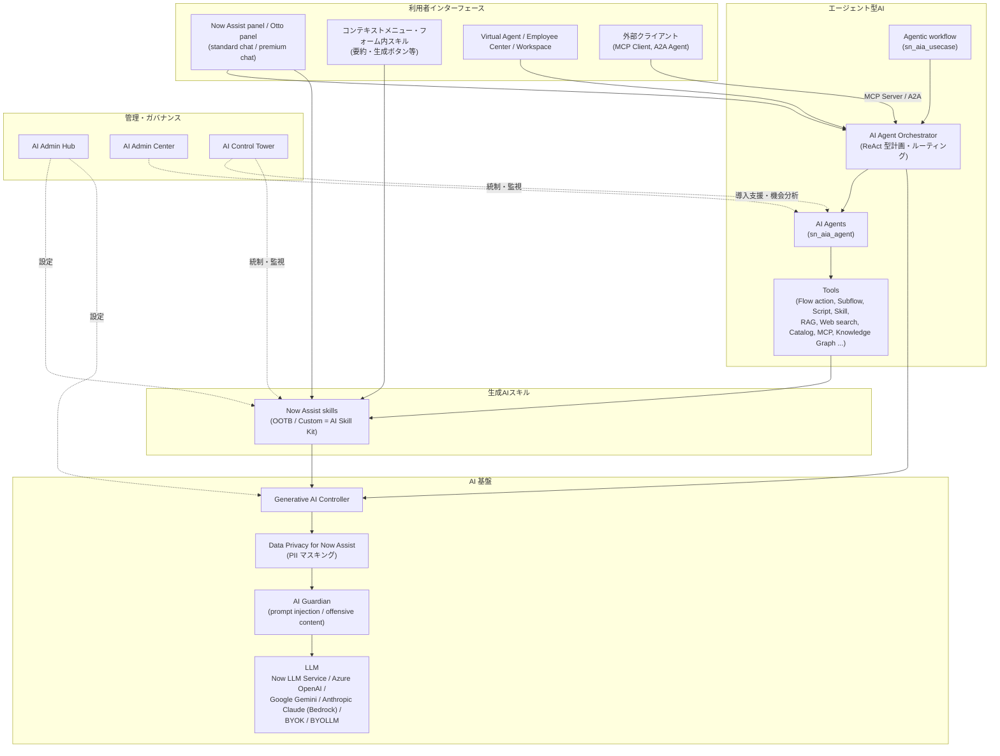
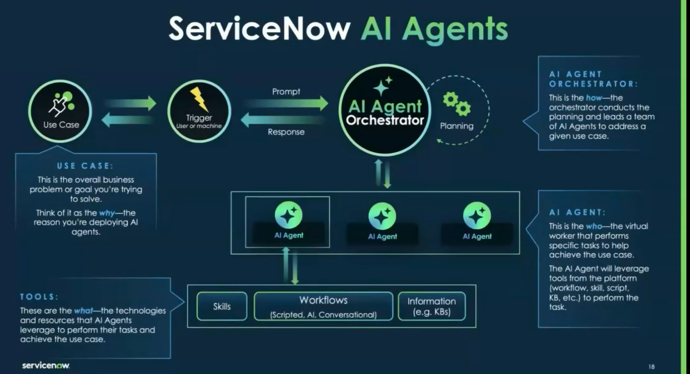
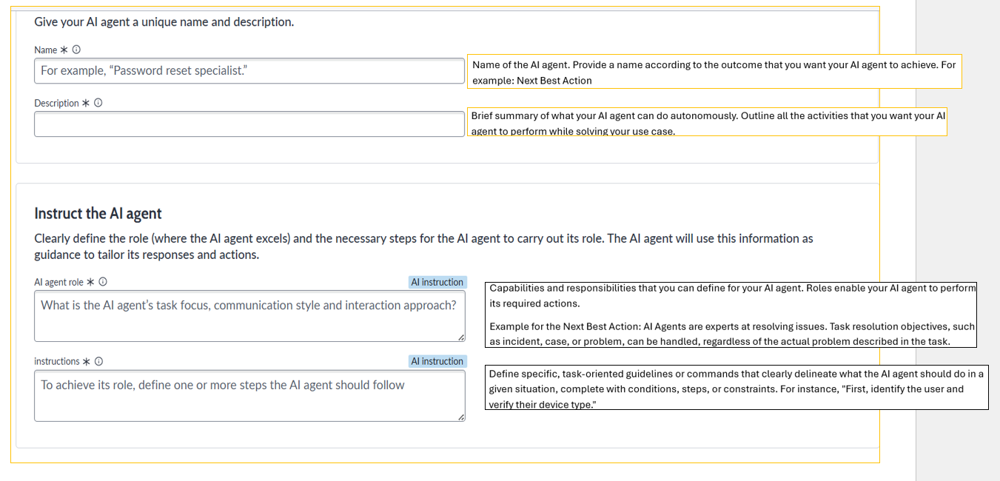
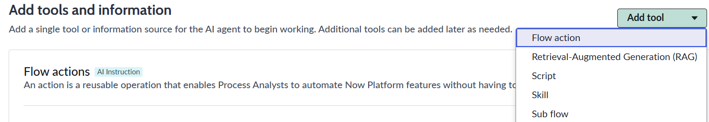
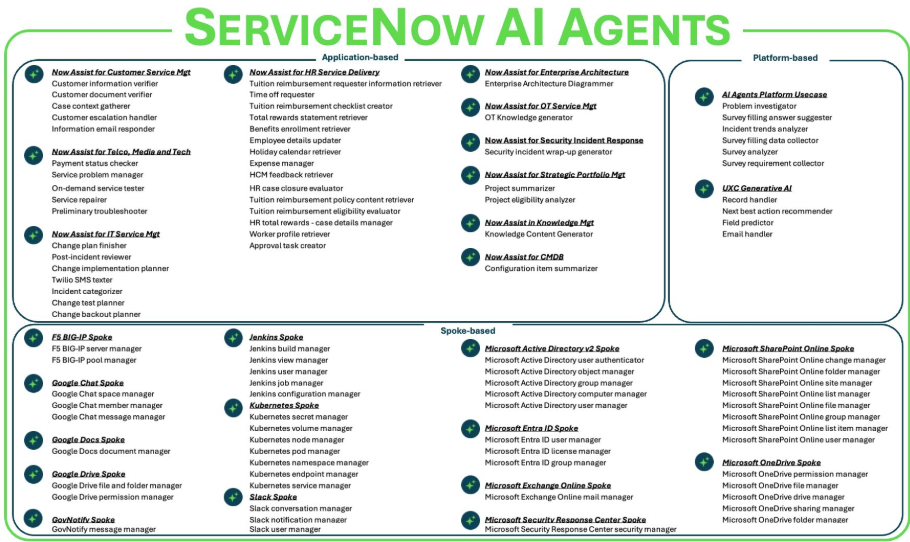

# Now Assist と AI Agents（ServiceNow Otto / 生成AI・エージェント型AI）

## 概要

ServiceNow の AI 機能は、大きく次の3層で構成される。本ファイルは基準リリース **Australia**（2026-05 GA）時点の仕様を、テーブル・ロール・プロパティ・メニューの粒度で整理する。

| 層 | 主な構成要素 | 役割 |
|---|---|---|
| 生成AI（Generative AI） | Now Assist（ServiceNow Otto）スキル、Now Assist panel（Otto panel）、コンテキストメニュー | 要約・生成・推奨・コード生成など「人を支援する」単発の AI 機能 |
| エージェント型AI（Agentic AI） | AI Agents（AIエージェント）、Agentic workflow（エージェント型ワークフロー）、AI Agent Orchestrator（オーケストレーター）、AI Agent Studio、Action Fabric（MCP / A2A） | 目標を与えると計画・ツール実行・他エージェントとの協調を行い「仕事を完了させる」AI |
| 基盤・ガバナンス | Generative AI Controller、AI Admin Hub（旧 Now Assist Admin console）、AI Admin Center（旧 Now Assist Center）、AI Skill Kit（旧 Now Assist Skill Kit）、AI Control Tower、AI Guardian（旧 Now Assist Guardian）、Data Privacy for Now Assist | LLM 接続、スキル有効化、カスタムスキル開発、AI 資産の統制・監視、安全対策 |

2026年の重要な変化は次のとおりである。

- **ブランド変更：** 2026-05-05（Knowledge 2026）に **ServiceNow Otto** が発表された。製品ドキュメント上は Zurich Patch 12 / Australia Patch 5 以降、「Now Assist」が「ServiceNow Otto」に改称されている（製品エンタイトルメントは変更なし）。[出典](https://www.servicenow.com/docs/r/delta-zurich-brazil/brazil-zurich-servicenowotto-release-notes.html) [出典](https://newsroom.servicenow.com/press-releases/details/2026/ServiceNow-Otto-creates-the-unified-AI-experience-for-the-enterprise/)
- **ライセンス体系：** Australia のリリースノートで AI ネイティブの3階層 **Foundation / Advanced / Prime** が記載された。[出典](https://www.servicenow.com/docs/r/australia/release-notes/now-assist-rn.html)
- **既定モデルの変更：** Now LLM Service が新規・未有効化の AI 資産に対する既定モデルではなくなり、第三者 LLM（Azure OpenAI・Google Gemini・Anthropic Claude 等）が既定になった（2026-07）。[出典](https://www.servicenow.com/docs/r/australia/release-notes/now-assist-rn.html)
- **Assist の計測方式：** 365日ルックバック方式から、契約記念日にリセットされる **365日バーンダウン方式** に変更された。[出典](https://www.servicenow.com/docs/r/delta-zurich-brazil/brazil-zurich-aiagentstudio-release-notes.html)

本ファイルでの名称の扱い：Australia GA 時点のドキュメントや画面には旧名称（Now Assist）と新名称（ServiceNow Otto）が混在する。本ファイルでは **旧名称を主とし、新名称を併記** する（例：Now Assist panel（Otto panel））。実機の表示はパッチレベルで異なるため注意する。

関連ファイル：
- Virtual Agent と会話型AI → [virtual-agent.md](./virtual-agent.md)
- Predictive Intelligence と AI Search → [predictive-intelligence-ai-search.md](./predictive-intelligence-ai-search.md)
- Workflow Data Fabric（Zero Copy、Knowledge Graph 等） → [workflow-data-fabric.md](./workflow-data-fabric.md)
- Document Intelligence・RPA → [process-automation-rpa-mining.md](./process-automation-rpa-mining.md)
- ライセンス・価格 → [../../03_導入編/01-licensing-model.md](../../03_導入編/01-licensing-model.md)、[../../03_導入編/02-pricing.md](../../03_導入編/02-pricing.md)、[platform-licensing-packaging.md](./platform-licensing-packaging.md)
- 導入の知見 → [../../04_応用編/10-ai-adoption-lessons.md](../../04_応用編/10-ai-adoption-lessons.md)

---

## 1. 名称とリリースの変遷

### 1.1 主要コンポーネントの導入リリース

ServiceNow の生成AI・エージェント型AI 機能は、Vancouver 以降ほぼ全リリースで大幅に拡張されてきた。

| リリース | 主な追加・変更 | 確度 |
|---|---|---|
| Vancouver（2023-09） | Now Assist（ITSM・CSM・HRSD・Creator 向け生成AIスキル）、Now LLM、Generative AI Controller の提供開始 | 【第三者情報】一般に語られる経緯。本調査では一次資料未確認 |
| Washington DC（2024-03） | Now Assist の対象製品拡大、Generative AI Controller による外部 LLM 接続 | 【第三者情報】 |
| Xanadu（2024-09） | Now Assist Skill Kit（カスタムスキル開発）、AI Agents の発表（Store アプリとして段階提供） | Skill Kit の Xanadu 導入は Community 記事に基づく【第三者情報】 [出典](https://www.servicenow.com/community/in-other-news/agentic-ai-ai-agent-development-guidelines-and-use-cases-hands/ba-p/3206822) |
| Yokohama（2025-03） | AI Agent Studio、AI Agent Orchestrator、Now Assist AI agents アプリ。AI Control Tower（2025-05 Knowledge 2025 で発表） | Now Assist AI agents アプリは Yokohama で導入（公式リリースノート検索結果） |
| Zurich（2025-09） | Google Gemini・Anthropic Claude on AWS を LLM プロバイダーに追加、外部エージェント（A2A）、MCP Client、Knowledge Graph ツール、ロールマスキング、エピソード記憶、AI Agent Analytics dashboard 等 | [出典](https://www.servicenow.com/docs/r/delta-zurich-brazil/brazil-zurich-aiagentstudio-release-notes.html) |
| Zurich Patch 12 / Australia Patch 5 | 「Now Assist」→「ServiceNow Otto」改称、Now Assist Admin console → AI Admin Hub 改称 | [出典](https://www.servicenow.com/docs/r/delta-zurich-brazil/brazil-zurich-servicenowotto-release-notes.html) [出典](https://www.servicenow.com/community/servicenow-otto-articles/tracking-now-assist-usage-measuring-roi-and-adoption-australia/ta-p/3500172) |
| **Australia（2026-05）** | 再設計された AI Agent Studio、AI specialist（Autonomous Workforce）、Kill Switch、MCP Server セキュリティ制御、Foundation/Advanced/Prime、AI Admin Center（旧 Now Assist Center）、第三者 LLM の既定化 | 本ファイル各節 |
| Brazil（2026-09 EA） | AI Admin Hub のワンステップ有効化、モデルプレビュープログラム、MCP/外部エージェントのセキュリティ強化、deny-by-default ACL | 「Brazil での変更」節 |

> Zurich 以降のパッチ（Zurich Patch 4〜12）と Australia のパッチ（Patch 1〜5）は、同じ機能が並行提供される「機能パッチ」の性格を持つ。たとえば AI Agent Studio のリリースノートでは「Zurich Patch 12 ≒ Australia Patch 5」「Zurich Patch 10 ≒ Australia Patch 3」「Zurich Patch 8 ≒ Australia Patch 1」の対応で同一機能が掲載されている。[出典](https://www.servicenow.com/docs/r/delta-zurich-brazil/brazil-zurich-aiagentstudio-release-notes.html) [出典](https://www.servicenow.com/docs/r/delta-australia-brazil/brazil-australia-aiagentstudio-release-notes.html)

### 1.2 ServiceNow Otto ブランド

ServiceNow Otto は 2026-05-05 の Knowledge 2026 で発表された、企業向けの統合 AI 体験ブランドである。[出典](https://newsroom.servicenow.com/press-releases/details/2026/ServiceNow-Otto-creates-the-unified-AI-experience-for-the-enterprise/)

- ServiceNow Otto は **Now Assist、Moveworks、AI Experience** の能力を統合したものと位置付けられている。
- 構成要素として、会話型AI、エンタープライズ検索（文書・Wiki・DB・SharePoint 等、ロール・所在地・部門に応じた回答）、多言語の AI 音声エージェント、AI Data Explorer（自然言語でのデータ分析）が挙げられている。
- Otto の行動は AI Control Tower が統制（AI 対話のログ、ポリシー適用、意思決定の説明可能性）する。
- 提供は **ServiceNow EmployeeWorks** と **AI Control Tower** から開始され、「今後1年で全製品に展開」とされている。
- 製品ドキュメント上は Zurich Patch 12 以降、「Now Assist is now ServiceNow Otto」と記載され、**製品エンタイトルメントは変更なし** と明記されている。[出典](https://www.servicenow.com/docs/r/delta-zurich-brazil/brazil-zurich-servicenowotto-release-notes.html)
- ITSM 向け Store リリースノートでは、Now Assist・Moveworks・AI Experience のブランドが製品内ラベル・アイコン・ツールチップ・ドキュメントで ServiceNow Otto に改称された旨が記載されている（改称漏れの修正も記載あり）。【第三者情報】検索結果要約に基づく [出典](https://www.servicenow.com/docs/r/store-release-notes/store-rn-itsm-now-assist.html)

### 1.3 名称対応表（旧名称 → 新名称）

| 旧名称 | 新名称（Australia Patch 5 / Zurich Patch 12 以降） | 備考 |
|---|---|---|
| Now Assist | ServiceNow Otto | 製品名は「ServiceNow Otto for ITSM」等 |
| Now Assist panel | ServiceNow Otto panel | ドキュメント上は両表記が混在 |
| Now Assist Admin console | AI Admin Hub | [出典](https://www.servicenow.com/community/servicenow-otto-articles/tracking-now-assist-usage-measuring-roi-and-adoption-australia/ta-p/3500172) |
| Now Assist Center（`sn_na_center`） | AI Admin Center | Australia で改称（ナビゲーション・Store 掲載名含む）[出典](https://www.servicenow.com/docs/r/delta-australia-brazil/brazil-australia-aiadmincenter-release-notes.html) |
| Now Assist Skill Kit（NASK） | AI Skill Kit | リリースノートの見出しで「AI Skill Kit」表記 [出典](https://www.servicenow.com/docs/r/u1slaAtcFiiXFQcd9RcR_A/KpWKuf2DQI9~zvWaIhCtCQ) |
| Now Assist Guardian | AI Guardian | 【第三者情報】Community FAQ 記載。リリースノート上も「AI Guardian」表記 |
| AI Agent Fabric（2025-05 発表） | Action Fabric | 【第三者情報】Knowledge 2026 報道 |
| Now Assist AI agents | ServiceNow Otto AI Agents | インストール手順名が「Install ServiceNow Otto AI Agents」 [出典](https://www.servicenow.com/docs/r/delta-australia-brazil/brazil-australia-aiagentstudio-release-notes.html) |

> 注意：プラグイン ID、ロール名（`sn_nowassist_admin.*` 等）、テーブル名は改称後も変更されていない（公開情報で改称は確認できず）。スクリプトや ACL で参照する技術名は旧来のままである。

---

## 2. 全体アーキテクチャ

### 2.1 構成図

図の説明：利用者は Now Assist panel・フォーム上のスキル・Virtual Agent 等から AI を呼び出す。単発の生成タスクは Now Assist スキルが処理し、目標達成型のタスクは AI Agent Orchestrator が Agentic workflow と AI Agents を組み合わせて計画・実行する。いずれも Generative AI Controller 経由で LLM を呼び出し、その経路上で Data Privacy（PII マスキング）と AI Guardian（プロンプトインジェクション・不適切表現の検知）が適用される。管理者は AI Admin Hub でスキルとモデルを設定し、AI Control Tower で AI 資産全体を統制する。（本図は複数の公式資料から本ナレッジが再構成したもの。Data Privacy と AI Guardian の適用順序は公開情報では確認できず）

### 2.2 AI Agents の概念図（公式スライド）

- **キャプション：** ServiceNow AI Agents の概念スライド（ServiceNow 社のプレゼンテーション資料を Community 記事が引用したもの、Yokohama 期）。
- **画面説明：** 左から「Use Case（ユースケース＝なぜ AI エージェントを導入するか、解決したい業務課題）」→「Trigger（ユーザーまたはマシンによる起動）」→ Prompt/Response →「AI Agent Orchestrator（どのように＝計画を立て、AI エージェントのチームを率いる。Planning のループ付き）」が並ぶ。Orchestrator の下に複数の「AI Agent（誰が＝特定タスクを実行する仮想ワーカー。ワークフロー・スキル・スクリプト・KB 等のツールを使う）」が配置され、最下段に「Tools（何を＝Skills、Workflows（Scripted / AI / Conversational）、Information（KB 等））」がある。なお現在の製品では「Use case」は「Agentic workflow」と呼ばれている。
- **出典：** https://www.servicenow.com/community/in-other-news/agentic-ai-ai-agent-development-guidelines-and-use-cases-hands/ba-p/3206822 （取得日：2026-11-02）

---

## 3. Now Assist（ServiceNow Otto）の基本機能

### 3.1 提供形態と前提条件

Now Assist（ServiceNow Otto）の各機能は、ServiceNow Store から提供される製品別プラグイン（例：Now Assist for ITSM）として配布される。

| 項目 | Australia 時点の仕様 | 出典 |
|---|---|---|
| 有効化 | ServiceNow Store から ServiceNow Otto（Now Assist）プラグインを有効化する。AI Admin Hub 自体も Store アプリ | [出典](https://www.servicenow.com/docs/r/australia/release-notes/now-assist-rn.html) |
| UI 前提 | Now Assist panel の利用には Next Experience UI Framework の有効化が必要 | 同上 |
| ブラウザ | Google Chrome、Microsoft Edge をサポート。Internet Explorer は非サポート | 同上 |
| ローカライズ | Dynamic Translation をサポート | 同上 |
| 利用可能機能の決定要因 | ライセンス階層（Foundation / Advanced / Prime）により利用可能なスキル・Agentic workflow・AI Agents が異なる | [出典](https://www.servicenow.com/docs/r/australia/intelligent-experiences/platform-now-assist-landing.html) |
| 利用制限環境 | In-country SKU、FedRAMP、NSC DOD IL5、Australia IRAP-Protected、Self-hosted、Regulated Markets では一部モデル・機能が利用不可（KB1584492、KB0743854、KB2593939） | 同上 |
| データ処理 | 処理のためデータが ServiceNow の集中環境（他リージョンや第三者クラウド事業者の場合あり）に移動する可能性がある。ServiceNow は入出力を製品改善に利用し、顧客はオプトアウト可能（AI Opt-Out ページ） | 同上 |
| ドメインセパレーション | スキルは既定で global ドメインに存在する。ドメイン分離インスタンスでは、AI はユーザーのドメイン内データのみを使用し、共有サービスはプロンプトや応答を保持しない | [出典](https://www.servicenow.com/docs/r/intelligent-experiences/now-assist-skills/now-assist-skills.html) |

ドメインセパレーション全般は [domain-separation.md](./domain-separation.md) を参照。

### 3.2 インストール手順（AI Admin Hub 経由）

Now Assist（ServiceNow Otto）アプリのインストールは、AI Admin Hub と Application Manager を組み合わせて行う。必要ロールは `sn_nowassist_admin.nsa_admin`。[出典](https://www.servicenow.com/docs/r/intelligent-experiences/install-now-assist-feature-plugins.html)（Brazil 版ページ、手順は Australia と共通と推定【推定】）

1. 前提：少なくとも1つの生成AIアプリケーションを Store で入手・ライセンスしておく。
2. **All > AI Admin Hub > Settings** を開き、**Plugins** を選択する（Available for you タブ＝導入可能、Installed タブ＝導入済み）。
3. ライセンスが必要な場合はプラグインカードの **Get plugins** → **Install Plugin** で Store ページを開き、ライセンスを申請する。
4. **All > Application Manager > Available for you** で ServiceNow Otto アプリを探し **Install** を選ぶ。
5. **Select suite version** で互換性のある Otto Suite バージョンを選択する（採用を遅らせる場合は none）。
6. 任意で **Customized ver.**、デモデータ（**Load demo data for selected apps**）を選択する。
7. **Continue** でレビュー。「Installation blocked」と表示されるアプリは当該バージョンのライセンスがない。
8. **Install now** または **Install later**（開始日時を指定して **Schedule**）。
9. AI Admin Hub に戻り **Refresh** → プラグイン、または **View all (Plugin) Assists and Skills** を確認する。
10. 次のステップとして、Otto panel の standard chat の有効化、または個別スキルの有効化を行う。

注意点：
- プラグイン導入時に自動で有効になる「既定有効スキル」がある。防ぐにはインストール前にトグルをオフにする。[出典](https://www.servicenow.com/docs/r/intelligent-experiences/install-now-assist-feature-plugins.html)
- Zurich Patch 4 以降、一部のスキル・エージェント・Agentic workflow は既定で有効になる。[出典](https://www.servicenow.com/docs/r/delta-zurich-brazil/brazil-zurich-servicenowotto-release-notes.html)
- インストール・更新の問題は KB1637452 を参照。

### 3.3 Now Assist panel（ServiceNow Otto panel）

Now Assist panel は、Next Experience の右側に表示される会話型 AI インターフェースである。AI Agents の出力の表示先でもある。[出典](https://www.servicenow.com/docs/r/XRgEFx7nPN6ciT_BBIvnbg/3_8_e2KO3lfz3YU8zFjgyw)

| 機能 | 内容 | 導入時期 |
|---|---|---|
| standard chat / premium chat | premium chat はファイルアップロード、Web 検索、Agentic workflow、音声入力に対応 | premium chat：Zurich Patch 8 [出典](https://www.servicenow.com/docs/r/delta-zurich-brazil/brazil-zurich-servicenowotto-release-notes.html) |
| 音声入力 | 管理者が AI Admin Hub で有効化し、ユーザーがアクセシビリティ設定でオン/オフ | Zurich Patch 4 |
| フォローアップ質問・確認質問 | 回答後の追加質問、意図が曖昧な場合の確認質問 | Zurich Patch 4 / 8 |
| ドキュメントからのデータ抽出 | 文書の内容をフォーム項目へ抽出 | Zurich Patch 8 |
| インライン引用 | 引用からレコードへ遷移し、該当部分をハイライト | Zurich Patch 7 |
| Visual Q&A | スクリーンショット・エラー画像・文書をアップロードして質問 | Australia（2026-06）[出典](https://www.servicenow.com/docs/r/australia/release-notes/now-assist-rn.html) |
| インタラクティブビュー | 知識記事・カタログ・組織図をドロップダウンで切り替え表示。プロモート済みトピックが6件超でカテゴリ表示 | Australia（2026-06） |
| カタログ体験 | 入力途中のカタログフォームから離脱する際の警告、送信後の View Details | Australia（2026-06） |
| コンテキスト保持 | インシデントで panel を開くと、そのインシデントに紐づく直近の会話を表示 | Australia（2026-06） |
| 会話後アンケート | エージェントのタスク完了をトリガーに、設定した確率で表示 | Australia（2026-06） |
| プロンプトライブラリ | プロモートされたプロンプトテンプレートの閲覧、カスタムプロンプトの保存。omnibar から利用 | Australia（2026-07） |
| ストリーミング応答 | 応答のストリーミング表示、複数 LLM プロバイダーでの同期・非同期ワークフロー | Australia（2026-08） |
| レコード切替 | premium chat で会話コンテキストを保ったまま Workspace 内のレコードを切り替え | Australia（2026-09） |
| 生成ファイルのプレビュー | Word / PowerPoint / Excel / PDF の生成ファイルをチャット内でプレビュー・ダウンロード（ServiceNow ブランドなしのプレーンテンプレートも可） | Australia（2026-10）、Brazil にも掲載 |

Now Assist panel を利用するユーザーには `now_assist_panel_user` ロールが必要である。panel の有効化には `sn_nowassist_admin.nsa_admin` が必要で、少なくとも1つの Now Assist アプリケーションがインストールされている必要がある。[出典](https://www.servicenow.com/docs/r/intelligent-experiences/enable-ai-experiences/roles-installed-with-now-assist-admin.html)（検索結果要約に基づく）

### 3.4 コンテキストメニューとフォーム内スキル

コンテキストメニュー（Now Assist context menu）は、テキスト項目上で「短くする（shorten）」「詳しくする（elaborate）」「トーン変更（change tone）」等のスキルを呼び出す仕組みである。

- Zurich Patch 1：コンテキストメニューのスキル・アクションに対するユーザー認証を ACL で制御。カスタムのコンテキストメニューイベントでモードレスウィンドウを抑止可能。[出典](https://www.servicenow.com/docs/r/delta-zurich-brazil/brazil-zurich-servicenowotto-release-notes.html)
- Zurich Patch 4：コンテキストメニュー表示の Advanced settings、1項目に複数のコンテキストメニュー構成、「Enable for extended tables」オプション。
- Zurich Patch 7：Now Assist アイコンを表示する最小語数の設定、AI 生成コンテンツのハイライト。

### 3.5 スキルの分類（要約・生成・推奨・コード生成ほか）

Now Assist スキルは、機能の性質から次のように分類できる（分類は本ナレッジによる整理。スキル名は公式スキル一覧の表記）。[出典](https://www.servicenow.com/docs/r/intelligent-experiences/now-assist-skills/now-assist-skills.html)

| 分類 | 代表的なスキル | 主な製品 |
|---|---|---|
| 要約（Summarization） | Incident summarization、Case summarization、Chat summarization、Sidebar discussion summarization、Change request summarization、Document summarization、Configuration item (CI) summarization | ITSM、CSM、HRSD、FSM、CMDB、IRM、SecOps ほか |
| 生成（Generation） | Resolution notes generation、KB generation（Knowledge article generation）、Release notes generation、Email recommendation、Chat reply recommendation、Activity response generation、Complete record generation | ITSM、CSM、HRSD、Knowledge |
| 分析・説明（Analysis / Explanation） | Change request risk explanation、Incident sentiment analysis、Alert analysis、Past incident analysis、Error analysis、Portfolio insights | ITSM、ITOM AIOps、SPM |
| 推奨・支援（Assist / Recommendation） | Incident assist、Suggested steps generation、Approval recommendation、Recommended actions | ITSM、CSM、Vulnerability Response、SAM |
| 抽出（Extraction） | Extract information from documents、Contract metadata extraction、Extract entitlements from contract、Extract data from utility invoices | Platform、Contract Management、SAM、Operational Sustainability |
| 検索・ナビゲーション | Navigation、TextToResult、Knowledge content recommendation、Potential knowledge gaps、Identify duplicate articles、Article optimization | Platform、AI Search、Knowledge |
| コード・アプリ生成（Now Assist for Creator） | Code Assist（autocomplete / edit / summarization / generation）、Flow generation（画像からの生成含む）、Playbook generation、Catalog item generation、Spoke generation、RPA bot generation、Mobile card generation、Create an AI-generated experience、Build Agent | App Engine / Creator |
| データ分析 | AI Data Explorer skills（Analytics exploration 等）、Analytics query generation、Data visualization generation | Platform Analytics |

#### 3.5.1 プラットフォーム共通スキル（Platform workflow）

公式スキル一覧（Brazil 版）の Platform workflow には次のスキルが掲載されている：Article optimization、Catalog item form slot-fill、Complete record generation、Conversational Help、Document summarization、Dynamic Guidance、Extract information from documents、GAF skills、Identify duplicate articles、Knowledge content recommendation、Navigation、New column data generation、Potential knowledge gaps、Requester approval checklist、ServiceNow Lens、Smart documents、Standard ticket page、TextToResult、Voice Assist for Docs。[出典](https://www.servicenow.com/docs/r/intelligent-experiences/now-assist-skills/now-assist-skills.html)

- **Conversational Help** スキルは Australia Patch 1 以降、デプロイ・機能強化・サポートの対象外となった（KB0867184）。後継として External Content Connectors Application Suite（Store）への移行が案内されている。[出典](https://www.servicenow.com/docs/r/australia/release-notes/now-assist-rn.html)
- **GAF（Group Action Framework）skills** は、レコードのクラスタリング（グルーピング）、代表レコード選定、新規レコードの既存クラスタへのマッピング、クラスタ単位の洞察生成を行う基盤スキル群で、Agentic workflow「Analyze task trends」等が利用する。関連テーブルは 6.3 節を参照。[出典](https://www.servicenow.com/docs/r/x7YYxCVARboMBfN2zKAZsA/chlrUCbYlmpxseiG33Kw7g)

#### 3.5.2 Assist 消費量の目安（スキル別）

スキルごとの Assist 消費量は公式の「ServiceNow Assist Overview」（Assist schedule）で定義されている。本調査では当該 PDF 本体は取得できず、以下は Community ブログの記載である。【第三者情報】[出典](https://www.servicenow.com/community/servicenow-ai-platform-blog/think-before-you-prompt-assists-vs-tokens-in-servicenow/ba-p/3583777)（2026-08-05 投稿）

| スキル / 機能 | Assist 数（目安） |
|---|---|
| Alert Analysis、Platform Navigation、Chat/Call Summarization | 1 |
| Document Summarization、Incident Assist | 5 |
| Knowledge Article Generation | 10 |
| Contract Analysis | 50 |
| Flow Generation | 500 |
| Experience (UI) Generation | 1,000 |
| App Generation、Playbook Generation | 2,500 |
| Advanced Auto Evaluation | 4,000 |
| Agentic workflow（Small：0〜4 アクション） | 25 |
| Agentic workflow（Medium：5〜8 アクション） | 50 |
| Agentic workflow（Large：9〜20 アクション） | 150 |

- 上記ブログでは、Agentic workflow は 20 アクションまたは 1 時間の無操作で終了するとされる。【第三者情報】
- 実際の換算率は契約書（エンタイトルメント・パッケージ）が正となる。

---

## 4. 製品別 Now Assist

### 4.1 Now Assist for ITSM（ServiceNow Otto for ITSM）

Now Assist for ITSM は、インシデント・変更・リリース管理等の ITSM プロセス向けの生成AI スキル群である。Australia 版の概要ページには次のスキルが記載されている。[出典](https://www.servicenow.com/docs/r/QykF2iRSIs6VXztArCSo3w/PRIythxagGcuDVufUsHy5Q)

| スキル | 内容 |
|---|---|
| Chat summarization | Virtual Agent のチャット履歴、またはチャット終了・インシデント作成時の対話全体を要約 |
| Sidebar discussion summarization | エージェント・依頼者・SME 間の Sidebar 議論を要約し、インシデントの作業メモに投稿可能 |
| Incident summarization | アクティブなインシデントを「Issue（問題）」「Actions taken（実施内容）」「Resolution（解決）」で要約 |
| Incident assist | Now Assist panel で、呼び出し元の資産・最近のインシデント、オンコール専門家、類似の解決済みインシデントについて回答（Service Operations Workspace for ITSM） |
| Change request summarization | 変更要求の目的・計画・リスクを要約 |
| Change request risk explanation | 変更要求のリスク評価（High / Medium / Low）の理由を、類似変更・関連インシデント・リスク条件から説明 |
| Resolution notes generation | 類似インシデントを扱う他のエージェント向けに解決メモを生成 |
| Knowledge generation | 解決策提示後またはクローズ後のインシデントからナレッジ記事の下書きを生成（公開前にレビュー） |
| Chat reply recommendation | チャット内容から依頼者への返信案を生成（送信前にレビュー） |
| Release notes generation | Readiness フェーズのリリースについて、スコープ成果物から構造化リリースノートを生成（Digital Product Release の Product manager ロール） |

公式スキル一覧（Brazil 版）では ITSM のスキルとして、上記に加え Email recommendation、Generate change risk assessment answers and reasoning、Incident activity response generation、Incident sentiment analysis、Investigate boot time issues、Investigate Zoom call quality issues、Major incident management email content recommendation、Request activity response generation、Requested item activity response generation、Suggested steps generation が掲載されている。[出典](https://www.servicenow.com/docs/r/intelligent-experiences/now-assist-skills/now-assist-skills.html)

#### 4.1.1 主要スキルの入力・トリガー・出力

次の表は公式「Skill inputs and triggers」ページ（Yokohama 版）に基づく。Australia で変更されている可能性があるため、実機で確認すること。[出典](https://www.servicenow.com/docs/r/Mr7qUatbFXax1_h~z60rmA/ixG4dKm8dFC1aePe8m17SA)

| スキル | 既定の入力（テーブル: フィールド） | トリガー | 出力 |
|---|---|---|---|
| Incident summarization | `incident`: Description、Short description、Work notes、Additional comments、Email（State が New / WIP / Resolved / Closed） | Assignment group または Assigned to 変更時の保存で開く Assign モーダル、ユーザー操作 | Issue、Key Actions Taken、Resolution、Affected CIs and Impacted Services、SLA、Child Incidents（状態により必須セクションが異なる） |
| Resolution notes generation | `incident`: Description、Short description、Work notes、Additional comments | ユーザー操作、または条件成立時に自動 | 解決メモ |
| Knowledge article generation | `incident`（Resolved / Closed）: Short description、Description、Resolution notes、Work notes、Comments | — | ナレッジ記事下書き |
| Incident sentiment analysis | `incident`: Short description、Description、Priority、State、Created、Additional comments、Task SLA | スケジュールジョブ「Sentiment analysis scheduled job (incident)」（既定で有効） | 感情値（Positive / Neutral / Negative）、傾向（Improving / Declining / Stable）、理由 |
| Suggested steps generation | `incident`: Short description、フィルター条件（既定：過去6か月にクローズした類似インシデント） | — | 推奨解決手順 |
| Incident activity response recommendation | `incident`: Description、Short description、Priority、State、Work notes、Comments | Work notes（Summarize actions、Post response）、Comments（Follow up、Post response、Acknowledge task） | 作業メモ・コメント用の応答案 |
| Major Incident email content recommendation | `incident` の各項目、Task SLA（Target、Stage、Time left、Has breached 等）、Collaboration chat の Payload（手動選択） | — | メール本文 |
| Chat summarization | — | Virtual Agent → Live Agent ハンドオフ、クイックアクション `/summarize`、チャット終了、タスク作成 | チャット要約（箇条書き可） |
| Change request summarization | `change_request`: Short description、Description、Work notes、Risk、Impact、Justification、Implementation plan、Test plan、Backout plan、Close code、Close notes 等 | — | 状態（Assess、Authorize & Scheduled、Implement & Review、Closed）に応じた要約 |
| Change request risk explanation | `change_request`: Short description、Implementation plan、Assignment group、Risk 等、類似変更・関連インシデント、成立したリスク条件 | — | リスク説明 |

- Incident summarization は既定で有効、利用には `itil` ロールが必要（Zurich 版ページ）。[出典](https://www.servicenow.com/docs/r/Mr7qUatbFXax1_h~z60rmA/zxdYU0fVMKmksUyPRFb1lQ)
- ITSM の AI Agents（Agentic workflow）については 5.9 節、ITSM Pro 固有機能全般は [../itsm/itsm-pro-features.md](../itsm/itsm-pro-features.md) を参照。

> **Brazil での変更:** 「ServiceNow Otto for IT Service Management (ITSM) was enhanced and updated in the Brazil release」とされているが、本調査では個別機能の内容は確認できなかった。【第三者情報】検索結果要約に基づく

### 4.2 Now Assist for HR Service Delivery（HRSD）

Now Assist for HRSD は、HR ケース管理向けの生成AI スキル群である。公式スキル一覧に掲載されている HRSD スキルは次のとおり：Case summarization、Chat reply recommendation、Chat summarization、Email recommendation、KB generation、Employee information summarization、Resolution notes generation、Sentiment analysis（HR case / HR task）、Sidebar discussion summarization。[出典](https://www.servicenow.com/docs/r/intelligent-experiences/now-assist-skills/now-assist-skills.html)

- HR case summarization は既定で有効で、Core UI と Agent Workspace for HR Case Management で利用できる。入力テーブルは `sn_hr_core_case`（Description、Priority 等）、必要ロールは `sn_hr_core.case_writer`。【第三者情報】検索結果要約に基づく。公式ページで要確認 [出典](https://www.servicenow.com/docs/r/employee-service-management/now-assist-for-hrsd/now-assist-hrsd-skill-inputs.html)
- Employee Experience 向けに承認時の要約スキル（Requested item summarization for approvals、Request summarization for approvals、Case summarization for approvals）がある。[出典](https://www.servicenow.com/docs/r/intelligent-experiences/now-assist-skills/now-assist-skills.html)
- HRSD 本体の仕様は [../employee/hr-service-delivery.md](../employee/hr-service-delivery.md) を参照。

### 4.3 Now Assist for Customer Service Management（CSM）

Now Assist for CSM は、カスタマーサービス向けの生成AI スキル群である。公式スキル一覧の CSM スキル：Activity response generation、Automated quality assurance、Call summarization、Case summarization、Chat recommendation、Chat summarization、Create case based on service definition recommendations、Customer summarization、Email recommendation、KB generation、Resolution notes generation、Sentiment analysis（case、dashboard、email interactions）、Sidebar summarization、Special handling notes summarization、Suggested steps generation、Trending topics dashboard。[出典](https://www.servicenow.com/docs/r/intelligent-experiences/now-assist-skills/now-assist-skills.html)

- AI Admin Center の Australia 新機能として、チャット・音声・メールのデータから CSM の自動化機会を分析し、チャネル別エージェントをマッチング・生成する「CSM automation opportunities」がある。[出典](https://www.servicenow.com/docs/r/delta-australia-brazil/brazil-australia-aiadmincenter-release-notes.html)
- CSM 本体は [../customer/customer-service-management.md](../customer/customer-service-management.md) を参照。

### 4.4 その他の製品別 Now Assist（抜粋）

公式スキル一覧（Brazil 版）に掲載されている主な製品別スキルの抜粋。[出典](https://www.servicenow.com/docs/r/intelligent-experiences/now-assist-skills/now-assist-skills.html)

| 製品 | 代表スキル |
|---|---|
| ITOM AIOps | Alert analysis、Alert group analysis、Past incident analysis、AI-generated incident creation、Analyze service health |
| SAM | Extract entitlements from contract、Software normalization、Publisher compliance summarization |
| SPM | Project plan generation、Story generation、Epic status assessment、Portfolio insights、Create a demand |
| IRM | Issue summarization、Regulatory alert summarization、Control objective impact analyzer、Risk assessment summarization |
| Security Incident Response | Security incident summarization、Post-incident analysis、Security incident recommended actions、Generate content for shift handover |
| Vulnerability Response | Suggest vulnerability solutions、Vulnerable item deduplication、Approval recommendation |
| Field Service Management | Work order task summarization、KB generation |
| Legal Service Delivery | Legal request summarization、Triage legal request |
| Contract Management Pro | Contract analysis、Contract obligation extraction、Conversational contract search and insights |
| Accounts Payable Operations | Invoice case summarization、Purchase order line mapping |
| CMDB | Configuration item (CI) summarization、Manage duplicate CIs、Summarize CMDB readiness |
| Vault | Check role access、Generate custom data pattern |
| Zero Copy Connector | ERP data discovery、ERP data query |

各製品の詳細は 02_リファレンス 配下の各製品ファイルを参照。

---

## 5. AI Agents（エージェント型AI）

### 5.1 用語と構成要素

ServiceNow の Agentic system（エージェント型システム）は、Orchestrator が AI Agents を統括して Agentic workflow を実行する枠組みである。[出典](https://www.servicenow.com/docs/r/XRgEFx7nPN6ciT_BBIvnbg/3_8_e2KO3lfz3YU8zFjgyw)（Australia 版「Explore AI agents」）

| 用語 | 定義 | 主テーブル |
|---|---|---|
| AI agent（AIエージェント） | 特定タスクを主に自然言語で実行する仮想エージェント。LLM への指示（instructions）とタスク達成用のツール一式を持つ | `sn_aia_agent` |
| Agentic workflow（エージェント型ワークフロー。旧称 Use case） | AI エージェントが目標達成のために設計・実行する自動化プロセス。問題と状況を定義する。「Agentic workflow がなければ、エージェントはいつ何をすべきかわからない」 | `sn_aia_usecase` |
| AI Agent Orchestrator（オーケストレーター） | 複雑なワークフローでエージェント同士が協調できるよう調整する中央管理システム | — |
| Tools（ツール） | Web 検索、レコード操作、フロー実行等、エージェントがタスクを完了するための能力 | `sn_aia_tool`、`sn_aia_agent_tool_m2m` |
| Trigger（トリガー） | Agentic workflow の実行を開始するイベント | `sn_aia_trigger_configuration` |
| Guided setup（ガイド付き設定） | トリガー、データソース、表示場所（display location）を業務要件に合わせて設定するウィザード | — |
| AI Agent Studio | AI エージェントと Agentic workflow を作成・管理・テストする統合環境 | — |

動作の流れ：
1. トリガーが Agentic workflow を開始する。
2. Orchestrator が1つ以上のエージェントを調整して計画を実行する。
3. 結果が Now Assist panel（Otto panel）等に表示される。エージェントはインシデントやケースの状況変化に応じて行動を調整できる。

構築の流れ：① Agentic workflow を作成 → ② エージェントを作成しツールを追加 → ③ テストし調整 → ④ 組織全体へ展開。[出典](https://www.servicenow.com/docs/r/XRgEFx7nPN6ciT_BBIvnbg/3_8_e2KO3lfz3YU8zFjgyw)

### 5.2 AI Agent Orchestrator

AI Agent Orchestrator は、Agentic workflow の計画立案とエージェントへのタスク割り当てを担う。

- **Base plan（基本計画）：** Agentic workflow レベルで設定する、Orchestrator への初期計画手順の指示。[出典](https://www.servicenow.com/docs/r/x7YYxCVARboMBfN2zKAZsA/qDgIP~f7~dmSqFV7_sM~HQ)
- **Dynamic Orchestrator：** Agentic workflow に 8〜10 を超えるエージェントがある場合、計画時に適切なエージェントを選択的に特定し、性能と精度を最適化する（Yokohama 版記載、Zurich で機能として明記）。[出典](https://www.servicenow.com/docs/r/delta-zurich-brazil/brazil-zurich-aiagentstudio-release-notes.html)
- **ReAct Orchestrator プロンプト：** Zurich で、基本のリフレクションプロンプトが ReAct Orchestrator プロンプトに置き換えられ、Route スケジューリングモードが追加された。[出典](https://www.servicenow.com/docs/r/delta-zurich-brazil/brazil-zurich-aiagentstudio-release-notes.html)
- **既定モデル：** LLM として Azure OpenAI を選択している場合、Orchestrator の既定モデルは **GPT-5.4**（Australia）。[出典](https://www.servicenow.com/docs/r/delta-australia-brazil/brazil-australia-aiagentstudio-release-notes.html)
- **並行実行：** AI Agent Background Channel と非対話モードで、エージェントと Agentic workflow を並行実行可能（Zurich）。

### 5.3 AI Agent Studio

AI Agent Studio は AI エージェント・Agentic workflow・ツールを作成・テスト・評価する開発環境である。メニューは **All > AI Agent Studio > Overview**（View steps で手順表示）。[出典](https://www.servicenow.com/docs/r/SRy58xeijUUqttfwLgfrHQ/7KHOmn4s4FQNzP7OGJOdjw)

| 領域 | 主な機能 | 出典 |
|---|---|---|
| Create and manage | Agentic workflow（旧 Use cases）、AI agents、ツールの作成・管理。AI agents タブの Add ボタンは Chat / External 等のエージェント種別を選ぶドロップダウン（Zurich）。既存ツールの複製・選択 | [出典](https://www.servicenow.com/docs/r/delta-zurich-brazil/brazil-zurich-aiagentstudio-release-notes.html) |
| Testing | Manual tests / Automated tests タブ。手動テストのプレイグラウンドでテストモードを選択（AI Native → **Premium Chat** に改称）。タブ名も Test scenario → **Test AI reasoning**、Output → **Chat responses** に改称 | 同上 |
| Automated evaluations | タスク完了率・ツール選択精度等の標準指標で自動評価。音声エージェントの評価（Zurich / Australia）。評価結果からノード単位のトレースと最適化提案、ガイド付きフローで適用・再評価 | 同上 |
| Activity | 実行の閲覧・トラブルシュート（Zurich） | 同上 |
| Security configuration | ロールマスキング（エージェント・ワークフロー・ツールを特定ロールに制限）用の UI ページ | 同上 |
| Settings | Manage MCP Servers、External AI Agents（相互の発見可否）等 | 【第三者情報】[出典](https://www.servicenow.com/community/developer-advocate-blog/servicenow-action-fabric-a-detailed-walkthrough/ba-p/3581348) |
| AI Agent Analytics dashboard | エージェント・ワークフローの利用状況、顧客満足度指標（Zurich） | [出典](https://www.servicenow.com/docs/r/delta-zurich-brazil/brazil-zurich-aiagentstudio-release-notes.html) |

#### 5.3.1 Australia の「再設計された AI Agent Studio」

Australia（Patch 5、Zurich Patch 12 相当）で AI Agent Studio が再設計された。[出典](https://www.servicenow.com/docs/r/delta-australia-brazil/brazil-australia-aiagentstudio-release-notes.html)

- エージェント型 AI 資産の作成・テスト・評価を効率化。特定済みの自動化機会（automation opportunities）と評価用テストシナリオを含む。
- 自動評価がアプリケーションに組み込まれ、自動化機会から AI エージェントを作成できる。
- 旧 UI へのアクセス方法は「Configure AI Agent Studio settings」を参照。
- AI-native 体験（AI-native のエージェント作成、AI Native / Premium Chat プレイグラウンド、ツール出力の表示ウィジェット）には **Off Glide Conversation Server** プラグイン（`com.glide.cs.offglide`）が必要。未導入の場合は標準のプレイグラウンド・標準のツール追加フォームが使われる。

#### 5.3.2 エージェント作成フォーム

- **キャプション：** AI Agent Studio で AI エージェントを作成する際の基本情報・指示入力画面（Yokohama 期のスクリーンショットに、投稿者が各項目の説明を注記したもの）。
- **画面説明：** 上段「Give your AI agent a unique name and description」に **Name**（必須。例：「Password reset specialist」。達成したい成果に沿った名前を付ける）と **Description**（必須。エージェントが自律的に行える活動の要約）がある。下段「Instruct the AI agent」に **AI agent role**（必須、AI instruction。タスクの焦点・コミュニケーションスタイル・対話方針を定義）と **Instructions**（必須、AI instruction。役割を果たすための手順・条件・制約。例：「First, identify the user and verify their device type.」）がある。Australia の再設計後 UI では画面構成が異なる可能性がある。
- **出典：** https://www.servicenow.com/community/in-other-news/agentic-ai-ai-agent-development-guidelines-and-use-cases-hands/ba-p/3206822 （取得日：2026-11-02）

### 5.4 ツール（Tools）

AI エージェントには「Add tools and information」ステップでツールと情報源を追加する。

- **キャプション：** AI エージェントにツールを追加する「Add tools and information」セクションと Add tool ドロップダウン（Yokohama 期）。
- **画面説明：** 「Add a single tool or information source for the AI agent to begin working. Additional tools can be added later as needed.」の説明と、右上の **Add tool** ドロップダウンが表示されている。選択肢は **Flow action**、**Retrieval-Augmented Generation (RAG)**、**Script**、**Skill**、**Sub flow**。左側には追加済みの「Flow actions」セクションが見える。Zurich 以降はこれに加えて Web search、Catalog item、MCP、Knowledge Graph、Desktop action 等が追加されている。
- **出典：** https://www.servicenow.com/community/in-other-news/agentic-ai-ai-agent-development-guidelines-and-use-cases-hands/ba-p/3206822 （取得日：2026-11-02）

| ツール種別 | 内容 | 導入・出典 |
|---|---|---|
| Flow action / Subflow | Workflow Studio（Flow Designer）のアクション・サブフローを実行。IntegrationHub スポークのアクションも利用可能（サポートされるデータ型は `sn_aia.agent_tool_supported_data_types` で定義） | [出典](https://www.servicenow.com/docs/r/x7YYxCVARboMBfN2zKAZsA/chlrUCbYlmpxseiG33Kw7g) |
| Script | スクリプトを実行 | 上記画像 |
| Skill | Now Assist スキル（OOTB / カスタム）を実行 | 上記画像 |
| RAG（Retrieval-Augmented Generation） | ナレッジ等の検索結果に基づく回答 | 上記画像 |
| Web search | 検索プロバイダーを選択。Google を選ぶと Global Standard デプロイの Grounding with Google Search を使用し、**データレジデンシーが保証されない**（インスタンスのリージョン外にデータが出る可能性） | [出典](https://www.servicenow.com/docs/r/intelligent-experiences/add-tool-aia-new.html) |
| Catalog item | Service Catalog アイテムへの会話型アクセス | 同上 |
| Knowledge Graph | エンティティ間の関係情報を提供（Global Graph → Enterprise Graph に改称、Enterprise Graph (Small) も利用可）。Australia で会話履歴トグル（既定オン、直近5ターンを渡す）を追加 | [出典](https://www.servicenow.com/docs/r/delta-australia-brazil/brazil-australia-aiagentstudio-release-notes.html) |
| MCP tool | 外部 MCP サーバーのツールを呼び出す（MCP Client） | 5.8 節 |
| Desktop action | デスクトップ自動化（RPA）をツールとして追加（Zurich） | [出典](https://www.servicenow.com/docs/r/delta-zurich-brazil/brazil-zurich-aiagentstudio-release-notes.html) |
| Document Intelligence | AI Skill Kit でスキル作成時のツールとして利用（Zurich Patch 1） | [出典](https://www.servicenow.com/docs/r/u1slaAtcFiiXFQcd9RcR_A/KpWKuf2DQI9~zvWaIhCtCQ) |

#### 5.4.1 実行モード（Execution mode）

ツールごとに実行モードを設定する。[出典](https://www.servicenow.com/docs/r/intelligent-experiences/add-tool-aia-new.html)

| モード | 動作 | 推奨用途 |
|---|---|---|
| Autonomous（自律） | エージェントがツールを選択した時点で即実行。プロンプトや介入の機会はない | 読み取り、影響の小さい更新 |
| Supervised（監督） | 人が承認するまでエージェントが一時停止する。無人実行中は誰かが応答するまで停止したままになる | 書き込み、削除、顧客への連絡、予算支出を伴う操作 |

- Workflow Studio の「Use an AI agent」アクションにも Autonomous / Supervised の2モードがあり、Supervised では Support User（承認者）を指定する。[出典](https://www.servicenow.com/docs/r/build-workflows/workflow-studio/use-an-ai-agent-action.html)
- システムプロパティ `sn_aia.enable_usecase_tool_execution_mode_override`（既定 false）を true にすると、非自動ツールを上書きして Agentic workflow を完全自律で実行する。[出典](https://www.servicenow.com/docs/r/x7YYxCVARboMBfN2zKAZsA/chlrUCbYlmpxseiG33Kw7g)

#### 5.4.2 出力変換と設計指針

- **Output transformation strategy：** ツール出力（大量の結果等）の処理方法を指示するフィールド。Zurich で「Custom」戦略（LLM 指示に従ってツール出力を変換）が追加された。[出典](https://www.servicenow.com/docs/r/delta-zurich-brazil/brazil-zurich-aiagentstudio-release-notes.html)
- **単一目的のツール：** ツールは単一目的で、明確な説明を付けて構成することが推奨されている。[出典](https://www.servicenow.com/docs/r/x7YYxCVARboMBfN2zKAZsA/qDgIP~f7~dmSqFV7_sM~HQ)
- 1エージェントに割り当てられるツール数の上限は `sn_aia.maximum_agent_tools`（既定 20）。

### 5.5 トリガーとチャネル

AI エージェント・Agentic workflow の起動方法は次のとおり。

| 起動方法 | 内容 | 出典 |
|---|---|---|
| 会話（Now Assist panel / Virtual Agent） | ユーザーの発話から Orchestrator が Agentic workflow を選択。Virtual Agent での AI エージェント発見は `sn_nowassist_va.router_redirect_va_agentic`（既定 `ROUTER_DECISION`、`NEVER` で Agentic AI を使わず Q&A のみ）で制御 | [出典](https://www.servicenow.com/docs/r/x7YYxCVARboMBfN2zKAZsA/chlrUCbYlmpxseiG33Kw7g) |
| レコードトリガー | レコード作成時・更新時・作成または更新時 | 【第三者情報】ServiceNow AI CoE の Community 記事 [出典](https://www.servicenow.com/community/ceg-ai-coe-articles/limit-assist-consumption-by-designing-ai-agents-which-avoid/tac-p/3477911/highlight/true) |
| スケジュールトリガー | 定期実行。1回の起動で処理するレコード数は `sn_aia.max_scheduled_trigger_query`（既定 10） | 同上、[出典](https://www.servicenow.com/docs/r/x7YYxCVARboMBfN2zKAZsA/chlrUCbYlmpxseiG33Kw7g) |
| Workflow Studio アクション | 「Use an AI agent」アクションでフローから呼び出し | [出典](https://www.servicenow.com/docs/r/build-workflows/workflow-studio/use-an-ai-agent-action.html) |
| UI アクション / フォーム内実行 | Core UI・Workspace のフォーム上で Agentic workflow を実行・監視（スーパーバイザー、時間、メッセージ、ステップ履歴を表示）。表示条件付き UI アクション | [出典](https://www.servicenow.com/docs/r/delta-zurich-brazil/brazil-zurich-aiagentstudio-release-notes.html) |
| AI Agent Background Channel | Workspace または Core UI からバックグラウンドで起動（AI Agent Background Provider に紐づく） | 同上 |
| 外部（A2A / MCP） | 外部エージェントシステムから ServiceNow のエージェントを発見・呼び出し | 5.8 節 |

**対話モード：** Interactive（対話）エージェントはフォールバック時にユーザーへ情報を求める。Non-interactive（非対話）エージェントは代わりに出力を送信する。[出典](https://www.servicenow.com/docs/r/delta-zurich-brazil/brazil-zurich-aiagentstudio-release-notes.html)

> 実務上の注意：自律（Autonomous）エージェントのレコードトリガーでは、エージェント自身の更新が再びトリガーを発火させる再帰ループが起こり得る。【第三者情報】[出典](https://www.servicenow.com/community/ceg-ai-coe-articles/limit-assist-consumption-by-designing-ai-agents-which-avoid/tac-p/3477911/highlight/true) Australia では Kill Switch（5.7 節）がこの対策となる。

### 5.6 メモリ・学習

| 機能 | 内容 | 関連プロパティ |
|---|---|---|
| 短期記憶（コンテキスト共有） | 1つの会話内の実行間でコンテキストを保持 | `sn_aia.allow_context_sharing`（既定 true）、`sn_aia.context_sharing_strategy`（既定 `summarise`） |
| 長期記憶（Long-term memory） | 過去のユーザー対話を LLM コンテキストとして利用 | `sn_aia.ltm.enable_long_term_memory`（既定 false）、`sn_aia.ltm.use_memory_for_ai_agent`（既定 true）、`sn_aia.ltm.category.auto_create`（既定 false） |
| エピソード記憶（AI agent learning） | 過去の成功した対話からエージェントが学習（Zurich） | — |
| ユーザーコンテキスト | Knowledge Graph API `getUserContext` から profile / manager / reportees / assets を取得 | `sn_aia.user_context_data`（既定 `profile`）。`UserContextUtil` で上書き可能 |

[出典](https://www.servicenow.com/docs/r/x7YYxCVARboMBfN2zKAZsA/chlrUCbYlmpxseiG33Kw7g) [出典](https://www.servicenow.com/docs/r/delta-zurich-brazil/brazil-zurich-aiagentstudio-release-notes.html)

### 5.7 安全制御（Kill Switch、ロールマスキング、ACL、UI 検証）

| 機能 | 内容 | 導入 |
|---|---|---|
| Kill Switch（暴走エージェント検知） | 同一レコードが同一目的を閾値を超えて繰り返しトリガーした場合にエージェントを無効化 | Zurich Patch 10 / Australia Patch 3 [出典](https://www.servicenow.com/docs/r/delta-australia-brazil/brazil-australia-aiagentstudio-release-notes.html) |
| ロールマスキング | エージェント・Agentic workflow・ツールを構成済みロールに限定 | Zurich Patch 4 |
| AI エージェント・ワークフローの ACL | 誰が発見・起動できるか、動的ユーザー / AI ユーザーとしての動作、認証済み / 公開ユーザーへの提供を制御 | Zurich Patch 1 |
| deny-by-default ACL | 新規に有効化したインスタンスでは `gen_ai_agent`、`gen_ai_workflow`、`gen_ai_skill`、`Flow`、`flow_action` の各レコードタイプが既定で拒否（従来は既定で許可） | Zurich Patch 10 のハイライトに掲載。Brazil の新機能表に掲載。Australia での適用パッチは資料間で記載が一致しない |
| アクセステスト | ユーザーが AI エージェント / Agentic workflow にアクセスできるかを検査。拒否時は Access Management の Access Analyzer を使用 | Zurich、Australia、Brazil |
| UI 検証（UI validation） | AI 起点のレコード更新に必須項目等の検証を適用。オプトイン（既定無効）。`glide.ai_record_activity.validation.feature.enabled` で機能を有効化、`glide.ai_record_activity.ai_detection.nap.enabled` で Now Assist panel 起点の更新にも適用。AI スキル・Virtual Agent・エージェント起点用の同種プロパティもある（名称は「Reference for AI agents」参照） | Zurich Patch 9 / Australia Patch 2 |
| 実行回数の上限 | 同一ツールの連続実行 `sn_aia.continuous_tool_execution_limit`（既定 7）、失敗時の再試行 `sn_aia.react_failure_retry_max_limit`（既定 3）、Quick Mode の再試行 `sn_aia.quick_mode_failure_retry_max_limit`（既定 3） | [出典](https://www.servicenow.com/docs/r/x7YYxCVARboMBfN2zKAZsA/chlrUCbYlmpxseiG33Kw7g) |
| メール通知 | Agent Properties テーブルの閾値と Notifications テーブルの受信者によるアラート | Zurich |

ACL 全般は [access-control-acl.md](./access-control-acl.md) を参照。

### 5.8 外部連携：A2A、MCP、Action Fabric

ServiceNow の AI エージェントは、Agent2Agent（A2A）プロトコルと Model Context Protocol（MCP）で外部エージェント・外部ツールと連携できる。2025-05 に「AI Agent Fabric」として発表され、2026 年には「Action Fabric」として提供されている。【第三者情報】[出典](https://www.servicenow.com/community/developer-advocate-blog/servicenow-action-fabric-a-detailed-walkthrough/ba-p/3581348)

| 構成要素 | 方向 | 内容 |
|---|---|---|
| MCP Client | 外向き | ServiceNow のエージェントが外部 MCP サーバーに接続しツールを発見・呼び出す。AI Agent Studio > Settings > **Manage MCP Servers** で OAuth 2.0 または API キーで登録 |
| MCP Server | 内向き | ServiceNow の機能（Now Assist スキル、Scripted REST API、フロー、サブフロー、アクション、Knowledge Graph、テーブルクエリ）を MCP ツールとして外部クライアント（Claude、ChatGPT、Cursor 等）に公開。**MCP Server Console** で作成。Zurich Patch 9 以降 / Australia Patch 2 以降が必要。AI admin ロールが必要 |
| A2A（Agent2Agent） | 双方向 | ServiceNow が Primary agent（外部へ委譲するオーケストレーター）にも Secondary agent（委譲を受ける側）にもなれる。外部エージェントは Agent card URL で追加 |

（上表は Community 公式管理者による解説記事に基づく【第三者情報】。2026-07-31 投稿）

公式リリースノートに記載された A2A / MCP 関連の仕様：

- External Agent Configuration テーブル `sn_aia_external_agent_configuration` で、接続タイプにかかわらず API 呼び出しに含めるカスタム HTTP ヘッダー（JSON 形式）を設定可能（Zurich Patch 12 / Australia Patch 5）。[出典](https://www.servicenow.com/docs/r/delta-australia-brazil/brazil-australia-aiagentstudio-release-notes.html)
- A2A のフローアクションは `Authorization: Bearer` ヘッダーを自動付与しなくなった。Bearer トークンが必要なエンドポイントでは、API Key 認証情報の値に「Bearer 」接頭辞を含める（Australia の変更点）。同上
- Discover and activate セクションのエージェント選択ポップアップのボタン名が **Selected** に変更。同上
- 外部エージェントの **手動統合（manual integration）** は Zurich Patch 8 / Australia Patch 1 以降で非推奨（deprecated／無効化）。A2A による統合に移行する。同上
- MCP Client：Protected Resource Metadata（PRM）による認可（Resource Server と Authentication Server の分離）、MCP ツール呼び出しへの guardian チェック（`mcp_guardian_check` プロパティ）、ページング用 `sn_mcp_client.cursor.max_iterations`、表示名用 title フィールド、最新 MCP バージョン対応（Zurich）。Australia で MCP Client アプリケーションが再設計され、MCP Server のセキュリティ制御（AI エージェントに追加する前にアクセスルールとツールを設定）が追加された。[出典](https://www.servicenow.com/docs/r/delta-zurich-brazil/brazil-zurich-aiagentstudio-release-notes.html)
- Secondary agent：管理者向け Agent card URL 表示、MCP ツール名・説明の自動入力（Zurich Patch 5）。
- 外部エージェントとの連携には、システムプロパティ `sn.ai.external.agents` を true にする必要がある。【第三者情報】[出典](https://www.servicenow.com/community/developer-advocate-blog/servicenow-action-fabric-a-detailed-walkthrough/ba-p/3581348)

IntegrationHub・REST API 全般は [integrationhub.md](./integrationhub.md)、[web-services-api.md](./web-services-api.md) を参照。

### 5.9 標準提供（OOTB）の AI エージェントと Agentic workflow

ServiceNow は製品ごとに標準の AI エージェント・Agentic workflow を提供している。

#### 5.9.1 プラットフォームの Agentic workflow（Platform agentic workflows）

| Agentic workflow / エージェント | 内容 | 出典 |
|---|---|---|
| Analyze task trends | タスクの傾向分析。パターンごとに代表レコードを引用。設定を有効化し GAF ジョブで再インデックスすると未完了チケットも対象化。カテゴリ・サービスの管理者フィルター、分析結果のダウンロード・追加質問 | [出典](https://www.servicenow.com/docs/r/delta-australia-brazil/brazil-australia-aiagentstudio-release-notes.html) |
| Identify ways to improve services | サービス改善策の特定。管理者フィルター、分析後アクション | 同上 |
| Generate my work plan | 作業計画を生成し、作成後に推論を表示。スケジュールジョブとして実行可能 | 同上 |
| Generate resolution plans | 関連レコードを考慮した解決計画の生成 | [出典](https://www.servicenow.com/docs/r/delta-zurich-brazil/brazil-zurich-aiagentstudio-release-notes.html) |
| Process images for new tasks | 画像からタスクを作成（作成タスクへのリンク、画像メタデータを保持） | 同上 |
| Request status AI agent（旧 ticket status agent） | 最近のコメントの AI 要約、添付受付、追加質問 | 同上 |
| Approval Assistance AI agent | 保留中の承認をレビューし、Virtual Agent の Otto から承認操作。Service Portal 用 Approval Info Record ウィジェット | 同上 |

Australia（2026-08）で Platform Approval Assistance と Request Status AI agents は ServiceNow Otto の名称を冠するようになった。[出典](https://www.servicenow.com/docs/r/australia/release-notes/now-assist-rn.html)

#### 5.9.2 製品別エージェントの例（Yokohama 期）

- **キャプション：** Yokohama 期に提供されていた ServiceNow AI Agents の一覧（Community 記事投稿者の作成図）。
- **画面説明：** 3区分で構成される。**Application-based**：Now Assist for Customer Service Mgt（Customer information verifier、Case context gatherer 等）、Now Assist for Telco, Media and Tech（Payment status checker、Service problem manager 等）、Now Assist for IT Service Mgt（Change plan finisher、Post-incident reviewer、Change implementation planner、Incident categorizer、Change test planner、Change backout planner 等）、Now Assist for HR Service Delivery（Time off requester、Benefits enrollment retriever、Employee details updater、HR case closure evaluator 等）、Enterprise Architecture、OT Service Mgt、Security Incident Response、Strategic Portfolio Mgt、Knowledge Mgt、CMDB の各エージェント。**Platform-based**：AI Agents Platform Usecase（Problem investigator、Incident trends analyzer、Survey analyzer 等）、UXC Generative AI（Record handler、Next best action recommender、Field predictor、Email handler）。**Spoke-based**：F5 BIG-IP、Google Chat / Docs / Drive、GovNotify、Jenkins、Kubernetes、Slack、Microsoft Active Directory v2、Entra ID、Exchange Online、Security Response Center、SharePoint Online、OneDrive の各スポーク用マネージャーエージェント。Australia 時点の一覧とは異なる可能性がある。
- **出典：** https://www.servicenow.com/community/in-other-news/agentic-ai-ai-agent-development-guidelines-and-use-cases-hands/ba-p/3206822 （取得日：2026-11-02）

Australia Patch 3（Zurich Patch 10）以降、組み込み（built-in）エージェントに対して AI エージェントやツールを追加・削除できる。[出典](https://www.servicenow.com/docs/r/delta-australia-brazil/brazil-australia-aiagentstudio-release-notes.html)

### 5.10 AI specialist と Autonomous Workforce

AI specialist（AI スペシャリスト）は、職務単位の AI ワーカーである。大量のリクエストを処理し、範囲外の作業を引き継ぎ（ハンドオフ）、フィードバックから改善する。

- AI Agent Studio で AI specialist の構成・展開を管理できる（Zurich Patch 12 / Australia Patch 5）。Autonomous Workforce へのアクセスには ServiceNow のアカウントマネージャーへの連絡が必要。[出典](https://www.servicenow.com/docs/r/delta-australia-brazil/brazil-australia-aiagentstudio-release-notes.html)
- Autonomous Workforce は 2026-02-26 に発表され、最初の AI specialist は **Level 1 Service Desk AI Specialist**（パスワードリセット、アカウントロック解除、ソフトウェアインストール、ネットワーク接続、VPN のトラブルシュート等）。発表時は限定提供、GA は 2026 年 Q2 予定とされた。[出典](https://newsroom.servicenow.com/press-releases/details/2026/ServiceNow-launches-Autonomous-Workforce-that-thinks-and-acts-adds-Moveworks-to-the-ServiceNow-AI-Platform/)
- 2026-05-05 に IT・CRM・従業員サービス・セキュリティ／リスク向けの AI specialist 拡充が発表された（L1 IT Service Desk と最初の CRM・従業員サービス向けは提供中、新 IT specialist は 2026-06、セキュリティ／リスクは 2026-06 プレビュー・2026-09 GA 予定）。[出典](https://newsroom.servicenow.com/press-releases/details/2026/ServiceNow-brings-Autonomous-Workforce-to-every-major-business-function/)
- 「人より 99% 速く解決」等の数値は ServiceNow 社内導入の実績値であり、ベンダー発表値である。

### 5.11 AI 音声エージェント

- 音声エージェントの自動評価（説明または手動入力シナリオからの実行ログ）が Zurich / Australia で追加された。[出典](https://www.servicenow.com/docs/r/delta-australia-brazil/brazil-australia-aiagentstudio-release-notes.html)
- 日本語の音声アシスタント対応が Zurich Patch 5 のハイライトに記載されている。[出典](https://www.servicenow.com/docs/r/delta-zurich-brazil/brazil-zurich-aiagentstudio-release-notes.html)
- AI Admin Center の自動化機会では「Continue building AI agent」で Chat Agent / Voice Agent を選択できる。[出典](https://www.servicenow.com/docs/r/delta-australia-brazil/brazil-australia-aiadmincenter-release-notes.html)
- 音声チャネル全般は [virtual-agent.md](./virtual-agent.md) を参照。

### 5.12 多言語対応

- AI エージェントの多言語会話は Zurich Patch 4 でサポートされた。[出典](https://www.servicenow.com/docs/r/delta-zurich-brazil/brazil-zurich-aiagentstudio-release-notes.html)
- AI Agent Studio のローカライズは「GPT-4o ベースのフレームワーク上に構築され、GPT-4o モデルに従ってローカライズされる」と記載されている。[出典](https://www.servicenow.com/docs/r/delta-australia-brazil/brazil-australia-aiagentstudio-release-notes.html)
- 日本語化全般は [localization.md](./localization.md) を参照。

---

## 6. AI Agents のテーブル・ロール・プロパティ

### 6.1 ロール

| ロール | 名称 | 内容 | 出典 |
|---|---|---|---|
| `sn_aia.admin` | AI Agent Admin | AI エージェントアプリケーションの管理。レコードの作成・参照・更新・削除 | [出典](https://www.servicenow.com/docs/r/x7YYxCVARboMBfN2zKAZsA/chlrUCbYlmpxseiG33Kw7g) |
| `sn_aia.viewer` | AI Agent Viewer | 全テーブルへの読み取り専用アクセスとレポートアクセス | 同上 |
| `now_assist_panel_user` | — | Now Assist panel の利用 | 3.3 節 |
| `sn_skill_builder.admin` | — | AI Skill Kit でのスキル作成（ツールとしてカスタムスキルを使う場合） | 7.3 節 |
| `now.assist.creator` | — | Now Assist for Creator（アプリ生成等） | 【第三者情報】[出典](https://www.servicenow.com/community/in-other-news/agentic-ai-ai-agent-development-guidelines-and-use-cases-hands/ba-p/3206822) |

> 注意：公式ドキュメントの表示名では「sn_aia_admin」と表記される箇所もあるが、プロパティ説明文や Community では `sn_aia.admin` と表記されている。実機の `sys_user_role` で確認すること。

### 6.2 AI Agents の主要テーブル

次の表は公式「Now Assist AI agents reference」（Xanadu 版）に基づく。後続リリースでテーブルが追加されている可能性がある。[出典](https://www.servicenow.com/docs/r/x7YYxCVARboMBfN2zKAZsA/chlrUCbYlmpxseiG33Kw7g)

| テーブル | ラベル | 内容 |
|---|---|---|
| `sn_aia_usecase` | Agentic workflows | 構成済みの Agentic workflow |
| `sn_aia_agent` | AI Agents | 構成済みの AI エージェント |
| `sn_aia_agent_config` | AI Agent configs | 能力（proficiency）用に構成された有効なエージェント、有効化状態 |
| `sn_aia_tool` | Tools | エージェントが使うツール |
| `sn_aia_agent_tool_m2m` | Agent Tools | エージェントとツールの多対多。最大自動実行回数も保持 |
| `sn_aia_strategy` | Strategies | エージェントが使う戦略（推論戦略） |
| `sn_aia_team` | Teams | エージェントのグループ |
| `sn_aia_team_member` | Team members | チームとエージェントの対応 |
| `sn_aia_trigger_configuration` | AIA Trigger Configurations | Agentic workflow のトリガー |
| `sn_aia_execution_plan` | Execution Plans | 会話 ID 単位の計画実行 |
| `sn_aia_execution_task` | Execution Tasks | 実行計画 ID 単位のタスク（ステップ） |
| `sn_aia_message` | Messages | 会話内のエージェント・ユーザー間メッセージ |
| `sn_aia_tools_execution` | Tools Executions | 計画 ID 単位のツール実行。**13か月で失効** |
| `sn_aia_gen_ai_m2m` | Gen AI Metadata M2M | 実行タスクと Gen AI ログメタデータの対応（1タスクが複数 LLM 呼び出しを行えば複数レコード） |
| `sn_aia_property` | Agent properties | エージェント・ワークフロー固有の設定（引用非表示等）。Zurich で `sn_aia.enable_agent_tool_input_value_overrides` もここへ移動 |
| `sn_aia_report_metric` | Report metrics | レポート指標 |
| `sn_aia_external_agent_configuration` | External Agent Configuration | 外部エージェント設定（カスタム HTTP ヘッダー等）[出典](https://www.servicenow.com/docs/r/delta-australia-brazil/brazil-australia-aiagentstudio-release-notes.html) |

### 6.3 Group Action Framework（GAF）テーブル

| テーブル | 内容 |
|---|---|
| `sn_gaf_record_group` | グルーピングスキルの出力。各レコードが関連レコードのクラスタ |
| `sn_gaf_record_group_detail` | 各グループ内の個別レコード（クラスタの代表かどうかを含む） |
| `sn_gaf_action_strategy_result` | Action Strategy スキル（グループごとの代表レコード選定）の出力 |
| `sn_gaf_action_mapper_result` | Mapper スキル（新規レコードを既存クラスタへ割り当て）の出力 |
| `sn_gaf_action_reducer_result` | Action Reducer スキル（クラスタ全体の洞察）の出力 |

[出典](https://www.servicenow.com/docs/r/x7YYxCVARboMBfN2zKAZsA/chlrUCbYlmpxseiG33Kw7g)

### 6.4 生成AI 共通テーブル

| テーブル | 内容 | 出典 |
|---|---|---|
| `sys_generative_ai_config` | 生成AI 構成レコード（プロバイダー・モデル設定）。Australia で Amazon Bedrock（`claude-sonnet-4-6`）、Azure OpenAI（GPT 5.4）用の新規レコード追加 | [出典](https://www.servicenow.com/docs/r/delta-australia-brazil/brazil-australia-aiagentstudio-release-notes.html) |
| `sys_generative_ai_prompt_config` | プロンプト構成レコード | 同上 |
| `sys_generative_ai_model_config` | モデル構成。カスタムスキルでは external=true のレコードから外部プロバイダー・モデルを選択 | 【第三者情報】[出典](https://www.servicenow.com/community/now-assist-articles/using-external-llms-with-now-assist-including-byok-byollm/ta-p/3218103) |
| `sn_nowassist_skill_config` | Now Assist スキル構成。テンプレートフラグ付きのスキルのみ Skill Kit で複製してプロバイダー変更可能 | 同上 |
| `sys_gen_ai_usage_log` | プラットフォーム全体の生成AI 利用イベント（LLM が呼ばれたかの確認） | 【第三者情報】[出典](https://www.servicenow.com/community/now-assist-forum/key-tables-used-in-servicenow-agentic-ai-development-migration/td-p/3472625) |
| `sys_gen_ai_log_metadata` | トークン数・レスポンスヘッダー等の詳細メタデータ（コスト・遅延分析） | 同上 |

> 実務上の注意：利用ログテーブルを本番→開発クローンの対象から除外しておかないと、開発環境の分析が歪む。【第三者情報】[出典](https://www.servicenow.com/community/servicenow-otto-articles/tracking-now-assist-usage-measuring-roi-and-adoption-australia/ta-p/3500172) クローン設定は [update-sets-cloning.md](./update-sets-cloning.md) を参照。

### 6.5 AI Agents のシステムプロパティ

次の表は公式リファレンス（Xanadu 版）に基づく。[出典](https://www.servicenow.com/docs/r/x7YYxCVARboMBfN2zKAZsA/chlrUCbYlmpxseiG33Kw7g)

| プロパティ | 既定値 | 内容 |
|---|---|---|
| `sn_aia.agent_llm_provider` | `azure_openai` | AI エージェントの LLM サービスプロバイダー |
| `sn_aia.agent_tool_supported_data_types` | （記載なし） | IntegrationHub スポークツールでサポートするデータ型（カンマ区切り。`sys_glide_object` の値） |
| `sn_aia.analytics_dashboard_sysid` | （記載なし） | AI Agents Analytics dashboard の sys_id |
| `sn_aia.continuous_communicator_output_limit` | 3 | Orchestrator がユーザーに連続表示できる出力数の上限 |
| `sn_aia.continuous_tool_execution_limit` | 7 | 同一ツールの連続使用回数の上限 |
| `sn_aia.enable_usecase_tool_execution_mode_override` | false | 非自動ツールを上書きして Agentic workflow を完全自律実行 |
| `sn_aia.ltm.category.auto_create` | false | 該当カテゴリがない場合に AI がカテゴリを生成 |
| `sn_aia.ltm.enable_long_term_memory` | false | 長期記憶の有効化 |
| `sn_aia.ltm.use_memory_for_ai_agent` | true | 保存済みユーザー記憶をエージェント対話で使用 |
| `sn_aia.maximum_agent_tools` | 20 | 1エージェントに割り当て可能なツール数の上限 |
| `sn_aia.max_scheduled_trigger_query` | 10 | スケジュールトリガー起動時に処理するレコード数（書き込みロール：admin） |
| `sn_aia.mid_skill_switch_enabled` | false | 会話途中のスキル切り替え |
| `sn_aia.react_failure_retry_max_limit` | 3 | 実行失敗時の最大再試行回数 |
| `sn_aia.quick_mode_failure_retry_max_limit` | 3 | Quick Mode 実行失敗時の最大再試行回数 |
| `sn_nowassist_va.router_redirect_va_agentic` | `ROUTER_DECISION` | Virtual Agent での AI エージェント発見の制御（`NEVER` で Agentic AI なしの Q&A） |
| `com.glide.cs.dynamic.capability.timeout` | 180 | AIA Proficiency Descriptor のタイムアウト（書き込みロール：admin） |
| `sn_aia.enable_follow_up` | true | ワークフロー終了後のフォローアップ質問を許可 |
| `sn_aia.follow_up_message` | How else can I help you? | 実行完了後に送るメッセージ |
| `sn_aia.follow_up_qna_failure_limit` | 1 | フォローアップの質疑が連続で得られない場合に実行を終了する閾値 |
| `sn_aia.allow_context_sharing` | true | 短期記憶を共有し、同一会話内の実行間でコンテキストを保持 |
| `sn_aia.context_sharing_strategy` | `summarise` | 短期記憶の保存戦略 |
| `sn_aia.agent_strategy_choice_enabled` | false | エージェント設定画面に LLM 推論戦略を表示 |
| `sn_aia.enable_agent_tool_input_value_overrides` | true | ツール入力値の上書きを許可（Zurich で `sn_aia_property` テーブルへ移動） |
| `sn_aia.user_context_data` | `profile` | `getUserContext` から取得するユーザーコンテキストキー |

Australia で追加・言及されたプロパティ：`glide.ai_record_activity.validation.feature.enabled`、`glide.ai_record_activity.ai_detection.nap.enabled`（UI 検証、5.7 節）、`mcp_guardian_check`、`sn_mcp_client.cursor.max_iterations`（MCP Client、5.8 節）。

---

## 7. AI Skill Kit（旧 Now Assist Skill Kit / NASK）

### 7.1 概要

AI Skill Kit（旧 Now Assist Skill Kit、略称 NASK）は、カスタムの生成AI スキルを作成・テスト・公開する開発ツールである。Xanadu で導入された。【第三者情報】OOTB スキルの複製・カスタマイズ（プロンプト、入力、プロバイダーの変更）も行える（Zurich Patch 4）。[出典](https://www.servicenow.com/docs/r/u1slaAtcFiiXFQcd9RcR_A/KpWKuf2DQI9~zvWaIhCtCQ)

- 提供：Now Assist プラグインを通じて ServiceNow Store から提供。
- Skill Kit を更新した場合は Generative AI Controller も更新する（スキルが正しく動作するため）。【第三者情報】検索結果要約に基づく
- 作成したカスタムスキルは、AI エージェントのツール（Skill）として利用できる。

### 7.2 スキル作成〜公開の流れ

1. **All > Now Assist Skill Kit > Home**（新名称環境では AI Skill Kit）→ **Create new skill** でフォームに入力する。[出典](https://www.servicenow.com/docs/r/intelligent-experiences/now-assist-skill-kit/create-new-skill.html)
2. **プロンプトを作成**：①一から作成、②プロンプトライブラリから選択、③ガイド付き設定による AI 生成プロンプト、のいずれか。
3. **ツールを追加**（Document Intelligence 等）、入力（レコード、テキスト等）とプロバイダー／モデルを指定する。
4. **プロンプトをテスト**し、期待どおりの結果が返ることを確認する。データセット・評価機能（後述）で品質を評価する。
5. **Finalize and publish**（確定・公開）する。
6. **AI Admin Hub で有効化**する（公開後、AI Admin Hub での有効化により UI からスキルを起動できるようになる）。
7. デプロイ先を選ぶ：UI アクション、Now Assist panel、フロー（Workflow Studio）、UI Builder（Zurich で追加）、AI エージェントのツール 等。

### 7.3 ロール

| ロール | 内容 | 出典 |
|---|---|---|
| `sn_skill_builder.admin` | AI Skill Kit の主要作業（作成・複製・編集・構成・テスト・評価・公開）に必要。インストール後に AI 開発者へ明示的に付与する（自動付与されない） | [出典](https://www.servicenow.com/docs/r/intelligent-experiences/now-assist-skill-kit/na-skill-kit-roles.html) |
| `sn_skill_builder.model_admin`（旧表記 `sn_skill_builder.sb_model_admin`） | カスタム LLM の管理。`sn_skill_builder.admin` を置き換えるものではなく、カスタム LLM を使うスキルを作る開発者は両方が必要 | 同上（ページ間で表記揺れあり） |
| `sn_skill_builder.viewer` | 読み取り専用 | 【第三者情報】Community FAQ。公式では未確認 |

- `sn_skill_builder.admin` は「誰がスキルを作成できるか」だけを制御し、「誰がスキルを使えるか」は ACL で制御する。
- 2026-03 の更新で `sn_skill_builder.admin` がタスク別の小さなロール（カスタム LLM 管理ロールを含む）に分割された。[出典](https://www.servicenow.com/docs/r/u1slaAtcFiiXFQcd9RcR_A/KpWKuf2DQI9~zvWaIhCtCQ) 分割後の完全なロール対応表は公開情報では確認できず。

### 7.4 主な機能（Zurich〜Australia）

| 機能 | 内容 | 時期 |
|---|---|---|
| 第三者プロバイダー | Google Gemini、AWS Claude を Now LLM Service、Azure OpenAI に追加 | Zurich |
| UI Builder デプロイ | カスタムスキルを UI Builder でデプロイ | Zurich / Zurich Patch 1 |
| データセット | CSV インポート、AI 支援のグラウンドトゥルース作成、合成データ生成（Custom data generator）、生成データの出力言語選択 | Zurich |
| ACL | Skill Kit のユーザー認証を検証するセキュリティ ACL | Zurich Patch 1 |
| Document Intelligence ツール | スキル作成時のツールとして Document Intelligence を利用 | Zurich Patch 1 |
| カスタムモデル | 動作を制御するカスタムモデルの作成、OOTB スキルのカスタマイズ | Zurich Patch 4 |
| Bring your own model | データを自社環境に保持しつつ自社ニーズに合わせてファインチューニング | 2025-12 |
| 構造化出力（Structured output） | AI 応答を事前定義の JSON スキーマに制約（Agentic workflow での安定したパース） | Zurich Patch 7 / 2026-03 |
| ラベリングワークフロー | 公開済みデータコレクションをラベリングプロジェクト化し、UI テンプレートで各レコードをタスクとしてラベル付け | Zurich Patch 7 / 2026-03 |
| マルチテーブルデータ生成 | 参照整合性・カーディナリティを保った複数テーブルの関連レコードを一括生成 | 2026-03 |
| AI Control Tower 連携 | カスタム LLM を AI Control Tower に連携し、カスタムモデルの正式承認フローを追加 | Zurich Patch 7 / 2026-03 |

[出典](https://www.servicenow.com/docs/r/u1slaAtcFiiXFQcd9RcR_A/KpWKuf2DQI9~zvWaIhCtCQ)

> **Brazil での変更:** AI Admin Hub の「Manage version」で、新しいモデルを GA 前にカスタムスキルで試せる **モデルプレビュープログラム** が提供される。[出典](https://www.servicenow.com/docs/r/delta-australia-brazil/brazil-australia-aiadminhub-release-notes.html)（同機能は Australia の 2026-09 更新にも掲載）

---

## 8. 管理コンソール：AI Admin Hub と AI Admin Center

ServiceNow には名称が似た2つの AI 管理アプリがある。混同しやすいため区別する。

| 項目 | AI Admin Hub | AI Admin Center |
|---|---|---|
| 旧名称 | Now Assist Admin console | Now Assist Center（`sn_na_center`） |
| 主目的 | 生成AI スキル・Agentic workflow の有効化・設定・監視、モデルプロバイダー設定、AI Guardian 設定 | AI 導入の推進：準備度評価、自動化機会の発見（AI Agent Advisor）、エージェントのマッチング・自動展開、効果測定 |
| 主なメニュー | All > AI Admin Hub（Settings、Plugins、Manage model provider、Manage integration、Deprecated skills 等） | AI Admin Center workspace（ホームのクイックスタートカード、Automation opportunities、Asset inventory 等） |
| 提供 | ServiceNow Store | ServiceNow Store |

### 8.1 AI Admin Hub（旧 Now Assist Admin console）

AI Admin Hub は ServiceNow Otto の生成AI 機能を設定・構成・監視する中心コンソールである。[出典](https://www.servicenow.com/docs/r/australia/intelligent-experiences/platform-now-assist-landing.html)

主な機能（Australia）：[出典](https://www.servicenow.com/docs/r/australia/release-notes/now-assist-rn.html)

- スキルの有効化・無効化、スキル詳細（サブセクション分け、製品タグ、共通スキルのマーカー：2026-08）。
- プラグイン有効化制御：インストール・更新時に自動有効化されるスキルの既定動作を制御し、個別に有効化・無効化（2026-08）。
- 利用アラート：スキル単位の消費量・実行回数に対する上限ベースのアラートルール、アラートフィード（2026-08）。
- カスタムスキル・Now Assist スキルのコピーのアーカイブ、Deprecated skills（利用不可・非サポートのスキル一覧）（2026-05〜07）。
- Overview ページ：Now Assist Summary（プラグイン状況の円グラフ、スキル状況のドーナツグラフ）、Skills usage（アクション数、1日平均ユニークユーザー数、アクション推移）、Now Assist journey checklist、Helpful resources / FAQs / Needs Attention。利用データは Performance Analytics and Reporting（PAR）で1日1回収集。[出典](https://www.servicenow.com/docs/r/intelligent-experiences/now-assist-analytics-and-monitoring.html)
- 音声入力設定（Otto panel）、モデルプロバイダー設定（9 章）、AI Guardian 設定（10 章）。

ロール：

| ロール | 内容 |
|---|---|
| `sn_nowassist_admin.nsa_admin` | Now Assist Admin（AI Admin Hub）での構成作業。スキル・設定の作成・編集・構成、panel の有効化 |
| `sn_nowassist_admin.user` | AI Admin Hub への読み取り専用アクセス（構成オプションはグレーアウト） |

[出典](https://www.servicenow.com/docs/r/intelligent-experiences/enable-ai-experiences/roles-installed-with-now-assist-admin.html)（検索結果要約に基づく）

> **Brazil での変更:**
> - **ワンステップのスキル有効化：** 既定スキルを既定設定のまま1ステップで有効化できる。詳細・カスタム設定は **Advanced setup** のガイド付きウィザードを使う。制約として「One-step activation isn't available with Next Experience in this release」と記載されている。[出典](https://www.servicenow.com/docs/r/delta-australia-brazil/brazil-australia-aiadminhub-release-notes.html)
> - **ホームのクイックスタートカード：** ガイド付きクイックスタートのユースケースが AI Admin Hub ホームに実行可能なカードとして表示される（Highlights）。同上
> - premium chat のインタラクティブビュー拡張、モデルプレビュープログラム、レコード切替は Brazil にも掲載されているが、Australia の 2026-09〜10 更新と同内容である。同上
> - 削除・非推奨は「なし」と記載されている。

### 8.2 AI Admin Center（旧 Now Assist Center）

AI Admin Center は、複数の AI アプリケーションを統合した管理体験と、AI 導入機会の分析を提供するワークスペースである。Australia で Now Assist Center（`sn_na_center`）から改称された（ナビゲーションと Store 掲載名を含む）。[出典](https://www.servicenow.com/docs/r/delta-australia-brazil/brazil-australia-aiadmincenter-release-notes.html)

Australia の主な機能：

| 機能 | 内容 |
|---|---|
| AI Admin Center workspace | Now Assist ソリューションの設定・監視・管理を1か所で。他の Now Assist アプリにタブ形式でアクセス |
| Now Assist panel（管理用） | 管理タスク・設定・ヘルプの会話型インターフェース。Now Assist panel の会話体験で基本スキルを有効化・設定 |
| Actionable use cases | ホームのカードからガイド付きクイックスタートのユースケースを開始 |
| AI readiness | Instance health タブ（インストール整合性、バージョンの最新性、修復アクション）、Data quality ページ、Now Assist Readiness Evaluation（AI 導入準備度の評価、ギャップと改善リンク）、アップグレード準備の事前チェック |
| AI Agent Advisor / Automation opportunities | インスタンスデータを分析して自動化機会を特定。カードに「Est cost savings per year」「Est time saved per year」と Review opportunity リンク。Resolution Steps ページに AI Agents タブ、Agent guided setup タブ。カスタムデータソース、カスタムテーブル・フィールド分析、コストプロファイルによる削減額試算 |
| AI agent matching / automated deployment | 自動化機会に対し既存エージェントを照合し、新規エージェントの作成・展開を自動化。Base system AI agents の展開 |
| Intent discovery with agent matching | 対話データからインテントを抽出し、検出・解決条件を生成、エージェントへのマッピング用にキュレーション |
| Self-healing agent | よくある AI 管理の問題を診断し、修正案を提示し、承認後に適用する会話型エージェント |
| Assist consumption | Assist 消費量の合計と、資産・資産種別・ユーザー・部門別の内訳 |
| Custom metrics | 自己解決（deflection）指標とロジックの定義、ライブデータでのテスト、アシスタントとの対応付け |
| Performance Explorer / Business Value dashboards | AI 資産のパフォーマンスとビジネスインパクト |
| System property registry | AI アプリケーションのシステムプロパティを閲覧・編集 |
| Asset inventory | AI Data Kit、AI Skill Kit、Knowledge Graph、Catalog の各資産の閲覧・作成 |
| CSM automation opportunities | チャット・音声・メールのデータから CSM の自動化機会を分析 |

Australia の変更点：Lux experience（ページとナビゲーションの再設計）、カスタムデータセットの削減額試算は単一式に統一（複数試算は廃止）、Daily recommendation の非表示、AI Agent Advisor のホームセクションを「Automation opportunities」に改称。

> **Brazil での変更:** AI Admin Center は Brazil で新機能・変更・削除・非推奨いずれも「No updates for this release」。Highlights では統合体験、管理用の会話インターフェース、クイックスタートカード、経時追跡できる準備度評価、自動化機会の分析が挙げられている。機械翻訳は AI Platform の全言語でサポート。[出典](https://www.servicenow.com/docs/r/delta-australia-brazil/brazil-australia-aiadmincenter-release-notes.html)

### 8.3 利用状況の分析（Now Assist Analytics）

Now Assist Analytics は Store アプリで、Now Assist サブスクリプション以外の追加ライセンスは不要である。【第三者情報】[出典](https://www.servicenow.com/community/servicenow-otto-articles/tracking-now-assist-usage-measuring-roi-and-adoption-australia/ta-p/3500172)

| 場所 | 内容 |
|---|---|
| All > Now Assist Admin > Performance（Now Assist Analytics） | 単一インスタンスのリアルタイム分析。Usage and Adoption、Skill Performance、Skill Details、Custom Skill Details（消費 Assist 数含む）、Guardian（不適切表現・プロンプトインジェクションの検出率、ガードレール遅延）、User Search Analyzer、Context Menu の各ダッシュボード |
| Admin > Subscription Management > Subscriptions > Now Assist usage | 全社（全インスタンス）の利用傾向。直近だが即時ではない |
| Subscriptions > Account level entitlements > Now Assist usage | スキル別のエンタイトルメント詳細 |

- Zurich で Self-Service Performance（Assistant Analytics Hub を使用）と Value ダッシュボードが廃止された。【第三者情報】同上
- 報告・分析全般は [reporting-analytics.md](./reporting-analytics.md) を参照。

---

## 9. LLM：Now LLM Service と外部 LLM（BYOK / BYOLLM）

### 9.1 Generative AI Controller

Generative AI Controller は、第三者 LLM への接続と、AI リクエストの統制・保護・ログ記録を行う基盤コンポーネントである。[出典](https://www.servicenow.com/docs/r/australia/intelligent-experiences/platform-now-assist-landing.html)

### 9.2 接続方式

| 接続方式 | 内容 | 対象プロバイダー |
|---|---|---|
| ServiceNow managed（ServiceNow 管理接続） | セットアップや第三者ライセンス不要。Assist のみで課金 | Now LLM Service、ServiceNow integrated models |
| ServiceNow integrated models（OEM） | ServiceNow が統合・提供する第三者モデル。Yokohama Patch 6 / Zurich Patch 0 以降は追加ライセンス不要 | Azure OpenAI、Google Gemini、AWS Anthropic Claude |
| BYOK for integrated models | 自社の Azure / Google AI Studio / AWS Bedrock の認証情報で、統合モデルへの接続を自社アカウント経由に切り替え | Azure OpenAI、Google Gemini、Amazon Bedrock（Claude） |
| BYOK for spokes | IntegrationHub スポーク経由で自社ライセンスの LLM に接続。複数モデルを持つプロバイダー（Bedrock、Vertex AI）は同時に1モデルに限定 | Azure OpenAI、OpenAI、Aleph Alpha、IBM WatsonX、Vertex AI、Gemini AI Studio、AWS Bedrock |
| BYOLLM | 認定外のモデルを汎用 LLM コネクタで接続（API キー、エンドポイント、API 仕様、変換スクリプトが必要）。Zurich Patch 4（Skill Kit 7.0.0）で Providers and Models の「Add model」ガイド付き設定が追加 | 任意 |

【第三者情報】ServiceNow Community 記事（2025-03 公開、2026-07 更新）に基づく [出典](https://www.servicenow.com/community/now-assist-articles/using-external-llms-with-now-assist-including-byok-byollm/ta-p/3218103)。BYOK の公式手順は [出典](https://www.servicenow.com/docs/r/intelligent-experiences/byok-for-azure-open-ai.html) と KB2666298。

**機能別のサポート範囲：**

| 機能 | Managed | BYOK（統合モデル） | BYOK（スポーク） | BYOLLM |
|---|---|---|---|---|
| OOTB スキル | 可 | 可 | 限定的 | 限定的 |
| カスタムスキル | 可 | 可 | 可 | 可 |
| OOTB AI エージェント | 可 | 可 | **不可** | **不可** |
| カスタム AI エージェント | 可 | 可 | **不可** | **不可** |

AI エージェントでスポーク / BYOLLM のモデルを使いたい場合は、MCP、A2A、API による代替が案内されている。【第三者情報】同上

### 9.3 モデルプロバイダーの設定

- **プロバイダー変更（Managed）：** AI Control Tower でプロバイダーを有効化した後、Now Assist Admin（AI Admin Hub）> Settings > **Manage Model Provider** で、全スキル・一部スキル・単一スキル単位で変更する。【第三者情報】同上
- **統合タイプの選択：** AI Admin Hub でモデルプロバイダーの統合タイプとして **OEM（Original Equipment Manufacturer）** または **BYOK（Bring Your Own Key）** を選択する（Zurich Patch 4）。Now Assist Admin > Settings > **Manage Integration** で BYOK を選ぶと、そのプロバイダーを使う全スキル（OOTB・カスタム）に適用される。[出典](https://www.servicenow.com/docs/r/delta-zurich-brazil/brazil-zurich-servicenowotto-release-notes.html)
- **OOTB スキルで BYOK スポーク / BYOLLM を使う場合：** Skill Kit でスキルを複製し、複製内で新規プロンプトを作成してプロバイダーを選択する。`sn_nowassist_skill_config` でテンプレートとしてフラグ付けされたスキルのみが対象。【第三者情報】
- **Manage AI models：** AI Admin Hub の Manage AI models オプションが Zurich Patch 7 で刷新された。[出典](https://www.servicenow.com/docs/r/delta-zurich-brazil/brazil-zurich-servicenowotto-release-notes.html)
- **Azure OpenAI のカスタムリソースパス：** パスセグメント付きの Azure OpenAI デプロイに接続するオプション（Yokohama Patch 13）。【第三者情報】検索結果要約

### 9.4 選択可能なモデル（リリース別）

| 時期 | モデル | 出典 |
|---|---|---|
| Zurich（基本スキルで選択可） | Azure OpenAI GPT-4.1 / GPT-4.1 mini、Google Gemini 2.5 Flash / 2.5 Pro、AWS Anthropic Claude 3.7 Sonnet | [出典](https://www.servicenow.com/docs/r/delta-zurich-brazil/brazil-zurich-servicenowotto-release-notes.html) |
| Australia（既定値） | 第三者既定モデルが GPT 5.2 → **GPT 5.4** に変更。Amazon Bedrock は `claude-sonnet-4-6`。Azure OpenAI 選択時の Orchestrator 既定は GPT-5.4 | [出典](https://www.servicenow.com/docs/r/delta-australia-brazil/brazil-australia-aiagentstudio-release-notes.html) |
| 2026-07 の更新 | Google Gemini 3.5 Flash（2.5 Flash の後継）、OpenAI GPT 5.1、GPT 5.4 Mini | 【第三者情報】[出典](https://www.servicenow.com/community/developer-blog/the-end-of-nowllm-closing-an-in-house-era/ba-p/3577009) |

利用可能なモデルの最新一覧は公式「Now LLM Service model updates」ページを参照する。[出典](https://www.servicenow.com/docs/r/intelligent-experiences/now-llm-model-updates.html)

### 9.5 Now LLM Service の位置付けの変化

Now LLM Service は ServiceNow 自社の LLM サービスである。Australia 期に位置付けが大きく変わった。

| 時期 | 変更 | 出典 |
|---|---|---|
| Australia（GA 後の更新） | 新規・未有効化の AI 資産に対する既定プロバイダーが Now LLM Service から第三者 LLM に変更。既存構成は変更されず、Now LLM Service は手動選択で引き続き利用可能 | [出典](https://www.servicenow.com/docs/r/delta-australia-brazil/brazil-australia-aiadminhub-release-notes.html) [出典](https://www.servicenow.com/docs/r/australia/release-notes/now-assist-rn.html)（2026-07 欄） |
| Australia Patch 4（Now Assist for Creator） | 「将来のリリースでの Now LLM Service 非推奨化に備える」と記載 | 検索結果要約 [出典](https://www.servicenow.com/docs/r/release-notes/now-assist-for-creator-rn.html) |
| 2026-06 | Now LLM の LTS（Long-Term Support）モデル SKU を廃止。利用中の顧客は第三者モデルへ移行 | 【第三者情報】[出典](https://www.servicenow.com/community/developer-blog/the-end-of-nowllm-closing-an-in-house-era/ba-p/3577009) |
| 2026-07 | Now LLM はどの AI スキル・エージェントの既定モデルでもなくなった。生成AI 構成レコードで明示的なモデル名と新しい既定の第三者小型モデルを指定する必要がある | 同上 |

- 上記ブログは後日「Now LLM 自体は廃止されない。廃止されたのは LTS SKU で、Now LLM Service は引き続き提供・モデル更新される」と補足している。【第三者情報】
- 移行ガイド：KB3156979（ServiceNow 3P Integrated Model Providers Migration Guide）、KB3066214（ServiceNow Otto Model Upgrades）。【第三者情報】同上
- 一部の製品（例：Now Assist for HRSD の一部スキル）は「Now LLM Service が唯一のプロバイダー」と記載されている版がある。【第三者情報】検索結果要約。対象スキルのプロバイダー対応は AI Admin Hub で確認すること。

> **アップグレード時の注意（Zurich 以降）：** 第三者 LLM にオプトインしていない顧客でも、スキル実行時に第三者モデルへルーティングされる場合があり、モデルがプロビジョニングされていないとスキルが失敗する。Otto admin console（AI Admin Hub）でスキルが使うモデルを確認する。[出典](https://www.servicenow.com/docs/r/delta-zurich-brazil/brazil-zurich-servicenowotto-release-notes.html)

---

## 10. 安全対策：AI Guardian と Data Privacy for Now Assist

### 10.1 AI Guardian（旧 Now Assist Guardian）

AI Guardian は、生成AI の入出力に対するガードレール機能である。[出典](https://www.servicenow.com/docs/r/intelligent-experiences/now-assist-guardian.html)（検索結果要約に基づく）

| ガードレール | 対象範囲 | 内容 |
|---|---|---|
| Prompt injection（プロンプトインジェクション）検知 | すべての生成AI 機能 | ロールプレイや「他の指示を無視せよ」等の手法で学習した LLM で検知。すべての試みを検知できるわけではないと明記 |
| Offensiveness（不適切表現）検知 | 特定の Now Assist スキル・ワークフロー | 不適切なコンテンツを検知 |
| Sensitive topic filter（センシティブトピック） | Virtual Agent の会話のみ。HR Service Delivery が必要 | 該当時はフォールバックトピック（ライブエージェント接続や HR ケース作成）へ誘導 |

- 既定はログ記録のみで、ブロックは任意。ブロックを有効にすると、検知時に生成応答の代わりに標準エラーメッセージが表示される。ログは Now Assist Admin > Settings > Now Assist Guardian で確認する。
- **既定で有効化：** Australia Patch 3（Zurich Patch 10）以降、AI Guardian は既定で有効になり、手動有効化なしでプロンプトインジェクションと不適切表現を検知する。[出典](https://www.servicenow.com/docs/r/australia/release-notes/now-assist-rn.html)
- **スキル単位の設定（2026-06）：** スキルごとにアクションと重大度を設定可能。Platform スキルとカスタムスキルを除く全スキルで既定有効。スキル単位とインスタンス単位の設定が両方ある場合は、**より保護的な方** が適用される。同上
- MCP ツール呼び出しへの guardian チェック（Notion を MCP サーバーとする場合の不適切表現チェック）が Zurich で追加。[出典](https://www.servicenow.com/docs/r/delta-zurich-brazil/brazil-zurich-aiagentstudio-release-notes.html)

### 10.2 Data Privacy for Now Assist

Data Privacy for Now Assist は、生成AI アプリケーションのプロンプト内の個人情報（PII）を LLM に送る前に匿名化する機能である。Yokohama 以降で利用でき、Xanadu では Sensitive Data Handler を使う。[出典](https://www.servicenow.com/docs/r/platform-security/data-privacy-classic/configure-now-assist-data-privacy.html)（検索結果要約に基づく）

| 項目 | 内容 |
|---|---|
| 前提 | Data Privacy (Classic) プラグインと Data Discovery アプリ |
| 必要ロール | `now_assist_data_privacy_admin` |
| 設定手順（Australia） | **All > Data Privacy (Classic) > Privacy Policy Advanced Configuration** で新規ポリシーを作成し、データチャネルを **Now Assist**、Active=true とし、**Select Data Patterns** でパターンを追加 |
| 検出方式 | Regex（Type=Local）と NER（Named Entity Recognition、Type=Model）。NER には Vault ライセンスと付随する $0 SKU が必要 |
| カスタムパターン | Data Discovery で作成し、Generative AI データチャネルに関連付ける |
| マスキング手法 | Synthetic replacement（ワイルドカード文字で一部または全体を置換）、Remove（プロンプトから削除） |
| 双方向マスキング | プロンプト内の一致値をプレースホルダーに置換し、エンドユーザーに返す応答では元の値に復元（Zurich 版記載） |
| NER のレート制限 | 上限超過時は、構成済みの Regex マスキングが全 Now Assist プロンプト・スキル・Agentic 実行に適用される |

- Australia 版の AI Guardian ドキュメントでは、AI Guardian を使うすべてのスキルが LLM に送る前に PII を除去すると記載されている。【第三者情報】検索結果要約
- Australia の一部ページは「Configuring ServiceNow Otto for Data Privacy」と改題されている。
- プラットフォームのデータ保護全般は [platform-security-encryption.md](./platform-security-encryption.md) を参照。

### 10.3 その他のアップグレード時注意事項

Australia の Now Assist リリースノートに記載された、アップグレード前後の確認事項。[出典](https://www.servicenow.com/docs/r/australia/release-notes/now-assist-rn.html)

- ServiceNow Otto スキルに紐づくカスタム UI アクション等が、新しいスキルリリースに合わせて更新されているか確認する。
- 新しい `read_only_option` フィールド（`strict_read_only`、`client_script_modifiable`）が追加された。ServiceNow 所有の読み取り専用項目を `g_form.setValue()` / `g_form.clearValue()` で変更するカスタムクライアントスクリプトは KB2718122 に従って見直す。
- ACL は広範な `admin` ロールから目的別のきめ細かい管理ロールに置き換えられる。認可には `getRoles()` API の代わりに `hasRole()` を使う。
- 既知の問題は KB1637452 を参照。

---

## 11. AI Control Tower

### 11.1 概要

AI Control Tower（AICT）は、ServiceNow 製・第三者製を問わず企業内の AI 資産（AI システム、モデル、データセット、プロンプト、エージェント）を一元的に統制するガバナンスハブである。2025-05 の Knowledge 2025 で発表された。【第三者情報】AI Control Tower Core（`com.sn_ai_governance`）が中核プラグインで、AI 資産と統制を単一のハブに統合する。[出典](https://www.servicenow.com/docs/r/SRy58xeijUUqttfwLgfrHQ/rgXiRWrR2_88Hdow5AaNWQ)

主な役割：
- **AI インベントリ：** AI システム・モデル・データセット・プロンプトを資産として登録し、ライフサイクルを管理する。
- **AI Discovery：** AWS Bedrock、Azure AI Foundry、Google Cloud Vertex AI、Salesforce 等から AI エージェント・モデル・ツールを検出してインベントリに取り込む（Zurich 期）。[出典](https://www.servicenow.com/docs/r/u1slaAtcFiiXFQcd9RcR_A/JWk4dbULvEWw37~etJDHQg)（検索結果要約に基づく）
- **リスクとコンプライアンス：** AI Risk and Compliance（IRM ベース）で影響評価・リスク評価・統制証明を行う。
- **価値・健全性・利用状況：** Value / Health / Engagement の各ダッシュボード。カスタマイズ可能な価値テンプレート。
- **Otto の統制：** Otto の AI 対話ログ、ポリシー適用、説明可能性を提供。[出典](https://newsroom.servicenow.com/press-releases/details/2026/ServiceNow-Otto-creates-the-unified-AI-experience-for-the-enterprise/)
- **モデルプロバイダーの有効化：** Now Assist のプロバイダー変更の前提として AI Control Tower でプロバイダーを有効化する（9.3 節）。カスタム LLM の承認フロー（7.4 節）。

AI Control Tower の Business 側のガバナンス詳細（IRM 連携）は [../irm/integrated-risk-management.md](../irm/integrated-risk-management.md) を参照。

### 11.2 プラグイン

次の表は公式「Components installed with AI Control Tower」（Zurich 版）に基づく。[出典](https://www.servicenow.com/docs/r/SRy58xeijUUqttfwLgfrHQ/rgXiRWrR2_88Hdow5AaNWQ)

| 区分 | プラグイン | ID |
|---|---|---|
| 同時インストール | AI Control Tower Core | `com.sn_ai_governance` |
| 同時インストール | AI Asset Management | `com.sn_ai_asset_mgmt` |
| 同時インストール | AI Risk and Compliance Management | `com.sn_grc_ai_gov` |
| 同時インストール | AI Case Management | `com.sn_ai_case_mgmt` |
| 同時インストール | AI Risk and Compliance Integration with Control Tower | `com.sn_grc_ai_irm_intg` |
| 同時インストール | AI Control Tower Evaluations | `com.sn_ai_evaluations` |
| 同時インストール（任意） | AI Risk and Compliance Content | `com.sn_grc_ai_gov_cont` |
| 追加 | AI Security and Privacy | `sn_ai_security` |
| 追加 | AI Discovery | `sn_ai_disc` |
| 追加 | AI Control Tower for Now Assist | `sn_aict_nowassist` |
| 追加 | Value Dashboard for AI Control Tower | `sn_ai_value` |
| 追加 | Health Dashboard for AI Control Tower | `sn_ai_health` |
| 追加 | Engagement Dashboard for AI Control Tower | `sn_ai_engagement` |
| 追加 | AWH for AI Control Tower | `sn_awh_config` |
| 追加 | ServiceNow AI Lens | `sn_ai_lens` |
| 追加 | Asset Classes | `sn_ent` |
| 追加 | Enterprise Architecture for AICT | `com.sn_ea_aict` |

AI Control Tower アプリ（`sn_aict`）をインストールすると、必要な依存プラグインが順番にインストールされる。【第三者情報】検索結果要約 [出典](https://www.servicenow.com/docs/r/_yCRwrQYX6H0b46tCsDNZA/8zreJmc9wXQryb6RIHpdRA)

### 11.3 テーブル

| テーブル | ラベル |
|---|---|
| `alm_ai_system_digital_asset` | AI System Digital Asset |
| `alm_ai_model_digital_asset` | AI Model Digital Asset |
| `alm_ai_dataset_digital_asset` | AI Dataset Digital Asset |
| `alm_ai_prompt_digital_asset` | AI Prompt Digital Asset |
| `cmdb_ai_system_component_product_model` | AI System Component Product Model |
| `cmdb_ai_model_product_model` | AI Model Product Model |
| `cmdb_ai_dataset_product_model` | AI Dataset Product Model |
| `cmdb_ai_prompt_product_model` | AI Prompt Product Model |
| `sn_ai_governance_asset_governance_details` | AI Asset Governance Details |
| `sn_ai_governance_lifecycle` | AI Asset Lifecycle |
| `sn_ai_governance_assessment_request` | AI Asset Approval Request |
| `sn_ai_governance_assessment_task` | AI Asset Approval Task |
| `sn_ai_governance_asset_use_purpose` | AI Asset Use and Purpose |
| `sn_grc_ai_gov_ai_system` | AI System |
| `sn_ai_disc_ai_usage` | AI Usage |
| `sn_ea_aict_ba_product_model_map` | Business Application Product Model Map |

[出典](https://www.servicenow.com/docs/r/SRy58xeijUUqttfwLgfrHQ/rgXiRWrR2_88Hdow5AaNWQ)

AI 資産は ITAM のデジタル資産（`alm_*`）と CMDB の製品モデル（`cmdb_*_product_model`）として管理される。ITAM・CMDB は [../itam/itam-overview.md](../itam/itam-overview.md)、[cmdb-csdm.md](./cmdb-csdm.md) を参照。

### 11.4 ロール

次の表は公式「AI Control Tower roles」（Yokohama 版）に基づく。[出典](https://www.servicenow.com/docs/r/_yCRwrQYX6H0b46tCsDNZA/TSKwR8PkgQG9yG2O9fuJEw)

| ロール | 名称 | 内容 | 主な包含ロール |
|---|---|---|---|
| `sn_ai_governance.ai_steward` | AI steward | AI Control Tower の構成、AI 資産管理、ガバナンス施策、第三者 LLM / SLM の構成、AI Discovery のハイパースケーラー接続 | `sn_nowassist_admin.user`、`sn_ai_governance.workspace_admin`、`sn_aia.admin`、`aig_admin` 等 |
| `sn_ai_governance_workspace_user` | AI Control Tower Workspace user | AI 資産の所有・管理。ホームページと AI portfolio タブへのアクセス | — |
| `sn_ai_asset_mgmt.ai_asset_owner` | AI asset owner | AI 資産のライフサイクル全体での正確性維持、ホームからの資産作成、デプロイフェーズの完了 | — |
| `sn_grc_ai_gov.ai_risk_and_compliance_admin` | AI Risk and Compliance Admin | 評価フレームワーク・自動化ルール・AI ケース種別の設定、AI システム削除、Entity-Based Access 設定 | `sn_grc_ai_gov.ai_risk_and_compliance_manager`、`sn_ai_case_mgmt.ai_case_admin` 等 |
| `sn_grc_ai_gov.ai_risk_and_compliance_manager` | AI Risk and Compliance Manager | 全 AI システムへのアクセス、影響・リスク評価の開始、ライフサイクル管理、統制証明の開始 | `..._analyst`、`sn_ai_case_mgmt.ai_case_manager` 等 |
| `sn_grc_ai_gov.ai_risk_and_compliance_analyst` | AI Risk and Compliance Analyst | 割り当てられた AI システムのみの評価・ライフサイクルタスク・統制証明 | `sn_ai_case_mgmt.ai_case_analyst` 等 |
| `sn_grc_ai_gov.ai_risk_and_compliance_business_user` | AI Risk and Compliance Business User | Employee Center での AI ケース作成、割当タスク、統制証明 | — |
| `sn_grc_ai_gov.ai_risk_and_compliance_reader` | AI Risk and Compliance Reader | AI システムと影響評価の読み取り | — |
| `sn_grc_ai_gov.ai_risk_and_compliance_ai_system_reader` | AI System Reader | AI Control Tower と AI Risk and Compliance の両ワークスペースで AI システムを読み取り | — |
| `sn_ai_case_mgmt.ai_case_business_user` | AI Case Business User | Employee Center で AI ケース・AI 問い合わせを作成 | `sn_grc_case_mgmt.grc_case_business_user` |
| `sn_ai_case_mgmt.ai_case_analyst` | AI Case Analyst | 割り当てられた AI ケースのレビュー・管理 | `sn_grc_case_mgmt.grc_case_analyst` 等 |
| `sn_ai_case_mgmt.ai_case_manager` | AI Case Manager | 全 AI ケースのレビュー | `sn_ai_case_mgmt.ai_case_analyst` 等 |
| `sn_ai_case_mgmt.ai_case_admin` | AI Case Admin | ケース種別プロファイル、割当ルール、AI ケース削除 | `sn_ai_case_mgmt.ai_case_manager` 等 |

`sn_grc_ent_access.*` 系のロールを含む一部ロールは GRC: Entity Based Access アプリケーションが必要。

### 11.5 Enterprise AI Foundation 版の機能拡張（Store リリース）

AI Control Tower for Enterprise AI Foundation（ライセンス階層を表す Store アプリ）のバージョン履歴。[出典](https://www.servicenow.com/docs/r/store-release-notes/store-grc-rn-ai-control-tower-enterprise-ai-foundation.html)

| バージョン | 時期 | 主な機能 |
|---|---|---|
| 1.0.2 | 2026-04 | ライセンス階層を表しエンタイトルメントを検証するデジタル識別子としての役割 |
| 1.1.1 | 2026-06 | バージョン管理された Smart Assessment テンプレート、追加の AI 規制フレームワークの権威文書・機関マッピング、AI Dataset 作成時の自動影響評価 |
| 1.2.1 | 2026-07 | AI Risk and Compliance で Now Assist の生成AI・Agentic 機能を利用。Claude、Gemini、ChatGPT との Now Assist スキル連携 |
| 1.8.3 | 2026-08（Australia） | 米カリフォルニア州・コロラド州 AI 法のコンプライアンスコンテンツ、LLM-as-a-judge による品質・安全性スコアリングとカスタム評価テンプレート、クラウドメタデータによる資産拡充、オブザーバビリティログからのエージェント自動検出、リアルタイムのセキュリティ異常検知 |
| 1.9.2 | 2026-09 | ネットワーク・エンドポイント検知による未承認 AI 利用（シャドー AI）の検出、AI Inventory Enrichment Agent、検出時の AI システムのリスク分類、ポリシーに基づくエージェント封じ込め、トレース保持設定、マルチテナント向けドメインセパレーション |
| 1.9.5 | 2026-10 | エージェント封じ込め用の AI Security Operator ロール、ドメイン分離インスタンスの機微データ指標、サブベンダー・シート単位サブスクリプションのコスト計測、品質・安全性スコアの表示 |

---

## 12. Assist（課金単位）とライセンス

### 12.1 Assist の定義と計測

**Assist（アシスト）** は、Now Assist（ServiceNow Otto）の利用量を計測する ServiceNow 独自の単位である。スキルとその用途によって消費する Assist 数が異なる。顧客が利用可能な Assist の総数は契約で定義され、アカウントレベルでプールされる。【第三者情報】ServiceNow Community の Now Assist FAQ に基づく [出典](https://www.servicenow.com/community/servicenow-otto-articles/now-assist-faqs/ta-p/2685122)

- スキルは1つ以上のアクションで構成され、総 Assist 数はアクション数とスキルごとの Assist 比率から計算される。比率の詳細はエンタイトルメント・パッケージ（ServiceNow Assist Overview / Assist schedule）に記載。【第三者情報】[出典](https://www.servicenow.com/community/servicenow-otto-articles/tracking-now-assist-usage-measuring-roi-and-adoption-australia/ta-p/3500172)
- スキル別の目安は 3.5.2 節を参照。
- BYOK・スポーク・BYOLLM を使っても Assist は価格ガイドどおり課金され、自社のプロバイダーアカウント側で別途費用が発生し得る。【第三者情報】[出典](https://www.servicenow.com/community/now-assist-articles/using-external-llms-with-now-assist-including-byok-byollm/ta-p/3218103)

### 12.2 計測方式の変更（365日バーンダウン）

AI 利用量の計測は、**365日ルックバック方式** から、契約記念日にリセットされる **365日バーンダウン方式** に変更された（KB2704710）。[出典](https://www.servicenow.com/docs/r/delta-zurich-brazil/brazil-zurich-aiagentstudio-release-notes.html)

- Skill Kit のリリースノートでは 2026-01 の変更として記載され、「Australia Early Access から開始」とされている。[出典](https://www.servicenow.com/docs/r/u1slaAtcFiiXFQcd9RcR_A/KpWKuf2DQI9~zvWaIhCtCQ)
- Community 記事では「2026-02 時点で Subscription Management が 365 burn down model を使用」とされている。【第三者情報】[出典](https://www.servicenow.com/community/servicenow-otto-articles/tracking-now-assist-usage-measuring-roi-and-adoption-australia/ta-p/3500172)
- Zurich Patch 5 のハイライトに「Now Assist 利用量計測の変更」が含まれる。

### 12.3 ライセンス階層（Foundation / Advanced / Prime）

Australia の Now Assist（AI Admin Hub）リリースノートは、3つの AI ネイティブのライセンス階層を記載している。[出典](https://www.servicenow.com/docs/r/australia/release-notes/now-assist-rn.html)

| 階層 | 公式記載の内容 |
|---|---|
| Foundation | 洞察（insights）を提供する AI エージェントとスキル |
| Advanced | 関連ユースケースで生産性を高める AI エージェントとスキル |
| Prime | すべての AI エージェント・スキルによる自律的なアクションと、独自のエージェント・スキルの作成 |

- AI Admin Center の Australia リリースノートでも同じ3階層（Foundation＝insights、Advanced＝productivity、Prime＝autonomous agents and custom agent creation）が記載されている。[出典](https://www.servicenow.com/docs/r/delta-australia-brazil/brazil-australia-aiadmincenter-release-notes.html)
- 第三者情報では、2026-04-09 に Foundation / Advanced / Prime が従来の Standard / Pro / Pro Plus / Enterprise / Enterprise Plus を置き換え、Now Assist は全階層にバンドルされ（Assist で計量）、Prime のみが完全自律エージェントとカスタム AI スキル構築を含むとされる。旧階層の販売終了日は 2026-07-01 とする情報がある。【第三者情報】[出典](https://redresscompliance.com/servicenow-foundation-advanced-prime-compared)
- 旧体系では、Pro Plus / Enterprise Plus が Now Assist を含むアドオンで、Pro / Enterprise の基本パッケージが前提だった。【第三者情報】
- Otto の改称とライセンス階層の移行は別個の商業イベントであり、既存の契約コミットの扱いについては実務者の見解が分かれている。【第三者情報】

価格・ライセンスの詳細は [../../03_導入編/01-licensing-model.md](../../03_導入編/01-licensing-model.md)、[../../03_導入編/02-pricing.md](../../03_導入編/02-pricing.md)、[../../03_導入編/03-edition-comparison.md](../../03_導入編/03-edition-comparison.md)、コスト最適化は [../../04_応用編/06-license-cost-optimization.md](../../04_応用編/06-license-cost-optimization.md) を参照。

---

## 13. Now Assist for Creator（開発者向け生成AI）

Now Assist for Creator は、アプリケーション開発者向けの生成AI 機能群である。公式スキル一覧の Creator スキル：Build Agent、Catalog item generation、App summary generation、Summarize a client script、Code Assist（autocomplete、edit、summarization、generation）、Event handler generation、Create an AI-generated experience、Flow execution analysis、Flow generation（画像からの生成を含む）、Flow recommendations、Flow summarization、Mobile card generation、Playbook generation（KB・画像からの生成を含む）、Playbook recommendations、Playbook summarization、Process inefficiency highlights、RPA bot generation、Spoke generation、Work notes analysis。[出典](https://www.servicenow.com/docs/r/intelligent-experiences/now-assist-skills/now-assist-skills.html)

- Australia の Now Assist for App Engine のハイライトとして、Now Assist for Creator 購読者向けの **Build Agent** による会話型のエージェント作成が挙げられている。【第三者情報】検索結果要約
- アプリ生成の編集のみを行うユーザーには `delegated_developer`、`now_assist_panel_user`、`now.assist.creator` を付与する。【第三者情報】検索結果要約
- 開発全般は [app-development.md](./app-development.md)、Workflow Studio は [flow-designer-workflow-studio.md](./flow-designer-workflow-studio.md) を参照。

---

## 14. Brazil での変更（まとめ）

基準リリース Australia から Brazil（2026-09 EA）への変更で、本調査で確認できたものを製品別にまとめる。

| 製品 | Brazil での変更 | 出典 |
|---|---|---|
| ServiceNow Otto（Now Assist 全般） | Australia・Brazil とも新機能・変更・削除・非推奨は「なし」。主要な更新は Zurich とそのパッチで行われた | [出典](https://www.servicenow.com/docs/r/delta-zurich-brazil/brazil-zurich-servicenowotto-release-notes.html) |
| AI Admin Hub | ワンステップのスキル有効化（Next Experience では不可）、ホームのクイックスタートカード、モデルプレビュープログラム、premium chat のインタラクティブビュー拡張・生成ファイルプレビュー、レコード切替。削除・非推奨なし | [出典](https://www.servicenow.com/docs/r/delta-australia-brazil/brazil-australia-aiadminhub-release-notes.html) |
| AI Admin Center | 全区分で「No updates for this release」 | [出典](https://www.servicenow.com/docs/r/delta-australia-brazil/brazil-australia-aiadmincenter-release-notes.html) |
| AI Agent Studio | MCP Server のセキュリティ制御、外部 AI エージェントへのセキュリティ制御とツール追加、AI 資産へのアクセステスト（Access Analyzer）、MCP Client の再設計、新規有効化インスタンスでの deny-by-default ACL（`gen_ai_agent`、`gen_ai_workflow`、`gen_ai_skill`、`Flow`、`flow_action`）。変更：再設計された AI Agent Studio の新しいセットアッププロセス、Analyze task trends の代表レコード引用。削除・非推奨なし | [出典](https://www.servicenow.com/docs/r/delta-australia-brazil/brazil-australia-aiagentstudio-release-notes.html) |
| Now Assist for ITSM（Otto for ITSM） | 「Brazil で強化・更新された」とされるが、個別内容は本調査では確認できず | 【第三者情報】検索結果要約 |
| Otto for Virtual Agent | ServiceNow Store からアップグレード可能 | 【第三者情報】検索結果要約 |
| 公式スキル一覧 | Brazil 版の一覧では製品名が「ServiceNow Otto for [製品]」表記に統一されつつあり、Operational Sustainability（旧 ESG）等の改称も反映 | [出典](https://www.servicenow.com/docs/r/intelligent-experiences/now-assist-skills/now-assist-skills.html) |

> **注意：** Brazil の AI Agent Studio リリースノートの Highlights 欄には「Patch 1〜5」の項目があるが、内容は Australia Patch 1〜5 と同一で、プレースホルダーリンク（「[Placeholder link text to key australia-patch-5]」）が残っている。ドキュメント上の転記の可能性が高く、Brazil のパッチ内容としては扱わないこと。[出典](https://www.servicenow.com/docs/r/delta-australia-brazil/brazil-australia-aiagentstudio-release-notes.html)

---

## 15. 非推奨・廃止・改称の一覧

| 対象 | 内容 | 時期 | 出典 |
|---|---|---|---|
| Conversational Help Skills | デプロイ・強化・サポート終了（KB0867184）。Now Assist panel からの自動有効化も停止。External Content Connectors Application Suite へ移行 | Australia EA（自動有効化停止）、Australia Patch 1（サポート終了） | [出典](https://www.servicenow.com/docs/r/australia/release-notes/now-assist-rn.html) |
| 外部エージェントの手動統合 | 非推奨（A2A へ移行） | Zurich Patch 8 / Australia Patch 1 | [出典](https://www.servicenow.com/docs/r/delta-australia-brazil/brazil-australia-aiagentstudio-release-notes.html) |
| Now LLM Service（既定モデルとして） | 新規・未有効化資産の既定から外れる。将来の非推奨化に備えるとの記載あり | 2026-07（Australia の更新） | 9.5 節 |
| Now LLM LTS SKU | 提供終了 | 2026-06 | 【第三者情報】9.5 節 |
| AI Native テストモード | Premium Chat に改称 | Australia | [出典](https://www.servicenow.com/docs/r/delta-australia-brazil/brazil-australia-aiagentstudio-release-notes.html) |
| Global Graph | Enterprise Graph に改称 | Zurich | [出典](https://www.servicenow.com/docs/r/delta-zurich-brazil/brazil-zurich-aiagentstudio-release-notes.html) |
| ticket status agent | Request status AI agent に改称 | Zurich | 同上 |
| Self-Service Performance / Value ダッシュボード（Now Assist Analytics） | 廃止 | Zurich | 【第三者情報】8.3 節 |
| AI Agent Studio スキル実行経路 | on-glide から off-glide 実行経路へ自動移行（Mosaic への移行） | Zurich Patch 10 / Australia Patch 3 | [出典](https://www.servicenow.com/docs/r/delta-australia-brazil/brazil-australia-aiagentstudio-release-notes.html) |
| Now Assist / Now Assist Admin / Now Assist Center / Now Assist Skill Kit / Now Assist Guardian | ServiceNow Otto / AI Admin Hub / AI Admin Center / AI Skill Kit / AI Guardian に改称 | Zurich Patch 12 / Australia Patch 5 前後 | 1.3 節 |

---

## 16. 設計・運用時のチェックポイント

本節は上記の仕様から導かれる確認事項を整理したものである。実務知見の詳細は [../../04_応用編/10-ai-adoption-lessons.md](../../04_応用編/10-ai-adoption-lessons.md) を参照。

| 観点 | 確認事項 | 根拠 |
|---|---|---|
| ライセンス | 契約階層（Foundation / Advanced / Prime、または旧 Pro Plus / Enterprise Plus）で、使いたいスキル・AI エージェント・カスタムスキル作成が利用可能か | 12.3 節 |
| Assist 消費 | Agentic workflow の規模（アクション数）と起動頻度（レコードトリガー・スケジュール）から消費を試算し、AI Admin Hub の利用アラートを設定 | 3.5.2 節、8.1 節 |
| モデル | 既定モデルが第三者 LLM に変わったことを踏まえ、データレジデンシー・社内規程とプロバイダーの整合を確認。Web search ツールの Google 選択はデータレジデンシー外 | 9 章、5.4 節 |
| 制限環境 | In-country SKU、FedRAMP、IRAP 等の環境では一部モデル・機能が利用不可 | 3.1 節 |
| 安全対策 | AI Guardian（既定有効）の検知時アクションをブロックにするか、スキル単位の設定を確認。Data Privacy for Now Assist のパターン設定 | 10 章 |
| 自律性 | 書き込み・削除・顧客連絡を行うツールは Supervised にする。`sn_aia.enable_usecase_tool_execution_mode_override` の値を確認 | 5.4.1 節 |
| アクセス制御 | ロールマスキング、AI エージェント ACL、deny-by-default（新規インスタンス）、Access Analyzer によるテスト | 5.7 節 |
| 暴走防止 | レコードトリガーの再帰に注意し、Kill Switch の閾値と実行上限プロパティを確認 | 5.5 節、5.7 節 |
| 監査・トラブルシュート | `sn_aia_execution_plan` → `sn_aia_execution_task` → `sn_aia_tools_execution` → `sys_gen_ai_usage_log` の順で追跡。`sn_aia_tools_execution` は13か月で失効 | 6 章 |
| ガバナンス | 第三者 AI を含む AI 資産を AI Control Tower に登録し、AI steward を任命 | 11 章 |
| アップグレード | Otto スキルに紐づくカスタマイズの更新、`read_only_option`、`hasRole()` への移行、KB1637452 | 10.3 節 |

---

## 確認できなかった事項

- ServiceNow Assist Overview（Assist schedule）PDF の公式な Assist 換算表（Community ブログの数値のみ確認）。
- Foundation / Advanced / Prime の各階層に含まれる具体的なスキル・エージェントの対応表、および階層ごとの Assist 付与量。
- Australia 版の「Now Assist AI agents reference」（テーブル・プロパティ一覧は Xanadu 版のみ確認。Australia で追加されたテーブルがある可能性）。
- AI Skill Kit のロール分割後の完全なロール一覧。
- Now Assist for ITSM・HRSD・CSM の Brazil での個別変更内容。
- AI Guardian と Data Privacy for Now Assist の処理順序。
- Brazil の GA 日付（情報源により 2026-10〜11 で不一致）。

---

## 参照元

**ServiceNow 公式ドキュメント（リリースノート）**
- https://www.servicenow.com/docs/r/delta-zurich-brazil/brazil-zurich-servicenowotto-release-notes.html （ServiceNow Otto：Zurich〜Brazil 統合リリースノート）
- https://www.servicenow.com/docs/r/delta-australia-brazil/brazil-australia-aiadminhub-release-notes.html （AI Admin Hub：Australia〜Brazil）
- https://www.servicenow.com/docs/r/delta-australia-brazil/brazil-australia-aiadmincenter-release-notes.html （AI Admin Center：Australia〜Brazil）
- https://www.servicenow.com/docs/r/delta-australia-brazil/brazil-australia-aiagentstudio-release-notes.html （AI Agent Studio：Australia〜Brazil）
- https://www.servicenow.com/docs/r/delta-zurich-brazil/brazil-zurich-aiagentstudio-release-notes.html （AI Agent Studio：Zurich〜Brazil）
- https://www.servicenow.com/docs/r/australia/release-notes/now-assist-rn.html （Now Assist / AI Admin Hub：Australia）
- https://www.servicenow.com/docs/r/u1slaAtcFiiXFQcd9RcR_A/KpWKuf2DQI9~zvWaIhCtCQ （AI Skill Kit リリースノート：Zurich 〜 2026-03）
- https://www.servicenow.com/docs/r/store-release-notes/store-grc-rn-ai-control-tower-enterprise-ai-foundation.html （AI Control Tower for Enterprise AI Foundation）
- https://www.servicenow.com/docs/r/u1slaAtcFiiXFQcd9RcR_A/JWk4dbULvEWw37~etJDHQg （AI Control Tower リリースノート：検索結果要約のみ）
- https://www.servicenow.com/docs/r/store-release-notes/store-rn-itsm-now-assist.html （Now Assist for ITSM Store リリースノート：検索結果要約のみ）
- https://www.servicenow.com/docs/r/release-notes/now-assist-for-creator-rn.html （Now Assist for Creator リリースノート：検索結果要約のみ）

**ServiceNow 公式ドキュメント（製品ドキュメント）**
- https://www.servicenow.com/docs/r/australia/intelligent-experiences/platform-now-assist-landing.html （AI Admin Hub 概要：Australia）
- https://www.servicenow.com/docs/r/XRgEFx7nPN6ciT_BBIvnbg/3_8_e2KO3lfz3YU8zFjgyw （Explore AI agents：Australia）
- https://www.servicenow.com/docs/r/SRy58xeijUUqttfwLgfrHQ/7KHOmn4s4FQNzP7OGJOdjw （Explore Now Assist AI agents：Zurich）
- https://www.servicenow.com/docs/r/x7YYxCVARboMBfN2zKAZsA/chlrUCbYlmpxseiG33Kw7g （Now Assist AI agents reference：Xanadu）
- https://www.servicenow.com/docs/r/x7YYxCVARboMBfN2zKAZsA/qDgIP~f7~dmSqFV7_sM~HQ （Configuring Now Assist AI agents）
- https://www.servicenow.com/docs/r/intelligent-experiences/add-tool-aia-new.html （AI エージェントへのツール追加：Brazil）
- https://www.servicenow.com/docs/r/build-workflows/workflow-studio/use-an-ai-agent-action.html （Use an AI agent action）
- https://www.servicenow.com/docs/r/intelligent-experiences/now-assist-skills/now-assist-skills.html （Now Assist skills 一覧：Brazil）
- https://www.servicenow.com/docs/r/intelligent-experiences/now-assist-analytics-and-monitoring.html （Now Assist analytics and monitoring：Brazil）
- https://www.servicenow.com/docs/r/intelligent-experiences/install-now-assist-feature-plugins.html （Now Assist プラグインのインストール：Brazil）
- https://www.servicenow.com/docs/r/intelligent-experiences/enable-ai-experiences/roles-installed-with-now-assist-admin.html （Now Assist Admin roles：検索結果要約のみ）
- https://www.servicenow.com/docs/r/intelligent-experiences/now-assist-skill-kit/create-new-skill.html （Create a skill）
- https://www.servicenow.com/docs/r/intelligent-experiences/now-assist-skill-kit/na-skill-kit-roles.html （Now Assist Skill Kit roles）
- https://www.servicenow.com/docs/r/QykF2iRSIs6VXztArCSo3w/PRIythxagGcuDVufUsHy5Q （Exploring Now Assist for ITSM：Australia）
- https://www.servicenow.com/docs/r/Mr7qUatbFXax1_h~z60rmA/ixG4dKm8dFC1aePe8m17SA （Skill inputs and triggers for Now Assist for ITSM：Yokohama）
- https://www.servicenow.com/docs/r/Mr7qUatbFXax1_h~z60rmA/zxdYU0fVMKmksUyPRFb1lQ （Summarize an incident：Zurich）
- https://www.servicenow.com/docs/r/employee-service-management/now-assist-for-hrsd/now-assist-hrsd-skill-inputs.html （Skill inputs and triggers for Now Assist for HRSD：検索結果要約のみ）
- https://www.servicenow.com/docs/r/SRy58xeijUUqttfwLgfrHQ/rgXiRWrR2_88Hdow5AaNWQ （Components installed with AI Control Tower：Zurich）
- https://www.servicenow.com/docs/r/_yCRwrQYX6H0b46tCsDNZA/TSKwR8PkgQG9yG2O9fuJEw （AI Control Tower roles：Yokohama）
- https://www.servicenow.com/docs/r/_yCRwrQYX6H0b46tCsDNZA/8zreJmc9wXQryb6RIHpdRA （Activation and installation of AI Control Tower：検索結果要約のみ）
- https://www.servicenow.com/docs/r/intelligent-experiences/now-assist-guardian.html （Now Assist Guardian：検索結果要約のみ）
- https://www.servicenow.com/docs/r/platform-security/data-privacy-classic/configure-now-assist-data-privacy.html （Configure Data Privacy for Now Assist：検索結果要約のみ）
- https://www.servicenow.com/docs/r/intelligent-experiences/byok-for-azure-open-ai.html （Bring your own key for third-party AI provider integration：検索結果要約のみ）
- https://www.servicenow.com/docs/r/intelligent-experiences/now-llm-model-updates.html （Now LLM Service model updates：検索結果要約のみ）

**ServiceNow 公式ニュースリリース**
- https://newsroom.servicenow.com/press-releases/details/2026/ServiceNow-Otto-creates-the-unified-AI-experience-for-the-enterprise/ （ServiceNow Otto 発表、2026-05-05）
- https://newsroom.servicenow.com/press-releases/details/2026/ServiceNow-launches-Autonomous-Workforce-that-thinks-and-acts-adds-Moveworks-to-the-ServiceNow-AI-Platform/ （Autonomous Workforce 発表、2026-02-26）
- https://newsroom.servicenow.com/press-releases/details/2026/ServiceNow-brings-Autonomous-Workforce-to-every-major-business-function/ （AI specialist 拡充、2026-05-05）

**ServiceNow Community**
- https://www.servicenow.com/community/now-assist-articles/using-external-llms-with-now-assist-including-byok-byollm/ta-p/3218103 （外部 LLM・BYOK・BYOLLM）
- https://www.servicenow.com/community/developer-blog/the-end-of-nowllm-closing-an-in-house-era/ba-p/3577009 （Now LLM の位置付け変更、2026-07-21）
- https://www.servicenow.com/community/servicenow-otto-articles/tracking-now-assist-usage-measuring-roi-and-adoption-australia/ta-p/3500172 （利用状況の追跡、AI Admin Hub 改称）
- https://www.servicenow.com/community/servicenow-ai-platform-blog/think-before-you-prompt-assists-vs-tokens-in-servicenow/ba-p/3583777 （Assist と Token、2026-08-05）
- https://www.servicenow.com/community/servicenow-otto-articles/now-assist-faqs/ta-p/2685122 （Now Assist FAQs）
- https://www.servicenow.com/community/developer-advocate-blog/servicenow-action-fabric-a-detailed-walkthrough/ba-p/3581348 （Action Fabric 解説、2026-07-31）
- https://www.servicenow.com/community/now-assist-forum/key-tables-used-in-servicenow-agentic-ai-development-migration/td-p/3472625 （Agentic AI の主要テーブル）
- https://www.servicenow.com/community/in-other-news/agentic-ai-ai-agent-development-guidelines-and-use-cases-hands/ba-p/3206822 （AI エージェント開発ガイド、画像出典）
- https://www.servicenow.com/community/ceg-ai-coe-articles/limit-assist-consumption-by-designing-ai-agents-which-avoid/tac-p/3477911/highlight/true （Assist 消費を抑えるエージェント設計）

**第三者情報**
- https://redresscompliance.com/servicenow-foundation-advanced-prime-compared （Foundation / Advanced / Prime 比較）
