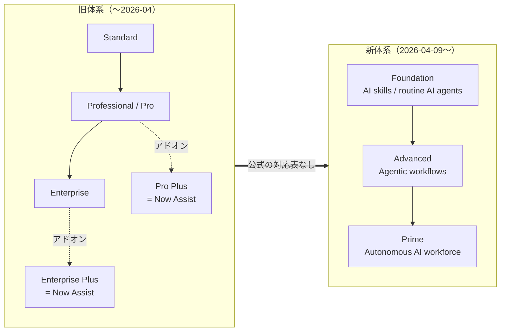
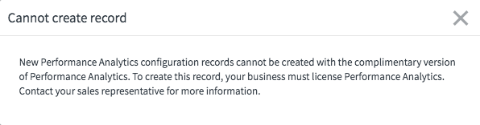
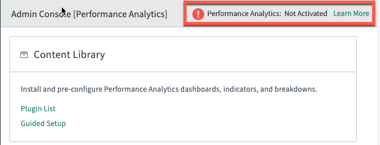
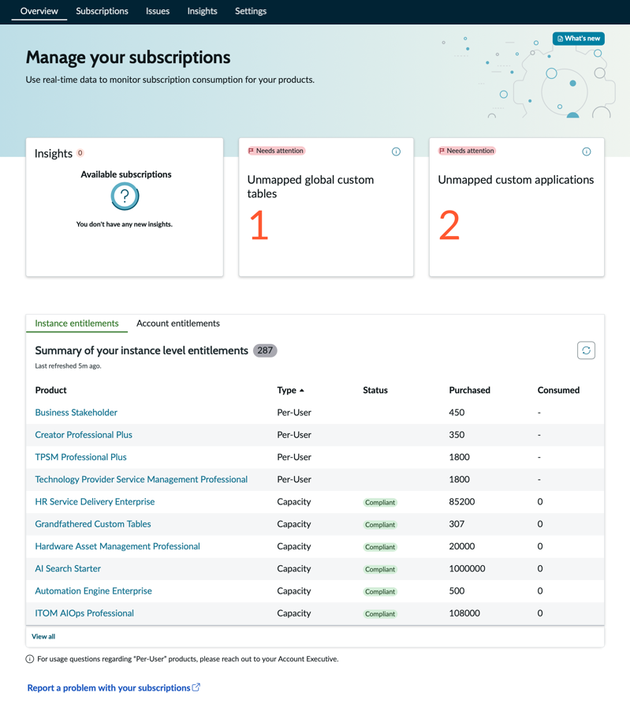
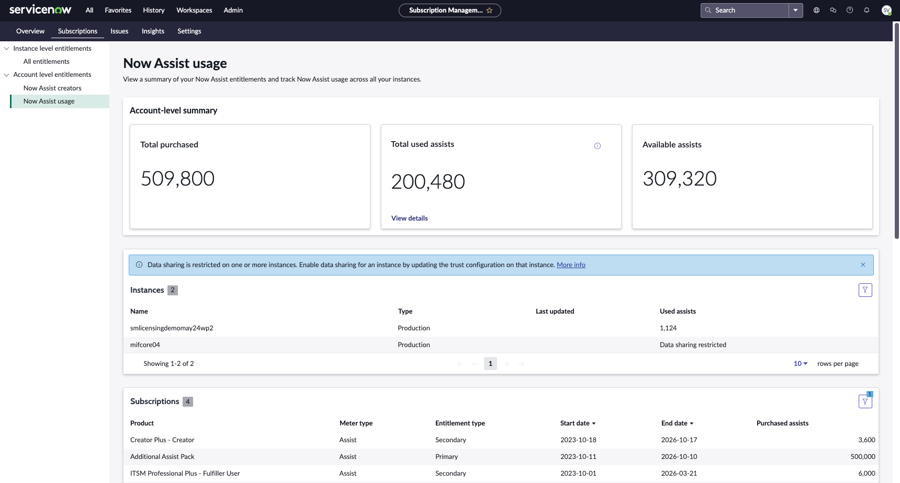

# プラットフォームのパッケージ構成（Standard / Pro / Pro Plus / Enterprise → Foundation / Advanced / Prime）

## 概要

ServiceNow の各製品（ITSM、HR Service Delivery、Customer Service Management、ITOM など）は、同じ製品でも **Package（パッケージ）/ Tier（ティア）** によって使える機能が異なる。本ファイルは、パッケージによって差が出る **製品横断の機能**（Performance Analytics / Platform Analytics、Predictive Intelligence、Virtual Agent、Now Assist（ServiceNow Otto）、AI Agents、Process Mining、Workforce Optimization、App Engine Starter など）を、仕様面から整理する。

本ファイルの要点は次のとおり。

| 論点 | 内容 | 確度 |
|---|---|---|
| 新体系 | ServiceNow は製品を **Foundation / Advanced / Prime** の3ティアで構成する。各ティアに AI が含まれ、上位ティアは下位ティアに機能を積み増す形をとる | 公式（[出典](https://www.servicenow.com/docs/r/australia/intelligent-experiences/ai-native-sku-overview.html)） |
| 旧体系 | 2026-04 以前は **Standard / Professional（Pro）/ Enterprise** の基本パッケージに、生成AI 用のアドオン **Pro Plus / Enterprise Plus** を加える体系だった | 公式コミュニティ記事・第三者情報 |
| 切替時期 | 新体系は **2026-04-09** に旧5ティアを置き換えたとされ、旧 SKU の新規販売終了（End of Sale）は **2026-07-01** とされる | 【第三者情報】（ServiceNow 公式の発表文は確認できず） |
| リリースとの関係 | 新ティアの展開は、各社のインスタンスのアップグレードサイクル（Australia / Brazil 等）とは**独立**している | 公式（[出典](https://www.servicenow.com/docs/r/australia/intelligent-experiences/ai-native-sku-overview.html)） |
| 権利の正本 | 実際に使える機能は、契約書（Order Form）に記載された SKU と、インスタンスの **Subscription Management** に表示されるエンタイトルメントで決まる。プラグインが有効化できても、使用権があるとは限らない | 公式（[出典](https://www.servicenow.com/docs/r/australia/platform-administration/subscriptions-overview-v2.html)） |

> 本ファイルの扱う範囲は「パッケージによる機能差の**仕様**」である。ユーザー種別（Fulfiller / Requester / Unrestricted User）の定義は [ライセンスモデル](../../03_導入編/01-licensing-model.md)、価格は [価格情報](../../03_導入編/02-pricing.md)、製品別のエディション比較の実務は [エディション比較](../../03_導入編/03-edition-comparison.md)、コスト最適化は [ライセンスコスト最適化](../../04_応用編/06-license-cost-optimization.md) を参照する。

---

## 1. 用語と前提

パッケージ構成を読むうえで必要な用語を整理する。ServiceNow のパッケージ用語は、契約上の用語（SKU、Subscription）と、インスタンス上の技術用語（Plugin、Entitlement）が混在する。

| 用語（英語） | 日本語 | 意味 |
|---|---|---|
| Package / Tier / Edition | パッケージ / ティア / エディション | 製品ごとの機能セットの段階。旧体系では Standard / Pro / Enterprise、新体系では Foundation / Advanced / Prime |
| SKU（Stock Keeping Unit） | 販売品目 | 契約書に載る販売単位。例：「ITSM Professional Plus - Fulfiller User」（Subscription Management の画面例に表示される製品名） |
| Subscription | サブスクリプション | 契約で購入した製品の権利。Subscription Management では per-user、capacity、unrestricted user、unlimited、display only の5種類に分類される [出典](https://www.servicenow.com/docs/r/australia/platform-administration/subscriptions-overview-v2.html) |
| Entitlement | エンタイトルメント（使用権） | インスタンス上で認識される権利。インスタンス単位（Instance entitlements）とアカウント単位（Account entitlements）がある |
| Plugin / Store application | プラグイン / ストアアプリ | 機能を提供する技術的な部品。**有効化（activate / install）できることと、使用権があることは別** |
| Add-on | アドオン | 基本パッケージに追加購入する SKU。旧体系の Pro Plus / Enterprise Plus は Now Assist 用のアドオン |
| Assist | アシスト | Now Assist（生成 AI）の使用量を測る単位。スキルやエージェント型ワークフローの実行ごとに消費される [出典](https://www.servicenow.com/community/itsm-articles/now-assist-for-itsm-faq/ta-p/2898299) |
| Subscription Unit（SU） | サブスクリプションユニット | ITOM や DEX など、ユーザー数ではなく管理対象リソース数で課金する製品の単位。例：DEX は EUC（End-user Computing）デバイス 4 台 = 1 SU [出典](https://www.servicenow.com/docs/r/australia/it-service-management/digital-end-user-experience-dex/dex-subscription.html) |
| Custom table allotment | カスタムテーブル割当 | 各サブスクリプションに含まれるカスタムテーブル作成権。App Engine Starter のテーブル数として表示される |

---

## 2. 2つのパッケージ体系の全体像

ServiceNow のパッケージ体系は 2026 年に大きく変わった。2026-11 時点では、既存契約の更新前の顧客は旧体系の SKU を保有し、新規契約・更新後の顧客は新体系の SKU を保有するため、**両方の体系が同時に存在する**。

| 項目 | 旧体系 | 新体系（AI-native tiers） |
|---|---|---|
| ティア名 | Standard / Professional（Pro）/ Enterprise ＋ Pro Plus / Enterprise Plus（アドオン） | Foundation / Advanced / Prime |
| 生成AI（Now Assist） | Pro Plus / Enterprise Plus を追加購入した場合のみ | **全ティアに含まれる**（Assist の割当量はティアで異なる） |
| AI Agents | Pro Plus / Enterprise Plus（AI Agent Studio 等を含む） | Foundation / Advanced：既製（OOTB）エージェントの構成。Prime：新規エージェントの作成 |
| Predictive Intelligence | Pro 以上 | 全ティア（ITSM の公式比較表。HRSD は検索抜粋による【第三者情報】） |
| Virtual Agent | Standard は Virtual Agent Lite、Pro 以上でフル機能 | 全ティア（ITSM の公式比較表。HRSD は検索抜粋による【第三者情報】。Lite / フル版の別は公式に記載なし） |
| Performance Analytics | Pro 以上（Standard は無償版の範囲） | Platform Analytics Advanced が Advanced 以上 |
| Process Mining | Enterprise | Advanced 以上（年間処理レコード数に上限） |
| 移行の対応表 | — | **ServiceNow 公式の旧→新対応表は公開されていない**（[6章](#6-旧体系から新体系への対応関係) 参照） |

出典：[ServiceNow product tiers（Australia）](https://www.servicenow.com/docs/r/australia/intelligent-experiences/ai-native-sku-overview.html)、[ITSM pricing（2026-08-21 アーカイブ）](https://web.archive.org/web/20260821173638/https://www.servicenow.com/products/itsm/pricing.html)、[Now Assist for ITSM FAQ](https://www.servicenow.com/community/itsm-articles/now-assist-for-itsm-faq/ta-p/2898299)、[Virtual Agent FAQs](https://www.servicenow.com/community/virtual-agent-nlu-articles/virtual-agent-faqs/ta-p/2349558)

### 2.1 切替の時系列

| 日付 | 出来事 | 確度・出典 |
|---|---|---|
| 2023〜2024 | Now Assist 提供開始に合わせ、ITSM / CSM / HRSD に Pro Plus / Enterprise Plus アドオン SKU が登場 | 公式コミュニティ FAQ [出典](https://www.servicenow.com/community/itsm-articles/now-assist-for-itsm-faq/ta-p/2898299) |
| 2026-03-12 | Australia 版製品ドキュメントの「ServiceNow product tiers」（Foundation / Advanced / Prime）ページの更新日（初出日は公開情報では確認できず） | 公式 [出典](https://www.servicenow.com/docs/r/australia/intelligent-experiences/ai-native-sku-overview.html) |
| 2026-04-09 | 旧5ティア（Standard / Pro / Pro Plus / Enterprise / Enterprise Plus）が新3ティアに置き換えられたとされる。servicenow.com の ITSM pricing ページのアーカイブ（2026-04-09 取得）は既に Foundation / Advanced / Prime 表記 | 【第三者情報】[出典](https://www.servicenow.com/community/upgrades-and-patching-forum/servicenow-ai-native-licensing-in-2026-a-practical-guide-to/m-p/3565858)、[アーカイブ（2026-04-09 付近の取得）](https://web.archive.org/web/20260409/https://www.servicenow.com/products/itsm/pricing.html) |
| 2026-05-05 | Australia GA。Knowledge 2026 で ServiceNow Otto ブランド（Now Assist・Moveworks・AI Experience を統合した AI 体験）を発表 | 公式プレスリリース [出典](https://newsroom.servicenow.com/press-releases/details/2026/ServiceNow-Otto-creates-the-unified-AI-experience-for-the-enterprise/default.aspx)（Australia GA 日付は [Now Assist と AI Agents](now-assist-ai-agents.md) 参照） |
| 2026-07-01 | 旧 SKU の新規販売終了（End of Sale）。以降の更新見積は新ティアで作成されるとされる | 【第三者情報】[出典](https://www.servicenow.com/community/upgrades-and-patching-forum/servicenow-ai-native-licensing-in-2026-a-practical-guide-to/m-p/3565858) |
| 2026-08 | ITSM 向け Now Assist ストアアプリで、Now Assist / Moveworks / AI Experience のブランドを ServiceNow Otto に統一 | 公式 [出典](https://www.servicenow.com/docs/r/store-release-notes/store-rn-itsm-now-assist.html) |
| 2026-09-10 | Brazil 版製品ドキュメントの「ServiceNow product tiers」ページの更新日（初出日は公開情報では確認できず。内容は Australia 版と同等） | 公式 [出典](https://www.servicenow.com/docs/r/intelligent-experiences/enable-ai-experiences/ai-native-sku-overview.html) |

> **注意:** 「2026-04-09 置き換え」「2026-07-01 販売終了」の日付は ServiceNow コミュニティ上の寄稿および複数のライセンスアドバイザリー企業の記述に基づく。ServiceNow のプレスリリース等の一次発表は本調査では確認できなかった。

---

## 3. 新体系：Foundation / Advanced / Prime

### 3.1 ティアの定義（製品横断）

ServiceNow 製品ドキュメント「ServiceNow product tiers」（Australia、2026-03-12 更新）は、3ティアを次のように定義する。各ティアは AI を組み込み、前のティアに AI 機能・エージェント・ガバナンス機能を積み増す構造である。[出典](https://www.servicenow.com/docs/r/australia/intelligent-experiences/ai-native-sku-overview.html)

| Tier | 焦点（英語原文） | 説明 |
|---|---|---|
| **Foundation** | AI skills, routine AI agents | 定型的なパターン認識・分類によるタスク単位の支援。AI による洞察と定型的な自動化 |
| **Advanced** | Agentic workflows | ワークフローの一連のステップを、人と並走しながら自動化する。文脈を統合し、ドメイン知識を適用する |
| **Prime** | Autonomous AI workforce | 役割ベースの専門性を持つ独立した AI specialist（AI スペシャリスト）が、複数のエージェント型ワークフローを自律的に判断・実行する |

公式ページは「組織での提供状況とエンタイトルメントの詳細はアカウントチームに問い合わせること」「新ティアの展開は、組織のアップグレードサイクルとは独立している」と注記している。[出典](https://www.servicenow.com/docs/r/australia/intelligent-experiences/ai-native-sku-overview.html)

### 3.2 全ティア共通の AI Platform enablers（AI 基盤機能）

「ServiceNow product tiers」ページは、すべての製品ラインのスキル・エージェント・ガバナンスを支える基盤機能（AI platform enablers）と、そのティア差を次のように記載している。[出典](https://www.servicenow.com/docs/r/australia/intelligent-experiences/ai-native-sku-overview.html)

| 基盤機能 | Foundation | Advanced | Prime | 補足 |
|---|---|---|---|---|
| Now Assist（ServiceNow Otto）の AI skills | ○ | ○ | ○ | インシデント要約、感情分析、返信生成、ケース解決支援など。ITSM、CSM、ServiceNow Otto for HRSD、業界ソリューションの全ティアで利用可 |
| Now Assist AI agents（AI Agent Studio） | OOTB エージェントの**構成** | OOTB エージェントの**構成** | 自然言語の指示から**新規エージェントを作成** | エージェント作成能力が Prime の最大の差分 |
| AI Action Fabric（A2A / MCP） | A2A outbound | A2A outbound | A2A outbound ＋ **inbound MCP Server Console** | Prime は外部プラットフォームから ServiceNow のエージェントを直接呼び出せる |
| AI Control Tower | ○（同一機能） | ○（同一機能） | ○（同一機能） | ServiceNow の AI 資産を自動検出・管理。**外部 AI 資産のフル管理は別ライセンス「AI Control Tower for Enterprise AI」** |
| Workflow Data Fabric | Foundation 版 | Foundation 版 | Foundation 版 | Foundation 版 = Integration Hub、RPA Hub、Automation Center、Data Catalog。**Advanced 版（Zero Copy Connectors、Stream Connect）は有償アップグレード** |
| RaptorDB | Standard | Standard | Standard | **RaptorDB Professional** は超大規模分析（ultra-scale analytics）と高度なインスタンストポロジー（advanced instance topology）をサポートする追加オプション（ティアへの対応付けは公式に記載なし） |
| Moveworks for ServiceNow（EmployeeWorks） | ティア相当 | ティア相当 | ティア相当 | Microsoft Teams、Slack、ブラウザー、モバイルで利用可。具体的な機能差は公式ページに記載なし |

> **ポイント:** 「Foundation / Advanced / Prime」の名称は、製品のティア名（例：ITSM Foundation）と、Workflow Data Fabric や RaptorDB の版名（Foundation 版 / Advanced 版、Standard / Professional）とで重複・混同しやすい。Workflow Data Fabric Advanced は ITSM Advanced に含まれる**わけではなく**、全ティアで有償アップグレードである点に注意する。

関連：[Now Assist と AI Agents](now-assist-ai-agents.md)、[Workflow Data Fabric](workflow-data-fabric.md)、[IntegrationHub](integrationhub.md)、[プロセス自動化（RPA・Process Mining）](process-automation-rpa-mining.md)

### 3.3 ITSM の3ティア（公式 pricing ページの比較表）

servicenow.com の ITSM pricing ページ（2026-04-09 および 2026-08-21 のアーカイブで同一内容を確認）は、ITSM の3ティアを次のように記載している。[出典（2026-08-21）](https://web.archive.org/web/20260821173638/https://www.servicenow.com/products/itsm/pricing.html) [出典（2026-04-09）](https://web.archive.org/web/20260409/https://www.servicenow.com/products/itsm/pricing.html)

**パッケージカードの記載（英語原文の項目名）**

| ITSM Foundation | ITSM Advanced（Foundation に追加） | ITSM Prime（Foundation・Advanced に追加。"RECOMMENDED" 表示） |
|---|---|---|
| Service Catalog and Request Management | Major Incident Management and On-Call Management | L1 Service Desk AI Specialist |
| Incident Management | Change Management | AI Agents for ITSM |
| Asset Management and CMDB | Problem Management | AI Agent for Digital End-User Experience (DEX) |
| Virtual Agent | AI Voice Agents | DevOps Change Velocity |
| Workflow Data Fabric | Platform Analytics Advanced | Digital Product Release |
| Service Graph Connectors for End-User Computers | Process Mining | Now Assist and Platform AI Prime |
| Now Assist and Platform AI Foundation | Now Assist and Platform AI Advanced | Moveworks for ITSM Prime |
| Moveworks for ITSM Foundation | Moveworks for ITSM Advanced | |

**機能比較表（Compare features）**：○ = 含む、× = 含まない

| 区分 | 機能 | Foundation | Advanced | Prime |
|---|---|---|---|---|
| AI Agents and Skills | Now Assist for ITSM | ○ | ○ | ○ |
| | Moveworks for ITSM | ○ | ○ | ○ |
| | Now Assist for CMDB | ○ | ○ | ○ |
| | Document Intelligence | ○ | ○ | ○ |
| | Now Assist for Setup | ○ | ○ | ○ |
| | AI Search | ○ | ○ | ○ |
| | AI Voice Agents | × | ○ | ○ |
| ITSM Capabilities | Incident Management | ○ | ○ | ○ |
| | Request Management | ○ | ○ | ○ |
| | Asset Management | ○ | ○ | ○ |
| | Cost Management | ○ | ○ | ○ |
| | Problem Management | × | ○ | ○ |
| | Change Management | × | ○ | ○ |
| | Major Incident Management | × | ○ | ○ |
| | On-Call Management | × | ○ | ○ |
| | Walk-Up Experience | × | ○ | ○ |
| | Digital Portfolio Management | × | ○ | ○ |
| | Digital Product Release | × | × | ○ |
| | DevOps Change Velocity | × | × | ○ |
| Platform Capabilities | AI Control Tower | ○ | ○ | ○ |
| | Workflow Data Fabric | ○ | ○ | ○ |
| | CMDB | ○ | ○ | ○ |
| | CSDM | ○ | ○ | ○ |
| | Knowledge Management | ○ | ○ | ○ |
| | Employee Center | ○ | ○ | ○ |
| | Now Mobile | ○ | ○ | ○ |
| | Workflow Automation | ○ | ○ | ○ |
| | Application Development | ○ | ○ | ○ |
| | Virtual Agent | ○ | ○ | ○ |
| | Predictive Intelligence | ○ | ○ | ○ |
| | App Engine Starter | 10 tables | 25 tables | 50 tables |
| | Universal Request | ○ | × | × |
| | Universal Request Pro | × | ○ | ○ |
| | Mobile Publishing | × | ○ | ○ |
| | Platform Analytics Advanced | × | ○ | ○ |
| | Process Mining | × | 10K records/year | 15K records/year |

> **読み方の注意:**
> - **Foundation には Problem / Change Management が含まれない。** 旧 ITSM Standard は Incident・Problem・Change・Request を含んでいたため、旧 Standard 顧客がそのまま Foundation に移ると Change / Problem が使えなくなる可能性がある。旧 Standard 相当の ITIL プロセスを維持するには Advanced が必要になる、とコミュニティ記事も指摘している【第三者情報】。[出典](https://www.servicenow.com/community/itsm-articles/itsm-licensing-in-april-2026-foundation-advanced-and-prime-in/ta-p/3544380)
> - Universal Request は Foundation のみ「○」、Advanced / Prime は上位版の Universal Request Pro が「○」という表記である。
> - Process Mining の値は年間に分析できるレコード数の上限である。
> - 比較表は販売ページの記載であり、契約上の定義は Order Form と製品定義書（Product Overview / Use Rights）が優先する。

関連：[ITSM 概要とパッケージ](../itsm/itsm-overview.md)、[ITSM Pro/Enterprise 固有機能](../itsm/itsm-pro-features.md)

### 3.4 HR Service Delivery の3ティア

servicenow.com の HR Service Delivery pricing ページは HR Foundation / HR Advanced / HR Prime の3ティアを掲載している。本調査では同ページを直接取得できず（HTTP 403）、検索エンジン経由の抜粋で内容を確認した。[出典](https://www.servicenow.com/products/hr-service-delivery/pricing.html)

| ティア | 主な内容（英語原文の項目名） |
|---|---|
| HR Foundation | AI Agents for HR、Moveworks for HR、AI Control Tower、Case and Knowledge Management、Employee Center Pro、Talent（hiring and growth）、Virtual Agent |
| HR Advanced（Foundation に追加） | Agentic Workflows、Employee Journey Management、Voice Agents for HR、Process Mining、Platform Analytics Advanced、Mobile Publishing、Universal Request Pro |
| HR Prime（Foundation・Advanced に追加） | AI Specialists、Autonomous Service Desk、Custom AI Workflows |
| 全ティア共通 | Virtual Agent（会話数無制限）と Predictive Intelligence を含む |
| AI 検索のインデックス上限 | Foundation 25K / Advanced 50K / Prime 150K indexed docs |

> 上記は検索結果の要約経由の情報であり、実ページの最新表記と差異がある可能性がある【第三者情報】。旧 HR Enterprise に含まれていた Employee Journey Management が、新体系では Advanced に含まれる点が特徴である。

関連：[HR Service Delivery](../employee/hr-service-delivery.md)

### 3.5 Customer Service Management の3ティア

CSM のティア構成は情報源によって記載が分かれる。

| 情報源 | Foundation | Advanced | Prime |
|---|---|---|---|
| servicenow.com CSM pricing ページ（検索結果の抜粋・licenseware wiki の転記）[出典](https://www.servicenow.com/products/customer-service-management/pricing.html) [出典](https://wiki.licenseware.io/wiki/servicenow-product-tiers-and-packages/) | **掲載なし** | Agentic Workflows for Customer Service、Now Assist（ServiceNow Otto）、Now Assist Powered Virtual Agent、Customer and Partner Portals、Case Management and Playbooks、Agent Workspace with Unified Omnichannel、Advanced Work Assignment、Partner and Outsourced Provider Management、CRM Foundation | Advanced に加え AI Specialists、Workforce Optimization |
| ServiceNow Community 寄稿（2026-07-02）【第三者情報】[出典](https://www.servicenow.com/community/architect-articles/the-april-2026-servicenow-csm-packaging-redesign-what/ta-p/3562359) | コア CRM（顧客・ケース）、ナレッジ、Now Assist for CSM の基本割当、App Engine Starter（50 fulfillers / 100 unnamed users / 50 transactions の制限と記載）。Service Bridge・Outsourced Customer Service・Proactive Operations は含まない | Engagement Messenger、Proactive Customer Service Operations、Outsourced Customer Service、Service Bridge を追加。ポータル訪問数は fulfiller あたり月 2,000、unrestricted user あたり月 400 | ポータル訪問数が fulfiller あたり月 4,000、Process Mining 15,000 records、Now Assist 割当が概ね倍、カスタム AI スキル・エージェント作成 |

> **矛盾の扱い:** 公式 pricing ページ（抜粋）に CSM Foundation が掲載されていない一方、コミュニティ寄稿は CSM Foundation の内容を記載している。本調査では公式の CSM Foundation の存在を確認できなかった。CSM を検討する場合はアカウントチームに確認する。

関連：[Customer Service Management](../customer/customer-service-management.md)

### 3.6 ITOM の2ティア

ITOM は新体系で **Foundation ティアが存在せず、Advanced と Prime の2ティア**で構成されるとされる。【第三者情報】[出典](https://www.servicenow.com/community/architect-articles/navigating-the-april-2026-servicenow-itom-licensing-model/ta-p/3555121) [出典](https://wiki.licenseware.io/wiki/servicenow-product-tiers-and-packages/)

| ティア | 主な内容 | 出典 |
|---|---|---|
| ITOM Advanced（可視化・CMDB 系） | Discovery（エージェントレス）、Service Mapping、Certificate Inventory and Management、AI Agent Topology Mapping、API Insights、Cloud Account Management、CMDB 360、Tag Governance、Process Mining、Virtual Agent、Now Assist for ITOM | pricing ページ転記（licenseware）とコミュニティ寄稿 |
| ITOM Prime（AIOps・オブザーバビリティ系） | Advanced に加え AI Specialists、Event Management、Metric Intelligence、Health Log Analytics、Service Observability、Service Reliability Management、Synthetic Monitoring | 同上 |

課金単位は利用者数ではなく **Subscription Unit（SU）** であり、管理対象のホスト・クラウドインスタンス・ネットワーク機器数で決まる。コミュニティ寄稿は「1 Credit = 1 ITOM SU」「10 Credits = 1 ITSM Fulfiller User」という換算と、ITSM と ITOM を1つのクレジットで計量する **Service Ops Advanced / Prime** の複合 SKU を紹介している。【第三者情報】[出典](https://www.servicenow.com/community/architect-articles/navigating-the-april-2026-servicenow-itom-licensing-model/ta-p/3555121)

> 公式の「ServiceNow product tiers」ページは「各ティアがすべての製品ラインで提供される」とは明記していない（製品ラインの対応は別ページ参照としている）。ITOM・CSM に Foundation がない点は公式の一次資料では確認できなかった。

関連：[ITOM 概要とパッケージ](../itom/itom-overview.md)

### 3.7 App Engine の構成

App Engine（ローコード開発）は Foundation と Prime の2段階で掲載されているとされる。【第三者情報】[出典](https://wiki.licenseware.io/wiki/servicenow-product-tiers-and-packages/)

| ティア | 主な内容 |
|---|---|
| App Engine Foundation | ServiceNow Otto for Creator、App Engine Studio、Creator Studio、Workspace Builder、Custom Tables、Scoped Apps |
| App Engine Prime | Foundation に加え App Engine Management Center、Unlimited Custom Tables、Unlimited Scoped Apps、Process Mining、Mobile Publishing、Platform Analytics Advanced |

関連：[アプリケーション開発](app-development.md)

### 3.8 複合 SKU・アドオン

コミュニティ寄稿は、新体系に次の複合 SKU・アドオンがあると紹介している。【第三者情報】[出典](https://www.servicenow.com/community/itsm-articles/itsm-licensing-in-april-2026-foundation-advanced-and-prime-in/ta-p/3544380) [出典](https://www.servicenow.com/community/architect-articles/the-april-2026-servicenow-csm-packaging-redesign-what/ta-p/3562359)

| SKU | 内容 |
|---|---|
| ESM Foundation | ITSM Foundation ＋ コアの業務スイートを per-user で提供 |
| ServiceOps Advanced / Prime | ITSM と ITOM を共通クレジットで計量 |
| ITSM Prime Add-on | CSM Prime / Industry Prime 顧客が ITSM 側の Prime 相当 AI を追加するためのアドオン |
| Workflow Data Fabric Advanced | Zero Copy Connectors、Stream Connect（公式：有償アップグレード） |
| RaptorDB Professional | 超大規模分析（ultra-scale analytics）と高度なインスタンストポロジーのサポート（公式：追加オプション） |
| AI Control Tower for Enterprise AI | 外部 AI 資産のフル管理（公式：別ライセンス） |
| Assist の追加パック | 割当を超えた Assist の追加購入。Subscription Management 上の製品名例「Additional Assist Pack」 |

---

## 4. 旧体系：Standard / Pro / Enterprise と Pro Plus / Enterprise Plus

### 4.1 基本構造

旧体系は、製品ごとに Standard → Professional（Pro）→ Enterprise と上位パッケージが下位を包含する構造であり、2023 年以降に生成AI 用のアドオン **Pro Plus（Professional Plus）/ Enterprise Plus** が追加された。2026-04 以降は新規販売の対象ではないが、**既存契約の満了までは旧 SKU のエンタイトルメントがインスタンスで有効**であり、Subscription Management には旧 SKU 名（例：「ITSM Professional Plus - Fulfiller User」「HR Service Delivery Enterprise」「ITOM AIOps Professional」）が表示される。[出典](https://www.servicenow.com/docs/r/australia/platform-administration/monitoring-now-assist-usage.html) [出典](https://www.servicenow.com/docs/r/australia/platform-administration/subscriptions-overview-v2.html)

| パッケージ | 位置付け |
|---|---|
| Standard | 製品のコア機能（ITSM なら Incident・Problem・Change・Request・Knowledge・CMDB・標準レポート） |
| Professional（Pro） | Standard ＋ Now Intelligence 系（Performance Analytics、Predictive Intelligence、Virtual Agent）＋ 一部の高度機能 |
| Enterprise | Pro ＋ 運用最適化系（Process Mining、Workforce Optimization 等） |
| Pro Plus | **Pro 契約者向けの Now Assist アドオン**（Pro が前提） |
| Enterprise Plus | **Enterprise 契約者向けの Now Assist アドオン**（Enterprise が前提） |

Now Assist for ITSM FAQ（ServiceNow Community の公式記事）は、Now Assist for ITSM を利用するには「ITSM Pro Plus」または「Enterprise Plus」の SKU にアップグレードする必要があると記載している。Now Assist for CSM のガイドは、Pro Plus / Enterprise Plus アドオンの購入には Pro または Enterprise の基本パッケージが必要としている。[出典](https://www.servicenow.com/community/itsm-articles/now-assist-for-itsm-faq/ta-p/2898299) [出典](https://www.servicenow.com/community/csm-articles/now-assist-for-csm-getting-started/ta-p/3065109)

### 4.2 ITSM の旧パッケージ別機能

旧 ITSM パッケージの機能差を次に示す。ServiceNow の旧 pricing ページはアーカイブでも取得できなかったため、公式コミュニティ記事・パートナー資料を組み合わせて整理した。

| 機能 | Standard | Pro | Enterprise | Pro Plus / Enterprise Plus（アドオン） | 出典・確度 |
|---|---|---|---|---|---|
| Incident / Problem / Change / Request / Knowledge / CMDB | ○ | ○ | ○ | — | パートナー資料【第三者情報】 |
| Asset・Cost Management、Digital Portfolio Management | ○ | ○ | ○ | — | Fujitsu G-Cloud 15 資料【第三者情報】 |
| Virtual Agent | **Virtual Agent Lite** | ○ | ○ | — | 公式ドキュメント（Lite）、公式コミュニティ FAQ |
| Predictive Intelligence | × | ○ | ○ | — | 公式ドキュメント（`com.glide.platform_ml` / `com.glide.platform_ml_pa` は ITSM Pro パッケージのサブスクリプションが必要。後継の Task Intelligence for ITSM も ITSM Pro Package が必要） |
| Performance Analytics（有償機能） | ×（無償版の範囲） | ○ | ○ | — | 公式ドキュメント（Professional / Enterprise 経由の購入を規定） |
| Continual Improvement Management | × | ○ | ○ | — | コミュニティ記事【第三者情報】 |
| Process Mining（旧 Process Optimization） | × | × | ○ | — | 公式 pricing ページ（検索抜粋）、パートナー資料【第三者情報】 |
| Workforce Optimization for ITSM | × | × | ○ | — | 同上 |
| Now Assist for ITSM（要約、解決ノート生成等） | × | × | × | ○ | 公式コミュニティ FAQ |
| Now Assist panel、Now Assist in AI Search、Now Assist in Virtual Agent、Now Assist Admin | × | × | × | ○ | 公式コミュニティ FAQ |
| 会話型カタログアイテム（Conversational catalog items） | × | × | × | ○ | 公式コミュニティ FAQ |
| AI Agent Studio、AI Agent Orchestrator、AI Agent analytics | × | × | × | ○（CSM Enterprise Plus の記載例） | パートナー資料・公式 pricing ページ（UK）【第三者情報】 |

出典：[Now Assist for ITSM FAQ](https://www.servicenow.com/community/itsm-articles/now-assist-for-itsm-faq/ta-p/2898299)、[Virtual Agent FAQs](https://www.servicenow.com/community/virtual-agent-nlu-articles/virtual-agent-faqs/ta-p/2349558)、[Available Platform Analytics Solutions](https://www.servicenow.com/docs/r/australia/now-intelligence/performance-analytics/r_AvailableContentPacks.html)、[Activating your Performance Analytics subscription](https://www.servicenow.com/docs/r/australia/now-intelligence/performance-analytics/c_PremiumPerformanceAnalytics.html)、[Activate ITSM Predictive Intelligence Workbench（Xanadu）](https://www.servicenow.com/docs/r/xanadu/it-service-management/predictive-intelligence-workbench/itsm-piwb-activation.html)、[Install Task Intelligence for ITSM（Yokohama）](https://www.servicenow.com/docs/r/Mr7qUatbFXax1_h~z60rmA/3_Ja2igEwQI304eixIGsjQ)、[Fujitsu G-Cloud 15 価格資料（2026-01-29）](https://assets.applytosupply.digitalmarketplace.service.gov.uk/g-cloud-15/documents/92271/205111268855265-pricing-document-2026-01-29-1405.pdf)

> **矛盾の扱い:** 第三者のライセンスアドバイザリーの一部は「Predictive Intelligence は Pro に含まれず Enterprise から」とする比較表を掲載しているが、ServiceNow 製品ドキュメント（ITSM Predictive Intelligence Workbench の有効化手順、Xanadu）は「Predictive Intelligence（`com.glide.platform_ml`）と Predictive Intelligence Reports（`com.glide.platform_ml_pa`）プラグインは ITSM Pro パッケージのサブスクリプションを必要とする」と記載し、後継の Task Intelligence for ITSM のインストール手順（Yokohama）も「ITSM Pro Package subscription が必要」と記載しているため、本ファイルは公式記述を採用する。[出典](https://www.servicenow.com/docs/r/xanadu/it-service-management/predictive-intelligence-workbench/itsm-piwb-activation.html) [出典](https://www.servicenow.com/docs/r/Mr7qUatbFXax1_h~z60rmA/3_Ja2igEwQI304eixIGsjQ)
>
> なお、ITSM Predictive Intelligence Workbench（`com.sn_piwb_ml`）は Yokohama 以降サポート対象外（非推奨）であり、後継は Task Intelligence for ITSM（`com.snc.itsm_ml_task`）である。

### 4.3 他製品の旧パッケージ（パートナー資料による概観）

英国政府調達（G-Cloud 15）向けの Fujitsu 価格資料（2026-01-29）は、旧パッケージの内容を次のように記載している。【第三者情報】[出典](https://assets.applytosupply.digitalmarketplace.service.gov.uk/g-cloud-15/documents/92271/205111268855265-pricing-document-2026-01-29-1405.pdf)

| 製品 | Standard | Professional | Enterprise | Plus（Now Assist アドオン） |
|---|---|---|---|---|
| CSM | Agent Workspace、Case Management、Omnichannel self-service、Knowledge、Walk-Up、Engagement Messenger、Advanced Work Assignment | Proactive Customer Service Operations、Task Intelligence、Performance Analytics、Virtual Agent、Outsourced Customer Service、Continual Improvement Management 等 | Workforce Optimization、Process Mining | AI Agent Studio、AI Agent analytics、AI Agent Orchestrator、Now Assist in AI Search / Virtual Agent、ケース・チャット要約、解決ノート生成、メール返信推奨 |
| HR Service Delivery | HR Case / Knowledge、Employee Center Pro、Universal Request | HR Agent Workspace、Performance Analytics、Predictive Intelligence、Virtual Agent、モバイル | Employee Journey Management、Alumni Service Center | 要約・会話型支援などの Now Assist |
| SecOps（Security Incident Response） | インシデント対応ワークフロー | 高度な自動化、Integration bundle、Predictive Intelligence、Major security incident | Threat Intelligence Security Center、高度な分析 | — |
| SPM | PPM、Demand / Resource、財務計画、Performance Analytics | SAFe、シナリオ計画、Predictive Intelligence、投資ファンディング | — | — |

> 旧体系でも「Pro 以上で Performance Analytics・Predictive Intelligence・Virtual Agent を含む」という構造は ITSM・CSM・HRSD・SecOps・SPM で概ね共通していた。

---

## 5. 機能別の横断整理

本章は、パッケージによって差が出る主要機能ごとに、新旧体系での扱いと技術的な前提（プラグイン、ロール、制限）を整理する。

### 5.1 Performance Analytics / Platform Analytics

Performance Analytics（PA）は、Platform Analytics の中で時系列 KPI（Indicator）・Breakdown・スナップショット等を扱う有償機能である。基本のレポート・ダッシュボードは全顧客が利用でき、PA の拡張機能がパッケージで制限される。

**無償範囲と有償範囲（公式）** [出典](https://www.servicenow.com/docs/r/australia/now-intelligence/performance-analytics/c_PremiumPerformanceAnalytics.html)

| 項目 | 有償サブスクリプションなし | 有償サブスクリプションあり |
|---|---|---|
| データ収集期間 | 180日（月次 Indicator は5か月） | 180日超のスコア保持 |
| Indicator | ServiceNow 提供の特定 Indicator のみ | カスタム Indicator、Breakdown、Widget 等の構成レコードを作成可 |
| Data snapshots | 有効化不可 | 有効化可 |
| Text analytics widget（Core UI のみ） | 不可 | 可 |
| Proactive analytics insights（ダッシュボード） | 不可 | 可 |

**利用範囲のルール（公式）**：Professional または Enterprise のオファリング経由で PA を購入した場合、次の範囲で制限なく利用できる。[出典](https://www.servicenow.com/docs/r/australia/now-intelligence/performance-analytics/c_PremiumPerformanceAnalytics.html)

- 対応するサブスクリプションのテーブル（関連する ServiceNow ストアアプリを含む）
- プラットフォーム・共通アプリ（Knowledge Management、CMDB、Catalog など）
- 有償の Partner ストアアプリ
- 無償の Partner ストアアプリのテーブルはカスタムテーブル扱いでサブスクリプションにマッピングされ、マッピング先サブスクリプションの PA 権利に従う

**有償機能を使おうとしたときの挙動**：PA サブスクリプションのない本番インスタンスで構成レコードを作成しようとすると警告が表示され、PA Admin Console にも未有効化の警告が出る。

- **キャプション:** Performance Analytics の無償版で構成レコードを作成しようとした際の警告ダイアログ
- **画面説明:** タイトル「Cannot create record」。本文は「New Performance Analytics configuration records cannot be created with the complimentary version of Performance Analytics. To create this record, your business must license Performance Analytics. Contact your sales representative for more information.」（無償版では新しい PA 構成レコードを作成できず、PA のライセンスが必要である旨）。
- **出典:** https://www.servicenow.com/docs/r/australia/now-intelligence/performance-analytics/c_PremiumPerformanceAnalytics.html （取得日 2026-11-02）

- **キャプション:** Performance Analytics Admin Console の「Not Activated」表示
- **画面説明:** 画面タイトル「Admin Console [Performance Analytics]」の右上に赤枠で「Performance Analytics: Not Activated」と「Learn More」リンクが表示される。下部に「Content Library」カード（Install and pre-configure Performance Analytics dashboards, indicators, and breakdowns。Plugin List / Guided Setup のリンク）がある。
- **出典:** https://www.servicenow.com/docs/r/australia/now-intelligence/performance-analytics/c_PremiumPerformanceAnalytics.html （取得日 2026-11-02）

**有効化の仕組み（公式）** [出典](https://www.servicenow.com/docs/r/australia/now-intelligence/performance-analytics/c_PremiumPerformanceAnalytics.html)

| 項目 | 内容 |
|---|---|
| 自動有効化 | Tokyo 以降、PA は Subscription Management の対象。ホスト型（ServiceNow クラウド）の本番インスタンスでは購入した PA 機能が自動で有効化される |
| 手動有効化 | セルフホスト（オンプレミス）と非本番インスタンスは手動で「Performance Analytics - Premium」系プラグインを有効化する |
| 手順 | `admin` ロールで System Applications > All Available Applications > All → Filters の Listings で Plugins → 「performance analytics premium」で検索 → エンタイトルメントに対応するプラグインを Install |
| オンプレミスでの権利確認 | Subscriptions > Application Entitlements（`subscription_entitlement_list.do`）で名称に「Performance Analytics」を含むエンタイトルメントを確認 |
| 非本番の扱い | 非本番インスタンスでは任意の PA Premium プラグインをインストールできる。本番は権利に対応するもののみ |

**製品別の PA エンタイトルメント名（公式）**：Platform Analytics Solutions（旧 Content Packs）は、対応する PA エンタイトルメントで有効化できる。例：Performance Analytics for Service Management、Performance Analytics for Customer Service、Performance Analytics for Human Resource Management、Performance Analytics for GRC、Performance Analytics for Security Incident Response、Performance Analytics for IT Operations Management、Performance Analytics for Project Portfolio Management、Performance Analytics for APM。PA コンポーネントを含まない Solution は PA エンタイトルメント不要である。[出典](https://www.servicenow.com/docs/r/australia/now-intelligence/performance-analytics/r_AvailableContentPacks.html)

**新体系での扱い**：ITSM / HRSD / App Engine の pricing ページでは「Platform Analytics Advanced」が Advanced 以上（App Engine は Prime）に含まれる。Platform Analytics Advanced と旧来の「PA 有償サブスクリプション」の機能対応を明示した公式資料は確認できなかった。

関連：[レポートとアナリティクス](reporting-analytics.md)

### 5.2 Predictive Intelligence

Predictive Intelligence（PI）は、インスタンスのレコードから機械学習モデル（Solution）を学習し、分類（Classification）・類似（Similarity）・クラスタリング（Clustering）・回帰（Regression）を提供する機能である。

| 項目 | 内容 | 出典 |
|---|---|---|
| 基盤プラグイン | `com.glide.platform_ml`（Predictive Intelligence 本体） | 公式ドキュメント（ITSM） |
| ITSM 用プラグイン | `com.snc.incident.ml_solution`（Predictive Intelligence for Incident Management）、`com.snc.incident.mim.ml_solution`（Major Incident Management） | 公式ドキュメント |
| サブスクリプション | Incident 用 PI は「ServiceNow AI Platform の他の部分とは別のサブスクリプションが必要」と記載。サブスクリプションに伴い自動有効化されるプラグインもあり、無い場合は Now Support のカタログから有効化を依頼する | 公式 [出典](https://www.servicenow.com/docs/r/t~YvqQkg2oQX4L7ySrpyuQ/WACo7GODPw9uMmuSQD063A) |
| 評価 | 購入前に非本番インスタンスで無償評価できる | 公式（同上） |
| 旧体系 | Predictive Intelligence（`com.glide.platform_ml`）と Predictive Intelligence Reports（`com.glide.platform_ml_pa`）プラグインは ITSM Pro パッケージのサブスクリプションが必要 | 公式（Xanadu）[出典](https://www.servicenow.com/docs/r/xanadu/it-service-management/predictive-intelligence-workbench/itsm-piwb-activation.html) |
| Workbench の非推奨化 | ITSM Predictive Intelligence Workbench は Yokohama 以降サポート対象外。後継は Task Intelligence for ITSM（`com.snc.itsm_ml_task`、Service Operations Workspace でフィールド予測・類似レコードを推奨表示）であり、そのインストールにも ITSM Pro Package のサブスクリプションが必要。セルフホスト環境では未提供 | 公式 [出典](https://www.servicenow.com/docs/r/xanadu/it-service-management/predictive-intelligence-workbench/itsm-piwb-activation.html) [出典](https://www.servicenow.com/docs/r/Mr7qUatbFXax1_h~z60rmA/3_Ja2igEwQI304eixIGsjQ) |
| 新体系 | ITSM の比較表で Foundation・Advanced・Prime の全ティアに「Predictive Intelligence」が含まれる（HRSD も全ティアに含むとされるが検索抜粋による【第三者情報】）。新ティアにおける Task Intelligence for ITSM の扱いは公開情報では確認できず | 公式 pricing ページ（ITSM） |

ITSM 向けの既製 Solution definition（テンプレート）は、Incident Assignment（Short description から Assignment group を予測）、Incident Categorization（Category）、Incident Service（Service）、Incident Configuration Item（Configuration item）、Major Incident Detection、Similar Incidents（Major Incident Workbench）、Similar Incidents、Similar Open Incidents、Similar Closed Incidents 等である。[出典](https://www.servicenow.com/docs/r/australia/it-service-management/predictive-intelligence-for-incident.html)

関連：[Predictive Intelligence と AI Search](predictive-intelligence-ai-search.md)

### 5.3 Virtual Agent / Virtual Agent Lite

Virtual Agent（VA）は、パッケージによって **Virtual Agent Lite（限定版）** と **フル機能の Virtual Agent** に分かれる。

| 項目 | Virtual Agent Lite | Virtual Agent（フル） |
|---|---|---|
| 対象（旧体系） | ITSM Standard 顧客 | ITSM Pro、HR Pro、CSM Pro などの Pro / Enterprise 以上 |
| 対象（新体系） | ITSM pricing の比較表は全ティアに「Virtual Agent」を○とするが、Lite / フル版の別は公式に記載なし（コミュニティ記事は会話数無制限（Virtual Agent Unlimited）と記載【第三者情報】） | （左欄に統合。Lite / フル版の区別なし） |
| トピック | ITSM Self Service Lite カテゴリの既製トピック（Check Ticket Status、Report an Issue 等）とプラットフォーム設定用トピックのみ。**新規トピック・トピックブロック・カスタムコントロールは作成不可** | トピックの新規作成・条件設定が可能 |
| 会話方式 | **キーワードベースのみ。NLU モデル・NLU 対応トピックは非対応**（トピック切替、多言語 NLU も不可） | NLU / LLM トピック検出に対応 |
| その他の制限 | カスタムチャットチャネルでは Lite トピックを実行できない（Slack のサポート対象 VA 連携を除く）、Live Agent 変数指定不可、Available for Agent Autopilot トグル不可、VA テーブルは管理者でも読み取り専用、翻訳コンテンツは読み取り専用、通知は単純な非アクション型（non-actionable）のみ（Actionable notification 不可）、Virtual Agent Analytics Dashboard は利用不可 | 制限なし |
| チャネル | 公式のサポートチャネル一覧は Slack、Microsoft Teams、Workplace by Facebook、Facebook Messenger の4つ（同ページは、会話が Web チャットクライアントとこれらのメッセージング連携で動作すると記載） | 各種メッセージング連携 |
| 前提 | Virtual Agent Lite はプリインストール済み。ITSM Virtual Agent Conversation Topics Lite をインストールして使う | — |

出典：[Virtual Agent Lite](https://www.servicenow.com/docs/r/australia/conversational-interfaces/virtual-agent/va-lite.html)、[ITSM Virtual Agent Lite](https://www.servicenow.com/docs/r/australia/it-service-management/itsm-virtual-agent/itsm-virtual-agent-lite.html)、[Virtual Agent FAQs](https://www.servicenow.com/community/virtual-agent-nlu-articles/virtual-agent-faqs/ta-p/2349558)

- **Virtual Agent API** も「Virtual Agent と同様の Pro / Enterprise ライセンスが必要」と公式に記載されている。[出典](https://www.servicenow.com/docs/r/australia/conversational-interfaces/virtual-agent/virtual-agent-api-supported-versions-licensing.html)
- **Now Assist in Virtual Agent**（生成 AI による会話・LLM トピック検出・フォールバック）は、旧体系では Pro Plus / Enterprise Plus（または AI SKU）と、Now Assist for ITSM / HRSD / CSM のいずれかが必要とされる。[出典](https://www.servicenow.com/community/virtual-agent-nlu-articles/virtual-agent-faqs/ta-p/2349558)
- 旧体系の会話数上限について、ITSM Pro は fulfiller あたり年 1,000 トランザクションとするコミュニティ回答があるが、公式文書では確認できなかった。【第三者情報】

関連：[Virtual Agent と会話型AI](virtual-agent.md)

### 5.4 Now Assist（ServiceNow Otto）と Assist 課金

Now Assist は ServiceNow の生成 AI 機能群であり、2026 年に **ServiceNow Otto** ブランドへ移行した。製品ドキュメントは Zurich Patch 12 以降「Now Assist is now ServiceNow Otto」と記載し、「製品エンタイトルメントは変更なし（Your product entitlements remain unchanged）」と明記している。[出典](https://www.servicenow.com/docs/r/delta-zurich-brazil/brazil-zurich-servicenowotto-release-notes.html)

| 項目 | 旧体系 | 新体系 |
|---|---|---|
| 必要な SKU | Pro Plus / Enterprise Plus（製品ごと。例：Now Assist for ITSM の購入で CSM や HRSD の Now Assist は使えない） | 各製品ティアに含まれる（Now Assist and Platform AI Foundation / Advanced / Prime） |
| 使用量の単位 | Assist（スキル実行ごとに1以上を消費） | 同じく Assist。ティアごとに割当量が異なり、超過分は追加購入 |
| Assist のプール | 契約上の製品をまたいでプールされ、契約に紐づく全インスタンス（本番・非本番）で共用 | アカウント（テナント）単位で割り当てられる【第三者情報】 |
| LLM 費用 | Now LLM 等の利用料は Assist に含まれ、別途 OpenAI / Azure OpenAI 契約は不要（Generative AI Controller で自社キーを使う場合を除く） | 同左（LLM 選択の詳細は [Now Assist と AI Agents](now-assist-ai-agents.md)） |
| 権利チェック | ServiceNow Store でエンタイトルメントを確認。Now Assist Admin から Install すると Store に遷移 | 「Install plugins for ServiceNow Otto」手順で Store からライセンスを取得し Application Manager でインストール |

出典：[Now Assist for ITSM FAQ](https://www.servicenow.com/community/itsm-articles/now-assist-for-itsm-faq/ta-p/2898299)、[Install plugins for ServiceNow Otto](https://www.servicenow.com/docs/r/australia/intelligent-experiences/install-now-assist-feature-plugins.html)、[ServiceNow AI-Native Licensing in 2026](https://www.servicenow.com/community/upgrades-and-patching-forum/servicenow-ai-native-licensing-in-2026-a-practical-guide-to/m-p/3565858)

**プラグインのインストール手順（Australia、公式）** [出典](https://www.servicenow.com/docs/r/australia/intelligent-experiences/install-now-assist-feature-plugins.html)

- 前提：必要ロール `sn_nowassist_admin.nsa_admin`。ライセンス済みの生成 AI アプリケーションが Application Manager から1つ以上インストール済みであること（これにより AI Admin Hub（旧 Now Assist Admin console）を利用できる）。

1. All > AI Admin Hub > Settings（AI Admin Hub 内なら Settings タブ）を開き、ナビゲーションの Plugins で「Available for you」タブのプラグインを確認する。
2. ライセンス未取得の場合は、プラグインのカードで Get plugins → Install Plugin を選び、新しいタブで開く ServiceNow Store ページからライセンスを申請する。
3. All > Application Manager の「Available for you」タブで対象の AI アプリケーションを選び、Install を選択する。「Select suite version」で互換性のある AI Suites のバージョンを選ぶ（none も可）。必要に応じてカスタマイズ版・デモデータを選ぶ。
4. Continue でインストール内容を確認し、即時インストール（Install）か、開始日時を指定してスケジュール（Schedule）するかを選ぶ。
5. AI Admin Hub に戻り、ダイアログで Refresh を選ぶ。

「Installation blocked」と表示されるアプリはライセンスが未取得である。必要なバージョンのライセンスを取得するか、アプリをアンインストールして解消する。

**新体系での Assist 割当量**：各ティアに Assist の割当が含まれるが、ティアごとの数量・スキルごとの消費 Assist 数・超過単価は公開情報では確認できなかった。Advanced / Prime ほど割当が大きいとの記載はある（CSM Prime は Advanced の概ね倍とする寄稿あり）【第三者情報】。

**Assist を多く消費しやすい経路（コミュニティ寄稿の指摘）**【経験則】【第三者情報】：Virtual Agent でトピック不一致時の Now Assist フォールバック、ワークスペースでのケースオープン時の自動要約、AI Skill Kit で作成したカスタムスキル、非本番インスタンスでのテスト・スケジュールジョブ（非本番も同じプールから消費）。[出典](https://www.servicenow.com/community/upgrades-and-patching-forum/servicenow-ai-native-licensing-in-2026-a-practical-guide-to/m-p/3565858)

### 5.5 AI Agents・AI Skill Kit・AI Control Tower

| 機能 | 新体系での差 | 旧体系 | 出典 |
|---|---|---|---|
| AI Agent Studio（既製エージェントの構成） | Foundation / Advanced / Prime | Pro Plus / Enterprise Plus | 公式 product tiers |
| AI Agent Studio（自然言語からの新規エージェント作成） | **Prime のみ** | Pro Plus / Enterprise Plus | 公式 product tiers |
| AI specialist（例：L1 Service Desk AI Specialist） | Prime | — | ITSM pricing ページ |
| カスタム AI スキル（AI Skill Kit、旧 Now Assist Skill Kit） | コミュニティ寄稿は「カスタム AI スキル・エージェントを新規作成できるのは Prime のみ」と記載【第三者情報】 | Pro Plus / Enterprise Plus | コミュニティ記事 |
| MCP Server Console（inbound） | Prime のみ | — | 公式 product tiers |
| AI Control Tower | 全ティア同一機能（外部 AI 資産のフル管理は別ライセンス） | — | 公式 product tiers |

AI Skill Kit を使うには、ServiceNow Otto の製品プラグイン（例：ServiceNow Otto for ITSM）を最新版に更新し、利用者に `sn_skill_builder.admin` ロールを付与する。作成したスキルは Otto panel、Otto Context Menu、Virtual Agent、Flow Action、UI Action に展開できる。[出典](https://www.servicenow.com/docs/r/australia/intelligent-experiences/now-assist-skill-kit/exploring-now-assist-skill-kit.html)

関連：[Now Assist と AI Agents](now-assist-ai-agents.md)

### 5.6 Process Mining と Workforce Optimization

| 機能 | 旧体系 | 新体系 | 出典・確度 |
|---|---|---|---|
| Process Mining（旧 Process Optimization） | ITSM / CSM の **Enterprise** に含まれる | ITSM：Advanced（年 10K records）/ Prime（年 15K records）。HRSD：Advanced 以上。ITOM：Advanced 以上。CSM Prime：15,000 records | 公式 pricing ページ（ITSM）、その他は【第三者情報】 |
| Workforce Optimization | ITSM / CSM の **Enterprise** に含まれる | CSM Prime に含まれる。ITSM の新3ティアの比較表には項目がない | 公式 pricing ページ（検索抜粋）、パートナー資料【第三者情報】 |

関連：[プロセス自動化（RPA・Process Mining・Document Intelligence）](process-automation-rpa-mining.md)

### 5.7 App Engine Starter とカスタムテーブル

各製品サブスクリプションには、カスタムテーブルを作成する権利（App Engine Starter、旧 Bundled Custom Tables）が含まれる。新体系の ITSM では Foundation 10 tables / Advanced 25 tables / Prime 50 tables と比較表に明記されている。[出典](https://web.archive.org/web/20260821173638/https://www.servicenow.com/products/itsm/pricing.html)

| 項目 | 内容（公式） |
|---|---|
| マッピング義務 | global スコープで作成したカスタムテーブルとカスタムアプリケーションは、製品サブスクリプションにマッピングしなければならない |
| 未マッピングの検出 | Subscription Management の Overview に「Unmapped global custom tables」「Unmapped custom applications」が表示される（ソース：`ua_custom_table_inventory`） |
| マッピング手順 | Admin > Subscription Management > Issues → Unmapped global custom tables タブ → Map to product、または Custom Table Inventory フォームの Subscription で指定。`sys_app` リストの Subscription（`subscription_entitlement`）列でも手動指定可。Custom Table Inventory 経由の変更は翌日反映 |
| Grandfathered tables | 旧契約からの移行時に、既存カスタムテーブルを新しい割当にカウントしないための一回限りの措置。`ua_custom_table_inventory.list` で [Allotment type] [is] [Grandfather] で確認。一度割り当てると戻せない |
| Exempted tables | サブスクリプションの割当にカウントされないカスタムテーブル（`sys_portal_page`、`sys_user_preference` 等のシステム系テーブルの拡張など）。`ua_exempted_table_inventory.list` で確認。定義は法的スケジュール「Custom Table Guide」 |

出典：[Map custom tables to a subscription](https://www.servicenow.com/docs/r/australia/platform-administration/allocate-custom-table-subsc-app-v2.html)、[Grandfathered and exempted tables](https://www.servicenow.com/docs/r/australia/platform-administration/grandfathered-and-exempt-tables-v2.html)

公式ドキュメントの例：新規3サブスクリプションで App Engine Starter のカスタムテーブル計 55（25＋25＋5）を購入し、既存 25 テーブル分の Grandfather サブスクリプションが付与されると、合計 80 テーブルの権利になる。[出典](https://www.servicenow.com/docs/r/australia/platform-administration/grandfathered-and-exempt-tables-v2.html)

関連：[アプリケーション開発](app-development.md)、[データモデルとSystem Dictionary](data-model-dictionary.md)

### 5.8 その他のパッケージ依存機能

| 機能 | パッケージとの関係 | 出典・確度 |
|---|---|---|
| Major Incident Management / On-Call Management | 新体系 ITSM では Advanced 以上 | 公式 pricing ページ |
| Walk-Up Experience | 新体系 ITSM では Advanced 以上（旧 CSM では Standard に含む記載あり） | 公式 pricing ページ、パートナー資料 |
| DevOps Change Velocity | 新体系 ITSM では **Prime のみ**（旧体系では ITSM Pro に含まれていたとのコメントあり） | 公式 pricing ページ、コミュニティ記事【第三者情報】 |
| Digital End-User Experience（DEX） | SU 課金（EUC デバイス 4 台 = 1 SU）。DEX の AI Agent は ITSM Prime に含まれる | 公式ドキュメント、公式 pricing ページ |
| Mobile Publishing | 新体系 ITSM では Advanced 以上 | 公式 pricing ページ |
| Employee Center | 新体系 ITSM では全ティア。HRSD Foundation は Employee Center Pro | 公式 pricing ページ |
| AI Search | 新体系 ITSM では全ティア | 公式 pricing ページ |
| AI Voice Agents | 新体系 ITSM では Advanced 以上 | 公式 pricing ページ |

---

## 6. 旧体系から新体系への対応関係

ServiceNow は旧 SKU と新ティアの公式な対応表（Crosswalk）を公開していない。下表は、公式 pricing ページの機能構成と、コミュニティ寄稿・第三者の記述を照合した**参考値**である。【推定】

| 旧パッケージ | 機能面で近い新ティア（ITSM の場合） | 根拠・注意点 |
|---|---|---|
| ITSM Standard | Foundation〜Advanced | Foundation は Problem / Change を含まないため、旧 Standard の範囲を維持するには Advanced が必要になる可能性がある |
| ITSM Pro | Advanced | コミュニティ寄稿は Advanced を「Professional の新しい基準線」と表現。PA（Platform Analytics Advanced）は Advanced 以上。DevOps Change Velocity は Prime に移った点に注意【第三者情報】 |
| ITSM Pro Plus | Advanced（生成 AI は全ティアに含まれる） | 新体系では生成 AI のための追加 SKU が不要になる一方、Assist の割当量と超過課金の条件が変わる |
| ITSM Enterprise / Enterprise Plus | Advanced〜Prime | Process Mining は Advanced にも含まれる。AI specialist・新規エージェント作成・DevOps Change Velocity が必要なら Prime |

> **確認すべき事項:** 移行時は、(1) 旧契約で利用していた機能が新ティアのどこに属するか、(2) Assist の割当量と超過単価、(3) App Engine Starter のテーブル数（Grandfathered tables の付与有無）、(4) Process Mining のレコード上限、を Order Form 上で確認する。コミュニティ寄稿は「プラグインが有効であってもエンタイトルメントの証明にはならない。アカウントチームと書面で確認すること」と繰り返し指摘している。【経験則】[出典](https://www.servicenow.com/community/itsm-articles/itsm-licensing-in-april-2026-foundation-advanced-and-prime-in/ta-p/3544380)

関連：[エディション比較](../../03_導入編/03-edition-comparison.md)、[ライセンスコスト最適化](../../04_応用編/06-license-cost-optimization.md)

---

## 7. インスタンスでの確認方法（Subscription Management）

Subscription Management は、購入済みサブスクリプションとインスタンス上の利用状況（割当・消費）を照合するアプリケーションである。パッケージに含まれる機能を判断する際の、インスタンス上の正本となる。

### 7.1 基本仕様

| 項目 | 内容（Australia、公式） |
|---|---|
| プラグイン | `com.glide.subscription_management` |
| メニュー | Admin > Subscription Management、または All > Subscription Management > Subscription Management |
| タブ | Overview、Subscriptions、Issues、Insights、Settings |
| 必要ロール | `usage_admin`、`sn_sub_man.admin`、または `admin` |
| `usage_admin` | Subscription Management を管理する。サブスクリプションの割当、カスタムテーブル・カスタムアプリのマッピングを行う。Elevated role ではない |
| サブスクリプション種別（Type） | per-user、capacity、unrestricted user、unlimited、display only |
| 割当方式 | per-user は（手動割当の履歴がない管理者の場合）ロールに基づき自動割当。capacity / unrestricted user / unlimited はインスタンス上で自動割当。display only はインスタンス上で計測されない |
| ステータス（Status） | Compliant（割当 < 購入数）、Near capacity（しきい値超過。しきい値は既定 90%、Settings タブで変更可）、Even（割当 = 購入数）、Over-allocated（割当 > 購入数）、Account-level only（Creator Plus のみ。算出対象外） |
| user-based の注意 | user-based サブスクリプションの割当詳細とステータスは、割当が不完全な場合の誤解を防ぐため Overview では非表示。詳細はアカウントエグゼクティブに確認する |

出典：[Product subscriptions overview](https://www.servicenow.com/docs/r/australia/platform-administration/subscriptions-overview-v2.html)、[Subscription Management roles](https://www.servicenow.com/docs/r/australia/platform-administration/subscription-management-roles-v2.html)、[Components installed with Subscription Management](https://www.servicenow.com/docs/r/australia/platform-administration/installed-with-subscription-management.html)

**関連テーブル（公式）**

| テーブル | 説明 |
|---|---|
| `sn_sub_man_st_subscribed_groups` | （Remote table）製品サブスクリプションに追加したグループ |
| `sn_sub_man_st_subscription_insights` | （Remote table）利用可能なサブスクリプション・超過割当のサブスクリプション（Insights レポートのソース） |
| `sn_sub_man_st_subscription_license_detail_metric` | （Remote table）割当のメトリクスと履歴 |
| `sn_sub_man_st_unallocated_group_recommendation` | （Remote table）未割当グループに対する製品推奨 |
| `ua_custom_table_inventory` | Custom Table Inventory。未マッピングのカスタムテーブル・カスタムアプリの件数 |
| `ua_exempted_table_inventory` | 割当にカウントされない Exempted tables |
| `subscription_entitlement` | Subscription Entitlements（オンプレミスでは Subscriptions > Application Entitlements で参照） |

- **キャプション:** Subscription Management の Overview タブ（「Manage your subscriptions」）
- **画面説明:** 上部タブは Overview / Subscriptions / Issues / Insights / Settings。上段に3枚のカード「Insights」（Available subscriptions）、「Unmapped global custom tables」（Needs attention、例では 1）、「Unmapped custom applications」（Needs attention、例では 2）。下段は「Instance entitlements」と「Account entitlements」の切替タブで、「Summary of your instance level entitlements」に Product / Type / Status / Purchased / Consumed の列が並ぶ。例として Business Stakeholder（Per-User）、Creator Professional Plus（Per-User）、HR Service Delivery Enterprise（Capacity、Compliant）、Grandfathered Custom Tables（Capacity）、Hardware Asset Management Professional、AI Search Starter、Automation Engine Enterprise、ITOM AIOps Professional などの旧体系 SKU 名が表示されている。下部に「For usage questions regarding "Per-User" products, please reach out to your Account Executive.」の注記がある。
- **出典:** https://www.servicenow.com/docs/r/australia/platform-administration/subscriptions-overview-v2.html （取得日 2026-11-02）

### 7.2 Now Assist（Otto）の使用量確認

Now Assist の購入量・消費量は、Subscription Management の Now Assist usage 画面でアカウント単位に確認する。[出典](https://www.servicenow.com/docs/r/australia/platform-administration/monitoring-now-assist-usage.html)

| 項目 | 内容（Australia、2026-08-21 更新、公式） |
|---|---|
| メニュー | Admin > Subscription Management > Subscriptions > Now Assist usage（アカウント単位の一覧は All > Subscription Management > All Subscriptions > Account level entitlements からも参照可。[出典](https://www.servicenow.com/docs/r/australia/platform-administration/viewing-account-level-entitlements.html)） |
| 必要ロール | `usage_admin`、`sn_sub_man.admin`、または `admin` |
| Account-level summary | Total purchased / Total used assists / Available assists の3カード。Total used assists の View details で消費推移を表示。デモインスタンスの消費は除外 |
| Instances | インスタンスごとの Used assists。**Washington DC Patch 2 以上のインスタンスのみ表示**。データ共有が制限されたインスタンスは「Data sharing restricted」と表示（信頼構成の更新で解除） |
| Subscriptions | Assist を含む製品ごとの Meter type、Entitlement type（Primary / Secondary line item）、Start date、End date、Purchased assists |
| Domain | ドメインセパレーション有効かつ global 以外のドメインがある場合のみ、ドメイン別の Used assists |
| スキル別 | 現在のインスタンスでのスキル別累計（夜間更新）。Number of actions × Assist ratio = Total assists。Moveworks のスキルは「MW」接頭辞で区別 |
| Utilization history | 月次・日次の利用推移グラフ |
| 本番・非本番（Account level entitlements の表示範囲） | 本番インスタンスでは自アカウントが所有する全インスタンスのエンタイトルメントデータを表示。非本番インスタンスでは、アクセス中のインスタンスのエンタイトルメントと使用量のみ表示。データ共有が制限されたインスタンスは本番でも非表示（そのインスタンスの信頼構成の変更で解除）[出典](https://www.servicenow.com/docs/r/australia/platform-administration/viewing-account-level-entitlements.html) |

- **キャプション:** Subscription Management > Subscriptions > Now Assist usage 画面
- **画面説明:** 左ナビゲーションに「Instance level entitlements（All entitlements）」と「Account level entitlements（Now Assist creators / Now Assist usage）」。右側の「Account-level summary」に Total purchased（例 509,800）、Total used assists（例 200,480、View details リンク付き）、Available assists（例 309,320）の3カード。その下にデータ共有制限の案内バナー、「Instances」一覧（Name / Type / Last updated / Used assists。例では1インスタンスが「Data sharing restricted」）、「Subscriptions」一覧（Product / Meter type / Entitlement type / Start date / End date / Purchased assists）。Subscriptions の例として「Creator Plus - Creator」（Secondary、3,600）、「Additional Assist Pack」（Primary、500,000）、「ITSM Professional Plus - Fulfiller User」（Secondary、6,000）が表示されており、旧体系の Pro Plus SKU が Assist の Secondary line item として計上されることが分かる。
- **出典:** https://www.servicenow.com/docs/r/australia/platform-administration/monitoring-now-assist-usage.html （取得日 2026-11-02）

関連：[システム管理](system-administration.md)、[ユーザー・グループ・ロール](users-groups-roles.md)

### 7.3 プラグイン有効化と使用権の関係

| 状況 | 挙動 | 出典 |
|---|---|---|
| 非本番インスタンス | 多くの有償プラグインを評価目的で有効化できる（例：PA Premium は任意にインストール可、PI は非本番で無償評価可） | 公式 PA / PI ドキュメント |
| 本番インスタンス | エンタイトルメントに対応するプラグインのみ有効化・利用できる。Store アプリは未ライセンスだと「Installation blocked」と表示され、ライセンス取得またはアンインストールで解消する | 公式 PA / Otto ドキュメント |
| ITIL 系ロールの付与 | ITSM の権利がないまま `itil` ロールを付与するとコンプライアンス違反になり得る、とのコミュニティ回答がある | 【第三者情報】 |
| Personal Developer Instance（PDI） | Now Assist for ITSM は PDI 非対応（評価インスタンスはアカウントチーム経由で依頼）と FAQ に記載 | 公式コミュニティ FAQ |

---

## 8. Brazil での変更

> **Brazil での変更:** 「ServiceNow product tiers」ページの Brazil 版（2026-09-10 更新）が公開された。Foundation / Advanced / Prime の定義、AI platform enablers（Now Assist、AI agents、AI Action Fabric、AI Control Tower、Workflow Data Fabric、RaptorDB、EmployeeWorks）の記載は Australia 版と同等であり、ティア構成自体の変更は確認できなかった。[出典](https://www.servicenow.com/docs/r/intelligent-experiences/enable-ai-experiences/ai-native-sku-overview.html)

> **Brazil での変更:** NLU ベースの Virtual Agent（NLU トピック、NLU Workbench、関連チャネル連携）の非推奨化が Brazil で発表された。次期 Canada では新規顧客が NLU Virtual Agent をインストールできなくなり、Denmark（2027 年後半）でサポート終了とされる。後継は Now Assist（Otto）と AI-native SKU による LLM ベースのトピック処理であり、NLU→LLM トピック移行ツールが案内されている。Virtual Agent Lite は NLU 非対応のキーワード型であるため直接の影響は小さいが、フル版 VA の NLU 利用者は移行計画が必要になる。【第三者情報】（ServiceNow Community 記事）[出典](https://www.servicenow.com/community/virtual-agent-nlu-articles/nlu-virtual-agent-announced-for-deprecation/ta-p/3603777)

> **Brazil での変更:** 製品ドキュメント上の名称が「Now Assist」から「ServiceNow Otto」へ移行している（Zurich Patch 12 以降。Australia 版ドキュメントでも「Install plugins for ServiceNow Otto」「AI Skill Kit」等の新名称が使われている）。エンタイトルメントは変わらないと明記されている。[出典](https://www.servicenow.com/docs/r/delta-zurich-brazil/brazil-zurich-servicenowotto-release-notes.html)

---

## 9. よくある誤解と注意点

| 誤解 | 実際 | 出典・確度 |
|---|---|---|
| 「Now Assist が全ティアに含まれるので生成 AI は使い放題」 | 全ティアに含まれるのは Assist の**割当量**であり、超過分は追加購入（Additional Assist Pack 等）が必要。消費は Subscription Management で計測される | 公式 Now Assist usage ドキュメント、【第三者情報】 |
| 「Workflow Data Fabric は全ティアに含まれる」 | 含まれるのは Foundation 版（Integration Hub、RPA Hub、Automation Center、Data Catalog）。Zero Copy Connectors、Stream Connect は有償アップグレード | 公式 product tiers |
| 「AI Control Tower があれば外部 AI も統制できる」 | 外部 AI 資産のフル管理は別ライセンス（AI Control Tower for Enterprise AI） | 公式 product tiers |
| 「Foundation は旧 Standard と同じ」 | ITSM Foundation は Problem / Change / Major Incident / On-Call を含まない | 公式 pricing ページ |
| 「プラグインを有効化できたので使ってよい」 | 非本番では権利なしに有効化できるプラグインがある。本番での利用可否はエンタイトルメントで決まる | 公式 PA / PI ドキュメント |
| 「新ティアは Brazil にアップグレードしないと使えない」 | 新ティアの展開はアップグレードサイクルと独立 | 公式 product tiers |
| 「Prime なら AI エージェントの作成は無制限」 | 新規エージェント作成の機能は Prime に含まれるが、実行は Assist を消費する | 公式 product tiers、【経験則】 |

---

## 10. 公開情報では確認できなかった事項

- ServiceNow による新体系導入（2026-04-09）と旧 SKU 販売終了（2026-07-01）の一次発表（プレスリリース等）
- 旧 SKU → 新ティアの公式対応表（Crosswalk）
- 新ティアごとの Assist 割当数量、スキル別の Assist 消費係数（Assist ratio）の一覧、超過単価
- Platform Analytics Advanced と旧「Performance Analytics 有償サブスクリプション」の機能対応
- CSM Foundation の有無（公式 pricing ページの掲載と、コミュニティ寄稿の記述が矛盾）
- ITOM・SecOps・IRM・SPM の新ティア別の公式機能比較表（本調査では servicenow.com の当該ページを直接取得できず）
- EmployeeWorks（Moveworks）のティア別の機能差
- 旧体系の Virtual Agent 会話数上限の公式値

---

## 関連ファイル

- [ユーザー・ロール・ライセンスの基本](../../01_入門編/08-users-roles-licensing-basics.md)
- [製品ポートフォリオ一覧](../../01_入門編/03-product-portfolio.md)
- [Now Assist と AI Agents](now-assist-ai-agents.md)
- [Predictive Intelligence と AI Search](predictive-intelligence-ai-search.md)
- [Virtual Agent と会話型AI](virtual-agent.md)
- [レポートとアナリティクス](reporting-analytics.md)
- [プロセス自動化（RPA・Process Mining・Document Intelligence）](process-automation-rpa-mining.md)
- [Workflow Data Fabric](workflow-data-fabric.md)
- [ITSM 概要とパッケージ](../itsm/itsm-overview.md)
- [ITSM Pro/Enterprise 固有機能](../itsm/itsm-pro-features.md)
- [ITOM 概要とパッケージ](../itom/itom-overview.md)
- [ライセンスモデル](../../03_導入編/01-licensing-model.md)
- [価格情報](../../03_導入編/02-pricing.md)
- [エディション比較](../../03_導入編/03-edition-comparison.md)
- [ライセンスコスト最適化](../../04_応用編/06-license-cost-optimization.md)

## 参照元

**ServiceNow 製品ドキュメント（公式）**

- ServiceNow product tiers（Australia）: https://www.servicenow.com/docs/r/australia/intelligent-experiences/ai-native-sku-overview.html
- ServiceNow product tiers（Brazil）: https://www.servicenow.com/docs/r/intelligent-experiences/enable-ai-experiences/ai-native-sku-overview.html
- Product subscriptions overview: https://www.servicenow.com/docs/r/australia/platform-administration/subscriptions-overview-v2.html
- Monitoring Now Assist usage in Subscription Management: https://www.servicenow.com/docs/r/australia/platform-administration/monitoring-now-assist-usage.html
- Viewing account-level entitlements: https://www.servicenow.com/docs/r/australia/platform-administration/viewing-account-level-entitlements.html
- Subscription Management roles: https://www.servicenow.com/docs/r/australia/platform-administration/subscription-management-roles-v2.html
- Components installed with Subscription Management: https://www.servicenow.com/docs/r/australia/platform-administration/installed-with-subscription-management.html
- Grandfathered and exempted tables: https://www.servicenow.com/docs/r/australia/platform-administration/grandfathered-and-exempt-tables-v2.html
- Map custom tables to a product subscription: https://www.servicenow.com/docs/r/australia/platform-administration/allocate-custom-table-subsc-app-v2.html
- Activating your Performance Analytics subscription: https://www.servicenow.com/docs/r/australia/now-intelligence/performance-analytics/c_PremiumPerformanceAnalytics.html
- Available Platform Analytics Solutions: https://www.servicenow.com/docs/r/australia/now-intelligence/performance-analytics/r_AvailableContentPacks.html
- Activate ITSM Predictive Intelligence Workbench（Xanadu）: https://www.servicenow.com/docs/r/xanadu/it-service-management/predictive-intelligence-workbench/itsm-piwb-activation.html
- Install Task Intelligence for ITSM（Yokohama）: https://www.servicenow.com/docs/r/Mr7qUatbFXax1_h~z60rmA/3_Ja2igEwQI304eixIGsjQ
- Request Predictive Intelligence for Incident Management: https://www.servicenow.com/docs/r/t~YvqQkg2oQX4L7ySrpyuQ/WACo7GODPw9uMmuSQD063A
- Predictive Intelligence for Incident Management: https://www.servicenow.com/docs/r/australia/it-service-management/predictive-intelligence-for-incident.html
- Virtual Agent Lite: https://www.servicenow.com/docs/r/australia/conversational-interfaces/virtual-agent/va-lite.html
- ITSM Virtual Agent Lite: https://www.servicenow.com/docs/r/australia/it-service-management/itsm-virtual-agent/itsm-virtual-agent-lite.html
- Virtual Agent API supported versions and licensing: https://www.servicenow.com/docs/r/australia/conversational-interfaces/virtual-agent/virtual-agent-api-supported-versions-licensing.html
- Install plugins for ServiceNow Otto: https://www.servicenow.com/docs/r/australia/intelligent-experiences/install-now-assist-feature-plugins.html
- Exploring AI Skill Kit: https://www.servicenow.com/docs/r/australia/intelligent-experiences/now-assist-skill-kit/exploring-now-assist-skill-kit.html
- DEX subscription: https://www.servicenow.com/docs/r/australia/it-service-management/digital-end-user-experience-dex/dex-subscription.html
- ServiceNow Otto release notes（Zurich→Brazil delta）: https://www.servicenow.com/docs/r/delta-zurich-brazil/brazil-zurich-servicenowotto-release-notes.html
- Now Assist for ITSM store release notes: https://www.servicenow.com/docs/r/store-release-notes/store-rn-itsm-now-assist.html

**ServiceNow 公式サイト**

- ITSM pricing: https://www.servicenow.com/products/itsm/pricing.html （直接取得は HTTP 403。2026-04-09 / 2026-08-21 の Internet Archive で内容確認: https://web.archive.org/web/20260821173638/https://www.servicenow.com/products/itsm/pricing.html 、 https://web.archive.org/web/20260409/https://www.servicenow.com/products/itsm/pricing.html ）
- プレスリリース「ServiceNow Otto creates the unified AI experience for the enterprise」（2026-05-05）: https://newsroom.servicenow.com/press-releases/details/2026/ServiceNow-Otto-creates-the-unified-AI-experience-for-the-enterprise/default.aspx
- HR Service Delivery pricing: https://www.servicenow.com/products/hr-service-delivery/pricing.html （検索結果の抜粋で確認）
- CSM pricing: https://www.servicenow.com/products/customer-service-management/pricing.html （検索結果の抜粋で確認）

**ServiceNow Community**

- Now Assist for ITSM FAQ: https://www.servicenow.com/community/itsm-articles/now-assist-for-itsm-faq/ta-p/2898299
- Now Assist for CSM - Getting Started: https://www.servicenow.com/community/csm-articles/now-assist-for-csm-getting-started/ta-p/3065109
- Virtual Agent FAQs: https://www.servicenow.com/community/virtual-agent-nlu-articles/virtual-agent-faqs/ta-p/2349558
- NLU Virtual Agent announced for deprecation: https://www.servicenow.com/community/virtual-agent-nlu-articles/nlu-virtual-agent-announced-for-deprecation/ta-p/3603777
- ITSM Licensing in April 2026: Foundation, Advanced and Prime in Plain Language: https://www.servicenow.com/community/itsm-articles/itsm-licensing-in-april-2026-foundation-advanced-and-prime-in/ta-p/3544380
- April 2026 ServiceNow CSM License Packaging Redesign: https://www.servicenow.com/community/architect-articles/the-april-2026-servicenow-csm-packaging-redesign-what/ta-p/3562359
- Navigating the April 2026 ServiceNow ITOM Licensing Model: https://www.servicenow.com/community/architect-articles/navigating-the-april-2026-servicenow-itom-licensing-model/ta-p/3555121
- ServiceNow AI-Native Licensing in 2026: https://www.servicenow.com/community/upgrades-and-patching-forum/servicenow-ai-native-licensing-in-2026-a-practical-guide-to/m-p/3565858

**第三者情報**

- Licenseware wiki - ServiceNow product tiers and packages: https://wiki.licenseware.io/wiki/servicenow-product-tiers-and-packages/
- Fujitsu G-Cloud 15 ServiceNow Product Pricing（2026-01-29）: https://assets.applytosupply.digitalmarketplace.service.gov.uk/g-cloud-15/documents/92271/205111268855265-pricing-document-2026-01-29-1405.pdf
