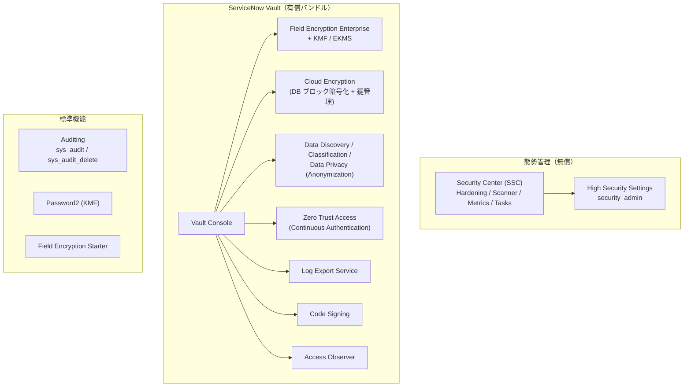
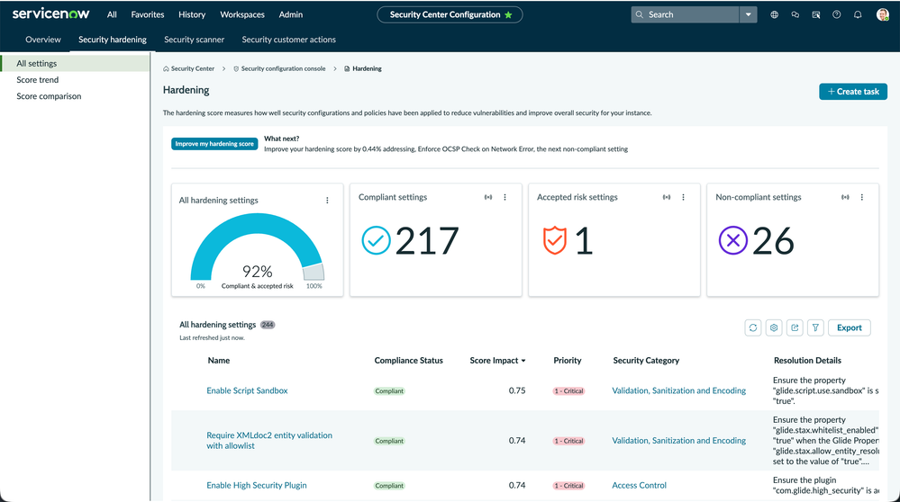
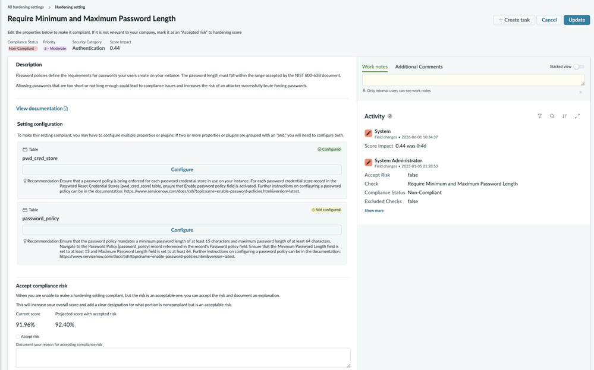
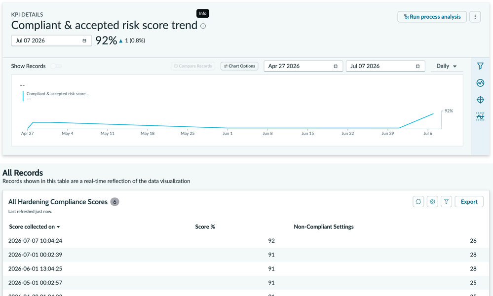
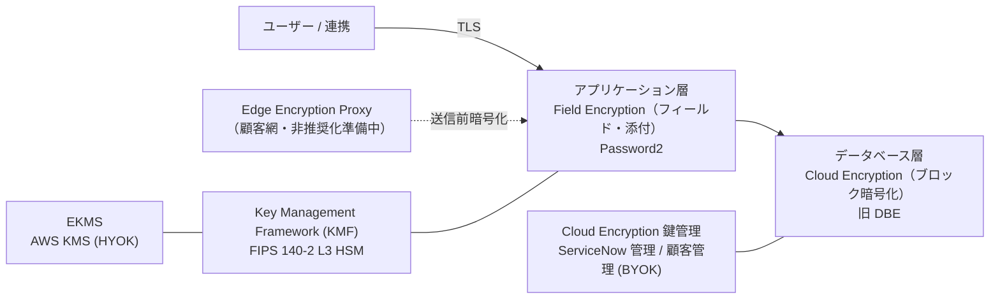
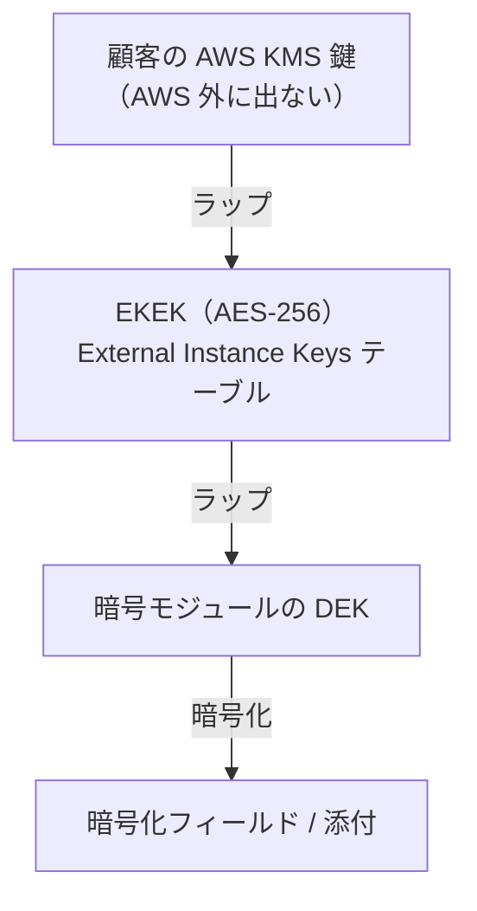
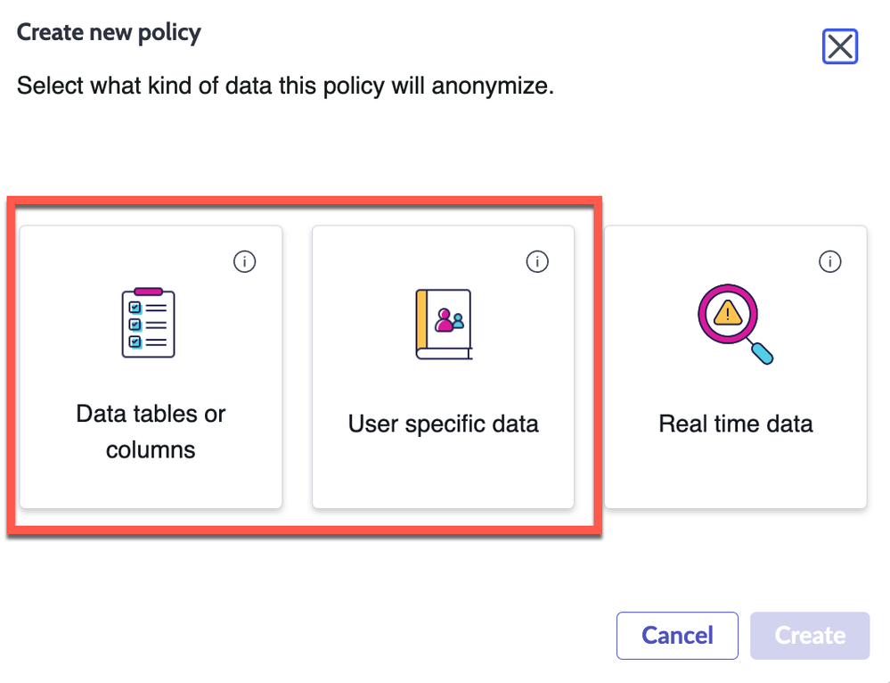
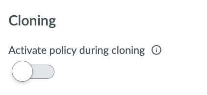
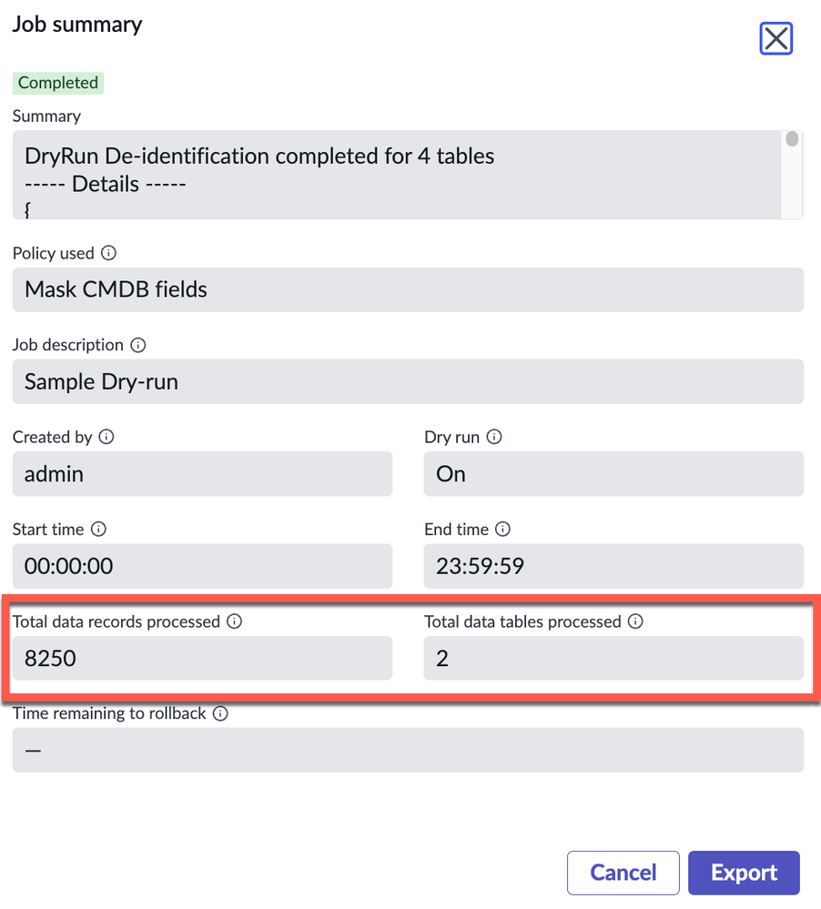

# プラットフォームセキュリティと暗号化（Platform Security and Encryption）

## 概要

ServiceNow AI Platform（旧 Now Platform）のプラットフォームセキュリティは、大きく次の5領域で構成される。本ファイルは基準リリース **Australia**（2026-05 GA）時点の仕様を中心に、各領域の機能・テーブル・ロール・プロパティ・制約を整理する。

| 領域 | 主な機能（英語正式名称） | 位置付け | 本ファイルの節 |
|---|---|---|---|
| セキュリティ態勢管理 | Security Center（SSC）、旧 Instance Security Center（ISC） | 無償（Store アプリ） | 「Security Center」「Instance Security Center」 |
| ハードニング | Hardening settings、High Security Settings、Elevated privilege（`security_admin`） | 標準機能 | 「セキュリティハードニング」 |
| 暗号化 | Field Encryption（旧 Column Level Encryption）、Key Management Framework（KMF）、EKMS、Cloud Encryption、Edge Encryption、Database Encryption、Password2 | Starter・Password2 は標準、Enterprise・Cloud Encryption は有償（Platform Encryption / Vault） | 「暗号化機能の全体像」以降 |
| データプライバシー | Data Discovery、Data Classification、Data Privacy（Anonymization） | Store アプリ（Vault 構成要素） | 「データプライバシー」 |
| Vault 付帯機能 | Vault Console、Zero Trust Access、Code Signing、Access Observer | Vault | 「ServiceNow Vault」 |
| 監視・監査 | Auditing（`sys_audit`）、Log Export Service（LES） | 監査は標準、LES は Vault | 「監査ログ」 |

これらの有償セキュリティ機能を束ねた製品が **ServiceNow Vault（ヴォールト）** であり、管理画面として **Vault Console** を持つ。認証・SSO・MFA は [authentication-sso.md](./authentication-sso.md)、ACL は [access-control-acl.md](./access-control-acl.md)、ロール設計は [users-groups-roles.md](./users-groups-roles.md)、SecOps 製品（脆弱性対応・SIR）は [../secops/security-operations.md](../secops/security-operations.md) を参照。導入時のセキュリティ要件整理は [../../03_導入編/10-security-compliance.md](../../03_導入編/10-security-compliance.md)、実践知は [../../04_応用編/12-security-hardening-practice.md](../../04_応用編/12-security-hardening-practice.md) を参照。

> **Brazil での変更:** Brazil では Security Center 本体・Field Encryption に機能変更はない（後述）。Vault 側で AI 生成のセキュリティ態勢サマリ、Field Encryption のエージェント型ワークフロー強化、Admin Home への Vault タイル追加などが行われた。[出典](https://www.servicenow.com/docs/r/release-notes/servicenow-vault-rn.html)

---

## Security Center（ServiceNow Security Center、SSC）

### Security Center の位置付け

**Security Center（セキュリティセンター、SSC）** は、ServiceNow インスタンスのセキュリティ態勢を維持するためのツール群である。ServiceNow Store から**無償**で提供され、ファミリーリリースの合間に**四半期ごとに新バージョン**が公開される。[出典](https://www.servicenow.com/docs/r/platform-security/security-center/sec-center-v2.html)

- プリインストールの開始時期について、Security Center 概要ページは「Vancouver 以降デフォルトでインストール」、Zurich→Australia の統合リリースノートは「Zurich 以降デフォルトでインストール」と記載しており、**公式情報間で不一致**がある。いずれにせよ Australia の新規インスタンスには導入済みで、Store から最新版に更新する運用となる。[出典](https://www.servicenow.com/docs/r/platform-security/security-center/sec-center-v2.html) [出典](https://www.servicenow.com/docs/r/m4LmCVvkm6_8u3nlIuep5Q/N14m8jO8k6ckkzF3VMisow)
- 旧製品の **Instance Security Center（ISC）** は 2024年9月に販売終了（End of Sales）しており、サポート対象外・新規有効化不可である。SSC が後継となる。[出典](https://www.servicenow.com/docs/r/platform-security/security-center/sec-center-v2.html)

### Security Center の構成要素

Security Center は次のコンソール・機能で構成される（Brazil 版ドキュメント 2026-09-10 更新の記載。Australia と同構成）。[出典](https://www.servicenow.com/docs/r/platform-security/security-center/sec-center-v2.html)

| 構成要素（英語） | 日本語訳 | 内容 |
|---|---|---|
| Security Center landing page | ランディングページ | インスタンス保護の入口 |
| Identity and Access Management (IAM) | ID・アクセス管理 | 必要なユーザー・プロセスのみがデータにアクセスできることの確認。Zurich で IAM ツールとセキュリティメトリクスを統合 |
| Security configuration console | セキュリティ構成コンソール | セキュリティ態勢の概要、ハードニング準拠スコア、トレンド、上位の非準拠設定、スキャン結果 |
| Security monitoring console | セキュリティ監視コンソール | セキュリティ通知と潜在リスクのメトリクス |
| Security posture console | セキュリティ態勢コンソール | 脅威の特定・対応・復旧の手順ガイド |
| Security Tasks（Platform Security Tasks） | セキュリティタスク | セキュリティ関連タスクの一元管理（自動生成・手動作成、担当割当、アプリ内通知）。Zurich で導入 |
| Security learning | セキュリティ学習 | 学習教材を1ページに集約 |
| Security banner announcements | バナー告知 | 管理者向けの緊急アラート表示 |
| Access Controls console | アクセス制御コンソール | Access Analyzer の検出結果を集約し、是正タスクの追跡・優先順位付け・割当を行う。Zurich で導入 |
| Security scanner | セキュリティスキャナー | 手動／スケジュール実行のスキャン、カスタムチェック・スイート、2回のスキャン結果比較 |
| Security metrics | セキュリティメトリクス | 65 以上のメトリクス、目標値・閾値の設定 |

スキャナーとメトリクスの操作（ISC からの移行ガイドより）[出典](https://www.servicenow.com/docs/r/zurich/platform-security/servicenow-ai-platform-security/instance-security-center-to-security-center-migration.html)

- スキャン実行：**Overview > Scan > Suites**（旧 ISC の Auditor スキャンに相当する Auditor suite もここから実行）。
- スキャン結果：**Overview > Scan > Results**。
- メトリクス：**Overview > Metrics** または **All Metrics**。
- セッション監視：**Metrics > Sessions**（Analytics Hub で可視化）。
- 学習：**Overview > Learning**。
- 準拠スコアの定期再計算：スケジュールスクリプト **`SC - Calculate Compliance Monthly`** の Run / Day / Time zone / Time で設定。

### Security Center のリリース別変更

Security Center の Zurich・Australia での変更は以下のとおり。[出典](https://www.servicenow.com/docs/r/m4LmCVvkm6_8u3nlIuep5Q/N14m8jO8k6ckkzF3VMisow)

| リリース | 区分 | 内容 |
|---|---|---|
| Zurich | New | Security Task management、各 Overview ページ刷新（Hardening / Scanner / Metrics / Best Practices）、紹介動画オーバーレイ、Auditor Suite に公開ナレッジベース／公開記事のチェック2種追加（Global スコープで実行）、Granular admin role、Access Controls console、IAM セクション強化 |
| Zurich | Changed | Coral テーマ適用、ハードニングのベースラインを Instance Security Hardening Settings V6 に、Security Hardening tool を V7 に更新 |
| Australia | New | **Version-based hardening settings**（インスタンスのファミリーに該当する設定のみ表示）、**Accept risk for hardening settings**（リスク受容。理由入力必須、保存前にスコア影響を表示、状態が Accepted Risk になりスコア計算に反映、Accept Risk Settings フィルタ） |
| Australia | Changed | Security Hardening tool を Instance Security Hardening Settings V7 に更新 |
| Australia | ハイライト | Now Assist パネルのチャットボットから任意の Platform Security ページで Security Task を作成可能 |

> **Brazil での変更:** Zurich→Brazil 統合リリースノートでは、Brazil の Security Center は New / Changed / Removed すべて「No updates for this release」。ただし同ページは AI 生成サマリを含み正確性が保証されない旨の注記がある。[出典](https://www.servicenow.com/docs/r/delta-zurich-brazil/brazil-zurich-securitycenter-release-notes.html)

### Security Center のロール

| ロール | 内容 | 出典 |
|---|---|---|
| `admin` | Security Center へのフルアクセス | [出典](https://www.servicenow.com/docs/r/GypxAX2jEErwkCxugICKdg/FLYOmsyOg96KRG8AbJ3l5Q) |
| `sn_vsc.security_center_viewer` | Security Center 情報の読み取り専用 | [出典](https://www.servicenow.com/docs/r/GypxAX2jEErwkCxugICKdg/FLYOmsyOg96KRG8AbJ3l5Q) |
| `sn_vsc.security_center_admin` | Security Center のコンソール・ツールへの管理者レベルアクセス、セキュリティタスクの作成・管理。Security Center 3.2（Store）以降。`admin` を付与せずに最小権限で運用するための Granular role | [出典](https://www.servicenow.com/docs/r/oL66E_cwDD_tnWQYzYPRdA/vquE8rIq3TcVvQJbtk1wUQ) |
| `sn_vsc.task_manager` | `sn_vsc.security_center_admin` に内包（タスク管理用と推測されるが、個別の権限説明は公開情報では確認できず） | [出典](https://www.servicenow.com/docs/r/oL66E_cwDD_tnWQYzYPRdA/vquE8rIq3TcVvQJbtk1wUQ) |

`sn_vsc.security_center_admin` が内包するロール（Australia）：`mi_admin`、`access_analyzer_admin`、`pa_admin`、`scan_user`、`data_classification_auditor`、`sn_ace.ace_user`、`antivirus_viewer`、`sn_vsc.task_manager`、`sn_mif.mif_read`、`sn_cicd.sys_ci_automation`。[出典](https://www.servicenow.com/docs/r/oL66E_cwDD_tnWQYzYPRdA/vquE8rIq3TcVvQJbtk1wUQ)

### Platform security granular admin roles（プラットフォームセキュリティの細分化管理ロール）

Australia では、`admin` を付与せずに個別のセキュリティ領域を管理するための細分化ロールが整理されている。主なものを抜粋する。[出典](https://www.servicenow.com/docs/r/aPoGScNNpfmq9WAhaTvMvQ/Rs_M0yB33wcrx_bPlf2GPg)

| ロール | 対象製品 | 用途 |
|---|---|---|
| `security_admin` | Encryption、Identity and access audit | セキュリティ管理作業、監査保持期間設定、監査対象テーブル・フィールド設定、ID セキュリティ監査プロパティ変更 |
| `sn_kmf.admin` | Encryption | 鍵管理のフル管理（cryptographic manager / auditor ロールの付与を含む） |
| `sn_kmf.cryptographic_manager` | Encryption | 鍵操作の読み取り・書き込み・実行 |
| `sn_kmf.cryptographic_auditor` | Encryption | 鍵操作の読み取り専用 |
| `sn_vault_console.vault_console_admin` | ServiceNow Vault | テンプレートフロー実行、機密データ監視。data classification / data privacy / CA の管理ロールを束ねる |
| `sn_vault_console.vault_console_auditor` | ServiceNow Vault | Vault のポリシー・メトリクス閲覧。data discovery / classification / privacy / CA の監査ロールを束ねる |
| `sn_vsc.security_center_admin` | Security Center | Security Center のコンソール・ツール利用、セキュリティ作業の作成・管理 |
| `access_analyzer_admin` | Access Analyzer | ユーザー履歴とアクセスの比較、アクセスのシミュレーション、Access Insights |
| `identity_access_audit_viewer` | Identity and access audit | ユーザー・グループ・ロール・ACL の証跡と監査結果の閲覧（`role_viewer`、`group_viewer` を内包） |
| `instance_operator` | Instance operator | ロール関連タスク、ID アクセス監査情報へのアクセス（`identity_access_audit_viewer`、`user_role_history_viewer` を内包） |
| `user_impersonation_history_viewer` | User impersonation | 代理ログイン（impersonation）履歴テーブルの閲覧 |
| `user_login_history_viewer` | Identity Center | ログイン履歴（タイムスタンプ、ブラウザ、IP、成否）の閲覧 |
| `privileged_role_config_admin` | Identity Center | `sys_icenter_role_config` テーブルのロール構成管理 |
| `mi_admin` | Machine Identity Console | システム・データと連携するマシン ID の管理 |
| `password_policy_admin` | Password policy | パスワードポリシー設定 |
| `oauth_admin` | System OAuth | OAuth 関連機能の設定 |
| `ai_user_admin` / `agent_role_config_admin` / `agent_role_config_viewer` | Identity AI agents | AI ユーザーの作成・ロール付与、エージェント型ワークフロー中の AI エージェントのアクセス（ロールマスキング）設定 |

SSO・SCIM・API 認証系の細分化ロール（`sso_config_admin`、`scim_admin`、`api_service_admin` など）は [authentication-sso.md](./authentication-sso.md) を参照。

---

## Instance Security Center（ISC、レガシー）

### Instance Security Center の概要

**Instance Security Center（インスタンスセキュリティセンター、ISC）** は、準拠スコア、セキュリティイベントメトリクス、セッション管理、通知を集約したセキュリティ態勢の中央コンソールであった。ISC は 2024年9月に販売終了し、サポート対象外となっている。既存利用者は SSC への移行が推奨される。[出典](https://www.servicenow.com/docs/r/GypxAX2jEErwkCxugICKdg/FLYOmsyOg96KRG8AbJ3l5Q)

- メニュー：**All > System Security > Instance Security Center**、またはシステム管理ホームページ。
- ドメインセパレーション（Domain separation）は非対応。
- ISC モジュールをカスタマイズするとアップグレード時に正しく更新されない可能性があるため、カスタマイズ禁止。

### Instance Security Center のホーム画面構成

| タイル／要素 | 内容 |
|---|---|
| Administrator messages | 対応事項がある管理者にのみ表示 |
| Security banner | 重要度別（赤・濃灰・青）のローテーションバナー |
| Security event ribbon | 主要イベントメトリクスの日次件数・トレンド（Edit で表示タイルと順序を変更） |
| Daily Compliance Score | ハードニング設定の推奨値との一致度（%）。Performance Analytics ジョブが現地時刻 02:00 に更新、Refresh で即時再計算 |
| PCI Configuration Controls Score | PCI 関連設定の準拠スコア |
| Session Management | ユーザーセッション一覧（ユーザー、MFA 状態、アクティブ状態、User agent、IP、最終アクセス）。危険なセッションの隔離・ロックアウトが可能 |
| Hardening | Hardening Compliance Configurations ページ。カテゴリ別に非準拠プロパティを設定 |
| Auditor | 誤ったセキュリティ定義のスキャン |
| Metrics | User / Export / Authentication / Email / Antivirus |
| Notifications、Tours、Resources、Virtual Agent | 通知ベル、ツアー、資料、ISC 用 Virtual Agent（プラグイン `com.glide.isc_virtualagent`） |

[出典](https://www.servicenow.com/docs/r/GypxAX2jEErwkCxugICKdg/FLYOmsyOg96KRG8AbJ3l5Q)

- ISC の Hardening Compliance Configuration 画面では**非準拠のプロパティのみ編集可能**で、準拠済みプロパティの変更は System Properties で行う。
- Daily Compliance Score が 50% 未満は準拠レベルが低い目安とされる。
- ロール：`admin`、`sn_vsc.security_center_viewer`（ドキュメント中に `security_dashboard_user` 等の表記揺れがあるため実機確認を推奨）。

### ISC から SSC への移行

| 項目 | ISC | SSC |
|---|---|---|
| 準拠スコア | Daily Compliance Score タイル | Overview ページ、Hardening > Comparison |
| スコア更新 | Refresh / 日次 PA ジョブ | Overview から手動更新、`SC - Calculate Compliance Monthly` で定期計算 |
| 設定編集 | Hardening Compliance Configurations | Overview / Hardening > All Settings / Hardening > Comparison の設定名リンク |
| メトリクス | User / Export / Authentication / Email / Antivirus | 65 以上の新メトリクス、目標・閾値 |
| スキャン | Auditor | 手動／スケジュール、カスタムチェック・スイート、結果比較 |
| セッション | Session Management タイル | Analytics Hub、Metrics > Sessions |
| 通知 | 通知ベル | セキュリティイベントのメール通知 |

SSC 利用中に ISC コンポーネントを無効化する手順は KB1702514「Guidelines to disable Instance Security Center components (while using Security Center)」、廃止プロセスは KB0867184 を参照（いずれも Now Support、要ログイン）。[出典](https://www.servicenow.com/docs/r/zurich/platform-security/servicenow-ai-platform-security/instance-security-center-to-security-center-migration.html)

---

## セキュリティハードニング（Security hardening）

### Hardening settings の概要

**Hardening settings（ハードニング設定）** は、ServiceNow が推奨するセキュリティ関連プロパティ・プラグイン・構成値の一覧と、各設定の推奨値・リスク評価を定めたものである。Security Center の Hardening 画面で準拠状況を確認・是正する。Australia 版は **Instance Security Hardening Settings V7** をベースとし、**Security Center baseline version 5.0** のハードニング設定が 2026-03-12 に更新されている。[出典](https://www.servicenow.com/docs/r/oL66E_cwDD_tnWQYzYPRdA/ocO0zvJcgJx1osrHp315Gw) [出典](https://www.servicenow.com/docs/r/oL66E_cwDD_tnWQYzYPRdA/N~wb_AWPcaEgEhYuOGuBCg)

Hardening settings は次の 14 カテゴリに分類される（Australia）。[出典](https://www.servicenow.com/docs/r/oL66E_cwDD_tnWQYzYPRdA/ocO0zvJcgJx1osrHp315Gw)

| # | カテゴリ（英語） | 日本語訳 |
|---|---|---|
| 1 | Access control | アクセス制御 |
| 2 | API and web service | API・Web サービス |
| 3 | Architecture, design, and threat modeling | アーキテクチャ・設計・脅威モデリング |
| 4 | Authentication | 認証 |
| 5 | Business logic | ビジネスロジック |
| 6 | Communications | 通信 |
| 7 | Configuration | 構成 |
| 8 | Data protection | データ保護 |
| 9 | Error handling and logging | エラー処理・ログ |
| 10 | File and resources | ファイル・リソース |
| 11 | Malicious code | 悪性コード |
| 12 | Session management | セッション管理 |
| 13 | Stored cryptography | 保存時暗号 |
| 14 | Validation, sanitization, and encoding | 検証・サニタイズ・エンコード |

各設定のリスク評価は CVSS に基づく重大度で表される：Critical 9.0–10.0、High 7.0–8.9、Medium 4.0–6.9、Low 0.01–3.9、None 0.0。一部の設定は Customer Service and Support（CSS）の介入が必要で、その旨が明示される。[出典](https://www.servicenow.com/docs/r/oL66E_cwDD_tnWQYzYPRdA/ocO0zvJcgJx1osrHp315Gw)

### ハードニング準拠スコアの計算

**Hardening compliance score（ハードニング準拠スコア）** は、各設定のリスクスコアのうち準拠済み設定の合計を全設定の合計で割った百分率で、日次で再計算される。Australia で追加された **Accepted Risk（リスク受容）** の設定は準拠側に加算される。[出典](https://www.servicenow.com/community/security-on-now-blog/your-hardening-score-isn-t-just-a-number-here-s-what-it-s/ba-p/3574268)

- 公式ドキュメントは「各設定のリスクスコアは 0〜10」と説明する一方、ServiceNow Community の公式ブログ（2026-07）は「各設定のスコア（Score Impact）は 0〜1」で、例として「25.4 / 34.9 ≒ 73%」を示している。画面上の **Score Impact** 列は 0.75 などの小数で表示される（下図）。両者の単位は異なるが、計算方式（準拠＋受容 ÷ 全体 × 100）は一致する。
- 各設定には **Priority（優先度）1〜4**（1 - Critical、3 - Moderate 等）が付く。
- 最大の改善余地を探すには **Hardening > All settings** で Compliance Status を非準拠でフィルタし、Score Impact で並べ替える。是正後はホームで **Update score** を選択する。

**図1：Security Center > Security configuration console > Hardening（All settings）画面**
画面上部のタブは Overview / Security hardening / Security scanner / Security customer actions。左ペインに All settings / Score trend / Score comparison。上部に「Improve my hardening score」ボタンと次に対応すべき非準拠設定（例：Enforce OCSP Check on Network Error、スコア +0.44%）が表示される。中央のカードは All hardening settings（準拠＋受容で 92%）、Compliant settings 217、Accepted risk settings 1、Non-compliant settings 26。下部の一覧（全 244 件）は Name、Compliance Status、Score Impact、Priority、Security Category、Resolution Details 列で構成され、例として Enable Script Sandbox（`glide.script.use.sandbox` = true、Score Impact 0.75、1 - Critical）、Require XMLdoc2 entity validation with allowlist（`glide.stax.whitelist_enabled`）、Enable High Security Plugin（`com.glide.high_security`）が並ぶ。右上に「Create task」ボタン。
出典：https://www.servicenow.com/community/security-on-now-blog/your-hardening-score-isn-t-just-a-number-here-s-what-it-s/ba-p/3574268 （取得日：2026-11-02）

**図2：個別ハードニング設定の詳細画面（例：Require Minimum and Maximum Password Length）**
上部に Compliance Status（Non-Compliant）、Priority（3 - Moderate）、Security Category（Authentication）、Score Impact（0.44）。Description に NIST 800-63B に基づく説明と「View documentation」リンク。Setting configuration には設定対象のテーブル（`pwd_cred_store`：Configured、`password_policy`：Not configured）ごとに Configure ボタンと推奨内容（最小 15 文字以上・最大 64 文字以上）。下部の **Accept compliance risk** セクションに Current score（91.96%）と Projected score with accepted risk（92.40%）、「Accept risk」チェックボックス、理由入力欄。右ペインは Work notes / Additional Comments と Activity（変更履歴）。右上に Create task / Cancel / Update。
出典：https://www.servicenow.com/community/security-on-now-blog/your-hardening-score-isn-t-just-a-number-here-s-what-it-s/ba-p/3574268 （取得日：2026-11-02）

**図3：Compliant & accepted risk score trend（準拠＋受容スコアのトレンド）**
KPI DETAILS として「Compliant & accepted risk score trend」の折れ線グラフ（例：2026-04-27〜2026-07-07、Daily、最新 92%）。Run process analysis ボタン、Compare Records、Chart Options。下部の「All Hardening Compliance Scores」一覧は Score collected on、Score %、Non-Compliant Settings 列で、再計算ごとの履歴を表示する。
出典：https://www.servicenow.com/community/security-on-now-blog/your-hardening-score-isn-t-just-a-number-here-s-what-it-s/ba-p/3574268 （取得日：2026-11-02）

### 代表的なハードニング設定（プロパティ）

以下は公式ドキュメントで確認できた代表的なハードニング設定である。全設定（Australia 時点で 240 件超）は Security Center の All settings 画面で確認すること。

#### Security Center baseline version 5.0 で更新された設定（Australia）

[出典](https://www.servicenow.com/docs/r/oL66E_cwDD_tnWQYzYPRdA/N~wb_AWPcaEgEhYuOGuBCg)

| 設定名 | プロパティ | 推奨値 |
|---|---|---|
| Require authorization for SOAP requests | `glide.basicauth.required.soap` | `true`（または WS-Security Profile 使用時 `glide.soap.require_ws_security` = `true`） |
| Enforce OCSP check on network error | `com.glide.communications.httpclient.ocsp_allow_network_error` | `false` |
| Disable external content URL | `glide.ui.url.external.content` | `false` |
| Restrict XML external entities | `glide.xml.entity.whitelist`（= `http://java.sun.com/j2ee/dtds/`）、`glide.xml.entity.whitelist.enabled` | 記載値 / `true` |
| Disable unauthenticated published reports | `glide.report.published_reports.enabled` | `false` |
| Enable password reset policy checks | `glide.enable.password_policy` | `true` |
| Minimize entity expansion threshold | `glide.xmlutil.max_entity_expansion` | `3000` 以下 |
| Disable outbound SSLv2/SSLv3 | `glide.outbound.sslv3.disabled` | `true`（一度設定すると変更不可） |
| Disable GlideRecord scope fencing legacy behavior | `glide.record.legacy_cross_scope_access_policy_in_script` | `false` |
| Restrict uploaded MIME types | `glide.security.file.mime_type.validation` | `true` |
| Jelly JS interpolation protection | `glide.ui.jelly.js_interpolation.protect_nested_expressions` | `true` |
| Enable UserCookie version 3.1 | `glide.ui.secure.cookies.use_kmf` | `true` |
| Log user impersonation | `glide.sys.log_impersonation` | `true` |
| Dashboard 作成・削除時のアクセスチェック | `glide.processors.check_access_before_process` | `true` |
| Proactively invalidate sessions | `glide.active.session.timeout.invalidate.session` | `true` |
| Restrict downloadable MIME types | `glide.ui.attachment.force_download_all_mime_types` | `true` |
| Disallow infected file download | `com.glide.snap.infected_download_allowed` | `false` |
| Restrict GlideSystemUserSession API | `glide.sandbox.usersession.allow_unsanitized_messages` | `false` |
| Apply domain separation on dot-walked fields | `glide.sys.domain.include_domain_condition_on_join` | `true` |
| Enforce URL allowlist check | `glide.security.url.whitelist.strict_check` または `glide.security.url.whitelist` | `true` または値設定 |
| Restrict access to background script | `glide.script_processor.admin` | `admin`（デフォルト） |
| Verify certificate chain and hostname | `com.glide.communications.httpclient.verify_hostname` | `true` |
| Lockout time for invalid password reset attempts | `password_reset.request.max_attempt_window` | `1440` 以上 |
| Restrict email domains for external user registration | `sn_ext_usr_reg.allowed_email_domains` | 許可ドメインのカンマ区切り |
| Work order management query rules | `sn_fsm.use_query_rules` | `true` |

上表のほか、Enable SSL in LDAP authentication、Set OTP lifetime for password reset to 1 hour、Set guest user for SOAP requests 等はプロパティではなくチェック用ルールスクリプトが更新された設定である。

#### 個別ページで確認できた設定

| 設定 | プロパティ | 推奨値 | 重大度・補足 | 出典 |
|---|---|---|---|---|
| Anti-CSRF token | `glide.security.use_csrf_token` | `true` | Security risk: High、Functional impact: Low。関連：`glide.security.csrf_previous.time_limit`、`glide.security.csrf_previous.allow`、`glide.security.csrf.strict.validation.mode` | [出典](https://www.servicenow.com/docs/r/oL66E_cwDD_tnWQYzYPRdA/VZ1Ee22N1eUfHMmUuM6EGg) |
| Session activity timeout | `glide.ui.session_timeout`（分） | 30 以下（未定義時のフォールバックは 30） | CVSS 7.5（High）。上限は `glide.ui.max_session_timeout`（最大 1440 分） | [出典](https://www.servicenow.com/docs/r/platform-security/instance-security-hardening-settings/sc-session-activity-timeout.html) |
| Script sandbox | `glide.script.use.sandbox` | `true` | Priority 1 - Critical（図1） | 図1 |

> **注意（推奨値の版差）:** `glide.ui.session_timeout` の推奨値は、Xanadu 版ドキュメント（Security Center 1.3 時点）では「60 分、1日を超えない」、Brazil 版ドキュメントでは「30 分以下」と記載が異なる。最新の Security Center 表示値に従うこと。[出典](https://www.servicenow.com/docs/r/platform-security/instance-security-hardening-settings/sc-session-activity-timeout.html)

### High Security Settings（高度セキュリティ設定）

**High Security Settings** プラグイン（`com.glide.high_security`）は新規インスタンスでデフォルト有効であり、**System Security > High Security Settings** モジュールを提供する。このプラグインは数百の構成を作成・更新し、アクセス制御・入力検証・出力エンコードを強化して OWASP 上位の攻撃を緩和する。有効化時に Contextual Security プラグインも有効化される。[出典](https://www.servicenow.com/docs/r/platform-security/exploring-high-security-settings.html)

High Security Settings のプロパティは read_roles が `admin`、write_roles が `security_admin` であり、`admin` は閲覧できるが変更には `security_admin` への昇格が必要となる。

| プロパティ | デフォルト | 内容 |
|---|---|---|
| `glide.ui.escape_text` | Yes | UI パーサレベルで XML 値をエスケープ（反射型・格納型 XSS 対策。Service Portal には非適用） |
| `glide.ui.escape_all_script` | 新規で Yes | Jelly `<script>` 内の式をすべてエスケープ |
| `glide.ui.rotate_sessions` | Yes | HTTP セッション ID のローテーション（SAML 2.0 SSO 利用時は No にする旨の記載あり） |
| `glide.ui.secure_cookies` | Yes | セッション Cookie の厳格な検証 |
| `glide.security.strict.updates` | Yes | フォーム送信時にインバウンドトランザクションのセキュリティを再チェック |
| `glide.security.strict.actions` | Yes | UI アクションの条件を実行前にもチェック |
| `glide.security.use_csrf_token` | Yes | CSRF 対策トークン |
| `glide.ui.escape_html_list_field` | Yes | リストビューで HTML フィールドをエスケープ |
| `glide.html.escape_script` | Yes | リストビューで HTML フィールド内の JavaScript タグをエスケープ |
| `glide.ui.forgetme` | Yes | ログイン画面の Remember Me を非表示 |
| `glide.smtp.auth` | Yes | SMTP 認証（非推奨／Deprecated） |
| `glide.soap.strict_security` | Yes | インバウンド SOAP を Security Manager 経由でロールチェック |
| `glide.basicauth.required.{wsdl,csv,excel,importprocessor,pdf,rss,scriptedprocessor,soap,unl,xml,xsd}` | Yes | 各プロセッサへのインバウンド要求に Basic 認証を必須化 |
| `glide.cms.catalog_uri_relative` | Yes | `/ess/catalog.do` の uri パラメータを相対 URL に限定 |
| `glide.set_x_frame_options` | Yes | 全 UI ページに X-Frame-Options: SAMEORIGIN（クリックジャッキング対策） |
| `glide.ui.attachment.download_mime_types` | text/html, image/svg, image/svg+xml | 指定 MIME をインライン表示せずダウンロードさせる |
| `glide.security.groupby_acl_check` | Yes | GroupBy 操作に対する ACL チェック |
| `glide.security.diag_txns_acl` | No | `stats.do`、`threads.do`、`replication.do` を admin・許可 IP に限定 |
| `glide.ui.security.codetag.allow_script` | No | `[code]` タグ内の JavaScript 許可 |
| `glide.script.allow.ajaxevaluate` | No | AJAXEvaluate プロセッサ（クライアントからのサーバースクリプト実行）を無効化 |

このほか `glide.sm.default_mode`（ACL が存在しないテーブルに対する Security Manager の既定動作。High Security の Default deny）、`glide.cookies.http_only`（機密 Cookie に HttpOnly 属性）も High Security 関連のプロパティである。[出典](https://www.servicenow.com/docs/r/platform-security/exploring-high-security-settings.html) ACL 評価の詳細は [access-control-acl.md](./access-control-acl.md) を参照。

### Elevated privilege（特権昇格）と `security_admin`

**Elevated privilege roles（昇格特権ロール）** は、ログイン時には有効でなく、ユーザーが手動で昇格（Elevate role）したセッションの間だけ権限が有効になるロールである。[出典](https://www.servicenow.com/docs/r/8yND1KuvF7tjP~F577YThQ/VtyHlnPUMLl7Lhh7PPb1HQ)

- ベースシステムで唯一の昇格ロールは `security_admin`。ACL の作成・変更、High Security Settings の変更に必要。デフォルトの System Administrator（`admin` ユーザー）に付与されている。
- `security_admin` は `admin` ロールに**内包されない**ため、明示的な付与が必要。[出典](https://www.servicenow.com/docs/r/platform-security/exploring-high-security-settings.html)
- 任意のロールを Role フォームで elevated に指定できる。ただし `admin` ロール自体への elevated 指定は非サポート（代わりに管理者に手動昇格を強制するプロパティがある）。
- 昇格の効果はセッション中のみ。セッションタイムアウトまたはログアウトで解除される。
- 昇格ロールを内包するロールに昇格しても、内包された昇格ロールの権限は得られない（各ロールに個別に昇格する）。
- `security_admin` を付与できるのは、`admin` を持ち、かつ `security_admin` に昇格済みのユーザーのみ。`security_admin` を持たないユーザーは、`security_admin` を含むグループにユーザーを追加できない。
- そのほかの昇格ロールの例：`ca_admin` / `ca_policy_admin` / `ca_auditor`（Continuous Authentication）、`data_privacy_admin`（Data Privacy）。

> **Brazil での変更:** Vault の Access Observer と Field Encryption のエージェント型ワークフローは、ロールマスキングのために `security_admin` へ昇格しなくなった（特権昇格の最小化）。[出典](https://www.servicenow.com/docs/r/release-notes/servicenow-vault-rn.html)

---

## 暗号化機能の全体像

### 暗号化レイヤーと製品の対応

ServiceNow の暗号化機能は、保護するレイヤーと鍵管理方式によって分かれる。Australia 時点の推奨・非推奨の状態を含めて整理する。

| 機能（英語） | 保護レイヤー | 鍵管理 | ライセンス | Australia 時点の状態 |
|---|---|---|---|---|
| **Field Encryption Starter** | アプリケーション層（フィールド単位、最大5フィールド） | ServiceNow 管理（ローテーションは Support 経由） | 標準 | 推奨（旧 CLE Starter の後継） |
| **Field Encryption Enterprise** | アプリケーション層（フィールド・添付ファイル、無制限） | KMF。BYOK（Customer-supplied key）、HYOK（EKMS） | 有償（Platform Encryption / Vault） | 推奨（旧 CLEE の後継） |
| **External Key Management Service (EKMS)** | Field Encryption の鍵を外部 KMS でラップ | AWS KMS | 有償＋プラグイン | Australia で導入 |
| **Cloud Encryption with Key Management** | ストレージ層（DB ブロック暗号化） | ServiceNow 管理鍵／顧客管理鍵（BYOK、Withdraw） | 有償（Platform Encryption） | 推奨（DBE の後継） |
| Column Level Encryption (CLE) / Enterprise (CLEE) | アプリケーション層 | KMF | CLEE は有償 | Zurich 以降、非推奨化準備中（新規インスタンスでは非表示・非有効化、既存はサポート継続） |
| Edge Encryption | 顧客ネットワーク上のプロキシで送信前に暗号化 | 顧客側 | 有償 | Zurich 以降、非推奨化準備中 |
| Database Encryption (DBE) / DBE-CCS | ストレージ層 | ServiceNow 管理（CCS は顧客供給鍵） | 有償 | Washington DC 以降、非推奨化準備中 |
| Password2 フィールド | フィールド型（双方向暗号化パスワード） | KMF（`cm_glide_encrypter`） | 標準 | 標準機能 |

[出典](https://www.servicenow.com/docs/r/platform-security/exploring-fe.html) [出典](https://www.servicenow.com/docs/r/oL66E_cwDD_tnWQYzYPRdA/i7gVekw7lu5uEl~UefG66w) [出典](https://www.servicenow.com/docs/r/oL66E_cwDD_tnWQYzYPRdA/Sn~ZSQuEMVyrZq5fH1FKDw) [出典](https://www.servicenow.com/docs/r/oL66E_cwDD_tnWQYzYPRdA/tEY4SHaVXnH80SiyzIMowQ) [出典](https://www.servicenow.com/docs/r/zurich/platform-security/database-encryption-with-customer-controlled-switch/explore-database-encryption.html)

- CLE/CLEE は Yokohama で Field Encryption Starter / Enterprise に名称変更（リブランド）された旨が Key Management の統合リリースノートに記載されている（同ページは AI 生成サマリを含む）。[出典](https://www.servicenow.com/docs/r/delta-australia-brazil/brazil-australia-encryption-release-notes.html)
- **Platform Encryption** サブスクリプションバンドルには Field Encryption Enterprise と Cloud Encryption が含まれる。[出典](https://www.servicenow.com/docs/r/oL66E_cwDD_tnWQYzYPRdA/i7gVekw7lu5uEl~UefG66w)
- データ転送時（in transit）は HTTPS/TLS で保護される。通信関連のハードニングは前節（`glide.outbound.sslv3.disabled`、`com.glide.communications.httpclient.verify_hostname` 等）を参照。データセンターや物理インフラは [instance-architecture.md](./instance-architecture.md) を参照。

---

## Field Encryption（フィールド暗号化）

### Field Encryption Starter と Enterprise の違い

**Field Encryption（フィールド暗号化）** は、テーブルの特定フィールドや添付ファイルをアプリケーション層で暗号化し、許可されたユーザー・スクリプト・プロセスのみが復号値を参照できるようにする機能である。Field Encryption は**既定で全ユーザー・スクリプト・システムプロセスからのアクセスを遮断**し、Module Access Policy（MAP）で明示的に許可する。[出典](https://www.servicenow.com/docs/r/platform-security/exploring-fe.html)

| 項目 | Field Encryption Starter | Field Encryption Enterprise |
|---|---|---|
| 暗号化フィールド数 | 最大 5 | 無制限 |
| 添付ファイル暗号化 | 不可 | 可 |
| 鍵管理 | 鍵ローテーションは ServiceNow Support へ依頼 | インスタンス内で Support を介さず管理 |
| Customer-supplied keys（BYOK） | 不可 | 可 |
| External key management（HYOK、EKMS） | 不可 | 可 |
| Field Encryption Modules / Module Access Policies | 制限なし | 制限なし |
| サブスクリプション | 不要 | 必要 |

[出典](https://www.servicenow.com/docs/r/platform-security/exploring-fe.html)

### Field Encryption の有効化

Field Encryption の有効化手順（`admin` ロール）。[出典](https://www.servicenow.com/docs/r/platform-security/activate-platform-encryption.html)

1. **All > System Definition > Plugins** を開く。
2. ライセンス済みアプリ・プラグインの検索で「Field Encryption」を検索する。
3. Starter または Enterprise のプラグインを選び **Install** を選択する。

- Field Encryption Starter：CLE Starter 利用者は再実装なしでインストールでき、既存構成を引き継ぐ。ただしエンタイトルメントが CLE Starter と異なるため、事前に構成の適合を確認する。
- Field Encryption Enterprise：購入後、アカウントマネージャーが本番・非本番インスタンスでの有効化を手配する（通常数日）。**CLEE のエンタイトルメントは Field Encryption Enterprise に自動移行しない**（別製品扱い）。
- ドメインセパレーションと Delegated admin が有効な場合、管理者ユーザーは global ドメインに属している必要がある（そうでないと Plugin Activation エラー）。

### Field Encryption の構成要素

| 構成要素（英語） | 内容 |
|---|---|
| Cryptographic module（暗号モジュール） | 暗号仕様と鍵をまとめた単位。Field Encryption Module とも呼ぶ |
| Cryptographic specification（暗号仕様） | アルゴリズム定義。Algorithm Definition ステージで Equality Preserving オプションを設定 |
| Module key（モジュール鍵） | モジュールに紐づく鍵。ライフサイクル（生成・ローテーション・失効）を管理 |
| Module life-cycle policy | 鍵のライフサイクルポリシー |
| Encrypted Field Configuration（EFC、暗号化フィールド構成） | どのテーブル・カラム（または添付）をどのモジュールで暗号化するかの定義。タイプに Field / Attachment がある |
| Module Access Policy（MAP、モジュールアクセスポリシー） | 暗号モジュールへのアクセス（復号）を許可する主体の定義 |
| Access Observer | 暗号化フィールドへのアクセス主体の観測・ログ |
| Mass encryption / decryption / re-keying | 既存データの一括暗号化・復号・鍵の再暗号化のスケジュール実行 |

[出典](https://www.servicenow.com/docs/r/platform-security/exploring-fe.html) [出典](https://www.servicenow.com/docs/r/oL66E_cwDD_tnWQYzYPRdA/i7gVekw7lu5uEl~UefG66w)

### Module Access Policy（MAP）

**Module Access Policy（モジュールアクセスポリシー）** は、暗号モジュールで保護されたデータにアクセスできる主体を定義する。MAP がない暗号モジュールのデータは誰からも参照できず、リストの該当列は空表示になる。MAP は ACL と併用され、ACL で読める上に MAP で許可されていることが復号の条件となる。[出典](https://www.servicenow.com/docs/r/oL66E_cwDD_tnWQYzYPRdA/i7gVekw7lu5uEl~UefG66w)

| MAP の種類 | 内容 |
|---|---|
| Scope-based | アプリケーションスコープ単位 |
| Role-based | ロール単位（Target role を指定） |
| Script-based | 特定スクリプト（Business rule、Script include 等） |
| Resource Exchange | インスタンス間の鍵交換用 |
| System user | システムユーザー（スケジュールジョブ等） |

- MAP の Result は **Track**（アクセス許可）、**Reject** / **Strict Reject**（拒否）。
- メニュー：**Key Management > Module Access Policies**。
- Autogen（自動生成）ポリシーのルールは、スケジュールジョブ型、および親が Column Level Encryption の Field Encryption Module には適用されない。
- 添付ファイル暗号化は単一モジュールのみ使用可能（フィールド暗号化は複数モジュール可）。

[出典](https://www.servicenow.com/docs/r/oL66E_cwDD_tnWQYzYPRdA/i7gVekw7lu5uEl~UefG66w)

> **Brazil での変更:** Vault の「Field encryption and auto-generate access policies」エージェント型ワークフローで、フィールド暗号化を依頼すると現在アクセス権を持つロールが提示され、確認後にロールごとの MAP を作成してから暗号化する。[出典](https://www.servicenow.com/docs/r/release-notes/servicenow-vault-rn.html)

### Field Encryption の暗号方式と対応フィールド型

Field Encryption Enterprise（旧 CLEE、Australia 版ページ）の仕様は以下のとおり。[出典](https://www.servicenow.com/docs/r/oL66E_cwDD_tnWQYzYPRdA/i7gVekw7lu5uEl~UefG66w)

- 鍵は FIPS 140-2 Level 3 HSM で保護され、鍵ラッピング階層とエンベロープ暗号化を用いる。NIST 800-57 のプラクティスに沿う。
- **非決定的暗号化（Non-deterministic encryption）**：AES-CBC。同じ平文でも毎回異なる暗号文となるため、等価検索はできない。
- **Equality Preserving（等価性保持）**：暗号仕様の Algorithm Definition ステージで指定するオプション。等価比較を可能にする方式（決定的暗号化）。
- 対応フィールド型：Attachments、Date、Date/Time、Email、HTML、Journal、Journal Input、Journal List、Phone、String、Translated Field、Translated HTML、Translated Text、URL。
- 添付ファイル：Attachment タイプの有効な EFC を持つテーブルでは添付ファイルが既定で暗号化される。プロパティ `com.glide.encryption.enable_attachment_key_ui` で暗号化されていない添付をブロックできる。オプトアウトには Support ケースが必要。
- Resource Exchange：KMF の暗号 API を用いたインスタンス間の安全な鍵交換。

### Field Encryption のスクリプト API 上の挙動

| API | 挙動 |
|---|---|
| `getValue()` | 暗号モジュールへのアクセス権があれば平文、なければ暗号文または `null` |
| `setValue()` | `glide_encryption.set_value_support_cle.disabled` が `true` の場合、データは**暗号化されずに**書き込まれ MAP 不要（注意） |
| `changeEncryptionContext()` / `changeCryptoModule()` | Global スコープでのみ利用可 |

[出典](https://www.servicenow.com/docs/r/oL66E_cwDD_tnWQYzYPRdA/i7gVekw7lu5uEl~UefG66w)

### Field Encryption の制約

| 制約 | 内容 | 出典 |
|---|---|---|
| システムテーブル | `sys_` で始まるテーブルのフィールド・添付は暗号化不可 | [出典](https://www.servicenow.com/docs/r/platform-security/exploring-fe.html) |
| 履歴 | 暗号化フィールドの変更はアクティビティストリームと `sys_history_set` に記録されない | 同上 |
| アーカイブ | EFC はベーステーブルに定義する（アーカイブテーブルには定義しない）。アーカイブ時は暗号化状態のまま移動 | 同上 |
| クローン | クローン後、ソースインスタンスとの鍵交換が完了するまで暗号化フィールドは空または判読不能 | 同上 |
| ドメインセパレーション | CLEE / EKMS は非対応 | [出典](https://www.servicenow.com/docs/r/oL66E_cwDD_tnWQYzYPRdA/i7gVekw7lu5uEl~UefG66w) |
| オンプレミス | CLEE / EKMS / Password2 はオンプレミス顧客もサポート | 同上 |

クローン時の留意点は [update-sets-cloning.md](./update-sets-cloning.md) も参照。

> **Australia での変更:** Field Encryption / Field Encryption Enterprise の管理 UI が刷新され、暗号化設定、鍵使用状況の監視、鍵ローテーション・ポリシー・暗号化状態・監査詳細の画面が改善された。[出典](https://www.servicenow.com/docs/r/delta-australia-brazil/brazil-australia-encryption-release-notes.html)
>
> **Brazil での変更:** Field Encryption の UI・機能変更はなし。[出典](https://www.servicenow.com/docs/r/delta-australia-brazil/brazil-australia-encryption-release-notes.html)

---

## Key Management Framework（KMF、鍵管理フレームワーク）

### KMF の概要

**Key Management Framework（鍵管理フレームワーク、KMF）** は、Field Encryption・Password2・Resource Exchange などの暗号機能が共通で用いる鍵管理基盤である。暗号モジュール、鍵、MAP、鍵ライフサイクル、鍵アクセスの監査を提供する。KMF のロールを持たないユーザーは鍵管理の構成リスト・テーブル・モジュールにアクセスできない。[出典](https://www.servicenow.com/docs/r/platform-security/platform-encryption/kmf-roles.html)

### KMF のロール

| ロール | 内容 | 付与者・注意 |
|---|---|---|
| `sn_kmf.admin` | 他ユーザーへの KMF ロール付与、cryptographic manager の全機能 | `admin` と `security_admin` が必要。`sn_kmf.cryptographic_manager` を含むグループの変更にも必要。複数ユーザーへの付与は避ける |
| `sn_kmf.cryptographic_manager` | 暗号モジュールと MAP の作成・読み取り・更新、鍵の生成・ローテーション・失効等のライフサイクル操作 | KMF admin のみ付与可 |
| `sn_kmf.cryptographic_auditor` | 暗号モジュール情報、鍵メタデータ、ライフサイクル、MAP の閲覧 | KMF admin のみ付与可 |
| `sn_kmf.cryptographic_integrator` | 外部キーストア・システムとの連携 | KMF admin のみ付与可 |
| `sn_kmf.cryptographic_operator` | 鍵ライフサイクルの一部（更新・ローテーション・失効）、Customer-supplied key のプロパティ設定 | — |

[出典](https://www.servicenow.com/docs/r/platform-security/platform-encryption/kmf-roles.html) [出典](https://www.servicenow.com/docs/r/platform-security/exploring-fe.html)

Field Encryption の管理に必要なロールは `admin`、`security_admin`、`sn_kmf.admin`、`sn_kmf.cryptographic_manager` である。

### Customer-supplied keys（BYOK）

**Customer-supplied keys（顧客供給鍵、CSK）** は Field Encryption Enterprise で利用できる。手順の概要は、インスタンスからトークンと公開エフェメラル鍵をダウンロードし、それを使って自社鍵をラップしてインスタンスにアップロードする。顧客は鍵の失効・ローテーション・無効化を含むライフサイクルを管理する。[出典](https://www.servicenow.com/docs/r/oL66E_cwDD_tnWQYzYPRdA/i7gVekw7lu5uEl~UefG66w)

### External Key Management Service（EKMS、HYOK）

**External Key Management Service（外部鍵管理サービス、EKMS）** は Australia で導入された機能で、Field Encryption の鍵階層の最上位を顧客の外部 KMS で保護する（Hold Your Own Key、HYOK）。[出典](https://www.servicenow.com/docs/r/platform-security/ekms-external-key-management.html) [出典](https://www.servicenow.com/community/platform-privacy-security-blog/external-key-management-service-keep-your-encryption-keys-keep/ba-p/3551900)

| 項目 | 内容 |
|---|---|
| 対応 KMS | AWS Key Management Service（AWS KMS）のみ（他プロバイダー・Cloud Encryption への拡張は将来予定） |
| 鍵チェーン | インスタンスで KEK（AES-256 の External Key Encryption Key、EKEK）を生成 → AWS KMS 鍵でラップ → External Instance Keys テーブルに保存。暗号モジュールの DEK は EKEK でラップされ、フィールドデータは DEK で暗号化 |
| 鍵ローテーション | AWS KMS 鍵のローテーションを EKMS が検知し EKEK を再ラップ（EKEK 自体はローテーションされない） |
| 鍵の無効化・削除 | AWS 側で鍵を無効化・削除すると EKEK をアンラップできず、DEK とフィールドデータが参照不能になる。バックグラウンドジョブが30分ごとに鍵状態を確認し、復号済み DEK キャッシュは4時間ごとにフラッシュ（Community 公式ブログ） |
| 前提 | AWS KMS 鍵、DescribeKey / Encrypt / Decrypt 権限を持つ IAM ユーザー |
| 制約 | EKMS 構成は1つのみ。複数の外部鍵の同時使用は不可。ドメインセパレーション非対応、オンプレミスは利用可 |
| ライセンス | Platform Encryption または ServiceNow Vault サブスクリプション（Field Encryption Enterprise を含む） |
| プラグイン | Field Encryption Enterprise 有効化後に EKMS プラグイン `com.glide.encryption.external_kms` をインストール（別サブスクリプション必要） |

[出典](https://www.servicenow.com/docs/r/delta-australia-brazil/brazil-australia-encryption-release-notes.html)

---

## Cloud Encryption with Key Management（クラウド暗号化）

### Cloud Encryption の概要

**Cloud Encryption with Key Management（鍵管理付きクラウド暗号化）** は、データベースストレージのブロック暗号化と鍵管理を提供する機能で、**Platform Encryption** サブスクリプションバンドルに含まれる。旧 Database Encryption（DBE）の後継である。[出典](https://www.servicenow.com/docs/r/oL66E_cwDD_tnWQYzYPRdA/Sn~ZSQuEMVyrZq5fH1FKDw)

| 項目 | 内容 |
|---|---|
| 暗号化対象 | データベースストレージ（ブロック暗号化） |
| 鍵の種類 | ServiceNow 管理鍵、顧客管理鍵（Customer-managed key）。顧客管理鍵では鍵素材の持ち込み（BYOK）が可能。鍵は ServiceNow 基盤上に保持され、顧客インフラ上にはホストされない |
| 鍵ローテーション | ServiceNow 管理鍵・顧客管理鍵の両方で可能 |
| 鍵の撤回（Withdraw）・再供給（Resupply） | 顧客管理鍵のみ。アドオン SKU **Cloud Encryption Withdraw and Resupply** の購入と CSS による有効化が必要 |
| Quorum Control Policy | 鍵撤回時に必要な承認者の最小数を定義（撤回機能の有効化後に表示） |
| Tamper Detection | Quorum 制御設定の不正変更を検知 |
| 対応 DB | MariaDB、RaptorDB |
| 対応環境 | 本番・非本番インスタンス。ServiceNow Commercial Cloud、Government Customer Cloud（GCC）pod 101、ServiceNow Protected Platform Australia（SPP-AU） |
| 有効化 | 新規インスタンス（ライセンス保有顧客）には Cloud Encryption が含まれる。既存インスタンスは KB1117369 に従い移行。顧客／パートナー管理者がカタログアイテム **Enable Cloud Encryption** を申請。1時間のメンテナンスウィンドウが必要 |
| UI 表示権限 | `sn_kmf.admin` ロールを持つ `security_admin` ユーザー |
| メニュー | ナビゲーションで「Cloud Encryption Key Management」を検索。Key Management Operations（鍵表示・ローテーション・撤回）、Quorum Control Policy Settings、Key management transactions（履歴）、Cloud Encryption logging、Tamper Detection |

[出典](https://www.servicenow.com/docs/r/oL66E_cwDD_tnWQYzYPRdA/Sn~ZSQuEMVyrZq5fH1FKDw)

- Cloud Encryption の内部の鍵階層は Australia 版の概要ページでは公開されていない（公開情報では確認できず）。

### Database Encryption（DBE、レガシー）

**Database Encryption（データベース暗号化、DBE）** は AES-256 による保存データ全体の暗号化で、書き込み時にテーブルと bin・redo・undo・エラーログを暗号化し、アクセス時にメモリ上で復号する。レプリケーション通信とバックアップも暗号化される。[出典](https://www.servicenow.com/docs/r/zurich/platform-security/database-encryption-with-customer-controlled-switch/explore-database-encryption.html)

- 鍵は3階層：①DB エンジンが生成する顧客固有 AES-256 データ鍵 → ②それを保護する顧客固有 AES-256 鍵 → ③ServiceNow データセンターの FIPS 140 検証済み鍵管理アプライアンスに保管されたインスタンス固有の AES-256 鍵。
- オンプレミス非対応。クローンは可能だが最大5%の性能影響。
- **DBE with Customer-Controlled Switch（DBE-CCS）**：顧客が自社の鍵を供給する派生版。顧客が HTTPS REST エンドポイントを用意し、インスタンスへ定期的に鍵を供給する方式。
- Washington DC 以降、DBE は将来の非推奨化に向け準備中で、Cloud Encryption への移行が推奨される。

---

## Edge Encryption と Password2

### Edge Encryption（エッジ暗号化、レガシー）

**Edge Encryption（エッジ暗号化）** は、顧客の構内に設置したプロキシで機密データをインターネット送信前に暗号化し、インスタンスには暗号化状態で保存する方式である。Zurich 以降、Edge Encryption と Edge Encryption Core は将来の非推奨化に向けて準備中で、新規インスタンスでは非表示・非有効化（既存はサポート継続）。後継は Field Encryption / Field Encryption Enterprise。[出典](https://www.servicenow.com/docs/r/oL66E_cwDD_tnWQYzYPRdA/tEY4SHaVXnH80SiyzIMowQ)

- 暗号化タイプには標準（Standard）、Equality-preserving、Order-preserving がある。インデックス付きフィールドには Order-preserving または Equality-preserving のみ使用可能。標準暗号化では String・Date・Date/Time・URL のフィルタが無効化される。[出典](https://www.servicenow.com/docs/r/zurich/platform-security/edge-encryption/edge-encryption-limitations.html)
- Yokohama〜Australia で Edge Encryption をインストールするには Java 17 が必要。

> **Brazil での変更:** Edge Encryption プロキシが Java 21 以降に対応（Java 21.x、17.0.3+ をサポート）。pre-Brazil からのスケジュールアップグレードには Java 21 以降かつ ZP13 / AP6 以降が必要。[出典](https://www.servicenow.com/docs/r/delta-australia-brazil/brazil-australia-encryption-release-notes.html)

### Password2（双方向暗号化パスワード）フィールド

**Password (2 Way Encrypted)（Password2）** フィールド型は、インスタンスが必要時に復号できる双方向暗号化でパスワード等を保存する。Password2 は KMF を使用し、Field Encryption Enterprise を必要とせずデフォルトで有効である。[出典](https://www.servicenow.com/docs/r/platform-security/platform-encryption/password-2way-encrypted-fields.html)

- 親暗号モジュール `cm_glide_encrypter` が基本仕様と鍵を提供し、旧来の Password2 データの復号にも使われる。新規フィールドでは一般に `instance_level_glide_encrypter` が使われる。
- アプリケーションスコープごとに1つのサブモジュール（AES-256-GCM 鍵）を持てる。サブモジュール鍵は KMF 鍵階層内でエンベロープ暗号化される。サブモジュール鍵はローテーション可能、親モジュール鍵は不可。
- 暗号化は `setDisplayValue()`、復号は `getDecryptedValue()` を使う。Password2 に対して `GlideEncrypter()` API や `setValue()` を使ってはならない。テーブルと同じアプリケーションスコープで実行する。
- Vancouver 以降、Password2 の 3DES を非推奨化して AES に切り替えられる。Zurich 以降、3DES 暗号化文字列鍵は非推奨で KMF 形式がサポート形式となる。`GlideEncrypter` API は将来利用不可となる予定（Washington DC のリリースノート）。[出典](https://www.servicenow.com/docs/r/oEFWM7hCc59ODyg~5YPxfA/JcsF77VtcP52ZoNfxiP24g)
- プロパティ `glide.kmf.encrypter.enabled` が Password2 機能を制御（新規・アップグレードとも `true`）。
- ドメインセパレーション非対応、オンプレミスは対応。

---

## データプライバシー（Data Privacy）

### データプライバシー関連アプリの構成

ServiceNow のデータプライバシー機能は、**Data Discovery（データ検出）→ Data Classification（データ分類）→ Data Anonymization（データ匿名化）** の流れで機密データを扱う。本番インスタンスの PII 除去と、非本番インスタンスのデータ匿名化（開発者に個人情報を含まないデータを提供）を目的とする。[出典](https://www.servicenow.com/docs/r/oL66E_cwDD_tnWQYzYPRdA/_NpjdFpF5Rjn_wIiq2vVIg)

| アプリ／プラグイン | ID | 内容 |
|---|---|---|
| Data Privacy（Store App） | `sn_dp_store_app` | 1つのアプリ内で分類と匿名化を行う（Utah 以降） |
| Data Privacy (Classic) | `com.glide.data_privacy` | 分類アプリでデータをグループ化し、プライバシー技法とジョブで PII を匿名化。最終更新は Tokyo。Data Privacy ロールを提供（Store App の依存） |
| Data Discovery（Store App） | `sn_data_discovery` | 機密データパターンの検出 |
| Data Discovery APIs | `com.glide.data_discovery` | Data Discovery Store App が自動インストール |
| Data Classification | プラグイン | データ分類（Data Privacy Store App が自動インストール） |

Data Privacy Store App をインストールすると、Data Discovery Store App、Data Privacy (Classic)、Data Classification プラグインが自動インストールされる。[出典](https://www.servicenow.com/docs/r/oL66E_cwDD_tnWQYzYPRdA/_NpjdFpF5Rjn_wIiq2vVIg)

### Data Discovery（データ検出）

**Data Discovery** は、テーブルと添付ファイルをスキャンしてクレジットカード番号、メールアドレス、社会保障番号などの機密データパターンを検出する。検出結果は New / Classified / Ignored の状態で管理される。[出典](https://www.servicenow.com/docs/r/platform-security/vault-tools.html)

- **Data pattern（データパターン）**：ターゲットテーブルのデータに照合する正規表現。1000 文字未満。スケジュールジョブで使うにはパターンを Active にする必要がある。メニュー：**System Security > Data Discovery > All Data Patterns**。有効パターン一覧は **System Security > Data Discovery (Classic) > Active Data Patterns**。
- ロール：
  - `sn_data_discovery.data_discovery_admin`：データパターンと関連ジョブの作成・変更、ターゲットテーブル、詳細な検出結果（検出結果に対しては Ignore のみ可）。製品インストール時に admin へ自動付与。
  - `sn_data_discovery.data_discovery_auditor`：パターン、有効パターン、ジョブ、ターゲットテーブル、検出結果の読み取り専用。

[出典](https://www.servicenow.com/docs/r/oL66E_cwDD_tnWQYzYPRdA/qxJX04BUshLhtYjbaMjAaQ)

### Data Classification（データ分類）

**Data Classification（データ分類）** は、テーブル・カラム・Dictionary エントリを機密度に応じたデータクラスにグループ化し、クラス単位で保護（暗号化、匿名化、Continuous Authentication 等）を適用できるようにする。定義済みのデータクラスが複数提供され、ユーザー定義も可能。ロールとして data classification administrator / auditor がある（例：`data_classification_auditor`）。[出典](https://www.servicenow.com/docs/r/oL66E_cwDD_tnWQYzYPRdA/_NpjdFpF5Rjn_wIiq2vVIg)

> **Brazil での変更:** ServiceNow Otto for Vault 3.1（2026-10）で「Agentic classification for ServiceNow assets」が追加され、Data Catalog で資産カテゴリを選ぶとエージェントがカラムごとにデータクラスを理由付きで推奨する（スキーマメタデータを使用、人が確認して確定）。[出典](https://www.servicenow.com/docs/r/release-notes/servicenow-vault-rn.html)

### Data Anonymization（データ匿名化）

**Data Anonymization（データ匿名化）** は、選択したデータをランダム値や管理者定義値に置き換え、データ構造を保ったまま機密値を除去する。開発用インスタンスのサニタイズや、忘れられる権利（Right to be forgotten）への対応に用いる。[出典](https://www.servicenow.com/docs/r/platform-security/vault-tools.html)

匿名化ポリシーの種類（作成時に選択）：

| ポリシー種類（画面表記） | 内容 |
|---|---|
| Data tables or columns | テーブル・カラムを対象とするジョブ型（スケジュール）匿名化 |
| User specific data | 特定ユーザー（全ユーザーまたはサブセット）のデータを匿名化 |
| Real time data | データ入力時のリアルタイム匿名化（Real-time anonymization、RTA）。ジョブは作成されない |

**図4：Data Privacy の匿名化ポリシー作成ダイアログ（Create new policy）**
「Select what kind of data this policy will anonymize.」の下に3つのカード：**Data tables or columns**、**User specific data**、**Real time data**（各カードに情報アイコン）。ブログ筆者が前2つ（ジョブ型）を赤枠で強調している。右下に Cancel / Create。メニュー：System Security > Data Privacy > Anonymization。
出典：https://www.servicenow.com/community/developer-blog/servicenow-vault-data-privacy-yes-this-is-what-i-need/ba-p/3068348 （取得日：2026-11-02、画面は 2024-10 時点の Data Privacy Store App）

定義済みの匿名化技法（Anonymization techniques）：[出典](https://www.servicenow.com/docs/r/GypxAX2jEErwkCxugICKdg/aQi7965QqAAMcVX6Oitwrw)

| 技法（英語） | 内容 |
|---|---|
| Selective Replace | 開始・終了位置間の文字を指定文字で置換（1文字おきのスキップ可） |
| Static Replace | String・Number・Date を固定値で置換 |
| Random Replace | String・Number をランダム値で置換 |
| Remove | 値を null に置換 |
| No Action | 変更しないプレースホルダー |
| Selective Replace with X | String の機密文字を X で置換（Data Discovery のデータパターン用の既定） |
| Data pattern anonymization | 非構造化フィールド中の検出パターン部分のみ匿名化し周辺文脈を保持 |
| Synthetic data replacement | 形式・文脈・統計的性質を保つ合成値で置換（既定パターンで10個の合成値）。リアルタイム匿名化のデータチャネル専用 |

- カスタム技法は定義済み技法を Base technique として作成する（技法名・説明・パラメータ）。メニュー：**System Security > Data Privacy > Anonymization > View techniques > Add custom technique**。
- ロール：`data_privacy_admin`（昇格ロール。昇格が必要）と `admin`。スケジュールジョブの実行には `data_privacy_processor` への昇格が必要とされる（Community 記事）【第三者情報】。[出典](https://www.servicenow.com/community/developer-blog/servicenow-vault-data-privacy-yes-this-is-what-i-need/ba-p/3068348)

### 匿名化の制約

| 制約 | 内容 |
|---|---|
| 分類済みデータのみ | 匿名化できるのは分類済みデータのみ |
| 構造化データ | 匿名化対象は構造化データ。ジャーナル、コメント、添付ファイル等の自由記述は対象外（ただし Data pattern anonymization により非構造化フィールドの検出パターン部分は匿名化可能。Store App 5.x でジャーナルフィールド対応との Community 記事あり） |
| ログ・監査 | ログやその他の監査データ中の PII は匿名化されない |
| SSO 再同期 | SSO・ID 連携が `sys_user` を再同期すると匿名化が上書きされうる（恒久化の仕組みはない） |

[出典](https://www.servicenow.com/docs/r/oL66E_cwDD_tnWQYzYPRdA/_NpjdFpF5Rjn_wIiq2vVIg)

### クローン時の匿名化

匿名化ポリシーには **Cloning > Activate policy during cloning** トグルがある。これを有効にするとジョブは「Ready to Schedule」のまま完了せず、本番から非本番へのクローン後に OOTB のクリーンアップスクリプト **Apply Data Privacy Policies** がそのジョブを実行してクローン先データを匿名化する。【第三者情報】（Community 記事、2024-10）[出典](https://www.servicenow.com/community/developer-blog/servicenow-vault-data-privacy-yes-this-is-what-i-need/ba-p/3068348)

**図5：匿名化ポリシー設定の Cloning セクション**
見出し「Cloning」の下に「Activate policy during cloning」とトグル（オフ状態）、情報アイコン。オンにするとクローン後処理で当該ポリシーが適用される。
出典：https://www.servicenow.com/community/developer-blog/servicenow-vault-data-privacy-yes-this-is-what-i-need/ba-p/3068348 （取得日：2026-11-02）

ジョブ型匿名化には **Dry run（ドライラン）** があり、データを変更せずに影響テーブル・レコード数を確認できる。ジョブは定期実行ではなく1回実行である。

**図6：匿名化ジョブの Job summary（ドライラン結果）**
状態 Completed、Summary に「DryRun De-identification completed for 4 tables」、Policy used（例：Mask CMDB fields）、Job description、Created by（admin）、Dry run（On）、Start time / End time、**Total data records processed（8250）** と **Total data tables processed（2）**（赤枠）、Time remaining to rollback。右下に Cancel / Export。
出典：https://www.servicenow.com/community/developer-blog/servicenow-vault-data-privacy-yes-this-is-what-i-need/ba-p/3068348 （取得日：2026-11-02）

> **Zurich / Australia での変更:** Zurich で新しい Data Discovery エクスペリエンス、カラムレベルの検出（Column-level discovery）、暗号化フィールドの匿名化、LLM による Text to Regex、フルスキャン、XLS/CSV 対応が追加された。Australia では機密データのリアルタイムアラート・ブロック、リアルタイム機密データのデータログ、添付ファイルのリアルタイムスキャン、固有表現抽出（NER）モデルのデータパターン、カタログ変数の匿名化、ベースシステムの正規表現データパターン追加、匿名化レポート・ダッシュボード強化、匿名化の条件フィルタ（任意）が追加・変更された。[出典](https://www.servicenow.com/docs/r/m4LmCVvkm6_8u3nlIuep5Q/Ki9PAtHbhx1SGHlLcjh2Zg)

---

## ServiceNow Vault

### ServiceNow Vault の概要

**ServiceNow Vault（ヴォールト）** は、高度なセキュリティ・プライバシー要件向けのプレミアムなセキュリティ・プライバシー機能を束ねた有償製品であり、機密データの「把握（Know）」「保護（Protect）」「継続監視（Monitor）」を1か所で行う。Vault は AI Control Tower と組み合わせて AI ガバナンスにも用いられる。[出典](https://www.servicenow.com/community/platform-privacy-security-blog/servicenow-vault-where-ai-meets-security/ba-p/3410377)

Vault Console で扱うツールとメトリクスは以下のとおり（Brazil 版ドキュメント）。[出典](https://www.servicenow.com/docs/r/platform-security/vault-tools.html)

| ツール | 内容 | Vault Console のメトリクス |
|---|---|---|
| Data Discovery | テーブル・添付の機密データパターン検出 | 検出データ、検出状態（New / Classified / Ignored）、検出添付 |
| Data Classification | データクラスへのグループ化 | 分類可能データ、分類済みデータ |
| Anonymization | 形式を保った機密データ変換。既定のリアルタイムポリシーあり | 既存データ、リアルタイムデータ、匿名化実行時間 |
| Cloud Encryption with Key Management | ブロック暗号化＋鍵管理 | 有効なクラウド鍵ローテーション、ローテーション時期（KMF admin 必要） |
| Field Encryption | 機密フィールドの暗号化 | 暗号化フィールドの分類状況、分類済みデータの保護割合、有効な暗号鍵（KMF admin と `security_admin` 必要） |
| Log Export Service (LES) | 外部分析ツールへのログ転送 | 過去6か月のエクスポート量、上位トピック、当月のトピック別量 |
| Zero Trust Access (ZTA) | 分類データに対する継続的認証、Web セッション中の動的な権限縮小（ServiceNow Session Access）。既定の Step-up ポリシーあり | 継続的認証の分類状況、保護クラス |
| Code Signing | ECC キューレコードへの電子署名 | 過去1週間の署名済みレコード操作、テーブル別操作 |
| AI Insights | AI（ServiceNow Otto、Virtual Agent）やリアルタイム検出テーブルからの脅威・漏えい兆候の追跡 | 機密データ入力ユーザー（テーブル別・チャネル別）、機密データを含むチャネル・テーブル、データパターン別件数 |

- Vault Console は Store から無償でインストールできるが、全機能の利用には ServiceNow Vault サブスクリプションが必要。[出典](https://www.servicenow.com/docs/r/release-notes/servicenow-vault-rn.html)
- Vault Console の管理ロールは `sn_vault_console.vault_console_admin`（Australia で `security_admin` から変更）、閲覧は `sn_vault_console.vault_console_auditor`。KMF メトリクスには `sn_kmf.admin` または `sn_kmf.cryptographic_manager` が必要。

### Vault のリリース別変更

| リリース | 内容 |
|---|---|
| Zurich | **Vault Console dashboard**（機密データとクラウド暗号化メトリクスを単一ビューで監視、Ask Now Assist パネルで AI ガイダンス）、**Guided Vault**（Financial Services と CSM 向けのガイド付き設定） |
| Australia | **Vault Suite**（有償 Vault 機能—Vault Console、Field Encryption、Zero Trust Access、Log Export Service、Code Signing Enterprise、Cloud Encryption—をエンタイトル済みインスタンスに自動インストール）、Vault 用 LES 既定構成（LES 3.5.0 以降）、カスタムアプリ向けガイド付き設定（Ask Now Assist による自動分類・保護）、エージェント型ワークフロー（Securing custom apps with Vault agents、Access Observer configuration、Summarize Access Observer logs、Field encryption with Vault module）、AI Insights の機密データ監視、Vault Console 管理を `sn_vault_console.vault_console_admin` に変更、Ask Now Assist for Vault を **ServiceNow Otto for Vault** に改称（Australia Patch 5 以降）、AI 資産の既定モデルプロバイダーを Azure OpenAI に変更 |
| Brazil（2026-09 EA） | Vault Console 上部に AI 生成のセキュリティ態勢サマリ、Field encryption and auto-generate access policies ワークフロー、ZTA 既定ポリシー自動適用、Code signing アクティビティメトリクス、LES エクスポート監視ウィジェット、Admin Home に ServiceNow Vault タイル（Vault Suite インストール、Configuration Console から Vault Console）、オンボーディング完了メール、Access Observer / Field Encryption ワークフローの `security_admin` 昇格廃止、既定ポリシー名に「Vault by Default」接頭辞 |
| Brazil 期（2026-10、Otto for Vault 3.1） | Agentic classification for ServiceNow assets、月次の Vault coverage report メール（最終月曜、機密カラムがある場合のみ） |

[出典](https://www.servicenow.com/docs/r/Cz0Un5C85RB3j2nhhAK1aQ/vz6t~EI6Ty~6w~9rkvpumg) [出典](https://www.servicenow.com/docs/r/release-notes/servicenow-vault-rn.html)

- Vault Suite の導入リリースについて、Vault の統合リリースノート（Xanadu→Australia）は Australia、別の暗号化関連リリースノート（AI 生成サマリ）は Brazil と記載しており不一致がある。本ファイルは Vault リリースノート本体の表記（Australia）を採る。
- Vault の価格・SKU 構成の詳細は公開情報では確認できず。ライセンスの考え方は [platform-licensing-packaging.md](./platform-licensing-packaging.md) と [../../03_導入編/01-licensing-model.md](../../03_導入編/01-licensing-model.md) を参照。

### Zero Trust Access（Continuous Authentication、継続的認証）

**Continuous Authentication（継続的認証、CA）** は Zero Trust Access の中核機能で、ログイン時だけでなくセッション中も本人確認を繰り返す。PII や機密データにアクセスしたとき、または定期的に、Step-up（ServiceNow MFA）または Re-authentication（IdP の SAML / OIDC SSO または IdP MFA）を要求し、再確認されるまで保護データへのアクセスをブロックする。[出典](https://www.servicenow.com/docs/r/oL66E_cwDD_tnWQYzYPRdA/uZxhLSR_vLIz8CEqgIoqNQ)

| 項目 | 内容 |
|---|---|
| プラグイン | Zero Trust - Continuous Authentication（`com.snc.zero_trust_continuous_authentication`） |
| ライセンス | ServiceNow Vault または ServiceNow Zero Trust Access |
| ポリシー範囲 | テーブル単位またはデータクラス単位 |
| ロール（いずれも昇格ロール） | `ca_admin`（ポリシー・プロパティ・メトリクス）、`ca_policy_admin`（ポリシー）、`ca_auditor`（メトリクス・ポリシー・CA ログの閲覧） |
| モジュール | Policies、Metrics、System Properties |
| OIDC 連携 | IdP 側に `api/now/continuous_authentication/high_assurance/oidc/consumer` へのリダイレクトを設定。Okta / Entra ID 用の Step-up スクリプトあり |

認証方式全般は [authentication-sso.md](./authentication-sso.md) を参照。

### Code Signing（コード署名）

**Code Signing（コード署名）** は、ECC キューレコードなどに電子署名を付与し、MID Server が改ざん・未承認のレコードを処理しないようにする機能である。Code Signing は ServiceNow Vault の一部としてライセンスされ、CSS がアクセスを付与する。[出典](https://www.servicenow.com/docs/r/GypxAX2jEErwkCxugICKdg/bfg4k21dMuZZ5tV3FF8YHw)

- **Trusted instance（信頼インスタンス）** で作成・更新したデータに署名し、**Protected instance（保護インスタンス）** に転送する。両者は **Circle of Trust（COT）** で結ばれる。Code Signing は保護インスタンス側で有効化する。
- MID Server は署名を検証し、未署名・改ざんの要求を拒否してログ記録・保護インスタンスへ通知する。
- ジョブ：Sign update sets（更新セット内の対象レコードに署名し署名レコードと検証証明書を追加）、Mass sign records、Mass sign attachments。Security Administrator ロールで実行。
- プラグイン ID はドキュメント中で `com.glide.code_signing` と `com.glide.codesigning` の表記揺れがある。
- Australia 版では組み込みの「Wild Card Purpose」が Script include と Business rule に適用される旨の記載がある。

MID Server 自体は [mid-server.md](./mid-server.md) を参照。

### Access Observer（アクセス観測）

**Access Observer（アクセスオブザーバー）** は、指定テーブル・カラムへのアクセス主体（ユーザー、ロール、スコープアプリ、スクリプト）を指定期間観測し、アクセスごとに1件のログレコードを記録する。暗号化導入前に MAP の対象を洗い出す（自動処理を壊さずにアクセスを絞る）用途や、暗号化の適用状況の文書化に使う。構成・ログ確認は KMF Admin / Cryptographic Manager が担う。[出典](https://www.servicenow.com/docs/r/platform-security/access-observer.html) [出典](https://www.servicenow.com/docs/r/platform-security/exploring-fe.html)

- 構成テーブル名・ログテーブル名は公開ドキュメントでは確認できず。
- Australia で Access Observer の構成・ログ要約のエージェント型ワークフロー（ServiceNow Otto for Vault）が追加された。

---

## 監査ログ（Auditing）

### レコード監査（sys_audit）

**Auditing（監査）** は、監査対象テーブルのレコードの挿入・更新を **`sys_audit`（Sys Audit）** テーブルに記録する標準機能である。テーブルの Dictionary レコードで **Audit** チェックボックスを true にすると有効になる。[出典](https://www.servicenow.com/docs/bundle/zurich-platform-security/page/administer/security/concept/c_UnderstandingTheSysAuditTable.html)

`sys_audit` の主な項目：

| 項目（ラベル） | 内容 |
|---|---|
| Table name | 監査レコードが属するテーブル |
| Field name | 変更されたカラム |
| Document key | 元レコードの sys_id |
| User | 変更したユーザー（自動処理は system / guest の場合あり） |
| Old value / New value | 変更前後の値。参照フィールドは参照先 sys_id、日時は DB 格納の UTC 値 |
| Update count、Timestamp、Reason、Checkpoint | 更新回数、日時、変更理由（あれば）、内部チェックポイント ID |

[出典](https://www.servicenow.com/docs/r/zurich/platform-security/servicenow-ai-platform-security/auditing-components.html)

関連テーブル：

| テーブル | 内容 |
|---|---|
| `sys_audit` | 監査対象レコードの挿入・更新 |
| `sys_audit_relation` | 監査レコードとソーステーブルの関係変更（Audit Relationship Change） |
| `sys_audit_delete` | 削除されたレコード（Deleted Records。Restore Deleted Records で復元に利用） |
| `sys_history_set` / `sys_history_line` | 履歴セット・履歴行（フォームの History 表示用） |
| `sys_journal_field` | ジャーナル（コメント・作業メモ）。公式ドキュメントでは関係情報の保存先として「sys_journal」と表記 |

- `sys_audit` への挿入でトリガーされる Business rule / Workflow は実行されない（性能問題・無限ループ防止）。
- 監査は親子テーブル間でカスケードしない（例：`cmdb_ci` と `cmdb_ci_computer` は別々に設定）。
- 監査方式：**Exclusion listing**（テーブル全体を監査し特定フィールドを除外。`no_audit` 属性）と **Inclusion listing**（特定フィールドのみ監査）。

### 監査の対象外と削除監査

次の更新は監査されない。[出典](https://www.servicenow.com/docs/r/zurich/platform-security/servicenow-ai-platform-security/auditing-components.html)

- アップグレードによる更新、インポートセットによる更新、Update Set の適用、Import XML 処理
- `no_audit` 属性を持つフィールド
- `sys_` 接頭辞のシステムフィールド（`sys_class_name`、`sys_domain_id` を除く）
- `glide.ui.audit_deleted_tables` に含まれないシステムテーブル（更新セットテーブル等のシステムテーブルは既定で非監査）
- 一部の UI Page による更新（サイレント更新）、Inactivity monitor による更新、Performance Analytics スコアの手動変更

削除の監査：

| 削除経路 | 監査 |
|---|---|
| フォームからの削除 | 既定で監査（Dictionary 属性 `no_audit_delete` で抑止） |
| リストからの削除 | テーブル監査が有効で、かつ `glide.db.audit.ignore.delete` に含まれない場合に監査 |
| スクリプト・スケジュールジョブによる削除 | 既定で監査 |

| プロパティ | 内容 |
|---|---|
| `glide.ui.audit_deleted_tables` | 削除を監査するシステムテーブルの一覧（Restore Deleted Records プラグインが既定値を追加） |
| `glide.db.audit.ignore.delete` | リスト削除の監査から除外するテーブル。既定では存在せず、追加すると既定リスト（`sys_mutex`、`sys_audit`、`sc_cart`、`wf_*` 等）を上書き |
| `glide.db.audit.lazy` | 既定 False。True で同一スレッドの監査（enhanced audit）を無効化。存在する場合は削除推奨 |
| `glide.sys.log_impersonation` | ユーザー代理ログインのログ記録（ハードニング推奨値 `true`） |

[出典](https://www.servicenow.com/docs/r/zurich/platform-security/servicenow-ai-platform-security/auditing-components.html) [出典](https://www.servicenow.com/docs/r/oL66E_cwDD_tnWQYzYPRdA/N~wb_AWPcaEgEhYuOGuBCg)

- 監査保持期間の設定、監査対象テーブル・フィールドの構成、ID セキュリティ監査プロパティの変更には `security_admin` が必要（Australia の granular roles 表）。
- Field Encryption の暗号化フィールドの変更は `sys_history_set` に記録されない（前述）。
- ID・ロール・ACL の変更証跡は Identity and access audit（`identity_access_audit_viewer`）で確認できる。

### その他のログテーブル

| テーブル | 内容 |
|---|---|
| `syslog` | システムログ |
| `syslog_transaction` | トランザクションログ |
| `sys_outbound_http_log` | アウトバウンド HTTP ログ |
| `node_log` | ノードログ（LES のログソース） |

[出典](https://www.servicenow.com/docs/r/platform-security/les-use.html) ログ・保守の一般運用は [system-administration.md](./system-administration.md) を参照。

### Log Export Service（LES、ログエクスポートサービス）

**Log Export Service（ログエクスポートサービス、LES）** は、インスタンスのログを Splunk などの外部分析ツールや Kafka 環境へほぼリアルタイムに転送する Vault の機能である。Kafka ネイティブ連携、Splunk Connect for Kafka、専用 MID Server 経由の REST に対応する。[出典](https://store.servicenow.com/store/app/9d3bab2a1b246a50a85b16db234bcbf1) [出典](https://www.servicenow.com/docs/r/platform-security/vault-tools.html)

| 項目 | 内容 |
|---|---|
| ログソース | `syslog`、`syslog_transaction`、`sys_audit`、`sys_outbound_http_log`、`node_log`。後続バージョンで `sys_audit_delete`、`sys_audit_relation` を追加（Store リスティング） |
| トピック | トピックを作成・命名し、ログソース（`sys_audit` テーブル群等）を割り当てる（LES 3.2.0 以降） |
| 既定構成 | プラグイン有効化時に `syslog` と `sys_audit` を既定ログソースに自動構成（Store リスティング）。Vault 用の既定トピック構成は LES 3.5.0 以降（Australia） |
| レポート | **All > Log Export Service > Reports**。Logs Exported (Monthly)、Logs exported per source、Last 24 hrs、Daily Log Events by Table。過去 395 日分を表示、月次レポートは4時間前の収集を反映 |
| ロール | `admin` または `sn_logstoanalytics.admin` |
| その他 | 履歴ログのバックフィル（Kafka 宛て）に対応するバージョンあり（Store リスティング） |

[出典](https://www.servicenow.com/docs/r/platform-security/les-use.html)

---

## Shield 系（サードパーティ SSPM）について

ServiceNow 公式製品に「Shield」という名称の製品は公開情報では確認できない（2026-11 時点）。ServiceNow 自身のセキュリティ態勢管理は Security Center、データ保護は Vault が担う。一方、市場では SaaS Security Posture Management（SSPM）製品が ServiceNow の設定を外部から監視する。

| 製品 | 概要 | 確度 |
|---|---|---|
| CrowdStrike Falcon Shield | ServiceNow のセキュリティ構成を自動レビューし、正しく設定されているかの確認と設定変更時のアラートを行う SSPM | 【第三者情報】[出典](https://www.crowdstrike.com/en-us/platform/falcon-shield/how-falcon-shield-helps-secure-servicenow/) |
| Adaptive Shield（ServiceNow 向けユースケース） | CSRF トークン有効化などの ServiceNow 向けチェック項目を公開 | 【第三者情報】[出典](https://www.adaptive-shield.com/top-app/servicenow/) |

- SSPM はインスタンス外部から API で設定を読み取るため、Security Center のハードニング設定と重複するチェックが多い。複数ツールを併用する場合はチェック結果の突き合わせ基準（どちらを正とするか）を決める。【経験則】
- AI 利用時のガードレール・ガバナンス（AI Control Tower 等）は [now-assist-ai-agents.md](./now-assist-ai-agents.md) を参照。

---

## 機能選択の早見表

| 要件 | 推奨機能 | 備考 |
|---|---|---|
| インスタンス設定の準拠状況を可視化・是正したい | Security Center（Hardening、Scanner） | 無償。ISC は販売終了 |
| 特定フィールド（マイナンバー、給与等）をアプリ層で暗号化 | Field Encryption Starter（5フィールドまで）／Enterprise | MAP 設計が必須。Access Observer で事前調査 |
| 添付ファイルを暗号化 | Field Encryption Enterprise | 単一モジュール |
| 自社で鍵を供給（BYOK） | Field Encryption Enterprise（CSK）、Cloud Encryption（顧客管理鍵） | — |
| 鍵を自社 KMS に保持（HYOK）・キルスイッチ | EKMS（AWS KMS）、Cloud Encryption Withdraw and Resupply | EKMS は Field Encryption のみ対応 |
| DB 全体の保存時暗号化 | Cloud Encryption | DBE は非推奨化準備中 |
| 非本番インスタンスの個人情報除去 | Data Privacy（匿名化ポリシー＋クローン時適用） | 分類済み・構造化データのみ |
| 機密データアクセス時の再認証 | Zero Trust Access（Continuous Authentication） | Vault または ZTA ライセンス |
| ログを SIEM に転送 | Log Export Service | Vault |
| 変更証跡の取得 | Auditing（`sys_audit`） | 標準。インポート等は対象外 |

---

## 確認できなかった事項

- ServiceNow Vault・Platform Encryption・Cloud Encryption Withdraw and Resupply の価格と SKU の詳細（公開情報では確認できず）。
- Cloud Encryption の内部鍵階層（Australia 版の概要ページには記載なし）。
- Encrypted Field Configuration・Access Observer の構成／ログのテーブル名（公開ドキュメントでは確認できず）。
- Hardening settings 全件（240 件超）のプロパティ一覧（公式ドキュメントは個別ページ分散。Security Center 画面で確認すること）。
- Brazil における Platform Security 全体のリリースノート（Security Center・Field Encryption・Key Management は「No updates」、Vault と Edge Encryption のみ変更を確認）。

---

## 参照元

**公式ドキュメント（servicenow.com/docs）**

- Security Center（Brazil 版）：https://www.servicenow.com/docs/r/platform-security/security-center/sec-center-v2.html
- Instance Security Center（Yokohama 版）：https://www.servicenow.com/docs/r/GypxAX2jEErwkCxugICKdg/FLYOmsyOg96KRG8AbJ3l5Q
- Instance Security Center to ServiceNow Security Center migration：https://www.servicenow.com/docs/r/zurich/platform-security/servicenow-ai-platform-security/instance-security-center-to-security-center-migration.html
- Combined Security Center release notes（Zurich→Australia）：https://www.servicenow.com/docs/r/m4LmCVvkm6_8u3nlIuep5Q/N14m8jO8k6ckkzF3VMisow
- Security Center release notes（Zurich→Brazil）：https://www.servicenow.com/docs/r/delta-zurich-brazil/brazil-zurich-securitycenter-release-notes.html
- Granular roles for Security Center（Australia）：https://www.servicenow.com/docs/r/oL66E_cwDD_tnWQYzYPRdA/vquE8rIq3TcVvQJbtk1wUQ
- Platform security granular admin roles（Australia）：https://www.servicenow.com/docs/r/aPoGScNNpfmq9WAhaTvMvQ/Rs_M0yB33wcrx_bPlf2GPg
- Hardening settings（Australia）：https://www.servicenow.com/docs/r/oL66E_cwDD_tnWQYzYPRdA/ocO0zvJcgJx1osrHp315Gw
- Updated hardening settings for baseline version 5.0（Australia）：https://www.servicenow.com/docs/r/oL66E_cwDD_tnWQYzYPRdA/N~wb_AWPcaEgEhYuOGuBCg
- Anti-CSRF token（Australia）：https://www.servicenow.com/docs/r/oL66E_cwDD_tnWQYzYPRdA/VZ1Ee22N1eUfHMmUuM6EGg
- Session activity timeout（Brazil）：https://www.servicenow.com/docs/r/platform-security/instance-security-hardening-settings/sc-session-activity-timeout.html
- Exploring High Security Settings（Brazil）：https://www.servicenow.com/docs/r/platform-security/exploring-high-security-settings.html
- Elevated privilege roles：https://www.servicenow.com/docs/r/8yND1KuvF7tjP~F577YThQ/VtyHlnPUMLl7Lhh7PPb1HQ
- Exploring Field Encryption（Brazil）：https://www.servicenow.com/docs/r/platform-security/exploring-fe.html
- Activate Field Encryption（Brazil）：https://www.servicenow.com/docs/r/platform-security/activate-platform-encryption.html
- Column Level Encryption Enterprise（Australia）：https://www.servicenow.com/docs/r/oL66E_cwDD_tnWQYzYPRdA/i7gVekw7lu5uEl~UefG66w
- KMF roles：https://www.servicenow.com/docs/r/platform-security/platform-encryption/kmf-roles.html
- External Key Management Service：https://www.servicenow.com/docs/r/platform-security/ekms-external-key-management.html
- Cloud Encryption with Key Management（Australia）：https://www.servicenow.com/docs/r/oL66E_cwDD_tnWQYzYPRdA/Sn~ZSQuEMVyrZq5fH1FKDw
- Exploring Database Encryption（Zurich）：https://www.servicenow.com/docs/r/zurich/platform-security/database-encryption-with-customer-controlled-switch/explore-database-encryption.html
- Edge Encryption（Australia）：https://www.servicenow.com/docs/r/oL66E_cwDD_tnWQYzYPRdA/tEY4SHaVXnH80SiyzIMowQ
- Edge Encryption limitations（Zurich）：https://www.servicenow.com/docs/r/zurich/platform-security/edge-encryption/edge-encryption-limitations.html
- Encryption release notes（Australia→Brazil）：https://www.servicenow.com/docs/r/delta-australia-brazil/brazil-australia-encryption-release-notes.html
- Combined Encryption Key Management release notes（Vancouver→Washington DC）：https://www.servicenow.com/docs/r/oEFWM7hCc59ODyg~5YPxfA/JcsF77VtcP52ZoNfxiP24g
- Password2 encrypted fields：https://www.servicenow.com/docs/r/platform-security/platform-encryption/password-2way-encrypted-fields.html
- Access observer：https://www.servicenow.com/docs/r/platform-security/access-observer.html
- Exploring Data Privacy（Australia）：https://www.servicenow.com/docs/r/oL66E_cwDD_tnWQYzYPRdA/_NpjdFpF5Rjn_wIiq2vVIg
- Create anonymization techniques：https://www.servicenow.com/docs/r/GypxAX2jEErwkCxugICKdg/aQi7965QqAAMcVX6Oitwrw
- Data Discovery roles（Australia）：https://www.servicenow.com/docs/r/oL66E_cwDD_tnWQYzYPRdA/qxJX04BUshLhtYjbaMjAaQ
- Combined Data Privacy release notes（Zurich→Australia）：https://www.servicenow.com/docs/r/m4LmCVvkm6_8u3nlIuep5Q/Ki9PAtHbhx1SGHlLcjh2Zg
- Vault tools and metrics：https://www.servicenow.com/docs/r/platform-security/vault-tools.html
- ServiceNow Vault release notes（Brazil）：https://www.servicenow.com/docs/r/release-notes/servicenow-vault-rn.html
- Combined ServiceNow Vault release notes（Xanadu→Australia）：https://www.servicenow.com/docs/r/Cz0Un5C85RB3j2nhhAK1aQ/vz6t~EI6Ty~6w~9rkvpumg
- Exploring Continuous Authentication（Australia）：https://www.servicenow.com/docs/r/oL66E_cwDD_tnWQYzYPRdA/uZxhLSR_vLIz8CEqgIoqNQ
- Exploring Code Signing：https://www.servicenow.com/docs/r/GypxAX2jEErwkCxugICKdg/bfg4k21dMuZZ5tV3FF8YHw
- Understanding the sys_audit table（Zurich）：https://www.servicenow.com/docs/bundle/zurich-platform-security/page/administer/security/concept/c_UnderstandingTheSysAuditTable.html
- Auditing components（Zurich）：https://www.servicenow.com/docs/r/zurich/platform-security/servicenow-ai-platform-security/auditing-components.html
- Using Log Export Service（Brazil）：https://www.servicenow.com/docs/r/platform-security/les-use.html

**ServiceNow Store / Community（公式ブログ・記事）**

- Log Export Service（Store）：https://store.servicenow.com/store/app/9d3bab2a1b246a50a85b16db234bcbf1
- Your hardening score isn't just a number（Security on Now blog, 2026-07）：https://www.servicenow.com/community/security-on-now-blog/your-hardening-score-isn-t-just-a-number-here-s-what-it-s/ba-p/3574268
- External Key Management Service（Platform Privacy & Security blog）：https://www.servicenow.com/community/platform-privacy-security-blog/external-key-management-service-keep-your-encryption-keys-keep/ba-p/3551900
- ServiceNow Vault: where AI meets security：https://www.servicenow.com/community/platform-privacy-security-blog/servicenow-vault-where-ai-meets-security/ba-p/3410377
- ServiceNow Vault: Data Privacy – yes this is what I need（Developer blog, 2024-10）：https://www.servicenow.com/community/developer-blog/servicenow-vault-data-privacy-yes-this-is-what-i-need/ba-p/3068348

**第三者情報**

- CrowdStrike Falcon Shield for ServiceNow：https://www.crowdstrike.com/en-us/platform/falcon-shield/how-falcon-shield-helps-secure-servicenow/
- Adaptive Shield – ServiceNow top security use cases：https://www.adaptive-shield.com/top-app/servicenow/
