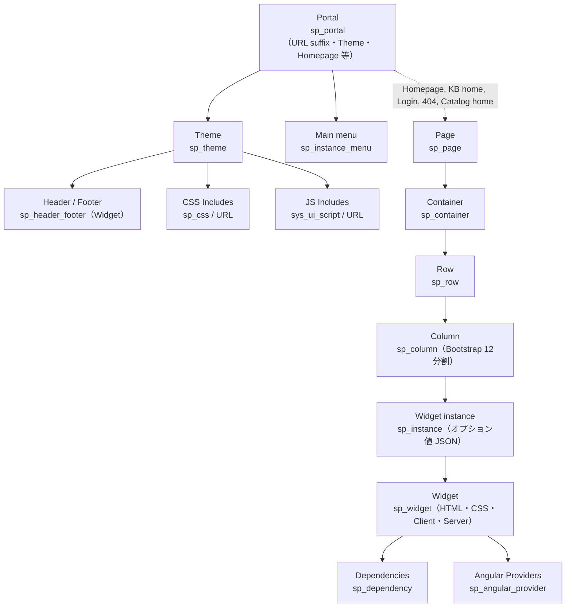
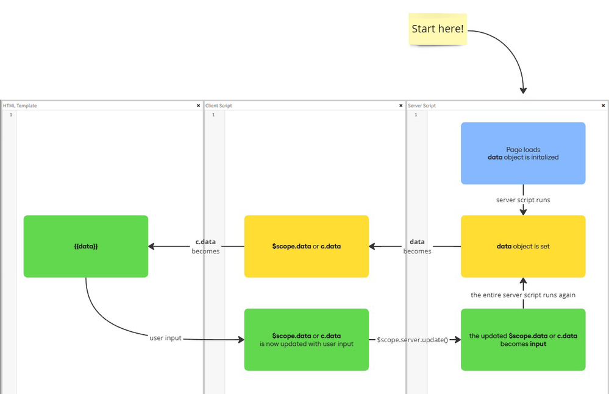
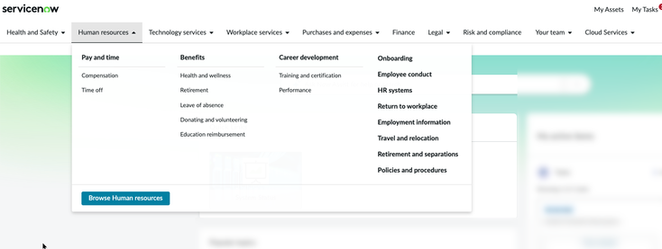
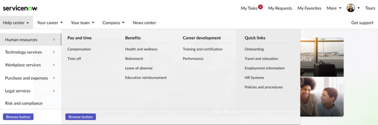
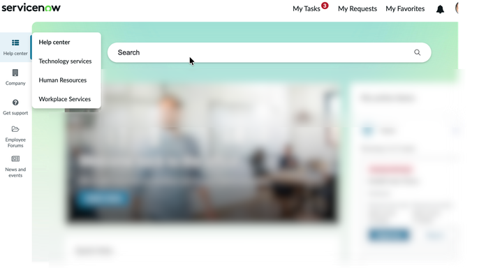
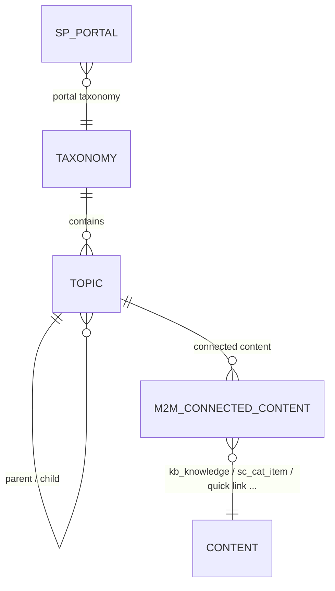
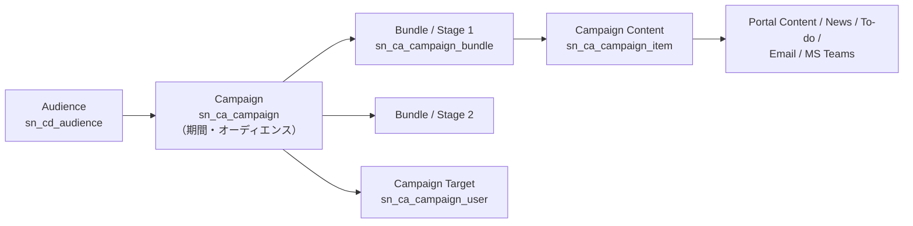

# Service Portal と Employee Center（サービスポータルと従業員センター）

## 概要

Service Portal（サービスポータル）は、ServiceNow AI Platform（旧 Now Platform）上でエンドユーザー向けのセルフサービス Web サイトを構築するためのフレームワークである。AngularJS ベースの Widget（ウィジェット）を、Bootstrap グリッドに沿ったページレイアウトへ配置してポータルを構成する。Service Portal は Platform UI（Core UI）や Workspace（エージェント向け UI）とは別系統の UI フレームワークであり、Service Catalog の申請、ナレッジ記事の閲覧、自分のチケット確認などを従業員・顧客に提供する。Service Portal for Enterprise Service Management プラグイン（`com.glide.service-portal.esm`）はデフォルトで有効（active by default）である。[出典](https://www.servicenow.com/docs/r/BiOQwsCGg2QNfxnoczjlZA/dSibjxvkrM1caMCpys2Ruw)

Employee Center（従業員センター、略称 EC、URL サフィックスは一般に `/esc`）は、Service Portal フレームワークの上に構築された「部門横断（IT・HR・Workplace・Legal・Procurement 等）」の従業員ポータルである。Employee Center は全顧客がデフォルトで利用可能であり、上位版の Employee Center Pro（EC Pro）は追加ライセンスが必要なサブスクリプション型アプリケーションである。[出典](https://www.servicenow.com/docs/r/H8yQl2SqBqnT6LbpTm28UQ/D9dD0SBA7iFLr~FmzNWdLA)

本ファイルが扱う範囲は次のとおりである。

| 領域 | 主な内容 | 本ファイルの節 |
|---|---|---|
| Service Portal の構造 | Portal／Page／Container／Row／Column／Widget instance／Widget／Theme | Service Portal のアーキテクチャ〜Theme とブランディング |
| Widget 開発 | HTML template、Client controller、Server script、Link function、Option schema、Angular Providers、API | Widget 開発 |
| 運用・セキュリティ | ロール、User criteria、プロパティ、Page Route Map、パフォーマンス | ロール〜システムプロパティ |
| Employee Center／Pro | プラグイン構成、機能比較、ロール、ナビゲーション、Quick links | Employee Center、Employee Center Pro |
| Unified Taxonomy | Content Taxonomy、Employee Experience Taxonomy、Topic、Connected content | Unified Taxonomy |
| Content Publishing | Content Publishing（`sn_cd`）、Content Experiences（`sn_ca`）、キャンペーン | Content Publishing と Content Experiences |
| CSM ポータル | Customer Service Portal（`/csm`）、Business Portal、Consumer Portal、Configurable Portal Widgets | Customer Service Portal と CSM 系ポータル |
| 次世代 | EmployeeWorks／Employee Slate（Employee Center Pro の後継） | EmployeeWorks と Employee Slate |

関連ファイル：Service Catalog の詳細は [サービスカタログ](service-catalog.md)、ナレッジは [ナレッジ管理](knowledge-management.md)、Next Experience／UI Builder は [Next Experience UI](next-experience-ui.md) と [Workspace と UI Builder](workspaces-ui-builder.md)、Virtual Agent は [Virtual Agent と会話型AI](virtual-agent.md)、AI Search は [Predictive Intelligence と AI Search](predictive-intelligence-ai-search.md)、HR 側の機能は [HR Service Delivery](../employee/hr-service-delivery.md)、CSM は [Customer Service Management](../customer/customer-service-management.md) を参照。

---

## Service Portal のアーキテクチャ

### 構成要素の階層

Service Portal は、レコード（テーブル）の組み合わせでポータルを表現する。Portal レコードが URL・テーマ・主要ページを束ね、Page は Container／Row／Column のレイアウトの中に Widget instance（ウィジェットインスタンス）を配置する。Widget instance は Widget（ウィジェット定義）を参照し、インスタンスごとのオプション値を持つ。[出典](https://www.servicenow.com/docs/r/platform-user-interface/service-portal/t_ConfigureAPage.html)



- Page（`sp_page`）は Portal に直接属さない。Page は Page ID（`id` パラメータ）で識別され、どの Portal の URL からも `?id=<page_id>` で呼び出せる。Portal レコードが参照するのは Homepage・KB home page・Login page・404 page・Catalog home page など「役割の決まったページ」のみである。【第三者情報】[出典](https://www.servicenow.com/community/in-other-news/what-s-in-a-service-portal/ba-p/2292909)
- レイアウトは Bootstrap グリッドに準拠し、1 行（Row）内の Column サイズの合計は常に 12 になる。[出典](https://www.servicenow.com/docs/r/platform-user-interface/service-portal/t_ConfigureAPage.html)

### 主要テーブル一覧

| テーブル | 名称 | 役割 |
|---|---|---|
| `sp_portal` | Portal（ポータル） | URL サフィックス、テーマ、ホームページ、ログインページ、メインメニュー、検索設定などを持つポータル定義 |
| `sp_page` | Page（ページ） | ページ ID、公開設定、ロール、ページ固有 CSS、SEO 設定 |
| `sp_container` | Container（コンテナ） | ページ内の横長ブロック。幅（Fixed／Fluid）、背景、セマンティックタグ |
| `sp_row` | Row（行） | コンテナ内の行 |
| `sp_column` | Column（列） | 行内の列。xs／sm／md／lg ごとのサイズ |
| `sp_instance` | Widget instance（ウィジェットインスタンス） | ページ上に置かれた Widget の実体。インスタンスオプションを保持 |
| `sp_widget` | Widget（ウィジェット） | HTML template、CSS、Client controller、Server script、Link function、Option schema を持つ部品定義 |
| `sp_theme` | Theme（テーマ） | Header／Footer、CSS variables、CSS／JS Includes |
| `sp_css` | Style Sheet（スタイルシート） | テーマから CSS Include として参照される CSS／SCSS |
| `sp_header_footer` | Header / Footer | テーマに割り当てるヘッダー／フッター（実体は Widget） |
| `sp_instance_menu` | Instance with Menu | ヘッダーメニューなどメニュー付きインスタンス。Portal の Main menu から参照 |
| `sp_angular_provider` | Widget Angular Provider | 複数 Widget で共有する directive／service／factory |
| `sp_dependency` | Widget Dependency | Widget が読み込む外部 JS／CSS |
| `sp_page_route_map` | Page Route Map | ページ参照のリダイレクト |
| `sp_log` | Service Portal log entries | `$sp.log()` の出力先（ログテーブル名は【経験則】） |

テーブル名の出典：Portal・Page・Container・Theme・Header/Footer・Instance with Menu・Page Route Map は公式ドキュメント（[ページ作成](https://www.servicenow.com/docs/r/platform-user-interface/service-portal/t_ConfigureAPage.html)、[ポータル作成](https://www.servicenow.com/docs/r/B5UZKOeMGcpyrvR2CNl5Dw/yVQqjPRSHaokLYazPgDpDg)、[テーマ作成](https://www.servicenow.com/docs/r/ja-JP/platform-user-interface/service-portal/c_CustomCSS.html)、[Page Route Map](https://www.servicenow.com/docs/r/If4ZEK~2WHMkIrdZtEn~Ig/tLU_eT2oyD~Q_~srF5~t4A)）。`sp_widget`／`sp_instance`／`sp_angular_provider`／`sp_dependency` は [ServiceNow SDK（Fluent）Service Portal ガイド](https://servicenow.github.io/sdk/guides/service-portal-guide) および [Widget option schema](https://www.servicenow.com/docs/r/platform-user-interface/service-portal/c_WidgetInstanceOptions.html)。`sp_row`／`sp_column` は【経験則】。

### URL の構造

Service Portal の URL は `https://<instance>.service-now.com/<URL suffix>?id=<page_id>&<追加パラメータ>` の形をとる。例として URL suffix が `sp` のポータルは `<instance>.service-now.com/sp` でアクセスする。[出典](https://www.servicenow.com/docs/r/B5UZKOeMGcpyrvR2CNl5Dw/yVQqjPRSHaokLYazPgDpDg)

| 例 | 意味 |
|---|---|
| `/sp` | ポータル `sp` の Homepage |
| `/sp?id=sc_cat_item&sys_id=<sys_id>` | カタログアイテム表示ページ |
| `/sp?id=kb_article&sys_id=<sys_id>` | ナレッジ記事表示ページ |
| `/sp?id=form&table=incident&sys_id=<sys_id>` | 汎用フォームページ |
| `/esc` | Employee Center の Homepage |
| `/sp_config` | Service Portal Configuration（管理ツール群の入口） |

ページ ID の例（`sc_cat_item`、`kb_article`、`form`）と `/sp_config` は【経験則】。サーバー側の `$sp.getParameter()` でクエリ文字列の値を取得できる（後述）。

Human readable URL（人が読める URL）を有効にすると、ページ URL にキーワードを含められる（`glide.service_portal.enable_human_readable_urls`、既定 `true`）。ページ単位では「Human readable URL structure」フィールドで設定する。[出典](https://www.servicenow.com/docs/r/zurich/platform-user-interface/service-portal/properties-service-portal.html)

### 管理メニュー（Application Navigator）

| メニュー | 内容 |
|---|---|
| All > Service Portal > Portals | Portal レコード（`sp_portal`）の一覧・作成 |
| All > Service Portal > Service Portal Configuration | Branding Editor、Designer、Page Editor、Widget Editor などのツール群 |
| All > Service Portal > Themes | Theme（`sp_theme`）の一覧・作成 |
| All > Service Portal > Page Route Maps | Page Route Map（`sp_page_route_map`） |
| All > Service Portal > Properties | Service Portal のプロパティページ |
| Service Portal Configuration > Portal Tables | Widget Angular Provider などの関連テーブル |

出典：[ポータル作成](https://www.servicenow.com/docs/r/B5UZKOeMGcpyrvR2CNl5Dw/yVQqjPRSHaokLYazPgDpDg)、[Designer](https://www.servicenow.com/docs/r/platform-user-interface/service-portal/t_ConfigureAPage.html)、[テーマ](https://www.servicenow.com/docs/r/ja-JP/platform-user-interface/service-portal/c_CustomCSS.html)、[Page Route Map](https://www.servicenow.com/docs/r/If4ZEK~2WHMkIrdZtEn~Ig/tLU_eT2oyD~Q_~srF5~t4A)、[プロパティ](https://www.servicenow.com/docs/r/zurich/platform-user-interface/service-portal/properties-service-portal.html)、[Angular Providers](https://www.servicenow.com/docs/r/zurich/platform-user-interface/service-portal/angular-providers.html)

---

## Portal（sp_portal）

### Portal レコードのフィールド

Portal レコード（`sp_portal`）は All > Service Portal > Portals > New で作成する。必要ロールは `admin` または `sp_admin` である。[出典](https://www.servicenow.com/docs/r/B5UZKOeMGcpyrvR2CNl5Dw/yVQqjPRSHaokLYazPgDpDg)

| フィールド（英語） | 日本語訳 | 説明 |
|---|---|---|
| Title | タイトル | ブラウザのタイトルバー・ブックマークに表示されるポータル名 |
| URL suffix | URL サフィックス | インスタンス URL に付加するパス（例 `sp`）。一意である必要がある |
| Homepage | ホームページ | ログイン後に最初に表示するページ |
| KB home page | KB ホームページ | ナレッジベースへ移動したときに表示するページ |
| Login page | ログインページ | 認証用のカスタムページ |
| Logo | ロゴ | ヘッダーに表示するロゴ（Branding Editor でも設定可） |
| Icon | アイコン | ブラウザのアドレスバー／タブに表示するアイコン（ポータルごとに設定可） |
| Default | デフォルト | メインポータルとして扱うかどうか |
| Application | アプリケーション | アプリケーションスコープ（読み取り専用、既定は Global） |
| 404 page | 404 ページ | ページ読み込み失敗時に表示するページ。`glide.service_portal.default_404_page` でも指定可能 |
| Catalog home page | カタログホームページ | Service Catalog を表すページ |
| Catalog category home page | カタログカテゴリホームページ | カタログカテゴリを表示するページ |
| Main menu | メインメニュー | ヘッダーメニュー（`sp_instance_menu` のレコード）への参照 |
| Theme | テーマ | `sp_theme` への参照。スタイリングの最下層で、Branding Editor やコンポーネント CSS で上書きされる |
| Inactive | 非アクティブ | ポータルへのアクセスを遮断し、任意で別ポータルへリダイレクトする |
| Quick start config | クイックスタート設定 | Branding Editor の選択肢を生成する JSON スキーマ |
| CSS variables | CSS 変数 | ポータル固有の Sass 変数（テーマの変数を上書き可能） |
| Hide portal name | ポータル名を隠す | ページタイトルにポータル名を表示しない |
| Support right-to-left languages | RTL 言語サポート | ヘブライ語などの RTL セッション言語でレイアウトを反転し CSS を自動生成 |
| Enable favorites | お気に入りを有効化 | カタログアイテム・KB 記事にお気に入りアイコンと My Favorites メニューを追加（Service Portal のみ。フォームへのフィールド追加が必要な場合あり） |
| Enable AIS | AI Search を有効化 | ポータルで AI Search を使用する |
| Search Application | 検索アプリケーション | 検索エンジン、結果件数上限、サジェスト件数上限 |
| Search Results Configuration | 検索結果設定 | 検索結果の表示方法 |

出典：[Create a portal](https://www.servicenow.com/docs/r/B5UZKOeMGcpyrvR2CNl5Dw/yVQqjPRSHaokLYazPgDpDg)

Portal レコードの注意点は次のとおりである。[出典](https://www.servicenow.com/docs/r/B5UZKOeMGcpyrvR2CNl5Dw/yVQqjPRSHaokLYazPgDpDg)

- URL suffix に `portal` や `cms` などの予約語、JavaScript の保護語を使わない（ナビゲーションエラーの原因になる）。
- CSS variables フィールドには変数定義のみを書き、CSS ルールは CSS Includes に書く。
- 保存後、Knowledge Bases 関連リストで KB ページに表示するナレッジベースを、Catalogs 関連リストでポータルが使うカタログを選択する。

### 代表的なベースシステムポータル

| ポータル | URL suffix | 用途 |
|---|---|---|
| Service Portal | `/sp` | 汎用の従業員セルフサービス（従来型） |
| Employee Center | `/esc` | 部門横断の従業員ポータル（後述） |
| Customer Service Portal | `/csm` | CSM の B2B 顧客ポータル（旧来型） |
| Business Portal | `/business_portal` | CSM の B2B 顧客ポータル（新型） |
| Consumer Service Portal | `/csp` | CSM の B2C ポータル（旧来型） |
| Consumer Portal | `/consumer_portal` | CSM の B2C ポータル（新型） |

CSM 系の URL は [Customer Portals（ServiceNow Community、ServiceNow 社員執筆）](https://www.servicenow.com/community/csm-articles/customer-portals/ta-p/3383969)、`/sp` は[ポータル作成](https://www.servicenow.com/docs/r/B5UZKOeMGcpyrvR2CNl5Dw/yVQqjPRSHaokLYazPgDpDg)、`/esc` は【第三者情報】[Community](https://www.servicenow.com/community/employee-center-forum/redirecting-from-service-portal-sp-to-employee-center-esc/td-p/3548433) による。

---

## Page とレイアウト（sp_page／sp_container）

### Service Portal Designer でのページ作成

Service Portal Designer（デザイナー）はドラッグ＆ドロップでページを編集するツールである。必要ロールは `sp_admin` または `admin`。メニューは All > Service Portal > Service Portal Configuration > Designer で、ヘッダーのポータル名から対象ポータルを切り替える。[出典](https://www.servicenow.com/docs/r/platform-user-interface/service-portal/t_ConfigureAPage.html)

1. 編集するページを選ぶ（または新規ページを追加する）。
2. Container をページにドラッグする。
3. Layout（Bootstrap グリッドに沿った列構成。列サイズの合計は 12）を Container にドラッグする。
4. フィルターで Widget を検索し、Layout の列にドラッグする。
5. 必要に応じてページプロパティ・コンテナプロパティを編集し、Preview（モバイル／タブレット表示あり）で確認する。

一部の Widget は既定では何も表示しないため、ページで表示させる前にインスタンスオプションを設定する必要がある。[出典](https://www.servicenow.com/docs/r/platform-user-interface/service-portal/t_ConfigureAPage.html)

### Page（sp_page）のフィールド

| フィールド | 説明 |
|---|---|
| Title | Designer 内でページを検索するための内部名 |
| ID | ページを一意に識別する ID。URL の `?id=` に使われる |
| Application | アプリケーションスコープ |
| Public | 認証なしでのアクセスを許可（全ユーザーが閲覧可能） |
| Draft | 下書き。`admin` のみ閲覧可能で、他ユーザーには 404 ページが表示される |
| Roles | ロールによるアクセス制限 |
| Short description | 内部向け説明（公開されない） |
| Page Specific CSS | テーマ・ブランディングから継承した CSS を上書きするページ固有 CSS |
| Dynamic page title | 変数を使ってページ内容からタイトルを生成 |
| Clone Page | ページの複製。ベースシステムページを複製すると Widget instance も新規作成される |
| Use SEO script | canonical／hreflang の SEO タグを追加するスクリプトインクルードを有効化 |
| SEO script | 適用するスクリプトインクルード（既定 `SPSEOHeaderTags`） |
| Human readable URL structure | URL にキーワードを含め SEO とクリック率を改善 |

出典：[Create and edit a page using the Service Portal Designer](https://www.servicenow.com/docs/r/platform-user-interface/service-portal/t_ConfigureAPage.html)

> 注意：User criteria が有効な場合（`glide.service_portal.user_criteria_enabled = true`、既定）、Page・Widget の Roles フィールドの代わりに User Criteria レコードでアクセス制御を行う（「アクセス制御と User criteria」節を参照）。

### Container（sp_container）のフィールド

| フィールド | 説明 |
|---|---|
| Name | コンテナの内部名 |
| Order | 表示順（小さい値が先） |
| Page | 所属するページ |
| Screen reader title | スクリーンリーダーが読み上げるタイトル |
| Semantic tag | コンテナの HTML タグ（None、Main、Header、Nav、Section、Article、Details、Summary、Time、Fig caption） |
| Width | Fixed（固定幅）または Fluid（全幅） |
| Parent class／CSS class | カスタム CSS クラス。CSS class はページ固有 CSS より優先 |
| Background color／image／style | 背景色・背景画像・スタイル（Default、Cover、Contain、Repeating） |
| Bootstrap alternative | コンテナ内で Bootstrap グリッドを無効化（カスタム CSS 前提）。Width、Row の Bootstrap クラス、列サイズ（xs／sm／md／lg）が無効になる |
| Move to header | コンテナをヘッダーに固定し、スクロールしないサブヘッダーにする（`admin` が設定） |

出典：[Create and edit a page using the Service Portal Designer](https://www.servicenow.com/docs/r/platform-user-interface/service-portal/t_ConfigureAPage.html)

### フォントアイコンの追加

カスタムのフォントアイコンを使う場合は、フォントファイルをページレコードに添付し、Page Specific CSS に `@font-face` 定義（`src` に添付ファイルの sys_id を含む URL）とアイコンクラスを記述する。これにより、HTML Widget の Source Code オプションなどで `<em class="material-icons">` のように参照できる。[出典](https://www.servicenow.com/docs/r/platform-user-interface/service-portal/t_ConfigureAPage.html)

### Page Route Map（sp_page_route_map）

Page Route Map は、ベースシステム Widget を複製・改修せずに「あるページへの参照」を別ページへリダイレクトする仕組みである。必要ロールは `sp_admin`、メニューは All > Service Portal > Page Route Maps。[出典](https://www.servicenow.com/docs/r/If4ZEK~2WHMkIrdZtEn~Ig/tLU_eT2oyD~Q_~srF5~t4A)

| フィールド | 説明 |
|---|---|
| Service Portal(s) | 対象ポータル。空欄ならインスタンス内の全ポータルに適用 |
| Route from | リダイレクト元のページ ID |
| Route to | リダイレクト先のページ ID |
| Active | 有効フラグ |
| Roles | 適用対象ロール。空欄なら全ユーザーに適用 |
| Order | 同じ Route from を持つ有効レコードが複数ある場合、Order が最小のものが適用される |

- Page Route Map は Widget 等からの「ページ参照」を置き換えるもので、URL に直接書かれたページ ID へのナビゲーションはリダイレクトしない。
- 404 ページの差し替えには Page Route Map ではなく Portal レコードの 404 page フィールドを使う。

Page Route Map は Kingston で導入された。【第三者情報】[出典](https://serviceportal.io/kingston-route-maps)

---

## Theme とブランディング

### スタイリングの優先順位

Service Portal のスタイルは、Theme（最下層）→ Portal の CSS variables／Branding Editor → Page Specific CSS → Container の CSS class の順に上書きされる。Portal レコードの Theme は「スタイリングの最下層で、Branding Editor とコンポーネント CSS で上書きされる」と定義されており、Page Specific CSS はテーマとブランディングから継承した CSS を上書きし、Container の CSS class はページ固有 CSS を上書きする。[出典1](https://www.servicenow.com/docs/r/B5UZKOeMGcpyrvR2CNl5Dw/yVQqjPRSHaokLYazPgDpDg) [出典2](https://www.servicenow.com/docs/r/platform-user-interface/service-portal/t_ConfigureAPage.html)

### Theme（sp_theme）のフィールド

Theme は All > Service Portal > Themes > New で作成する。CSS を理解しているユーザーのみがカスタムテーマを作成すべきとされる。[出典](https://www.servicenow.com/docs/r/ja-JP/platform-user-interface/service-portal/c_CustomCSS.html)

| フィールド | 説明 |
|---|---|
| Name | テーマ名（Portal との紐付けに使う。ユーザーには表示されない） |
| Turn off SCSS compilation | SCSS をコンパイルせず、プレーン CSS をクライアントに直接送る |
| Application | アプリケーションスコープ（ヘッダーメニューのレコードとソーステーブルは同じスコープである必要がある） |
| Header／Footer | `sp_header_footer` から選ぶヘッダー／フッター（実体は Widget） |
| Fixed header／Fixed footer | スクロール時もヘッダー／フッターを画面に固定 |
| CSS variables | 色やスタイルの変数（CSS カスタムプロパティ／SCSS 変数）を定義。CSS ルールは CSS Includes に書く |

CSS variables の記述例（公式ドキュメントの例）：

```scss
$sp-logo-margin-x: 15px !default;
$sp-tagline-color: $text-color !default;
$navbar-inverse-bg: #3a3f51 !default;
```

### CSS Includes／JS Includes（テーマの関連リスト）

| 関連リスト | 主なフィールド | 説明 |
|---|---|---|
| CSS Includes | Name、Application、Source（Style Sheet＝`sp_css`、または URL）、Style sheet／CSS file URL、Lazy Load、RTL CSS file URL | テーマで読み込む CSS。Madrid 以降、CSS Includes 内で Sass と LESS を使用可能。Lazy Load は非同期読み込み（テーマ内の全 Include で同じ値に揃える。スタイル未適用の画面がちらつくポータルには非推奨） |
| JS Includes | Display name、Application、Source（UI Script＝`sys_ui_script`、または URL）、UI Script／JS file URL、Package | テーマで読み込む JavaScript |
| Lazy load CSS includes | — | Lazy Load を設定した CSS Include の一覧 |

出典：[Create a portal theme](https://www.servicenow.com/docs/r/ja-JP/platform-user-interface/service-portal/c_CustomCSS.html)

SCSS 関連のプロパティ `glide.sp.theme.parse_scss`（既定 `true`）は、コンパイル済み SCSS をリンクとして読み込み（2 回目以降のページ表示を高速化）、`false` の場合はページ HTML にインライン展開する。[出典](https://www.servicenow.com/docs/r/zurich/platform-user-interface/service-portal/properties-service-portal.html)

### Coral テーマとダークテーマ

- Zurich 以降、Coral テーマが Next Experience または Core UI が有効な新規ポータル・Web・モバイル体験の既定テーマとなり、Web とモバイルにダークテーマのオプションが追加された。[出典](https://www.servicenow.com/docs/r/AWjfoG0XNF6COBtQI5zL~A/gpNH5rvmtCiPp9~jpIy~eA)
- テーマ関連の公式手順として「Enable dark theme（ダークテーマを有効化）」「Create a theme variant（Coral テーマをベースにテーマバリアントを作成）」が用意されている。[出典](https://www.servicenow.com/docs/r/ja-JP/platform-user-interface/service-portal/c_CustomCSS.html)
- ServiceNow SDK（Fluent）のガイドは、独自ブランディングが不要な場合は既存テーマ（Coral を優先）の sys_id を指定し、独自ブランディングが必要な場合に新規テーマを作る判断基準を示している。[出典](https://servicenow.github.io/sdk/guides/service-portal-guide)
- Theme Builder（Next Experience 用のテーマ作成ツール）は AngularJS ベースの Service Portal をサポートしない。【第三者情報】[出典](https://www.servicenow.com/community/next-experience-articles/portal-experience-faqs/ta-p/2331979)

### Branding Editor

Branding Editor（ブランディングエディター）は、ポータルの見た目を GUI で変更するツールである。メニューは Service Portal > Service Portal Configuration > Branding Editor。[出典](https://www.servicenow.com/docs/r/xanadu/platform-user-interface/service-portal/c_BrandingEditor.html)

| タブ | 設定項目 | 保存先 |
|---|---|---|
| Quick Setup | Portal Title | Portal フォームの Title |
| Quick Setup | Logo（ヘッダー表示、最大 高さ 46px × 幅 200px に縮小） | Portal の Logo |
| Quick Setup | Logo padding | Portal の CSS variables |
| Quick Setup | Tag line、Tag line color | ホームページ検索 Widget のインスタンス |
| Quick Setup | Homepage background color、Background image | ホームページ Widget のコンテナ |
| Theme Colors | Navbar（ヘッダーメニューの色）、Brand（ページ・Widget の背景色）、Text（文字色） | Portal の CSS variables |

- 色は色名、16 進、10 進（RGB）、パレット選択で指定でき、プレビューにリアルタイムで反映される。
- Tag line と背景の選択肢は Portal レコードの Quick start config（JSON スキーマ）で定義される。

---

## Widget 開発

### Widget の構成要素

Widget（ウィジェット）は Service Portal ページの部品であり、作成すると `sp_widget` テーブルにレコードができる。[出典](https://www.servicenow.com/docs/r/zurich/platform-user-interface/service-portal/widget-dev-guide.html)

| 構成要素 | 必須 | 役割 |
|---|---|---|
| HTML template | 必須 | AngularJS で UI を定義し、変数のバインドとユーザー入力の受付を行う |
| Client script（Client controller） | 必須 | クライアントコントローラー。サーバーから受け取ったデータを処理し、ユーザー入力をサーバーへ返す |
| Server script | 必須 | Widget の初期状態を設定し、クエリを実行してクライアントへデータを送る |
| Link function | 任意 | AngularJS で DOM を直接操作する（AngularJS の知識が必要） |
| Option schema | 任意 | Service Portal 管理者がインスタンスごとに設定できるパラメータを定義 |
| Angular Providers | 任意 | 複数 Widget 間でのコンテキスト共有、状態保持、再利用可能な振る舞い |
| Dependencies | 任意 | 外部 JavaScript／CSS ファイル |
| CSS（SCSS） | 任意 | Widget 固有のスタイル。テーマの CSS 変数を参照可能 |

出典：[Developing custom widgets](https://www.servicenow.com/docs/r/zurich/platform-user-interface/service-portal/widget-dev-guide.html)（CSS 行のみ【経験則】）

`sp_widget` の主なフィールド（列名）は次のとおりである。列名は ServiceNow SDK（Fluent）の対応プロパティおよび実機での一般的な名称に基づく【経験則】。[参考](https://www.servicenow.com/docs/r/application-development/servicenow-sdk/fluent-service-portal-api.html)

| ラベル | 列名 | 説明 |
|---|---|---|
| Name | `name` | Widget 名 |
| Id | `id` | Widget ID（`$sp.getWidget()` や埋め込みで使用） |
| Body HTML template | `template` | HTML template |
| CSS | `css` | SCSS／CSS |
| Client controller | `client_script` | クライアントコントローラー |
| Server script | `script` | サーバースクリプト |
| Link | `link` | Link function |
| Option schema | `option_schema` | オプションスキーマ（JSON） |
| Data table | `data_table` | オプション格納用の拡張テーブル（既定 `sp_instance`） |
| Fields | `field_list` | Data table のうちオプションとして使う列 |
| Demo data | `demo_data` | Widget Editor のプレビュー用データ |
| Controller as | `controller_as` | コントローラー変数名（既定 `c`） |
| Public | `public` | 未認証ユーザーへの公開可否 |
| Roles | `roles` | 利用可能ロール（User criteria 無効時） |
| Has preview | `has_preview` | Widget Editor でプレビュー可能か |

### Widget Editor

Widget Editor（ウィジェットエディター）は、Widget の作成・編集・リアルタイムプレビューを行うフルページの IDE 風エディターで、各構成要素ペインの表示／非表示を切り替えられる。[出典](https://www.servicenow.com/docs/r/zurich/platform-user-interface/service-portal/widget-dev-guide.html)

- Server script は、アプリケーションが ES5 または Compatibility モードの場合でも ECMAScript 2021（ES12）を使用でき、ES12 に設定されたアプリケーションでは既定で ES12 になる。
- コントローラー変数は既定で `c` であり、Widget の作成・複製時に変更できる。
- ベースシステム Widget を直接編集せず、複製（Clone）してから編集するのが推奨される。

### サーバーとクライアントのデータの流れ

Widget のサーバースクリプトとクライアントコントローラーは、グローバルオブジェクト `data`／`input`／`options` を介してデータをやり取りする。[出典](https://www.servicenow.com/docs/r/platform-user-interface/service-portal/widget-api-reference.html)

| オブジェクト | 場所 | 説明 |
|---|---|---|
| `data` | Server script | サーバー側で初期化（空）→ 値を設定 → JSON としてクライアントへ送られ、クライアントでは `c.data` で参照 |
| `input` | Server script | クライアントの `c.data` に設定されたプロパティ。初回ロード時は `undefined` で、クライアントが `c.server.update()` を呼んだときに値が入る |
| `options` | Server／Client | インスタンスオプション（Option schema の値）。クライアントでは `c.options`（読み取り専用） |



*図 1：Widget における data／input オブジェクトの流れ（Widget Editor の 3 ペインを模した図）*

画面説明：Widget Editor と同じく左から「HTML Template」「Client Script」「Server Script」の 3 ペインを並べた図。右上の「Start here!」から始まり、Server Script ペインで「Page loads → data object is initialized（ページ読み込みで data を初期化）」→「server script runs」→「data object is set（data に値を設定）」と進む。data は Client Script ペインで `$scope.data` または `c.data` となり、さらに HTML Template ペインで `{{data}}` としてバインドされ表示される。下段では、HTML Template でのユーザー入力（user input）が Client Script の `c.data` を更新し、`$scope.server.update()` を呼ぶと更新後の `c.data` がサーバー側の `input` になり、「the entire server script runs again（サーバースクリプト全体が再実行）」されて data が再設定される循環が描かれている。
出典：https://www.servicenow.com/community/developer-advocate-blog/understanding-the-data-input-object-in-service-portal-widgets/ba-p/3173684 （ServiceNow Developer Advocate 執筆、取得日：2026-11-03）

`server.update()` を呼ぶと、クライアントの `data` オブジェクトはサーバースクリプトの `data` で自動的に上書きされる。[出典](https://www.servicenow.com/docs/r/zurich/platform-user-interface/service-portal/widget-dev-guide.html)

### クライアントからのサーバー呼び出し

| 関数 | 動作 | 戻り値 |
|---|---|---|
| `this.server.get([Object])` | サーバーを呼び出し、カスタムの `input` を送る（`c.data` 全体は送らない） | Promise |
| `this.server.update()` | `this.data` をサーバースクリプトへ送る | Promise |
| `this.server.refresh()` | サーバーを呼び出し、現在の options と data をレスポンスで置き換える | Promise |

出典：[Widget API reference](https://www.servicenow.com/docs/r/platform-user-interface/service-portal/widget-api-reference.html)

> 注意：`g_form` グローバルオブジェクトは Widget のクライアントコントローラーや UI Script では使用できない。[出典](https://www.servicenow.com/docs/r/platform-user-interface/service-portal/widget-api-reference.html)（カタログアイテム上の Widget など特定のコンテキストでは別途 `$scope.page.g_form` 等が提供される場合があるが、本ファイルの範囲外。詳細は [クライアントサイドスクリプト](scripting-client-side.md) を参照）

### Widget の最小実装例

以下は、ログインユーザーの未完了インシデント件数を表示し、ボタンで再取得する Widget の例である（構文は公式の data／input の説明に基づく。実装例自体は【経験則】）。

**Server script**

```javascript
(function() {
  // input は初回ロード時 undefined
  var limit = (input && input.limit) ? parseInt(input.limit, 10) : (options.limit || 10);

  var gr = new GlideRecordSecure('incident');   // ACL を評価する
  gr.addActiveQuery();
  gr.addQuery('caller_id', gs.getUserID());
  gr.orderByDesc('sys_updated_on');
  gr.setLimit(limit);
  gr.query();

  data.items = [];
  while (gr.next()) {
    data.items.push({
      sys_id: gr.getUniqueValue(),
      number: gr.getValue('number'),
      short_description: gr.getValue('short_description')
    });
  }
  data.title = gs.getMessage('My open incidents');   // 多言語化
})();
```

**Client controller**

```javascript
api.controller = function(spUtil) {
  var c = this;
  c.reload = function() {
    c.data.limit = 20;
    c.server.update().then(function() {
      spUtil.addInfoMessage('Reloaded');
    });
  };
};
```

**HTML template**

```html
<div class="panel panel-default">
  <div class="panel-heading">{{::c.data.title}}</div>
  <ul class="list-group">
    <li class="list-group-item" ng-repeat="i in c.data.items">
      <a ng-href="?id=form&table=incident&sys_id={{i.sys_id}}">{{i.number}}</a>
      {{i.short_description}}
    </li>
  </ul>
  <button class="btn btn-default" ng-click="c.reload()">${Reload}</button>
</div>
```

- HTML template 内の `${...}` と、サーバースクリプトの `gs.getMessage()` は Widget の多言語化（Localization）の公式手段である。[出典](https://www.servicenow.com/docs/r/zurich/platform-user-interface/service-portal/widget-dev-guide.html)
- ACL を尊重するため、サーバースクリプトでは `GlideRecordSecure` や `$sp.canReadRecord()` を使う。【経験則】

### Option schema（オプションスキーマ）と Widget instance

Option schema は、Service Portal 管理者（`sp_admin`）が Widget instance ごとに設定できるパラメータを定義する。[出典](https://www.servicenow.com/docs/r/platform-user-interface/service-portal/c_WidgetInstanceOptions.html)

- 定義したスキーマは `sp_widget` の Option schema フィールドに JSON で保存される。
- インスタンスごとの値は `sp_instance` テーブルの「Additional options, JSON format」フィールドに JSON で保存される（列名は `widget_parameters`【経験則】）。
- 既定値はサーバースクリプトで設定する（公式推奨）。
- Australia のドキュメントでは、任意の ServiceNow フィールドタイプ（高度なカスタマイズを含む）をオプションスキーマに追加できるとされる。旧リリース（Xanadu 期）のドキュメントでは String／Boolean／Integer のみで、それ以外の型が必要な場合は `sp_instance` を拡張したテーブルを作り Widget の Data table に指定する方式が案内されていた。

```json
[
  {"name": "limit", "type": "integer", "label": "Max rows", "default_value": "10"},
  {"name": "show_closed", "type": "boolean", "label": "Show closed records"}
]
```

上記 JSON のキー名（`name`、`type`、`label`、`default_value`）は【経験則】。拡張テーブル方式では、`sp_instance` を拡張したテーブルを Widget の Data table に指定し、Fields（`field_list`）で使用する列を選ぶ。Option schema は Fields で選んだ列だけをオプションとして公開する。【第三者情報】[出典](https://www.servicenow.com/community/developer-blog/service-portal-getting-familiar-with-advanced-widget-options/ba-p/2282884)

### Angular Providers（sp_angular_provider）

Angular Provider は複数 Widget に注入できる再利用部品で、ポータルのライフタイムにわたってデータを保持できる。[出典](https://www.servicenow.com/docs/r/zurich/platform-user-interface/service-portal/angular-providers.html)

| 項目 | 内容 |
|---|---|
| 種類 | directive、factory、service（ECMAScript 6 以降への移行を考慮し factory より service が推奨） |
| 作成場所 | Service Portal Configuration > Portal Tables > Widget Angular Provider > New |
| 主なフィールド | Name（Widget との紐付けに使う名前）、Type、Client Script |
| Widget への関連付け | Widget の関連リスト「Angular Providers」で追加（再利用する Widget ごとに登録が必要） |
| 使用方法 | factory／service はクライアントコントローラー関数の引数に名前を書いて注入。directive は HTML template 内で使用 |
| 推奨 | 使っていない Provider は `sp_widget` の関連リストから削除し、トラブルシュートを容易にする |

### 埋め込み Widget

Widget は他の Widget の中に埋め込める（Embedded widgets）。[出典](https://www.servicenow.com/docs/r/zurich/platform-user-interface/service-portal/widget-dev-guide.html)

| 方法 | 書き方 | 説明 |
|---|---|---|
| サーバー側 | `data.child = $sp.getWidget('widget_id', {p1: 'x'});` | Widget を読み込み、options を渡してサーバースクリプトを実行し、Widget モデルを返す |
| クライアント側 | `spUtil.get('widget_id', {p1: 'x'}).then(function(resp){ c.child = resp; });` | クライアントスクリプトで Widget モデルを取得 |
| HTML | `<sp-widget widget="c.data.child"></sp-widget>` | 取得したモデルを描画（ディレクティブ名は【経験則】） |

`$sp.getWidget()` と `spUtil.get()` の仕様は [GlideSPScriptable](https://www.servicenow.com/docs/r/api-reference/server-api-reference/c_GlideSPScriptableScopedAPI.html)、[spUtil](https://www.servicenow.com/docs/r/api-reference/spUtilAPI.html) による。

### Widget 開発のベストプラクティス（公式）

[出典](https://www.servicenow.com/docs/r/zurich/platform-user-interface/service-portal/widget-dev-guide.html)

- パフォーマンス・スケーラビリティ・UX に関する一般ガイドラインに従う。
- 永続データや共通ロジックはクライアントコントローラーに詰め込まず Angular Providers に切り出す。
- Widget は複製して再利用し、Option schema で設定可能なインスタンスにする。
- 文字列は `${}` または `gs.getMessage()` でローカライズする。
- Service Catalog フォーム上の UI Macro は Widget に置き換える（Service Portal では UI Macro が動作しないため）。
- ローコードで UI 部品を再利用する場合は Embeddables を使う。

---

## Widget API リファレンス

### クライアント側 API

| API | 概要 |
|---|---|
| `spUtil` | Widget クライアントスクリプト用の汎用ユーティリティ |
| `spModal` | アラート、プロンプト、確認ダイアログの表示 |
| `spAriaUtil` | スクリーンリーダーへのメッセージ通知 |
| `spContextManager` | Widget のデータをページ上の他アプリケーション・サービスへ提供（例：Agent Chat を開くときにデータを渡す） |

出典：[Widget API reference](https://www.servicenow.com/docs/r/platform-user-interface/service-portal/widget-api-reference.html)

`spUtil` の主なメソッド（Brazil 版ドキュメント）：[出典](https://www.servicenow.com/docs/r/api-reference/spUtilAPI.html)

| メソッド | 説明 |
|---|---|
| `addErrorMessage(String)` | エラー通知を表示 |
| `addInfoMessage(String)` | 情報通知を表示 |
| `addTrivialMessage(String)` | 自動で消える軽微な通知を表示 |
| `createUid()` | 32 文字の一意 ID を返す |
| `format(String template, Object data)` | テンプレート文字列の変数を置換 |
| `get(String widgetId, Object data)` | Widget モデルを取得して埋め込む |
| `getHeaders()` | API 呼び出しに使うヘッダーを返す |
| `getHost()` | ホストドメインを返す |
| `getPreference(String, Function)` | ユーザープリファレンスの値をコールバックに渡す |
| `getURL()` | 現在の Service Portal URL 情報を返す |
| `isMobile()` | モバイルデバイスかどうか |
| `parseAttributes(String)` | カンマ区切り属性文字列をオブジェクト配列に変換 |
| `recordWatch($scope, table, filter, callback)` | テーブル／フィルターの変更を監視し、変更時にコールバックを実行（リアルタイム更新） |
| `refresh($scope)` | サーバーから options と data を再取得 |
| `scrollTo(String selector, Number time)` | 指定要素へスクロール |
| `setBreadCrumb($scope, Array)` | ヘッダーのパンくずを更新 |
| `setPreference(String, String)` | ユーザープリファレンスを保存 |
| `setSearchPage(String)` | 検索ページを変更 |
| `update($scope)` | スコープの data をサーバーへ送る |

### サーバー側 API

| API | 概要 |
|---|---|
| `GlideSPScriptable`（グローバル変数 `$sp`） | Widget でのデータ取得・レコード操作 |
| `GlideSPSearchAnalytics` | カスタム検索 Widget から検索アナリティクスを生成 |
| `SPScriptedFacet`（Scoped） | ファセット項目・フィルター・マップドクエリの定義 |
| `SPScriptedFacetService`（Scoped） | 高度な検索ソース用のファセットオブジェクト生成 |
| `SPSEOUtilsSNC`（Global） | ページの人が読める URL を返す |
| `SPWidgetAccessControl`（Global） | テーブルが Widget にアクセス許可されているかを確認 |

出典：[Widget API reference](https://www.servicenow.com/docs/r/platform-user-interface/service-portal/widget-api-reference.html)。`$sp` が GlideSPScriptable のインスタンスである点は【第三者情報】[Community](https://www.servicenow.com/community/developer-forum/can-anyone-provides-me-different-api-s-which-are-used-in-service/m-p/3409076)。

`$sp`（GlideSPScriptable）の主なメソッド（Brazil 版ドキュメント）：[出典](https://www.servicenow.com/docs/r/api-reference/server-api-reference/c_GlideSPScriptableScopedAPI.html)

| メソッド | 説明 |
|---|---|
| `canReadRecord(GlideRecord)`／`canReadRecord(table, sysId)` | ユーザーがレコードを読めるか（`kb_knowledge`・`sc_cat_item`・`sc_category` は閲覧可否を判定） |
| `canSeePage(pageID)` | ユーザーがページを閲覧できるか（ロールと User criteria で判定） |
| `getCatalogItem(sysId, isOrdering)` | カタログアイテム／オーダーガイドのモデルとビューを返す（引数 1 つの版は非推奨） |
| `getDisplayValue(fieldName)` | Widget instance または Portal レコードのフィールド表示値 |
| `getField(gr, fieldName)`／`getFields()`／`getFieldsObject()` | フィールドのラベル・値・表示値・型 |
| `getForm(tableName, sysId)` | フォーム定義（クロススコープアクセスを強制） |
| `getKBCategoryArticles()`／`getKBCategoryArticleSummaries()`／`getKBCount()` | ナレッジ記事・件数の取得 |
| `getListColumns(tableName, view)` | リストビューの列 |
| `getMenuItems(sysId)`／`getMenuHREF(page)` | メニュー項目、ページ URL の `?id=` 部分 |
| `getParameter(name)` | クエリ文字列または POST ボディのパラメータ |
| `getPortalRecord()` | 現在のポータルの `sp_portal` レコード |
| `getRecord(table, sys_id)` | レコード取得。引数なしでは URL が示すレコード |
| `getRecordDisplayValues()`／`getRecordElements()`／`getRecordValues()` | 指定フィールドを `data` にコピー |
| `getRecordVariables()`／`getRecordVariablesArray()`／`getVariablesArray()` | カタログ変数の取得 |
| `getStream(table, sysId)` | `task` 拡張テーブルのアクティビティストリーム |
| `getUserInitials()` | ユーザーのイニシャル |
| `getValue(name)`／`getValues(data, names)` | リクエスト・Widget instance・Portal から値を取得 |
| `getWidget(sysID, options)` | Widget を読み込みサーバースクリプトを実行してモデルを返す |
| `isRTLEnabled()` | RTL が有効かつセッション言語が RTL か |
| `isUserCriteriaEnabled()` | Service Portal で User criteria が有効か |
| `log(message)` | Service Portal ログエントリテーブルに書き込む（`sp_admin` または `admin` が必要） |
| `mapUrlToSPUrl(url)` | Platform UI のリスト／フォーム URL を Service Portal URL に変換 |
| `userCanSeeSearchSourceByCriteria(searchSourceID)` | User criteria 上、検索ソースを閲覧できるか |

---

## ロール

### Service Portal のロール

Service Portal がインストールするロールは次の 4 つである。[出典](https://www.servicenow.com/docs/bundle/zurich-platform-user-interface/page/build/service-portal/reference/service-portal-roles.html)

| ロール名 | 表示名 | 説明 | 含まれるロール |
|---|---|---|---|
| `sp_admin` | Service Portal administrator | Service Portal で作成したポータルの構成を管理 | `evam_admin`、`taxonomy_admin`、`search_application_admin`、`announcement_admin` |
| `announcement_admin` | Announcements administrator | ポータルにアナウンス（お知らせバナー）を掲示 | なし |
| `portal_analytics_admin` | Portal analytics administrator | Service Portal の Usage Insights 設定を作成 | `portal_analytics_viewer` |
| `portal_analytics_viewer` | Portal analytics viewer | Analytics Dashboard のリンクと設定の閲覧、Service Portal Analytics Dashboard のメトリクス閲覧（読み取り専用） | なし |

公式ドキュメントは、より専門化したロールがある場合は `admin` ロールの付与を避けるよう推奨している。ロール設計の一般論は [ユーザー・グループ・ロール](users-groups-roles.md) を参照。

---

## アクセス制御と User criteria

### 制御の階層

Service Portal のアクセス制御は、ポータル（Inactive）、ページ（Public／Draft／Roles または User criteria）、Widget（Public／Roles または User criteria）、Widget instance、検索ソース、そして最終的にデータに対する ACL の多層で行われる。[ACL](access-control-acl.md) はポータル経由でも常に評価されるため、ページや Widget の非表示はデータ保護の代わりにはならない。【経験則】

### User criteria によるエンタイトルメント

| プロパティ | 既定 | 説明 |
|---|---|---|
| `glide.service_portal.user_criteria_enabled` | `true` | Widget、Widget instance、Page、検索ソースのエンタイトルメントに Roles フィールドではなく User Criteria レコードを使う |
| `glide.sp.entitlement.override` | `admin` | User criteria の検証をバイパスするロール（カンマ区切り） |

出典：[Service Portal properties](https://www.servicenow.com/docs/r/zurich/platform-user-interface/service-portal/properties-service-portal.html)

- User criteria 有効時は、Page・Widget の Roles は使われず「Can View」の User criteria に置き換わる。User criteria for Service Portal プラグインの有効化時に、既存の Roles をもとに User Criteria と Can View 関連が作成される。【第三者情報】[出典](https://www.servicenow.com/community/developer-articles/walkup-user-with-appropriate-roles-unable-to-access-walkup/ta-p/2313377)
- サーバー側では `$sp.canSeePage(pageID)` でページ閲覧可否を判定でき、ヘッダーメニュー項目の表示条件などに使える。[出典](https://www.servicenow.com/docs/r/api-reference/server-api-reference/c_GlideSPScriptableScopedAPI.html)
- User criteria そのもの（`user_criteria` テーブル、Available for／Not available for）の仕様は [サービスカタログ](service-catalog.md) および [ナレッジ管理](knowledge-management.md) を参照。

### 公開 Widget とセキュリティ

| プロパティ | 推奨値 | 説明 |
|---|---|---|
| `glide.service_portal.widget.allow_list` | 空（または存在しない） | インスタンスのテーブルへアクセスを試みてよい Widget のリスト（ACL は引き続き評価）。カテゴリはアクセス制御 |
| `glide.service_portal.widget.enforce_public_check` | 公開情報では推奨値を確認できず | `true` かつ Widget が `SNCACLWidgetUtil` を使う場合のみ allow list が適用される |

`allow_list` に公開（Public）Widget が含まれ、対象テーブルの ACL が誤って空になっていると、未認証ユーザーへの情報漏えいにつながる（深刻度スコア 3.7、CVSS 評価 Low）。[出典](https://www.servicenow.com/docs/r/oL66E_cwDD_tnWQYzYPRdA/ZjB10vr41jzeif2rjhUQRw)

そのほか、データ取得系のセキュリティプロパティとして次がある（既定はいずれも `true`）。[出典](https://www.servicenow.com/docs/r/zurich/platform-user-interface/service-portal/properties-service-portal.html)

- `glide.service_portal.enable_acls_for_encoded_query_in_list`：Simple List Widget のフィルター条件に対して常に read ACL を適用する。
- `glide.service_portal.enforce_cross_scope_check_in_form`：Form Widget のデータ取得時にクロススコープのテーブル権限を検証する。

セキュリティ強化全般は [プラットフォームセキュリティと暗号化](platform-security-encryption.md)、[セキュリティ強化の実践](../../04_応用編/12-security-hardening-practice.md) を参照。

### 認証・SSO

- `glide.service_portal.sso.early_redirect.portals`：指定したポータルサフィックス（カンマ区切り）で、ユーザーを SSO の IdP ログインページへ直接リダイレクトする。カスタム Login Widget では UI Macro `sp_sso_early_redirection` の更新が必要な場合がある。[出典](https://www.servicenow.com/docs/r/zurich/platform-user-interface/service-portal/properties-service-portal.html)
- `glide.sp.starting.page.ignore.list`（既定 `login_with_sso,idp_disco`）：SSO の中間ページをスキップして開始ページへ到達させる。[出典](https://www.servicenow.com/docs/r/zurich/platform-user-interface/service-portal/properties-service-portal.html)

> **Brazil での変更:** Service Portal で Identifier-first login（IFL、識別子優先ログイン）が使えるようになった。入力したユーザー名／メールアドレスを IFL ポリシーと照合してログイン経路を決定する。[出典](https://www.servicenow.com/docs/r/delta-australia-brazil/brazil-australia-serviceportal-release-notes.html)

SSO 全般は [認証とSSO](authentication-sso.md) を参照。

---

## システムプロパティ

Service Portal の主要設定は All > Service Portal > Properties のプロパティページにあり、それ以外は System Properties（`sys_properties`）テーブルで直接設定する。[出典](https://www.servicenow.com/docs/r/zurich/platform-user-interface/service-portal/properties-service-portal.html)

| プロパティ | 型 | 既定値 | 説明 |
|---|---|---|---|
| `glide.service_portal.default_404_page` | String | `404` | ページ読み込み失敗時のページ（ページ名と完全一致） |
| `glide.sp.show_console_error` | true/false | `true` | ポータルページで admin にブラウザエラーメッセージを表示 |
| `glide.service_portal.stream_entry_limit` | Integer | `100` | チケット会話 Widget などで表示するストリームエントリの最大数（最新分のみ表示） |
| `glide.service-portal.notification_timeout.seconds` | Integer | `5` | 重要でない通知が自動で消えるまでの秒数（`0` は手動で閉じる） |
| `glide.service_portal.announcement.default_sort_order` | Choice | Start Date Descending | バナーアナウンスの並び順 |
| `glide.sp.debug` | true/false | `false` | AngularJS のデバッグランタイム情報を有効化（性能のため既定オフ） |
| `glide.service_portal.user_criteria_enabled` | true/false | `true` | エンタイトルメントに User criteria を使用 |
| `glide.sp.entitlement.override` | String | `admin` | User criteria 検証をバイパスするロール |
| `glide.service_portal.enable_acls_for_encoded_query_in_list` | true/false | `true` | Simple List のフィルター条件に read ACL を常に適用 |
| `glide.service_portal.enable_human_readable_urls` | true/false | `true` | 人が読める URL キーワードを許可 |
| `glide.service_portal.enforce_cross_scope_check_in_form` | true/false | `true` | Form Widget でクロススコープ権限を検証 |
| `glide.service-portal.notification.threshold` | Integer | `5` | 「すべてクリア」を表示する通知数のしきい値 |
| `glide.service_portal.sso.early_redirect.portals` | String | なし | IdP へ直接リダイレクトするポータルサフィックス |
| `glide.sp.portals.language_selector_enabled` | String | 3 ポータルの sys_id | ヘッダーに言語セレクターを表示するポータル（英語以外の言語がインストール・有効な場合） |
| `glide.sp.starting.page.ignore.list` | String | `login_with_sso,idp_disco` | スキップする SSO 中間ページ |
| `glide.sp.theme.parse_scss` | true/false | `true` | コンパイル済み SCSS をリンクとして読み込む |
| `sp_allow_perf_debug_option_for_portals` | String | `sp` | `sp_admin`／`admin` に Performance Analyzer アイコンを表示するポータル |

出典：[Service Portal properties（Zurich）](https://www.servicenow.com/docs/r/zurich/platform-user-interface/service-portal/properties-service-portal.html)

> 注意：プロパティ名には `glide.service_portal.`（アンダースコア）と `glide.service-portal.`（ハイフン）が混在している。設定時は表記どおりに入力すること。

---

## Service Portal の位置付けと今後

- ServiceNow は Service Portal 用に独自の AngularJS を保守しており、当面は保守・機能強化を続ける方針と説明している。【第三者情報】（ServiceNow Community の FAQ。San Diego〜Utah 期の記述）[出典](https://www.servicenow.com/community/service-portal-articles/is-service-portal-being-deprecated/ta-p/2505827)
- UI Builder は Service Portal／Employee Center の設計には使えず、Next Experience と Service Portal の機能を組み合わせた段階的移行が想定されている。【第三者情報】（同上、San Diego 期の記述）[出典](https://www.servicenow.com/community/next-experience-articles/portal-experience-faqs/ta-p/2331979)
- 2026 年には、Employee Center Pro の次世代として、Service Portal とは別の AI ネイティブ技術（Lux／AIUX フレームワーク、Lit、daisyUI）で構築された EmployeeWorks Web App（Employee Slate）が登場した（後述）。従業員ポータルの新規投資先の選択肢が増えている点に注意が必要である。[出典](https://www.servicenow.com/community/employee-center-blog/servicenow-employeeworks-introducing-employee-slate/ba-p/3537890)

### Service Portal のリリース別変更

| リリース | 変更 | 出典 |
|---|---|---|
| Zurich | ダークテーマの有効化（Coral テーマの既定化を含む） | [EC 統合リリースノート](https://www.servicenow.com/docs/r/AWjfoG0XNF6COBtQI5zL~A/gpNH5rvmtCiPp9~jpIy~eA) |
| Australia | Organization Chart Widget の追加（検索結果上の Australia 版リリースノート記述。現行ページは Brazil 版に更新済みで本文は再確認できず） | [Service Portal release notes](https://www.servicenow.com/docs/r/release-notes/service-portal-rn.html) |
| Brazil | Identifier-first login in Service Portal | [Australia→Brazil 統合](https://www.servicenow.com/docs/r/delta-australia-brazil/brazil-australia-serviceportal-release-notes.html) |

---

## Employee Center

### Employee Center とは

Employee Center（EC）は、Unified Employee Experience スイートの標準ティアに位置する統合ポータルである。従業員は Employee Center で問題の報告、品目・サービスの申請、サービス関連の回答検索、To-do の完了を行える。Employee Center は全顧客がデフォルトで利用でき、Employee Center Pro は追加ライセンスが必要である。[出典](https://www.servicenow.com/docs/r/H8yQl2SqBqnT6LbpTm28UQ/D9dD0SBA7iFLr~FmzNWdLA)

Employee Center は Service Portal フレームワークを拡張したものであり、基盤技術の多くは Service Portal と共通である。【第三者情報】[出典](https://www.servicenow.com/community/user-experience-sig/roadmap-and-resources-for-migrating-to-employee-center-with-ux/ta-p/3032703) Employee Center は ServiceNow Store から申請してインストールする（Store アプリとして月次で更新される）。[出典](https://www.servicenow.com/docs/r/release-notes/employee-center-rn.html)

### プラグイン構成

| プラグイン | ID | 説明 | EC | EC Pro |
|---|---|---|---|---|
| Employee Center | `sn_ex_sp` | 部門横断セルフサービスポータルとそのフレームワーク | 〇 | 〇 |
| Employee Center Core | `sn_hr_sp` | モバイル対応セルフサービスのポータルフレームワーク | 〇 | 〇 |
| Employee experience taxonomy | `sn_ect` | 部門横断サービス提供向けのコンテンツタクソノミー | 〇 | 〇 |
| Employee Experience Foundation | `sn_ex_emp_fd` | ベストプラクティスのメールレイアウトなどの共通部品 | 〇 | 〇 |
| Employee Profile | `sn_employee` | 業務情報と公開範囲設定を持つ統合従業員プロファイル | 〇 | 任意拡張 |
| Employee Center Pro | `sn_ex_sp_pro` | 従業員コミュニケーション・エンゲージメント基盤 | — | 〇 |
| Enterprise Service Management Integrations Framework | `sn_hr_integ_fw` | Flow Designer による他システム連携の共通部品 | — | 〇 |
| Content Publishing | `com.sn_content_delivery`（スコープ `sn_cd`） | 複数チャネルで情報を作成・配信 | — | 任意拡張 |
| Content Experiences | スコープ `sn_ca` | 特定オーディエンス向けのマルチチャネルキャンペーン | — | 任意拡張 |
| Content Analytics | `sn_cda` | 陳腐化コンテンツの特定とエンゲージメント測定 | — | 任意拡張 |
| Content Governance | `sn_cg` | 公開前のコンテンツ申請・追跡・プレビュー・承認 | — | 任意拡張 |
| Communities | `com.sn_communities` | 従業員フォーラム（Employee Forums） | — | 任意拡張 |

出典：[Understanding Employee Center plugins（Xanadu 版）](https://www.servicenow.com/docs/r/xGHm5nN1KlkEq58WJHJoPw/u__YOlGtguwiGs5i~wTw0Q)。Content Publishing のプラグイン ID は [Components installed with Content Publishing](https://www.servicenow.com/docs/bundle/zurich-employee-service-management/page/product/employee-center/reference/installed-with-content-delivery.html) による。依存関係：`sn_ex_sp_pro` は `sn_ex_sp`・`sn_hr_sp`・`sn_ect`・`sn_ex_emp_fd`・`sn_hr_integ_fw` に依存し、Content Experiences・Content Analytics・Content Governance は Content Publishing（`sn_cd`）に依存する。

> 注意：プラグイン一覧の公式ページは Xanadu 版を最新として確認した。Australia 版での差分は公開情報では確認できず。

### Employee Center のロール

| ロール | 名前 | 説明 | 含まれるロール |
|---|---|---|---|
| Employee Center Admin | `sn_hr_sp.esc_admin` | Employee Center の管理・構成。Widget 作成やクロススコープテーブルを更新するスクリプト実行などのスクリプト権限を持つ | `catalog_admin`、`chat_admin`、`live_feed_admin`、`sn_employee.admin`、`sn_ex_emp_fd.portal_stats_manager`、`sn_hr_sp.admin`、`sp_admin` |
| Taxonomy Admin | `taxonomy_admin` | 作成済みの全タクソノミーを taxonomy／topic テーブル上で更新可能 | `user_criteria_admin` |
| Employee profile admin | `sn_employee.admin` | 従業員プロファイルの構成 | `image_admin`、`ml_admin` |

出典：[Employee Center roles（Yokohama 版）](https://www.servicenow.com/docs/r/H8yQl2SqBqnT6LbpTm28UQ/d62ph1_DtwmrMGcEet~_Vg)。タクソノミーのユーザー条件ロール（Taxonomy Manager など）は「Unified Taxonomy」節を参照。

`sn_hr_sp.esc_admin` は `sp_admin` を含みスクリプト権限を持つため、付与対象は限定すべきである。【経験則】

### Employee Center Core のコンポーネント

Employee Center Core（プラグイン ID 表記 `com.sn_hr_service_portal`、スコープ `sn_hr_sp`）は次のテーブル・プロパティをインストールする（Australia 版ドキュメント。ページ名は「Components installed with Employee Center Pro」）。[出典](https://www.servicenow.com/docs/r/XbpkTdWa3HBo31srdD0Rdg/fYtKZERcix6kFnWyw2I9JQ)

| 種別 | 名前 | 説明 |
|---|---|---|
| テーブル | `sn_hr_sp_esc_portal_config`（EC Portal Configuration） | EC ポータル構成 |
| テーブル | `sn_hr_sp_todos_config`（Task Configuration） | To-do（タスク）構成 |
| テーブル | `sn_hr_sp_todos_widget_mapping`（Task Widget Mapping） | タスクと Widget のマッピング |
| プロパティ | `sn_hr_sp.min_admin_count` | 有効な Employee Center 管理者の最小人数（既定 2）。最後の管理者の削除を防ぐ |
| Widget（例） | App Launcher、Org Chart (EC)、Web Applications、Experience Feedback 系（Drawer、Rating、Modal 等）、Star／Emoji／Numeric／Thumbs Rating Feedback | フィードバック・組織図・アプリ起動 |

### 主要機能と画面構成

| 機能 | 説明 |
|---|---|
| Home page（ホームページ） | 既定のポータルホーム。リクエスト・記事・Quick links を統合した Enhanced home page theme |
| Global header（グローバルヘッダー） | 1 行目のヘッダー。My To-dos、My Requests、More、ユーザープロファイル、Tours のメニュー |
| Unified Taxonomy | リクエスト・記事・Quick links・学習コンテンツ・社内コミュニケーションを結ぶ階層トピック |
| Browse experience | タクソノミー駆動の閲覧体験。HR・IT・Legal・Workplace などの部門ページ |
| Dynamic topic pages（動的トピックページ） | タクソノミーにタグ付けされたコンテンツから動的に構成されるトピックページ |
| Mega menu（メガメニュー） | Portal レコードに紐づくタクソノミーから生成されるトピック・子トピックのナビゲーション |
| Unified browse | トピックとその子トピックのリクエスト・記事を表示。管理者は Featured content を設定可能 |
| Content recommendations | 人気度または ML 指標による KB 記事・カタログアイテム・学習コンテンツの推薦 |
| Cross-channel favorites | ホームの My favorites Widget、またはグローバルヘッダーの My Favorites リンク |

出典：[Employee Center features and interface（Xanadu 版）](https://www.servicenow.com/docs/r/xanadu/employee-service-management/employee-experience-foundation/emp-center-user-interface.html)

コミュニティの FAQ（ServiceNow 社員執筆、2025-07 更新）によると、EC と EC Pro の双方で Service Catalog、Knowledge、Chat（Live Agent／Virtual Agent）、従業員タスク、リクエスト／ケース管理、AI Search、Portal Notifications、Guided Self-Service、統合従業員プロファイル、External Content Connector によるエンタープライズ検索、Breadcrumbs、Homepage Search、My Active Items、Popular Topics、Quick Links、200 以上の Service Portal Widget が利用できる。[出典](https://www.servicenow.com/community/employee-center-articles/faqs-on-employee-center-ec-vs-ec-pro-features/ta-p/2320174)

同 FAQ が示す、機能ごとの前提ライセンス：

- Virtual Agent のフル機能は HRSD Pro または ITSM Pro が必要。
- Recommended for You は、Predictive Intelligence のエンタイトルメントがなければ人気度ベース、あれば ML ベースの推薦になる。
- External Content Connector には Integration Hub Starter（Yokohama EA の v4、または Workflow Data Fabric）が必要。

### Quick links

Quick links（クイックリンク）は、外部サイトや社内ページへのリンクをタクソノミーのトピック・ホームページ・検索結果に表示する Employee Center のコンテンツ種別であり、`sn_ex_sp_quick_link` テーブルに格納される。Get support モーダル Widget はコンテンツとして Quick Link（`sn_ex_sp_quick_link`）または Static Content を選択できる。[出典](https://www.servicenow.com/docs/r/SogDT~k7ktsbe1ZYegnaLg/vrRYKutQHd1_KW9cUXq5bw)

- Quick link の検索結果をクリックすると Quick link レコード自体が開いてしまう事例があり、Quick link レコードに外部 URL を明示的に設定することで外部へ遷移させる対処が紹介されている。【第三者情報】[出典](https://www.servicenow.com/community/employee-center-forum/quick-links-in-the-employee-center-search-results-redirecting-to/td-p/3448336)
- Quick link の公開範囲は Quick link フォームの「Available for」関連リスト（User criteria）で制御できる。【第三者情報】（同上のスレッド群）

### Advanced Portal Navigation（APN）

Advanced Portal Navigation（APN、高度なポータルナビゲーション）は、Employee Center の情報アーキテクチャとトピック発見性を改善するナビゲーション設計・構成機能である。APN では、タクソノミーのトピックと SP メニュー項目のいずれか、または両方を混在させてナビゲーションを構成できる。[出典](https://www.servicenow.com/docs/r/XbpkTdWa3HBo31srdD0Rdg/Smo3sZ7rkSItgMor5_3u4A)

| 項目 | 内容 |
|---|---|
| 管理対象 | APN 有効時、ルートレベルのトピックとメニュー項目は（タクソノミーや SP メニュー項目ではなく）APN テーブルで直接管理する（テーブル名は公開情報では確認できず） |
| Top navigation | ヘッダーのメガメニュー。最大 4 階層 |
| Simplified／Left navigation | アイコン付きの左ナビゲーション。2 階層 |
| メガメニューのオプション | Standard／Advanced レイアウト、ルート要素の位置（左／右）、インタラクティブモーダル、SP メニュー項目・APN メニュー項目・トピックの混在 |
| Sync | 階層同期でメニュー項目・ルートトピック・子トピックを取得。全階層を 1 クリックで同期する設定が可能（Yokohama で導入） |
| 有効化 | アクティブなポータルレコードとそのメニュー項目のみ表示。既存の EC／EC Pro 顧客では APN レコードが既定で非アクティブのため、アップグレード後に有効化が必要 |

出典：[Advanced Portal Navigation（Australia 版）](https://www.servicenow.com/docs/r/XbpkTdWa3HBo31srdD0Rdg/Smo3sZ7rkSItgMor5_3u4A)、単一クリック同期の導入時期は [EC 統合リリースノート](https://www.servicenow.com/docs/r/AWjfoG0XNF6COBtQI5zL~A/gpNH5rvmtCiPp9~jpIy~eA)

#### ナビゲーションの 3 つの構成パターン



*図 2：Configuration Option 1「Standard Top Navigation（標準トップナビゲーション）」*

画面説明：Employee Center のヘッダー下に、Health and Safety、Human resources、Technology services、Workplace services、Purchases and expenses、Finance、Legal、Risk and compliance、Your team、Cloud Services のルートトピックが横一列に並ぶ。Human resources を開いたメガメニューでは、子トピック「Pay and time」（Compensation、Time off）、「Benefits」（Health and wellness、Retirement、Leave of absence、Donating and volunteering、Education reimbursement）、「Career development」（Training and certification、Performance）が列で表示され、右列に Onboarding、Employee conduct、HR systems、Return to workplace、Employment information、Travel and relocation、Retirement and separations、Policies and procedures が並ぶ。左下に「Browse Human resources」ボタン（親トピックのページへ移動）。右上に My Assets、My Tasks。
出典：https://www.servicenow.com/community/employee-center-articles/servicenow-s-employee-center-out-of-the-box-taxonomy-models/ta-p/3051633 （取得日：2026-11-03）



*図 3：Configuration Option 2「Expanded Top Navigation（拡張トップナビゲーション）」*

画面説明：ヘッダー 2 行目に Help center、Your career、Your team、Company、News center のメニューと、右端に Get support が並ぶ。Help center を開くと左列に Human resources、Technology services、Workplace services、Purchase and expenses、Legal services、Risk and compliance の各部門（ルートトピック）が縦に並び、選択中の Human resources の子トピック（Pay and time、Benefits、Career development）と Quick links（Onboarding、Travel and relocation、Employment information、HR Systems、Policies and procedures）が右側に展開される。下部に「Browse button」。右上には My Tasks（バッジ 2）、My Requests、My Favorites、More、ユーザーアイコン、Tours。上位に「Help center」のような抽象カテゴリを置き、その下に部門を入れる 4 階層構成の例である。
出典：https://www.servicenow.com/community/employee-center-articles/servicenow-s-employee-center-out-of-the-box-taxonomy-models/ta-p/3051633 （取得日：2026-11-03）



*図 4：Configuration Option 3「Simplified Left Navigation（簡易左ナビゲーション）」*

画面説明：画面左端に縦のアイコンナビゲーション（Help center、Company、Get support、Employee Forums、News and events）があり、Help center を選ぶとポップアップで Help center、Technology services、Human Resources、Workplace Services が表示される（2 階層）。中央にはホームページの検索ボックス（Search）、右上に My Tasks（バッジ 3）、My Requests、My Favorites、通知ベル、ユーザーアイコン。Australia で追加された Simplified Navigation に相当する構成である。
出典：https://www.servicenow.com/community/employee-center-articles/servicenow-s-employee-center-out-of-the-box-taxonomy-models/ta-p/3051633 （取得日：2026-11-03）

> 注意：Australia の EC リリースノートは Simplified Navigation を「左寄せの 1 階層ナビゲーション（デスクトップ・モバイル両対応）」と記述している一方、APN のドキュメントは左ナビゲーションを「2 階層」と記述しており、表現が一致しない。図 4 はアイコン（1 階層目）からポップアップ（2 階層目）を開く構成である。[出典1](https://www.servicenow.com/docs/r/AWjfoG0XNF6COBtQI5zL~A/gpNH5rvmtCiPp9~jpIy~eA) [出典2](https://www.servicenow.com/docs/r/XbpkTdWa3HBo31srdD0Rdg/Smo3sZ7rkSItgMor5_3u4A)

### Mega menu（メガメニュー）の構成

Mega menu の構成には Employee Experience Taxonomy プラグイン（`sn_ect`）のインストールが前提で、このプラグインがベースの「Employee」タクソノミーをインストールする。[出典](https://www.servicenow.com/docs/r/XbpkTdWa3HBo31srdD0Rdg/ry6Z67l71ZdsqX_L7JLRMQ)

- Mega menu の項目は、Employee Center のポータルレコードに割り当てられたタクソノミーで決まる。ルートトピックがメニューに表示され、クリックすると最大 2 階層の子トピックが表示される（計 3 階層）。「Browse <topic_name>」で親トピックのページを開く。
- 既定の Employee タクソノミーには IT、HR、Workplace、Legal、Procurement のメガメニューが含まれる。

| レイアウト | 条件 |
|---|---|
| Simple list | ルートトピックが Child 1 トピックのみを持つ |
| Single column | Child 1 が最大 10 個の Child 2 トピックを持つ |
| Two columns | Child 1 が 10 個を超える Child 2 トピックを持つ |
| Two columns with topic page | Child 1 が 20 個を超える Child 2 トピックを持つ。表示は 20 個までで、残りは Child 1 のトピックページの Subtopics Widget に表示 |

構成手順：[出典](https://www.servicenow.com/docs/r/XbpkTdWa3HBo31srdD0Rdg/ry6Z67l71ZdsqX_L7JLRMQ)

1. Employee コンテンツタクソノミーを複製する（または手動でタクソノミーを作成する）。
2. ルートトピックを作成しタクソノミーに割り当てる。
3. 子トピックを作成し親トピックに割り当てる（必要に応じて繰り返す）。
4. トピックに Connected content（カタログアイテム、ナレッジベース、Quick links）を割り当てる。
5. User criteria を有効化してトピック単位の可視性・セキュリティを設定する。
6. 非同期メガメニュー読み込みのプロパティを構成する（メニューをバックグラウンドで読み込み性能を改善。Zurich で導入）。

注意事項：

- Connected content を持つアクティブなトピックのみが表示され、ユーザーが少なくとも 1 つの Connected content にアクセスできる必要がある。
- 変更はセッションキャッシュに保存されるため、トピックの変更を反映するには再ログインが必要。
- メガメニューが空の場合は、Employee Experience タクソノミーのデモデータがインストールされているか確認する（インストール／修復時に「Load demo data」を選択）。
- タクソノミー以外のメニュー項目は Employee Center のメニューレコードで主ナビゲーションバーに追加でき、シンプルリストとして表示される。
- 主色・背景色は CSS 変数で変更できる。

### Service Portal から Employee Center への移行

- 移行を自動化するスクリプトは提供されていない。Service Portal のカスタマイズが多いほど移行工数が増える。【第三者情報】[出典](https://www.servicenow.com/community/employee-slate-and-employee/faqs-on-employee-center-adoption-and-deployment/ta-p/2320148)
- Service Portal（`/sp`）を無効化すると `/sp` の URL は Employee Center（`/esc`）へ自動リダイレクトされたという報告がある（ただし標準メッセージが表示される事例も報告されている）。【第三者情報】[出典](https://www.servicenow.com/community/employee-center-forum/redirecting-from-service-portal-sp-to-employee-center-esc/td-p/3548433)
- ServiceNow の Employee Center Essentials コースに Service Portal からの移行手順が含まれる。【第三者情報】（同上 FAQ）
- 実務上の論点（カスタム Widget の棚卸し、タクソノミー設計、カタログ・ナレッジのトピック紐付け、User criteria の見直し）は [要件定義と設計](../../03_導入編/06-requirements-design.md)、[カスタマイズと技術的負債](../../04_応用編/02-customization-technical-debt.md) を参照。

### Employee Center のリリース別変更

| リリース | 主な追加・変更 |
|---|---|
| Yokohama | トピックページのお気に入り登録、APN 全階層の 1 クリックタクソノミー同期、Guided Self-Service の強化（リッチメディア、回答の修正、AI 検索）、クリック数によるトピック検索ランキング改善、Quick start tests |
| Zurich | Company News and Events AI Agent（Now Assist in Virtual Agent）、ServiceNow Otto for Employee Experience（要約スキル、チャットでのタスク解決・承認）、Browser Extension for Employee Center（Chrome／Edge のみ）、Enhanced Requests Experience（My Requests のセグメント・フィルター・キーワード検索）、Portal performance optimization（遅延／レイジーロード。レイジーロードは既定オン）、High-traffic experience、タクソノミーの Connected content の整理・同期、Mega menu のバックグラウンド読み込み、Coral テーマの既定化とダークテーマ |
| Australia | Simplified Navigation（左寄せのナビゲーション、デスクトップ／モバイル対応）、Approve your requests with AI Agent（リクエスト詳細の集約、ポリシー照合、承認判断の推奨）、Widget の見出しレベル（H1〜H6）設定によるアクセシビリティ強化、Enhanced Requests Experience のタブ別フィルター、ServiceNow Otto Chat Integration（Moveworks の埋め込み AI アシスタントプラグイン）、従業員プロファイル作成の細分化管理者ロール、Quick start tests |

出典：[Combined Employee Center release notes for upgrades from Yokohama to Australia](https://www.servicenow.com/docs/r/AWjfoG0XNF6COBtQI5zL~A/gpNH5rvmtCiPp9~jpIy~eA)

Australia へのアップグレード時の注意：Australia では ServiceNow AI Platform 全体で読み取り専用フィールドの保護が強化され、新しい `read_only_option` フィールド（`strict_read_only`、`client_script_modifiable` などの制御レベル）が追加された。変更はバックエンドで行われ後方互換の動作を維持するが、影響を受けるフィールドの特定と設定調整は KB2718122 を参照する。[出典](https://www.servicenow.com/docs/r/AWjfoG0XNF6COBtQI5zL~A/gpNH5rvmtCiPp9~jpIy~eA)

> **Brazil での変更:** Brazil の Employee Center では新機能・変更・廃止は「No updates」とされている。ハイライトとして、Now Mobile アプリ（従業員コンテンツストアアプリケーションの既定タクソノミーをインストールし、Mobile Employee Service portal（MESP）レコードに従業員タクソノミーを自動割り当て）と ServiceNow Otto for Employee Experience（従業員が ServiceNow Otto と会話的にやり取りする新アプリケーション）が挙げられ、アクセシビリティ欄には Widget 見出しレベル（H1〜H6）の設定が再掲されている。[出典1](https://www.servicenow.com/docs/r/delta-zurich-brazil/brazil-zurich-employeecenter-release-notes.html) [出典2](https://www.servicenow.com/docs/r/release-notes/employee-center-rn.html)

Employee Center の Store アプリは月次で更新される。2026-10 時点の最新は Australia 向け 44.4.2、Zurich 向け 41.2.3 であり、2026-06 以降の多くは依存アプリへの対応更新である。40.0.3（2026-03）で Enhanced Request Experience の詳細なオプトインページとインタラクティブなリストビュー、40.1.3（2026-05）でタスク構成の AIX Widget 構成と Org Chart スキーマの EC Core への追加が行われた。[出典](https://www.servicenow.com/docs/r/store-release-notes/store-rn-hr-employee-center.html)

---

## Employee Center Pro

### Employee Center Pro とは

Employee Center Pro（EC Pro）は、Employee Center にコンテンツ作成、多段階・マルチチャネルのコンテンツ配信、ポータルアナリティクスを加えるサブスクリプション型アプリケーションで、追加ライセンスが必要である。[出典](https://www.servicenow.com/docs/r/H8yQl2SqBqnT6LbpTm28UQ/D9dD0SBA7iFLr~FmzNWdLA) EC Pro は購入後に ServiceNow Store から申請してインストールする。[出典](https://www.servicenow.com/docs/r/release-notes/ec-pro-rn.html) EC Pro は単体製品として提供されるほか、HR Service Delivery の一部ティアにバンドルされる。【第三者情報】（検索結果上の公式ドキュメント記述。原文ページは本調査で開けず）

### EC Pro の機能（公式）

| 機能 | 説明 |
|---|---|
| Actionable, targeted campaigns | 特定の従業員オーディエンスへの情報配信（キャンペーン） |
| Enterprise search | エンタープライズリソース横断の検索 |
| Employee communities | 従業員がつながり協働するコミュニティ |
| Enhanced home page theme | リクエスト・記事・Quick links を統合したホームページ |
| Header enhancement | タスク・リクエスト・お気に入り・検索へのアクセス改善 |
| Full page search experience | スパークルアイコンから開く会話型検索（回答、支援、プロセス誘導） |
| Content Experiences widget | バナー、アナウンス、動画、イベントを柔軟なレイアウトで表示 |
| App Launcher | SSO／非 SSO の業務アプリケーションへのワンクリックアクセス（ホーム、トピックページ、検索） |
| Unified tasks and approvals | 社内外の承認を 1 つのタスクリストに統合 |
| AI-driven enterprise search with SharePoint Online Search Connector | SharePoint Online を含む AI 駆動検索 |
| Employee Center Pro Kiosk | デスクレスワーカー向けの簡易アクセス（休暇、シフト、申請） |

出典：[Employee Center Pro features and interface（Xanadu 版）](https://www.servicenow.com/docs/r/xGHm5nN1KlkEq58WJHJoPw/tzx9Xyvw3iAeHaE9OQ~Xkw)

### EC と EC Pro の比較

| 機能 | Employee Center | Employee Center Pro |
|---|---|---|
| ライセンス | 全顧客がデフォルトで利用可能 | 追加ライセンス（サブスクリプション） |
| Service Catalog・Knowledge・統合タスク管理 | 〇 | 〇 |
| Unified Taxonomy・Mega menu・Dynamic topic pages | 〇 | 〇 |
| Chat／Virtual Agent | 〇（フル機能は ITSM Pro／HRSD Pro が必要） | 〇（同左） |
| AI Search、External Content Connector による検索 | 〇 | 〇 |
| Cross-channel favorites | カタログ、ナレッジ、トピックページ | 左記＋アプリケーション |
| Employee Profile | 〇 | 〇＋HR プロファイル Widget（My Contacts、My Delegates、Employee Documents）と組織図 |
| Employee Communications（Content Library、キャンペーンと分析、Content Governance、動画ホスティング、Employee News、Company Events、Dynamic Topic Microsites） | — | 〇 |
| Integrated Experience & Service Feedback | — | 〇 |
| Appointment Booking（HR／IT の予約） | — | 〇（HRSD Pro 以上が必要） |
| App Launcher | — | 〇 |
| Approvals Hub（Concur・Workday 連携。Workday は HRSD Pro 以上） | — | 〇 |
| Manager Hub | — | 〇 |
| Employee Forums | — | 〇 |
| Organization Chart・点線（Dotted line）関係 | — | 〇 |
| Rich Content、Content Experiences Banner、Content Publishing Widget（News、Calendar、Event、Video 等） | — | 〇 |

出典：[EC 公式](https://www.servicenow.com/docs/r/H8yQl2SqBqnT6LbpTm28UQ/D9dD0SBA7iFLr~FmzNWdLA)、[EC Pro 機能](https://www.servicenow.com/docs/r/xGHm5nN1KlkEq58WJHJoPw/tzx9Xyvw3iAeHaE9OQ~Xkw)、および機能区分の詳細は [FAQs on EC vs EC Pro Features（ServiceNow 社員執筆の Community 記事、2025-07 更新）](https://www.servicenow.com/community/employee-center-articles/faqs-on-employee-center-ec-vs-ec-pro-features/ta-p/2320174)。

> 注意：Organization Chart は Store アプリ 38.1.0（EC Pro、2026-05）でサーバー側の処理が EC Pro から EC Core へ移され、EC 40.1.3 で Org Chart スキーマが EC Core に追加されている。また Australia の Service Portal には Organization Chart Widget が追加されたとされる。組織図の提供範囲（EC か EC Pro か）はリリース・アプリバージョンで変わりうるため、契約前に確認が必要である。[出典1](https://www.servicenow.com/docs/r/store-release-notes/store-rn-hr-employee-center-pro.html) [出典2](https://www.servicenow.com/docs/r/store-release-notes/store-rn-hr-employee-center.html)

価格・ライセンス体系は [ライセンスモデル](../../03_導入編/01-licensing-model.md)、[価格情報](../../03_導入編/02-pricing.md) を参照。

### EC Pro のリリース別変更

| リリース | 主な追加・変更 |
|---|---|
| Yokohama | アプリ検索と表示設定（Pro）、HR 担当者との予約（Pro、Mega menu／Quick links から）、Rich Content Editor の更新（箇条書き・番号付きリスト、表／グリッド、アコーディオン）、コンテンツ作成用ポータルショートカット（ニュース記事・バナーの編集／作成、公開計画の自動生成）、Integrated experience and service feedback（評価しきい値によるフィードバックタスク生成、Now Mobile からのフィードバック、Feedback Analytics ダッシュボード）、ライブ社内イベントのホスティング |
| Zurich | Portal performance optimization（高負荷時の通知）、Notifications for Employee Center の強化（公開ニュース記事へのリアクション・コメント）、Integrated experience and service feedback（新テーマ、評価へのコメント、Feedback Analytics Dashboard）、Quick start tests for Employee Center Pro、Coral テーマ既定化とダークテーマ |
| Australia | Integrated experience and service feedback への細分化管理者ロール（管理作業の分散）、ServiceNow Otto Chat Integration（Moveworks 埋め込み AI アシスタントプラグイン）、Quick start tests、読み取り専用フィールド保護（`read_only_option`、KB2718122） |

出典：[EC 統合リリースノート](https://www.servicenow.com/docs/r/AWjfoG0XNF6COBtQI5zL~A/gpNH5rvmtCiPp9~jpIy~eA)、[Combined EC Pro release notes for upgrades from Zurich to Australia](https://www.servicenow.com/docs/r/m4LmCVvkm6_8u3nlIuep5Q/wvCDEfMwVdAK0fUZAO2f1A)

> **Brazil での変更:** Brazil の EC Pro リリースノートは「Brazil で強化・更新された」と記載するのみで、具体的な機能は公開情報では確認できず。[出典](https://www.servicenow.com/docs/r/release-notes/ec-pro-rn.html)

EC Pro の Store アプリは 2026-10 時点で Australia 向け 42.1.11、Zurich 向け 38.3.9 が最新で、2026 年の更新は主に依存アプリへの対応である。[出典](https://www.servicenow.com/docs/r/store-release-notes/store-rn-hr-employee-center-pro.html)

---

## Unified Taxonomy（統合タクソノミー）

### 概要と構成要素

Unified Taxonomy（統合タクソノミー）は、リクエスト、記事、Quick links、学習コンテンツ、社内コミュニケーションといった異なる種類のコンテンツを、従業員目線の階層トピックで 1 つの閲覧体験にまとめる仕組みである。Unified Taxonomy は次の 2 コンポーネントで提供される。[出典](https://www.servicenow.com/docs/r/zurich/employee-service-management/employee-experience-foundation/config-taxonomy.html)

| コンポーネント | 提供形態 | 役割 |
|---|---|---|
| Content Taxonomy（コンテンツタクソノミー） | 全顧客にデフォルトで提供されるアプリケーション | データモデル、トピック階層、タクソノミー管理（コンテンツ作成） |
| Employee Experience Taxonomy（`sn_ect`） | ServiceNow Store からダウンロードするプラグイン | ライセンス済み製品（IT、HR、Workplace、Legal、Procurement 等）の既定コンテンツをタクソノミーにマッピング |

- データモデルはトピック階層の上位 3 レベル（例：IT → Hardware → Printers）を対象とする。[出典](https://www.servicenow.com/docs/r/zurich/employee-service-management/employee-experience-foundation/config-taxonomy.html)
- Employee Experience Taxonomy は `admin` ロールでインストールし、User criteria レコードは `user_criteria_admin` ロールで管理する。前提プラグインがある場合は先にインストールする。【第三者情報】（検索結果上の Washington DC 版インストールガイドの記述）

### データモデル



| 要素 | テーブル | 説明 |
|---|---|---|
| Taxonomy（タクソノミー） | `taxonomy`【経験則】 | トピックの集合。Manager／Contributor の User criteria を持つ |
| Topic（トピック） | `topic`【経験則】 | 階層化されたトピック。親トピック、User criteria、Featured content |
| Connected content（接続コンテンツ） | `m2m_connected_content` | トピックとコンテンツ（ナレッジ記事、カタログアイテム等）を結ぶ多対多テーブル |
| Primary topic | 各コンテンツの `taxonomy_topic` フィールド | 最初に追加されたトピックを「Set primary topic on content record」ビジネスルールが設定する |

- `taxonomy_admin` ロールの説明が「taxonomy および topic テーブル上の全タクソノミーを更新可能」としていることから、テーブルが taxonomy／topic の 2 つで構成されることは公式記述と整合する。[出典](https://www.servicenow.com/docs/r/H8yQl2SqBqnT6LbpTm28UQ/d62ph1_DtwmrMGcEet~_Vg)
- `m2m_connected_content` と `taxonomy_topic`（Primary topic）の挙動はコミュニティ情報である。`kb_knowledge` の `taxonomy_topic` フィールドは ACL で書き込み不可とされ、トピックの紐付けは Connected content（コンテンツフォーム上の関連リスト「Assigned Topics」）で行う。【第三者情報】[出典](https://www.servicenow.com/community/employee-center-forum/what-s-the-use-of-taxonomy-topic-field-on-catalog-items/m-p/2340305)

### タクソノミー関連のロール

| ロール | 種別 | 説明 |
|---|---|---|
| Taxonomy Admin（`taxonomy_admin`） | プラットフォームロール | 全タクソノミーを更新可能。`user_criteria_admin` を含む。`sp_admin` に含まれる |
| Taxonomy Manager | Taxonomy レコード上の User criteria | トピックと Connected content を管理（タクソノミーレコード自体は管理不可） |
| Taxonomy Contributor | Taxonomy レコード上の User criteria | コンテンツをトピックに関連付け |
| Topic Manager | Topic レコード上の User criteria | トピック管理の分散化。権限に応じてタクソノミー内・タクソノミー間でトピックを作成・移動・複製 |
| Topic Contributor | Topic レコード上の User criteria | Connected content、Featured content、ナレッジベースなどトピック単位の作業 |

出典：[Employee Center roles](https://www.servicenow.com/docs/r/H8yQl2SqBqnT6LbpTm28UQ/d62ph1_DtwmrMGcEet~_Vg)、`sp_admin` の包含関係は [Service Portal roles](https://www.servicenow.com/docs/bundle/zurich-platform-user-interface/page/build/service-portal/reference/service-portal-roles.html)

### 構成手順

1. ServiceNow Store から Employee Experience Taxonomy プラグインをダウンロード・インストールする。
2. Employee コンテンツタクソノミーを複製し、組織の用語・サービスに合わせてトピック構造を変更する（既定タクソノミーを直接編集しない）。
3. 既存・新規のすべてのコンテンツを複製したトピックに関連付ける。
4. User criteria を有効化してトピック単位のセキュリティと可視性を設定する。
5. 検索構成を更新し、複製したタクソノミーに関連付けたコンテンツでフィルターする。

出典：[Unified Taxonomy for Employee Center](https://www.servicenow.com/docs/r/zurich/employee-service-management/employee-experience-foundation/config-taxonomy.html)

### Connected content の管理

Connected content（接続コンテンツ）の自動管理機能は、Knowledge Base の記事と Service Catalog のアイテムを対象とする。[出典](https://www.servicenow.com/docs/r/XbpkTdWa3HBo31srdD0Rdg/kR_wtp_n89B2ajOR2yQDKQ)

- トピックページで、カタログカテゴリ・KB カテゴリをトピックにリンクできる。リンクしたカテゴリにコンテンツが追加・削除されると、Taxonomy Manager／Topic Manager が新規コンテンツの追加・削除・移動・レビューを行う（通知でレビューするか、カテゴリレコードで手動追加・破棄）。
- 「Outdated Connected Content（期限切れの接続コンテンツ）」専用タブで、古くなった Connected content を追跡・削除できる（Zurich で導入）。
- 自動同期（タクソノミーカテゴリのコンテンツの自動同期）のシステムプロパティを有効にすると、手動レビューの代わりに新しいコンテンツ更新を自動で同期する（プロパティ名は公開情報では確認できず）。
- カタログアイテムとトピックの関連付けは、Catalog Builder の Topics カード（Topic list selector）でも統一的に行える。【第三者情報】（検索結果上の公式ドキュメント記述）

### 既定（OOTB）のタクソノミーモデル

ServiceNow Community の記事（ServiceNow 社員執筆、2026-09 更新）は、OOTB のタクソノミーモデルとして次の 7 つを紹介している：Technology (IT) Services、Human Resources (HR) Services、Workplace Services、Purchases and Expenses、Legal、Health and Safety、Cloud Services。多くの枝はルートの下に 2 階層（例：Technology Services > Hardware > Computers）で、一部は 3 階層である。代替案として、Help Center、Your Team、Company、News and events を最上位に置く「Broader Topic Categorization」モデルも示されている（図 3 の構成）。[出典](https://www.servicenow.com/community/employee-center-articles/servicenow-s-employee-center-out-of-the-box-taxonomy-models/ta-p/3051633)

タクソノミー設計の勘所（部門別ではなく従業員の目線でトピックを切る、重複・陳腐化コンテンツの整理など）は [定着化と組織変革](../../04_応用編/13-adoption-change-management.md) も参照。

---

## Content Publishing と Content Experiences

### 位置付け

Content Publishing（コンテンツ公開、旧称 Content Delivery、プラグイン `com.sn_content_delivery`、スコープ `sn_cd`）は、従業員向けのニュース、バナー、イベント、To-do、メール、コミュニティ投稿などのコンテンツを作成・スケジュールし、Employee Center 等へ配信する EC Pro の拡張機能である。Content Experiences（コンテンツエクスペリエンス、スコープ `sn_ca`）は、Content Publishing の上で特定オーディエンス向けのマルチチャネルキャンペーンを実現する。Employee Center の Store アプリ一覧でも Content Publishing（`sn_cd`）が関連プラグインとして挙げられている。[出典1](https://www.servicenow.com/docs/bundle/zurich-employee-service-management/page/product/employee-center/reference/installed-with-content-delivery.html) [出典2](https://www.servicenow.com/docs/r/xGHm5nN1KlkEq58WJHJoPw/u__YOlGtguwiGs5i~wTw0Q)

旧称 Content Delivery は、プラグイン ID（`com.sn_content_delivery`）と旧ドキュメントのページ名（installed-with-content-delivery）からの推定である。【推定】

### Content Publishing のロール

| ロール | 名前 | 説明 | 含まれるロール |
|---|---|---|---|
| Content Publishing Admin | `sn_cd.content_admin` | Content Publishing の全情報・権限。テーブルの読み書き、コンテンツタイプの追加・編集、テンプレート作成、スケジュール | `sn_cd.content_manager`、`sn_cd.content_template_owner` |
| Content Approver | `sn_cd.content_approver` | コンテンツ承認者 | `approver_user` |
| Content Publishing Manager | `sn_cd.content_manager` | コンテンツの作成とスケジュール | なし |
| Template Manager | `sn_cd.content_template_owner` | ニュース記事のコンテンツテンプレートの作成・閲覧 | なし |
| Campaign Manager | `sn_ca.campaign_manager` | Content Experiences の全コンテンツ（Employee Center・キャンペーン向けの作成とスケジュールを含む） | `sn_esign.config_manager`、`sn_cda.analytics_reader`、`sn_cd.content_approver` |
| Content Publishing Analytics Admin | `sn_cda.analytics_admin` | アナリティクスプロファイルの設定 | なし |
| Content Publishing Analytics Reader | `sn_cda.analytics_reader` | アナリティクスレポートの閲覧 | なし |

出典：[Components installed with Content Publishing（Zurich 版）](https://www.servicenow.com/docs/bundle/zurich-employee-service-management/page/product/employee-center/reference/installed-with-content-delivery.html)

### Content Publishing のテーブル

| テーブル | 名称 | 説明 |
|---|---|---|
| `sn_cd_content_base` | Content | コンテンツテーブル共通フィールドの基底テーブル |
| `sn_cd_content_article` | News Content | ウィジェット経由で公開する社内ニュース・お知らせ |
| `sn_cd_content_portal` | Portal Content | Employee Center に表示するコンテンツ（banner、calendar、event、image link、rich text、URL、video） |
| `sn_cd_content_notification` | Notification Content | ニュースとポータルへのリンクを含むメール一斉配信 |
| `sn_cd_content_todo` | To-do Content | 従業員に割り当てる To-do（キャンペーンの一部にでき、後続コンテンツのトリガーにもなる） |
| `sn_cd_content_community` | Community Content | コミュニティのトピック／フォーラムへの投稿（blog、event、video、post list） |
| `sn_cd_event` | Company Events | 社内イベントのコンテンツタイプ |
| `sn_cd_block` | Block Content | 通知・リッチテキストアナウンス・コミュニティ投稿で再利用するコンテンツ |
| `sn_cd_url_asset` | Link Content | Employee Center に表示する URL リンク |
| `sn_cd_content_type` | Content Type | コンテンツの分類（community、portal、notification、to-do） |
| `sn_cd_content_visibility` | Schedule Content | どのコンテンツを、どのオーディエンスに、いつ表示するか |
| `sn_cd_audience` | Audience | 対象ユーザーグループ（オーディエンス） |
| `sn_cd_audience_data` | Audience Data | Audience type が Upload File の場合のアップロードユーザー |
| `sn_cd_task` | Content Task | HR タスクテーブルを拡張した Employee Center To-do 用タスク |
| `sn_cd_config_org_chart` | Org Chart Configuration | 組織図に表示する情報の制御 |
| `sn_cd_user_display_configuration` | User Display Configuration | 組織図ページと HRI My Team Widget にユーザーを表示する条件 |

出典：[Components installed with Content Publishing（Zurich 版）](https://www.servicenow.com/docs/bundle/zurich-employee-service-management/page/product/employee-center/reference/installed-with-content-delivery.html)

### Content Publishing のプロパティとスケジュールジョブ

- `sn_cd.min_admin_count`：有効な Content Publishing 管理者の最小人数（既定 2）。唯一の管理者の削除を防ぐ。
- スケジュールジョブ（既定はいずれも 1 時間ごと）：Create To-dos、Deactivate Expired Content（公開期間終了後の非アクティブ化）、Send Email notifications、Post to Forums、Send MS Teams Notifications。

出典：[Components installed with Content Publishing](https://www.servicenow.com/docs/bundle/zurich-employee-service-management/page/product/employee-center/reference/installed-with-content-delivery.html)

### Content Experiences（キャンペーン）

Content Experiences は、期間とオーディエンスを持つ Campaign（キャンペーン）の中に、同じトリガー・公開条件を持つ Bundle（バンドル）を置き、各バンドルにコンテンツを紐付けて段階的に配信する。[出典](https://www.servicenow.com/docs/r/SogDT~k7ktsbe1ZYegnaLg/dV~QxxUoV_S4w0K_a5I8qw)

| テーブル | 名称 | 説明 |
|---|---|---|
| `sn_ca_campaign` | Campaign | キャンペーンの日付範囲（開始・終了）と閲覧可能なオーディエンス |
| `sn_ca_campaign_bundle` | Campaign Bundle | 同じトリガーと公開条件を持つ項目のグループ |
| `sn_ca_campaign_item` | Campaign Content | バンドルに紐付くキャンペーンコンテンツ |
| `sn_ca_campaign_item_user` | Targeted Content | オーディエンスが利用可能なコンテンツ（公開後、キャンペーンの Campaign Target タブに表示） |
| `sn_ca_campaign_user` | Campaign Target | キャンペーンに含まれる従業員 |
| `sn_ca_creation_status` | Creation Status | キャンペーン対象者が Widget instance を訪問したかの追跡 |

| ロール | 名前 | 説明 |
|---|---|---|
| Content Admin | `sn_ca.campaign_admin` | Content Experiences のフルアクセス（Content Delivery Analytics Admin は継承しない） |
| Content Manager（Content Experiences Manager） | `sn_ca.campaign_manager` | Content Experiences の全コンテンツ管理 |
| Campaign Approver | `sn_ca.campaign_approver` | 公開前のキャンペーンコンテンツ承認（`sn_cd.content_approver` を含む） |

主なスケジュールジョブ：Update Campaign Audience（日次。オーディエンス条件で従業員を追加・削除）、Manage Content States（コンテンツを利用可能／期限切れに設定）、Create To-dos（毎時）、Send Email Notifications（毎時）、Send Push Notifications、Send MS Teams Notifications（90 分ごと）、Calculate Campaign Engagements、Campaign Success Criteria（日次。ベースライン・目標・評価数で目標達成を評価）、Deactivate Campaign Users（6 時間ごと）、Purge Campaign Data（毎時）。プロパティ `sn_ca.min_admin_count`（既定 2）。[出典](https://www.servicenow.com/docs/r/SogDT~k7ktsbe1ZYegnaLg/dV~QxxUoV_S4w0K_a5I8qw)

> 注意：上記公式ページでは Campaign Manager の表示名が「Content Manager」「Content Experiences Manager」と揺れており、同一ロール名 `sn_ca.campaign_manager` を指す。

### キャンペーンコンテンツの作成

キャンペーンコンテンツは All > Content Experiences > Configurations > Campaign Content から作成する（必要ロール：`sn_ca.campaign_manager`、`sn_cd.content_admin`）。コンテンツはキャンペーン、バンドル／ステージ、または Content Experiences の Manage Content リストから作成できる。[出典](https://www.servicenow.com/docs/r/H8yQl2SqBqnT6LbpTm28UQ/LgpEDoDBX0oz_5ucDdMa8A)



### コンテンツ種別と Rich Content Editor

Content Publishing の Store アプリ（2026-10 時点で Australia 向け 37.5.1、Zurich 向け 36.8.2）は、次のコンテンツと機能を提供している。[出典](https://www.servicenow.com/docs/r/C17ZqvSaMwUVpMBg8Nc5sg/kMBDcEQ8QDpd6NO8eMg2VA)

- Banner／Styled Content（動画・バナー形式、画像の代替テキスト）、News articles（カテゴリ、再利用テンプレート、Featured News／News Feed Widget のレイアウト）、Rich Content（トピックマイクロサイト・ページ用）、Company Events（RSVP、参加者上限、キャンセル待ち、会議室予約。2025-05 の 35.0.9 で追加）。
- Rich Content Editor（RCE）：ドラッグ＆ドロップのビジュアル編集、HTML／CSS ソース編集、リスト、表、アコーディオン、背景画像（不透明度）・色・グラデーション・影（2025-05）、リスト内リンク（2025-08）。
- Content Governance 関連：Content Library のトピック・オーディエンス単位の所有権設定、Ownership matrix と Content Operations Dashboard（2024）、Content Publishing Calendar（2024）、コンテンツの複数バージョン（2025-09）、ニュース・イベントテーブルの ACL 評価（2025-09）、オーディエンス指定できない項目の AI Search からの除外（2025-08）。
- EC ホームページ Widget の遅延読み込み、EC Pro News Feed の縮退読み込み（2025-08）。

---

## Customer Service Portal と CSM 系ポータル

### ポータルの種類

Customer Service Management（CSM）には、顧客（B2B）・消費者（B2C）向けの 4 種類のポータルがある。4 種類とも同じセルフサービス機能と Virtual Agent 支援を提供し、Business Portal と Consumer Portal は Configurable Portal Widgets で構築された拡張版である。公式ドキュメントは「新規導入では拡張版ポータルを使うべき」としている。[出典](https://www.servicenow.com/docs/r/customer-service-management/self-service-options-csm-customers.html)

| ポータル | 対象 | 種別 | URL suffix | 備考 |
|---|---|---|---|---|
| Customer Service Portal | B2B | 標準（旧来型） | `/csm` | Yokohama Q1 以前の B2B ポータル。移行推奨 |
| Business Portal | B2B | 拡張（Configurable Portal Widgets） | `/business_portal` | Yokohama Q1 以降の既定 B2B ポータル |
| Consumer Service Portal | B2C | 標準（旧来型） | `/csp` | Australia 以前の B2C ポータル |
| Consumer Portal | B2C | 拡張（Configurable Portal Widgets） | `/consumer_portal` | Australia 以降の B2C ポータル |

出典：種別は [Self-service for CSM（Brazil 版）](https://www.servicenow.com/docs/r/customer-service-management/self-service-options-csm-customers.html)、URL suffix と時期は [Customer Portals（ServiceNow Community、ServiceNow 社員執筆、2026-06 更新）](https://www.servicenow.com/community/csm-articles/customer-portals/ta-p/3383969)

- Customer Service Portal プラグインをインストールすると Business Portal プラグインも自動インストールされ、Consumer Service Portal プラグインをインストールすると Consumer Portal プラグインも自動インストールされる。既存顧客は標準ポータルから拡張ポータルへ移行できる。[出典](https://www.servicenow.com/docs/r/customer-service-management/self-service-options-csm-customers.html)
- プラグイン ID として Customer Service Portal Classic（`com.glide.service-portal.customer-portal`、Service Portal ベースの顧客向け Web ポータル）、Customer Service Portal（`com.snc.customer_service_portal`）、Consumer Service Portal（`com.snc.consumer_service_portal`）が挙がっている（後 2 者は System Definitions > Plugins または Store から有効化）。【第三者情報】（検索結果上の公式ドキュメント記述。リリースごとの差異は公開情報では確認できず）[出典](https://www.servicenow.com/docs/r/KaYjekDQOApluDhDTuH_UA/RS4VkTjKliWgOK89Yzyv7Q)
- `/csp` と `/consumer_portal` の違いや `/csp` の廃止時期は、2026-09 時点のコミュニティで質問されているが回答は公開情報では確認できず。[出典](https://www.servicenow.com/community/csm-articles/customer-portals/ta-p/3383969)

### CSM ポータルの機能

| 機能 | 説明 |
|---|---|
| Case creation | 顧客が自身のケース・リクエストを登録 |
| Knowledge | トラブルシューティング・作業手順のナレッジ検索 |
| Communities | コミュニティコンテンツの検索 |
| Virtual Agent | セルフサービスへの誘導、要望時に Connect Support でライブエージェントへ引き継ぎ |
| Chat | ポータルからのライブチャット（CRM Workspace のエージェントへルーティング） |
| Service catalog | 品目の申請と申請状況の追跡（`sn_customerservice.customer_admin` がポータルとカタログを関連付け） |

出典：[Self-service for CSM](https://www.servicenow.com/docs/r/customer-service-management/self-service-options-csm-customers.html)

### CSM ポータルの外部ユーザーロール

| ロール | 対象 | 説明 |
|---|---|---|
| `sn_customerservice.customer` | B2B 顧客（Contact） | 顧客ポータルでケースを登録・閲覧し、自社アカウントの資産・サービス契約を閲覧 |
| `sn_customerservice.customer_admin` | B2B 顧客管理者 | 顧客側の管理者。ポータルとサービスカタログの関連付けなど |
| `sn_customerservice.consumer` | B2C 消費者 | 消費者ポータルでケースの登録・追跡、製品の閲覧、個人情報の管理 |

出典：`customer`／`consumer` は検索結果上の [CSM User management](https://www.servicenow.com/docs/r/f7UTdaGQ6A6Py1a7IIajjA/G7iDRhqxi5sDbywSwWuvCA)、`customer_admin` は [Self-service for CSM](https://www.servicenow.com/docs/r/customer-service-management/self-service-options-csm-customers.html)。CSM のデータモデル（Account、Contact、Consumer、Case）は [Customer Service Management](../customer/customer-service-management.md) を参照。

### Configurable Portal Widgets（CPW）

Configurable Portal Widgets（設定可能ポータルウィジェット）は、CSM／CRM ポータル向けのローコード／ノーコード Widget ライブラリで、ビジネスアナリストや管理者が Widget を複製・改修せずに構成できる。UI Components for Customer Portals（`sn_ciwf_ui_cmpnt`）アプリケーションを Store からインストールして有効化する（`admin` ロールが必要）。[出典1](https://www.servicenow.com/community/csm-articles/getting-started-with-configurable-portal-widgets/ta-p/3383963) [出典2](https://www.servicenow.com/docs/r/YZ6y4yvCOMhykXn0xJSiRA/Pb0heiF4RROdFS2ew2xp6g)

| Widget | 説明 |
|---|---|
| Portal Banner／Portal Banner Carousel | 画像バナー、複数アナウンスのカルーセル |
| Portal Browse Taxonomy | 階層トピックでナレッジ記事・カタログアイテムへ誘導 |
| Portal Case Cards | ユーザーまたはアカウントのオープンケースの最新更新をカード表示（既定タイトル「Track case updates」、既定 10 件） |
| Portal Catalog Quick Links | フィルター条件に基づくカタログアイテム |
| Portal Data List | 任意テーブルのレコードをリスト／カード表示（検索・フィルター、JSON フィルター定義） |
| Portal FAQ | 指定ナレッジテーブルの FAQ |
| Portal Footer／Portal Header | フッター（組織情報・リンク・SNS）、ヘッダー（ロゴ・検索・プロファイル・1〜2 階層メニュー） |
| Portal Mega Menu | ポータルページの階層メニュー |
| Portal Knowledge Quick Links | 注目・閲覧数などの条件によるナレッジ記事 |
| Portal Object | 選択レコードの主要情報とアクションをカード表示 |
| Portal Quick Links | ナレッジ、カタログ、ページ、外部 URL へのリンク |
| Portal Taxonomy Topic | コンテンツタクソノミーのトピックをカード表示 |

出典：[Getting started with Configurable Portal Widgets（ServiceNow Community、ServiceNow 社員執筆）](https://www.servicenow.com/community/csm-articles/getting-started-with-configurable-portal-widgets/ta-p/3383963)、Case Cards の既定値は [Portal Case Cards widget instance options form](https://www.servicenow.com/docs/r/YZ6y4yvCOMhykXn0xJSiRA/9_5m5Kp_39PE4SyqgMuogw)

- 推奨画像サイズ：バナー 1600 × 800 px、組織ポータルロゴ 40 × 40 px、Virtual Agent ロゴ 50 × 50 px。[出典](https://www.servicenow.com/community/csm-articles/getting-started-with-configurable-portal-widgets/ta-p/3383963)
- Portal Data List Widget は 2026-02 の更新でロール別・ゲスト向けビュー、URL パラメータのスクリプトへの受け渡し、スクリプトによるビュー選択、既定ソートの設定に対応した。[出典](https://www.servicenow.com/docs/r/u1slaAtcFiiXFQcd9RcR_A/Vq7apWXmWEk6RKfzZ9aE9A)
- ドメインセパレーション環境で、なりすました顧客ユーザーに Data List や Case Cards が表示されない事例があり、ページの「Who Can View Widgets」関連リストに顧客の User criteria を追加して解決した報告がある（2024 年）。【第三者情報】[出典](https://www.servicenow.com/community/developer-forum/portal-data-list-portal-case-cards-configurable-widgets-not/m-p/3098957)
- CSM／CRM の実装は、ITSM や従業員ポータルではなく CSM／CRM の参照ポータルから始めることが推奨される（従業員ポータルから始めると手戻りが生じる）。[出典](https://www.servicenow.com/community/csm-articles/customer-portals/ta-p/3383969)

### 業界向け参照ポータル

CSM／CRM と業界ソリューションには、Service Portal フレームワーク上の参照ポータルが多数ある（Business Location Service Portal `/blsp`、Retail Portal `/rsp`、Manufacturing Commercial Operations Dealer Portal `/mco`、Government Service Portal `/gsp`、Grants Management Portal `/gmp`、Patient Support Portal `/psp`、Care Team Portal `/careteam`、Community Portal `/community`、Partner Portal など）。[出典](https://www.servicenow.com/community/csm-articles/customer-portals/ta-p/3383969) 詳細は [業界向けソリューション](../industry/industry-solutions.md)、[Sales and Order Management（CRM）](../customer/sales-order-management-crm.md) を参照。

---

## EmployeeWorks と Employee Slate（Employee Center Pro の後継）

### 位置付け

ServiceNow は 2026 年に、Moveworks の会話型 AI・エンタープライズ検索と Employee Center ポータルを組み合わせた「ServiceNow EmployeeWorks」を発表した。EmployeeWorks は「エンタープライズ AI のフロントドア」と位置付けられ、AI レイヤーの ServiceNow Otto（Now Assist と Moveworks を統合した単一の AI 体験レイヤー）と、従業員体験を担う Employee Slate で構成される。[出典](https://www.servicenow.com/community/employee-center-articles/getting-started-with-servicenow-employeeworks/ta-p/3556833)

| 項目 | 内容 |
|---|---|
| Employee Slate（EmployeeWorks Web App） | 従業員ポータルの次世代版で「Employee Center Pro の次のバージョン」。単体販売はされず、EmployeeWorks または AI ネイティブパッケージの一部として提供 |
| Employee Slate Advanced（Web App Extended） | App Launcher と Employee Communications を追加 |
| 技術 | Lux（旧称 AIUX）フレームワーク、Lit／daisyUI のフロントエンド、サーバーサイドレンダリング、ServiceNow 管理の Kubernetes 上のオフインスタンスサービス。開発には Now SDK、コードエージェント、VS Code の Lux Lab |
| AI エンジン | 推奨は Moveworks（エンタープライズ検索の 100 以上のコネクター、World Knowledge は Moveworks パスのみ）。Moveworks が未提供の場合は Now Assist |
| 前提リリース | Zurich Patch 9（May 2026 リリース時点）。2026-10 リリースは Zurich Patch 13、Australia Patch 7、Brazil Patch 1 をサポート |
| Store アプリ | Employee Slate for Moveworks、Employee Slate for Now Assist、Employee Slate Advanced（ブログでは「EmployeeWorks Web App」「EmployeeWorks Web App Extended」） |
| 移行 | Employee Center の Unified Inbox、Employee Profile、Org Chart の構成を自動的に引き継ぐ。EC Pro のコンテンツは移行なしで Content Feed に表示 |
| アクセシビリティ・言語 | WCAG 2.2 AA。UI は 6 言語（フランス語、ドイツ語、ブラジルポルトガル語、スペイン語、日本語、イタリア語）、Otto は 100 以上の言語 |

出典：[Getting started with ServiceNow EmployeeWorks（2026-06）](https://www.servicenow.com/community/employee-center-articles/getting-started-with-servicenow-employeeworks/ta-p/3556833)、[Introducing EmployeeWorks Web App（2026-05）](https://www.servicenow.com/community/employee-center-blog/servicenow-employeeworks-introducing-employee-slate/ba-p/3537890)（いずれも ServiceNow 社員執筆の Community 記事）

> 注意：情報源の時期により、前提リリースの記述が「Zurich Patch 9（ZP9）」（2026-06 の記事、May 2026 リリース）と「Zurich Patch 13／Australia Patch 7／Brazil Patch 1」（2026-05 の記事が後日更新した推奨版、October リリース）で異なる。Employee Slate は月次でリリースされるため、導入時は最新の Store 情報を確認する。

### EC Pro コンテンツとの共存

2026-07 リリースでは、EC Pro で公開した News と Events が EmployeeWorks Web App の Content Feed Widget に自動表示されるようになった（Web App Extended が必要）。EC Pro のスケジュール、オーディエンス指定、アクティブ状態がそのまま尊重される。設定は All > AI Experience Framework > Dashboards > Canvas で Content Feed Widget の AIX Dashboard Items レコードを開き、Widget プロパティに次を追加してカテゴリを Library に設定する。[出典](https://www.servicenow.com/community/employee-slate-and-employee/servicenow-employeeworks-what-s-new-in-employee-slate-july-2026/ba-p/3574444)

```json
{"feedConfig":{"content_types":["announcement","news_article","company_event"]}}
```

同リリースでは、Admin Console からのホームページ Widget 構成（Quick Links 最大 10 件）、Canvas のロール／ユーザー別プレビューと追加型公開、標準メール通知の統合（Incident・Requested Item・Catalog Task の 38 通知を 16 に集約）、利用規約（Terms of Use）の同意取得、プロファイル写真のアップロード（5MB まで）も追加された。[出典](https://www.servicenow.com/community/employee-slate-and-employee/servicenow-employeeworks-what-s-new-in-employee-slate-july-2026/ba-p/3574444)

### ライセンス

| パッケージ | 含まれるもの |
|---|---|
| ServiceNow EmployeeWorks | Employee Slate Advanced と Employee Slate for Moveworks |
| HRSD AI Packages | Employee Slate Advanced（Moveworks／Now Assist の両パス） |
| その他の BU AI Packages | Employee Slate Foundation（両パス） |

カスタム AI Widget には Now Assist for Creator、承認の AI Insights には Now Assist for Platform が必要である。適用条件はアカウントチームへの確認が推奨されている。[出典1](https://www.servicenow.com/community/employee-center-articles/getting-started-with-servicenow-employeeworks/ta-p/3556833) [出典2](https://www.servicenow.com/community/employee-center-blog/servicenow-employeeworks-introducing-employee-slate/ba-p/3537890)

ServiceNow Otto と Now Assist の詳細は [Now Assist と AI Agents](now-assist-ai-agents.md)、[Virtual Agent と会話型AI](virtual-agent.md) を参照。

---

## ポータル選定の指針

| 要件 | 推奨される選択肢 | 根拠 |
|---|---|---|
| 従業員向けセルフサービス（新規） | Employee Center（`/esc`）。AI 中心の体験・ライセンスがあれば EmployeeWorks／Employee Slate も検討 | EC は全顧客に提供。EC Pro の次世代が Employee Slate |
| 従業員向けの社内広報・キャンペーン・コミュニティ | Employee Center Pro（Content Publishing／Content Experiences／Communities） | EC Pro 限定機能 |
| 既存の Service Portal（`/sp`）利用 | Employee Center への移行を計画（自動移行ツールなし） | 【第三者情報】コミュニティ FAQ |
| B2B 顧客ポータル（新規） | Business Portal（`/business_portal`）＋ Configurable Portal Widgets | 公式：新規は拡張版ポータル |
| B2C 消費者ポータル（新規） | Consumer Portal（`/consumer_portal`） | 同上 |
| 社内エージェント・フルフィラー向け UI | Workspace（UI Builder）。Service Portal ではない | [Workspace と UI Builder](workspaces-ui-builder.md) |

上表の「推奨される選択肢」の組み合わせは、上記各節の公式記述を整理したもの【経験則】である。

### 実務上の注意点【経験則】

- ベースシステム Widget の直接編集は避け、複製・Option schema・Page Route Map・Configurable Portal Widgets で要件を満たす。直接編集した Widget はアップグレード時にスキップ（Skipped）レコードとなり、新機能・修正を取り込めない。アップグレード時の扱いは [アップグレード管理](../../03_導入編/13-upgrade-management.md) を参照。
- Widget のサーバースクリプトはページ表示のたびに実行されるため、ループ内クエリや大量レコード取得を避け、`setLimit()` を使う。ポータルの性能は Performance Analyzer（`sp_allow_perf_debug_option_for_portals`）で確認する。詳細は [パフォーマンスチューニング](../../04_応用編/03-performance-tuning.md) を参照。
- 公開（Public）ページ・Widget を作る場合は、`glide.service_portal.widget.allow_list` を空に保ち、対象テーブルの ACL を必ず確認する。
- Employee Center のタクソノミーは「部門の組織図」ではなく「従業員が探す言葉」で設計し、トピックには必ず Connected content を紐付ける（Connected content のないトピックはメガメニューに表示されない）。
- ポータルのテスト自動化には ATF の Service Portal 用テストステップを利用できる。詳細は [Automated Test Framework (ATF)](automated-test-framework.md) を参照。EC／EC Pro には Quick start tests が提供されている。

---

## 確認できなかった事項

- Australia 版の「Service Portal plugins」「Employee Center plugins」の完全な一覧（本ファイルは Xanadu 版のプラグイン表と Australia 版の個別ページで補完）。
- Unified Taxonomy のテーブル名（`taxonomy`、`topic`）の公式な明記、APN のテーブル名、Connected content 自動同期プロパティの名前。
- `glide.service_portal.widget.enforce_public_check` の既定値・推奨値。
- Australia の Service Portal リリースノート本文（Organization Chart Widget の詳細）。現行ページは Brazil 版に置き換わっている。
- Brazil の Employee Center Pro・Content Publishing の具体的な新機能。
- Consumer Service Portal（`/csp`）の廃止予定時期。
- Employee Center／EC Pro の価格（公開定価なし）。

---

## 参照元

### Service Portal（公式）

- https://www.servicenow.com/docs/r/zurich/platform-user-interface/service-portal/widget-dev-guide.html
- https://www.servicenow.com/docs/r/platform-user-interface/service-portal/widget-api-reference.html
- https://www.servicenow.com/docs/r/api-reference/server-api-reference/c_GlideSPScriptableScopedAPI.html
- https://www.servicenow.com/docs/r/api-reference/spUtilAPI.html
- https://www.servicenow.com/docs/r/platform-user-interface/service-portal/t_ConfigureAPage.html
- https://www.servicenow.com/docs/r/B5UZKOeMGcpyrvR2CNl5Dw/yVQqjPRSHaokLYazPgDpDg
- https://www.servicenow.com/docs/r/ja-JP/platform-user-interface/service-portal/c_CustomCSS.html
- https://www.servicenow.com/docs/r/xanadu/platform-user-interface/service-portal/c_BrandingEditor.html
- https://www.servicenow.com/docs/bundle/zurich-platform-user-interface/page/build/service-portal/reference/service-portal-roles.html
- https://www.servicenow.com/docs/r/zurich/platform-user-interface/service-portal/properties-service-portal.html
- https://www.servicenow.com/docs/r/oL66E_cwDD_tnWQYzYPRdA/ZjB10vr41jzeif2rjhUQRw
- https://www.servicenow.com/docs/r/platform-user-interface/service-portal/c_WidgetInstanceOptions.html
- https://www.servicenow.com/docs/r/zurich/platform-user-interface/service-portal/angular-providers.html
- https://www.servicenow.com/docs/r/If4ZEK~2WHMkIrdZtEn~Ig/tLU_eT2oyD~Q_~srF5~t4A
- https://www.servicenow.com/docs/r/BiOQwsCGg2QNfxnoczjlZA/dSibjxvkrM1caMCpys2Ruw
- https://www.servicenow.com/docs/r/application-development/servicenow-sdk/fluent-service-portal-api.html
- https://servicenow.github.io/sdk/guides/service-portal-guide
- https://www.servicenow.com/docs/r/release-notes/service-portal-rn.html
- https://www.servicenow.com/docs/r/delta-australia-brazil/brazil-australia-serviceportal-release-notes.html

### Employee Center／Employee Center Pro（公式）

- https://www.servicenow.com/docs/r/release-notes/employee-center-rn.html
- https://www.servicenow.com/docs/r/AWjfoG0XNF6COBtQI5zL~A/gpNH5rvmtCiPp9~jpIy~eA
- https://www.servicenow.com/docs/r/delta-zurich-brazil/brazil-zurich-employeecenter-release-notes.html
- https://www.servicenow.com/docs/r/release-notes/ec-pro-rn.html
- https://www.servicenow.com/docs/r/m4LmCVvkm6_8u3nlIuep5Q/wvCDEfMwVdAK0fUZAO2f1A
- https://www.servicenow.com/docs/r/store-release-notes/store-rn-hr-employee-center.html
- https://www.servicenow.com/docs/r/store-release-notes/store-rn-hr-employee-center-pro.html
- https://www.servicenow.com/docs/r/H8yQl2SqBqnT6LbpTm28UQ/D9dD0SBA7iFLr~FmzNWdLA
- https://www.servicenow.com/docs/r/xGHm5nN1KlkEq58WJHJoPw/u__YOlGtguwiGs5i~wTw0Q
- https://www.servicenow.com/docs/r/H8yQl2SqBqnT6LbpTm28UQ/d62ph1_DtwmrMGcEet~_Vg
- https://www.servicenow.com/docs/r/XbpkTdWa3HBo31srdD0Rdg/fYtKZERcix6kFnWyw2I9JQ
- https://www.servicenow.com/docs/r/xanadu/employee-service-management/employee-experience-foundation/emp-center-user-interface.html
- https://www.servicenow.com/docs/r/xGHm5nN1KlkEq58WJHJoPw/tzx9Xyvw3iAeHaE9OQ~Xkw
- https://www.servicenow.com/docs/r/XbpkTdWa3HBo31srdD0Rdg/Smo3sZ7rkSItgMor5_3u4A
- https://www.servicenow.com/docs/r/XbpkTdWa3HBo31srdD0Rdg/ry6Z67l71ZdsqX_L7JLRMQ
- https://www.servicenow.com/docs/r/SogDT~k7ktsbe1ZYegnaLg/vrRYKutQHd1_KW9cUXq5bw

### Unified Taxonomy（公式）

- https://www.servicenow.com/docs/r/zurich/employee-service-management/employee-experience-foundation/config-taxonomy.html
- https://www.servicenow.com/docs/r/XbpkTdWa3HBo31srdD0Rdg/kR_wtp_n89B2ajOR2yQDKQ

### Content Publishing／Content Experiences（公式）

- https://www.servicenow.com/docs/bundle/zurich-employee-service-management/page/product/employee-center/reference/installed-with-content-delivery.html
- https://www.servicenow.com/docs/r/SogDT~k7ktsbe1ZYegnaLg/dV~QxxUoV_S4w0K_a5I8qw
- https://www.servicenow.com/docs/r/H8yQl2SqBqnT6LbpTm28UQ/LgpEDoDBX0oz_5ucDdMa8A
- https://www.servicenow.com/docs/r/C17ZqvSaMwUVpMBg8Nc5sg/kMBDcEQ8QDpd6NO8eMg2VA

### CSM ポータル（公式）

- https://www.servicenow.com/docs/r/customer-service-management/self-service-options-csm-customers.html
- https://www.servicenow.com/docs/r/KaYjekDQOApluDhDTuH_UA/RS4VkTjKliWgOK89Yzyv7Q
- https://www.servicenow.com/docs/r/YZ6y4yvCOMhykXn0xJSiRA/Pb0heiF4RROdFS2ew2xp6g
- https://www.servicenow.com/docs/r/YZ6y4yvCOMhykXn0xJSiRA/9_5m5Kp_39PE4SyqgMuogw
- https://www.servicenow.com/docs/r/u1slaAtcFiiXFQcd9RcR_A/Vq7apWXmWEk6RKfzZ9aE9A
- https://www.servicenow.com/docs/r/f7UTdaGQ6A6Py1a7IIajjA/G7iDRhqxi5sDbywSwWuvCA

### ServiceNow Community（ServiceNow 社員執筆の記事）

- https://www.servicenow.com/community/csm-articles/customer-portals/ta-p/3383969
- https://www.servicenow.com/community/csm-articles/getting-started-with-configurable-portal-widgets/ta-p/3383963
- https://www.servicenow.com/community/employee-center-articles/faqs-on-employee-center-ec-vs-ec-pro-features/ta-p/2320174
- https://www.servicenow.com/community/employee-center-articles/servicenow-s-employee-center-out-of-the-box-taxonomy-models/ta-p/3051633
- https://www.servicenow.com/community/employee-center-blog/servicenow-employeeworks-introducing-employee-slate/ba-p/3537890
- https://www.servicenow.com/community/employee-center-articles/getting-started-with-servicenow-employeeworks/ta-p/3556833
- https://www.servicenow.com/community/employee-slate-and-employee/servicenow-employeeworks-what-s-new-in-employee-slate-july-2026/ba-p/3574444
- https://www.servicenow.com/community/developer-advocate-blog/understanding-the-data-input-object-in-service-portal-widgets/ba-p/3173684

### ServiceNow Community（フォーラム・その他）／第三者

- https://www.servicenow.com/community/next-experience-articles/portal-experience-faqs/ta-p/2331979
- https://www.servicenow.com/community/service-portal-articles/is-service-portal-being-deprecated/ta-p/2505827
- https://www.servicenow.com/community/in-other-news/what-s-in-a-service-portal/ba-p/2292909
- https://www.servicenow.com/community/developer-blog/service-portal-getting-familiar-with-advanced-widget-options/ba-p/2282884
- https://www.servicenow.com/community/developer-forum/can-anyone-provides-me-different-api-s-which-are-used-in-service/m-p/3409076
- https://www.servicenow.com/community/developer-articles/walkup-user-with-appropriate-roles-unable-to-access-walkup/ta-p/2313377
- https://www.servicenow.com/community/employee-center-forum/what-s-the-use-of-taxonomy-topic-field-on-catalog-items/m-p/2340305
- https://www.servicenow.com/community/employee-center-forum/quick-links-in-the-employee-center-search-results-redirecting-to/td-p/3448336
- https://www.servicenow.com/community/employee-center-forum/redirecting-from-service-portal-sp-to-employee-center-esc/td-p/3548433
- https://www.servicenow.com/community/employee-slate-and-employee/faqs-on-employee-center-adoption-and-deployment/ta-p/2320148
- https://www.servicenow.com/community/user-experience-sig/roadmap-and-resources-for-migrating-to-employee-center-with-ux/ta-p/3032703
- https://www.servicenow.com/community/developer-forum/portal-data-list-portal-case-cards-configurable-widgets-not/m-p/3098957
- https://serviceportal.io/kingston-route-maps
