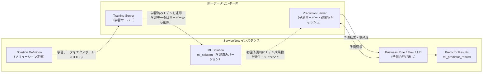
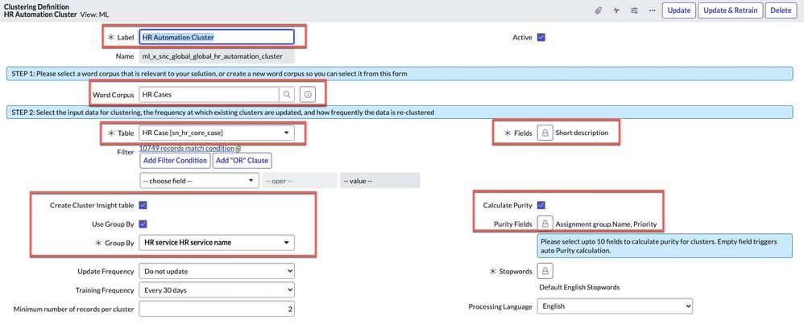
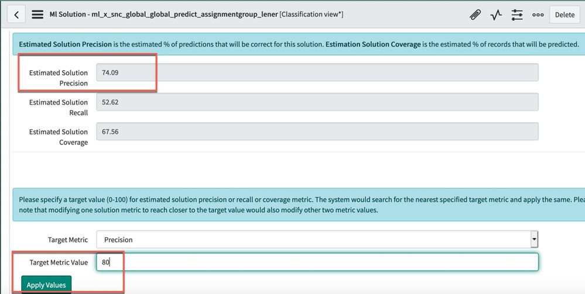
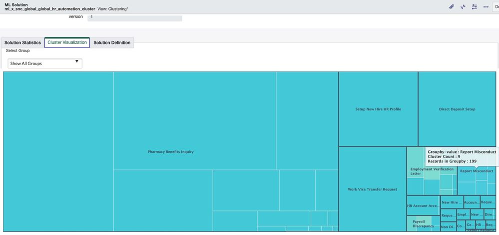
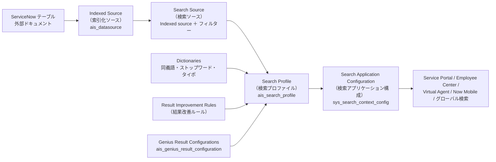
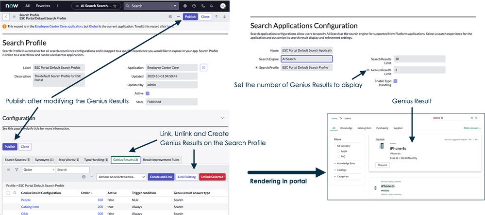
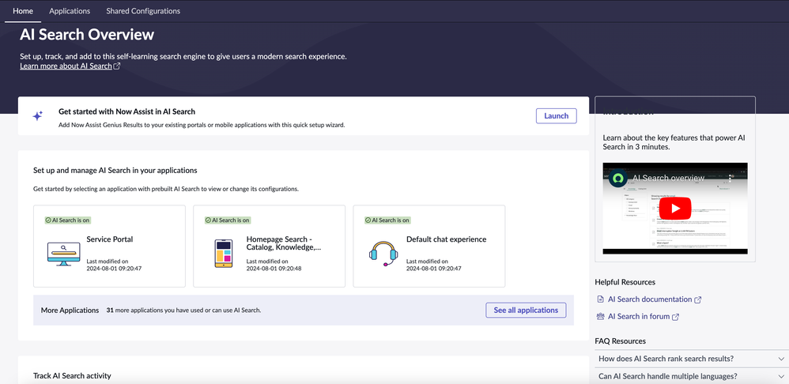

# Predictive Intelligence と AI Search（予測インテリジェンスと AI 検索）

## 概要

本ファイルは、ServiceNow AI Platform に標準搭載されている2つの「非生成系（従来型）AI」機能を扱う。

| 機能 | 何をするか | 主な利用例 | 主管理ロール |
|---|---|---|---|
| **Predictive Intelligence（予測インテリジェンス、PI）** | 過去レコードを学習した機械学習（ML）モデルで、フィールド値の予測・類似レコード検出・グルーピングを行う | Incident の Category / Assignment group 自動設定、類似インシデント・ナレッジ推奨、メジャーインシデント検知 | `ml_admin` |
| **AI Search（AI 検索）** | プラットフォーム内レコードと外部コンテンツを索引化し、関連性学習・同義語・タイポ補正等を備えた検索と、カード型の即答 **Genius Results（ジーニアスリザルト）** を提供する | Service Portal / Employee Center / Virtual Agent / Now Mobile / グローバル検索 | `ais_admin` |

- Predictive Intelligence は ServiceNow AI Platform の機能で、Australia リリースのリリースノートでは「active by default（既定で有効）」と記載されている（プラグイン `com.glide.platform_ml`）。[出典](https://www.servicenow.com/docs/r/australia/release-notes/predictive-intelligence-rn.html)
- AI Search も Australia リリースノートで「active by default」と記載されている。[出典](https://www.servicenow.com/docs/r/australia/release-notes/ai-search-rn.html)
- AI Search は旧来の **Zing（ジング）** テキストインデックス／検索エンジンを置き換える位置付けの検索エンジンである（後述「Zing との違い」）。[出典](https://www.servicenow.com/docs/r/7LhbZn3yz3Q58qhjZoU9iQ/1Ch~zWUnQ7p_tovUGVS6hA)
- 生成 AI（LLM）を使う Now Assist / AI Agents、および AI Search に LLM 回答を付加する「Now Assist in AI Search（2026-09 以降の名称は ServiceNow Otto for AI Search）」の詳細は [Now Assist と AI Agents](./now-assist-ai-agents.md) を参照。本ファイルでは AI Search 側から見た Genius Results の構成のみ扱う。
- 会話型 UI 側（Virtual Agent、NLU）は [Virtual Agent と会話型AI](./virtual-agent.md)、ポータル側の検索 UI は [Service Portal と Employee Center](./portals-employee-center.md) を参照。

> **Brazil での変更:** Australia→Brazil の AI Search 差分リリースノートでは、Brazil ファミリー固有の AI Search 変更は「No updates for this release」とされ、主要変更はすべて Australia ファミリー（パッチ／ストアアプリ更新）側に記録されている。Predictive Intelligence の Brazil 固有の変更点は公開情報では確認できず。[出典](https://www.servicenow.com/docs/r/delta-australia-brazil/brazil-australia-aisearch-release-notes.html)

---

# 第1部 Predictive Intelligence

## Predictive Intelligence のアーキテクチャ

Predictive Intelligence は、インスタンス上の「ソリューション定義（Solution definition）」をもとに、ServiceNow データセンター内の学習サーバーでモデルを作成し、予測サーバーで推論を行う。[出典](https://www.servicenow.com/docs/r/zurich/intelligent-experiences/predictive-intelligence/training-ml-solutions.html)



`Predictive Intelligence` の学習・推論に関する公式仕様は以下のとおり。[出典](https://www.servicenow.com/docs/r/zurich/intelligent-experiences/predictive-intelligence/training-ml-solutions.html)

| 項目 | 仕様 |
|---|---|
| 学習の流れ | ソリューション定義と関連レコードを同一データセンター内の学習サーバーへエクスポートし、学習後にソリューションをインスタンスへインポートする。学習完了後、学習データは学習サーバーから削除される |
| データ所在 | 各データセンターに専用の学習サーバーがあり、データはデータセンター外に出ない |
| 予測 | 同一データセンター内の集中型予測サーバーで実行。学習済みモデル成果物は初回予測時に予測サーバーへ送られ、以後キャッシュされる |
| 通信 | インスタンスと学習・予測サービス間は HTTPS、データセンターのファイアウォール内で通信 |
| 学習結果の保存 | 学習完了時、ソリューションは Attachment（添付）レコードとしてアップロードされる [出典](https://www.servicenow.com/docs/r/australia/intelligent-experiences/predictive-intelligence/create-solution-definition.html) |
| 学習完了通知 | 学習完了（エラー含む）時に通知。ユーザーは「Predictive Intelligence Notifications」カテゴリを購読できる [出典](https://www.servicenow.com/docs/r/australia/intelligent-experiences/predictive-intelligence/create-solution-definition.html) |
| トラブルシュート | Now Support KB の「Predictive Intelligence Common Issues」記事 KB781893 を参照 |

- 学習には `sharedservice.worker` ユーザーが必要とされている（ロールではなく要件として記載）。[出典](https://www.servicenow.com/docs/r/HGWDpzjgkfvaJWTdMzNy2w/of3c3wLKuRfrpti~VcHbZQ)
- ML Trainer との通信の KAA 検証プロパティ `glide.platform_ml.kaa_auth_enabled`（既定 `true`）が Australia の 2026-08 パッチノート（AP5）で追加された。KAA 検証はインスタンスで mTLS が有効な場合にのみ動作し、mTLS が無効なら検証はスキップされる。[出典](https://www.servicenow.com/docs/r/australia/release-notes/predictive-intelligence-rn.html)

## フレームワーク（Classification / Similarity / Clustering / Regression）

Predictive Intelligence には4つのフレームワーク（Framework、機械学習の種類）がある。Australia 版の公式ページの記載を整理する。[出典](https://www.servicenow.com/docs/r/australia/intelligent-experiences/predictive-intelligence/predictive-intelligence-frameworks.html)

| フレームワーク | 目的 | 典型例 | ソリューション種別 | Australia での状態 |
|---|---|---|---|---|
| **Classification（分類）** | レコード作成時にカテゴリ型フィールド値を ML で設定し、過去の処理実績に基づいて作業を分類・ルーティングする | Short description から Incident の Category を設定 | Classification（Workflow Classification を含む） | 利用可 |
| **Similarity（類似性）** | 新規レコードと値が類似する既存レコードを特定し、実績ある解決策の再利用を促す | 類似のクローズ済み Incident の解決策を推奨 | Workflow similarity solution | 利用可 |
| **Clustering（クラスタリング）** | レコードをクラスタ（グループ）に分割してパターンを可視化し、まとめて対処・データのギャップ発見に使う | 新規 Incident 群をグループ化して大規模障害を発見 | Workflow clustering solution | 利用可 |
| **Regression（回帰）** | 過去データから数値を予測する | 温度、株価などの数値予測 | Regression | **非推奨（Deprecated）**。新規作成不可、既存の編集・再学習は可 |

### Classification（分類）フレームワーク

- `Classification` フレームワークは、レコード作成時に機械学習アルゴリズムでカテゴリ型（選択肢型）フィールド値を設定する。[出典](https://www.servicenow.com/docs/r/australia/intelligent-experiences/predictive-intelligence/predictive-intelligence-frameworks.html)
- 公式が挙げる効果は、タスク解決時間の短縮、解決までのやり取り回数の削減、分類・割り当て誤り率の低減である。
- Zurich では詳細設定（Advanced classification options）として、以下が追加された。[出典](https://www.servicenow.com/docs/bundle/zurich-release-notes/page/release-notes/analytics-intelligence-reporting/predictive-intelligence-rn.html)
  - 出現頻度上位 N 個のラベル（クラス）のみで学習
  - 学習に含めるラベルの最小レコード数の指定
  - 「others」ラベルのレコードを学習データから除外
  - 分類学習アルゴリズムとして LightGBM を選択可能
  - モデル構成パラメータを JSON 辞書で指定
- Yokohama 以降、スクリプトで Workflow Classification ソリューションを作成し、Model Explainability（モデル説明可能性）で特徴量の重要度を分析できる。[出典](https://www.servicenow.com/docs/r/australia/intelligent-experiences/predictive-intelligence/create-solution-definition.html)
- 分類 API（`sn_ml.ClassificationSolution`）の `algorithmConfig` では `xgboost` または `logisticRegression` を指定できる（Brazil 版 API リファレンス）。[出典](https://www.servicenow.com/docs/r/api-reference/server-api-reference/ClassificationSolutionAPI.html)
- 【第三者情報】ServiceNow Community の PI 担当者記事（Zurich 追記）では、分類アルゴリズムとして Feed Forward Neural Net、XGBoost、LightGBM があり、ベクトル化には Utah で導入された Google Universal Sentence Encoder（GUSE）が既定で使われるため Word Corpus は不要になった、と説明されている。[出典](https://www.servicenow.com/community/ai-intelligence-articles/tuning-predictive-intelligence-models-part-2-using/ta-p/2299135)

### Similarity（類似性）フレームワーク

- `Similarity` フレームワークは、新規レコードと類似した値を持つ既存レコードを特定する。[出典](https://www.servicenow.com/docs/r/australia/intelligent-experiences/predictive-intelligence/predictive-intelligence-frameworks.html)
- テキスト比較アルゴリズムは文脈から類義語・類似語を識別するため、キーワードの完全一致は不要である（公式例：「printer not working」と「printer broken」が一致）。
- 業界固有の文脈も学習し、同じ語句でも業界により意味が異なる場合に対応する。
- 比較元（Table）と比較先（Test Table）を別テーブルにでき、例えば「Knowledge 記事を Incident に照合」する構成が取れる（後述のソリューション定義フィールド参照）。[出典](https://www.servicenow.com/docs/r/australia/intelligent-experiences/predictive-intelligence/create-similarity-solution.html)

### Clustering（クラスタリング）フレームワーク

- `Clustering` フレームワークは、データをクラスタに分割してパターンを特定し、レコードをまとめて処理したり、既存データのギャップを発見したりする。[出典](https://www.servicenow.com/docs/r/australia/intelligent-experiences/predictive-intelligence/predictive-intelligence-frameworks.html)
- 公式例は「類似した新規 Incident をグループ化し、大規模障害（major outage）を明らかにする」である。
- 【第三者情報】Community 記事では、Virtual Agent や Flow Designer による自動化候補の特定、既存プロセスの問題発見に使える、としている。[出典](https://www.servicenow.com/community/hrsd-articles/predictive-intelligence-for-hr-find-patterns-using-clustering/ta-p/2310820)
- 公開されている公式ドキュメントでは、クラスタリングのアルゴリズム名（k-means 等）は明記されておらず確認できず。

### Regression（回帰）フレームワーク（非推奨）

- `Regression` フレームワークは過去データから数値（温度、株価など）を予測する。[出典](https://www.servicenow.com/docs/r/australia/intelligent-experiences/predictive-intelligence/predictive-intelligence-frameworks.html)
- Australia 版フレームワークページでは「Washington DC リリースで新規回帰ソリューション作成のサポートが削除された。既存ソリューションの学習・編集は可能」と記載されている。
- 一方、Australia 版の Flow Designer 用スポークのページでは「Regression フレームワークは Australia リリースで非推奨」と記載され、他リリース版の資料には Yokohama と記載されたものもあり、**非推奨化のリリースの記載は資料により不一致**である。いずれの資料でも「新規作成不可・既存は継続利用可」という結論は共通。[出典](https://www.servicenow.com/docs/r/HGWDpzjgkfvaJWTdMzNy2w/of3c3wLKuRfrpti~VcHbZQ)
- 新規設計で数値予測が必要な場合は、Regression 以外の手段（分類によるレンジ予測、外部 ML 連携等）を検討する必要がある【推定】。

## Word Corpus の廃止と Workflow ソリューション

- Australia 版のソリューション定義作成手順では、「Classification、Clustering、Similarity の各モデルは事前学習済み（pre-trained）の Workflow ソリューションを使用するため、新規ソリューションに Word Corpus（単語コーパス）は不要」と明記されている。[出典](https://www.servicenow.com/docs/r/australia/intelligent-experiences/predictive-intelligence/create-solution-definition.html)
- Word Corpus を使っていた既存ソリューションは、アップグレード後に Workflow ソリューションへ変換され、フォームから Word Corpus フィールドが除去される（Xanadu 版の記載では「アップグレード後の再学習時に」変換）。[出典](https://www.servicenow.com/docs/r/x7YYxCVARboMBfN2zKAZsA/W5fuNvL5qZrUYelBzXRshw)
- Utah 以降に初めて利用を開始した顧客は事前学習済みモデルを利用し、Word Corpus は不要。Similarity では「Washington DC 以降の事前学習済みソリューションでは不要・非表示」と記載されている。[出典](https://www.servicenow.com/docs/r/australia/intelligent-experiences/predictive-intelligence/create-similarity-solution.html)

## メニュー位置

| 目的 | メニュー |
|---|---|
| PI ホーム（ソリューション一覧・作成） | All > Predictive Intelligence > Homepage |
| Classification ソリューション定義 | All > Predictive Intelligence > Classification > Solution Definitions |
| Similarity ソリューション定義 | All > Predictive Intelligence > Similarity > Solution Definitions |
| Clustering ソリューション定義 | All > Predictive Intelligence > Clustering > Solution Definitions |

[出典1](https://www.servicenow.com/docs/r/zurich/intelligent-experiences/predictive-intelligence/training-ml-solutions.html) [出典2](https://www.servicenow.com/docs/r/australia/intelligent-experiences/predictive-intelligence/create-solution-definition.html) [出典3](https://www.servicenow.com/docs/r/australia/intelligent-experiences/predictive-intelligence/create-similarity-solution.html) [出典4](https://www.servicenow.com/docs/r/x7YYxCVARboMBfN2zKAZsA/W5fuNvL5qZrUYelBzXRshw)

## ロール

Australia 版の Predictive Intelligence ロール一覧は以下のとおり。[出典](https://www.servicenow.com/docs/r/australia/intelligent-experiences/predictive-intelligence/predictive-intelligence-roles.html)

| ロール | 表示名 | 権限 | 包含ロール |
|---|---|---|---|
| `ml_admin` | ML Admin | `ml_predictor_results`、`ml_predictor_results_task` テーブルへの CRUD。ソリューション定義の作成・学習（`admin` でも可） | `pa_data_collector`, `pa_viewer` |
| `ml_labeler` | ML Labeler | `ml_label_candidate` テーブルへの CRUD | `sn_ace.ace_user`, `nlu_user` |
| `ml_report_user` | ML Report User | `ml_predictor_results`、`ml_predictor_results_task` テーブルの参照のみ | `pa_viewer` |

- ソリューション定義（Classification / Similarity / Clustering）の作成手順の必要ロールは `admin` または `ml_admin`。[出典](https://www.servicenow.com/docs/r/australia/intelligent-experiences/predictive-intelligence/create-solution-definition.html)
- Now Assist Skill Kit に PI ツールを追加する場合は `sn_skill_builder.admin` が必要（後述）。[出典](https://www.servicenow.com/docs/r/_yCRwrQYX6H0b46tCsDNZA/kxAsV60soGmyMn7lHur8Jg)

## 主要テーブル

| テーブル | 内容 | 確度 |
|---|---|---|
| `ml_solution` | 学習済み ML ソリューション（バージョン）を格納。フォームに Solution Statistics、Cluster Visualization 等のタブを持つ | 公式（Task Intelligence 構成要素ページ等）[出典](https://www.servicenow.com/docs/r/5M2H7PAkXUuakbtz~5Kfeg/40pUFf3JG3QPhlf7yaM1ZA) |
| `ml_predictor_results` | 予測結果とフィードバックを格納。スキップ・失敗した予測も含む | 公式（ロールページ・Task Intelligence 構成要素ページ） |
| `ml_predictor_results_task` | タスク系の予測結果 | 公式（ロールページ） |
| `ml_label_candidate` | ラベル付け候補（`ml_labeler` が操作） | 公式（ロールページ） |
| `ml_capability_definition_base` | ソリューション定義の基底テーブル（Orlando で導入）。子テーブル `ml_capability_definition_classification` / `ml_capability_definition_similarity` / `ml_capability_definition_clustering` | 【第三者情報】Community 回答 [出典](https://www.servicenow.com/community/intelligence-ml-forum/records-in-quot-ml-solution-definitions-quot-and-quot-solution/m-p/2717973) |
| `ml_solution_definition` | Orlando 以前のレガシーなソリューション定義テーブル。プロパティ名 `glide.platform_ml.override_training_lock` の説明にも登場する | 【第三者情報】＋公式プロパティ説明 |

- Zurich で、Predictive Intelligence の予測エラーを記録する新テーブルと、それを用いた Observability Dashboard（可観測性ダッシュボード）が追加された（テーブル名は公開情報では確認できず）。[出典](https://www.servicenow.com/docs/bundle/zurich-release-notes/page/release-notes/analytics-intelligence-reporting/predictive-intelligence-rn.html)

## ソリューション定義（Solution Definition）

`Solution Definition（ソリューション定義）` は、どのテーブルのどのレコードを学習データとし、どの入力フィールドからどの出力フィールドを予測するか（または何を比較・グループ化するか）を定義するレコードである。定義を学習（Train）すると ML Solution（学習済みバージョン）が生成される。

### 作成手順（共通）

Australia 版の Classification ソリューション作成手順は以下のとおりで、Similarity / Clustering も同様のボタン構成である。[出典](https://www.servicenow.com/docs/r/australia/intelligent-experiences/predictive-intelligence/create-solution-definition.html)

1. 正しいアプリケーションスコープにいることを確認する。
2. All > Predictive Intelligence > Classification > Solution Definitions を開く。
3. **New** をクリックする。
4. フォームを入力する（次節）。
5. 以下のいずれかを実行する。
   - **Save** / **Save & Train**：保存（Train 付きは学習も投入）
   - **Submit** / **Submit & Train**：作成して送信（Train 付きは学習も投入）
6. 学習を投入した場合は Training Activation（学習の有効化）ウィンドウで **OK** をクリックする。

- 任意の事前作業として、カスタム Stopwords（ストップワード）リストを作成しておける。

### Classification Definition のフィールド

Australia 版の Classification ソリューション定義フォームのフィールド。[出典](https://www.servicenow.com/docs/r/australia/intelligent-experiences/predictive-intelligence/create-solution-definition.html)

| フィールド | 説明・ガイダンス |
|---|---|
| **Label（ラベル）** | ソリューションレコードの一意な名前 |
| **Name（名前）** | 読み取り専用。Label から自動生成（例：`ml_x_snc_global_global_<label>` 形式【第三者情報】） |
| **Word Corpus（単語コーパス）** | レガシー用。Utah 以降の新規顧客・事前学習済みモデルでは不要でフィールド自体が除去される |
| **Table（テーブル）** | 予測対象レコードを含むテーブル |
| **Output Field（出力フィールド）** | モデルが設定するフィールド。有限の値を持つ Choice または String 型で、入力と因果関係があるもの。例：既定の Incident Categorization の Category |
| **Fields（入力フィールド）** | 予測に使うフィールド。String / Reference / Choice / HTML 型で、レコード作成時に利用可能・既定値あり・空でないもの。既定ソリューションはすべて Short description を使用 |
| **Filter（フィルター）** | Add Filter Condition で学習レコードを選択。1件以上返す必要がある。例（Incident Categorization）：`[Created][on][Last 12 months] AND [Active][is][false] AND [State][is one of][Resolved, Closed]`（Resolved と Closed の複数選択） |
| **Processing Language（処理言語）** | 学習データの主要言語。英語処理は常に併用される |
| **Stopwords（ストップワード）** | 選択言語の既定リスト＋Default English Stopwords が自動設定。カスタムリストも選択可 |
| **Training Frequency（学習頻度）** | Run once（既定）〜 Every 180 days。定義が安定するまでは Run once で調整し、安定後に定期学習を設定することが推奨される（データの経年で精度が劣化するため） |

### Similarity Definition のフィールド

Australia 版の Similarity ソリューション定義フォームのフィールド（必要ロール `ml_admin` または `admin`）。[出典](https://www.servicenow.com/docs/r/australia/intelligent-experiences/predictive-intelligence/create-similarity-solution.html)

| フィールド | 説明・ガイダンス |
|---|---|
| **Label** | 一意な名前（例：Match Knowledge Articles to Incidents） |
| **Name** | Label から自動生成される読み取り専用のシステム名 |
| **Word Corpus** | レガシーソリューションのみ。Washington DC 以降の事前学習済みソリューションでは不要で非表示 |
| **Table** | 比較元（ソース）レコードのテーブル（例：Knowledge `kb_knowledge`）。選択すると対象件数がリストへのリンクとして表示される |
| **Test Table（テストテーブル）** | 照合したい対象レコードのテーブル（例：Incident `incident`）。Table と同じでもよい |
| **Fields** | ソーステーブルの関連テキストを含むフィールド（例：Short description、Article body）。Journal 型は非対応 |
| **Test Fields（テストフィールド）** | ソースと比較する対象テーブルのフィールド（例：Incident の Short description） |
| **Filter** | ソースレコードへの条件（例：`workflow_state=published`）。Script Include は参照不可で、代わりに Database View を使う |
| **Processing Language** | データセットの主要言語。英語処理は常に適用 |
| **Stopwords** | 選択言語＋英語リストが自動追加。カスタムリストはフィールドをアンロックして選択 |
| **Training Frequency** | Run Once 〜 Every 180 days |
| **Update Frequency（更新頻度）** | 比較用データの更新頻度（例：Incident は15分ごと、ナレッジ記事は1日ごと） |

- 学習結果は Related Links の **Similarity Examples** に、類似度順に並んだレコードペアとして表示される。[出典](https://www.servicenow.com/docs/r/australia/intelligent-experiences/predictive-intelligence/create-similarity-solution.html)

### Clustering Definition のフィールド

Clustering ソリューション定義フォームのフィールド（Xanadu 版の公式手順。Australia 版の同ページは取得できなかったため、Xanadu 版に基づく）。[出典](https://www.servicenow.com/docs/r/x7YYxCVARboMBfN2zKAZsA/W5fuNvL5qZrUYelBzXRshw)

| フィールド | 説明・ガイダンス |
|---|---|
| **Label / Name** | 一意な名前／自動生成名 |
| **Word Corpus** | レガシーのみ。事前学習済みモデルでは非表示 |
| **Table** | グループ化するレコードのテーブル（例：Incident `incident`） |
| **Fields** | 類似判定に使う入力フィールド（例：Short description）。参照フィールドはドットウォークで指定 |
| **Use Group By（グループ化を使用）** | チェックすると Group By リストが有効になり、クラスタリング前にフィールド値でレコードを分割する。未チェックなら全レコードをクラスタリング |
| **Group By** | クラスタリング前の分割に使うフィールド（任意） |
| **Purity Fields（純度フィールド）** | クラスタ内で最頻のクラスを特定するためのフィールド（例：Category、Assignment group.Name） |
| **Filter** | 対象レコードの条件。Script Include は参照不可で Database View を使う |
| **Processing Language / Stopwords** | 他フレームワークと同様 |
| **Update Frequency** | 新規・更新レコードを既存クラスタへ割り当てる頻度（または更新しない） |
| **Training Frequency** | クラスタを破棄して再構築する頻度（毎日／3日ごと／7日ごと／毎月／1回） |
| **Minimum number of records per cluster（クラスタあたり最小レコード数）** | 2以上 |



- **キャプション:** Clustering Definition（クラスタリングソリューション定義）フォームの入力例（HR Automation Cluster）。
- **画面の説明:** All > Predictive Intelligence > Clustering > Solution Definitions から開くフォーム。上段に Label「HR Automation Cluster」、自動生成された Name「ml_x_snc_global_global_hr_automation_cluster」、Active チェック。「STEP 1」で Word Corpus（この例は旧方式のため「HR Cases」を選択）、「STEP 2」で Table「HR Case [sn_hr_core_case]」（フィルター条件に一致する 10,749 件の表示）と Fields「Short description」を指定。左下に Create Cluster Insight table、Use Group By（チェック済）、Group By「HR service HR service name」、Update Frequency「Do not update」、Training Frequency「Every 30 days」、Minimum number of records per cluster「2」。右側に Calculate Purity（チェック済）、Purity Fields「Assignment group.Name, Priority」（最大10フィールド、空欄なら自動計算との注記）、Stopwords「Default English Stopwords」、Processing Language「English」。右上に Update / Update & Retrain / Delete ボタン。なお Word Corpus は現行（Australia）の新規ソリューションでは不要・非表示である。
- **出典:** https://www.servicenow.com/community/hrsd-articles/predictive-intelligence-for-hr-find-patterns-using-clustering/ta-p/2310820 （ServiceNow Community 記事内の画像、取得日 2026-11-02）

- 画像中の「Create Cluster Insight table」「Calculate Purity」は Community 記事の画面に表示されているが、Xanadu 版公式手順のフィールド一覧には記載がない。

## 学習要件（データ量・データ品質）

### 件数の上限・下限

| 項目 | 値 | 出典・備考 |
|---|---|---|
| Classification 推奨学習件数 | 30,000〜300,000 件 | 公式（Australia）。300,000 件を超えると直近 300,000 件のみ使用 [出典](https://www.servicenow.com/docs/r/australia/intelligent-experiences/predictive-intelligence/create-solution-definition.html) |
| Classification 最小学習件数 | 10,000 件 | 公式（Australia）。上下限は PI プロパティで設定 |
| クラス（出力値）ごとの最少件数 | 30 件未満のクラスは学習から除外 | 除外クラスは ML Solution フォームの Solution Statistics セクションに表示 |
| Clustering 推奨件数 | 2,000 件以上（最良の結果のため。ハード下限ではない） | 公式（Xanadu）[出典](https://www.servicenow.com/docs/r/x7YYxCVARboMBfN2zKAZsA/W5fuNvL5qZrUYelBzXRshw) |
| Clustering 最大件数 | 手順ページ：300,000 件／プロパティ `glide.platform_ml.api.max_clustering_records` 既定：100,000 | **資料間で不一致**。実環境のプロパティ値を確認すること |
| Similarity Window 最大件数 | 100,000 件（`glide.platform_ml.api.max_similarity_window_records`） | 公式プロパティ |
| 新規学習要求の上限（ML scheduler） | 1インスタンスあたり 24 時間で 50 件 | 定期再学習、Clustering 更新、Similarity 更新は対象外 [出典](https://www.servicenow.com/docs/r/australia/intelligent-experiences/predictive-intelligence/create-similarity-solution.html) |

### 学習データの品質要件

公式ドキュメントが挙げる学習データの要件・フィルターのガイドライン。[出典1](https://www.servicenow.com/docs/r/zurich/intelligent-experiences/predictive-intelligence/training-ml-solutions.html) [出典2](https://www.servicenow.com/docs/r/australia/intelligent-experiences/predictive-intelligence/create-solution-definition.html)

- **入力フィールドはレコード作成時点で利用可能**であること（作成時に予測したい場合）。
- **出力フィールドは有限の値を持つ Choice フィールド**が望ましい。
- 学習レコードには**正しい出力値のみ**を含める。レビュー中の最近クローズされた Incident など、出力値が変わる可能性のあるレコードは除外する。
- 完了状態（Resolved / Closed）の**非アクティブ**レコードを使う。
- 廃止された値（obsolete values）を持つレコードを除外する。
- 各出力値の**複数の例**と、入力フィールドの一般的なバリエーションを含める。
- **相対日付（例：Last 12 months）**を使う。固定日付は再学習時に自動更新されない。
- 実在の（authentic）データベースレコードのみを使う。
- Zurich 以降、学習対象テーブルの ACL が Predictive Intelligence にアクセスを許可しているかを検証するロジックが追加され、学習エラーの削減が図られている。[出典](https://www.servicenow.com/docs/bundle/zurich-release-notes/page/release-notes/analytics-intelligence-reporting/predictive-intelligence-rn.html)
- 【第三者情報】Community では「学習データに P1 の実例がなければ P1 は予測されない」と、学習データにないクラスは予測できない点が注意喚起されている。[出典](https://www.servicenow.com/community/intelligence-ml-forum/servicenow-predictive-intelligence-pi-complete-guide/m-p/3515244)

## Predictive Intelligence のシステムプロパティ

Australia 版の Predictive Intelligence プロパティ一覧。[出典](https://www.servicenow.com/docs/r/australia/intelligent-experiences/predictive-intelligence/predictive-intelligence-properties.html)

| プロパティ | 説明 | 既定値 |
|---|---|---|
| `glide.platform_ml.override_training_lock` | 学習中の `ml_solution_definition` レコードの読み取り専用状態を解除し編集可能にする | 公開情報では確認できず |
| `glide.platform_ml.api.min_regression_records` | Regression 学習の最小件数 | 10000 |
| `glide.platform_ml.api.max_regression_records` | Regression 学習の最大件数 | 300000 |
| `glide.platform_ml.training_timeout` | 学習中ソリューションが更新なしでタイムアウトするまでの時間（ミリ秒） | 21600000（6時間） |
| `glide.platform_ml.api.model_size` | モデルの最大サイズ（公式表では「モデル学習に使える最大レコード数」と説明） | 524288000 |
| `glide.platform_ml.api.csv_max_line` | Classification 学習に使う最大件数 | 300000 |
| `glide.platform_ml.api.csv_min_line` | Classification 学習に必要な最小件数 | 10000 |
| `glide.platform_ml.api.csv_split_days` | 1リクエストで取得するレコードの最大日数 | 30 |
| `glide.platform_ml.api.max_wordcorpus_records` | Similarity / Clustering の Word Corpus 作成時のテーブルあたり最大件数 | 300000 |
| `glide.platform_ml.api.max_similarity_window_records` | Similarity Window が参照する最大件数 | 100000 |
| `glide.platform_ml.api.max_clustering_records` | Clustering に含められる最大件数 | 100000 |
| `glide.platform_ml.kaa_auth_enabled` | ML Trainer－Glide 間通信の KAA 検証（mTLS 有効時のみ動作） | true |
| `glide.shared_service_scheduler.url` | Shared service scheduler の URL | 記載なし |
| `glide.cache.size.ml_object_cache` | ML 成果物キャッシュの最大サイズ（MB） | 記載なし |
| `glide.platform_ml.artifact.cache_compression_scheme` | 成果物キャッシュの圧縮方式 | 記載なし |

- `glide.platform_ml.api.model_size` の値 524288000 はバイト換算で 500MB に相当するが、公式表の説明文は「最大レコード数」となっており、説明と値の単位が整合しない。公式記載のまま転記する。

## 学習結果の評価（Solution Statistics と Target Metric）

### Classification の評価指標

学習済み Classification ソリューション（ML Solution）のフォームでは、以下のタブ・セクションで評価する。[出典1](https://www.servicenow.com/docs/r/australia/intelligent-experiences/predictive-intelligence/create-solution-definition.html) [出典2](https://www.servicenow.com/docs/r/intelligent-experiences/predictive-intelligence/configuring-target-metrics-trained-classification-solution.html)

| タブ／セクション | 内容 |
|---|---|
| **Solution Statistics（ソリューション統計）** | Estimated Solution Precision / Recall / Coverage（推定精度・再現率・カバレッジ）の表示と、Target Metric 設定 |
| **Class Confidence（クラス信頼度）** | クラスごとの precision と coverage を確認 |
| **Solution Visualization（可視化）** | クラスごとの推定 precision と coverage のバブルチャート。バブルの大きさはそのクラスのレコード比率 |
| **Test Solutions（テスト）** | Short description などの入力値を入れて予測をテスト |

| 指標 | 意味（公式画面の説明・例から） |
|---|---|
| **Precision（精度）** | 予測のうち正しいものの推定割合（例：「少なくとも 80% の確率で正しく予測」） |
| **Coverage（カバレッジ）** | 予測が行われるレコードの推定割合（例：「受け付ける Incident の少なくとも 70% を予測」） |
| **Recall（再現率）** | 真のケースをどれだけ取りこぼさないか（例：フィッシング検知で「本物のフィッシングを非フィッシングに分類しない」） |

### Target Metric による自動チューニング手順

[出典](https://www.servicenow.com/docs/r/intelligent-experiences/predictive-intelligence/configuring-target-metrics-trained-classification-solution.html)

1. 学習済み ML Solution の Solution Statistics タブを開く。
2. 緑色のバナー（各指標の定義）を読む。
3. **Target Metric** の選択肢で Precision / Recall / Coverage のいずれかを選ぶ。
4. **Target Metric Value**（0〜100 の数値）を入力する。
5. **Apply Values** をクリックする。
6. 更新された推定値を確認し、必要に応じて繰り返す。

- 1つの指標を変えると他の2指標も自動的に変化する（トレードオフ）。公式例では coverage を 70 に上げると coverage が 35.99→55.98 に上がり、precision は 80.18→64.97 に下がった。
- データ分布により目標値に完全一致しない場合がある。
- ソリューションレベルの値を設定すると、クラスレベルの値（しきい値）が自動設定される。クラス数が多い場合に手動でクラス別に設定するのは困難とされる。
- Estimated Precision 列を降順ソートすると精度の高いクラスが分かる。
- 【第三者情報】Community 回答では、クラスごとの既定信頼度がしきい値（threshold）で、予測信頼度がしきい値を上回れば値が設定され、下回れば「Skipped（スキップ）」となる。既定しきい値は静的で、再学習時にのみ変わると説明されている。[出典](https://www.servicenow.com/community/intelligence-ml-forum/how-is-predictive-intelligence-confidence-calculated/td-p/2725619/page/2)



- **キャプション:** 学習済み Classification ソリューション（ML Solution）の Solution Statistics 部分と Target Metric 設定欄。
- **画面の説明:** 「Ml Solution - ml_x_snc_global_global_predict_assignmentgroup_lener [Classification view]」フォーム。上部の水色バナーに「Estimated Solution Precision は、このソリューションの予測が正しい推定割合、Estimation Solution Coverage は予測されるレコードの推定割合」との説明。その下に Estimated Solution Precision「74.09」、Estimated Solution Recall「52.62」、Estimated Solution Coverage「67.56」が読み取り専用で表示。下段バナーに「精度・再現率・カバレッジのいずれかについて 0〜100 の目標値を指定すると、システムが最も近い目標指標を探して適用し、1つを変えると他の2つも変わる」との説明があり、Target Metric「Precision」、Target Metric Value「80」、緑の **Apply Values** ボタンが並ぶ。
- **出典:** https://www.servicenow.com/community/ai-intelligence-articles/tuning-predictive-intelligence-models-part-2-using/ta-p/2299135 （ServiceNow Community 記事内の画像、取得日 2026-11-02）

### Clustering の評価（Cluster Visualization）

Clustering ソリューションは Solution Statistics、Cluster Summary、Cluster Updates の各タブと、Cluster Visualization（クラスタ可視化）タブで評価する。[出典](https://www.servicenow.com/docs/r/x7YYxCVARboMBfN2zKAZsA/W5fuNvL5qZrUYelBzXRshw)

- Cluster Visualization はツリーマップで、左上から右下へ順に並ぶ。
- ノードのラベルは **Cluster Concept**（クラスタ内の上位語から生成）。語は語根形で表示されるため途切れて見えることがある。
- ノード色はクラスタ品質に応じて赤〜緑。
- **Select Group** フィルターは Use Group By と Group By を設定した場合のみ表示。ホバーで Groupby value、Cluster Count、Records in Groupby を表示。
- グループ内ではスライダーでクラスタサイズ・品質を絞り込め、ホバーで Purity のパーセンタイル、Cluster Concept、Quality、Size を表示。
- ノードをクリックすると ML cluster details のリストビューが開く。



- **キャプション:** Clustering ソリューション（ML Solution）の Cluster Visualization タブ。
- **画面の説明:** 「ML Solution ml_x_snc_global_global_hr_automation_cluster View: Clustering」フォームで、Solution Statistics / Cluster Visualization / Solution Definition の3タブのうち Cluster Visualization を選択。Select Group は「Show All Groups」。Group By に指定した HR Service ごとの大きな矩形（Pharmacy Benefits Inquiry、Setup New Hire HR Profile、Direct Deposit Setup、Work Visa Transfer Request、Employment Verification Letter、Report Misconduct など）と、その中の小さな矩形（クラスタ）がツリーマップとして描かれる。カーソルを当てたノードに「Groupby-value: Report Misconduct / Cluster Count: 9 / Records in Groupby: 199」のツールチップが表示されている。
- **出典:** https://www.servicenow.com/community/hrsd-articles/predictive-intelligence-for-hr-find-patterns-using-clustering/ta-p/2310820 （ServiceNow Community 記事内の画像、取得日 2026-11-02）

### 運用時の評価

- Solution Statistics ダッシュボードは、直近30日の平均予測カバレッジ、日次予測カバレッジ、直近30日の平均予測精度、日次予測精度を表示し、クラス別に分解できる。[出典](https://www.servicenow.com/docs/r/intelligent-experiences/predictive-intelligence/using-predictive-intelligence.html)
- Australia で **Predictive Intelligence Usage Analytics dashboard（利用分析ダッシュボード）** が追加され、ソリューション種別ごとの月間予測件数などで採用状況・効果・価値を確認できる。[出典](https://www.servicenow.com/docs/r/australia/release-notes/predictive-intelligence-rn.html)
- Zurich で予測エラーを分析する **Observability Dashboard** が追加された。[出典](https://www.servicenow.com/docs/bundle/zurich-release-notes/page/release-notes/analytics-intelligence-reporting/predictive-intelligence-rn.html)

## 予測の利用方法

### アプリケーション同梱のソリューション（Incident の例）

Incident Management 向けには既定のソリューション定義が提供される。Predictive Intelligence と Incident Management の両方が有効な場合のみ利用可能。[出典](https://www.servicenow.com/docs/r/it-service-management/predictive-intelligence-for-incident.html)

| プラグイン | 用途 |
|---|---|
| `com.glide.platform_ml` ＋ `com.snc.incident.ml_solution` | Classification ソリューション |
| `com.snc.incident.mim.ml_solution` | Similar Incidents（MIM）、Major Incident Recommendation |
| `com.snc.contextual_search_ml` | Major Incident Recommendation と類似インシデント系ソリューション |

| 種別 | ソリューション定義 | 入力 | 出力／推奨内容 |
|---|---|---|---|
| Classification | Incident Assignment | Short description | Assignment group |
| Classification | Incident Categorization | Short description | Category |
| Classification | Incident Service | Short description | Service |
| Classification | Incident Configuration Item | Short description | Configuration item |
| Similarity | Major Incident Detection | 記載なし | リンクすべき類似のアクティブなメジャーインシデント、メジャーインシデント候補として提案する類似インシデント |
| Similarity | Similar Incidents（Major Incident Workbench） | 記載なし | まだメジャーインシデントの子になっていない類似インシデント |
| Similarity | Similar Incidents | Short description, Description | 調査・解決用の類似インシデント |
| Similarity | Similar Open Incidents | Short description, Description | リンク用の類似オープンインシデント |
| Similarity | Similar Closed Incidents | Short description, Description | 調査・解決用の類似クローズ済みインシデント |
| Similarity | Similar Resolved Incidents | 記載なし | 類似の解決済みインシデント |

- Incident テーブルのビジネスルール **Update Prediction Results** は Incident Assignment と Incident Categorization のみに適用され、Incident クローズ時にソリューションの precision / coverage 統計を更新する。
- ビジネスルールテンプレートは `applyPredictionForSolution()` を呼び出し、既定値の変更有無にかかわらず予測を適用する。Kingston からのアップグレード時、グローバルドメイン環境では `solutionNames` 配列変数を使い、ドメイン分離環境ではテンプレート内のコメントを参照する。
- 同種の既定ソリューションは CSM、HR、Legal Service Delivery、PPM 等にも提供されている（各製品の詳細は [Incident Management](../itsm/incident-management.md)、[Customer Service Management](../customer/customer-service-management.md)、[HR Service Delivery](../employee/hr-service-delivery.md) を参照）。[出典](https://www.servicenow.com/docs/r/5M2H7PAkXUuakbtz~5Kfeg/kcCD~6wu0anJrM22u4Zt0Q)
- 公式の利用例として、関連記事の提案、タスクの割り当て・分類・優先度付け、メジャーインシデント検知、ケース解決策の推奨、重複する記事・アイデアの防止、フィッシング検知が挙げられている。[出典](https://www.servicenow.com/docs/r/intelligent-experiences/predictive-intelligence/using-predictive-intelligence.html)

### Predictive Intelligence Workbench（PIWB）

- ITSM、HR、PPM 等の製品別に **Predictive Intelligence Workbench（PIWB）** が提供され、事前構築されたユースケーステンプレートからモデルを作成し、作成→学習→評価→チューニング→テスト→業務プロセスへの統合の流れで扱う。テンプレートは `piwbadmin` / `piwbmanager` ロールのユーザーが利用する（ロール名は検索結果の記載に基づく。各製品版の詳細は公開情報では十分に確認できず）。[出典](https://www.servicenow.com/docs/r/BgFKZnPHldZ62gGtzQ71Mw/fCpt584peMjRrlXE8ohtIQ)

### Flow Designer（Workflow Studio）からの利用

Australia 版の **Predictive Intelligence for Flow Designer** スポークのアクション。[出典](https://www.servicenow.com/docs/r/HGWDpzjgkfvaJWTdMzNy2w/of3c3wLKuRfrpti~VcHbZQ)

| アクション | 概要 |
|---|---|
| Classification Prediction | 単一レコードを入力に、アクティブな Classification ソリューションの予測値を返す |
| Classification Batch Prediction | 複数レコードを入力に、予測値を返す |
| Similarity Prediction | 入力レコードと Similarity ソリューションに指定されたテーブルから類似レコードを返す |
| PI Confidence Check | PI の数値（信頼度）とユーザー指定の数値を比較した結果を返す |
| Regression Prediction（非推奨） | 単一レコードの回帰予測 |
| Regression Batch Prediction（非推奨） | 複数レコードの回帰予測 |

- フロー全般の仕様は [Workflow Studio / Flow Designer](./flow-designer-workflow-studio.md) を参照。

### サーバーサイド API（`sn_ml` 名前空間）

Predictive Intelligence のスクリプト API は `sn_ml` 名前空間で提供され、プラグイン `com.glide.platform_ml` が必要。[出典1](https://www.servicenow.com/docs/r/api-reference/server-api-reference/MLSolutionFactoryAPI.html) [出典2](https://www.servicenow.com/docs/r/api-reference/server-api-reference/ClassificationSolutionAPI.html)

| API | 用途 |
|---|---|
| `MLSolutionFactory` | `getSolution(solutionName, options)` で `MLSolution` オブジェクトを取得するファクトリ |
| `MLSolution` | `predict(input, options)` で GlideRecord またはキー・値配列を入力に予測サーバーから予測結果を取得 |
| `DatasetDefinition` | 学習入力のテーブル・フィールド・エンコードクエリを定義（データは保持しない） |
| `Encoder` | 任意。テキスト列等を数値ベクトルに変換 |
| `ClassificationSolution` | Classification ソリューションの作成。設定項目に `label`, `dataset`, `predictedFieldName`, `inputFieldNames`, `algorithmConfig`, `encoder`, `minRowCount`, `processingLanguage`, `trainingFrequency` |
| `ClassificationSolutionStore` | `add()` / `get()` / `update()` でソリューションを保存・取得 |
| `ClassificationSolutionVersion` | 学習済みバージョンの管理。`predict()`, `getStatus()`, `getVersionNumber()` |
| `PredictabilityEstimate` | 目的フィールドの予測に有用な特徴量（入力フィールド）を推定する（【第三者情報】Community 記事の手順で紹介）[出典](https://www.servicenow.com/community/ai-intelligence-articles/tuning-predictive-intelligence-models-part-2-using/ta-p/2299135) |

`ClassificationSolution` の主要メソッド：`submitTrainingJob()`（学習開始、`ClassificationSolutionVersion` を返す）、`cancelTrainingJob()`、`getActiveVersion()`、`getLatestVersion()`、`getAllVersions()`、`getVersion(version)`、`setActiveVersion(version)`、`getProperties()`、`getName()`。

```javascript
// 公式 API リファレンスのサンプルを要約したもの（Brazil 版リファレンス）
var data = new sn_ml.DatasetDefinition({
  tableName: 'incident',
  fieldNames: ['category', 'short_description'],
  encodedQuery: 'activeANYTHING'
});
var solution = new sn_ml.ClassificationSolution({
  label: 'my solution',
  dataset: data,
  predictedFieldName: 'category',
  inputFieldNames: ['short_description']
});
sn_ml.ClassificationSolutionStore.add(solution);
var version = solution.submitTrainingJob();
```

- アクセス制御：Vancouver Patch 7 Hotfix 2b および Washington DC Patch 7 より前はこの API がフル権限で動作していたが、それ以降は ACL が必要である。[出典](https://www.servicenow.com/docs/r/api-reference/server-api-reference/ClassificationSolutionAPI.html)
- スクリプト全般は [サーバーサイドスクリプト](./scripting-server-side.md) を参照。

### REST API（Predictive Intelligence API）

[出典](https://www.servicenow.com/docs/r/pt-BR/api-reference/rest-apis/agent-intelligence-api.html)

| メソッド・パス | 内容 |
|---|---|
| `GET /api/now/agent_intelligence/solution/{solution_name}/prediction` | 単一ソリューションの予測。入力フィールド（例：`short_description`）をクエリパラメータで渡し、`output` に `outcome`、`confidence`、`threshold` が返る |
| `GET /now/agent_intelligence/solution/prediction`（バージョン付き：`/now/{api_version}/agent_intelligence/solution/prediction`） | 複数ソリューションの予測。`solution_names`（必須、カンマ区切り）、`input_table` または `input_maps`（いずれか必須）、`input_filter`、`options`（`top_n`、`apply_threshold`、`custom_results_filter` 等） |

- 必須プラグインは `com.glide.platform_ml`。必要ロールは公開ページに明記されていない。
- 同ページのサンプル cURL のパス（`/api/now/predictive_intelligence/...`）は記載パスと一致しないため、実環境の REST API Explorer で確認すること。REST API 全般は [Web Services / REST API](./web-services-api.md) を参照。

### Now Assist Skill Kit / AI Agents からの利用

- Now Assist Skill Kit（NASK）のスキルに Predictive Intelligence をツールとして追加できる。ツールフォームで選べるソリューション種別は **Workflow classification、Workflow similarity、Classification、Similarity** の4つで、必要ロールは `sn_skill_builder.admin`。[出典](https://www.servicenow.com/docs/r/_yCRwrQYX6H0b46tCsDNZA/kxAsV60soGmyMn7lHur8Jg)
- これにより AI Agents / Now Assist スキルから決定論的な ML（PI）と生成 AI を1つのパイプラインで組み合わせられる（【第三者情報】Community 記事）。詳細は [Now Assist と AI Agents](./now-assist-ai-agents.md) を参照。

### Predictive Intelligence と Now Assist（生成 AI）の使い分け

| 観点 | Predictive Intelligence | Now Assist（生成 AI） |
|---|---|---|
| 技術 | 従来型 ML（教師あり分類、類似度、クラスタリング） | LLM |
| 得意分野 | 過去データからのパターン認識・分類・予測 | 文章生成、要約、会話、推論 |
| 出力 | 決定論的（同じ入力・同じモデルなら同じ予測）【推定】 | 非決定的（同一入力でも回答が変わり得る） |
| 学習データ | 自社インスタンスの履歴レコード（例：分類は最小 10,000 件） | 事前学習済み LLM＋検索等によるグラウンディング |

- 【第三者情報】上表の得意分野の対比は Community の議論に基づく。[出典](https://www.servicenow.com/community/servicenow-otto-forum/now-assist-vs-predictive-intelligence/m-p/3500993)

---

# 第2部 AI Search

## AI Search の概要

`AI Search（AI 検索）` は、ServiceNow AI Platform のテーブルと外部ドキュメントを索引化し、関連性の機械学習、同義語・ストップワード、タイポ補正、結果改善ルールなどを備えた検索エンジンである。

- コア機能は AI Search プラグイン `com.glide.ais` でベースシステムに含まれる（【第三者情報】Community のクイックスタートガイドの記載）。[出典](https://www.servicenow.com/community/ai-intelligence-articles/ai-search-quick-start-guide/ta-p/2307562)
- Australia リリースノートで「AI Search は既定で有効（active by default）」とされる。推奨ブラウザは最新の Google Chrome / Mozilla Firefox で、Internet Explorer は非対応。[出典](https://www.servicenow.com/docs/r/australia/release-notes/ai-search-rn.html)
- ベースシステムには事前構成済みの Indexed source（Catalog Item、Knowledge、User）、Search source、Search profile、Search application configuration が含まれる。[出典](https://www.servicenow.com/docs/bundle/zurich-platform-administration/page/administer/ai-search/concept/configuring-ais.html)
- 公式の構成ページで AI Search 対応として挙げられるアプリケーションは Customer Service Management、Now Mobile、Service Portal、Virtual Agent で、AI Search Assist Service Portal ウィジェットにも事前構成のプロファイルがある。Employee Center、グローバル検索（Next Experience）、Workspace でも AI Search を利用できる（Next Experience は後述の AI Search for Next Experience、Otto for AI Search の対応先に Employee Center・グローバル検索が含まれる）。[出典](https://www.servicenow.com/docs/r/platform-administration/ai-search/now-assist-ais.html)
- AI Search のアプリケーションテーブルはドメインセパレーション非対応だが、ユーザーの検索クエリは索引化テーブルのレコードに対するドメイン制限を尊重する。[出典](https://www.servicenow.com/docs/bundle/zurich-platform-administration/page/administer/ai-search/concept/configuring-ais.html)（[ドメインセパレーション](./domain-separation.md) も参照）

## AI Search の構成要素

AI Search は次の4層で構成される。



| 構成要素 | 役割 | テーブル | メニュー |
|---|---|---|---|
| **Indexed Source（索引化ソース）** | テーブルや外部ドキュメントセットを索引化対象として定義。テキスト・文字列フィールドを取り込み索引に格納 | `ais_datasource` | All > AI Search > AI Search Index > Indexed Sources |
| **Search Source（検索ソース）** | Indexed source への参照＋任意のフィルター条件 | 公開情報ではテーブル名を確認できず | All > AI Search > Search Experience > Search Sources |
| **Search Profile（検索プロファイル）** | 検索体験の設定の入れ物（Search source、辞書、結果改善ルール、Genius Results をリンク） | `ais_search_profile` | All > AI Search > Search Experience > Search Profiles |
| **Search Application Configuration（検索アプリケーション構成）** | アプリケーション（ポータル等）ごとに使用する検索エンジンと Search profile、結果件数、Genius Results 上限等を指定 | `sys_search_context_config` | 公開情報では確認できず（AI Search Admin Home の Applications から構成可能） |
| **Genius Result Configuration** | Genius Results の定義 | `ais_genius_result_configuration` | AI Search > Search Query Settings > Genius Results（【第三者情報】） |

[出典1](https://www.servicenow.com/docs/r/zurich/platform-administration/ai-search/search-sources-ais.html) [出典2](https://www.servicenow.com/docs/r/eh2NFokZCOdK5kPblQPzog/71872ZeiCiGbuwN6on3jBg) [出典3](https://www.servicenow.com/docs/r/eh2NFokZCOdK5kPblQPzog/RmpeBQ~exjX2gmR1y5_1Ig) [出典4](https://www.servicenow.com/community/ai-intelligence-articles/drive-action-with-genius-results-in-ai-search/ta-p/2307689)

### Indexed Source（索引化ソース）

- `ais_datasource` テーブルは、既存 Indexed source の名前、ソーステーブル、種別、ステータス等を表示する構成テーブルである。[出典](https://www.servicenow.com/docs/bundle/yokohama-platform-administration/page/administer/ai-search/concept/ais-managing-indexed-source.html)
- AI Search はテーブルレコードや外部ドキュメントのテキスト・文字列フィールドを取り込み、検索可能な内容を索引に格納する。[出典](https://www.servicenow.com/docs/r/zurich/platform-administration/ai-search/search-sources-ais.html)
- 参照先レコードのフィールドは既定では索引化されない。参照先フィールドでフィルターしたい場合は「Enable indexing of referenced table fields」の設定で参照先テーブルの値を索引化する。
- Indexed source を開き、**Search Source Mappings** 関連リストで参照している Search source を確認できる。
- 【第三者情報】Community では、Source フィールドに一部テーブル（例：`cmdb_ci_business_app`）が表示されず Indexed source を作成できない事例が報告されている。[出典](https://www.servicenow.com/community/developer-forum/unable-to-create-ai-search-indexed-source-for-business/m-p/3291642)
- 外部コンテンツ（SharePoint Online 等）の取り込みには「External Content for AI Search」プラグインのサブスクリプションと `ais_external_content` ロールが関わる。[出典](https://www.servicenow.com/docs/bundle/zurich-platform-administration/page/administer/ai-search/concept/configuring-ais.html)

### Search Source（検索ソース）

[出典](https://www.servicenow.com/docs/r/zurich/platform-administration/ai-search/search-sources-ais.html)

- Search source は「Indexed source への参照」と「任意のフィルター条件」の2要素からなる。フィルターがなければ Indexed source の全レコードが検索結果になり得る。
- 同じ Indexed source に対し、フィルター条件の異なる複数の Search source を作成できる。
- フィルター条件は**索引化されたフィールドのみ**を対象にでき、レコードは全条件を満たす必要がある。
- 動的フィルター（例：Assigned to is (dynamic) Me）は利用可能。ただし以下は非対応。
  - Indexed source テーブルの子テーブルのフィールドを参照するフィルター（例：ソースが Task のときの Incident 固有フィールド）
  - `current` キーワードやグローバル変数を使う動的フィルタースクリプト
  - グローバルビジネスルールを参照する動的フィルタースクリプト
  - Script Include を使う動的フィルタースクリプト
- Search source は1つ以上の Search profile にリンクでき、1つの Search profile に複数の Search source をリンクできる。
- **Search source を削除してもリンクは自動解除されない**ため、各 Search profile から手動でアンリンクする必要がある。

### Search Profile（検索プロファイル）

[出典](https://www.servicenow.com/docs/r/platform-administration/ai-search/defining-search-profiles-ais.html)

| 状態 | 意味 |
|---|---|
| **New** | 一度も公開されていない。Search Profiles 一覧で警告三角アイコンと公開を促す情報メッセージが出る |
| **Draft** | 未公開の変更を含んだ状態で保存されている |
| **Published** | すべての変更が公開済み |

Search profile にリンクする要素：

| 要素 | 内容 |
|---|---|
| Search sources | 検索可能な索引化コンテンツを制御。アンリンクするとそのプロファイル経由では検索されない |
| Synonym / Stop word dictionaries（同義語・ストップワード辞書） | 言語別の語集合。クエリ展開や語の除去に影響 |
| Typo handling dictionaries（タイポ処理辞書） | 設定、ブロック語、自動補正の派生語 |
| Result improvement rules（結果改善ルール） | トリガーに基づき結果をブースト・ブロック・プロモート。国・OS・デバイス種別などユーザーコンテキストに基づくブーストを含む |
| Genius Results | 検索結果とともに表示されるカード型回答（任意） |

- **Publish（公開）** すると保留中の変更が検索クエリに反映され、リンクされた Search application configuration に伝播する。
- Search profile の変更後は再公開が必要（Genius Results 変更時も同様、【第三者情報】Community 記事）。[出典](https://www.servicenow.com/community/ai-intelligence-articles/drive-action-with-genius-results-in-ai-search/ta-p/2307689)
- Xanadu 以降、ブーストルールでユーザープロパティ（国、都市、組織など）を選択でき、国と都市の同義語を提供する「User Context Synonym Dictionary」も提供される（【第三者情報】Community 記事）。[出典](https://www.servicenow.com/community/now-assist-articles/check-out-the-brand-new-ai-search-setup-page-and-more-in-the/ta-p/3018734)

### Search Application Configuration（検索アプリケーション構成）

- AI Search をサポートする各アプリケーションに対して構成を作成し、使用する Search profile を選択する。[出典](https://www.servicenow.com/docs/r/7LhbZn3yz3Q58qhjZoU9iQ/bl8P_x4UatHNL41ewDJd3g)
- 保存先テーブルは Search Application Configuration `sys_search_context_config`。[出典](https://www.servicenow.com/docs/r/eh2NFokZCOdK5kPblQPzog/RmpeBQ~exjX2gmR1y5_1Ig)
- **Genius Results Limit** フィールドで、そのアプリケーションが表示する Genius Result カードの最大数を指定する。[出典](https://www.servicenow.com/docs/r/fBdxWC~8p08POQuUubVDig/E~x2U7igB3UpAxqJpRKclw)
- フォームには Search Engine（検索エンジン。図の例は AI Search）、Search Profile、Search Results Limit、Genius Results Limit、Enable Typo Handling 等の項目がある（下図）。



- **キャプション:** Search Profile フォームの Genius Results 関連リストと、Search Applications Configuration フォームの Genius Results Limit、およびポータルでの表示例。
- **画面の説明:** 左側は「Search Profile - ESC Portal Default Search Profile」フォーム（Application: Employee Center Core、State: Published）。右上の **Publish** ボタンに「Genius Results 変更後は公開する」との注記。下部の Configuration 部に Search Sources (5) / Synonyms (1) / Stop Words (1) / Typo Handling (1) / Genius Results (3) / Result Improvement Rules の関連リストタブがあり、Genius Results タブには Create and Link / Link Existing / Unlink Selected ボタンと、People（Order 100、Active false、Trigger condition NLU、answer type Search）、Catalog Item（200、true、Always、Search）、Q&A（300、false、Always、Search）の3行。右上は「Search Applications Configuration」フォームで、Name「ESC Portal Default Search Application」、Search Engine「AI Search」、Search Profile「ESC Portal Default Search Profile」、Search Results Limit「10」、Genius Results Limit「1」（「表示する Genius Results 数を設定」との注記）、Enable Typo Handling（チェック済）。右下は Employee Center ポータルで「iPhone 6s」を検索した際に Catalog Item の Genius Result カード（Request ボタン付き）が最上部に表示された例。
- **出典:** https://www.servicenow.com/community/ai-intelligence-articles/drive-action-with-genius-results-in-ai-search/ta-p/2307689 （ServiceNow Community 記事内の画像、取得日 2026-11-02）

## AI Search のロール

[出典](https://www.servicenow.com/docs/bundle/zurich-platform-administration/page/administer/ai-search/concept/configuring-ais.html)

| ロール | 権限 |
|---|---|
| `ais_admin` | AI Search のコンテンツ索引化・検索設定の CRUD。Australia では Search Suggestions の全テーブルへのアクセスも付与（フル `admin` 不要）[出典](https://www.servicenow.com/docs/r/australia/release-notes/ai-search-rn.html) |
| `ais_high_security_admin` | High Security 設定へアクセスする昇格特権ロール（Elevated privilege） |
| `ais_external_content` | 外部コンテンツの管理 |
| `search_application_admin` | Search application configuration の CRUD |

## AI Search のセットアップ手順（Guided Setup）

AI Search の Guided Setup（All > AI Search > Guided Setup）のタスク順序。[出典](https://www.servicenow.com/docs/bundle/zurich-platform-administration/page/administer/ai-search/concept/configuring-ais.html)

1. ロールの割り当て
2. Platform Multimodal Service プラグインの有効化（索引化された添付ファイル内の画像・表・グラフに検索可能なキャプションを付与）
3. Indexed source の定義
4. Search source の定義
5. Search profile の定義
6. Search application configuration の定義
7. Fuzzy numeric search（数値のあいまい検索）の有効化
8. 検索結果の EVAM 表示設定
9. 検索結果カード間の境界線表示（ポータル・グローバル検索）
10. アプリケーションでの AI Search の有効化と構成
11. グローバル検索用カスタム Search matcher の作成（任意）

- Xanadu 以降、**AI Search Admin Home**（AI Search Overview）ページが提供され、検索アプリケーションの表示・構成、索引化ドキュメントやクエリ分析の監視ができる（【第三者情報】Community 記事）。



- **キャプション:** AI Search の管理ホーム画面（AI Search Overview）。
- **画面の説明:** 上部タブに Home / Applications / Shared Configurations。見出し「AI Search Overview」と「この自己学習型検索エンジンを設定・追跡・拡張して最新の検索体験を提供」という説明。「Get started with Now Assist in AI Search」カード（既存ポータルやモバイルアプリに Now Assist Genius Results を追加するセットアップウィザード、**Launch** ボタン）。「Set up and manage AI Search in your applications」セクションに「AI Search is on」バッジ付きの Service Portal、Homepage Search - Catalog, Knowledge…、Default chat experience の3カードと、「More Applications 31」「See all applications」ボタン。右側に紹介動画「AI Search overview」、Helpful Resources（AI Search documentation、AI Search in forum）、FAQ Resources（How does AI Search rank search results? / Can AI Search handle multiple languages?）。下部に「Track AI Search activity」。画面は Xanadu 時点のもので、2026-09 以降は「Now Assist in AI Search」の表記が「ServiceNow Otto for AI Search」に変わっている可能性がある。
- **出典:** https://www.servicenow.com/community/now-assist-articles/check-out-the-brand-new-ai-search-setup-page-and-more-in-the/ta-p/3018734 （ServiceNow Community 記事内の画像、取得日 2026-11-02）

## Genius Results（ジーニアスリザルト）

### Genius Results の基本

`Genius Results（ジーニアスリザルト）` は、AI Search が検索クエリに対して極めて高い確信度で正答があると判断した場合に、通常の検索結果と並べて表示するカード型（アクション可能な）回答である。Australia 版の公式記載を整理する。[出典](https://www.servicenow.com/docs/r/fBdxWC~8p08POQuUubVDig/E~x2U7igB3UpAxqJpRKclw)

- 1つ以上の Search profile にリンクして初めて表示される。Search profile の Genius Results 関連リストの **Order** フィールドで評価順を設定し、値の小さいものから評価される。
- 結果は AI Search が極めて高い確信度を持つ場合にのみ表示されるため、表示されるのは一部のクエリに限られる（トリガー条件を満たしても表示されないことがある）。
- ベースシステムの Genius Results は**英語クエリのみ**をサポートする。
- ベースシステムの構成は Catalog Item、テーブル、ユーザー、ナレッジ記事の回答を返す。
- 【第三者情報】Community 記事では、既定で Catalog Item（直接リクエスト可能）、People（`sys_user` の上位結果、プロファイル・組織図表示）、Q&A（ナレッジ記事から関連スニペットを抽出して直接回答）の3構成があり、既定構成は変更できずクローンまたは新規作成して使い、有効化は「Change Activate State」UI アクションで行う、と説明されている。[出典](https://www.servicenow.com/community/ai-intelligence-articles/drive-action-with-genius-results-in-ai-search/ta-p/2307689)
- 【第三者情報】同記事は、Genius Results により検索応答時間がわずかに増えるため、アプリケーションあたりの Genius Results 数を制限するよう助言している。

### 回答タイプ（Response type）

| 回答タイプ | 動作 |
|---|---|
| **Search** | 構成で定義したサーバーサイド検索クエリを実行し、各結果を個別のカードとして最大3枚表示。結果がなければカードは出ない |
| **Script** | サーバーサイドスクリプトで生成したオブジェクトのキー・値ペアを1枚のカードに表示。スクリプトは ServiceNow AI Platform の公開 API を利用可能 |

[出典](https://www.servicenow.com/docs/r/fBdxWC~8p08POQuUubVDig/E~x2U7igB3UpAxqJpRKclw)

### トリガー条件（Trigger condition）

| トリガー | 動作 |
|---|---|
| **Always** | すべての検索クエリで評価 |
| **NLU** | クエリから検出された意図（intent）が、指定した NLU モデルの intent と一致したときに評価 |
| **Term** | クエリが指定した単一の語句であるときに評価 |

- Term トリガーは、レンマ化（lemmatization）、Unicode 正規化、同義語、タイポ補正で追加された語では発火しない。ストップワードは除去前に評価される。[出典](https://www.servicenow.com/docs/r/fBdxWC~8p08POQuUubVDig/E~x2U7igB3UpAxqJpRKclw)
- NLU トリガーには NLU モデルと intent が必要。既定の NLU モデル **Default AI Search Genius Results Model** は、Catalog Item `sc_cat_item`、Department `cmn_department`、Location `cmn_location`、User `sys_user` を Vocabulary source（語彙ソース）として使う。
- People Genius Result 構成は、語彙テーブルのいずれかが **100,000 件を超える**インスタンスでは有効化してはならない（学習が失敗する）。
- 【第三者情報】既定 NLU モデルには「find a person」「find a catalog item」の2 intent があり、利用前に NLU Workbench > Vocabulary Sources で同期（Sync）し、NLU Workbench > Models でモデルを学習・公開する必要がある。People は既定で NLU トリガーだが無効、Catalog Item は有効だが既定では NLU トリガーではない。[出典](https://www.servicenow.com/community/ai-intelligence-articles/drive-action-with-genius-results-in-ai-search/ta-p/2307689)
- NLU 全般は [Virtual Agent と会話型AI](./virtual-agent.md) を参照。

### AI Search Genius Result Configuration フォーム

Zurich 版の公式フォーム定義。テーブルは `ais_genius_result_configuration`（AI Search dashboard の指標定義より）。[出典1](https://www.servicenow.com/docs/r/7LhbZn3yz3Q58qhjZoU9iQ/TCo08FVktAmwgTnlfVB3YQ) [出典2](https://www.servicenow.com/docs/r/eh2NFokZCOdK5kPblQPzog/71872ZeiCiGbuwN6on3jBg)

| フィールド | 説明 |
|---|---|
| **Name** | Genius Result 構成の名前 |
| **Trigger condition** | Always / NLU / Term |
| **Term** | 発火する語句（Trigger condition が Term のときのみ表示） |
| **Application** | アプリケーションスコープ（自動設定） |
| **Active** | 有効化。無効な構成は発火しない |
| **Processor script template** | リクエスト／レスポンスプロセッサスクリプトの出発点となるサンプル（自動設定） |
| **AI Search request processor** | 検索クエリを返すサーバーサイドスクリプト。結果は最大3枚のカードで表示。AI Search response processor が空なら必須 |
| **AI Search response processor** | カードに表示するキー・値ペアを返すサーバーサイドスクリプト。AI Search request processor が空なら必須 |
| **Return fields** | カードに表示するフィールドのカンマ区切りリスト。response processor 使用時は必須。未設定ならカードに既定の索引フィールドを表示 |

### LLM を使う Genius Results（ServiceNow Otto for AI Search / 旧 Now Assist in AI Search）

LLM による生成・選択型の Genius Results は、ストアアプリ **ServiceNow Otto for AI Search**（旧称 Now Assist in AI Search、スコープ `sn_ais_assist`、AI Admin Hub から導入・有効化）が提供する。以下は Brazil 版ドキュメントの記載。[出典](https://www.servicenow.com/docs/r/platform-administration/ai-search/now-assist-ais.html)

| Genius Results（現行名） | 旧名 | 内容 |
|---|---|---|
| **Summary Genius Results** | Now Assist Multi-Content Response Genius Results | ナレッジ記事、Service Catalog アイテム、Knowledge Graph スキーマノード、拡張チャット検索、外部コンテンツから回答を合成。選択した LLM を使用 |
| **Knowledge base article Genius Results** | Now Assist Q&A Genius Results | 最も関連性の高いナレッジ記事結果から回答を生成 |
| **External Content Q&A Genius Results** | ― | Microsoft SharePoint Online のドキュメントから Q&A 回答を生成 |
| **Action Genius Results** | Now Assist Action Genius Results | Now LLM Service を使い、一致する Catalog Item と Virtual Agent トピックを選択して表示 |

- 対応体験：Service Portal、Virtual Agent、Employee Center、グローバル検索。
- 言語：ネイティブは英語。他言語のナレッジ記事結果には Dynamic Translation（動的翻訳）が必要。
- 制約：in-country SKU、FedRAMP、NSC DOD IL5、Australia IRAP-Protected、セルフホスト、一部 Regulated Markets では利用できない機能がある。
- ドメイン：スキルは既定でグローバルドメインで動作し、ドメイン分離インスタンスではユーザーは自ドメインのデータのみにアクセスできる。
- 名称変更（Now Assist in AI Search → ServiceNow Otto for AI Search、および上表の Genius Results 名）は Australia ファミリーの 2026-09 の更新として記録されている。[出典](https://www.servicenow.com/docs/r/delta-australia-brazil/brazil-australia-aisearch-release-notes.html)
- Australia の 2026-04 の更新で、Summary Genius Results は Now Assist in AI Search 導入時にグローバル検索・Workspace 検索でサポートされ、有効化するとその検索プロファイルの他の Genius Result 構成を上書きする。Virtual Agent トピックの引用は Now Assist パネルで該当トピックを開く。[出典](https://www.servicenow.com/docs/r/australia/release-notes/ai-search-rn.html)
- ライセンス・SKU・Now Assist 全般は [Now Assist と AI Agents](./now-assist-ai-agents.md) と [ライセンスモデル](../../03_導入編/01-licensing-model.md) を参照。

### AI Search（キーワード）と Otto Genius Results の結果差異

Brazil 版の公式ページは、同じクエリでも検索ツールにより結果が異なるのは「想定どおり（expected）」と説明している。[出典](https://www.servicenow.com/docs/r/platform-administration/ai-search/search-disparities-ai-search-now-assist.html)

| ツール | 検索方式 | LLM | 結果の安定性 |
|---|---|---|---|
| AI Search（通常の検索結果） | キーワード検索（語ごとに索引と照合。正規化・同義語・ストップワード・タイポ処理が一致に影響） | 使用しない | ソースデータが変わるまで一貫。ただし ML 関連性で順位は経時的に変化し得る |
| Otto Genius Results | ハイブリッド検索（キーワード＋セマンティックベクトル検索）→上位ヒットを1つのプロンプトで LLM に渡して回答生成 | 使用 | 非決定的。同一クエリでも回答が変わり得る |
| Otto for Virtual Agent | ハイブリッド検索。別のエージェント型 AI バックエンドで会話文脈を保持 | 使用 | 上記2つのいずれとも異なり得る |

- Virtual Agent とポータル検索の結果が一致しない場合は、チャットアシスタントがポータルの検索フィールドと同じ検索構成を使っているかを確認する（ただし同一結果は保証されない）。

## Australia での AI Search の新機能・変更

Australia リリース（パッチ／ストアアプリ更新を含む）の AI Search リリースノート。[出典](https://www.servicenow.com/docs/r/australia/release-notes/ai-search-rn.html)

| 時期 | 種別 | 内容 |
|---|---|---|
| 2026-04 | 新機能 | **Hybrid search mode（ハイブリッド検索モード）**：キーワード一致とセマンティック理解を組み合わせ、ゼロ件ヒットを減らす。Now Assist in AI Search 15.0 以降が必要で、管理者が有効化する |
| 2026-04 | 新機能 | AI Search を「Ask ServiceNow Otto」の検索候補ソースとして利用（候補語ハイライト、ワイルドカード検索、レンマ化） |
| 2026-04 | 変更 | Summary Genius Results のグローバル／Workspace 検索サポート（上述） |
| 2026-04 | 変更 | `ais_admin` が Search Suggestions の全テーブルにアクセス可能に |
| 2026-04 | 変更 | Search Preview UI の刷新：キーワード／ハイブリッドモードの切替、EVAM カードまたは JSON（ハイライト付き）表示、Summary / Genius Results / Details / Profile の管理ツール |
| 2026-06 | 新機能 | **Multimodal captioning for attachments**：索引化された添付ファイル内の画像・表・グラフ等に検索可能な説明文を生成。新プラグイン Platform Multimodal Service（`com.glide.platform_mm_service`、Australia Patch 3 以降） |
| 2026-08 | 新機能 | Multi-content synthesized responses：任意の Indexed source の情報を組み合わせた回答 |
| 2026-09 | 新機能 | ServiceNow Otto for AI Search（エージェント機能、Web・モバイル・メッセージングでのマルチモーダル対応） |
| 2026-09 | 新機能 | MCP Server Console：AI Search の機能を Model Context Protocol（MCP）の Search ツールカテゴリとして提供 |
| 2026-09 | 変更 | 名称変更（Now Assist in AI Search → ServiceNow Otto for AI Search、各 Genius Results 名） |

- 非推奨・アップグレード注意事項はリリースノートに記載なし。

> **Brazil での変更:** 差分リリースノート上、Brazil 固有の AI Search 変更はない（上記はすべて Australia ファミリーの更新として記録）。ローカライズ面では「索引化と検索はプラットフォームが提供する全言語で動作」と記載されている。[出典](https://www.servicenow.com/docs/r/delta-australia-brazil/brazil-australia-aisearch-release-notes.html)

## 多言語・日本語対応

[出典](https://www.servicenow.com/docs/r/yokohama/platform-administration/ai-search/international-language-support-ais.html)

- AI Search は日本語をサポートし、日本語には文脈に基づくトークン化（contextual tokenization）を使う。
- 日本語では中黒（・）を単語区切りとして認識する。
- 他言語のテキスト中に埋め込まれた日本語・簡体字中国語・繁体字中国語の領域を認識し、日本語として索引化する。
- **タイポ処理（自動補正）は日本語・韓国語・中国語では非対応**。
- 既定では、AI Search はユーザーのセッション言語のドキュメントのみに一致する（例：日本語ユーザーの検索は日本語のナレッジ記事のみに一致し、他言語の記事は除外される）。翻訳コンテンツの検索設定は「Searching translated content」を参照。[出典](https://www.servicenow.com/docs/r/platform-administration/ai-search/searching-translated-content-ais.html)
- 既定の Genius Results（非 LLM）は英語クエリのみ、LLM 系 Genius Results はネイティブ英語で他言語は Dynamic Translation が必要（前述）。
- 日本語化全般は [ローカライゼーション（日本語化）](./localization.md) を参照。

---

# 第3部 Zing との違い

## Zing とは

`Zing（ジング）` は ServiceNow の従来からのテキストインデックス作成・検索エンジンで、リストの検索、グローバルテキスト検索（Global text search）等で使われてきた。

- Zing はスペースを単語区切りの基本単位とし、一部の句読点は単語の一部として索引化、その他はスペースに変換する。[出典](https://www.servicenow.com/docs/r/VbEA8DxUy61CFZ25mbYrcQ/LAWI_0XHmB8iRfSnR1xFIw)
- Zing は Unicode のピクトグラム範囲を完全にサポートし、**中国語・日本語の各文字を個別の単語として索引化**する。日本語の検索結果を改善するには、テーブル単位で Japanese tokenizer（日本語トークナイザー）を構成できる。
- 日本語トークナイザー（Kuromoji）を使うには、テーブルのディクショナリ属性でテキストインデックスのトークナイザー言語を `ja` に設定し、そのテーブルのテキストインデックスを再生成する。[出典](https://www.servicenow.com/docs/r/eFUFU9smnpvS4o_KRK5TFA/TrnJkeJcGEF3An6lzPOutg)
- テーブルのストップワードを変更した場合はテキストインデックスの再生成が必要。テキストインデックスの統計・状態は System Definition > Text Indexes で確認する。

## Zing と AI Search の比較

| 観点 | Zing | AI Search |
|---|---|---|
| 位置付け | 従来のテキストインデックス・検索エンジン | Zing を置き換える検索エンジン [出典](https://www.servicenow.com/docs/r/7LhbZn3yz3Q58qhjZoU9iQ/1Ch~zWUnQ7p_tovUGVS6hA) |
| 検索対象 | プラットフォーム内のテーブルレコード | テーブル＋外部ドキュメント（External Content for AI Search、要サブスクリプション） |
| 構成単位 | テーブルのディクショナリ属性（テキストインデックス、ストップワード等） | Indexed source / Search source / Search profile / Search application configuration |
| 検索方式 | キーワード（語彙）検索 | キーワード検索＋ML 関連性。Otto for AI Search ではハイブリッド（セマンティックベクトル）検索 |
| 順位付け | 【第三者情報】フィールド重み付けに基づく静的スコア | 【第三者情報】クリック等の利用状況に基づく動的な ML 関連性スコア |
| 調整機能 | ストップワード、同義語、フィールド重み付け、添付ファイル検索【第三者情報】 | 同義語・ストップワード辞書、タイポ処理、結果改善ルール（ブースト／ブロック／プロモート、ユーザーコンテキスト）、ファセット、検索候補 |
| 即答カード | なし | Genius Results（非 LLM／LLM） |
| 日本語 | 1文字単位の索引化（Japanese tokenizer の構成で改善） | 文脈トークン化をサポート。タイポ補正は非対応 |
| 利用 UI | Core UI のリスト・グローバル検索、Next Experience の Unified Navigation 検索（既定） | Service Portal、Employee Center、Virtual Agent、Now Mobile、CSM、Workspace、Next Experience（AI Search for Next Experience 導入時） |
| ライセンス | 【第三者情報】全ユーザーが利用可能 | 【第三者情報】AI Search 本体はプラットフォーム機能として利用可能だが、外部コンテンツ連携等の追加要素は別ライセンスとされる。LLM 系（Otto for AI Search）は Now Assist 系 SKU が必要 |

- 順位付け・調整機能・ライセンスの比較は、パートナー（NIWATO 社）の公開資料および Community 回答に基づく第三者情報であり、契約上の利用範囲は営業担当への確認が必要である。[出典1](https://speakerdeck.com/niwato/servicenow-snug-meetup-lt-deck-servicenow-jian-suo-xing-nojin-hua-zingkaranow-assistmade) [出典2](https://www.servicenow.com/community/employee-center-forum/ai-search-spoke-license/td-p/3079820)

## Next Experience のグローバル検索：Zing から AI Search への切替

Next Experience の Unified Navigation（統合ナビゲーション）の検索フィールドは、既定では Zing を使い、ストアアプリ **AI Search for Next Experience**（プラグイン `sn_aisearch_global`）とプロパティで AI Search に切り替える。以下は Zurich 版の記載。[出典](https://www.servicenow.com/docs/r/7LhbZn3yz3Q58qhjZoU9iQ/1Ch~zWUnQ7p_tovUGVS6hA)

| プロパティ | 型 | 既定 | 説明 |
|---|---|---|---|
| `glide.ui.polaris.ais_ready` | true / false | false | Next Experience の Unified Navigation 検索フィールドの検索エンジンとして AI Search を有効化。true で AI Search、false で Zing |

### Zing の検索アプリケーション構成を AI Search へ移行する手順

必要ロールは `ais_admin`。前提として AI Search for Next Experience ストアアプリを導入し、Prerequisites の Guided Setup タスクを完了しておく。[出典](https://www.servicenow.com/docs/r/7LhbZn3yz3Q58qhjZoU9iQ/h4FGFcOayHtjg~c981fNUA)

1. All > AI Search > AI Search for Next Experience > Guided Setup for Zing to AI Search Migration を開く。
2. Convert Zing search applications カテゴリで **Get Started** を選択する。
3. Migrate settings for a Next Experience search application タスクで **Configure** を選択し、Zing to AI Search Migration Job フォームを開く（モーダルに Zing の検索アプリケーション構成と移行状況が表示される。後で View Search Application Migration Status 関連リンクから再表示可能）。
4. 状態が **Needs migration** の各構成について、以下を行う。
   - Search Application Configuration フィールドで構成を選択する。
   - 任意で、索引化メール通知のウォッチリストにユーザーを追加する。
   - **Start Migration** で構成を変換する。
   - **Accept All Changes** で Changes to Review 関連リストの提案変更を確認する。
   - **Commit Changes** でシステムテーブルに適用する。
   - **Index Searchable Content** で新しい Indexed source のコンテンツとメタデータを索引化する。
5. すべての構成が **Migrated** になったら、Back アイコンで Guided Setup のトップに戻る。
6. 続けて「Enable AI Search for Next Experience」を実施する。

- 移行は各 Zing 構成に対応する AI Search 用の新しい検索アプリケーション構成と、必要な Indexed source を作成する。**元の Zing 構成は削除も変更もされない**。
- カスタム検索アプリケーション名は、対応する翻訳の Message `sys_ui_message` レコードがある場合のみセッション言語で表示される。
- 【第三者情報】Community では、移行失敗時に `sn_aisearch_global` の有効化を確認するよう指摘があり、ストアアプリ 4.0.6 以降で `com.glide.ais.index_sources` が依存関係に含まれたとの報告がある。[出典](https://www.servicenow.com/community/servicenow-ai-platform-forum/ai-search-zing-to-ai-search-migration-issue/m-p/3291316)
- Australia 版で `glide.ui.polaris.ais_ready` の既定値や AI Search for Next Experience の扱いが変わったかは公開情報では確認できず。

---

## 関連ファイル

- [Now Assist と AI Agents](./now-assist-ai-agents.md)：生成 AI、Now Assist Skill Kit、AI Agents、Otto
- [Virtual Agent と会話型AI](./virtual-agent.md)：NLU、Virtual Agent での AI Search 利用
- [Service Portal と Employee Center](./portals-employee-center.md)：ポータル検索 UI
- [ナレッジ管理](./knowledge-management.md)：検索対象となるナレッジ記事
- [Incident Management](../itsm/incident-management.md)：PI の既定ソリューション利用先
- [ITSM Pro/Enterprise 固有機能](../itsm/itsm-pro-features.md)：PI・AI Search を含むエディション機能
- [Workflow Studio / Flow Designer](./flow-designer-workflow-studio.md)：Predictive Intelligence スポーク
- [ローカライゼーション（日本語化）](./localization.md)
- [Now Assist / AI Agents 導入の知見](../../04_応用編/10-ai-adoption-lessons.md)

## 確認できなかった事項

- Australia 版の Clustering ソリューション作成ページ（Xanadu 版で代替）。
- Clustering の最大件数（手順ページ 300,000 件とプロパティ既定 100,000 件の不一致の正解）。
- Regression 非推奨化のリリース（Washington DC / Yokohama / Australia と資料間で不一致）。
- クラスタリング・類似性の具体的アルゴリズム名（公式未記載）。
- Search source、Result improvement rule 等の AI Search テーブル名の一部、Search application configuration のメニュー位置。
- Australia での `glide.ui.polaris.ais_ready` の既定値変更有無。
- Predictive Intelligence の Brazil 固有の変更点。
- Predictive Intelligence / AI Search の正式なライセンス・エディション上の位置付け（公式な明記なし）。

## 参照元

- Predictive Intelligence frameworks（Australia）: https://www.servicenow.com/docs/r/australia/intelligent-experiences/predictive-intelligence/predictive-intelligence-frameworks.html
- Creating and training solutions（Zurich）: https://www.servicenow.com/docs/r/zurich/intelligent-experiences/predictive-intelligence/training-ml-solutions.html
- Create and train a classification solution（Australia）: https://www.servicenow.com/docs/r/australia/intelligent-experiences/predictive-intelligence/create-solution-definition.html
- Create and train a similarity solution（Australia）: https://www.servicenow.com/docs/r/australia/intelligent-experiences/predictive-intelligence/create-similarity-solution.html
- Create and train a clustering solution（Xanadu）: https://www.servicenow.com/docs/r/x7YYxCVARboMBfN2zKAZsA/W5fuNvL5qZrUYelBzXRshw
- Predictive Intelligence properties（Australia）: https://www.servicenow.com/docs/r/australia/intelligent-experiences/predictive-intelligence/predictive-intelligence-properties.html
- Predictive Intelligence roles（Australia）: https://www.servicenow.com/docs/r/australia/intelligent-experiences/predictive-intelligence/predictive-intelligence-roles.html
- Predictive Intelligence release notes（Australia）: https://www.servicenow.com/docs/r/australia/release-notes/predictive-intelligence-rn.html
- Predictive Intelligence release notes（Zurich）: https://www.servicenow.com/docs/bundle/zurich-release-notes/page/release-notes/analytics-intelligence-reporting/predictive-intelligence-rn.html
- Configuring target metrics for a trained classification solution: https://www.servicenow.com/docs/r/intelligent-experiences/predictive-intelligence/configuring-target-metrics-trained-classification-solution.html
- Using Predictive Intelligence: https://www.servicenow.com/docs/r/intelligent-experiences/predictive-intelligence/using-predictive-intelligence.html
- Predictive Intelligence for Incident Management: https://www.servicenow.com/docs/r/it-service-management/predictive-intelligence-for-incident.html
- Predictive Intelligence for CSM solution definitions: https://www.servicenow.com/docs/r/5M2H7PAkXUuakbtz~5Kfeg/kcCD~6wu0anJrM22u4Zt0Q
- Components installed with Task Intelligence for Customer Service: https://www.servicenow.com/docs/r/5M2H7PAkXUuakbtz~5Kfeg/40pUFf3JG3QPhlf7yaM1ZA
- ITSM Predictive Intelligence Workbench: https://www.servicenow.com/docs/r/BgFKZnPHldZ62gGtzQ71Mw/fCpt584peMjRrlXE8ohtIQ
- Machine Learning solutions for Flow Designer（Australia）: https://www.servicenow.com/docs/r/HGWDpzjgkfvaJWTdMzNy2w/of3c3wLKuRfrpti~VcHbZQ
- ClassificationSolution API: https://www.servicenow.com/docs/r/api-reference/server-api-reference/ClassificationSolutionAPI.html
- MLSolutionFactory API: https://www.servicenow.com/docs/r/api-reference/server-api-reference/MLSolutionFactoryAPI.html
- Predictive Intelligence REST API: https://www.servicenow.com/docs/r/pt-BR/api-reference/rest-apis/agent-intelligence-api.html
- Add Predictive Intelligence（Now Assist Skill Kit）: https://www.servicenow.com/docs/r/_yCRwrQYX6H0b46tCsDNZA/kxAsV60soGmyMn7lHur8Jg
- Configuring AI Search（Zurich）: https://www.servicenow.com/docs/bundle/zurich-platform-administration/page/administer/ai-search/concept/configuring-ais.html
- Configuring AI Search: https://www.servicenow.com/docs/r/7LhbZn3yz3Q58qhjZoU9iQ/bl8P_x4UatHNL41ewDJd3g
- Search sources（Zurich）: https://www.servicenow.com/docs/r/zurich/platform-administration/ai-search/search-sources-ais.html
- Define search profiles: https://www.servicenow.com/docs/r/platform-administration/ai-search/defining-search-profiles-ais.html
- Managing indexed sources（Yokohama）: https://www.servicenow.com/docs/bundle/yokohama-platform-administration/page/administer/ai-search/concept/ais-managing-indexed-source.html
- Genius Results（Australia）: https://www.servicenow.com/docs/r/fBdxWC~8p08POQuUubVDig/E~x2U7igB3UpAxqJpRKclw
- AI Search Genius Result Configuration form（Zurich）: https://www.servicenow.com/docs/r/7LhbZn3yz3Q58qhjZoU9iQ/TCo08FVktAmwgTnlfVB3YQ
- Activate user context matching for Now Assist Q&A Genius Results: https://www.servicenow.com/docs/r/eh2NFokZCOdK5kPblQPzog/RmpeBQ~exjX2gmR1y5_1Ig
- AI Search dashboard: https://www.servicenow.com/docs/r/eh2NFokZCOdK5kPblQPzog/71872ZeiCiGbuwN6on3jBg
- AI Search release notes（Australia）: https://www.servicenow.com/docs/r/australia/release-notes/ai-search-rn.html
- Combined AI Search release notes Australia→Brazil: https://www.servicenow.com/docs/r/delta-australia-brazil/brazil-australia-aisearch-release-notes.html
- ServiceNow Otto for AI Search（Now Assist in AI Search）: https://www.servicenow.com/docs/r/platform-administration/ai-search/now-assist-ais.html
- Search disparities between AI Search and Otto: https://www.servicenow.com/docs/r/platform-administration/ai-search/search-disparities-ai-search-now-assist.html
- Internationalization support for AI Search（Yokohama）: https://www.servicenow.com/docs/r/yokohama/platform-administration/ai-search/international-language-support-ais.html
- Searching translated content: https://www.servicenow.com/docs/r/platform-administration/ai-search/searching-translated-content-ais.html
- AI Search for Next Experience reference（Zurich）: https://www.servicenow.com/docs/r/7LhbZn3yz3Q58qhjZoU9iQ/1Ch~zWUnQ7p_tovUGVS6hA
- Migrate Zing search application configurations to AI Search（Zurich）: https://www.servicenow.com/docs/r/7LhbZn3yz3Q58qhjZoU9iQ/h4FGFcOayHtjg~c981fNUA
- Zing indexes words（Yokohama）: https://www.servicenow.com/docs/r/VbEA8DxUy61CFZ25mbYrcQ/LAWI_0XHmB8iRfSnR1xFIw
- Configure tables to use the Japanese tokenizer: https://www.servicenow.com/docs/r/eFUFU9smnpvS4o_KRK5TFA/TrnJkeJcGEF3An6lzPOutg
- 【Community】Tuning Predictive Intelligence Models Part 2: https://www.servicenow.com/community/ai-intelligence-articles/tuning-predictive-intelligence-models-part-2-using/ta-p/2299135
- 【Community】Predictive Intelligence for HR: Find patterns using clustering: https://www.servicenow.com/community/hrsd-articles/predictive-intelligence-for-hr-find-patterns-using-clustering/ta-p/2310820
- 【Community】Records in ML Solution Definitions and Solution Definitions: https://www.servicenow.com/community/intelligence-ml-forum/records-in-quot-ml-solution-definitions-quot-and-quot-solution/m-p/2717973
- 【Community】How is Predictive Intelligence confidence calculated: https://www.servicenow.com/community/intelligence-ml-forum/how-is-predictive-intelligence-confidence-calculated/td-p/2725619/page/2
- 【Community】ServiceNow Predictive Intelligence (PI) — Complete Guide: https://www.servicenow.com/community/intelligence-ml-forum/servicenow-predictive-intelligence-pi-complete-guide/m-p/3515244
- 【Community】Now Assist vs Predictive Intelligence: https://www.servicenow.com/community/servicenow-otto-forum/now-assist-vs-predictive-intelligence/m-p/3500993
- 【Community】Drive Action with Genius Results in AI Search: https://www.servicenow.com/community/ai-intelligence-articles/drive-action-with-genius-results-in-ai-search/ta-p/2307689
- 【Community】New AI Search setup page (Xanadu): https://www.servicenow.com/community/now-assist-articles/check-out-the-brand-new-ai-search-setup-page-and-more-in-the/ta-p/3018734
- 【Community】AI Search Quick Start Guide: https://www.servicenow.com/community/ai-intelligence-articles/ai-search-quick-start-guide/ta-p/2307562
- 【Community】AI Search spoke license: https://www.servicenow.com/community/employee-center-forum/ai-search-spoke-license/td-p/3079820
- 【Community】Unable to create AI Search Indexed Source for Business Application table: https://www.servicenow.com/community/developer-forum/unable-to-create-ai-search-indexed-source-for-business/m-p/3291642
- 【Community】AI Search Zing to AI Search migration issue: https://www.servicenow.com/community/servicenow-ai-platform-forum/ai-search-zing-to-ai-search-migration-issue/m-p/3291316
- 【第三者】NIWATO「ServiceNow 検索性の進化 Zing から Now Assist まで」: https://speakerdeck.com/niwato/servicenow-snug-meetup-lt-deck-servicenow-jian-suo-xing-nojin-hua-zingkaranow-assistmade
