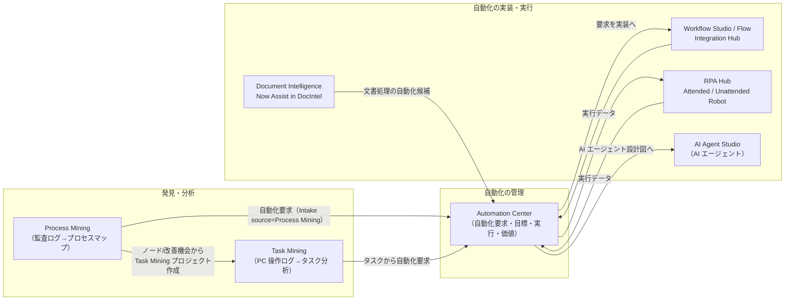
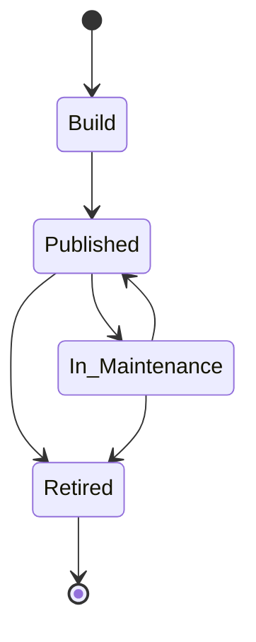
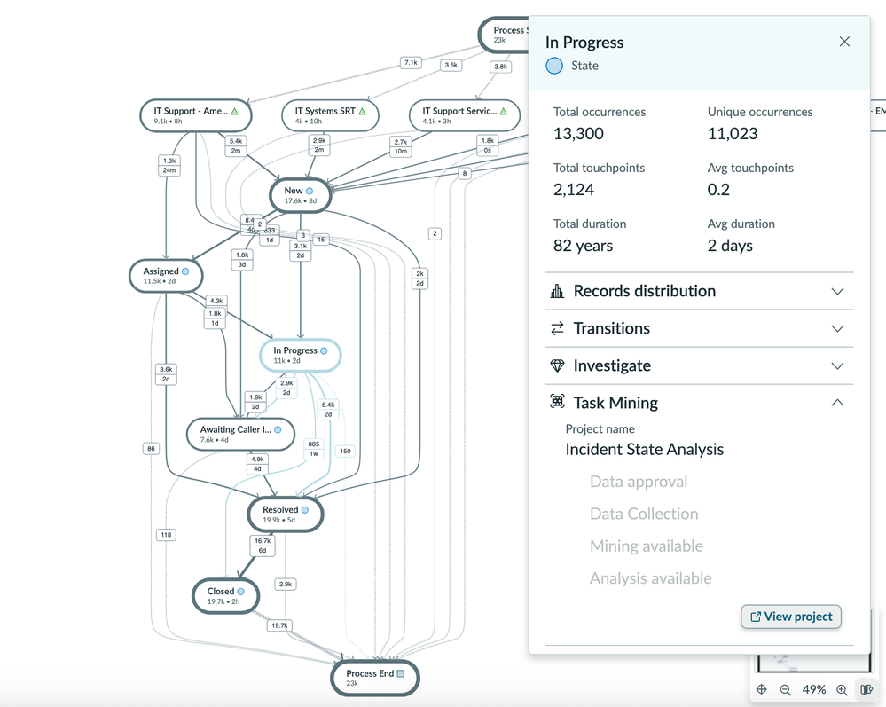
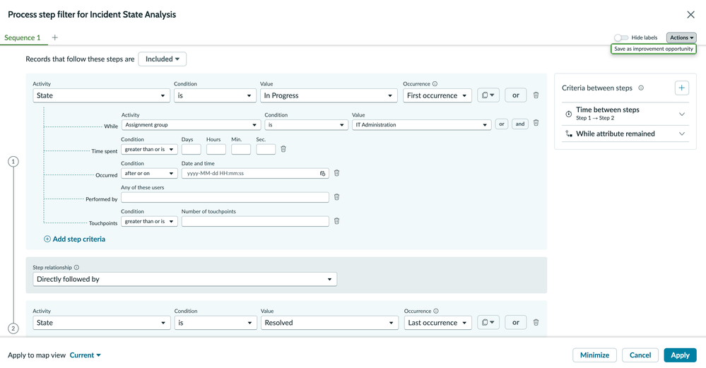
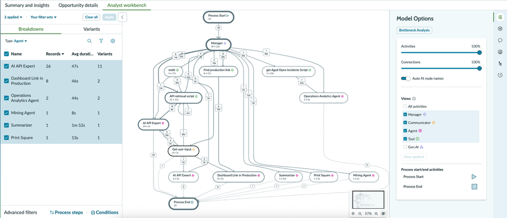
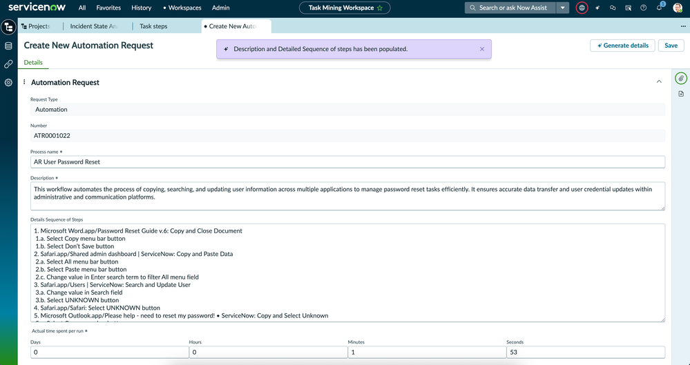
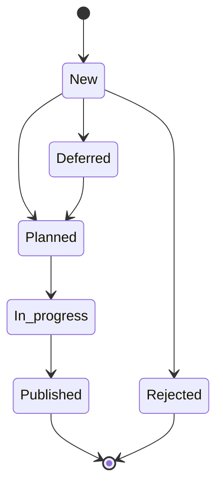

# プロセス自動化（RPA・Process Mining・Document Intelligence）

## 概要

ServiceNow のプロセス自動化・業務分析系の製品群は、「業務を**見える化**し（Process Mining / Task Mining）、**自動化候補を管理**し（Automation Center）、**自動化を実装・実行**する（Workflow Studio / Integration Hub / RPA Hub / Document Intelligence）」というサイクルを 1 つのプラットフォーム上で回すための機能群である。

| 製品 | 主な役割 | 主なアプリケーション ID / プラグイン | 主なロール接頭辞 |
|---|---|---|---|
| RPA Hub（Robotic Process Automation Hub、RPA ハブ） | Windows デスクトップ/レガシーアプリを操作するソフトウェアロボット（Attended / Unattended Robot）の開発・配布・実行・監視 | `sn_rpa_fdn`（ServiceNow Store から導入） | `sn_rpa_fdn.*` |
| Process Mining（プロセスマイニング、旧称 Process Optimization） | 監査ログ（Audit log）/イベントログから実際のプロセスフローを可視化し、ボトルネック・逸脱・改善機会を検出 | `sn_po`（`com.sn_po`、本番インスタンスで既定有効） | `sn_process_mining_*` |
| Task Mining（タスクマイニング） | 従業員のワークステーション（PC）上の操作を収集・分析し、非効率と自動化候補を特定 | `sn_tm_core`（Task Mining Core） | `sn_tm_core.*` |
| Document Intelligence（ドキュメントインテリジェンス、DocIntel）／Now Assist in Document Intelligence | PDF・画像・文書から項目値を抽出しレコードへ格納。Australia では生成 AI 版（Now Assist）が推奨 | `sn_docintel`、`sn_docintel_admin` | `sn_docintel.*` |
| Automation Center（オートメーションセンター） | 自動化の要求（アイデア）〜実装〜実行・価値測定を、ServiceNow / 他社 RPA を横断して一元管理 | Automation Center（Store アプリ） | `sn_ac.*` |

- 本ファイルは **Australia（2026-05 GA）** を基準とする。ServiceNow 公式ドキュメントのサイトは 2026-11 時点で既定表示が Brazil 版になっているページが多く、Australia 版ページが取得できなかった項目は Zurich 版／Brazil 版の記述を根拠とし、その旨を明記した。
- RPA Hub・Automation Center は公式ドキュメント上 **Workflow Data Fabric**（旧 Automation Engine）の構成要素として位置づけられている（RPA Hub ドキュメントのタイトルが「Brazil Workflow Data Fabric」）。Integration Hub 本体は [IntegrationHub](integrationhub.md)、Workflow Data Fabric 全体は [Workflow Data Fabric](workflow-data-fabric.md) を参照。[出典](https://www.servicenow.com/docs/r/integrate-applications/rpa-hub-features.html)
- フロー（Flow）・サブフロー・アクションの基本は [Workflow Studio / Flow Designer](flow-designer-workflow-studio.md)、生成 AI（Now Assist）と AI Agents は [Now Assist と AI Agents](now-assist-ai-agents.md)、MID Server は [MID Server](mid-server.md) を参照。

### 製品群の関係（全体像）

上図は Australia 時点の公式ドキュメント・ServiceNow 社員による Community 記事の記述（Process Mining から Task Mining プロジェクト作成、Task Mining から Automation Center 要求、Automation Center 要求から AI Agent Studio の設計図（blueprint）へ連携）を基に本稿で作成した概念図である。[出典](https://www.servicenow.com/community/process-mining-blog/what-s-new-for-process-and-task-mining-in-the-australia-release/ba-p/3508013)

---

## 1. RPA Hub（Robotic Process Automation Hub）

### 1.1 RPA Hub の概要

RPA Hub は、API を持たないデスクトップアプリケーション・レガシーシステム・Web 画面を人間と同じように操作するソフトウェアロボット（Robot）を、ServiceNow インスタンス上で一元管理する製品である。RPA Hub は以下の 4 つのコンポーネントで構成される。[出典](https://www.servicenow.com/docs/r/integrate-applications/exploring-rpa-hub.html)

| コンポーネント | 種別 | 役割 |
|---|---|---|
| RPA Hub application（RPA Hub アプリケーション） | インスタンス上のスコープアプリ（`sn_rpa_fdn`） | ボットプロセス・ロボット・パッケージ・キュー・スケジュール・資格情報・アラート等のメタデータ管理、実行指示、監視ダッシュボード |
| RPA Desktop Design Studio（デスクトップデザインスタジオ） | Windows ネイティブアプリ（MSI） | RPA 開発者がローコードで自動化（ワークフロー）を設計・テスト・デバッグし、パッケージとしてインスタンスへ公開（Publish） |
| Unattended Robot（無人ロボット） | Windows 上のソフトウェアエージェント（MSI） | 人の介在なしにスケジュール・API・手動トリガーで自動化を実行 |
| Attended Robot（有人ロボット） | Windows 上のソフトウェアエージェント（MSI） | 利用者の PC 上で、利用者の操作・入力を伴う自動化を実行 |

RPA Hub の主な機能は、全ロボットの集中配布・監視・管理とコンプライアンスチェック、ロボット/パッケージ/ボットプロセス/キュー/スケジュール/共有パラメーター/アラートのメタデータ管理、Unattended Robot への実行指示、ジョブ・キューの状態および構成アイテム（CI）横断のイベント相関を表示するダッシュボードである。[出典](https://www.servicenow.com/docs/r/integrate-applications/exploring-rpa-hub.html)

RPA Hub はマルチテナンシーをサポートし、1 インスタンス内に論理パーティションを作って社内外の顧客ごとに Attended / Unattended Robot を管理できる。各論理パーティションは独自の ACL、ロボット、ライセンス、実行ログを持つ。[出典](https://www.servicenow.com/docs/r/integrate-applications/exploring-rpa-hub.html)

### 1.2 Attended Robot と Unattended Robot の比較

RPA Hub のロボットは Unattended（無人）と Attended（有人）の 2 種類である。[出典](https://www.servicenow.com/docs/r/integrate-applications/rpa-hub-features.html)

| 観点 | Unattended Robot（無人ロボット） | Attended Robot（有人ロボット） |
|---|---|---|
| 用途 | 人の介在を必要としない自動化（バッチ、バックオフィス処理） | 人の入力・判断を伴う自動化（フロント業務の補助） |
| 割り当て単位 | 1 ロボット = 1 台の Windows マシン/VM（Standard robot） | 1 ロボット = 1 ユーザー |
| 起動方法 | スケジュール（Schedule）、Workflow Studio の Start Process サブフロー/アクション（API）、RPA Hub からの手動起動 | Attended Robot アプリからの起動、Embedded Task Automation（ServiceNow フォーム上のボタン）からの起動 |
| 実行環境要件 | VM は永続的かつ常時起動であること | 利用者の PC |
| 高密度実行 | High density robot：Remote Desktop Services により 1 台の Windows Server 上で複数ユーザーセッションを同時実行（Windows Server 2022 のみ） | 対象外 |
| ワークロード分散 | Robot pool（ロボットプール）、Queue（キュー）で複数ロボットに分散 | 対象外 |
| 主なロール | `sn_rpa_fdn.rpa_robot`（ロボットのサービスアカウント） | `sn_rpa_fdn.rpa_assisted_user`（有人ロボットの利用者） |
| 特記事項 | ロボットは 30 秒ごとに Heartbeat（ハートビート）をインスタンスへ送信。AMB（Asynchronous Message Bus）チャネル経由でボットプロセスの変更通知を受ける | 「Desktop In Desktop」オプションで、利用者が作業を続けながら別セッションでロボットをバックグラウンド実行可能 |

[出典（機能）](https://www.servicenow.com/docs/r/integrate-applications/rpa-hub-features.html)／[出典（用語集）](https://www.servicenow.com/docs/r/integrate-applications/rpa-hub-glossary.html)／[出典（Unattended 実行手順）](https://www.servicenow.com/docs/r/oZRGKGLbfcn968v3Ubchmw/t7mZUFctEEv_Bbv~HhaLoQ)／[出典（システム要件）](https://www.servicenow.com/docs/r/delta-australia-brazil/brazil-australia-rpahub-release-notes.html)

### 1.3 RPA Hub の主要概念（用語）

RPA Hub の公式用語集（Glossary）と機能ページに基づく主要概念は以下のとおり。[出典](https://www.servicenow.com/docs/r/integrate-applications/rpa-hub-glossary.html)／[出典](https://www.servicenow.com/docs/r/integrate-applications/rpa-hub-features.html)

| 用語（英語） | 日本語 | 説明 |
|---|---|---|
| Bot process | ボットプロセス | ロボットが目的達成のために実行する定義済みの一連の処理。パッケージ、スケジュール、資格情報、パラメーター、ユーザー/グループを含み得る。CMDB の CI（`cmdb_ci_rpa_process`）として管理される |
| Bot process configuration | ボットプロセス構成 | ボットプロセスの設定を保持するレコード。ボットプロセスと 1 対 1 に対応する。アセット割り当てなしで保存すると孤立（orphaned）状態になる |
| Robot | ロボット | ボットプロセスを実行するソフトウェアエージェント（`cmdb_ci_rpa_robot`） |
| Package / Package version | パッケージ／パッケージバージョン | 自動化ロジック・ファイル・設定・依存関係のまとまり。Design Studio から公開するたびに新しいパッケージバージョンが作られ、HashCode（一意の英数字値）で識別される |
| Robot file | ロボットファイル | Design Studio で作成した、ロボットが実行するロジックを含む自動化ファイル |
| Activities / Component / Connector / Port | アクティビティ／コンポーネント／コネクタ／ポート | Design Studio の設計要素。Component は再利用可能な構成ブロック、Connector は外部データソースやツールへの接続部品、Port はコンポーネントのデータポート/制御ポート |
| RPA plugin | RPA プラグイン | Microsoft Office 365、Chrome、Windows などサードパーティアプリと連携する機能を追加するソフトウェア部品。RPA plugins app（RPA plugin bundle）は Windows ライブラリのメタデータを含むアプリで、Workflow Data Fabric の一部 |
| Queue / Work item | キュー／ワークアイテム | キューはワークアイテムの格納庫で、複数ロボットが同時に処理して負荷分散する。ワークアイテムは 1 タスク分のデータ（取引情報、顧客情報、文書データ等）を保持するレコード |
| Robot pool | ロボットプール | 複数の Unattended Robot に作業負荷を分散する仕組み（任意） |
| Robot calendar | ロボットカレンダー | Unattended Robot のスケジュールを一画面で参照・作成する機能。Scheduled maintenance days（計画保守日）も表示し、停止中のジョブスキップを回避 |
| Schedule | スケジュール | Unattended ボットプロセスを定期実行するスケジュール。1 ボットプロセスに複数設定可能 |
| Shared parameter / Process parameter | 共有パラメーター／プロセスパラメーター | 共有パラメーターは複数ボットプロセスで使うグローバル変数。プロセスパラメーターは作成したボットプロセス内でのみ有効な変数 |
| Credential group | 資格情報グループ | Robot credentials（Windows ログイン）、Application credentials（業務アプリのログイン）、External credentials（外部ボールト）を束ね、複数ボットプロセスで共有 |
| Process job | プロセスジョブ | ボットプロセスがロボット上で 1 回実行されたことを表すレコード |
| Execution logs / Automation logs | 実行ログ／自動化ログ | 実行ログは実行中に取得され、エンドツーエンドのトラブルシュートに使う。自動化ログはロボットが生成するチェックポイントレコードで監視・監査に使う |
| Graceful stop | グレースフルストップ | 定義済みの終了ポイントで、開いているアプリを閉じるなどしてロボットを安全に停止させる |
| Code quality checks | コード品質チェック | 自動化ファイルをコーディング標準・ベストプラクティス・保守性の観点で評価 |
| Alert rule / Alert | アラートルール／アラート | 自動化の問題に関する通知条件（タイプ、優先度、トリガー、メッセージ）と、生成されたアラート |
| Smart card | スマートカード | 物理スマートカードでの Windows ログインに対応（Zurich で導入）。Unattended Robot の資格情報にスマートカードのユーザー名と PIN を保存可能 |
| Embedded Task Automation（ETA） | 埋め込みタスク自動化 | ServiceNow フォームから Attended ボットプロセスを起動する機能（後述 1.8） |
| RPA bot generation skill | RPA ボット生成スキル | Now Assist for RPA Hub のスキル。生成 AI で自動化・アクティビティを作成し、自動化ロジックを拡張する |

### 1.4 RPA Hub のロール

RPA Hub のロールは以下の 9 種類である（Zurich 版「Components installed with RPA Hub」に基づく。Australia 版の同ページは取得できなかったが、Australia → Brazil の RPA Hub リリースノートでは Australia の Changes が「No updates」で、ロール変更の記載はない）。[出典](https://www.servicenow.com/docs/r/oZRGKGLbfcn968v3Ubchmw/YFZsiPDVtsLVQ~1IfgSvNA)／[出典（Australia 差分）](https://www.servicenow.com/docs/r/delta-australia-brazil/brazil-australia-rpahub-release-notes.html)

| ロール名（表示名） | ロール | 説明 | 包含ロール（Contains roles） |
|---|---|---|---|
| RPA admin（RPA 管理者） | `sn_rpa_fdn.rpa_admin` | RPA Hub アプリ構成とシステムプロパティの管理 | `fd_read`, `itil`, `sn_rpa_fdn.rpa_user`, `cmdb_sread`, `sn_nowassist_admin.user` |
| RPA developer（RPA 開発者） | `sn_rpa_fdn.rpa_developer` | Design Studio で自動化パッケージを作成・テスト・公開し、例外を処理 | `fd_read`, `sn_rpa_fdn.rpa_user`, `cmdb_read`, `sn_nowassist_admin.user` |
| RPA release manager（RPA リリースマネージャー） | `sn_rpa_fdn.rpa_release_manager` | データ・スケジュール・構成パラメーターの管理。ボットプロセスとロボットを作成し、開発者を Managed by グループに追加 | `itil`, `sn_rpa_fdn.rpa_user`, `cmdb_read` |
| RPA support user（RPA サポートユーザー） | `sn_rpa_fdn.rpa_support_user` | ボットプロセスの問題の診断・解決、一次切り分け | `sn_rpa_fdn.rpa_user`, `cmdb_read` |
| RPA business user（RPA ビジネスユーザー） | `sn_rpa_fdn.rpa_business_user` | ワークアイテム・資格情報等のデータ管理、レポート抽出 | `sn_rpa_fdn.rpa_user`, `cmdb_read` |
| RPA assisted user（RPA アシストユーザー、RPA AU） | `sn_rpa_fdn.rpa_assisted_user` | Attended 自動化を実行する利用者 | なし |
| RPA robot（RPA ロボット） | `sn_rpa_fdn.rpa_robot` | Unattended Robot が使用するサービスアカウント用ロール | `cmdb_read` |
| RPA elevated privileges（RPA 特権） | `sn_rpa_fdn.rpa_elevated_privileges` | 他の RPA ロールと組み合わせて、Process Execution Log テーブルの機微なログへのアクセスを付与 | なし |
| RPA user（RPA ユーザー） | `sn_rpa_fdn.rpa_user` | RPA Hub へのアクセスに必要な修飾ロール（Qualifier role） | `canvas_user`, `sn_change_read`, `fd_read`, `uxframework_user` |

補足：
- RPA admin の包含ロールは公式ページの表記どおり `cmdb_sread` とした（他ロールは `cmdb_read`）。`cmdb_read` の誤記の可能性があるため実機で確認推奨。[出典](https://www.servicenow.com/docs/r/oZRGKGLbfcn968v3Ubchmw/YFZsiPDVtsLVQ~1IfgSvNA)
- RPA ロールは `cmdb_rel_ci` の読み取りアクセスを必要とする。`cmdb_rel_ci` の ACL をカスタマイズしている場合は該当ロールへ読み取り権限を付与する。[出典](https://www.servicenow.com/docs/r/oZRGKGLbfcn968v3Ubchmw/YFZsiPDVtsLVQ~1IfgSvNA)
- FIPS 有効インスタンスでは、Unattended Robot のユーザーに `sn_rpa_fdn.rpa_robot` に加えて `snc_internal` が必要。[出典](https://www.servicenow.com/docs/r/oZRGKGLbfcn968v3Ubchmw/t7mZUFctEEv_Bbv~HhaLoQ)
- RPA bot generation skill は Zurich GA 以降 RPA developer または RPA admin ロールのユーザーのみ利用可能（両ロールが `sn_nowassist_admin.user` を包含）。[出典](https://www.servicenow.com/docs/r/zurich/release-notes/rpa-rn.html)
- ロール設計全般は [ユーザー・グループ・ロール](users-groups-roles.md)、ACL は [アクセス制御（ACL）](access-control-acl.md) を参照。

### 1.5 RPA Hub のテーブル

RPA Hub がインストールするテーブルは以下の 37 個である（Zurich 版）。Utah リリース以降、多くの RPA テーブルは Application File（`sys_metadata`）を継承する構造に変更され、アップデートセットで環境間移送できる。[出典](https://www.servicenow.com/docs/r/oZRGKGLbfcn968v3Ubchmw/YFZsiPDVtsLVQ~1IfgSvNA)／[出典（Utah での再構成）](https://www.servicenow.com/docs/r/integrate-applications/exploring-rpa-hub.html)

| テーブル表示名 | テーブル名 | 継承元 | 内容 |
|---|---|---|---|
| Bot Process | `cmdb_ci_rpa_process` | Base Bot Process（`cmdb_ci_base_rpa_process`） | ボットプロセス（パッケージ、バージョン、ロボット、資格情報、アプリ、パラメーター、Attended ユーザー/グループ） |
| Robot | `cmdb_ci_rpa_robot` | Base Robot（`cmdb_ci_base_rpa_robot`） | ロボット（名前、種別、部門、マシン名、Attended ユーザー） |
| Bot Process Configuration | `sn_rpa_fdn_bot_process_config` | Application file | ボットプロセス設定 |
| Package | `sn_rpa_fdn_package` | Application file | 実行に必要なリソースファイル（ロボットファイル含む） |
| Package Version | `sn_rpa_fdn_package_version` | Application file | パッケージのバージョン情報 |
| Process Schedule | `sn_rpa_fdn_schedule` | Application file | 定期実行スケジュール（間隔種別、開始/終了日） |
| Process Parameter | `sn_rpa_fdn_process_parameter` | Application file | ボットプロセス内外で使う変数 |
| Process Field Parameter | `sn_rpa_fdn_process_field_parameter` | Application file | Attended 自動化の動的パラメーター |
| Field Parameter Mapping | `sn_rpa_fdn_field_parameter_mapping` | Application file | フォーム項目と Attended プロセスのフィールドパラメーターの対応 |
| Attended Configuration | `sn_rpa_fdn_attended_configuration` | Application file | ServiceNow フォームから Attended ボットを起動する設定 |
| Attended User Group | `sn_rpa_fdn_rda_user_group` | ― | Attended ボットプロセスに割り当てたユーザー/グループ |
| Work Queue | `sn_rpa_fdn_work_queue` | Application file | キュー（名前、部門、説明、パージ設定） |
| Work Item | `sn_rpa_fdn_work_queue_item` | ― | ワークアイテム（名前、ステータス、優先度、キュー） |
| Robots Pool | `sn_rpa_fdn_robot_pool` | ― | ロボットプール |
| Process Job | `sn_rpa_fdn_process_job` | ― | プロセスジョブ（状態、ロボット、ログ状態、開始/終了時刻） |
| Process Execution Log | `sn_rpa_fdn_execution_log` | ― | 実行種別とプロセスジョブの詳細ログ |
| Automation Log | `sn_rpa_fdn_automation_log` | ― | 実行中ジョブのリアルタイム状況 |
| Alert Rule | `sn_rpa_fdn_alert_rule` | Application file | アラート生成条件 |
| Alerts | `sn_rpa_fdn_alert` | ― | 生成されたアラート |
| Credential Group | `sn_rpa_fdn_credential_group` | ― | 資格情報グループ |
| Robot Credentials | `sn_rpa_fdn_credentials_set` | Credentials | ロボットの Windows ログイン資格情報 |
| Application Credentials | `sn_rpa_fdn_application_credentials` | Credentials | 業務アプリのログイン資格情報 |
| Credential Group Application Credential | `sn_rpa_fdn_m2m_credential_group_application` | ― | 資格情報グループとアプリ資格情報の関連 |
| Process Credential Mapping | `sn_rpa_fdn_process_credential_mapping` | ― | ボットプロセスに紐づく資格情報グループ |
| Process Robot Credential | `sn_rpa_fdn_process_robot_cred` | ― | ロボットがボットプロセスで使う資格情報グループ |
| Authorized User | `sn_rpa_fdn_authorized_user` | ― | 資格情報グループにアクセスできるユーザー |
| External Credential Vault | `sn_rpa_fdn_external_credential_vault` | ― | Unattended Robot が使う外部ボールトの登録 |
| MFA Authenticator | `sn_rpa_fdn_mfa_authenticator` | ― | TOTP 認証の認証器とトークン長 |
| TOTP Authenticator | `sn_rpa_fdn_totp_authenticator` | ― | TOTP コード生成用のシード（秘密鍵） |
| Code Quality Rule | `sn_rpa_fdn_code_quality_rule` | ― | コード品質チェックのルール |
| Installed RPA Plugin | `sn_rpa_fdn_rpa_plugin` | ― | Design Studio・ロボットで利用可能な RPA プラグイン |
| Installed RPA Plugin Version | `sn_rpa_fdn_rpa_plugin_version` | ― | 各 RPA プラグインのバージョン |
| Maintenance Request | `sn_rpa_fdn_maintenance_request` | ― | ロボットカレンダー上の計画保守日 |
| Robots License Distribution | `sn_rpa_fdn_license_distribution` | ― | ロボットライセンスの配分・消費 |
| Assigned Studio User | `sn_rpa_fdn_assigned_studio_user` | ― | Design Studio で特定ユーザーがロボットを偽装（impersonate）できるか |
| Process Skill Mapping | `sn_rpa_fdn_m2m_process_skill_mapping` | ― | ボットプロセス構成に対するスキルパッケージバージョンの割当/上書き |
| Skill Mapping | `sn_rpa_fdn_m2m_package_version_skill_mapping` | ― | パッケージバージョンと Skill パッケージバージョンの関連 |

> 補足：Base Robot（`cmdb_ci_base_rpa_robot`）と Base Bot Process（`cmdb_ci_base_rpa_process`）は Automation Center 側でもインストールされる CI 基底クラスで、他社 RPA のロボット/プロセスも同じ基底クラスの下で管理できる設計になっている。[出典](https://www.servicenow.com/docs/r/oZRGKGLbfcn968v3Ubchmw/GCzlIXRE4WTWyEpl0hasvA) CMDB/CSDM での扱いは [CMDB と CSDM](cmdb-csdm.md) を参照（RPA Hub ドキュメントには「Applying CSDM guidelines to RPA Hub」というトピックがある）。

### 1.6 RPA Hub の状態値（ライフサイクル）

| 対象 | 状態値 | 根拠・補足 |
|---|---|---|
| Bot process の Life cycle stage（ライフサイクルステージ） | Build（構築）→ Published（公開）⇄ In Maintenance（保守中）、Retired（廃止） | RPA スポークの「Change Life Cycle Stage Status of a Bot Process」アクションの説明：Build から Published へは遷移可能だが Build から直接 In Maintenance へは不可。Published と In Maintenance は双方向に遷移可能。Retired のボットプロセスは変更不可。[出典](https://www.servicenow.com/docs/r/zurich/build-workflows/workflow-studio/rpa-actions.html) |
| Robot の Life cycle stage | In-Use（使用中）、In Maintenance（保守中）、Retired（廃止） | Unattended 実行には Robot を In-Use にする必要がある。Start Process アクションでは In Maintenance のロボットは失敗扱い。Machine Lookup value change ジョブがマシン名を変更した場合ロボットは In Maintenance に移行。[出典](https://www.servicenow.com/docs/r/oZRGKGLbfcn968v3Ubchmw/t7mZUFctEEv_Bbv~HhaLoQ)／[出典](https://www.servicenow.com/docs/r/oZRGKGLbfcn968v3Ubchmw/YFZsiPDVtsLVQ~1IfgSvNA)。ライフサイクルの選択肢の完全な一覧は公開情報では確認できず |
| Process job の State（状態） | Success、Failed、Running、Skipped、Canceled、Abandoned | RPA Hub Workspace のプロセスジョブ表示に関するドキュメント（検索結果の要約）による。[出典](https://www.servicenow.com/docs/r/t2jQMKLZFp9AGt3V12O7mQ/TLXwNUCfDZeX7Hx6ateo7g) |

上図は Bot process のライフサイクルを、RPA スポークのアクション仕様（Build→Published 可、Build→In Maintenance 直接不可、Published⇄In Maintenance 双方向、Retired は変更不可）から本稿で作図したもの。Retired への遷移元の詳細は公開情報では確認できず。

### 1.7 RPA Hub の開発・運用ワークフロー（ペルソナ別）

RPA Hub の公式ドキュメントは、以下の 3 ペルソナによる流れを示している。[出典](https://www.servicenow.com/docs/r/integrate-applications/exploring-rpa-hub.html)

1. **Release manager（リリースマネージャー）** がボットプロセスとロボットを作成し、開発者をボットプロセスの Managed by グループに追加する。
2. **Developer（開発者）** がボットプロセスに、パッケージ・業務アプリ（Business application）・ロボット・パラメーター・資格情報・スケジュールを設定する。
3. 開発者が RPA Desktop Design Studio で自動化パッケージを作成・テストし、例外処理を組み込む。
4. 開発者がボットプロセスを公開（Publish）し、実行・管理・監視を行う。
5. **Support user（サポートユーザー）** が問題を診断・解決し、ボットプロセスを再公開する。

Unattended Robot で自動化を実行するまでの準備手順は以下のとおり。[出典](https://www.servicenow.com/docs/r/oZRGKGLbfcn968v3Ubchmw/t7mZUFctEEv_Bbv~HhaLoQ)

1. パッケージ、ロボット、ボットプロセス（種別 = Unattended）を作成する。
2. ボットプロセスを Published にし、ロボットの Life cycle stage を In-Use にする。
3. （任意）スケジュールとプロセスパラメーターを追加する。
4. 資格情報グループを作成してボットプロセスに関連付ける。
5. ロボットと Process robot credential（プロセスロボット資格情報）をボットプロセスに割り当てる。
6. ライセンスの空きを確認する。
7. Windows 側の Unattended Robot アプリケーションを設定し、インスタンスへ接続する。
8. スケジュール、Workflow Studio の Start Process サブフロー、または RPA Hub からの手動起動で実行する。実行時に Process Job レコードが作られ、Message フィールドが段階ごとに更新される。

### 1.8 Embedded Task Automation（ETA：フォームからの Attended Bot 起動）

Embedded Task Automation（ETA）は、Attended Robot アプリだけでなく ServiceNow のフォーム（Classic UI / Core UI 16）上のボタンから Attended ボットプロセスを起動する機能である（Xanadu 版ドキュメントで確認）。既存の ServiceNow 画面を入力 UI として使うため、自動化側でフォームを作り込む必要がない。[出典](https://www.servicenow.com/docs/r/rigCt~VuB5q8tR2t1pu_Eg/yfItXj2v8ZW78XHCnMsY3w)

設定手順（バッジ発行リクエストの例）：

1. RPA Desktop Design Studio の Forms コンポーネントを使って自動化を作成し、インスタンスへ公開する。各 UI アクションのロジックには Terminate コンポーネントを含める。
2. RPA Hub で Attended ボットプロセスを作成し、**Enable Embedded Task Automation** チェックボックスをオンにする（Process Field Parameters タブと Attended Configuration タブが追加される）。
3. Process field parameters（フォーム項目値を読み書きする動的パラメーター）を定義する。
4. Attended configuration レコードを作成し、トリガー元テーブルと起動条件（例：承認済みリクエストのみ）を設定する。
5. Field Parameter Mappings タブでフォーム項目とパラメーターを対応付ける（例：「First name」パラメーター → Requested for の名）。
6. Attended configuration を有効化すると、フォームに UI アクション（ボタン）が自動作成される。
7. ボットプロセスを公開し、利用者を RPA AU（`sn_rpa_fdn.rpa_assisted_user`）として割り当てる。
8. 利用者がフォームのボタンを押すと自動化が開始される。

Design Studio の ETA 用コンポーネント（ServiceNow カテゴリ > Forms）：

| コンポーネント | 役割 |
|---|---|
| AttendedConfigurations | ボットプロセスに紐づく Attended configuration を列挙し、選択された構成に応じて分岐 |
| GetProcessFieldParameters | マッピングされたフォーム項目の値を読み取る |
| SetProcessFieldParameters | マッピングされたフォーム項目へ値を書き戻す |
| GetRecordContextID | 起動元レコードの `sys_id` を返す（添付ファイル取得等に利用） |

制約・注意点：
- ETA は Published のボットプロセスでのみ動作する。UI アクション（ボタン）の表示は Classic 環境に限られる。Workspace・Playbook・Service Portal では UI アクションは表示されないが、対応するアクションを作成して RPAInstanceFormHooks API を呼び出すことでボットプロセスを起動できる。[出典](https://www.servicenow.com/docs/r/rigCt~VuB5q8tR2t1pu_Eg/yfItXj2v8ZW78XHCnMsY3w)
- システムプロパティ `sn_rpa_fdn.allow_rda_robot_auto_assignment` が false の場合は RPA AU 用の Attended Robot レコードが事前に必要。true の場合はボット起動時に Attended Robot ライセンスを消費してロボットが自動作成される（先着順）。[出典](https://www.servicenow.com/docs/r/rigCt~VuB5q8tR2t1pu_Eg/yfItXj2v8ZW78XHCnMsY3w)／[出典](https://www.servicenow.com/docs/r/integrate-applications/license-rpa-hub.html)
- 自動化または RPA Hub のバージョンを更新した場合、Attended Robot アプリを閉じて開き直さないと旧バージョンが使われ続ける。

### 1.9 RPA Hub Workspace（画面とメニュー位置）

RPA Hub Workspace は、Attended / Unattended Robot をデジタルワークフォースとして作成・監視・管理・配布する Web ベースのワークスペースである。[出典](https://www.servicenow.com/docs/r/integrate-applications/workspace-ui-rpa-hub.html)

- **メニュー位置**：`All > Robotic Process Automation > RPA Hub Workspace`、または `Workspaces > RPA Hub Workspace`
- **ランディングページ（RPA Hub）の構成**：
  - Bot process summary：ボットプロセス/ロボット関連インシデントの棒グラフ、ロボット状態のドーナツ、ロボット・ボットプロセス・関連業務アプリの変更レコード概要（Insights）
  - Robot utilization：利用率の高い/低い Unattended・Attended Robot
  - Process jobs summary：直近 24 時間のジョブ状態ドーナツ、期間トレンド、実行中ジョブ一覧
  - Queues summary：未処理ワークアイテムの多いキュー、ワークアイテム状態、Average Handling Time（平均処理時間）
  - Top 5 business applications（過去 7 日）：ボットプロセスが使用した業務アプリ上位 5 件
  - License utilization：Unattended / Attended Robot ライセンスの消費状況（半円ドーナツ）
- **Lists ビュー（リストアイコン）**：ボットプロセス構成、パッケージ、共有パラメーター、キュー、ロボットの作成。インストール済み RPA プラグイン、アラート、プロセスジョブの参照。My Lists（個人用フィルタリスト）。
- その他：Help Center（右サイドバー）、ダークテーマ（ランディング、Robot Calendar、Overview、RPA Hub システムプロパティ画面）。
- **管理メニュー**（Classic）：Guided Setup は `All > Robotic Process Automation > Administration > Guided Setup`、プロパティは `All > Robotic Process Automation > Administration > Properties`。[出典](https://www.servicenow.com/docs/r/oZRGKGLbfcn968v3Ubchmw/9lAEMmfUeAOncqDpnBhi2A)

> 画像について：RPA Hub Workspace の公式スクリーンショットは公式ドキュメント上で画像 URL が取得できなかったため、本稿では文章による説明で代替する。画面は上記公式ページを参照。

### 1.10 RPA Hub の導入・構成手順

RPA Hub の構成手順は以下のとおり（Zurich 版「Configuring RPA Hub」）。[出典](https://www.servicenow.com/docs/r/oZRGKGLbfcn968v3Ubchmw/9lAEMmfUeAOncqDpnBhi2A)

1. RPA Hub（`sn_rpa_fdn`）を ServiceNow Store からリクエストしてインストールする（`admin` ロール必要。デモデータあり。不足する Store アプリ/プラグインも併せて導入される）。[出典（Activation）](https://www.servicenow.com/docs/r/zurich/release-notes/rpa-rn.html)
2. （任意）RPA Hub テーブルを Application File へ再構成し、アップデートセットで変更を捕捉できるようにする。
3. （任意）非本番から本番へアップデートセットでデータ移送する（[アップデートセットとクローン](update-sets-cloning.md) 参照）。
4. クライアント認証用・コード署名用の証明書（mTLS）を準備する（KeyStore Explorer で生成、または Microsoft Active Directory からエクスポート）。ルート/中間証明書をインスタンスに登録し、クライアント証明書をユーザーにマッピングする。
5. CSDM ガイドラインを適用し、CMDB 上の CI と関係を定義する。
6. Robot license distribution（ロボットライセンス配分）レコードを作成する（Classic）。
7. RPA Hub プロパティ（ロボット自動割り当て、認証方式など）を設定する（Classic）。

### 1.11 RPA Hub のシステムプロパティとスケジュールジョブ

公式ドキュメントで名称が確認できたプロパティは以下のみである。プロパティの完全な一覧は公開情報では確認できず（`All > Robotic Process Automation > Administration > Properties` で確認）。

| プロパティ | 説明 | 出典 |
|---|---|---|
| `sn_rpa_fdn.allow_rda_robot_auto_assignment` | true の場合、Attended Robot を初回起動時に自動作成（ライセンスを先着順に消費） | [出典](https://www.servicenow.com/docs/r/integrate-applications/license-rpa-hub.html) |
| `sn_rpa_fdn.enable_unattended_robot_machine_name_lookup` | Yes の場合に「Machine Lookup value change」ジョブが動作 | [出典](https://www.servicenow.com/docs/r/oZRGKGLbfcn968v3Ubchmw/YFZsiPDVtsLVQ~1IfgSvNA) |
| `glide.rollback.blacklist.TableParentChange.change` | （プラットフォームプロパティ）Tokyo 以前からのアップグレード前に `false` に設定する。未設定のままアップグレードすると RPA テーブルが `sys_metadata` を継承せず、KB1223629 の手動修正が必要 | [出典](https://www.servicenow.com/docs/r/zurich/release-notes/rpa-rn.html) |

| スケジュールジョブ | 頻度 | 内容 |
|---|---|---|
| Machine Lookup value change | 3 時間ごと（上記プロパティ有効時のみ） | Machine Name と Machine Name Lookup を同期。名前を変更した場合ロボットを In Maintenance に移行 |
| RPA: Purge Process Jobs | 日次 | ジョブのパージ日数と作成日に基づきプロセスジョブと実行ログを削除 |
| RPA: Purge Work Items | 日次 | キューの Purge after days とパージ状態に基づきワークアイテムを削除 |
| RPA: Purge Alert Rule Triggers | 日次 | アラートルールトリガーを削除 |
| RPA: Purge Alerts | 日次 | アラートを削除 |
| Re-evaluate License Distribution | オンデマンド | ライセンス配分の検証 |

[出典](https://www.servicenow.com/docs/r/oZRGKGLbfcn968v3Ubchmw/YFZsiPDVtsLVQ~1IfgSvNA)

### 1.12 Workflow Studio からの RPA 呼び出し（RPA spoke）

Workflow Studio（Flow Designer）の RPA spoke（RPA スポーク）は 14 アクションと 3 サブフローを提供し、フローから Unattended ボットプロセスの起動・停止、キュー操作、Attended 割り当て等を行える（Zurich 版）。[出典](https://www.servicenow.com/docs/r/zurich/build-workflows/workflow-studio/rpa-actions.html)

| 種別 | 名前 | 概要 |
|---|---|---|
| アクション | Add WorkItem to Queue | キューにワークアイテムを追加し ID を返す（Content は 8,000 文字まで） |
| アクション | Update WorkItem | ワークアイテム更新（Request/Response Content は 8,000 文字まで） |
| アクション | Fetch Work Item Status | ワークアイテムの状態を非同期取得 |
| アクション | Start Process | ボットプロセスを起動（ロボットプールが割当済みなら Robots 入力は無視。In Maintenance のロボットは失敗扱い） |
| アクション | Stop Process | ボットプロセスを停止（Wait For Graceful Stop 指定可） |
| アクション | Fetch Created Jobs | 作成されたプロセスジョブを取得 |
| アクション | Fetch Execution Status | プロセスジョブの実行状態を取得 |
| アクション | Update Process Parameter | プロセスパラメーターの値を更新 |
| アクション | Change Life Cycle Stage Status of a Bot Process | ボットプロセスのライフサイクルステージを変更 |
| アクション | Assign / Unassign User to(from) Attended Automation Process | Attended プロセスへのユーザー割当/解除 |
| アクション | Assign / Unassign User to(from) Attended Robot | Attended Robot へのユーザー割当/解除（解除時はロボットを Retire） |
| アクション | Verify HashCode of a Package Version | 手動アップロードした自動化 zip とパッケージバージョンの整合性検証 |
| サブフロー | Import Package Version Attachment | パッケージバージョンの添付（zip）を非本番→本番等へ取り込み、結果をメール通知 |
| サブフロー | Start Process / Stop Process | 起動/停止とジョブ詳細・ロボット状態の返却 |

- キューの「Is Work Item Name Sensitive」がオンの場合、ワークアイテムの Request Content は暗号化される。
- Integration Hub のスポーク全般は [IntegrationHub](integrationhub.md) を参照。

### 1.13 ライセンス配分（Robot license distribution）

RPA Hub のライセンスは Attended と Unattended の 2 種類で、Robot license distribution レコードで配分を管理する。[出典](https://www.servicenow.com/docs/r/integrate-applications/license-rpa-hub.html)

- レコードの作成・更新は `sn_rpa_fdn.rpa_admin` のみが行える（Zurich Patch 4 / 2025-12 で変更）。公式ページは rpa_admin が「create, write or delete」できると記載する一方、作成後のレコードは削除できないとしている（ACL 上は Delete も rpa_admin に限定されるが、ドキュメント上は作成後の削除は不可）。[出典](https://www.servicenow.com/docs/r/zurich/release-notes/rpa-rn.html)／[出典](https://www.servicenow.com/docs/r/integrate-applications/license-rpa-hub.html)
- ドメインセパレーション環境ではドメインごとに 1 レコード、非ドメインセパレーション環境では global ドメインに 1 レコードを作成する。作成後は編集できるが削除できない。
- Unattended ライセンスは、そのドメインで作成されたロボットのみが利用可能。Unattended Robot は 1 台の Windows/VM にマッピングされる。
- Attended ライセンスはロボットに関連付けられたドメインで利用可能。Attended Robot は 1 ユーザーにマッピングされる。
- Attended ユーザーの割り当て解除は、対応する Attended Robot を Retire する。
- ドメインセパレーション全般は [ドメインセパレーション](domain-separation.md) を参照。

> 商用ライセンス（SKU）について：ServiceNow Store の RPA Hub 掲載情報として、プラットフォーム互換性・ライセンス要件に「Automation Engine Pro/Enterprise / Workflow Data Fabric（Starter/Standard/Professional）」が記載されている、との検索結果を得た。【第三者情報】（Store ページ本文は取得できず）各パッケージに含まれるロボット数は公開情報では確認できず。価格・パッケージは [プラットフォームのパッケージ構成](platform-licensing-packaging.md)、[ライセンスモデル](../../03_導入編/01-licensing-model.md) を参照。

### 1.14 RPA Hub のシステム要件（Australia / Brazil 共通）

Brazil のリリースノートは「Australia の要件が適用される」としている。[出典](https://www.servicenow.com/docs/r/delta-australia-brazil/brazil-australia-rpahub-release-notes.html)／OS の詳細は [出典（Zurich）](https://www.servicenow.com/docs/r/zurich/release-notes/rpa-rn.html)

| コンポーネント | CPU（最小／推奨） | メモリ（最小／推奨） | 空きディスク（最小／推奨） | OS |
|---|---|---|---|---|
| Unattended Robot（Standard） | 2 コア Intel 1.8GHz 64bit ／ 4 コア Intel 2.4GHz 64bit | 4GB ／ 8GB | 50GB ／ 100GB | Windows 10、Windows Server 2016 / 2019 / 2022 |
| Unattended Robot（High density） | 上記 × 同時実行ランタイム数（例：3 ユーザー同時実行で最小 6 コア、1.8GHz、64bit） | 上記 × ランタイム数（例：3 ユーザー同時実行で最小 12GB） | ― | Windows Server 2022 のみ |
| Attended Robot | 1 vCPU ／ 4 vCPU（Intel） | 4GB ／ 8GB | 20GB ／ 50GB | Windows 10、Windows Server 2016 / 2019 |
| RPA Desktop Design Studio | Intel Core i5 ／ Core i7 | 4GB ／ 8GB | 20GB ／ 50GB | Windows 10、Windows Server 2016 / 2019。1920×1080 以上のモニタが必須 |

共通要件：.NET Framework 4.7.1 以降、DPI スケーリング無効。Unattended Robot の VM は永続的かつ常時起動。各リリース版の最新ロボット MSI をインストールする（旧バージョンは動作しない）。ServiceNow のワークスペースはモバイルデバイス非対応。

アップグレード時は RPA Desktop Design Studio、Attended Robot、Unattended Robot、Unattended Robot Login Agent の各 MSI を新リリース版に更新する。[出典](https://www.servicenow.com/docs/r/zurich/release-notes/rpa-rn.html)

### 1.15 RPA Hub のリリース差分

| リリース | 主な変更 |
|---|---|
| Utah | RPA テーブルを Application File（`sys_metadata`）配下へ再構成（アップデートセット移送が可能に）[出典](https://www.servicenow.com/docs/r/integrate-applications/exploring-rpa-hub.html) |
| Xanadu | Xanadu での RPA Hub の主な変更点は公開情報では確認できず（Xanadu→Australia 統合リリースノートの URL は 2026-11 時点で 404）。Embedded Task Automation は Xanadu 版ドキュメントで記載を確認 [出典](https://www.servicenow.com/docs/r/rigCt~VuB5q8tR2t1pu_Eg/yfItXj2v8ZW78XHCnMsY3w) |
| Zurich（2025-09 GA） | Python connector（Scripting plugin が前提。VB.NET / C# / JavaScript コネクタも追加）、Smart Card 認証、RPA bot generation skill で Google Gemini / AWS 上の Anthropic Claude を選択可能、Bot generation skill を RPA developer / admin に限定、アップグレード後に Bot process 定義を Bot process configuration へ再構成。Patch 4：LTS（Long-Term Support）モデル、ライセンス配分レコード権限を `sn_rpa_fdn.rpa_admin` に限定。アクセシビリティ改善。Patch 7（2026-03）：Try-Catch で対象アクション（コンポーネント）を選択的に指定可能に、RPA bot generation skill でモデルプロバイダーのバージョン指定に対応 [出典](https://www.servicenow.com/docs/r/zurich/release-notes/rpa-rn.html) |
| **Australia（2026-05 GA）** | Try-Catch ブロックの範囲（内側/外側に置くアクション）を精密に制御（Zurich Patch 7 / 2026-03 で先行提供済みの機能）。変更・削除・非推奨はなし [出典](https://www.servicenow.com/docs/r/delta-australia-brazil/brazil-australia-rpahub-release-notes.html) |

> **Brazil での変更:** RPA Hub の Brazil リリースノートでは新機能・変更・削除・非推奨はいずれも「No updates」。システム要件も Australia と同じ。[出典](https://www.servicenow.com/docs/r/delta-australia-brazil/brazil-australia-rpahub-release-notes.html)

---

## 2. Process Mining（プロセスマイニング）

### 2.1 Process Mining の概要

Process Mining は、ServiceNow のテーブルの監査ログ（Audit log、`sys_audit` 等）や外部のイベントログを抽出・解析して「実際のプロセスがどう流れているか」をプロセスマップとして可視化し、ボトルネック・手戻り・逸脱・改善機会（Improvement opportunity）を特定する機能である。[出典](https://www.servicenow.com/docs/r/now-intelligence/process-mining/process-mining.html)

- 旧称は **Process Optimization（プロセス最適化）**。Vancouver リリースで Process Mining に改称された。[出典（ServiceNow Community 公式 FAQ）](https://www.servicenow.com/community/process-mining-article/servicenow-process-mining-formerly-process-optimization-faq/ta-p/2309083)
- Australia ではロール名の「optimization」が「mining」に改称された（例：`sn_process_optimization_admin` → `sn_process_mining_admin`）。[出典](https://www.servicenow.com/docs/r/m4LmCVvkm6_8u3nlIuep5Q/0~L2ZmExvtH~ID42lL4j6A)
- プラグインは Process Mining（`sn_po` / `com.sn_po`）で、本番インスタンスでは既定で有効（評価プロジェクトを利用可能）。[出典](https://www.servicenow.com/docs/r/now-intelligence/process-mining/activate-po-plugin.html)
- ドキュメント上は Platform Analytics / Now Intelligence 系（`now-intelligence`）に分類される。レポート・Platform Analytics は [レポートとアナリティクス](reporting-analytics.md) を参照。

### 2.2 Process Mining の用語

[出典](https://www.servicenow.com/docs/r/now-intelligence/process-mining/key-terms.html)

| 用語（英語） | 日本語 | 説明 |
|---|---|---|
| Project | プロジェクト | 構成されたプロセスモデル（マイニング対象テーブル・アクティビティ・ブレークダウン等の定義） |
| Activity | アクティビティ | 監査ログから捕捉したタスク/アクション（追跡フィールドの変化）。プロセス内の 1 ステップ |
| Attribute of interest | 注目属性 | プロセスマップ・ブレークダウン・変動統計からは隠すが、ルールベースの所見（Finding）ロジックには使えるアクティビティ |
| Audit log | 監査ログ | いつ何が起きたかを示すシステムイベントの記録 |
| Connection | コネクション | 連続する 2 つのアクティビティ/プロセスステップを結ぶ線 |
| Transition | 遷移 | あるアクティビティの状態から別の状態への変化 |
| Route | ルート（バリアント） | 少なくとも 1 アクティビティが異なる、プロセスの個別経路。成功・変形・例外の経路があり得る |
| Record | レコード | 1 プロセスサイクル分の業務レコード（例：1 件のインシデント） |
| Repetitions | 繰り返し | 2 回以上発生するステップ/ステップの組（手戻り） |
| Finding | 所見 | 注意を要する領域を示すパフォーマンス上の洞察 |
| Process map | プロセスマップ | 抽出データから生成される開始〜終了の実経路の可視化。目標ルートとの比較も可能 |
| Linked process | 連結プロセス | メインプロセスに接続されたサブプロセス |
| Generate | 生成 | イベントログからデータを抽出しアルゴリズムでプロセスフローを明らかにする操作 |
| Sliders | スライダー | プロセスマップ画面でアクティビティ/コネクションの表示詳細度を調整する操作部品 |

### 2.3 Process Mining の主要機能

[出典（主要機能）](https://www.servicenow.com/docs/r/now-intelligence/process-mining/key-features.html)

| 機能 | 説明 |
|---|---|
| Automated process discovery（自動プロセス発見） | プロセステーブル、マイニングするアクティビティ（最低 1 つ必須）とブレークダウンを選んでプロジェクトを作成。Project Builder で編集 |
| Breakdown（ブレークダウン） | フィルターとして機能し、カテゴリ別の量・速度・適合度（Conformance）を表示（例：Assignment group 別） |
| Summary and insights（サマリーと洞察）ページ | KPI、改善機会の概要と一覧 |
| Opportunity details（改善機会詳細）ページ | 改善機会の指標・傾向・バリアント・AI 要約 |
| Analyst workbench（アナリストワークベンチ） | 対話型プロセスマップ、探索用フィルターパネル（Breakdowns / Variants タブ）、パフォーマンス指標、ボトルネック分析、ML/ルールベースの洞察。重複監査を除去し自己ループを除去 |
| Process comparison（プロセス比較） | プロセスを並べて比較し、性能差や理想ルートからの逸脱を確認 |
| Multi-dimensional processes（多次元プロセス） | 親子関係にある複数テーブル（例：Request → RITM → Catalog task）を階層的にマイニング |
| ML-based clustering（ML クラスタリング） | ボトルネックとされたアクティビティ/コネクション/ルートのレコードを、キーワードや担当グループで類似クラスタに分類 |
| Root cause analysis（根本原因分析） | Leading influencers（主要因子）を表示（`promin.rca.*` プロパティで閾値調整） |
| Continual optimization（継続的最適化） | 改善イニシアチブを作成・追跡。Continual Improvement Management（CIM）と連携 |
| Platform Analytics 連携 | 低パフォーマンス指標（例：Time to resolve）から Process Mining を起動、ダッシュボード上のプロセスマップウィジェット |
| リスト/レポートからの分析 | 任意のプラットフォームリストやレポート（SLA 違反、CSAT 等）から直接プロセス分析 |
| Collaboration（共同作業） | プロジェクト共有、ノート・スクリーンショットの追加 |
| 外部データ（External data integration） | ServiceNow 外のプロセスの監査/イベントログを取り込み分析（Vancouver 以降）。Process Mining for Salesforce もある |
| Evaluation projects（評価プロジェクト） | ライセンスなしで自社データを使って試せる事前構成済みプロジェクト（ITSM・CSM・HR [出典](https://www.servicenow.com/docs/r/now-intelligence/process-mining/activate-po-plugin.html)。Australia で Security Operations（セキュリティインシデント）を追加 [出典](https://www.servicenow.com/docs/r/m4LmCVvkm6_8u3nlIuep5Q/0~L2ZmExvtH~ID42lL4j6A)） |
| Content packs（コンテンツパック） | プロジェクト・プロセス構成・改善機会のテンプレート集 |

[出典（外部データ）](https://www.servicenow.com/community/process-mining-article/servicenow-process-mining-formerly-process-optimization-faq/ta-p/2309083)／[出典（評価プロジェクト・コンテンツパック）](https://www.servicenow.com/docs/r/now-intelligence/process-mining/activate-po-plugin.html)

### 2.4 Process Mining のロール

Australia でロール名が「optimization」から「mining」に改称された。[出典（改称）](https://www.servicenow.com/docs/r/m4LmCVvkm6_8u3nlIuep5Q/0~L2ZmExvtH~ID42lL4j6A)／[出典（ロール一覧、Brazil 版）](https://www.servicenow.com/docs/r/now-intelligence/process-mining/components-installed.html)

| ロール表示名 | ロール（Australia 以降） | Zurich 以前の名称（参考） | 説明 | 包含ロール |
|---|---|---|---|---|
| Process mining administrator | `sn_process_mining_admin` | `sn_process_optimization_admin` | 全プロジェクトへアクセス、全プロジェクト設定・構成を管理、バックグラウンドジョブのスケジュール | `sn_process_mining_power_user` |
| Process Mining power user | `sn_process_mining_power_user` | 公開情報では旧名を個別に確認できず（同様の規則で改称と推定【推定】） | 全プロジェクトへのアクセスと構成、プロジェクトの作成・共有、スケジュール | `sn_process_mining_analyst` |
| Process Mining Analyst | `sn_process_mining_analyst` | 同上 | プロジェクトの作成・共有、共有されたプロジェクトの参照（全プロジェクトにはアクセス不可） | なし |

- Brazil 版ページでは power user の包含ロール欄の表示名が「Process optimization power user」のまま残っている。
- Platform Analytics のダッシュボード/指標から Process Mining を起動できるロールは `promin.pa_integration_required_roles` で制御する（既定値に `itil`、`business_stakeholder`、`sn_process_mining_analyst` 等を含む）。

### 2.5 Process Mining のテーブル

Process Mining（`com.sn_po`）がインストールする主なテーブルは以下のとおり（Brazil 版ページ。Australia 版との差分は公開情報では確認できず）。[出典](https://www.servicenow.com/docs/r/now-intelligence/process-mining/components-installed.html)

| テーブル表示名 | テーブル名 | 内容 |
|---|---|---|
| Process Mining Definition | `ml_capability_definition_promin` | Process Mining ソリューション（プロジェクト定義） |
| Process Mining Interactive Definition | `ml_capability_definition_interactive` | オンザフライ（リスト/レポートから起動）のマイニング定義 |
| Process Mining Record Definition | `ml_capability_definition_record` | View records ソリューション |
| Version | `promin_model_def_version` | マイニング済みプロジェクトのバージョン |
| Activity Definition | `promin_activity_def` | フィールド変化をプロセスグラフ上に表示するアクティビティ定義 |
| Breakdown Definition | `promin_breakdown_field` | ブレークダウン定義 |
| Breakdown Stats | `promin_breakdown_stats` | ブレークダウン統計 |
| Process Node / Process Node Statistics | `promin_node` / `promin_node_stats` | アクティビティ（ノード）とその統計 |
| Process Connection | `promin_arc` | コネクション統計 |
| Process Route / Process Route Statistics | `promin_route` / `promin_route_stats` | ルートとその統計 |
| Process Model | `promin_model` | プロジェクトバージョンのモデル統計 |
| Case Record | `promin_case_record` | アクティビティ/コネクション/ルートのレコード詳細 |
| Promin case data | `promin_case_data` | フルマイニング時に収集したログ |
| Extract Data Log | `promin_log` | マイニング時に抽出した監査ログ |
| Filter set / Filter Set Condition | `promin_filter_set` / `promin_conditions` | プロジェクトに適用するフィルターセットと条件 |
| Process Configuration | `promin_process_def` | プロセス構成の既定値 |
| Finding Definition / Finding / Finding Rule / Finding Condition / Finding Constraint | `promin_finding_def` / `promin_finding` / `promin_finding_def_rule` / `promin_finding_def_condition` / `promin_finding_def_constraint` | 所見（Finding）の定義・結果・ルール・条件・制約 |
| Automated Finding Definition / Configuration | `promin_automated_finding` / `promin_automated_finding_configuration` | 自動所見（Automated finding）の定義と構成 |
| Permission | `promin_permission` | プロジェクトの共有先ユーザー/グループ |
| Note | `promin_note` | ノート |
| Scheduled Process Mining Jobs | `promin_job` | スケジュールされたマイニングジョブ |
| Job Process Mining Project | `promin_job_m2m_project` | ジョブとプロジェクトの関連 |
| Process Scheduled Task | `promin_scheduled_task` | クラスタ分析・データマイニング等の要求タスク |
| Process Mining Tracker | `promin_ua_mining_tracker` | 過去のマイニング情報 |

スケジュールジョブ：`ProminVersionCleanup`（古いバックアップバージョンを削除）。

### 2.6 Process Mining のシステムプロパティ

[出典](https://www.servicenow.com/docs/r/now-intelligence/process-mining/components-installed.html)（Brazil 版のプロパティ一覧）／[出典（Australia→Brazil リリースノート）](https://www.servicenow.com/docs/r/delta-australia-brazil/brazil-australia-processmining-release-notes.html)（下表の 3 プロパティが Brazil で追加されたことの根拠）

| プロパティ | 説明 | 型 | 既定値 |
|---|---|---|---|
| `promin.limit.node_def` | 親ノードのアクティビティ最大数（10 以下推奨） | Integer | 10 |
| `promin.limit.child_node_def` | 子ノードのアクティビティ最大数（5 以下推奨） | Integer | 5 |
| `promin.limit.breakdown_def` | 親ノードのブレークダウン最大数（10 以下推奨） | Integer | 10 |
| `promin.limit.child_breakdown_def` | 子ノードのブレークダウン最大数（5 以下推奨） | Integer | 5 |
| `promin.primary_metric` | Analyst workbench の主指標 | Choice | `caseFreq` |
| `promin.secondary_metric` | Analyst workbench の副指標 | Choice | `avgDuration` |
| `promin.rca.min_condition_and_effect` | Leading influencers に表示する最小レコード割合（%） | Integer | 10 |
| `promin.rca.min_odds_ratio` | 必要最小オッズ比 | String | 1 |
| `promin.rca.result_count` | 表示する上位 Leading influencers 数 | Integer | 20 |
| `promin.perf.result_page_size` | マイニング結果のページサイズ | ― | 700 |
| `promin.pa_integration_required_roles` | Platform Analytics から Process Mining を起動できるロール | String | 既定ロール一覧 |
| `promin.feature.enable_evaluation` | 評価機能の有効/無効 | true/false | true |
| `sn_po_extdata.cancel_job_after_seconds` | 外部データ取込ジョブの自動キャンセルまでの秒数 | Integer | 86400 |
| `sn_promin_sf.salesforce_data_chunk_size` | Salesforce 取込時のバッチ件数（Process Mining for Salesforce） | Integer | 200 |
| `promin.metered_usage.allow_unrestricted` | （Brazil で追加）true で従量ガードレールを無効化。エンタイトルメント超過分は課金される | true/false | false |
| `promin.metered_usage.warning_limit` | （Brazil で追加）従量警告を出すレコード件数。-1 は警告なし | Integer | -1 |
| `promin.workspace.hide_from_navigation` | （Brazil で追加）Process Mining ロールのないユーザーの Unified Navigation から Process Mining Workspace を隠す | true/false | false |

### 2.7 Process Mining の画面とプロジェクト作成

- **メニュー位置**：`Workspaces > Process Mining Workspace`。プロジェクトを開き、Summary and insights / Opportunity details / Analyst workbench の各タブで分析する。[出典](https://www.servicenow.com/docs/r/ko-KR/now-intelligence/process-mining/analyst-workbench-dashboard.html)
- **Playbook を元データにするプロジェクト（Australia）**：プロジェクト一覧で Create New Project → 種別 Project、名前、Source type に Playbook、Playbook データテーブルを選択して作成 → Review and Mine。Playbook プロジェクトの Analyst workbench は基本分析とボトルネック特定のみ。[出典（検索結果要約）](https://www.servicenow.com/docs/r/now-intelligence/playbook-project.html)
- **外部データ**：左側の External data integration アイコンからデータセットを作成・取込み、データセットから Create project で作成する。
- **サブ本番/クローン環境**：フルのプロセスマップを作るには、本番からのクローン時に「Exclude audit and log data when cloning」をオフにし監査ログを複製する。[出典](https://www.servicenow.com/docs/r/now-intelligence/process-mining/activate-po-plugin.html)（クローンは [アップデートセットとクローン](update-sets-cloning.md) 参照）

**キャプション**：Process Mining の Analyst workbench — インシデント状態のプロセスマップと、ノード詳細パネルからの Task Mining プロジェクト作成（Australia）

**画面説明**：左側にインシデントの State（New、Assigned、In Progress、Awaiting Caller Info、Resolved、Closed）と担当グループをノードとするプロセスマップが表示され、ノード間の矢印に件数と所要時間（例：1.8k / 3d）が付く。右側のパネルは選択ノード「In Progress（State）」の詳細で、Total occurrences 13,300、Unique occurrences 11,023、Total touchpoints 2,124、Avg touchpoints 0.2、Total duration 82 years、Avg duration 2 days を表示し、その下に Records distribution、Transitions、Investigate、Task Mining のセクションがある。Task Mining セクションには作成済みプロジェクト名「Incident State Analysis」と進捗（Data approval → Data Collection → Mining available → Analysis available）、View project ボタンが表示される。

**出典**：ServiceNow Community「What's new for ServiceNow Process and Task Mining in the Australia release」（Dan Grady, ServiceNow Employee, 2026-03-14） https://www.servicenow.com/community/process-mining-blog/what-s-new-for-process-and-task-mining-in-the-australia-release/ba-p/3508013 （取得日：2026-11-03）

### 2.8 改善機会（Improvement opportunity）と自動所見（Automated finding）

Process Mining は、ルールベースまたは自動で改善機会（所見）を検出する。Australia で Node 単位の自動所見が 4 つ追加され、自動の改善機会は合計 11 種類となった（ServiceNow 社員の Community 記事による）。[出典](https://www.servicenow.com/docs/r/m4LmCVvkm6_8u3nlIuep5Q/0~L2ZmExvtH~ID42lL4j6A)／[出典（合計 11）](https://www.servicenow.com/community/process-mining-blog/what-s-new-for-process-and-task-mining-in-the-australia-release/ba-p/3508013)

| 自動所見（Australia 時点の名称） | 内容 | 導入/変更 |
|---|---|---|
| Extreme duration (Node) | レコードがあるステップに通常より極端に長く滞留 | Australia で追加 |
| Slow duration (Node) | あるグループのレコードが別グループの平均より長くステップに滞留 | Australia で追加 |
| High touchpoints (Node) | あるステップで、あるグループのレコードが別グループより多く更新される | Australia で追加 |
| Extreme touchpoints (Node) | ステップの進行に異常に多い更新が必要 | Australia で追加 |
| Slow duration (Transition) | 旧称 Slow duration | Australia で改称 |
| Extreme duration (Transition) | 旧称 Extreme duration | Australia で改称 |

残りの自動所見の名称一覧は公開情報では確認できず。

Australia の Process Step filter（旧 Transition filter）は、タッチポイント、アイドル時間、時間条件、Performed by（実施者）、OR/AND ロジックの条件を追加し、フィルターセットを名前付きの改善機会（カテゴリ・KPI 付き）として保存できる。[出典](https://www.servicenow.com/community/process-mining-blog/what-s-new-for-process-and-task-mining-in-the-australia-release/ba-p/3508013)

**キャプション**：Process step filter（拡張された遷移フィルター）ダイアログ（Australia）

**画面説明**：タイトル「Process step filter for Incident State Analysis」。Sequence 1 タブで「Records that follow these steps are: Included」を選び、ステップ①に Activity = State、Condition = is、Value = In Progress、Occurrence = First occurrence を指定。その配下のステップ条件として While（Assignment group is IT Administration）、Time spent（greater than or is 日/時/分/秒）、Occurred（after or on 日時）、Performed by（ユーザー）、Touchpoints（greater than or is 件数）を設定できる。Step relationship は「Directly followed by」、ステップ②は State is Resolved（Last occurrence）。右側に Criteria between steps（Time between steps、While attribute remained）、右上の Actions メニューに「Save as improvement opportunity」があり、下部に Apply to map view、Minimize / Cancel / Apply ボタンがある。

**出典**：ServiceNow Community「What's new for ServiceNow Process and Task Mining in the Australia release」（Dan Grady, ServiceNow Employee, 2026-03-14） https://www.servicenow.com/community/process-mining-blog/what-s-new-for-process-and-task-mining-in-the-australia-release/ba-p/3508013 （取得日：2026-11-03）

### 2.9 Agentic AI ログ・Playbook のマイニング

Australia では、AI エージェントの実行ログ（Agentic AI data log テンプレート）から Process Mining プロジェクトを作成し、ツール呼び出し、エージェント間の引き継ぎ、ループなど AI エージェントの実際の動作をマイニングできる（社員記事によれば Zurich Patch 5 から利用可能）。また Playbook（Process Automation Designer）の実行データを元データとし、設計上の経路と実行実績（スキップされたステップ、フェーズ別遅延）を比較できる。[出典](https://www.servicenow.com/docs/r/m4LmCVvkm6_8u3nlIuep5Q/0~L2ZmExvtH~ID42lL4j6A)／[出典](https://www.servicenow.com/community/process-mining-blog/what-s-new-for-process-and-task-mining-in-the-australia-release/ba-p/3508013)

**キャプション**：Analyst workbench で AI エージェントの動作をマイニングしたプロセスマップ（Australia）

**画面説明**：上部タブは Summary and insights / Opportunity details / Analyst workbench。左パネルの Breakdowns タブで Type = Agent を選択し、エージェント別（AI API Expert 26 records、Dashboard Link in Production 8、Operations Analytics Agent 2、Mining Agent、Summarizer、Print Square）にレコード数・平均所要時間・バリアント数を表示。中央のマップは Process Start → Manager → 各エージェント/ツール（API retrieval script、Find production link、get Aged Open Incidents Script、Get user input 等）→ Process End の流れを示す。右の Model Options パネルには Bottleneck Analysis、Activities / Connections のスライダー（100%）、Auto fit node names、Views（Manager、Communicator、Agent、Tool、Gen AI）のチェックボックス、Process start/end activities がある。左下に Advanced filters（Process steps、Conditions）。

**出典**：ServiceNow Community「What's new for ServiceNow Process and Task Mining in the Australia release」（Dan Grady, ServiceNow Employee, 2026-03-14） https://www.servicenow.com/community/process-mining-blog/what-s-new-for-process-and-task-mining-in-the-australia-release/ba-p/3508013 （取得日：2026-11-03）

AI エージェントそのものは [Now Assist と AI Agents](now-assist-ai-agents.md) を参照。

### 2.10 Process Mining のライセンスと制約

- 無償版はサンプルマイニングのみ。フルマイニングにはライセンスが必要（購入はアカウントマネージャーへ問い合わせ）。評価プロジェクトで事前に試せる。[出典](https://www.servicenow.com/docs/r/now-intelligence/process-mining/activate-po-plugin.html)
- ライセンスは製品オファリングごと（ITSM、CSM（業界版含む）、HR Service Delivery、Field Service Management、Strategic Portfolio Management、Creator Workflows / App Engine のカスタムアプリ）。例えば ITSM のライセンスで SPM のテーブルはマイニングできない。ServiceNow 外のアプリのプロセスデータは Automation Engine のエンタイトルメントでマイニングする（Vancouver 時点の FAQ）。[出典（ServiceNow Community 公式 FAQ）](https://www.servicenow.com/community/process-mining-article/servicenow-process-mining-formerly-process-optimization-faq/ta-p/2309083)
- 非本番インスタンスでのサンプルマイニングは 1 プロジェクト 3,600 レコードまで。1 プロセスモデルで 1,000 万イベント超の性能テスト実績あり。**PDI（Personal Developer Instance）では利用不可**。[出典](https://www.servicenow.com/community/process-mining-article/servicenow-process-mining-formerly-process-optimization-faq/ta-p/2309083)
- 各エディション（Pro / Enterprise 等）との対応は [ITSM Pro/Enterprise 固有機能](../itsm/itsm-pro-features.md)、[エディション比較](../../03_導入編/03-edition-comparison.md) を参照。
- Australia では、Creator Pro Plus パッケージで Now Assist 機能を使う際に `now.assist.creator` ロールは不要となった（Process Mining のスキルを有効化し、プロジェクトへのアクセス権があればよい）。[出典](https://www.servicenow.com/docs/r/m4LmCVvkm6_8u3nlIuep5Q/0~L2ZmExvtH~ID42lL4j6A)

### 2.11 Process Mining のリリース差分

| リリース | 主な変更 |
|---|---|
| Vancouver | Process Optimization → Process Mining に改称、外部データ取込み [出典](https://www.servicenow.com/community/process-mining-article/servicenow-process-mining-formerly-process-optimization-faq/ta-p/2309083) |
| Zurich | Opportunity details の Now Assist ハイライト、Idle time analysis（チーム割当〜担当者割当までの待ち時間）、Touchpoint analysis（人の関与と作業量）、Restricted プロジェクト（所有者と共有先のみアクセス）、不変リンクでのプロジェクト共有、自動化要求/CIM 要求の必須項目自動入力、Playbook 連携（最大 5 ルートを Playbook へエクスポート） [出典](https://www.servicenow.com/docs/r/m4LmCVvkm6_8u3nlIuep5Q/0~L2ZmExvtH~ID42lL4j6A) |
| **Australia** | Playbook データの並列処理、Transition filter → Process Step filter（拡張）、ルールベース所見の強化、Intent and Activity analysis（Now Assist で作業メモを問題タイプ別に要約。Analyst workbench の Investigate メニューから起動）、Agentic AI ログのマイニング、Task Mining 連携（Opportunity details / Analyst workbench から Task Mining プロジェクト作成）、Node 単位自動所見 4 種追加、多次元プロジェクトで子ブレークダウン/バリアントによるフィルター、Security Operations 評価プロジェクト（直近 7 日にクローズされた最大 3,600 件のセキュリティインシデント）、Platform Analytics ビュー・多次元マップ対応。変更：自動所見 2 種の名称に「(Transition)」付与、ロール名を optimization → mining。非推奨：`now.assist.creator` ロール要件、**Automation Discovery**（非表示化され新規インスタンスには導入されないが Australia ではサポート継続） [出典](https://www.servicenow.com/docs/r/m4LmCVvkm6_8u3nlIuep5Q/0~L2ZmExvtH~ID42lL4j6A) |

> **Brazil での変更:** 従量ベースの利用ガードレール（テーブル単位のガードレールと必須フィルター。マイニング開始前に検証し上限設定またはフラグ付け）、Playbook プロジェクト強化（トリガーレコード別ブレークダウン、新しさでのフィルター、アクティビティ/フェーズ別実行時間ヒストグラム、バリアント比較）、評価プロジェクトのガイド付きオンボーディング（HR・Security Operations ユーザーは自分のデータアクセス範囲に限定した個人用評価プロジェクト）、AI によるプロセス構成値の生成、任意のワークスペースのレコードリストからのプロジェクト作成、共有権限 Can view / Can edit（編集者は定義変更・マイニング可、共有・削除不可）、1 テーブルに複数テンプレート、Analyst workbench のクイックスターターからのプリセット遷移フィルター、新プロパティ 3 種（2.6 節）。コンテンツパック（ITSM・CSM・HRSD・SPM・SIR・FSM）は対応プラグインが有効でテーブルが存在すれば自動で利用可能に。**Now Assist for Process Mining は ServiceNow Otto for Process Mining に改称**。非推奨：`promin.api.allow_no_role_mining`、`promin.api.auto_share_project_with_creator`。[出典](https://www.servicenow.com/docs/r/delta-australia-brazil/brazil-australia-processmining-release-notes.html)／[出典](https://www.servicenow.com/docs/r/release-notes/process-optimization-rn.html)

---

## 3. Task Mining（タスクマイニング）

### 3.1 Task Mining の概要

Task Mining は、プロセスオーナーが従業員のワークステーション（PC）上の操作を収集・分析し、タスクの実際のやり方を理解して非効率を見つけ、データに基づく判断を支援する機能である。Process Mining がシステムの監査ログ（レコードの状態遷移）を見るのに対し、Task Mining は「その状態の間に人が PC 上でどのアプリをどう操作しているか」を見る。[出典](https://www.servicenow.com/docs/r/now-intelligence/task-mining/task-mining.html)

- アプリケーションは **Task Mining Core（`sn_tm_core`）**（ServiceNow Store アプリ）。`admin` ロールでインストールし、プラグイン・Store アプリ・ロール・テーブル・スケジュールジョブが導入される。[出典](https://www.servicenow.com/docs/r/pVA_t2FBRJGAybmbtWqZ2A/MWY2PkLGFsj2CmK6TJ2ZLQ)
- 各 PC に **Task Mining agent（タスクマイニングエージェント）** を導入する。Windows 版に加え macOS 版エージェントが存在する（Task Mining Core 3.1.9 で macOS エージェントのダウンロードリンク更新の記載あり）。Windows 版のポータブル版は PoC 専用で本番利用不可。[出典](https://www.servicenow.com/docs/r/C17ZqvSaMwUVpMBg8Nc5sg/Uar0GzRo3bwKsCwVCaAxSA)／[出典（検索結果要約）](https://www.servicenow.com/docs/r/now-intelligence/install-agent.html)
- ServiceNow は 2023-12-18 に、タスクマイニング企業 UltimateSuite（チェコ・プラハ）の買収を発表した。クローズは 2024 年 Q1 の予定とされていた。[出典（公式プレスリリース）](https://www.businesswire.com/news/home/20231218270685/en/)／[出典（ServiceNow 公式ブログ）](https://www.servicenow.com/uk/blogs/2024/servicenow-acquires-ultimatesuite)

### 3.2 Task Mining のロールとグループ

[出典（Zurich 版コンポーネント）](https://www.servicenow.com/docs/r/pVA_t2FBRJGAybmbtWqZ2A/MWY2PkLGFsj2CmK6TJ2ZLQ)

| ロール表示名 | ロール | 説明 | 包含ロール |
|---|---|---|---|
| Task Mining admin | `sn_tm_core.admin` | Task Mining の全システム構成・設定にアクセス（power user ロールを包含）。全プロジェクトを参照可能（3.1.9 以降、全プロジェクト参照は admin のみ） | `sn_tm_core.power_user` |
| Task Mining power user | `sn_tm_core.power_user` | Task Mining の全システム構成・設定にアクセス・管理（analyst ロールを包含） | `sn_tm_core.analyst` |
| Task Mining analyst | `sn_tm_core.analyst` | Task Mining プロジェクトの作成・共有、他ユーザーが共有したプロジェクトへのアクセス、ワークステーション利用者のデータ記録（data logging）有効化の要求 | `canvas_user`, `workspace_user` |
| Task Mining agent installer | （ロール ID は公開情報では確認できず） | Task Mining エージェントのインストールページへアクセス | なし |

- Task Mining のタスクから Automation Center の自動化要求を作成する流れは 3.6 節を参照（ロール一覧の説明には含まれない）。
- エージェントのインストール担当者は **Task Mining Agent Install** グループに属する必要がある。このグループは `itil`、`sn_tm_core.service_user`、`agent_client_collector_admin` ロールを持つ。グループが存在しない場合は同名で手動作成する。インストールは対象 PC の管理者権限を持つ IT/セキュリティ担当者が行う。このグループと構成ロールの記述は、install-agent ページの検索結果要約による。上記のコンポーネントページにはグループの記載がない。[出典（検索結果要約）](https://www.servicenow.com/docs/r/now-intelligence/install-agent.html)
- Process Mining から Task Mining プロジェクトを作成するには Task Mining（`sn_tm_core`）がインストール・構成済みであること。

### 3.3 Task Mining のテーブル

Task Mining がインストールするテーブルは以下の 19 個である（Zurich 版）。[出典](https://www.servicenow.com/docs/r/pVA_t2FBRJGAybmbtWqZ2A/MWY2PkLGFsj2CmK6TJ2ZLQ)

| テーブル表示名 | テーブル名 |
|---|---|
| Task Mining Project | `sn_tm_core_project` |
| Task Mining Configuration | `sn_tm_core_configuration` |
| Task Definition | `sn_tm_core_task_definition` |
| Task Instance | `sn_tm_core_task_instance` |
| Task segment percentage | `sn_tm_core_task_segment_percentage` |
| User task data | `sn_tm_core_user_task_data` |
| Task Mining User Information | `sn_tm_core_user` |
| User Information | `sn_tm_core_user_data` |
| Project user data | `sn_tm_core_project_user_data` |
| Project User Anonymization | `sn_tm_core_project_user_anonymization` |
| Project Mining Job History | `sn_tm_core_project_mining_job` |
| Application | `sn_tm_core_application` |
| Application Category | `sn_tm_core_application_category` |
| Activity Categorization Rule | `sn_tm_core_activity_categorization_rule` |
| Event Filter | `sn_tm_core_event_filter` |
| Event Translation | `sn_tm_core_event_translation` |
| Object Attribute | `sn_tm_core_object_attribute` |
| Task Dashboard | `sn_tm_core_dashboard` |
| Permission | `sn_tm_core_permission` |

スケジュールジョブ・システムプロパティの一覧は公開情報では確認できず。

### 3.4 Task Mining のデータ収集と承認フロー・プライバシー

- Task Mining プロジェクトにワークステーションユーザーを追加すると、各ユーザーの全マネージャーへデータ収集リクエストが送られ、**マネージャーの承認後**にインストール/収集が進む。[出典（検索結果要約）](https://www.servicenow.com/docs/r/now-intelligence/install-agent.html)
- ワークステーションユーザーには監視中である旨が通知される。

ServiceNow 社員による Community 記事（2026-04-28、Tomas Galle）は、収集データとプライバシー制御を以下のように説明している。[出典](https://www.servicenow.com/community/process-mining-blog/if-you-are-afraid-of-capturing-user-data-wait-until-you-build-ai/ba-p/3533574)

| 項目 | 内容 |
|---|---|
| 収集するもの | アクティブなアプリケーション、操作の種類（クリック、ナビゲーション、ドロップダウン選択）、タイムスタンプ、1 日の操作イベントの順序 |
| 収集しないもの（記事時点） | フィールドへの入力内容、スクリーンショット、文書の内容 |
| 分類（Categorization） | アプリ名・ブラウザタブ名・ウィンドウラベルを、管理者定義のマッピングで「CRM」「Browser Research」等のカテゴリに変換してから分析 |
| フィルタリング・マスキング | 特定アプリを除外、または詳細をマスク値に置換してからインスタンスへ格納 |
| 匿名化（Anonymization） | 既定でユーザー名をランダムコードに置換。追加項目も抑止可能 |
| 保持期間 | ワークステーションデータ、プロジェクトデータ、DataMart の 3 種を個別に設定し自動削除 |
| Private mode（プライベートモード） | ユーザーはエージェントから随時収集を一時停止できる（IT チケットやマネージャー承認不要） |
| 通知 | 収集中であることを設定可能なリアルタイム通知で表示 |

> 注意（記事間の差異）：上記 Community 記事（2026-04）は「スクリーンショットは収集しない」としているが、Task Mining Core 4.1.7（2026-07）で「Continuous / Targeted モードのユーザー起点タスクに対するスクリーンショット取得」が追加された。最新バージョンでは構成によりスクリーンショットを取得し得るため、プライバシー影響評価では導入バージョンの設定を確認すること。[出典](https://www.servicenow.com/docs/r/C17ZqvSaMwUVpMBg8Nc5sg/Uar0GzRo3bwKsCwVCaAxSA)

Windows 版エージェントは Program Files 配下にインストールされ Task Mining Agent システムサービスを作成し、グローバル設定とログは ProgramData、収集データとユーザー単位のログは各ユーザーの AppData に保存される（Yokohama 版ドキュメントの検索結果要約）。[出典](https://www.servicenow.com/docs/r/3dUp4IlSpaXzwDcoDj_v6g/Cxecihk12phMU5JLE2GiPg)

### 3.5 Task Mining の分析（Analyses）

Task Mining プロジェクトでは 3 種類の分析を生成できる（Zurich 版）。[出典](https://www.servicenow.com/docs/r/pVA_t2FBRJGAybmbtWqZ2A/5OjWihxkNomv8PQ0fCDuqg)

| 分析 | 内容 | フィルター | 主なグラフ |
|---|---|---|---|
| Task activity analysis（タスクアクティビティ分析） | 対象タスク（例：インシデント解決）内のアクティビティの所要時間と頻度 | 日付、カテゴリ、アプリ、ユーザー、タスク | Average time per category（ツリーマップ）、Time by workstation user（積み上げ棒）、View across task timeline（タスク長に対する割合でアプリ利用を表示、本分析のみ） |
| Overall activity analysis（全体アクティビティ分析） | 分類済みアプリとユーザー活動の全体傾向 | 日付、カテゴリ、アプリ、ユーザー | Average time per category、Time by workstation user |
| Task timeline analysis（タスクタイムライン分析） | 収集タスクのステップ順序。収集者、所要時間、ステップ数、使用アプリ、タスク種別、自動化要求の有無とリンク | ― | タスク選択でステップを表示し、自動化要求の開始やリンク共有が可能 |

### 3.6 Task Mining と Automation Center の連携

- Task Mining から直接 Automation Center の自動化要求（Automation request）を作成できる。1 タスクにつき開ける自動化要求は 1 件のみ。[出典](https://www.servicenow.com/docs/r/pVA_t2FBRJGAybmbtWqZ2A/5OjWihxkNomv8PQ0fCDuqg)
- ステップとデスクトップアクションの自動化プロパティ（UI 要素情報）を 1 回の記録セッションで取得するため、プロセスを二度記録する必要がない（Task Mining Core 4.1.3、2026-06）。記録は自動化チームへ、デスクトップアクション構築に必要な UI プロパティ付きで渡る。
- Australia では、Task Mining の「Generate Details」ボタンが User Task Step Summarization（Now Assist スキル）を使って ROI データ付きの構造化された説明を生成し、Automation Center へ渡し、さらに AI Agent Studio の設計図（blueprint）を事前入力する「クローズドループ」の流れが紹介されている。[出典](https://www.servicenow.com/community/process-mining-blog/what-s-new-for-process-and-task-mining-in-the-australia-release/ba-p/3508013)

**キャプション**：Task Mining Workspace で「Create New Automation Request」を開き、Generate details で説明とステップ詳細を自動生成した画面（Australia）

**画面説明**：上部に「Task Mining Workspace」、タブは Projects / Incident State Analysis / Task steps / Create New Automation Request。右上に「Generate details」と「Save」ボタン、中央上部に「Description and Detailed Sequence of steps has been populated.」の通知。Automation Request セクションの項目は Request Type = Automation、Number = ATR0001022、Process name = AR User Password Reset、Description（複数アプリ間でユーザー情報をコピー・検索・更新するワークフローの説明文）、Details Sequence of Steps（1. Microsoft Word の手順書をコピー、2. Safari 上の ServiceNow 管理ダッシュボードへ貼り付け、3. ServiceNow でユーザー検索・更新、4〜5. Outlook のメール処理…と UI 操作単位で列挙）、Actual time spent per run（Days 0 / Hours 0 / Minutes 1 / Seconds 53）。

**出典**：ServiceNow Community「What's new for ServiceNow Process and Task Mining in the Australia release」（Dan Grady, ServiceNow Employee, 2026-03-14） https://www.servicenow.com/community/process-mining-blog/what-s-new-for-process-and-task-mining-in-the-australia-release/ba-p/3508013 （取得日：2026-11-03）

> 補足：この画面では Safari、Microsoft Outlook.app など macOS アプリ名が記録されており、macOS エージェントでの収集例と読み取れる。【推定】

### 3.7 Task Mining Core のバージョン履歴

Task Mining Core は Store アプリとしてファミリーリリースとは別にバージョンアップされる。[出典](https://www.servicenow.com/docs/r/C17ZqvSaMwUVpMBg8Nc5sg/Uar0GzRo3bwKsCwVCaAxSA)

| バージョン | 時期 | 主な内容 |
|---|---|---|
| 3.1.7 | 2025-09 | リリースノート上の最初の記載（製品概要のみ） |
| 3.1.9 | 2025-12 | Categorization ページの日付範囲（既定 7 日）、macOS エージェントのリンク更新、全プロジェクト参照を admin に限定、TM ロールのないユーザーの All メニューから非表示 |
| 3.2.2 | 2026-03 | メジャーリリース：ガイド付きプロジェクト設定、Recording type（Continuous＝既定 / Targeted＝手動開始・停止）、UI オブジェクト単位の取得（ボタンクリック・項目入力）、統合プロジェクトページ、Task timeline analysis、自動化要求、Process Mining Workspace からのプロジェクト作成 |
| 3.2.3 | 2026-05 | Automation Center 変更を取り込むバックポート修正 |
| 4.1.3 | 2026-06 | ステップとデスクトップアクション自動化プロパティを 1 回の記録で取得 |
| 4.1.7 | 2026-07 | ユーザー起点タスクのスクリーンショット取得（Continuous / Targeted） |
| 4.1.8 | 2026-08 | Otto へのブランド変更に伴う修正、Report View の ACL 修正 |
| 4.2.23 | 2026-09 | アクティビティ分類の再設計（検索・並べ替え・フィルター、ガイド付き条件ビルダー） |

> **Brazil での変更:** Process Mining から起動した Task Mining プロジェクトの名前に、起点となったノード名または改善機会名が含まれるようになった。[出典](https://www.servicenow.com/docs/r/delta-australia-brazil/brazil-australia-processmining-release-notes.html)

Task Mining のライセンス体系は公開情報では確認できず。

---

## 4. Document Intelligence（ドキュメントインテリジェンス）

### 4.1 Document Intelligence の概要と製品の世代

Document Intelligence（DocIntel）は、PDF・画像などの文書から項目値を抽出し、ServiceNow のレコードのフィールドへ格納する機能である。Australia 時点では次の 2 系統が存在する。

| 系統 | 内容 | Australia での位置づけ |
|---|---|---|
| Document Intelligence（従来型、ML/OCR ベース） | ユースケースごとにサンプル文書でモデルを学習させ（エージェントの確認・訂正で精度向上）、抽出値を推奨/自動入力 | **Zurich 以降、将来の非推奨に向けた準備中**。新規インスタンスでは非表示かつ有効化されないが、サポートは継続。アプリケーションナビゲーターから削除。Document Intelligence Admin プラグイン（`sn_docintel_admin`）は「B リリース」（Brazil を指すと推定【推定】）での非推奨が予定されている |
| Now Assist in Document Intelligence（生成 AI ベース） | LLM により、事前学習なしでフィールド・テーブル・質問への回答を文書や画像から抽出 | 推奨される代替。ドキュメントでは「Now Assist in Document Intelligence (Legacy)」と表記される箇所もある |

[出典（非推奨）](https://www.servicenow.com/docs/r/XRgEFx7nPN6ciT_BBIvnbg/v4sX18YsAkHd96GnpFFCKg)／[出典（統合リリースノート）](https://www.servicenow.com/docs/r/AWjfoG0XNF6COBtQI5zL~A/~lC72SzMCswTjEQ2ukuVAA)

> 注意：「Now Assist in Document Intelligence (Legacy)」の「Legacy」表記の意味（さらに新しい体験への移行を示すのか）は、公開情報では確認できず。

Now Assist in Document Intelligence の前提は、Document Intelligence アプリケーション（`sn_docintel`）と、少なくとも 1 つの Now Assist 製品のインストールである。Now Assist in Document Intelligence 自体はロールを追加せず、Document Intelligence と同じロール・テーブルを使う。[出典](https://www.servicenow.com/docs/r/Cz0Un5C85RB3j2nhhAK1aQ/M1jqwaHSyUeji61KPoN9jQ)／[出典（Australia 版コンポーネント）](https://www.servicenow.com/docs/r/ux4nxQ4hZ6c~yPICP1zejA/1rAWGJHAxfb3g2QSLcFwLQ)

### 4.2 Document Intelligence の主要概念

[出典（Exploring Now Assist in DocIntel）](https://www.servicenow.com/docs/r/aTwoRpFi50t5fAUaQHZ7sw/AI0R7B0yRtzz2aWy_TXtjQ)／[出典（従来型ユースケース）](https://www.servicenow.com/docs/r/YZ6y4yvCOMhykXn0xJSiRA/q1rQMAJd9OoS7AfHF~AzGg)

| 概念 | 説明 |
|---|---|
| Use case（ユースケース） | 一緒に処理する文書（群）と抽出する情報を定義するレコード（`sys_di_task_definition`）。抽出値を格納する Target table（ターゲットテーブル）を指定し、抽出するフィールドはターゲットテーブルに事前に存在する必要がある |
| Field / Field group / Question / Table | 抽出対象。Zurich 以降の統合スキルではユースケースパネルで Field（項目）、Question（質問）、Table（表）を選択 |
| Document task（ドキュメントタスク） | ワークフロー連携によりフロー内で作成され、文書がアップロードされて処理されるタスク（`sys_di_task`） |
| Integration（連携） | いつ Document Intelligence を実行するかの条件（例：ケース作成時、メール添付受信時） |
| Extraction mode（抽出モード、従来型） | Recommendation（推奨値を提示）と Autofill（確信度が Autofill Threshold を超えたら自動入力） |
| Full automation（完全自動化、Now Assist） | エージェントのレビューなしに抽出してドキュメントタスクを完了（Yokohama で導入） |
| Review（レビュー） | 完全自動化でない場合、ライブエージェントが DocIntel workspace で予測値を確認・訂正し、マッピングされたフィールドへ保存してからワークフローを継続 |
| Documents and visual insights AI agent | ユーザー入力と文書/画像添付から文脈を集め、要求された情報をタスク詳細とともに生成する AI エージェント（Yokohama で導入、Australia で複数添付の引用に対応） |

### 4.3 Document Intelligence のロール

Document Intelligence（`sn_docintel`）のロールは以下のとおり（Xanadu 版コンポーネントページ。Australia 版の Exploring ページでも admin / manager / extraction_agent を確認）。[出典](https://www.servicenow.com/docs/r/x7YYxCVARboMBfN2zKAZsA/mNBM6eyTLgKU67MNs7JAyA)／[出典](https://www.servicenow.com/docs/r/aTwoRpFi50t5fAUaQHZ7sw/AI0R7B0yRtzz2aWy_TXtjQ)

| ロール表示名 | ロール | 説明 | 包含ロール |
|---|---|---|---|
| DocIntel Admin | `sn_docintel.admin` | アプリ全体へのフルアクセス（一部システムプロパティ・課金テーブル・内部テーブルを除く） | `platform_ml_di.admin`, `action_designer`, `flow_designer`, `sn_ace.ace_user`, `canvas_user`, `usage_admin` |
| DocIntel Manager | `sn_docintel.manager` | ユースケース・フィールド・フィールドグループ・ドキュメントタスクの作成編集、使用量ダッシュボード参照 | `platform_ml_di.manager`, `action_designer`, `flow_designer`, `sn_ace.ace_user`, `canvas_user`, `usage_admin` |
| DocIntel Extraction Agent | `sn_docintel.extraction_agent` | ワークスペースで文書から情報を抽出（レビュー担当） | `platform_ml_di.extraction_agent` |
| DocIntel Creation Agent | `sn_docintel.creation_agent` | （ドキュメントタスク作成） | `platform_ml_di.creation_agent` |
| DocIntel Viewer | `sn_docintel.viewer` | 参照のみ | `snc_read_only`, `platform_ml_di.viewer` |

### 4.4 Document Intelligence のテーブル

Document Intelligence 3.0 以降、スコープアプリのテーブル（`di_`）に代わり、プラットフォームのテーブル（`sys_di_`）が使われる（Xanadu 版ページ）。[出典](https://www.servicenow.com/docs/r/x7YYxCVARboMBfN2zKAZsA/mNBM6eyTLgKU67MNs7JAyA)

| テーブル表示名 | テーブル名 |
|---|---|
| DocIntel Use Case | `sys_di_task_definition` |
| Document Task | `sys_di_task` |
| Field | `sys_di_key` |
| Field Group | `sys_di_key_group` |
| Field Value | `sys_di_extracted_value` |
| Integration Setup | `sys_di_integration_setup` |
| Task Solution Definition | `sys_di_task_def_solution_def` |
| Recommendation Meta Info / Recommendation Score | `sys_di_candidate_meta_info` / `sys_di_candidate_score` |
| Image / PDF | `sys_di_image` / `sys_di_pdf` |
| DocIntel OCR Input / PDF Input / Prediction Input / Training Input | `sys_di_ocr_input` / `sys_di_pdf_input` / `sys_di_prediction_input` / `sys_di_training_input` |
| Billable Event | `sys_di_billable_event` |
| DocIntel Raw / Daily / Aggregated Metrics、Metrics Job Log | `sys_di_metrics_raw` / `sys_di_metrics_daily` / `sys_di_metrics_aggregated` / `sys_di_metrics_job_log` |
| Lock | `sys_di_lock` |

旧来の Task Intelligence for Customer Service 版では、DocIntel Use Case が `di_task_definition`、DocIntel Task が `di_task` だった。[出典](https://www.servicenow.com/docs/r/vZW7rgtx~U4cSoEhwzpCFQ/xknfbbua3ENIBW0gcigBfQ)

関連プラグイン（統合リリースノートの表記）：Document Intelligence アプリ `sn_docintel`、Document Intelligence プラグイン `com.glide.platform_ml_di`、Predictive Intelligence プラグイン `com.glide.platform_ml`、Document Intelligence UIB コンポーネント `com.sn_docintel_iframe`、Document Intelligence Admin `sn_docintel_admin`。[出典](https://www.servicenow.com/docs/r/AWjfoG0XNF6COBtQI5zL~A/~lC72SzMCswTjEQ2ukuVAA) Predictive Intelligence は [Predictive Intelligence と AI Search](predictive-intelligence-ai-search.md) を参照。

### 4.5 Document Intelligence のインストール

Australia 版インストール手順（従来型）：[出典](https://www.servicenow.com/docs/r/XRgEFx7nPN6ciT_BBIvnbg/v4sX18YsAkHd96GnpFFCKg)

1. `admin` ロールで `All > System Applications > All Available Applications > All` を開く。
2. Document Intelligence Admin（`sn_docintel_admin`）を検索する（ない場合は ServiceNow Store でリクエスト）。
3. バージョンを選び Install。Review Installation Details に依存関係が表示されるので、必要に応じて Store でエンタイトルメントを取得し、Install する（未導入の依存 Store アプリも併せて導入される）。

Now Assist in Document Intelligence のスキルは Now Assist Admin console（AI Admin Hub）で有効化する。Multimodal chat スキルは管理コンソールでの構成不要。[出典](https://www.servicenow.com/docs/r/aTwoRpFi50t5fAUaQHZ7sw/AI0R7B0yRtzz2aWy_TXtjQ)

### 4.6 Now Assist in Document Intelligence のスキルと制限

[出典（Xanadu→Australia 統合リリースノート）](https://www.servicenow.com/docs/r/Cz0Un5C85RB3j2nhhAK1aQ/M1jqwaHSyUeji61KPoN9jQ)

| 項目 | 内容 |
|---|---|
| スキル | Zurich で Document extraction と Document Q&A が統合され **「Extract information from documents」** スキルになった（AI Admin Hub の Platform skills 一覧から旧 2 スキルは削除）。ユースケースパネルで Field / Question / Table を設定し、レビューパネルではこれらを一括表示 |
| 抽出対象形式 | 文書と画像。Zurich で DOCX の抽出に対応。その他の対応形式の完全な一覧は公開情報では確認できず（従来型 CSM 連携では PNG・JPEG・PDF） |
| ページ・サイズ上限（Zurich 以降） | 1 ファイル 200 ページまで（Image mode オフ）／10 ページまで（Image mode オン）、1 ファイル 20MB まで。テーブル抽出は 1 ファイル 20 ページまで |
| 添付要約 | ファイルサイズ上限 20MB（Yokohama の 10MB から拡大） |
| 言語 | ユースケースごとに OCR 言語を設定可能（Zurich）。Zurich Patch 1 で簡体字中国語・日本語のテキストを含むファイルに対応 |
| LLM | 抽出と Q&A のユースケースで別々の LLM を割当可能（Yokohama）。ユースケースごとのモデルプロバイダー選択（Now Assist default は AI Control Tower のインスタンス既定モデルを使用、Zurich）。Google Gemini、AWS 上の Claude を Now LLM Service・Azure OpenAI と並んで選択可能。AI エージェントのファイルアップロード・ユースケースなし抽出では Now LLM Service は利用不可（Zurich） |
| スキルの既定状態 | 指定スキルは既定でオン（Australia Patch 1 の変更）。新規に Now Assist 製品を導入すると指定スキルが自動でオンになる。アップグレード時は未構成のスキルがオンになり、一度オンにしてオフにしたスキルはオフのまま。同じ変更は Zurich・Yokohama のパッチのリリースノートにも記載がある（該当パッチ番号は公開情報では確認できず）。[出典（Australia リリースノート）](https://www.servicenow.com/docs/r/8_SIK58xmFJIEc2bL5YTYg/xf8oQpj5Jc4C1WzUciaoLA) |
| 使用量計測 | 365 日ルックバックから、契約記念日にリセットされる 365 日バーンダウン方式へ変更（Yokohama Patch 5 / Zurich） |
| AI エージェントの ACL | エージェントとスキルは Worker（AI ユーザーとして別権限で動作可）と Helper（人間ユーザーの権限のみ）に分類（Zurich） |
| 関連適用例 | ITSM の添付要約、Virtual Agent での文書チャット、Accounts Payable Operations の請求書抽出、ESG 情報抽出（Operational Sustainability Risk Management）、契約メタデータ抽出（Contract Management）、Knowledge Center の画像キャプション、AI Skill Kit での抽出/Q&A/要約 |

- 一部の Now Assist 機能は FedRAMP、DoD IL5、Australia IRAP-protected データセンター、セルフホスト等の制限環境では利用できない（Yokohama 版の記載）。[出典（検索結果要約）](https://www.servicenow.com/docs/r/fr-FR/intelligent-experiences/now-assist-in-document-intelligence/supporting-information-now-assist-document-intelligence.html)

### 4.7 Document Intelligence の連携先

Document Intelligence は以下と連携できる（Australia 版）。[出典](https://www.servicenow.com/docs/r/XRgEFx7nPN6ciT_BBIvnbg/pmC0Pul_0Q2xcDyHIwhmcQ)

| 連携先 | 内容 |
|---|---|
| カスタムアプリ/ワークフロー | ドキュメントタスク処理や値抽出をトリガーする連携を構成 |
| Customer Service Management | メール・ケース添付からクレジットカード番号や住所などを抽出してケースへ（[Customer Service Management](../customer/customer-service-management.md) 参照） |
| Financial Services Operations | 文書抽出（[業界向けソリューション](../industry/industry-solutions.md) 参照） |
| Accounts Payable Operations（`com.sn_ap_ic`） | 請求書等の文書抽出（[Finance・Supply Chain・その他](../other/finance-supply-chain-esg.md) 参照） |
| Automation Center | 文書処理の自動化機会の特定 |

### 4.8 Document Intelligence のリリース差分

| リリース | Document Intelligence（従来型） | Now Assist in Document Intelligence |
|---|---|---|
| Yokohama | ― | Documents and visual insights AI agent、抽出/Q&A で別 LLM、Gemini/Claude、Full automation、Accounts Payable 請求書抽出、Virtual Agent 文書チャット、ITSM 添付要約、Document extraction / Document Q&A スキル |
| Zurich | **将来の非推奨準備**（新規インスタンスで非表示・非有効化、ナビゲーターから削除）、`sn_docintel_admin` は B リリースで非推奨予定 | スキル統合（Extract information from documents）、AI Skill Kit 連携、OCR 言語設定、Image mode、ユースケースごとのモデルプロバイダー、ESG 抽出、DOCX 対応、ページ/サイズ上限、日本語・簡体字中国語対応（Patch 1） |
| **Australia** | 新機能なし。Zurich の非推奨方針を継続 | **ServiceNow product tiers（Foundation / Advanced / Prime）**：ライセンスにより利用できる機能・生成 AI スキル・エージェント型ワークフロー・AI エージェントが決まる。AI エージェントが複数添付の引用に対応。抽出レビューパネルのバナー表記を「Document Q&A」→「Extracted data」に変更、AI エージェントのツール統合、添付要約 20MB、AI Skill Kit の抽出/Q&A/要約を適切なロールのユーザーに提供、スキルの既定オン（Patch 1） |

[出典（従来型）](https://www.servicenow.com/docs/r/AWjfoG0XNF6COBtQI5zL~A/~lC72SzMCswTjEQ2ukuVAA)／[出典（Now Assist）](https://www.servicenow.com/docs/r/Cz0Un5C85RB3j2nhhAK1aQ/M1jqwaHSyUeji61KPoN9jQ)／[出典（Australia→Brazil）](https://www.servicenow.com/docs/r/delta-australia-brazil/brazil-australia-nowassistindocumentintelligence-release-notes.html)

> **Brazil での変更:** Now Assist in Document Intelligence の Brazil リリースノートでは新機能・変更・削除・非推奨はいずれも「No updates」。[出典](https://www.servicenow.com/docs/r/delta-australia-brazil/brazil-australia-nowassistindocumentintelligence-release-notes.html) 従来型の Document Intelligence Admin プラグイン（`sn_docintel_admin`）は Zurich 時点で「B リリースで非推奨予定」とされていたが、Brazil での実施状況は公開情報では確認できず。

---

## 5. Automation Center（オートメーションセンター）

### 5.1 Automation Center の概要

Automation Center は、複数ベンダーの自動化（ServiceNow Flow、ServiceNow RPA Hub、他社 RPA 等）のライフサイクル全体を一元的に管理する製品である。自動化の「孤島（islands of automation）」を減らし、ベンダー横断で障害を防ぎ、部門目標（スピード、生産性、リスク低減）と自動化を整合させることを目的とする。[出典（ServiceNow Community 社員記事、2023-09-21）](https://www.servicenow.com/community/automation-engine-articles/getting-started-with-automation-center/ta-p/2679017)

- インストール後、ホームの Workspaces に **Automation Center Workspace** が表示される。
- インストールは ServiceNow Store でリクエストし、`System Applications > All Available Applications` から実施（所要約 2 時間との記載。デモデータは開発/テスト環境で任意）。2023 年の記事時点の前提は Tokyo GA 以上、Automation Engine Enterprise サブスクリプション、CMDB CI クラスモデル。[出典](https://www.servicenow.com/community/automation-engine-articles/getting-started-with-automation-center/ta-p/2679017)
- Automation Center は RPA Hub をインストールしない。RPA データの参照には RPA ロールが必要。Spotlight は任意。[出典](https://www.servicenow.com/docs/r/oZRGKGLbfcn968v3Ubchmw/GCzlIXRE4WTWyEpl0hasvA)

### 5.2 Automation Center のロール

[出典（Zurich 版）](https://www.servicenow.com/docs/r/oZRGKGLbfcn968v3Ubchmw/GCzlIXRE4WTWyEpl0hasvA)／[出典（ロール説明）](https://www.servicenow.com/community/automation-engine-articles/getting-started-with-automation-center/ta-p/2679017)

| ロール表示名 | ロール | 説明 | 包含ロール |
|---|---|---|---|
| Automation admin | `sn_ac.automation_admin` | アプリ構成。全テーブルの CRUD、全操作 | `sn_ac.automation_business_user`, `sn_ac.automation_technical_user` |
| Automation technical user | `sn_ac.automation_technical_user` | Automation source、Task、Resource、Goal、Insight rule、Insight trigger の作成、自動化属性の変更 | ― |
| Automation business user | `sn_ac.automation_business_user` | 自動化要求・自動化目標の作成、自動化要求のライフサイクルステージ更新 | ― |

> 注：公式ページの包含ロール欄には自己参照や「techincal」の綴り誤りが含まれる。

### 5.3 Automation Center のテーブル・プロパティ・ジョブ

[出典（Zurich 版）](https://www.servicenow.com/docs/r/oZRGKGLbfcn968v3Ubchmw/GCzlIXRE4WTWyEpl0hasvA)

| テーブル表示名 | テーブル名 | 内容 |
|---|---|---|
| Automation Request | `sn_ac_automation_request` | 自動化要求 |
| Automation Task | `sn_ac_automation_task` | 要求に紐づくタスク |
| Automation Goal | `sn_sc_automation_goal` | 自動化目標（公式ページの表記どおり。接頭辞が `sn_sc_` である点に注意） |
| Automation Execution | `sn_ac_automation_execution` | 自動化の実行記録（ServiceNow RPA Hub はフロー経由、他社は REST 経由で投入） |
| Automation Insight | `sn_ac_insight` | 洞察（Insight） |
| Automation Insight rule | `sn_ac_insight_rule` | 洞察ルール |
| Automation Source | `sn_ac_automation_source` | 自動化のソース（ベンダー/ツール） |
| Automation Attribute | `sn_ac_ci_attribute` | 自動化属性 |
| Automation Import | `sn_ac_rpa_import` | RPA データのインポート |
| Base Robot | `cmdb_ci_base_rpa_robot` | ロボットの CI 基底クラス |
| Base Bot Process | `cmdb_ci_base_rpa_process` | ボットプロセスの CI 基底クラス |

| 種別 | 名前 | 内容 |
|---|---|---|
| プロパティ | `sn_ac.purge_automation_data_in_days` | パージ対象データの保持日数（既定 14）。Automation admin のみ変更可 |
| ジョブ | Automation Center: Purge Executions Data | 保持期間を過ぎた Cancelled / Complete / Error の実行レコードを削除 |
| ジョブ | Automation Center: Purge Insights Data | 保持期間を過ぎた洞察レコードを削除 |
| ジョブ | Automation Center: Copy spotlight score into request | Spotlight スコアを要求の Score へコピー（オンデマンド、Spotlight 導入・有効時のみ） |

### 5.4 自動化要求（Automation request）

自動化要求の種類（Request Type）は Automation（自動化）、Action（アクション）、Review（レビュー：CoE チームに既存自動化の必要性レビューを依頼）の 3 種類。[出典](https://www.servicenow.com/docs/r/oZRGKGLbfcn968v3Ubchmw/OKLWvO7XAa1c47KFaWdetg)

**自動化要求フォームの項目**（Zurich 版）：[出典](https://www.servicenow.com/docs/r/oZRGKGLbfcn968v3Ubchmw/OKLWvO7XAa1c47KFaWdetg)

| 項目 | 説明 |
|---|---|
| Request Type | Automation / Action / Review |
| Number | 自動採番 |
| Process name / Description | プロセス名・概要 |
| Department | 部門 |
| Number of steps | プロセス内の個別アクティビティ・判断の数 |
| Interval type / Frequency | 手作業プロセスの実行間隔（Minutes / Hours / Days / Weeks / Months）と間隔当たり実行回数 |
| Actual time spent per run | 1 回の手作業に要する時間 |
| State | ライフサイクルステージ（後述） |
| Intake source | 受付経路：Web（既定）、Integration、Process Mining |
| Applications used | 関係する業務アプリ |
| Requested for | 効果的なプロセス設計の責任者 |
| Actual cost per run | 1 回当たりコスト |
| Goal | 自動化の目的 |
| Priority | プロセスの複雑度（プロセス・アプリ数、ステップ、人の関与） |
| Business criticality declared | 主観的な業務重要度 |
| Number of users benefited / Number of transactions | 受益ユーザー数・想定取引量 |
| Score | 実行優先度（高いほど優先）。算出方法は公開情報では確認できず（Spotlight 導入時はスコアをコピーするジョブあり） |
| Process managers / Assignment group | プロセス責任者・担当グループ |
| Manual steps % | 人手が必要なステップの割合（見積り） |
| Expected cost savings per year / Expected time savings per year | 年間の想定コスト削減額・時間削減量 |
| Work notes / Additional comments | 作業メモ・顧客可視コメント |

**State（ライフサイクルステージ）**：

| 英語（Zurich 版フォーム） | 日本語（Australia 日本語版ページ） | 意味 |
|---|---|---|
| New | 新規 | 新規作成時の既定 |
| Planned | 計画 | 計画に移行 |
| In progress | 処理中 | 誰かが着手し開発中 |
| Published | 公開 | 有効化の準備完了 |
| Deferred | 保留 | 後日に延期 |
| Rejected | 却下 | 却下 |

[出典（Australia 日本語版）](https://www.servicenow.com/docs/r/VM54fVshMHa6Dr9TT6Nepw/9FKw_u6UjUAD3faSAzedMw)／[出典（Zurich 版フォーム）](https://www.servicenow.com/docs/r/oZRGKGLbfcn968v3Ubchmw/OKLWvO7XAa1c47KFaWdetg)

> 注：Australia 日本語版ページは状態を「新規・計画・処理中・公開・保留・却下」と記載しており、Zurich 英語版フォームの State 選択肢（New, Deferred, Rejected, Planned, In progress, Published）と対応させた（保留＝Deferred、計画＝Planned と判断【推定】）。状態遷移の許可ルールと遷移を行うロールは公開情報では確認できず（自動化要求のライフサイクルステージ更新は business user ロールの権限）。

上図は典型的な流れを本稿で例示したもので、公式に定義された遷移ルールではない。【推定】

自動化要求の受付経路：
- Service Catalog の「Can We Help You?」>「Submit an Automation Request」（2023 年記事時点）。[出典](https://www.servicenow.com/community/automation-engine-articles/getting-started-with-automation-center/ta-p/2679017)
- Process Mining の Improvement Initiatives パネルの「+」から自動化アイデアを作成（Intake source = Process Mining）。[出典（検索結果要約）](https://www.servicenow.com/docs/r/3dUp4IlSpaXzwDcoDj_v6g/lE3ckkPgwVqmM3XFIod9ag)
- Task Mining のタスクタイムラインから作成（3.6 節）。
- 要求にタスクとリソースを追加して「Publish」する。

### 5.5 Automation Center Workspace のダッシュボード

| ダッシュボード | 内容 |
|---|---|
| Overview（概要） | Automation Center Workspace のランディングページ。稼働中・将来の自動化を統合表示。ソース別（ServiceNow Flow、ServiceNow RPA、他社連携）の実行サマリー、RPA のソース別データ投入タイムライン |
| Executions（実行） | 自動化の健全性を管理する集中ツール。他社プロバイダーの自動化メトリクスのインポート、Insights パネル（対処すべき問題の提示） |
| Value（価値） | 自動化による価値（コスト・時間削減）の可視化（ページの存在を確認。詳細は公開情報で未確認） |

[出典（Overview）](https://www.servicenow.com/docs/r/oZRGKGLbfcn968v3Ubchmw/SeSIUrAcAqS7zkZT5_s7FA)／[出典（Executions）](https://www.servicenow.com/docs/r/integrate-applications/automation-center/executions-dash.html)／[出典（Value）](https://www.servicenow.com/docs/r/oZRGKGLbfcn968v3Ubchmw/nbDZLJ2LZckJmx_A_j8~8A)

- 自動化・ロボット・実行のデータは、ServiceNow RPA Hub からはフロー経由、他社ベンダーからは REST 呼び出しで投入される。他社ツール接続は、API からデータを取得して `sn_ac_automation_execution` に投入するフローを Workflow Studio で作る形になる、とする非公式ラボ資料があった。【第三者情報】（出典リンク切れ、2026-11 確認：creatorworkflowsnow.github.io/lab_autoengine/docs/automation_center は 404）
- ServiceNow Store には UiPath・Blue Prism の自動化を参照/移行するアクセラレーター系アプリの掲載がある。【第三者情報】（Store 掲載情報。Automation Center 公式ドキュメントでのベンダー別対応表は公開情報では確認できず）

### 5.6 Automation Center のリリース差分

Automation Center の Australia / Brazil における機能差分を記載したリリースノートは、本調査では取得できなかった（公開情報では確認できず）。Australia では、Task Mining・Process Mining から渡された情報が Automation Center の要求に入り、そこから AI Agent Studio の設計図へ引き継がれる連携が紹介されている。[出典](https://www.servicenow.com/community/process-mining-blog/what-s-new-for-process-and-task-mining-in-the-australia-release/ba-p/3508013)

---

## 6. 製品選択の指針と設計上の注意点

### 6.1 自動化手段の選択

| 状況 | 第一選択 | 理由・補足 |
|---|---|---|
| 対象システムに REST/SOAP API がある | Workflow Studio + Integration Hub スポーク | API 連携は画面変更に強く保守しやすい（[IntegrationHub](integrationhub.md)）【経験則】 |
| API がない Windows デスクトップ/レガシー/メインフレーム端末、Web 画面のみ | RPA Hub（Unattended Robot） | UI 操作の自動化。画面変更への追従コストに注意【経験則】 |
| 人の判断・入力を挟む定型作業（フォーム起点） | RPA Hub（Attended Robot + Embedded Task Automation） | ServiceNow フォームのボタンから起動 |
| 請求書・申込書・本人確認書類などの非構造文書 | Now Assist in Document Intelligence | Australia では従来型ではなく Now Assist 版が推奨 |
| 判断・対話を伴う非定型作業 | AI Agents（[Now Assist と AI Agents](now-assist-ai-agents.md)） | Task Mining → Automation Center → AI Agent Studio の連携あり |
| どこを自動化すべきか不明 | Process Mining → Task Mining → Automation Center | 発見・優先順位付け・効果測定を一連で実施 |

### 6.2 設計・運用上の注意点

- **Process Mining のデータ前提**：Process Mining は監査ログを使うため、分析したいフィールドが監査対象であることが前提となる。クローン先でマイニングする場合は監査ログを除外しないクローン設定が必要（2.7 節）。監査設定は [データモデルとSystem Dictionary](data-model-dictionary.md) を参照。
- **Process Mining の従量**：Brazil で従量ガードレールが導入され、`promin.metered_usage.allow_unrestricted` を true にするとエンタイトルメント超過分が課金され得る（2.6 節）。
- **Task Mining のプライバシー**：マネージャー承認、匿名化、マスキング、保持期間、Private mode を設計し、労使協議・個人情報保護の観点で事前合意を取ること。日本では従業員モニタリングに関する社内規程・労働組合等との協議が論点となる。【経験則】スクリーンショット取得はバージョン・設定に依存（3.4 節）。
- **RPA Hub のインフラ**：Unattended Robot 用 VM は永続・常時起動、DPI スケーリング無効、.NET 4.7.1 以上。High density は Windows Server 2022 のみ。mTLS 用のクライアント証明書・コード署名証明書の準備が必要（1.10 節）。
- **RPA Hub の環境移送**：パッケージバージョンの添付（zip）は Import Package Version Attachment サブフローまたは手動アップロード＋Verify HashCode で整合性を確認する（1.12 節）。
- **Document Intelligence の移行**：従来型 Document Intelligence を利用中の場合、Zurich 以降は将来の非推奨が予告されており、Now Assist in Document Intelligence への移行計画が必要。Now Assist は product tiers（Foundation / Advanced / Prime）と使用量（バーンダウン）の影響を受ける（4.6・4.8 節）。
- **ドメインセパレーション**：RPA Hub はドメインごとのライセンス配分レコードを持つ（1.13 節）。
- AI 機能導入の知見は [Now Assist / AI Agents 導入の知見](../../04_応用編/10-ai-adoption-lessons.md)、ライセンス最適化は [ライセンスコスト最適化](../../04_応用編/06-license-cost-optimization.md) を参照。

---

## 7. 確認できなかった事項（公開情報では確認できず）

- RPA Hub・Process Mining・Task Mining・Automation Center の **Australia 版**「Components installed」ページ本文（Zurich 版または Brazil 版で代替）
- RPA Hub のシステムプロパティの完全な一覧、Robot の Life cycle stage の選択肢の完全な一覧
- RPA Hub・Task Mining・Automation Center の商用ライセンス SKU と各パッケージに含まれるロボット数・利用量
- Task Mining のスケジュールジョブ・システムプロパティ、エージェントの OS 要件の詳細
- Process Mining の自動所見（全 11 種）の完全な名称一覧
- Automation Center の Australia / Brazil のリリース差分、自動化要求の状態遷移ルール、Score の算出方法、Value ダッシュボードの詳細、他社 RPA（UiPath、Automation Anywhere、Blue Prism 等）のベンダー別公式対応状況
- 「Now Assist in Document Intelligence (Legacy)」の Legacy 表記の意味、`sn_docintel_admin` の Brazil での非推奨実施状況、抽出対応ファイル形式の完全な一覧

---

## 参照元

### RPA Hub
- RPA Hub features（Brazil）: https://www.servicenow.com/docs/r/integrate-applications/rpa-hub-features.html
- Robotic Process Automation (RPA) Hub glossary（Brazil）: https://www.servicenow.com/docs/r/integrate-applications/rpa-hub-glossary.html
- Exploring RPA Hub（Brazil）: https://www.servicenow.com/docs/r/integrate-applications/exploring-rpa-hub.html
- RPA Hub Workspace: https://www.servicenow.com/docs/r/integrate-applications/workspace-ui-rpa-hub.html
- Robot license distribution in RPA Hub: https://www.servicenow.com/docs/r/integrate-applications/license-rpa-hub.html
- Components installed with RPA Hub（Zurich）: https://www.servicenow.com/docs/r/oZRGKGLbfcn968v3Ubchmw/YFZsiPDVtsLVQ~1IfgSvNA
- Configuring RPA Hub（Zurich）: https://www.servicenow.com/docs/r/oZRGKGLbfcn968v3Ubchmw/9lAEMmfUeAOncqDpnBhi2A
- Run an automation using Unattended Robot（Zurich）: https://www.servicenow.com/docs/r/oZRGKGLbfcn968v3Ubchmw/t7mZUFctEEv_Bbv~HhaLoQ
- Embedded Task Automation in RPA Hub（Xanadu）: https://www.servicenow.com/docs/r/rigCt~VuB5q8tR2t1pu_Eg/yfItXj2v8ZW78XHCnMsY3w
- View the process jobs of a bot process in RPA Hub: https://www.servicenow.com/docs/r/t2jQMKLZFp9AGt3V12O7mQ/TLXwNUCfDZeX7Hx6ateo7g
- Robotic Process Automation (RPA) Spoke（Zurich）: https://www.servicenow.com/docs/r/zurich/build-workflows/workflow-studio/rpa-actions.html
- RPA Hub release notes（Zurich）: https://www.servicenow.com/docs/r/zurich/release-notes/rpa-rn.html
- RPA Hub release notes Australia → Brazil: https://www.servicenow.com/docs/r/delta-australia-brazil/brazil-australia-rpahub-release-notes.html

### Process Mining
- Process Mining（landing）: https://www.servicenow.com/docs/r/now-intelligence/process-mining/process-mining.html
- Key features of Process Mining: https://www.servicenow.com/docs/r/now-intelligence/process-mining/key-features.html
- Process Mining key terms: https://www.servicenow.com/docs/r/now-intelligence/process-mining/key-terms.html
- Components installed with Process Mining（Brazil）: https://www.servicenow.com/docs/r/now-intelligence/process-mining/components-installed.html
- Access Process Mining: https://www.servicenow.com/docs/r/now-intelligence/process-mining/activate-po-plugin.html
- Analyst workbench page: https://www.servicenow.com/docs/r/ko-KR/now-intelligence/process-mining/analyst-workbench-dashboard.html
- Create a project using Playbook data: https://www.servicenow.com/docs/r/now-intelligence/playbook-project.html
- Combined Process Mining release notes Zurich → Australia: https://www.servicenow.com/docs/r/m4LmCVvkm6_8u3nlIuep5Q/0~L2ZmExvtH~ID42lL4j6A
- Process Mining release notes（Brazil）: https://www.servicenow.com/docs/r/release-notes/process-optimization-rn.html
- Process Mining release notes Australia → Brazil: https://www.servicenow.com/docs/r/delta-australia-brazil/brazil-australia-processmining-release-notes.html
- ServiceNow Community「ServiceNow Process Mining (formerly Process Optimization) FAQ」（Dan Grady）: https://www.servicenow.com/community/process-mining-article/servicenow-process-mining-formerly-process-optimization-faq/ta-p/2309083
- ServiceNow Community「What's new for ServiceNow Process and Task Mining in the Australia release」（Dan Grady, 2026-03-14）: https://www.servicenow.com/community/process-mining-blog/what-s-new-for-process-and-task-mining-in-the-australia-release/ba-p/3508013

### Task Mining
- Task Mining（landing）: https://www.servicenow.com/docs/r/now-intelligence/task-mining/task-mining.html
- Task Mining analyses（Zurich）: https://www.servicenow.com/docs/r/pVA_t2FBRJGAybmbtWqZ2A/5OjWihxkNomv8PQ0fCDuqg
- Components installed with Task Mining（Zurich）: https://www.servicenow.com/docs/r/pVA_t2FBRJGAybmbtWqZ2A/MWY2PkLGFsj2CmK6TJ2ZLQ
- Install the Task Mining agent: https://www.servicenow.com/docs/r/now-intelligence/install-agent.html
- Install the Task Mining agent for Windows（Yokohama）: https://www.servicenow.com/docs/r/3dUp4IlSpaXzwDcoDj_v6g/Cxecihk12phMU5JLE2GiPg
- Task Mining Core release notes: https://www.servicenow.com/docs/r/C17ZqvSaMwUVpMBg8Nc5sg/Uar0GzRo3bwKsCwVCaAxSA
- ServiceNow Community「If you are afraid of capturing user data, wait until you build AI」（Tomas Galle, 2026-04-28）: https://www.servicenow.com/community/process-mining-blog/if-you-are-afraid-of-capturing-user-data-wait-until-you-build-ai/ba-p/3533574
- ServiceNow プレスリリース「ServiceNow to Acquire Task Mining Company UltimateSuite to Enhance Process Mining and Intelligent Automation on the Now Platform」（2023-12-18、Business Wire）: https://www.businesswire.com/news/home/20231218270685/en/
- ServiceNow 公式ブログ「ServiceNow acquires UltimateSuite, furthers investment in EMEA talent」: https://www.servicenow.com/uk/blogs/2024/servicenow-acquires-ultimatesuite
- Now Assist in Document Intelligence release notes（Australia）: https://www.servicenow.com/docs/r/8_SIK58xmFJIEc2bL5YTYg/xf8oQpj5Jc4C1WzUciaoLA

### Document Intelligence
- Install Document Intelligence（Australia）: https://www.servicenow.com/docs/r/XRgEFx7nPN6ciT_BBIvnbg/v4sX18YsAkHd96GnpFFCKg
- Integrating Document Intelligence with other applications（Australia）: https://www.servicenow.com/docs/r/XRgEFx7nPN6ciT_BBIvnbg/pmC0Pul_0Q2xcDyHIwhmcQ
- Components installed with Document Intelligence（Xanadu）: https://www.servicenow.com/docs/r/x7YYxCVARboMBfN2zKAZsA/mNBM6eyTLgKU67MNs7JAyA
- Create a Document Intelligence use case: https://www.servicenow.com/docs/r/YZ6y4yvCOMhykXn0xJSiRA/q1rQMAJd9OoS7AfHF~AzGg
- Components installed with Task Intelligence for Customer Service: https://www.servicenow.com/docs/r/vZW7rgtx~U4cSoEhwzpCFQ/xknfbbua3ENIBW0gcigBfQ
- Exploring Now Assist in Document Intelligence: https://www.servicenow.com/docs/r/aTwoRpFi50t5fAUaQHZ7sw/AI0R7B0yRtzz2aWy_TXtjQ
- Components installed with Now Assist in Document Intelligence（Australia）: https://www.servicenow.com/docs/r/ux4nxQ4hZ6c~yPICP1zejA/1rAWGJHAxfb3g2QSLcFwLQ
- Supporting information for Now Assist in Document Intelligence: https://www.servicenow.com/docs/r/fr-FR/intelligent-experiences/now-assist-in-document-intelligence/supporting-information-now-assist-document-intelligence.html
- Combined Document Intelligence release notes Yokohama → Australia: https://www.servicenow.com/docs/r/AWjfoG0XNF6COBtQI5zL~A/~lC72SzMCswTjEQ2ukuVAA
- Combined Now Assist in Document Intelligence release notes Xanadu → Australia: https://www.servicenow.com/docs/r/Cz0Un5C85RB3j2nhhAK1aQ/M1jqwaHSyUeji61KPoN9jQ
- Now Assist in Document Intelligence release notes Australia → Brazil: https://www.servicenow.com/docs/r/delta-australia-brazil/brazil-australia-nowassistindocumentintelligence-release-notes.html

### Automation Center
- Components installed with Automation Center（Zurich）: https://www.servicenow.com/docs/r/oZRGKGLbfcn968v3Ubchmw/GCzlIXRE4WTWyEpl0hasvA
- Life-cycle stages of an automation request（Australia, ja-JP）: https://www.servicenow.com/docs/r/VM54fVshMHa6Dr9TT6Nepw/9FKw_u6UjUAD3faSAzedMw
- Automation request form from Automation Center（Zurich）: https://www.servicenow.com/docs/r/oZRGKGLbfcn968v3Ubchmw/OKLWvO7XAa1c47KFaWdetg
- Submit an automation idea: https://www.servicenow.com/docs/r/3dUp4IlSpaXzwDcoDj_v6g/lE3ckkPgwVqmM3XFIod9ag
- Automation Center Overview dashboard: https://www.servicenow.com/docs/r/oZRGKGLbfcn968v3Ubchmw/SeSIUrAcAqS7zkZT5_s7FA
- Automation Center Executions dashboard: https://www.servicenow.com/docs/r/integrate-applications/automation-center/executions-dash.html
- Automation Center Value dashboard: https://www.servicenow.com/docs/r/oZRGKGLbfcn968v3Ubchmw/nbDZLJ2LZckJmx_A_j8~8A
- ServiceNow Community「Getting started with Automation Center」（2023-09-21）: https://www.servicenow.com/community/automation-engine-articles/getting-started-with-automation-center/ta-p/2679017
- Creator Workflows lab「Automation Center」【第三者情報】（リンク切れ、2026-11 確認）: creatorworkflowsnow.github.io/lab_autoengine/docs/automation_center
