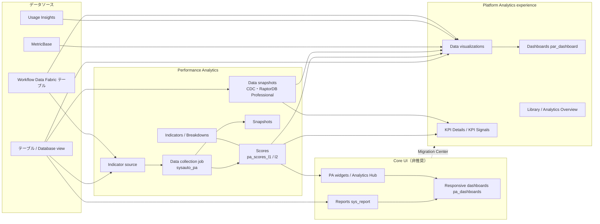
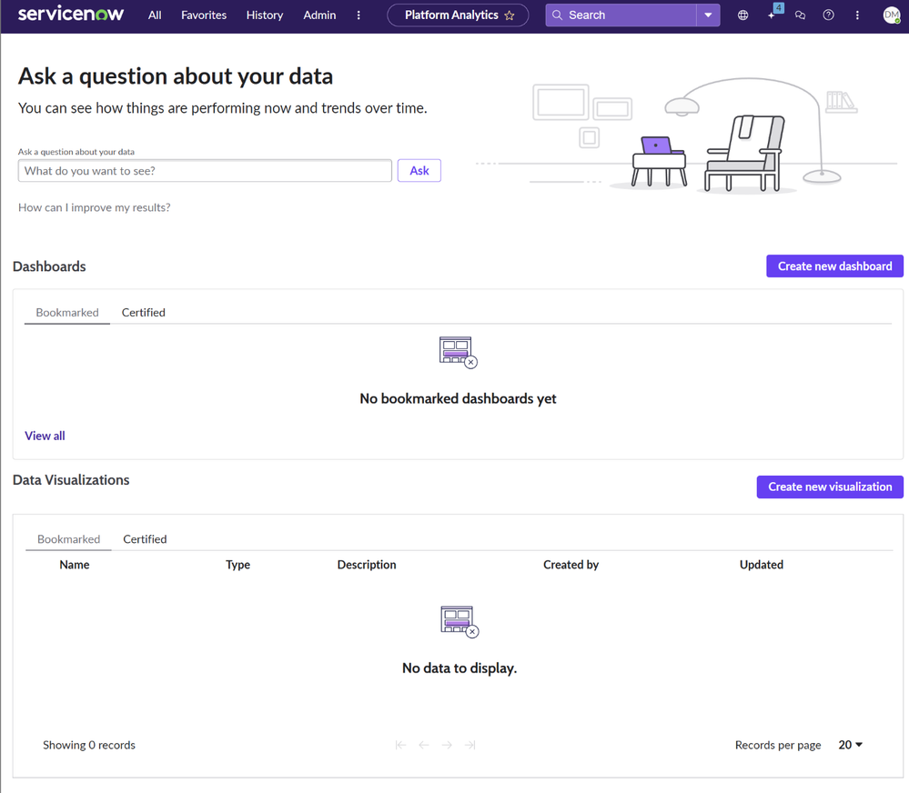
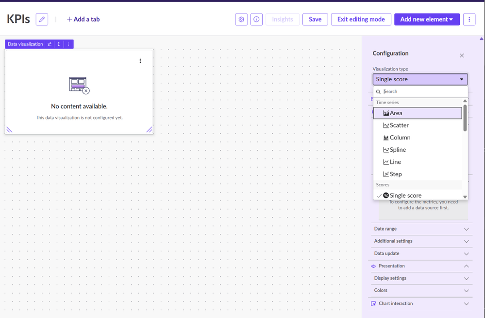
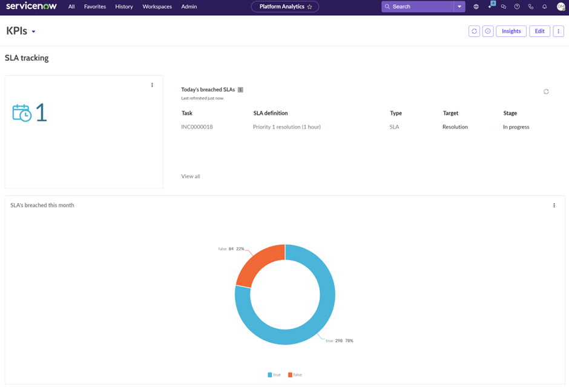
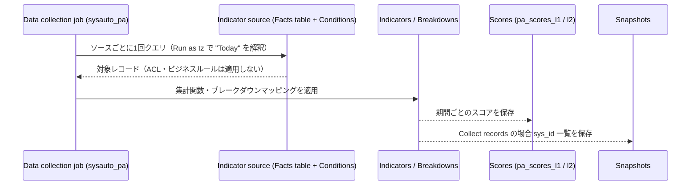
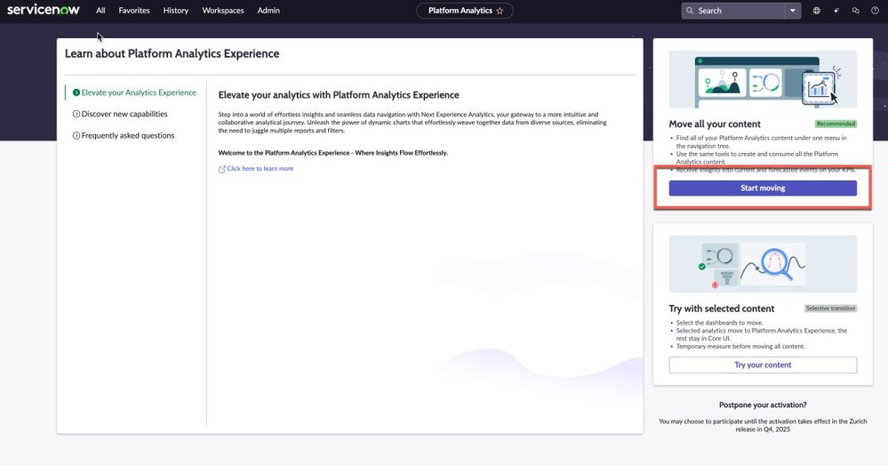
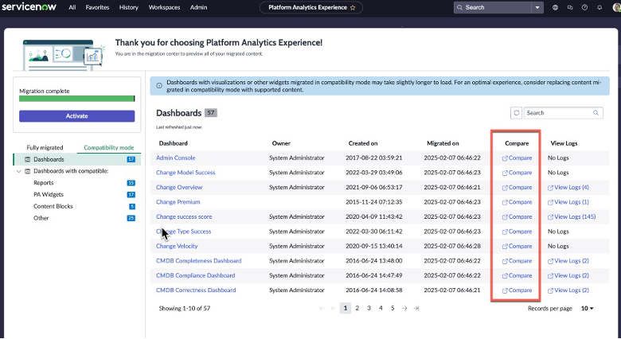

# レポートとアナリティクス（Reporting / Platform Analytics / Performance Analytics）

## 概要

ServiceNow の分析機能は、ServiceNow 公式ドキュメントでは **Platform Analytics（プラットフォームアナリティクス）** という総称のもとに整理されており、Reporting、Performance Analytics、Usage Insights、Process Mining、Task Mining などのアプリケーション群から構成される。利用者は Core UI（従来 UI）または Next Experience 上の **Platform Analytics experience** からこれらにアクセスする。[出典](https://www.servicenow.com/docs/r/now-intelligence/par-workspace.html)

本ファイルで扱う範囲と、技術世代の対応は次のとおり。

| 区分 | Core UI（従来世代） | Next Experience（現行世代、Platform Analytics experience） |
|---|---|---|
| 単発の集計・グラフ | **Reports（レポート）**：Report Designer で作成、`sys_report` テーブル | **Data visualizations（データビジュアライゼーション）**：Visualization Designer / ダッシュボードの in-line editor で作成 |
| 画面の束ね | **Dashboards（ダッシュボード）**：Responsive dashboard（`pa_dashboards`）。さらに古い Homepages | **Dashboards**：in-line editor / Technical editor（UI Builder）で作成（`par_dashboard`） |
| 時系列 KPI | **Performance Analytics（PA）**：Indicators、Breakdowns、PA widgets、Analytics Hub | 同じ PA のデータを **KPI Details**、Indicator データソースの Data visualization、Indicator scorecard で表示 |
| フィルター | Interactive filters | Platform Analytics filters（unified filters） |
| 移行 | ― | **Platform Analytics Migration Center** が Core UI コンテンツを変換 |

ServiceNow の開発者向けドキュメント（Australia）では、「reporting」は通常 Core UI のレポート（テーブルデータと PA widgets）を指し、「visualization」は Platform Analytics の Data visualization（任意のデータソースから作成し、Platform Analytics ダッシュボードに配置できる）を指す、と用語を使い分けている。[出典](https://www.servicenow.com/docs/r/zUlSbxoxKPAWFDGUdAoSCw/K018kyY4QIOeWgnSU2KWFg)

本ファイルは **Australia リリース（2026-05 GA）** を基準とし、判明している Brazil での変更を併記する。ServiceNow 公式ドキュメントはリリースごとに版が分かれており、一部の仕様は Australia 版のページを確認できず、Xanadu・Yokohama・Zurich・Brazil 版のページで確認している。その場合は本文中に参照した版を明記した。

関連ファイル：
- 画面基盤（Next Experience、Unified Navigation）は [Next Experience UI](./next-experience-ui.md)、ワークスペースへの組み込みと UI Builder は [Workspace と UI Builder](./workspaces-ui-builder.md) を参照。
- データベースビュー（Database view）は [データモデルとSystem Dictionary](./data-model-dictionary.md)、ACL 全般は [アクセス制御（ACL）](./access-control-acl.md) を参照。
- SLA のレポート化に使う `task_sla` は [SLAとスケジュール](./sla-schedules.md) を参照。
- AI による分析（Now Assist、AI Data Explorer の全体像）は [Now Assist と AI Agents](./now-assist-ai-agents.md)、外部データ連携は [Workflow Data Fabric](./workflow-data-fabric.md)、Process Mining は [プロセス自動化（RPA・Process Mining・Document Intelligence）](./process-automation-rpa-mining.md) を参照。
- ライセンス全般は [プラットフォームのパッケージ構成](./platform-licensing-packaging.md)、[ライセンスモデル](../../03_導入編/01-licensing-model.md)、[エディション比較](../../03_導入編/03-edition-comparison.md) を参照。

---

## 1. 現在の位置付け：Core UI から Platform Analytics experience への移行

### 1.1 Core UI Reporting / Dashboards の非推奨化の経緯

ServiceNow の Core UI Reporting と Core UI Dashboards は **Xanadu リリースで非推奨（deprecated）** となり、それぞれ「Platform Analytics の Data visualizations」「Platform Analytics の Dashboards」が後継とされた。非推奨の対象は、新規インスタンスと Platform Analytics experience へ移行済みのインスタンスである。[出典](https://www.servicenow.com/docs/r/3ongaT2PAVB3Cqoicgnoxg/AoML36K1hsEy~3zu9tjCXQ)

Xanadu の Platform Analytics experience リリースノートでは、新規顧客・新規インスタンス向けに次の機能が提供されなくなった（既存顧客は継続利用可のものがある）。[出典](https://www.servicenow.com/docs/r/3ongaT2PAVB3Cqoicgnoxg/qV~ndN2VeOyeNtcXfxuJuA)

| 機能 | Xanadu 時点の扱い | 後継 |
|---|---|---|
| Reporting（Core UI） | 新規インスタンスでは提供しない。`admin` / `report_admin` は Service Portal 用の Reporting を引き続き利用可 | テーブルデータソースの Data visualizations |
| Performance Analytics widgets | 新規顧客には提供しない。`admin` / `pa_admin` は Service Portal 用に利用可 | Indicator データソースの Data visualizations |
| Responsive dashboards（Core UI） | 新規顧客には提供しない。アップグレード顧客で利用中の場合は継続利用可 | Platform Analytics の Dashboards |
| Interactive filters | 新規顧客には提供しない | Platform Analytics filters |
| Analytics Hub | 新規顧客には提供しない | KPI Details |
| Interactive analysis | 新規顧客は Core UI のリストでのみ利用可 | ― |
| In-form analytics、Performance Analytics admin console、Dependency assessment | 新規インスタンスと移行後は非推奨（Platform Analytics の成果物には適用されない） | ― |

同じく Xanadu で、Performance Analytics は新規インスタンスおよび移行後のナビゲーションメニューに表示されなくなり、機能は **Platform Analytics Administration** 配下に集約された。また PA の「KPI」という呼称は「indicator」に変更された（KPI Composer、KPI Details、KPI Signals は名称を維持）。[出典](https://www.servicenow.com/docs/r/3ongaT2PAVB3Cqoicgnoxg/qV~ndN2VeOyeNtcXfxuJuA)

なお、ServiceNow Community の Platform Analytics チームの投稿によれば、Core UI のプロダクト機能開発は **Tokyo リリースで終了**しており、新機能は Platform Analytics experience でのみ提供される。[出典](https://www.servicenow.com/community/performance-analytics-blog/platform-analytics-adoption-guidance-amp-known-issues-reference/ba-p/3480021)

### 1.2 Australia での扱い（アップグレード時の挙動）

Australia の Platform Analytics experience リリースノートに記載された、アップグレード時の挙動は次のとおり。[出典](https://www.servicenow.com/docs/r/IDeOjpA1hzonPLWG~inEpg/0aTnujDGMcPgleU6vjmzLA) [出典](https://www.servicenow.com/docs/r/m4LmCVvkm6_8u3nlIuep5Q/SLxGLqJ6AavsPuo6loDabw)

| 項目 | Australia での挙動 |
|---|---|
| Platform Analytics experience の有効化 | ServiceNow AI Platform の機能として **既定で有効（active by default）**。Australia へのアップグレードで全ユーザーに対して有効になる |
| Core UI のレポート・ダッシュボード | ライブラリ上で UI version 列により識別される。Report Builder / Dashboard Builder で引き続き編集できる |
| 新規作成 | 未移行のユーザーは Core UI と Next Experience のどちらでもダッシュボード・ビジュアライゼーションを作成できる。**Next Experience が推奨** |
| 公開レポート（Public reports） | **すべての Core UI 公開レポートはアップグレード後に非公開（unpublished）になる**。`report_admin` は Reports Public [`sys_report_public`] テーブルで対象を特定し、Report Designer の Sharing UI からログインユーザー向けに再共有できる |
| Publish Report 機能 | 削除され、Report Designer の **Read-only link** オプションに置き換え。認証済みユーザーが URL からレポートを閲覧する方式 |
| Analytics Hub | 利用不可。Analytics Hub へのリンクは **KPI Details にリダイレクト** |
| ナビゲーション | Self-Service > Dashboards は Platform Analytics > Library > Dashboards へ、Reports > View/Run は Platform Analytics > Library > Data Visualizations へリダイレクト |
| Analytics Center | **Analytics Overview** に改称 |

Core UI のレポート作成可否は、System Property `com.snc.par.coreui.report_create.enabled`（既定値 `true`）で制御される。Australia の Reporting properties ページでは、このプロパティは「Australia へのアップグレード後に、runner ユーザーが Core UI（main UI）のレポートを作成できるようにし、Data visualization library に Create New ボタンを追加する」と説明されている。[出典](https://www.servicenow.com/docs/r/sUlZwnOeHovHFHxvv37~kA/IFmAtsHILSqfGCdUHziumg)

> **注意（情報源間の差異）：** ServiceNow Community の一般ユーザー投稿（2026-03）では「Australia 以降、レガシーダッシュボードはメニューからアクセスできなくなり、Core UI モジュールは重大なセキュリティ修正のみとなる」と説明されている【第三者情報】。一方、公式リリースノートは「メニューのリダイレクト」と「Core UI での作成・編集の継続」を記載しており、「アクセス不可」とまでは書いていない。メニューが Platform Analytics 側に向くことは両者で一致している。[出典](https://www.servicenow.com/community/developer-forum/australia-release-key-milstone-for-platform-analytics/m-p/3515396)

### 1.3 Core UI コンテンツ作成の期限

ServiceNow Community の Platform Analytics チームの投稿（公式ドキュメントではない）では、タイムラインが次のように説明されている。[出典](https://www.servicenow.com/community/performance-analytics-blog/platform-analytics-adoption-guidance-amp-known-issues-reference/ba-p/3480021) [出典](https://www.servicenow.com/community/performance-analytics-blog/moving-from-classic-core-ui-reporting-to-platform-analytics/ba-p/3209041)

- 2025-03 時点の告知：Australia リリースから Core UI コンテンツの新規作成を停止する予定だった。
- 顧客フィードバックを受けて延長（2026-03 更新）：**Core UI コンテンツの新規作成は、リリースファミリーにかかわらず 2027 年末まで可能**。
- 既存の Core UI ダッシュボード・レポートは、移行または置き換えを選ぶまで引き続き作成・利用できる。ただし Australia 以降は「利用可能だがサポート対象外（available but unsupported）」と表現されている。
- 移行は任意で、全量・選択的・移行しないのいずれも選べる。Migration Center は Australia 以降も提供・更新される。

パートナー（SPOC）は「Australia 以降 Core UI のレポート・ダッシュボードは修正・更新を受けなくなり、初日に壊れることはないが静かに劣化する」と表現している【第三者情報】。[出典](https://www.spoc.eu/releases-news/servicenow-australia-your-reports-after-the-upgrade-lets-make-sure-they-work/)

> **Brazil での変更:** Brazil の Platform Analytics experience リリースノートでは、新規作成フローが更新され Next Experience が推奨経路として示される（`com.snc.par.coreui.dashboard_create.enabled` と `com.snc.par.coreui.report_create.enabled` が `true` のとき適用。情報モーダルが表示され、Core UI ダッシュボードは `pa_dashboard` レコードフォーム、Core UI レポートは Report Designer で開く）。また Brazil 版の Platform Analytics experience ページでは「Brazil へのアップグレードで Platform Analytics は既定で有効、Core UI のダッシュボードとレポートは Core UI のツールから引き続き表示できる」と記載されている。[出典](https://www.servicenow.com/docs/r/release-notes/platform-analytics-experience-rn.html) [出典](https://www.servicenow.com/docs/r/now-intelligence/par-workspace.html)

---

## 2. Reports（Core UI レポート）

### 2.1 Reports の基本

ServiceNow の **Reports（レポート）** は、テーブル（またはデータベースビュー、Report source）のレコードを集計・可視化する Core UI の機能で、定義は Reports [`sys_report`] テーブルに格納される。レポートは **Report Designer（レポートデザイナー）** で作成し、Core UI の Responsive dashboard や Homepage に配置できる。

Report Designer は次の 4 つの設定領域で構成される【第三者情報】（公式 Australia 版での画面項目名は確認できず）。[出典](https://royalcyber.com/blogs/servicenow/servicenow-reporting-guide)

| 領域 | 内容 |
|---|---|
| Data（データ） | レポート名、データソース（テーブル、または事前定義データセットである Report source）を選ぶ |
| Type（タイプ） | レポートタイプ（2.2 節）を選ぶ |
| Configure（設定） | タイプごとの設定。例：棒グラフなら Group by、Aggregation、条件（Condition builder） |
| Style（スタイル） | 色、タイトル、凡例など見た目の調整 |

Australia の Report Designer では **自然言語クエリ（NLQ、Natural Language Query）** で質問を入力するとレポートタイプが生成される機能があり、System Property `com.snc.par.nlq.report_designer.enabled`（既定値 `true`）で有効・無効を切り替える。[出典](https://www.servicenow.com/docs/r/J7UfGStUvhlVOcoqiM3zlQ/zep6ydqvsFyy2dsVufiT0w) [出典](https://www.servicenow.com/docs/r/sUlZwnOeHovHFHxvv37~kA/IFmAtsHILSqfGCdUHziumg)

### 2.2 レポートタイプ一覧（Report types）

ServiceNow の Core UI レポートは、Australia 版の公式ドキュメントで次のカテゴリに分類されている。[出典](https://www.servicenow.com/docs/r/J7UfGStUvhlVOcoqiM3zlQ/zep6ydqvsFyy2dsVufiT0w)

| カテゴリ | レポートタイプ（英） | 説明 | データ要件・制約 |
|---|---|---|---|
| Bar（棒） | Vertical bar / Horizontal bar（縦棒・横棒） | 次元ごとの個別値・集計値を棒の長さで比較 | ― |
| Bar | Pareto（パレート図） | 棒と累積比率の折れ線を組み合わせ、重要な次元を特定 | ― |
| Bar | Histogram（ヒストグラム） | 連続する数値を区間（bin）に分け、各区間の件数を表示 | 連続データ（離散の件数ではない）。bin 数は `glide.chart.histogram.bins` |
| Pie and Donut | Pie（円） | 全体に対する各部分の割合を円で表示 | ― |
| Pie and Donut | Donut（ドーナツ） | 全体に対する割合をリングで表示 | ― |
| Pie and Donut | Semi-donut（半ドーナツ） | 全体に対する割合を半円リングで表示 | ― |
| Time Series（時系列） | Column（縦棒） | 1 つ以上の値の時間変化を縦棒で表示 | 時間軸データ。MetricBase も利用可 |
| Time Series | Line（折れ線） | データ点を直線で結び時間変化を表示 | 同上 |
| Time Series | Step line（ステップ） | 水平・垂直の線分で期間と大きさを表示 | 同上 |
| Time Series | Area（面） | 関連属性の時間推移を、線の下の面積を強調して表示 | 同上 |
| Time Series | Spline（スプライン） | 既知の点を曲線で結び、点間の値を近似 | 同上 |
| Multidimensional（多次元） | Multilevel pivot table（多階層ピボット） | 複数の行・列次元で集計値を 1 つの表に表示 | 複数次元。PDF 出力には `com.snc.whtp` プラグインが必要（2.6 節） |
| Multidimensional | Heatmap（ヒートマップ） | 行列のセルを色で塗り分けて集計値を表示 | **最大 1,000 セル** |
| Multidimensional | Bubble（バブル） | X・Y 軸と、バブルの大きさを決める第 3 の集計次元で表示 | X、Y、第 3 の集計次元 |
| Scores（スコア） | Speedometer（スピードメーター） | 現在値を円形メーターで表示（色範囲を任意設定） | 現在値のみ（比較・履歴なし） |
| Scores | Dial（ダイヤル） | 現在値を半円ゲージで表示 | 現在値のみ |
| Scores | Single score（単一スコア） | ビジネス上重要な単一の集計値を表示。リアルタイム更新可 | 単一の集計値 |
| Statistical（統計） | Control（管理図） | 標準偏差に対する時系列プロットで外れ値と統計的管理状態を確認 | 時系列データ |
| Statistical | Trend（トレンド） | 1 つ以上の項目の時間変化から一般的な傾向を表示 | 時系列データ |
| Statistical | Box（箱ひげ図） | 最小・最大・四分位・中央値・平均の分布を表示 | ― |
| Statistical | Trendbox（トレンドボックス） | 指定期間のグループ別の値分布を表示 | グループと期間 |
| Other（その他） | Funnel（ファネル） | 全体に対する割合が段階的に小さくなる形で表示 | ― |
| Other | Pyramid（ピラミッド） | 値の分布をピラミッドの各段（全体に対する割合）で表示 | ― |
| Other | List（リスト） | 通常の ServiceNow リストに近い形で、展開可能なレコード一覧を表示 | ― |
| Other | Calendar（カレンダー） | 日付に基づくイベントをカレンダー表示 | 日付項目。カレンダー関連プロパティあり（2.7 節） |
| Other | Map（地図） | 地理データをヒートマップまたはピンで表示 | 地理データ。既定地図は `glide.ui.report.map.default_map`（World） |
| Other | Pivot table（ピボット） | ユーザー定義の行・列で集計し、元レコードへドリルダウン | 行・列の定義 |

Australia 版ページでは Control、Trend、Box、Trendbox を Statistical カテゴリとしつつ、本文中では Other reports の節にも含めて記載している（ページ内で分類表記が揺れている）。[出典](https://www.servicenow.com/docs/r/J7UfGStUvhlVOcoqiM3zlQ/zep6ydqvsFyy2dsVufiT0w)

Platform Analytics experience への移行時、Control、Trendbox、Histogram、Funnel、Pyramid の各レポートは対応する Data visualization がなく **Compatibility mode（iframe 埋め込み）で移行される**（7.4 節）。[出典](https://www.servicenow.com/docs/r/J7UfGStUvhlVOcoqiM3zlQ/COYw7o0AvSMw26kN_AjbrA)

### 2.3 Reporting ロール

ServiceNow の Core UI Reporting のロールは次のとおり（Yokohama 版ドキュメント。Australia 版の Reporting roles ページは確認できず）。[出典](https://www.servicenow.com/docs/r/3dUp4IlSpaXzwDcoDj_v6g/nId1yyERT5Q_l3rwJ740gQ)

| ロール（技術名） | 説明 | 含むロール |
|---|---|---|
| Report user（`report_user`） | レポートの作成と、自分に共有されたレポートの閲覧。共有されたレポートの共有・編集・削除はできない | `viz_creator` |
| Report scheduler（`report_scheduler`） | 閲覧可能なすべてのレポート（管理できないレポートを含む）のメール配信をスケジュールする。作成・編集・共有の権限は別ロールが必要 | `report_user` |
| Group report user（`report_group`） | 自分が所属するグループに共有されたレポートを管理・共有する | `report_user` |
| Global report user（`report_global`） | 全員に共有されたレポートを管理し、全員への共有ができる。ユーザー・グループのみに共有されたレポートは共有できない | `report_user` |
| Report administrator（`report_admin`） | すべてのレポートの管理・共有・公開・スケジュール、Reports Administration へのアクセス。より限定的なロールがある場合は使わないよう推奨されている | `report_scheduler`、`analytics_filter_admin`、`report_global`、`report_group`、`gauge_maker`、`viz_admin` |
| Report description administrator（`report_description_admin`） | レポート用のテーブル・フィールド説明を読み取り・更新する | なし |

- `report_publisher` と `report_alias_admin` はドキュメント上に存在するが、無効化された機能のためのロールとされている。[出典](https://www.servicenow.com/docs/r/3dUp4IlSpaXzwDcoDj_v6g/nId1yyERT5Q_l3rwJ740gQ)
- Xanadu 版の「Administering reports」では、`itil` ロールはレポートの作成・閲覧について `report_user` と同等のアクセスを持ち、ロールを持たないユーザーは自分に共有されたレポートのみ閲覧できる、とされている。[出典](https://www.servicenow.com/docs/r/bB1Dk50bqXxOZKZ5dD_4fw/xwIcHUUTvFjgQbZF9DuUrQ)

Platform Analytics 側のロール（`viz_creator`、`viz_admin`、`dashboard_admin` 等）は 4.5 節を参照。Australia 版の Platform Analytics roles ページでは、`report_admin` は「`viz_admin` と同等の権限に加え、Service Portal レポートを含むすべての Core UI レポートの作成・編集・削除・エクスポートができる」ロールとして記載され、含むロールは `viz_admin`、`analytics_filter_admin`、`report_user` とされている（Yokohama 版の Reporting roles の記載と含むロールの列挙が異なる）。[出典](https://www.servicenow.com/docs/r/J7UfGStUvhlVOcoqiM3zlQ/38E8blwLmOcpiEoM0ZGxuQ)

### 2.4 レポートの共有（Sharing）

ServiceNow の Core UI レポートは、作成者のみ（Me）、特定のユーザー・グループ・ロール、全員（Everyone）に共有できる。共有先のユーザー・グループは `sys_report_users_groups` テーブルに記録され、ロールへの共有は `sys_report` の `roles` フィールドで管理されると ServiceNow Community で説明されている【第三者情報】。[出典](https://www.servicenow.com/community/itsm-forum/table-name-shared-reports/m-p/3329739)

共有の可否はロールにより異なる（2.3 節）。例えば `report_group` は所属グループに共有されたレポートの管理・共有ができ、`report_global` は全員に共有されたレポートの管理と全員への共有ができる。[出典](https://www.servicenow.com/docs/r/3dUp4IlSpaXzwDcoDj_v6g/nId1yyERT5Q_l3rwJ740gQ)

Australia では Publish（公開）機能が廃止され、Read-only link に置き換えられた（1.2 節）。

### 2.5 レポート実行時のセキュリティ（`report_view` ACL）

ServiceNow のレポートは、閲覧者の `read` 権限に加え、ACL の **`report_view` オペレーション** で「レポートとしてデータを集計・表示できるか」を制御できる。[出典](https://www.servicenow.com/docs/r/now-intelligence/reporting/report-view-access-control.html) [出典](https://www.servicenow.com/docs/r/now-intelligence/read-access-control.html)

| 項目 | 仕様 |
|---|---|
| 種類 | `report_view` テーブル ACL と `report_view` フィールド ACL の 2 種類。フィールド ACL は、そのフィールドが Group by、行、列、集計の設定に使われたときに評価される |
| 条件 | `report_view` オペレーションは **必須ロール（required role）による制限のみサポート**。スクリプトや高度な条件は使えない |
| 評価タイミング | レポート実行時、レポートの基となるテーブルとフィールドの `report_view` ACL が評価される |
| フォールバック | `report_view` ACL が存在しない場合、テーブルレベルでのフォールバック確認が行われ、`read` ACL の扱いは System Property `glide.report.report_view.read_acl`（`ignore` / `enforce` / `log`、既定値 `enforce`）で決まる |
| 限界 | `report_view` ACL は、ユーザーが `read` 権限を持つリストの閲覧までは防げない。リスト閲覧の制限には `read` ACL が必要 |
| 評価ツール | report_view ACL の一覧と、`report_view` ACL によりブロックされるレポートを特定する **ACL Assessment for Reports** がある |

ACL の基本は [アクセス制御（ACL）](./access-control-acl.md) を参照。

### 2.6 スケジュール配信（Scheduled reports）

ServiceNow の Core UI レポートは、定期的にメールで配信するスケジュールを設定できる。以下は Brazil 版（2026-09-10 更新）の「Schedule emails of Core UI reports」ページの内容であり、Australia 版ページでも Calendar、Map、Single Score は自動メール配信の対象外と記載されている。[出典](https://www.servicenow.com/docs/r/now-intelligence/reporting/t_ScheduleAReport.html)

- **メニュー（Core UI）：** All > Platform Analytics experience > Schedules > Scheduled Reports > New。Unified Analytics のインスタンスまたは新規 Brazil インスタンスでは All > Platform Analytics > Library > Data Visualizations から行う。
- **必要ロール：** `report_scheduler`、`report_admin`、`admin` のいずれか。
- **格納テーブル：** 公式ページには記載がない。一般に `sysauto_report`（Scheduled Email of Report）とされるが、本調査では公式情報で確認できなかった【経験則】。

| フィールド | 説明・制約 |
|---|---|
| Name | スケジュール名 |
| Report | 配信するレポート。**Calendar、Map、Single Score はスケジュール不可**。Pivot Table は `com.snc.whtp` プラグインが必要 |
| Run as | ドメインセパレーション環境で、どのユーザーの権限でレポートを生成するか（手順上のフォームフィールドではなく説明として記載）。既定は作成者で、`admin` / `report_admin` が変更可。そのユーザーには `report_view` 権限が必要 |
| Users / Groups | 受信者。Users は User レコードで Notification が有効である必要がある |
| Email addresses | インスタンスのユーザーでない受信者のメールアドレス（カンマ区切り） |
| Application | スコープアプリケーション、または Global |
| Active | 選択時のみ配信 |
| Run | Daily、Day and Month in Year、Day in Week in Month in Year、Week in Month、Weekly、Monthly、Periodically、Once、On Demand、Business Calendar（Entry Start / Entry End） |
| Time zone / Time / Day / Repeat Interval | 実行タイミング |
| Advanced（Starting / Ending） | 実行期間の開始・終了 |
| Business Calendar / Offset type / Offset | Business Calendar 系の Run で使用 |
| Priority | 100 未満は必須ジョブ、100 超は非必須。スケジュールジョブの 70% 以上が遅延している場合、100 超のジョブは実行されない |
| Conditional / Condition | 条件スクリプト（true/false を返す）。サンドボックスで実行され、関数定義や一部 API は使えない |
| Omit if no records | レコードがない場合は配信しない |
| Subject / Introductory message | 件名と本文。本文中の `${report:png}` で埋め込み PNG の位置、`${report:include_with}` で同梱レポートの位置を指定 |
| Type | 出力形式。グラフ系は PNG / PDF（PDF-landscape はグリッドデータを含む）、リスト系は PDF / Excel / CSV、Embedded PNG は本文埋め込み。多階層ピボットは PDF のみ |
| Zip output | ZIP 添付で送る |
| Include with | 同じメールに同梱する追加レポート（順序は変更不可） |
| Page size / Page height / Page width | 多階層ピボットのみ（A3、A4、Letter、Legal、Custom） |

その他の制約：Map レポートは PDF 出力不可。非アクティブ化されたユーザーが作成したスケジュールはデータが空になることがあり、アクティブなユーザーが作り直す必要がある。Oracle DB のインスタンスでは条件の合計が 4,000 文字を超えるとメールが生成されない。[出典](https://www.servicenow.com/docs/r/now-intelligence/reporting/t_ScheduleAReport.html)

メール配信の基盤は [通知とメール](./notifications-email.md) を参照。Platform Analytics 側のスケジュールエクスポートは 4.7 節を参照。

### 2.7 Reporting properties（主要システムプロパティ）

ServiceNow の Reporting のシステムプロパティは Reports > Administration > Properties で設定するか、System Property [`sys_properties`] に追加する。以下は Australia 版の Reporting properties ページに掲載された主なプロパティである。[出典](https://www.servicenow.com/docs/r/sUlZwnOeHovHFHxvv37~kA/IFmAtsHILSqfGCdUHziumg)

| プロパティ | 説明 | 型 | 既定値 |
|---|---|---|---|
| `com.snc.par.coreui.report_create.enabled` | Australia アップグレード後に Core UI レポートの作成を許可し、Data visualization library に Create New ボタンを追加 | true/false | true |
| `com.snc.par.nlq.report_designer.enabled` | Report Designer の NLQ を有効化 | true/false | true |
| `glide.report.report_view.read_acl` | レポート実行時の read レベル ACL 適用（ignore / enforce / log） | String | enforce |
| `glide.chart.histogram.bins` | ヒストグラムの bin 数（1〜20） | Integer | 10 |
| `glide.ui.chart.bar.horiz.max_col_slant_labels` | 横棒グラフでラベルを斜めにする前の最大列数 | Integer | 5 |
| `glide.chart.truncate.x_axis_labels` | X 軸ラベルを 20 文字で切り詰め（v2 チャートのみ） | true/false | true |
| `glide.chart.animation` | v2 チャートのアニメーション（Map は対象外） | true/false | true |
| `glide.chart.drill.open_new_win` | ドリルダウン未設定時の既定リストドリルダウンを新しいタブで開く（リスト以外のレポート） | true/false | false |
| `glide.ui.chart.color` | 既定のチャート色 | String | 006DDA |
| `glide.ui.chart.use_full_color_palette` | 棒・パレートで棒ごとに色を変える | true/false | false |
| `glide.ui.report.datasets.default_colors` | 複数データセットの既定色（`sys_report_chart_color` から取得） | String | ― |
| `glide.ui.report.datasets.default_palettes` | 複数データセットの既定パレット（`pa_chart_color_schemes` から取得） | String | UI14 default |
| `glide.ui.report.map.default_map` | Map レポートの既定地図 | String | World |
| `glide.ui.chart.pie.labels` / `glide.ui.chart.pie.labels.max_items` | 円グラフのラベル表示 / ラベルを表示する最大スライス数 | true/false / Integer | true / 8 |
| `glide.chart.label.legend.truncate_to`（`.large`） | 凡例ラベルの切り詰め文字数（大サイズ以外 / 大サイズ） | Integer | 14 / 20 |
| `glide.chart.data.label.truncate_to` | データラベルの最大長（積み上げ棒には不適用） | Integer | 13 |
| `glide.report.pivot.fixed_headers` | 多階層ピボットのヘッダー行を固定 | true/false | true |
| `glide.report.calendar.*` | カレンダーレポートの各種上限（`max_days_back` 30、`max_events_displayed_per_cell` 3、`max_more_events_per_day` 30、`default_event_duration` 01:00:00） | ― | ― |
| `glide.ui.filter.first_day_of_week` | 週の開始曜日（1=日曜、2=月曜…） | Integer | 2 |
| `glide.report.metric_max_data_points` | MetricBase レポートあたりの最大データ点数 | Integer | 2000 |
| `glide.report.metric_max_series` | MetricBase レポートのデータセットあたりの系列数（最大 100） | Integer | 20 |
| `glide.homepage_interactivity.ui_ctrls_max_display_options` | Interactive filter（ラジオボタン・チェックボックス）の最大選択肢数 | Integer | 25 |

### 2.8 Reports Administration（管理モジュール）

ServiceNow の Reports > Administration では、レポートの管理対象を選んで設定する（Xanadu 版の記載）。[出典](https://www.servicenow.com/docs/r/bB1Dk50bqXxOZKZ5dD_4fw/xwIcHUUTvFjgQbZF9DuUrQ)

| 管理対象 | 内容 |
|---|---|
| Report sources（レポートソース） | レポート作成に使う事前定義データセット（テーブル＋条件）。Platform Analytics の Data visualization でも Table データソースの **Predefined conditions** として表示される |
| Report ranges（レポート範囲） | 棒・ドーナツ・円の区間を定義（Core UI レポートと Platform Analytics の Data visualization の両方に適用） |
| Coloring rules（色付けルール） | 多階層ピボットと Single score の数値表示ルール |
| Tables / Fields | `report_description_admin` によるテーブル・フィールドの説明管理。システムテーブルは既定でレポート対象外（一部は例外） |
| Properties | 2.7 節のプロパティ |

Report source の格納テーブルは、ServiceNow Community で `sys_report_source` とされるが、公式ドキュメントでの明示は本調査では確認できなかった【第三者情報】。[出典](https://www.servicenow.com/community/developer-forum/data-source-in-reports/m-p/2741839)

---

## 3. Dashboards（Core UI のダッシュボード）

### 3.1 Responsive dashboards

ServiceNow の Core UI の **Responsive dashboard（レスポンシブダッシュボード）** は、レポートや PA widgets、Interactive filters を配置する Core UI のダッシュボードで、Dashboards [`pa_dashboards`] テーブルに格納される（ServiceNow Community 管理者のブログで、`pa_dashboards` は Core UI（レガシー）ダッシュボード、`par_dashboard` は移行後およびネイティブの Platform Analytics ダッシュボードと説明されている）。[出典](https://www.servicenow.com/community/performance-analytics-blog/moving-from-classic-core-ui-reporting-to-platform-analytics/ba-p/3209041)

- Core UI の Responsive dashboard の作成・編集には `dashboard_admin` ロールが必要とされている。[出典](https://www.servicenow.com/docs/r/sUlZwnOeHovHFHxvv37~kA/oNjbhiY_M1J9DnRoHeu6Hg)
- Xanadu 以降、新規顧客には提供されず、アップグレード顧客で利用中の場合のみ継続利用できる（1.1 節）。
- **Homepages（ホームページ）** はさらに古い世代の Core UI ダッシュボードであり、Migration Center の「Do not migrate in bulk」対象テーブルとして `sys_ui_hp_publisher` が挙げられている。[出典](https://www.servicenow.com/community/performance-analytics-blog/moving-from-classic-core-ui-reporting-to-platform-analytics/ba-p/3209041)

### 3.2 Interactive filters

ServiceNow の **Interactive filters（インタラクティブフィルター）** は Core UI ダッシュボード上で複数のレポート・PA widgets を一括で絞り込むフィルターである。Xanadu 以降は新規顧客に提供されず、Platform Analytics filters が後継である（1.1 節）。カスタム Interactive filter を含むダッシュボードは Compatibility mode で移行される（7.4 節）。

---

## 4. Platform Analytics experience（Next Experience）

### 4.1 構成要素とナビゲーション

ServiceNow の **Platform Analytics experience** は、Unified Navigation の **All > Platform Analytics** から開く Next Experience の分析環境である。主な構成要素は次のとおり（Brazil 版ページの記載。Analytics Overview は Australia で Analytics Center から改称）。[出典](https://www.servicenow.com/docs/r/now-intelligence/par-workspace.html) [出典](https://www.servicenow.com/docs/r/IDeOjpA1hzonPLWG~inEpg/0aTnujDGMcPgleU6vjmzLA)

| 構成要素 | 内容 |
|---|---|
| Analytics Overview（旧 Analytics Center） | ブックマーク済み・会社認定（Certified）のダッシュボードとビジュアライゼーションを表示する入口。Analytics Q&A（自然言語で質問すると関連ビジュアライゼーションを返す）を含む。Australia でロール別の入口として刷新 |
| Library（ライブラリ） | アクセス可能な Platform Analytics コンポーネントの一覧ページ群。ここでダッシュボード、データビジュアライゼーション、フィルターを作成し、適切なロールがあれば共有ライブラリに追加できる |
| Dashboards | アクセス可能なダッシュボードの一覧（自分の、ブックマーク、認定済みで絞り込み） |
| Data visualizations | テーブル・インジケーター等をデータソースとするビジュアライゼーションの作成・更新・認定・共有。**Core UI レポートと PA widgets を置き換える** |
| Platform Analytics filters | ダッシュボード上のリストやビジュアライゼーションを、データ値・真偽値・日付で絞り込む |
| KPI Details | KPI スコアの背後にある情報（傾向、予測、関連レコード、ブレークダウン、時間集計）を探索 |
| KPI Signals | プロセスの振る舞いが大きく変化したことを検知し、責任者に通知（PA インジケーターに Process Behavior Charts を適用） |
| ReferenceData | Platform Analytics 全体で共有するキャッシュ、ロール、テーブル |
| Platform Analytics Administration | Indicators、Indicator sources、Breakdowns、Data collector などの PA 管理機能（Xanadu 以降ここに集約） |

Australia では Analytics Overview とすべてのライブラリページが独自の Platform Analytics ナビゲーションツリーを持つように整理された。[出典](https://www.servicenow.com/docs/r/m4LmCVvkm6_8u3nlIuep5Q/SLxGLqJ6AavsPuo6loDabw)

**図1：Platform Analytics の Analytics Center 画面（Australia で Analytics Overview に改称・刷新される前の画面）**
画面説明：上部ヘッダーの中央に「Platform Analytics」のアプリ名ピルが表示されている。画面上部に「Ask a question about your data」という見出しと「What do you want to see?」の入力欄、「Ask」ボタン（Analytics Q&A）、「How can I improve my results?」リンクがある。その下に「Dashboards」セクション（右上に「Create new dashboard」ボタン、タブ「Bookmarked」「Certified」、「View all」リンク）、さらに「Data Visualizations」セクション（右上に「Create new visualization」ボタン、タブ「Bookmarked」「Certified」、列「Name / Type / Description / Created by / Updated」の一覧）が並ぶ。Australia の Analytics Overview は本画面を刷新したものであり、レイアウトは異なる可能性がある。
出典：ServiceNow Community「The nudge you needed to move to Platform Analytics」 https://www.servicenow.com/community/in-other-news/the-nudge-you-needed-to-move-to-platform-analytics/ba-p/3404168 （取得日：2026-11-02）

### 4.2 Data visualizations（データビジュアライゼーション）

ServiceNow の **Data visualization** は Platform Analytics experience における可視化の単位で、**Visualization Designer**（単体作成）またはダッシュボードの in-line editor で作成する。作成したビジュアライゼーションはライブラリに保存して複数のダッシュボードで再利用でき、ビジュアライゼーションに保存した条件を更新すると、それを使うすべての箇所に反映される【第三者情報】。[出典](https://www.servicenow.com/community/in-other-news/the-nudge-you-needed-to-move-to-platform-analytics/ba-p/3404168)

#### 4.2.1 ビジュアライゼーションタイプ一覧

ServiceNow の Platform Analytics の Data visualization タイプは次のとおり（Brazil 版「Overview of data visualization types」の記載）。[出典](https://www.servicenow.com/docs/r/now-intelligence/data-visualization-type-overview.html)

| カテゴリ | タイプ | 説明 |
|---|---|---|
| Score（スコア） | Single score | 単一の集計値（例：売上合計、未解決インシデント数） |
| Score | Dial | 最小〜最大の範囲で単一値の位置を針で表示 |
| Score | Gauge | Dial に色分けされた値範囲を加えたもの |
| Time series（時系列） | Line | データ点を直線で結ぶ。時系列の既定 |
| Time series | Spline | 曲線で結び傾向を強調 |
| Time series | Scatter | 点を結ばずにプロット（トレンドラインを伴うことが多い） |
| Time series | Column | 縦棒で時間推移を表示。データソース比較に有用 |
| Time series | Step | 離散的な時点間の変化を強調 |
| Time series | Area | 線の下を塗り、各データソースの寄与を表示 |
| Bar（棒） | Horizontal bar | カテゴリ比較。名義データ向き |
| Bar | Vertical bar | カテゴリ比較。順序・連続データ向き |
| Bar | Pareto bar | 降順の棒と累積比率線 |
| Pie and donut | Pie | 合計 100% の構成比。5〜7 セグメントが最適 |
| Pie and donut | Donut | 構成比。5 セグメント以下が最適。中央に追加情報を表示可 |
| Pie and donut | Semi-donut | 半円の構成比。4 セグメント以下が最適 |
| Multidimensional | Pivot table | 複数次元の大規模データの要約（小計を任意表示） |
| Multidimensional | Heatmap | 2 つのフィールドまたはブレークダウンの関係を色の濃淡で表示 |
| Multidimensional | Bubble chart | X・Y 位置と大きさ、任意で色による第 3 フィールド |
| Other | Calendar report | 日付に基づくイベントをカレンダー表示 |
| Other | Indicator scorecard | 複数の PA インジケーターを比較 |
| Other | List | テーブルレコードの一覧。チャート操作からのドリルダウン先にもなる |
| Other | Box plot | 中央値・四分位・外れ値を表示し、グループ間で分布を比較 |
| Other | Geomap | 国・州・都市単位で地理的に表示 |

Core UI レポートタイプ（2.2 節）と比べると、Speedometer、Control、Trend、Trendbox、Histogram、Funnel、Pyramid、Map（Core UI 版）に相当する Data visualization タイプは上表にない。このうち Control、Trendbox、Histogram、Funnel、Pyramid は移行時に Compatibility mode となる（7.4 節）。

**図2：ダッシュボード in-line editor での Data visualization タイプ選択**
画面説明：「KPIs」という名前のダッシュボードを編集中の画面。上部に鉛筆アイコン（名前編集）、「+ Add a tab」、歯車・情報アイコン、「Insights」「Save」「Exit editing mode」ボタン、紫色の「Add new element ▼」ボタンが並ぶ。左側のキャンバス（点線グリッド）に「Data visualization」要素が 1 つ置かれ、「No content available. This data visualization is not configured yet.」と表示されている。右側の「Configuration」パネルで「Visualization type」ドロップダウンが開かれ、検索欄の下に「Time series」グループ（Area、Scatter、Column、Spline、Line、Step）と「Scores」グループ（Single score にチェック）が表示されている。パネル下部には「Date range」「Additional settings」「Data update」「Presentation」「Display settings」「Colors」「Chart interaction」の折りたたみ設定がある。
出典：ServiceNow Community「The nudge you needed to move to Platform Analytics」 https://www.servicenow.com/community/in-other-news/the-nudge-you-needed-to-move-to-platform-analytics/ba-p/3404168 （取得日：2026-11-02）

#### 4.2.2 データソース

ServiceNow の Data visualization は次のデータソースを利用できる（Australia 版、2026-10-01 更新）。[出典](https://www.servicenow.com/docs/r/J7UfGStUvhlVOcoqiM3zlQ/ROjbmbd_8cN~PqA1TpV5UA)

| データソース | 提供 | 説明 | 制約 |
|---|---|---|---|
| Table | ベースシステム | データベースレコードの集合（行＝レコード、列＝フィールド） | カスタム条件または事前定義条件で絞り込み。カスタム条件で質問（questions）や Service Catalog 変数も使用可。設定済みの Report source は Predefined conditions に表示 |
| Indicator（KPI） | ベースシステム | 集計と条件を適用してテーブルデータの時間変化を追跡。種類は Automated、Formula、Manual、Data Snapshots（Automated / Formula） | **Data Snapshots インジケーターと通常インジケーターは混在不可**（最初に選んだ種類に揃う）。Benchmark インジケーターは非対応。Formula インジケーターは親インジケーターのブレークダウンを継承。「is one of」「is (dynamic)」演算子はインジケーターとブレークダウンの両方の対応が必要 |
| Usage Insights | ServiceNow Store | Web、Virtual Agent、モバイル、Service Portal アプリケーションのメトリクスと操作データ | Store の「Usage Insights in PAR Integration」アプリが必要。必要ロールあり。ビジュアライゼーションタイプにより最大 3 KPI |
| MetricBase | 別サブスクリプション | 時系列データ（IoT・機械生成データ向け）。グラフ化や Flow Designer フローのトリガーに使用 | 別サブスクリプションが必要で、ServiceNow 担当者による有効化が必要 |
| Workflow Data Fabric | ベースシステム | Zero Copy Connector Hub で作成した Data fabric テーブル経由で外部データにアクセス | データは自動ロードされない。Run でプレビューを読み込み、Apply でデータソースに設定 |
| Health Log Analytics | 別サブスクリプション | ログのトリアージ・分析による IT 問題の根本原因特定 | 別サブスクリプションと ServiceNow による有効化が必要。ビジュアライゼーションは **UI Builder でのみ** 作成・編集可（Visualization Designer やダッシュボードでは不可） |

Xanadu では、データソースごとに Data visualization を作成できるロールを制限する機能（Control data source availability by role）が追加された。[出典](https://www.servicenow.com/docs/r/3ongaT2PAVB3Cqoicgnoxg/qV~ndN2VeOyeNtcXfxuJuA)

#### 4.2.3 Australia での Data visualization の主な変更

ServiceNow の Australia の Platform Analytics experience リリースノートに記載された、Data visualization 関連の変更は次のとおり。[出典](https://www.servicenow.com/docs/r/IDeOjpA1hzonPLWG~inEpg/0aTnujDGMcPgleU6vjmzLA)

| 機能 | 内容 |
|---|---|
| Data snapshot indicators in data visualizations（新規） | Data snapshots ソースから作成したインジケーターを Data visualization に追加可能 |
| Single Score の設定 | 色設定の追加、スコアとタイトルヘッダーの位置変更 |
| Show % of total in tooltip | 時系列、棒、バブル、ドーナツ、Geomap、ヒートマップでツールチップに全体比率を表示 |
| Data visualization export | 閲覧者が（List に限らず）**任意のビジュアライゼーションを CSV / XLS でダウンロード** 可能 |
| Trend line aggregation | Data snapshots の Trend by > Aggregation period を **Auto** にすると、日付範囲とビジネスカレンダーから集計期間を自動選択 |
| Date-filter aggregation | ビジネスカレンダーで絞り込んだダッシュボードで、時系列ビジュアライゼーションの集計期間を自動調整（テーブルと Data snapshots インジケーターの両方） |
| Custom DV filter condition builder | フィールド、演算子、値、関連テーブルのメニューを持つ条件ビルダー |
| Refresh action control | Headers and Borders の **Show refresh option** で Refresh アイコンを非表示にできる。キャッシュされたダッシュボードでは Refresh アイコンは常に非表示 |
| Data visualization library usage info | アナリティクス管理者が、レポート数、どのダッシュボードにも使われていないビジュアライゼーション、6 か月以上閲覧されていないビジュアライゼーションを確認可能 |
| Library recommendations | Dashboard、Data Visualization、Indicator ライブラリで修正・削除すべき成果物を推奨 |

> **Brazil での変更:** Brazil では、閲覧専用ユーザーがインラインダッシュボードや Visualization Designer で保存せずに一時的にビジュアライゼーションを変更できる **Explore mode**、Go to Data View のドリルダウン先リストビューを `sys_ui_view_list` から選べる機能（Go to URL は同じタブで開く）、エクスポートボタンの全体有効化とエクスポート可能ロールを制御する 2 つのシステムプロパティ（ロール一覧が空なら全ユーザー可）、PDF エクスポートのタブ選択とフィルター状態の反映などが追加された。[出典](https://www.servicenow.com/docs/r/release-notes/platform-analytics-experience-rn.html)

### 4.3 Platform Analytics の Dashboards

#### 4.3.1 ダッシュボードの作成（in-line editor / Technical editor）

ServiceNow の Platform Analytics のダッシュボードは、**All > Platform Analytics > Library > Dashboards** から作成する。作成方法は 2 種類ある。[出典](https://www.servicenow.com/docs/r/now-intelligence/create-db-in-ac.html)

| 方法 | 内容 | 必要ロール |
|---|---|---|
| In-line editor（インラインエディター） | 推奨。キャンバス上に要素を追加・ドラッグでサイズ変更して配置する | **内部ロール（internal role）を持つ任意のユーザー** が作成可能 |
| Technical editor（テクニカルエディター） | スクリプトやデータバインディングが必要な場合に UI Builder のページとして作成 | UI Builder にアクセスできるユーザー（`ui_builder_admin`） |

In-line editor の操作仕様（Australia 版ドキュメント）：
- **Add new element** で要素を追加する。Data visualization（新規またはライブラリから保存済みを選択）、フィルター（新規または保存済み）などを追加できる。
- **Add a tab** でタブを追加し、情報を複数タブに分けられる。
- 要素は角をドラッグしてサイズ変更する。Australia では要素の移動・サイズ変更で構成パネルが開かなくなった。[出典](https://www.servicenow.com/docs/r/IDeOjpA1hzonPLWG~inEpg/0aTnujDGMcPgleU6vjmzLA)
- **In-line editor は作成中のダッシュボードを自動保存しない**。定期的に保存する必要がある。

ダッシュボードの編集では、セクション、フィルター、画像、リスト、Process Mining マップ、リッチテキストを追加できる。共有されたダッシュボードの編集は、アクセス権を持つ全員に反映される。[出典](https://www.servicenow.com/docs/r/4~5Anqt12idfVzJWPcxoHw/yu2HOJTos~VDkDDcabeYjA)

**図3：Platform Analytics ダッシュボードの表示例（「KPIs」ダッシュボードの SLA tracking 見出し部分）**
画面説明：ヘッダー中央に「Platform Analytics」、左上にダッシュボード名「KPIs ▼」、右上に更新・情報アイコン、「Insights」「Edit」ボタンとその他メニューがある。見出し「SLA tracking」の下に、左にカレンダーアイコンと数値「1」の Single score、右に「Today's breached SLAs」というリスト（列：Task、SLA definition、Type、Target、Stage。行：INC0000018 / Priority 1 resolution (1 hour) / SLA / Resolution / In progress、「View all」リンク）が並ぶ。下段に「SLA's breached this month」のドーナツチャートがあり、true 298（78%）と false 84（22%）が表示されている（Task SLA テーブルを Has breached でグループ化した例）。
出典：ServiceNow Community「The nudge you needed to move to Platform Analytics」 https://www.servicenow.com/community/in-other-news/the-nudge-you-needed-to-move-to-platform-analytics/ba-p/3404168 （取得日：2026-11-02）

#### 4.3.2 ダッシュボードライブラリ（管理者向け）

ServiceNow の Platform Analytics のダッシュボードライブラリ（All > Platform Analytics > Library > Dashboards）は、Australia では **Core UI と Next Experience のダッシュボードを同一のライブラリに表示** する。[出典](https://www.servicenow.com/docs/r/J7UfGStUvhlVOcoqiM3zlQ/~ip2Uquj~ouNQK84VYanLg)

| 機能 | 内容 |
|---|---|
| 左ナビゲーション | Dashboards、Data Visualizations、Indicators の各ライブラリ、Usage Insights ページ、（ロールに応じて）Scheduled Exports ライブラリ |
| フィルター | Bookmarked、Certified、Owned by me、Recently opened by me、Shared with me |
| Dashboard Statistics | 1 年 / 6 か月 / 3 か月閲覧なし、3 か月超の非アクティブ、過去 30 日に更新 |
| 一覧の列 | Name、Description、Active、Views、Viewed、**UI version**（Next Experience / Core UI）、**Ready to migrate**（Yes / No（非互換コンポーネントあり）/ Already Migrated / Not Applicable）、Certified、Owned by、Categories、Updated、Created、Visibility（追加可能なワークスペース） |
| 一括操作 | Delete、Deactivate / Activate、**Switch to Next UI**（選択した Core UI ダッシュボードを移行。Migration Center を開く） |
| Recommendations パネル | `dashboard_admin` 以上に、問題のあるダッシュボードに関する推奨を表示 |
| Certification（認定） | 管理者がダッシュボードを会社承認・推奨として認定。Certified 列とフィルターに反映 |
| Categories（カテゴリ） | `analytics_categories_admin` がカテゴリを作成・カスタマイズ |

Australia では、ライブラリページの任意の列見出しでソートできるようになり、UI Builder のページテンプレートで Dashboard / Data Visualization ライブラリページをワークスペース内に作成できるようになった。Executive Dashboards は in-line ダッシュボード機能で再構築された。[出典](https://www.servicenow.com/docs/r/IDeOjpA1hzonPLWG~inEpg/0aTnujDGMcPgleU6vjmzLA)

ダッシュボードはワークスペースの Dashboards ページ（Dashboards page テンプレートで作成）に追加できる。ワークスペースへの組み込みは [Workspace と UI Builder](./workspaces-ui-builder.md) を参照。

#### 4.3.3 ダッシュボードの共有

ServiceNow の Platform Analytics ダッシュボードの共有手順と権限は次のとおり（Yokohama 版の記載）。[出典](https://www.servicenow.com/docs/r/3dUp4IlSpaXzwDcoDj_v6g/6PD6PIK~BXYXDLADgdfaTQ)

1. All > Platform Analytics > Library > Dashboards でダッシュボードを選ぶ。
2. More actions > **Share** を選ぶ。
3. **Grant access to** にユーザー・グループ・ロールを入力する。
4. 任意で **Allow recipients to add, edit, or delete sharing permissions** を選ぶ。
5. **Add as viewer** または **Add as editor** を選ぶ。
6. 任意で **Copy link with filter** / **Copy link** を使う（ダイアログを開いた時点のタブが開くリンク）。
7. **Confirm** を選ぶ。

| 項目 | 仕様 |
|---|---|
| Viewer（閲覧者） | 閲覧のみ。閲覧者としてのみ再共有可（共有許可がある場合） |
| Editor（編集者） | 編集可。閲覧者・編集者として再共有可 |
| 共有できる人 | 自分が作成したダッシュボード。共有されたダッシュボードは共有が許可されている場合のみ。`admin` と `dashboard_admin` はすべてのダッシュボードを共有可 |
| 編集者として追加する条件 | 共有者がダッシュボードの編集権限を持ち、ダッシュボードと同じアプリケーションスコープにいること |
| ロールへの共有 | Roles [`sys_user_role`] テーブルの read 権限が必要 |
| 下位のビジュアライゼーション | ダッシュボードの編集権限は、ダッシュボード上の Data visualization には及ばない。ただしテーブルデータに基づく Data visualization は、ダッシュボードの共有先に自動的に共有される |

> **Brazil での変更:** Brazil の Platform Analytics experience リリースノートでは、ダッシュボードを `dashboard_user` ロールに割り当てると、何らかのロールを 1 つ以上持つ全ユーザー（内部ユーザー）に閲覧権限を与えられる機能（Share dashboard with all internal users）が新機能として記載されている。ロール名は System Property `com.glide.par_dashboards.security.all_users_role` で変更できる。[出典](https://www.servicenow.com/docs/r/release-notes/platform-analytics-experience-rn.html)

> **Brazil での変更:** インラインダッシュボードと Visualization Designer に、外部ページや UI Builder ページから `encodedQuery` 形式でフィルター値を渡せるようになった（Choice と Boolean フィルター）。コピーしたダッシュボードリンクは `/unified-filters-param/filterId:value1,value2` 形式となり、`par_dashboard` のフィルターレコードへの依存がなくなった。[出典](https://www.servicenow.com/docs/r/release-notes/platform-analytics-experience-rn.html)

### 4.4 Platform Analytics filters

ServiceNow の **Platform Analytics filters**（unified filters）は、ダッシュボード上のリストとビジュアライゼーションを、データ値・真偽値・日付で絞り込むフィルターで、テーブルデータ、PA インジケーター、Workflow Data Fabric、UX analytics に共通の 1 つのフィルターモデルとして提供される。[出典](https://www.servicenow.com/docs/r/now-intelligence/par-workspace.html) [出典](https://www.servicenow.com/docs/r/m4LmCVvkm6_8u3nlIuep5Q/SLxGLqJ6AavsPuo6loDabw)

- Australia で、文字列型フィールドの単一選択・複数選択フィルター（String field filters）が追加された。[出典](https://www.servicenow.com/docs/r/IDeOjpA1hzonPLWG~inEpg/0aTnujDGMcPgleU6vjmzLA)
- Industrial Connected Workforce のインジケーター向けに、サイト・プラン・部門・機能ロケーションを跨ぐロールアップ付き階層フィルターが追加された。[出典](https://www.servicenow.com/docs/r/IDeOjpA1hzonPLWG~inEpg/0aTnujDGMcPgleU6vjmzLA)
- フィルターの編集・削除とフィルターライブラリへの追加は `analytics_filter_admin` が行う（4.5 節）。

### 4.5 Platform Analytics のロール

ServiceNow の Platform Analytics のロールは次のとおり（Australia 版、2026-03-12 更新）。[出典](https://www.servicenow.com/docs/r/J7UfGStUvhlVOcoqiM3zlQ/38E8blwLmOcpiEoM0ZGxuQ)

| ロール | 説明 | 含むロール |
|---|---|---|
| `admin` | ダッシュボード・ビジュアライゼーションの作成と、あらゆるものの編集・共有・削除。フィルター管理、Usage Insights 管理者権限 | 表中の他の全ロール |
| `platform_analytics_admin` | Performance Analytics と Usage Insights を含む Platform Analytics の管理。**セキュリティ上 `admin` と同等** | `analytics_admin`、`analytics_categories_admin`、`analytics_filter_admin`、`dashboard_admin`、`pa_admin`、`par_scheduler`、`viz_admin` |
| `analytics_admin` | Usage Insights の管理者権限 | Usage Insights の他の管理・閲覧ロール |
| `analytics_categories_admin` | ダッシュボードのカテゴリタグの作成・編集・削除 | なし |
| `analytics_filter_admin` | 任意の Platform Analytics フィルターの編集・削除、フィルターライブラリへの追加 | なし |
| `dashboard_admin` | Platform Analytics と Responsive dashboards の任意のダッシュボードの作成・編集・複製・共有・削除。全ダッシュボードのエクスポートのスケジュールと削除 | `analytics_filter_admin`、`analytics_categories_admin`、`sn_par_sche_export.par_scheduler_admin`、`par_scheduler` |
| `now_assist_explorer_user` | ビジュアライゼーション、リスト、Otto パネルから AI Data Explorer の探索を開始・編集・作成 | ― |
| `pa_kpi_signal_admin` | インジケーターの KPI Signals 監視を有効化し、責任ユーザーとなる | なし |
| `pa_admin` | Performance Analytics の管理。**セキュリティ上 `admin` と同等** | `viz_admin`、`analytics_filter_admin`、他の全 PA ロール |
| `par_scheduler` | 閲覧・編集可能な任意のダッシュボード・ビジュアライゼーションのスケジュールメール配信を作成・編集 | なし |
| `sn_par_sche_export.par_scheduler_admin` | `par_scheduler` と同等に加え、`par_export` テーブルへの完全な CRUD（削除含む） | `par_scheduler` |
| `sn_process_optimization_analyst` | ダッシュボード上で Process Mining マップを構成 | なし |
| `viz_creator` | Visualization Designer でビジュアライゼーションを作成しライブラリに保存。所有または共有されたビジュアライゼーションを（権限に応じて）編集・エクスポート・共有 | なし |
| `viz_admin` | ビジュアライゼーション作成、ライブラリの全ビジュアライゼーションへのアクセスと任意の操作、グループ・ユーザー・ロールへの共有、全ビジュアライゼーションのエクスポートスケジュール | `analytics_filter_admin`、`sn_par_sche_export.par_scheduler_admin` |
| `report_admin` | `viz_admin` と同等に加え、Service Portal レポートを含む全 Core UI レポートの作成・編集・削除・エクスポート | `viz_admin`、`analytics_filter_admin`、`report_user` |

`report_user` は `viz_creator` を含む（2.3 節）ため、`report_user` を持つユーザーは Visualization Designer でビジュアライゼーションを作成できる。

Xanadu では、委任開発（Delegated development）により、非管理者に特定のスコープアプリ向けの Platform Analytics オブジェクト作成権限を付与できるようになった。[出典](https://www.servicenow.com/docs/r/3ongaT2PAVB3Cqoicgnoxg/qV~ndN2VeOyeNtcXfxuJuA)

### 4.6 キャッシュとパフォーマンス

ServiceNow の Platform Analytics には分析キャッシュ（Analysis cache）があり、Xanadu でテーブルデータに加えインジケーターデータもキャッシュ可能になった。有効期限が 8 時間以上のキャッシュデータは、期限切れ前の 30 分間に自動的に更新（プリフェッチ）される。[出典](https://www.servicenow.com/docs/r/3ongaT2PAVB3Cqoicgnoxg/qV~ndN2VeOyeNtcXfxuJuA)

Australia のハイライトとして、ダッシュボードキャッシュを含む性能改善による読み込み時間の短縮が挙げられている。キャッシュされたダッシュボードではビジュアライゼーションに Refresh アイコンが表示されない。[出典](https://www.servicenow.com/docs/r/m4LmCVvkm6_8u3nlIuep5Q/SLxGLqJ6AavsPuo6loDabw)

性能全般のチューニングは [パフォーマンスチューニング](../../04_応用編/03-performance-tuning.md) を参照。

### 4.7 スケジュールエクスポート（Scheduled exports）

ServiceNow の Platform Analytics では、ダッシュボードとビジュアライゼーションのスケジュールメール配信（Scheduled exports）を `par_scheduler` 以上のロールで作成できる。`sn_par_sche_export.par_scheduler_admin` は `par_export` テーブルへの完全な CRUD を持つ（4.5 節）。ライブラリの左ナビゲーションにはロールに応じて Scheduled Exports ライブラリが表示される。[出典](https://www.servicenow.com/docs/r/J7UfGStUvhlVOcoqiM3zlQ/38E8blwLmOcpiEoM0ZGxuQ) [出典](https://www.servicenow.com/docs/r/J7UfGStUvhlVOcoqiM3zlQ/~ip2Uquj~ouNQK84VYanLg)

- Australia：受信者を参照修飾子（reference qualifier）で制限できるようになった。[出典](https://www.servicenow.com/docs/r/IDeOjpA1hzonPLWG~inEpg/0aTnujDGMcPgleU6vjmzLA)

> **Brazil での変更:** スケジュールエクスポートに Core UI 由来のファイル形式とページ形式、月〜金のスケジュールが追加され、Core UI レポートはスケジュールエクスポートライブラリに表示されなくなった。ダッシュボードの PDF / PPT エクスポートで、タブ選択、アクティブフィルターの適用・除外、ダッシュボード表示順のレイアウト、フィルター・画像・見出しの出力が可能になった。[出典](https://www.servicenow.com/docs/r/release-notes/platform-analytics-experience-rn.html)

### 4.8 AI 機能（Analytics Q&A、AI Data Explorer、Insights）

ServiceNow の Platform Analytics には次の AI・インサイト機能がある。AI 全般とライセンスは [Now Assist と AI Agents](./now-assist-ai-agents.md) を参照。

| 機能 | 内容 |
|---|---|
| Analytics Q&A | Analytics Overview の入力欄に自然言語で質問すると関連するビジュアライゼーションを返す。[出典](https://www.servicenow.com/docs/r/now-intelligence/par-workspace.html) |
| NLQ in Report Designer | Core UI の Report Designer で自然言語からレポートを生成（`com.snc.par.nlq.report_designer.enabled`）。[出典](https://www.servicenow.com/docs/r/sUlZwnOeHovHFHxvv37~kA/IFmAtsHILSqfGCdUHziumg) |
| AI Data Explorer（Now Assist in Platform Analytics） | ビジュアライゼーション、要約、会話による共同データ探索。`now_assist_explorer_user` ロールで探索を作成。ServiceNow Store から配布され、インストール後にスキルの有効化が必要 |
| Insights（プロアクティブインサイト） | ダッシュボードの Insights パネルで、目標未達・未達見込み、しきい値超過・超過見込み、トレンドなどをカードで表示。KPI Signals のインサイトには対象インジケーターで KPI Signals の有効化が必要。Xanadu で同種インサイトのカード集約、Process Mining プロジェクトの自動チェックが追加。[出典](https://www.servicenow.com/docs/r/3ongaT2PAVB3Cqoicgnoxg/qV~ndN2VeOyeNtcXfxuJuA) |

Australia（パッチを含む）での AI Data Explorer の変更は次のとおり。[出典](https://www.servicenow.com/docs/r/IDeOjpA1hzonPLWG~inEpg/EzJAa4NjyPFa~vTohFt1HA)
- 任意のアプリケーション、リスト、ビジュアライゼーションからコンテキストに応じて AI Data Explorer を起動できる。
- 探索で生成したインサイトに基づくアクションを提案する。
- Query Generation が FXCurrency（Currency 2）型に対応し、Source-to-Pay の財務データを探索可能。
- Australia Patch 1：保護されたスコープ（protected scopes）のデータの探索に対応。
- Australia Patch 3：探索で自動インジケーター（Automated indicator）のスコアを取得可能。**クラシックの自動インジケーターのみ対象で、Data snapshots は非対応**。

---

## 5. Performance Analytics（PA）

### 5.1 PA の概念と用語

ServiceNow の **Performance Analytics（パフォーマンスアナリティクス、PA）** は、業務パフォーマンスを一定間隔で測定し、時系列で傾向を分析する機能である。Core UI のレポートが「ある時点のデータの集計」であるのに対し、PA は定期的にスコアを収集・蓄積して推移・予測・目標比較を行う。[出典](https://www.servicenow.com/docs/r/J7UfGStUvhlVOcoqiM3zlQ/Re2PWi1DgtByLKDIdshadA)

ServiceNow の Australia 版「Performance Analytics terms」に基づく主要用語は次のとおり。[出典](https://www.servicenow.com/docs/r/J7UfGStUvhlVOcoqiM3zlQ/0BmHD84G7z5nj9ylwlJX_g)

| 用語（英） | 日本語 | 定義 |
|---|---|---|
| Indicator（KPI） | インジケーター | 業務サービス・活動・組織行動を一定間隔で測定するもの。スコアの推移が現状と傾向を示す。「KPI」はインジケーターの同義語、または特定のブレークダウン要素と組み合わせたインジケーターを指す |
| Automated indicator | 自動インジケーター | Indicator source からデータを取得し、集計関数（Aggregate）と任意の条件を適用し、データ収集ジョブで計算する |
| Formula indicator | 数式インジケーター | 他のインジケーターからスコアを計算（例：スコアと目標の差） |
| Manual indicator | 手動インジケーター | Indicator source を持たず、Scoresheet で手入力する |
| Contributing indicator | 構成インジケーター | Formula indicator の数式で使われるインジケーター |
| Indicator score | インジケータースコア | 1 収集期間のインジケーターの値 |
| Indicator source | インジケーターソース | 共通の特徴を持つテーブル（またはデータベースビュー）のレコード集合。テーブル、条件、収集頻度を指定 |
| Breakdown | ブレークダウン | インジケータースコアを定性的属性（Priority、Category、Assignment group 等）でグループ化・絞り込みする仕組み |
| Breakdown element | ブレークダウン要素 | ブレークダウンの個々の値（例：Critical、High、Low） |
| Breakdown source | ブレークダウンソース | ブレークダウン要素を供給するテーブル・データベースビュー、またはバケットグループ |
| Breakdown mapping | ブレークダウンマッピング | ブレークダウンとインジケーターソースの関係を、ソースのフィールドまたはスクリプトで定義 |
| Breakdown relations | ブレークダウン関係 | ブレークダウン間、または 1 つのブレークダウン内の階層での移動経路 |
| Manual breakdown | 手動ブレークダウン | 要素とスコアを自分で定義するブレークダウン |
| Bucket group | バケットグループ | 適切なフィールドがない連続データを離散グループに分類（例：時間差を 1 時間ごとに区分） |
| Data collector / Data collection job | データ収集ジョブ | 1 つ以上のインジケーターソースからデータを集めてスコアを生成するスケジュールジョブ |
| Snapshot | スナップショット | スコア収集と同時に取得したレコードの sys_id 一覧 |
| Data snapshots | データスナップショット | 変更データキャプチャ（CDC）でテーブル変更を記録する代替アーキテクチャ。ブレークダウンマトリクスが不要で、無制限のブレークダウンが可能 |
| Target | 目標 | 目標とする将来のスコア。グローバルまたはユーザー個人 |
| Threshold | しきい値 | インジケーターの正常範囲の上限・下限。超過時のアラートを設定可 |
| Forecast | 予測 | 過去の挙動に基づく将来スコアの予測。時系列ビジュアライゼーション、widgets、KPI Details に表示 |
| Database view | データベースビュー | レポート用のテーブル結合定義。インジケーターソースに使用可 |

PA の重要な前提：
- **PA の 1 日は常に 24 時間** であり、営業日（business days）は使わない。[出典](https://www.servicenow.com/docs/r/J7UfGStUvhlVOcoqiM3zlQ/Re2PWi1DgtByLKDIdshadA)
- 集計（Aggregation）はスコアに統計関数を期間適用するもの（例：3 か月合計）で、Analytics Hub や widgets では time series と呼ばれる。
- インジケーターはインジケーターグループにまとめられる。PA は Benchmarks などの他アプリケーションの基盤にもなっている。

### 5.2 PA のテーブル

ServiceNow の PA の主なテーブルは次のとおり。公式ドキュメントで明示を確認できたものと、Community 等の情報に依拠するものを区別して示す。

| テーブル | 内容 | 確認元 |
|---|---|---|
| `pa_indicators` | インジケーター定義 | ServiceNow Community【第三者情報】 |
| `pa_cubes` | インジケーターソース（Indicator Sources） | 公開情報では確認できず【経験則】 |
| `pa_breakdowns` | ブレークダウン定義 | 第三者ツールの説明【第三者情報】 |
| `pa_indicator_breakdowns` | インジケーターとブレークダウンの関連 | 第三者ツールの説明【第三者情報】 |
| `pa_dimensions` | ブレークダウンソース（Breakdown Sources） | ServiceNow Community【第三者情報】 |
| `pa_bucket_groups` / `pa_buckets` | バケットグループ / バケット | 公式（PA concepts） |
| `sysauto_pa` | PA のスケジュールデータ収集ジョブ | 公式（`PADomainUtils.copyJob` の説明） |
| `pa_scores_l1` | スコア（第 2 レベルのブレークダウンマトリクス以外の全スコア） | 公式（Migrating indicator scores） |
| `pa_scores_l2` | 第 2 レベルのブレークダウンマトリクスのスコア | 公式（同上） |
| `pa_scores` | 旧スコアテーブル（Istanbul で分割。非推奨・新規有効化不可） | 公式（同上） |
| `pa_snapshots` | スナップショット（収集時のレコード sys_id 一覧） | ServiceNow Community【第三者情報】 |
| `pa_ext_elements` | 外部ブレークダウンの要素 | 公式（Using PA with external data） |
| `pa_dm_task_telemetry` | Data Snapshots Statistics（Data snapshots 収集ジョブのログ） | 公式（Data snapshots jobs and tables） |
| `pa_cdc_exclusions` | Data Snapshots Exclusions（Data snapshots インジケーターのソースにできないテーブル） | 公式（同上） |
| `pa_widgets` / `pa_dashboards` | PA widgets / Core UI ダッシュボード | ServiceNow Community 管理者ブログ |
| `pa_chart_color_schemes` | チャートのカラーパレット | 公式（Reporting properties） |

出典：[Migrating indicator scores](https://www.servicenow.com/docs/r/now-intelligence/performance-analytics/pa-scores-migration.html)、[PADomainUtils.copyJob](https://www.servicenow.com/docs/r/bB1Dk50bqXxOZKZ5dD_4fw/4oe5Kdbjek5N6ppOTwHh2w)、[Using PA with external data](https://www.servicenow.com/docs/r/now-intelligence/performance-analytics/pa-external-data.html)、[PA concepts](https://www.servicenow.com/docs/r/J7UfGStUvhlVOcoqiM3zlQ/Re2PWi1DgtByLKDIdshadA)、[Data snapshots jobs and tables](https://www.servicenow.com/docs/r/now-intelligence/ds-jobs-tables.html)、[Data flow and process for PA（Community）](https://www.servicenow.com/community/platform-analytics-forum/data-flow-and-process-for-pa/m-p/2970678)、[Breakdowns on Catalog variables（Community）](https://www.servicenow.com/community/platform-analytics-forum/how-to-create-breakdowns-on-catalog-variables-in-performance/m-p/1240193/page/2)、[Moving from classic Core UI reporting（Community）](https://www.servicenow.com/community/performance-analytics-blog/moving-from-classic-core-ui-reporting-to-platform-analytics/ba-p/3209041)

旧 `pa_scores` から `pa_scores_l1` / `pa_scores_l2` への移行は Scores Migration Monitor からスケジュールし、移行中はスコアの収集・変更・削除ができない。移行成功の 10 日後に旧 `pa_scores` は切り詰め（truncate）られる。[出典](https://www.servicenow.com/docs/r/now-intelligence/performance-analytics/pa-scores-migration.html)

### 5.3 Indicator sources（インジケーターソース）

ServiceNow の **Indicator source** は、インジケーターが使うレコード集合（テーブル・条件・頻度）を定義する。インジケーターを作る前にインジケーターソースを作成する必要がある。以下は Yokohama 版のフォーム仕様である。[出典](https://www.servicenow.com/docs/r/3dUp4IlSpaXzwDcoDj_v6g/QZFCP8XAPk8lXKHIJGeSPg)

- **メニュー：** 新規または移行済みインスタンスは Platform Analytics > Administration > Data Sources > Indicator Sources > New。未移行のアップグレードインスタンスは Performance Analytics > Sources > Indicator Sources > New。
- **必要ロール：** `pa_data_collector` または `admin`。

| フィールド | 説明 |
|---|---|
| Name | 用途が分かる一意の名前（例：Incidents.Open） |
| Description | 用途の説明（重複作成の防止） |
| Calendars | Standard calendar またはインスタンスで定義したビジネスカレンダー |
| Valid for frequency | Standard calendar のとき表示。標準頻度から選ぶ（既定 Daily） |
| Calendar Frequency | ビジネスカレンダーのとき必須。選べる頻度はカレンダーに依存 |
| Facts table | 対象テーブルまたはデータベースビュー。**リモートテーブルは非対応** |
| Report source | 既存の Report source を再利用。更新ボタンで Report source の変更を反映 |
| Conditions | レコードの絞り込み条件。**少なくとも 1 つの日付条件**（例：Created on Today）を含め、通常は頻度と同じ期間を指す |
| Related list conditions | 他テーブルとの関係に基づく任意の条件 |
| List view（Records View タブ） | Workbench widget と収集レコード一覧の既定ビュー |
| Override record collection（Records Collection タブ） | ジョブあたりの収集レコード上限をソース単位で上書き |

注意点（同ページ）：
- インジケーターソースの頻度は、それを使うインジケーターの頻度として引き継がれる（インジケーター側で上書き可）。
- **Facts table を収集開始後に変更すると、次回収集時に関連インジケーターの過去スコアがすべて失われる**。
- ビジネスカレンダーのエントリを変更すると PA データが不整合になる。
- Preview は ACL とビジネスルールに従うが、データコレクターはそれらを無視するため、Preview の件数がデータコレクターより少ないことがある。
- 1 つのソースを複数インジケーターで共有でき、データコレクターはソースごとに 1 回クエリするため、同じソースのインジケーターは同一時点のデータになる。[出典](https://www.servicenow.com/docs/r/J7UfGStUvhlVOcoqiM3zlQ/Re2PWi1DgtByLKDIdshadA)

Workflow Data Fabric テーブルの扱いは情報源で差がある。Yokohama 版のインジケーターソースページは「PA は Workflow Data Fabric テーブルをサポートしない」と記載する一方、Australia 版の PA concepts は「データベースビューと Workflow Data Fabric テーブルをサポート、Rotated table は非対応」と記載している。

> **Brazil での変更:** Brazil の PA リリースノートでは「Workflow Data Fabric テーブル上にクラシックの自動インジケーターを作成し、他のファクトテーブルと同様に使える」ことが Changed feature として記載されている。[出典](https://www.servicenow.com/docs/r/release-notes/performance-analytics-rn.html)

### 5.4 Indicators（インジケーター）

#### 5.4.1 インジケーターの種類

| 種類 | スコアの算出方法 |
|---|---|
| Automated（自動） | Indicator source のレコードに集計関数を適用し、データ収集ジョブで計算 |
| Formula（数式） | 他のインジケーターのスコアから計算 |
| Manual（手動） | Scoresheet で手入力 |
| External（外部） | JDBC データソースと SQL でスコアを収集（5.10 節） |
| Data snapshots（Automated / Formula） | CDC ベースのアーキテクチャで計算（5.8 節） |

出典：[PA concepts](https://www.servicenow.com/docs/r/J7UfGStUvhlVOcoqiM3zlQ/Re2PWi1DgtByLKDIdshadA)、[Data sources for data visualizations](https://www.servicenow.com/docs/r/J7UfGStUvhlVOcoqiM3zlQ/ROjbmbd_8cN~PqA1TpV5UA)、[Using PA with external data](https://www.servicenow.com/docs/r/now-intelligence/performance-analytics/pa-external-data.html)

#### 5.4.2 自動インジケーターのフォーム

ServiceNow の自動インジケーター（Automated indicator）のフォームは次のとおり（Australia 版、2026-03-12 更新）。[出典](https://www.servicenow.com/docs/r/J7UfGStUvhlVOcoqiM3zlQ/eVnN3Dg5W5_J5Lb0TAgLZA)

- **メニュー：** All > Platform Analytics Administration > Indicators > Automated Indicators > New
- **必要ロール：** `pa_power_user`、`pa_admin`、`admin` のいずれか（Advanced settings は `pa_power_user`）。**Performance Analytics のサブスクリプションが必要**。

| 領域 | フィールド | 説明 |
|---|---|---|
| メイン | Name / Description | 名前（例：Number of Critical Incidents）と説明 |
| Indicator properties | Direction | **Maximize**（高いほど良い）/ **Minimize**（低いほど良い）/ **None**。分析ツールが使用し、主要インジケーターでは設定推奨 |
| Source タブ | Indicator Source | 使用するデータセット。ドメインセパレーション環境では参照可能なソースのみ表示 |
| Source タブ | Aggregate | Count、Count distinct、Sum、Min、Max、Average 等。**Average は時系列集計を複雑にするため非推奨**で、Sum と Count の 2 インジケーターを Formula で割ることが推奨される |
| Source タブ | Collect records | 収集時にレコードの sys_id を保存しドリルダウン可能にする。主に Count と Sum 向け。Spotlight グループのメインインジケーターでは必須 |
| Source タブ | Scripted / Field / Script | Count 以外のとき、フィールドまたはスクリプトで集計 |
| Source タブ | Value when nil | 値が収集されなかった場合に挿入するスコア（数式や平均等の集計には使われない） |
| Advanced（Indicator properties） | Key | 主要インジケーターの印。**Analytics Hub の一覧絞り込みのみに使用し、Platform Analytics experience では使われない** |
| Advanced | Unit | 単位（数値、日、% 等）。Price / Currency / FX Currency 用の Use reference currency あり |
| Advanced | Precision | 小数桁数（Use reference currency のときは基準通貨から継承） |
| Advanced | Number format | 千〜百京（quintillions）の略記 |
| Additional Conditions タブ | ― | ソース条件に追加する条件。リアルタイムスコアにはインジケーターまたはソースの条件が必要 |
| Access control タブ | Show in library | Platform Analytics のインジケーターライブラリと KPI Details に表示。ユーザー・グループ・ロールで可視範囲を制限可 |
| Other タブ | Default time series | 生スコアの代わりに適用する時系列関数（例：7 日移動平均）。ビジネス・会計カレンダーでは不可 |
| Other タブ | Live group profile / Order / Default chart type / Render continuous lines / Show real-time score | Live Feed 通知、Analytics Hub の表示順（Platform Analytics では不使用）、既定チャート種類、欠損時の連続線、リアルタイムスコア表示（条件が必要） |
| Collect breakdown matrix fields タブ | ― | 第 2 レベルのブレークダウン（例：Open Incidents by Category by Priority）を有効化。**性能への影響が大きい** |
| Collection periods タブ | ― | スコアとスナップショットを保持する過去期間数を上書き |
| Forecasting タブ | ― | 予測方法、予測期間数、基にする履歴量、予測の上限・下限 |
| Statistics exclusion タブ | ― | KPI Details / Analytics Hub で特定の統計を非表示 |
| Jobs 関連リスト | ― | データ収集ジョブを選択。通常は Historic ジョブ 1 つと頻度に合う更新ジョブ 1 つ |
| Related Links | Configure periodicity / Manage Breakdowns | ビジネスカレンダーの保持期間・季節性設定 / ブレークダウン割り当て。インスタンスが対応していれば **Enable data snapshots** ボタンを表示 |

#### 5.4.3 Formula indicators（数式インジケーター）

ServiceNow の Formula indicator は、All > Platform Analytics Administration > Indicators > Formula Indicators で作成し、Formula 欄で **Browse for a method** と **Browse for an indicator** を使って数式を組み立てる。数式では PA 変数 `pa` を通じて `PAFormulaUtils` のメソッドを呼ぶ（例：`pa.getScore($[[Number of open incidents]], score_end);`）。作成には `pa_power_user`、`pa_admin`、`admin` のいずれかが必要。[出典](https://www.servicenow.com/docs/r/J7UfGStUvhlVOcoqiM3zlQ/KAYC1kUtV44_QRcZWIqHdw) [出典](https://www.servicenow.com/docs/r/now-intelligence/PAFormulaUtils.html)

- インジケーターは `$[[インジケーター名]]` の形式で参照する。
- 代表的なメソッド：`pa.getScore`、`pa.getGap`、`pa.getGlobalTarget` など。
- 複数インジケーターを指数化（Index indicator）する場合は Direction を Maximize に揃える。[出典](https://www.servicenow.com/docs/r/J7UfGStUvhlVOcoqiM3zlQ/2eP10~mR_Dd5j8yfao_Snw)
- ServiceNow Community では、数式内で `round()` や `max()` が「function not defined」になるとの報告がある【第三者情報】。[出典](https://www.servicenow.com/community/developer-forum/performance-analytics-formula-indicator-doesn-t-support-round-or/m-p/3521014)

#### 5.4.4 Targets と Thresholds（目標としきい値）

ServiceNow の PA の **Target（目標）** は将来の望ましいスコアで、実績スコアと比較できる。**Threshold（しきい値）** は正常範囲の上限・下限で、超過時（例：過去最高値）にアラートを出せる。いずれもグローバル（全員）と個人（Personal）がある。[出典](https://www.servicenow.com/docs/r/J7UfGStUvhlVOcoqiM3zlQ/0BmHD84G7z5nj9ylwlJX_g)

- 個人の目標・しきい値は Analytics Hub（Australia では KPI Details）でのみ表示され、widgets には表示されない。
- KPI Details の目標オプションは、インジケーターに目標が設定されている場合にのみ使える。
- 目標・しきい値の管理ロールは `pa_target_admin`、`pa_threshold_admin`（5.11 節）。
- Australia では、ネイティブ Data snapshots インジケーターについて KPI Details のパネルから目標・しきい値のアラート購読が可能になった。[出典](https://www.servicenow.com/docs/r/IDeOjpA1hzonPLWG~inEpg/RgPNZBDyRlR9voqhTd1i6w)

### 5.5 Breakdowns（ブレークダウン）

#### 5.5.1 種類とレベル

ServiceNow の Breakdown は、インジケータースコアを属性（Priority、Category、Assignment group 等）でグループ化・絞り込みする仕組みで、ディメンション（dimensions）・ドリルダウン（drill-downs）とも呼ばれる。[出典](https://www.servicenow.com/docs/r/J7UfGStUvhlVOcoqiM3zlQ/Re2PWi1DgtByLKDIdshadA)

| 種類 | 要素の供給元 |
|---|---|
| Automated（自動） | Breakdown source（ファクトテーブルまたはバケットグループ） |
| Manual（手動） | 手入力 |
| External（外部） | JDBC データソースと SQL |

- **クラシックの PA では、1 つのインジケーターに適用できるブレークダウンは最大 2 レベル** である。第 2 レベルはインジケーターの **Collect breakdown matrix fields**（ブレークダウンマトリクス）で有効化する。
- ブレークダウンマトリクスは、ブレークダウンを増やすごとに計算量が幾何級数的に増えるため、実用上の上限が 2 レベルとなっている。[出典](https://www.servicenow.com/docs/r/J7UfGStUvhlVOcoqiM3zlQ/PlL0lWqRKQDpLKOs6bvXqA)
- Data snapshots インジケーターは 2 レベル制限がない（5.8 節）。

#### 5.5.2 Breakdown sources と Breakdown mappings

ServiceNow の **Breakdown source** は、ブレークダウン要素を供給するテーブル（またはデータベースビュー、バケットグループ）を定義する。複数のブレークダウンで共有できる。[出典](https://www.servicenow.com/docs/r/J7UfGStUvhlVOcoqiM3zlQ/BdN79heH95gUlFVziw5jUg)

| フィールド | 説明 |
|---|---|
| Facts table | 要素を取得するテーブル。収集開始後に変更すると関連インジケーターの過去スコアが失われる |
| Field | 各レコードで一意の値を持つフィールド。通常は Sys ID |
| Conditions | 要素の絞り込み条件（例：Groups [`sys_user_group`] で Active = true） |
| Label for unmatched | インジケーターソースのレコードの値がどの要素にも一致しない場合のラベル（既定 **Unmatched**。例：Category が空のインシデント） |
| Security タブ | ロールごとに要素を含める・除外する設定（Zurich 版で確認。Australia 版の記載は確認できず） |

**Breakdown mapping** は、ブレークダウンをインジケーターソースに紐付ける定義で、ソース上のフィールドを指定するか、適切なフィールドがなければスクリプトを使う。スクリプトによるマッピングは **Scripted breakdown** と呼ばれる。[出典](https://www.servicenow.com/docs/r/J7UfGStUvhlVOcoqiM3zlQ/Re2PWi1DgtByLKDIdshadA)

**Bucket group** は、値を範囲に再分類するもので、Bucket [`pa_buckets`] と Bucket Group [`pa_bucket_groups`] テーブルを使う。[出典](https://www.servicenow.com/docs/r/J7UfGStUvhlVOcoqiM3zlQ/Re2PWi1DgtByLKDIdshadA)

### 5.6 Data collection（データ収集）

#### 5.6.1 データ収集ジョブの仕組み

ServiceNow の PA の **Data collector（データコレクター）** は、プロセステーブルの定期スナップショットを取り、Scores と Snapshots のテーブルに保存するエンジンである。[出典](https://www.servicenow.com/docs/r/J7UfGStUvhlVOcoqiM3zlQ/Re2PWi1DgtByLKDIdshadA)

- ジョブはスケジュール実行または手動実行できる。手動ジョブの代表が **Historic（履歴）ジョブ** で、新しいインジケーターの過去データを収集する。
- ジョブのスケジュールはインジケーターソースの頻度に合わせる。通常 1 つのジョブが同じソースを共有するインジケーターすべてのスコアを生成する。
- スナップショットは **Collect records を選択した自動インジケーターのみ** で作成される。メインインジケーターと第 1 レベルのブレークダウンについて保持され、第 2 レベルのスナップショットは 2 つの第 1 レベル一覧の積集合として求める。

#### 5.6.2 データ収集ジョブのフォーム

ServiceNow の PA データ収集ジョブのフォームは次のとおり（Australia 版、2026-03-12 更新）。[出典](https://www.servicenow.com/docs/r/J7UfGStUvhlVOcoqiM3zlQ/yGLoHKyPvuULmrl2tpSqiw)

- **メニュー：** All > Platform Analytics Administration > Data Collector > Jobs > New
- **必要ロール：** `pa_data_collector` または `admin`（スクリプトサンドボックスのプロパティ変更は `security_admin`）

| フィールド | 説明・注意 |
|---|---|
| Name | 例：「[PA Indicator] Daily Data Collection」のような標準形式を推奨 |
| Operator | **Fixed**（絶対期間）または **Relative**（実行時刻からの相対期間） |
| Fixed start date / Fixed end date | Fixed のときの期間 |
| Relative start / Relative start interval | 何期間前から収集するか（例：days ago） |
| Relative end / Relative end interval | 何期間前まで収集するか。**日次ジョブは通常、開始・終了とも「1 day ago」**（直近の完了した日） |
| Run as | ドメインセパレーション環境でジョブを実行するユーザー。**ユーザーのドメインのみ適用し、権限（ACL・ビジネスルール）は適用しない**。Domain configuration があればそちらが優先 |
| Run as tz | クエリ実行のタイムゾーン（既定はシステムタイムゾーン）。条件中の「Today」の意味を決める |
| Active | スケジュール実行の有効化（既定で選択） |
| Run | Daily、Weekly、Monthly、Periodically、Once、On demand。ビジネスカレンダー使用時は Business calendar: Entry start / Entry end。**Historic ジョブは On demand** |
| Day / Repeat Interval / Starting | 曜日・日、繰り返し間隔、初回実行日時。月末収集は Day=1、Time を深夜 0 時直後にする |
| Time | 24 時間表記の実行時刻。**Run as tz ではなくユーザーセッションのタイムゾーン基準**。通常は 0〜6 時に設定 |
| Collect | Scores only、Text index only、Both（既定「Both scores and text index (default)」）。ジョブを分けると性能が改善する場合がある |
| Conditional / Conditions | 条件付き実行。スクリプトの最終式で true/false を返す。サンドボックスで実行（`com.snc.pa.dc.script.use.sandbox`） |
| Indicators 関連リスト | 収集対象インジケーター（1 つ以上必須）。**1 つのインジケーターを複数のアクティブジョブに紐付けない** |
| Domain configurations 関連リスト | 対象ドメイン構成（Global ＋構成のドメインから収集）。Run as より優先 |

ServiceNow のドキュメントでは、Historic ジョブの例として「60 日前から 2 日前まで」を収集する設定が示され、Historic ジョブは 1 回だけ実行するよう推奨されている。Platform Analytics Solutions の Historic Data Collector ジョブは既定で直近 60 日分を収集する。[出典](https://www.servicenow.com/docs/r/J7UfGStUvhlVOcoqiM3zlQ/vx0XnBAZ3FVvy_yLDGDMHw)

ドメインセパレーション環境での動作は [ドメインセパレーション](./domain-separation.md) を参照。

#### 5.6.3 データコレクターのプロパティ

ServiceNow の PA データコレクターのシステムプロパティは次のとおり（Zurich 版）。ドキュメントは、必要がない限り既定値を維持し、引き上げる前にドメインエキスパートや導入パートナーに相談するよう推奨している。[出典](https://www.servicenow.com/docs/r/pVA_t2FBRJGAybmbtWqZ2A/pFqBik96AHRZQT0DKBlCoA)

| プロパティ | 既定値 | 説明 |
|---|---|---|
| `com.snc.pa.dc.script_timeout` | 30（秒） | レコードあたりのスクリプト最大実行時間。超過したレコードはスキップ |
| `com.snc.pa.dc.query_time_limit` | 60（分） | 1 回の収集クエリがこれを超えると警告をログ出力 |
| `com.snc.pa.dc.max_row_count_indicator_source` | 50,000 | 非最適化ジョブで 1 ソースから収集する最大レコード数。超過したソースは収集されない |
| `com.snc.pa.dc.hsql.max_row_count_indicator_source` | 1,000,000 | 最適化ジョブ（既定）での同上 |
| `com.snc.pa.dc.max_breakdown_elements_limit` | 10,000 | 非最適化ジョブでブレークダウンソースあたりの最大要素数 |
| `com.snc.pa.dc.hsql.max_breakdown_elements_limit` | -1（無制限） | 最適化ジョブでの同上 |
| `com.snc.pa.dc.max_breakdown_elements_level2_limit` | 1,000,000 | 非最適化ジョブで 2 ブレークダウンのマトリクスの最大要素数 |
| `com.snc.pa.dc.hsql.max_breakdown_elements_level2_limit` | -1（無制限） | 最適化ジョブでの同上 |
| `com.snc.pa.dc.max_error_count` | 500 | 1 回のジョブ実行で許容する最大エラー数。超過で収集停止 |
| `com.snc.pa.dc.max_records` | 5,000 | 1 つの Snapshot レコードに保存する最大 sys_id 数。超過分は切り捨て |
| `com.snc.pa.dc.max_external_elements` | 5,000 | 外部ブレークダウンの最大要素数（Using PA with external data に記載） |

`com.snc.pa.dc.max_records` の上限により、ジョブログに「Result has xx,xxx records. Only allowed subset of 5,000 records are stored.」という警告が出ることがある【第三者情報】。[出典](https://www.servicenow.com/community/developer-forum/performance-analytics/td-p/2567449)

### 5.7 KPI Details、KPI Signals、Analytics Hub、Spotlight

| 機能 | 内容 |
|---|---|
| KPI Details | インジケーターのスコアの傾向、予測、関連レコード、ブレークダウン、時間集計を探索する Next Experience の画面。サイドバーの Filter アイコンでブレークダウンを適用。**Australia で Analytics Hub の後継**（Analytics Hub へのリンクは KPI Details にリダイレクト） |
| KPI Signals | 統計的な Process Behavior Charts を PA インジケーターに適用し、スコアが大きく変化したときに責任ユーザーへ通知。有効化は `pa_kpi_signal_admin` |
| Analytics Hub | Core UI のインジケーター分析画面。Australia で利用不可となり KPI Details へリダイレクト |
| Spotlight | 見落とされがちなレコードを強調する機能（Spotlight groups / criteria）。ロールは `pa_spotlight` 等（5.11 節） |
| KPI Composer | （Brazil で非推奨、下記） |

出典：[Platform Analytics experience](https://www.servicenow.com/docs/r/now-intelligence/par-workspace.html)、[Australia PA release notes](https://www.servicenow.com/docs/r/IDeOjpA1hzonPLWG~inEpg/RgPNZBDyRlR9voqhTd1i6w)、[PA concepts](https://www.servicenow.com/docs/r/J7UfGStUvhlVOcoqiM3zlQ/Re2PWi1DgtByLKDIdshadA)

Australia の PA リリースノートでは、ネイティブ Data snapshots インジケーターの KPI Details に、目標・しきい値アラートの購読、ブレークダウン・カレンダー・集計期間の調整、親要素へロールアップする階層ブレークダウン、スコア書式のカスタマイズ、作業シフトに基づく日中（intraday）分析が追加された。また KPI Composer の Dashboard Visualization タブはサポート終了（既存タブは残る）となった。[出典](https://www.servicenow.com/docs/r/IDeOjpA1hzonPLWG~inEpg/RgPNZBDyRlR9voqhTd1i6w)

> **Brazil での変更:** **KPI Composer**（`sn_kpi_compose`）は Brazil から非推奨となり、次期 D リリースで代替なしに削除される予定。新規インスタンスでは非表示・非有効化となるが、サポートは継続される。[出典](https://www.servicenow.com/docs/r/release-notes/performance-analytics-rn.html)

### 5.8 Data snapshots（データスナップショット）

#### 5.8.1 仕組みとクラシック PA との違い

ServiceNow の **Data snapshots** は、変更データキャプチャ（CDC）で設定対象テーブルの変更を記録し、スコアと時系列を実行時に生成するために最適化されたテーブルに格納する PA の代替アーキテクチャである。[出典](https://www.servicenow.com/docs/r/J7UfGStUvhlVOcoqiM3zlQ/PlL0lWqRKQDpLKOs6bvXqA)

| 観点 | クラシック PA | Data snapshots |
|---|---|---|
| 多重ブレークダウン | ブレークダウンマトリクス。実用上 2 レベルまで | マトリクス不要。2 レベル超が可能（インジケーターあたり最大 250 のブレークダウン・集計フィールド） |
| 収集 | データ収集ジョブ（日次・週次等） | 収集ジョブがソーステーブルのサブセットを複製し、関連レコードの日次の変更を保存（ストレージ使用量が増える） |
| 多重ブレークダウンを表示できる UI | ― | **Platform Analytics experience のコンポーネント（Data visualizations と KPI Details）のみ**。PA widgets や Analytics Hub などの Core UI では最大 2 レベル |
| 有効化前のデータ | ― | 有効化前に収集したデータは 2 レベルまで。それ以上を適用すると該当日付が空になる |
| 並行稼働 | ― | 有効化したインジケーターでもクラシックの PA ジョブは動き続ける（スコアは使われない。ロールバックを容易にするため） |

#### 5.8.2 要件と制限

ServiceNow の Data snapshots の要件と制限は次のとおり（Australia 版、2026-03-12 更新）。[出典](https://www.servicenow.com/docs/r/J7UfGStUvhlVOcoqiM3zlQ/K7xRrQNCr5LTEN7rXGls8g)

| 区分 | 要件・制限 |
|---|---|
| データベース | **RaptorDB Professional（PostgreSQL）のみ**。Oracle、MariaDB/MySQL は非対応（プラグイン有効化時にチェック） |
| プラグイン | Data Snapshots（`com.snc.pa.mlb`）。**Australia Patch 3 以降、RaptorDB Professional の適格インスタンスに自動インストール** |
| その他前提 | Performance Analytics のサブスクリプションと `admin` ロール。インスタンス単位と個々のインジケーター単位の 2 段階で有効化（一括有効化可） |
| ドメインセパレーション | **非対応**。プラグインはインストールされるが、最初のジョブ実行時に無効化される |
| テーブル | `sys_*` テーブルは非対応。データベースビューは、結合条件が sys_id のみ、ビュープレフィックスに大文字なし、2 テーブルのプレフィックスが異なる場合のみ対応 |
| インジケーター | 自動・数式インジケーターと自動ブレークダウンのみ。手動・外部は非対応。Benchmark インジケーター、条件のないインジケーター、スクリプト集計、スクリプトによるブレークダウンマッピングは非対応。数式は全構成インジケーターが対応している場合のみ（Formula methods は非対応） |
| フィールド | ブレークダウン・集計は Choice フィールド（文字列・整数）のみ。純粋な文字列・数値フィールドは不可 |
| 演算子 | 型ごとに一部非対応（例：String の MATCH_PAT / MATCH_RGX、SysClassName の INSTANCEOF、Currency の比較演算子、Relative date の大小比較 等） |
| 収集設定 | 収集ジョブのタイムゾーン以外の設定は無視。**収集は常に日次** |
| その他 | Bucket group 非対応。Related list conditions 非適用。Label for unmatched と Value when nil は無視。ブレークダウンソースの Security type 非対応。Scoresheet の手動変更は反映されない。条件中の文字列は 4,000 文字まで。有効化以前の履歴データには 3 レベル以上のブレークダウンを適用できない |
| フィルター数 | Targets と Thresholds は最大 2 フィルター、KPI Signals は 1 フィルター、Indicator scorecard は最大 2 フィルター |

Data snapshots プラグインがインストールするジョブとテーブル（Australia 版）：Instance Eligibility Check ジョブ（インスタンスの適格性確認）、インスタンスの Data snapshots を有効化するオンデマンドジョブ、Data Snapshots Indicators（初回・日次・全変更の収集ジョブを保持。ユーザーはジョブを追加不可）、Data Snapshots Statistics [`pa_dm_task_telemetry`]、Data Snapshots Exclusions [`pa_cdc_exclusions`]。[出典](https://www.servicenow.com/docs/r/now-intelligence/ds-jobs-tables.html)

RaptorDB とインスタンス基盤は [インスタンスアーキテクチャ](./instance-architecture.md) を参照。

#### 5.8.3 Australia での Data snapshots の変更

ServiceNow の Australia の PA リリースノートに記載された変更は次のとおり。[出典](https://www.servicenow.com/docs/r/IDeOjpA1hzonPLWG~inEpg/RgPNZBDyRlR9voqhTd1i6w)

| 区分 | 機能 | 内容 |
|---|---|---|
| New | Create data snapshots indicators | 既存インジケーターでの有効化だけでなく、**Data snapshots インジケーターとそのソースを新規作成** できる（Automated / Formula）。2 レベルのブレークダウン制限がない。アクセス制御はクラシック PA と同じ |
| New | Create intraday indicators | 日次より細かい粒度（例：作業シフト単位）で変化を追跡。ビジネスカレンダーの intraday 期間は **最短 1 分** |
| Changed | View data trends as data accumulates | 未完了の収集期間でもトレンドを表示（インジケーターレコードまたは時系列ビジュアライゼーションで設定） |
| Changed | Collect data snapshots scores with confidence | 任意サイズのテーブルでスコア収集が可能。データマイニングがオフの場合のデータギャップを自動処理、手動で無効化する前に警告 |
| Changed | Activate data snapshots in more cases | アクティブなデータ収集ジョブがなくても、レコード量にかかわらず有効化可能（**INSERT_VOLUME_EXCEEDED エラーは発生しなくなった**）。スクリプトブレークダウンが原因の失敗はその一覧を表示 |
| Changed（2026-06） | Data snapshots automatically installed | Australia Patch 3 以降、RaptorDB Professional のインスタンスに自動インストール（ドメインセパレーション環境ではインストールされるが無効） |

> **注意（情報源間の差異）：** 「Limitations and requirements for Data snapshots」（Australia 版）は「収集は常に日次」と記載する一方、同じ Australia の PA リリースノートは intraday インジケーター（最短 1 分）を新機能として記載している。intraday は Data snapshots のインジケーターソースのビジネスカレンダー設定で実現される機能とされており、制限ページの「日次」は収集ジョブの実行頻度を指すと読めるが、両者の関係は公開情報では明確に確認できなかった。

> **Brazil での変更:** Brazil では、Data snapshots インジケーターを数値フィールドの値範囲で分類する **Bucket groups**、2 つの日付フィールドの差（例：作成日と更新日によるレコードの経過時間）で分類する **Calculated fields**（いずれも Early Availability）が追加された。既存のクラシック自動インジケーターで Data snapshots を有効化した場合も intraday スコアを収集できるようになり、ジョブ開始前の所要時間見積もり、First-day mining / Changes loader / Delta mining ジョブの進捗率、増分ジョブ完了後の次回実行時刻のログ出力が追加された。[出典](https://www.servicenow.com/docs/r/release-notes/performance-analytics-rn.html)

### 5.9 Platform Analytics Solutions（コンテンツパック）

ServiceNow の **Platform Analytics Solutions**（旧称 Content packs）は、領域別の事前定義インジケーター・ブレークダウン・ダッシュボードのセットである。関連する PA のエンタイトルメントがあれば追加費用なしで利用できるが、基になるアプリケーションには別途ライセンスが必要である。[出典](https://www.servicenow.com/docs/r/now-intelligence/performance-analytics/r_AvailableContentPacks.html)

| エンタイトルメント | ITSM 関連のソリューション（プラグイン ID） |
|---|---|
| Performance Analytics for Service Management | Change Management（`com.snc.pa.change`）、Incident Management（`com.snc.pa`）、Incident SLA（`com.snc.pa.sla`）、ITSM Dashboards（`com.snc.pa.itsm_dashboards`）、Major Incident Management（`com.snc.pa.incident.mim`）、Problem Management（`com.snc.pa.problem`）、Software Asset Management Professional（`com.snc.pa.samp`） |
| Performance Analytics for Customer Service | 上記のうち SAM Professional 以外の ITSM 系 6 種に加え、Customer Service Management - Advanced（`com.snc.pa.customer_service_advanced`）、Self-Service Analytics for Customer Service（`com.snc.pa.self_service_analytics_csm`） |
| Performance Analytics for APM | APM and Change Management（`com.snc.pa.apm.change_request`）、APM and Problem Management（`com.snc.pa.apm.problem`） |

- 汎用の PA ソリューションは、有償の PA エンタイトルメントがあれば有効化できる。
- ITSM Dashboards（`com.snc.pa.itsm_dashboards`）は Change、Problem、Incident SLA、Major Incident Management、Fixed Costs（`com.snc.fixed_costs`）も有効化する。
- GRC は先に「GRC: Performance Analytics Premium Integration」プラグインの有効化が必要。
- 上記は Brazil 版（2026-09-10 更新）ページの記載。

Platform Analytics Solutions の Historic Data Collector ジョブは、既定で直近 60 日分を収集し、インストール時に 1 回だけ実行する。[出典](https://www.servicenow.com/docs/r/J7UfGStUvhlVOcoqiM3zlQ/vx0XnBAZ3FVvy_yLDGDMHw)

### 5.10 外部データの PA（External indicators / breakdowns）

ServiceNow の PA は、JDBC 経由で外部データベースのデータからスコアを計算できる。スコアとブレークダウン要素はインスタンスに保存されるが、分析対象の生データは外部データソースに残り、インスタンスにはコピーされない（Brazil 版の記載）。[出典](https://www.servicenow.com/docs/r/now-intelligence/performance-analytics/pa-external-data.html)

| レコード | 内容 | SQL の要件 |
|---|---|---|
| External indicator | JDBC データソースとスコアを収集する SQL | 集計値を `value` という別名で返し、`${start_at}`（YYYYMMDD）で日付を絞る |
| External breakdown | JDBC データソースと要素一覧の SQL | `id` と `name` を返す |
| External indicator breakdown | インジケーターとブレークダウンの紐付けと要素別スコアの SQL | `value` と `id` を返し、ブレークダウンキーで GROUP BY |

- 対応 DB は既定でサポートされる MySQL（3306）、Microsoft SQL Server（1433）、Oracle（1521）のみ。顧客が追加した JDBC ドライバーは非対応。
- 外部ブレークダウンの要素は既定で最大 5,000（`com.snc.pa.dc.max_external_elements`）。要素は `pa_ext_elements` テーブルに格納。
- スナップショット、リアルタイムスコア、第 2 レベルのブレークダウンは利用不可。第 2 レベルに依存するピボット・ヒートマップも不可。
- Workflow Data Fabric テーブル経由の外部データには本方式は適用されず、通常のインジケーター・ブレークダウンソースとして作成する。

### 5.11 Performance Analytics のロール

ServiceNow の PA のロールは次のとおり（Yokohama 版。Australia 版の PA roles ページは確認できなかったが、Australia 版の Platform Analytics roles ページでも `pa_admin` が全 PA ロールを含むと記載されている）。[出典](https://www.servicenow.com/docs/r/3dUp4IlSpaXzwDcoDj_v6g/k6B0R7P4naMO5CED5_rCPA)

| ロール | 説明 | 包含関係 |
|---|---|---|
| ロールなし | Service Portal 上の PA 表示と、共有されたダッシュボードを閲覧 | ― |
| 任意のロール | ダッシュボードの作成、ロールによるダッシュボードアクセス制限、所有ダッシュボードの共有 | ― |
| `pa_viewer` | Analytics Hub 閲覧、個人の目標・しきい値の管理、テキスト分析 widget 閲覧。アップグレードインスタンスでは一部操作に必要 | `pa_contributor` 以外の全ロールに含まれる |
| `sn_pa_diagnostics.pa_diagnostic` | 診断テーブルの読み取り、診断の有効化・実行、メッセージ・ログの削除 | `pa_admin` に含まれる |
| `pa_contributor` | Contributor となっているインジケーターの Scoresheet スコアの読み取り・更新、Analytics Hub 閲覧、共有ダッシュボードの閲覧 | `pa_power_user`・`pa_admin` に含まれる |
| `pa_kpi_signal_admin` | KPI Signals の却下・ベースラインのリセット（Australia 版の Platform Analytics roles では監視の有効化と記載） | `admin` に含まれる |
| `pa_target_admin` | 目標の作成、全目標の読み取り・更新・削除、インジケーターへの割り当て | `pa_power_user`・`pa_admin` に含まれる |
| `pa_threshold_admin` | グローバルしきい値の作成、全しきい値の読み取り・更新・削除、割り当て | `pa_power_user`・`pa_admin` に含まれる |
| `pa_analyst` | テキスト分析のキーワード・フレーズ・ストップワードの CRUD、インジケーターソースの読み取り | `pa_power_user`・`pa_admin` に含まれる |
| `pa_power_user` | インジケーター、ブレークダウン、widgets、テキストインデックス構成、バケットグループ、インジケーターグループの CRUD。PA widgets のダッシュボード追加 | `viz_admin`、`pa_viewer`、`pa_contributor`、`pa_target_admin`、`pa_analyst`、`pa_threshold_admin` を含む |
| `pa_data_collector` | データ収集ジョブ、インジケーター・ブレークダウンソース、システム単位、スクリプト、自動通知、バケットグループの管理。Data snapshots の有効化・無効化。一部システムプロパティの読み取り | `pa_admin` に含まれる |
| `pa_admin` | PA プロパティの読み取り、Admin Console、Dependency assessment | `pa_power_user`、`sn_pa_diagnostics.pa_diagnostic`、`viz_admin`、`pa_data_collector` を含む |
| `admin` | `pa_admin` の全機能、プロパティ編集、データベースビュー作成、任意のダッシュボード管理、ダッシュボード所有者の割り当て | ― |
| `pa_spotlight` | Spotlight グループ・基準の CRUD | `pa_viewer`、`pa_spotlight_copy_breakdown` を含む |
| `pa_spotlight_viewer` | Spotlight Solutions のダッシュボードにアクセス | ― |
| `pa_spotlight_copy_breakdown` / `pa_spotlight_copy_domain` | Spotlight グループを複数のブレークダウン要素 / ドメインへコピー | ― |

**セキュリティ上の注意：** ServiceNow のドキュメントは、`pa_admin` または `pa_data_collector` の付与はセキュリティ上 `admin` の付与と同等であると警告している。データコレクターは ACL を無視してデータを収集し（5.3 節）、スクリプトを実行できることが背景と考えられる【推定】。[出典](https://www.servicenow.com/docs/r/3dUp4IlSpaXzwDcoDj_v6g/k6B0R7P4naMO5CED5_rCPA) Australia 版では `platform_analytics_admin` も `admin` 同等とされている（4.5 節）。

同ページの「Required roles」表では目標・しきい値のロールが `pa_target_administrator` / `pa_threshold_administrator` と表記されている箇所があり、ロール表の `pa_target_admin` / `pa_threshold_admin` と表記が揺れている。インスタンスの `sys_user_role` で実在名を確認すること。

---

## 6. Performance Analytics のライセンス

### 6.1 ライセンスの基本構造

ServiceNow の Performance Analytics は、ベースシステムに含まれる限定版（Complimentary）と、有償サブスクリプションに含まれる完全版に分かれる。Australia の PA リリースノートでは、「Complimentary Performance Analytics for Incident Management は既定で有効だが、インジケーターやブレークダウンは作成できない。完全な機能にはサブスクリプションと対応する Premium プラグインの有効化が必要」と記載されている。[出典](https://www.servicenow.com/docs/r/IDeOjpA1hzonPLWG~inEpg/RgPNZBDyRlR9voqhTd1i6w)

ServiceNow の Australia 版「Activating your Performance Analytics subscription」では、利用範囲が次のように整理されている。[出典](https://www.servicenow.com/docs/r/J7UfGStUvhlVOcoqiM3zlQ/mX0Tfg3kcRs96YXiA6o3Og)

| 区分 | PA の利用範囲 |
|---|---|
| **Professional または Enterprise のオファリング** を契約 | 関連サブスクリプションのテーブル（関連する ServiceNow Store アプリを含む）、プラットフォームと共通アプリのテーブル、有償 Partner Store アプリのテーブルで **制限なく** PA を利用できる |
| 無償の Partner Store アプリのテーブル | カスタムテーブルとして扱われ、ServiceNow のサブスクリプションにマッピングされる。利用可否はマッピング先サブスクリプションの PA エンタイトルメントに依存 |
| **有償サブスクリプションなし** | **データ収集は 180 日まで**（月次インジケーターは 5 か月）、ServiceNow 提供の特定インジケーターのみ利用可、**Data snapshots は有効化不可** |

すなわち、**PA のフル機能は各製品（ITSM、CSM、HRSD 等）の Professional（Pro）以上のパッケージに含まれ、その製品のテーブルを対象として使える** という構造である。Standard パッケージのみの場合は Complimentary 版の範囲に限られると読める【推定】。エディション別の詳細は [エディション比較](../../03_導入編/03-edition-comparison.md) と [ITSM Pro/Enterprise 固有機能](../itsm/itsm-pro-features.md) を参照。

ServiceNow 社員による Community ブログ（2021 年）でも「ITSM Pro の大きな利点は、付随する Performance Analytics ダッシュボードである」と説明されている【第三者情報】。[出典](https://www.servicenow.com/community/itsm-blog/benefits-value-of-itsm-pro-predictive-intelligence-pa/ba-p/2294776)

> **注意：** 「Pro 以上に PA が含まれる」ことは上記公式ページの「Professional or Enterprise offering」の記述に基づく。個別の契約（例：Platform Analytics 単体のアドオン、カスタムテーブル向けの PA、旧来の Performance Analytics Premium SKU）の扱いは契約により異なるため、ServiceNow 営業・契約書（Order form）で確認すること。価格は公開されていない。

### 6.2 Complimentary Performance Analytics for Incident Management

ServiceNow の **Complimentary Performance Analytics for Incident Management** は、ベースシステムに含まれる限定版 PA である（Xanadu 版の記載）。[出典](https://www.servicenow.com/docs/r/bB1Dk50bqXxOZKZ5dD_4fw/_swh85NVoZwhSLngpxtprg)

| 項目 | 内容 |
|---|---|
| 含まれるもの | Incident Management 向けの事前定義コンテンツと Performance Analytics Admin Console（フル機能の有効化に使う） |
| 制限 | インジケーターの追加・削除不可、**今日から遡って 180 日分の履歴スコアのみ可視化**、**グローバルドメインのみ** で動作 |
| 試用方法 | Performance Analytics > Guided Setup で Incident Management のガイド付きセットアップを起動 |
| Spotlight の試用 | 「Performance Analytics - Spotlight - Incident Spotlight」プラグインを有効化（`admin` が必要）。ライセンスなしではインシデントレコードのみ対象で、Spotlight の Interactive analysis は利用不可 |
| 非本番での試用 | サブスクリプションなしでも **非本番インスタンスに限り** フル機能の PA プラグインを有効化できる |

ServiceNow Community の回答（2020 年、Orlando 時点）では、無償版（`com.snc.pa`）は Incident Management の 15 KPI、Priority・Category・Assignment group 等のブレークダウン、Incident Management ダッシュボード、180 日の履歴に限られ、Premium（`com.snc.pa.premium`）は KPI・ブレークダウン・ダッシュボード・収集が無制限で独自 KPI を作成できる、と説明されている【第三者情報】（情報が古い点に注意）。[出典](https://www.servicenow.com/community/platform-analytics-forum/limitations-of-default-free-pa-plugin-com-snc-pa-v-s-features-of/td-p/1244316/page/2)

### 6.3 サブスクリプションの有効化手順

ServiceNow の PA サブスクリプションの有効化は次のとおり（Australia 版）。[出典](https://www.servicenow.com/docs/r/J7UfGStUvhlVOcoqiM3zlQ/mX0Tfg3kcRs96YXiA6o3Og)

1. エンタイトルメントを確認する（オンプレミスは Subscriptions > Application Entitlements（`subscription_entitlement_list.do`）で「Performance Analytics」を検索。それ以外のインスタンスでは不要）。
2. まず非本番インスタンスでテストする。
3. System Applications > All Available Applications > All で Listings を Plugins に絞り、「performance analytics premium」を検索する。
4. エンタイトルメントに対応する Premium プラグインを開いて Install を選び、依存関係を確認してインストールする。

- **Tokyo 以降、Subscription Management が PA に適用される**。ホスト型インスタンスでは機能が自動的に有効化される想定で、上記の手動手順はセルフホストと非本番インスタンス向け。
- 非本番インスタンスでは適切な PA プラグインを手動で有効化する必要があり、任意の Performance Analytics Premium プラグインをインストールできる。
- アプリケーション別の Premium プラグインの例：Performance Analytics Premium for Project Portfolio Management（`com.snc.pa.premium.ppm`）【第三者情報】。[出典](https://www.servicenow.com/community/spm-forum/performance-analytics-premium-for-plugins/td-p/3562926)

ライセンスモデル全般と Subscription Management は [ライセンスモデル](../../03_導入編/01-licensing-model.md)、コスト最適化は [ライセンスコスト最適化](../../04_応用編/06-license-cost-optimization.md) を参照。

### 6.4 機能ごとのライセンス要否（まとめ）

| 機能 | ライセンス |
|---|---|
| Core UI Reports、Responsive dashboards | プラットフォームに含まれる（ロールで制御） |
| Platform Analytics experience（Dashboards、テーブルデータの Data visualizations） | ServiceNow AI Platform の機能として既定で有効。Visualization Designer に追加ライセンスは不要と Community で説明されている【第三者情報】 |
| Indicator データソースの Data visualizations、KPI Details | PA サブスクリプションが必要な場合がある（「indicators などの一部データソースはサブスクリプションが必要な場合がある」）[出典](https://www.servicenow.com/docs/r/3ongaT2PAVB3Cqoicgnoxg/AoML36K1hsEy~3zu9tjCXQ) |
| PA インジケーター・ブレークダウンの作成 | PA サブスクリプション（Pro 以上のパッケージ等）。Complimentary 版では不可 |
| Data snapshots | PA サブスクリプション＋ RaptorDB Professional |
| MetricBase、Health Log Analytics | 別サブスクリプション |
| Usage Insights in PAR Integration | ServiceNow Store アプリ |
| AI Data Explorer（Now Assist in Platform Analytics） | Now Assist のライセンス（[Now Assist と AI Agents](./now-assist-ai-agents.md) を参照） |

出典：[Next Experience Academy（Community）](https://www.servicenow.com/community/next-experience-events/next-experience-academy-session-4-new-in-tokyo-in-line-editor/ec-p/2348219)、[Data sources for data visualizations](https://www.servicenow.com/docs/r/J7UfGStUvhlVOcoqiM3zlQ/ROjbmbd_8cN~PqA1TpV5UA)

---

## 7. Platform Analytics Migration Center（移行）

### 7.1 Migration Center の概要

ServiceNow の **Platform Analytics Migration Center** は、Core UI のダッシュボード、レポート、Interactive filters、PA widgets を Platform Analytics に移行し、単一のビジュアライゼーションと統合フィルターに揃えるツールである。ほとんどのコンテンツは直接移行され、Platform Analytics に相当機能がないものは **Compatibility mode（iframe のコンテナ）** で移行され、一部は移行されない。以前非互換だったコンテンツが互換になった場合はアップグレード時に自動移行される（Yokohama 版の記載）。[出典](https://www.servicenow.com/docs/r/3dUp4IlSpaXzwDcoDj_v6g/sGAO~T7YcGB0GNkh~BwhTA)

| 項目 | 仕様 |
|---|---|
| 前提 | Next Experience が有効（`glide.ui.polaris.experience` = true） |
| 移行の阻止 | System Property `com.glide.par.coreui.migration.enabled` を false にすると移行の開始・有効化を阻止。移行後に false にした場合は Activate のみ無効 |
| 移行後の制約 | Platform Analytics ダッシュボードには、移行済みコンテンツと Platform Analytics で作成したコンテンツのみ追加でき、Core UI レポート・PA widgets・フィルターは追加できない |
| Update set | **移行済みコンテンツは Update set でインスタンス間を移動できない**。非本番でテストし、本番では別途移行を実行する |
| 移行後のナビゲーション | すべての分析コンテンツが Platform Analytics > Library に集約 |

### 7.2 移行の段階とオプション

ServiceNow Community 管理者のブログ（2025-03 公開、2026-03 更新）では、移行オプションが次のように説明されている。[出典](https://www.servicenow.com/community/performance-analytics-blog/moving-from-classic-core-ui-reporting-to-platform-analytics/ba-p/3209041)

| オプション | 内容 |
|---|---|
| Try it（Try your content） | 選択したダッシュボードを一時的にプレビュー。本番向けではない。移行コンテンツはそのダッシュボード内のみに表示され、Data Visualizations 一覧には出ない |
| Start moving（Move all your content） | Core UI コンテンツの Platform Analytics 版コピーを作成。前後比較と Compatibility mode 項目の確認が可能（この段階では Platform Analytics には表示されない） |
| Activate | 移行コンテンツを Analytics Center（現 Analytics Overview）に追加し、リンクとナビゲーションを新版にリダイレクト、レガシーの PA ナビゲーションモジュールを非表示、残りの機能（Automated / Formula Indicators 等）を Platform Analytics Administration に移す |

推奨手順（同ブログ）：①移行対象の計画 → ②本番の最近のクローンからサブプロダクションを作成 → ③サブプロダクションで全量移行（Start moving）→ ④サブプロダクションで Activate → ⑤アクティブな Update set で内容を修正 → ⑥テストして本番へ Update set を昇格 → ⑦必要に応じ Try it で確認 → ⑧本番で全量移行 → ⑨本番で Activate。

Update set に関する注意（同ブログ）：
- Core UI コンテンツへの変更、「Do not migrate in bulk」フラグ、新しい Platform Analytics 版は Update set で移送される。
- Migration Center 自体と、それが移動したコンテンツは Update set に取り込まれない。
- サブプロダクションで Activate する前に Stage 1 とは別の Update set に切り替え、Activate の変更が本番に流れないようにする。
- `sys_metadata` を拡張するブリッジテーブルは Update set に取り込まれないため、直接更新しない。

関連プロパティ（同ブログ）：`com.glide.par.unified_analytics.enabled`（Platform Analytics experience が有効か）、`glide.par.coreui.migration.bulk_rollback_enabled`（移行全体のロールバック）。ロールバックの詳細手順は公式ドキュメントでは確認できず、Community では ServiceNow サポートへの依頼が必要との回答もある【第三者情報】。[出典](https://www.servicenow.com/community/platform-analytics-forum/how-to-revert-the-platform-analytics-migration-how-to-only/m-p/3032901)

Update set 全般は [アップデートセットとクローン](./update-sets-cloning.md) を参照。

**図4：Migration Center の開始画面「Learn about Platform Analytics Experience」（Zurich 以前の画面）**
画面説明：ヘッダー中央に「Platform Analytics」。左側パネルに「Elevate your Analytics Experience」「Discover new capabilities」「Frequently asked questions」のメニューと説明文がある。右側に 2 枚のカードがあり、上のカード「Move all your content」（Recommended ラベル付き。説明：すべての Platform Analytics コンテンツをナビゲーションツリーの 1 つのメニューに集約、同じツールで作成・利用、KPI の現在・予測イベントのインサイト）に紫色の「Start moving」ボタン（赤枠で強調）、下のカード「Try with selected content」（Selective transition ラベル付き。説明：移行するダッシュボードを選択、選択分のみ移行し残りは Core UI に残る、全量移行前の一時的措置）に「Try your content」ボタンがある。最下部に「Postpone your activation?」と、Zurich リリース（2025 年第 4 四半期）での有効化まで延期できる旨の文言がある。
出典：ServiceNow Community「Moving from classic Core UI reporting to Platform Analytics」 https://www.servicenow.com/community/performance-analytics-blog/moving-from-classic-core-ui-reporting-to-platform-analytics/ba-p/3209041 （取得日：2026-11-02）

**図5：Migration Center の移行結果画面（Compatibility mode タブ）**
画面説明：上部に「Thank you for choosing Platform Analytics Experience!」と「You are in the migration center to preview all of your migrated content.」。左上に「Migration complete」の緑色の進捗バーと紫色の「Activate」ボタン。左ナビゲーションに「Fully migrated」「Compatibility mode」のタブがあり、Compatibility mode 側に「Dashboards 57」「Dashboards with compatible: Reports 15 / PA Widgets 17 / Content Blocks 5 / Other 25」が表示されている。上部に「Dashboards with visualizations or other widgets migrated in compatibility mode may take slightly longer to load…」という青い注意帯。右側の一覧は列「Dashboard / Owner / Created on / Migrated on / Compare / View Logs」で、Admin Console、Change Model Success、Change Overview、CMDB Completeness Dashboard などが並び、「Compare」列（赤枠で強調）のリンクで移行前後を比較でき、「View Logs」で移行ログを確認できる。
出典：ServiceNow Community「Moving from classic Core UI reporting to Platform Analytics」 https://www.servicenow.com/community/performance-analytics-blog/moving-from-classic-core-ui-reporting-to-platform-analytics/ba-p/3209041 （取得日：2026-11-02）

### 7.3 Australia での Migration Center の変更

ServiceNow の Australia での Migration Center の強化は次のとおり。[出典](https://www.servicenow.com/docs/r/IDeOjpA1hzonPLWG~inEpg/0aTnujDGMcPgleU6vjmzLA)

- アナリティクス管理者が、Dashboard ライブラリから **任意の Core UI ダッシュボードを移行** できる（ライブラリの Switch to Next UI、Ready to migrate 列）。
- 移行コンテンツを **Activate 前に編集** できる。
- コンテンツを **選択的に Activate** できる。
- Core UI レポートと widgets の総閲覧数が移行される。
- Migration Center にロール別のガイドツアーが追加された。

Zurich では、ダッシュボード所有者が移行対象と時期を選べるようになり、個別レポートの移行選択も容易になった（Community ブログの記載）。[出典](https://www.servicenow.com/community/performance-analytics-blog/moving-from-classic-core-ui-reporting-to-platform-analytics/ba-p/3209041)

### 7.4 移行されないコンテンツと Compatibility mode

ServiceNow の Australia 版（2026-07-01 更新）「Unmigrated content and compatibility mode migrations」の内容は次のとおり。[出典](https://www.servicenow.com/docs/r/J7UfGStUvhlVOcoqiM3zlQ/COYw7o0AvSMw26kN_AjbrA)

**移行されないもの：**

| 区分 | 項目 |
|---|---|
| ダッシュボード | ウィジェットタイトルの配置（移行されない唯一の汎用設定）。Dynamic content block 等の非対応コンテンツを含むダッシュボード（Core UI 版がライブラリに残る） |
| フィルター | Debug filter、ダッシュボードフィルターのユーザー設定、Choice→Choice のカスケードフィルター、Filtered list content |
| 権限・設定 | ダッシュボードアクセスの特定ロールへの制限、**グループの編集権限**（閲覧権限のみ残るため再共有が必要）、複数ダッシュボードで使われるビジュアライゼーションのヘッダー・色設定（Core UI ではダッシュボード単位、Platform Analytics ではビジュアライゼーション単位のため） |
| Scorecard | Indicator / Breakdown Scorecard の Show Distribution、Show Bullet chart |
| コンポーネント | Calendar の年表示 |

**Compatibility mode（iframe）で移行されるもの：**

| 区分 | 項目 |
|---|---|
| これを含むダッシュボード全体 | PA 以外の widgets、PA 以外のレポート、Interactive filters（カスタム含む）、Gauges、Gadgets、カスタム Content blocks |
| 汎用ビジュアライゼーション設定 | ドットウォークしたフィールドでのソート、変数・質問のレポート、Report Designer で設定したリストの既定ドリルダウンビュー、Choice フィールドのブレークダウン要素が空、Choice 順による PA ブレークダウンのソート、Single score の X 期間前比較、Pivot scorecard の要素フィルター、Duration フィールドでの Group by、Indicator scorecard の関連インジケーターごとに異なる follow filter、フィルターとビジュアライゼーションの階層ブレークダウン |
| List scorecard | Show Key indicators、Best / Worst Performing・Improved・Deteriorated によるフィルター、追加インジケーターの異なる follow filter |
| その他 Scorecard | 異なる時系列集計を使う複数インジケーターの Scorecard widget |
| レポート | Control、Trendbox、Histogram、Funnel、Pyramid |
| PA widgets | Workbench、Text Analytics、Treemap、Previous period charts、Spider、Funnel、Pyramid、Relative compare |

Compatibility mode のダッシュボードは性能が劣る場合があり、カスタム Interactive filter が動作しない可能性がある。その機能が重要な場合は Core UI 版へのロールバックが推奨されている。部分移行では、レポートから別レポートへのドリルダウンなど一部機能が失われる。[出典](https://www.servicenow.com/docs/r/now-intelligence/data-mig-unmigrated-content.html)

「Do not migrate in bulk」フラグは `pa_dashboards`、`pa_widgets`、`sys_report`、`sys_ui_hp_publisher` で設定でき、本番の一括移行で当該項目をスキップさせる。[出典](https://www.servicenow.com/community/performance-analytics-blog/moving-from-classic-core-ui-reporting-to-platform-analytics/ba-p/3209041)

### 7.5 既知の課題

ServiceNow Community の Platform Analytics チームは、Known Issues & Fix Reference（PDF、隔週更新）と Migration Reference Guide（PDF、リリースごと更新）を公開している。既知の課題の分類は、ダッシュボードとワークスペースの挙動、データビジュアライゼーション、移行の忠実度、スケジュールエクスポートと PDF 出力、フィルターと変数、ローカライズと翻訳、権限とドメインセパレーションである。影響の大きい課題の多くは修正済みまたは修正確定済みで、残る課題は高度なフィルタリング、大幅にカスタマイズされたダッシュボード、大量データに関するもの、とされている。[出典](https://www.servicenow.com/community/performance-analytics-blog/platform-analytics-adoption-guidance-amp-known-issues-reference/ba-p/3480021)

移行・アップグレード時の実務的な教訓は [アップグレードの教訓](../../04_応用編/04-upgrade-lessons.md)、アップグレード計画は [アップグレード管理](../../03_導入編/13-upgrade-management.md) を参照。

---

## 8. その他の関連機能

| 機能 | 概要 | 参照 |
|---|---|---|
| Usage Insights | Web・Virtual Agent・モバイル・Service Portal の利用状況分析。`analytics_admin` が管理。Data visualization のデータソースとして利用可（Store アプリが必要） | 4.2.2 節 |
| Process Mining | ダッシュボードの Insights パネルから 1 クリックで Process Mining プロジェクトを作成可能（Xanadu）。ダッシュボードに Process Mining マップを配置（`sn_process_optimization_analyst`） | [プロセス自動化](./process-automation-rpa-mining.md) |
| Benchmarks | PA を基盤とした、他社との指標比較機能 | ― |
| MetricBase | 時系列データストア。Core UI レポートと Data visualization で利用（別サブスクリプション） | 2.7 節、4.2.2 節 |
| Database views | 複数テーブルの結合をレポート・インジケーターソースに使う | [データモデルとSystem Dictionary](./data-model-dictionary.md) |
| UI Builder の Data visualization コンポーネント | ワークスペースや UI Builder ページにビジュアライゼーションを埋め込む（Technical editor、Health Log Analytics） | [Workspace と UI Builder](./workspaces-ui-builder.md) |

---

## 9. 実務上の要点（まとめ）

以下は本ファイルの公式情報を踏まえた整理であり、実務上の判断には各節の出典を確認すること。

1. **新規作成は Platform Analytics experience で行う。** Core UI のレポート・ダッシュボードは Xanadu で非推奨、Tokyo で機能開発終了、Australia で「利用可能だがサポート対象外」とされ、新規作成は 2027 年末まで可能という位置付けである（1 章）。
2. **Australia アップグレード時は公開レポートが非公開になる。** `sys_report_public` で対象を特定し、Read-only link での再共有を検討する（1.2 節）。
3. **Analytics Hub は KPI Details に置き換わる。** Analytics Hub 前提の運用手順・教育資料は見直しが必要（1.2 節、5.7 節）。
4. **PA のフル機能は Pro 以上のパッケージで、そのパッケージのテーブルが対象。** 有償サブスクリプションなしでは 180 日・特定インジケーターのみ・Data snapshots 不可（6 章）。
5. **`pa_admin`、`pa_data_collector`、`platform_analytics_admin` は `admin` 同等。** 付与は管理者と同じ統制で扱う（4.5 節、5.11 節）。
6. **データコレクターは ACL を無視して収集する。** インジケーターソースの Preview と実収集件数の差、Run as の意味（ドメインのみ）に注意（5.3 節、5.6.2 節）。
7. **Data snapshots は RaptorDB Professional とドメインセパレーションなしが前提。** 多重ブレークダウンは Platform Analytics experience のコンポーネントでのみ表示される（5.8 節）。
8. **移行は Update set で運べない。** 非本番で検証し、本番で Migration Center を再実行する（7 章）。

---

## 参照元

### ServiceNow 公式ドキュメント（Reporting / Core UI）
- Report types（Australia）: https://www.servicenow.com/docs/r/J7UfGStUvhlVOcoqiM3zlQ/zep6ydqvsFyy2dsVufiT0w
- Reporting roles（Yokohama）: https://www.servicenow.com/docs/r/3dUp4IlSpaXzwDcoDj_v6g/nId1yyERT5Q_l3rwJ740gQ
- Administering reports（Xanadu）: https://www.servicenow.com/docs/r/bB1Dk50bqXxOZKZ5dD_4fw/xwIcHUUTvFjgQbZF9DuUrQ
- Reporting properties（Australia）: https://www.servicenow.com/docs/r/sUlZwnOeHovHFHxvv37~kA/IFmAtsHILSqfGCdUHziumg
- Schedule emails of Core UI reports（Brazil）: https://www.servicenow.com/docs/r/now-intelligence/reporting/t_ScheduleAReport.html
- Report_view access control: https://www.servicenow.com/docs/r/now-intelligence/reporting/report-view-access-control.html
- Report execution security: https://www.servicenow.com/docs/r/now-intelligence/read-access-control.html
- Create or configure a responsive dashboard: https://www.servicenow.com/docs/r/sUlZwnOeHovHFHxvv37~kA/oNjbhiY_M1J9DnRoHeu6Hg
- Overview of reporting and analytics for developers（Australia）: https://www.servicenow.com/docs/r/zUlSbxoxKPAWFDGUdAoSCw/K018kyY4QIOeWgnSU2KWFg

### ServiceNow 公式ドキュメント（Platform Analytics experience）
- Platform Analytics experience release notes（Australia）: https://www.servicenow.com/docs/r/IDeOjpA1hzonPLWG~inEpg/0aTnujDGMcPgleU6vjmzLA
- Combined Platform Analytics experience release notes, Zurich to Australia: https://www.servicenow.com/docs/r/m4LmCVvkm6_8u3nlIuep5Q/SLxGLqJ6AavsPuo6loDabw
- Platform Analytics experience release notes（Brazil）: https://www.servicenow.com/docs/r/release-notes/platform-analytics-experience-rn.html
- Platform Analytics experience release notes（Xanadu）: https://www.servicenow.com/docs/r/3ongaT2PAVB3Cqoicgnoxg/qV~ndN2VeOyeNtcXfxuJuA
- Analytics, Intelligence, and Reporting release notes（Xanadu）: https://www.servicenow.com/docs/r/3ongaT2PAVB3Cqoicgnoxg/AoML36K1hsEy~3zu9tjCXQ
- Platform Analytics experience（Brazil）: https://www.servicenow.com/docs/r/now-intelligence/par-workspace.html
- Platform Analytics roles（Australia）: https://www.servicenow.com/docs/r/J7UfGStUvhlVOcoqiM3zlQ/38E8blwLmOcpiEoM0ZGxuQ
- Dashboards for analytics admins（Australia）: https://www.servicenow.com/docs/r/J7UfGStUvhlVOcoqiM3zlQ/~ip2Uquj~ouNQK84VYanLg
- Create a dashboard with the in-line editor: https://www.servicenow.com/docs/r/now-intelligence/create-db-in-ac.html
- Create a dashboard（Portfolio Planning Workspace、Australia）: https://www.servicenow.com/docs/r/4~5Anqt12idfVzJWPcxoHw/yu2HOJTos~VDkDDcabeYjA
- Share a Platform Analytics dashboard（Yokohama）: https://www.servicenow.com/docs/r/3dUp4IlSpaXzwDcoDj_v6g/6PD6PIK~BXYXDLADgdfaTQ
- Overview of data visualization types（Brazil）: https://www.servicenow.com/docs/r/now-intelligence/data-visualization-type-overview.html
- Data sources for data visualizations（Australia）: https://www.servicenow.com/docs/r/J7UfGStUvhlVOcoqiM3zlQ/ROjbmbd_8cN~PqA1TpV5UA
- Platform Analytics Migration Center（Yokohama）: https://www.servicenow.com/docs/r/3dUp4IlSpaXzwDcoDj_v6g/sGAO~T7YcGB0GNkh~BwhTA
- Unmigrated content and compatibility mode migrations（Australia）: https://www.servicenow.com/docs/r/J7UfGStUvhlVOcoqiM3zlQ/COYw7o0AvSMw26kN_AjbrA
- Content not migrated or migrated in compatibility mode: https://www.servicenow.com/docs/r/now-intelligence/data-mig-unmigrated-content.html
- Now Assist in Platform Analytics release notes（Australia）: https://www.servicenow.com/docs/r/IDeOjpA1hzonPLWG~inEpg/EzJAa4NjyPFa~vTohFt1HA

### ServiceNow 公式ドキュメント（Performance Analytics）
- Performance Analytics concepts（Australia）: https://www.servicenow.com/docs/r/J7UfGStUvhlVOcoqiM3zlQ/Re2PWi1DgtByLKDIdshadA
- Performance Analytics terms（Australia）: https://www.servicenow.com/docs/r/J7UfGStUvhlVOcoqiM3zlQ/0BmHD84G7z5nj9ylwlJX_g
- Performance Analytics roles（Yokohama）: https://www.servicenow.com/docs/r/3dUp4IlSpaXzwDcoDj_v6g/k6B0R7P4naMO5CED5_rCPA
- Create an automated indicator（Australia）: https://www.servicenow.com/docs/r/J7UfGStUvhlVOcoqiM3zlQ/eVnN3Dg5W5_J5Lb0TAgLZA
- Indicator sources（Yokohama）: https://www.servicenow.com/docs/r/3dUp4IlSpaXzwDcoDj_v6g/QZFCP8XAPk8lXKHIJGeSPg
- Define a breakdown source（Australia）: https://www.servicenow.com/docs/r/J7UfGStUvhlVOcoqiM3zlQ/BdN79heH95gUlFVziw5jUg
- Create or schedule a data collection job（Australia）: https://www.servicenow.com/docs/r/J7UfGStUvhlVOcoqiM3zlQ/yGLoHKyPvuULmrl2tpSqiw
- Data collector Performance Analytics properties（Zurich）: https://www.servicenow.com/docs/r/pVA_t2FBRJGAybmbtWqZ2A/pFqBik96AHRZQT0DKBlCoA
- Collect data for Platform Analytics Solutions: https://www.servicenow.com/docs/r/J7UfGStUvhlVOcoqiM3zlQ/vx0XnBAZ3FVvy_yLDGDMHw
- Migrating indicator scores: https://www.servicenow.com/docs/r/now-intelligence/performance-analytics/pa-scores-migration.html
- Using Performance Analytics with external data（Brazil）: https://www.servicenow.com/docs/r/now-intelligence/performance-analytics/pa-external-data.html
- Get analytics methods in formulas（Australia）: https://www.servicenow.com/docs/r/J7UfGStUvhlVOcoqiM3zlQ/KAYC1kUtV44_QRcZWIqHdw
- Indexing multiple indicators in a formula（Australia）: https://www.servicenow.com/docs/r/J7UfGStUvhlVOcoqiM3zlQ/2eP10~mR_Dd5j8yfao_Snw
- PAFormulaUtils API: https://www.servicenow.com/docs/r/now-intelligence/PAFormulaUtils.html
- PADomainUtils - copyJob: https://www.servicenow.com/docs/r/bB1Dk50bqXxOZKZ5dD_4fw/4oe5Kdbjek5N6ppOTwHh2w
- Data snapshots and multiple breakdowns（Australia）: https://www.servicenow.com/docs/r/J7UfGStUvhlVOcoqiM3zlQ/PlL0lWqRKQDpLKOs6bvXqA
- Limitations and requirements for Data snapshots（Australia）: https://www.servicenow.com/docs/r/J7UfGStUvhlVOcoqiM3zlQ/K7xRrQNCr5LTEN7rXGls8g
- Data snapshots jobs and tables: https://www.servicenow.com/docs/r/now-intelligence/ds-jobs-tables.html
- Performance Analytics release notes（Australia）: https://www.servicenow.com/docs/r/IDeOjpA1hzonPLWG~inEpg/RgPNZBDyRlR9voqhTd1i6w
- Performance Analytics release notes（Brazil）: https://www.servicenow.com/docs/r/release-notes/performance-analytics-rn.html
- Activating your Performance Analytics subscription（Australia）: https://www.servicenow.com/docs/r/J7UfGStUvhlVOcoqiM3zlQ/mX0Tfg3kcRs96YXiA6o3Og
- Try out Complimentary Performance Analytics for Incident Management（Xanadu）: https://www.servicenow.com/docs/r/bB1Dk50bqXxOZKZ5dD_4fw/_swh85NVoZwhSLngpxtprg
- Available Platform Analytics Solutions（Brazil）: https://www.servicenow.com/docs/r/now-intelligence/performance-analytics/r_AvailableContentPacks.html

### ServiceNow Community
- Platform Analytics: Adoption Guidance & Known Issues Reference: https://www.servicenow.com/community/performance-analytics-blog/platform-analytics-adoption-guidance-amp-known-issues-reference/ba-p/3480021
- Moving from classic Core UI reporting to Platform Analytics: https://www.servicenow.com/community/performance-analytics-blog/moving-from-classic-core-ui-reporting-to-platform-analytics/ba-p/3209041
- The nudge you needed to move to Platform Analytics: https://www.servicenow.com/community/in-other-news/the-nudge-you-needed-to-move-to-platform-analytics/ba-p/3404168
- Australia release: key milestone for Platform Analytics: https://www.servicenow.com/community/developer-forum/australia-release-key-milstone-for-platform-analytics/m-p/3515396
- Benefits Value of ITSM PRO - Predictive Intelligence & Performance Analytics: https://www.servicenow.com/community/itsm-blog/benefits-value-of-itsm-pro-predictive-intelligence-pa/ba-p/2294776
- Limitations of default free PA plugin com.snc.pa vs Premium: https://www.servicenow.com/community/platform-analytics-forum/limitations-of-default-free-pa-plugin-com-snc-pa-v-s-features-of/td-p/1244316/page/2
- How to revert the Platform Analytics Migration: https://www.servicenow.com/community/platform-analytics-forum/how-to-revert-the-platform-analytics-migration-how-to-only/m-p/3032901
- Table name shared reports: https://www.servicenow.com/community/itsm-forum/table-name-shared-reports/m-p/3329739
- Data Source in Reports: https://www.servicenow.com/community/developer-forum/data-source-in-reports/m-p/2741839
- Data flow and process for PA: https://www.servicenow.com/community/platform-analytics-forum/data-flow-and-process-for-pa/m-p/2970678
- Breakdowns on Catalog variables（pa_dimensions）: https://www.servicenow.com/community/platform-analytics-forum/how-to-create-breakdowns-on-catalog-variables-in-performance/m-p/1240193/page/2
- Performance Analytics（5,000 records 警告）: https://www.servicenow.com/community/developer-forum/performance-analytics/td-p/2567449
- Formula indicator doesn't support round() or max(): https://www.servicenow.com/community/developer-forum/performance-analytics-formula-indicator-doesn-t-support-round-or/m-p/3521014
- Performance Analytics Premium for [...] Plugins: https://www.servicenow.com/community/spm-forum/performance-analytics-premium-for-plugins/td-p/3562926
- Next Experience Academy Session 4（in-line editor）: https://www.servicenow.com/community/next-experience-events/next-experience-academy-session-4-new-in-tokyo-in-line-editor/ec-p/2348219

### 第三者情報
- SPOC「ServiceNow Australia: your reports after the upgrade」: https://www.spoc.eu/releases-news/servicenow-australia-your-reports-after-the-upgrade-lets-make-sure-they-work/
- Royal Cyber「Mastering Reporting With ServiceNow」: https://royalcyber.com/blogs/servicenow/servicenow-reporting-guide
