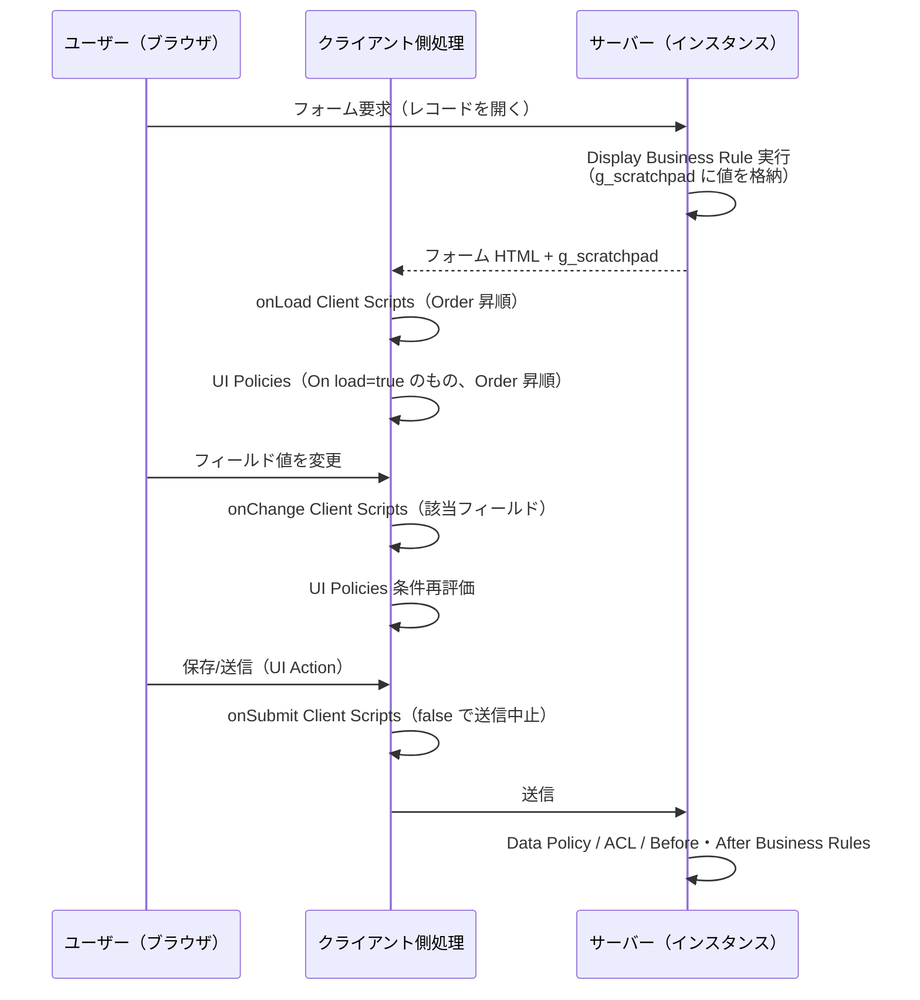
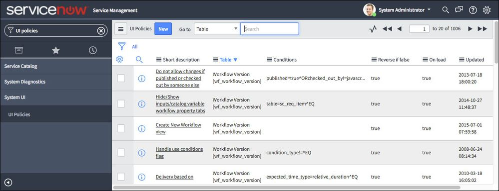

# クライアントサイドスクリプト（Client-side Scripting）

## 概要

ServiceNow のクライアントサイドスクリプト（Client-side scripting）は、ユーザーの Web ブラウザ上で JavaScript を実行し、フォームやリストの振る舞いを動的に変更する仕組みの総称である。本ファイルでは以下の構成要素を扱う。

| 構成要素 | 英語名 | 主な用途 | 定義テーブル（※） |
|---|---|---|---|
| クライアントスクリプト | Client Script | フォームのロード・値変更・送信、リストのセル編集時に JavaScript を実行 | `sys_script_client` |
| カタログクライアントスクリプト | Catalog Client Script | Service Catalog のアイテム/変数セット上で動作するクライアントスクリプト | `catalog_script_client` |
| UI ポリシー | UI Policy | 条件に応じてフィールドの必須・表示・読み取り専用をノーコードで制御 | `sys_ui_policy` / `sys_ui_policy_action` |
| UI アクション | UI Action | フォーム/リストにボタン・リンク・コンテキストメニューを追加 | `sys_ui_action` |
| UI スクリプト | UI Script | 再利用可能なクライアント側 JavaScript ライブラリ | `sys_ui_script` |
| UI ページ | UI Page | Jelly/HTML で独自ページやダイアログを作成 | `sys_ui_page` |
| クライアント API | GlideForm (`g_form`)、GlideUser (`g_user`)、GlideList2 (`g_list`)、GlideAjax、GlideModal 等 | 上記スクリプトから使うブラウザ側 API | — |

※ `sys_ui_policy` と `sys_data_policy2` は Community 記事で明記 [出典](https://www.servicenow.com/community/itsm-articles/ui-and-data-policies/ta-p/3451833)、`sys_ui_action` は GlideForm `submit()` の公式説明で明記 [出典](https://www.servicenow.com/docs/r/australia/api-reference/c_GlideFormAPI.html)。`sys_script_client`、`catalog_script_client`、`sys_ui_policy_action`、`sys_ui_script`、`sys_ui_page` は、本調査で取得できた公式ページ本文には明記がなく、インスタンス上のテーブル名として一般に知られている名前である【経験則】。

**重要な前提：** 公式ドキュメントは「Client scripts are not meant to protect unwanted access to data（クライアントスクリプトはデータへの不正アクセスを防ぐためのものではない）」と明記している。データ保護には ACL（Access Control List）やデータポリシー（Data Policy）を使う [出典](https://www.servicenow.com/docs/r/api-reference/scripts/client-scripts.html)。ACL については [アクセス制御（ACL）](./access-control-acl.md)、サーバー側のスクリプト（Business Rule、Script Include 等）については [サーバーサイドスクリプト](./scripting-server-side.md) を参照。

**対象 UI の整理：** 本ファイルの内容は主に Core UI（UI16 / Next Experience のクラシックフォーム）を対象とする。Service Portal、Configurable Workspace（構成可能なワークスペース）、モバイルでは使える API が制限される（各節で記載）。UI Builder のクライアントスクリプトやイベントは [Workspace と UI Builder](./workspaces-ui-builder.md)、Service Portal のウィジェット（AngularJS ベースのクライアントコントローラー）は [Service Portal と Employee Center](./portals-employee-center.md) を参照。

> **Brazil での変更:** 本調査で確認した Brazil 版公式ページ（Client scripts、UI pages、GlideModal、Business rules）は Australia 版と同じ仕様記述であり、クライアントサイドスクリプトに関する破壊的変更・廃止は公開情報では確認できず。

---

## 1. 全体像と実行順序

### 1.1 フォームロード〜送信までの処理の流れ

ServiceNow のフォームでは、サーバー側とクライアント側の処理が次の順序で動作する。Display Business Rule はフォーム表示前、データベースから読み込んだ直後に実行される [出典](https://www.servicenow.com/docs/csh?topicname=c_BusinessRules.html)。UI ポリシーはクライアントスクリプトの後に実行される [出典](https://www.servicenow.com/docs/bundle/yokohama-application-development/page/script/client-scripts/concept/client-script-best-practices.html)。



- クライアントスクリプトは **Order（順序）** フィールドの小さい番号から順に実行される [出典](https://www.servicenow.com/docs/bundle/yokohama-application-development/page/script/client-scripts/concept/client-script-best-practices.html)。
- UI ポリシーも Order の昇順で処理され、競合時は番号の大きい方が最終的に勝つ。継承がある場合は、拡張（子）テーブル上で定義された UI ポリシーが、親（基底）テーブルから継承したポリシーより Order に関わらず常に先に実行され、その後に基底テーブルのポリシーが実行される（いずれも Order の昇順）。そのため競合時は、後から実行される親側の設定が最終的に残り得る [出典](https://www.servicenow.com/docs/r/australia/platform-administration/t_CreateAUIPolicy.html)。
- UI ポリシーはクライアントスクリプトの後に実行されるため、同一フィールドを両者で操作すると UI ポリシー側の設定が残る [出典](https://www.servicenow.com/docs/bundle/yokohama-application-development/page/script/client-scripts/concept/client-script-best-practices.html)。

### 1.2 フォーム専用であることの意味

Client Script は、`onCellEdit` を除き**フォームと検索ページにのみ適用**され、リストには適用されない [出典](https://www.servicenow.com/docs/r/api-reference/scripts/client-scripts.html)。UI Policy は**フォームのみ**に適用され、検索画面ではサポートされない [出典](https://www.servicenow.com/docs/r/australia/platform-administration/t_CreateAUIPolicy.html)。公式ベストプラクティスも「UI policies and client scripts apply to forms only」としており、リスト編集で同じフィールドを制御したい場合は、リスト編集の無効化、Business Rule、ACL、Data Policy、または別途 `onCellEdit` スクリプトで対処する [出典](https://www.servicenow.com/docs/bundle/yokohama-application-development/page/script/client-scripts/concept/client-script-best-practices.html)。

また、UI ポリシーは Web サービス呼び出し、スクリプトからの更新、リスト編集には適用されず、技術力のあるユーザーはブラウザ側で回避し得る。サーバー側で値を強制するには Data Policy（`sys_data_policy2`）を使う【第三者情報】（ServiceNow Community 記事）[出典](https://www.servicenow.com/community/itsm-articles/ui-and-data-policies/ta-p/3451833)。

### 1.3 クライアントサイド機構の使い分け

| 要件 | 推奨機構 | 理由 |
|---|---|---|
| 条件によりフィールドを必須/表示/読み取り専用にする | UI Policy | ノーコードで Order 制御可能。公式は可能な限り UI Policy を推奨 [出典](https://www.servicenow.com/docs/bundle/yokohama-application-development/page/script/client-scripts/concept/client-script-best-practices.html) |
| 値の自動設定、選択肢の動的変更、入力チェック、メッセージ表示 | Client Script | UI Policy のアクションでは表現できない処理 |
| フォームロード時に必要なサーバーデータ | Display Business Rule + `g_scratchpad` | 追加のサーバー往復が不要 |
| ユーザー操作に応じて必要なサーバーデータ | GlideAjax（非同期） | 必要な値だけ取得できる |
| ボタン/リンク/メニューの追加 | UI Action | クライアント・サーバー双方のロジックを持てる |
| 複数スクリプトで共有する関数 | UI Script | クライアント側のライブラリ |
| 独自画面・ダイアログ | UI Page（+ GlideModal） | Jelly/HTML で自由に構成 |
| サーバー側での値の強制 | Data Policy / Business Rule / ACL | クライアント側は回避可能なため |

---

## 2. Client Scripts（クライアントスクリプト）

### 2.1 定義と作成場所

Client Script（クライアントスクリプト）は、クライアント側イベント発生時に Web ブラウザで JavaScript を実行する仕組みである。主な用途は、フィールドの表示/非表示、読み取り専用/編集可能の切り替え、ロールに応じた必須/任意の切り替え、他フィールドからの値設定、ロールに応じた選択肢の変更、メッセージ表示である [出典](https://www.servicenow.com/docs/r/api-reference/scripts/client-scripts.html)。

- **メニュー位置：** All > System Definition > Client Scripts（システム定義 > クライアントスクリプト）→ New
- **必要ロール：** `admin` [出典](https://www.servicenow.com/docs/r/api-reference/scripts/client-scripts.html)
- 実務上はフォームヘッダーのコンテキストメニュー（Configure > Client Scripts）からも作成できる【経験則】。

### 2.2 Client Script フォームのフィールド

`sys_script_client` レコードのフィールドは以下のとおり [出典](https://www.servicenow.com/docs/r/api-reference/scripts/client-scripts.html)。

| フィールド（英語） | 日本語 | 説明 |
|---|---|---|
| Name | 名前 | スクリプト名 |
| Table | テーブル | 適用するテーブル |
| UI Type | UI タイプ | `Desktop`（Core UI のみ）、`Mobile / Service Portal`（モバイル、ポータル、Configurable Workspace）、`All` |
| Type | タイプ | `onLoad`、`onSubmit`、`onChange`、`onCellEdit` |
| Field Name | フィールド名 | 反応対象フィールド。`onChange` と `onCellEdit` のときのみ表示 |
| Application | アプリケーション | 所属アプリケーション（スコープ） |
| Active | アクティブ | チェック時に有効 |
| Inherited | 継承 | 拡張（子）テーブルにも適用するか |
| Global | グローバル | チェック時、テーブルのすべてのビューで実行 |
| View | ビュー | 実行するビュー。Global をオフにした場合のみ指定可能 |
| Description | 説明 | 目的・機能の説明 |
| Messages | メッセージ | 1 行 1 文字列。スクリプト内で `getMessage('[message]')` によりローカライズ済みメッセージとして利用 |
| Script | スクリプト | スクリプト本体 |
| Isolate script | スクリプトを分離 | 新規スクリプトは strict mode で実行され、DOM への直接アクセス、および既定で jQuery・prototype・`window` オブジェクトが使えない。チェックを外すと DOM アクセスが可能になる |

- **Isolate script とシステムプロパティ：** グローバルスコープの新規スクリプトに対する strict mode の既定は、システムプロパティ `glide.script.block.client.globals` で制御する（`false` で無効化）[出典](https://www.servicenow.com/docs/r/api-reference/scripts/client-scripts.html)。
- **Order：** 公式ベストプラクティスでは Order フィールドで実行順を制御する（小さい番号が先）と記載されている [出典](https://www.servicenow.com/docs/bundle/yokohama-application-development/page/script/client-scripts/concept/client-script-best-practices.html)。なお、Order フィールドは既定のフォームレイアウトに表示されていない場合があり、フォームレイアウトの構成で追加する必要がある【経験則】。
- **Condition フィールドは存在しない：** `onLoad`/`onChange` は該当フォームの読み込みのたびに全体が実行されるため、スクリプト内でガード条件を書く必要がある [出典](https://www.servicenow.com/docs/bundle/yokohama-application-development/page/script/client-scripts/concept/client-script-best-practices.html)。

### 2.3 4 つのタイプと関数シグネチャ

| タイプ | 実行タイミング | 典型用途 | 引数 |
|---|---|---|---|
| `onLoad()` | フォームが最初に描画され、ユーザーが入力する前 | フォームの操作、既定値の設定 | なし |
| `onChange()` | 特定フィールドの値が変化したとき | 連動入力、動的な表示切り替え | `control`, `oldValue`, `newValue`, `isLoading`, `isTemplate` |
| `onSubmit()` | フォーム送信時 | 入力内容の検証。`false` を返すと送信を中止 | なし |
| `onCellEdit()` | リストエディターでセルの値が変化したとき | リスト編集時の検証 | `sysIDs`, `table`, `oldValues`, `newValue`, `callback` |

[出典](https://www.servicenow.com/docs/r/api-reference/scripts/client-scripts.html)

#### onChange の引数

| 引数 | 説明 |
|---|---|
| `control` | 値が変化した DHTML ウィジェット。**モバイル・Service Portal ではアクセス不可** |
| `oldValue` | レコード読み込み時点の値（HTML フィールドでは返されない） |
| `newValue` | 変更後の値 |
| `isLoading` | フォームロード中の変化かどうか（Boolean） |
| `isTemplate` | テンプレート適用中の変化かどうか（Boolean） |

[出典](https://www.servicenow.com/docs/r/api-reference/scripts/client-scripts.html)

> 注意：`oldValue` は「直前の値」ではなく「フォームを読み込んだ時点の値」である。同じフィールドを複数回変更しても `oldValue` はロード時の値のままとなる [出典](https://www.servicenow.com/docs/r/api-reference/scripts/client-scripts.html)。

#### onCellEdit の引数

| 引数 | 説明 |
|---|---|
| `sysIDs` | 編集対象アイテムの sys_id の配列 |
| `table` | 編集対象のテーブル |
| `oldValues` | 編集前のセルの値（配列） |
| `newValue` | 編集後の新しい値 |
| `callback` | 後続のセル編集スクリプトへ制御を渡す関数。`callback(true)` で残りのスクリプトを実行（残りがなければ変更を確定）、`callback(false)` で以降のスクリプトを停止し変更を確定させない |

[出典](https://www.servicenow.com/docs/r/api-reference/scripts/client-scripts.html)

### 2.4 テンプレートコード例

以下は新規作成時に生成される雛形と同等の構造に、公式ベストプラクティスのガード条件を加えた例である。

```javascript
// onLoad
function onLoad() {
    if (g_form.isNewRecord()) {
        g_form.setValue('impact', '3');
    }
}

// onChange（Field name = category）
function onChange(control, oldValue, newValue, isLoading, isTemplate) {
    if (isLoading || newValue === '') {
        return; // ロード時・空値では何もしない
    }
    if (newValue == oldValue) {
        return;
    }
    g_form.clearValue('subcategory');
}

// onSubmit
function onSubmit() {
    if (g_form.getValue('priority') == '1' && g_form.getValue('description') == '') {
        g_form.showFieldMsg('description', getMessage('P1 requires a description'), 'error');
        return false; // 送信を中止
    }
    return true;
}

// onCellEdit（Field name = state）
function onCellEdit(sysIDs, table, oldValues, newValue, callback) {
    var saveAndClose = true;
    if (newValue == '7') { // 例：Closed をリストから設定させない
        alert('Close from the form instead.');
        saveAndClose = false;
    }
    callback(saveAndClose);
}
```

ガード条件（`isLoading`、`newValue` の空チェック、`newValue != oldValue`）は公式ベストプラクティスの推奨事項である。ただし `newValue != oldValue` チェックは「変更して元に戻した」ケースを検出しない点に注意 [出典](https://www.servicenow.com/docs/bundle/yokohama-application-development/page/script/client-scripts/concept/client-script-best-practices.html)。`isTemplate` はテンプレート適用の検出に使う [出典](https://www.servicenow.com/docs/bundle/yokohama-application-development/page/script/client-scripts/concept/client-script-best-practices.html)。

### 2.5 制約事項

| 制約 | 内容 | 出典 |
|---|---|---|
| 適用範囲 | `onCellEdit` 以外はフォームと検索ページのみ（リストには適用されない） | [出典](https://www.servicenow.com/docs/r/api-reference/scripts/client-scripts.html) |
| モバイル | ServiceNow モバイルアプリケーションではクライアントスクリプトはサポートされない | [出典](https://www.servicenow.com/docs/r/api-reference/scripts/client-scripts.html) |
| Mobile / Service Portal | 利用可能な API が限定される（`control` 引数不可、`g_form.getControl()` 等の DOM 系メソッド不可） | [出典](https://www.servicenow.com/docs/r/australia/api-reference/c_GlideFormAPI.html) |
| セキュリティ | データ保護目的には使えない。ACL・Data Policy を使う | [出典](https://www.servicenow.com/docs/r/api-reference/scripts/client-scripts.html) |
| リスト上の値制御 | ACL、Business Rule、Data Policy、`onCellEdit`、またはテーブルのリスト編集無効化で行う | [出典](https://www.servicenow.com/docs/r/api-reference/scripts/client-scripts.html) |

> モバイルについての補足：公式ページは「ServiceNow mobile applications ではサポートされない」と記述する一方、UI Type `Mobile / Service Portal` の説明には「mobile」が含まれる。この UI Type の「mobile」が旧来のモバイル UI を指すのか、現行の Now Mobile 等を指すのかは公開情報では確認できず。モバイルアプリの UI ルール等は [モバイル](./mobile.md) を参照。

### 2.6 Catalog Client Scripts（カタログクライアントスクリプト）

Service Catalog のアイテムや変数セット（Variable Set）上では、通常の Client Script ではなく Catalog Client Script を使う。カタログ変数の値は `g_form.getValue('variable_name')` で取得でき、変数には名前（Name）が設定されている必要がある [出典](https://www.servicenow.com/docs/r/api-reference/scripts/client-scripts.html)。

- 定義テーブルは `catalog_script_client`、適用先は「A Catalog Item（カタログアイテム）」または「A Variable Set（変数セット）」で、カタログアイテム画面のほか Requested Item（要求アイテム）・Catalog Task（カタログタスク）の各フォームで実行するかをチェックボックスで選べる【経験則】（本調査では公式ページ本文を取得できず）。
- `g_form.setVariablesReadOnly()` は Service Catalog フォーム（注文画面）には適用されない。`addDecoration()`、`removeDecoration()`、`flash()`、`setLabelOf()` は Service Catalog ではサポートされない [出典](https://www.servicenow.com/docs/r/australia/api-reference/c_GlideFormAPI.html)。
- 公式の例として、`onLoad` スクリプトで変数のコントロールを取得し `maxLength` を 80 に設定して文字数を制限する方法が示されている。この制限は変数が表示されたときに動作し、注文時には動作しない [出典](https://www.servicenow.com/docs/r/api-reference/scripts/client-scripts.html)。
- Catalog UI Policy（カタログ UI ポリシー）は通常の UI Policy とは別モデルである [出典](https://www.servicenow.com/docs/r/australia/platform-administration/t_CreateAUIPolicy.html)。詳細は [サービスカタログ](./service-catalog.md) を参照。

---

## 3. GlideForm（`g_form`）

### 3.1 概要

GlideForm クライアント API はグローバルオブジェクト `g_form` として提供され、フォームとフィールドの操作（値の取得・設定、表示制御、メッセージ表示、選択肢操作、セクション/関連リスト操作）を行う。Client Script、UI Policy のスクリプト、クライアント UI Action から利用できる [出典](https://www.servicenow.com/docs/r/australia/api-reference/c_GlideFormAPI.html)。

### 3.2 値の取得・設定

| メソッド | 説明 |
|---|---|
| `getValue(fieldName)` | フィールド値を文字列で返す（多行変数セットのデータも取得可能） |
| `setValue(fieldName, value[, displayValue])` | 値を設定。参照フィールドでは sys_id と表示値を併せて渡すとサーバー往復を回避 |
| `clearValue(fieldName)` | 値をクリア |
| `getBooleanValue(fieldName)` | Boolean として取得 |
| `getIntValue(fieldName)` | 整数として取得 |
| `getDecimalValue(fieldName)` | 小数として取得 |
| `getDisplayValue(fieldName)` | 表示値を取得（Service Portal）。Core UI で引数なしの場合はレコードの表示値を返す |
| `getDisplayBox(fieldName)` | Core UI の参照フィールドの表示用要素を返す（`.value` で表示値） |
| `getReference(fieldName, callback)` | 参照先レコードを GlideRecord として取得。**コールバック指定を強く推奨**（省略すると同期実行でブラウザをブロック）。見つからない場合は `currentRow = -1`、`rows.length = 0` の GlideRecord |
| `getUniqueValue()` | レコードの sys_id |
| `getTableName()` | テーブル名 |
| `isNewRecord()` | 未保存の新規レコードなら `true` |
| `getActionName()` | 直近のアクション名、またはクリックされた UI Action の sys_id を返す（Wizard クライアントスクリプトでは使用不可） |

[出典](https://www.servicenow.com/docs/r/australia/api-reference/c_GlideFormAPI.html)

**`setValue()` の注意点：**

- 参照フィールドでは第 3 引数に表示値を渡す。省略すると表示値を取得するための同期サーバー呼び出しが発生する [出典](https://www.servicenow.com/docs/bundle/yokohama-application-development/page/script/client-scripts/concept/client-script-best-practices.html)。
- List Collector / GlideList フィールドでは sys_id の配列と表示値の配列を渡す。
- 厳格な読み取り専用（strict read-only）フィールドは更新できず、ブラウザコンソールに警告が出る。
- 読み取り専用にしたフィールドは `setValue()` で更新できないため、先に `setReadOnly(field, false)` にする。
- `onChange` 内での `setValue()` はスタックオーバーフローを招くことがあるため、新旧の値が異なることを確認してから設定する。

[出典](https://www.servicenow.com/docs/r/australia/api-reference/c_GlideFormAPI.html)

```javascript
// 参照フィールドに sys_id と表示値を同時設定（サーバー往復なし）
g_form.setValue('assigned_to', userSysId, userDisplayName);
```

### 3.3 フィールドの状態制御

| メソッド | 説明 |
|---|---|
| `setMandatory(fieldName, mandatory)` | 必須/任意 |
| `setReadOnly(fieldName, readOnly)` | 読み取り専用/編集可 |
| `setDisabled(fieldName, disable)` | 有効/無効 |
| `setDisplay(fieldName, display)` | 表示/非表示（非表示時、空いたスペースは他の項目の表示に使われる） |
| `setVisible(fieldName, display)` | 表示/非表示（デスクトップ UI では非表示時にスペースが空白のまま残る。Mobile / Service Portal では他フィールドが埋める） |
| `isMandatory(fieldName)` / `isVisible(fieldName)` | 状態の確認 |
| `setLabelOf(fieldName, label)` / `getLabelOf(fieldName)` | ラベルの設定/取得 |
| `addDecoration(fieldName, icon, title[, color])` / `removeDecoration(...)` | ラベル横にアイコンを付与/削除 |
| `flash(fieldName, color, count)` | ラベルを点滅 |
| `setVariablesReadOnly(isReadOnly)` | カタログ変数エディター全体を読み取り専用に |

[出典](https://www.servicenow.com/docs/r/australia/api-reference/c_GlideFormAPI.html)

- 必須フィールドを読み取り専用にするには、先に `setMandatory(field, false)` で必須を外す必要がある。
- `setReadOnly()` と `setMandatory()` は、可能であれば UI Policy で実現することが推奨されている。
- `setDisplay()` と `setVisible()` の違い：公式ページによれば、`setDisplay(false)` は非表示にしたフィールドのスペースを他の項目の表示に使う（"the space is used to display other items"）。`setVisible(false)` はデスクトップ UI ではスペースを空白のまま残し（"On desktop UI, the space is left blank when hidden"）、Mobile / Service Portal UI では他フィールドがそのスペースを埋める。

[出典](https://www.servicenow.com/docs/r/australia/api-reference/c_GlideFormAPI.html)

### 3.4 メッセージ表示

| メソッド | 表示位置 | 備考 |
|---|---|---|
| `addInfoMessage(message)` | フォーム上部 | 情報 |
| `addErrorMessage(message)` | フォーム上部 | エラー |
| `addSuccessMessage` / `addHighMessage` / `addModerateMessage` / `addLowMessage` | フォーム上部 | 種類・優先度別 |
| `addFormMessage(message, type, options)` | フォーム詳細領域（フローティング） | `type`：`error`/`info`/`warning`。ボタン付与可能 |
| `clearMessages()` | — | `addInfoMessage()`/`addErrorMessage()` のメッセージを消去 |
| `clearFormMessages(type)` / `clearAllFormMessages()` | — | フォームメッセージの消去 |
| `showFieldMsg(field, message, type[, scrollForm])` | フィールド直下 | `type`：`error`/`info`/`warning`。`scrollForm` 既定 `true`（画面外ならスクロール）。Core UI の journal フィールドでは動作しない |
| `showErrorBox(name, message[, scrollForm])` | フィールド直下 | `showFieldMsg` のエラー簡易版。スクロールは `glide.ui.scroll_to_message_field` プロパティで制御 |
| `hideFieldMsg(fieldName, clearAll)` / `hideAllFieldMsgs([type])` / `hideErrorBox(fieldName)` | — | フィールドメッセージの非表示 |

[出典](https://www.servicenow.com/docs/r/australia/api-reference/c_GlideFormAPI.html)

> 公式ページでは、`addErrorMessage()`、`addHighMessage()`、`addInfoMessage()`、`addLowMessage()`、`addModerateMessage()`、`addSuccessMessage()` の 6 メソッドについて、メッセージは約 4 秒表示された後に消え、このタイムアウトは現時点で変更できないと記載されている。`addFormMessage()` にはこの記載がない（GlideForm ページの記載。表示する UI により挙動が異なる可能性は公開情報では確認できず）[出典](https://www.servicenow.com/docs/r/australia/api-reference/c_GlideFormAPI.html)。

### 3.5 選択肢（Choice list）の操作

| メソッド | 説明 |
|---|---|
| `addOption(fieldName, choiceValue, choiceLabel[, choiceIndex])` | 選択肢を追加（インデックスは 0 始まり、省略時は末尾）。Service Portal では重複ラベルは無視 |
| `removeOption(fieldName, choiceValue)` | 選択肢を削除 |
| `clearOptions(fieldName)` | 全選択肢を削除 |
| `enableChoice` / `disableChoice(fieldName, choiceValue)` | 選択肢の有効/無効 |
| `setChoiceLabel(fieldName, choiceValue, newLabel)` | 選択肢ラベルの変更 |
| `getOption(fieldName, choiceValue)` | `<option>` 要素を返す（なければ null） |
| `getChoice(fieldName, choiceValue)` | GlideFormChoice オブジェクト（なければ null） |
| `getOptions(fieldName)` | 選択済みオプションと `getAvailable(term)`（Promise を返す）を返す。非対応フィールドでは null |
| `refreshSlushbucket(fieldName)` | List Collector（スラッシュバケット）を再描画 |

[出典](https://www.servicenow.com/docs/r/australia/api-reference/c_GlideFormAPI.html)

### 3.6 セクション・関連リスト・添付・その他

| メソッド | 説明 |
|---|---|
| `setSectionDisplay(sectionName, display)` | セクションの表示/非表示 |
| `getSectionNames()` / `getSections()` / `isSectionVisible(sectionName)` | セクション情報（`isSectionVisible()` は Workspace 非対応） |
| `hideRelatedList(listTableName)` / `showRelatedList(...)` / `hideRelatedLists()` / `showRelatedLists()` | 関連リストの表示制御（モバイルでは無効） |
| `getRelatedListNames()` | 関連リスト名一覧 |
| `hideRelatedLinks()` / `showRelatedLinks()` / `setRelatedLinksDisplay(display)` | Related Links セクションの表示制御 |
| `disableAttachments()` / `enableAttachments()` | 添付の可否（モバイルでは無効） |
| `hideTemplateBar()` / `showTemplateBar()` | テンプレートバー |
| `getAnnotations()` / `getAnnotationByName(name)` / `showAnnotation` / `hideAnnotation` / `toggleAnnotations()` | 注釈（アノテーション） |
| `onUserChangeValue(fn)` | ユーザーによるフィールド編集を監視し、登録解除関数を返す |
| `isLiveUpdating()` | ライブ更新適用中なら `true` |
| `save()` | 保存してフォームに留まる |
| `submit([verb])` | 保存して元の画面へ戻る。`verb` を指定すると、表示中フォームボタンに対応する `sys_ui_action` の `action_name` の UI Action を実行 |

[出典](https://www.servicenow.com/docs/r/australia/api-reference/c_GlideFormAPI.html)

### 3.7 DOM 系メソッドと UI ごとの可用性

| メソッド | Core UI | Mobile / Service Portal |
|---|---|---|
| `getControl(fieldName)` | 利用可 | 利用不可（モバイルでは非推奨） |
| `getElement(id)` | 利用可 | 利用不可 |
| `getFormElement()` | 利用可 | 利用不可 |
| `getHelpTextControl(fieldName)` | 利用可 | モバイルでは非推奨 |

[出典](https://www.servicenow.com/docs/r/australia/api-reference/c_GlideFormAPI.html)

公式ベストプラクティスは DOM 操作を避け、GlideForm API を使うよう求めている。DOM 操作は要素 ID やセレクターに依存し、ブラウザやプラットフォームの更新で壊れる保守リスクがある [出典](https://www.servicenow.com/docs/bundle/yokohama-application-development/page/script/client-scripts/concept/client-script-best-practices.html)。なお Isolate script が有効なスクリプトでは DOM・jQuery・`window` に直接アクセスできない（2.2 節）。

---

## 4. GlideUser（`g_user`）

GlideUser クライアント API はグローバルオブジェクト `g_user` として、現在のログインユーザーの情報とロール判定を提供する。`getClientData()` 以外は既定で利用可能なセッション情報にアクセスする [出典](https://www.servicenow.com/docs/r/api-reference/c_GlideUserAPI.html)。

### 4.1 プロパティ

| プロパティ | 説明 |
|---|---|
| `g_user.firstName` | 名 |
| `g_user.lastName` | 姓 |
| `g_user.userName` | ログイン名（User ID） |
| `g_user.userID` | ユーザーの sys_id |

### 4.2 メソッド

| メソッド | 戻り値 | 説明 |
|---|---|---|
| `getFullName()` | String | 姓名 |
| `hasRole(role[, includeDefaults])` | Boolean | 指定ロール**または `admin`** を持つと `true` |
| `hasRoleExactly(role[, includeDefaults])` | Boolean | 指定ロールそのものを持つ場合のみ `true`（`admin` でも持っていなければ `false`） |
| `hasRoleFromList(roles[, includeDefaults])` | Boolean | カンマ区切りロールのいずれか、または `admin` を持つと `true` |
| `hasRoles([includeDefaults])` | Boolean | 何らかのロールを持つと `true` |
| `getClientData(key)` | String | サーバー側で `GlideSession.putClientData()` により設定した値を取得 |
| `setClientData(key, value)` | void | クライアント側で値を保存 |

- `includeDefaults`（任意、既定 `false`）を `true` にすると、`snc_internal`、`snc_external` などの既定ロールも判定対象に含める。

[出典](https://www.servicenow.com/docs/r/api-reference/c_GlideUserAPI.html)

> ロールによる表示制御はあくまで UX 上の制御であり、データ保護は ACL で行う（[ユーザー・グループ・ロール](./users-groups-roles.md)、[アクセス制御（ACL）](./access-control-acl.md)）。

---

## 5. GlideList2（`g_list`）

GlideList2 クライアント API はリスト（Core UI のリストビュー）を操作する。UI コンテキストメニューや UI Action から使う。`g_list` 変数はリストの UI Action（List link 等）では使えるが、**関連リスト（related list）のフォームリンク UI Action では使えない**。その場合は `GlideList2.get(listId)` でリストオブジェクトを取得する [出典](https://www.servicenow.com/docs/r/api-reference/c_GlideList2API.html)。

| メソッド | 説明 |
|---|---|
| `GlideList2.get(listId / DOMelement)` | GlideList2 オブジェクトを取得（見つからなければ null） |
| `getChecked()` | チェックされた行の sys_id をカンマ区切り文字列で返す |
| `getTableName()` / `getListName()` / `getTitle()` / `getView()` | テーブル名・リスト名・タイトル・ビュー |
| `getParentTable()` / `getRelated()` | 関連リストの親テーブル / 関連付けフィールド |
| `getQuery(orderBy, groupBy, fixed, all)` | エンコードクエリを取得 |
| `getFixedQuery()` | ユーザーが削除できない固定クエリ |
| `getOrderBy()` / `getGroupBy()` | 並び順 / グループ化 |
| `addFilter(filter)` | フィルター条件を 1 項追加 |
| `setFilter(filter)` | エンコードクエリを設定（orderBy/groupBy は無視） |
| `setFilterAndRefresh(filter)` | クエリ（orderBy/groupBy 含む）を設定して再描画 |
| `refresh(firstRow, additionalParms)` / `refreshWithOrderBy(...)` | 再描画 |
| `setOrderBy` / `setGroupBy` / `sort(field)` / `sortDescending(field)` | 並び替え・グループ化 |
| `setFirstRow(rowNum)` / `setRowsPerPage(rows)` | ページング |
| `showHideList` / `toggleList` / `toggleListNoPref` / `showHideGroups` | 表示切替（Pref 付きはユーザー設定に保存） |
| `isUserList()` | ユーザーがリストレイアウトを変更していれば `true` |

[出典](https://www.servicenow.com/docs/r/api-reference/c_GlideList2API.html)

```javascript
// List choice / List banner button のクライアント UI Action 例（Onclick = bulkAction()）
function bulkAction() {
    var ids = g_list.getChecked(); // "sys_id1,sys_id2,..." 形式
    if (!ids) {
        return;
    }
    // GlideAjax でサーバー処理へ渡す等
}

// g_list が使えない文脈では GlideList2.get() でリストを取得
function bulkActionByListId(listId) {
    var list = GlideList2.get(listId);
    if (list == null) {
        return;
    }
    var ids = list.getChecked();
}
```

※ 上記コードは公式の `getChecked()` / `GlideList2.get()` の説明に基づく構造例であり、リスト ID の決め方は画面構成により異なる【経験則】。

---

## 6. サーバーデータの取得：`g_scratchpad` と GlideAjax

### 6.1 方針

公式ベストプラクティスは、クライアントからのサーバー検索を最小化し、次の優先順位を示している [出典](https://www.servicenow.com/docs/bundle/yokohama-application-development/page/script/client-scripts/concept/client-script-best-practices.html)。

1. クライアント側に既にあるデータを使う。
2. フォームロード時に分かるデータは Display Business Rule で `g_scratchpad` に格納する（効率的だが動的要求には応えられない）。
3. ユーザー操作に応じて必要なデータは**非同期** GlideAjax（`getXML`/`getXMLAnswer`）で取得する。同期の `getXMLWait` は避ける。
4. クライアント側 GlideRecord と `g_form.getReference()` は、通常 1 項目しか要らないのに全フィールドを取得するため推奨されない。

### 6.2 `g_scratchpad`

`g_scratchpad` は Display Business Rule（`when = display`）でサーバー側から値を設定し、クライアントスクリプト（`onLoad`/`onChange`/`onSubmit`）で読み取るオブジェクトである。Display Business Rule は「フォームがユーザーに表示される前、データベースから読み込んだ直後」に実行される [出典](https://www.servicenow.com/docs/csh?topicname=c_BusinessRules.html)、[出典](https://www.servicenow.com/docs/bundle/yokohama-application-development/page/script/client-scripts/concept/client-script-best-practices.html)。

```javascript
// Display Business Rule（サーバー側、Table = incident, When = display）
(function executeRule(current, previous /*null when async*/) {
    g_scratchpad.callerVip = current.caller_id.vip.toString();
    g_scratchpad.managerName = current.caller_id.manager.getDisplayValue();
})(current, previous);

// onLoad Client Script（クライアント側）
function onLoad() {
    if (g_scratchpad.callerVip == 'true') {
        g_form.addDecoration('caller_id', 'icon-star', 'VIP');
    }
}
```

- 値はフォームロード時にのみ渡され、後から再取得はできない。動的に必要なら GlideAjax を使う【第三者情報】（Community）[出典](https://www.servicenow.com/community/developer-forum/g-scratchpad-functionality-and-its-use/m-p/1772883)。

### 6.3 GlideAjax

GlideAjax はクライアントスクリプトからサーバー側の Script Include（スクリプトインクルード）のメソッドを呼び出す API である [出典](https://www.servicenow.com/docs/r/australia/api-reference/c_GlideAjaxAPI.html)。

#### メソッド一覧

| メソッド | 説明 |
|---|---|
| `new GlideAjax(class_name)` | 呼び出す Script Include 名を指定して生成 |
| `addParam(parm_name, parm_value)` | パラメーターを追加。**パラメーター名は `sysparm_` で始める**。最初に `sysparm_name` で呼び出すメソッド名を指定 |
| `getXML(callback)` | 非同期実行。コールバックはレスポンス（XML）を受け取る。**公式推奨** |
| `getXMLAnswer(callback[, additionalParam, responseParam])` | 非同期実行。レスポンスの answer 値をコールバックに直接渡す |
| `getXMLWait()` | 同期実行。後続で `getAnswer()` を呼ぶ。**スコープアプリでは使用不可**。UI がフリーズする |
| `getAnswer()` | `getXMLWait()` の結果を取得 |

- サーバー側コードは `getXML()` または `getXMLAnswer()` が呼ばれるまで実行されない。

[出典](https://www.servicenow.com/docs/r/australia/api-reference/c_GlideAjaxAPI.html)

#### サーバー側（Script Include）

Script Include は `global.AbstractAjaxProcessor` を継承し、`this.getParameter('sysparm_xxx')` でパラメーターを受け取る [出典](https://www.servicenow.com/docs/r/australia/api-reference/c_GlideAjaxAPI.html)。Script Include の **Client callable（クライアント呼び出し可能）** チェックボックスを有効にする必要がある【経験則】（Script Include の詳細は [サーバーサイドスクリプト](./scripting-server-side.md)）。

```javascript
// Script Include: GetUserInfo（Client callable = true）
var GetUserInfo = Class.create();
GetUserInfo.prototype = Object.extendsObject(global.AbstractAjaxProcessor, {
    managerName: function() {
        var userId = this.getParameter('sysparm_user_id');
        var gr = new GlideRecord('sys_user');
        var result = {};
        if (gr.get(userId)) {
            result.manager = gr.manager.getDisplayValue();
            result.managerId = gr.getValue('manager');
        }
        return JSON.stringify(result);
    },
    type: 'GetUserInfo'
});
```

```javascript
// Client Script（onChange, Field name = caller_id）
function onChange(control, oldValue, newValue, isLoading, isTemplate) {
    if (isLoading || newValue === '') {
        return;
    }
    var ga = new GlideAjax('GetUserInfo');
    ga.addParam('sysparm_name', 'managerName');
    ga.addParam('sysparm_user_id', newValue);
    ga.getXMLAnswer(function(answer) {
        var data = JSON.parse(answer);
        if (data.manager) {
            g_form.addInfoMessage('Manager: ' + data.manager);
        }
    });
}
```

- 戻り値は JSON 文字列にしてクライアントで `JSON.parse` するのが扱いやすい。XML 要素（`newItem`）を組み立てて返す方式もある【第三者情報】（Community 記事）[出典](https://www.servicenow.com/community/developer-articles/glideajax-return-values-json-and-xml-example-sentences/ta-p/2322049)。
- 公式例には、`getXMLAnswer()` の第 2・第 3 引数で追加情報（タイムスタンプや sys_id）をコールバックへ渡す例、`getXML()` でコメントをサーバー検証してから送信する例がある [出典](https://www.servicenow.com/docs/r/australia/api-reference/c_GlideAjaxAPI.html)。
- **onSubmit での注意【経験則】：** 非同期呼び出しの結果を待ってから `onSubmit` の戻り値を決めることはできないため、送信前検証にサーバー判定が必要な場合は、`onSubmit` でいったん `false` を返し、コールバック内で `g_form.submit()`（または `g_form.submit(actionName)`）を呼び直すパターンが一般に用いられる。

### 6.4 `getReference` を使う場合

`g_form.getReference(fieldName, callback)` は参照先レコードを GlideRecord として取得する。コールバックを省略すると同期実行になりブラウザがブロックされる。全フィールドを取得するため、公式はパフォーマンス上推奨していない [出典](https://www.servicenow.com/docs/r/australia/api-reference/c_GlideFormAPI.html)、[出典](https://www.servicenow.com/docs/bundle/yokohama-application-development/page/script/client-scripts/concept/client-script-best-practices.html)。

```javascript
g_form.getReference('caller_id', function(caller) {
    if (caller.vip == 'true') {
        g_form.showFieldMsg('caller_id', 'VIP caller', 'info');
    }
});
```

---

## 7. UI Policies（UI ポリシー）

### 7.1 概要

UI Policy（UI ポリシー）は、条件に応じてフォーム上のフィールドの必須（Mandatory）・表示（Visible）・読み取り専用（Read only）を動的に変更する仕組みで、スクリプトなしで設定できる。必要に応じてスクリプトも実行できる [出典](https://www.servicenow.com/docs/r/australia/platform-administration/t_CreateAUIPolicy.html)。

- **メニュー位置：** All > System UI > UI Policies（システム UI > UI ポリシー）
- **必要ロール：** `ui_policy_admin`（または `admin`）
- **適用範囲：** クライアント側のみ。検索画面ではサポートされない。

[出典](https://www.servicenow.com/docs/r/australia/platform-administration/t_CreateAUIPolicy.html)



**図：UI Policies のリスト画面（UI16、2017 年時点の画面）**
画面説明：左側のアプリケーションナビゲーターでフィルターに「UI policies」と入力し、System UI > UI Policies を開いた状態。右側に UI Policy レコードのリストが表示され、列は Short description（簡単な説明）、Table（テーブル、例：Workflow Version [wf_workflow_version]）、Conditions（エンコードクエリ形式の条件）、Reverse if false、On load、Updated（更新日時）。リスト上部に New ボタンと検索ボックスがある。現行の Next Experience UI では外観（ヘッダー、ナビゲーター）が異なるが、リストの列と項目は同様である。
出典：ServiceNow Community「Six ways to improve the performance of client scripts」（Dawn Jurek, ServiceNow 社員, 2017-06-21）https://www.servicenow.com/community/developer-blog/six-ways-to-improve-the-performance-of-client-scripts/ba-p/2288154 （取得日：2026-11-03）

### 7.2 UI Policy フォームのフィールド

| フィールド（英語） | 日本語 | 説明 |
|---|---|---|
| Table | テーブル | 対象フォームのテーブル |
| Active | アクティブ | 有効なポリシーのみ適用 |
| Short description | 短い説明 | ポリシーの概要 |
| Order | 順序 | 昇順で処理。競合時は大きい番号が勝つ。継承時は、拡張（子）テーブル上で定義されたポリシーが、親（基底）テーブルから継承したポリシーより Order に関わらず先に実行され、その後に基底テーブルのポリシーが実行される（いずれも昇順） |
| Conditions | 条件 | 条件ビルダーで設定。**ユーザーが手動でフィールドを変更したときにのみ再評価** |
| Global | グローバル | 全ビューに適用。オフにすると View を指定 |
| View | ビュー | 適用ビュー（Global オフ時のみ表示。空欄は Default ビュー） |
| Reverse if false | 偽の場合は逆にする | 条件が偽のときアクションを元に戻す |
| On load | ロード時 | フィールド変更時だけでなくフォームロード時にも実行 |
| Inherit | 継承 | 拡張（子）テーブルにも適用 |
| Run scripts | スクリプトを実行 | 真/偽時のスクリプトを有効化 |
| Execute if true | 真の場合に実行 | 条件成立時のスクリプト（Run scripts 必須） |
| Execute if false | 偽の場合に実行 | 条件不成立かつ Reverse if false 選択時のスクリプト（Run scripts 必須） |
| Run scripts in UI type | スクリプトを実行する UI タイプ | `Desktop`、`Mobile / Service Portal`、`Both` |

[出典](https://www.servicenow.com/docs/r/australia/platform-administration/t_CreateAUIPolicy.html)

### 7.3 UI Policy Actions（UI ポリシーアクション）

UI Policy Action は、ポリシーの条件成立時に各フィールドへ適用する状態を定義する（関連リスト「UI Policy Actions」から作成）。

| フィールド | 値 | 説明 |
|---|---|---|
| Table | 読み取り専用 | 対象テーブル |
| Field name | — | 対象フィールド。フォームにそのフィールドがない場合、同名の変数に適用される |
| Mandatory | Leave alone / True / False | 必須の設定 |
| Visible | Leave alone / True / False | 表示の設定 |
| Read only | Leave alone / True / False | 読み取り専用の設定 |
| Clear the field value | チェックボックス | 値のクリア【経験則】（公式ページの抽出結果では説明を確認できず） |

[出典](https://www.servicenow.com/docs/r/australia/platform-administration/t_CreateAUIPolicy.html)

`Leave alone`（変更しない）を指定すると、そのプロパティは他のポリシーやスクリプトの設定に委ねられる。

### 7.4 動作上の注意

| 注意点 | 内容 |
|---|---|
| 条件の評価対象 | フォーム上に表示されていないフィールドも含め、すべてのフィールドで条件を評価する |
| 条件の再評価タイミング | UI Action、コンテキストメニュー、リストエディターによる変更では条件チェックが走らない。ユーザーの手動変更で再評価される |
| Reverse if false をオフにした場合 | 条件が偽になってもアクションは元に戻らない（既に適用された状態が残る） |
| Fuji より前に作成されたポリシー | 以前はスキップされていたフィールドも評価されるよう評価方法が変わっている |
| カタログ | カタログアイテム・変数セットのポリシーは別モデル（Catalog UI Policy） |
| 実行順序 | クライアントスクリプトの後に実行される |

[出典](https://www.servicenow.com/docs/r/australia/platform-administration/t_CreateAUIPolicy.html)、[出典](https://www.servicenow.com/docs/bundle/yokohama-application-development/page/script/client-scripts/concept/client-script-best-practices.html)

> Order が同じ値の UI ポリシーが同一フィールドを操作すると、実行順が予測できず競合が起こり得る【第三者情報】[出典](https://www.servicenow.com/community/itsm-articles/ui-and-data-policies/ta-p/3451833)。

### 7.5 UI Policy と Data Policy の比較

| 観点 | UI Policy | Data Policy |
|---|---|---|
| 実行場所 | クライアント（ブラウザ） | サーバー |
| 制御できる属性 | Mandatory / Visible / Read only | Mandatory / Read only（Visible はなし） |
| 適用範囲 | フォーム UI のみ。スクリプト、Web サービス、リスト編集には適用されない | DB 書き込み全般（違反時は Data Policy Exception で拒否） |
| スクリプト | Execute if true/false あり | 条件ビルダーのみ |
| 定義テーブル | `sys_ui_policy` | `sys_data_policy2` |
| 変換 | UI Policy → Data Policy 変換は「Run scripts オフ・Global オン・Visible を変えるアクションなし」の場合のみ可能 | — |

【第三者情報】（ServiceNow Community 記事）[出典](https://www.servicenow.com/community/itsm-articles/ui-and-data-policies/ta-p/3451833)

---

## 8. UI Actions（UI アクション）

### 8.1 概要

UI Action（UI アクション）は、フォームやリストにボタン・リンク・コンテキストメニュー項目を追加し、クリック時にスクリプトを実行する仕組みである。クライアント側のみ、サーバー側のみ、または両方（ハイブリッド）のロジックを持てる。

- **メニュー位置：** All > System Definition > UI Actions（システム定義 > UI アクション）
- **必要ロール：** `ui_action_admin` または `admin`

[出典](https://www.servicenow.com/docs/r/SbrhqYG7UKQCk7uYwvgVBA/DmTJ3fUFHNvE121K4_gaHA)（Xanadu 版。Australia 版で同等内容のページ本文は本調査では取得できず）

### 8.2 UI Action フォームのフィールド

| フィールド（英語） | 日本語 | 説明 |
|---|---|---|
| Name | 名前 | ボタン・リンク・メニュー項目に表示されるテキスト |
| Table | テーブル | 表示するテーブル。子テーブルは既定で継承。`Global` で全テーブル |
| Order | 順序 | ボタンは左→右、メニューは上→下の表示順 |
| Action name | アクション名 | スクリプトから参照する一意な名前（`gsftSubmit`、`g_form.submit(verb)` で使用） |
| Active | アクティブ | 有効化 |
| Show insert | 挿入時に表示 | 未保存の新規レコードで表示 |
| Show update | 更新時に表示 | 既存レコードで表示 |
| Client | クライアント | ブラウザで実行。オンにすると Onclick フィールドが表示される |
| Form button | フォームボタン | フォームにボタンを表示 |
| Form context menu | フォームコンテキストメニュー | フォームヘッダーの右クリックメニューに追加 |
| Form link | フォームリンク | フォームの Related Links に追加 |
| List banner button | リストバナーボタン | リスト上部（バナー）にボタン。条件は**先頭行のみ**で評価されるため、レコード固有の条件は避ける |
| List bottom button | リスト下部ボタン | リスト下部にボタン。条件に関わらず表示され、実行時にレコードごとに評価 |
| List context menu | リストコンテキストメニュー | リストのセル右クリックメニューに追加（条件で `current` は使えない） |
| List choice | リスト選択肢 | リスト下部のアクション選択リストに追加。条件に関わらず表示 |
| List link | リストリンク | リストの Related Links に追加 |
| Workspace Form Button / Workspace Form Menu | ワークスペースフォームボタン/メニュー | Workspace の UI Action ボタン/メニューに表示 |
| Format for Configurable Workspace | 構成可能なワークスペース用の形式 | オンで Configurable Workspace に適用。オフだと Legacy Workspace に適用 |
| Workspace Client Script | ワークスペースクライアントスクリプト | Workspace で実行するクライアントスクリプト |
| Onclick | — | 実行する JavaScript 関数名（Script フィールド内で定義）。Client オン時に表示 |
| Condition | 条件 | UI Action を表示する条件を制限する JavaScript 条件式。**常にサーバー側で評価**（"Conditions always run on the server"）。Condition が空の場合の扱いは公開情報では確認できず（実務上は表示条件なしとして他の設定に従い表示される【経験則】） |
| Script | スクリプト | 実行コード。関数名は一意にする |
| Hint | ヒント | マウスオーバー時のツールチップ |
| Comments | コメント | 説明メモ |
| Messages | メッセージ | 1 行 1 キー。`sys_ui_message` テーブルからローカライズ文字列を取得 |
| Form style / List style | スタイル | Primary（青）、Destructive（赤）、Unstyled |
| Overrides | 上書き | 親テーブルの UI Action を上書き |
| Role（関連リスト「UI Action Roles」） | ロール | 表示に必要なロール |
| UI Action Visibility（関連リスト） | 表示ビュー | 表示するフォームビューの指定 |

[出典](https://www.servicenow.com/docs/r/SbrhqYG7UKQCk7uYwvgVBA/DmTJ3fUFHNvE121K4_gaHA)

- **Client をオンにした場合はスクリプトを関数で包む**。包まないとページ読み込み時に実行されてしまう。
- リダイレクトには Script フィールドで `action.setRedirectURL()` を使う（GlideRecord を渡すとそのレコードを開く）。

[出典](https://www.servicenow.com/docs/r/SbrhqYG7UKQCk7uYwvgVBA/DmTJ3fUFHNvE121K4_gaHA)

### 8.3 クライアントとサーバーの両方を実行する（`gsftSubmit` パターン）

1 つの UI Action でクライアント側の確認処理を行ってからサーバー側の処理を実行する定番パターンである。Client をオンにし、Onclick に関数名、Action name に一意な名前を設定する。

```javascript
// UI Action: Client = true, Onclick = resolveIncident(), Action name = resolve_incident_custom
function resolveIncident() {
    // クライアント側：入力チェック
    // ベースシステムの incident では解決時に close_code（Resolution code）と
    // close_notes（Resolution notes）が必須。実環境のポリシーに合わせること【経験則】
    var ok = true;
    if (g_form.getValue('close_code') == '') {
        g_form.setMandatory('close_code', true);
        g_form.showFieldMsg('close_code', 'Resolution code is required', 'error');
        ok = false;
    }
    if (g_form.getValue('close_notes') == '') {
        g_form.setMandatory('close_notes', true);
        g_form.showFieldMsg('close_notes', 'Resolution notes are required', 'error');
        ok = false;
    }
    if (!ok) {
        return false;
    }
    // 同じ UI Action をサーバー側で再実行させる
    gsftSubmit(null, g_form.getFormElement(), 'resolve_incident_custom');
}

// サーバー側：ブラウザ外（サーバー）で評価されたときだけ実行
if (typeof window == 'undefined') {
    serverResolve();
}

function serverResolve() {
    current.state = 6; // Resolved
    current.update();
    action.setRedirectURL(current);
}
```

- `gsftSubmit` に渡すアクション名が UI Action の Action name と一致しないと、サーバー側処理は実行されない【第三者情報】[出典](https://www.servicenow.com/community/developer-forum/gsft-submit-not-working/td-p/1842918)。
- `gsftSubmit` を使わないとクライアント型 UI Action のサーバースクリプトは実行されない【第三者情報】[出典](https://www.servicenow.com/community/developer-forum/%EF%B8%8F-demystifying-ui-actions-in-servicenow-everything-you-need-to/m-p/3321040)。
- `gsftSubmit` は DOM（`g_form.getFormElement()`）に依存するため、代替として GlideAjax でサーバー処理を呼ぶ方法も提案されている【第三者情報】[出典](https://www.servicenow.com/community/developer-articles/calling-server-script-from-client-sided-ui-action-without-using/ta-p/3122036)。
- `g_form.submit(actionName)` は表示中のフォームボタンに対応する UI Action を実行する公式 API である [出典](https://www.servicenow.com/docs/r/australia/api-reference/c_GlideFormAPI.html)。
- 公式 API リファレンスには「UI Action でクライアントとサーバーのコードを使う（Using client and server code in a UI action）」ページがある。クライアント関数で入力を検証してから、Action name を指定して `gsftSubmit` を呼び、サーバー側関数で状態を更新するインシデント解決の例が載っている。また、`gsftSubmit` に渡すアクション名は UI Actions テーブル（`sys_ui_action`）のレコードと一致させる必要がある、と記載されている [出典](https://www.servicenow.com/docs/r/fr-FR/washingtondc/api-reference/scripts/using-client-server-code-ui-action.html)。ただし、本調査で確認できたのは Washington DC リリース仏語版の検索結果の要約だけである。ページ本文は直接取得できず（404）、英語版・Australia 版の URL も確認できていない（16章参照）。

### 8.4 UI ごとの注意

- **Service Portal：** クライアント側 UI Action は Service Portal のフォームには表示されない。ポータルで使うにはサーバー側のみの UI Action にする【第三者情報】[出典](https://www.servicenow.com/community/developer-forum/cancel-comment-mandatory-on-service-portal/td-p/2671383)。
- **Configurable Workspace：** Workspace Form Button / Workspace Form Menu、Format for Configurable Workspace、Workspace Client Script で制御する [出典](https://www.servicenow.com/docs/r/SbrhqYG7UKQCk7uYwvgVBA/DmTJ3fUFHNvE121K4_gaHA)。Workspace のクライアントスクリプトでは Core UI の `g_form` とは別系統の API（`g_modal` 等の Next Experience 向けクライアント API）を使う。詳細は [Workspace と UI Builder](./workspaces-ui-builder.md) を参照。

---

## 9. UI Scripts（UI スクリプト）

### 9.1 概要

UI Script（UI スクリプト）は、再利用可能なクライアント側 JavaScript をまとめる仕組みで、サーバー側の Script Include に相当する。Client Script やその他のクライアント側スクリプト、HTML から呼び出せる [出典](https://www.servicenow.com/docs/r/zurich/api-reference/scripts/c_UIScripts.html)。

- **メニュー位置：** All > System UI > UI Scripts（システム UI > UI スクリプト）

### 9.2 フィールド

| フィールド（英語） | 説明 |
|---|---|
| Script Name | UI スクリプト名（システム内で一意） |
| API Name | スコープ付きの名前（例：`x_custom_app.HelloWorld`） |
| Application | 所属アプリケーション |
| Active | アクティブな UI スクリプトのみ実行可能 |
| Global | すべてのページで読み込む。パフォーマンスに影響するため慎重に使う |
| Description | 目的の説明 |
| Script | 呼び出されたときに実行されるクライアント側コード |
| UI Type | `Desktop` / `Mobile / Service Portal` / `All`【経験則】（Zurich 版ページの抽出結果では記載を確認できず） |

[出典](https://www.servicenow.com/docs/r/zurich/api-reference/scripts/c_UIScripts.html)

### 9.3 制約

- UI スクリプトは**モバイルおよび Next Experience ではサポートされない**（公式ページの記載）。
- スコープアプリケーション内でグローバル UI スクリプトは作成できない。
- GlideUIScripts クラス（`g_ui_scripts`）は Global = true の UI スクリプトをサポートしない。

[出典](https://www.servicenow.com/docs/r/zurich/api-reference/scripts/c_UIScripts.html)

> 「Next Experience ではサポートされない」の範囲（Next Experience の Core UI フォーム全体なのか、UI Builder/Workspace ページなのか）は公開情報では確認できず。実務上、Next Experience のクラシックフォームでも Global UI スクリプトが読み込まれる事例があるとされるため、対象 UI で動作確認すること【経験則】。

### 9.4 呼び出し方法

| 呼び出し元 | 方法 |
|---|---|
| Global UI Script | Global にチェックすると、任意の Client Script や UI Policy から関数を直接呼べる（例：`helloWorld()`） |
| フォーム（フォーマッター経由） | フォーマッターを作成してフォームビューに追加し、UI マクロ内で `<g:requires name="<UI SCRIPT NAME>.jsdbx"/>` を記述 |
| HTML（UI Page 等） | `<script language="javascript" src="<API名>.jsdbx" />` |
| クライアントスクリプト（Workspace / Service Portal） | `g_ui_scripts` グローバルオブジェクト（GlideUIScripts API）。下記参照 |

[出典](https://www.servicenow.com/docs/r/zurich/api-reference/scripts/c_UIScripts.html)

- **Global UI Script と Isolate script の関係【経験則】：** Isolate script が有効（新規スクリプトの既定、2.2 節）なクライアントスクリプトは strict mode で `window` にアクセスできないため、Global UI Script で定義したグローバル関数を参照できずエラーになる事例が報告されている。その場合は対象スクリプトの Isolate script をオフにするか、Core UI では ScriptLoader、Workspace / Service Portal では `g_ui_scripts`（ただし Global = true の UI スクリプトは対象外）を使う。
- `ScriptLoader.getScripts(['<name>.jsdbx'], callback)` で onLoad クライアントスクリプトから読み込む方法が広く使われている【第三者情報】[出典](https://www.servicenow.com/community/developer-articles/client-side-utility-using-script-ui-script/ta-p/2320241)。ScriptLoader はモバイル非対応とされる【第三者情報】（2020 年のコメント）[出典](https://www.servicenow.com/community/developer-articles/client-side-utility-using-script-ui-script/ta-p/2320241)。

#### GlideUIScripts（`g_ui_scripts`）

GlideUIScripts API はクライアント側コードから UI スクリプトにアクセスするメソッドを提供し、グローバルオブジェクト `g_ui_scripts` として使う（コンストラクタなし）。公式ページの記載は以下のとおり [出典](https://www.servicenow.com/docs/r/api-reference/GUIScriptsAPI.html)。

- **Workspaces と Service Portal でのみサポート**され、Core UI（UI16）ではサポートされない。
- クライアントスクリプトと UI スクリプトの**両方**で UI Type を `Mobile / Service Portal` または `All` にする必要がある（`Desktop` 不可）。
- Global = true の UI スクリプトはサポートしない。
- `getUIScript(scriptName)`：`scriptName` は UI スクリプトの API 名。Promise を返す。

```javascript
// Client script（UI Type = Mobile / Service Portal または All）
function onLoad() {
    g_ui_scripts.getUIScript('myUIScript').then(function(script) {
        script.myUIScriptMethod();
    }, function() {
        console.log('The script did not load');
    });
}

// UI script - myUIScript（UI Type = Mobile / Service Portal または All、Global = false）
(function() {
    return {
        myUIScriptMethod: function() {
            alert("This is an alert.");
        }
    };
})();
```

[出典](https://www.servicenow.com/docs/r/api-reference/GUIScriptsAPI.html)

```javascript
// onLoad Client Script（Order を小さくして先に読み込む）
function onLoad() {
    ScriptLoader.getScripts(['myValidationUtils.jsdbx'], function() {
        // 読み込み完了後に UI Script の関数が利用可能
    });
}
```

---

## 10. UI Pages（UI ページ）と Jelly

### 10.1 UI Page の概要

UI Page（UI ページ）は、HTML/Jelly で独自のページやダイアログを作成する仕組みである。GlideModal のダイアログの中身としてもよく使われる。

- **メニュー位置：** All > System UI > UI Pages（システム UI > UI ページ）

[出典](https://www.servicenow.com/docs/csh?topicname=r_UIPages.html)（Brazil 版）

### 10.2 UI Page フォームのフィールド

| フィールド（英語） | 説明 |
|---|---|
| Name | URL で呼び出す名前。空白不可 |
| Application | アプリケーションスコープ |
| Description | 説明 |
| Direct | オンにすると共通の HTML/CSS/スクリプトを省略（自前で用意する） |
| HTML | 表示内容。静的 XHTML、Jelly、Script Include や UI マクロの呼び出しを記述 |
| Client Script | ブラウザ側 JavaScript（ボタンから呼ぶ関数など） |
| Processing Script | ページ送信時にサーバーで実行（`<g:ui_form/>` や `<g:form/>` で作ったフォーム向け） |
| obsolete-custom-processors | 非推奨。新規開発では Scripted REST API を使う |
| 関連リスト | Access Controls（ロールベースのアクセス設定）、Versions（バージョン比較・復元） |

[出典](https://www.servicenow.com/docs/csh?topicname=r_UIPages.html)

### 10.3 UI Page へのアクセス

- URL は `https://<instance>.service-now.com/<page_name>.do`。スコープアプリでは `x_<scope>_<page_name>.do` のようにスコーププレフィックスが付く（例：`x_example_app_glidewindow_example.do`）。
- URL パラメーターは HTML 内で Jelly 変数になる（例：`?sysparm_verbose=true` → `verbose` 変数）。
- 予約変数 `sys_id` は常に UI Page 自身の ID を保持するため、URL で ID を渡すときは `sysparm_id` などを使う。
- **セキュリティ変更：** URL パラメーターでクライアントスクリプトを読み込むことはできなくなった。一時的に旧動作に戻すにはシステムプロパティ `glide.security.disable_ui_pages_sysparm_client_script` を使う。

[出典](https://www.servicenow.com/docs/csh?topicname=r_UIPages.html)

### 10.4 Jelly の基本

Jelly は Apache Jelly をベースとした XML テンプレートエンジンで、UI Page、UI Macro、CMS 等で使われる。`j:` 名前空間は標準 Apache Jelly、`g:` 名前空間は ServiceNow 独自拡張である [出典](https://www.servicenow.com/docs/r/zurich/platform-user-interface/content-management-system/r_ContentManagementAndJelly.html)、[出典](https://www.servicenow.com/docs/bundle/yokohama-api-reference/page/script/general-scripting/concept/c_ExtensionsToJellySyntax.html)。

#### 2 フェーズ処理

| フェーズ | タグ接頭辞 | 式の構文 | キャッシュ |
|---|---|---|---|
| Phase 1 | `j:`、`g:` | `${...}` | キャッシュされる（UI Page で使う場合を除く） |
| Phase 2 | `j2:`、`g2:` | `$[...]` | キャッシュされない |

- Phase 1 の結果を Phase 2 に引き継ぐには `copyToPhase2="true"` を使う。
- CMS のコンテンツで Phase 2 タグを使う場合は Two phase オプションを有効にする。

[出典](https://www.servicenow.com/docs/bundle/yokohama-api-reference/page/script/general-scripting/concept/c_ExtensionsToJellySyntax.html)、[出典](https://www.servicenow.com/docs/r/zurich/platform-user-interface/content-management-system/r_ContentManagementAndJelly.html)

#### 主要タグ

| タグ | 説明 |
|---|---|
| `g:evaluate` / `g2:evaluate` | サーバー側 JavaScript（Rhino）を実行し、最後の式の値を変数に格納。属性 `object="true"`（オブジェクトを返す）、`jelly="true"`（`jelly.` で Jelly 変数にアクセス）、`copyToPhase2="true"` |
| `j:if` | 条件分岐。Boolean true または文字列 "true"/"yes"/"on"/"1" を真とみなす。`empty()` で null/空を判定 |
| `g:insert` | 別 Jelly ファイルを新しいコンテキストで挿入（呼び出し元の変数は参照不可） |
| `g:inline` | 同じコンテキストで挿入（既存変数を読み書き可） |
| `g:call` | 渡した値のみで関数テンプレートを呼び出す。テンプレート内では `jvar_` 接頭辞でパラメーターを参照。`return=` 属性で `jvar_answer` を返す |
| `g2:set_if` | 条件により 2 つの値のどちらかを設定 |
| `g:breakpoint` | 現在の Jelly 変数をログ出力（本番前に削除） |
| `j2:whitespace` | `trim="false"` で空白を保持 |
| `g:ui_form`、`g:ui_input_field`、`g:ui_checkbox`、`g:dialog_buttons_ok_cancel`、`g:ui_reference` | UI Page 用の UI マクロ部品 |

[出典](https://www.servicenow.com/docs/bundle/yokohama-api-reference/page/script/general-scripting/concept/c_ExtensionsToJellySyntax.html)

#### エスケープ

Jelly は XML であるため、`&` や `<` を直接書けない。

| 記法 | 意味 |
|---|---|
| `${AMP}` | `&` を挿入 |
| `${AND}` | JavaScript の `&&` を挿入（Jelly の test 属性内では `&amp;&amp;`） |
| `${AMP}lt;` | `<` を挿入（`!=` 等で回避も可） |
| `$[SP]` | ノーブレークスペース |

ブラウザ側 JavaScript はエスケープ問題を避けるため HTML フィールドではなく Client Script フィールドに書くことが推奨される。デバッグにはシステムプロパティ `glide.ui.template.trace` を `true` にして Jelly 評価をログに出す（出力が多いためデバッグ時のみ）[出典](https://www.servicenow.com/docs/bundle/yokohama-api-reference/page/script/general-scripting/concept/c_ExtensionsToJellySyntax.html)。

#### UI Page の例

```xml
<?xml version="1.0" encoding="utf-8" ?>
<j:jelly trim="false" xmlns:j="jelly:core" xmlns:g="glide" xmlns:j2="null" xmlns:g2="null">
  <g:evaluate var="jvar_count" object="true">
    var ga = new GlideAggregate('incident');
    ga.addQuery('active', true);
    ga.addAggregate('COUNT');
    ga.query();
    ga.next() ? ga.getAggregate('COUNT') : 0;
  </g:evaluate>
  <div>Active incidents: ${jvar_count}</div>
  <g:dialog_buttons_ok_cancel ok="return onOK();" cancel="return onCancel();"/>
</j:jelly>
```

```javascript
// Client Script フィールド
function onOK() {
    GlideModal.get().destroy();
    return false;
}
function onCancel() {
    GlideModal.get().destroy();
    return false;
}
```

※ 上記は公式タグ仕様に基づく構成例であり、そのままの動作は本調査で検証していない【推定】。

---

## 11. GlideModal（モーダルダイアログ）

GlideModal クライアント API は、UI Page または HTML 文字列をモーダルダイアログとして表示する。GlideWindow / GlideDialogWindow API の完全な置き換えとして位置付けられている [出典](https://www.servicenow.com/docs/csh?topicname=c_GlideModalV3API.html)。

| メソッド | 説明 |
|---|---|
| `new GlideModal(id[, readOnly, width])` | `id` は UI Page 名、または `glide_modal_confirm` / `glide_modal_info`。`readOnly` 既定 `false`。`width` 既定 `modal-md`、最大 900px |
| `render()` | コンストラクタで指定した UI Page を描画（呼ばないと表示されない） |
| `renderWithContent(html)` | UI Page を使わず HTML 文字列で表示 |
| `setTitle(title)` / `updateTitle()` | タイトル設定 / 反映 |
| `setWidth(width)` | 幅（px または `modal-alert`、`modal-sm`、`modal-md`、`modal-lg`。最大 900px） |
| `setPreference(name, value)` / `getPreference(name)` | モーダルへ値を渡す / UI Page 側で取得 |
| `setPreferenceAndReload(properties)` | 複数の値を設定して再読み込み |
| `switchView(newView)` | ビュー切り替え |
| `destroy()` | 閉じる |
| `GlideModal.get([id])` | 表示中のモーダルを取得（`GlideModal.get().destroy()` など） |

[出典](https://www.servicenow.com/docs/csh?topicname=c_GlideModalV3API.html)（Brazil 版）

```javascript
// クライアント UI Action から UI Page「x_my_confirm_dialog」を表示
function openDialog() {
    var gm = new GlideModal('x_my_confirm_dialog', false, 'modal-md');
    gm.setTitle('Confirm');
    gm.setPreference('sysparm_sys_id', g_form.getUniqueValue());
    gm.render();
}
```

- Configurable Workspace では Next Experience 向けの別 API（`g_modal` 等）が用意されており、公式ページから参照されている [出典](https://www.servicenow.com/docs/csh?topicname=c_GlideModalV3API.html)。

---

## 12. UI 種別ごとの対応状況まとめ

| 機構 | Core UI（UI16 / Next Experience フォーム） | Service Portal / Employee Center | Configurable Workspace | モバイルアプリ |
|---|---|---|---|---|
| Client Script | UI Type `Desktop` または `All` | UI Type `Mobile / Service Portal` または `All`（API 制限あり） | UI Type `Mobile / Service Portal` または `All` | サポートされない |
| UI Policy | 対応 | 対応（スクリプトは Run scripts in UI type で指定） | 対応【経験則】 | 公開情報では確認できず |
| UI Action（クライアント） | 対応 | 表示されない【第三者情報】 | Workspace 用オプションで対応 | 公開情報では確認できず |
| UI Script | UI16 は対応（ScriptLoader / Global UI Script 等。`g_ui_scripts` は UI16 非サポート）。Next Experience は公式には非サポート（9.3 参照） | `g_ui_scripts` 経由で対応（UI Type 要件あり、Global UI Script 不可） | `g_ui_scripts` 経由で対応（同上） | サポートされない |
| `g_form` DOM 系メソッド | 対応 | 利用不可 | 利用不可【推定】 | 利用不可 |
| `onChange` の `control` 引数 | 対応 | 利用不可 | 公開情報では確認できず | 利用不可 |

[出典](https://www.servicenow.com/docs/r/api-reference/scripts/client-scripts.html)、[出典](https://www.servicenow.com/docs/r/australia/api-reference/c_GlideFormAPI.html)、[出典](https://www.servicenow.com/docs/r/australia/platform-administration/t_CreateAUIPolicy.html)、[出典](https://www.servicenow.com/docs/r/zurich/api-reference/scripts/c_UIScripts.html)、[出典](https://www.servicenow.com/docs/r/api-reference/GUIScriptsAPI.html)

---

## 13. ベストプラクティス（公式）

ServiceNow 公式の「Client script best practices」の要点は以下のとおり [出典](https://www.servicenow.com/docs/bundle/yokohama-application-development/page/script/client-scripts/concept/client-script-best-practices.html)。

| # | ベストプラクティス | 要点 |
|---|---|---|
| 1 | フォームロード完了を待つ | ロード前のレコード更新は予期しない結果を招く |
| 2 | リスト編集は別途制御 | Client Script / UI Policy はフォームのみ（`onCellEdit` 除く） |
| 3 | サーバー検索を最小化 | クライアントデータ → `g_scratchpad` → 非同期 GlideAjax の順で検討 |
| 4 | GlideRecord と `getReference()` を避ける | 不要な全フィールド取得になる |
| 5 | `setValue()` に表示値を渡す | 参照フィールドの同期サーバー呼び出しを回避 |
| 6 | 可能なら UI Policy を使う | Order 制御可能、スクリプト不要。UI Policy はクライアントスクリプトの後に実行 |
| 7 | クライアント側で検証 | `showFieldMsg` 等で送信前に不正な組み合わせを通知 |
| 8 | Order フィールドで実行順を制御 | 小さい番号が先 |
| 9 | DOM 操作を避ける | GlideForm API を使う |
| 10 | Global クライアントスクリプトを避ける | 全ページで読み込まれ遅くなる。Task や Configuration Item などの基底テーブルに置く |
| 11 | コードを関数で包む | 変数の衝突を避ける |
| 12 | 必要なコードだけ実行 | Condition フィールドがないため `isLoading`、`newValue` 空チェック、`newValue != oldValue`、GlideAjax 前のクライアント側条件確認、`isTemplate` を使う |

ServiceNow 社員による Community ブログでも、UI Policy の利用、サーバー検索の削減、Global スクリプトの回避、`isLoading`/`newValue` チェック、サーバー呼び出しをできるだけ後に置くこと、の 6 点が挙げられている【第三者情報】[出典](https://www.servicenow.com/community/developer-blog/six-ways-to-improve-the-performance-of-client-scripts/ba-p/2288154)。アンチパターンや実務知見の詳細は [スクリプトのベストプラクティスとアンチパターン](../../04_応用編/07-scripting-best-practices.md)、性能面は [パフォーマンスチューニング](../../04_応用編/03-performance-tuning.md) を参照。

---

## 14. デバッグとテスト

| 手段 | 内容 |
|---|---|
| ブラウザ開発者ツール | `console.log`、ブレークポイント。`setValue()` の strict read-only 警告もコンソールに出る [出典](https://www.servicenow.com/docs/r/australia/api-reference/c_GlideFormAPI.html) |
| `jslog()` / JavaScript Log | Core UI の JavaScript ログ出力【経験則】 |
| Jelly トレース | `glide.ui.template.trace = true` [出典](https://www.servicenow.com/docs/bundle/yokohama-api-reference/page/script/general-scripting/concept/c_ExtensionsToJellySyntax.html) |
| `g:breakpoint` | Jelly 変数のログ出力 [出典](https://www.servicenow.com/docs/bundle/yokohama-api-reference/page/script/general-scripting/concept/c_ExtensionsToJellySyntax.html) |
| ATF | Automated Test Framework のフォーム系テストステップでクライアント挙動を検証（[Automated Test Framework (ATF)](./automated-test-framework.md)） |

---

## 15. 関連テーブル・ロール・プロパティ一覧

### テーブル

| テーブル | 内容 | 確度 |
|---|---|---|
| `sys_script_client` | Client Script | 【経験則】 |
| `catalog_script_client` | Catalog Client Script | 【経験則】 |
| `sys_ui_policy` | UI Policy | 【第三者情報】 |
| `sys_ui_policy_action` | UI Policy Action | 【経験則】 |
| `sys_data_policy2` | Data Policy | 【第三者情報】 |
| `sys_ui_action` | UI Action | 公式（GlideForm `submit()` の説明） |
| `sys_ui_script` | UI Script | 【経験則】 |
| `sys_ui_page` | UI Page | 【経験則】 |
| `sys_ui_message` | UI メッセージ（ローカライズ） | 公式（UI Action の Messages 説明） |

### ロール

| ロール | 用途 |
|---|---|
| `admin` | Client Script の作成など全般 [出典](https://www.servicenow.com/docs/r/api-reference/scripts/client-scripts.html) |
| `ui_policy_admin` | UI Policy の作成 [出典](https://www.servicenow.com/docs/r/australia/platform-administration/t_CreateAUIPolicy.html) |
| `ui_action_admin` | UI Action の作成・変更 [出典](https://www.servicenow.com/docs/r/SbrhqYG7UKQCk7uYwvgVBA/DmTJ3fUFHNvE121K4_gaHA) |

### システムプロパティ

| プロパティ | 説明 |
|---|---|
| `glide.script.block.client.globals` | グローバルスコープの新規クライアントスクリプトの strict mode（Isolate script）既定を制御。`false` で無効化 [出典](https://www.servicenow.com/docs/r/api-reference/scripts/client-scripts.html) |
| `glide.ui.scroll_to_message_field` | `showErrorBox()` 時のスクロール制御 [出典](https://www.servicenow.com/docs/r/australia/api-reference/c_GlideFormAPI.html) |
| `glide.security.disable_ui_pages_sysparm_client_script` | UI Page の URL パラメーター経由のクライアントスクリプト読み込みを一時的に再許可 [出典](https://www.servicenow.com/docs/csh?topicname=r_UIPages.html) |
| `glide.ui.template.trace` | Jelly 評価のトレース出力 [出典](https://www.servicenow.com/docs/bundle/yokohama-api-reference/page/script/general-scripting/concept/c_ExtensionsToJellySyntax.html) |

---

## 16. 公開情報では確認できなかった事項

- Australia / Brazil リリースでクライアントサイドスクリプトに関する新機能・廃止の有無（リリースノート本文を確認できず）。
- `sys_script_client`、`catalog_script_client`、`sys_ui_policy_action`、`sys_ui_script`、`sys_ui_page` のテーブル名を明記した公式ページ（本調査で取得できた範囲では記載なし）。
- Catalog Client Script のフォームフィールド（Applies on Requested Items / Catalog Tasks 等）の公式記述。
- UI Script フォームの UI Type フィールドの公式説明（GlideUIScripts API ページで UI Type の設定要件には言及あり）。
- UI Action の Condition フィールドが空の場合の公式な扱い。
- UI Policy Action の「Clear the field value」の公式説明。
- UI Scripts の「Next Experience ではサポートされない」の具体的範囲。
- 公式ページ「Using client and server code in a UI action」の英語版・Australia 版の URL と本文（本調査では Washington DC 仏語版の検索結果要約のみ確認。直接取得は 404）。

---

## 参照元

**ServiceNow 公式ドキュメント**
- Client scripts（API reference）: https://www.servicenow.com/docs/r/api-reference/scripts/client-scripts.html
- Client scripts（CSH）: https://www.servicenow.com/docs/csh?topicname=client-scripts.html
- GlideForm - Client（Australia）: https://www.servicenow.com/docs/r/australia/api-reference/c_GlideFormAPI.html
- GlideUser - Client: https://www.servicenow.com/docs/r/api-reference/c_GlideUserAPI.html
- GlideList2 (g_list) - Client: https://www.servicenow.com/docs/r/api-reference/c_GlideList2API.html
- GlideUIScripts - Client: https://www.servicenow.com/docs/r/api-reference/GUIScriptsAPI.html
- GlideAjax - Client（Australia）: https://www.servicenow.com/docs/r/australia/api-reference/c_GlideAjaxAPI.html
- Create a UI policy（Australia）: https://www.servicenow.com/docs/r/australia/platform-administration/t_CreateAUIPolicy.html
- Create a UI action（Xanadu）: https://www.servicenow.com/docs/r/SbrhqYG7UKQCk7uYwvgVBA/DmTJ3fUFHNvE121K4_gaHA
- UI scripts（Zurich）: https://www.servicenow.com/docs/r/zurich/api-reference/scripts/c_UIScripts.html
- UI pages（Brazil）: https://www.servicenow.com/docs/csh?topicname=r_UIPages.html
- Extensions to Jelly syntax（Yokohama）: https://www.servicenow.com/docs/bundle/yokohama-api-reference/page/script/general-scripting/concept/c_ExtensionsToJellySyntax.html
- Content Management and the Apache Jelly engine（Zurich）: https://www.servicenow.com/docs/r/zurich/platform-user-interface/content-management-system/r_ContentManagementAndJelly.html
- GlideModal - Client（Brazil）: https://www.servicenow.com/docs/csh?topicname=c_GlideModalV3API.html
- Client script best practices（Yokohama）: https://www.servicenow.com/docs/bundle/yokohama-application-development/page/script/client-scripts/concept/client-script-best-practices.html
- Business rules（Brazil）: https://www.servicenow.com/docs/csh?topicname=c_BusinessRules.html
- Utilisation de codes client et serveur dans une action d'interface utilisateur（Using client and server code in a UI action、Washington DC・仏語版）: https://www.servicenow.com/docs/r/fr-FR/washingtondc/api-reference/scripts/using-client-server-code-ui-action.html

**ServiceNow Community（第三者情報を含む）**
- UI and Data Policies: https://www.servicenow.com/community/itsm-articles/ui-and-data-policies/ta-p/3451833
- Six ways to improve the performance of client scripts（ServiceNow 社員ブログ）: https://www.servicenow.com/community/developer-blog/six-ways-to-improve-the-performance-of-client-scripts/ba-p/2288154
- GlideAjax return values, JSON and XML example sentences: https://www.servicenow.com/community/developer-articles/glideajax-return-values-json-and-xml-example-sentences/ta-p/2322049
- g_scratchpad functionality and its use: https://www.servicenow.com/community/developer-forum/g-scratchpad-functionality-and-its-use/m-p/1772883
- Demystifying UI Actions in ServiceNow: https://www.servicenow.com/community/developer-forum/%EF%B8%8F-demystifying-ui-actions-in-servicenow-everything-you-need-to/m-p/3321040
- gsftSubmit not working: https://www.servicenow.com/community/developer-forum/gsft-submit-not-working/td-p/1842918
- Calling server script from client-sided UI Action without using gsftSubmit: https://www.servicenow.com/community/developer-articles/calling-server-script-from-client-sided-ui-action-without-using/ta-p/3122036
- Cancel comment mandatory on Service Portal: https://www.servicenow.com/community/developer-forum/cancel-comment-mandatory-on-service-portal/td-p/2671383
- Client side utility using UI script: https://www.servicenow.com/community/developer-articles/client-side-utility-using-script-ui-script/ta-p/2320241
