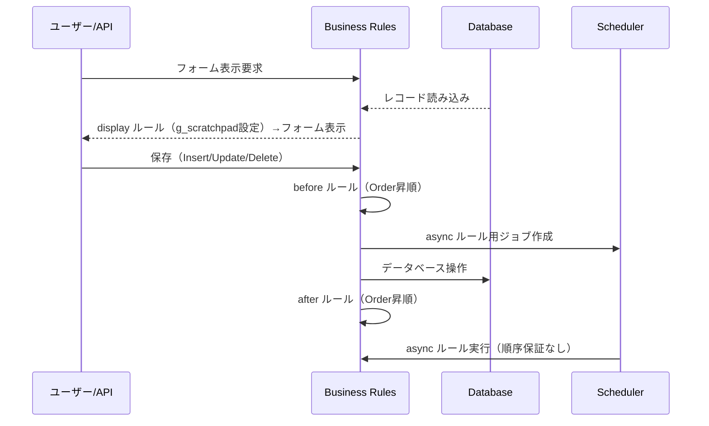
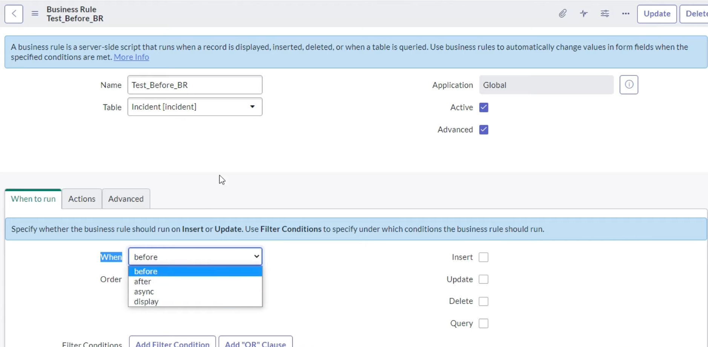
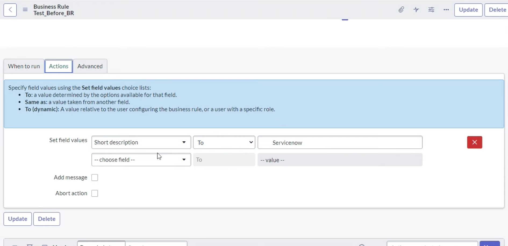
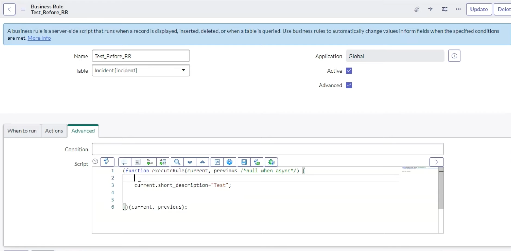
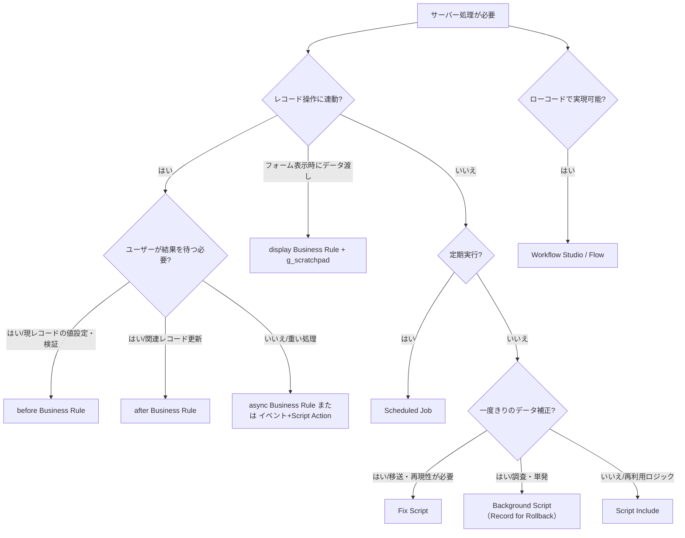

# サーバーサイドスクリプト（Server-side Scripting）

## 概要

ServiceNow のサーバーサイドスクリプト（Server-side scripting）は、インスタンス（サーバー）上の JavaScript エンジンで実行されるスクリプトの総称である。ブラウザで動く Client Script / UI Policy（[クライアントサイドスクリプト](./scripting-client-side.md) を参照）と異なり、サーバーサイドスクリプトはフォーム・リスト・Web サービス・インポート・Flow など**どの経路でレコードが操作されても一貫して実行される**のが特徴である。[出典](https://www.servicenow.com/docs/r/api-reference/business-rules-classic/c_BusinessRules.html)

本ファイルが扱う範囲は次のとおり。

| 区分 | 主な対象 | 格納テーブル |
|---|---|---|
| 実行ポイント | Business Rule（ビジネスルール） | `sys_script` |
| 実行ポイント | Script Include（スクリプトインクルード） | `sys_script_include` |
| 実行ポイント | Scheduled Job / Scheduled Script Execution（スケジュールジョブ） | `sysauto_script` |
| 実行ポイント | Fix Script（フィックススクリプト） | `sys_script_fix` |
| 実行ポイント | Scripts - Background（バックグラウンドスクリプト） | （定義レコードなし。実行履歴は Script Execution History） |
| API | GlideRecord / GlideRecordSecure / GlideAggregate / GlideSystem（`gs`）/ GlideElement / GlideDateTime / GlideQuery | — |
| 横断事項 | スコープ API 差異、Cross-scope privileges、Restricted Caller Access、JavaScript モード（ES12） | `sys_scope_privilege` ほか |

- 基準リリースは **Australia**（2026-05 GA）。公式ドキュメントの各 API ページは Australia 版（2026-03-12 更新）および Brazil 版（2026-09-10 更新）を確認した。
- ServiceNow は**新しい自動化には Workflow Studio（Flow Designer）を推奨**しており、Business Rule のスクリプトは「Flow で実現できない、または同期的なレコード処理が必要な場合」に使うのが現在の公式スタンスである。[出典](https://www.servicenow.com/docs/r/api-reference/business-rules-classic/c_BusinessRules.html)（Flow の詳細は [Workflow Studio / Flow Designer](./flow-designer-workflow-studio.md)）
- テーブル名・ロール名の確認には [データモデルと System Dictionary](./data-model-dictionary.md)、ACL との関係は [アクセス制御（ACL）](./access-control-acl.md)、アプリケーションスコープの全体像は [アプリケーション開発](./app-development.md) を参照。

> **Brazil での変更:** Brazil（2026-09 EA）の API リリースノート（Australia→Brazil 差分）では、GlideRecord・GlideSystem・GlideDateTime・GlideQuery・GlideQueryCondition・JavaScript エンジンに関する追加・変更・廃止は**記載されていない**。Brazil で記載がある API 変更は MCPClient（Universal MCP Client 1.1.3 で必須パラメータ `caller_product` 追加）など個別アプリ API に限られる。[出典](https://www.servicenow.com/docs/r/delta-australia-brazil/brazil-australia-api-release-notes.html)

---

## サーバーサイドスクリプトの実行ポイント一覧

ServiceNow でサーバーサイド JavaScript を書ける主な場所を以下にまとめる。本ファイルでは太字の5つを詳述し、それ以外は担当ファイルへのリンクに留める。

| 実行ポイント | 起動タイミング | 主な用途 | 詳細 |
|---|---|---|---|
| **Business Rule** | レコードの表示・挿入・更新・削除・クエリ時 | 値の設定・検証、関連レコード更新、イベント発行 | 本ファイル |
| **Script Include** | 他スクリプトから呼び出されたとき（オンデマンド） | 再利用可能なロジック、GlideAjax のサーバー側 | 本ファイル |
| **Scheduled Job** | 日次・週次・定期・1回・オンデマンド等 | バッチ処理、定期クリーンアップ | 本ファイル |
| **Fix Script** | アプリのインストール/アップグレード時、または手動実行 | データ補正、設定の一括変更 | 本ファイル |
| **Background Script** | 管理者が手動実行 | 一時的な調査・データ修正 | 本ファイル |
| UI Action（サーバー側） | ボタン/リンククリック時 | フォーム操作 | [リストとフォーム](./lists-forms.md) |
| ACL の Script | アクセス評価時 | 動的アクセス判定 | [アクセス制御（ACL）](./access-control-acl.md) |
| Script Action（イベント） | `gs.eventQueue()` で発行されたイベント処理時 | 非同期処理、イベント駆動 | [通知とメール](./notifications-email.md) |
| Transform Map Script | インポートの変換時 | データ変換 | [データインポート/エクスポート](./import-export-data.md) |
| Scripted REST API | REST リクエスト受信時 | カスタム API | [Web Services / REST API](./web-services-api.md) |
| Flow のスクリプトステップ / Custom Action | Flow 実行時 | ローコードの補完 | [Workflow Studio / Flow Designer](./flow-designer-workflow-studio.md) |
| ATF の Run Server Side Script | テスト実行時 | テスト | [Automated Test Framework](./automated-test-framework.md) |

公式ドキュメントは「再利用するコードは Script Include に置き、Business Rule を UI Action から呼ぶ・UI Action を Scripted REST API から呼ぶといった実装はしない」ことを推奨している。[出典](https://www.servicenow.com/docs/r/application-development/business-rules-and-script-includes.html)

---

## Business Rules（ビジネスルール）

### Business Rule の定義

Business Rule（ビジネスルール）は、**サーバー側の条件が満たされたときに実行されるスクリプト**である。Business Rule はデータベース操作（Insert / Update / Delete / Query）または Display（フォーム表示）に対して、「いつ（When）」「どの操作で」実行するかを指定する。Business Rule はフォーム・リスト・Web サービスのいずれ経由のアクセスにも一貫して適用され、フォーム編集時のみ動作する Client Script とは異なる。[出典](https://www.servicenow.com/docs/r/api-reference/business-rules-classic/c_BusinessRules.html)

- 格納テーブル：`sys_script`（Business Rule [sys_script]）
- メニュー：**All > System Definition > Business Rules**、新規作成は **New**。[出典](https://www.servicenow.com/docs/r/glNBsgieVJ9MunSJGk6joA/rM6z15ZSd8bt5MmChE9KHQ?section=c_UsingPredefinedGlobalVariables)
- Business Rule は **GlideRecord API 経由の操作に対してのみ**実行される。`setWorkflow(false)` を指定した操作では Business Rule は実行されない。[出典](https://www.servicenow.com/docs/r/api-reference/business-rules-classic/c_BusinessRules.html)
- Business Rule は**明示的に構成しない限り ACL を強制しない**（KB0656366 参照）。[出典](https://www.servicenow.com/docs/r/api-reference/business-rules-classic/c_BusinessRules.html)
- Business Rule は ServiceNow SDK（ServiceNow Fluent）の `BusinessRule` API でもコードとして定義できる（`when` の既定値は `before`、`order` の既定値は `100`）。[出典](https://www.servicenow.com/docs/r/zurich/application-development/servicenow-sdk/business-rule-api-now-ts.html)

### When（実行タイミング）の4種類

Business Rule の `When` フィールドには次の4値がある。[出典](https://www.servicenow.com/docs/r/api-reference/business-rules-classic/c_BusinessRules.html) / [出典](https://www.servicenow.com/docs/r/application-development/business-rules-and-script-includes.html)

| When | 実行タイミング（公式定義） | 同期/非同期 | 主な用途 | `current` の変更 |
|---|---|---|---|---|
| **before** | フォーム送信後、データベース操作の**前** | 同期 | 現在レコードの値設定・検証、処理の中止（abort） | 全 before ルール完了後に**自動保存**される（`current.update()` 不要） |
| **after** | フォーム送信後、データベース操作の**後** | 同期 | イベント・通知の発行、**関連レコード**の更新 | 保存済みのため反映されない（別 GlideRecord で更新が必要） |
| **async** | 送信後・DB 操作前にジョブが作成され、**スケジューラーがそのジョブを実行**したとき | 非同期 | 長時間処理、外部連携、大量レコード更新 | `previous` は使用不可 |
| **display** | フォーム表示の**前**、DB からデータを読み込んだ直後 | 同期 | `g_scratchpad` 経由でサーバーデータをクライアントへ渡す | 変更は一時的で保存されない |



上図は公式ドキュメントの「Business Rule の処理フロー」記述（before → DB 操作 → after、async はスケジューラー実行、display は読み込み直後）を Mermaid で表したもの。[出典](https://www.servicenow.com/docs/r/api-reference/business-rules-classic/c_BusinessRules.html)

#### async ルールの注意点

- async Business Rule は record の**前バージョン（`previous`）にアクセスできない**。そのため `changes()`、`changesTo()`、`changesFrom()` はスクリプト内では動作しない（**条件ビルダーと Advanced の Condition 欄では動作する**）。[出典](https://www.servicenow.com/docs/r/api-reference/business-rules-classic/c_BusinessRules.html)
- 同一レコードを更新する async ルールが複数あると、互いに上書きしたり順不同で実行される可能性がある。代替として after ルールや System Events（イベント＋Script Action）を検討する。[出典](https://www.servicenow.com/docs/r/api-reference/business-rules-classic/c_BusinessRules.html)
- システムプロパティ `glide.businessrule.async_condition_check` を追加して `true` にすると、async ルール実行直前に条件を再評価する。[出典](https://www.servicenow.com/docs/r/glNBsgieVJ9MunSJGk6joA/rM6z15ZSd8bt5MmChE9KHQ?section=c_UsingPredefinedGlobalVariables)
- `gs.addInfoMessage()` は async Business Rule ではサポートされない（非対話セッションのため）。[出典](https://www.servicenow.com/docs/r/api-reference/server-api-reference/c_GlideSystemScopedAPI.html)
- ユーザーが処理完了を確認する必要があるロジックには async を使わない（別トランザクションで実行され、タイミング保証がない）。[出典](https://servicenow.github.io/sdk/guides/business-rule-guide)

#### display ルールと g_scratchpad

- display Business Rule は、ユーザーがフォームを要求したとき、DB からデータを読んだ後・フォーム表示前に実行される。`current` に加えた変更は一時的で保存されない。[出典](https://www.servicenow.com/docs/r/glNBsgieVJ9MunSJGk6joA/rM6z15ZSd8bt5MmChE9KHQ?section=c_UsingPredefinedGlobalVariables)
- display ルールの主目的は `g_scratchpad` にクライアントスクリプトが必要とするサーバーデータを詰めることである（例：`g_scratchpad.someName = "someValue";`）。クライアント側では `g_scratchpad.someName` で参照でき、GlideAjax による追加のサーバー往復を避けられる。
- display ルールではメッセージ追加や scratchpad 設定のみ行い、データ変更はしない。[出典](https://servicenow.github.io/sdk/guides/business-rule-guide)

```javascript
// display Business Rule（incident）
(function executeRule(current, previous /*null when async*/) {
    g_scratchpad.isVip = current.caller_id.vip.toString() === 'true';
    g_scratchpad.callerManager = current.caller_id.manager.getDisplayValue();
})(current, previous);

// onLoad Client Script 側
// if (g_scratchpad.isVip) { g_form.showFieldMsg('caller_id', 'VIP caller', 'info'); }
```

### 対象操作（Insert / Update / Delete / Query）

| 操作 | 実行契機 | 備考 |
|---|---|---|
| Insert | 新規レコードの挿入 | — |
| Update | 既存レコードの変更 | — |
| Delete | レコードの削除 | フォーム上は Advanced 項目 |
| Query | レコードのクエリ | 通常 before で使用。**クエリ対象テーブルの query ルールのみ実行**され、参照フィールド先テーブルの query ルールは実行されない。フォーム上は Advanced 項目 |

[出典](https://www.servicenow.com/docs/r/api-reference/business-rules-classic/c_BusinessRules.html) / [出典](https://www.servicenow.com/docs/r/glNBsgieVJ9MunSJGk6joA/rM6z15ZSd8bt5MmChE9KHQ?section=c_UsingPredefinedGlobalVariables)

- Query Business Rule は、システム内部のクエリを含む**そのテーブルへのすべてのクエリ**で発火するため、パフォーマンスへの影響が大きい。慎重に使う。[出典](https://servicenow.github.io/sdk/guides/business-rule-guide)
- Query Business Rule は「行レベルでの絞り込み（例：自部門のレコードのみ表示）」に使われることがあるが、セキュリティ要件には ACL（Query ACL を含む）を優先するのが一般的である。【経験則】（ACL については [アクセス制御（ACL）](./access-control-acl.md)）

### Business Rule フォームのフィールド

公式ドキュメントでは「すべてのフィールドを表示するにはフォームの構成が必要な場合がある」とされている。Advanced チェックボックスをオンにすると詳細ビュー（Advanced タブ等）が表示される。[出典](https://www.servicenow.com/docs/r/glNBsgieVJ9MunSJGk6joA/rM6z15ZSd8bt5MmChE9KHQ?section=c_UsingPredefinedGlobalVariables)

| 区分 | フィールド | 説明 |
|---|---|---|
| ヘッダー | Name（名前） | ルール名 |
| ヘッダー | Table（テーブル） | 対象テーブル |
| ヘッダー | Application（アプリケーション） | 所属スコープ |
| ヘッダー | Accessible from（アクセス可能範囲） | **Global Business Rule の場合のみ**表示。This application scope only / All application scopes |
| ヘッダー | Active（有効） | 有効/無効 |
| ヘッダー | Advanced（詳細） | 詳細フォームビューの表示 |
| When to run タブ | When | before / after / async / display |
| When to run タブ | Order（順序） | 同一操作に複数ルールがある場合、**小さい順**に実行（既定 100） |
| When to run タブ | Insert / Update / Delete / Query | 対象操作（Delete と Query は Advanced 項目） |
| When to run タブ | Filter Conditions（フィルター条件） | 条件ビルダーでフィールド値の条件を指定。**文字列比較は大文字小文字を区別** |
| When to run タブ | Role conditions（ロール条件） | ルール実行に必要なユーザーのロール |
| Actions タブ | Set field values（フィールド値の設定） | To（固定値）/ Same as（他フィールドの値）/ To (dynamic)（動的値） |
| Actions タブ | Add message（メッセージ追加） | ルール実行時にメッセージを表示 |
| Actions タブ | Abort action（アクションの中止） | 現在の DB トランザクションを中止 |
| Advanced タブ | Condition（条件） | JavaScript の条件式。Filter Conditions とは別に評価される |
| Advanced タブ | Script（スクリプト） | 実行スクリプト |
| 関連リスト | Versions | 過去バージョンの比較・復元 |

[出典](https://www.servicenow.com/docs/r/glNBsgieVJ9MunSJGk6joA/rM6z15ZSd8bt5MmChE9KHQ?section=c_UsingPredefinedGlobalVariables)

- **Order と エンジンの関係**：Order が 1000 未満のルールはワークフロー等のエンジンより前、1000 以上のルールはエンジンより後に実行されると説明されることが多い。【第三者情報】[出典](https://www.jitendrazaa.com/blog/servicenow/servicenow-business-rules-complete-developer-guide-2025/)
- **Filter Conditions と Advanced Condition の評価順**：コミュニティでは「Filter Conditions が先に評価される」とする記事と、逆の回答が混在しており、公式ドキュメントでは明記を確認できなかった。【第三者情報】[出典](https://www.servicenow.com/community/developer-blog/business-rules-filter-conditions-amp-advanced-conditions/ba-p/3386285)
- ServiceNow SDK のガイドは、スクリプト内のガード節よりも Filter Conditions（`filterCondition`）で発火条件を絞ることを推奨している（スクリプトのロード前に評価されるため）。[出典](https://servicenow.github.io/sdk/guides/business-rule-guide)

#### Business Rule フォームの画面



**図1：Business Rule フォーム ― When to run タブ**
画面説明：Business Rule フォーム（レコード名 `Test_Before_BR`）。上部に Name（`Test_Before_BR`）、Table（`Incident [incident]`）、右側に Application（`Global`）、Active・Advanced のチェックボックス（いずれもオン）が並ぶ。その下に When to run / Actions / Advanced の3タブがあり、When to run タブでは When ドロップダウンが展開され `before`・`after`・`async`・`display` の4択が表示されている。右側に Insert・Update・Delete・Query のチェックボックス、下部に Order と Filter Conditions（Add Filter Condition / Add "OR" Clause ボタン）がある。
出典：https://www.jitendrazaa.com/blog/servicenow/servicenow-business-rules-complete-developer-guide-2025/ （取得日：2026-11-03）【第三者情報】



**図2：Business Rule フォーム ― Actions タブ（スクリプトなしの宣言的設定）**
画面説明：Actions タブを開いた状態。上部の説明枠に「Set field values の選択肢：To（フィールドで使用可能な値）、Same as（他フィールドから取得した値）、To (dynamic)（ルール設定者または特定ロールを持つユーザーに相対的な値）」と記載。Set field values 行で `Short description` を `To` `Servicenow` に設定する例が入力されており、その下に Add message と Abort action のチェックボックスがある。
出典：https://www.jitendrazaa.com/blog/servicenow/servicenow-business-rules-complete-developer-guide-2025/ （取得日：2026-11-03）【第三者情報】



**図3：Business Rule フォーム ― Advanced タブ**
画面説明：Advanced タブを開いた状態。Condition（1行テキスト）と Script（コードエディタ、ツールバー付き）の2項目がある。Script には既定テンプレート `(function executeRule(current, previous /*null when async*/) { ... })(current, previous);` が表示され、本文に `current.short_description="Test";` が書かれている。
出典：https://www.jitendrazaa.com/blog/servicenow/servicenow-business-rules-complete-developer-guide-2025/ （取得日：2026-11-03）【第三者情報】

### Business Rule で使えるグローバル変数

| 変数 | 内容 |
|---|---|
| `current` | 処理中レコードの現在の状態（GlideRecord）。使用前に null チェックを推奨 |
| `previous` | 実行コンテキスト内の最初の更新/削除前の状態。**update / delete 時のみ**利用可能、**async では利用不可** |
| `g_scratchpad` | display ルールからクライアントスクリプトへデータを渡すオブジェクト（既定は空、name:value 形式） |
| `gs` | GlideSystem 関数への参照 |

- `current`、`previous`、`g_scratchpad` は**同一トランザクション内で実行されるすべての Business Rule でグローバル**である。変数名の衝突を避けるため、コードは関数で囲む（既定テンプレートの IIFE `(function executeRule(current, previous){...})(current, previous);` を使う）。[出典](https://www.servicenow.com/docs/r/glNBsgieVJ9MunSJGk6joA/rM6z15ZSd8bt5MmChE9KHQ?section=c_UsingPredefinedGlobalVariables)

### current.update() と再帰

- before ルールで `current` に設定した値は、全 before ルール完了後に自動保存される。**before ルールで `current.update()` を呼んではならない**（冗長な保存・無限ループの原因）。[出典](https://servicenow.github.io/sdk/guides/business-rule-guide)
- Business Rule 内で `current.update()` を呼ぶと、追加の DB 操作が走り、通知の重複や再帰ループの原因となる。公式は Business Rule 内での `current.update()` を避けるよう明記している。`setWorkflow(false)` は特殊なケースに限る。[出典](https://www.servicenow.com/docs/r/application-development/business-rules-and-script-includes.html) / [出典](https://www.servicenow.com/docs/r/api-reference/business-rules-classic/c_BusinessRules.html)
- 再帰的な Business Rule が検出された場合、システムはそれを停止し、エラーをシステムログに記録する。[出典](https://www.servicenow.com/docs/r/api-reference/business-rules-classic/c_BusinessRules.html)
- after ルールで `current` を変更しても保存済みのため永続化されない。現在レコードの追加変更は before ルールで行う。[出典](https://servicenow.github.io/sdk/guides/business-rule-guide)

### 処理の中止（Abort）

- Actions タブの **Abort action** は現在の DB トランザクションを中止する。[出典](https://www.servicenow.com/docs/r/glNBsgieVJ9MunSJGk6joA/rM6z15ZSd8bt5MmChE9KHQ?section=c_UsingPredefinedGlobalVariables)
- スクリプトでは `current.setAbortAction(true)` を使う。`setAbortAction()` は次の insert/update/delete を中止するが、**他の Business Rule は引き続き実行される**。主に before ルールで使う。[出典](https://www.servicenow.com/docs/r/api-reference/server-api-reference/c_GlideRecordScopedAPI.html)

```javascript
// before update Business Rule：終了日が開始日より前なら保存を中止
(function executeRule(current, previous) {
    var start = new GlideDateTime(current.getValue('start_date'));
    var end = new GlideDateTime(current.getValue('end_date'));
    if (end.before(start)) {
        gs.addErrorMessage(gs.getMessage('End date must be after start date'));
        current.setAbortAction(true);
    }
})(current, previous);
```

### スコープアプリケーションにおける Business Rule

- すべての Business Rule は、プライベートアプリケーションスコープまたはグローバルスコープのいずれかに属する。
- **他スコープのテーブル**に対する Business Rule には制限がある。
  - before ルール：**Actions のみ**使用可能。スクリプトを含めることも、トランザクションを中止することもできない。
  - async ルール：Actions とスクリプトを使用可能。
  - それ以外のタイプ（after、display 等）は他スコープのテーブルには作成できない。
- **Global Business Rule**（特定テーブルに紐づかないルール）は Accessible from（This application scope only / All application scopes）で呼び出し可能スコープを制御する。Global Business Rule は**ドメインセパレーションをサポートしない**。
- Global Business Rule はシステム内の**全ページで読み込まれる**ため、再利用ロジックには必要時のみ読み込まれる Script Include を使うことが推奨される。
- スコープ付きルールのスクリプトは同一スコープの Script Include と Global Business Rule にアクセスでき、他スコープの関数は**スコープ名を明示した場合のみ**呼び出せる。ユニークスコープ内のルールは**スコープ用システム API のみ**利用できる。

[出典](https://www.servicenow.com/docs/r/glNBsgieVJ9MunSJGk6joA/rM6z15ZSd8bt5MmChE9KHQ?section=c_UsingPredefinedGlobalVariables) / [出典](https://www.servicenow.com/docs/bundle/yokohama-application-development/page/script/business-rules/concept/c%5FBusinessRules.html)

### Business Rule 以外を使うべきケース

ServiceNow SDK の Business Rule ガイドは、次の要件は Business Rule ではなく専用機能で実装するよう推奨している。[出典](https://servicenow.github.io/sdk/guides/business-rule-guide)

| 要件 | 推奨機能 |
|---|---|
| 状態遷移のブロック・ゲート | State Model（状態モデル） |
| 状態に応じた必須フィールド | Data Policy / UI Policy |
| タスクの `assignment_group` / `assigned_to` 自動設定 | Assignment Rules（割り当てルール） |
| フィールド組合せからの決定的な値マッピング | Data Lookup（データルックアップ） |
| 新規の業務自動化 | Workflow Studio（Flow） |

---

## Script Includes（スクリプトインクルード）

### Script Include の定義

Script Include（スクリプトインクルード）は、**再利用可能なサーバーサイド JavaScript の関数またはクラス**を格納するレコードである。Script Include は Business Rule、UI Action、ワークフロー/Flow のスクリプト、Scripted REST API などから呼び出され、**呼び出されたときだけ読み込まれる（オンデマンド）**。[出典](https://www.servicenow.com/docs/r/application-development/business-rules-and-script-includes.html)

- 格納テーブル：`sys_script_include`
- メニュー：**All > System Definition > Script Includes**（System UI 配下にも Script Include が存在する）。[出典](https://www.servicenow.com/docs/r/api-reference/scripts/c_ScriptIncludes.html)
- Script フィールドには**単一の JavaScript クラス、またはグローバル関数**を定義し、その名前を Name フィールドと一致させる必要がある。[出典](https://www.servicenow.com/docs/r/api-reference/scripts/c_ScriptIncludes.html)

### Script Include フォームのフィールド

| フィールド | 説明 |
|---|---|
| Name | クラス名・prototype の `type` と一致させる。Classless（オンデマンド関数）の場合は関数名と一致 |
| API Name | スコープ外アプリから呼び出す際の内部名（例：`x_acme_app.MyUtils`） |
| Glide AJAX enabled（Client callable とも表記） | クライアントスクリプト、リスト/レポートフィルター、参照修飾子、URL パラメータから呼び出し可能にする。**ACL が必要**。オンにすると Access Controls 関連リンクが有効になる |
| Mobile callable | モバイルデバイスから呼び出されるクライアントスクリプトで利用可能にする |
| Sandbox enabled | スクリプトサンドボックス（クエリ条件など）で実行されるスクリプトから利用可能にする。必要時のみ有効化 |
| Application | 所属アプリケーション |
| Accessible from | All application scopes（全スコープ）/ This application scope only（このスコープのみ） |
| Active | 有効/無効 |
| Description | 説明 |
| Script | サーバーサイドコード |
| Protection policy | None / Read-only / Protected（Protected はメモリ上で暗号化され、ダウンロードした顧客からも隠蔽される） |
| 関連リスト | Versions、Access Controls（Glide AJAX enabled 時） |

[出典](https://www.servicenow.com/docs/r/api-reference/scripts/c_ScriptIncludes.html)

- ServiceNow Fluent（SDK）では `accessibleFrom` プロパティが対応し、`public`（全スコープ）/ `package_private`（同一スコープのみ、**既定値**）を取る。`clientCallable` の既定値は `false`。[出典](https://www.servicenow.com/docs/r/zurich/application-development/servicenow-sdk/fluent-script-include-api.html)
- Discovery 関連の Script Include（GlideRecordUtil、DiscoveryException、AutomationException）の書き込みには `discovery_admin` ロールが必要。[出典](https://www.servicenow.com/docs/r/api-reference/scripts/c_ScriptIncludes.html)

### Script Include の種類

| 種類 | 書き方 | 用途 |
|---|---|---|
| Class-based（クラス型） | `Class.create()` と `prototype`（`initialize`、各関数、Name と一致する `type` プロパティ） | 標準的なユーティリティクラス |
| Classless / On-demand（関数型） | Name と同名のグローバル関数を定義 | 単純な関数 |
| AJAX（GlideAjax 用） | `Object.extendsObject(AbstractAjaxProcessor, {...})` で `AbstractAjaxProcessor` を継承し Glide AJAX enabled をオン | クライアントからのサーバー呼び出し |

[出典](https://www.servicenow.com/docs/r/api-reference/scripts/c_ScriptIncludes.html) / [出典](https://www.servicenow.com/docs/r/api-reference/scripts/p_AJAX.html)

```javascript
// Class-based Script Include（Name: IncidentUtils）
var IncidentUtils = Class.create();
IncidentUtils.prototype = {
    initialize: function() {},

    /** 指定ユーザーが発信者のアクティブなインシデント件数 */
    countActiveByCaller: function(userSysId) {
        var ga = new GlideAggregate('incident');
        ga.addActiveQuery();
        ga.addQuery('caller_id', userSysId);
        ga.addAggregate('COUNT');
        ga.query();
        return ga.next() ? parseInt(ga.getAggregate('COUNT'), 10) : 0;
    },

    type: 'IncidentUtils'
};

// 呼び出し側（Business Rule 等）
// var n = new IncidentUtils().countActiveByCaller(current.getValue('caller_id'));
// 他スコープから呼ぶ場合は API Name を使う：new global.IncidentUtils() / new x_acme_app.IncidentUtils()
```

### GlideAjax 用（クライアント呼び出し可能）Script Include

GlideAjax は、クライアントスクリプトからサーバーの Script Include を呼び出す仕組みである（クライアント側の書き方は [クライアントサイドスクリプト](./scripting-client-side.md)）。サーバー側の要件は次のとおり。[出典](https://www.servicenow.com/docs/r/api-reference/scripts/p_AJAX.html)

- `AbstractAjaxProcessor` を継承し、**Glide AJAX enabled（Client callable）** をオンにする。
- Script Include の Name はクラス名と完全一致させる。
- クライアントは `sysparm_name` で実行する関数名を指定する。追加パラメータは `sysparm_` で始め、サーバー側では `this.getParameter('sysparm_xxx')` で取得する。
- `sysparm_name`、`sysparm_function`、`sysparm_value`、`sysparm_type` は予約名のため独自パラメータに使わない。
- **アンダースコアで始まる関数はプライベート**で、クライアントから呼び出せない。
- `initialize` を含む `AbstractAjaxProcessor` のメソッドをオーバーライドしない。
- 単純な応答は関数の戻り値で返す。構造化データは `this.newItem()` と `setAttribute()` で XML 要素を作る（実務では JSON 文字列を返すことも多い【経験則】）。
- スコープアプリでは同期呼び出し `getXMLWait()` が使えない。`AJAXEvaluateSynchronously` も使わない。

```javascript
// Name: UserInfoAjax / Glide AJAX enabled = true
var UserInfoAjax = Class.create();
UserInfoAjax.prototype = Object.extendsObject(AbstractAjaxProcessor, {
    getManagerName: function() {
        var userId = this.getParameter('sysparm_user_id');
        var gr = new GlideRecord('sys_user');
        if (gr.get(userId)) {
            return gr.manager.getDisplayValue();
        }
        return '';
    },
    _internalHelper: function() { /* クライアントからは呼べない */ },
    type: 'UserInfoAjax'
});
```

### クライアント呼び出し可能 Script Include のセキュリティ

| 項目 | 内容 |
|---|---|
| Private | 公開ページのゲストユーザーはアクセス不可 |
| Public | 未ログインユーザーでも適切な HTTP リクエストで実行可能（機密データ漏えいのリスク） |
| 既定で Public の Script Include | GlideSystemAjax、SysMessageAjax、KnowledgeMessagingAjax、KnowledgeAjax、PasswordResetAjax |
| `glide.script.ccsi.ispublic` | 全 Glide AJAX enabled Script Include を Public/Private にするシステムプロパティ（true/false） |
| `isPublic()` | 個別 Script Include に `isPublic: function(){ return false; }` を定義するとプロパティより優先される |
| `glide.script.ccsi.enable_acl_create_ux` | `false` にすると ACL 作成用のロールセレクターを無効化 |
| `glide.script.ccsi.customer_scoped.security_msgs_enabled` | セキュリティ推奨メッセージの表示制御（既定 `true`） |
| 必要ロール | Glide AJAX enabled Script Include の設定には `admin` ロールが必要 |

[出典](https://www.servicenow.com/docs/r/api-reference/scripts/c_ScriptIncludes.html)

- 公式の Business Rule ベストプラクティスでも「クライアント呼び出し可能な Business Rule を避ける」ことが挙げられている。[出典](https://www.servicenow.com/docs/r/application-development/business-rules-and-script-includes.html)
- インスタンスのセキュリティ強化設定として、クライアント呼び出し可能 Script Include に認証を要求する設定がある（詳細は [プラットフォームセキュリティと暗号化](./platform-security-encryption.md)）。

---

## Scheduled Jobs（スケジュールジョブ）

### Scheduled Script Execution の定義

Scheduled Script Execution（スケジュールされたスクリプト実行、通称 Scheduled Job）は、**指定時刻または定期的にサーバーサイドスクリプトを実行する**レコードである。格納テーブルは `sysauto_script`。[出典](https://www.servicenow.com/docs/r/pt-BR/application-development/servicenow-sdk/fluent-scheduled-script-api.html)

- メニュー：一般に **All > System Definition > Scheduled Jobs** から一覧し、New で「Automatically run a script of your choosing」を選んで作成する。【経験則】（作成手順は旧リリース文書 [出典](https://docs.servicenow.com/bundle/madrid-platform-administration/page/administer/reference-pages/task/t_ScheduleAScriptExecution.html)）
- 実行時のジョブはスケジューラーのトリガー（`sys_trigger`）として登録される。【経験則】

### Scheduled Script Execution フォームのフィールド

| フィールド | 説明 |
|---|---|
| Name | ジョブ名 |
| Active | 有効にすると指定日時に実行 |
| Run | 実行間隔（下表） |
| Time zone | Time と組み合わせるタイムゾーン：-None-（作成ユーザーのタイムゾーン）/ Use System Time Zone（インスタンス既定）/ 個別タイムゾーン |
| Day | 曜日（Weekly）または日付（Monthly） |
| Repeat Interval | 繰り返し間隔（日・時・分）。Periodically のみ |
| Business Calendar | Business Calendar 系の実行時に使うカレンダー |
| Offset Type / Offset | Past（期間前）/ Future（期間後）/ None と、日時分秒のオフセット |
| Time | 実行時刻（24時間制）。Daily / Weekly / Monthly |
| Starting | 初回実行日時。Periodically |
| Priority | 数値。**100 未満は essential、100 超は nonessential** |
| Run as | ジョブを作成・実行するユーザー。システム所有にしたい場合はシステム用（ダミー）ユーザーを指定 |
| Conditional | 条件付き実行を有効化 |
| Condition | Conditional オン時に表示。**最後の式が true/false に評価されるスクリプト** |

[出典](https://www.servicenow.com/docs/r/4~5Anqt12idfVzJWPcxoHw/rux8gyO2kfRTI1DI6J6u1w)

| Run の値 | 動作 |
|---|---|
| Daily | 毎日指定時刻 |
| Weekly | 毎週指定曜日・時刻 |
| Monthly | 毎月指定日・時刻 |
| Periodically | Starting から Repeat Interval ごと |
| Once | 1回のみ |
| On Demand | 要求時に即時実行（`gs.executeNow()` 等。フォームの Execute Now ボタン【経験則】） |
| Business Calendar: Entry Start | Business Calendar エントリの開始日 |
| Business Calendar: Entry End | Business Calendar エントリの終了日 |

[出典](https://www.servicenow.com/docs/r/4~5Anqt12idfVzJWPcxoHw/rux8gyO2kfRTI1DI6J6u1w)

### Scheduled Job の注意点

- **夏時間（DST）**：Periodically の間隔は DST を考慮しない（1日間隔は常に24時間加算）。DST 期間中に開始したジョブは DST 終了後に1時間ずれて実行されうる。
- **時刻の保存**：時刻は UTC で保存され、選択したタイムゾーンで変換される。
- **優先度による抑制**：全スケジュールジョブの **70% 以上が Overdue** になると、Priority が 100 を超える（nonessential）ジョブは実行されない。

[出典](https://www.servicenow.com/docs/r/4~5Anqt12idfVzJWPcxoHw/rux8gyO2kfRTI1DI6J6u1w)

- ServiceNow SDK ガイドによれば、Periodically のジョブが次回トリガー時点でまだ実行中の場合、そのトリガーは**黙ってスキップ**される。【第三者情報】（ServiceNow 公開の SDK ガイド）[出典](https://servicenow.github.io/sdk/guides/scheduled-script-guide)
- Run as のユーザーに必要な権限がないとジョブが失敗する事例がコミュニティで報告されている。【第三者情報】
- `gs.executeNow(scheduledJobGr)` で同一アプリケーションの Scheduled Job を即時実行できる。[出典](https://www.servicenow.com/docs/r/api-reference/server-api-reference/c_GlideSystemScopedAPI.html)

```javascript
// Condition（Conditional = true）の例：30日以上前に作成されたアクティブインシデントがあるときだけ実行
var ga = new GlideAggregate('incident');
ga.addActiveQuery();
ga.addQuery('sys_created_on', '<', gs.daysAgoStart(30));
ga.addAggregate('COUNT');
ga.query();
ga.next() && parseInt(ga.getAggregate('COUNT'), 10) > 0; // 最後の式が Boolean
```

（Condition の「30日以上前のアクティブインシデントがある場合のみ実行」という例は公式文書の例に基づく。[出典](https://docs.servicenow.com/bundle/madrid-platform-administration/page/administer/reference-pages/task/t_ScheduleAScriptExecution.html)）

---

## Fix Scripts（フィックススクリプト）

### Fix Script の定義

Fix Script（フィックススクリプト）は、**アプリケーションが正しくインストールまたは更新されるよう、データ（ルール、スクリプト、プロパティ設定を含む）を追加・更新・削除する**ためのサーバーサイドスクリプトである。[出典](https://www.servicenow.com/docs/r/ja-JP/application-development/t_CreateFixScripts.html)

- 格納テーブル：`sys_script_fix`【第三者情報】（コミュニティ回答で確認）[出典](https://www.servicenow.com/community/developer-forum/related-to-fix-script/m-p/2404244)
- メニュー：**All > System Definition > Fix Scripts**
- 必要ロール：作成は `script_fix_admin` または `admin`。[出典](https://www.servicenow.com/docs/r/ja-JP/application-development/t_CreateFixScripts.html)

### Fix Script フォームのフィールド

| フィールド | 説明 |
|---|---|
| Name | 一意で分かりやすい名前 |
| Unloadable | 実行時に Customer Update レコード（`sys_update_xml`）を作成するかどうか。Fix Script のテストではこのオプションが適用される |
| Before | アプリケーションのインストール/アップグレードの**前**に実行するかどうか |
| Record for rollback | 実行内容を記録し、必要に応じて元に戻せるようにする |
| Description | 説明 |
| Script | 実行コード |

[出典](https://www.servicenow.com/docs/r/ja-JP/application-development/t_CreateFixScripts.html)

### Fix Script の実行タイミング

- Fix Script は、アプリケーションの**初回インストール時**、または Fix Script がアプリに追加された**後の最初の更新時**に実行される。
- 以前のバージョンで追加された Fix Script は、**その後のアプリ更新では再実行されない**。必要なら手動で実行する。
- 手動実行手順：All > System Definition > Fix Scripts → フィルターでアプリ名を指定 → Fix Script レコードを開く → **Run Fix Script** をクリック。

[出典](https://www.servicenow.com/docs/r/application-development/t_RunFixScripts.html)

- グローバルスコープで Before = true の Fix Script がプラットフォームアップグレード時に実行されなかったという報告がある。プラットフォームアップグレードで実行されるのは標準（OOTB）の Fix Script のみ、という推測回答があるが公式には確認できない。【第三者情報】[出典](https://www.servicenow.com/community/developer-forum/fix-script-with-before-true-did-not-run-on-platform-upgrade/m-p/2994554)
- Fix Script のロールバックは Rollback & Recovery > Rollback Contexts で「Fix Script: <名前>」のコンテキストを探して行う、と説明されている（KB0761248 参照）。完了（Finished）状態のものだけがロールバック対象とされる。【第三者情報】[出典](https://www.servicenow.com/community/developer-articles/how-to-rollback-your-modifications-made-by-fix-script-or/ta-p/2620304)

---

## Background Scripts（バックグラウンドスクリプト）

### Scripts - Background の定義

Scripts - Background（バックグラウンドスクリプト）は、**管理者が任意のサーバーサイドスクリプトをその場で実行するためのモジュール**である。定義レコードは残らず、アップデートセットにも記録されない。

- メニュー：**All > System Definition > Scripts - Background**【経験則】
- 実行時に実行スコープ（in scope）の選択と **Record for Rollback?** チェックボックスがある。Record for Rollback? をオンにして実行するとロールバックコンテキストが作成され、そのスクリプトの DB 操作をロールバックできる。[出典](https://www.servicenow.com/docs/r/platform-administration/table-administration-and-data-management/rollback-delete-recovery.html)
- 実行履歴：**Rollback & Recovery > Script Execution History**（Scripts - Background で実行したスクリプトのみ、**7日分**を保持）。[出典](https://www.servicenow.com/docs/r/platform-administration/table-administration-and-data-management/rollback-delete-recovery.html)
- アクセス：`admin` ロールが必要。セキュリティ強化（High Security）設定のインスタンスでは `security_admin` への昇格（Elevate Role）が必要になる場合がある。【第三者情報】[出典](https://www.servicenow.com/community/itsm-forum/background-scripts/td-p/2461364)
- 出力：`gs.print()` / `gs.info()` の出力が実行結果画面に表示される。`gs.print()` はグローバル API で、デバッグ有効時以外は `syslog` テーブルに保存されない。[出典](https://www.servicenow.com/docs/r/api-reference/server-api-reference/c_GlideSystemAPI.html)

### ロールバック（Rollback & Recovery）の仕様

| 項目 | 仕様 |
|---|---|
| 必要プラグイン | Restore Deleted Records（`com.snc.undelete`）、Delete Recovery（`com.glide.delete_recovery`） |
| メニュー | Rollback & Recovery > Rollback Contexts / Script Execution History |
| コンテキスト作成契機 | GlideRecord による削除（delete / `deleteMultiple()`）、パッチアップグレード、プラグイン有効化、Record for Rollback? をオンにした Background Script 実行 |
| 作成されないケース | アップグレードによるテーブル/カラム削除、テーブル truncate、テーブル/カラムのリネーム、カラムの再親化・昇格、型変更、カラム幅の縮小 |
| 保持期間 | ロールバックコンテキストは **10日**で削除（プロパティで延長可）。Script Execution History は **7日** |
| 影響範囲 | コンテキスト作成後に別の DB 操作で変更されたレコードには影響しない |
| 注意 | ロールバックはデータを削除し、デバッグに必要な証跡を消す可能性がある。実施前に Customer Service and Support へ相談 |

[出典](https://www.servicenow.com/docs/r/platform-administration/table-administration-and-data-management/rollback-delete-recovery.html)

### Fix Script と Background Script の使い分け

| 観点 | Fix Script | Background Script |
|---|---|---|
| 定義の永続化 | レコード（`sys_script_fix`）として残る | 残らない（履歴のみ7日） |
| 環境間移送 | Unloadable でアップデートセットに含められる | アップデートセットに保存不可 |
| ロールバック | Record for rollback（隠し機能扱いとの記述あり、KB0761248） | Record for Rollback? で可能 |
| 実行結果の確認 | 限定的 | 変更レコードのサマリー・ログ出力を確認可能 |
| 典型用途 | アプリ導入時・リリース時のデータ補正、繰り返し使う補正 | 一時的な調査・単発の修正 |

【第三者情報】[出典](https://www.servicenow.com/community/now-platform-blog/fix-script-vs-background-script-which-is-the-better-choice/ba-p/2286510)

- 同記事は「ロールバックは監査履歴を巻き戻さないため、**データ変更のバックアウト計画としては有効ではない**」と警告している。【第三者情報】
- 本番での Background Script 直接実行は、変更管理・証跡の観点から避け、Fix Script としてレビュー・移送するのが一般的である。【経験則】（運用統制は [運用とガバナンス](../../03_導入編/12-operations-governance.md)、アンチパターンは [スクリプトのベストプラクティスとアンチパターン](../../04_応用編/07-scripting-best-practices.md)）

---

## GlideRecord API

### GlideRecord の定義

GlideRecord は、**サーバーサイドコードからデータベースを操作する主要 API** である。GlideRecord はテーブル名を指定して生成し、クエリ条件を追加して `query()` で実行、`next()` で結果を順に処理する。[出典](https://www.servicenow.com/docs/r/api-reference/server-api-reference/c_GlideRecordScopedAPI.html)

```javascript
var gr = new GlideRecord('incident');
gr.addActiveQuery();
gr.addQuery('priority', '<=', 2);
gr.addQuery('assignment_group.name', 'Service Desk'); // ドットウォーク条件
gr.orderByDesc('sys_created_on');
gr.setLimit(100);
gr.query();
while (gr.next()) {
    gs.info('{0}: {1}', gr.getValue('number'), gr.getDisplayValue('assigned_to'));
}
```

### クエリ構築メソッド

| メソッド | 説明 |
|---|---|
| `addQuery(name, value)` | 等価条件。複数呼び出しは AND |
| `addQuery(name, operator, value)` | 演算子付き条件（`=`, `!=`, `>`, `>=`, `<`, `<=`, `IN`, `NOT IN`, `STARTSWITH`, `CONTAINS` 等）。戻り値の GlideQueryCondition で `addOrCondition()` が使える |
| `addEncodedQuery(query)` | エンコードクエリ文字列（リストのフィルターからコピー可能）を追加 |
| `addActiveQuery()` | `active=true` 条件 |
| `addNullQuery(field)` / `addNotNullQuery(field)` | null / not null 条件 |
| `addJoinQuery(joinTable, primaryField, joinTableField)` | 関連テーブルによる絞り込み。**真の JOIN ではなくサブクエリ**で、取得できるのはベーステーブルのフィールドのみ |
| `orderBy(name)` / `orderByDesc(name)` | 並び順 |
| `setLimit(n)` | 取得件数の上限。内部的に `chooseWindow()` を呼ぶため、呼び出し順で結果が変わる |
| `chooseWindow(first, last, forceCount)` | 0始まりの行範囲を指定。`COUNT(*)` が発行されるため大テーブルでは遅くなりうる |
| `setNoCount()` | `COUNT(*)` を発行しない（`setLimit()` 使用時は不要） |
| `setCategory(category)` | セカンダリ DB（読み取りレプリカ）へクエリをルーティング。Secondary Database Pools プラグインが必要。レプリカ遅延あり |
| `isValidEncodedQuery(query)` | エンコードクエリの構文チェック（クエリは実行しない）。`isEncodedQueryValid()` は非推奨 |

[出典](https://www.servicenow.com/docs/r/api-reference/server-api-reference/c_GlideRecordScopedAPI.html)

### ACL を考慮したクエリメソッド（Zurich で導入）

Zurich で GlideRecord（Scoped / Global）に、**クエリ ACL（Query ACL）を強制する／バイパスする**メソッドが追加された。[出典](https://www.servicenow.com/docs/r/delta-zurich-brazil/brazil-zurich-api-release-notes.html)

| ACL を強制（User） | ACL をバイパス（System） | 用途 |
|---|---|---|
| `addUserQuery(name, operator, value)` | `addSystemQuery(name, operator, value)` | 条件追加 |
| `addUserEncodedQuery(query)` | `addSystemEncodedQuery(query)` | エンコードクエリ |
| `addUserOrderBy(name)` | `addSystemOrderBy(name)` | 昇順 |
| `addUserOrderByDesc(name)` | `addSystemOrderByDesc(name)` | 降順 |

- GlideQueryCondition にも `addUserCondition` / `addUserOrCondition` / `addSystemCondition` / `addSystemOrCondition` が追加された。[出典](https://www.servicenow.com/docs/r/delta-zurich-brazil/brazil-zurich-api-release-notes.html)
- Query ACL は `query_match` / `query_range` 操作の ACL で、既定では `*.*` の ACL が read 権限に委譲する。[出典](https://www.servicenow.com/docs/r/zurich/platform-security/access-control/query-acl-rule.html)（詳細は [アクセス制御（ACL）](./access-control-acl.md)）
- `addEncodedQuery(query, enforceFieldACL)` の第2引数でフィールド ACL の強制を指定できる。[出典](https://www.servicenow.com/docs/r/api-reference/server-api-reference/c_GlideRecordScopedAPI.html)

### レコード取得・値アクセスメソッド

| メソッド | 説明 |
|---|---|
| `query()` / `_query()` | クエリ実行。テーブルに `query` という列がある場合は `_query()` |
| `next()` / `_next()` / `hasNext()` | 次レコードへ移動 / 残りの有無。`next` という列がある場合は `_next()` |
| `get(value)` / `get(name, value)` | sys_id、または指定フィールドの値で1件取得（Boolean を返す） |
| `getValue(name)` | フィールドの文字列値。**空・存在しない場合は null**、Boolean は `"0"` / `"1"` |
| `getDisplayValue([name])` | 表示値（レコード全体またはフィールド） |
| `getUniqueValue()` | 主キー（通常 sys_id） |
| `getRowCount()` | 結果件数。**件数だけが必要なら GlideAggregate を使う** |
| `getElement(name)` / `getElements()` | GlideElement の取得 |
| `getTableName()` / `getRecordClassName()` | テーブル名 / レコードの実クラス名 |
| `getLink(noStack)` | レコードへのリンク |
| `isValidRecord()` / `isValid()` / `isNewRecord()` / `isValidField(name)` | 状態・妥当性の確認 |
| `canRead()` / `canWrite()` / `canCreate()` / `canDelete()` | ACL による権限チェック |
| `getLastErrorMessage()` | 直近のエラーメッセージ |

[出典](https://www.servicenow.com/docs/r/api-reference/server-api-reference/c_GlideRecordScopedAPI.html)

- **ドットウォークで値を取得しない**：ドットウォーク（`gr.caller_id.name`）はフィールド値ではなくオブジェクト全体を取得する。値は `getValue()` / `getDisplayValue()` を使い、参照越しに取得する必要がある場合は `toString()` を使う。[出典](https://www.servicenow.com/docs/r/api-reference/server-api-reference/c_GlideRecordScopedAPI.html)
- `getRowCount()` は `next()` の後に呼ぶ。`IN` クエリで sys_id が100件を超える場合は `disableSysIdInOptimization()` を呼ぶか、`glide.db.first_pass_sys_id_list_size.max` を引き上げる。[出典](https://www.servicenow.com/docs/r/api-reference/server-api-reference/c_GlideRecordScopedAPI.html)

### 書き込みメソッド

| メソッド | 説明・注意 |
|---|---|
| `initialize()` / `newRecord()` | 空レコードの作成（`newRecord()` は既定値設定と一意 ID 付与を行う） |
| `setValue(name, value)` | 値の設定。データ型を一致させる。Password2 は `setDisplayValue()` |
| `insert()` | 挿入し sys_id を返す（失敗時 null） |
| `update(reason)` | 更新（レコードが存在しなければ挿入）。失敗時 null |
| `updateMultiple()` | クエリ結果すべてに同じ変更を適用。**`setValue()` を使う**（直接代入不可）。クリアは `'NULL'` を設定。複数のジャーナル入力は不可 |
| `deleteRecord()` | 現在レコードの削除 |
| `deleteMultiple()` | クエリ結果の一括削除。**通貨フィールドを持つテーブルでは使わない**。`setLimit()` は削除件数を制限しない |
| `setWorkflow(false)` | Business Rule・スクリプトエンジン・監査を無効化。**クロススコープでは設定不可**。カスケード削除では無視される。影響が大きく十分なテスト必須 |
| `setAbortAction(true)` | 次の insert/update/delete を中止（主に before ルール） |
| `setNewGuidValue(guid)` | sys_id を指定 |
| `updateWithReferences(reason)` | 参照先レコードも挿入/更新 |
| `operation()` | 現在の操作（`insert` / `update` / `delete`）を返す |

[出典](https://www.servicenow.com/docs/r/api-reference/server-api-reference/c_GlideRecordScopedAPI.html)

- `updateMultiple()` / `deleteMultiple()` のチャンク処理は `glide.db.forced.chunk.threshold` で制御される（Washington DC で導入されたプロパティ）。[出典](https://www.servicenow.com/docs/r/api-reference/server-api-reference/c_GlideRecordScopedAPI.html) / [出典](https://www.servicenow.com/docs/r/pt-BR/washingtondc/release-notes/api-rn.html)
- `sys_updated_on` 等のシステムフィールド更新を抑止する `autoSysFields(false)` はグローバル API で広く使われるが、スコープ版での可用性は本調査では確認できなかった。【経験則】なお GlideQuery には `disableAutoSysFields()` がある。[出典](https://www.servicenow.com/docs/r/api-reference/server-api-reference/GlideQueryGlobalAPI.html)

### 不正なクエリによるデータ消失リスク

- エンコードクエリやフィールド名が不正な場合、**不正部分が無視され全レコードが返る**ことがある。その結果に `insert()` / `update()` / `deleteRecord()` / `deleteMultiple()` を行うとデータ消失につながる。
- システムプロパティ `glide.invalid_query.returns_no_rows` を `true` にすると不正クエリで0件を返すようになるが、一部の結果は返る場合がある。
- 必ずサブプロダクションインスタンスでテストしてから本番で実行する。

[出典](https://www.servicenow.com/docs/r/api-reference/server-api-reference/c_GlideRecordScopedAPI.html)

### GlideRecordSecure

GlideRecordSecure は GlideRecord を継承し、**ACL を強制する**クラスである。ユーザー権限に基づいて読み書きを制限したい場合（Scripted REST API、Service Portal ウィジェットのサーバースクリプト等）に使う。[出典](https://www.servicenow.com/docs/r/api-reference/server-api-reference/c_GlideRecordScopedAPI.html)

- GlideRecordSecure では読み取り権限のないレコードは結果から除外され、書き込み時も ACL が評価される。【経験則】（個別ページ「Using GlideRecordSecure」の内容は本調査で取得できず）

---

## GlideElement API

GlideElement は、GlideRecord の**個々のフィールド**を表すオブジェクトである（例：`current.state`、`gr.assigned_to`）。[出典](https://www.servicenow.com/docs/r/api-reference/server-api-reference/c_GlideElementScopedAPI.html)

| メソッド | 説明 |
|---|---|
| `changes()` | 値が変更されたか（Business Rule で使用、async スクリプト内では不可） |
| `changesFrom(o)` / `changesTo(o)` | 変更前/変更後の値が指定値か |
| `getValue()` / `toString()` | 内部値 / 文字列化 |
| `getDisplayValue(maxChars)` | 表示値 |
| `getDisplayValueLang(language)` | 指定言語の表示値（翻訳がある場合） |
| `setValue(value)` / `setDisplayValue(value)` | 値 / 表示値で設定 |
| `nil()` | null か |
| `getRefRecord()` | 参照先レコードの GlideRecord |
| `getReferenceTable()` | 参照先テーブル名 |
| `getChoices(dependent)` / `getChoiceValue()` | 選択肢リスト / 選択中のラベル |
| `getJournalEntry(mostRecent)` | ジャーナルの最新エントリまたは全エントリ |
| `getDecryptedValue()` | 2-way 暗号化パスワードフィールドの平文 |
| `getGlideObject()` | 型固有オブジェクト（例：GlideDateTime） |
| `getED()` / `getLabel()` / `getName()` / `getTableName()` | 記述子・ラベル・名前・テーブル名 |
| `canRead()` / `canWrite()` / `canCreate()` | フィールドレベルの権限チェック |
| `setError(msg)` | フィールドにエラーメッセージを付与 |
| `dateNumericValue()` | 期間（duration）値をミリ秒で返す |

[出典](https://www.servicenow.com/docs/r/api-reference/server-api-reference/c_GlideElementScopedAPI.html)

> Australia で GlideElementDescriptor に `isEncrypted()`（Scoped / Global）、GlideElement（Global）に `getDynamicNamespace()` が追加された。また GlideElementDynamicAttribute は Australia で削除された。[出典](https://www.servicenow.com/docs/r/delta-australia-brazil/brazil-australia-api-release-notes.html)

---

## GlideAggregate API

GlideAggregate は GlideRecord を拡張し、**集計クエリ（COUNT、SUM 等）をデータベース側で実行する** API である。件数や合計だけが必要な場合、GlideRecord で全件をループするより効率的である。[出典](https://www.servicenow.com/docs/r/api-reference/server-api-reference/c_GlideAggregateScopedAPI.html)

### 集計関数

`AVG`、`COUNT`、`GROUP_CONCAT`、`GROUP_CONCAT_DISTINCT`、`MAX`、`MIN`、`STDDEV`（母標準偏差）、`SUM`。[出典](https://www.servicenow.com/docs/r/api-reference/server-api-reference/c_GlideAggregateScopedAPI.html)

### 主なメソッド

| メソッド | 説明 |
|---|---|
| `addAggregate(agg, name)` | 集計を追加（例：`addAggregate('COUNT')`、`addAggregate('SUM', 'business_duration')`） |
| `getAggregate(agg, name)` | 現在行の集計値を取得（文字列） |
| `groupBy(name)` | グループ化フィールド（複数可） |
| `orderBy(name)` / `orderByDesc(name)` | 並び順（グループ化にも追加される） |
| `orderByAggregate(agg, fieldName)` | 集計値で並べ替え |
| `addTrend(fieldName, timeInterval, numUnits)` | 時系列グループ化（date、dayofweek、hour、minute、quarter、value、week、year） |
| `setGroup(b)` | グループ化の有無 |
| `setAggregateWindow(first, last)` | 集計対象の行範囲 |
| `getAggregateEncodedQuery()` | 現在の集計行を生むエンコードクエリ |
| `setAggregateWorkflow(b)` | 集計クエリでの Business Rule 実行可否（既定 false）。**Australia で追加** |
| `setIntervalYearIncluded(b)` | dayofweek トレンドで年を含めるか（既定 true） |
| `setCategory(category)` | セカンダリ DB へルーティング |

[出典](https://www.servicenow.com/docs/r/api-reference/server-api-reference/c_GlideAggregateScopedAPI.html) / [出典](https://www.servicenow.com/docs/r/delta-australia-brazil/brazil-australia-api-release-notes.html)

```javascript
// 割り当てグループ別のアクティブインシデント件数（多い順）
var ga = new GlideAggregate('incident');
ga.addActiveQuery();
ga.addAggregate('COUNT');
ga.groupBy('assignment_group');
ga.orderByAggregate('COUNT');
ga.query();
while (ga.next()) {
    gs.info('{0}: {1}', ga.assignment_group.getDisplayValue(), ga.getAggregate('COUNT'));
}
```

### GlideAggregate の注意点

- 通貨/価格フィールドの集計は**基準通貨**で行われる。FX Currency フィールドに複数通貨が混在すると `getAggregate` はセミコロン（`;`）を返す。
- オンプレミスでは DB サーバーのタイムゾーンを GMT/UTC にする必要がある。
- セッションレベルの workflow 設定は `setAggregateWorkflow` より優先される。
- 公式ページ内で `addAggregate` の `name` 引数の説明（グループ化フィールド）と例（集計対象フィールド）に不整合がある。実際には集計対象フィールドとして使われる例が示されている。

[出典](https://www.servicenow.com/docs/r/api-reference/server-api-reference/c_GlideAggregateScopedAPI.html)

---

## GlideSystem API（gs）

GlideSystem は、サーバーサイドスクリプトで**グローバル変数 `gs`** として利用できるシステム関数群である。ユーザー情報、ログ、メッセージ、プロパティ、日付計算、イベント発行などを提供する。[出典](https://www.servicenow.com/docs/r/api-reference/server-api-reference/c_GlideSystemScopedAPI.html)

### ログ

| メソッド | スコープ | 説明 |
|---|---|---|
| `gs.info(msg, [p0..p4])` | Scoped / Global | info ログ。`{0}` 等のプレースホルダー可 |
| `gs.warn(...)` / `gs.error(...)` / `gs.debug(...)` | Scoped / Global | warn / error / debug ログ |
| `gs.isDebugging()` | Scoped | スコープでデバッグが有効か |
| `gs.log(msg, source)` | **Global のみ** | `syslog` に保存。スコープ版の記載なし |
| `gs.logError(msg, source)` / `gs.logWarning(msg, source)` | **Global のみ** | エラー/警告ログ |
| `gs.print(msg)` | **Global のみ** | システムログへ出力（デバッグ有効時以外は `syslog` に保存しない） |

[出典](https://www.servicenow.com/docs/r/api-reference/server-api-reference/c_GlideSystemScopedAPI.html) / [出典](https://www.servicenow.com/docs/r/api-reference/server-api-reference/c_GlideSystemAPI.html)

- スコープアプリのログは **System Logs > Application Logs**（`syslog_app_scope`）に出力される。スコープごとのプロパティ `<scope>.logging.verbosity`（error / warn / info / debug / trace）と `<scope>.logging.destination`（db / file）で制御できる。verbosity が `info` なら info・warn・error は出力され debug は出力されない。【第三者情報】[出典](https://www.servicenow.com/community/developer-forum/how-to-add-logging-for-a-scoped-application/td-p/1897357)

### メッセージ（UI）

| メソッド | 説明 |
|---|---|
| `gs.addInfoMessage(msg)` / `gs.addErrorMessage(msg)` | セッションに情報/エラーメッセージを追加（`addInfoMessage` は async BR 非対応） |
| `gs.addHighMessage` / `addModerateMessage` / `addLowMessage` / `addSuccessMessage` | フォーム上部に優先度別・成功メッセージを表示（**Zurich で追加**） |
| `gs.getMessage(key, [args])` | `sys_ui_message` から翻訳済みメッセージを取得 |
| `gs.getEscapedMessage(key)` | HTML エスケープ済みの翻訳メッセージ |
| `gs.getErrorMessages()` | セッションのエラーメッセージ一覧 |

[出典](https://www.servicenow.com/docs/r/api-reference/server-api-reference/c_GlideSystemScopedAPI.html) / [出典](https://www.servicenow.com/docs/r/delta-zurich-brazil/brazil-zurich-api-release-notes.html)

### ユーザー・セッション

| メソッド | 説明 |
|---|---|
| `gs.getUser()` | 現在ユーザーの GlideUser（スコープ版） |
| `gs.getUserID()` / `gs.getUserName()` / `gs.getUserDisplayName()` | sys_id / ユーザー名 / 表示名 |
| `gs.hasRole(role)` | ロール保有チェック（`admin` は常に true になる点に注意【経験則】） |
| `gs.isLoggedIn()` / `gs.isInteractive()` / `gs.isMobile()` | ログイン状態 / 対話セッションか / モバイルか |
| `gs.getSession()` / `gs.getSessionID()` | GlideSession / セッション ID |
| `gs.getSessionToken()` | **利用不可**（`gs.getSession().getSessionToken()` を使う） |

[出典](https://www.servicenow.com/docs/r/api-reference/server-api-reference/c_GlideSystemScopedAPI.html)

### プロパティ・イベント・ユーティリティ

| メソッド | 説明 |
|---|---|
| `gs.getProperty(name, alt)` | システムプロパティ（`sys_properties`）の値。見つからなければ alt |
| `gs.setProperty(name, value)` | スクリプトのスコープ内でプロパティ設定。**システム全体のキャッシュフラッシュ**を起こすため多用しない |
| `gs.eventQueue(name, gr, parm1, parm2, [queue])` | イベントをキューに登録（通知・Script Action の起点） |
| `gs.eventQueueScheduled(name, gr, parm1, parm2, time)` | 指定時刻に処理するイベント |
| `gs.executeNow(job)` | 同一アプリの Scheduled Job を即時実行 |
| `gs.generateGUID()` | 32桁の16進 GUID |
| `gs.nil(o)` | null / undefined / 空文字なら true |
| `gs.include(name)` | 信頼済み Script Include の読み込み |
| `gs.base64Encode/Decode`、`gs.urlEncode/Decode`、`gs.xmlToJSON` | エンコード・変換 |
| `gs.tableExists(name)` | テーブルの存在確認 |
| `gs.setRedirect(uri)` | リダイレクト先 |
| `gs.getCurrentScopeName()` / `gs.getCallerScopeName()` / `gs.getCurrentApplicationId()` | 現在/呼び出し元スコープ |

[出典](https://www.servicenow.com/docs/r/api-reference/server-api-reference/c_GlideSystemScopedAPI.html)

- `gs.sleep()` はグローバル専用でスコープでは使えないとされる。スコープでは待機処理自体を避け、イベントや Scheduled Job で設計する。【経験則】

### 日付計算ヘルパー

`gs.daysAgo()`、`gs.daysAgoStart()`、`gs.daysAgoEnd()`、`gs.hoursAgo()`、`gs.minutesAgoStart()`、`gs.monthsAgo()`、`gs.yearsAgo()`、`gs.yesterday()`、`gs.beginningOfThisWeek()`、`gs.endOfThisMonth()`、`gs.beginningOfThisQuarter()`、`gs.endOfThisYear()`、`gs.dateGenerate()` など。これらは主にエンコードクエリやフィルター条件の値として使われる。`gs.getTimeZoneName()` は非推奨（GlideSession のメソッドを使う）。[出典](https://www.servicenow.com/docs/r/api-reference/server-api-reference/c_GlideSystemScopedAPI.html)

---

## GlideDateTime API

GlideDateTime は日時の生成・計算・比較・書式変換を行う API である。**GlideDateTime は内部的に UTC で値を保持**し、`getValue()` は UTC の内部形式（`yyyy-MM-dd HH:mm:ss`）、`getDisplayValue()` はユーザーの表示形式とタイムゾーンで返す。文字列コンストラクタに渡した値は UTC として扱われる。[出典](https://www.servicenow.com/docs/r/EYaXsGX1qzWq7HOmJjiXHw/xWri1nmJyGLw7m~IPzfcdg)

| 区分 | 主なメソッド | 説明 |
|---|---|---|
| 生成 | `new GlideDateTime()` / `new GlideDateTime(str)` / `new GlideDateTime(gdt)` | 現在日時 / UTC 文字列から / コピー |
| 取得 | `getValue()` / `toString()` | UTC 内部形式 |
| 取得 | `getDisplayValue()` / `getDisplayValueInternal()` | ユーザー形式・TZ / 内部形式・ユーザー TZ |
| 取得 | `getDate()` / `getLocalDate()`、`getTime()` / `getLocalTime()` | 日付・時刻（システム TZ / ユーザー TZ） |
| 取得 | `getNumericValue()` | 1970-01-01 00:00:00 GMT からのミリ秒 |
| 取得 | `getDayOfWeekUTC()` / `getDayOfWeekLocalTime()` | 曜日（月曜=1、日曜=7） |
| 設定 | `setValue(o)` / `setValueUTC(dt, fmt)` / `setDisplayValue(v[, fmt])` / `setDisplayValueInternal(v)` | 値の設定 |
| 加減算 | `addSeconds(s)` / `add(ms or GlideTime)` / `subtract(ms or GlideTime)` | 秒・ミリ秒・時間の加減算 |
| 加減算 | `addDaysLocalTime(d)` / `addDaysUTC(d)`（Weeks / Months / Years も同様） | ローカル時刻基準 / UTC 基準の加減算 |
| 差分 | `GlideDateTime.subtract(start, end)` | 差を GlideDuration で返す（静的） |
| 比較 | `compareTo(o)` / `equals()` / `before()` / `after()` / `onOrBefore()` / `onOrAfter()` | 比較 |
| TZ | `getTZOffset()` / `getDSTOffset()` / `isDST()` | オフセット・夏時間 |
| 検証 | `isValid()` / `hasDate()` / `getErrorMsg()` | 妥当性 |

[出典](https://www.servicenow.com/docs/r/EYaXsGX1qzWq7HOmJjiXHw/xWri1nmJyGLw7m~IPzfcdg)（メソッド一覧は Xanadu 版日本語ページで確認。Australia での個別変更は API リリースノートに記載なし）

- 日付のみは GlideDate、時刻のみは GlideTime を使う。GlideDate の `getValue()` はシステム TZ（既定 UTC）の `yyyy-MM-dd`、`getDisplayValue()` はユーザー TZ で返す。[出典](https://www.servicenow.com/docs/r/zurich/api-reference/server-api-reference/c_GlideDateScopedAPI.html)
- Australia で GlideDate に `getDisplayValueEx()` / `setDisplayValueEx()`、GlideTime（Scoped）に `getDisplayValueEx()` / `getDisplayValueLang()` / `setDisplayValueEx()` / `setDisplayValueLang()` が追加された。[出典](https://www.servicenow.com/docs/r/delta-australia-brazil/brazil-australia-api-release-notes.html)
- 日本（JST、DST なし）利用でも、DB 保存値は UTC である点を意識して `getValue()` と `getDisplayValue()` を使い分ける。営業時間ベースの期限計算は GlideSchedule / SLA を使う（[SLA とスケジュール](./sla-schedules.md)）。【経験則】

```javascript
var now = new GlideDateTime();             // 現在（UTC保持）
var due = new GlideDateTime(now);
due.addDaysLocalTime(3);                   // ユーザーTZ基準で3日後
var diff = GlideDateTime.subtract(now, due); // GlideDuration
gs.info('UTC={0} / 表示={1} / 差={2}', due.getValue(), due.getDisplayValue(), diff.getDisplayValue());
```

---

## GlideQuery API

GlideQuery は GlideRecord の代替となる**サーバーサイドの CRUD 用 Script Include** である。標準の JavaScript オブジェクト・型を使い、**不正なフィールド名・型不一致・不正な選択肢値・不正な演算子で即座にエラーを投げる（fail fast）**。[出典](https://www.servicenow.com/docs/r/api-reference/server-api-reference/GlideQueryGlobalAPI.html)

- スコープアプリからは `new global.GlideQuery('sys_user')` のように **global プレフィックス**を付けて使う。GlideQuery プラグイン（`com.sn_glidequery`）が必要。[出典](https://www.servicenow.com/docs/r/api-reference/server-api-reference/GlideQueryGlobalAPI.html)
- 単一レコードの結果は **Optional**、複数レコードは **Stream** で返る。

| 区分 | メソッド |
|---|---|
| 条件（中間） | `where`、`whereNull`、`whereNotNull`、`orWhere`、`orWhereNull`、`orWhereNotNull` |
| 並び・集計（中間） | `orderBy`、`orderByDesc`、`groupBy`、`having`、`aggregate`、`limit` |
| 動作制御（中間） | `disableWorkflow`、`disableAutoSysFields`、`forceUpdate`、`withAcls` |
| 取得（終端） | `select`、`selectOne`、`get`、`getBy`、`count`、`avg`、`sum`、`min`、`max`、`toGlideRecord` |
| 書き込み（終端） | `insert`、`insertOrUpdate`、`update`、`updateMultiple`、`deleteMultiple` |
| 静的 | `GlideQuery.parse(table, encodedQuery)`（一部の演算子のみ対応） |
| Stream | `forEach`、`toArray`、`map`、`filter` など |
| Optional | `get`、`orElse` など |

[出典](https://www.servicenow.com/docs/r/api-reference/server-api-reference/GlideQueryGlobalAPI.html)

**GlideQuery の制約**：他スコープからのアクセスを許可していないテーブルは読み書き不可、エンコードクエリは `parse` 以外不可、GlideDate / GlideDateTime の値は文字列として読まれる、FX Currency 非対応、ジャーナルフィールドの更新不可、AND/OR の混在は子クエリでネストが必要。GlideRecord を JavaScript オブジェクトに変換するため**処理が遅くなりうる**ので、大量レコードのループは避ける。[出典](https://www.servicenow.com/docs/r/api-reference/server-api-reference/GlideQueryGlobalAPI.html)

```javascript
var vipNames = new global.GlideQuery('sys_user')
    .where('active', true)
    .where('vip', true)
    .orderBy('name')
    .limit(50)
    .select('name', 'email')
    .map(function (u) { return u.name; })
    .toArray(50);
```

### GlideRecord / GlideAggregate / GlideQuery の比較

| 観点 | GlideRecord | GlideAggregate | GlideQuery |
|---|---|---|---|
| 主用途 | 汎用 CRUD | 集計 | 型安全・宣言的な CRUD |
| エラー時 | 不正部分を無視しうる（全件返却リスク） | 同左 | 即座に例外 |
| ACL | 既定で非強制（GlideRecordSecure / addUser* で強制） | 非強制 | `withAcls()` で強制 |
| 性能 | 基準 | 件数・集計では最速 | 変換コストあり |
| スコープでの利用 | そのまま | そのまま | `global.` プレフィックス |

[出典](https://www.servicenow.com/docs/r/api-reference/server-api-reference/c_GlideRecordScopedAPI.html) / [出典](https://www.servicenow.com/docs/r/api-reference/server-api-reference/GlideQueryGlobalAPI.html)

---

## スコープ API とグローバル API の差異

### スコープ API の位置づけ

ServiceNow のサーバー API には「Global」版と「Scoped」版がある。カスタムスコープで開発されたアプリケーションは、Global スコープのアプリと**同じサーバーサイド API を使うわけではない**（スコープ版はサブセットまたは別実装）。API リファレンスでは各クラスが「GlideRecord - Scoped」「GlideSystem - Global」のように区別され、グローバル API のページには「Scoped equivalent」が記載されるものとされないものがある。[出典](https://www.servicenow.com/docs/r/api-reference/server-api-reference/c_GlideSystemAPI.html) / 【第三者情報】[出典](https://www.servicenow.com/community/developer-forum/global-api-vs-scoped-api/td-p/1432257)

### 主な差異

| 項目 | Global スコープ | プライベート（カスタム）スコープ |
|---|---|---|
| ログ | `gs.log()`、`gs.logError()`、`gs.logWarning()`、`gs.print()` 可 | `gs.info/warn/error/debug()` を使用（`gs.log` 等はスコープ版なし） |
| ログ出力先 | System Log（`syslog`） | Application Logs（`syslog_app_scope`）【第三者情報】 |
| 他スコープの Script Include | 直接呼び出し可 | `scope.ClassName` で、相手の Accessible from が All application scopes の場合のみ |
| 他スコープのテーブル | 制限なし（ACL 除く） | テーブルの Application Access 設定と Cross-scope privilege の範囲内 |
| `setWorkflow()` | 可 | クロススコープのテーブルには設定不可 |
| Business Rule（他スコープのテーブル） | — | before は Actions のみ、async は Actions + Script、他タイプ不可 |
| GlideAjax 同期呼び出し | `getXMLWait()` 可 | `getXMLWait()` 不可 |
| GlideQuery | `GlideQuery` | `global.GlideQuery` |
| JavaScript モード既定 | ES5 Standards | ECMAScript 2021（ES12） |
| Java パッケージ直接呼び出し（`Packages.*`） | 旧来スクリプトで残存 | 不可【経験則】 |
| `gs.sleep()` | 可 | 不可【経験則】 |

[出典](https://www.servicenow.com/docs/r/api-reference/server-api-reference/c_GlideSystemScopedAPI.html) / [出典](https://www.servicenow.com/docs/r/api-reference/server-api-reference/c_GlideRecordScopedAPI.html) / [出典](https://www.servicenow.com/docs/r/api-reference/scripts/p_AJAX.html) / [出典](https://www.servicenow.com/docs/r/api-reference/scripts/c_JS_modes.html)

- グローバルの多くのシステム Script Include は Accessible from が自スコープ限定のため、カスタムスコープから呼べない。代替のスコープ API（例：TableUtils の代わりに GlideTableHierarchy）を使う。【第三者情報】[出典](https://www.servicenow.com/community/app-publisher-forum/global-system-script-includes-not-available-from-scopes/td-p/207599/page/2)

### Cross-scope privileges（クロススコープ権限）

Cross-scope privilege（クロススコープ権限）は、あるスコープのスクリプトが他スコープのリソースへアクセスすることを許可するレコードで、`sys_scope_privilege` テーブルに格納される。[出典](https://www.servicenow.com/docs/r/zUlSbxoxKPAWFDGUdAoSCw/Gh5CGmZWei9jdTT17tZ7JA)

| フィールド | 説明 |
|---|---|
| Source Scope | アクセスを要求するアプリ |
| Target Scope | リソースを持つアプリ |
| Target Name | 対象のテーブル、Script Include、スクリプトオブジェクト |
| Target Type | Table / Script Include / Script Object（スクリプトオブジェクト） |
| Operation | テーブル：Read / Write / Create / Delete。Script Include・スクリプトオブジェクト：Execute API のみ |
| Status | Requested / Allowed / Denied |

- Runtime access tracking（実行時アクセス追跡）が **Tracking** または **Enforcing** で、スクリプトが他アプリにアクセスしようとしたときに自動生成される。
- アプリ公開後は、有効な Cross-scope privilege レコードがある実行時要求のみ許可される。開発者はテスト中にすべてのスクリプトロジックを実行してレコードを生成しておく。
- テーブル権限の付与は、テーブルオブジェクト（`sys_db_object`）の設定（例：Can delete）の範囲を超えられない。

[出典](https://www.servicenow.com/docs/r/zUlSbxoxKPAWFDGUdAoSCw/Gh5CGmZWei9jdTT17tZ7JA)

- Runtime access tracking はアプリ（`sys_app`）レコードの Design and Runtime セクションで設定し、None（チェックなしで許可）/ Tracking / Enforcing を取る。Tracking のアプリは公開・インストール時に Enforcing へ変わるとされる。【第三者情報】[出典](https://www.servicenow.com/community/developer-forum/runtime-access-tracking-caller-access-cross-scope-access/m-p/3105861) / [出典](https://www.beyondtrust.com/blog/entry/servicenow-security-boundaries-acl-scope-rca)

### Restricted Caller Access（RCA、呼び出し元制限）

Restricted Caller Access（RCA）は、**呼び出される側（ターゲット）**のアプリ所有者が、自アプリのリソース（ロール、Business Rule、UI Action、Script Include、テーブル、イベント等）へのクロススコープアクセスを許可・拒否する仕組みである。Cross-scope privilege が「呼び出し元」側の許可であるのに対し、RCA は「呼び出し先」側の制御である。[出典](https://www.servicenow.com/docs/r/zUlSbxoxKPAWFDGUdAoSCw/M6HfXhdsGSMgYINxtzix4A)

- リソースの Caller Access フィールドを **Caller Restriction** または **Caller Tracking** にすると、クロススコープアクセス要求のレコード（`sys_restricted_caller_access`）が自動生成され、承認/拒否に使える。
- 設定の組み合わせ：Scope-to-scope、Scope-to-target、Source-to-scope、Source-to-target。RCA レコードはターゲットアプリのスコープで作成する。
- 有効化：Scoped Application Restricted Caller Access プラグイン（`com.glide.scope.access.restricted_caller`、`admin` 必要）、HR Service Delivery / Security Incident Response のインストール（既定で有効）、または Workflow Studio 用の RCA システムプロパティ。

[出典](https://www.servicenow.com/docs/r/zUlSbxoxKPAWFDGUdAoSCw/M6HfXhdsGSMgYINxtzix4A)

---

## JavaScript モード（ES5 / ES12）

ServiceNow の JavaScript エンジンには3つのモードがある。[出典](https://www.servicenow.com/docs/r/api-reference/scripts/c_JS_modes.html)

| モード | 内容 | 既定 |
|---|---|---|
| ECMAScript 2021（ES12） | ES2021・ES2022 の構文・機能のサブセットをサポート | **新規スコープアプリの既定**。新規スクリプトはアプリのモードにかかわらず ES12 が既定でオン |
| ES5 Standards | ES5（strict mode、プロパティアクセサ、拡張 Array/Date、ネイティブ JSON） | **新規グローバルアプリの既定** |
| Compatibility | ES5 Standards 以前に書かれたスクリプト向け。サードパーティ JS ライブラリ非対応 | 旧アプリ |

- ES12 でサポートされる主な機能：`let` / `const`、アロー関数、クラス宣言、テンプレートリテラル、分割代入、デフォルト引数、レストパラメータ、`for...of`、Map / Set、オプショナルチェーン（`?.`）。
- ES12 はグローバルアプリ全体には適用できないが、**個々のグローバルスクリプト単位で有効化**できる（タスク「Turn on ECMAScript 2021 (ES12) mode for a script」）。アプリ単位の設定名は「JavaScript mode」。
- モードを切り替えると既存スクリプトの挙動が変わりうるため、事前に挙動差異を確認し十分にテストする。

[出典](https://www.servicenow.com/docs/r/api-reference/scripts/c_JS_modes.html)

> 本ファイルのコード例は ES5 互換で記述している（Global の既存スクリプトでもそのまま動くようにするため）。

---

## デバッグとトラブルシューティング

| 手段 | 概要 |
|---|---|
| ログ出力 | `gs.info()` 等（スコープ）/ `gs.log()`（グローバル）。System Logs > All / Application Logs で確認 |
| Scripts - Background | 小さな検証コードをその場で実行（本番では慎重に） |
| Script Debugger | サーバーサイドスクリプトにブレークポイントを設定してステップ実行する機能【経験則】 |
| Debug Business Rule（Session Debug） | セッション単位で Business Rule の実行・スキップを表示【経験則】 |
| Script Tracer | トランザクション中に実行されたスクリプトとフィールド変化を追跡【経験則】 |
| Versions 関連リスト | Business Rule / Script Include の変更履歴の比較・復元 |

※ Script Debugger・Session Debug・Script Tracer の詳細仕様は、本調査では公式ページを取得できなかったため一般的な説明に留める。パフォーマンス分析は [パフォーマンスチューニング](../../04_応用編/03-performance-tuning.md) を参照。

---

## ベストプラクティス

### 公式ドキュメントのベストプラクティス

ServiceNow 公式ドキュメント「Business rules and script includes」は次を挙げている。[出典](https://www.servicenow.com/docs/r/application-development/business-rules-and-script-includes.html)

1. Business Rule は**小さく、目的を限定**する。
2. **ベースシステム（標準）の Business Rule を変更しない**（アップグレード時のスキップ・競合の原因。[アップグレード管理](../../03_導入編/13-upgrade-management.md)）。
3. 再利用ロジックは **Global Business Rule ではなく Script Include** に置く。
4. スクリプトは**必要な場合のみ**使う（Actions タブ等の宣言的設定で済むならスクリプト不要）。
5. ルール内のクエリで処理する**レコード数を制限**する。
6. **常に条件（Condition）**を使って実行タイミングを制御する。
7. **クライアント呼び出し可能な Business Rule を避ける**。
8. Business Rule 内で **`current.update()` を呼ばない**。

### API 利用のベストプラクティス

| 推奨 | 理由・出典 |
|---|---|
| 件数のみ必要な場合は `getRowCount()` ではなく GlideAggregate の COUNT | 全件取得を避ける。[出典](https://www.servicenow.com/docs/r/api-reference/server-api-reference/c_GlideRecordScopedAPI.html) |
| 1件の存在確認は `setLimit(1)` を付ける | 不要な行の取得を避ける【経験則】 |
| 値の取得は `getValue()` / `getDisplayValue()`、ドットウォークは最小限 | オブジェクト全体の取得を避ける。[出典](https://www.servicenow.com/docs/r/api-reference/server-api-reference/c_GlideRecordScopedAPI.html) |
| ループ内で `gr.field` を配列に push する場合は `toString()` / `getValue()` で文字列化 | GlideElement 参照が同一オブジェクトを指し最終値で上書きされる問題を避ける【経験則】 |
| ネストした GlideRecord ループ（N+1 クエリ）を避け、`IN` 条件や `addJoinQuery` でまとめる | クエリ数削減【経験則】 |
| 一括更新・削除の前にエンコードクエリを `isValidEncodedQuery()` で検証し、サブプロダクションでテスト | 不正クエリによる全件処理防止。[出典](https://www.servicenow.com/docs/r/api-reference/server-api-reference/c_GlideRecordScopedAPI.html) |
| `setWorkflow(false)` は限定的に使用し理由をコメントで残す | 監査・通知・BR が抑止される。[出典](https://www.servicenow.com/docs/r/api-reference/server-api-reference/c_GlideRecordScopedAPI.html) |
| ユーザー権限を尊重すべき処理は GlideRecordSecure / `addUserQuery` / GlideQuery `withAcls()` | 既定の GlideRecord は ACL 非強制 |
| ハードコードした sys_id を避け、システムプロパティ（`gs.getProperty`）で外部化 | 環境差異・保守性【経験則】 |
| ユーザー向け文字列は `gs.getMessage()` で翻訳可能にする | 多言語対応（[ローカライゼーション](./localization.md)） |
| `gs.setProperty()` を頻繁に呼ばない | システム全体のキャッシュフラッシュ。[出典](https://www.servicenow.com/docs/r/api-reference/server-api-reference/c_GlideSystemScopedAPI.html) |
| 長時間処理は async BR、イベント＋Script Action、Scheduled Job に逃がす | ユーザー応答時間の確保。[出典](https://www.servicenow.com/docs/r/application-development/business-rules-and-script-includes.html) |
| 新規開発はスコープアプリで行う | API の安定性・分離・Cross-scope 管理（[アプリケーション開発](./app-development.md)）【経験則】 |
| サーバーロジックを ATF でテストする | 回帰防止（[Automated Test Framework](./automated-test-framework.md)） |

### 実行ポイントの選択ガイド



上図は本ファイルの公式記述（When の用途、Script Include の推奨、Workflow Studio の推奨）を整理したもの。実務上の判断基準を含む。【経験則】

さらに実務上のアンチパターンと知見は [スクリプトのベストプラクティスとアンチパターン](../../04_応用編/07-scripting-best-practices.md) および [カスタマイズと技術的負債](../../04_応用編/02-customization-technical-debt.md) を参照。

---

## リリース別の主な変更（サーバーサイドスクリプト関連）

| リリース | 変更 | 出典 |
|---|---|---|
| Washington DC | `glide.db.forced.chunk.threshold` により `deleteMultiple()` / `updateMultiple()` のチャンク処理を強制可能に | [出典](https://www.servicenow.com/docs/r/pt-BR/washingtondc/release-notes/api-rn.html) |
| Zurich | GlideRecord に `addUser*` / `addSystem*` 系（Query ACL の強制/バイパス）、GlideQueryCondition に `addUserCondition` 等、GlideSystem に `addHighMessage` / `addModerateMessage` / `addLowMessage` / `addSuccessMessage` を追加。Global GlideRecord の Dynamic Schema グループサポート削除 | [出典](https://www.servicenow.com/docs/r/delta-zurich-brazil/brazil-zurich-api-release-notes.html) |
| Australia | GlideAggregate `setAggregateWorkflow()`、GlideDate `getDisplayValueEx()` / `setDisplayValueEx()`、GlideTime（Scoped）表示系メソッド、GlideElementDescriptor `isEncrypted()`、MCPClient（Scoped）、KafkaProducerAPI（Scoped）等を追加。GlideElementDynamicAttribute を削除 | [出典](https://www.servicenow.com/docs/r/delta-australia-brazil/brazil-australia-api-release-notes.html) |
| Brazil | コア API（GlideRecord / GlideSystem / GlideDateTime / GlideQuery / JavaScript エンジン）の変更記載なし。MCPClient に必須パラメータ `caller_product` 追加、sn_erp_integration API に `getRowCount()` 追加 | [出典](https://www.servicenow.com/docs/r/delta-australia-brazil/brazil-australia-api-release-notes.html) |

> **Brazil での変更:** 上表のとおり、サーバーサイドスクリプトのコア API・Business Rule・Script Include・Fix Script・Scheduled Job の仕様に関する Brazil での変更は、公開リリースノートでは確認できなかった（2026-11-02 時点）。

---

## 確認できなかった事項

- Business Rule の Filter Conditions と Advanced Condition の評価順序（公式明記を確認できず）。
- Script Debugger、Session Debug（Debug Business Rule）、Script Tracer の Australia 版公式仕様（本調査で公式ページを取得できず）。
- GlideRecordSecure 個別ページの詳細挙動、スコープ版 GlideRecord における `autoSysFields()` の可用性。
- Fix Script の Before オプションがプラットフォームアップグレード時にどう扱われるか（公式記述なし）。
- Runtime access tracking の None / Tracking / Enforcing の公式定義文（第三者情報のみ）。
- Scripts - Background に必要なロール（`admin` / `security_admin` 昇格）の Australia 版公式記述。

---

## 参照元

### ServiceNow 公式ドキュメント
- Classic Business rules（Brazil / API Reference）: https://www.servicenow.com/docs/r/api-reference/business-rules-classic/c_BusinessRules.html
- Classic Business rules（Australia：グローバル変数・display・スコープ・作成手順）: https://www.servicenow.com/docs/r/glNBsgieVJ9MunSJGk6joA/rM6z15ZSd8bt5MmChE9KHQ?section=c_UsingPredefinedGlobalVariables
- Business rules（Yokohama）: https://www.servicenow.com/docs/bundle/yokohama-application-development/page/script/business-rules/concept/c%5FBusinessRules.html
- Business rules and script includes（ベストプラクティス、Australia）: https://www.servicenow.com/docs/r/application-development/business-rules-and-script-includes.html
- Business Rule API - ServiceNow Fluent: https://www.servicenow.com/docs/r/zurich/application-development/servicenow-sdk/business-rule-api-now-ts.html
- Script includes: https://www.servicenow.com/docs/r/api-reference/scripts/c_ScriptIncludes.html
- Script Include API - ServiceNow Fluent: https://www.servicenow.com/docs/r/zurich/application-development/servicenow-sdk/fluent-script-include-api.html
- GlideAjax（AJAX）: https://www.servicenow.com/docs/r/api-reference/scripts/p_AJAX.html
- GlideRecord - Scoped: https://www.servicenow.com/docs/r/api-reference/server-api-reference/c_GlideRecordScopedAPI.html
- GlideAggregate - Scoped: https://www.servicenow.com/docs/r/api-reference/server-api-reference/c_GlideAggregateScopedAPI.html
- GlideSystem - Scoped: https://www.servicenow.com/docs/r/api-reference/server-api-reference/c_GlideSystemScopedAPI.html
- GlideSystem - Global: https://www.servicenow.com/docs/r/api-reference/server-api-reference/c_GlideSystemAPI.html
- GlideElement - Scoped: https://www.servicenow.com/docs/r/api-reference/server-api-reference/c_GlideElementScopedAPI.html
- GlideDateTime（Xanadu、日本語）: https://www.servicenow.com/docs/r/EYaXsGX1qzWq7HOmJjiXHw/xWri1nmJyGLw7m~IPzfcdg
- GlideDate - Scoped（Zurich）: https://www.servicenow.com/docs/r/zurich/api-reference/server-api-reference/c_GlideDateScopedAPI.html
- GlideQuery - Scoped, Global: https://www.servicenow.com/docs/r/api-reference/server-api-reference/GlideQueryGlobalAPI.html
- JavaScript modes: https://www.servicenow.com/docs/r/api-reference/scripts/c_JS_modes.html
- Query ACLs（Zurich）: https://www.servicenow.com/docs/r/zurich/platform-security/access-control/query-acl-rule.html
- Cross-scope privilege record（Australia）: https://www.servicenow.com/docs/r/zUlSbxoxKPAWFDGUdAoSCw/Gh5CGmZWei9jdTT17tZ7JA
- Restricted caller access privilege settings（Australia）: https://www.servicenow.com/docs/r/zUlSbxoxKPAWFDGUdAoSCw/M6HfXhdsGSMgYINxtzix4A
- Run fix scripts: https://www.servicenow.com/docs/r/application-development/t_RunFixScripts.html
- Create a fix script（日本語）: https://www.servicenow.com/docs/r/ja-JP/application-development/t_CreateFixScripts.html
- Roll back and delete recovery: https://www.servicenow.com/docs/r/platform-administration/table-administration-and-data-management/rollback-delete-recovery.html
- Scheduled Script Execution Form（Australia）: https://www.servicenow.com/docs/r/4~5Anqt12idfVzJWPcxoHw/rux8gyO2kfRTI1DI6J6u1w
- Scheduled Script API - ServiceNow Fluent: https://www.servicenow.com/docs/r/pt-BR/application-development/servicenow-sdk/fluent-scheduled-script-api.html
- Automatically run a script of your choosing（Madrid）: https://docs.servicenow.com/bundle/madrid-platform-administration/page/administer/reference-pages/task/t_ScheduleAScriptExecution.html
- API release notes（Australia→Brazil）: https://www.servicenow.com/docs/r/delta-australia-brazil/brazil-australia-api-release-notes.html
- API release notes（Zurich→Brazil）: https://www.servicenow.com/docs/r/delta-zurich-brazil/brazil-zurich-api-release-notes.html
- API release notes（Washington DC、ポルトガル語）: https://www.servicenow.com/docs/r/pt-BR/washingtondc/release-notes/api-rn.html

### ServiceNow 公開 SDK ガイド
- Business rule guide: https://servicenow.github.io/sdk/guides/business-rule-guide
- Scheduled script guide: https://servicenow.github.io/sdk/guides/scheduled-script-guide

### ServiceNow Community・第三者
- Fix Script vs Background Script（Community blog, 2020-11-24）: https://www.servicenow.com/community/now-platform-blog/fix-script-vs-background-script-which-is-the-better-choice/ba-p/2286510
- Fix script のロールバック手順（Community article）: https://www.servicenow.com/community/developer-articles/how-to-rollback-your-modifications-made-by-fix-script-or/ta-p/2620304
- Fix script（sys_script_fix）に関する回答: https://www.servicenow.com/community/developer-forum/related-to-fix-script/m-p/2404244
- Before Fix Script がアップグレードで未実行: https://www.servicenow.com/community/developer-forum/fix-script-with-before-true-did-not-run-on-platform-upgrade/m-p/2994554
- スコープアプリのロギング: https://www.servicenow.com/community/developer-forum/how-to-add-logging-for-a-scoped-application/td-p/1897357
- Global API vs Scoped API: https://www.servicenow.com/community/developer-forum/global-api-vs-scoped-api/td-p/1432257
- スコープから利用できない Global Script Include: https://www.servicenow.com/community/app-publisher-forum/global-system-script-includes-not-available-from-scopes/td-p/207599/page/2
- Background Scripts（security_admin）: https://www.servicenow.com/community/itsm-forum/background-scripts/td-p/2461364
- Runtime Access Tracking / Caller Access: https://www.servicenow.com/community/developer-forum/runtime-access-tracking-caller-access-cross-scope-access/m-p/3105861
- Business Rules Filter Conditions & Advanced Conditions: https://www.servicenow.com/community/developer-blog/business-rules-filter-conditions-amp-advanced-conditions/ba-p/3386285
- addUserQuery に関する回答: https://www.servicenow.com/community/developer-forum/gliderecord-adduserquery-how-is-it-different-from-query/m-p/3457589
- BeyondTrust「Trusted Execution and Security Boundaries in ServiceNow」: https://www.beyondtrust.com/blog/entry/servicenow-security-boundaries-acl-scope-rca
- Jitendra Zaa「ServiceNow Business Rules Complete Developer Guide」（画像出典）: https://www.jitendrazaa.com/blog/servicenow/servicenow-business-rules-complete-developer-guide-2025/
