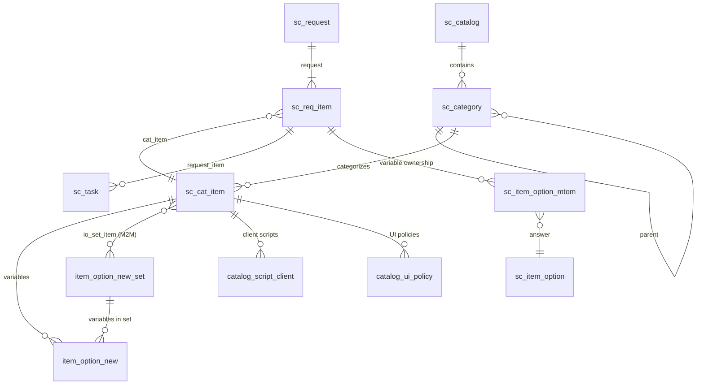
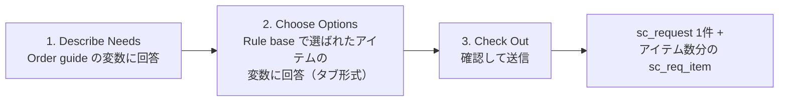
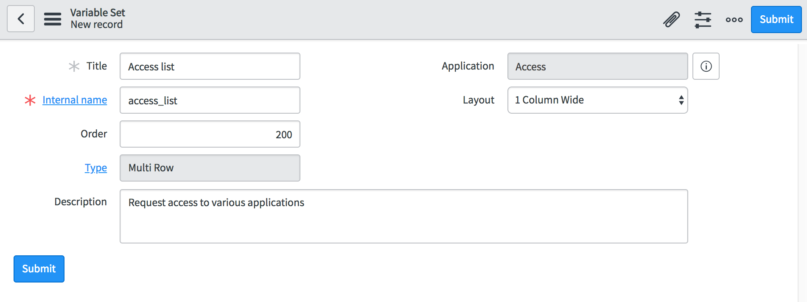
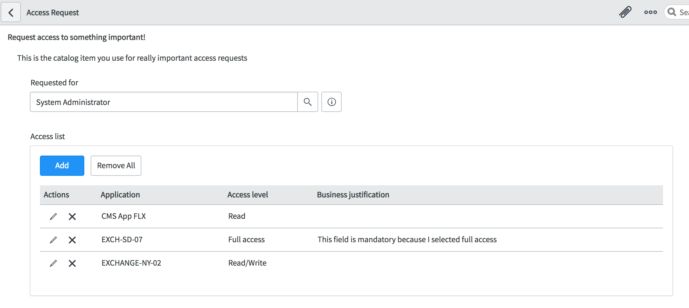
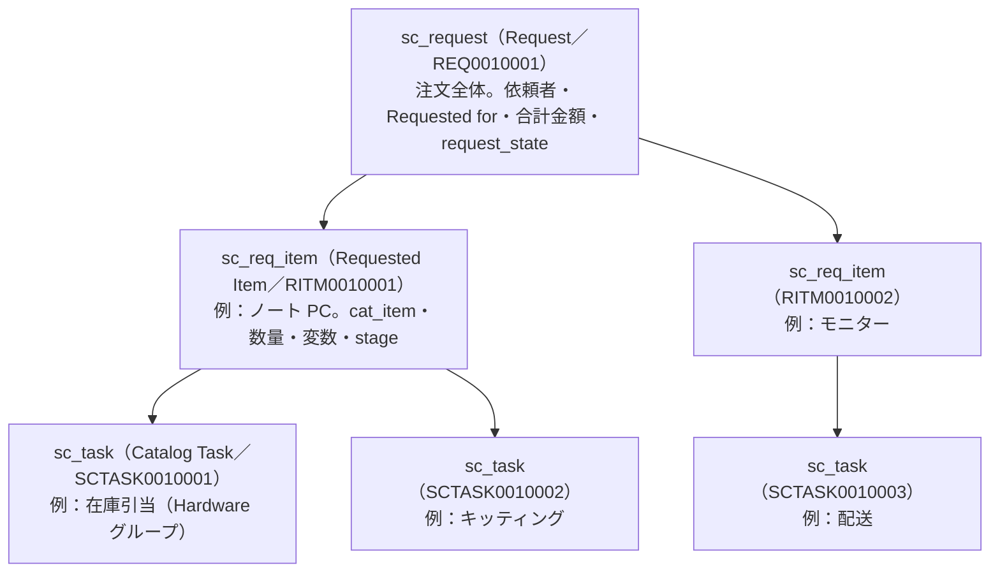
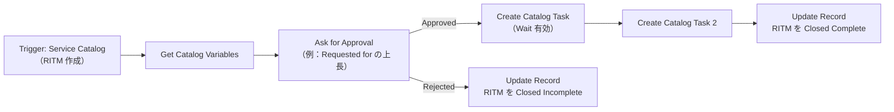
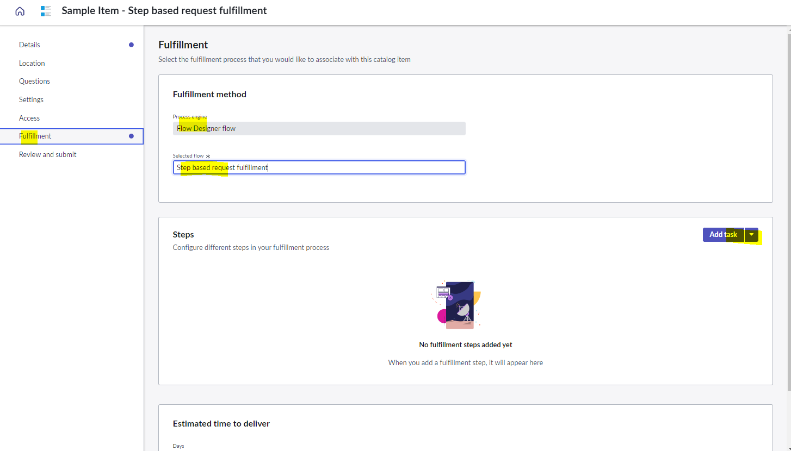
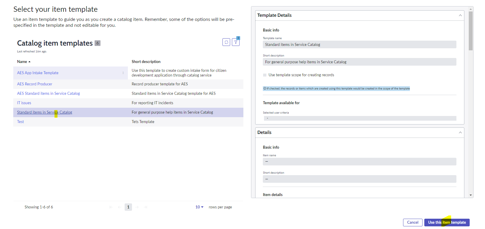

# Service Catalog（サービスカタログ）

## 概要

Service Catalog（サービスカタログ）は、ServiceNow AI Platform（旧 Now Platform）に標準搭載された「依頼の受付窓口」機能である。従業員・顧客はポータル（Service Portal／Employee Center）、Platform UI（Core UI）、Now Mobile、Virtual Agent などからカタログに掲載された品目（PC、ソフトウェア、アクセス権、各種申請など）を選び、Variables（変数＝質問項目）に回答して依頼を送信する。送信された依頼は `sc_request`（Request／REQ）、`sc_req_item`（Requested Item／RITM）、`sc_task`（Catalog Task／SCTASK）のレコードとして生成され、Workflow Studio（Flow Designer）のフローで承認・作業割り当て・自動化が実行される。Service Catalog は ServiceNow AI Platform の機能として**デフォルトで有効（active by default）**である。[出典](https://www.servicenow.com/docs/r/release-notes/service-catalog-rn.html)

Service Catalog の主要な概念は次のとおりである。

| 概念 | 英語名 | 主なテーブル | 役割 |
|---|---|---|---|
| カタログ | Catalog | `sc_catalog` | カタログアイテムを掲載する最上位の入れ物。複数作成可（例：IT カタログ、人事カタログ） |
| カテゴリ | Category | `sc_category` | カタログ内の分類。階層化可能 |
| カタログアイテム | Catalog item | `sc_cat_item` | 注文可能な商品・サービス。全アイテム種別の親テーブル |
| レコードプロデューサー | Record producer | `sc_cat_item_producer` | カタログの UI から任意テーブル（Incident 等）のレコードを作成するアイテム |
| オーダーガイド | Order guide | `sc_cat_item_guide` | 複数アイテムを 1 回の依頼にまとめて注文させるアイテム |
| コンテンツアイテム | Content item | `sc_cat_item_content` | 注文ではなく情報（ナレッジ記事・外部 URL 等）を提示するアイテム |
| 変数 | Variable | `item_option_new` | アイテムの質問項目の定義 |
| 変数セット | Variable set | `item_option_new_set` | 複数アイテムで再利用する変数のまとまり（Single-row／Multi-row） |
| カタログクライアントスクリプト | Catalog client script | `catalog_script_client` | 変数を操作するクライアントスクリプト |
| カタログ UI ポリシー | Catalog UI policy | `catalog_ui_policy`／`catalog_ui_policy_action` | 条件に応じて変数の必須・表示・読み取り専用を制御 |
| リクエスト | Request | `sc_request` | 1 回のチェックアウト（注文）単位。番号は REQ |
| リクエストアイテム | Requested Item | `sc_req_item` | リクエスト内のアイテム 1 件ごとのレコード。番号は RITM |
| カタログタスク | Catalog Task | `sc_task` | RITM を実行するための作業タスク。番号は SCTASK |

テーブル名とオブジェクトの対応（`sc_cat_item`、`sc_cat_item_producer`、`item_option_new_set`、`catalog_ui_policy`、`catalog_ui_policy_action`、`catalog_script_client`）は ServiceNow Fluent（ServiceNow SDK）の Service Catalog API ドキュメントで確認できる。[出典](https://www.servicenow.com/docs/r/application-development/servicenow-sdk/fluent-service-catalog-api.html)

> 本ファイルは Service Catalog の**プラットフォーム機能**を扱う。ITIL の Request Fulfillment（要求実現）プロセスとしての運用設計は [Request Management](../itsm/request-management.md)、ポータル UI は [Service Portal と Employee Center](./portals-employee-center.md)、フロー作成の詳細は [Workflow Studio / Flow Designer](./flow-designer-workflow-studio.md) を参照。

---

## 全体構造

### オブジェクト関係図

Service Catalog の定義データ（カタログ側）と、依頼時に生成されるトランザクションデータ（リクエスト側）の関係は次のとおりである。



- アイテム種別は `sc_cat_item` を親とするテーブル継承で表現される（`sc_cat_item_producer`、`sc_cat_item_guide`、`sc_cat_item_content` など）。システムプロパティ `glide.sc.item.cannot_add_to_request` の既定値が `sc_cat_item_guide, sc_cat_item_producer, sc_cat_item_wizard` であることからも、これらがアイテムクラスとして扱われていることが分かる。[出典](https://www.servicenow.com/docs/r/8K~WUyyBmjUR0pLPxM8yeA/rWVSN88kI2UuPPHMgpFGuQ)
- アイテムと変数セットの多対多関係は `io_set_item` テーブルで保持される【経験則】（公式ドキュメント上のテーブル記述は今回確認できず）。
- `sc_content`（コンテンツアイテム）の正式なテーブル名は `sc_cat_item_content` である【第三者情報】。[出典](https://www.servicenow.com/community/developer-forum/difference-between-sc-cat-item-content-and-sc-cat-item-producer/m-p/2442324)

### 回答値（変数値）の格納テーブル

依頼時に入力された変数の値は、以下の内部テーブルに格納される。公式ドキュメントは、これらのテーブルに対する**直接更新（ビジネスルール経由を含む）はサポート対象外**と明記している。[出典](https://www.servicenow.com/docs/r/8K~WUyyBmjUR0pLPxM8yeA/_3chsA4_PUaEhOz_VzP~HA)

| テーブル | 英語名 | 内容 |
|---|---|---|
| `sc_item_option` | Options | 変数の回答値そのもの |
| `sc_item_option_mtom` | Variable Ownership | 回答値（`sc_item_option`）と RITM（`sc_req_item`）を結び付ける M2M |
| `question_answer` | Question Answer | Record producer で生成したレコード等に紐づく回答値 |
| `sc_item_produced_record` | Produced item record | Record producer が生成したレコードの記録 |
| `sc_multi_row_question_answer` | Multi-row question answer | Multi-row variable set（MRVS）の行データ |

- 変数値の読み書きは GlideRecord の `current.variables.<変数名>` や Flow の **Get Catalog Variables** アクションを使い、上記テーブルを直接操作しないのが原則である。サーバーサイドの `variables` オブジェクトについては [サーバーサイドスクリプト](./scripting-server-side.md) を参照。
- RITM 削除時に孤立した `sc_item_option` を削除する上限件数はプロパティ `sc_orphan_item_option_delete_limit` で制御される。[出典](https://www.servicenow.com/docs/r/8K~WUyyBmjUR0pLPxM8yeA/rWVSN88kI2UuPPHMgpFGuQ)

---

## ロール

Service Catalog のロールは次のとおり（Australia ドキュメント「Service Catalog terms and roles」）。[出典](https://www.servicenow.com/docs/r/8K~WUyyBmjUR0pLPxM8yeA/coXRFdevEJQZ5xvN202EJw)

| ロール | 説明 | 含まれるロール |
|---|---|---|
| `admin` | Service Catalog アプリケーションのすべてを管理できる。UI マクロやビジネスルールなどのスクリプト機能も含む | なし |
| `catalog_admin` | カタログ・カテゴリ・アイテムを含む Service Catalog アプリケーションを管理できる。`admin` が持つスクリプト機能は含まない | なし |
| `catalog_manager` | Service Catalog を編集・更新できる。**自分がマネージャーに割り当てられたカタログに限り**、エディターや別のマネージャーを割り当てられる | なし |
| `catalog_editor` | Service Catalog を編集・更新できる。**自分がエディターに割り当てられたカタログに限り**、他のエディターを割り当てられるが、マネージャーは変更できない | なし |
| `catalog_builder_developer` | Catalog Builder で高度なアイテム（動的参照修飾子、変数属性、Programmable default、Availability、Catalog client script 等）を作成・保守できる。`glide.sc.builder.allow_create_from_scratch`（既定で有効）が無効でない限り、テンプレートなしでアイテムを作成できる | `catalog_builder_editor` |
| `catalog_builder_editor` | Catalog Builder で、自分がアクセスできるテンプレートを使ってアイテムを作成・保守できる | なし |

補足事項：

- `catalog_manager`／`catalog_editor` は Variable set（変数セット）を**作成できず**、担当カタログのアイテムに既存の変数セットを添付できるだけである（公式ページはこの否定形でのみ記載しており、`catalog_admin` が作成できるかどうかには触れていない）。[出典](https://www.servicenow.com/docs/r/q4dSP2Icgr1SFv5wanVXvQ/qzsQje1UPaF1RtEqCIHoDA)
- Catalog UI policy の作成手順の前提ロールは `admin` と記載されている。[出典](https://www.servicenow.com/docs/r/8K~WUyyBmjUR0pLPxM8yeA/yH2AIjzwg3IriysBCp0VGA)
- Order guide の作成には `catalog_admin` または `admin` が必要である。[出典](https://www.servicenow.com/docs/r/8K~WUyyBmjUR0pLPxM8yeA/vCh5Hm2lTwlwifREnzA_pQ)
- 依頼者（エンドユーザー）は特別なロールを必要としない。アイテムの閲覧・注文可否は User criteria（後述）で制御される。
- フルフィルメント担当者（RITM／SCTASK を処理する人）は一般に `itil` ロールを持つ。`itil` ロールはプロパティ `glide.sc.entitlement.override` の説明にあるとおり、通常のエンタイトルメントチェックを迂回して任意のアイテムを依頼できる。[出典](https://www.servicenow.com/docs/r/8K~WUyyBmjUR0pLPxM8yeA/rWVSN88kI2UuPPHMgpFGuQ)

> **Brazil での変更:** Request management のテーブル（`sc_request`、`sc_req_item` など）の ACL から、catalog ロール／catalog admin ロール（catalog 関連ロール）が必須ロールリストから削除された。各 ACL には最低 1 つの Request management 用ロールが残る。Request management 用ロールを持たず catalog 関連ロールのみを持つユーザーは、これらの ACL 経由ではテーブルにアクセスできなくなる（同一テーブルの別 ACL で許可される場合はある）。この変更は catalog チームが所有する ACL レコードのみが対象。アップグレード時は、`catalog_admin` 等のみで RITM を閲覧・操作していたユーザーの影響確認が必要である。[出典](https://www.servicenow.com/docs/r/release-notes/service-catalog-rn.html)

ロールと ACL の一般論は [ユーザー・グループ・ロール](./users-groups-roles.md)、[アクセス制御（ACL）](./access-control-acl.md) を参照。

---

## Catalog（カタログ）と Category（カテゴリ）

### Catalog（`sc_catalog`）

`sc_catalog` テーブルは、カタログアイテムを掲載する最上位の単位である。ベースシステムには「Service Catalog」というカタログが存在し、組織は用途別に複数のカタログ（例：IT、HR、Facilities、Technical Catalog）を作成できる。

- メニュー：**All > Service Catalog > Catalog Definitions > Maintain Catalogs** で新規カタログを作成し、Title、Manager、Editors などを入力する（London 版ドキュメント「Multiple service catalogs setup」記載。Australia 版の同等手順ページは今回確認できず）。[出典](https://docs.servicenow.com/bundle/london-it-service-management/page/product/service-catalog-management/concept/c_MultipleServiceCatalogs.html)
- カタログ単位で Manager（`catalog_manager` を持つユーザー）と Editors（`catalog_editor` を持つユーザー）を指定し、委任管理を行う。[出典](https://www.servicenow.com/docs/r/8K~WUyyBmjUR0pLPxM8yeA/coXRFdevEJQZ5xvN202EJw)
- カタログには背景色（Background color）やデスクトップ画像（Desktop image）を設定でき、スコープ API `sn_sc.CatalogJS` からも取得できる。[出典](https://www.servicenow.com/docs/r/zZBaGIzc7EPkA0ySnMn5eg/cMwSGUvNqdV4KDcaassKqg)
- 1 つのアイテムを複数カタログに掲載できる（Catalog item フォームの Catalogs フィールドは複数選択）。
- カタログ単位で User criteria（Available for／Not available for）を設定できる。

### Category（`sc_category`）

`sc_category` テーブルは、カタログ内のアイテム分類である。カテゴリは親カテゴリ（Parent）を持つことで階層化できる。

- メニュー：**All > Service Catalog > Catalog Definitions > Maintain Categories**（Xanadu 版ドキュメント記載）。Desktop image は Service Catalog ホームページでカテゴリとともに表示される大きな画像で、レンダラー（Renderer）の設定次第で表示される。[出典](https://www.servicenow.com/docs/r/GCPjp~ldPTNRN99oH1DYFg/JklyV9zVG7NCklcziisvYg)
- **カテゴリが設定されていないアイテムはカタログ検索でヒットしない**（Service Portal の場合。Employee Center の場合は Taxonomy topic への割り当てが必要）。[出典](https://www.servicenow.com/docs/r/8K~WUyyBmjUR0pLPxM8yeA/hJnvDDowivS_C3638JM7mQ)
- カテゴリに設定した User criteria は配下アイテムに自動継承**されない**。アイテムごとに設定する必要がある（後述「User criteria によるアクセス制御」）。[出典](https://www.servicenow.com/docs/r/8K~WUyyBmjUR0pLPxM8yeA/HVBqBgNVC0yR2CP3tmCC1w)
- Employee Center では、カテゴリの代わりに **Taxonomy（Employee experience taxonomy、`sn_ect` プラグイン）** のトピックでアイテムを整理する。Catalog item フォームの関連リスト「Assigned topics」は `sn_ect` が有効な場合のみ表示される。[出典](https://www.servicenow.com/docs/r/8K~WUyyBmjUR0pLPxM8yeA/hJnvDDowivS_C3638JM7mQ) 詳細は [Service Portal と Employee Center](./portals-employee-center.md) を参照。

---

## Catalog item（カタログアイテム）

### アイテムの種類

Service Catalog ドキュメントが定義するアイテムの種類は次の 4 つである。[出典](https://www.servicenow.com/docs/r/servicenow-platform/service-catalog/c_IntroductionToCatalogItems.html)

| 種類 | 英語名 | テーブル | 説明 |
|---|---|---|---|
| 標準カタログアイテム | Standard catalog item | `sc_cat_item` | 単独で注文できる商品・サービス。説明・画像・承認と実行を定義するフロー、変数、Catalog UI policy、Catalog client script を持つ |
| レコードプロデューサー | Record producer | `sc_cat_item_producer` | 情報を追加する別の手段（例：「サービスカタログ経由のインシデント」）。RITM ではなく指定テーブルのレコードを作る |
| オーダーガイド | Order guide | `sc_cat_item_guide` | 複数のカタログアイテムを 1 つのリクエストにまとめる |
| コンテンツアイテム | Content item | `sc_cat_item_content` | 商品・サービスではなく情報を提供する（ナレッジ記事、外部サイト等へのリンク） |

上記のほか、ベースシステムや他アプリケーションが `sc_cat_item` を継承したクラスを持つ。例：`sc_cat_item_wizard`（Wizard、レガシー）、`sc_cat_item_service`（Service Portfolio 関連）、Standard change template（`std_change_record_producer`、Change Management）など。`glide.sc.item.cannot_try_it` の既定値に `sc_cat_item_service` が含まれる。[出典](https://www.servicenow.com/docs/r/8K~WUyyBmjUR0pLPxM8yeA/rWVSN88kI2UuPPHMgpFGuQ)（`std_change_record_producer` の扱いは [Change Management](../itsm/change-management.md) を参照）

カタログアイテムは Localization Framework を使って多言語に翻訳できる（Service Catalog items ページに「Translation of Service Catalog items」として記載される既存機能。導入リリースは公開情報では確認できず）。[出典](https://www.servicenow.com/docs/r/servicenow-platform/service-catalog/c_IntroductionToCatalogItems.html) 詳細は [ローカライゼーション](./localization.md) を参照。

### アイテムの作成方法

| 方法 | 対象ユーザー | 説明 |
|---|---|---|
| Platform UI（Maintain Items フォーム） | `admin`、`catalog_admin`、`catalog_manager`、`catalog_editor` | **All > Service Catalog > Catalog Definitions > Maintain Items** から `sc_cat_item` フォームで作成。全機能を設定可能 |
| Catalog Builder | `catalog_builder_editor`、`catalog_builder_developer`、`catalog_admin` | ガイド付きのビジュアル作成画面。テンプレートで制約をかけて業務部門に作成を委任する（後述） |
| ServiceNow SDK（Fluent） | 開発者 | `CatalogItem`、`CatalogItemRecordProducer` などのオブジェクトでコードとして定義する。[出典](https://www.servicenow.com/docs/r/application-development/servicenow-sdk/fluent-service-catalog-api.html) 詳細は [アプリケーション開発](./app-development.md) |
| Service Creator（レガシー） | 部門の Service Catalog 管理者 | 旧来のアイテム作成ツール。現在は Catalog Builder の利用が推奨される【経験則】 |

### Catalog Item フォームのフィールド（Australia）

Australia ドキュメント「Catalog Item form」に基づく `sc_cat_item` フォームの項目は以下のとおり。[出典](https://www.servicenow.com/docs/r/8K~WUyyBmjUR0pLPxM8yeA/hJnvDDowivS_C3638JM7mQ)

#### メイン領域

| フィールド | 説明 |
|---|---|
| Name（名前） | カタログに表示される名前 |
| Catalogs（カタログ） | アイテムを掲載するカタログ（複数可） |
| Category（カテゴリ） | アイテムのカテゴリ。Catalogs を入力した後でのみ選択可能。カテゴリ（Service Portal）または Taxonomy topic（Employee Center）がないアイテムは検索でヒットしない |
| Model（モデル） | 関連付ける製品モデル。既定ではモデル公開によって作成されたアイテムでのみ表示 |
| Active（有効） | 注文可能にする。非アクティブなアイテムを Order guide に入れても表示されない |
| Secondary owner（第二オーナー） | このアイテムを編集できるユーザーを User criteria で指定する。変更できるのは catalog admin とアイテムのオーナーのみ（Australia で導入） |
| Execution automation level（実行自動化レベル） | Not specified／Manual／Semi-automated／Fully automated |
| Access type（アクセスタイプ） | Restricted（アイテムにアクセス権があるユーザーのためにのみ依頼可）／Delegated（アクセス権のないユーザーのためにも依頼可）。既定は Restricted で、アイテムに Requested for 変数がある場合のみ有効 |
| Owner（オーナー） | アイテムを編集できるユーザー |
| View link | カタログでの表示プレビュー |
| Requested item link | RITM に表示されるビューへのリンク |
| Hide in Service Portal | Service Portal で非表示にする |
| Availability（可用性） | Desktop and classic mobile／Desktop only／Classic mobile only |

#### Item details（アイテム詳細）

| フィールド | 説明 |
|---|---|
| Short description（簡単な説明） | カタログホーム、検索結果、注文フォームのタイトルバーに表示 |
| Description（説明） | アイテム選択時や View クリック時に表示される詳細説明。動画、画像、ナレッジリンク、外部リンクを含められる |
| Meta | 検索用のカンマ区切りキーワード |

#### Process engine（プロセスエンジン：いずれか 1 つのみ設定）

| フィールド | 説明 |
|---|---|
| Flow | 依頼の実行（フルフィルメント）を定義する Workflow Studio のフロー。**推奨** |
| Workflow | 依頼の実行を定義するレガシー Workflow（Workflow Editor） |
| Execution plan | 依頼の実行を定義する Execution plan（旧称 Delivery plan） |

#### Picture／Classic mobile／Pricing

| フィールド | 説明 |
|---|---|
| Icon | アイテム名の横に表示するアイコン（27×27 ピクセル推奨。未設定時は既定アイコン） |
| Image | アイテム画像 |
| Classic mobile image type／Classic mobile image | クラシックモバイルでの画像（Desktop の画像を使用／モバイル専用／なし） |
| Hide price (classic mobile listings) | モバイルで価格を非表示 |
| Price（価格） | 価格（通貨を選択） |
| Recurring price（定期価格）／Recurring price frequency | 定期的に発生する価格と頻度（月次・年次等） |
| Omit price in cart | カートとカタログ一覧で価格を非表示 |

#### Portal settings（ポータル設定）

| フィールド | 説明 |
|---|---|
| Request method（依頼方法） | ボタン表示と送信動作を制御。**Order**（既定。Order Now ボタン、確認ダイアログ、配送情報を編集可）／**Request**（Request ボタン、配送情報非表示。例：コードアクセス依頼）／**Submit**（Submit ボタン、確認ダイアログと配送情報を非表示。例：パスワードリセット） |
| Hide "Add to cart" | Add to cart ボタン非表示。Order／Submit で既定オン |
| Hide "Save as draft" | ポータルの Save as draft ボタンを非表示 |
| Hide quantity | 数量選択を非表示。Order／Submit で既定オン |
| Hide delivery time | 配送時間を非表示。Submit で既定オン |
| Hide "Add to wish list" | ウィッシュリストボタンを非表示 |
| Hide attachment | 添付ボタンを非表示 |
| Attachment required | 添付を必須にする |

Request method の Order／Request／Submit の用途例（ノート PC 依頼＝Order、コードアクセス依頼＝Request、パスワードリセット＝Submit）は「Add a standard catalog item」にも記載がある。[出典](https://www.servicenow.com/docs/r/yEOfGyFTg0Q8oBn1GnIy5Q/tff3tvKSUadF3_vpZUpMTw)

#### Universal Request settings

Universal Request プラグイン（`com.snc.universal_request`）が有効な場合のみ表示される。

| フィールド | 説明 |
|---|---|
| UR enabled/certified item | RITM に紐づく Universal Request も作成し、RITM をその Primary task にする |
| Requires additional review | 対応する Universal Request の「Requires resolution review」を自動でオンにする |

#### フォームのカスタマイズで追加できるフィールド

| フィールド | 説明 |
|---|---|
| Expand help for all questions | ページ表示時に全質問のヘルプを展開（変数単位の設定より優先） |
| No quantity／No cart | 数量選択／ショッピングカートを非表示 |
| No search | 検索結果と Service Portal のカタログウィジェットから除外（Platform UI ではブラウズで見つかる） |
| Order | カテゴリ内の並び順 |
| Domain／Domain path | ドメインセパレーション有効時のドメイン |

#### 関連リンク・関連リスト

| 項目 | 説明 |
|---|---|
| Item diagnostics（関連リンク） | カタログデータと構成の問題を検出し、診断レポートとスコアを生成 |
| Edit checked-out item in advanced view（関連リンク） | Catalog Builder で Edit した（チェックアウト中の）アイテムを詳細ビューで編集 |
| Variables | 依頼時に情報を集める質問 |
| Variable sets | アイテムに紐づく再利用可能な変数グループ |
| Approved by group／Approved by | 依頼を承認すべきグループ／ユーザー |
| Categories／Catalogs | 追加のカテゴリ／カタログ |
| Catalog data lookup definitions | データルックアップルール |
| Catalog UI policies／Catalog client scripts | アイテムに紐づく UI ポリシー／クライアントスクリプト |
| Related items | Service Portal と Now Mobile のアイテムページに表示する代替アイテム |
| Related articles | アイテムページに表示する参考記事 |
| Service execution steps | 関連するサービス実行ステップ |
| Assigned topics | 割り当てた Taxonomy topic（`sn_ect` 有効時のみ） |

### Catalog data lookup（カタログデータルックアップ）

Catalog data lookup definitions は、ある変数の値に応じて別の変数の値をルックアップテーブルから自動設定するルールである（スクリプトなしで「選択したモデルに応じて価格や承認者を自動入力」等を実現）。Catalog item フォームの関連リストから定義する。[出典](https://www.servicenow.com/docs/r/8K~WUyyBmjUR0pLPxM8yeA/hJnvDDowivS_C3638JM7mQ) なお、Catalog Builder ではデータルックアップルールは編集できない。[出典](https://www.servicenow.com/docs/r/servicenow-platform/service-catalog/catalog-builder.html)

### 価格とカート関連

- 価格はアイテムの Price と、変数（Select box の選択肢価格、Check box の「Price if selected」、Lookup の「Lookup price field」）で加算される（Variable-based pricing）。[出典](https://www.servicenow.com/docs/r/cCCsnXLy_7vD00AGlASipQ/2iBjvIgrbEth4P1pae7faQ)
- 独自の価格計算は `glide.sc.use_custom_pricegenerator`（既定 No）を有効にし、Script include `CatalogPriceCalculator`／`CatalogRecurringPriceCalculator` で実装する。[出典](https://www.servicenow.com/docs/r/8K~WUyyBmjUR0pLPxM8yeA/rWVSN88kI2UuPPHMgpFGuQ)
- サポートされるカスタマイズ手段として、カートレイアウト、数量選択肢の拡張（既定 1〜10）、変数ベース価格、定期価格、価格の非表示（一覧／アイテム種別／全アイテム）、リクエストのクローン（異なるユーザー向けに最大 10 件）、カタログホームの構成などが挙げられている。[出典](https://www.servicenow.com/docs/r/8K~WUyyBmjUR0pLPxM8yeA/_3chsA4_PUaEhOz_VzP~HA)

---

## Record producer（レコードプロデューサー）

### 概要

Record producer（`sc_cat_item_producer`）は、カタログの UI（ポータル等）から **RITM ではなく任意テーブルのレコード**（Incident、HR Case、Change request など）を作成するカタログアイテムである。エンドユーザーに専門的なフォームを見せずに、質問形式で必要情報を収集してレコードを生成できる。代表例は「インシデントの報告（Report an issue）」。[出典](https://www.servicenow.com/docs/r/servicenow-platform/service-catalog/c_IntroductionToCatalogItems.html)

- Record producer は Order guide に含められず（`glide.sc.item.cannot_add_to_request`、`glide.sc.item.order_guide_exclusion` 関連）、カートにも入らない（`glide.sc.item.not_normal_cart_item` の既定値に `sc_cat_item_producer` が含まれる）。[出典](https://www.servicenow.com/docs/r/8K~WUyyBmjUR0pLPxM8yeA/rWVSN88kI2UuPPHMgpFGuQ)
- 変数値は生成されたレコードに `question_answer` 経由で紐づき、生成レコードの「Variables」エディタで参照できる。

### Record Producer フォームのフィールド（Australia）

[出典](https://www.servicenow.com/docs/r/8K~WUyyBmjUR0pLPxM8yeA/LBMujQtGSk5DIPn7ETWynQ)

| セクション | フィールド | 説明 |
|---|---|---|
| メイン | Name | 表示名 |
| メイン | Table name（テーブル名） | レコードを作成する対象テーブル |
| メイン | Active | 有効化（ロール要件を満たすユーザーにのみ表示） |
| メイン | View link | プレビュー |
| メイン | Post insert script | 対象テーブルへのレコード挿入**後**に、送信されたレコードに対して実行されるスクリプト。対象レコードの値や Record producer テンプレートの値を上書きする |
| Accessibility | Catalogs／Category | 所属カタログ／カテゴリ（カテゴリ未設定は検索不可） |
| Accessibility | View | 表示する CMS ビュー |
| Accessibility | Roles | 利用に必要なロール |
| Accessibility | Availability | Desktop and classic mobile／Desktop only／Classic mobile only |
| Accessibility | Can cancel | 直前の画面に戻る Cancel ボタンを表示 |
| What it will contain | Short description／Description／Meta | 説明と検索キーワード |
| What it will contain | Hide in Service Portal | Service Portal で非表示 |
| What it will contain | Redirect to | 送信後の遷移先（生成されたタスクレコード、またはカタログホーム）。既定はカタログプロパティ（`glide.sc.producer.redirect_url`）による |
| What it will contain | Script | 作成されるレコードのフィールドに動的に値を設定するスクリプト（挿入**前**に実行） |
| What it will contain | Icon／Image／Classic mobile image／Classic mobile image type | 画像類 |
| Generated record data | Template | 作成されるレコードに静的値を設定するテンプレート |
| Portal settings | Hide attachment／Hide "Save as draft"／Attachment required | 添付・下書き保存の制御（下書きは My Requests の Drafts タブで編集可能） |
| Universal Request configuration | UR enabled/certified item／Requires additional review | `com.snc.universal_request` 有効時のみ |

> Record producer の「Generated Record Data Template」や「Requires Additional Review」も Australia（英語版）ドキュメントに記載がある。

### 変数のマッピングとスクリプト

Record producer の変数から対象レコードのフィールドに値を渡す方法は 3 通りある。

| 方法 | 説明 |
|---|---|
| Map to field（フィールドへのマッピング） | 変数フォームで「Map to field」をオンにし、対象テーブルのフィールドを選ぶ。変数値がそのままフィールドに入る（MRVS 内の変数では非対応） |
| Template | 静的値を設定 |
| Script | `current`（生成されるレコード）と `producer`（変数値）を使ってスクリプトで設定 |

Script フィールドでは `current.<フィールド名>` で生成レコードの値を、`producer.<変数名>` で利用者の入力値を参照できる。送信後の遷移先は `producer.redirect`（Platform UI 用）と `producer.portal_redirect`（Service Portal 用）で指定する。[出典](https://www.servicenow.com/docs/r/Ir~NPf1dr8MGFXQE6QlBoQ/4JZLxUg0opshWJqwVlt53Q)

```javascript
// Record producer の Script フィールドの例（挿入前に実行される）
current.short_description = 'PC 故障: ' + producer.asset_tag;
current.caller_id = gs.getUserID();
// Service Portal で送信後にポータルホームへ遷移させる
producer.portal_redirect = 'sp?id=sc_home';
```

- Record producer は対象テーブルが他スコープのものでも利用できるが、Catalog Builder で作成する場合は対象オブジェクトが read と create のアクセスを許可している必要がある。[出典](https://www.servicenow.com/docs/r/servicenow-platform/service-catalog/catalog-builder.html)
- Record producer の Script 内で `current.insert()` を呼ぶと二重作成になるため呼ばない【経験則】（レコード挿入はプラットフォームが行う）。

---

## Order guide（オーダーガイド）

### 概要

Order guide（`sc_cat_item_guide`）は、1 回の依頼で複数のカタログアイテムを生成する仕組みである。例として「New Employee Hire（新入社員受け入れ）」で名刺・PC・携帯電話をまとめて依頼できる。Order guide は手動で実行するほか、オンボーディングのワークフローなどから自動実行（Run order guides automatically）もできる。Order guide で入力した情報は、変数のカスケード（Cascade）で各アイテムに引き継げる。[出典](https://www.servicenow.com/docs/r/servicenow-platform/service-catalog/c_ServiceCatalogOrderGuides.html)

### 注文プロセス

Order guide の既定の注文プロセスは 3 ステップ（three-step）である。Platform UI では一般に「Describe Needs（ニーズの記述）→ Choose Options（オプションの選択）→ Check Out（チェックアウト）」として表示される（プロパティ `glide.sc.reset_cascade` の説明に「Describe needs」、`glide.sc.guide.tab.validate` に「Choose Options」の語がある）。[出典](https://www.servicenow.com/docs/r/8K~WUyyBmjUR0pLPxM8yeA/rWVSN88kI2UuPPHMgpFGuQ) 2 ステップ（Two step）にすると最終確認ステップが省略される。



### 作成手順と Rule base

作成手順（Australia）：[出典](https://www.servicenow.com/docs/r/8K~WUyyBmjUR0pLPxM8yeA/vCh5Hm2lTwlwifREnzA_pQ)

1. **All > Service Catalog > Catalog Definitions > Order Guides** を開き、New をクリック。
2. フィールドを入力して保存。
3. 関連リスト **Rule base（ルールベース）** に、どのアイテムを注文に含めるかのルールを定義する。
4. （任意）**Generate sequence（シーケンスの生成）** で Rule base のアイテムを入力する順序を設定する。シーケンスを定義すると、依存アイテムの前に必須アイテムが入力されたかを手動で確認する必要がなくなる。シーケンスは Playbooks で構成される。
5. （任意）関連リスト Variables に Order guide 自身の変数を定義する。

Rule base のルール条件は、Keywords、Requested By、Requested For、または Order guide に定義された任意の変数に対して評価できる。[出典](https://www.servicenow.com/docs/r/servicenow-platform/service-catalog/t_CreateARule.html) また Order guide の Script フィールドでは次の 2 メソッドを使える。[出典](https://www.servicenow.com/docs/r/servicenow-platform/service-catalog/c_ServiceCatalogOrderGuides.html)

| メソッド | 説明 |
|---|---|
| `guide.add("<sys_id_of_cat_item>")` | ルールで追加されないアイテムを追加 |
| `guide.remove("<sys_id_of_cat_item>")` | ルールで追加されたアイテムを除外 |

### Order guide フォームのフィールド

Yokohama 版ドキュメントの「Order guide form」に基づく（Australia 版の同ページは今回取得できず、Australia でも同等と推定【推定】）。[出典](https://www.servicenow.com/docs/r/Ir~NPf1dr8MGFXQE6QlBoQ/tyg6_ZlFPC5pgz9YdkU7Ew)

| フィールド | 説明 |
|---|---|
| Name／Active／Category | 名前、有効、表示カテゴリ |
| Two step | 既定の 3 ステップの代わりに 2 ステップ注文を有効化。Check out で即時送信し確認画面を表示。**Service Portal には適用されない** |
| Icon | 16×16 ピクセルのアイコン |
| Cascade variables（変数のカスケード） | Order guide の変数値を、同名変数を持つ注文アイテムに引き継ぐ。オフにすると引き継がない |
| Ordered Item Link | 注文アイテム画面に表示する詳細情報リンク（Service Portal 非対応） |
| Roles | アクセスに必要なロール |
| Short description／Description／Meta | 説明・検索キーワード |
| Hide on Service Portal | Service Portal で非表示 |
| Order to cart | Order guide をカートに追加して買い物を続けられる。Two step 併用時のみ有効。Service Portal 非対応 |
| Portal Settings > Request method | Order／Request／Submit（カタログアイテムと同様） |
| Portal Settings > Hide 'Add to Cart' | Add to Cart ボタン非表示（Request／Submit で既定オン） |
| Portal Settings > Show Include Toggle | Service Portal の Choose Options で各アイテムに含める／除外するトグルを表示 |

### 変数のカスケード

Cascade variables を有効にすると、Order guide の変数と**同じ名前（Name）**を持つアイテム側の変数に値が引き継がれる。共通の変数を Variable set にまとめて Order guide とアイテムの双方に添付するのが定石である。[出典](https://www.servicenow.com/docs/r/q4dSP2Icgr1SFv5wanVXvQ/2a8KDsEuqq7ksRpM49h3FQ)

- アイテム側の受け取り変数は、Choose Options 画面で再入力させないよう Catalog UI policy／client script で非表示にすることが多い。その際、`g_service_catalog.isOrderGuide()` でオーダーガイド内かを判定する手法がコミュニティで紹介されている（Service Portal／Mobile 向け。初期表示時に false を返す事例がある）【第三者情報】。[出典](https://www.servicenow.com/community/developer-forum/how-to-check-current-item-is-orderguide-in-client-script/m-p/2485367)
- **MRVS はカスケードに対応しない。**[出典](https://www.servicenow.com/docs/r/q4dSP2Icgr1SFv5wanVXvQ/qzsQje1UPaF1RtEqCIHoDA)
- 「Describe needs」に戻ったときにカスケード値をリセットするかは `glide.sc.reset_cascade`／`glide.sc.reset_cascade_all` で制御（Platform UI のみ）。[出典](https://www.servicenow.com/docs/r/8K~WUyyBmjUR0pLPxM8yeA/rWVSN88kI2UuPPHMgpFGuQ)

### Programmable（Scriptable）order guide

Order guide はスクリプト／API からも実行できる（Run order guides automatically）。例えば HR のオンボーディングや外部システムからの JSON ペイロードで Order guide を起動する。失敗時に失敗レコードを作成するかは次のプロパティで制御する。[出典](https://www.servicenow.com/docs/r/8K~WUyyBmjUR0pLPxM8yeA/rWVSN88kI2UuPPHMgpFGuQ)

| プロパティ | 失敗レコードを作成する条件 |
|---|---|
| `glide.sc.sog.empty_payload` | JSON ペイロードが空 |
| `glide.sc.sog.inactive_order_guide` | Order guide が非アクティブ |
| `glide.sc.sog.invalid_order_guide_id` | Order guide の sys_id が不正 |
| `glide.sc.sog.json_parsing` | JSON パースエラー |
| `glide.sc.sog.mandatory_json_parameters` | 必須 JSON パラメータの欠落 |

Workflow Studio には Order guide を送信するアクション（Submit Order Guide 等）があるとされる【経験則】（今回の調査では公式ページで確認できず）。

---

## Variables（変数）

### 概要

Variables（`item_option_new`）は、カタログアイテム・Record producer・Order guide・Variable set に定義する質問項目である。変数は Catalog item フォームの関連リスト Variables から作成する。変数の値は RITM、Catalog Task、Record producer の生成レコードの Variable editor（変数エディタ）で参照・編集できる。

### 変数タイプ一覧（Australia）

[出典](https://www.servicenow.com/docs/r/8K~WUyyBmjUR0pLPxM8yeA/F3WD1Plep0xlkcutTm3yMg)

| 変数タイプ | 説明 | MRVS で使用 |
|---|---|---|
| Attachment | 質問に対してファイルを添付させる | 不可 |
| Break | 水平線を表示 | 不可 |
| Check Box | チェックのオン／オフ | 可 |
| Container Start／Container Split／Container End | 他の変数を格納するコンテナのレイアウト（列分割） | 不可 |
| Date／Date and Time／Duration | 日付・日時・期間の入力 | 可 |
| Email | メールアドレス入力 | 可 |
| HTML | 画像等を含む高度な書式のコンテンツ | 不可 |
| IP Address | IPv4／IPv6 を収集 | 可 |
| Label | 書式付きラベル（データを収集しない） | 不可 |
| List Collector | テーブルから複数レコードを選択 | 可（glide list インターフェースのみ） |
| Lookup Multiple Choice | テーブルデータから生成するラジオボタン | 可 |
| Lookup Select Box | テーブルデータから生成するドロップダウン | 可 |
| Custom／Custom with label | UI マクロを挿入（ラベル付きも可）。旧称 Macro／Macro with label | 不可 |
| Masked | 入力値をマスク（確認入力・暗号化オプションあり） | 可 |
| Multi Line Text | 複数行テキスト | 可 |
| Multiple Choice | ラジオボタン | 可 |
| Numeric Scale | リッカート尺度などの範囲選択ラジオボタン | 可 |
| Reference | 他テーブルのレコードを参照（例：`sys_user`） | 可 |
| Requested for | 誰のための依頼かを指定する | 公開情報では確認できず |
| Rich Text Label | 書式付きラベル | 不可 |
| Select Box | 定義済み選択肢のドロップダウン | 可 |
| Single Line Text | 1 行テキスト | 可 |
| UI Page | UI ページを挿入 | 不可 |
| URL | URL 入力 | 可 |
| Wide Single Line Text | フォーム幅いっぱいの 1 行テキスト | 可 |
| Yes/No | Yes／No の選択 | 可 |

「MRVS で使用」列の「不可」は、Australia ドキュメントの MRVS 非対応タイプ一覧（Attachment、Break、Container End/Start/Split、HTML、Label、Macro、Macro with label、Rich Text Label、UI Page）に基づく。「可」はその一覧に含まれないことからの推定である【推定】。[出典](https://www.servicenow.com/docs/r/q4dSP2Icgr1SFv5wanVXvQ/qzsQje1UPaF1RtEqCIHoDA)

### 変数フォームのフィールド

Service Catalog variable form fields ページ（日本語 UI 表記つき）に基づく。[出典](https://www.servicenow.com/docs/r/cCCsnXLy_7vD00AGlASipQ/2iBjvIgrbEth4P1pae7faQ)

#### 共通フィールド

| フィールド | 説明 |
|---|---|
| Type（タイプ） | 変数タイプ |
| Catalog item（カタログアイテム） | 所属アイテム |
| Order（順番） | 表示順（小さいほど上） |
| Active（有効）／Mandatory（必須）／Read only（読み込み専用）／Hidden（非表示） | 基本属性 |
| Question（質問） | 表示する質問文 |
| Name（名前） | 変数の識別子。空欄なら Question から自動生成。**スクリプト、カスケード、Flow のデータピルで使うため必ず意味のある英数字名を付ける**（名前のない変数はクライアントスクリプトから参照できない） |
| Tooltip（ツールヒント） | ホバー時の短い説明 |
| Sample text（サンプルテキスト） | 入力前に表示するプレースホルダー（IP、Email、URL、テキスト系、日付系） |
| Help display／Help tag／Help text／Description | 追加のヘルプ（Annotation セクション） |
| Variable attributes（変数の属性） | 変数の動作・制約を定義する属性（例：`ref_auto_completer`、`max_rows` 等） |
| Default value（デフォルト値） | 既定値。Reference 変数は表示値ではなく sys_id を指定 |
| Auto-fill：Dependent question／Reference | 参照型の別変数を元に自動入力する設定 |

#### Type specifications（タイプ別の主な設定）

| フィールド | 対象タイプ | 説明 |
|---|---|---|
| Variable width（変数の幅） | 各種 | 画面幅に対する割合 |
| Enable Additional Requests／Roles for Additional Requests | Requested for | 複数ユーザー分を一度に依頼できるようにする |
| Choice table／Choice field | Select Box | 選択肢をテーブルのフィールドの選択肢から取得 |
| Include None（なしを含む） | 選択系 | 「-- None --」選択肢を追加 |
| List table | List Collector | 値を保持するテーブル |
| Lookup table／Lookup value field／Lookup label field／Lookup price field／Recurring price lookup field | Lookup 系 | ルックアップの元テーブル、値・ラベル・価格フィールド |
| Reference／Use reference qualifier／Reference qualifier／Reference qualifier condition／Dynamic reference qualifier | Reference 等 | 参照テーブルと絞り込み（Simple／Dynamic／Advanced） |
| Price if selected／Recurring price if selected | Check Box | チェック時に加算する価格 |
| Scale min／Scale max | Numeric Scale | 尺度の最小値・最大値 |
| Use confirmation／Use encryption | Masked | 確認入力、DB への暗号化保存 |
| Validation regex（検証用の正規表現） | Single Line Text 等 | 正規表現による入力検証 |
| Macro／Summary macro／Widget | Custom 系、UI Page | 挿入する UI マクロ、Service Portal 用ウィジェット |
| Layout | Container Start | コンテナのレイアウト（1 列、2 列等） |

- Zurich 以降、Lookup 系の選択肢を特定テーブルのフィールドから取得でき、同一フォームの他の値に応じて動的に絞り込む Dynamic dependent lookup が可能になった。属性 `ref_ac_order_by` で Lookup Select Box／Lookup Multiple Choice／List Collector の並び順を制御できる。[出典](https://www.servicenow.com/docs/r/delta-yokohama-brazil/brazil-yokohama-servicecatalog-release-notes.html)

#### Permissions（権限）

| フィールド | 説明 |
|---|---|
| Read roles（読み込みロール） | 依頼前後に変数を閲覧できるロール。設定するとこのロールのユーザーにのみ表示 |
| Write roles（書き込みロール） | 依頼後に Variable editor で編集できるロール。持たないユーザーには読み取り専用 |
| Create roles（作成ロール） | 依頼前に値を設定できるロール。持たないユーザーには送信まで読み取り専用 |

ロールを何も設定しない場合は、アイテムにアクセスできる全員が各操作を行える。ロールを持たないユーザーはスクリプト経由でも値を設定できない。Label、Break、Container Split／End、Macro、Macro with label、UI Page にはロール設定は適用されない。[出典](https://www.servicenow.com/docs/r/cCCsnXLy_7vD00AGlASipQ/2iBjvIgrbEth4P1pae7faQ)

#### Availability（表示箇所）

| フィールド | 説明 |
|---|---|
| Show everywhere（各所に表示） | 注文前のフォーム、注文後の Variable editor、カートビューに表示 |
| Show in bundles | バンドルに追加されたときに表示 |
| Show in guides（ガイドに表示） | Order guide 内に表示。多数のアイテム・変数を含む Order guide では、可能な限りオフにすると表示性能が向上する |
| Show in summary（サマリーに表示） | Variable summarizer（変数サマリー）に表示 |

#### Global フラグと Catalog Task での表示

変数の **Global** をオンにすると、その変数はアイテムに紐づく全 Catalog Task（`sc_task`）の Variable editor に表示される【経験則】。Global でない変数をタスクで表示するには、Flow の **Create Catalog Task** アクションでタスクに表示する変数を選択する。MRVS は Global を True にできないため、カタログタスクには表示されない。[出典](https://www.servicenow.com/docs/r/q4dSP2Icgr1SFv5wanVXvQ/qzsQje1UPaF1RtEqCIHoDA)

### 変数の監査

`glide.sc.audit.variables` を有効にすると、カタログ変数の変更が監査される。[出典](https://www.servicenow.com/docs/r/8K~WUyyBmjUR0pLPxM8yeA/rWVSN88kI2UuPPHMgpFGuQ)

---

## Variable sets（変数セット）

### 概要

Variable set（`item_option_new_set`）は、複数のカタログアイテム・Order guide で再利用する変数のまとまりである。セットへの変更は、そのセットを使う全アイテムに反映される。`catalog_manager`／`catalog_editor` は変数セットを作成できず、担当アイテムへの既存セットの添付のみできる（公式ページは `catalog_admin` の作成可否には触れていない）。[出典](https://www.servicenow.com/docs/r/q4dSP2Icgr1SFv5wanVXvQ/qzsQje1UPaF1RtEqCIHoDA)

| 種類 | 英語名 | 説明 |
|---|---|---|
| 単一行変数セット | Single-row variable set | 1 つの対象についてのデータを収集（例：依頼者情報ブロック） |
| 複数行変数セット | Multi-row variable set（MRVS） | グリッド形式で複数対象のデータを収集（例：複数台のハードウェアとその構成、複数アプリへのアクセス権） |

作成手順は **Variable Sets** 一覧で New → Type に **Single Row** または **Multi Row** を選択する。MRVS は Variable Set attributes に `max_rows` 属性を設定して行数を制限できる。[出典](https://www.servicenow.com/docs/r/q4dSP2Icgr1SFv5wanVXvQ/WRnk~gyVoARHWNlozNw5eQ)



*図 1：Variable Set の新規作成フォーム（Type = Multi Row）*

画面説明：Platform UI の「Variable Set — New record」フォーム。左列に Title（例「Access list」）、Internal name（必須。例「access_list」）、Order（例 200）、Type（「Multi Row」、作成後はグレーアウト）が並び、右列に Application（例「Access」）と Layout（例「1 Column Wide」）がある。下部に Description（例「Request access to various applications」）と Submit ボタン。Internal name は MRVS の値をスクリプトや Flow で参照するときの名前になる。
出典：https://www.servicenow.com/community/developer-blog/exploring-the-multi-row-variable-set/ba-p/2291532 （取得日：2026-11-03）



*図 2：Service Portal のカタログアイテムに表示された MRVS グリッド*

画面説明：Service Portal の「Access Request」アイテム画面。上部に Requested for（System Administrator）があり、その下に MRVS「Access list」が表として表示される。表の上に Add と Remove All ボタン、列は Actions（鉛筆＝編集、×＝削除アイコン）、Application、Access level、Business justification。3 行（CMS App FLX／Read、EXCH-SD-07／Full access と理由、EXCHANGE-NY-02／Read/Write）が入力されている。Add をクリックすると「Add Row」ダイアログが開き、MRVS 内の変数（Application、Access level、Business justification）を入力する。
出典：https://www.servicenow.com/community/developer-blog/exploring-the-multi-row-variable-set/ba-p/2291532 （取得日：2026-11-03）

### MRVS の仕様と制約（Australia）

[出典](https://www.servicenow.com/docs/r/q4dSP2Icgr1SFv5wanVXvQ/qzsQje1UPaF1RtEqCIHoDA)

| 項目 | 内容 |
|---|---|
| 非対応の変数タイプ | Attachment、Break、Container End／Start／Split、HTML、Label、Macro、Macro with label、Rich Text Label、UI Page |
| 行数制限 | Variable Set attributes の `max_rows` 属性で制限。Unique フィールドで重複行を禁止できる |
| 行数の上限 | UI 上の最大は 50 行と記載された版がある（Xanadu 版）。[出典](https://www.servicenow.com/docs/r/zS6yb8e~gR8BPjeviYdV9g/01kvuqgmubXupx20vHPp7g) インスタンスレベル上限をプロパティ `glide.sc.multirow_set.rows.size` で引き上げる手法はコミュニティ情報で非公式【第三者情報】 |
| コンテナ | コンテナ内に置いた MRVS は表示されない |
| Map to field | 非対応 |
| List Collector | glide list インターフェースのみ対応 |
| Order guide | 変数のカスケードに非対応 |
| Read roles | Read ロール付きの変数は追加できない |
| Global | True にできない（＝カタログタスクで表示できない） |
| クローン | リクエストのクローン時、MRVS のデータと UI ポリシー・クライアントスクリプトも引き継がれる |
| 対応 UI | Service Portal、Now Mobile、Agent Workspace の Variable editor。Now Mobile の RITM／リクエストビューには表示されない。Variable summarizer は Service Portal のみ |
| スクリプト | onSubmit の Catalog client script は非対応。アイテムレベルの UI ポリシー／クライアントスクリプトは MRVS 内の変数に適用されず、MRVS レベルのスクリプトは MRVS 外の変数に影響しない。依存参照修飾子も MRVS の境界をまたげない |
| その他 | MRVS 内の変数は UI ポリシーの条件やレポートに使えない。ATF の検証は visible／mandatory／read-only のチェックに限られる |
| 価格 | `glide.sc.use_cart_layouts` が無効な場合、Order Item ウィジェットに MRVS による価格変動が表示されない（カート追加後は表示） |
| 自動化 | Workflow Studio の Get Catalog Variables と Create Catalog Task は MRVS を含められる。For Each フローロジックで各行を反復処理できる |
| 変数セットのアクセス | セットに Read／Write／Create ロールを設定可能。セットレベルが先に評価され、セットで拒否されると変数レベルの設定は無視される |

### MRVS 値のスクリプト参照

- クライアント側：MRVS のダイアログ（行入力モーダル）が開いている間、親フォームの値は `g_service_catalog.parent.getValue("<変数名>")` で取得できる。この API は Service Portal、Platform UI、Workspace、Now Mobile のすべてで利用可能とされる。[出典](https://www.servicenow.com/docs/r/api-reference/g_service_catalogClientAPI.html)
- サーバー側：`current.variables.<MRVS の Internal name>` は行の配列（JSON 文字列として扱える）を返し、`getRowCount()`、`getRow(i)`、`getCells()` などで行・セルにアクセスする【経験則】。[出典（コミュニティ）](https://www.servicenow.com/community/developer-articles/creating-records-or-a-summary-from-multi-row-variable-set-2/ta-p/2323993)
- Australia で、MRVS の変数ごとにグリッド表示（行一覧）に出すかを制御する **Hide on grid** チェックボックスが追加された（既定はオフ）。[出典](https://www.servicenow.com/docs/r/delta-zurich-brazil/brazil-zurich-servicecatalog-release-notes.html)

---

## Catalog client script（カタログクライアントスクリプト）

### 概要

Catalog client script（`catalog_script_client`）は、カタログアイテムまたは変数セットに紐づくクライアントサイドスクリプトで、変数の表示制御・入力検証・自動入力を行う。通常のクライアントスクリプト（`sys_script_client`）と異なり、onChange は**フィールドではなく変数**に紐づく。メニューは **All > Service Catalog > Catalog Policy > Catalog Client Scripts**、またはアイテムの関連リストから作成する。[出典](https://www.servicenow.com/docs/r/zurich/api-reference/scripts/c_CatalogClientScriptCreation.html)

### フォームのフィールド

| フィールド | 説明 |
|---|---|
| Name | スクリプト名 |
| Applies to | **A Catalog Item** または **A Variable Set**。選択に応じて Catalog item／Variable set 参照フィールドが有効になる |
| Active | 有効化 |
| UI Type | **Desktop**（Core UI のみ）／**Mobile / Service Portal**（モバイル・ポータル・Configurable Workspace）／**All** |
| Type | **onLoad**／**onChange**／**onSubmit** の 3 種類。なお MRVS（Multi-row variable set）では onSubmit はサポートされない（「MRVS の仕様と制約」参照） |
| Variable name | onChange の対象変数（名前付き変数のみ選択可） |
| Applies on a Catalog Item view | 注文画面（依頼者ビュー）で実行 |
| Applies on Requested Items | 依頼後の RITM フォーム（フルフィラービュー）で実行 |
| Applies on Catalog Tasks | Catalog Task フォーム（フルフィラービュー）で実行 |
| Applies on the Target Record | Record producer で作成された task 拡張テーブルのレコードで実行 |
| Script | スクリプト本体 |

### スクリプト記述上の要点

[出典](https://www.servicenow.com/docs/r/zurich/api-reference/scripts/c_CatalogClientScriptCreation.html)

- 変数値の取得は `g_form.getValue('variable_name')`。変数には Name が必要。
- `setDisplay`、`setMandatory`、`setValue`、`getValue` で変数を操作できる。List Collector の更新には `g_form.refreshSlushbucket(fieldName)` を使う。
- RITM／Catalog Task のフォームで、テーブルのフィールドと同名の変数がある場合はフィールドが優先される。変数を明示するには `variables.` プレフィックスを付ける（例：`g_form.setValue('variables.replacement', 'false');`）。
- `UI Type = All` で Service Portal に対応させる場合、`g_form.getControl()` や DOM 操作、`gel()` など Platform UI 固有の API は動作しない【経験則】。Service Portal では Isolate script（DOM 分離）が強制される。[出典（コミュニティ）](https://www.servicenow.com/community/developer-articles/world-of-client-side-scripts-3-beyond-the-classic-form/ta-p/3608661)
- サーバーデータが必要な場合は GlideAjax（Client callable な Script include）を使う。クライアントスクリプト全般は [クライアントサイドスクリプト](./scripting-client-side.md) を参照。

### `g_service_catalog` API

`g_service_catalog` はカタログ専用のクライアント API で、MRVS のモーダルが開いている状態で親フォームの値にアクセスできる（`g_service_catalog.parent.getValue()`）。親オブジェクト経由でのみ呼び出せる。[出典](https://www.servicenow.com/docs/r/api-reference/g_service_catalogClientAPI.html)

```javascript
// MRVS 内の onLoad Catalog client script の例（公式例を簡略化）
function onLoad() {
  if (g_service_catalog.parent.getValue('address_type') == 'ipv4') {
    g_form.setDisplay('ipv6_address', false);
  }
}
```

---

## Catalog UI policy（カタログ UI ポリシー）

### 概要

Catalog UI policy（`catalog_ui_policy`、アクションは `catalog_ui_policy_action`）は、条件に応じて変数の必須・表示・読み取り専用・値をノーコードで制御する仕組みである。スクリプトより保守性が高く、可能な限り Catalog client script より Catalog UI policy を優先するのが一般的な推奨である【経験則】。メニューは **All > Service Catalog > Catalog Administration > Catalog UI Policies > New**。[出典](https://www.servicenow.com/docs/r/8K~WUyyBmjUR0pLPxM8yeA/yH2AIjzwg3IriysBCp0VGA)

### Catalog UI Policy フォーム

[出典](https://www.servicenow.com/docs/r/8K~WUyyBmjUR0pLPxM8yeA/yH2AIjzwg3IriysBCp0VGA)

| フィールド | 説明 |
|---|---|
| Applies to | カタログアイテムまたは変数セット |
| Catalog Item／Variable Set | 対象 |
| Short description／Active | 説明、有効 |
| Catalog Conditions | 変数を使った条件。変数セット内の変数は「セット名 » 変数名」で表示 |
| Applies on a Catalog Item view | 注文画面（依頼者ビュー）に適用 |
| Applies on Catalog Tasks | Catalog Task フォーム（フルフィラービュー）に適用 |
| Applies on Requested Items | RITM フォーム（フルフィラービュー）に適用 |
| Applies on target record | Record producer で作成された task 拡張テーブルのレコードに適用 |
| On load | オン：フォーム読み込み時に適用。オフ：フォーム変更時のみ適用 |
| Reverse if false | 条件が false のときアクションを逆転 |
| Run scripts | Execute if true／Execute if false のスクリプト欄を有効化。Read only／Mandatory／Visible 以外の制御（特定ロールへの適用等）にはスクリプトが必要 |
| Order | 複数ポリシーが該当する場合の評価順（小さい値が先） |
| Global／Inherit | Service Catalog では使用しない |

### Catalog UI Policy Action フォーム

| フィールド | 説明 |
|---|---|
| Variable name | 対象の変数または変数セット（セットを指定するとセット内の全変数に適用） |
| Order | アクションの評価順（Service Portal にも適用） |
| Mandatory／Visible／Read only | Leave alone／True／False |
| Value action | Leave alone／Set value／Clear value（Set value は Attachment、Masked 変数では使えず Clear value を使う） |
| Value | Set value 時の値 |
| Field message type／Field message | Information／Warning／Error／None とメッセージ |

- MRVS に対しては、セット全体へのアクションは可能だが、MRVS 内の個別変数への（アイテムレベルからの）アクションはできない。[出典](https://www.servicenow.com/docs/r/8K~WUyyBmjUR0pLPxM8yeA/yH2AIjzwg3IriysBCp0VGA)
- 変数セットの UI ポリシーをアイテムの UI ポリシーより先に実行するには `glide.sc.ui_policy.variable_set_run_first` を true にする（既定 false）。[出典](https://www.servicenow.com/docs/r/8K~WUyyBmjUR0pLPxM8yeA/rWVSN88kI2UuPPHMgpFGuQ)
- 一般的な実行順序は「Catalog client script の onLoad → Catalog UI policy」であり、両者が同じ変数を操作すると UI policy が後勝ちになりやすい【経験則】。

---

## User criteria によるアクセス制御

### 概要

カタログ・カテゴリ・アイテムの閲覧／注文可否は **User criteria（ユーザー条件、`user_criteria`）** で制御する。User criteria はユーザー、グループ、ロール、部署、会社、ロケーション、またはスクリプトで対象者を定義するレコードで、Knowledge Management など他機能とも共通である。`glide.sc.use_user_criteria`（既定 true）が User criteria の使用を制御する（旧来の Entitlement 方式からの移行用プロパティ `glide.sc.user_criteria_migration` もある）。[出典](https://www.servicenow.com/docs/r/8K~WUyyBmjUR0pLPxM8yeA/rWVSN88kI2UuPPHMgpFGuQ)

### Available for／Not available for の評価

[出典](https://www.servicenow.com/docs/r/8K~WUyyBmjUR0pLPxM8yeA/HVBqBgNVC0yR2CP3tmCC1w)

| Available for | Not available for | 結果 |
|---|---|---|
| 未定義 | 未定義 | 全ユーザーがアクセス可能 |
| 未定義 | 定義あり | Not available for に該当するユーザー以外がアクセス可能 |
| 定義あり | 未定義 | Available for に該当するユーザーのみアクセス可能 |
| 定義あり | 定義あり | Available for に該当し、かつ Not available for に該当しないユーザーのみ |

- **Not available for が優先**される。両方に該当するユーザーはアクセスできない。
- User criteria による制限は Service Catalog 内でのみ適用され、テーブル経由で直接アクセスする場合（ACL で許可されている場合）には適用されない。
- カテゴリの User criteria は配下アイテムに自動適用されないため、必要ならアイテムにも個別に設定する。
- 標準の User criteria ではプロファイル変更（ロケーション、部署等）が即時反映されるが、スクリプト型 User criteria はセッションの再起動が必要。
- コミュニティ記事によると、評価順はカテゴリの Not available for → Available for、アイテムは非アクティブ判定 → Entitlement → Not available for → Available for とされる【第三者情報】。[出典](https://www.servicenow.com/community/servicenow-ai-platform-articles/how-does-user-criteria-and-entitlements-apply-to-categories-and/ta-p/2326407)
- 管理者向けの迂回：`glide.sc.category.canview.override`（既定 `admin, catalog_admin`）はエンタイトルメントに関わらず全カテゴリを閲覧できるロール、`glide.sc.entitlement.override` は通常のエンタイトルメントチェックを迂回できるロール。[出典](https://www.servicenow.com/docs/r/8K~WUyyBmjUR0pLPxM8yeA/rWVSN88kI2UuPPHMgpFGuQ)

> **Brazil での変更:** 新プロパティ `glide.sc.catalog_item.subscription_enforcement` で、親の Service offering へのサブスクリプションがアイテムの Available for 条件を迂回できるかを制御できる。値 `require_criteria` はサブスクリプションがあっても条件を満たさないユーザーをブロックし、`allow_bypass`（既定）は従来の動作を維持する。[出典](https://www.servicenow.com/docs/r/release-notes/service-catalog-rn.html)

### Requested for と Delegated request

- 「Requested for」変数タイプを置くと、他人のために依頼できる。Access type が **Restricted**（既定）の場合、Requested for に指定できるのはそのアイテムへのアクセス権を持つユーザーに限られ、**Delegated** の場合はアクセス権のないユーザーのためにも依頼できる。[出典](https://www.servicenow.com/docs/r/8K~WUyyBmjUR0pLPxM8yeA/hJnvDDowivS_C3638JM7mQ)
- 「Requested for」ウィジェットを使えるロールは `glide.sc.req_for.roles` で、候補表示の並び順・列は `glide.sc.request_for.order_by`／`glide.sc.request_for.columns` で制御する。[出典](https://www.servicenow.com/docs/r/8K~WUyyBmjUR0pLPxM8yeA/rWVSN88kI2UuPPHMgpFGuQ)
- 代理依頼可否は REST API `GET /api/sn_sc/servicecatalog/items/{item_sys_id}/delegation/{user_sys_id}` でも確認できる。[出典](https://www.servicenow.com/docs/r/de-DE/api-reference/rest-apis/c_ServiceCatalogAPI.html)

---

## カートとチェックアウト

### カートの仕組み

カタログアイテムを注文すると、まずカート（`sc_cart`、明細は `sc_cart_item`）に入り、チェックアウト時に `sc_request` と `sc_req_item` が生成される【経験則】。カート関連の主なプロパティは次のとおり。[出典](https://www.servicenow.com/docs/r/8K~WUyyBmjUR0pLPxM8yeA/rWVSN88kI2UuPPHMgpFGuQ)

| プロパティ | 説明 | 既定値 |
|---|---|---|
| `glide.sc.checkout.twostep` | 2 ステップチェックアウト（確認画面あり）テンプレートを使用 | false |
| `glide.sc.sp.twostep` | Service Portal で 2 ステップチェックアウト時に注文確認ポップアップを表示 | 記載なし |
| `glide.sc.use_cart_layouts` | `sc_layout` 駆動のカートマクロでカート／チェックアウトをカスタマイズ | true |
| `glide.sc.enable_order_now` | 「Order Now」で現在選択中のアイテムのみ注文（旧動作は非推奨） | 記載なし |
| `glide.sc.allow.quantity` | カートで数量を変更できるロール（空欄は全員） | 記載なし |
| `glide.sc.remove_inactive_cat_items_from_cart` | 非アクティブアイテムをカートから自動削除 | false |
| `glide.sc.checkout.cancel`／`glide.sc.checkout.cancel.condition` | ESS ユーザーがチェックアウト画面から依頼を取り消せるか／その条件 | 記載なし |
| `glide.sc.allow.checkout.clone`／`glide.sc.allow.clone.roles` | チェックアウト時のリクエストのクローン／他ユーザー用にクローンできるロール | 記載なし |
| `glide.sc.auto.cart.address.reset` | ユーザーのロケーション変更時に配送先を自動更新 | false |

### 下書き（Save as draft）

ポータルで「Save as draft」を使うと依頼内容を下書き保存でき、My Requests の Drafts タブから編集・送信できる。[出典](https://www.servicenow.com/docs/r/8K~WUyyBmjUR0pLPxM8yeA/LBMujQtGSk5DIPn7ETWynQ) Zurich で、アイテムが変更された際に保存済み下書きを削除するかを制御するプロパティ（`glide.sc.delete_draft_item_on_version_change`。リリースノートのサマリーでは表記ゆれあり）が追加された。[出典](https://www.servicenow.com/docs/r/delta-yokohama-brazil/brazil-yokohama-servicecatalog-release-notes.html)

---

## sc_request／sc_req_item／sc_task（リクエスト関連テーブル）

### 3 層構造

1 回のチェックアウトで次の 3 層のレコードが生成される。3 テーブルとも `task` テーブルを継承する。



| テーブル | 番号プレフィックス | 単位 | 主な役割 |
|---|---|---|---|
| `sc_request` | REQ | 1 回の注文（チェックアウト） | 注文全体の管理。リクエストレベルの承認 |
| `sc_req_item` | RITM | 注文内のアイテム 1 件（数量を持つ） | アイテムごとの承認とフルフィルメント。Flow はここで起動する |
| `sc_task` | SCTASK | RITM を実行するための作業 | フルフィルメントグループへの作業割り当て |

- Record producer は上記を生成せず、指定テーブルのレコード（例：`incident`）を生成する。
- Order guide はアイテム数分の RITM を 1 つの REQ の下に生成する。

### 主なフィールド

公式ドキュメントでフィールド一覧として網羅的に確認できたページはなく、以下はベースシステムの一般的な構成である【経験則】。正確な定義はインスタンスの System Dictionary（`sys_dictionary`）で確認すること。

| テーブル | フィールド | 説明 |
|---|---|---|
| `sc_request` | `requested_for` | 依頼対象者 |
| `sc_request` | `opened_by` | 依頼を作成したユーザー |
| `sc_request` | `request_state` | リクエスト状態（後述） |
| `sc_request` | `approval` | 承認状態（Not Yet Requested／Requested／Approved／Rejected 等） |
| `sc_request` | `price` | 合計金額 |
| `sc_request` | `delivery_address`／`special_instructions` | 配送先／特記事項 |
| `sc_request` | `due_date` | 期日 |
| `sc_req_item` | `request` | 親 `sc_request` |
| `sc_req_item` | `cat_item` | 注文されたカタログアイテム |
| `sc_req_item` | `requested_for` | 依頼対象者 |
| `sc_req_item` | `quantity`／`price`／`recurring_price` | 数量と価格 |
| `sc_req_item` | `stage` | 進行ステージ（後述） |
| `sc_req_item` | `approval` | アイテムレベルの承認状態 |
| `sc_req_item` | `order_guide` | 起点となった Order guide |
| `sc_req_item` | `flow_context`／`context` | 実行中の Flow／Workflow のコンテキスト |
| `sc_req_item` | `estimated_delivery` | 予定納期 |
| `sc_task` | `request_item` | 親 `sc_req_item` |
| `sc_task` | `request` | 親 `sc_request` |
| `sc_task` | `assignment_group`／`assigned_to` | 担当グループ／担当者 |

### 状態（State）と Request state

`sc_request` は task 共通の `state` に加え、独自の `request_state` を持つ。`request_state` の一般的な値は以下のとおり【第三者情報】。[出典](https://knowledge.broadcom.com/external/article/142521/valid-values-for-status-for-servicenow-t.html)

| `request_state` 値 | 表示ラベル（一般的） |
|---|---|
| `requested` | Pending Approval |
| `in_process` | Approved |
| `closed_complete` | Closed Complete |
| `closed_incomplete` | Closed Incomplete |
| `closed_cancelled` | Closed Cancelled |
| `closed_rejected` | Closed Rejected（今回の調査では一次情報で確認できず）|

`sc_req_item` と `sc_task` の `state` は task テーブルの選択肢を継承し、一般に Pending（-5）、Open（1）、Work in Progress（2）、Closed Complete（3）、Closed Incomplete（4）、Closed Skipped（7）が使われる【経験則】。ServiceNow Community でも「REQ、RITM、SCTASK の State／Stage の標準的な組み合わせを定義した公式ドキュメントはなく、明示的に構成しない限り自動同期されない」と指摘されている【第三者情報】。[出典](https://www.servicenow.com/community/itsm-forum/documenting-ootb-lifecycle-behavior-for-requests-ritms-and/m-p/3352680)

一方、REQ と RITM の間にはベースシステムのビジネスルールによる最低限の連動があると一般に説明される【経験則】（公式ドキュメントで網羅的な仕様は確認できず）。

- **承認 → 処理開始**：REQ（`sc_request`）が承認される（`approval` = Approved、`request_state` = `in_process`）と、配下 RITM の処理（RITM レベルの承認、Flow／Workflow によるフルフィルメント）が進む。REQ が却下されると配下 RITM もクローズされる。
- **全 RITM クローズ → REQ クローズ**：配下の RITM がすべてクローズ（非アクティブ）になると、親 REQ の `state`／`request_state` がクローズ系の値に更新される。
- **SCTASK と RITM**：SCTASK をクローズしても RITM が自動でクローズされるとは限らず、RITM のクローズは Flow／Workflow 側で明示的に行うのが一般的である。

実際の動作はインスタンスのビジネスルール（`sc_request`／`sc_req_item` 上のもの）とフロー設計に依存するため、導入時は対象インスタンスで確認すること。

> 注意：ServiceNow ドキュメントの「Request states」「Request task states」ページ（Draft、Awaiting Qualification、Pending Dispatch 等）は Service Management（`sm_request`／`sm_task`、Field Service 等）向けであり、Service Catalog の `sc_request`／`sc_task` とは別物である。[出典](https://www.servicenow.com/docs/r/3qjO_fir2JvVQpXZx3xbkw/bKYL7pjiAQDtBW27KSCKYg)

### Stage（ステージ）

`sc_req_item.stage` は RITM の進行段階をエンドユーザーに分かりやすく示すフィールドで、ポータルの依頼詳細やフォームのステージ表示（Stage formatter）に使われる。

- レガシー Workflow の場合、Requested Item 用ワークフローでは Waiting for Approval、Fulfillment、Delivery、Request Cancelled、Completed などのステージが利用でき、ステージフィールドはアクティビティの状態から自動更新される。キャンセル時は「Request Cancelled」が表示される。[出典](https://www.servicenow.com/docs/r/q4dSP2Icgr1SFv5wanVXvQ/hwpPbUOgq0c0YPOhHNkZ0Q)
- Flow の場合は、フローのプロパティで Stage を定義し、各アクションにステージを割り当てる（Flow stages）【経験則】。詳細は [Workflow Studio / Flow Designer](./flow-designer-workflow-studio.md) を参照。
- Australia で、Catalog Builder のフルフィルメントステップに独自のステージと状態を定義でき、依頼者に現在のステージと状態を表示できるようになった。[出典](https://www.servicenow.com/docs/r/delta-zurich-brazil/brazil-zurich-servicecatalog-release-notes.html)

### 承認

- アイテムレベルの承認は、フローの「Ask for Approval」アクション、Catalog item の関連リスト Approved by／Approved by group、または Catalog Builder の承認ステップで定義する。
- 承認エンジンはプロパティ `glide.approval_engine.sc_request`（リクエスト）、`glide.approval_engine.sc_task`（カタログタスク）で選択する。[出典](https://www.servicenow.com/docs/r/8K~WUyyBmjUR0pLPxM8yeA/rWVSN88kI2UuPPHMgpFGuQ)
- 承認済み RITM の数量変更を禁止するには `glide.sc.restrict.quantity.changes` を使う（`catalog_admin` は除く）。[出典](https://www.servicenow.com/docs/r/8K~WUyyBmjUR0pLPxM8yeA/rWVSN88kI2UuPPHMgpFGuQ)
- ベースシステムではリクエストレベル（`sc_request`）の承認も構成されており、多くの導入ではリクエストレベルは自動承認とし、アイテムレベルで承認を行う設計が一般的である【経験則】。

ITIL の要求実現プロセスとしての状態設計・SLA 設計は [Request Management](../itsm/request-management.md)、[SLAとスケジュール](./sla-schedules.md) を参照。

---

## Fulfillment（フルフィルメント：Flow による実行）

### プロセスエンジンの選択肢

Catalog item の Process engine には次の 3 つのうち 1 つだけを設定する。[出典](https://www.servicenow.com/docs/r/8K~WUyyBmjUR0pLPxM8yeA/hJnvDDowivS_C3638JM7mQ)

| エンジン | 現状 | 説明 |
|---|---|---|
| Flow（Workflow Studio／Flow Designer） | **推奨** | Service Catalog トリガーのフローを指定する |
| Workflow（レガシー Workflow Editor） | 既存資産の維持用 | `wf_workflow`。新規作成には Flow が推奨される【経験則】 |
| Execution plan（旧 Delivery plan） | レガシー | タスクの順序と期間を定義する旧方式（Catalog Builder でも編集不可） |

Service Catalog の用語として、Fulfillment plan（品目の提供方法）、Fulfillment plan task（計画内の個々の手順。Fulfillment group と概算期間を持つ）、Fulfillment group（作業チーム）、Ticket（作業記録）が定義されている。[出典](https://www.servicenow.com/docs/r/8K~WUyyBmjUR0pLPxM8yeA/coXRFdevEJQZ5xvN202EJw)

### Service Catalog トリガーのフロー

Workflow Studio で **Service Catalog** トリガーを持つフローを作成し、Catalog item の Flow フィールドに指定する。Service Catalog トリガーは**特定アイテムの依頼**に対して起動する（テーブル全体を監視する Record トリガーとは異なる）。トリガー条件ではカタログ変数を使えないため、変数はフロー本体で取得する。[出典](https://www.servicenow.com/docs/r/QG7EzyJSIJf6bo5K1OVTbw/2tQx9zOfyTQpAtorSW~d8A)

主なカタログ関連アクション：

| アクション | 説明 |
|---|---|
| Get Catalog Variables | RITM レコードを入力に、カタログアイテム／変数セットの変数を選択してデータピルとして取り出す（MRVS も可）。[出典](https://www.servicenow.com/docs/r/_A8eB9dICHgT30Ika3FySg/ZTuib6H~7nS8vkl8WCkNyw) |
| Create Catalog Task | RITM に紐づく Catalog Task（`sc_task`）を作成し、タスクに表示する変数を選択できる。作成レコードはフローデータとして利用可能。[出典](https://www.servicenow.com/docs/r/build-workflows/workflow-studio/create-sc-flow.html) |
| Ask for Approval | RITM に対する承認を要求（汎用アクション） |
| Update Record | RITM の state／stage 等を更新（汎用アクション） |

Workflow Studio でサポートされる変数タイプは、単一行セットと MRVS で型マッピングが異なる（例：Lookup Select Box は単一行では Choice、MRVS では String。Reference は単一行では Reference、MRVS では String）。[出典](https://www.servicenow.com/docs/r/0MvJg~UYByX0VxWLomI71w/iz9cZuyr_Zd_BDaW09nHGA)



- フローの作成方法、データピル、サブフロー、Flow stages の詳細は [Workflow Studio / Flow Designer](./flow-designer-workflow-studio.md) を参照。外部システム連携（アカウント作成等）の自動化は [IntegrationHub](./integrationhub.md) を参照。

### Step-based request fulfillment（ステップベースのフルフィルメント）

Step-based request fulfillment は、フローを作らずに Catalog Builder 上でタスク・承認の手順を宣言的に定義できる仕組みである。[出典](https://www.servicenow.com/docs/r/q4dSP2Icgr1SFv5wanVXvQ/WrzsoTFtl7VFvZuhx1dZ3Q)

- ベースシステムに **Step-based request fulfillment** フローが含まれ、これがサブフロー **Service Fulfillment Steps base flow** を呼び出して定義済みステップをすべて実行する。
- サブフローの入力は `task`（Reference、RITM レコード）、出力は `state`（String：全ステップ完了で `completed`、サブフローやステップ構成の欠落など無効な構成で 1 つでも失敗すると `failed`）。
- 独自のフローでステップ方式を使う場合は、Service Catalog トリガーのフローから Service Fulfillment Steps base flow サブフローを呼び出し、**Service Catalog > Catalog Administration > Service Fulfillment Steps Registry** に登録（Service Fulfillment Flow Registry、Application、Active）する。必要ロールは `admin`、`catalog_builder_editor`、`catalog_admin`。

ステップの種類（Australia）：[出典](https://www.servicenow.com/docs/r/q4dSP2Icgr1SFv5wanVXvQ/WX44jCIJl7nRk4OZJFEh8w)

| ステップタイプ | 設定項目 |
|---|---|
| Task（タスク） | Short description、Description、Assignment group、Assigned to、Priority |
| Custom approval（カスタム承認） | 承認ユーザー／グループ、承認タイプ（**All approve**＝全員承認／**Anyone approves**＝誰か 1 人の承認で可） |
| Manager approval（マネージャー承認） | Sequence と Condition のみ |

共通設定：

- **Sequence**：「With previous step」（前のステップ／グループと並列実行）または「After previous step」（後続実行）。最初のステップでは固定。
- **Condition**：アイテムの質問（変数）に基づいてステップを実行するかを決める条件。
- ステップは既定で順次実行。マージアイコンやドラッグでグループ化すると並列実行。**Add stage** でステップを動的ステージにまとめられる。
- **Estimated time to deliver** の Days で、フロー起動時点から RITM の期日（Due date）を計算する。

ベースシステムでは、これらのステップ定義は Composite record producer（「Service Fulfillment Steps - Task step」「Service Fulfillment Steps - Custom approval」「Service Fulfillment Steps - Base step」など）で実装されており、独自のステップタイプを追加作成できる【第三者情報】。[出典](https://www.servicenow.com/community/developer-articles/sn-nerds-guide-to-creating-custom-fulfilment-step-types-with/ta-p/2557475) ベースのステップ構成は読み取り専用で削除・非表示にできないというコミュニティ報告がある【第三者情報】。



*図 3：Catalog Builder でのステップベースフルフィルメント設定画面*

画面説明：Catalog Builder でアイテム「Sample Item - Step based request fulfillment」を編集している画面。左側のナビゲーションに Details、Location、Questions、Settings、Access、Fulfillment、Review and submit のセクションが縦に並び、Fulfillment が選択されている。右側の「Fulfillment method」領域で Process engine が「Flow Designer flow」、Selected flow（必須）に「Step based request fulfillment」が選ばれている。その下の「Steps」領域には「Add task」ボタン（ドロップダウンで承認ステップ等も選択可能）と、「No fulfillment steps added yet」というステップ未追加時のメッセージがある。最下部に「Estimated time to deliver」領域（Days 入力欄）がある。画面は Australia より前のリリースのもの（現行版では Process engine の表記が異なる可能性がある）。
出典：https://www.servicenow.com/community/developer-articles/set-up-quot-step-based-request-fulfillment-quot-for-catalog/ta-p/2673704 （取得日：2026-11-03）

---

## Catalog Builder（カタログビルダー）

### 概要

Catalog Builder は、カタログアイテムと Record producer をガイド付きのビジュアル画面で作成・編集するツールである。業務部門（Business／Service owner）がカタログを保守し、カタログ管理者はテンプレート（事前設定値と制約）で統制する分散型運用を目的とする。公式ドキュメントは「最も一般的でシンプルなユースケース」向けと位置づけ、複雑な機能は管理者が ServiceNow AI Platform（Platform UI）で追加する前提としている。[出典](https://www.servicenow.com/docs/r/servicenow-platform/service-catalog/catalog-builder.html)

Catalog Builder のホームでは次の操作ができる。

- Create a catalog item（アイテム作成）
- Create a catalog item template（テンプレート作成）
- View available catalog items and templates（アイテム・テンプレートの一覧）
- View recently updated catalog items（最近更新されたアイテム）
- 組織のカタログ作成プロセスを説明するコンテンツの表示

Catalog Builder は All メニューの「Catalog Builder」から起動する（Next Experience UI のアプリケーション）【経験則】。

### アイテム作成のセクション

テンプレートから作成する場合のウィザードセクションは次のとおり（テンプレート作成ページの記載に基づく）。[出典](https://www.servicenow.com/docs/r/q4dSP2Icgr1SFv5wanVXvQ/sgIPmTNgOfPfYzDgxLpMSw)

| セクション | 内容 |
|---|---|
| Details | アイテム名、Short description、Description |
| Destination | 生成レコードの格納先テーブル（Record producer のみ） |
| Location | カタログ、カテゴリ、Taxonomy topic（Employee Center 用） |
| Questions | 質問（変数）と質問セット（変数セット）、UI Policy タブ |
| Settings | Add to cart、Save as draft、Quantity selector、Delivery time、Attachment、添付必須、Hide 'Save as draft' |
| Access | 閲覧可否の User criteria（Available for／Not available for） |
| Fulfillment | 関連付けるフロー（またはワークフロー）とフルフィルメントステップ |
| Review and submit | 確認して送信 |

### 状態とチェックアウト

[出典](https://www.servicenow.com/docs/r/servicenow-platform/service-catalog/catalog-builder.html)

| 状態 | 説明 |
|---|---|
| Draft（下書き） | 新規アイテム、またはチェックアウトして編集中のアイテム。非アクティブで検索・ブラウズに表示されず、Active フラグも変更できない。送信するまで変更は公開されない |
| In review | 公開前レビューのサブフロー（後述）を設定した場合、送信後に審査中となる状態【推定】 |
| Publishing | 送信直後の一時的な状態。この状態のアイテムはチェックアウトできない |
| Published | カタログに公開されている版 |

- 公開済みアイテムを編集すると**チェックアウト**され、公開版は Published のまま `Checked out` フィールドが True になる。Catalog Builder はアイテムと関連する変数・UI ポリシー・クライアントスクリプトの下書きコピーを作成し、編集は下書きに対してのみ行う。
- 下書きを送信すると、変更は公開版にマージされ、下書きは削除される。
- Platform UI 側では、チェックアウト中アイテムを関連リンク「Edit checked-out item in advanced view」で詳細編集できる。[出典](https://www.servicenow.com/docs/r/8K~WUyyBmjUR0pLPxM8yeA/hJnvDDowivS_C3638JM7mQ)
- Catalog Builder は変更を自動生成のアップデートセットに記録する。Australia で、自動生成アップデートセットの命名パターンを `glide.sc.cb.item.update_set_prefix`（既定 `CB_${template_name}_${item_name}_${timestamp}`）でカスタマイズできるようになった。[出典](https://www.servicenow.com/docs/r/delta-zurich-brazil/brazil-zurich-servicecatalog-release-notes.html) アップデートセット全般は [アップデートセットとクローン](./update-sets-cloning.md) を参照。

### セットアップとプロパティ

Catalog Builder のセットアップ（`admin` ロールが必要。`catalog_admin` はアイテムフィルタモードに関わらず全アイテムを閲覧・編集できる）。[出典](https://www.servicenow.com/docs/r/q4dSP2Icgr1SFv5wanVXvQ/bcOHuwxX1KwNM2ODcj341g)

| プロパティ | 既定値 | 説明 |
|---|---|---|
| `glide.sc.builder.content_url` | 記載なし | 組織のカタログ作成ドキュメントへのリンク（絶対／相対 URL） |
| `glide.sc.builder.preview_portal_id` | `swp` | プレビューに使うポータル |
| `glide.sc.builder.template_access` | false | true にすると、テンプレートにアクセスできるユーザーがそのテンプレートから作られた全アイテムを編集できる（既定はアイテムオーナーのみ編集可） |
| `glide.sc.builder.item_review_flow` | 記載なし（手動作成するプロパティ、type string） | 公開前レビューサブフローの sys_id |
| `glide.sc.builder.item_filter_mode` | 記載なし | `default`（読めるアイテムを表示、編集は write 権限が必要）／`catalog_editor`（カタログエディター・マネージャーであるアイテムを表示・編集）／`owner_only`（自分がオーナーのアイテムのみ） |
| `glide.sc.builder.allow_create_from_scratch` | 有効 | `catalog_builder_developer` がテンプレートなしでアイテムを作成できるか |
| `glide.sc.cb.item.update_set_prefix` | `CB_${template_name}_${item_name}_${timestamp}` | 自動生成アップデートセット名（Australia で追加） |

**公開前レビューサブフロー**：テンプレート「Template: Catalog Builder - Item review subflow」をコピーするか新規作成する。入力 `catalog_item`（String、下書きアイテムの sys_id）、出力 `state`（String）。`completed` で In review のアイテムを公開、`failed` で Draft に戻す（大文字小文字を区別）。承認ステップの追加などに使う。[出典](https://www.servicenow.com/docs/r/q4dSP2Icgr1SFv5wanVXvQ/bcOHuwxX1KwNM2ODcj341g)

フィードバックパネルの内容は `sc_wizard_feedback` テーブルの Content フィールドで編集する。[出典](https://www.servicenow.com/docs/r/q4dSP2Icgr1SFv5wanVXvQ/bcOHuwxX1KwNM2ODcj341g)

### テンプレート

Catalog item template は、業務部門がアイテムを作成するときの初期値と制約を定める。作成・編集には `admin` または `catalog_admin` が必要。[出典](https://www.servicenow.com/docs/r/q4dSP2Icgr1SFv5wanVXvQ/sgIPmTNgOfPfYzDgxLpMSw)

| 項目 | 内容 |
|---|---|
| アイテムタイプ | Standard（カタログアイテム）または Record Producer |
| Template Details | Template name、Short description、**Use template scope for creating records**（テンプレートのスコープでアイテムを作成）、**Template Available for**（User criteria。最大 50 件。対象ユーザーは `catalog_builder_editor` ロールが必要） |
| Location | カタログ／カテゴリは最大 50 件 |
| Questions | 質問セット（変数セット）と、オーナーが使える質問タイプの制限 |
| Overrides：Can Edit | 列挙した属性のみ変更可能 |
| Overrides：Must specify | 必須属性（Item name と Record submission table は常に必須） |
| Overrides：Restricted selections | 複数値属性（カタログ、カテゴリ、Available For、Not Available For）をテンプレートの値の範囲に制限 |

- テンプレートの変更は既存アイテムに自動反映されないが、新しい制約は既存アイテムにも適用される。テンプレートに追加した質問セットは既存アイテムに影響しない。
- テンプレートは Catalog Builder からは削除できない。Platform UI で削除するとアイテムとの関連が外れ、制約が適用されなくなる。
- ユーザーは自分に割り当てられたテンプレートのみ参照できる。[出典](https://www.servicenow.com/docs/r/q4dSP2Icgr1SFv5wanVXvQ/gjU69V_YXR_EGIe4X_pFCA)



*図 4：Catalog Builder でアイテム作成時にテンプレートを選択する画面*

画面説明：「Select your item template」という見出しと「Use an item template to guide you as you create a catalog item. Remember, some of the options will be pre-specified in the template and not editable for you.」という説明文。左側に「Catalog item templates」一覧（6 件。Name と Short description 列。例：AES App Intake Template、AES Record Producer、IT issues、Standard items in Service Catalog、Test）があり、選択中のテンプレート「Standard items in Service Catalog」の内容が右側の「Template Details」パネルに表示される。パネルには Basic info（Template name、Short description）、「Use template scope for creating records」チェックボックス（オンにするとテンプレートのスコープでレコードが作成される旨の注記）、「Template available for」（Selected user criteria）、その下に「Details」セクション（Item name、Short description、Item details）が並ぶ。右下に Cancel と「Use this item template」ボタン。
出典：https://www.servicenow.com/community/developer-articles/set-up-quot-step-based-request-fulfillment-quot-for-catalog/ta-p/2673704 （取得日：2026-11-03）

### Catalog Builder でできること／できないこと

リリースごとに機能が拡張されている。

| リリース | 追加された主な機能 |
|---|---|
| Yokohama | サポートされる非英語言語でのアイテム作成・編集。TinyMCE ツールバーにアクセシビリティチェッカー |
| Zurich | 複雑なアイテムの作成：Catalog client script の追加・編集・削除、質問の詳細構成、動的・高度な参照修飾子、スクリプトによる既定値（`catalog_builder_developer` 向け） |
| Australia | Secondary owner による複数ユーザー編集、フルフィルメントステップのステージと状態、UI ポリシーのスクリプトと複数アクション（UI Policy タブで管理）、MRVS の Hide on grid、アップデートセット接頭辞のカスタマイズ |

[出典（Yokohama／Zurich）](https://www.servicenow.com/docs/r/delta-yokohama-brazil/brazil-yokohama-servicecatalog-release-notes.html)、[出典（Australia）](https://www.servicenow.com/docs/r/delta-zurich-brazil/brazil-zurich-servicecatalog-release-notes.html)

Catalog Builder 概要ページ（Brazil 版）に記載された制限事項：[出典](https://www.servicenow.com/docs/r/servicenow-platform/service-catalog/catalog-builder.html)

- 非対応のエンティティ：Meta タグ、Execution plan、価格設定、ツールチップ、高度／動的参照修飾子、属性、権限、Availability、Lookup price field、ヘルプテキスト（これらは Platform UI で、下書きアイテムまたはチェックアウトされていない公開アイテムに設定する）。
- 編集できる質問タイプは定義済みのセットに限られ、その他は閲覧のみ。
- コンテナの入れ子が 2 段を超える、または 2 列の質問セット／コンテナ内のコンテナがあるアイテムは、Catalog Builder で質問を表示・編集できない。
- Catalog client script とデータルックアップルールは編集不可。
- スクリプトや複数アクションを持つ Catalog UI policy は、質問の動作設定リストに表示されない。
- Record producer は、対象オブジェクトが read と create アクセスを許可する場合に限り、他スコープのテーブルを使える。

> 注意（記述の相違）：上記の Brazil 版概要ページの制限事項には「Catalog client script は編集不可」「スクリプト付き UI ポリシーは非対応」と記載されている一方、リリースノートでは Zurich で `catalog_builder_developer` 向けにクライアントスクリプト編集が、Australia でスクリプト付き・複数アクションの UI ポリシーが追加されたとされる。概要ページの制限事項は `catalog_builder_editor`（標準編集者）の画面、または更新漏れを示している可能性がある【推定】。実機で確認すること。

> **Australia での変更:** Catalog Builder の質問エディタから UI policies アイコンが削除され、UI ポリシー（アクション、条件、スクリプト）は **UI Policy タブ**で追加・管理する方式に変わった。[出典](https://www.servicenow.com/docs/r/delta-zurich-brazil/brazil-zurich-servicecatalog-release-notes.html)

---

## API とプログラムからの依頼

### Service Catalog REST API（`sn_sc`）

Service Catalog REST API は `/api/sn_sc/servicecatalog/...`（バージョン指定は `/api/sn_sc/{api_version}/servicecatalog/...`）で提供される。主なエンドポイントは次のとおり。[出典](https://www.servicenow.com/docs/r/de-DE/api-reference/rest-apis/c_ServiceCatalogAPI.html)

| メソッド | パス | 説明 |
|---|---|---|
| GET | `/catalogs`、`/catalogs/{sys_id}`、`/catalogs/{sys_id}/categories` | ユーザーがアクセスできるカタログ・カテゴリの取得 |
| GET | `/categories/{sys_id}` | カテゴリ詳細 |
| GET | `/items`、`/items/{sys_id}` | アイテム検索・詳細（変数定義を含む） |
| GET | `/items/{item_sys_id}/delegation/{user_sys_id}` | 代理依頼の可否確認 |
| POST | `/items/{sys_id}/order_now` | アイテムを即時注文 |
| POST | `/items/{sys_id}/add_to_cart` | カートに追加 |
| POST | `/items/{sys_id}/add_to_wishlist` | ウィッシュリストに追加 |
| POST | `/items/{sys_id}/submit_producer` | Record producer を送信してレコードを作成 |
| PUT | `/items/{sys_id}/submit_guide` | 変数に基づき Order guide が推奨するアイテムを返す |
| POST | `/items/{sys_id}/checkout_guide` | Order guide からチェックアウトするアイテムを返す |
| POST | `/items/{item_sys_id}/get_invalid_delegated_users` | 代理依頼できないユーザーの一覧 |
| GET／PUT／DELETE | `/cart`、`/cart/{cart_item_id}` | カートの取得・更新・削除 |
| DELETE | `/cart/{sys_id}/empty` | カートを空にして削除 |
| POST | `/cart/checkout`、`/cart/submit_order` | チェックアウト／注文確定（1 ステップ時は REQ 番号を返し、2 ステップ時は注文状態を返す） |
| GET | `/cart/delivery_address/{user_id}` | 配送先住所 |
| GET | `/wishlist`、`/wishlist/{cart_item_id}` | ウィッシュリスト |
| POST | `/variables/{sys_id}/display_value` | 変数の表示値 |

- REST API は呼び出しユーザーの権限・User criteria を尊重する。外部システムからの依頼では、統合ユーザーで `order_now` を呼び、変数の `requested_for` で対象者を指定するのが一般的【経験則】。
- 2 ステップチェックアウトが有効な環境では `order_now` が REQ ではなくカート ID を返し、別途 `submit_order` が必要になるというコミュニティ報告がある【第三者情報】。[出典](https://www.servicenow.com/community/developer-forum/servicenow-service-catalog-api-cart-issue/td-p/2219719)
- REST API 全般は [Web Services / REST API](./web-services-api.md) を参照。

> 別物に注意：**Service Catalog Open API**（`/api/sn_tmf_api/catalogmanagement/...`）は TM Forum 準拠のサービス仕様・カテゴリ管理 API であり、上記の注文用 `sn_sc` API とは別である。[出典](https://www.servicenow.com/docs/r/zurich/api-reference/rest-apis/service-catalog-open-api.html)

### スコープ付きサーバー API（`sn_sc` 名前空間）

サーバーサイドでは `sn_sc` 名前空間のスコープ API を使う。主なクラスは `CartJS`（カート操作・注文）、`CatalogJS`（カタログ情報）、`CatItem`（アイテム情報・作成）、`CatCategory`、`CatalogSearch`、`OrderGuide` など【経験則】。[出典（CatalogJS）](https://www.servicenow.com/docs/r/zZBaGIzc7EPkA0ySnMn5eg/cMwSGUvNqdV4KDcaassKqg)

```javascript
// sn_sc.CartJS で 1 アイテムを即時注文する例
var cart = new sn_sc.CartJS();
var result = cart.orderNow({
  'sysparm_id': '<catalog item sys_id>',
  'sysparm_quantity': '1',
  'variables': {
    'requested_for': '<sys_user sys_id>',
    'laptop_model': 'standard'
  }
});
gs.info(result.request_number); // REQ 番号
```

- `new sn_sc.CartJS()` を引数なしで生成すると、セッションユーザーの既定カートを使う。既定カートに既存アイテムがあると `checkoutCart()` で一緒に送信されてしまうため、単発注文には `orderNow()` を使うか、名前付きカートを使う【第三者情報】。[出典](https://www.servicenow.com/community/developer-forum/difficulty-in-using-cartjs-in-business-rule/m-p/3599086)
- 変数値は Glide オブジェクトではなく文字列で渡す（`.toString()`）【第三者情報】。
- グローバルスコープの旧 `Cart()` API はレガシーで、新規実装では `sn_sc.CartJS` を使う【第三者情報】。[出典](https://www.servicenow.com/community/developer-forum/cart-vs-cartjs-in-servicenow-clear-comparison-amp-when-to-use/m-p/3513212)

### ServiceNow SDK（Fluent）

ServiceNow SDK の Fluent API では、Service Catalog をコードで定義できる。[出典](https://www.servicenow.com/docs/r/application-development/servicenow-sdk/fluent-service-catalog-api.html)

| Fluent オブジェクト | テーブル |
|---|---|
| `CatalogItem` | `sc_cat_item` |
| `CatalogItemRecordProducer` | `sc_cat_item_producer` |
| `VariableSet` | `item_option_new_set` |
| `CatalogUiPolicy`（actions 配列） | `catalog_ui_policy`（`catalog_ui_policy_action`） |
| `CatalogClientScript` | `catalog_script_client` |

### UI Builder の Catalog browse コンポーネント

Zurich で、UI Builder でカスタム Next Experience ページに追加できる **Catalog browse** コンポーネントが導入された。カタログ・カテゴリ・サブカテゴリでのブラウズ、グリッド／リスト表示の切替、検索が可能。[出典](https://www.servicenow.com/docs/r/delta-yokohama-brazil/brazil-yokohama-servicecatalog-release-notes.html) UI Builder は [Workspace と UI Builder](./workspaces-ui-builder.md) を参照。

---

## チャネル（依頼の受付経路）

| チャネル | 説明 | 関連ファイル |
|---|---|---|
| Service Portal／Employee Center | 主たるエンドユーザー窓口。`sc_cat_item` ページ、カート、My Requests | [Service Portal と Employee Center](./portals-employee-center.md) |
| Platform UI（Core UI） | `catalog_home.do` 等の従来画面。主に IT スタッフ向け | [UI の基本](../../01_入門編/05-ui-basics.md) |
| Now Mobile | モバイルアプリからの依頼。MRVS は依頼時に対応、RITM ビューでは非表示 | [モバイル](./mobile.md) |
| Virtual Agent／Now Assist | 会話形式での依頼（Conversational Catalog Request） | [Virtual Agent と会話型AI](./virtual-agent.md) |
| Workspace | Service Operations Workspace 等からエージェントが代理依頼 | [Workspace と UI Builder](./workspaces-ui-builder.md) |
| API | REST／スコープ API／Order guide 自動実行 | 前節 |

> **Brazil での変更:** アップグレードしたインスタンスでも、プラグイン `com.glideapp.servicecatalog.ui16_portal` をインストールすることで、依頼者が Core UI の代わりに Angular ポータルでカタログアイテムを依頼する方式に移行できる。新規インスタンスではこのプラグインがデフォルトで有効。[出典](https://www.servicenow.com/docs/r/release-notes/service-catalog-rn.html)

> **Zurich で導入:** 呼び出し元が渡したキー・値ペアで、ポータルと Next Experience UI のカタログアイテムフォームを事前入力できる。依頼者は 1 つ以上の添付ファイルをフォームに直接ドラッグ＆ドロップできる。[出典](https://www.servicenow.com/docs/r/delta-yokohama-brazil/brazil-yokohama-servicecatalog-release-notes.html)

### Now Assist in Conversational Catalog Request

Now Assist in Conversational Catalog Request は、Virtual Agent 内で生成 AI により会話形式でカタログアイテムを依頼させる機能である。Catalog agent と LLM のトピックブロックが提供され、Now Assist for Virtual Agent アプリケーションを通じて導入する。[出典](https://www.servicenow.com/docs/r/8K~WUyyBmjUR0pLPxM8yeA/7RKdYWIT98CB0XMlZUkklg)

- 会話型依頼の対象可否を制御するプロパティ（Australia の Service Catalog properties に記載）：[出典](https://www.servicenow.com/docs/r/8K~WUyyBmjUR0pLPxM8yeA/rWVSN88kI2UuPPHMgpFGuQ)

| プロパティ | 説明 | 既定値 |
|---|---|---|
| `sn_now_assist_cr.lm.reference_question_choices.limit` | 参照質問の選択肢数の上限。超えるアイテムは会話型依頼非対応 | 2000000 |
| `sn_now_assist_cr.lm.accept_user_input_as_is` | 自由入力をそのまま受け入れるか（0〜3 の組み合わせ） | 0 |
| `sn_now_assist_cr.recommend_form_question_threshold` | 質問数がこの値を超えるとフォームでの入力を推奨（-1 で無効） | 10 |

上記のほか、LLM による会話型依頼に対応できるアイテムの最大質問数（既定 500）を制御するプロパティがあるが、公式ページ上ではプロパティ名が機械翻訳された形で表示されており、英語の正式名は公開情報では確認できず。[出典](https://www.servicenow.com/docs/r/8K~WUyyBmjUR0pLPxM8yeA/rWVSN88kI2UuPPHMgpFGuQ)

- FedRAMP、NSC DOD IL5、Australia IRAP-Protected データセンター、セルフホストなど一部の制限環境では利用できない機能がある。[出典](https://www.servicenow.com/docs/r/8K~WUyyBmjUR0pLPxM8yeA/7RKdYWIT98CB0XMlZUkklg)
- Now Assist 全般とライセンスは [Now Assist と AI Agents](./now-assist-ai-agents.md) を参照。

---

## 主要システムプロパティ（抜粋）

Service Catalog のプロパティは **All > Service Catalog > Catalog Administration > Properties** で設定する。本ファイル各節で触れていない主なものを示す。[出典](https://www.servicenow.com/docs/r/8K~WUyyBmjUR0pLPxM8yeA/rWVSN88kI2UuPPHMgpFGuQ)

| 区分 | プロパティ | 説明 | 既定値 |
|---|---|---|---|
| ホーム | `glide.sc.max_items` | セクションあたりに表示するアイテム／カテゴリ数 | 5 |
| ホーム | `glide.sc.use_sub_cat_section` | カテゴリビューでサブカテゴリをパネル表示 | true |
| ホーム | `glide.sc.home.filter` | ホームに表示するコンテンツタイプ（空欄は全て） | 空欄 |
| アイテム | `glide.sc.producer.redirect_url` | Record producer 送信後の遷移先の既定（生成タスク／カタログホーム） | 記載なし |
| アイテム | `glide.sc.item.copy.include_relationship` | 「Copy Item」でコピーする関連テーブル | 記載なし |
| アイテム | `glide.sc.variable.attachment.delete.v2` | Attachment 変数のファイル置換・削除時にシステム添付レコードも削除 | 記載なし |
| 実行 | `glide.sc.approval.hover` | フェーズウィジェットのホバーで現在の承認者名を表示 | 記載なし |
| 実行 | `glide.sc.variable.snapshot` | RITM の変数表示に Delivery plan 変数を追記（true）／Order でマージ（false） | 記載なし |
| 検索 | `glide.sc.search.exclude_catalogs` | 検索対象から除外するカタログ sys_id | 記載なし |
| 検索 | `glide.sc.search.disabled_cats` | 非アクティブカテゴリ内のアイテムも検索結果に含める | true |
| 検索 | `glide.sc.search.suggestions` | 検索サジェストを有効化 | true |
| 価格 | `glide.sc.price.display` | カートで価格と小計を表示（`sc_layout` より優先） | 記載なし |
| ポータル | `glide.sc.portal.use_cart_v2_header` | ヘッダーメニューで Cart V2 ウィジェットを使用 | 記載なし |
| モバイル | `glide.sc.mobile.include_desktop_only_items` | 「Desktop only」アイテムを Now Mobile に含める | 記載なし |
| その他 | `glide.sc.log.variable_actions` | 変数のクライアント側アクションを Variable Action Agent に記録（デバッグ用） | false |

---

## リリース別の変更点

### Australia（2026-05 GA、本ナレッジの基準）

[出典](https://www.servicenow.com/docs/r/delta-zurich-brazil/brazil-zurich-servicecatalog-release-notes.html)

| 区分 | 内容 |
|---|---|
| 新機能 | **複数ユーザーによるアイテム編集**：`sc_cat_item`／`sc_cat_item_producer` の User criteria 型フィールド **Secondary owner** に該当するユーザーが、他者所有のアイテムを編集できる |
| 新機能 | **フルフィルメントステップのステージと状態**：Catalog Builder でフルフィルメントステップに独自のステージと状態を定義し、依頼者に現在のステージ・状態を表示 |
| 新機能 | **Catalog Builder の高度な UI ポリシー**：スクリプトと複数アクションを持つ Catalog UI policy を Catalog Builder で構成 |
| 新機能 | **MRVS のグリッド表示制御**：変数の **Hide on grid** チェックボックス（既定オフ） |
| 新機能 | **アップデートセット接頭辞**：`glide.sc.cb.item.update_set_prefix`（既定 `CB_${template_name}_${item_name}_${timestamp}`） |
| 変更 | Catalog Builder の質問エディタから UI policies アイコンを削除。UI ポリシーは UI Policy タブで管理 |
| 非推奨・削除 | なし |

### Brazil（2026-09 EA、GA 日付は情報源により不一致）

[出典](https://www.servicenow.com/docs/r/release-notes/service-catalog-rn.html)

| 区分 | 内容 |
|---|---|
| 新機能 | **サブスクリプションアクセスの強制**：`glide.sc.catalog_item.subscription_enforcement`（`require_criteria`／`allow_bypass`、既定 `allow_bypass`） |
| 新機能 | **Core UI から Angular ポータルへの移行**：プラグイン `com.glideapp.servicecatalog.ui16_portal`（アップグレード時はインストールで移行、新規インスタンスは既定で有効） |
| 非推奨 | **Request management ACL から catalog ロールを削除**（`sc_request`、`sc_req_item` 等。前述「ロール」節） |

### それ以前の主な変更

| リリース | 内容 |
|---|---|
| Yokohama | Catalog Builder で非英語言語によるアイテム作成・編集、アクセシビリティチェッカー |
| Zurich | Catalog Builder での複雑なアイテム作成（クライアントスクリプト、動的・高度参照修飾子、スクリプト既定値）、UI Builder の Catalog browse コンポーネント、下書き削除制御プロパティ、Lookup の動的依存・テーブルソース、`ref_ac_order_by` 属性、フォームの事前入力、添付ファイルのドラッグ＆ドロップ |

[出典](https://www.servicenow.com/docs/r/delta-yokohama-brazil/brazil-yokohama-servicecatalog-release-notes.html)

---

## 設計・実装上の注意点

以下は公開情報と一般的な実務知見に基づく注意点である。応用的な知見は [スクリプトのベストプラクティスとアンチパターン](../../04_応用編/07-scripting-best-practices.md)、[ITSMプロセス設計の実践知](../../04_応用編/11-itsm-process-design-tips.md) を参照。

| テーマ | 注意点 | 確度 |
|---|---|---|
| 変数名 | 変数の Name は英数字・スネークケースで意味のある名前を付ける。名前がないとクライアントスクリプトから参照できず、カスケードやフローでも扱いにくい | 公式（名前必須）＋【経験則】 |
| UI ポリシー優先 | 表示・必須・読み取り専用の制御は Catalog UI policy を優先し、Catalog client script は検証やサーバー参照など必要な場合に限定する | 【経験則】 |
| UI Type | Service Portal／Employee Center を使う場合、Catalog client script の UI Type を All（または Mobile / Service Portal）にし、DOM 操作を避ける | 公式（UI Type の定義）＋【経験則】 |
| 内部テーブル | `sc_item_option`、`sc_item_option_mtom`、`question_answer` 等を直接更新しない | 公式 |
| 変数セットの再利用 | Requested for、連絡先、業務上の理由など共通項目は Variable set にまとめる | 【経験則】 |
| Order guide 性能 | 多数のアイテム・変数を含む Order guide では、不要な変数の Show in guides をオフにする | 公式 |
| カテゴリ必須 | カテゴリ（または Taxonomy topic）がないアイテムは検索されない | 公式 |
| User criteria | カテゴリの制限はアイテムに継承されない。スクリプト型 User criteria は性能とセッション再起動の影響に注意 | 公式＋【経験則】 |
| プロセスエンジン | 新規アイテムは Flow を使い、レガシー Workflow／Execution plan は新規採用しない | 【経験則】 |
| Catalog Builder 統制 | テンプレート（Can Edit／Must specify／Restricted selections）と `glide.sc.builder.item_filter_mode`、公開前レビューサブフローで分散作成を統制する | 公式（機能）＋【経験則】 |
| アイテム数の肥大化 | 類似アイテムを乱立させず、変数と UI ポリシーで 1 アイテムに集約するか、Order guide で束ねる | 【経験則】 |
| Brazil アップグレード | Request management ACL から catalog ロールが外れるため、catalog 系ロールのみで RITM を参照していたユーザー・連携ユーザーへの影響を確認する | 公式（変更内容）＋【推定】（影響範囲） |
| Item diagnostics | 公開前・アップグレード後に Item diagnostics でアイテムの構成問題を検出する | 公式（機能） |

---

## 関連ファイル

- [Request Management](../itsm/request-management.md) — 要求実現プロセスの運用設計
- [Service Portal と Employee Center](./portals-employee-center.md) — カタログのエンドユーザー UI、Taxonomy
- [Workflow Studio / Flow Designer](./flow-designer-workflow-studio.md) — フルフィルメントフロー
- [クライアントサイドスクリプト](./scripting-client-side.md) — g_form、GlideAjax
- [サーバーサイドスクリプト](./scripting-server-side.md) — `current.variables`、Script include
- [ユーザー・グループ・ロール](./users-groups-roles.md)、[アクセス制御（ACL）](./access-control-acl.md)
- [Web Services / REST API](./web-services-api.md)
- [Virtual Agent と会話型AI](./virtual-agent.md)、[Now Assist と AI Agents](./now-assist-ai-agents.md)
- [Change Management](../itsm/change-management.md) — Standard change catalog
- [HR Service Delivery](../employee/hr-service-delivery.md) — HR の Record producer／Order guide 活用
- [ローカライゼーション（日本語化）](./localization.md) — カタログアイテムの翻訳
- [アップデートセットとクローン](./update-sets-cloning.md)
- [Automated Test Framework (ATF)](./automated-test-framework.md) — カタログアイテムのテスト

---

## 参照元

### ServiceNow 公式ドキュメント

- Service Catalog release notes（Brazil）: https://www.servicenow.com/docs/r/release-notes/service-catalog-rn.html
- Brazil–Zurich Service Catalog release notes（Australia・Brazil の変更点）: https://www.servicenow.com/docs/r/delta-zurich-brazil/brazil-zurich-servicecatalog-release-notes.html
- Brazil–Yokohama Service Catalog release notes（Zurich・Yokohama の変更点）: https://www.servicenow.com/docs/r/delta-yokohama-brazil/brazil-yokohama-servicecatalog-release-notes.html
- Service Catalog items: https://www.servicenow.com/docs/r/servicenow-platform/service-catalog/c_IntroductionToCatalogItems.html
- Catalog Item form（Australia）: https://www.servicenow.com/docs/r/8K~WUyyBmjUR0pLPxM8yeA/hJnvDDowivS_C3638JM7mQ
- Add a standard catalog item: https://www.servicenow.com/docs/r/yEOfGyFTg0Q8oBn1GnIy5Q/tff3tvKSUadF3_vpZUpMTw
- Service Catalog terms and roles（Australia）: https://www.servicenow.com/docs/r/8K~WUyyBmjUR0pLPxM8yeA/coXRFdevEJQZ5xvN202EJw
- Multiple service catalogs setup（London）: https://docs.servicenow.com/bundle/london-it-service-management/page/product/service-catalog-management/concept/c_MultipleServiceCatalogs.html
- Types of service catalog variables（Australia）: https://www.servicenow.com/docs/r/8K~WUyyBmjUR0pLPxM8yeA/F3WD1Plep0xlkcutTm3yMg
- Service Catalog variable form fields: https://www.servicenow.com/docs/r/cCCsnXLy_7vD00AGlASipQ/2iBjvIgrbEth4P1pae7faQ
- Service catalog variable sets（Australia）: https://www.servicenow.com/docs/r/q4dSP2Icgr1SFv5wanVXvQ/qzsQje1UPaF1RtEqCIHoDA
- Create a variable set and add it to an item: https://www.servicenow.com/docs/r/q4dSP2Icgr1SFv5wanVXvQ/WRnk~gyVoARHWNlozNw5eQ
- Create a variable set and add it to an item（Xanadu）: https://www.servicenow.com/docs/r/zS6yb8e~gR8BPjeviYdV9g/01kvuqgmubXupx20vHPp7g
- Supported Service Catalog variable types（Workflow Studio）: https://www.servicenow.com/docs/r/0MvJg~UYByX0VxWLomI71w/iz9cZuyr_Zd_BDaW09nHGA
- Record Producer form（Australia）: https://www.servicenow.com/docs/r/8K~WUyyBmjUR0pLPxM8yeA/LBMujQtGSk5DIPn7ETWynQ
- Populate record producer data and redirect users: https://www.servicenow.com/docs/r/Ir~NPf1dr8MGFXQE6QlBoQ/4JZLxUg0opshWJqwVlt53Q
- Order guides: https://www.servicenow.com/docs/r/servicenow-platform/service-catalog/c_ServiceCatalogOrderGuides.html
- Create an order guide（Australia）: https://www.servicenow.com/docs/r/8K~WUyyBmjUR0pLPxM8yeA/vCh5Hm2lTwlwifREnzA_pQ
- Order guide form（Yokohama）: https://www.servicenow.com/docs/r/Ir~NPf1dr8MGFXQE6QlBoQ/tyg6_ZlFPC5pgz9YdkU7Ew
- Create an order guide rule: https://www.servicenow.com/docs/r/servicenow-platform/service-catalog/t_CreateARule.html
- Cascade an order guide variable: https://www.servicenow.com/docs/r/q4dSP2Icgr1SFv5wanVXvQ/2a8KDsEuqq7ksRpM49h3FQ
- Catalog client scripts（Zurich）: https://www.servicenow.com/docs/r/zurich/api-reference/scripts/c_CatalogClientScriptCreation.html
- g_service_catalog - Client: https://www.servicenow.com/docs/r/api-reference/g_service_catalogClientAPI.html
- Create a UI policy for catalog items（Australia）: https://www.servicenow.com/docs/r/8K~WUyyBmjUR0pLPxM8yeA/yH2AIjzwg3IriysBCp0VGA
- Apply user criteria to items and categories（Australia）: https://www.servicenow.com/docs/r/8K~WUyyBmjUR0pLPxM8yeA/HVBqBgNVC0yR2CP3tmCC1w
- Service Catalog properties（Australia）: https://www.servicenow.com/docs/r/8K~WUyyBmjUR0pLPxM8yeA/rWVSN88kI2UuPPHMgpFGuQ
- Service Catalog customization（Australia）: https://www.servicenow.com/docs/r/8K~WUyyBmjUR0pLPxM8yeA/_3chsA4_PUaEhOz_VzP~HA
- Create a category（Xanadu）: https://www.servicenow.com/docs/r/GCPjp~ldPTNRN99oH1DYFg/JklyV9zVG7NCklcziisvYg
- CatalogJS - Scoped: https://www.servicenow.com/docs/r/zZBaGIzc7EPkA0ySnMn5eg/cMwSGUvNqdV4KDcaassKqg
- Catalog Builder（Brazil）: https://www.servicenow.com/docs/r/servicenow-platform/service-catalog/catalog-builder.html
- Setting up the Catalog Builder（Australia）: https://www.servicenow.com/docs/r/q4dSP2Icgr1SFv5wanVXvQ/bcOHuwxX1KwNM2ODcj341g
- Creating or editing catalog item template（Australia）: https://www.servicenow.com/docs/r/q4dSP2Icgr1SFv5wanVXvQ/sgIPmTNgOfPfYzDgxLpMSw
- Create a catalog item using a template（Australia）: https://www.servicenow.com/docs/r/q4dSP2Icgr1SFv5wanVXvQ/gjU69V_YXR_EGIe4X_pFCA
- Define a service fulfillment step（Australia）: https://www.servicenow.com/docs/r/q4dSP2Icgr1SFv5wanVXvQ/WX44jCIJl7nRk4OZJFEh8w
- Configure a step-based service fulfillment flow（Australia）: https://www.servicenow.com/docs/r/q4dSP2Icgr1SFv5wanVXvQ/WrzsoTFtl7VFvZuhx1dZ3Q
- Create a flow with a Service Catalog trigger: https://www.servicenow.com/docs/r/build-workflows/workflow-studio/create-sc-flow.html
- Create a flow with a Service Catalog trigger（Yokohama）: https://www.servicenow.com/docs/r/QG7EzyJSIJf6bo5K1OVTbw/2tQx9zOfyTQpAtorSW~d8A
- Get Catalog Variables action: https://www.servicenow.com/docs/r/_A8eB9dICHgT30Ika3FySg/ZTuib6H~7nS8vkl8WCkNyw
- Workflow stages: https://www.servicenow.com/docs/r/q4dSP2Icgr1SFv5wanVXvQ/hwpPbUOgq0c0YPOhHNkZ0Q
- Request states（Service Management、参考）: https://www.servicenow.com/docs/r/3qjO_fir2JvVQpXZx3xbkw/bKYL7pjiAQDtBW27KSCKYg
- Service Catalog API（REST）: https://www.servicenow.com/docs/r/de-DE/api-reference/rest-apis/c_ServiceCatalogAPI.html
- Service Catalog Open API: https://www.servicenow.com/docs/r/zurich/api-reference/rest-apis/service-catalog-open-api.html
- Service Catalog API - ServiceNow Fluent: https://www.servicenow.com/docs/r/application-development/servicenow-sdk/fluent-service-catalog-api.html
- Now Assist in Conversational Catalog Request（Australia）: https://www.servicenow.com/docs/r/8K~WUyyBmjUR0pLPxM8yeA/7RKdYWIT98CB0XMlZUkklg

### ServiceNow Community・第三者情報

- Exploring the Multi-row Variable Set（図 1・図 2）: https://www.servicenow.com/community/developer-blog/exploring-the-multi-row-variable-set/ba-p/2291532
- Set up "Step based request fulfillment" for Catalog（図 3・図 4）: https://www.servicenow.com/community/developer-articles/set-up-quot-step-based-request-fulfillment-quot-for-catalog/ta-p/2673704
- SN Nerd's guide to creating custom fulfilment step types: https://www.servicenow.com/community/developer-articles/sn-nerds-guide-to-creating-custom-fulfilment-step-types-with/ta-p/2557475
- Creating records or a summary from multi-row variable set: https://www.servicenow.com/community/developer-articles/creating-records-or-a-summary-from-multi-row-variable-set-2/ta-p/2323993
- How does user criteria and entitlements apply to categories and items: https://www.servicenow.com/community/servicenow-ai-platform-articles/how-does-user-criteria-and-entitlements-apply-to-categories-and/ta-p/2326407
- Difference between sc_cat_item_content and sc_cat_item_producer: https://www.servicenow.com/community/developer-forum/difference-between-sc-cat-item-content-and-sc-cat-item-producer/m-p/2442324
- How to check current item is OrderGuide in Client Script: https://www.servicenow.com/community/developer-forum/how-to-check-current-item-is-orderguide-in-client-script/m-p/2485367
- World of client side scripts 3 – beyond the classic form: https://www.servicenow.com/community/developer-articles/world-of-client-side-scripts-3-beyond-the-classic-form/ta-p/3608661
- Documenting OOTB Lifecycle Behavior for Requests, RITMs, and Catalog Tasks: https://www.servicenow.com/community/itsm-forum/documenting-ootb-lifecycle-behavior-for-requests-ritms-and/m-p/3352680
- ServiceNow Service Catalog API Cart issue: https://www.servicenow.com/community/developer-forum/servicenow-service-catalog-api-cart-issue/td-p/2219719
- Difficulty in using CartJS in business rule: https://www.servicenow.com/community/developer-forum/difficulty-in-using-cartjs-in-business-rule/m-p/3599086
- Cart() vs CartJS() in ServiceNow: https://www.servicenow.com/community/developer-forum/cart-vs-cartjs-in-servicenow-clear-comparison-amp-when-to-use/m-p/3513212
- Broadcom: Valid values for status for ServiceNow tickets: https://knowledge.broadcom.com/external/article/142521/valid-values-for-status-for-servicenow-t.html
