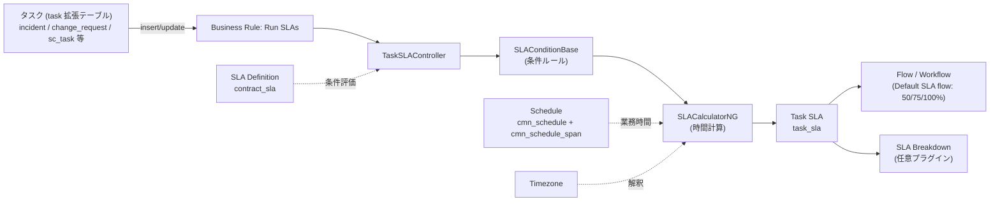
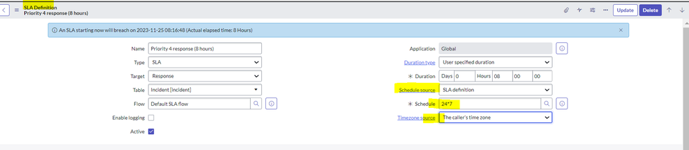
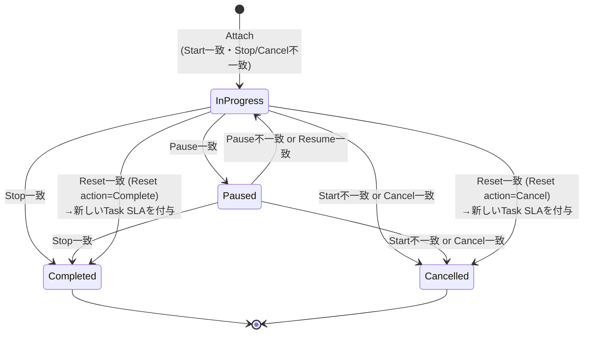
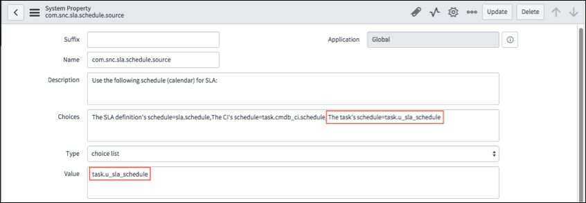
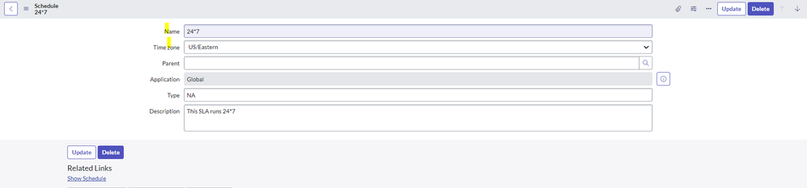
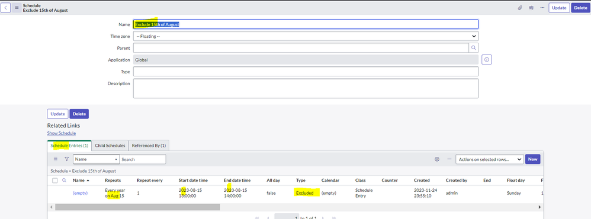

# SLAとスケジュール（Service Level Management / Schedules）

## 概要

ServiceNow の **Service Level Management（SLM、サービスレベル管理）** は、サービス提供者と顧客の間の合意（Agreement）に基づき、タスク（Incident、Change、Case など）が「既知の時間内に」処理されているかを計測・監視するアプリケーションである。中核は次の 4 要素で構成される。[出典](https://www.servicenow.com/docs/r/QykF2iRSIs6VXztArCSo3w/4GMbHHrBsZIm70KchH2V2Q)

| 要素 | テーブル | 役割 |
|---|---|---|
| SLA Definition（SLA定義） | `contract_sla` | どのテーブルのどのレコードに、どの条件で、どれだけの時間（Duration）で、どのスケジュールで SLA を付与するかを定義する |
| Task SLA（タスクSLA） | `task_sla` | SLA Definition がタスクにマッチしたときに生成される計測レコード。1 タスクに複数付与され得る |
| Schedule（スケジュール） | `cmn_schedule` / `cmn_schedule_span` | 稼働時間・非稼働時間（祝日など）を定義し、SLA の「業務時間（Business time）」計算と違反時刻を決める |
| Timezone（タイムゾーン） | SLA Definition の `Timezone source` 等 | スケジュールをどの地域の時刻で解釈するかを決める |

本ファイルは Australia リリース（2026-05 GA）を基準とする。Service Level Management は ServiceNow AI Platform の機能として**既定で有効（active by default）**である（Yokohama リリースノートの記述）。[出典](https://www.servicenow.com/docs/r/PbLI49fkISDFEQlMw_00Gg/L4bpSs6kpsAIPdJa3g85sA)

ITSM の観点でのサービスレベル管理（Service Commitment、Service Offering SLA、サービスポートフォリオとの関係）は [ITSMにおけるサービスレベル管理とサービスポートフォリオ](../itsm/service-level-management-itsm.md) を参照。



上図のコンポーネント名と呼び出し順は ServiceNow 社員による Community ブログ（2025-01）に基づく。[出典](https://www.servicenow.com/community/itsm-blog/sla-engine-a-developer-s-perspective-of-the-logic/ba-p/3146418)

---

## 1. 基本用語：SLA / OLA / Underpinning contract

### 1.1 合意の種類（Type）

SLA Definition の `Type`（種別）フィールドは SLA、OLA、Underpinning contract の 3 種から選択する。公式ドキュメントでは、`Type` は**レポート目的のみ（used only for reporting）**であり、計測ロジック（付与・一時停止・違反判定）には影響しない。[出典](https://www.servicenow.com/docs/r/Mr7qUatbFXax1_h~z60rmA/tNst0i0VqJTCN_WBMuSkEA)

| Type | 日本語 | 一般的な意味（ITIL） | ServiceNow 上の扱い |
|---|---|---|---|
| SLA（Service Level Agreement） | サービスレベル合意 | IT 組織（サービス提供者）と顧客の合意 | `contract_sla.type = SLA`。既定値 |
| OLA（Operational Level Agreement） | 運用レベル合意 | 社内の IT グループ間の合意（例：一次対応チームと DB チーム） | `type = OLA`。仕組みは SLA と同一 |
| Underpinning contract（UC） | 裏付け契約 | 外部ベンダー／サプライヤーとの契約 | `type = Underpinning contract`。`Vendor`（ベンダー、`core_company` 参照）を設定して責任ベンダーを記録できる |

Fluent API（ServiceNow SDK）の `Sla` オブジェクトでも、`type` は `SLA` / `OLA` / `Underpinning contract` の 3 値で「Used for reporting only」と説明され、`vendor` は Underpinning contract のベンダーとなる会社（`core_company`）への参照と説明されている。[出典](https://www.servicenow.com/docs/r/application-development/servicenow-sdk/fluent-sla-api.html)

### 1.2 OLA / UC の設計パターン

OLA と UC は SLA と同じ `contract_sla` / `task_sla` の仕組みで計測されるため、計測対象（どのタスク・どの条件）を変えることで表現する。

- OLA の例：Incident の `Assignment group（割り当てグループ）` が特定グループの間だけ計測する SLA Definition を作り、`Type = OLA` とする。あるいは `incident_task`（Incident Task）テーブルに SLA Definition を作り、グループ別の作業時間を計測する。`incident_task` に SLA を定義して「Show SLA Timeline」で追跡する手順は ServiceNow 社員の Community 記事でも紹介されている。[出典](https://www.servicenow.com/community/itsm-articles/tracking-itask-slas-in-servicenow-nbsp/ta-p/3383913)
- UC の例：ベンダーにエスカレーションした状態（例：特定の Assignment group や Vendor フィールド値）を Start 条件とし、`Vendor` を設定する。
- `【経験則】` OLA/UC の目標時間は、上位 SLA の目標時間に収まるように逆算して設定するのが一般的である（SLA > OLA/UC の時間関係）。これは ITIL 上の考え方であり、ServiceNow が自動で整合性を検証する機能ではない。[出典（コミュニティ）](https://www.servicenow.com/community/itsm-forum/sla-and-ola/m-p/825899)

### 1.3 Target（目標種別）

`Target`（ターゲット）は None / Response（応答）/ Resolution（解決）から選択する。`Target` は**フィルタ・検索・レポート目的のみ**で、計測挙動は変わらない。Response と Resolution の違いは Start/Stop 条件の書き方で表現する（例：Response SLA は「Assigned to が空でなくなったら Stop」、Resolution SLA は「State が Resolved/Closed になったら Stop」）。`Target` は Jakarta 以降の新規インスタンスで利用可能と記載されている。[出典](https://www.servicenow.com/docs/r/Mr7qUatbFXax1_h~z60rmA/tNst0i0VqJTCN_WBMuSkEA) / [出典](https://www.servicenow.com/docs/r/QykF2iRSIs6VXztArCSo3w/4GMbHHrBsZIm70KchH2V2Q)

---

## 2. プラグイン・ロール・テーブル・メニュー

### 2.1 プラグイン

| プラグイン | ID | 内容 |
|---|---|---|
| Service Level Management | `com.snc.sla` | SLA のコア機能。`admin` ロールで有効化可能。現行リリースでは既定で有効 |
| SLA Breakdowns | `com.snc.sla.breakdowns` | Task SLA ごとに Assignment group / Assigned to 別の内訳データを生成 |
| Service Level Management - Contract Management Integration（SLA Contract Add-on） | `com.snc.sla.contract2` | Service Contract（サービス契約）に SLA を関連付ける |
| Service Portfolio Management - SLA Commitments | 公開情報では ID 確認できず | Service Offering（サービスオファリング）単位の SLA コミットメント |

出典：[SLM concepts（Australia）](https://www.servicenow.com/docs/r/QykF2iRSIs6VXztArCSo3w/4GMbHHrBsZIm70KchH2V2Q)、[Installed with SLA breakdown definitions（Australia）](https://www.servicenow.com/docs/r/QykF2iRSIs6VXztArCSo3w/Qk6l5m~EPKs2n7o0u54pXg)、[Define a service contract](https://www.servicenow.com/docs/r/QykF2iRSIs6VXztArCSo3w/NemGqZgl4xtUeJyUsVjFKA)

> Contract 連携を使うテーブルでは、選択した契約に関連付いた SLA Definition だけが評価される。対象テーブルはプロパティ `com.snc.sla.contract.tables` で制御する（zboot 顧客ではこのプロパティは提供されず、全テーブルで契約が処理される）。`【第三者情報】` 契約プラグインを使うテーブルでは「契約に紐付ける以外に SLA を定義する方法がない」とするパートナー解説もある。[出典](https://www.servicenow.com/docs/r/QykF2iRSIs6VXztArCSo3w/NemGqZgl4xtUeJyUsVjFKA) / [出典（第三者）](https://guidevision.eu/insights/service-level-management-part-2-2)

### 2.2 ロール

| ロール | 内容 | 含むロール |
|---|---|---|
| `sla_admin` | SLM アプリケーションの完全な管理権限。SLM プロパティ設定、SLA repair 実行、SLA Overview ダッシュボード閲覧、SLA Definition 管理 | `flow_operator` |
| `sla_manager` | SLA Definition の定義、SLA repair ログ閲覧、SLA Overview ダッシュボード閲覧。SLM プロパティ値の変更や SLA condition type の定義は不可 | `flow_operator` |
| `itil` | Task SLA の参照、SLA timeline の表示、SLA Timer Configuration の利用 | — |
| `sn_slm_timer.sla_timer_admin` | SLA Timer Configuration の管理 | — |
| `schedule_admin` | スケジュール（`cmn_schedule`）の作成・編集 | — |

- `sla_admin` / `sla_manager` は既存の Workflow / Schedule を SLA Definition に**割り当てる**ことはできるが、Workflow や Schedule を**新規作成**するには追加ロールの明示付与が必要である。[出典](https://www.servicenow.com/docs/r/QykF2iRSIs6VXztArCSo3w/4GMbHHrBsZIm70KchH2V2Q)
- 公式ドキュメントの一部ページではロール名がアンダースコアなし（`slaadmin`）で表記されているが、インストール内容の表（Installed with Service Level Management）では `sla_admin` / `sla_manager` である。[出典](https://www.servicenow.com/docs/r/MlbQAgTiiiMOLOw9T36wJg/4iKEl6sdtEq2pbZakNOL7Q)
- `schedule_admin` はスケジュールの作成・編集はできるが、Child schedule（子スケジュール）の関連付けには `admin` が必要と、ServiceNow 社員の Community ブログで説明されている。[出典](https://www.servicenow.com/community/itsm-blog/blackout-maintenance-schedules-in-a-nutshell/ba-p/2269223)
- 「Define a schedule」手順の必要ロールは `schedule_admin` または `admin`。[出典](https://www.servicenow.com/docs/r/fBdxWC~8p08POQuUubVDig/AXWtrO09AHcBjXKcioGzsQ)

ロール全般は [ユーザー・グループ・ロール](./users-groups-roles.md) を参照。

### 2.3 テーブル

| テーブル | ラベル | 説明 |
|---|---|---|
| `contract_sla` | SLA Definition | SLA の条件・Duration・スケジュールを定義 |
| `task_sla` | Task SLA | タスクと、それに適用される SLA Definition を結び付ける計測レコード |
| `sla_condition_class` | SLA Conditions（SLA Condition Rules） | SLA Definition の条件がステージ遷移をどう駆動するかを決めるクラス定義 |
| `sla_repair_log` | SLA Repair Log | SLA repair 実行のログ |
| `sla_repair_log_entry` | SLA Repair Log Entry | `syslog` を拡張。修復前後の Task SLA 値を保持 |
| `sla_timer_config` | SLA Timer Configuration | SLA タイマー（ワークスペース等の表示）設定 |
| `sla_timer_config_mapping` | SLA Timer Configuration Mapping | Task to SLA マッピング設定 |
| `cmn_relative_duration` | Relative Duration | 相対 Duration（例：Breach on Due Date）の定義（Fluent API の `durationType` 参照先） |
| `sla_async_queue` | SLA Async Queue | 非同期モード時のタスク更新キュー（Community ブログ記載） |
| `sla_offline_update` | SLA Offline Update | `offline_timestamp_field` 属性を持つテーブル用の更新記録（Community ブログ記載） |
| `service_offering_sla` | Service Offering SLA | サービスオファリング SLA（App Engine Studio テンプレートにも含まれる） |
| `sla_breakdown_definition` ほか | SLA Breakdown 関連 | 「11. SLA Breakdowns」参照 |
| `cmn_schedule` | Schedule | スケジュール本体 |
| `cmn_schedule_span` | Schedule Entry（Schedule Span） | スケジュールの時間帯エントリ |
| `cmn_other_schedule` | （子スケジュール関係） | Child schedule の関連（Community 記事記載） |

出典：[Installed with Service Level Management](https://www.servicenow.com/docs/r/MlbQAgTiiiMOLOw9T36wJg/4iKEl6sdtEq2pbZakNOL7Q)（このページは Zurich 版。Australia 版は未確認）、[SLM concepts](https://www.servicenow.com/docs/r/QykF2iRSIs6VXztArCSo3w/4GMbHHrBsZIm70KchH2V2Q)、[Fluent SLA API](https://www.servicenow.com/docs/r/application-development/servicenow-sdk/fluent-sla-api.html)、[SLA engine ブログ](https://www.servicenow.com/community/itsm-blog/sla-engine-a-developer-s-perspective-of-the-logic/ba-p/3146418)、[Creating new schedules by script（Community）](https://www.servicenow.com/community/developer-articles/creating-new-schedules-by-script/ta-p/2329890)

### 2.4 主なメニュー（Application Navigator）

| メニュー | 用途 |
|---|---|
| All > Service Level Management > SLA > SLA Definitions | SLA Definition の一覧・作成 |
| All > Service Level Management > Properties（SLA Engine / SLA Logging / SLA Repair） | SLM プロパティ（`admin`） |
| All > Service Level Management > Administration > SLA Condition Rules | SLA 条件ルール |
| All > Service Level Management > Administration > SLA Timer Configuration | SLA タイマー設定 |
| All > System Scheduler > Schedules > Schedules | スケジュールの一覧・作成 |

出典：[Create an SLA definition](https://www.servicenow.com/docs/r/Mr7qUatbFXax1_h~z60rmA/tNst0i0VqJTCN_WBMuSkEA)、[Configure SLA properties](https://www.servicenow.com/docs/r/QykF2iRSIs6VXztArCSo3w/WpiXe7LbGyuq936ucHgWEA)、[SLA condition rules](https://www.servicenow.com/docs/r/MlbQAgTiiiMOLOw9T36wJg/66UKW0cVMjJRaP75XNGYlg)、[Configure the SLA timer](https://www.servicenow.com/docs/r/QykF2iRSIs6VXztArCSo3w/CWQ2pomYuGLss_pay8pbbA)、[Define a schedule](https://www.servicenow.com/docs/r/fBdxWC~8p08POQuUubVDig/AXWtrO09AHcBjXKcioGzsQ)

> 公式ドキュメントでは、カレンダー／スケジュールの定義には Business Calendar メニューの利用が推奨され、従来の System Scheduler メニューも引き続きサポートされる旨の記述がある。[出典](https://www.servicenow.com/docs/r/7LhbZn3yz3Q58qhjZoU9iQ/VOlvGX93SmjLHN0HmLIKKg)

---

## 3. SLA Definition（SLA定義、`contract_sla`）

### 3.1 作成手順

1. All > Service Level Management > SLA > SLA Definitions に移動する。
2. **New** を選択し SLA Definition フォームを開く。
3. 下表のフィールドを入力し保存する。

公式手順ページの必要ロールは `admin` と記載されている（`sla_admin` / `sla_manager` も「2.2 ロール」のとおり SLA Definition を管理できる）。[出典](https://www.servicenow.com/docs/r/Mr7qUatbFXax1_h~z60rmA/tNst0i0VqJTCN_WBMuSkEA)

> 注：Australia 版の「Create an SLA definition」ページ本文は取得できなかったため、フォーム項目は Yokohama 版の記述を基にし、Australia 版の検索抜粋（Duration type / Schedule source / Timezone source の説明が同一）で整合を確認した。[出典（Yokohama）](https://www.servicenow.com/docs/r/Mr7qUatbFXax1_h~z60rmA/tNst0i0VqJTCN_WBMuSkEA)



**図1：SLA Definition フォームの上部（Core UI、例：Priority 4 response (8 hours)）**
画面説明：フォーム上部に「An SLA starting now will breach on 2023-11-25 08:16:48 (Actual elapsed time: 8 Hours)」という違反時刻の試算メッセージが青帯で表示されている。左列に `Name`（Priority 4 response (8 hours)）、`Type`（SLA）、`Target`（Response）、`Table`（Incident [incident]）、`Flow`（Default SLA flow）、`Enable logging`（チェックなし）、`Active`（チェックあり）。右列に `Application`（Global）、`Duration type`（User specified duration）、`Duration`（Days 0 / Hours 08:00:00）、`Schedule source`（SLA definition）、`Schedule`（24*7）、`Timezone source`（The caller's time zone）が並ぶ。Start/Pause/Stop 等の条件はこの下のセクションで設定する。
出典：ServiceNow Community「Need to know about Schedules and define them in SLAs」 https://www.servicenow.com/community/developer-articles/need-to-know-about-schedules-and-define-them-in-slas/ta-p/2736938 （取得日：2026-11-02）

### 3.2 フォームフィールド一覧

| フィールド（英） | 日本語 | 説明・選択肢 |
|---|---|---|
| `Name` | 名前 | SLA Definition を識別するラベル |
| `Type` | 種別 | SLA / OLA / Underpinning contract。レポート目的のみ |
| `Target` | ターゲット | None / Response / Resolution。フィルタ・検索・レポート目的のみ |
| `Table` | テーブル | 計測対象テーブル。`task` を拡張したテーブル（`incident`、`change_request`、`sc_task` 等）である必要がある。Event Management 用に構成アイテムや Business Service も指定可能 |
| `Flow` | フロー | SLA がタスクに付与されたときに実行される Flow。Flow を選ぶと `Workflow` は無効化される |
| `Workflow` | ワークフロー | SLA 付与時に実行される（レガシー）Workflow。Workflow を選ぶと `Flow` は無効化される |
| `Vendor` | ベンダー | 定義に紐付くベンダー（UC 用） |
| `Service Commitment` | サービスコミットメント | 通常の SLA Definition とサービスオファリング SLA Definition を区別 |
| `Enable logging` | ログ有効化 | この定義に限定したデバッグログを有効化。マッチ／非マッチ条件、Task SLA とタスクの更新前後の値が記録される |
| `Duration type` | 期間タイプ | User specified duration / Relative Duration（後述） |
| `Duration` | 期間 | 違反までの時間。User specified duration のときのみ表示。日数は 24 時間単位に換算 |
| `Relative duration works on` | 相対期間の計算対象 | Relative Duration のときのみ表示。Task record / SLA record |
| `Schedule source` | スケジュールソース | No schedule（24x7 計算）/ SLA definition（`Schedule` を選択）/ Task field（タスクのフィールドから取得、例：CI のスケジュール） |
| `Schedule` | スケジュール | `cmn_schedule` への参照 |
| `Timezone source` | タイムゾーンソース | Caller's time zone / SLA definition's time zone（`Timezone` 欄が出る）/ CI location's time zone / Task's location time zone / Caller's location time zone |
| `Timezone` | タイムゾーン | `Timezone source` が SLA definition の場合に指定 |
| `Active` | 有効 | 無効の定義はタスクにマッチしない |
| `Condition type` | 条件タイプ | フォームレイアウトで追加表示できる。SLA Condition Rule（`sla_condition_class`）を指定し、付与・一時停止・完了・リセットの判定ロジックを差し替える |

条件セクション（Start / Pause / Stop / Reset / Cancel）は「5. SLA conditions」で詳述する。出典：[Create an SLA definition（Yokohama）](https://www.servicenow.com/docs/r/Mr7qUatbFXax1_h~z60rmA/tNst0i0VqJTCN_WBMuSkEA)

> **Flow / Workflow と違反済み SLA：** 付与時点ですでに違反（breached）している Task SLA に対しては、既定では Flow / Workflow は実行されない。実行させたい場合は `com.snc.sla.flow.run_for_breached`（Flow 用、手動作成が必要）または `com.snc.sla.workflow.run_for_breached`（Workflow 用）を `true` にする（「8. プロパティ」参照）。[出典](https://www.servicenow.com/docs/r/QykF2iRSIs6VXztArCSo3w/WpiXe7LbGyuq936ucHgWEA)

### 3.3 条件にドットウォークを使う場合の注意

公式ドキュメントは、**頻繁に変わるドットウォーク（dot-walk）フィールドを SLA 条件に使わない**よう推奨している。SLA Timeline と SLA Repair は監査履歴からタスクの変化を再現するが、ドットウォーク先の値は**最終値のみ**を使うため、実際の過去の挙動と再計算結果がずれる。ドットウォーク値が必要な場合は、ビジネスルールでタスク上のカスタムフィールドに値を複写して条件に使うと一貫した結果になる。[出典](https://www.servicenow.com/docs/r/Mr7qUatbFXax1_h~z60rmA/tNst0i0VqJTCN_WBMuSkEA) / [出典](https://www.servicenow.com/docs/r/QykF2iRSIs6VXztArCSo3w/V91VP6Z6Zu9FQAG5ir1LMQ)

---

## 4. Duration type（期間タイプ）

SLA Definition の Duration type は **User specified duration**（ユーザー指定期間）と **Relative Duration**（相対期間）の 2 種類で、どちらもスケジュールと組み合わせられる。[出典](https://www.servicenow.com/docs/r/it-service-management/service-level-management/c_SLADuration.html)

### 4.1 User specified duration

- 日・時・分・秒で固定期間を指定する（例：8 時間）。
- **日数は 24 時間のブロックに換算される。** 1 日 8 時間稼働のスケジュールで `Duration = 1 Day` とすると 24 業務時間となり、**3 業務日後**に違反する。業務日単位で指定したい場合は時間（例：8 時間）で入力する。[出典](https://www.servicenow.com/docs/r/Mr7qUatbFXax1_h~z60rmA/tNst0i0VqJTCN_WBMuSkEA)
- Duration を入力するたびに、フォームに「今開始した場合の違反時刻」の例が表示される（図1 の青帯）。
- スケジュールなしの例：2015-01-01 10:30 開始、Duration 10 時間 → 同日 20:30 に違反（実経過時間ベース）。
- スケジュールありの例：1 日 8 時間のスケジュールで 16 時間 → スケジュール上の 2 日後に違反。
- Duration の上限はプロパティ `com.snc.sla.maximum_duration`（既定 1095 日）で制限される。[出典](https://www.servicenow.com/docs/r/QykF2iRSIs6VXztArCSo3w/WpiXe7LbGyuq936ucHgWEA)

出典：[SLA duration types（Brazil 版）](https://www.servicenow.com/docs/r/it-service-management/service-level-management/c_SLADuration.html)

### 4.2 Relative Duration

- Task SLA の開始時刻を起点に、スクリプトで将来の終了日時を計算する方式。定義は `cmn_relative_duration`（Fluent API の `durationType` の参照先）。
- 代表的な選択肢：**Breach on Due Date**（期日で違反）、**End of next business day**（翌営業日終業時）、**Next business day by 4pm**（翌営業日 16 時）。
- Relative Duration を選ぶと `Relative duration works on` が表示され、Task record / SLA record のどちらをスクリプト内の `current` とするかを選ぶ（既定 Task record）。
- **Relative Duration では Pause 条件が使えない（互換性がない）。**
- Breach on Due Date の挙動：
  - 違反時刻 = タスクの `Due date`。
  - `Due date` が空、または過去日時の場合、違反時刻は **SLA 開始時刻の 1 秒後**となる。
  - `Due date` がスケジュール外の場合、次のスケジュール内時刻まで繰り延べられる（例：08:00–16:00 スケジュールで Due date が 2017-01-11 水曜 20:30 → 違反時刻は 2017-01-12 木曜 08:00）。
- タスクに目標日時フィールドがあれば、そのフィールドを使う Relative Duration を作成できる。

出典：[SLA duration types](https://www.servicenow.com/docs/r/it-service-management/service-level-management/c_SLADuration.html)、[Fluent SLA API](https://www.servicenow.com/docs/r/application-development/servicenow-sdk/fluent-sla-api.html)

> `【第三者情報】` ServiceNow 社員の Community ブログ（2012）は、Relative Duration のスクリプトで `current` オブジェクトの結果が一貫しない場合があると指摘している。古い記事のため現行版での再現性は公開情報では確認できず。[出典](https://www.servicenow.com/community/in-other-news/troubleshooting-slas/ba-p/2293703)

---

## 5. SLA conditions（SLA 条件）

### 5.1 6 種類の条件

SLA Definition は最大 6 種類の条件を持ち、タスクが作成・更新されるたびに評価される。[出典（Australia）](https://www.servicenow.com/docs/r/QykF2iRSIs6VXztArCSo3w/WYN6nXXIBmOElVN~7E1oiQ)

| 条件 | 日本語 | 意味 | 付随オプション |
|---|---|---|---|
| Start condition | 開始条件 | SLA をタスクに付与（attach）する条件 | `Retroactive start`、`When to cancel` |
| Cancel condition | 取消条件 | SLA を取り消す（Cancelled）条件 | `When to cancel = Cancel conditions are met` のとき有効 |
| Pause condition | 一時停止条件 | 経過時間の加算を止める条件 | `When to resume` |
| Resume condition | 再開条件 | 一時停止中の経過時間加算を再開する条件 | `When to resume = Resume conditions are met` のとき有効 |
| Stop condition | 停止条件 | SLA を完了（Completed）させる条件。違反の有無にかかわらず完了する | — |
| Reset condition | リセット条件 | 実行中の SLA を終了させ新しい SLA を付与する条件 | `Reset action` |

### 5.2 When to cancel（Start 条件のオプション）

| 選択肢 | 動作 |
|---|---|
| Start conditions are not met（既定） | 開始条件のいずれかが満たされなくなった時点で SLA を取り消す |
| Cancel conditions are met | 開始条件は一度満たせばよく、以降は Cancel 条件が満たされたときのみ取り消す |
| Never | 取り消さない |

### 5.3 When to resume（Pause 条件のオプション）

| 選択肢 | 動作 |
|---|---|
| Pause conditions are not met | Pause 条件が満たされなくなった時点で再開する |
| Resume conditions are met | Resume 条件が満たされた時点で再開する |

> **既定値の記述不一致：** 公式「SLA conditions」ページ（Yokohama / Australia）では「Resume conditions are met」を既定と記載している一方、Yokohama 版「Create an SLA definition」ページでは「Pause conditions are not met」を既定と記載しており、公式ドキュメント間で不一致がある。Fluent API の `whenTo.resume` は `on_condition` / `no_match`、既定 `on_condition` と記載されている。実インスタンスのフォーム既定値で確認すること。[出典](https://www.servicenow.com/docs/r/Mr7qUatbFXax1_h~z60rmA/G_mVso6Vk9nk4W7RfIKwkw) / [出典](https://www.servicenow.com/docs/r/Mr7qUatbFXax1_h~z60rmA/tNst0i0VqJTCN_WBMuSkEA) / [出典](https://www.servicenow.com/docs/r/application-development/servicenow-sdk/fluent-sla-api.html)

### 5.4 Reset condition と Reset action

- Reset 条件が満たされると、実行中の SLA を終了し新しい SLA を付与する。ただし**新しい SLA が付与されるのは Start 条件も満たしている場合のみ**。
- 特定フィールドの変化（任意の変化、特定値への変化／特定値からの変化）をトリガーにできる（例：`Location` の変更で SLA をリセット）。
- `Reset action`：既存の Task SLA を **Cancel（取消）** するか **Complete（完了）** するかを選ぶ。Fluent API では `resetAction` = `cancel` / `complete`、既定 `cancel`。

出典：[SLA conditions（Australia）](https://www.servicenow.com/docs/r/QykF2iRSIs6VXztArCSo3w/WYN6nXXIBmOElVN~7E1oiQ)、[Create an SLA definition](https://www.servicenow.com/docs/r/Mr7qUatbFXax1_h~z60rmA/tNst0i0VqJTCN_WBMuSkEA)、[Fluent SLA API](https://www.servicenow.com/docs/r/application-development/servicenow-sdk/fluent-sla-api.html)

### 5.5 評価順序とルール（既定の SLAConditionBase）

タスクの作成／更新ごとに、次の順で評価される。

1. **新しい SLA の処理**：付与すべき SLA Definition があるかを判定する。
2. **既存の SLA の処理**：タスクに付与済みの Task SLA の状態遷移を判定する。

| 遷移 | 判定ルール |
|---|---|
| Attach（付与） | Start 条件に一致し、かつ Stop 条件にも Cancel 条件にも一致しない |
| Complete（完了） | Stop 条件に一致 |
| Pause（一時停止） | Pause 条件に一致 |
| Resume（再開） | Pause 条件に一致しなくなる、または Resume 条件に一致 |
| Reattach（リセット） | Reset 条件と Start 条件の両方に一致 |
| Cancel（取消） | Start 条件に一致しなくなる、または Cancel 条件に一致（`When to cancel` の設定に従う） |

出典：[SLA conditions（Australia）](https://www.servicenow.com/docs/r/QykF2iRSIs6VXztArCSo3w/WYN6nXXIBmOElVN~7E1oiQ)、[SLA conditions（Yokohama）](https://www.servicenow.com/docs/r/Mr7qUatbFXax1_h~z60rmA/G_mVso6Vk9nk4W7RfIKwkw)

### 5.6 ステージ遷移



違反（breach）はステージではなく、`Has breached`（`has_breached`）フラグで表現される（2011 エンジン）。違反後も Stop 条件に一致するまでは In progress のまま計測が続き、Stop 条件一致で Completed になる。[出典](https://www.servicenow.com/docs/r/QykF2iRSIs6VXztArCSo3w/DkrtAbz5bi4lTcYZODfaIQ) / [出典](https://www.servicenow.com/docs/r/it-service-management/service-level-management/t_SLAProcessExample.html)

### 5.7 典型的な設定ミス（公式記載の落とし穴）

| パターン | 結果 |
|---|---|
| Start 条件が Stop 条件の部分集合（Start が満たされると必ず Stop も満たされる） | SLA が**永遠に付与されない** |
| Pause 条件が Start 条件の部分集合 | SLA は付与されるが一時停止したままになり、Pause が外れると Start も外れて**取り消される** |
| Start 条件と Pause 条件が排他（例：Start = State is one of New, Active／Pause = State is On Hold） | On Hold にした時点で Start が外れて**取り消され**、一時停止にならない |

対策：Start 条件は「計測を開始すべき状態」ではなく「計測対象であり続ける状態」を広めに書き、Pause 中の状態も Start 条件に含める。または `When to cancel = Cancel conditions are met` にして Start 条件の継続判定を外す。[出典](https://www.servicenow.com/docs/r/QykF2iRSIs6VXztArCSo3w/WYN6nXXIBmOElVN~7E1oiQ)

### 5.8 処理例（公式 SLA process example）

1. Incident を作成し `Impact = 1`、`Urgency = 1` とすると `Priority = 1 - Critical` になる。保存すると既定の Priority 1 resolution SLA（8 時間）の Task SLA が付与される。
2. `Impact = 2` に変更すると `Priority = 2 - High` になり、Priority 1 の SLA は取り消され、Priority 2 の SLA が付与される（Start 条件の不一致による Cancel と新規 Attach）。
3. State を Pause 条件の状態（ドキュメントの例では Awaiting User Info）にすると SLA は Paused になる。**Pause duration は一時停止状態を抜けた後に更新される。**
4. State を Active に戻すと再開する。
5. Close code / Close notes を入力し Resolved にすると Completed になる。
6. 目標時間内に解決されなかった場合は `Has breached = true` となる。

[出典](https://www.servicenow.com/docs/r/it-service-management/service-level-management/t_SLAProcessExample.html)

> 注：例中の State 名（Awaiting User Info）は旧来の表記であり、現行の Incident では On Hold と On hold reason で表現される。State 値の詳細は [Incident Management](../itsm/incident-management.md) を参照。

---

## 6. Retroactive start（遡及開始）と Retroactive pause

### 6.1 Retroactive start

- Start 条件セクションの `Retroactive start` チェックボックスをオンにすると、SLA の開始時刻を**付与した時刻ではなく、タスクの日時フィールドの値**にする。
- オンにすると `Set start to`（開始時刻に使うフィールド）が表示され、そのタスクテーブルの日時フィールド（例：`Created`、`Opened`）を選択する。
- 用途：Priority 変更で Priority 1 の SLA が後から付与されたとき、Incident の作成時刻から計測したい場合など。

出典：[SLA conditions（Australia）](https://www.servicenow.com/docs/r/QykF2iRSIs6VXztArCSo3w/WYN6nXXIBmOElVN~7E1oiQ)、[Create an SLA definition](https://www.servicenow.com/docs/r/Mr7qUatbFXax1_h~z60rmA/tNst0i0VqJTCN_WBMuSkEA)

### 6.2 Retroactive pause（Retroactive pause time）

- `Retroactive start` をオンにすると `Retroactive pause time` チェックボックスも表示される。
- 有効にすると、SLA 付与前にタスクが一時停止条件に該当していた時間を、遡及した経過時間から差し引く（SLA 付与前の一時停止時間を「回収」する）。
- **User specified duration の場合のみ利用可能。**
- Fluent API では `retroactive.pause`（既定 `true`）。`retroactive.start` の既定は `false`、`retroactive.start = true` の場合 `setStartTo` は必須。

出典：[Create an SLA definition](https://www.servicenow.com/docs/r/Mr7qUatbFXax1_h~z60rmA/tNst0i0VqJTCN_WBMuSkEA)、[Fluent SLA API](https://www.servicenow.com/docs/r/application-development/servicenow-sdk/fluent-sla-api.html)

### 6.3 注意点

- 付与時点で既に Duration を超えている場合、その Task SLA は付与と同時に違反状態になる。この場合、既定では Flow / Workflow は実行されない（`*.run_for_breached` プロパティで変更可能）。[出典](https://www.servicenow.com/docs/r/QykF2iRSIs6VXztArCSo3w/WpiXe7LbGyuq936ucHgWEA)
- `【第三者情報】` `Set start to` に、タスク更新のたびに変わるフィールド（例：`Updated`）を指定すると遡及開始の意味がなくなる。[出典（ServiceNow 社員 Community ブログ）](https://www.servicenow.com/community/in-other-news/troubleshooting-slas/ba-p/2293703)
- SLA timeline では遡及した期間がバーの淡色（lighter shade）で表示される（「9. SLA timeline」参照）。

---

## 7. Task SLA（タスクSLA、`task_sla`）

### 7.1 概要

`task_sla` テーブルは、SLA Definition がタスクにマッチしたときに作成され、その SLA の計測データを保持する。1 つのタスクに複数の Task SLA（例：Response SLA と Resolution SLA、OLA）が付与され得る。タスクフォームの **Task SLAs** 関連リストに表示される。[出典](https://www.servicenow.com/docs/r/QykF2iRSIs6VXztArCSo3w/4GMbHHrBsZIm70KchH2V2Q)

### 7.2 Stage（ステージ）

| Stage 値 | 意味 |
|---|---|
| In progress | 計測中 |
| Paused | 一時停止中 |
| Completed | Stop 条件一致で完了（違反有無を問わない） |
| Cancelled | 取消 |
| Breached | **2010 エンジン使用時、または互換モード（`com.snc.sla.compatibility.breach = true`）時のみ**。2011 エンジンでは `Has breached` フラグを使う |

[出典](https://www.servicenow.com/docs/r/QykF2iRSIs6VXztArCSo3w/DkrtAbz5bi4lTcYZODfaIQ)

### 7.3 時間関連フィールド

| フィールド（ラベル） | 列名 | 説明 |
|---|---|---|
| Start time | `start_time` | SLA の開始時刻（Retroactive start 時は遡及した時刻） |
| Stop time | `end_time` | SLA の終了時刻 |
| Breach time / Planned end time | `planned_end_time` | 違反予定時刻。スケジュールありの場合は業務上の一時停止時間（business pause duration）、スケジュールなしの場合は一時停止時間を加味して調整される。Breach time と Planned end time は同じ値 |
| Original breach time | `original_breach_time` | SLA が最初に付与されたときに計算された違反時刻。フォームに表示されていない場合はフォーム構成で追加する。実際の違反時刻は一時停止等で変動するため、通常この値とは異なる |
| Actual Elapsed Time | `duration` | 開始から現在まで（一時停止時間を除く）の実経過時間 |
| Actual Elapsed Percentage | `percentage` | SLA 全期間に対する実経過時間の割合 |
| Actual Time Left | `time_left` | 違反までの実残り時間 |
| Business Elapsed Time | `business_duration` | スケジュール内の経過時間（一時停止時間を除く） |
| Business Elapsed Percentage | `business_percentage` | スケジュール内経過時間の割合 |
| Business Time Left | `business_time_left` | スケジュール内の違反までの残り時間 |
| Pause duration / Business pause duration | `pause_duration` / `business_pause_duration` | 一時停止時間（実時間／業務時間） |
| Pause time | `pause_time` | 一時停止を開始した時刻 |
| Has breached | `has_breached` | 違反したかどうかのフラグ |
| Schedule / Timezone | `schedule` / `timezone` | 付与時に決定したスケジュールとタイムゾーン |
| SLA definition / Task | `sla` / `task` | 参照元の SLA Definition と対象タスク |

ラベルと説明は公式「Task SLA table」（Australia 版）による。列名は公式ページに記載がなく、`【第三者情報】` サードパーティのコネクタ仕様（CData）のスキーマ一覧で確認したもの。[出典](https://www.servicenow.com/docs/r/QykF2iRSIs6VXztArCSo3w/DkrtAbz5bi4lTcYZODfaIQ) / [出典（第三者）](https://cdn.cdata.com/help/BNK/py/pg_table-releasetasksla.htm)

- **Actual と Business の違い：** Actual 系は常に計算される（24 時間カレンダーでの経過）。Business 系はスケジュールとタイムゾーンを使って計算される。スケジュールなしの Task SLA で Business 系フィールドを埋めるかどうかは `com.snc.sla.always_populate_business_fields` で制御する（新規インスタンス既定 `true`、アップグレードインスタンス既定 `false`）。[出典](https://www.servicenow.com/docs/r/QykF2iRSIs6VXztArCSo3w/WpiXe7LbGyuq936ucHgWEA) / [出典（ServiceNow 社員ブログ）](https://www.servicenow.com/community/itsm-blog/service-level-agreements-business-hours-schedules-time-zones/ba-p/2267063)
- **値が「古く」見える理由：** Task SLA の経過時間・割合は、タスク更新時と「SLA update」スケジュールジョブ（「8.4」参照）のタイミングで再計算される。フォーム表示時に再計算させたい場合は `glide.sla.calculate_on_display = true`（フォーム表示が遅くなる可能性あり、既定 `false`）。`【第三者情報】` この再計算はタスクフォーム表示時に働き、`task_sla` レコードを直接開いた場合には働かない。[出典](https://www.servicenow.com/docs/r/QykF2iRSIs6VXztArCSo3w/WpiXe7LbGyuq936ucHgWEA) / [出典（Community）](https://www.servicenow.com/community/in-other-news/troubleshooting-slas/ba-p/2293703)

---

## 8. SLA エンジン（SLA engine）

### 8.1 エンジンバージョン

- プロパティ `com.snc.sla.engine.version` で **2010** / **2011** を選択する（既定 `2011`）。SLA timeline は 2011 エンジンでのみ利用可能。[出典](https://www.servicenow.com/docs/r/QykF2iRSIs6VXztArCSo3w/WpiXe7LbGyuq936ucHgWEA) / [出典](https://www.servicenow.com/docs/r/QykF2iRSIs6VXztArCSo3w/cCr8MfHwtDu6eLYHRRTjkw)
- 2010 エンジンでは Breached がステージとして存在した。2011 エンジンでレポート互換のため Breached ステージを使いたい場合は `com.snc.sla.compatibility.breach = true` とするが、公式には `Has breached` フラグの利用が推奨される。
- `【第三者情報】` 2010 エンジン以降、SLA の Workflow は通知のみを担い、フィールド更新やエスカレーションは担わない。さらに古い「Legacy SLA」はエスカレーションエンジン（Escalation Engine）を使っていた。[出典](https://www.servicenow.com/community/in-other-news/troubleshooting-slas/ba-p/2293703) / [出典](https://www.servicenow.com/community/itsm-blog/sla-engine-a-developer-s-perspective-of-the-logic/ba-p/3146418)

### 8.2 処理の流れ（2011 エンジン）

`【第三者情報】` 以下は ServiceNow 社員による Community ブログ「SLA Engine: A developer's perspective of the logic」（2025-01-10）に基づく。SLA エンジンは単一のプラットフォームエンジンではなく、Script Include、スケジュールジョブ、Flow/Workflow、`contract_sla` / `task_sla` テーブル、1 本のビジネスルールの組み合わせである。[出典](https://www.servicenow.com/community/itsm-blog/sla-engine-a-developer-s-perspective-of-the-logic/ba-p/3146418)

| 順 | コンポーネント | 種別 | 役割 |
|---|---|---|---|
| 1 | **Run SLAs** | Business Rule（`task` 上） | タスクの insert/update で処理を開始。`offline_timestamp_field` 属性を持つテーブルは `SLAOfflineUpdate`（`sla_offline_update` に記録）へ、それ以外は `TaskSLAController` へ振り分け |
| 2 | **TaskSLAController** | Script Include | SLA エンジンの入口。`_processNewSLAs`（全 SLA Definition の Start 条件を評価し `task_sla` を挿入。タスク単位のミューテックスで重複防止）と `_processExistingSLAs`（既存 Task SLA の Stop/Reset/Cancel/Pause/Resume を評価）を実行 |
| 3 | **SLAConditionBase**（または `SLAConditionSimple`／カスタムクラス） | Script Include | Task SLA の状態機械。条件はエンコード済みクエリで、`SNC.Filter.checkRecord(task, condition)` で照合 |
| 4 | **SLACalculatorNG** | Script Include | 経過時間・一時停止時間・残り時間・業務時間版・スケジュール内外・Planned end time（違反時刻）を計算。内部で `DurationCalculator` を使用。時間計算の不具合調査はここから |
| 5 | **TaskSLA** | Script Include | 計算結果で `task_sla` を挿入・更新し、`TaskSLAFlow`（Flow 用）または `TaskSLAworkflow`（Workflow 用）を呼び出して Flow/Workflow の状態を同期 |
| 6 | **SLABreakdownProcessor** | Script Include | SLA Breakdown のバケット（Assignment group / Assigned to 単位）を維持 |

公式ドキュメント上も、SLA Logging プロパティの対象として `TaskSLAController`、`TaskSLA`、`SLAConditionBase`、`TaskSLAworkflow`、`SLACalculatorNG`、`SLARepair` の各 Script Include が明記されている。[出典](https://www.servicenow.com/docs/r/QykF2iRSIs6VXztArCSo3w/WpiXe7LbGyuq936ucHgWEA)

### 8.3 非同期モード（`com.snc.sla.engine.async`）

- `com.snc.sla.engine.async = true`（既定 `false`）にすると、2011 エンジンはタスクの insert/update 後に**非同期**で実行される。[出典](https://www.servicenow.com/docs/r/QykF2iRSIs6VXztArCSo3w/WpiXe7LbGyuq936ucHgWEA)
- `【第三者情報】` 非同期モードでは、タスクの変更（テーブル、sys_id、`sys_mod_count`、監査チェックポイント）が `sla_async_queue` に積まれ、スケジュールジョブ **SLA Async Delegator**（5 秒ごと）が `sys_trigger` レコード（既定 4 本、優先度 100、各最大 20 件）を作成して system ユーザーでバッチ処理する。同一タスクの更新は同じトリガーに割り当てられ、順序逆転とデッドロックを防ぐ。**SLA async queue health check**（5 分ごと）がキューとトリガーの整合を確認する。[出典](https://www.servicenow.com/community/itsm-blog/sla-engine-a-developer-s-perspective-of-the-logic/ba-p/3146418)
- `【経験則】` 非同期モードでは、タスク保存直後のフォームに Task SLA がまだ表示されない（数秒遅れる）ことがあるため、保存直後に SLA 値を参照するビジネスロジックや ATF テストは影響を受け得る。

### 8.4 スケジュールジョブ（SLA update）

Task SLA の時間値は、違反までの残り時間に応じた頻度で定期的に再計算される。[出典](https://www.servicenow.com/docs/r/MlbQAgTiiiMOLOw9T36wJg/4iKEl6sdtEq2pbZakNOL7Q)

| スケジュールジョブ | 対象 | 実行頻度 |
|---|---|---|
| SLA update (breach within 10 min) | 10 分以内に違反予定 | 毎分 |
| SLA update (breach within 1 hour) | 10 分〜1 時間以内に違反予定 | 10 分ごと |
| SLA update (breach within 1 day) | 1〜24 時間以内に違反予定 | 1 時間ごと |
| SLA update (breach within 30 days) | 1〜30 日以内に違反予定 | 毎日 |
| SLA update (breach after 30 days) | 30 日超〜365 日以内に違反予定 | 5 日ごと |
| SLA update (already breached) | 過去 365 日以内に違反済み | 毎日 |

- 再計算を止める閾値：`com.snc.sla.calculation.percentage`（既定 1000）。実経過割合がこの値を超えた Task SLA はスケジュールジョブによる定期再計算の対象外になる。`0` で全停止、空欄で全件計算。[出典](https://www.servicenow.com/docs/r/QykF2iRSIs6VXztArCSo3w/WpiXe7LbGyuq936ucHgWEA)
- `【第三者情報】` Task SLA が In progress になると、Planned end time に満了する**違反タイマー（breach timer）**が `sys_trigger` に作成され、満了時に `TaskSLA.breachTimerExpired()` が呼ばれる。SLA update ジョブも `sys_trigger` で動くため、スケジューラのキューが滞留すると違反判定や通知が遅延する。[出典](https://www.servicenow.com/community/in-other-news/troubleshooting-slas/ba-p/2293703)

### 8.5 SLA Condition Rules（SLA 条件ルール）

- SLA Condition Rule は、SLA Definition の各条件を組み合わせて attach / pause / complete / reattach / cancel を判定するルールで、グローバルに定義し、SLA Definition ごとに上書きできる。
- 既定のルールセットは **`SLAConditionBase`**。変更例として **`SLAConditionSimple`** が提供されている。
- 一覧：Service Level Management > Administration > SLA Condition Rules（`sla_condition_class`）。
- 既定クラスはプロパティ `com.snc.sla.default_conditionclass`（既定 `SLAConditionBase`）で指定する。
- カスタムルールの作成手順：① System Definition > Script Includes で `SLAConditionBase` を拡張したクラスを作り、変更したい遷移メソッド（例：attach）をオーバーライドする。② SLA Condition Rule を作成し `Class Name` に①を指定する。③ SLA Definition の `Condition type` で選択する。

出典：[SLA condition rules](https://www.servicenow.com/docs/r/MlbQAgTiiiMOLOw9T36wJg/66UKW0cVMjJRaP75XNGYlg)、[Create a custom SLA condition rule](https://www.servicenow.com/docs/r/MlbQAgTiiiMOLOw9T36wJg/ljGiOpTY1tuenwCbHC0WSw)、[Configure SLA properties](https://www.servicenow.com/docs/r/QykF2iRSIs6VXztArCSo3w/WpiXe7LbGyuq936ucHgWEA)

Fluent API の `advancedConditionType` には `none`（既定）/ `advanced` / `advanced_journal` / `advanced_system` / `advanced_journal_and_system` が定義されており、`advanced_journal` はジャーナル（コメント・作業メモ）エントリに基づく条件ロジックと説明されている。UI 上の各選択肢の詳細な挙動は公開情報では確認できず。[出典](https://www.servicenow.com/docs/r/application-development/servicenow-sdk/fluent-sla-api.html)

---

## 9. SLA プロパティ（System properties）

All > Service Level Management > Properties の各セクションで設定する（`admin`）。以下は Australia 版。[出典](https://www.servicenow.com/docs/r/QykF2iRSIs6VXztArCSo3w/WpiXe7LbGyuq936ucHgWEA)

### 9.1 SLA Engine

| プロパティ | 説明 | 型 | 既定値 |
|---|---|---|---|
| `com.snc.sla.calculation.percentage` | 実経過割合がこの値を超えたら定期再計算を停止。0 で全停止、空欄で全件計算 | Integer | 1000 |
| `com.snc.sla.maximum_duration` | SLA Definition で許容する最大 Duration（日） | Integer | 1095 |
| `com.snc.sla.engine.version` | 使用する SLA エンジン | 2010 / 2011 | 2011 |
| `com.snc.sla.engine.async` | 2011 エンジンをタスク insert/update 後に非同期実行 | true/false | false |
| `com.snc.sla.compatibility.breach` | 2010 の Breached ステージ値を有効化（レポート互換）。`Has breached` 推奨 | true/false | false |
| `com.snc.sla.default_conditionclass` | 2011 エンジンの条件評価クラス | String | SLAConditionBase |
| `com.snc.sla.workflow.run_for_breached` | 付与時に違反済みでも Workflow を実行 | true/false | false |
| `com.snc.sla.flow.run_for_breached` | 付与時に違反済みでも Flow を実行。**ベースシステムに存在しないため手動作成**（`TaskSLAFlowSNC` が実行時に参照） | true/false | 記載なし（未作成時は実行されない） |
| `com.snc.sla.calculate_planned_end_time_after_breach` | 違反後も Planned end time を再計算し続ける（zboot 顧客の SLA Engine Properties 画面には表示されない） | true/false | false |
| `com.snc.sla.calculation.use_time_left` | 違反時刻の計算に `business_percentage` ではなく `business_time_left` を使用（より正確） | true/false | false |
| `glide.sla.calculate_on_display` | タスクフォーム表示時に Task SLA を再計算（表示が遅くなる可能性） | true/false | false |
| `com.snc.sla.always_populate_business_fields` | スケジュールなしの Task SLA でも Business 系フィールドを埋める | true/false | 新規 true／アップグレード false |

### 9.2 SLA Logging

| プロパティ | 対象 Script Include | 既定 |
|---|---|---|
| `com.snc.sla.task_sla_controller.log` | TaskSLAController | Notice |
| `com.snc.sla.task_sla.log` | TaskSLA | Notice |
| `com.snc.sla.condition.log` | SLAConditionBase | Notice |
| `com.snc.sla.workflow.log` | TaskSLAworkflow | Notice |
| `com.snc.sla.calculatorng.log` | SLACalculatorNG | Notice |
| `com.snc.sla.repair.log` | SLARepair（SLA repair 有効時） | Notice |
| `com.snc.sla.log.destination` | ログ出力先（データベース＋ノードログ／ノードログのみ） | Database and node logs |

ログレベルは Emerg / Alert / Crit / Err / Warning / Notice / Info / Debug。特定の SLA Definition だけを調べる場合は、定義側の `Enable logging` を使う方が影響範囲が小さい。

### 9.3 SLA Repair

| プロパティ | 説明 | 既定 |
|---|---|---|
| `com.snc.sla.repair.enabled` | SLA repair を有効化（Repair モジュールと UI Action が有効になる） | 新規 true／アップグレード false |

### 9.4 旧来のスケジュール／タイムゾーンソースのプロパティ

`【第三者情報】` 2015 年の ServiceNow 社員ブログでは、スケジュールとタイムゾーンのソースを `com.snc.sla.schedule.source` と `com.snc.sla.timezone.source`（Geneva 以降は Properties > SLA Engine）で指定し、それぞれ Script Include `SLASchedule`（`cmn_schedule` の sys_id を返す）と `SLATimezone`（Olson 形式のタイムゾーン文字列を返す）で解決する、と説明されている。現行リリースでは SLA Definition ごとの `Schedule source` / `Timezone source` フィールドで指定する方式が公式ドキュメントに記載されており、上記 2 プロパティは Australia 版のプロパティ一覧には掲載されていない。[出典](https://www.servicenow.com/community/itsm-blog/service-level-agreements-business-hours-schedules-time-zones/ba-p/2267063) / [出典](https://www.servicenow.com/docs/r/QykF2iRSIs6VXztArCSo3w/WpiXe7LbGyuq936ucHgWEA)



**図2：System Property `com.snc.sla.schedule.source` のレコード（2015 年頃の UI、カスタマイズ例）**
画面説明：System Property フォームに `Name = com.snc.sla.schedule.source`、`Description = Use the following schedule (calendar) for SLA:`、`Type = choice list` が表示されている。`Choices` 欄には「The SLA definition's schedule=sla.schedule, The CI's schedule=task.cmdb_ci.schedule」に加え、カスタム追加された「The task's schedule=task.u_sla_schedule」が赤枠で示され、`Value` 欄も `task.u_sla_schedule` に変更されている（ブログ中の「担当者のスケジュールを使う」カスタマイズ例）。現行リリースの標準設定画面ではない点に注意。
出典：ServiceNow Community「Service Level Agreements - business hours, schedules & time zones」 https://www.servicenow.com/community/itsm-blog/service-level-agreements-business-hours-schedules-time-zones/ba-p/2267063 （取得日：2026-11-02）

---

## 10. SLA と Flow / Workflow（通知・エスカレーション）

### 10.1 Default SLA flow

- SLA Definition の `Flow` フィールドの既定は **Default SLA flow**（Fluent API の既定値 sys_id：`828f267973333300e289235f04f6a7a3`）。[出典](https://www.servicenow.com/docs/r/application-development/servicenow-sdk/fluent-sla-api.html)
- **Yokohama で SLM の Workflow は新規顧客向けに削除され、Flow に置き換えられた。** 既存顧客で Workflow を使っている場合は影響を受けない。Flow は新規・既存の両顧客が利用でき、Workflow Studio で複製・拡張できる。[出典](https://www.servicenow.com/docs/r/PbLI49fkISDFEQlMw_00Gg/L4bpSs6kpsAIPdJa3g85sA)
- `【第三者情報】` Default SLA flow は 50%、75%、100%（違反）のマイルストーンでイベントを発行し、一般に Assigned to や グループマネージャーへのメール通知に結び付けられる。[出典（ServiceNow 社員ブログ）](https://www.servicenow.com/community/itsm-blog/sla-engine-a-developer-s-perspective-of-the-logic/ba-p/3146418)。フォーラムでは、イベント名として `sla.warning`（50%・75% で共用）と `sla.warning.breach` が挙げられており、50% と 75% を区別する場合は通知条件で `Business elapsed percentage` を判定する方法が紹介されている。イベント名の公式記載は公開情報では確認できず。[出典（フォーラム）](https://www.servicenow.com/community/hrsd-forum/trigger-sla-breach-for-50-and-75/td-p/3552240)
- 公式ドキュメントは、既定の SLA Flow を直接編集するのではなく**コピーしてカスタマイズし、SLA Definition でそのコピーを選択する**ことを推奨している。[出典](https://www.servicenow.com/docs/r/build-workflows/workflow-studio/sla-percentage-timer-action.html)

### 10.2 SLA Percentage Timer アクション

**SLA Percentage Timer** は Workflow Studio の ServiceNow コアアクションで、SLA 全期間の指定割合の時点まで待機する。[出典（Brazil 版）](https://www.servicenow.com/docs/r/build-workflows/workflow-studio/sla-percentage-timer-action.html)

| 項目 | 内容 |
|---|---|
| 入力 | Task SLA record、Percentage（正の整数。例：24 時間 SLA の 50% = 12 時間） |
| 出力 | Scheduled End Date/Time（Task SLA と割合から算出。経過時間フィールドには依存しない）、Status、Total Duration（Completed 時のみ秒数、それ以外は null） |
| Status | Completed（予定時刻に到達）／Paused（到達前に一時停止。再開時に新しい終了時刻）／Repair（Repair モードで開始され終了時刻が過去）／Skipped（終了時刻が過去のため実行せず）／Waiting（待機中）／Null（SLA の取消・停止時） |
| 利用可能ロール | `flow_designer` または `admin` |
| 制約 | **SLA Task トリガーで開始する Flow でのみ使用可**。サブフローでは使用不可（含むサブフローは有効化できない）。複数タイマーを使う場合は各タイマーに一意の**累積**割合を設定する（同じ 25% を 2 つ置くと同時に完了する） |

### 10.3 Flow/Workflow とエンジンの同期

`【第三者情報】` Task SLA の開始・取消・一時停止は、`TaskSLA` から Flow（`sn_fd.FlowAPI`）または Workflow（`SNC.WorkflowScriptAPI`）に同期される。Task SLA が Paused になると Percentage Timer も Paused になり、再開時に新しい終了時刻で待機し直す。[出典](https://www.servicenow.com/community/itsm-blog/sla-engine-a-developer-s-perspective-of-the-logic/ba-p/3146418) / [出典](https://www.servicenow.com/docs/r/build-workflows/workflow-studio/sla-percentage-timer-action.html)

Flow の作り方全般は [Workflow Studio / Flow Designer](./flow-designer-workflow-studio.md)、通知の設定は [通知とメール](./notifications-email.md) を参照。

---

## 11. SLA timeline（SLAタイムライン）

### 11.1 概要

**SLA Timeline** は、SLA・OLA・UC の進捗と、各ステージ変化を引き起こしたタスク更新を時系列で可視化する機能である。ステージが変わった理由の特定、Task SLA と SLA Definition のデバッグ・検証に使う。**2011 エンジンでのみ利用可能。** 必要ロールは `itil`、`sla_admin`、`sla_manager` のいずれか。[出典（Australia）](https://www.servicenow.com/docs/r/QykF2iRSIs6VXztArCSo3w/cCr8MfHwtDu6eLYHRRTjkw)

### 11.2 開き方

| 起点 | 操作 | 表示内容 |
|---|---|---|
| SLA Definition | Service Level Management > SLA > SLA Definitions で定義を開き、**Validate SLA Definition** リンクを選択 | 新規／変更した定義を既存タスクに適用した場合の挙動（定義の検証） |
| Task SLA レコード | タスクフォームから Task SLA を開き **Show SLA Timeline** リンク | その SLA のみ |
| タスクフォーム | Related Links の **Show SLA Timeline** | タスクに付与された全 SLA |
| タスクフォームの Task SLA 関連リスト | Task SLA を右クリック > **Show SLA Timeline** | 選択した SLA のみ |

[出典（Australia）](https://www.servicenow.com/docs/r/QykF2iRSIs6VXztArCSo3w/nnMXlE1SUB34CBflCIwqgA)

### 11.3 画面構成

| 領域 | 内容 |
|---|---|
| Name | SLA Definition 名、生成された Task SLA、最終ステージ・完了／取消の記号 |
| 時間表示切替 | Business elapsed time と Business time left を切替（ユーザー設定として保存） |
| フィルタ | 違反タスクのみ（互換プロパティが false の場合）、SLA ステージ、SLA Definition で絞り込み |
| Task record picker | 情報アイコンからタスク詳細を表示 |
| Zoom | 複数のズームレベル |
| 凡例（Legend） | 形状：完了、取消、タスク更新、ステージ変化を伴うタスク更新、予定違反時刻、予定開始。バー色：**緑（50% 未満）、黄（50–75%）、橙（75–100%）、赤（違反）、灰（一時停止）**。修飾：遡及期間は淡色、スケジュール外の期間は中央にストライプ |
| 表示切替 | ステージ変化を伴わないタスク更新の表示／非表示 |
| Refresh | タイムラインデータの再読込 |
| 詳細パネル | ステージ詳細（概要、開始・終了、経過時間と割合、残り時間、一時停止時間、違反）、タスク更新詳細（SLA Definition の条件のうちステージ変化に影響したものに青いチェック、時刻とフィールドの差分）、スケジュール外詳細（開始・終了・期間・合計） |

### 11.4 制約

- タイムラインは**監査ログ（audit）からタスク履歴を読み、現在の SLA Definition を適用して**描画する。そのため SLA repair を実行したかどうかにかかわらず、「repair 済みであればこうなる」姿を表示する（実際の Task SLA と異なる場合がある）。
- 期間が 1 年を超えるタスクでは 5 分ビューが無効。IE / Edge では 5 分ビューは 35 日超、8 時間ビューは 10 か月超、16 時間ビューは 21 か月超で利用不可。
- `com.snc.sla.compatibility.breach = true` の場合、Completed は「Achieved」と表示され、Breached チェックボックスが SLA stage の下に表示される。
- スケジュールが設定されていない SLA Definition では Business 系の値は非表示になり、Actual 系の値が表示される。
- ドットウォーク値は最終値のみ使用される（「3.3」参照）。

[出典（Australia）](https://www.servicenow.com/docs/r/QykF2iRSIs6VXztArCSo3w/cCr8MfHwtDu6eLYHRRTjkw)

---

## 12. SLA repair（SLA修復）

### 12.1 目的と使いどころ

SLA repair は、タイミングや期間の値が不正確になった Task SLA を修正する機能である。次の場合に使う。

- 実行中（Active）の Task SLA に対して、SLA Definition または SLA のスケジュールを変更したとき
- SLA Definition の条件を変更したとき
- その他システム上の異常を修正するとき

[出典（Australia）](https://www.servicenow.com/docs/r/QykF2iRSIs6VXztArCSo3w/V91VP6Z6Zu9FQAG5ir1LMQ)

### 12.2 動作

- 対象の SLA レコードを**削除し、最初から再作成・再計算する**（関連 Flow も含む）。
- タスクの履歴を使うため、存在しなかった Task SLA を新規に作成することもある（例：Incident 作成後に追加された SLA Definition）。逆に、現在の定義にマッチしない SLA は削除され得る。
- ドットウォークフィールドは履歴ではなく**最終値**のみを使う（例：Caller の Location が London→San Diego に変わった場合、San Diego として扱われ、それに基づく Pause 条件は即座に一時停止させる）。
- `【第三者情報】` SLA repair と SLA timeline は History Walker（`sn_hw.HistoryWalker`）で監査履歴を 1 更新ずつ再生する。修復処理は Script Include `SLARepair`、タイムラインは `SLATimeLineV2SNC` が担う。[出典](https://www.servicenow.com/community/itsm-blog/sla-engine-a-developer-s-perspective-of-the-logic/ba-p/3146418)

### 12.3 実行方法と制約

| 実行範囲 | 方法 |
|---|---|
| 単一 | タスクフォームまたは Task SLA フォームから実行（`【第三者情報】` フォームヘッダーの右クリックメニューの **Repair SLAs**） |
| 複数 | タスクまたは Task SLA のリストから実行（`【第三者情報】` リストの **Repair all filtered SLAs** 等。Incident リストに表示されない場合は `task_sla` リストから実行したという報告がある） |

- **SLA Definition からの repair は提供されない**（大量レコードに影響しパフォーマンスへの影響が大きいため）。
- 有効化には `com.snc.sla.repair.enabled = true`（アップグレードインスタンスでは既定 false）。実行は `sla_admin`、ログ閲覧は `sla_manager` も可能。修復ログは `sla_repair_log` / `sla_repair_log_entry`。
- 監査（`sys_audit`）が無効なテーブル・フィールドは履歴を再生できないため、`【経験則】` SLA 条件に使うフィールドは監査対象である必要がある。

出典：[Repair SLA（Australia）](https://www.servicenow.com/docs/r/QykF2iRSIs6VXztArCSo3w/V91VP6Z6Zu9FQAG5ir1LMQ)、[Configure SLA properties](https://www.servicenow.com/docs/r/QykF2iRSIs6VXztArCSo3w/WpiXe7LbGyuq936ucHgWEA)、[SLM concepts](https://www.servicenow.com/docs/r/QykF2iRSIs6VXztArCSo3w/4GMbHHrBsZIm70KchH2V2Q)、[Community: Repair all filtered SLAs](https://www.servicenow.com/community/itsm-forum/list-action-quot-repair-all-filtered-slas-quot-not-available-in/m-p/447980)

---

## 13. SLA Timer Configuration（SLA タイマー設定、First to breach）

ワークスペース等で表示する「SLA タイマー」にどの Task SLA を表示するかを設定する機能である。Zurich で、Incident 向けに **First to Breach SLA timer**（ターゲットベース・高度条件ベース）が追加された。[出典（Zurich RN）](https://www.servicenow.com/docs/r/u1slaAtcFiiXFQcd9RcR_A/OV7G1ZzBQ~Riwturzqnwyw)

- メニュー：All > Service Level Management > Administration > SLA Timer Configuration
- ロール：`sla_admin`、`sla_manager`、`itil`、`sn_slm_timer.sla_timer_admin`、`admin`

| フィールド | 説明 |
|---|---|
| Name | 設定名 |
| SLA timer source | None（タイマー非表示）／First to breach（違反時刻が最も早い SLA を表示。その SLA が一時停止・スケジュール外・完了になると次の SLA を表示）／Task to SLA mapping（SLA Definition の優先順位を独自に定義） |
| Show completed | 優先 SLA を違反ステージ含めて表示。完了時に次の優先 SLA に移らない |
| Show cancelled | 取消状態の Task SLA も表示 |
| Show actual time | 業務時間外も含めた違反までの残り時間を表示 |
| Advanced condition | First to breach のとき、SLA Definition（`contract_sla`）を絞り込む条件ビルダーを表示 |
| Condition | 上記の条件 |
| Target | None / Response / Resolution（`sys_choice` でカスタマイズ可） |

- Task to SLA mapping の関連リストでは、Order・Table（Incident / Problem / Change）・SLA definition を指定する。同一テーブルで Order や SLA definition の重複は許可されない。
- 設定の sys_id を API（slm-timer-config-api）に渡さない場合の既定は「First to breach、Show cancel = true、Show complete = true」。既定と同じ挙動でも独自の設定レコードを作ることが推奨されている。
- 条件を定義した First to breach では、条件を満たす Task SLA のうち違反時刻が最も早いものが表示され、すべて違反済みなら最初に違反したものが表示される。

[出典（Australia）](https://www.servicenow.com/docs/r/QykF2iRSIs6VXztArCSo3w/CWQ2pomYuGLss_pay8pbbA)

ワークスペース UI 自体は [Workspace と UI Builder](./workspaces-ui-builder.md) を参照。

---

## 14. SLA Breakdowns（SLA 内訳）

SLA Breakdowns（`com.snc.sla.breakdowns`）は、Task SLA ごとに Assignment group / Assigned to 別の時間内訳データを生成し、どのグループ・担当者で時間を消費したか（いわゆる「ピンポン」）を分析する機能である。

| テーブル | 説明 |
|---|---|
| `sla_breakdown_definition` | タスク種別（例：Incident）ごとの内訳定義 |
| `sla_breakdown_definition_field` | タスクのフィールドを内訳データにマッピングする子レコード |
| `sla_definition_sla_breakdown` | 内訳定義と SLA Definition の関連 |
| `sla_breakdown_core` | 各内訳データテーブルが拡張する共通列 |
| `sla_breakdown_by_assignment` | 生成された内訳レコード |

- 内訳データは Task SLA の作成・更新のたびに作成・更新される。
- 既定で 1 年より古い内訳データは、テーブルクリーンアップジョブ（`sla_breakdown_by_assignment`）で削除される。
- `【第三者情報】` 内訳レコードはタスク更新ごとに新しい「時間のバケット」として作成され、違反時にはアクティブなバケットに違反フラグが立つ。

出典：[Installed with SLA breakdown definitions（Australia）](https://www.servicenow.com/docs/r/QykF2iRSIs6VXztArCSo3w/Qk6l5m~EPKs2n7o0u54pXg)、[SLA breakdown definitions](https://www.servicenow.com/docs/r/UMl~97STJe3fa_KTmzD1Gg/JWQFRaYs9NT1cDh7NoHU2w)、[SLA engine ブログ](https://www.servicenow.com/community/itsm-blog/sla-engine-a-developer-s-perspective-of-the-logic/ba-p/3146418)

---

## 15. Schedules（スケジュール）

### 15.1 概要

**Schedule（スケジュール）** は時間を「含める（include）／除外する（exclude）」ルールの集合であり、SLA や Inactivity monitor（非活動監視）がいつ有効か、On-call ローテーションがいつ有効かを決める。スケジュールは 1 つのタイムゾーンとタイプを持ち、1 つ以上のスケジュールエントリで構成される。[出典](https://www.servicenow.com/docs/r/platform-administration/time-configuration/c_Holidays.html) / [出典（Australia）](https://www.servicenow.com/docs/r/fBdxWC~8p08POQuUubVDig/AXWtrO09AHcBjXKcioGzsQ)

| テーブル | 内容 |
|---|---|
| `cmn_schedule` | Schedule レコード（タイムゾーン、タイプ、親） |
| `cmn_schedule_span` | Schedule Entry（Schedule Span）。含める／除外する時間帯 |
| `cmn_schedule_condition` | 条件付きスケジュール（`cmn_schedule` を拡張）。Blackout / Maintenance スケジュールが拡張する |
| `cmn_schedule_maintenance` / `cmn_schedule_blackout` | Change の Maintenance / Blackout スケジュール（`【第三者情報】` Community 記事記載） |

出典：[Define a schedule（Australia）](https://www.servicenow.com/docs/r/fBdxWC~8p08POQuUubVDig/AXWtrO09AHcBjXKcioGzsQ)、[Blackout & Maintenance schedules in a nutshell](https://www.servicenow.com/community/itsm-blog/blackout-maintenance-schedules-in-a-nutshell/ba-p/2269223)、[Need to know about Schedules](https://www.servicenow.com/community/developer-articles/need-to-know-about-schedules-and-define-them-in-slas/ta-p/2736938)

### 15.2 スケジュールの作成手順（Define a schedule）

1. All > System Scheduler > Schedules > Schedules に移動する（`schedule_admin` または `admin`）。
2. **New** を選択し、一意で意味のある `Name` と `Description` を入力、残りの項目を入力する。
3. ヘッダーを右クリックして **Save** する。
4. スケジュールエントリを 1 つ以上設定する。

補足（Australia 版の記載）：

- 有効なエントリがないスケジュールでは警告が表示される。**除外だけを含む副スケジュール（secondary schedule）では無視してよい**（除外エントリは inactive エントリとして扱われるため）。
- Related Link **Show schedule** は Next Experience UI のカレンダーでスケジュールを表示し、そこからエントリを作成することもできる。
- 旧来のスケジュールカレンダーを使う場合はシステムプロパティ `glide.schedule.enable_classic_calendar` を追加して `true` にする。
- Maintenance タイプのスケジュールを保存すると、UI ポリシーにより `Type` フィールドがフォームで非表示になる。確認・変更はリストビューで行う。
- ビジネスカレンダーや会計カレンダーの期間変更は Performance Analytics のデータを無効化し得るため、PA 管理者に相談すること。

[出典（Australia）](https://www.servicenow.com/docs/r/fBdxWC~8p08POQuUubVDig/AXWtrO09AHcBjXKcioGzsQ)

### 15.3 Schedule フォームのフィールド（`cmn_schedule`）

| フィールド | 説明 |
|---|---|
| `Name` | スケジュールを識別する一意の名前 |
| `Time Zone` | スケジュールのタイムゾーン。特定のタイムゾーン（例：US/Eastern、Japan）または **Floating**（「15.7」参照） |
| `Parent` | 新しいスケジュールを制約する親スケジュール（`【第三者情報】` 既定ではフォームに表示されていない場合がある） |
| `Application` | アプリケーションスコープ |
| `Type` | スケジュールの目的を表すテキストラベル。次の 3 語はシステムが特別に処理する：**Excluded**（SLA の計測から時間を除外）、**Maintenance**（変更作業が許可される時間帯）、**Blackout**（変更作業が禁止される時間帯）。Maintenance と Blackout のエントリは同一スケジュールに混在できない |
| `Description` | 説明 |

出典：[Schedule fields（Zurich）](https://www.servicenow.com/docs/r/7LhbZn3yz3Q58qhjZoU9iQ/4AKZc_OEHCOuoNUi3we7Rg)（Australia の英語版本文は未取得。ローカライズ版の存在は確認）



**図3：Schedule フォーム（Next Experience 上の Core UI フォーム、例：24*7）**
画面説明：ヘッダーに「Schedule 24*7」。フィールドは上から `Name`（24*7）、`Time zone`（US/Eastern のドロップダウン）、`Parent`（参照、空欄）、`Application`（Global）、`Type`（NA）、`Description`（This SLA runs 24*7）。フォーム下部に Update / Delete ボタンと、Related Links の **Show Schedule** リンクがある。メニューは All > System Scheduler > Schedules > Schedules。
出典：ServiceNow Community「Need to know about Schedules and define them in SLAs」 https://www.servicenow.com/community/developer-articles/need-to-know-about-schedules-and-define-them-in-slas/ta-p/2736938 （取得日：2026-11-02）

### 15.4 Schedule Entry のフィールド（`cmn_schedule_span`）

| フィールド | 説明・選択肢 |
|---|---|
| `Name` | エントリの一意の名前 |
| `Type` | エントリの目的。**Excluded**（SLA 計測から除外）／**Maintenance**／**Blackout**。Maintenance と Blackout は同一スケジュールに混在不可 |
| `Show as` | カレンダー表示と他エントリとの関係。**Busy**（作業予定不可）／**Free**（作業予定可）／**Tentative**（暫定的に可）／**On call**（グループ内で対応可能なメンバーの判定に使用） |
| `When` / `To` | エントリが適用される日時（開始・終了）。**All day** チェックで 24 時間全体。グローバルの日時形式（`glide.sys.date_format`）を変更すると All day エントリの計算に影響する |
| `Repeats` | 繰り返し間隔（Daily / Weekly / Monthly / Yearly 等）。選択すると追加項目が表示される |
| `Repeat every` | 繰り返し頻度 |
| `Repeat on` | Weekly の曜日 |
| `Monthly type` | 月の特定日／特定週の特定曜日／月末日／最終週の特定曜日 |
| `Yearly type` | 年の特定日／Floating day（例：11 月第 4 木曜） |
| `Float week` / `Float day` / `Month` | Yearly type が Floating のときの週・曜日・月 |
| `Repeat until` | 繰り返しの終了日（空欄で無期限） |
| `Description` | 説明 |

- `Show as` の選択肢は版・言語によって記載に揺れがある（Yokohama 英語版では On call が掲載されず、Free が「At no extra charge」と表記されている）。本表は Australia 版（ローカライズ版）の記載に基づく。
- `【第三者情報】` `cmn_schedule_span` の開始・終了（`start_date_time` / `end_date_time`）は通常の日時型ではなく「Schedule Date/Time」型の文字列として保持され、スコープアプリのスクリプトで扱う際は `GlideScheduleDateTime` の利用が推奨されている。[出典（Community）](https://www.servicenow.com/community/developer-articles/creating-new-schedules-by-script/ta-p/2329890)

出典：[Schedule entry fields（Australia）](https://www.servicenow.com/docs/r/fBdxWC~8p08POQuUubVDig/XtPHKhBzjR7WOP1~8Dk16Q)、[Schedule entry fields（Yokohama）](https://www.servicenow.com/docs/r/VbEA8DxUy61CFZ25mbYrcQ/YtxbvqtSofMcS~HIBZj_cg)

### 15.5 親子スケジュール（Parent / Child schedules）と祝日

スケジュールは 2 種類の親子関係を持てる。[出典（Zurich）](https://www.servicenow.com/docs/r/7LhbZn3yz3Q58qhjZoU9iQ/GehmFUtP9LWkO1PoVd5VRw)

| 関係 | 設定場所 | 効果 |
|---|---|---|
| Parent フィールド | 子側の `Parent` | 親スケジュールのエントリが親と子の両方に適用される。既定のサンプルスケジュールではこの方法は使われていない |
| Child Schedules 関連リスト | 親側の関連リスト | 子スケジュールのエントリが、それを含む（親）スケジュールに適用される。サンプルスケジュールの多くがこの方式 |

- **Child schedule の Type（Include / Exclude）：** Include の子はそのスパンを親の評価に加え、Exclude の子はスパンを取り除く。[出典（ServiceNow 社員ブログ）](https://www.servicenow.com/community/itsm-blog/blackout-maintenance-schedules-in-a-nutshell/ba-p/2269223)
- **祝日の組み込み：** 祝日スケジュールを親の **Child Schedules に Include** で追加する。祝日スケジュールのエントリ自体が `Type = Excluded` のため、Include で取り込むと親スケジュールでは祝日が「除外」として扱われる（「除外エントリを含める」）。サンプルの **8-5 weekdays excluding holidays** スケジュールは **U.S. Holidays** を子スケジュールとして含んでおり、Show Schedule で祝日が除外として表示される。
- 祝日エントリは、平日であっても SLA の経過時間にカウントされなくなる（例：「クリスマスを除く 3 営業日以内」）。祝日スケジュールを 1 つ作り複数スケジュールで再利用すると祝日の一貫性を保てる。[出典](https://www.servicenow.com/docs/r/platform-administration/time-configuration/c_Holidays.html)
- **制約：** 親子で矛盾するエントリタイプ（例：Maintenance と Blackout）を含めない。親スケジュールは Excluded 以外のエントリを少なくとも 1 つ持つ必要があり、除外のみの親は無効。
- **Show Schedule の表示範囲：** 公式（Zurich）は「現在のスケジュールと子スケジュールのエントリを表示」と記載する一方、ServiceNow 社員の Community ブログ（2017 年頃）は「現在のレコードのエントリのみ表示し子スケジュールは含まない」と記載しており、版によって挙動が異なる可能性がある。[出典](https://www.servicenow.com/docs/r/7LhbZn3yz3Q58qhjZoU9iQ/GehmFUtP9LWkO1PoVd5VRw) / [出典](https://www.servicenow.com/community/itsm-blog/blackout-maintenance-schedules-in-a-nutshell/ba-p/2269223)
- 日本の祝日：ベースシステムのサンプルは U.S. Holidays であり、`【経験則】` 日本向けには日本の祝日（振替休日・年末年始など）を Excluded エントリで登録した祝日スケジュールを自作し、Include で子スケジュールとして組み込むのが一般的である。日本語化全般は [ローカライゼーション](./localization.md) を参照。



**図4：除外専用スケジュールとその Schedule Entries 関連リスト（例：Exclude 15th of August）**
画面説明：上部の Schedule フォームは `Name = Exclude 15th of August`、`Time zone = -- Floating --`、`Parent` 空欄、`Application = Global`、`Type` 空欄。下部の関連リストタブは「Schedule Entries (1)」「Child Schedules」「Referenced By (1)」の 3 つ。Schedule Entries には 1 件のエントリがあり、`Repeats = Every year on Aug 15`、`Repeat every = 1`、`Start date time = 2023-08-15 13:00:00`、`End date time = 2023-08-15 14:00:00`、`All day = false`、`Type = Excluded`、`Float day = Sunday` などの列が表示されている。このスケジュールを 24x7 スケジュールの Child Schedules に Include で追加すると、毎年 8 月 15 日の該当時間帯が SLA 計測から除外される（記事の例）。「Referenced By (1)」は、このスケジュールを参照しているスケジュールが 1 件あることを示す。
出典：ServiceNow Community「Need to know about Schedules and define them in SLAs」 https://www.servicenow.com/community/developer-articles/need-to-know-about-schedules-and-define-them-in-slas/ta-p/2736938 （取得日：2026-11-02）

### 15.6 SLA におけるスケジュールの使われ方

- SLA Definition の `Schedule source` で決まる。**No schedule** は 24x7 での計算、**SLA definition** は定義の `Schedule` を使用、**Task field** はタスクのフィールド（例：CI のスケジュール）から取得する。[出典](https://www.servicenow.com/docs/r/Mr7qUatbFXax1_h~z60rmA/tNst0i0VqJTCN_WBMuSkEA)
- Fluent API では `scheduleSource` = `sla_definition`（既定）/ `task_field` / `no_schedule`、`task_field` の場合は `scheduleSourceField` が必須。[出典](https://www.servicenow.com/docs/r/application-development/servicenow-sdk/fluent-sla-api.html)
- スケジュールとタイムゾーンは Task SLA の**作成時に解決されて Task SLA に保存され**、以降の更新では再利用される。`【第三者情報】` そのため `task_sla` の before insert/update ビジネスルールでスケジュールやタイムゾーンを上書きすることはできない（初回計算がビジネスルールより前に行われるため）。[出典](https://www.servicenow.com/community/itsm-blog/service-level-agreements-business-hours-schedules-time-zones/ba-p/2267063)
- `【第三者情報】` 24x7 の SLA にわざわざ 24x7 スケジュールを設定すると、Business 値は Actual 値と同じになり計算が無駄になる。24 時間計測ならスケジュールなしを選ぶ方がよい（ServiceNow 社員ブログ）。[出典](https://www.servicenow.com/community/itsm-blog/service-level-agreements-business-hours-schedules-time-zones/ba-p/2267063)
- 実行中の Task SLA があるときにスケジュールを変更しても、既存の Task SLA は自動では再計算されないため、必要に応じて SLA repair を実行する（「12」参照）。[出典](https://www.servicenow.com/docs/r/QykF2iRSIs6VXztArCSo3w/V91VP6Z6Zu9FQAG5ir1LMQ)

### 15.7 Floating タイムゾーン

- `Time Zone = Floating` のスケジュールは、**そのスケジュールを参照している処理（またはユーザー）のタイムゾーン**で解釈される。例：アムステルダムのリソースマネージャーが Floating で 8:00–17:00 を設定すると、サンノゼのユーザーにも 8:00–17:00 と表示される。
- 特定のタイムゾーンを指定したスケジュールは、閲覧ユーザーごとに自分のタイムゾーンに換算して表示される。

[出典](https://www.servicenow.com/docs/r/7LhbZn3yz3Q58qhjZoU9iQ/4AKZc_OEHCOuoNUi3we7Rg)

- SLA で Floating スケジュールを使うと、SLA Definition の `Timezone source` で決まったタイムゾーン（例：Caller のタイムゾーン）でスケジュールが解釈される。`【経験則】` グローバル拠点を 1 つの「現地 9–18 時」スケジュールで扱いたい場合に Floating + Timezone source の組み合わせが使われる。一方、特定拠点の営業時間（例：東京サポートデスクの 9–18 時 JST）で計測したい場合は、スケジュールに具体的なタイムゾーン（Japan 等）を設定する。
- `【第三者情報】` 子スケジュールが「--Floating--」と表示される場合、親のタイムゾーン設定を引き継いでいることが多く、親側で設定する必要があるとのフォーラム回答がある。[出典（Community）](https://www.servicenow.com/community/itsm-forum/timezone-field-on-cmn-spam-schedule/m-p/3241674)

### 15.8 スクリプトからの利用（GlideSchedule）

サーバーサイドの `GlideSchedule` API でスケジュール計算ができる。[出典](https://www.servicenow.com/docs/r/api-reference/server-api-reference/c_GlideScheduleScopedAPI.html)

| メソッド | 説明 |
|---|---|
| `GlideSchedule(sysID, timeZone)` | スケジュール（`cmn_schedule` の sys_id）とタイムゾーンを指定して生成 |
| `add(startDate, offset)` | 開始日時（`GlideDateTime`）にスケジュール上の期間（`GlideDuration`）を加算した日時を返す |
| `duration(startDate, endDate)` | 2 日時間のスケジュール内経過時間を `GlideDuration` で返す。スケジュールのタイムゾーン、未指定ならセッションのタイムゾーンを使用 |
| `isInSchedule(time)` | 指定日時がスケジュール内かを真偽値で返す |
| `whenNext(time, timeZone)` | 次のスケジュール項目開始までのミリ秒。スケジュール内で呼ぶと意味のある値を返さない（次項目がない場合 -1） |

```javascript
// 例：Incident の作成時刻から「8-5 weekdays excluding holidays」で 16 業務時間後の日時を求める
var gr = new GlideRecord('cmn_schedule');
if (gr.get('name', '8-5 weekdays excluding holidays')) {
    var sched = new GlideSchedule(gr.getUniqueValue(), 'Japan'); // 第2引数は任意のタイムゾーン
    var start = new GlideDateTime(current.getValue('opened_at'));
    var due = sched.add(start, new GlideDuration(16 * 60 * 60 * 1000));
    gs.info('Due: ' + due.getDisplayValue());
}
```

（上記コードは API リファレンスのメソッド仕様に基づく説明用の例であり、公式サンプルではない。サーバーサイドスクリプト全般は [サーバーサイドスクリプト](./scripting-server-side.md) を参照。）

### 15.9 ドメインセパレーション

- スケジュールは Domain Support（`com.glide.domain`）プラグイン有効時にドメインセパレーションをサポートする。[出典](https://www.servicenow.com/docs/r/platform-administration/time-configuration/c_Holidays.html)
- SLA Definition は `sys_domain` / `sys_overrides` を持つ構成データとして扱われ、MSP がグローバル SLA と並行してドメイン固有の SLA を定義できる。Fluent API の `domainPath`（既定 `/`）、`overrides` で表現される。`【第三者情報】` 非同期モードでは system ユーザーで処理されるため、エンジンはタスクのドメインを実行ドメインに設定し、リーフドメインの SLA Definition から評価する。[出典](https://www.servicenow.com/community/itsm-blog/sla-engine-a-developer-s-perspective-of-the-logic/ba-p/3146418) / [出典](https://www.servicenow.com/docs/r/application-development/servicenow-sdk/fluent-sla-api.html)

詳細は [ドメインセパレーション](./domain-separation.md) を参照。

---

## 16. Timezone（タイムゾーン）

### 16.1 Timezone source の選択肢

SLA Definition の `Timezone source` は、Task SLA の業務時間計算でスケジュールをどのタイムゾーンで解釈するかを決める。[出典](https://www.servicenow.com/docs/r/Mr7qUatbFXax1_h~z60rmA/tNst0i0VqJTCN_WBMuSkEA) / [出典](https://www.servicenow.com/docs/r/application-development/servicenow-sdk/fluent-sla-api.html)

| フォーム上の選択肢 | Fluent API の値 | 参照される値 |
|---|---|---|
| The caller's time zone（既定） | `task.caller_id.time_zone` | Caller（`sys_user`）の Time zone |
| The caller's location time zone | `task.caller_id.location.time_zone` | Caller の Location の Time zone |
| The CI location's time zone | `task.cmdb_ci.location.time_zone` | Configuration item の Location の Time zone |
| The task's location time zone | `task.location.time_zone` | タスクの Location の Time zone |
| The SLA definition's time zone | `sla.timezone` | SLA Definition の `Timezone`（例：US/Pacific）。この場合 `timezone` 必須 |

### 16.2 スケジュールのタイムゾーンとの関係

- スケジュールに**具体的なタイムゾーン**が設定されている場合、そのスケジュールの稼働時間は当該タイムゾーンの時刻として扱われる（例：「8-17 Japan」は JST の 8–17 時）。
- スケジュールが **Floating** の場合、スケジュールは「アクセスしている処理のタイムゾーン」で解釈され、SLA では Task SLA に保存されたタイムゾーン（Timezone source から決定）が使われる。
- `【第三者情報】` Actual 系の値は常に計算されるが、Business 系の値はスケジュールとタイムゾーンの両方が必要である。[出典](https://www.servicenow.com/community/itsm-blog/service-level-agreements-business-hours-schedules-time-zones/ba-p/2267063)
- `【第三者情報】` 夏時間（DST）はタイムゾーンが正しく設定されていれば自動で処理されるとのフォーラム回答がある。[出典（Community）](https://www.servicenow.com/community/itsm-forum/sla-configurations/m-p/3129361)

### 16.3 よくある誤解と注意

- Caller のタイムゾーンが空の場合の挙動（システム既定タイムゾーンへのフォールバック等）は公開情報では確認できず。`【経験則】` ユーザーデータ（`sys_user.time_zone`、`cmn_location.time_zone`）の整備状況を確認してから Timezone source を選ぶ。
- 日時フィールドは内部的に UTC で保存され、ユーザーのタイムゾーンで表示される。SLA の違反時刻をユーザー間で比較する際は表示タイムゾーンの違いに注意する。[出典（Community）](https://www.servicenow.com/community/developer-forum/timezone-and-date-time-format-of-cmn-schedule-span/td-p/1511057)

---

## 17. 計算例（スケジュール × タイムゾーン × 一時停止）

公式ドキュメントの計算規則（「4」「7」「15」「16」）を組み合わせた説明用の例である。

**前提：** Resolution SLA、`Duration = 8 時間`（User specified）、Schedule = 平日 9:00–18:00（Time zone = Japan）＋日本の祝日を Include した子スケジュール、`Timezone source` = SLA definition's time zone（Japan）。

| 時刻（JST） | イベント | Business elapsed | 備考 |
|---|---|---|---|
| 金 16:00 | Incident 作成、Start 条件一致 → Task SLA 付与 | 0h | 違反予定 = 月 15:00（金 16–18 時で 2h、月 9–15 時で 6h） |
| 金 18:00 | スケジュール外 | 2h | 土日はスケジュール外のためカウントされない |
| 月 10:00 | On Hold（Pause 条件）→ Paused | 3h | Pause duration は Paused を抜けた後に更新 |
| 月 13:00 | 再開 → In progress | 3h | 業務時間上の一時停止 3h 分、違反予定が後ろにずれる |
| 月 18:00 | スケジュール外 | 8h | 月 13:00–18:00 で 5h、累計 8h に到達 → 違反（Has breached = true）。予定違反時刻 = 月 18:00 |
| 火 10:00 | Resolved（Stop 条件）→ Completed | 8h | 違反済みのまま完了 |

- 月曜が祝日（子スケジュールで Excluded）であれば、月曜は丸ごとカウントされず、違反予定は火曜にずれる。
- 同じ定義で `Schedule source = No schedule` の場合は 24 時間計算となり、金 16:00 + 8h = 金 24:00（土 0:00）に違反する（一時停止がない場合）。

---

## 18. Fluent API（ServiceNow SDK）による SLA Definition 定義

ServiceNow SDK（Fluent）では、SLA Definition をコードとして定義できる。`$id` と `name` が必須で、`duration` または `durationType` のいずれかが必要。[出典](https://www.servicenow.com/docs/r/application-development/servicenow-sdk/fluent-sla-api.html)

| プロパティ | 内容・既定値 |
|---|---|
| `table` | 既定 `incident` |
| `type` | `SLA`（既定）/ `OLA` / `Underpinning contract` |
| `target` | `response` / `resolution` |
| `duration` | `Duration({ days, hours, minutes, seconds })` |
| `durationType` / `relativeDurationWorksOn` | `cmn_relative_duration` 参照／`Task record`（既定）・`SLA record` |
| `schedule` / `scheduleSource` / `scheduleSourceField` | `scheduleSource` 既定 `sla_definition` |
| `timezoneSource` / `timezone` | 既定 `task.caller_id.time_zone` |
| `conditions` | `start` / `stop` / `pause` / `resume` / `reset` / `cancel`（エンコード済みクエリ） |
| `whenTo` | `resume`: `on_condition`（既定）/ `no_match`、`cancel`: `on_condition`（既定）/ `no_match` / `never` |
| `retroactive` | `start`（既定 false）、`setStartTo`、`pause`（既定 true） |
| `resetAction` | `cancel`（既定）/ `complete` |
| `advancedConditionType` / `conditionType` | 「8.5」参照 |
| `flow` / `workflow` | 既定 Default SLA flow |
| `vendor` / `overrides` / `domainPath` / `enableLogging` | UC ベンダー、上書き元、ドメイン（既定 `/`）、ログ（既定 false） |

> `whenTo.cancel` の既定 `on_condition` が UI の「Start conditions are not met（既定）」と「Cancel conditions are met」のどちらに対応するかは、Fluent API ドキュメントの記述だけでは確定できない。公開情報では確認できず。

アプリケーション開発全般は [アプリケーション開発](./app-development.md) を参照。

---

## 19. 設計・運用上の注意

| 観点 | 内容 | 根拠 |
|---|---|---|
| 条件設計 | Start/Pause の包含関係の落とし穴（「5.7」）を避ける。Pause 状態も Start 条件に含めるか、`When to cancel` を調整する | 公式 |
| ドットウォーク | 変化するドットウォークフィールドを条件に使わない。ビジネスルールでタスク上に複写する | 公式 |
| 定義変更 | 実行中の Task SLA は自動で追随しない。変更後は対象を絞って SLA repair を実行する | 公式 |
| 通知 | 既定 Flow は直接編集せずコピーして使う。Percentage Timer は累積の一意な割合で配置 | 公式 |
| 優先度ごとの定義 | `【経験則】` Priority 別に SLA Definition を分けると、Priority 変更時に旧 SLA の Cancel と新 SLA の Attach が起こる。作成時刻から計測したい場合は Retroactive start（Set start to = Created / Opened）を併用する | 公式（処理例）＋経験則 |
| 性能 | `glide.sla.calculate_on_display` はフォーム表示を遅くし得る。大量タスクでは `com.snc.sla.engine.async` を検討。24x7 計測にはスケジュールを付けない | 公式＋第三者 |
| スケジューラ | SLA の違反判定・再計算は `sys_trigger` に依存するため、スケジューラの滞留は SLA 遅延として現れる | 第三者 |
| デバッグ | 定義単位の `Enable logging`、SLA Logging プロパティ、SLA timeline（Validate SLA Definition）を使い分ける | 公式 |
| カスタマイズ | `TaskSLAController` 等の SLA Script Include を直接改変すると、アップグレード時にスキップされ修正が取り込まれない。条件ロジックの変更は SLA Condition Rule（`SLAConditionBase` の拡張）で行う | 公式（条件ルール）＋第三者（アップグレード） |

スクリプトやカスタマイズの技術的負債については [カスタマイズと技術的負債](../../04_応用編/02-customization-technical-debt.md)、ITSM プロセス設計の実践は [ITSMプロセス設計の実践知](../../04_応用編/11-itsm-process-design-tips.md) を参照。

---

## 20. リリース別の変更点

| リリース | 変更 | 出典 |
|---|---|---|
| Jakarta | Task SLA の `Target`（Response / Resolution / None）。Jakarta 以降の新規インスタンスで、Problem Management Best Practice -- Jakarta（`com.snc.best_practice.problem.jakarta`）有効化が条件と記載 | [出典](https://www.servicenow.com/docs/r/QykF2iRSIs6VXztArCSo3w/4GMbHHrBsZIm70KchH2V2Q) |
| Yokohama | SLM の Workflow を新規顧客向けに削除し Flow に置換（既存顧客は影響なし）。Workflow Studio で Flow を作成・編集 | [出典](https://www.servicenow.com/docs/r/PbLI49fkISDFEQlMw_00Gg/L4bpSs6kpsAIPdJa3g85sA) |
| Zurich | Incident 向け First to Breach SLA timer（ターゲットベース・高度条件ベース）。SLA Timer Configuration が First to Breach に対応 | [出典](https://www.servicenow.com/docs/r/u1slaAtcFiiXFQcd9RcR_A/OV7G1ZzBQ~Riwturzqnwyw) |
| Australia | Service Level Management の新機能・変更・削除・非推奨は**いずれも「No updates for this release」** | [出典](https://www.servicenow.com/docs/r/m4LmCVvkm6_8u3nlIuep5Q/SGJeHQKJtOidtHjuMIhL9A) |

> **Brazil での変更:** Brazil 版の「SLA duration types」「SLA Percentage Timer action」ページ（2026-09-10 更新）を確認したが、Australia からの仕様変更は見当たらなかった。Brazil の Service Level Management 単体のリリースノート（Australia→Brazil の差分ページ）は公開情報では確認できず。関連として、ITOM AIOps の Brazil リリースノートに SLO（Service Level Objective）の自動トラッキングが記載されているが、これは本ファイルの SLA エンジンとは別機能である。[出典](https://www.servicenow.com/docs/r/it-service-management/service-level-management/c_SLADuration.html) / [出典](https://www.servicenow.com/docs/r/delta-australia-brazil/brazil-australia-itomaiops-release-notes.html)

SLO（Service Level Objective）Management は ITOM 側の機能であり、[Event Management と AIOps](../itom/event-management-aiops.md) を参照。

---

## 21. 関連ファイル

- [ITSMにおけるサービスレベル管理とサービスポートフォリオ](../itsm/service-level-management-itsm.md)：Service Commitment、Service Offering SLA、SLA ダッシュボード
- [Incident Management](../itsm/incident-management.md)：Incident の State / Priority と SLA
- [Change Management](../itsm/change-management.md)：Maintenance / Blackout スケジュール
- [Customer Service Management](../customer/customer-service-management.md)：Case と契約・エンタイトルメントに基づく SLA
- [Field Service Management](../customer/field-service-management.md)：Work Order の SLA
- [Workflow Studio / Flow Designer](./flow-designer-workflow-studio.md)
- [通知とメール](./notifications-email.md)
- [レポートとアナリティクス](./reporting-analytics.md)：Task SLA のレポート、SLA 達成率
- [データモデルとSystem Dictionary](./data-model-dictionary.md)：`task` 拡張テーブルと監査
- [システム管理](./system-administration.md)：システムプロパティ、スケジュールジョブ
- [ドメインセパレーション](./domain-separation.md)

---

## 参照元

### ServiceNow 公式ドキュメント
- Service Level Management concepts（Australia）: https://www.servicenow.com/docs/r/QykF2iRSIs6VXztArCSo3w/4GMbHHrBsZIm70KchH2V2Q
- SLA conditions（Australia）: https://www.servicenow.com/docs/r/QykF2iRSIs6VXztArCSo3w/WYN6nXXIBmOElVN~7E1oiQ
- SLA conditions（Yokohama）: https://www.servicenow.com/docs/r/Mr7qUatbFXax1_h~z60rmA/G_mVso6Vk9nk4W7RfIKwkw
- Create an SLA definition（Yokohama）: https://www.servicenow.com/docs/r/Mr7qUatbFXax1_h~z60rmA/tNst0i0VqJTCN_WBMuSkEA
- Task SLA table（Australia）: https://www.servicenow.com/docs/r/QykF2iRSIs6VXztArCSo3w/DkrtAbz5bi4lTcYZODfaIQ
- Configure Service Level Agreement (SLA) properties（Australia）: https://www.servicenow.com/docs/r/QykF2iRSIs6VXztArCSo3w/WpiXe7LbGyuq936ucHgWEA
- SLA timeline（Australia）: https://www.servicenow.com/docs/r/QykF2iRSIs6VXztArCSo3w/cCr8MfHwtDu6eLYHRRTjkw
- View SLA timeline（Australia）: https://www.servicenow.com/docs/r/QykF2iRSIs6VXztArCSo3w/nnMXlE1SUB34CBflCIwqgA
- Repair Service Level Agreement (SLA)（Australia）: https://www.servicenow.com/docs/r/QykF2iRSIs6VXztArCSo3w/V91VP6Z6Zu9FQAG5ir1LMQ
- Configure the SLA timer（Australia）: https://www.servicenow.com/docs/r/QykF2iRSIs6VXztArCSo3w/CWQ2pomYuGLss_pay8pbbA
- Installed with SLA breakdown definitions（Australia）: https://www.servicenow.com/docs/r/QykF2iRSIs6VXztArCSo3w/Qk6l5m~EPKs2n7o0u54pXg
- Service Level Agreement (SLA) breakdown definitions: https://www.servicenow.com/docs/r/UMl~97STJe3fa_KTmzD1Gg/JWQFRaYs9NT1cDh7NoHU2w
- Installed with Service Level Management（Zurich）: https://www.servicenow.com/docs/r/MlbQAgTiiiMOLOw9T36wJg/4iKEl6sdtEq2pbZakNOL7Q
- SLA condition rules: https://www.servicenow.com/docs/r/MlbQAgTiiiMOLOw9T36wJg/66UKW0cVMjJRaP75XNGYlg
- Create a custom SLA condition rule: https://www.servicenow.com/docs/r/MlbQAgTiiiMOLOw9T36wJg/ljGiOpTY1tuenwCbHC0WSw
- SLA duration types（Brazil）: https://www.servicenow.com/docs/r/it-service-management/service-level-management/c_SLADuration.html
- SLA process example: https://www.servicenow.com/docs/r/it-service-management/service-level-management/t_SLAProcessExample.html
- SLA Percentage Timer action（Brazil）: https://www.servicenow.com/docs/r/build-workflows/workflow-studio/sla-percentage-timer-action.html
- Service Level Agreement API - ServiceNow Fluent: https://www.servicenow.com/docs/r/application-development/servicenow-sdk/fluent-sla-api.html
- Define a service contract（Australia）: https://www.servicenow.com/docs/r/QykF2iRSIs6VXztArCSo3w/NemGqZgl4xtUeJyUsVjFKA
- Combined SLM release notes Zurich→Australia: https://www.servicenow.com/docs/r/m4LmCVvkm6_8u3nlIuep5Q/SGJeHQKJtOidtHjuMIhL9A
- SLM release notes（Zurich）: https://www.servicenow.com/docs/r/u1slaAtcFiiXFQcd9RcR_A/OV7G1ZzBQ~Riwturzqnwyw
- SLM release notes（Yokohama）: https://www.servicenow.com/docs/r/PbLI49fkISDFEQlMw_00Gg/L4bpSs6kpsAIPdJa3g85sA
- ITOM AIOps release notes Australia→Brazil: https://www.servicenow.com/docs/r/delta-australia-brazil/brazil-australia-itomaiops-release-notes.html
- Define a schedule（Australia）: https://www.servicenow.com/docs/r/fBdxWC~8p08POQuUubVDig/AXWtrO09AHcBjXKcioGzsQ
- Schedule entry fields（Australia）: https://www.servicenow.com/docs/r/fBdxWC~8p08POQuUubVDig/XtPHKhBzjR7WOP1~8Dk16Q
- Schedule entry fields（Yokohama）: https://www.servicenow.com/docs/r/VbEA8DxUy61CFZ25mbYrcQ/YtxbvqtSofMcS~HIBZj_cg
- Schedule fields（Zurich）: https://www.servicenow.com/docs/r/7LhbZn3yz3Q58qhjZoU9iQ/4AKZc_OEHCOuoNUi3we7Rg
- Parent and child schedules（Zurich）: https://www.servicenow.com/docs/r/7LhbZn3yz3Q58qhjZoU9iQ/GehmFUtP9LWkO1PoVd5VRw
- Holidays: https://www.servicenow.com/docs/r/platform-administration/time-configuration/c_Holidays.html
- Using schedules / Business Calendar（版未確認）: https://www.servicenow.com/docs/r/7LhbZn3yz3Q58qhjZoU9iQ/VOlvGX93SmjLHN0HmLIKKg
- GlideSchedule - Scoped API: https://www.servicenow.com/docs/r/api-reference/server-api-reference/c_GlideScheduleScopedAPI.html

### ServiceNow Community（ServiceNow 社員記事を含む）
- SLA Engine: A developer's perspective of the logic（2025-01-10）: https://www.servicenow.com/community/itsm-blog/sla-engine-a-developer-s-perspective-of-the-logic/ba-p/3146418
- Troubleshooting SLAs（2012-07-06）: https://www.servicenow.com/community/in-other-news/troubleshooting-slas/ba-p/2293703
- Service Level Agreements - business hours, schedules & time zones（2015-12-16）: https://www.servicenow.com/community/itsm-blog/service-level-agreements-business-hours-schedules-time-zones/ba-p/2267063
- Blackout & Maintenance schedules in a nutshell: https://www.servicenow.com/community/itsm-blog/blackout-maintenance-schedules-in-a-nutshell/ba-p/2269223
- Need to know about Schedules and define them in SLAs: https://www.servicenow.com/community/developer-articles/need-to-know-about-schedules-and-define-them-in-slas/ta-p/2736938
- Tracking iTask SLAs in ServiceNow: https://www.servicenow.com/community/itsm-articles/tracking-itask-slas-in-servicenow-nbsp/ta-p/3383913
- Creating new schedules by script: https://www.servicenow.com/community/developer-articles/creating-new-schedules-by-script/ta-p/2329890
- Trigger SLA breach for 50 and 75%（フォーラム）: https://www.servicenow.com/community/hrsd-forum/trigger-sla-breach-for-50-and-75/td-p/3552240
- List action "Repair all filtered SLAs" not available（フォーラム）: https://www.servicenow.com/community/itsm-forum/list-action-quot-repair-all-filtered-slas-quot-not-available-in/m-p/447980
- SLA and OLA（フォーラム）: https://www.servicenow.com/community/itsm-forum/sla-and-ola/m-p/825899
- Timezone field on cmn_schedule（フォーラム）: https://www.servicenow.com/community/itsm-forum/timezone-field-on-cmn-spam-schedule/m-p/3241674
- SLA configurations（フォーラム）: https://www.servicenow.com/community/itsm-forum/sla-configurations/m-p/3129361
- Timezone and date-time format of cmn_schedule_span（フォーラム）: https://www.servicenow.com/community/developer-forum/timezone-and-date-time-format-of-cmn-schedule-span/td-p/1511057

### 第三者
- GuideVision: Service Level Management part 2/2: https://guidevision.eu/insights/service-level-management-part-2-2
- CData: ServiceNow task_sla スキーマ: https://cdn.cdata.com/help/BNK/py/pg_table-releasetasksla.htm
