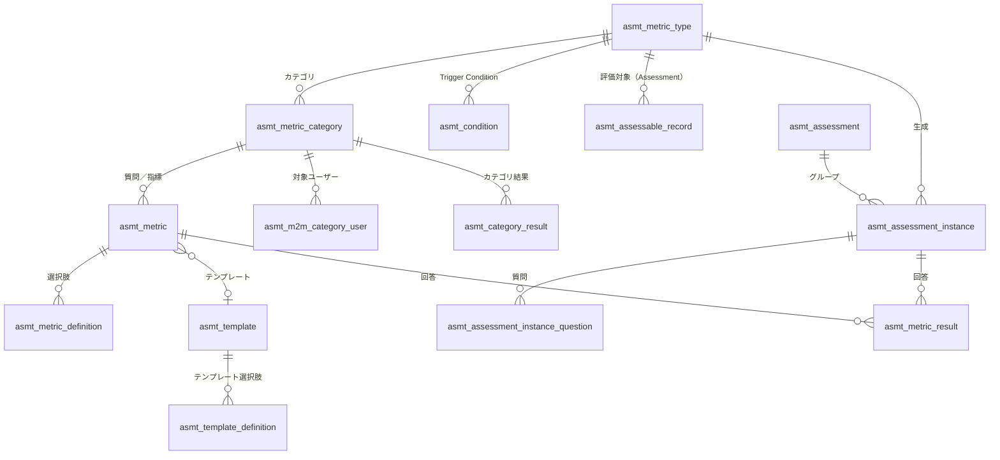
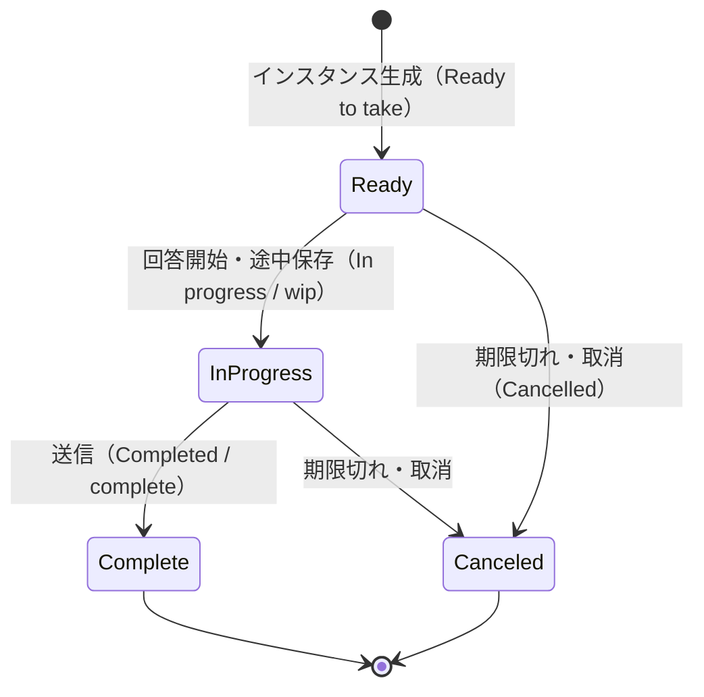
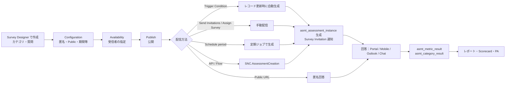
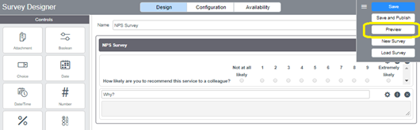
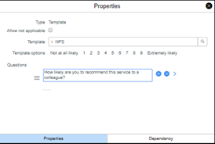
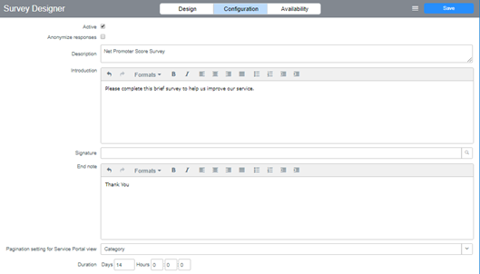
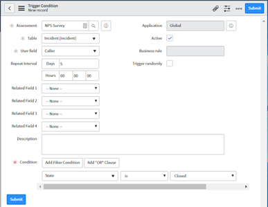

# Survey・Assessment（Survey Designer / Assessment Designer / 顧客満足度調査）

## 概要

**Assessments and Surveys**（評価とアンケート）は、ServiceNow AI Platform（旧 Now Platform）に標準搭載された、アンケート・評価・クイズの共通エンジンである。Assessments and Surveys は既定で有効（active by default）であり、ITSM の満足度調査、CSM の顧客満足度調査、HRSD の従業員アンケート、SPM の Demand 評価、IRM の Attestation（証跡確認）、Enterprise Architecture のアプリケーション評価など、多くの製品がこのエンジンを再利用する。[出典](https://www.servicenow.com/docs/r/servicenow-platform/assessments-surveys-landing-page.html) [出典](https://www.servicenow.com/docs/r/3ongaT2PAVB3Cqoicgnoxg/Y9pTAEMePoPKBv8~HF1l0Q)

Assessments and Surveys は次の 3 つのサブ機能で構成される。

| サブ機能 | 英語名 | 目的 | 主な作成画面 | 管理ロール |
|---|---|---|---|---|
| アンケート | Surveys | ユーザーへの質問票の作成・配信・回答収集（満足度調査、従業員調査など） | Survey Designer | `survey_admin` |
| 評価 | Assessments | 任意テーブルのレコードを評価・スコアリング・ランク付け（ベンダー評価、アプリ評価、リスク評価など） | Metric Type フォーム（Assessments > Metric Definition） | `assessment_admin` |
| クイズ | Quizzes | 知識確認のための質問票（評価エンジン上に構築） | Quiz Designer | `assessment_admin` |

[出典](https://www.servicenow.com/docs/r/servicenow-platform/assessments-surveys-landing-page.html)

3 つのサブ機能はすべて同じ `asmt_*` テーブル群を共有する。`asmt_metric_type`（Metric Type ＝ アンケート定義／評価種別）の **Evaluation method（評価方式）** フィールドが `Survey`／`Assessment`／`Attestation`（レガシー）のいずれかを持つことで、同一テーブル上で用途が区別される。[出典](https://www.servicenow.com/docs/r/q4dSP2Icgr1SFv5wanVXvQ/W57oF5ozoQ5__tbVB0RUhw)

さらに IRM（GRC）・Third-party Risk Management（TPRM、旧 Vendor Risk Management）・Field Service Management などでは、後継の **Smart Assessment Engine（SAE、スマート評価エンジン）** が導入されつつあり、クラシックの Assessment エンジン（`asmt_*`）からの移行ツールが提供されている（後述「[Smart Assessment Engine との関係](#smart-assessment-engine-との関係)」）。[出典](https://www.servicenow.com/docs/r/Z61H6JNUJXKe8NNPQzK7MQ/_IFNHdAAg~lR1jG6oNNjLQ)

> **本ファイルの範囲:** 共通エンジン（`asmt_*`）の仕様を中心に扱う。Virtual Agent の会話内フィードバックは [Virtual Agent と会話型AI](virtual-agent.md)、IRM／TPRM 固有の評価業務は [Integrated Risk Management (GRC)](../irm/integrated-risk-management.md)、メール通知の一般仕様は [通知とメール](notifications-email.md)、レポート全般は [レポートとアナリティクス](reporting-analytics.md) を参照。

### リリース別の変更状況

| リリース | Assessments and Surveys の主な変更 |
|---|---|
| Utah | Service Portal のカード上のボタン（Take Survey ボタン）を廃止。ATF の「Click the Take Survey button」ステップは「Click the Survey card」ステップへ置換が必要 |
| Xanadu | 非アクティブ化した質問への回答は「View User Response」や回答フォームに表示されなくなった（データはテーブルに残る）。Quick start tests（ATF ベースの動作確認テスト）を提供 |
| Yokohama／Zurich | 公式の結合リリースノートでは「No updates for this release」 |
| Australia（基準） | 結合リリースノート上は「No updates for this release」。ただし Service Portal／Mobile の割り当て済みアンケート一覧が **item view からカード表示（card view）** に変更されたことが Australia 版ドキュメントに記載 |

[出典](https://www.servicenow.com/docs/r/3ongaT2PAVB3Cqoicgnoxg/Y9pTAEMePoPKBv8~HF1l0Q) [出典](https://www.servicenow.com/docs/r/Cz0Un5C85RB3j2nhhAK1aQ/tF6VetnOv9EJwJYKi3gpMA) [出典](https://www.servicenow.com/docs/r/q4dSP2Icgr1SFv5wanVXvQ/_5z5~rkVbYbxz_Ge0Y~1MQ)

> **Brazil での変更:** Brazil 版の Assessments and Surveys リリースノート（Australia→Brazil 差分）は公開情報では確認できず。Brazil 版ドキュメント（Service Portal と Now Mobile のアンケート、AssessmentCreation API、Survey Invitation 通知）の記述内容は Australia 版と同等であり、エンジン本体の仕様変更は確認できなかった。[出典](https://www.servicenow.com/docs/r/servicenow-platform/c_SurveyServicePortal.html)

---

## アーキテクチャとデータモデル

### asmt_* テーブル一覧

Assessments and Surveys をインストールすると、次のテーブルが作成される。Survey 用途と Assessment 用途で同じテーブルを共有し、名称の読み替えが発生する点に注意する（例：Survey の「質問」は `asmt_metric`、「アンケート定義」は `asmt_metric_type`）。[出典](https://www.servicenow.com/docs/r/q4dSP2Icgr1SFv5wanVXvQ/HcD1ly6TfRsYkWzL2HN6xg)

| テーブル（ラベル） | テーブル名 | Assessment での意味 | Survey での意味 |
|---|---|---|---|
| Assessment Metric Type | `asmt_metric_type` | 評価種別（評価対象テーブル・条件・スケジュール） | アンケート定義（Survey definition） |
| Metric Category | `asmt_metric_category` | 評価カテゴリ（テーマ）。Weight を持つ | アンケートのカテゴリ（ページ・セクション） |
| Assessment Metric | `asmt_metric` | 評価指標（Metric） | 質問（Question） |
| Assessment Metric Definition | `asmt_metric_definition` | Choice／Likert 指標の選択肢 | 回答選択肢（Answer option） |
| Assessment Metric Template | `asmt_template` | 再利用可能な評価尺度 | 質問テンプレート（Question template） |
| Assessment Template Definition | `asmt_template_definition` | テンプレートの各選択肢 | 同左 |
| Assessment Group | `asmt_assessment` | 1 回の生成でまとめて作られたインスタンスのグループ | 同左 |
| Assessment Instance | `asmt_assessment_instance` | 1 ユーザー × 1 回の質問票（評価インスタンス） | 1 ユーザー × 1 回のアンケート（Survey instance） |
| Assessment Instance Question | `asmt_assessment_instance_question` | インスタンス上の個々の質問 | 同左 |
| Metric Result | `asmt_metric_result` | 評価値 | アンケート回答（1 質問 × 1 回答 = 1 レコード） |
| Assessment Category Result | `asmt_category_result` | カテゴリ単位の重み付き結果 | 同左 |
| Assessable Record | `asmt_assessable_record` | 評価対象レコード（ソースレコードと Metric Type の紐付け） | （通常使用しない） |
| Category Assessable Records | `asmt_m2m_category_assessment` | Assessable Record とカテゴリの紐付け | — |
| Assessment Category User | `asmt_m2m_category_user` | カテゴリを評価できるユーザー（Category user） | アンケートの対象ユーザー（Survey user） |
| Assessment Stakeholders | `asmt_m2m_stakeholder` | Assessable Record と Category user の紐付け（Stakeholder） | — |
| Decision Matrix | `asmt_decision_matrix` | 意思決定マトリクス（2 軸グラフ）定義 | — |
| Assessment X／Y Category Matrix | `asmt_m2m_xcategory_matrix`／`asmt_m2m_ycategory_matrix` | Decision Matrix の X 軸／Y 軸カテゴリ | — |
| Bubble Chart | `asmt_bubble_chart` | バブルチャート（3 軸）定義 | — |
| Signature | `asmt_signature` | 署名（評価・Attestation・アンケート） | 同左 |
| Trigger Condition | `asmt_condition` | いつ誰に評価／アンケートを送るかの条件 | アンケートのトリガー条件 |

[出典](https://www.servicenow.com/docs/r/q4dSP2Icgr1SFv5wanVXvQ/HcD1ly6TfRsYkWzL2HN6xg)

### データモデル図



`asmt_metric_result` には各ユーザーの各質問への回答が 1 レコードずつ格納され、質問単位・カテゴリ単位の結果は Metric Result レコードから自動計算される。[出典](https://www.servicenow.com/docs/r/q4dSP2Icgr1SFv5wanVXvQ/JEmvTw~kW9b_ubcA87LHQw)

### Metric Result（`asmt_metric_result`）の主要フィールド

`asmt_metric_result` はレポート・CSAT 集計の主たるソースであり、各フィールドの意味は次のとおり。[出典](https://www.servicenow.com/docs/r/q4dSP2Icgr1SFv5wanVXvQ/WyWivBCeUh3AOTvMouo6rQ)

| フィールド | 説明 |
|---|---|
| Assessment group | 1 回の発生（occurrence）で作られたアンケートインスタンスと結果の入れ物。インスタンスが 1 件以上作成されるたびに新しいグループが作られる |
| Metric | 回答対象の質問 |
| Data type | 質問のデータ型 |
| Method | 評価方式。Survey の場合も常に Assessment |
| Source | インスタンスを生成したアンケート定義 |
| Assigned to | 回答したユーザー |
| Instance | `Assigned to` が回答したアンケートインスタンス |
| Actual value | 回答値。データ型により決まる：Checkbox は 0／1、Choice と Likert Scale は Metric Definition の値、Date／Date/Time／String は -1、Template はテンプレート定義の値、Yes/No は No=0・Yes=1 |
| Normalized value | Scale definition、Min／Max 等を考慮した調整値（線形式で計算。リスク評価にも利用） |
| String value | 質問票上に表示された回答そのもの。Percentage 質問では Actual value と同じ。未回答の一部は N/A |

> 【第三者情報】コミュニティでは、`actual_value` でグループ化したレポートが期待どおりにならない場合、質問（Metric Definition）側へのドットウォークで選択肢を表示する方法が紹介されている。[出典](https://www.servicenow.com/community/developer-forum/difficulty-grouping-data-by-quot-actual-value-quot-field-in/m-p/2954527)

### Assessment Instance（`asmt_assessment_instance`）と状態

`asmt_assessment_instance` は「1 ユーザーに割り当てられた 1 件の質問票」を表す。Survey instance フォームの既定表示項目は Number、Metric type、Due date、State、Assigned to、Domain、Expiration date で、関連として View User's Response、Retry Sentiment Analysis、Assessment Instance Questions を持つ。[出典](https://www.servicenow.com/docs/bundle/zurich-servicenow-platform/page/administer/survey-administration/task/t_ViewSurveyInstance.html)

Survey > Survey Instances 配下のサブモジュールは状態に対応しており、次のとおりである（Completed のインスタンスを開くとフォームではなく User's Response ページに遷移する）。[出典](https://www.servicenow.com/docs/bundle/zurich-servicenow-platform/page/administer/survey-administration/task/t_ViewSurveyInstance.html)



- 上図の括弧内ラベル（Ready to take／In progress／Completed／Cancelled）は Survey Instances 配下の**サブモジュール名（表示ラベル）**であり、`state` フィールドの内部値ではない。状態値の遷移そのものは公開情報では確認できず、図は表示ラベルからの【推定】である。
- Allow retake 有効時に完了済みインスタンスの回答を変更できることは公式に記載されているが、その際に状態が Complete から In progress へ戻るかどうかは公開情報では確認できず。

- 状態の内部値として `wip`・`complete` が使われていることはコミュニティおよび API の戻り値から確認できるが、全選択肢の内部値一覧は公開情報では確認できず（インスタンスの `state` フィールドの辞書で確認すること）。[出典](https://www.servicenow.com/community/servicenow-ai-platform-forum/survey-not-creating-through-createassessments/m-p/2727327)
- Metric Type の **Allow retake** を有効にすると、完了済みの評価・クイズ・アンケート・Attestation の回答を変更できる。期限（due date）を過ぎると My Assessments and Surveys から消える。[出典](https://www.servicenow.com/docs/r/q4dSP2Icgr1SFv5wanVXvQ/W57oF5ozoQ5__tbVB0RUhw)
- 期限切れインスタンスの取消は「Cancel Expired Assessments」スケジュールジョブ（既定 30 日間隔とされる）が担う（ServiceNow 社員による Community 公式ブログ、2019-03 の旧リリース時点の記載）。[出典](https://www.servicenow.com/community/performance-analytics-blog/diy-nps-kpi-part-1/ba-p/2269182)

### 主なビジネスルール・スクリプトインクルード

Assessments and Surveys はレコード保存時に多くの自動処理を行う。代表的なものは次のとおり。[出典](https://www.servicenow.com/docs/r/q4dSP2Icgr1SFv5wanVXvQ/HcD1ly6TfRsYkWzL2HN6xg)

| 対象テーブル | ビジネスルール | 役割 |
|---|---|---|
| Assessment Metric Type | Create Business Rule on Remote table／Remove auto create Business Rules | 評価対象テーブルに Assessable Record 生成用 BR を自動作成・削除 |
| Assessment Metric Type | Create Scheduled Job／Remove Scheduled Job／Update scheduled job on schedule change | Scheduled 型の生成ジョブ管理 |
| Assessment Metric Type | Create Survey Records／Publish Survey | アンケート関連レコードの作成と公開 |
| Assessment Metric Type | Create UI Action on Remote table／Remove auto create UI actions | 対象テーブルへの UI アクション自動作成 |
| Assessment Instance | Create actual results／Notify assessment user／Cancel notification workflow | 結果作成、回答者への通知 |
| Assessment Metric | Calculate category max weight／Verify min/max／Do not allow datatype to change／Prevent recursive dependencies 等 | 指標の整合性維持 |
| Trigger Condition | Generate assessment trigger condition | トリガー条件から監視用 BR を生成 |
| Survey Trigger Condition | Remove auto created business rule | トリガー削除時の BR 削除 |

| スクリプトインクルード | 役割 |
|---|---|
| `AssessmentUtils` | 評価のコア機能 |
| `AssessmentUtilsAJAX` | スコアカード表示用 AJAX |
| `SurveyUtils` | アンケートのコア機能 |
| `MigrateSurveyToAssessment` | レガシー Survey（旧 Survey アプリ）から Assessment ベースのアンケートへの移行 |
| `RatingUtilsAJAX` | 将来用に予約 |

[出典](https://www.servicenow.com/docs/r/q4dSP2Icgr1SFv5wanVXvQ/HcD1ly6TfRsYkWzL2HN6xg)

> 現行の Surveys アプリケーションは旧来の **Legacy Surveys**（ServiceNow Wiki でのみ文書化）を置き換えたものである。`MigrateSurveyToAssessment` はその移行用である。[出典](https://www.servicenow.com/docs/r/servicenow-platform/assessments-surveys-landing-page.html)

---

## ロール

### Survey 系ロール

| ロール | 名称 | 説明 | 含むロール |
|---|---|---|---|
| Survey administrator | `survey_admin` | アンケートの作成・管理。必要なアンケート種別、送信タイミング、受信者を決定する。Survey アプリケーションメニューの全モジュールを利用可能 | `survey_reader`, `assessment_admin` |
| Survey reader | `survey_reader` | アンケートと関連情報（回答、Survey group、Scorecard、レポート）の参照 | なし |
| Survey creator | `survey_creator` | アンケートを作成し、回答・送信できるユーザーに割り当てる。評価（Assessment）も作成可能 | なし |

アンケートの**回答**に必要なロールはない（割り当てられた質問票はロールなしで回答できる）。[出典](https://www.servicenow.com/docs/r/q4dSP2Icgr1SFv5wanVXvQ/D28aTXkNZjfMe9JREcc0Gw)

### Assessment 系ロール

| ロール | 名称 | 説明 | 被包含 |
|---|---|---|---|
| Assessment administrator | `assessment_admin` | Assessments アプリの管理。全モジュールにアクセス可能 | `itil_admin`、`survey_admin` に含まれる |

[出典](https://www.servicenow.com/docs/r/q4dSP2Icgr1SFv5wanVXvQ/HcD1ly6TfRsYkWzL2HN6xg)

- `assessment_admin` 自体はシステム権限が限定的なため、評価対象のソースレコードにアクセスできるよう追加ロール（例：ベンダー評価なら Company テーブルにアクセスできる `vendor_manager`）が必要になる。[出典](https://www.servicenow.com/docs/r/servicenow-platform/c_AssessmentProcess.html)
- ITIL ユーザーは Assessable Record を参照でき、admin はフルアクセスを持つ。**評価スケジュールの設定は admin のみ**可能。[出典](https://www.servicenow.com/docs/r/servicenow-platform/c_AssessmentProcess.html)
- Metric Type の **Roles** フィールドで、そのタイプの結果・カテゴリ・指標・Assessable Record・Scorecard・Stakeholder・Decision Matrix を参照できる追加ロールを指定できる（Assessments モジュール自体へのアクセス権は付与されない）。[出典](https://www.servicenow.com/docs/r/q4dSP2Icgr1SFv5wanVXvQ/W57oF5ozoQ5__tbVB0RUhw)
- Metric Category の **Roles** フィールドで、そのカテゴリの評価を指定ロールのユーザーに限定できる（未指定なら任意ロールで評価可能）。[出典](https://www.servicenow.com/docs/r/q4dSP2Icgr1SFv5wanVXvQ/E7G32v2wtv1FPR7YU_6c_w)

### 製品側ロールとの関係

各製品のロールは Survey ロールを内包していることが多い。例：HR Service Delivery の `sn_hr_core.manager` は `survey_admin` を、`sn_hr_core.basic` は `survey_reader` を含む（[HR Service Delivery](../employee/hr-service-delivery.md)）。IRM の `sn_compliance.reader`／`sn_risk.reader` 等は `survey_reader` を含み、`sn_risk.asmt_creator` は `assessment_admin` を含む（[Integrated Risk Management](../irm/integrated-risk-management.md)）。Virtual Agent の `chat_survey_admin` は `survey_admin` を含む（[Virtual Agent](virtual-agent.md)）。[出典](https://www.servicenow.com/docs/r/employee-service-management/hr-service-delivery/c_ManageRoles.html) [出典](https://www.servicenow.com/docs/r/australia/governance-risk-compliance/policy-and-compliance-management/r_InstallWPolAndCompl.html) [出典](https://www.servicenow.com/docs/r/australia/governance-risk-compliance/grc-risk-management-workspace/r_RolesInstallWRisk.html) [出典](https://www.servicenow.com/docs/r/australia/conversational-interfaces/virtual-agent/VA-roles.html)

---

## Survey（アンケート）

### Survey のプロセス



アンケートは**公開（Publish）しないと**インスタンスを受け取り・回答できない。[出典](https://www.servicenow.com/docs/r/q4dSP2Icgr1SFv5wanVXvQ/NLBEgsmcoey1iOY1g9EqIQ)

### Survey アプリケーションメニュー

Survey アプリケーションメニュー（All > Survey）の主なモジュールは次のとおり。正確なモジュール一覧（全項目）は公開情報では確認できず、ドキュメント中に現れるものを列挙する。

| モジュール | 用途 | 出典 |
|---|---|---|
| Survey > Survey Designer | アンケート作成画面 | [出典](https://www.servicenow.com/docs/r/q4dSP2Icgr1SFv5wanVXvQ/NLBEgsmcoey1iOY1g9EqIQ) |
| Survey > View Surveys | アンケート定義（`asmt_metric_type`、Evaluation method = Survey）一覧 | 【第三者情報】[出典](https://www.servicenow.com/community/itsm-forum/how-to-create-survey-in-servicenow/td-p/426689) |
| Survey > Survey Instances（Ready to take／In progress／Completed／Cancelled／All） | インスタンス一覧 | [出典](https://www.servicenow.com/docs/bundle/zurich-servicenow-platform/page/administer/survey-administration/task/t_ViewSurveyInstance.html) |
| Survey > Survey Responses | 回答（Metric Result）一覧 | [出典](https://www.servicenow.com/docs/r/q4dSP2Icgr1SFv5wanVXvQ/JEmvTw~kW9b_ubcA87LHQw) |
| Survey > Trigger Conditions | トリガー条件 | 【第三者情報】[出典](https://www.servicenow.com/community/developer-articles/create-a-simple-survey-for-a-service-survey-designer-trigger/ta-p/2310583) |
| Survey > Recipients Lists | 受信者リスト | [出典](https://docs.servicenow.com/bundle/vancouver-servicenow-platform/page/administer/survey-administration/task/add-recipient-list-survey.html) |
| Survey > Question Sentiment Results | 感情分析結果 | [出典](https://www.servicenow.com/docs/r/q4dSP2Icgr1SFv5wanVXvQ/gJnpq5AMomAHMO_1R1x~yA) |
| Survey > Administration > Properties | Survey プロパティ | [出典](https://www.servicenow.com/docs/r/q4dSP2Icgr1SFv5wanVXvQ/HcD1ly6TfRsYkWzL2HN6xg) |

### Survey Designer

**Survey Designer** は `survey_admin` ロールのユーザーがアンケートを作成・設定・管理・配信するための一元化された画面で、Survey > Survey Designer から開く。Survey Designer は Controls タブ、Questions タブ、Categories タブ、ヘッダーバー、デザインキャンバスで構成される。[出典](https://www.servicenow.com/docs/r/q4dSP2Icgr1SFv5wanVXvQ/NLBEgsmcoey1iOY1g9EqIQ)



*図 1：Survey Designer の Design ビューとヘッダーバーのメニュー*

画面説明：画面上部のヘッダーバーに「Survey Designer」のタイトルと、Design／Configuration／Availability の 3 つのビュー切替タブがある（Design が選択中）。右上のハンバーガーメニューを開くと Save（青ボタン）、Save and Publish、Preview（黄色枠で強調）、New Survey、Load Survey が並ぶ。左側の「Controls」パレットには Attachment、Boolean、Choice、Date、Date/Time、Number、Percentage などのデータ型アイコンがあり、キャンバスへドラッグして質問を作る。中央キャンバスでは Name 欄に「NPS Survey」と入力され、カテゴリ「NPS Survey」内に「How likely are you to recommend this service to a colleague?」という質問が「Not at all likely」〜「Extremely likely」の 0〜10 のラジオボタンで表示され、その下に自由記述の「Why?」欄がある。
出典：[ServiceNow Community「DIY NPS KPI - Part 1」](https://www.servicenow.com/community/performance-analytics-blog/diy-nps-kpi-part-1/ba-p/2269182)（取得日 2026-11-04。旧リリースの画面であり、現行 UI と細部が異なる可能性がある）

#### ヘッダーバーのビューとメニュー

| 区分 | 項目 | 説明 |
|---|---|---|
| ビュー | Design | 既定のビュー。カテゴリと質問を追加・設定する |
| ビュー | Configuration | イントロダクション、End note、署名などの設定 |
| ビュー | Availability | カテゴリごとの受信者を選択 |
| メニュー | Save | 状態を変えずに保存 |
| メニュー | Preview | 受信者から見た表示を確認 |
| メニュー | Publish | 選択した受信者へアンケートを配信 |
| メニュー | Save and Publish | 保存と配信を一度に行う |
| メニュー | New Survey／Load Survey／Copy Survey | 新規キャンバス／既存アンケート読込／複製 |

[出典](https://www.servicenow.com/docs/r/q4dSP2Icgr1SFv5wanVXvQ/NLBEgsmcoey1iOY1g9EqIQ)

#### 質問データ型（Controls タブ）

スコア対象（Scored）のデータ型の回答は評価エンジンにより 0〜10 のスコアに変換され、結果計算に寄与する。[出典](https://www.servicenow.com/docs/r/q4dSP2Icgr1SFv5wanVXvQ/NLBEgsmcoey1iOY1g9EqIQ)

| データ型 | スコア対象 | 説明・制約 |
|---|---|---|
| Attachment | × | 1 つ以上のファイル添付 |
| Boolean | ○ | チェックボックスまたは Yes/No |
| Choice | ○ | 定義済み選択肢。**値は数値必須**（文字列値は保存されない） |
| Date／Date/Time | × | 日付・日時 |
| Number | × | 最小・最大付き数値（既定 1〜10） |
| Percentage | × | 範囲付きパーセンテージ |
| Scale | ○ | Likert 尺度（ラジオボタン表示） |
| Numeric Scale | ○ | 数値尺度（既定 1〜5） |
| String | × | 単一行／複数行テキスト。**感情分析の対象はこの型のみ** |
| Template | ○ | 定義済み尺度（テンプレート）の選択肢。Quiz Scorecard と連携 |
| Reference | × | 参照テーブルからの選択。**Reference qualifier は非対応** |
| Image Scale | ○ | 画像から選択。テンプレートで画像を再利用可能 |
| Multiple Selection | ○ | 複数チェックボックス |
| Ranking | 記載なし | 各選択肢に一意の順位を付ける。必須化可能、親質問への依存（Dependency）は可能だが逆は不可 |

[出典](https://www.servicenow.com/docs/r/q4dSP2Icgr1SFv5wanVXvQ/NLBEgsmcoey1iOY1g9EqIQ)



*図 2：Template 型の質問の Properties ダイアログ（NPS テンプレート）*

画面説明：「Properties」ダイアログに Type = Template、「Allow not applicable」チェックボックス（未選択）、Template 欄に「NPS」が選択され、Template options として「Not at all likely 1 2 3 4 5 6 7 8 9 Extremely likely」が並ぶ。Questions 欄に「How likely are you to recommend this service to a colleague?」が入力されている。ダイアログ下部に「Properties」と「Dependency」のタブがあり、Dependency タブで他の質問への依存（条件付き表示）を設定する。
出典：[ServiceNow Community「DIY NPS KPI - Part 1」](https://www.servicenow.com/community/performance-analytics-blog/diy-nps-kpi-part-1/ba-p/2269182)（取得日 2026-11-04）

#### 質問の詳細設定

- 各質問はちょうど 1 つのカテゴリに属し、1 カテゴリは複数の質問を持てる。[出典](https://www.servicenow.com/docs/r/q4dSP2Icgr1SFv5wanVXvQ/NLBEgsmcoey1iOY1g9EqIQ)
- 高度な設定として、質問の**条件付き表示（Dependency）**と**必須化（Mandatory）**がある。Choice／Likert Scale の質問は回答選択肢として Metric Definition が必要。再利用可能な選択肢セットは **Question template**、カテゴリと質問は **Question bank** として他のアンケートと共有できる。質問はカテゴリ単位・質問単位で並び替えられる。[出典](https://www.servicenow.com/docs/r/servicenow-platform/c_SurveyQuestion.html)
- 結果・Scorecard は質問の **Positive indicator**（どちらの回答が良いか）の設定に依存するため、選択肢に合わせて正しく設定する。スコア対象の質問を含まないカテゴリは結果を生まない。[出典](https://www.servicenow.com/docs/r/q4dSP2Icgr1SFv5wanVXvQ/JEmvTw~kW9b_ubcA87LHQw)
- Yes/No/Not Applicable の「Not Applicable」は最後に表示され、質問作成時に設定可能。[出典](https://www.servicenow.com/docs/r/servicenow-platform/c_SurveyServicePortal.html)

### Survey Designer Configuration フォーム

Configuration ビュー（Survey Designer Configuration form）の項目は次のとおり（Australia 版）。[出典](https://www.servicenow.com/docs/r/q4dSP2Icgr1SFv5wanVXvQ/WUp~RKPibNOQpt0BvAnQzQ)

| フィールド | 説明 |
|---|---|
| Active | 受信者への配信を有効化 |
| Survey Owners | アンケートの所有者。`survey_creator`／`survey_admin`／`assessment_admin` を持つユーザー |
| Anonymize responses（回答の匿名化） | 匿名で回答を収集。結果に受信者が表示されず、送信時に Assigned to がクリアされる。ただし Created By／Updated By は `survey_admin` から見える |
| Description | 構成またはアンケートの説明 |
| Do not show survey introduction notes | 起動時のイントロダクションを省略（プラットフォーム UI と Service Portal 両方） |
| Introduction | 冒頭に表示する文 |
| Signature | 要件・注意事項等への同意としての署名 |
| Return URL | 送信後に表示する URL。設定すると End note は表示されない |
| End note | 送信後のメッセージ（お礼・追加案内） |
| Public Survey | 公開アクセスを有効化。ログイン不要、匿名回答。完了済み回答の Assigned to は Guest。**保存後にのみ設定可能** |
| Survey Publish URL | 共有用 URL。**公開後にのみ表示** |
| Sample metric | 送信メール内にサンプル表示する質問 |
| Pagination setting for Service Portal view | Service Portal のデスクトップ／タブレットでのページ分割：Category（既定）／Question／None。モバイルは常に 1 問 1 ページ。Service Portal インストール時のみ表示 |
| Chat Survey | チャット（事前・事後チャット）アンケートで質問がサポートされるか検証。チャットコンテキスト変数を質問にマッピング可能。Glide Conversation Server（`com.glide.cs`）プラグインが必要 |
| One Click Survey | Service Portal でワンクリックアンケートを有効化。Pagination = None が必要 |
| Source Table | トリガー型アンケートで、質問の動的値に使うフィールドを持つテーブル（Metric 側で Source Field を設定） |
| Allow Sentiment Analysis | 感情分析を有効化 |
| Duration | 生成から回答期限までの期間。既定 14 日 |
| Outlook Actionable Message | 通知メールにアンケートを埋め込む。保存時に全質問が対応形式か検証。Outlook Actionable Messages（`sn_ms_oam`）プラグインが必要 |



*図 3：Survey Designer の Configuration ビュー*

画面説明：上部ヘッダーで Configuration タブが選択されている。上から Active（チェック済み）、Anonymize responses（未チェック）、Description（「Net Promoter Score Survey」）、Introduction（リッチテキストエディタに「Please complete this brief survey to help us improve our service.」）、Signature（参照フィールド）、End note（リッチテキストで「Thank You」）、Pagination setting for Service Portal view（Category）、Duration（Days 14、Hours 0:0:0）が並ぶ。右上に Save ボタン。
出典：[ServiceNow Community「DIY NPS KPI - Part 1」](https://www.servicenow.com/community/performance-analytics-blog/diy-nps-kpi-part-1/ba-p/2269182)（取得日 2026-11-04。旧リリースの画面のため、Public Survey 等の新しい項目は写っていない）

### Availability（受信者）設定

| フィールド | 説明 |
|---|---|
| Accessible by | アクセス可能な人：Anyone（リンクを知る全員）／Specific users |
| Survey groups only | Survey group に限定（Specific users 時のみ） |
| Add group users | アクセス可能なグループユーザーを追加（Specific users 時のみ） |
| Add users | 個別ユーザーを追加（Specific users 時のみ） |
| Add recipients lists | 受信者リスト（Recipients list）を追加（Specific users 時のみ） |

[出典](https://www.servicenow.com/docs/r/q4dSP2Icgr1SFv5wanVXvQ/WUp~RKPibNOQpt0BvAnQzQ)

**Survey users／Survey user groups** の仕様：[出典](https://www.servicenow.com/docs/bundle/zurich-servicenow-platform/page/administer/survey-administration/concept/c_SurveyUsersAndGroups.html)

- Survey user のリストは Survey Definition フォームと Survey Category フォームに表示され、いつでも追加・削除できる（Survey Designer からも設定可能）。
- Survey user に指定しても**インスタンスは自動作成されない**。インスタンスが作られるのは Schedule period が Daily／Weekly／Monthly／Yearly で、かつユーザーに未完了・未失効のインスタンスがない場合のみ。
- Survey user group は Type = `survey` のグループ。任意のユーザーグループもアンケートに割り当て可能。
- **トリガー条件を持つアンケートでは Survey user を作成しない**（Trigger Conditions フォームで受信者を決める）。
- Recipients list は Recipients Lists サブモジュールで事前に定義してからアンケートに追加する。1 つのリストを複数アンケートで共有できる。[出典](https://docs.servicenow.com/bundle/vancouver-servicenow-platform/page/administer/survey-administration/task/add-recipient-list-survey.html)
- 【第三者情報】Recipients list に登録できるのは User／Contact／Consumer／Account のみで、それ以外の外部宛先には Public Survey の URL を独自に送る回避策が取られる。[出典](https://www.servicenow.com/community/servicenow-ai-platform-forum/send-survey-to-list-of-recipients-that-are-not-users-contacts/m-p/1130254)

### Schedule period（スケジュール期間）

アンケート定義の **Schedule period** は、同一ユーザーにアンケートを送れる頻度を制御する。[出典](https://www.servicenow.com/docs/r/q4dSP2Icgr1SFv5wanVXvQ/IzzH6bl8fIgtfPY~gqVLdA)

| 値 | 動作 |
|---|---|
| No Limit（既定） | 制限なし。**Trigger Condition による配信はこの値が必須** |
| Only Once | ユーザーごとに 1 回のみ（完了済みユーザーへの再送は API で `completed` エラー） |
| Daily／Weekly／Monthly／Yearly | スケジュールジョブが作成され、各期間の開始時に新しいインスタンスを生成。1 ユーザーにつき 1 期間 1 インスタンス |

- 期間の強制はインスタンスの **Expiration date** で行われる。
- 期間を変更しても、既存インスタンスを持つユーザーはそれが失効するまで新しいインスタンスを受け取れない。
- 【第三者情報】四半期など選択肢にない周期は、Scheduled Script Execution から API で生成する方法がコミュニティで推奨されている。[出典](https://www.servicenow.com/community/developer-forum/set-survey-to-trigger-every-quarter/m-p/3431319)

---

## トリガー条件（Trigger Condition）

### Trigger Condition フォーム

**Trigger Condition**（`asmt_condition`）は、テーブル上のレコードが条件を満たしたときにアンケートを自動送信する仕組みで、保存するとテーブル監視用のビジネスルールが自動生成される。[出典](https://www.servicenow.com/docs/r/q4dSP2Icgr1SFv5wanVXvQ/fFzMSqaQsUR_VSDfwUWlnQ)

| フィールド | 説明・注意 |
|---|---|
| Assessment | 送信するアンケート |
| Table | 監視するテーブル。**現在のアプリケーションスコープ内のテーブルのみ**選択可能 |
| User field | 受信者を保持するフィールド。選択テーブルまたは参照先テーブル上の、User［`sys_user`］を参照するフィールド（ツリーピッカーで選択）。ログイン不要で回答させたい場合はアンケートを Public にする |
| Repeat interval | 同一ユーザーが同じトリガーから再度アンケートを受け取るまでの最小間隔。**アンケートの Schedule period は No Limit 必須**。匿名アンケートは Repeat interval に関係なくインスタンスを作成 |
| Application | admin のみ。Core を設定 |
| Active | トリガー条件の有効／無効 |
| Business rule | admin のみ。自動生成された監視用ビジネスルール（設定不要） |
| Trigger randomly | 条件成立時の一定割合だけ送信 |
| Probability (%) | 送信確率（例：50 なら約半数）。Trigger randomly 選択時のみ表示・必須。**Trigger randomly 選択時は Repeat interval の制限は前提とされない**（公式記載：「There are no repeat interval restrictions is assumed」） |
| Related Field 1〜4 | レポート用にインスタンスへ保存する参照フィールド（最大 4）。**チケット番号には使えない**（Number 列は選択不可。`trigger_id` 列を使う） |
| Description | 識別用の説明。トリガーされたレコードではテーブルタイトルがアンケートの説明に使われる |
| Condition | 送信条件（条件ビルダー） |

[出典](https://www.servicenow.com/docs/r/q4dSP2Icgr1SFv5wanVXvQ/fFzMSqaQsUR_VSDfwUWlnQ)



*図 4：Trigger Condition の新規作成フォーム*

画面説明：フォームタイトルは「Trigger Condition / New record」。左列に Assessment（「NPS Survey」）、Table（Incident [incident]）、User field（Caller）、Repeat interval（Days 5、Hours 00:00:00）、Related Field 1〜4（いずれも -- None --）、Description、Condition（「State is Closed」）が並ぶ。右列に Application（Global）、Active（チェック済み）、Business rule（読み取り専用の空欄）、Trigger randomly（未チェック）がある。左下と右上に Submit ボタン。
出典：[ServiceNow Community「DIY NPS KPI - Part 1」](https://www.servicenow.com/community/performance-analytics-blog/diy-nps-kpi-part-1/ba-p/2269182)（取得日 2026-11-04）

### 公式の設定例（インシデントクローズ時の満足度調査）

| 設定 | 値 |
|---|---|
| Assessment | Service Desk Satisfaction Survey |
| Table | Incident［`incident`］ |
| User field | Caller |
| Repeat interval | 30 days |
| Active | true |
| Trigger randomly | false |
| Related Field 1／2 | Assigned to／Problem |
| Condition | State is Closed OR State is Resolved |

インスタンスの Task（`trigger_id` 等）にはインシデントが自動設定されるため、追加の Related field なしでもインシデントのフィールド（例：Assignment group）へドットウォークしてレポートを絞り込める。Repeat interval 30 日により、同じ Caller は 30 日以内に別インシデントがクローズされても再送されない。[出典](https://www.servicenow.com/docs/r/q4dSP2Icgr1SFv5wanVXvQ/TIA4idtj1yRvakzZfGQd2A)

### トリガー条件の制約・注意点

- Schedule period が No Limit 以外だとトリガー条件が期待どおり送信しない。[出典](https://www.servicenow.com/docs/r/q4dSP2Icgr1SFv5wanVXvQ/fFzMSqaQsUR_VSDfwUWlnQ)
- Condition フィールドで**ドットウォーク条件を使うとトリガーが期待どおり動作しない**旨が旧リリース版（Yokohama）ドキュメントで注意されている（「Survey triggers will not function as expected when you use dot-walk conditions in the Condition field.」）。Australia 版の Trigger Condition フォームのページでは当該注意書きは確認できないが、実装上の制約は継続していると考えられるため回避を推奨する。[出典](https://www.servicenow.com/docs/r/Ir~NPf1dr8MGFXQE6QlBoQ/9eErZL8H58HzEN9ewADBBQ)
- Trigger randomly を選択した場合、Repeat interval の制限は前提とされない（Probability フィールドの公式説明）。[出典](https://www.servicenow.com/docs/r/q4dSP2Icgr1SFv5wanVXvQ/fFzMSqaQsUR_VSDfwUWlnQ)
- 【第三者情報】トリガーはレコード更新時にのみ評価されるため、「入社 3 週間後」のような日付起点の送信はスケジュールジョブや Flow で実装する。また User field はユーザー参照のみで、グループ宛送信はできない。[出典](https://www.servicenow.com/community/developer-forum/how-can-we-trigger-a-survey-for-newly-hired-full-time-employees/m-p/3385759)
- 【第三者情報】CSM のケース Contact（`customer_contact` 系）が User field の候補に出ないケースが報告されている。OOTB の「Customer Service Satisfaction Survey」はこれを参照する。[出典](https://www.servicenow.com/community/csm-forum/unable-to-send-a-survey-to-the-contact-listed-on-a-case/m-p/3521909)

---

## 配信チャネル

### メール通知（Survey Invitation）

トリガー条件（またはトリガーなしの配信）が発火すると OOTB のイベントがイベントキューに登録され、基本システム通知 **Survey Invitation** が割り当てユーザーへメールを送る。イベントを新規作成する必要はない。受信者や本文は System Notification > Email > Notifications で変更できる。[出典](https://www.servicenow.com/docs/r/servicenow-platform/email-notification-for-surveys.html)

- 【第三者情報】旧リリースでは同等の通知名が「Survey User Invite」と呼ばれていた。[出典](https://www.servicenow.com/community/itsm-forum/survey-email-notification/m-p/2382559)
- Metric Type の **Send notifications** で通知の有無、**Notify manager if overdue** で期限超過時の上長通知を制御する。[出典](https://www.servicenow.com/docs/r/q4dSP2Icgr1SFv5wanVXvQ/W57oF5ozoQ5__tbVB0RUhw)
- メール内リンクから Service Portal でアンケートを開くには `sn_portal_surveys.sp_survey.email_redirection` プロパティを使う。[出典](https://www.servicenow.com/docs/r/q4dSP2Icgr1SFv5wanVXvQ/HcD1ly6TfRsYkWzL2HN6xg)
- 通知の一般仕様は [通知とメール](notifications-email.md) を参照。

### 手動配信（Send Invitations／Assign Survey）

Survey Definition フォームの **Assign Survey** ボタンは 1 ユーザーずつ、**Send Invitations** ボタンはアンケート定義に登録された全ユーザーへ招待を送る（必要ロール：`admin` または `survey_admin`）。[出典](https://docs.servicenow.com/bundle/quebec-servicenow-platform/page/administer/survey-administration/task/t_SendSurveyInvitationsToUsers.html)

### Service Portal／Employee Center

- Service Portal を有効化すると、ホームに **My Assessments and Surveys** ウィジェットが表示される。Instance Options で Max records（既定 5、超過分は「View all」リンク）と Title of the widget（既定「My Assessments and Surveys」）を設定できる。
- ブレッドクラム、進捗バー（`sn_portal_surveys.sp_survey.show_progress_bar` で表示切替）、次ページ移動時の自動保存、必須未回答時のエラー表示、長文質問の「Show more／Show less」、途中離脱からの再開に対応する。
- **Australia 版で、割り当て済みの評価・アンケートは item view ではなくカード表示（card view）になった**。旧バージョンのカードスタイルをカスタマイズしていた場合はアップグレード後も item view のまま。

[出典](https://www.servicenow.com/docs/r/q4dSP2Icgr1SFv5wanVXvQ/_5z5~rkVbYbxz_Ge0Y~1MQ)

割り当てられた評価は Employee Center にも表示される。[出典](https://www.servicenow.com/docs/r/3ongaT2PAVB3Cqoicgnoxg/Y9pTAEMePoPKBv8~HF1l0Q) ポータル全般は [Service Portal と Employee Center](portals-employee-center.md) を参照。

### Now Mobile

- Now Mobile アプリには **My Assessments and Surveys** アプレットランチャーが既定で用意される。モバイルは常に 1 問 1 ページ。
- アンケート割り当て時はメールに加え、Now Mobile がある場合はプッシュ通知も送られる（`glide.sg.universal_links.enabled` = true が必要）。タップすると Mobile Employee Service Portal のイントロダクションページが開く。
- **トリガー型アンケートにはプッシュ通知は適用されない**（イベントキューのイベントで通知可否が決まる）。

[出典](https://www.servicenow.com/docs/r/servicenow-platform/c_SurveyServicePortal.html)

### その他のチャネル

| チャネル | 仕様 | 出典 |
|---|---|---|
| Outlook Actionable Message | 通知メールにアンケートを埋め込み、Outlook 内で回答。`sn_ms_oam` プラグインが必要 | [出典](https://www.servicenow.com/docs/r/servicenow-platform/email-notification-for-surveys.html) |
| Chat Survey（事前／事後チャット） | Chat Survey を有効化したアンケートを会話で提示。`com.glide.cs` が必要。詳細は [Virtual Agent](virtual-agent.md) | [出典](https://www.servicenow.com/docs/r/q4dSP2Icgr1SFv5wanVXvQ/WUp~RKPibNOQpt0BvAnQzQ) |
| ITSM Virtual Agent チャット | アンケートの回答チャネルとして記載 | [出典](https://www.servicenow.com/docs/bundle/zurich-servicenow-platform/page/administer/survey-administration/concept/c_SurveyUsersAndGroups.html) |
| Public URL | Public Survey の Survey Publish URL を共有 | [出典](https://www.servicenow.com/docs/r/q4dSP2Icgr1SFv5wanVXvQ/WUp~RKPibNOQpt0BvAnQzQ) |

### 翻訳

アンケートは翻訳を依頼して 1 つ以上の言語にローカライズでき、変更後に翻訳を編集・公開できる。Public Survey の言語ピッカー表示は `show_lang_picker_for_publicsurveys` で制御する。[出典](https://www.servicenow.com/docs/r/q4dSP2Icgr1SFv5wanVXvQ/JEmvTw~kW9b_ubcA87LHQw) [出典](https://www.servicenow.com/docs/r/q4dSP2Icgr1SFv5wanVXvQ/HcD1ly6TfRsYkWzL2HN6xg) 日本語化全般は [ローカライゼーション](localization.md) を参照。

---

## 匿名アンケートと Public Survey

匿名性に関わる設定は 2 種類あり、混同しやすい。[出典](https://www.servicenow.com/docs/r/q4dSP2Icgr1SFv5wanVXvQ/WUp~RKPibNOQpt0BvAnQzQ)

| 項目 | Anonymize responses | Public Survey |
|---|---|---|
| 目的 | 社内ユーザーの回答者を結果から隠す | ログイン不要で誰でも回答可能にする |
| 回答者 | 割り当てられた（ログインした）ユーザー | ユーザー・非ユーザー問わず |
| Assigned to | 送信時にクリア | 完了済み回答は Guest |
| 残る情報 | Created By／Updated By は `survey_admin` に可視 | — |
| 前提 | — | 保存後に設定可能。UI ページ `assessment_take2` が public であること（非 public だと匿名ユーザーがアクセスできない） |
| Repeat interval | 匿名アンケートは Repeat interval に関係なくインスタンスを作成 | 同左 |

[出典](https://www.servicenow.com/docs/r/q4dSP2Icgr1SFv5wanVXvQ/fFzMSqaQsUR_VSDfwUWlnQ)

- `assessment_take2` を public にする要件は旧リリース版ドキュメント由来の記載であり、Australia 版での扱いは公開情報では確認できず。[出典](https://www.servicenow.com/docs/r/Ir~NPf1dr8MGFXQE6QlBoQ/R8NgiCgzdx_qUuu4aUSNjg)
- One Click Survey で Public アクセスを有効にすると、ログインなしで送信でき、署名と添付は無効になる。[出典](https://www.servicenow.com/docs/r/servicenow-platform/c_SurveyServicePortal.html)
- 【経験則】「匿名」と説明して回答を集める場合でも、Anonymize responses では Created By に回答者が残る。従業員調査で厳密な匿名性を約束する場合は、`survey_admin` の付与範囲、`asmt_metric_result` への ACL、システムログ・監査の参照可否まで含めて設計・説明する必要がある。

---

## One Click Survey・Kiosk Survey（「Quick Survey」相当）

公式ドキュメント上、「Quick Survey」という名称の機能は確認できなかった。素早くフィードバックを集める用途の機能として **One Click Survey** と **Kiosk Survey** が提供されている。[出典](https://www.servicenow.com/docs/r/servicenow-platform/c_SurveyServicePortal.html)

| 種類 | 仕様 |
|---|---|
| One Click Survey | Service Portal でイントロダクションページなし、デスクトップ／iPad で Submit／Cancel ボタンなし。**モバイルビューは非対応**。アンケート定義の One Click Survey を選択（Pagination = None が必要）。Public 化でログイン不要（署名・添付は無効） |
| Kiosk Survey | One Click の一種で、**1 問のみ**（Image Scale／Choice／Likert Scale／Numeric Scale／Yes/No）。回答選択で即送信、End note 表示後は読み取り専用。Submit／Cancel、署名、依存質問、追加情報、イントロダクションなし |

`createAssessment()` の URI パラメータで、プラットフォームと Service Portal の両方で `asmt_assessment_instance` に値を保存できる。

| パラメータ | 用途 |
|---|---|
| `sysparm_refresh_interval` | 送信後、次のインスタンスを作成するまでの秒数（例：5）。キオスク端末の連続回答用 |
| `sysparm_trigger_table` | Trigger Table フィールドに保存（例：`incident`） |
| `sysparm_trigger_id` | Trigger ID フィールドに保存（レコードの sys_id） |
| `sysparm_kiosk` | キオスク要求時に true。trigger table と trigger ID の両方が必要 |

[出典](https://www.servicenow.com/docs/r/servicenow-platform/c_SurveyServicePortal.html)

> 【第三者情報】OOTB に「Short Customer Satisfaction Survey using Smiley Face」（インシデントクローズ時にトリガー）という簡易満足度アンケートが含まれるとの報告がある。[出典](https://www.servicenow.com/community/developer-forum/is-it-possble-to-send-a-feedback-survey-form-to-a-user-upon/m-p/3049516)

---

## Assessment（評価）

### Assessment のプロセス

Assessment は「任意テーブルのレコード（ベンダー、アプリケーション、Demand など）を複数の評価者が評価し、スコア化・ランク付けする」仕組みである。手順は次のとおり。[出典](https://www.servicenow.com/docs/r/servicenow-platform/c_AssessmentProcess.html)

1. 担当者に `assessment_admin`（＋ソースレコードへのアクセスロール）を付与する。
2. 目的、評価対象レコード、テーマ（カテゴリ）、測定特性（指標）、データソース、回答者を計画する。
3. **Metric Type** を作成し、**Assessable Record** を生成する。
4. **Metric Category** と **Metric** を作成する（Question bank や Metric template を再利用可能）。公開して担当者に割り当てる。
5. Schedule type（On demand／Scheduled）に従いインスタンスを生成する（1 インスタンス＝1 ユーザーの 1 質問票）。
6. Assessment group と Metric Result で結果を追跡し、Trigger condition で受信者を制御、期限超過時の上長通知を有効化する。

### 「Assessment Designer」について

公式ドキュメントでは、Survey Designer に相当する「Assessment Designer」という名称の独立したデザイナー画面は確認できなかった。クラシック Assessment は **Metric Type フォーム**（All > Assessments > Metric Definition > Types）から作成し、クイズは **Quiz Designer**（`assessment_admin` が作成・編集・配信に使う単一画面。デザインキャンバス・ヘッダーバー・コントロールを持つ）で作成する。[出典](https://www.servicenow.com/docs/r/q4dSP2Icgr1SFv5wanVXvQ/W57oF5ozoQ5__tbVB0RUhw) [出典](https://www.servicenow.com/docs/r/servicenow-platform/c_QuizDesigner.html)

Smart Assessment Engine では Assessment Workspace のランディングページからドラッグ＆ドロップ型の **Template designer** を使う（後述）。[出典](https://www.servicenow.com/docs/r/UUPLjuAXTo4SlQO8Ml6ZjQ/oePPO~CeO9NDQR35FT_XYg)

### Metric Type フォーム

Metric Type（`asmt_metric_type`）作成には `assessment_admin` または `admin` が必要。All > Assessments > Metric Definition > Types で New を押し、各項目を入力して Related Links の **Generate Assessable Records** を押すと、保存と初回の Assessable Record 生成が行われる。以降は条件に合う新規レコードに対して自動生成されるが、テーブルや条件を変更した場合は再度 Generate Assessable Records を押す必要がある。[出典](https://www.servicenow.com/docs/r/q4dSP2Icgr1SFv5wanVXvQ/W57oF5ozoQ5__tbVB0RUhw)

| フィールド | 説明・既定値 |
|---|---|
| Name（必須） | 評価対象が分かる名称 |
| Assessment duration | 生成から回答期限までの期間（インスタンスの Due date を設定）。既定 14 日 |
| Live feed | Scorecard の Live Feed ビューを有効化 |
| Notify manager if overdue | 期限超過時にマネージャーへメール |
| Assessment manager | 評価プロセスの管理者（結果ではない）。期限超過時に通知 |
| Scoring type | Attestation 用：Percent（正答の重み付き割合）／All or nothing（全問正答でなければ 0） |
| Scale factor（必須） | 最良スコア。結果はこの値にスケーリングされる。通常 10。**一度保存すると読み取り専用** |
| Pagination setting for Service Portal view | Category（既定）／Question／None |
| Roles | 結果等を参照できる追加ロール |
| Signature／Return URL／Introduction／End note | 署名、送信後 URL、冒頭文、終了文 |
| Owners | 所有者（`survey_creator`／`survey_admin`／`assessment_admin`） |
| State（読み取り専用） | Draft／Published |
| Business rule（admin のみ） | Assessable Record 自動生成用に作られた BR |
| Schedule type | On demand／Scheduled |
| Scheduled job（admin のみ） | Scheduled の場合に「<type name> Assessment Creation」という名前で自動作成。On demand に変えると削除、戻すと新規作成（旧スケジュールは保持されない） |
| Evaluation method（admin のみ） | システムが設定：Assessment（既定。Assessable Record・条件・Stakeholder を使う唯一の方式）／Attestation（レガシー）／Survey |
| Allow retake | 完了後の回答変更を許可 |
| Active | 外すと生成停止・既存評価の回答も不可 |
| Send notifications | 通知の有効化 |
| Table（必須）／Condition／Enforce condition | 評価対象テーブルと条件。Enforce condition は条件に合わなくなった既存 Assessable Record の削除可否（既定は削除しない） |
| User field | 条件テーブル上のユーザーフィールド。On demand では各評価者が全レコードを評価、Scheduled では各評価者が対応レコードのみ評価 |
| Filter field（必須）／Filter condition／Default matrix filter | Decision Matrix と Scorecard 平均のフィルター |

[出典](https://www.servicenow.com/docs/r/q4dSP2Icgr1SFv5wanVXvQ/W57oF5ozoQ5__tbVB0RUhw) [出典](https://www.servicenow.com/docs/r/q4dSP2Icgr1SFv5wanVXvQ/5NQC2NgxYYX1BJ0wrXI~Jg)

関連リンク：**Show Benchmarks**（Benchmarks にオプトインし `bm_viewer` を持つ `survey_admin`／`assessment_admin`／`survey_reader`、公開済みアンケートのみ）、**Create Improvement Initiative**（Continual Improvement Management `com.sn_cim` が必要）。[出典](https://www.servicenow.com/docs/r/q4dSP2Icgr1SFv5wanVXvQ/5NQC2NgxYYX1BJ0wrXI~Jg)

### Metric Category フォーム

| フィールド | 説明 |
|---|---|
| Name | 質問票に表示されるカテゴリ名 |
| Type（必須） | 対象の Metric Type。保存後は読み取り専用 |
| Create stakeholders | Category user の Stakeholder 自動作成 |
| Table | Metric Type から自動設定（保存後に表示） |
| Weight（必須） | カテゴリの相対的重要度。既定 10 |
| Scoring type | Attestation 用（Percent／All or nothing） |
| Total metrics | 指標数（読み取り専用） |
| Filter | このカテゴリで評価する Assessable Record の条件 |
| Description／Details | 説明（Details は HTML で画像・動画・リンク可） |
| Roles | 評価可能ユーザーを限定するロール（未指定なら任意ロール） |

[出典](https://www.servicenow.com/docs/r/q4dSP2Icgr1SFv5wanVXvQ/E7G32v2wtv1FPR7YU_6c_w)

### Metric の方式（主観／スクリプト）

| 方式 | 説明 |
|---|---|
| Assessment（非スクリプト） | Likert、Choice、Yes/No 等の主観的質問。Choice／Likert には Metric Definition が必要。Metric template で尺度を標準化。テンプレートの最小・最大値と Metric の Min／Max を一致させないと結果が正しく計算されない |
| Script（スクリプト） | JavaScript で DB を照会する客観指標。スクリプトは `actual_result` と `scaled_result` を出力し、scaled 値は Min〜Max の範囲内であること。Scale definition が Low なら小さいほど良い、High なら大きいほど良い |

[出典](https://www.servicenow.com/docs/r/servicenow-platform/c_AssessmentProcess.html)

### Category user と Stakeholder

Category user はカテゴリについて知見を持つユーザー、Stakeholder は特定の Assessable Record について知見を持つ Category user である。Stakeholder 単位で評価インスタンスが割り当てられる。[出典](https://www.servicenow.com/docs/r/servicenow-platform/c_AssessmentProcess.html)

---

## スコアリングとレポート

### Normalized value の計算式

アンケート・評価の質問単位のスコア（Normalized value）は次の線形式で計算される（Australia 版）。[出典](https://www.servicenow.com/docs/r/q4dSP2Icgr1SFv5wanVXvQ/L4Km4KvLvRXcbsSXSSAqGA)

```
Normalized value = (Input Value - Min) / (Max - Min)
                   × (Current metric weight × Bias / Sum of all metric weight in category)
                   × Scale factor

Bias = カテゴリ内の総 Metric weight / カテゴリ内の有効 Metric weight の合計
       （スクリプト指標と、スキップされた指標は有効合計から除外）

Scale definition = Low（小さいほど良い）の場合：Normalized value = 1.0 − Normalized value
```

公式の計算例：「技術者の能力を評価してください」で入力 3、Min 1、Max 6、Weight 10、有効指標 5 個（合計 50）、Scale factor 10 の場合、(3−1)/(6−1) × (10/50) × 10 = 0.4 × 0.2 × 10 = **0.8**。String 型の指標は計算から除外される。[出典](https://www.servicenow.com/docs/r/q4dSP2Icgr1SFv5wanVXvQ/L4Km4KvLvRXcbsSXSSAqGA)

カテゴリ結果（`asmt_category_result`）はカテゴリ Weight を考慮した重み付き総合評価である。Assessments > Results > Category results を開き、Type.Evaluation method = Survey で絞り込むとアンケートのカテゴリ結果を参照できる。[出典](https://www.servicenow.com/docs/r/q4dSP2Icgr1SFv5wanVXvQ/JEmvTw~kW9b_ubcA87LHQw)

### 結果の参照方法

| 方法 | 説明 |
|---|---|
| Survey > Survey Responses | 全般的な回答（Metric Result）。Assignment group 等で絞り込み可能 |
| Survey Scorecard | カテゴリ別の回答状況を可視化。画像としてエクスポート可能 |
| Database view | 1 インスタンス＝1 行、質問ごとに列となるビュー。レポート作成・エクスポート向け |
| Category results | カテゴリ単位の重み付き結果 |
| Assessment Scorecard | 1 レコードの評価結果の印刷可能な要約。過去評価や他レコードと比較 |
| Decision Matrix | 2 軸グラフで複数レコードの相対位置を表示（先に Metric Type と X／Y 軸を定義） |
| Bubble Chart | 3 軸グラフ（1 カテゴリを強調） |

[出典](https://www.servicenow.com/docs/r/q4dSP2Icgr1SFv5wanVXvQ/JEmvTw~kW9b_ubcA87LHQw) [出典](https://www.servicenow.com/docs/r/servicenow-platform/c_AssessmentProcess.html)

### Survey Overview ダッシュボード（非推奨）

**Survey Overview** ダッシュボードは非推奨（deprecated）であり、今後デプロイ・機能拡張・サポートされない（KB0867184 参照）。収録レポートは Assignment Group Customer Satisfaction 90 Day Average、Service Desk Survey 'Timely Response' 90 Days、Surveys by Metric Type and State、Service Desk Survey 'Overall Experience' 60 Days、'Tech Courteous' 90 Days、'First Call Resolve' 60 Days、'Tech Competence' 60 Days で、ソースは `asmt_metric_result` と `asmt_assessment_instance` である。[出典](https://www.servicenow.com/docs/r/q4dSP2Icgr1SFv5wanVXvQ/JyBPN8XJcOJ6CmBnnms9Gw)

> 【経験則】非推奨ダッシュボードに依存せず、Platform Analytics／Performance Analytics で `asmt_metric_result` を元に指標を定義するのが一般的。レポート全般は [レポートとアナリティクス](reporting-analytics.md) を参照。

### 感情分析（Sentiment analysis）

String 型質問の回答を positive／negative／neutral に分類できる。[出典](https://www.servicenow.com/docs/r/q4dSP2Icgr1SFv5wanVXvQ/gJnpq5AMomAHMO_1R1x~yA)

- Sentiment Analysis（`com.snc.sentiment_analysis`）プラグインを有効化し、分析対象の質問を選び、Sentiment connector（サードパーティ API の URL 等）を構成する。
- プロバイダーは Microsoft Azure Text Analytics API（ドキュメント上は v2 が非推奨で v3 へ移行中と記載）。サードパーティのライセンスは顧客側で管理する。
- 結果は Survey > Question Sentiment Results で、positive／negative／neutral の割合とインスタンス数の棒グラフとして表示。インスタンスフォームに Retry Sentiment Analysis がある。
- 正規化スコア：negative −1〜0、neutral 0、positive 0〜1。v3 の信頼度スコアは score = 1×positive + 0.5×neutral + 0.01×negative で合成するとされる（この式の値域は 0〜1 であり、ドキュメント記載の範囲と整合しない点に注意）。
- 【第三者情報】Now Assist Skill Kit で否定的なアンケート回答を検出する例も紹介されている。[出典](https://www.servicenow.com/community/now-assist-articles/now-assist-skill-kit-detect-negative-survey-sentiment-and/ta-p/3050316)

---

## API とプログラムによる生成

### SNC.AssessmentCreation

`SNC.AssessmentCreation` API は、管理者がスクリプトから評価・アンケートを生成するためのサーバーサイド API（Global）である。[出典](https://www.servicenow.com/docs/r/api-reference/server-api-reference/c_AssessmentCreation.html)

```javascript
// createAssessments(typeID, sourceRecordID, userID)
var result = new SNC.AssessmentCreation().createAssessments(
  '<asmt_metric_type の sys_id>',  // 必須
  '',                               // sourceRecordID（評価のみ。空なら全 Assessable Record）
  gs.getUserID()                    // userID（カンマ区切り。空なら Stakeholder／Survey user）
);
// 成功時: "instanceID,#instances,groupID"
```

| エラーコード | 意味 |
|---|---|
| `isscheduled` | Scheduled 型に userID／sourceRecordID を指定した（typeID のみ可） |
| `draft_state` | 未公開 |
| `invalidtype` | typeID に一致する Metric Type なし |
| `inactive` | Active でない |
| `not_available` | 質問（Metric）がない |
| `notyet` | 未失効のインスタンスが存在（失効日を返す） |
| `wip` | 既にインスタンスが割り当て済み |
| `not_authorized` | 回答権限なし（Survey user に未登録） |
| `completed` | Schedule period = Only Once で回答済み |
| `nousers` | userID 未指定かつ Stakeholder／Survey user なし |
| `nosources` | On demand で userID も sourceRecordID も未指定 |

[出典](https://www.servicenow.com/docs/r/api-reference/server-api-reference/c_AssessmentCreation.html)

- 【第三者情報】`AssessmentUtils().createAssessments` が `noquestions` を返すケースが報告されており、戻り値を単純に split する実装は注意。[出典](https://www.servicenow.com/community/developer-forum/assessmentutils-createassessments-returns-noquestions/m-p/1390770)
- スクリプトの一般的なベストプラクティスは [サーバーサイドスクリプト](scripting-server-side.md) を参照。Flow から呼ぶ場合はスクリプトステップ／カスタムアクションで本 API を呼び出す（Flow Designer 標準の Survey 送信アクションの有無は公開情報では確認できず）。

### Quick start tests（ATF）

Assessments and Surveys には、構成変更・アップグレード後に動作を検証する Quick start tests（ATF テスト）が付属する。カスタマイズしている場合はコピーしてインスタンスのデータに合わせる。[出典](https://www.servicenow.com/docs/r/3ongaT2PAVB3Cqoicgnoxg/Y9pTAEMePoPKBv8~HF1l0Q) 詳細は [Automated Test Framework](automated-test-framework.md)。

---

## システムプロパティ

Survey のプロパティは All > Survey > Administration > Properties、評価のプロパティは All > Assessments > Administration > Assessment Properties から設定する。主なプロパティは次のとおり。[出典](https://www.servicenow.com/docs/r/q4dSP2Icgr1SFv5wanVXvQ/HcD1ly6TfRsYkWzL2HN6xg)

| プロパティ | 説明 |
|---|---|
| `sn_portal_surveys.sp_survey.email_redirection` | メールのリンクから Service Portal でアンケート／評価を開く |
| `sn_portal_surveys.sp_survey.show_progress_bar` | Service Portal の進捗バー表示 |
| `show_lang_picker_for_publicsurveys` | Public Survey の言語ピッカー表示 |
| `com.snc.assessment.signature_authentication` | 氏名署名時に認証を要求 |
| `com.snc.assessment.collect.stats` | 直近の送信・完了統計を収集する評価の一覧 |
| `com.snc.assessment.decision_matrix_filter_max_entries` | Decision Matrix のフィルター最大件数（既定 1000） |
| `css.assessment.question.header.background.color` | 質問ヘッダー背景色（既定 `#767676`） |
| `css.assessment.caption.background.color`／`css.assessment.caption.font.color` | キャプションの背景色・文字色 |
| `glide.sg.universal_links.enabled` | Now Mobile プッシュ通知（Universal links）有効化 |
| `com.glide.cs.survey.probability` | Virtual Agent のフィードバック Survey 表示確率（[Virtual Agent](virtual-agent.md) 参照） |

---

## Survey の Next Experience 化の状況

Next Experience（[Next Experience UI](next-experience-ui.md)）でのアンケート・評価の扱いは、公開情報で確認できた範囲では次のとおり。

| 領域 | 状況 | 出典 |
|---|---|---|
| 作成（Survey Designer） | Australia 版でも Survey Designer（Design／Configuration／Availability の 3 ビュー）が引き続き公式の作成画面。Next Experience 用に再設計された新しい Survey Designer はドキュメント上確認できず | [出典](https://www.servicenow.com/docs/r/q4dSP2Icgr1SFv5wanVXvQ/NLBEgsmcoey1iOY1g9EqIQ) |
| 回答（Portal／Mobile） | Australia でカード表示（card view）に移行。Employee Center にも表示 | [出典](https://www.servicenow.com/docs/r/q4dSP2Icgr1SFv5wanVXvQ/_5z5~rkVbYbxz_Ge0Y~1MQ) |
| Workspace／UI Builder | 【第三者情報】UI Builder に Survey／Assessment を回答させる標準コンポーネントがないという指摘がコミュニティにあり（2025-07、回答なし）。iframe やフォームでの代替が議論されている | [出典](https://www.servicenow.com/community/next-experience-forum/survey-assessment-component-in-ui-builder/m-p/3307762) [出典](https://www.servicenow.com/community/developer-forum/ui-builder-how-to-launch-a-survey-from-a-workspace/m-p/2414241) |
| 評価（次世代） | Smart Assessment Engine が Assessment Workspace と Template designer（Next Experience ベース）を提供。IRM・TPRM・FSM 等で採用 | [出典](https://www.servicenow.com/docs/r/UUPLjuAXTo4SlQO8Ml6ZjQ/oePPO~CeO9NDQR35FT_XYg) |

> 【推定】クラシックの Surveys（`asmt_*`）は Australia まで機能追加が止まっており（結合リリースノート上 Yokohama〜Australia は「No updates」）、評価領域の新機能は Smart Assessment Engine 側に集中している。アンケート領域で Next Experience ネイティブの後継が発表されているかは公開情報では確認できず。

---

## 他製品での再利用

### Smart Assessment Engine との関係

**Smart Assessment Engine（SAE）** は ServiceNow Store から入手する GRC 系の評価アプリで、クラシック Assessment の後継として位置付けられている。主な特徴は次のとおり。[出典](https://www.servicenow.com/docs/r/UUPLjuAXTo4SlQO8Ml6ZjQ/oePPO~CeO9NDQR35FT_XYg) [出典](https://www.servicenow.com/docs/r/IDeOjpA1hzonPLWG~inEpg/1vm0ngSPQs1_CmO0w9NbCw)

- ドラッグ＆ドロップの Template designer（質問タイプ、Justification、条件付き表示、説明・参考情報）。
- Workflow Studio またはスクリプトからの起動、自動保存、再割り当て・取消、Bulk Submit／Bulk Reassign。
- 評価・セクション・サブセクション単位のスコアリング、評価後自動化（Post-assessment actions）。
- SAE ストアアプリの Australia Patch 5 で、SAE 内の Now Assist 体験の名称が **ServiceNow Otto** に変更された（Brazil での変更ではない）。[出典](https://www.servicenow.com/docs/r/IDeOjpA1hzonPLWG~inEpg/1vm0ngSPQs1_CmO0w9NbCw)
- Australia 期の機能：AI Response Assist（ServiceNow Otto。過去評価や添付文書から回答案を出典付きで作成、v22.3.5〜）、Embedded assessments（親レコード・Playbook・Workspace への埋め込み）、テンプレートのバージョン管理、Quick edit、セクション単位の委任（Delegation）、質問単位のフラグ・コメント、複数評価 ID からの Combined assessment。
- 利用領域：Compliance、Vendor（Third-party）Risk、Privacy、Audit、Business Continuity、Operational Risk、Field Service（`sn_fsm_smart_asmt_template`）。

| SAE ロール | 説明 |
|---|---|
| `sn_smart_asmt.actor` | 割り当てられた評価への回答・再割り当て |
| `sn_smart_asmt.assessment_reader` | 担当カテゴリ・自分の評価の参照とコメント |
| `sn_smart_asmt.assessment_admin` | カテゴリ・テンプレート管理、全評価の参照・変更、レガシー指標の移行 |
| `sn_smart_asmt.template_reader`／`sn_smart_asmt.template_manager` | テンプレート参照／作成・変更 |
| `sn_smart_asmt.developer` | 質問の Response automation のスクリプト作成 |

[出典](https://www.servicenow.com/docs/r/UUPLjuAXTo4SlQO8Ml6ZjQ/oePPO~CeO9NDQR35FT_XYg)

#### クラシック（`asmt_*`）から SAE への移行

| クラシック | SAE |
|---|---|
| Metric type（`asmt_metric_type`） | Assessment template（`sn_smart_asmt_template`） |
| Metric category（`asmt_metric_category`） | Section（`sn_smart_asmt_section`） |
| Metric（`asmt_metric`） | Question |
| Metric definition（`asmt_metric_definition`） | Response option（`sn_smart_asmt_response_option`） |

[出典](https://www.servicenow.com/docs/r/Z61H6JNUJXKe8NNPQzK7MQ/CWCw4ad5bxJGyiQCEnFMyA)

- 移行したテンプレートは Draft 状態になり、レビュー・公開が必要。レガシーの Metric type は削除されない（【第三者情報】ServiceNow 社員のコミュニティ回答）。[出典](https://www.servicenow.com/community/grc-forum/smart-assessment-metrics-types-migration-from-assessment/m-p/3145827)
- TPRM では `sn_vdr_risk_asmt.sae_enabled`（Smart Assessment Engine enabled）プロパティで SAE を有効化する。**有効化は不可逆**で、以後の新規評価はすべて SAE テンプレートを使う（進行中の評価はクラシックで完了可能）。Repeating assessments は Event-driven management rules に置換される。[出典](https://www.servicenow.com/docs/r/Z61H6JNUJXKe8NNPQzK7MQ/_IFNHdAAg~lR1jG6oNNjLQ)
- TPRM 移行で非対応：Percentage（→ Number）、Image scale（→ Radio button）、Ranking・Custom metric（代替なし）、署名機能、View responses からの手動 Issue 作成（→ Issue generation rules）、空セクションのテンプレート公開。[出典](https://www.servicenow.com/docs/r/Z61H6JNUJXKe8NNPQzK7MQ/_IFNHdAAg~lR1jG6oNNjLQ)

### IRM（GRC）での再利用

- Policy and Compliance の **Attestation** レコードはクラシックの Assessment テーブル群（`asmt_*`、Evaluation method = Attestation）に格納される。SAE による Attestation も可能（`sn_compliance.enable_smart_assessments`。公式のプロパティ名は「Enable smart assessments on control」、既定 false）。[出典](https://www.servicenow.com/docs/r/australia/governance-risk-compliance/policy-and-compliance-management/c_Attestations.html) [出典](https://www.servicenow.com/docs/r/australia/governance-risk-compliance/policy-and-compliance-management/r_InstallWPolAndCompl.html)
- Metric Type の Scoring type（Percent／All or nothing）は Attestation のための設定である。[出典](https://www.servicenow.com/docs/r/q4dSP2Icgr1SFv5wanVXvQ/W57oF5ozoQ5__tbVB0RUhw)
- Risk の Assessment Creator（`sn_risk.asmt_creator`）は `assessment_admin` を含み、GRC リスク評価用 Metric Type を作成する。[出典](https://www.servicenow.com/docs/r/australia/governance-risk-compliance/grc-risk-management-workspace/r_RolesInstallWRisk.html)
- Third-party Risk Management の質問票は、クラシックでは `asmt_metric_type`／`asmt_assessment_instance`／`asmt_metric_category`／`asmt_metric`、SAE では `sn_smart_asmt_instance` 等を使う。[出典](https://www.servicenow.com/docs/r/Z61H6JNUJXKe8NNPQzK7MQ/~zKds~uUI54gnR9oGZ6H3A)

詳細は [Integrated Risk Management (GRC)](../irm/integrated-risk-management.md) を参照。

### Vendor Performance・Vendor Risk（VR）

ServiceNow Vendor Performance は Vendor 評価の Metric Type と追加のデモデータを提供する。Vendor metric type は、Company レコードのうち Vendor フィールドが選択されたものごとに Assessable Record を作成する例として公式ドキュメントに示されている。[出典](https://www.servicenow.com/docs/r/q4dSP2Icgr1SFv5wanVXvQ/HcD1ly6TfRsYkWzL2HN6xg) [出典](https://www.servicenow.com/docs/r/q4dSP2Icgr1SFv5wanVXvQ/W57oF5ozoQ5__tbVB0RUhw) ベンダーリスク（TPRM）は前項の SAE 移行を参照。

### Enterprise Architecture（EA、旧 APM）スコアリング

Enterprise Architecture（Xanadu で Application Portfolio Management から改称）では、Indicator の **Data source** に **Assessments** を選ぶと、Assessment Metric Type と Category のフィールドが表示され、評価結果をアプリケーションの指標値として取り込める。公式ドキュメントでは CSAT、Functional Fit、Technical Risk などを Metric type／Category にマッピングする例が示されている。[出典](https://www.servicenow.com/docs/r/6k4g_5wX4~40dsUynycZuQ/8cD~1pmDzf0ZliOgtut3zg)

アプリケーションスコアの計算：[出典](https://www.servicenow.com/docs/r/xanadu/application-portfolio-management/enterprise-architecture/application-score-profile.html)

1. 各 Indicator が設定頻度で値を取得し、Application Indicator Score に保存する。
2. Indicator の目標最小・最大（未設定なら全アプリ中の最小・最大）で 1〜10 に正規化する。
3. Minimize 方向の Indicator は反転する。
4. Scoring profile の Weightage を掛けて Indicator スコアとし、合計がアプリケーションスコアになる（小数第 2 位で丸め）。
5. **Data source が Assessments の Indicator では Target maximum／Target minimum は使えない**（動的正規化）。

詳細は [Agile Development・APM・EAM](../spm/agile-apm-eam.md) を参照。

### SPM（Demand 評価）

SPM の Demand では Assessment（`asmt_*`）で Value／Risk／Size などを評価する。Portfolio Planning のストアバージョン 8.19.0（2026-10）で Smart assessments が追加されている。[出典](https://www.servicenow.com/docs/r/C17ZqvSaMwUVpMBg8Nc5sg/CO_f4AHsLTYW9cH41Ya20w) 詳細は [Strategic Portfolio Management](../spm/strategic-portfolio-management.md) を参照。

### CSM・HRSD・ITSM の満足度調査

| 製品 | 仕様 |
|---|---|
| CSM | 顧客が Accept Solution（解決策を承諾）または Close Case を押すと、Customer Service Portal で満足度アンケートにアクセスできる。**1 ケースにつき 1 アンケート**（再オープン後に再クローズしても再生成されない）。メール経由の顧客には、エージェントがケースをクローズした時点でアンケートリンク付きメールが送信される。既定アンケートは **Customer Service Satisfaction Survey**（Survey > View Surveys の Assessment Metric Type 一覧で確認）で、カスタマイズ可能 [出典](https://www.servicenow.com/docs/r/5M2H7PAkXUuakbtz~5Kfeg/9125Ms_iY48yNIoMtlTfcg) |
| ITSM | Service Desk Satisfaction Survey とインシデントクローズ時のトリガー例が公式に示されている [出典](https://www.servicenow.com/docs/r/q4dSP2Icgr1SFv5wanVXvQ/TIA4idtj1yRvakzZfGQd2A) |
| HRSD | HR ロールが `survey_admin`／`survey_reader` を包含。詳細は [HR Service Delivery](../employee/hr-service-delivery.md) |
| Virtual Agent | 会話終了時の Feedback（確率表示）と事前／事後チャットアンケート。詳細は [Virtual Agent](virtual-agent.md) |

CSM の詳細は [Customer Service Management](../customer/customer-service-management.md) を参照。

---

## CSAT／NPS 設計の要点

### NPS（Net Promoter Score）の構成例

ServiceNow は NPS を「特定の顧客満足度アンケートへの回答から導出される指標」と説明している。[出典](https://www.servicenow.com/products/customer-service-management/what-is-net-promoter-score.html) ServiceNow 社員による Community 公式ブログ（Performance Analytics Blog「DIY NPS KPI」、2019-03 公開の旧リリース時点の内容）では、Survey Designer の組込み **NPS テンプレート**を使った構成が紹介されている。[出典](https://www.servicenow.com/community/performance-analytics-blog/diy-nps-kpi-part-1/ba-p/2269182)

| 項目 | 推奨構成 |
|---|---|
| 質問 | 「How likely are you to recommend this service to a colleague?」（Template 型、テンプレート = NPS、0〜10） |
| 追加質問 | 複数行 String「Why?」（感情分析の対象にもできる） |
| 区分 | Detractor 0〜6、Passive 7〜8、Promoter 9〜10。NPS テンプレートは選択肢を Detractor／Passive／Promoter のテキスト値として持つため Positive indicator は考慮不要とされる |
| 計算 | NPS = Promoter の割合 − Detractor の割合（−100〜+100） |
| トリガー | Incident State = Closed、User field = Caller、Repeat interval 5 日、Trigger randomly オフ |
| 集計 | Performance Analytics の Indicator／Breakdown（Related field は使わずドットウォーク） |
| その他 | 既存の満足度アンケートは無効化して重複送信を防ぐ。Cancel Expired Assessments ジョブの周期短縮を推奨 |

[出典](https://www.servicenow.com/community/performance-analytics-blog/diy-nps-kpi-part-1/ba-p/2269182) [出典](https://www.servicenow.com/community/performance-analytics-blog/diy-nps-kpi-part-2-pa-content-build-out/ba-p/2270571)

> 【第三者情報】Survey アプリは NPS スコア自体を標準では算出・時系列追跡しないため、PA の式（Formula indicator）やレポートで Promoter／Detractor の割合から算出する必要がある、とのコミュニティ報告がある。[出典](https://www.servicenow.com/community/itsm-forum/net-promoter-surveys-with-the-survey-application/m-p/766219)

### CSAT 設計チェックリスト

以下は公式仕様に基づく設計上の要点である。【経験則】のラベルを付けたものは一般的な実務知見。

| 観点 | 要点 |
|---|---|
| 送信頻度 | Trigger Condition の **Repeat interval** で同一ユーザーへの過剰送信（サーベイ疲れ）を防ぐ。サンプリングは **Trigger randomly／Probability** を使うが、Trigger randomly 選択時は Repeat interval の制限が前提とされない旨の公式記載があるため、サンプリングと送信間隔制御を両立させたい場合は実機検証する。Schedule period は No Limit に固定 [出典](https://www.servicenow.com/docs/r/q4dSP2Icgr1SFv5wanVXvQ/fFzMSqaQsUR_VSDfwUWlnQ) |
| 送信条件 | Condition はドットウォークを避け、トリガー対象テーブル上のフィールドで条件化する（ドットウォーク条件ではトリガーが期待どおり動作しない旨が旧リリース版ドキュメントに記載）[出典](https://www.servicenow.com/docs/r/Ir~NPf1dr8MGFXQE6QlBoQ/9eErZL8H58HzEN9ewADBBQ) |
| 受信者 | User field は `sys_user` 参照のみ。CSM Contact・外部顧客への送信は事前に検証。トリガー型では Survey user を作らない |
| 分析軸 | 担当者・グループ・サービス別に分析するなら、インスタンスの Task（`trigger_id`）からドットウォーク、または Related Field 1〜4 にスナップショットを保存。【経験則】担当者の異動後も当時の担当で集計したい場合は Related Field にスナップショットを持たせる |
| スコア | Scored データ型（Choice・Scale・Numeric Scale・Template・Boolean 等）を使い、Positive indicator・Min／Max・カテゴリ Weight を正しく設定。Choice の値は数値 |
| 回答率 | One Click Survey、Outlook Actionable Message、Kiosk Survey（窓口端末）、Public Survey を検討。Duration（既定 14 日）を回答期限として明示 |
| 匿名性 | Anonymize responses と Public Survey の違いを理解し、Created By が残ることを踏まえて説明文を作る |
| 自由記述 | String 質問は Sentiment analysis（外部 API・別ライセンス）または Now Assist で分類 |
| 改善活動 | Metric Type の Create Improvement Initiative（`com.sn_cim`）で Continual Improvement Management に連携 |
| 変更管理 | 【経験則】回答受付後に質問を非アクティブ化すると、その質問の回答は View User Response に表示されなくなる（Xanadu 以降）。設問変更は新バージョンのアンケートとして作るほうが時系列比較しやすい [出典](https://www.servicenow.com/docs/r/3ongaT2PAVB3Cqoicgnoxg/Y9pTAEMePoPKBv8~HF1l0Q) |
| レポート | 非推奨の Survey Overview ダッシュボードではなく、`asmt_metric_result`／Database view をソースに Platform Analytics で作成 |
| テスト | Quick start tests をコピーして ATF に組み込み、アップグレード時に回帰確認 |

---

## よくある質問

| 質問 | 回答 |
|---|---|
| アンケートの回答はどのテーブルにあるか | `asmt_metric_result`（1 質問 × 1 回答 ＝ 1 レコード）。インスタンスは `asmt_assessment_instance`、定義は `asmt_metric_type` |
| トリガー条件を設定したのに送信されない | Schedule period が No Limit か、アンケートが Active かつ Published か、Repeat interval 内でないか、条件にドットウォークを使っていないか、Table がスコープ内か、を確認 |
| 同じユーザーに何度も届く | Repeat interval を設定。ただし (1) 匿名アンケートは Repeat interval に関係なくインスタンスを作成する、(2) Trigger randomly 選択時は Repeat interval の制限が前提とされない（公式記載）、の 2 ケースでは Repeat interval が効かない点に注意 [出典](https://www.servicenow.com/docs/r/q4dSP2Icgr1SFv5wanVXvQ/fFzMSqaQsUR_VSDfwUWlnQ) |
| チケット番号を Related field に入れたい | Number 列は選択不可。`trigger_id` を使う |
| 回答にロールは必要か | 不要（割り当て済みの質問票はロールなしで回答可能） |
| スクリプトで送るには | `new SNC.AssessmentCreation().createAssessments(typeID, sourceRecordID, userID)` |
| クラシック Assessment は今後どうなるか | TPRM 等では SAE への移行が進む（TPRM は SAE 有効化が不可逆）。Surveys 自体の廃止告知は公開情報では確認できず |

---

## 参照元

- Assessments and Surveys（ランディング、Brazil 版）: https://www.servicenow.com/docs/r/servicenow-platform/assessments-surveys-landing-page.html
- Installed with Assessments and Surveys（Australia）: https://www.servicenow.com/docs/r/q4dSP2Icgr1SFv5wanVXvQ/HcD1ly6TfRsYkWzL2HN6xg
- Survey roles（Australia）: https://www.servicenow.com/docs/r/q4dSP2Icgr1SFv5wanVXvQ/D28aTXkNZjfMe9JREcc0Gw
- Survey Designer Configuration form（Australia）: https://www.servicenow.com/docs/r/q4dSP2Icgr1SFv5wanVXvQ/WUp~RKPibNOQpt0BvAnQzQ
- Survey Designer Configuration form（旧リリース版）: https://www.servicenow.com/docs/r/Ir~NPf1dr8MGFXQE6QlBoQ/R8NgiCgzdx_qUuu4aUSNjg
- Survey designer elements（Australia）: https://www.servicenow.com/docs/r/q4dSP2Icgr1SFv5wanVXvQ/NLBEgsmcoey1iOY1g9EqIQ
- Survey questions（Brazil）: https://www.servicenow.com/docs/r/servicenow-platform/c_SurveyQuestion.html
- Trigger Condition form for surveys（Australia）: https://www.servicenow.com/docs/r/q4dSP2Icgr1SFv5wanVXvQ/fFzMSqaQsUR_VSDfwUWlnQ
- Trigger Condition form for surveys（旧リリース版／Yokohama、ドットウォーク注意書き）: https://www.servicenow.com/docs/r/Ir~NPf1dr8MGFXQE6QlBoQ/9eErZL8H58HzEN9ewADBBQ
- Trigger condition example（Australia）: https://www.servicenow.com/docs/r/q4dSP2Icgr1SFv5wanVXvQ/TIA4idtj1yRvakzZfGQd2A
- Schedule periods（Australia）: https://www.servicenow.com/docs/r/q4dSP2Icgr1SFv5wanVXvQ/IzzH6bl8fIgtfPY~gqVLdA
- Email notification for surveys（Brazil）: https://www.servicenow.com/docs/r/servicenow-platform/email-notification-for-surveys.html
- Send survey invitations to users: https://docs.servicenow.com/bundle/quebec-servicenow-platform/page/administer/survey-administration/task/t_SendSurveyInvitationsToUsers.html
- Add a recipients list to a survey: https://docs.servicenow.com/bundle/vancouver-servicenow-platform/page/administer/survey-administration/task/add-recipient-list-survey.html
- Survey users and groups（Zurich）: https://www.servicenow.com/docs/bundle/zurich-servicenow-platform/page/administer/survey-administration/concept/c_SurveyUsersAndGroups.html
- View a survey instance（Zurich）: https://www.servicenow.com/docs/bundle/zurich-servicenow-platform/page/administer/survey-administration/task/t_ViewSurveyInstance.html
- Surveys in Service Portal and the Now Mobile app（Australia）: https://www.servicenow.com/docs/r/q4dSP2Icgr1SFv5wanVXvQ/_5z5~rkVbYbxz_Ge0Y~1MQ
- Surveys in Service Portal and the Now Mobile app（Brazil）: https://www.servicenow.com/docs/r/servicenow-platform/c_SurveyServicePortal.html
- Survey responses and results（Australia）: https://www.servicenow.com/docs/r/q4dSP2Icgr1SFv5wanVXvQ/JEmvTw~kW9b_ubcA87LHQw
- Survey Overview dashboard（Australia）: https://www.servicenow.com/docs/r/q4dSP2Icgr1SFv5wanVXvQ/JyBPN8XJcOJ6CmBnnms9Gw
- Metric Result form（Australia）: https://www.servicenow.com/docs/r/q4dSP2Icgr1SFv5wanVXvQ/WyWivBCeUh3AOTvMouo6rQ
- Normalized value for an assessment（Australia）: https://www.servicenow.com/docs/r/q4dSP2Icgr1SFv5wanVXvQ/L4Km4KvLvRXcbsSXSSAqGA
- Sentiment analysis for surveys（Australia）: https://www.servicenow.com/docs/r/q4dSP2Icgr1SFv5wanVXvQ/gJnpq5AMomAHMO_1R1x~yA
- Create metric types and generate assessable records（Australia）: https://www.servicenow.com/docs/r/q4dSP2Icgr1SFv5wanVXvQ/W57oF5ozoQ5__tbVB0RUhw
- Assessment Metric form（Australia）: https://www.servicenow.com/docs/r/q4dSP2Icgr1SFv5wanVXvQ/5NQC2NgxYYX1BJ0wrXI~Jg
- Metric Category form（Australia）: https://www.servicenow.com/docs/r/q4dSP2Icgr1SFv5wanVXvQ/E7G32v2wtv1FPR7YU_6c_w
- Assessment administrator tasks（Brazil）: https://www.servicenow.com/docs/r/servicenow-platform/c_AssessmentProcess.html
- Quiz designer: https://www.servicenow.com/docs/r/servicenow-platform/c_QuizDesigner.html
- AssessmentCreation - Global（Brazil）: https://www.servicenow.com/docs/r/api-reference/server-api-reference/c_AssessmentCreation.html
- Assessments and Surveys release notes（Xanadu）: https://www.servicenow.com/docs/r/3ongaT2PAVB3Cqoicgnoxg/Y9pTAEMePoPKBv8~HF1l0Q
- Combined Assessments and Surveys release notes（Xanadu→Australia）: https://www.servicenow.com/docs/r/Cz0Un5C85RB3j2nhhAK1aQ/tF6VetnOv9EJwJYKi3gpMA
- Smart Assessment Engine release notes（Australia）: https://www.servicenow.com/docs/r/IDeOjpA1hzonPLWG~inEpg/1vm0ngSPQs1_CmO0w9NbCw
- Exploring Smart Assessment Engine（Yokohama）: https://www.servicenow.com/docs/r/UUPLjuAXTo4SlQO8Ml6ZjQ/oePPO~CeO9NDQR35FT_XYg
- Migrating from Classic Assessment Engine to Smart Assessment Engine（Australia, TPRM）: https://www.servicenow.com/docs/r/Z61H6JNUJXKe8NNPQzK7MQ/_IFNHdAAg~lR1jG6oNNjLQ
- How legacy metric types are migrated to sections in templates: https://www.servicenow.com/docs/r/Z61H6JNUJXKe8NNPQzK7MQ/CWCw4ad5bxJGyiQCEnFMyA
- Smart Assessment components（FSM, Australia）: https://www.servicenow.com/docs/r/DBkKvgbNn2vmEpXdLk9O2w/XTtzJQzrMnwJss61q0AoeQ
- Normalization of application scores（Enterprise Architecture, Xanadu）: https://www.servicenow.com/docs/r/xanadu/application-portfolio-management/enterprise-architecture/application-score-profile.html
- Indicator form（Enterprise Architecture）: https://www.servicenow.com/docs/r/6k4g_5wX4~40dsUynycZuQ/8cD~1pmDzf0ZliOgtut3zg
- Attestations（Policy and Compliance, Australia）: https://www.servicenow.com/docs/r/australia/governance-risk-compliance/policy-and-compliance-management/c_Attestations.html
- Components installed with Policy and Compliance（Australia）: https://www.servicenow.com/docs/r/australia/governance-risk-compliance/policy-and-compliance-management/r_InstallWPolAndCompl.html
- Components installed with Risk Management（Australia）: https://www.servicenow.com/docs/r/australia/governance-risk-compliance/grc-risk-management-workspace/r_RolesInstallWRisk.html
- Third-party Risk Management テーブル（Australia）: https://www.servicenow.com/docs/r/Z61H6JNUJXKe8NNPQzK7MQ/~zKds~uUI54gnR9oGZ6H3A
- Portfolio Planning release notes（SPM）: https://www.servicenow.com/docs/r/C17ZqvSaMwUVpMBg8Nc5sg/CO_f4AHsLTYW9cH41Ya20w
- HR Service Delivery roles: https://www.servicenow.com/docs/r/employee-service-management/hr-service-delivery/c_ManageRoles.html
- Virtual Agent roles（Australia）: https://www.servicenow.com/docs/r/australia/conversational-interfaces/virtual-agent/VA-roles.html
- Customer service satisfaction surveys（CSM）: https://www.servicenow.com/docs/r/5M2H7PAkXUuakbtz~5Kfeg/9125Ms_iY48yNIoMtlTfcg
- What is a Net Promoter Score (NPS)?（ServiceNow 製品ページ）: https://www.servicenow.com/products/customer-service-management/what-is-net-promoter-score.html
- DIY NPS KPI - Part 1（ServiceNow Community、画像出典）: https://www.servicenow.com/community/performance-analytics-blog/diy-nps-kpi-part-1/ba-p/2269182
- DIY NPS KPI - Part 2（ServiceNow Community）: https://www.servicenow.com/community/performance-analytics-blog/diy-nps-kpi-part-2-pa-content-build-out/ba-p/2270571
- Net Promoter Surveys with the Survey application（Community）: https://www.servicenow.com/community/itsm-forum/net-promoter-surveys-with-the-survey-application/m-p/766219
- Survey/Assessment component in UI Builder?（Community）: https://www.servicenow.com/community/next-experience-forum/survey-assessment-component-in-ui-builder/m-p/3307762
- UI Builder how to launch a Survey from a Workspace（Community）: https://www.servicenow.com/community/developer-forum/ui-builder-how-to-launch-a-survey-from-a-workspace/m-p/2414241
- Smart assessment metric types migration（Community）: https://www.servicenow.com/community/grc-forum/smart-assessment-metrics-types-migration-from-assessment/m-p/3145827
- Trigger a survey for newly hired employees（Community）: https://www.servicenow.com/community/developer-forum/how-can-we-trigger-a-survey-for-newly-hired-full-time-employees/m-p/3385759
- Unable to send a survey to the contact listed on a case（Community）: https://www.servicenow.com/community/csm-forum/unable-to-send-a-survey-to-the-contact-listed-on-a-case/m-p/3521909
- Send survey to recipients that are not users（Community）: https://www.servicenow.com/community/servicenow-ai-platform-forum/send-survey-to-list-of-recipients-that-are-not-users-contacts/m-p/1130254
- Set survey to trigger every quarter（Community）: https://www.servicenow.com/community/developer-forum/set-survey-to-trigger-every-quarter/m-p/3431319
