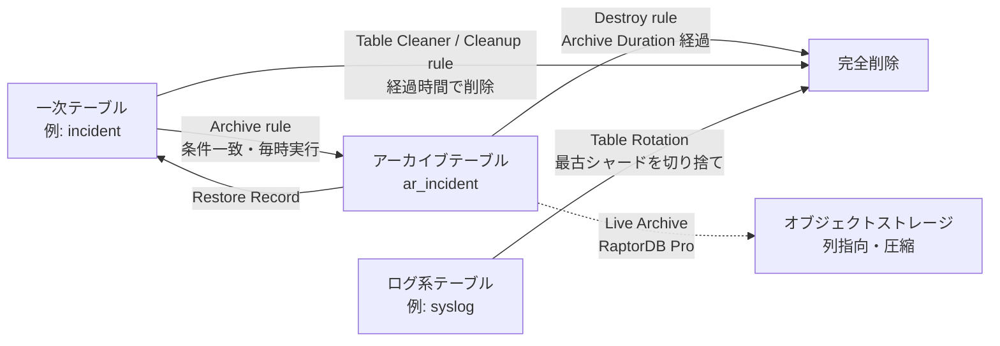
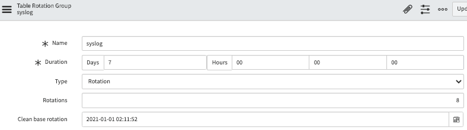
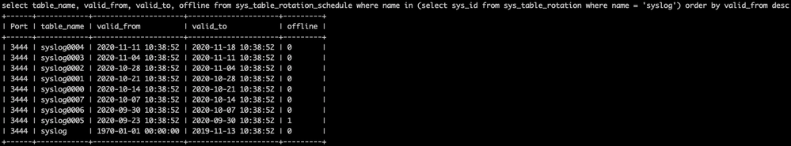
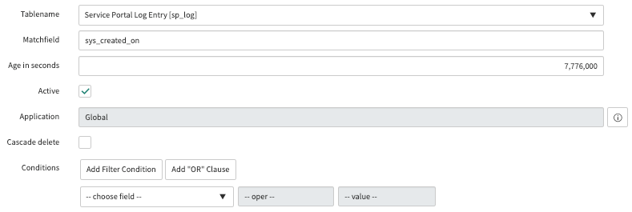
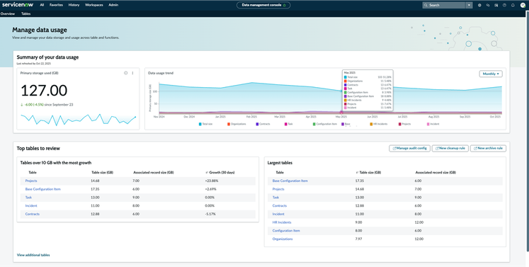
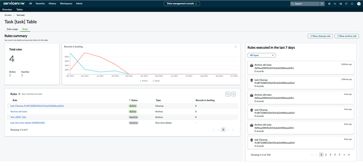
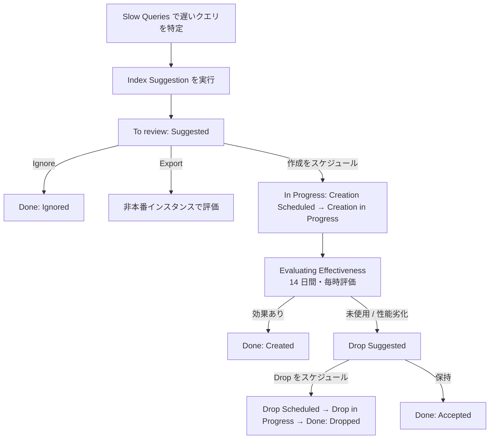

# System Administration（システム管理）

## 概要

ServiceNow インスタンスの **System Administration（システム管理）** は、`admin` ロールを持つ管理者が、インスタンス全体の動作設定・機能の有効化・ログの確認・バックグラウンド処理の管理・データ量の制御・性能監視を行う一連の機能群である。本ファイルは、Australia リリース（2026-05 GA）を基準に、次の機能をリファレンスとして整理する。

| 問い | 該当する節 |
|---|---|
| System Properties（システムプロパティ）はどこで管理し、フォームの各項目は何を意味するか | [1](#1-system-propertiesシステムプロパティ) |
| よく使われる主要プロパティとその既定値は何か | [1.5](#15-主要システムプロパティ一覧) |
| プラグインはどう有効化し、状態はどこで確認するか | [2](#2-プラグイン管理plugin-management) |
| System Log（システムログ）と Node Log File Browser（ノードログファイルブラウザー）の違いと保持期間は | [3](#3-system-logsシステムログ), [4](#4-node-logノードログ) |
| Scheduled Jobs（スケジュールジョブ）の構成テーブル、状態、監視方法は | [5](#5-scheduled-jobsスケジュールジョブ) |
| Table Rotation／Table Extension／Table Cleaner／Archive の違いは | [6](#6-データ量管理の全体像), [7](#7-table-rotation-と-table-extension), [8](#8-table-cleanerテーブルクリーナー), [9](#9-archive-と-destroyアーカイブと破棄) |
| Data Management Console（データ管理コンソール）で何ができるか（Australia の新機能を含む） | [10](#10-data-management-consoleデータ管理コンソール) |
| データ保持（Data retention）の既定値はテーブルごとにどうなっているか | [11](#11-data-retentionデータ保持の既定値一覧) |
| Instance Observer（インスタンスオブザーバー）とは何か、パッケージ差・ロールは | [12](#12-instance-observerインスタンスオブザーバー) |
| 遅いクエリの特定とインデックス作成・Index Suggestion Engine の流れは | [13](#13-パフォーマンス管理slow-queriesindexes) |
| Transaction Quota（トランザクションクォータ）の既定ルールは | [14](#14-transaction-quotaトランザクションクォータと-active-transactions) |
| Brazil で何が変わったか | [15](#15-brazil-での変更点) |

関連トピックは次のファイルを参照する。

- ノード構成・`stats.do`・RaptorDB： [instance-architecture.md](./instance-architecture.md)
- テーブル・辞書属性（Dictionary attribute）： [data-model-dictionary.md](./data-model-dictionary.md)
- ロール・`security_admin`・ロール昇格： [users-groups-roles.md](./users-groups-roles.md)、[platform-security-encryption.md](./platform-security-encryption.md)
- セッションタイムアウト等のセキュリティ系プロパティ： [authentication-sso.md](./authentication-sso.md)
- クローン除外（Clone exclusion）： [update-sets-cloning.md](./update-sets-cloning.md)
- 通知・メール関連プロパティ： [notifications-email.md](./notifications-email.md)
- パフォーマンス改善の実務知見： [../../04_応用編/03-performance-tuning.md](../../04_応用編/03-performance-tuning.md)
- 監視・サポート運用： [../../03_導入編/14-support-monitoring.md](../../03_導入編/14-support-monitoring.md)

---

## 1. System Properties（システムプロパティ）

### 1.1 System Properties の格納場所と開き方

System Properties（システムプロパティ）は、インスタンス全体の挙動（UI、セッション、メール、セキュリティ、スクリプト、データベース処理など）を制御する設定値であり、`sys_properties` テーブル（System Property）に 1 プロパティ 1 レコードで格納される。[出典](https://www.servicenow.com/docs/r/VbEA8DxUy61CFZ25mbYrcQ/otMgp3UdZkTqNnm5uEsqrQ)

| 開き方 | 内容 |
|---|---|
| フィルターナビゲーターに `sys_properties.list` を入力 | `sys_properties` テーブルの全レコード一覧を開く。既定のモジュールに表示されないプロパティもここから参照・追加できる |
| All > System Properties > 各カテゴリモジュール（例：UI Properties、Email Properties など） | プロパティカテゴリ（`sys_properties_category`）単位でまとめた設定画面。主要プロパティのみが表示される【経験則】 |
| 各アプリケーションメニュー内の Properties／Administration モジュール | 各アプリケーション（ITSM、HRSD 等）が独自のプロパティページを持つ【経験則】 |

「Available system properties」ページでは、プロパティの一部は既定では存在せず、必要に応じて `sys_properties` に追加して使うものがあると明記されている。セキュリティ関連プロパティは別文書「Instance Security Hardening Settings（インスタンスセキュリティ強化設定）」に詳細がある。[出典](https://www.servicenow.com/docs/r/UrSRFFKWBbfQBgoRlt~ltw/tZG20M4o7c0~GIjUctC8Qg)

### 1.2 System Property フォームの項目

`sys_properties` のレコード（System Property フォーム）は次の項目を持つ。[出典](https://www.servicenow.com/docs/r/VbEA8DxUy61CFZ25mbYrcQ/otMgp3UdZkTqNnm5uEsqrQ)

| 項目（英語） | 日本語 | 説明 |
|---|---|---|
| Name | 名前 | プロパティ名（例：`glide.ui.session_timeout`）。慣例としてドット区切り |
| Description | 説明 | プロパティの目的を表す短い説明 |
| Choices | 選択肢 | 選択リストとして使う値をカンマ区切りで指定。`表示ラベル=格納値` のように等号で表示ラベルと値を分けられる |
| Type | 型 | `integer`、`string`、`true|false` などのデータ型 |
| Value | 値 | プロパティ値。**値はすべて文字列として格納される** |
| Ignore cache | キャッシュ無視 | 選択すると、値変更時に `sys_properties` のキャッシュのみをフラッシュし、他のサーバーサイドキャッシュの旧値を保持する（後述） |
| Private | プライベート | `true` にすると、そのプロパティは Update Set（アップデートセット）でのインポート対象から除外される。あるインスタンスの設定値で別インスタンスの値を上書きしないための設定 |
| Read roles | 読み取りロール | プロパティを読み取れるロール |
| Write roles | 書き込みロール | プロパティを変更できるロール |

> 補足：ServiceNow SDK（ServiceNow Fluent）の Property API でも `roles.read`／`roles.write`、`ignoreCache`、`isPrivate` が同じ意味で定義されている。[出典](https://www.servicenow.com/docs/r/de-DE/application-development/servicenow-sdk/property-api-now-ts.html)

### 1.3 キャッシュの挙動と Ignore cache

`sys_properties` の値は、データベース問い合わせを避けるため各ノードのサーバーサイドキャッシュに保持される。値を変更すると、システムは常に `sys_properties` テーブルのキャッシュをフラッシュし、全ノードの整合性を保つ。Yokohama 版ドキュメントは、**Ignore cache を選択するのは、月 1 回より高頻度で値が変わり、かつ値が `sys_properties` にのみ保持されるプロパティに限るべき**と説明している。キャッシュフラッシュは全ノードに影響するため、頻繁に書き換える値をシステムプロパティで管理することは避ける。[出典](https://www.servicenow.com/docs/bundle/yokohama-platform-administration/page/administer/reference-pages/task/t_AddAPropertyUsingSysPropsList.html)

- 頻繁に変化する値（カウンター、最終実行日時など）をプロパティに書き込むスクリプトは、キャッシュフラッシュを多発させ性能劣化の原因になる。【経験則】
- スクリプトからの参照は `gs.getProperty('プロパティ名', '既定値')`、更新は `gs.setProperty()` を使う（API の詳細は [scripting-server-side.md](./scripting-server-side.md)）。

### 1.4 System Properties の追加手順

1. フィルターナビゲーターに `sys_properties.list` を入力して開く。
2. **New** を選択する。
3. Name、Description、Type、Value 等を入力し、必要に応じて Ignore cache、Private、Read roles、Write roles を設定する。
4. **Submit** を選択する。

[出典](https://www.servicenow.com/docs/r/VbEA8DxUy61CFZ25mbYrcQ/otMgp3UdZkTqNnm5uEsqrQ)

### 1.5 主要システムプロパティ一覧

以下は Australia 版「Available system properties」ページ（2026-03-12 更新）から、管理者が参照する機会の多いものを抜粋したものである。既定値はベースシステムの値で、インスタンスでカスタマイズされている場合がある。なお、同ページには「この内容は OpenAI を利用した新機能で生成された」旨の注記があり、重要な判断の前にはインスタンス上の実値を確認すること。[出典](https://www.servicenow.com/docs/r/UrSRFFKWBbfQBgoRlt~ltw/tZG20M4o7c0~GIjUctC8Qg)

#### 1.5.1 製品表示・日付時刻

| プロパティ | 既定値 | 説明 |
|---|---|---|
| `glide.product.name` | ServiceNow | ブラウザーのタイトルバー・タブに表示する文字列 |
| `glide.product.description` | Service Management | バナーのロゴ横に表示する文字列 |
| `glide.sys.date_format` | `yyyy-MM-dd` | ユーザー個別設定がない場合のシステム日付書式 |
| `glide.sys.time_format` | `HH:mm:ss` | ユーザー個別設定がない場合のシステム時刻書式 |
| `glide.sys.default.tz` | なし | ユーザー個別設定がない場合のシステムタイムゾーン（日本向けでは `Asia/Tokyo` を設定する例が多い【経験則】。詳細は [localization.md](./localization.md)） |
| `glide.ui.date_picker.first_day_of_week` | 1 | 日付ピッカーの週の開始曜日（1 = 日曜） |
| `glide.ui.filter.first_day_of_week` | 2 | チャートや計算における週の開始曜日（2 = 月曜） |

#### 1.5.2 セッション

| プロパティ | 既定値 | 説明 |
|---|---|---|
| `glide.ui.session_timeout` | 30 | 認証済みセッションの無操作タイムアウト（分） |
| `glide.ui.session_timeleft` | 2 | 無操作タイムアウト前にセッション延長を促す猶予（分） |
| `glide.ui.active.session.life_span` | 0 | 操作の有無にかかわらないセッション最大長（分）。0 は無制限 |
| `glide.ui.auto_req.extend.session` | true | ホームページの自動リフレッシュでセッションを延長できるか。false にするとタイムアウトを強制 |
| `glide.guest.session_timeout` | 30 | ゲストセッションの無操作タイムアウト（分） |
| `glide.guest.active.session.life_span` | 0 | ゲストセッションの最大長（分） |
| `glide.ui.remember.me.default` | true | ログイン画面の Remember me（ログイン状態を保持）チェックボックスを既定で選択するか |
| `glide.ui.user_cookie.life_span_in_days` | 15 | Remember me クッキーの有効期間（日、最大 30） |
| `glide.ui.user_cookie.max_life_span_in_days` | 30 | Remember me クッキー有効期間の上限（日、最大 365） |

`glide.ui.session_timeout` について、セキュリティ強化設定のドキュメントは 30 分を推奨値とし、1 日を超える値に設定しないよう求めている。また Remember me を選択したユーザーにはセッションタイムアウト系プロパティが適用されず、タイムアウトを長くするほど処理中のメモリ使用量が増える。[出典](https://www.servicenow.com/docs/r/zurich/platform-security/instance-security-hardening-settings/sc-session-activity-timeout.html)

#### 1.5.3 UI（Next Experience・フォーム・リスト）

| プロパティ | 既定値 | 説明 |
|---|---|---|
| `glide.ui.polaris.experience` | true（新規）／false（Tokyo 以前からのアップグレード） | Next Experience UI、ランディングページ、Unified Navigation を有効化 |
| `glide.ui.polaris.global_search` | true | Next Experience の検索機能 |
| `glide.ui.polaris.menus` | true | ヘッダーの Unified Navigation メニュー |
| `glide.ui.max_ref_dropdown` | 25 | 参照フィールドを選択リストとして表示する上限件数 |
| `glide.ui.dirty_form_support` | true | 未保存のままフォームを離れる際に警告 |
| `glide.ui.personalize_form` | true | Personalize Form メニューの有効化 |
| `glide.ui.personalize_form_role` | なし | Personalize Form メニューを使えるロール |
| `glide.ui.task.insert` | false | Task 派生テーブルで Insert／Insert and Stay を有効化 |
| `glide.ui.textarea.character_counter` | false | ジャーナル・複数行テキストに文字数カウンターを表示 |
| `glide.ui.html.editor` | tinymce | HTML フィールドのエディター |
| `glide.ui.audit_deleted_tables` | `sys_user`、`sys_user_group` ほか | 削除を監査履歴に記録するテーブル |
| `glide.ui.activity.email_roles` | itil | アクティビティフォーマッターでメールを閲覧できるロール |
| `glide.ui.js_error_notify` | true | クライアントスクリプトエラーを admin に表示（他ユーザーには汎用エラー） |
| `glide.ui.export.choice_list_max_characters` | 80 | Excel エクスポート時の選択肢フィールドの最大文字数 |

UI 全般の詳細は [next-experience-ui.md](./next-experience-ui.md)、[lists-forms.md](./lists-forms.md) を参照する。

#### 1.5.4 メール

| プロパティ | 既定値 | 説明 |
|---|---|---|
| `glide.email.smtp.active` | true | 送信メールサーバー（SMTP）の有効化 |
| `glide.email.read.active` | true | 受信メールサーバーの有効化 |
| `glide.email.test.user` | なし | すべての送信メールを指定のテストアドレスへ転送（サブプロダクションでの誤送信防止に使う） |
| `glide.email.smtp.max_recipients` | 100 | 通知 1 件の To 行の最大受信者数 |
| `glide.email.smtp.max_send` | 100 | 1 SMTP 接続あたりの送信件数 |
| `glide.email.journal.lines` | 3 | 通知に含めるジャーナルエントリ数（-1 で全件） |
| `glide.email.override.url` | インスタンス URL | メール内リンクの URL を置き換える |
| `glide.email.reply_subject_prefix` | `re:,aw:,r:` 等 | 返信と判定する件名プレフィックス（表記はドキュメント上の値に依存） |
| `glide.email.forward_subject_prefix` | `fw:,fwd:` | 転送と判定する件名プレフィックス |

メール全般は [notifications-email.md](./notifications-email.md) を参照する。

#### 1.5.5 セキュリティ・スクリプト

| プロパティ | 既定値 | 説明 |
|---|---|---|
| `glide.security.use_csrf_token` | true | CSRF 対策トークンでリクエストを検証 |
| `glide.security.strict_elevate_privilege` | true（新規）／false（アップグレード） | 昇格ロール（例：`security_admin`）を 1 つずつ手動で昇格させることを要求 |
| `glide.security.diag_txns_acl` | false | `stats.do`・threads・replication ページへのアクセス制限 |
| `glide.custom.ip.authenticate.allow` | なし | stats・threads・replication ページを閲覧できる IP |
| `glide.security.file.mime_type.validation` | false | 添付ファイルの MIME タイプ検証 |
| `glide.cookies.http_only` | true | HTTP-only クッキーを生成 |
| `glide.html.sanitize_all_fields` | true | 全 HTML フィールドをサニタイズ |
| `glide.script.use.sandbox` | true | クライアント生成スクリプトのサンドボックス実行 |
| `glide.script_processor.admin` | admin | Scripts - Background（バックグラウンドスクリプト）に必要なロール |
| `glide.script.log_level` | all | `gs.log` 出力の保存先（データベース、ファイルシステム、無効） |
| `glide.script.dot_walk.enforce_cross_scope_access_all_tables` | true（新規／Australia で zBoot） | 属性のないテーブルでもドットウォークのクロススコープ検査を強制 |
| `com.glide.attachment.max_size` | 1024 | 添付ファイルの最大サイズ（MB） |
| `glide.attachment.extensions` | なし | 許可する添付ファイル拡張子 |
| `glide.attachment.role` | public | 添付ファイルを作成できるロール |

セキュリティ系プロパティの網羅は [platform-security-encryption.md](./platform-security-encryption.md) と [../../04_応用編/12-security-hardening-practice.md](../../04_応用編/12-security-hardening-practice.md) を参照する。

#### 1.5.6 データベース・インポート・連携

| プロパティ | 既定値 | 説明 |
|---|---|---|
| `glide.db.max_view_records` | 10000 | スクリプトの GlideRecord クエリが返す最大レコード数（ドキュメント記載の説明による） |
| `glide.db.max.aggregate.size` | 20 | グループ化レポート・リストが描画する最大グループ数 |
| `glide.db.forced.chunk.threshold` | 100000000 | レコード削除・更新の強制チャンク化の閾値 |
| `glide.db.large.threshold` | なし | 大規模テーブル用のクエリ方式に切り替える行数 |
| `glide.db.impex.XMLLoader.max.file.size.mb` | 100 | XML インポートの最大ファイルサイズ（MB） |
| `glide.export.csv.charset` | windows-1252 | CSV エクスポートの文字コード（日本語環境では UTF-8 等への変更を検討【経験則】） |
| `com.glide.csv.loader.max_errors_allowed` | 100 | インポートで許容するスキップ行数 |
| `glide.http.outbound.max_timeout` | 30 | RESTMessageV2／SOAPMessageV2 の同期応答待ち（秒） |
| `glide.http.connection_timeout` | 10000 | アウトバウンド HTTP の接続待ち（ミリ秒） |
| `glide.businessrule.callstack` | false | Business Rule の開始・終了をログ出力 |

#### 1.5.7 Archive・Table Cleaner 関連プロパティ

Zurich 版「System properties」ページ（データ管理）に記載された、アーカイブ・破棄・テーブルクリーナーの挙動を制御するプロパティは次のとおり。[出典](https://www.servicenow.com/docs/r/7LhbZn3yz3Q58qhjZoU9iQ/5pCcrPJ_eE7LtrNWWQzXlg)

| プロパティ | 既定値 | 説明 |
|---|---|---|
| `glide.db.archive.chunk_size` | 1000 | Archive Job Execution Chunks（`sys_archive_run_chunk`）の 1 チャンクに格納するレコード ID 数 |
| `glide.db.archive.chunk.max.process.time` | 600000 | チャンクが Active 状態に留まれる最大時間（ミリ秒）。超えるとコンシューマー停止とみなし Error にする |
| `glide.db.archive.max.rule.records` | 10000 | 1 コンシューマー・1 ルールあたりのバッチ最大件数 |
| `glide.db.archive.max.batches` | 10 | コンシューマーが停止して次のコンシューマーをスケジュールするまでに処理するチャンク数 |
| `glide.db.archiving.max_consumer_workers` | 4 | クラスター全体の同時コンシューマー数の上限 |
| `glide.db.archive.debug` | false | アーカイブテーブルへの列定義コピー時の詳細ログ |
| `glide.db.tablecleaner.days_before_slow_rule_reattempt` | 2 | 遅いルール（クエリ 30 秒超）を再びジョブに含めるまでの日数 |
| `glide.db.tablecleaner.chunk_delete_max_time_spent` | 1200 | 1 ルール・1 回の実行でバッチ削除に費やす最大時間（秒、= 20 分） |

> 注記：Yokohama 版ドキュメントでは、これらのアーカイブ関連プロパティは `sys_archive_run_chunk` テーブルが存在する場合にのみ有効と記載されている。[出典](https://www.servicenow.com/docs/r/7LhbZn3yz3Q58qhjZoU9iQ/5pCcrPJ_eE7LtrNWWQzXlg)

---

## 2. プラグイン管理（Plugin management）

### 2.1 プラグインとアプリケーション

ServiceNow の機能は **Plugin（プラグイン）** または **Application（ストアアプリケーション）** として提供される。プラグインはプラットフォームに同梱されて有効化（Activate）するもの、アプリケーションは ServiceNow Store からインストールして個別にバージョン管理されるものである。製品がプラグインかアプリケーションかによって有効化の手順が異なるため、公式ドキュメントは事前に KB1438103、KB1585881 で種別を確認するよう求めている。[出典](https://www.servicenow.com/docs/r/7LhbZn3yz3Q58qhjZoU9iQ/E6lDJm6aBIsbUNlvu84hBA)

アプリケーション開発・スコープについては [app-development.md](./app-development.md) を参照する。

### 2.2 プラグインの有効化手順

必要ロールは `admin`。[出典](https://www.servicenow.com/docs/r/7LhbZn3yz3Q58qhjZoU9iQ/E6lDJm6aBIsbUNlvu84hBA)

1. 事前にプラグインが既に有効か確認する（KB0678767）。
2. **All > System Applications > All Available Applications > All** に移動する（この画面は Application Manager（アプリケーションマネージャー）とも呼ばれる）。
3. フィルター条件・検索バーでプラグイン名または ID（例：`com.glide.index_suggestion`）を検索する。表示されない場合は、ServiceNow 担当者への依頼が必要なプラグインである。
4. **Install** を選択する。
   - Domain Separation（ドメインセパレーション）と Delegated admin（委任管理）が有効な場合、管理者ユーザーは global ドメインに属している必要がある。そうでないと「Application installation is unavailable」エラーになる（[domain-separation.md](./domain-separation.md)）。
5. 完了メッセージが表示される。プラグインとともにインストールされたコンポーネントは Application Files（アプリケーションファイル）テーブルに一覧される。

一覧に表示されず自己有効化できないプラグインは、Now Support（旧 HI）の Service Catalog > Activate Plugin から依頼する運用が一般的である。【第三者情報】[出典](https://www.servicenow.com/community/itsm-articles/plugin-with-new-features-in-vancouver-release/ta-p/2654171)

### 2.3 プラグイン関連テーブル

| テーブル | 内容 | 出典の種類 |
|---|---|---|
| `v_plugin` | Plugins モジュールの裏側にある（仮想）テーブル。プラグインの状態確認に使う | 公式 |
| `sys_plugin_log` | プラグイン有効化時のログ。スキップされたレコード（skipped）とロードされたレコード（loaded）を確認する | 公式 |
| `sys_plugins` | インスタンスで有効なプラグインの一覧（既定有効、セルフサービス、ServiceNow 担当者による有効化のいずれも含む）。`sys_plugins.list` で開く | 【第三者情報】 |
| `sys_store_app` | ストアアプリケーション（System Log の Source Package 列からも参照される） | 公式 |

[出典](https://www.servicenow.com/docs/r/7LhbZn3yz3Q58qhjZoU9iQ/E6lDJm6aBIsbUNlvu84hBA)、[出典（sys_plugins）](https://www.servicenow.com/community/itsm-articles/plugin-with-new-features-in-vancouver-release/ta-p/2654171)、[出典（sys_store_app）](https://www.servicenow.com/docs/r/platform-security/r_SystemLogs.html)

### 2.4 有効化トラブルシューティング

公式ドキュメントのトラブルシューティング手順は次のとおり。[出典](https://www.servicenow.com/docs/r/7LhbZn3yz3Q58qhjZoU9iQ/E6lDJm6aBIsbUNlvu84hBA)

1. 事象の詳細を把握する。
2. Plugins モジュール（`v_plugin`）でプラグインの状態を確認する。
3. `sys_plugin_log` テーブルでスキップされたレコードを確認する。
4. 各レコードの状態（skipped／loaded）を、対象テーブルを sys_id で検索して確認する。大半は loaded であるべき。
5. 追加の支援は KB0691461 を参照する。

### 2.5 運用上の注意

- プラグインの多くは一度有効化すると無効化（Deactivate）できない。本番で有効化する前に、サブプロダクションで有効化と影響確認を行う。【経験則】
- プラグインの有効化は Update Set に記録されないため、各インスタンスで個別に有効化する必要がある（[update-sets-cloning.md](./update-sets-cloning.md)）。【経験則】
- 有効化時に「Load demo data（デモデータをロード）」の選択肢が出るプラグインがあるが、本番ではデモデータを入れないのが通例である。【経験則】
- ライセンス対象のプラグインを有効化すると、利用状況（Subscription Management）の対象になる場合がある。詳細は [platform-licensing-packaging.md](./platform-licensing-packaging.md) を参照する。

---

## 3. System Logs（システムログ）

### 3.1 System Logs モジュールの構成

**System Logs** アプリケーションメニューは、インスタンス内のトランザクションとイベントのトラブルシューティング用ログを集めたもので、Brazil 版ドキュメントでは次のログが挙げられている。[出典](https://www.servicenow.com/docs/r/platform-security/system-logs.html)

| ログ（英語） | 日本語 | 内容 | 主なテーブル |
|---|---|---|---|
| Transactions | トランザクション | インスタンス上の全アプリケーションアクティビティ。アプリケーションスコープで絞り込める | `syslog_transaction` |
| Email and Push | メールとプッシュ | 送信されたメール通知とプッシュメッセージ。システムメールボックスはこのログのフィルタービュー | `sys_email` |
| Event Logs | イベントログ | システム内で発生したイベント | `sysevent` |
| Import | インポート | データインポートの詳細記録 | `sys_import_set_run` 等 |
| Table Changes | テーブル変更 | 全テーブルへの変更 | `sys_update_xml`（Customer Updates） |
| Outbound web services logging | アウトバウンド Web サービスログ | アウトバウンド REST／SOAP 要求 | `sys_outbound_http_log` |
| Signature Images | 署名画像 | HR 署名パッドで取得した電子署名 | — |
| System | システム | インスタンスの処理・レコード・重要度の低いイベント（サーバーメモリ使用量など）の警告とエラー | `syslog` |

> 注記：上表の「主なテーブル」列のうち、`sys_update_xml` 以外はドキュメント本文では明記されていない。`syslog`・`syslog_transaction` はコミュニティ記事およびテスト関連の公式ページで言及されている名称、`sysevent`・`sys_email`・`sys_outbound_http_log`・`sys_import_set_run` は一般に知られたテーブル名である。【第三者情報】[出典（syslog_transaction）](https://www.servicenow.com/docs/r/gYIDIjNk3lw4nrlmxJtwPg/ceaaa_TkwUluhOxtv3s4AA)、[出典（テーブルローテーション）](https://www.servicenow.com/community/now-platform-articles/demystifying-table-rotation-extension-and-table-cleaner/ta-p/2323658)

### 3.2 System Log（`syslog`）の項目と重要度

System Log のエントリは次の項目を持つ。[出典](https://www.servicenow.com/docs/r/platform-security/r_SystemLogs.html)

| 項目 | 説明 |
|---|---|
| Created | 作成日時（インスタンスを実行するマシンのロケール） |
| Level | 重要度 |
| Message | システムが生成した事象の説明 |
| Source | 影響を受けたプロセスや領域（例：EMAIL、Memory） |
| Source Package | 関連するアプリケーションパッケージ。選択すると `sys_store_app` レコードを開く |

| Level | 意味 |
|---|---|
| Debug | 開発・トラブルシューティング用の詳細診断情報 |
| Information | 操作が期待どおり完了したことの確認 |
| Warning | 想定外の状況が発生したが、操作自体は成功した（処理されて回復したエラー） |
| Error | 操作が失敗または完了できなかった。ドキュメントは「Error メッセージは頻繁に出力され、大半はプラットフォーム由来であり、必ずしも問題を示すわけではない」と注記している |

System Log が追跡する情報の範囲は、Workflow（アクティビティごとの開始・終了時刻、状態、結果、遷移履歴）、構成変更（操作種別、XML 差分、Update Set、ユーザー、テーブルなど）、チャットセッション、ページトランザクション（ネットワーク・サーバー・ブラウザーの各ロード時間）、受信／送信メール、システムイベント、インポートと連携、警告・エラー・スクリプトログ、アップグレード活動（プラグイン有効化、Update Set、システムアップグレード）である。[出典](https://www.servicenow.com/docs/r/GypxAX2jEErwkCxugICKdg/3fCDYRoPrGilUO7f7_3rdQ)

### 3.3 System Log の表示範囲

System Log（`syslog` のリスト表示）は**当日分のエントリのみ**を表示する。前日以前のログファイルは Node Log File Browser（[4 章](#4-node-logノードログ)）で参照する。[出典](https://www.servicenow.com/docs/r/platform-security/r_SystemLogs.html)

`syslog` テーブルと `syslog_transaction` テーブルはいずれも Table Rotation（[7 章](#7-table-rotation-と-table-extension)）の対象で、古いデータは週単位のシャード（Shard）ごとに切り捨てられる。コミュニティ記事では、`syslog` の既定は Rotation 型・期間 7 日・ローテーション数 8 と説明されている。【第三者情報】[出典](https://www.servicenow.com/community/now-platform-articles/demystifying-table-rotation-extension-and-table-cleaner/ta-p/2323658)

### 3.4 Transaction ログと Show Syslog Records

- Transaction Log Entry（`syslog_transaction`）は、ページ・REST・スケジューラーなどのトランザクションごとに URL、ユーザー、応答時間などを記録する。応答本文や HTTP ステータスは記録されない。【第三者情報】[出典](https://www.servicenow.com/community/developer-forum/where-can-i-find-the-rest-api-response-for-a-transaction-log/m-p/3388894)
- Transaction および Active Transaction のフォームにある **Show Syslog Records** ボタンは、そのトランザクションに紐づく `syslog` エントリを検索する URL を生成する。[出典](https://www.servicenow.com/docs/r/platform-security/r_LogUtilities.html)
- ATF（Automated Test Framework）のテスト結果からも `syslog_transaction` の関連レコードを辿れる（[automated-test-framework.md](./automated-test-framework.md)）。[出典](https://www.servicenow.com/docs/r/gYIDIjNk3lw4nrlmxJtwPg/ceaaa_TkwUluhOxtv3s4AA)

### 3.5 ログ出力に関する注意

- スクリプトからの大量ログ出力（`gs.log`、`gs.info` 等）は `syslog` の肥大化と性能劣化を招く。本番ではデバッグログを残さない。【経験則】
- `glide.script.log_level` でスクリプトログの保存先を制御できる（[1.5.5](#155-セキュリティスクリプト)）。

---

## 4. Node Log（ノードログ）

### 4.1 Node Log File Browser

**Node Log File Browser（ノードログファイルブラウザー）** は、アプリケーションノード上のログファイル（`localhost_log` 形式のテキストログ）を検索・表示するユーティリティで、**All > System Logs > Utilities > Node Log File Browser** にある。System Log が当日分のみ表示するのに対し、Node Log File Browser では過去のログファイルも参照できる。[出典](https://www.servicenow.com/docs/r/platform-security/r_LogUtilities.html)

| フィルター項目 | 説明 |
|---|---|
| Start time | 検索範囲の開始（インスタンスを実行するマシンのロケール） |
| End time | 検索範囲の終了 |
| Session ID | ログを生成したセッションを識別する 16 進文字列 |
| Message | 事象の説明（文字列検索） |
| Level | Debug、Error、Warning、Information |
| Thread name | ログを生成したスレッドの識別子 |
| Max rows | 返す最大行数 |

### 4.2 Node Log File Download

**All > System Logs > Utilities > Node Log File Download** では、ログアーカイブを一覧から選び、Related Links の **Download log** で取得できる。[出典](https://www.servicenow.com/docs/r/platform-security/r_LogUtilities.html)

### 4.3 ノードログの保持期間と制約

| 項目 | 内容 |
|---|---|
| アーカイブ作成 | 2 日ごとにシステムログの圧縮アーカイブを作成 |
| 保持期間 | アーカイブは 21 日後に削除 |
| ノード退役時 | 退役（retire）したノードのログファイルは 21 日を待たず即時削除 |
| 参照範囲 | **ログインしているノードのログのみ**参照できる。現在のノードは System Diagnostics > Stats（`stats.do`）で確認する |

[出典](https://www.servicenow.com/docs/r/platform-security/r_LogUtilities.html)

インスタンスは複数のアプリケーションノードで構成されるため、特定ノードのログを見るには当該ノードのセッションに入る必要がある。ノード構成は [instance-architecture.md](./instance-architecture.md) を参照する。21 日を超えるログ保管や全ノード横断の検索が必要な場合は、ServiceNow サポートへの依頼または外部ログ基盤への転送を検討する。【経験則】

---

## 5. Scheduled Jobs（スケジュールジョブ）

### 5.1 Scheduled Jobs の概要とテーブル構成

**Scheduled Jobs（スケジュールジョブ）** は、指定日時または繰り返しで自動実行される処理である。レポートの自動生成・配信、テンプレートからのレコード（インシデント、変更、CI など）の定期生成、スクリプトの定期実行、月末・平日などの特殊スケジュールに用いる。ジョブ定義は `sysauto`（Scheduled Job）テーブルに作成され、個々の実行予定は Schedule Item（スケジュール項目）として System Scheduler から参照できる。[出典](https://www.servicenow.com/docs/r/EqTdsLocR0Ylm0TDB1E9xw/N7nwQ6GY_TjaC5pWtyKVoQ)

| テーブル | 役割 | 出典の種類 |
|---|---|---|
| `sysauto` | スケジュールジョブ定義の親テーブル | 公式 |
| `sysauto_script` | Scheduled Script Execution（スクリプト実行型ジョブ）。ServiceNow Fluent の Scheduled Script API の格納先 | 公式（SDK ドキュメント） |
| `sysauto_report` | Scheduled Report（スケジュールレポート） | 【第三者情報】 |
| `sys_trigger` | 実際の実行トリガー（Schedule Item）。Next Action（次回実行）、State、System ID（実行ノード）、Priority などを持つ。システム内部のジョブもここに登録される | 公式（ダッシュボード文書）・【第三者情報】 |
| `sys_scheduler_job_history` | ジョブ実行履歴（Scheduled Jobs Dashboard のグラフのデータ源、最大 7 日分） | 公式 |

[出典（Fluent）](https://www.servicenow.com/docs/r/pt-BR/application-development/servicenow-sdk/fluent-scheduled-script-api.html)、[出典（ダッシュボード）](https://www.servicenow.com/docs/r/eh2NFokZCOdK5kPblQPzog/McvY7J8Nu3djteQzKsBaKg)、[出典（sys_trigger）](https://www.servicenow.com/community/in-other-news/scheduled-jobs-set-adrift/ba-p/2294301)

各ノードのスケジューラーマネージャースレッドは、`sys_trigger` から Next Run（Next Action）を過ぎて Ready 状態のジョブを探し、スケジューラーキューへ移す。キュー上のジョブは各ノードのスケジューラーワーカー（Scheduler worker）が実行する。【第三者情報】[出典](https://www.servicenow.com/community/in-other-news/scheduled-jobs-set-adrift/ba-p/2294301)

### 5.2 ジョブの状態

| State | 意味 |
|---|---|
| Ready | 次回の予定時刻に実行できる状態 |
| Running | 実行中 |
| Queued | スケジューラーキューに投入され、実行待ち |
| Error | 実行中にエラーが発生 |
| Permanent Error | 永続エラー。Utah より前のバージョンからのアップグレード時に、存在しないノードに紐づく親／単独ジョブへ fix script が設定する。管理者が手動で設定することもできる（Scheduled Jobs Dashboard で確認） |

[出典](https://www.servicenow.com/docs/r/EqTdsLocR0Ylm0TDB1E9xw/N7nwQ6GY_TjaC5pWtyKVoQ)、[出典（Permanent Error）](https://www.servicenow.com/docs/r/eh2NFokZCOdK5kPblQPzog/McvY7J8Nu3djteQzKsBaKg)

> 注記：コミュニティでは、エラーになった繰り返しジョブは再スケジュールされるため、Error 状態のまま残らないことが多いと説明されている。【第三者情報】[出典](https://www.servicenow.com/community/itsm-forum/scheduled-job-sys-trigger-behaviour/m-p/471969)

### 5.3 スクリプト実行ジョブの作成手順

必要ロールは `admin`。Brazil 版ドキュメントの手順は次のとおり。[出典](https://www.servicenow.com/docs/r/platform-administration/time-configuration/t_ScheduleAScriptExecution.html)

1. **All > System Definition > Scheduled Jobs** に移動する。
2. **New** を選択する。
3. 「Automatically run a script of your choosing（任意のスクリプトを自動実行）」を選択する。
4. フォームに入力する（下表）。
5. Domain Separation がインストールされている場合はドメイン項目を入力する。
6. **Update** で保存、**Execute Now** で即時実行、**Delete** で削除する。

| 項目（英語） | 説明 |
|---|---|
| Name | ジョブ名 |
| Active | 予定日時に実行するか |
| Application | スクリプトを含むアプリケーション（Global はグローバルスコープ） |
| Conditional | 条件スクリプトで実行可否を判定する |
| Condition | Conditional 選択時のみ表示。最後の式が true／false に評価される必要がある。スケジュールレポートメールと Performance Analytics データ収集ジョブの条件はサンドボックスで実行されるため関数定義等が使えず、アップグレード後に許可されない API を含むジョブはエラー終了する |
| Run | 実行頻度。Daily、Day and Month in Year、Day in Week in Month in Year、Week in Month、Weekly、Monthly、Periodically、Once、On Demand、Business Calendar: Entry Start／Entry End |
| Day | Weekly では曜日、Monthly では日付 |
| Repeat Interval | Periodically の繰り返し間隔（日・時・分）。夏時間の切り替えは考慮されない |
| Time zone | -None-（ユーザーのタイムゾーン）、Use System Time Zone（インスタンス既定）、個別指定 |
| Time | 実行時刻（24 時間表記。UTC で保存） |
| Advanced | Starting／Ending（実行期間）を有効化 |
| Starting／Ending | ジョブの開始・終了期間 |
| Business Calendar | Business Calendar 系の Run で使うカレンダー。将来のスパンが 1 つもないとジョブは実行されない |
| Run as | 実行ユーザー（任意。フォームへの追加が必要な場合がある） |
| Run this script | 実行するスクリプト（Script Include の呼び出し等） |
| Priority | 必須ジョブは 100 未満、非必須ジョブは 100 超。スケジュールジョブの 70% 以上が Overdue のとき、Priority 100 超のジョブは実行されない |

Domain Separation 環境では Domain iterator（ドメインイテレーター）、Domain source table、Domain source filter が追加され、複数ドメインに対してジョブを反復実行できる（Domain Support - Domain Extensions Installer プラグイン）。[出典](https://www.servicenow.com/docs/r/platform-administration/time-configuration/t_ScheduleAScriptExecution.html)

Priority と Overdue の挙動は Zurich 版の Scheduled Script Execution フォーム説明に記載されている。[出典](https://www.servicenow.com/docs/r/cVzHwL~N5hQ70Ca9r7fiZg/dIJ5YXYifg_dZ2dhcmpsPw)

> 注記：Run の選択肢のうち Day and Month in Year、Day in Week in Month in Year、Week in Month は Brazil 版ドキュメントに記載されており、Zurich 版の同種フォーム説明には見当たらない。導入リリースは公開情報では確認できず。これらの Run を使うには Day・Month・Year 項目がフォームに表示されている必要がある。

### 5.4 2 つの「Scheduled Jobs」モジュール

| メニュー | 開くテーブル | 用途 |
|---|---|---|
| All > System Definition > Scheduled Jobs | `sysauto`（定義） | ジョブ定義の作成・編集 |
| All > System Scheduler > Scheduled Jobs | `sys_trigger`（実行トリガー）と考えられる | 実行予定・状態・実行ノードの確認、Next Action の変更。アーカイブジョブの実行間隔の変更もここで行う（[9.4](#94-アーカイブの実行スケジュール)） |

System Scheduler 側のテーブル名は公式ページで明示されていないが、コミュニティでは `sys_trigger` とされる。【第三者情報】[出典](https://www.servicenow.com/docs/r/7LhbZn3yz3Q58qhjZoU9iQ/YxBUI6EDABFZ3lhbr8Hg6A)、[出典](https://www.servicenow.com/community/in-other-news/scheduled-jobs-set-adrift/ba-p/2294301)

### 5.5 Scheduled Jobs Dashboard

**All > System Diagnostics > Scheduled Jobs Dashboard**（System Events and Jobs Dashboard の Scheduled Jobs タブ）は、スケジュールジョブ処理の監視画面である。[出典](https://www.servicenow.com/docs/r/eh2NFokZCOdK5kPblQPzog/McvY7J8Nu3djteQzKsBaKg)

| タイル | 内容 | 対処 |
|---|---|---|
| Stuck Jobs | 存在しないノードに割り当てられたジョブ（Trigger type が Start 以外の親ジョブ）。System ID 列に存在しないノードが表示される。主因はクローンで、クローン元インスタンスのノードを指したまま残る | `sys_trigger` から削除するか、System ID を空にして Next Action に基づき実行させる |
| Permanent Error Jobs | Permanent Error 状態のジョブ | 削除するか Ready に戻す |
| Pending Jobs | まもなく実行予定のジョブ | — |
| Running Jobs | 実行中のジョブ | — |
| Job Classification | フィルター条件でジョブを分類し完了履歴を追跡（Job Classification Rules テーブルで設定、既定は `TriggerType.JobName`） | — |
| Total Number of Executions | 実行回数グラフ（既定は直近 24 時間、最大 7 日分、データ源 `sys_scheduler_job_history`） | バーを選択すると履歴リストを開く |
| Average Job Wait Time | 平均待ち時間（ミリ秒）。Next Action が過去なら「現在時刻 − Next Action」、未来なら 0 | — |
| Scheduled Job Trends | 分類別の完了ジョブ一覧（Priority、Execution Count、Average／Total Processing Time） | — |

Priority は数値が小さいほど優先度が高い（10 は 100 より高優先）。[出典](https://www.servicenow.com/docs/r/eh2NFokZCOdK5kPblQPzog/McvY7J8Nu3djteQzKsBaKg)

Australia では Instance Observer に **Long Pending Jobs** アラートカードが追加され、遅延閾値を超えたジョブを通知できるようになった（[12.5](#125-リリースごとの主な機能追加)）。

### 5.6 運用上の注意

- `Run as` を個人ユーザーにすると、そのユーザーの退職・無効化でジョブが失敗する。システム用ユーザーを指定する。【経験則】
- 業務時間帯に重いジョブを集中させない。スケジューラーワーカーはノードごとに有限で、待ち時間（Average Job Wait Time）の増加はワーカー枯渇の兆候である。【経験則】
- クローン後は Stuck Jobs を確認する（[update-sets-cloning.md](./update-sets-cloning.md)）。[出典](https://www.servicenow.com/docs/r/eh2NFokZCOdK5kPblQPzog/McvY7J8Nu3djteQzKsBaKg)

---

## 6. データ量管理の全体像

ServiceNow はテーブルの肥大化を抑えるため、性質の異なる複数の仕組みを提供している。いずれもデータの**削除または移動**を伴うため、データ保持要件（法令・監査・社内規程）と照らして設計する。

| 仕組み | 対象 | 動作 | 設定テーブル／場所 | 主な用途 |
|---|---|---|---|---|
| Table Rotation（テーブルローテーション） | ログ系の大量テーブル | 日付で N 個の物理テーブルに分割し、最古のシャードを切り捨てて再利用 | `sys_table_rotation`、`sys_table_rotation_schedule` | `syslog` 等のログ |
| Table Extension（テーブル拡張） | 長期保持が必要な大量テーブル | 日付でシャードを追加し続け、削除しない | `sys_table_rotation`（Type = Extension） | 大量データを長期保持しつつ検索範囲を絞る |
| Table Cleaner（テーブルクリーナー） | 任意のテーブル | 条件と経過時間で定期削除 | `sys_auto_flush` | 一時データ・ログ系の定期削除 |
| Cleanup rule／One-time delete rule | 任意のテーブル | Data Management Console から定期削除／一回限りの削除 | Data Management Console（Australia で wizard 追加） | 新しい UI による削除管理 |
| Archive rule（アーカイブルール） | Task 等のコアテーブル、カスタムテーブル | `ar_` 接頭辞のアーカイブテーブルへ移動 | System Archiving、Data Management Policies | 業務データの長期保管と一次テーブルの軽量化 |
| Destroy rule（破棄ルール） | アーカイブテーブル | アーカイブ後一定期間経過で完全削除 | アーカイブルールの Destroy Rule タブ | 保持期間満了後の削除 |
| Live Archive | アーカイブテーブル | アーカイブデータをオブジェクトストレージに列指向形式で格納 | Live Archive プラグイン（RaptorDB Professional、別サブスクリプション） | 一次ストレージの削減 |

[出典（Data archiving）](https://www.servicenow.com/docs/r/washingtondc/platform-administration/c_ArchiveData.html)、[出典（Table rotation）](https://www.servicenow.com/docs/r/platform-administration/c_TableRotation.html)、[出典（Table cleaner）](https://www.servicenow.com/docs/r/UrSRFFKWBbfQBgoRlt~ltw/aXBkq7youOkFPAnd2FaQ8w)、[出典（Australia の新機能）](https://www.servicenow.com/docs/r/Cz0Un5C85RB3j2nhhAK1aQ/u89VyA9KvX3zGhTsJrqhhw)

> 注記：System Archive（標準アーカイブ）は一次ストレージを削減せず、別階層へ移すものでもない。一次ストレージ削減を行うのは Live Archive である。[出典](https://www.servicenow.com/docs/r/washingtondc/platform-administration/c_ArchiveData.html)

---

## 7. Table Rotation と Table Extension

### 7.1 Table Rotation の仕組み

**Table Rotation（テーブルローテーション）** は、`sys_created_on`（作成日時）フィールドに基づいてデータを日付ごとに複数の物理テーブルに分ける仕組みである。管理者は期間（Duration）とローテーション数（Rotations）を定義し、最後のテーブルへの書き込みが終わると最初のテーブルが上書き（切り捨て）される。[出典](https://www.servicenow.com/docs/r/platform-administration/c_TableRotation.html)

Table Rotation の利点は次のとおり。[出典](https://www.servicenow.com/docs/r/platform-administration/c_TableRotation.html)

- 古いデータを、テーブルの DROP／TRUNCATE によって現行データに影響を与えずに削除できる。
- 各テーブルを扱いやすいサイズに保てる。
- 日付範囲が既知のクエリは小さなデータセットだけを対象にできる。

### 7.2 Table Rotation の制約

| 制約 | 内容 |
|---|---|
| 対象外テーブル | `sys_import` 系テーブル、および Task（`task`）を継承するテーブルには使えない |
| カスタムテーブル | カスタムテーブルに適用する前に ServiceNow テクニカルサポートに相談する |
| ドットウォーク | ローテーションされたテーブルへはドットウォークできない |
| クエリ性能 | ローテーション日付フィールドで絞り込まないクエリは全サブテーブルの UNION になり、サブテーブルが多いと非常に遅くなる。作成日時の範囲を条件に含める |
| Table Cleaner | ローテーション設定済みテーブルでは Table Cleaner ルールはサポートされない |

[出典](https://www.servicenow.com/docs/r/platform-administration/c_TableRotation.html)、[出典（Table Cleaner）](https://www.servicenow.com/docs/r/UrSRFFKWBbfQBgoRlt~ltw/aXBkq7youOkFPAnd2FaQ8w)

### 7.3 設定テーブルとシャード

| テーブル | 内容 |
|---|---|
| `sys_table_rotation`（Table Rotation Group） | 対象テーブル 1 つにつき 1 レコード。Name、Duration（日・時・分・秒）、Type（Rotation／Extension）、Rotations（シャード数）、Clean base rotation などの項目を持つ。メニューは System Definition > Table Rotations |
| `sys_table_rotation_schedule` | ローテーションを構成する物理テーブル（シャード）の一覧。`valid_from`／`valid_to`（書き込み対象となる期間）、`offline`（true のシャードは UI から照会不可）を持つ |

- シャードは `syslog0000`〜`syslog0007` のように「ベーステーブル名 + 4 桁番号」で命名される。ベーステーブル（例：`syslog`）は通常データを持たず、構造のテンプレートとして機能する。
- Synchronize shards（シャードの同期）UI アクションで、ベーステーブルの構造変更を全シャードに反映する。
- シャードが切り替わると、最も古いオフラインシャードが切り捨てられ、`valid_from`／`valid_to` が 1 期間先に再設定される。

【第三者情報】（ServiceNow テクニカルサポートによるコミュニティ記事）[出典](https://www.servicenow.com/community/now-platform-articles/demystifying-table-rotation-extension-and-table-cleaner/ta-p/2323658)

- **キャプション:** `sys_table_rotation` の `syslog` レコード（Table Rotation Group フォーム、Core UI）。
- **画面の説明:** フォーム上部に「Table Rotation Group / syslog」と表示される。項目は上から Name（`syslog`、必須）、Duration（Days 7、Hours 00、分・秒 00、必須）、Type（選択リストで Rotation）、Rotations（8）、Clean base rotation（日時）。この設定は「7 日ごとにシャードを切り替え、8 シャードで循環する」ことを示し、ベーステーブルを含め 9 個の物理テーブルになる。スクリーンショットは 2020 年時点のもので、現行リリースでは UI の外観が異なる可能性がある。
- **出典:** https://www.servicenow.com/community/now-platform-articles/demystifying-table-rotation-extension-and-table-cleaner/ta-p/2323658 （取得日: 2026-11-03）

- **キャプション:** `sys_table_rotation_schedule` を SQL で照会した結果（`syslog` のシャード一覧）。
- **画面の説明:** `select table_name, valid_from, valid_to, offline from sys_table_rotation_schedule where name in (select sys_id from sys_table_rotation where name = 'syslog') order by valid_from desc` の実行結果で、`syslog0004`（最新、2020-11-11〜11-18）から `syslog0005`（最古、2020-09-23〜09-30、offline = 1）まで 7 日刻みのシャードが並び、最下行にベーステーブル `syslog`（1970-01-01〜）がある。最古シャードのみ offline になっており、次の切り替えで切り捨てられる対象であることが分かる。データベースへの直接アクセスは顧客には提供されないため、これはサポート担当者の視点の画面である。
- **出典:** https://www.servicenow.com/community/now-platform-articles/demystifying-table-rotation-extension-and-table-cleaner/ta-p/2323658 （取得日: 2026-11-03）

### 7.4 Table Extension

**Table Extension（テーブル拡張）** は `sys_table_rotation` の Type を Extension にした構成で、日付ごとにシャードを追加し続け、切り捨てを行わない（データは削除されない）。公式の Table rotation ページでは「より長期間データを保持する関連概念」としてのみ触れられている。[出典](https://www.servicenow.com/docs/r/platform-administration/c_TableRotation.html)

コミュニティ記事では次の点が説明されている。【第三者情報】[出典](https://www.servicenow.com/community/now-platform-articles/demystifying-table-rotation-extension-and-table-cleaner/ta-p/2323658)

- `sys_audit` を Extension 化している顧客インスタンスは多いが、ベースシステムでは Extension になっておらず、ServiceNow は一般には推奨していない。
- `sys_email` は Extension 構成であり、メールの保持は Table Cleaner ではなく Email Retention の Archive／Destroy ルールで行う（[11.2](#112-email-retentionメール保持)）。

Auto Flush（Table Cleaner）ルールは、Xanadu Patch 5 以降、Extension テーブルと Shard テーブルでもサポートされる。ただし `GlideTableCleaner` スクリプタブル API は Extension テーブルをサポートしない。[出典](https://www.servicenow.com/docs/r/UrSRFFKWBbfQBgoRlt~ltw/aXBkq7youOkFPAnd2FaQ8w)

---

## 8. Table Cleaner（テーブルクリーナー）

### 8.1 Table Cleaner の仕組み

**Table Cleaner（テーブルクリーナー）** は、古い・期限切れ・不要なレコードを自動削除してテーブルの増大を抑えるスケジュールジョブである。ルールは **Auto Flush（`sys_auto_flush`）** テーブルに格納され、フィルターナビゲーターに `sys_auto_flush.list` と入力して一覧できる。Task のようなコアテーブルにもカスタムテーブルにも適用できる。[出典](https://www.servicenow.com/docs/r/UrSRFFKWBbfQBgoRlt~ltw/aXBkq7youOkFPAnd2FaQ8w)

Australia 版のドキュメントタイトルは「Deleting older or unwanted records in Data Management Console」であり、Table Cleaner ルールは Data Management Console の Cleanup rule（[10.3](#103-data-management-rules-wizardaustralia)）と同じ削除基盤として位置づけられている。テーブルに Archive ルールまたは Cleaner ルールがあると、そのテーブルの **Data Management Policy（データ管理ポリシー）** レコードが自動作成され、ポリシーから当該テーブルのルールを確認できる。[出典](https://www.servicenow.com/docs/r/UrSRFFKWBbfQBgoRlt~ltw/aXBkq7youOkFPAnd2FaQ8w)

### 8.2 `sys_auto_flush` の主な項目

| 項目（英語） | 説明 |
|---|---|
| Tablename | 対象テーブル |
| Matchfield | 経過時間の判定に使う日付／日時フィールド。既定は `sys_created_on` |
| Age in seconds | 削除対象とする経過秒数（例：90 日 = 7,776,000 秒） |
| Active | ルールの有効化 |
| Conditions | 削除対象を絞り込む条件 |
| Cascade delete | 削除するレコードを参照するレコードも削除するか |
| Clean audit／Clean peripheral | 関連する監査レコード、および添付ファイル・ジャーナル等の周辺レコードも削除するか |

[出典](https://www.servicenow.com/docs/r/UrSRFFKWBbfQBgoRlt~ltw/aXBkq7youOkFPAnd2FaQ8w)、[出典（項目）](https://www.servicenow.com/community/now-platform-articles/demystifying-table-rotation-extension-and-table-cleaner/ta-p/2323658)

- **キャプション:** ベースシステムの Table Cleaner ルール例（`sp_log`）。
- **画面の説明:** `sys_auto_flush` のフォームで、Tablename に「Service Portal Log Entry [sp_log]」、Matchfield に `sys_created_on`、Age in seconds に 7,776,000（= 90 日）、Active にチェック、Application は Global、Cascade delete は未チェック、Conditions は未設定（Add Filter Condition／Add "OR" Clause ボタンのみ）である。つまり「Service Portal のログを作成から 90 日経過したら条件なしで削除する」ルールを表す。スクリーンショットは 2020 年時点の Core UI。
- **出典:** https://www.servicenow.com/community/now-platform-articles/demystifying-table-rotation-extension-and-table-cleaner/ta-p/2323658 （取得日: 2026-11-03）

### 8.3 実行仕様と制限

| 項目 | 仕様 |
|---|---|
| 実行頻度 | Table Cleaner のスケジュールジョブは既定で 1 時間に 1 回実行 |
| 遅いルール | 1 ルールのクエリが 30 秒を超えると**ジョブ全体が停止**する。そのルールは既定で 2 日間ジョブから除外される（`glide.db.tablecleaner.days_before_slow_rule_reattempt`） |
| 1 テーブルの削除時間上限 | 既定 20 分（`glide.db.tablecleaner.chunk_delete_max_time_spent` = 1200 秒） |
| 性能要因 | テーブルサイズ、ルール条件、インデックスに依存。大規模テーブルでインデックスのないカスタム列を条件にすると著しく劣化する |
| ビジネスロジック | Table Cleaner は `DBDelete.setWorkflow()` を呼ばないため、削除時に Business Rule、Workflow、Flow は**起動しない** |
| Table Rotation | ローテーション設定済みテーブルではサポートされない |
| Extension／Shard | Xanadu Patch 5 以降サポート（`GlideTableCleaner` API は Extension 非対応） |
| 無効化 | テーブルの辞書レコードに **Disable Table Cleaner** 属性を追加すると、そのテーブルでクリーンアップルールの作成と Table Cleaner の実行をブロックできる。一部の内部システムテーブルは既定でこの属性を持つ |

[出典](https://www.servicenow.com/docs/r/UrSRFFKWBbfQBgoRlt~ltw/aXBkq7youOkFPAnd2FaQ8w)、[出典（プロパティ）](https://www.servicenow.com/docs/r/7LhbZn3yz3Q58qhjZoU9iQ/5pCcrPJ_eE7LtrNWWQzXlg)

コミュニティ記事では、さらに次の点が説明されている。【第三者情報】[出典](https://www.servicenow.com/community/now-platform-articles/demystifying-table-rotation-extension-and-table-cleaner/ta-p/2323658)

- Matchfield の列にインデックスが必要。
- 削除で行の 50% 超が消えるとテーブルのコンパクション（最適化）が起動する。閾値はプロパティ `glide.db.optimize.threshold`（既定 50）、辞書属性 `no_optimize=true` で抑止できる。現在は多くの場合「chunk copy」方式で影響が小さい。
- 削除は 800 件単位のバッチで行われ、辞書属性 `iterativeDelete=true` を持つテーブルは 20 分制限の対象外となる（記事コメントでの説明）。

> 注意：ServiceNow サポート担当者はコミュニティで、ベースシステムの `sys_auto_flush` レコードを無効化せず、変更前に ServiceNow に相談するよう助言している。【第三者情報】[出典](https://www.servicenow.com/community/now-platform-forum/is-it-ok-to-deactivate-the-auto-flush-sys-auto-flush-record-for/m-p/1205451)

---

## 9. Archive と Destroy（アーカイブと破棄）

### 9.1 System Archive の概要

**System Archive（システムアーカイブ）** は、すべてのインスタンスで利用できるプラットフォーム機能で、条件に一致する古いレコードを一次テーブルから `ar_` 接頭辞の対応テーブル（例：`incident` → `ar_incident`）へ移動する。Task などのコアテーブルとカスタムテーブルが対象で、アーカイブ対象レコードを参照する依存レコード（例：Problem を参照する Incident）を一緒にアーカイブすることもできる。アーカイブ後一定期間でデータを削除するのが **Destroy rule（破棄ルール）** である。[出典](https://www.servicenow.com/docs/r/washingtondc/platform-administration/c_ArchiveData.html)

Australia のリリースノートでは「Data Management と System Archiving はいずれも既定で有効」とされている。[出典](https://www.servicenow.com/docs/r/Cz0Un5C85RB3j2nhhAK1aQ/u89VyA9KvX3zGhTsJrqhhw)

アーカイブされたデータは、他テーブルへの参照を持たないフラットなデータとして保持され、参照フィールドは文字列値に変換される（ただし後述の Retain references を有効にすると sys_id を保持できる）。【第三者情報】[出典](https://www.servicenow.com/community/architect-forum/servicenow-data-archiving/m-p/2868169)

### 9.2 アーカイブルールの作成

必要ロールは `admin`。作成画面への到達経路は次の 3 つ。[出典](https://www.servicenow.com/docs/r/platform-administration/t_CreateAnArchiveRule.html)

- All > System Data Management > Data Management Console（Overview タブ > New archive rule）
- All > System Data Management > Data Management Policies（ポリシーを選択 > Archive Rules 関連リスト > New）
- All > System Archiving > Archive Rules（New）

| 項目（英語） | 説明 |
|---|---|
| Name | ルール名（参照時の表示値） |
| Table | アーカイブ対象テーブル。保存後は変更不可。別アプリケーションスコープのテーブル、`update_synch` が true のテーブルは指定不可。`sys_audit`、`sys_audit_delete`、`sys_audit_relation`、`sys_attachment`、`sys_journal_field` などのシステムテーブルは対象外 |
| Retain references | 参照フィールドに表示名ではなく sys_id を保持する。保存後は読み取り専用。既存アーカイブがあるテーブルで有効にすると再処理され、`sys_archive_ref_migration` で追跡される |
| Description | 説明 |
| Conditions | アーカイブ対象の条件。有効化前にリストビューで条件をテストする |
| Auto Rearchive | 復元されたレコードを一定期間後に自動的に再アーカイブする |
| Auto Rearchive Duration | 再アーカイブまでの期間 |

手順は、フォームを開いて項目を入力し、任意で **Recalculate Archive Estimate** を選んで Record estimate（推定件数、一次レコードのみ）を確認し、**Submit** する。同一テーブルに複数ルールがあると競合しうる（例：6 か月ルールと 3 か月ルールが別条件で両方動く）ため、既存ルールを先に確認する。[出典](https://www.servicenow.com/docs/r/platform-administration/t_CreateAnArchiveRule.html)

### 9.3 アーカイブルールの有効化

1. Data Management Policy または Archive Rules モジュールからルールを開く。
2. 任意で推定件数を再計算し、条件を調整する。
3. **Active** を選択する。
4. 任意で **Run Archive Now** を選択する（関連する Data Management Policy が有効な場合のみ表示）。

サンプルのアーカイブルールは既定で無効。**ルールと Data Management Policy の両方が有効**でないと実行されない。条件に一致するレコードは次回のアーカイブ実行でアーカイブされる。[出典](https://www.servicenow.com/docs/r/platform-administration/t_CreateAnArchiveRule.html)

### 9.4 アーカイブの実行スケジュール

有効なアーカイブルールはすべて、60 分ごとに実行されるシステムのスケジュールジョブで処理される。間隔を変える場合は **All > System Scheduler > Scheduled Jobs** で Archive レコードを開き、Repeat の値を変更する。[出典](https://www.servicenow.com/docs/r/7LhbZn3yz3Q58qhjZoU9iQ/YxBUI6EDABFZ3lhbr8Hg6A)

アーカイブ処理はチャンク単位（`sys_archive_run_chunk`、Archive Job Execution Chunks）で行われ、チャンクサイズ・コンシューマー数等は [1.5.7](#157-archivetable-cleaner-関連プロパティ) のプロパティで制御する。

### 9.5 アーカイブルールの停止

| 操作 | 方法 | 結果 |
|---|---|---|
| 無効化 | ルールの Active を外す | Business Rule「Archive - Handle archive chunks」が `sys_archive_run_chunk` の該当チャンクを waiting から not-needed に変更し、以降のチャンクは処理されない |
| 削除 | Customer Service and Support に連絡 | — |
| 実行中の取り消し | System Maintenance > Scripts - Background で `GlideArchiver().cancel()` を実行 | 実行中チャンクが cancelled になる |

[出典](https://www.servicenow.com/docs/r/7LhbZn3yz3Q58qhjZoU9iQ/YxBUI6EDABFZ3lhbr8Hg6A)

### 9.6 アーカイブデータの参照と復元

- アーカイブされたレコードは **All > System Archiving > Archive Tables** の各モジュール（例：Archive Incidents）で参照する。[出典](https://www.servicenow.com/docs/r/platform-administration/t_CreateAnArchiveRule.html)
- 復元は `admin` ロールで、Data Management Policy > アーカイブルール > Archive Run > Archive Log と辿るか、**All > System Archiving > Archive Log** から対象を開き、関連リンク **Restore Record** または **Restore Record and Related Records** を選択する。レコードは一次テーブルに戻り、アーカイブテーブルからは削除される。復元日時は Archive Log 関連リストの Restored 列に表示される。[出典](https://www.servicenow.com/docs/r/7LhbZn3yz3Q58qhjZoU9iQ/YxBUI6EDABFZ3lhbr8Hg6A)
- **Archive Log のエントリを削除してはならない。** 削除すると、そのアーカイブレコードは復元できなくなる。[出典](https://www.servicenow.com/docs/r/7LhbZn3yz3Q58qhjZoU9iQ/YxBUI6EDABFZ3lhbr8Hg6A)
- Australia では Data Management Console からアーカイブ済みレコードを検索し、**一括復元（Bulk archive restore）** できるようになった。[出典](https://www.servicenow.com/docs/r/Cz0Un5C85RB3j2nhhAK1aQ/u89VyA9KvX3zGhTsJrqhhw)

### 9.7 Destroy rule（破棄ルール）

アーカイブルールのフォームで **Create Destroy Rule** を選択し、Destroy Rule タブで設定する。[出典](https://www.servicenow.com/docs/r/platform-administration/t_CreateAnArchiveRule.html)

| 項目（英語） | 説明 |
|---|---|
| Active | 破棄ルールを有効化 |
| Destroy Related Records | アーカイブ済みレコードに関連するレコードも破棄。Journal Entry、Attachment、Sys Audit のレコードは常に自動削除される |
| Archive Duration | アーカイブ後、破棄までの保持期間。**空欄または 0 だとアーカイブ直後に即時破棄される** |

Data Management Console 版の作成画面では期間を年・日・時間で指定し、既定の Archive Duration は 1 年である。アーカイブ期間を超えたレコードはスケジュールジョブ実行時に破棄され、進捗は Archive Destroy Log で確認する。破棄は不可逆である。[出典](https://www.servicenow.com/docs/r/platform-administration/dmc-create-archive-rule.html)、[出典](https://www.servicenow.com/docs/r/platform-administration/t_CreateAnArchiveRule.html)

### 9.8 Live Archive（Australia）

**Live Archive（ライブアーカイブ）** は RaptorDB Professional のアーカイブ方式で、アーカイブレコードと添付ファイルを、一次インスタンス外のオブジェクトストレージに圧縮列指向形式で格納し、一次データベースのストレージを解放する。Australia で追加され、Live Archive プラグインと**別サブスクリプション**が必要である。[出典](https://www.servicenow.com/docs/r/Cz0Un5C85RB3j2nhhAK1aQ/u89VyA9KvX3zGhTsJrqhhw)

| 項目 | 内容 |
|---|---|
| プラグイン ID | `com.glide.db.columnar.archive` |
| 要件 | RaptorDB Professional サブスクリプション、Australia 以降、RaptorDB Professional バージョン 35.1 以降、`admin` ロール |
| 参照 | アーカイブレコードは引き続き `ar_*` テーブルとして照会でき、既存 ACL が適用される |
| 対象外 | `sys_audit` 系、`sys_attachment`、`sys_journal_field`、内部システムテーブルにはアーカイブルールを作成できない（添付・ジャーナルは親レコードと一緒に移動する） |
| 表示 | Data Management Console の Object Storage タイルは、アーカイブテーブルが 512 MB または 200 万行を超えると表示される。ストレージ統計は 1 日 1 回更新され、圧縮後サイズを示す |
| 導入時の注意 | プラグインのインストール中は移行のためアーカイブルール処理が一時停止する。既存アーカイブデータは列指向形式に変換されオブジェクトストレージへ移動する。低負荷時間帯に実施する |
| 確認 | `sys_service_endpoint_list.do` で `s3_facade` エンドポイントが 2 つ（データセンターごと）有効であることを確認する |
| 既存ルール | System Archive のアーカイブルールはそのまま引き継がれる |

【第三者情報】（ServiceNow 社員による RaptorDB コミュニティ記事）[出典](https://www.servicenow.com/community/raptordb-articles/live-archive-getting-started/ta-p/3563025)

RaptorDB 自体については [instance-architecture.md](./instance-architecture.md) を参照する。

---

## 10. Data Management Console（データ管理コンソール）

### 10.1 概要と導入経緯

**Data Management Console（データ管理コンソール）** は、インスタンスのストレージ消費状況を可視化し、データ増加を管理する画面で、**All > System Data Management > Data Management Console** にある。Yokohama で導入され、Data Management は Yokohama 以降、ServiceNow AI Platform の既定有効機能となった。[出典](https://www.servicenow.com/docs/r/Cz0Un5C85RB3j2nhhAK1aQ/u89VyA9KvX3zGhTsJrqhhw)

| リリース | 主な追加・変更 |
|---|---|
| Yokohama | Data Management Console 導入、Table Cleaner のスケーラビリティ改善、アップグレード時に Archive／Cleaner ルールを持つテーブルの Data Management Policy を自動作成 |
| Zurich | コンソール刷新：テーブル単位のデータ使用量（添付・監査・ジャーナルの関連テーブルを含む）、論理テーブル（`incident`、`problem`、`change_request`）の使用量、関連テーブル増加の主要因の特定、ルールのバックログ件数と実行履歴の表示。**Data Usage Visualization Console ダッシュボードは非推奨** |
| Australia | Data Management rules wizard（Archive、Cleanup、One-time delete の作成）、アーカイブの一括復元、オブジェクトストレージへのアーカイブ（Live Archive、RaptorDB Pro）、細分化された管理ロール `data_mgmt_tools_admin` |
| Brazil | Data Management の変更なし（[15 章](#15-brazil-での変更点)） |

[出典](https://www.servicenow.com/docs/r/Cz0Un5C85RB3j2nhhAK1aQ/u89VyA9KvX3zGhTsJrqhhw)

> 補足：Yokohama のセルフホスト（オンプレミス）インスタンス向けアップグレード項目として、プロパティ `com.glide.stats.storage_disk_usage.information_schema` を true にすると statsGatherer ジョブが information schema を使って `sys_physical_table_stats`（テーブルサイズ）を更新する、と記載されている（リリースノートの要約ページではアンダースコアの有無が異なる表記もあるため、実名はインスタンスで確認すること）。[出典](https://www.servicenow.com/docs/r/Cz0Un5C85RB3j2nhhAK1aQ/u89VyA9KvX3zGhTsJrqhhw)

### 10.2 画面構成

- **キャプション:** Data Management Console の Overview タブ（Zurich、Next Experience）。
- **画面の説明:** 上部ヘッダー中央に「Data management console」の表示があり、その下に Overview／Tables のタブがある。見出し「Manage data usage」の下の「Summary of your data usage」に、Primary storage used (GB)（一次ストレージ使用量、例では 127.00 GB と前月比の増減）のタイルと、Data usage trend（データ使用量の推移、Monthly／Weekly 切替、テーブル別の積み上げ折れ線）がある。下段「Top tables to review」には Tables over 10 GB with the most growth（10 GB 超で増加率の高いテーブル：Table size、Associated record size、Growth (30 days)）と Largest tables（サイズ上位テーブル）の 2 表、および Manage audit config、New cleanup rule、New archive rule のボタンが並ぶ。
- **出典:** https://www.servicenow.com/community/servicenow-ai-platform-blog/taming-data-growth-inside-the-new-data-management-console-in-the/ba-p/3419353 （取得日: 2026-11-03）

- **キャプション:** Data Management Console のテーブル詳細画面（Task [task] Table、Rules タブ）。
- **画面の説明:** 「Task [task] Table」の見出しの下に Data usage／Rules のタブがあり、Rules タブを表示している。「Rules summary」に Total rules（例：4、Active 2／Inactive 2）、Records in backlog（アーカイブ・削除待ち件数の推移グラフ、Archive／Delete の 2 系列）が表示される。下の「Rules」表には各ルールの名前、Status（Active／Inactive）、Type（Cleanup、Archive、One-time delete）、Records in backlog が並ぶ。右側「Rules executed in the last 7 days」には直近 7 日間のルール実行履歴（ルール名、実行時刻、処理件数）が時系列で表示される。右上に New cleanup rule、New archive rule ボタンがある。
- **出典:** https://www.servicenow.com/community/servicenow-ai-platform-blog/taming-data-growth-inside-the-new-data-management-console-in-the/ba-p/3419353 （取得日: 2026-11-03）

### 10.3 Data Management rules wizard（Australia）

Australia では、Data Management Console 内のウィザードで Archive、Cleanup、One-time delete の 3 種類のルールを作成・管理できる。[出典](https://www.servicenow.com/docs/r/Cz0Un5C85RB3j2nhhAK1aQ/u89VyA9KvX3zGhTsJrqhhw)

#### Cleanup rule（クリーンアップルール）の作成

必要ロールは `admin`（Australia では後述の `data_mgmt_tools_admin` でも基本操作が可能）。[出典](https://www.servicenow.com/docs/r/UrSRFFKWBbfQBgoRlt~ltw/oVBSwyeD4SKK4eA4_vypOA)

| ステップ | 内容 |
|---|---|
| 開始 | All > System Data Management > Data Management Console で、Overview タブのテーブルを選び **Create rule**、または Tables タブ > テーブル > Rules タブ > **Create rule** |
| 1. Define your rule | Rule type に **Cleanup** を選択し、Name・Description を入力 |
| 2. Define conditions | Date field（経過時間を測る日時フィールド）、Wait duration（削除までの待機期間：年・日・時間）、Conditions（例：Active is false。AND／OR、条件セットの追加可） |
| 3. Select associated records to delete | Attachments（既定で選択、常に削除）、Journals（選択時は `sys_journal_field` も削除）、Audits（選択時は `sys_audit`、`sys_audit_relation` も削除。`sys_audit_delete` は保持）、Cascade delete（参照レコードも削除） |
| 4. Review and activate | Rule summary を確認し、任意で「Activate the rule upon creation」を選択 |

Cleanup rule と対応する Data Management Policy の両方が有効でないと実行されない。[出典](https://www.servicenow.com/docs/r/UrSRFFKWBbfQBgoRlt~ltw/oVBSwyeD4SKK4eA4_vypOA)

#### One-time delete rule（一回限りの削除ルール）

一度だけレコードを削除するルールで、繰り返し削除は Cleanup rule を使う。Define your rule ページで **One-time delete** を選び、Set up schedule ページで「今すぐ実行」または「後日実行」を選ぶ。業務時間外のスケジュールが推奨される。One-time delete rule も Data Management Policy の有効化が必要である。[出典](https://www.servicenow.com/docs/r/UrSRFFKWBbfQBgoRlt~ltw/vmPH46SN44FEBcUKQwPBOA)

### 10.4 Data Management Policy（データ管理ポリシー）

**Data Management Policy（データ管理ポリシー）** は、Archive ルールまたは Cleaner ルールを持つテーブルごとに自動作成されるレコードで、**All > System Data Management > Data Management Policies** から参照する。ポリシーにはそのテーブルの Archive Rules、Cleaner ルールが関連リストとして表示される。ポリシーを無効にすると配下のルールは実行されない。[出典](https://www.servicenow.com/docs/r/UrSRFFKWBbfQBgoRlt~ltw/aXBkq7youOkFPAnd2FaQ8w)、[出典](https://www.servicenow.com/docs/r/platform-administration/t_CreateAnArchiveRule.html)

### 10.5 `data_mgmt_tools_admin` ロール（Australia）

Australia で追加された **`data_mgmt_tools_admin`** ロールは、フル `admin` ロールなしで Data Management の基本タスクを実行できる細分化された管理ロールである（リリースノートの要約ページでは `datamgmttoolsadmin` とアンダースコアなしで表記されている箇所があるため、実名はインスタンスで確認する）。[出典](https://www.servicenow.com/docs/r/Cz0Un5C85RB3j2nhhAK1aQ/u89VyA9KvX3zGhTsJrqhhw)

### 10.6 関連ツール

Zurich の Data Management Console 紹介ブログでは、データ増加対策として次のツールの組み合わせを挙げている。[出典](https://www.servicenow.com/community/servicenow-ai-platform-blog/taming-data-growth-inside-the-new-data-management-console-in-the/ba-p/3419353)

- Archive & Destroy Rules：非アクティブデータの整理
- Table Cleaner：アーカイブ不要なデータの定期削除
- Clone Exclusions：サブプロダクションの肥大化防止（[update-sets-cloning.md](./update-sets-cloning.md)）
- Compaction：領域の回収（必要に応じてサポートへエスカレーション）

---

## 11. Data Retention（データ保持）の既定値一覧

### 11.1 主なデータの保持期間

ServiceNow には、テーブルごとに異なる保持の仕組みがある。以下は公式・準公式情報で確認できた既定値である。ベースシステムの値であり、インスタンスの設定で変更されている場合がある。

| データ | 保持の仕組み | 既定の保持 | 出典の種類 |
|---|---|---|---|
| System Log（`syslog`） | Table Rotation | 7 日 × 8 シャード（約 8 週間） | 【第三者情報】 |
| Transaction Log（`syslog_transaction`） | Table Rotation | Rotation 対象（期間は公開情報で確認できず） | 【第三者情報】 |
| ノードログファイル | 圧縮アーカイブ | 2 日ごとにアーカイブ、21 日で削除（ノード退役時は即時削除） | 公式 |
| Email（`sys_email`） | Email Retention（Archive／Destroy） | 1 年で `ar_sys_email` にアーカイブ、さらに 1 年で破棄（合計約 2 年）。新規インスタンスで既定有効、アップグレードでは手動有効化 | 公式 |
| Service Portal ログ（`sp_log`） | Table Cleaner | 作成から 90 日 | 【第三者情報】 |
| スケジュールジョブ実行履歴（`sys_scheduler_job_history`） | — | ダッシュボードで最大 7 日分 | 公式 |
| Instance Observer のデータ | Impact パッケージ | Guided 45 日、Advanced／Total 6 か月 | 公式 |
| 監査（`sys_audit`） | 既定では自動削除なし | アーカイブルール対象外。Cleanup rule の Audits オプションで関連監査を削除可能 | 公式 |
| Push 通知 | Push Retention プラグイン（Archive／Destroy） | 新規インスタンスで既定有効、アップグレードは手動有効化（期間は公開情報で確認できず） | 公式 |

[出典（syslog）](https://www.servicenow.com/community/now-platform-articles/demystifying-table-rotation-extension-and-table-cleaner/ta-p/2323658)、[出典（ノードログ）](https://www.servicenow.com/docs/r/platform-security/r_LogUtilities.html)、[出典（Email）](https://www.servicenow.com/docs/r/platform-administration/email-retention.html)、[出典（ジョブ履歴）](https://www.servicenow.com/docs/r/eh2NFokZCOdK5kPblQPzog/McvY7J8Nu3djteQzKsBaKg)、[出典（Instance Observer）](https://www.servicenow.com/docs/r/OLEAh14mAEPe8fUlW2F9wQ/w~Q2UXlnDQpyIRD9r4xyUg)、[出典（sys_audit）](https://www.servicenow.com/docs/r/platform-administration/t_CreateAnArchiveRule.html)、[出典（Push）](https://www.servicenow.com/docs/r/VbEA8DxUy61CFZ25mbYrcQ/9QmRnBSk4LAw4rOuuCzknA)

### 11.2 Email Retention（メール保持）

**Email Retention（メール保持）** プラグインは、`sys_email` のレコードを Archive／Destroy ルールで管理する（Helsinki から提供）。メールのアーカイブ・破棄には Data Archiving プラグインが有効である必要がある。[出典](https://www.servicenow.com/docs/r/platform-administration/email-retention.html)

| ルール | 種類 | 内容 |
|---|---|---|
| Email - Over a year old or Ignored | Archive | 作成から 365 日を超えた Email レコードをアーカイブ（Brazil 版ドキュメントの記載では、received-ignored／sent-ignored 型のレコードに適用） |
| Email Archive - Over a year old | Destroy | アーカイブから 365 日を超えた Archive Email（`ar_sys_email`）レコードを削除 |

> 注記：Email Retention のアーカイブ条件の詳細（ignored 型と通常メールの扱い、ignored 型に別の短い期間が設定されるか）はドキュメントのバージョンや要約によって記述が異なる。ignored 型のメールを 90 日でアーカイブするルールがあるとする記述も検索結果に見られたが、本ファイル作成時に確認した Brazil 版本文では確認できなかった。実際の条件はインスタンスのアーカイブルールで確認すること。

主な影響と注意点は次のとおり。[出典](https://www.servicenow.com/docs/r/platform-administration/email-retention.html)

- Watermark（ウォーターマーク）は受信メールアクションの照合に必要なため削除されない。
- アーカイブ後は In-Reply-To ヘッダーでの返信照合ができなくなる（番号またはウォーターマークでの照合は可能）。
- アーカイブでアクティビティフォーマッターの「Sent Email」セクションが消え、破棄で作業メモ（Work notes）側からも消える。受信メール本文は作業メモにコピーとして残る。
- 既に独自のメール整理プロセスがある場合は、競合を避けるため先に無効化してからルールを有効化する。

### 11.3 データ保持設計の観点

- 業務データ（インシデント等）の保持期間は、法令・監査・社内規程に基づき決め、恣意的な期間にしない。【経験則】[出典](https://www.perspectium.com/blog/servicenow-archive-rules-explained/)
- アーカイブルールは親子テーブル間で自動的にカスケードしないため、関連テーブルごとにルールを設計する必要がある。【第三者情報】[出典](https://www.servicenow.com/community/developer-forum/implement-data-retention-policies-using-servicenow-system-data/m-p/3503288)
- CMDB の CI レコードは CMDB Data Manager で、メールは Email Retention で扱う（[cmdb-csdm.md](./cmdb-csdm.md)）。【第三者情報】
- 個人情報の削除・匿名化要件（GDPR 等）は Data Privacy 系機能の領域であり、本ファイルの範囲外とする（[platform-security-encryption.md](./platform-security-encryption.md)）。

---

## 12. Instance Observer（インスタンスオブザーバー）

### 12.1 概要

**Instance Observer（IO、インスタンスオブザーバー）** は、インスタンス管理者、プラットフォームオーナー、DevOps チーム向けのクラウドベースの可観測性・性能監視ツールで、ServiceNow の **Impact**（成功支援サービス）の一部として提供される。AI による根本原因分析（自動検出・要約・推奨）を備える。[出典](https://www.servicenow.com/docs/r/OLEAh14mAEPe8fUlW2F9wQ/w~Q2UXlnDQpyIRD9r4xyUg)

| 項目 | 内容 |
|---|---|
| メニュー | **Impact > Platform Health > Monitor > Instance Observer** |
| 提供環境 | Commercial（商用）と GCC（Government Community Cloud）。その他の規制環境やオンプレミスでは利用不可 |
| 対象 | ServiceNow Platform のインスタンスのみ |
| モバイル | ServiceNow モバイルアプリでは利用不可（モバイルブラウザーからは可） |
| インストール | Impact プラグイン有効化時にテーブル、ロール、スケジュールジョブ等がインストールされる。Brazil では Impact は ServiceNow Store から入手する |

[出典](https://www.servicenow.com/docs/r/OLEAh14mAEPe8fUlW2F9wQ/w~Q2UXlnDQpyIRD9r4xyUg)、[出典（Brazil）](https://www.servicenow.com/docs/r/delta-australia-brazil/brazil-australia-impact-release-notes.html)

### 12.2 Impact パッケージ別の機能

| 機能 | Guided | Advanced | Total |
|---|---|---|---|
| Instance availability（稼働／停止状態） | ○ | ○ | ○ |
| Performance visualization charts（KPI グラフ） | ○ | ○ | ○ |
| Reporting（レポート） | 一部 | 全機能 | 全機能 |
| Alerts（アラート） | ○（6 種類のアラート） | ○ | ○ |
| Analytics（分析） | × | × | ○ |
| Anomaly detection（異常検知） | × | × | ○ |
| Data retention（データ保持） | 45 日 | 6 か月 | 6 か月 |

[出典](https://www.servicenow.com/docs/r/OLEAh14mAEPe8fUlW2F9wQ/w~Q2UXlnDQpyIRD9r4xyUg)

### 12.3 主な機能

| 機能 | 内容 |
|---|---|
| All Instances summary dashboard | 全体の健全性をまとめたカスタマイズ可能なダッシュボード |
| Real-time instance health monitoring | ドリルダウンと推奨トラブルシューティング付きのリアルタイム監視 |
| Instance-level availability | 地図上での稼働状況と、直近 7 日間の ServiceNow 生成アラート |
| Key alerts and notifications | 閾値、受信者、配信方法を設定できるアラート |
| IO analytics | 主要メトリクスの時系列比較（Total パッケージ） |
| Triage | トランザクション、ジョブ、ノード使用率、セマフォ、スケジューラー、Update Set の時点データ。インスタンスのリソースを消費するため最小限の利用が推奨される |
| Reports | ダウンロード・共有可能なレポート |
| Root cause correlation | 本番インスタンスの直近 24 時間について、対応する症状のメトリクス・ログ・イベントを相関分析 |
| Root cause analysis history | 根本原因分析の履歴 |
| Help Center | リリースノート、ハウツー動画、メトリクス概要、ドキュメント |

[出典](https://www.servicenow.com/docs/r/OLEAh14mAEPe8fUlW2F9wQ/w~Q2UXlnDQpyIRD9r4xyUg)

Instance Observer のメトリクスは、トランザクション応答時間、セマフォ使用率、データベース増加、ノード健全性などのリアルタイム・履歴テレメトリである。[出典](https://www.servicenow.com/docs/r/1MANB3zGReoLe1eOc~imRg/_1xCaNC2N6PXFMdfQu039Q)

### 12.4 ロール

Instance Observer 固有のロールは次の 2 つ（Brazil 版「Roles installed with Impact」）。[出典](https://www.servicenow.com/docs/r/impact/impact-roles.html)

| ロール | 技術名 | 説明 |
|---|---|---|
| IO Standard | `io_standard` | Instance Observer のフルアクセス（アラートルール、アラートグループ、ダッシュボード、レポート、アラートトリアージ、可用性インサイト） |
| IO Read Only | `io_readonly` | アラート、ルール、連携、レポートの閲覧のみ |

Impact 共通ロールのうち Instance Observer に関係するものは次のとおり。

| ロール | 技術名 | 説明 |
|---|---|---|
| Impact Platform Owner | `sn_impact_common.Impact Platform Owner` | Impact のフルアクセス。Instance Observer と Developer Support のプレミアムアクセス管理を含む。ロール付与は不可 |
| Impact Admin | `sn_impact_common.Impact Admin`（BDA） | Impact のフルアクセス、プレミアムアクセス管理、ユーザーアカウント管理 |
| Impact App Admin | `sn_impact_common.Impact App Admin` | Impact テーブルへのフルアクセス、ロール付与、Platform Health 構成、Scan Engine のスキャン管理 |
| Impact User | `sn_impact_common.Impact User` | Impact とそのテーブルの読み取り、会話の作成・更新 |

[出典](https://www.servicenow.com/docs/r/impact/impact-roles.html)

### 12.5 リリースごとの主な機能追加

| リリース | 追加機能 |
|---|---|
| Zurich | ML ベースの性能インサイトウィジェット（ユーザー設定可能ダッシュボード）、ユーザー体験・アプリケーション性能監視、ノード種別（All／Generic／Worker／UI）でのトリアージ、Custom Performance report（90 メトリクスから最大 20 を選択）、Guided ティアへの上位 6 アラートカード提供、人気アラート（Popular alerts）、生成 AI による根本原因分析（RCA。要約機能は規制市場では利用不可）、根本原因の修正提案（RCR） |
| Australia | **Long Pending Jobs** アラートカード（遅延閾値を超えたジョブを通知）、顧客設定 Webhook のアラート通知（無効な URL・資格情報による失敗の検知、実行前の URL 検証、ベルアイコン・メール・Alert Console への通知） |
| Brazil | Brazil 対 Australia の Impact リリースノートには Instance Observer 固有の変更は記載なし。Yokohama/Zurich→Brazil の統合ノートには「Instance Observer の AI とダッシュボード機能の強化」とのハイライトがあるが、個別機能の詳細は公開情報では確認できず |

[出典（Zurich・Australia）](https://www.servicenow.com/docs/r/m4LmCVvkm6_8u3nlIuep5Q/3dFaC~ggBbjdsBTsWbgY6Q)、[出典（Brazil）](https://www.servicenow.com/docs/r/delta-australia-brazil/brazil-australia-impact-release-notes.html)、[出典（Brazil ハイライト）](https://www.servicenow.com/docs/r/delta-yokohama-brazil/brazil-yokohama-impact-release-notes.html)

> 補足：Zurich・Australia では Platform Health の **Scan Engine**（ベストプラクティス定義に基づくインスタンス品質スキャン、`sn_se.scan_engine_admin` 等のロール）や **Impact Health Agent** も追加されている。これらは技術的負債管理の機能であり、詳細は [../../04_応用編/02-customization-technical-debt.md](../../04_応用編/02-customization-technical-debt.md) を参照する。[出典](https://www.servicenow.com/docs/r/m4LmCVvkm6_8u3nlIuep5Q/3dFaC~ggBbjdsBTsWbgY6Q)

---

## 13. パフォーマンス管理（Slow Queries・Indexes）

### 13.1 遅いクエリの 3 つの原因

公式ドキュメントは、異常に遅いクエリの原因と対処を次のように整理している。[出典](https://www.servicenow.com/docs/r/SbrhqYG7UKQCk7uYwvgVBA/A92ghqy6EVGt4qJU5RX4jA)

| 原因 | 対処 |
|---|---|
| 非効率なクエリ設計 | クエリ構造を見直し、必要なデータだけを取得し、クエリレベルのページングを入れる。Slow Query log で候補を特定する |
| 大量データ | Transaction quota（[14 章](#14-transaction-quotaトランザクションクォータと-active-transactions)）、Application quota、運用上のトグルで帯域を管理する |
| インデックスの欠如・不適切 | Index Suggestion Engine（ISE）で選択した遅いクエリのインデックス提案を生成する |

### 13.2 Stats Tools と Slow Queries／Slow Scripts／Slow Transactions

**Stats Tools** プラグインは、クエリ・スクリプト・トランザクションなど性能に影響する活動の統計を記録する。既定で有効（有効化・アップグレードには `admin` が必要）。**System Diagnostics > Stats** 配下に次のモジュールを提供する。[出典](https://www.servicenow.com/docs/r/UrSRFFKWBbfQBgoRlt~ltw/vbsKTCRej6eErVcbzfTwUA)

| モジュール | テーブル | 内容 |
|---|---|---|
| Slow Queries | `sys_query_pattern` | GlideDBI が実行するプリペアドステートメントを含むクエリのパターン |
| Slow Scripts | `sys_script_pattern` | スクリプト実行のパターン |
| Slow Transactions | `sys_transaction_pattern` | トランザクションのパターン（サーバー処理時間は `syslog_transaction` も参照） |

- 各パターンレコードは、ユニークな実行パターンごとの合計・平均時間と実行回数、詳細分析用の実行例（Example）を持つ。
- 活動パターンはまずキャッシュに記録され、後でパターンテーブルに永続化される。**サーバーキャッシュをフラッシュすると未永続化の記録は消える**。
- ログはアプリケーションスコープで絞り込める。

[出典](https://www.servicenow.com/docs/r/UrSRFFKWBbfQBgoRlt~ltw/vbsKTCRej6eErVcbzfTwUA)

### 13.3 Slow Query log の使い方

必要ロールは `admin`。[出典](https://www.servicenow.com/docs/bundle/zurich-platform-administration/page/administer/platform-performance/task/t%5FUseASlowQueryLog.html)

- Slow Query log は「類似クエリ」（同じテーブルから選択し、WHERE 句で同じフィールドを条件とするクエリ。検索値は異なってよい）を集約し、**合計実行時間が 5 秒を超える**類似クエリを報告する。
- 手順：
  1. **All > System Diagnostics > Stats > Slow Queries** に移動する。
  2. クエリレコードを開いて詳細を確認する。
  3. **Explain Plan** を選択すると、データベースがデータを取得する方法が MySQL Explain Plan 関連リストに表示される。インデックスの追加・変更の判断に使う。
  4. **Index Suggestion** を選択すると ISE がインデックスを提案する。

統合（連携）由来の遅いクエリを特定するには、`sys_query_pattern` を平均実行時間で並べ、Example の URL が API 系のものに絞る方法がコミュニティで紹介されている。【第三者情報】[出典](https://www.servicenow.com/community/now-platform-articles/identifying-slow-integration-queries/ta-p/2306796)

### 13.4 Index Suggestion Engine（ISE）

**Index Suggestion Engine（インデックス提案エンジン、ISE）** は、遅いクエリに対するインデックスを提案するプラグイン（`com.glide.index_suggestion`）で、新規・アップグレードインスタンスとも既定で有効。Xanadu 版ドキュメントでは **MySQL データベースのみをサポート**と記載されている。[出典](https://www.servicenow.com/docs/r/SbrhqYG7UKQCk7uYwvgVBA/ZYWNMZEuPF0KmWyQY52huQ)

> 注記：RaptorDB（PostgreSQL ベース）へ移行済みのインスタンスでの ISE の対応状況は、本ファイル作成時点の公開情報では確認できず。

ISE の動作は次のとおり。

1. 管理者が選択した遅いクエリについて提案を要求する。
2. 日次ジョブがクエリ対象テーブルの列統計（カーディナリティ、NULL／非 NULL 件数など）を収集する。
3. ISE がデータを集約し、重み付けされた列ランキングアルゴリズムで提案を生成する。
4. インデックス作成後、ISE は 14 日間、1 時間ごとに効果を評価し、効果がなければ削除（Drop）を推奨する。

[出典](https://www.servicenow.com/docs/r/SbrhqYG7UKQCk7uYwvgVBA/ZYWNMZEuPF0KmWyQY52huQ)

`sys_index_suggestion`（Index Suggestions）テーブルは、次の 3 段階と状態で提案を追跡する。

| 段階（モジュール） | 状態（State） |
|---|---|
| Index Suggestions > To review | Suggested、Drop Suggested (Unused)、Drop Suggested (Performance Degradation) |
| Index Suggestions > In Progress | Creation Scheduled、Creation in Progress、Creation Failed、Evaluating Effectiveness、Drop Suggested (Unused)、Drop Suggested (Performance Degradation)、Drop Scheduled、Drop in Progress、Drop Failed |
| Index Suggestions > Done | Created、Ignored、Dropped、Accepted（Drop 推奨にもかかわらず保持）、Superseded（同じテーブル・クエリの新しい提案に置換） |

[出典](https://www.servicenow.com/docs/r/SbrhqYG7UKQCk7uYwvgVBA/ZYWNMZEuPF0KmWyQY52huQ)

公式の推奨ワークフローは、①Slow Query log で遅いクエリを特定、②提案を生成、③提案をレビュー、④非本番インスタンスにエクスポートして評価、⑤インデックスを即時作成またはスケジュール作成、⑥実行時間の改善をテスト、⑦未使用・無効なインデックスを即時またはスケジュールで削除、の 7 段階である。[出典](https://www.servicenow.com/docs/r/SbrhqYG7UKQCk7uYwvgVBA/A92ghqy6EVGt4qJU5RX4jA)

### 13.5 テーブルインデックスの手動作成

必要ロールは `admin`。Australia 版の手順は次のとおり。[出典](https://www.servicenow.com/docs/r/UrSRFFKWBbfQBgoRlt~ltw/LlTmdiFsqKY_EekgeG~0aA)

| 手順 | 内容 |
|---|---|
| Index creator を開く | **All > System Definition > Tables & Columns** でテーブルを選び Index creator へ進む、または **All > System Definition > Tables** でテーブルを開き **Database Indexes** 関連リストで **New** |
| 列の選択 | インデックスに含める列を選ぶ。**選択順序がインデックスの働きに影響する**（複合インデックスの先頭列が重要） |
| 一意性 | 一意インデックスにする場合は **Unique Index** を選択 |
| 作成 | **Create Index** を選択（Table Name 欄は参照用で、上書きしても効果はない） |
| インデックス種別 | **btree**（既定）、または **Columnstore**（RaptorDB Professional のみ。列指向・圧縮形式で大規模データの分析系クエリを高速化） |

注意点は次のとおり。[出典](https://www.servicenow.com/docs/r/UrSRFFKWBbfQBgoRlt~ltw/LlTmdiFsqKY_EekgeG~0aA)

- 効果的なインデックス設計にはデータベースアーキテクチャの知識が必要で、なければ DBA に相談する。
- 大規模テーブル（概ね 1 TB 前後以上）へのインデックス作成はシステム性能に大きく影響するため、オフピークに実施する（例：Discovery 実行中に CMDB テーブルへ作成しない）。

コミュニティ（ServiceNow 社員）の説明では、インデックスは即時には作成されず、次に空いたバックグラウンドワーカースレッドで実行される。また Created（`sys_created_on`）のようなシステム管理フィールドには利用者自身ではインデックスを作れず、ServiceNow に依頼する。作成したインデックスの削除にはサポートへの依頼が必要とされていた（ISE の Drop 機能導入前の記述）。【第三者情報】[出典](https://www.servicenow.com/community/developer-blog/improve-performance-by-creating-database-indexes-via-the-user/ba-p/2289736)

### 13.6 `stats.do` とノード診断

`stats.do` はノード単位の統計ページで、インスタンス・ノード情報、Tomcat メモリ、トランザクション数、セマフォ（Default、Debug、AMB_Received、AMB_Send、API_INT、Presence の各プール）、データベース接続、バックグラウンドのスケジュールジョブとプログレスワーカー、Database Lazy Writer、ログインセッション数などを表示する。暴走したジョブは All Active Transactions モジュールから停止できる。【第三者情報】（2017 年の ServiceNow 社員ブログ。現行と構成が異なる可能性あり）[出典](https://www.servicenow.com/community/now-platform-blog/13-reasons-why-the-stats-do-page-is-your-best-friend-for/ba-p/2286882)

`stats.do` の詳細とスクリーンショットは [instance-architecture.md](./instance-architecture.md) を参照する。アクセス制限は `glide.security.diag_txns_acl` と `glide.custom.ip.authenticate.allow` で行う（[1.5.5](#155-セキュリティスクリプト)）。

---

## 14. Transaction Quota（トランザクションクォータ）と Active Transactions

### 14.1 Active Transactions

**User Administration > Active Transactions** では、実行中のトランザクションを表示し、長時間実行中のトランザクションを終了（Kill）できる。Transaction Quota を設定する前に、ここでインスタンスの通常のトランザクション活動を確認することが推奨されている。[出典](https://www.servicenow.com/docs/r/eh2NFokZCOdK5kPblQPzog/TXsMuLvCh7ODP0Gdx4mssQ)

### 14.2 既定の Transaction Quota ルール

**Transaction Quota（トランザクションクォータ）** は、一定時間を超えたトランザクションを自動的に取り消してリソースを保護する仕組みである。Australia 版で定義されている既定ルールは次のとおり。[出典](https://www.servicenow.com/docs/r/eh2NFokZCOdK5kPblQPzog/TXsMuLvCh7ODP0Gdx4mssQ)

| ルール | 上限 | 内容 |
|---|---|---|
| UI transactions | 5 分のサーバー切断の 2 秒前 | ロードバランサーの 5 分切断直前に UI トランザクションを取り消し、HTTP 500 ではなく「Transaction cancelled」ページを返す。バックグラウンドスクリプトは除外 |
| REST Table API request timeout | 60 秒 | インバウンド REST Table API |
| REST Import Set API request timeout | 60 秒 | インバウンド REST Import Set API |
| REST Aggregate API request timeout | 60 秒 | インバウンド REST Aggregate API |
| REST Attachment API request timeout | 60 秒 | インバウンド REST Attachment API |
| Reference completer | 5 秒 | 参照フィールドのオートコンプリート |
| Homepage widgets | 30 秒 | ホームページウィジェット |
| Corrective script processor | 4 時間 | 修正スクリプトプロセッサー |
| UA count persistor quota | 1 時間 | UA カウントのスケジュールタスク |
| PA – Diagnose All | 30 分 | Diagnostics アプリケーション外から起動された診断トランザクション |
| Presence | — | システム繁忙時にプレゼンス要求を早期に取り消す |
| AMB transactions | 最大時間（値の記載なし） | 送受信の AMB トランザクション |

REST API のタイムアウトに抵触する大量取得は、ページング（`sysparm_limit`／`sysparm_offset`）で分割する（[web-services-api.md](./web-services-api.md)、[../../04_応用編/08-integration-pitfalls.md](../../04_応用編/08-integration-pitfalls.md)）。【経験則】

---

## 15. Brazil での変更点

Brazil（次期ファミリー）について、本ファイル作成時点で確認できた本領域の変更は次のとおり。

> **Brazil での変更:** Data Management（Data Management Console、Archive、Table Cleaner、Data Management Policy）は、Brazil のリリースノートで新機能・変更・削除・非推奨のいずれも「No updates for this release」とされている。[出典](https://www.servicenow.com/docs/r/delta-zurich-brazil/brazil-zurich-datamanagement-release-notes.html)

> **Brazil での変更:** Impact（Instance Observer を含む）は、Brazil 対 Australia のリリースノートで機能の削除はなく、新機能として記載されているのはエンタイトルメントラベル名の変更（「Recommended capabilities」→「Squad-prioritized capabilities」）のみ。Impact の構成は統合された登録プロセスのタスク群で行い、Impact は ServiceNow Store から入手してインストールする。[出典](https://www.servicenow.com/docs/r/delta-australia-brazil/brazil-australia-impact-release-notes.html)

> **Brazil での変更:** Brazil 版の Scheduled jobs、Table rotation、Node Log File Browser、Email retention、Create an archive rule の各ページ（2026-09-10 更新）を確認したが、Australia からの仕様変更を示す記述は見当たらなかった。[出典](https://www.servicenow.com/docs/r/platform-administration/time-configuration/t_ScheduleAScriptExecution.html)、[出典](https://www.servicenow.com/docs/r/platform-administration/c_TableRotation.html)、[出典](https://www.servicenow.com/docs/r/platform-security/r_LogUtilities.html)

System Properties、プラグイン管理、Index Suggestion Engine、Transaction Quota について、Brazil 固有の変更は公開情報では確認できず。

---

## 16. 管理者の定常チェック項目（まとめ）

以下は本ファイルの内容を定常運用のチェック項目として整理したものである。頻度は一般的な目安で、組織の要件に合わせて調整する。【経験則】

| 頻度 | 確認項目 | 参照先 |
|---|---|---|
| 毎日 | System Log の Error／Warning の急増、Instance Observer のアラート | [3](#3-system-logsシステムログ)、[12](#12-instance-observerインスタンスオブザーバー) |
| 毎日 | Scheduled Jobs Dashboard の Stuck Jobs、Permanent Error Jobs、平均待ち時間 | [5.5](#55-scheduled-jobs-dashboard) |
| 毎週 | Slow Queries／Slow Transactions の上位、Index Suggestions の To review | [13](#13-パフォーマンス管理slow-queriesindexes) |
| 毎月 | Data Management Console の一次ストレージ使用量・増加上位テーブル・ルールのバックログ | [10](#10-data-management-consoleデータ管理コンソール) |
| 四半期 | Archive／Cleanup ルールとデータ保持要件の整合、`sys_properties` の変更履歴 | [9](#9-archive-と-destroyアーカイブと破棄)、[1](#1-system-propertiesシステムプロパティ) |
| クローン後 | Stuck Jobs、`glide.email.test.user` 等のサブプロダクション用プロパティ | [5.6](#56-運用上の注意)、[1.5.4](#154-メール) |
| アップグレード後 | 条件付きスケジュールジョブのエラー、プラグイン状態 | [5.3](#53-スクリプト実行ジョブの作成手順)、[2](#2-プラグイン管理plugin-management) |

運用体制全般は [../../03_導入編/12-operations-governance.md](../../03_導入編/12-operations-governance.md)、アップグレードは [../../03_導入編/13-upgrade-management.md](../../03_導入編/13-upgrade-management.md) を参照する。

---

## 確認できなかった事項

- 「Available system properties」ページは約 28 万字と長大で、本ファイルではその一部のみ抜粋した。`glide.ui.per_page` 等のリスト表示系プロパティの既定値は今回の調査範囲では確認できず。
- `sys_query_pattern` の各フィールド名（Query record form fields）の正式な一覧は公開情報で確認できず。
- Index Suggestion Engine の RaptorDB（PostgreSQL ベース）環境での対応状況は公開情報で確認できず。
- `syslog_transaction` のローテーション期間・ローテーション数の既定値は公開情報で確認できず。
- Push Retention の既定保持期間は公開情報で確認できず。
- Instance Observer の Brazil での個別機能追加は公開情報で確認できず。

---

## 参照元

### ServiceNow 公式ドキュメント

- Available system properties（Australia）: https://www.servicenow.com/docs/r/UrSRFFKWBbfQBgoRlt~ltw/tZG20M4o7c0~GIjUctC8Qg
- Add a system property: https://www.servicenow.com/docs/r/VbEA8DxUy61CFZ25mbYrcQ/otMgp3UdZkTqNnm5uEsqrQ
- Add a property using sys_properties list（Yokohama）: https://www.servicenow.com/docs/bundle/yokohama-platform-administration/page/administer/reference-pages/task/t_AddAPropertyUsingSysPropsList.html
- System properties（Data Management, Zurich）: https://www.servicenow.com/docs/r/7LhbZn3yz3Q58qhjZoU9iQ/5pCcrPJ_eE7LtrNWWQzXlg
- Property API - ServiceNow Fluent: https://www.servicenow.com/docs/r/de-DE/application-development/servicenow-sdk/property-api-now-ts.html
- Minimize session activity timeout duration: https://www.servicenow.com/docs/r/zurich/platform-security/instance-security-hardening-settings/sc-session-activity-timeout.html
- Activate a plugin: https://www.servicenow.com/docs/r/7LhbZn3yz3Q58qhjZoU9iQ/E6lDJm6aBIsbUNlvu84hBA
- System log（Brazil）: https://www.servicenow.com/docs/r/platform-security/r_SystemLogs.html
- System log（Yokohama）: https://www.servicenow.com/docs/r/GypxAX2jEErwkCxugICKdg/3fCDYRoPrGilUO7f7_3rdQ
- System logs（Brazil）: https://www.servicenow.com/docs/r/platform-security/system-logs.html
- Use the log file browser: https://www.servicenow.com/docs/r/platform-security/r_LogUtilities.html
- View transaction data for automated test results: https://www.servicenow.com/docs/r/gYIDIjNk3lw4nrlmxJtwPg/ceaaa_TkwUluhOxtv3s4AA
- Scheduled jobs（Australia）: https://www.servicenow.com/docs/r/EqTdsLocR0Ylm0TDB1E9xw/N7nwQ6GY_TjaC5pWtyKVoQ
- Schedule a script execution（Brazil）: https://www.servicenow.com/docs/r/platform-administration/time-configuration/t_ScheduleAScriptExecution.html
- Scheduled Script Execution Form（Zurich）: https://www.servicenow.com/docs/r/cVzHwL~N5hQ70Ca9r7fiZg/dIJ5YXYifg_dZ2dhcmpsPw
- Scheduled Script API - ServiceNow Fluent: https://www.servicenow.com/docs/r/pt-BR/application-development/servicenow-sdk/fluent-scheduled-script-api.html
- Understand your Scheduled Jobs dashboard: https://www.servicenow.com/docs/r/eh2NFokZCOdK5kPblQPzog/McvY7J8Nu3djteQzKsBaKg
- Table rotation（Brazil）: https://www.servicenow.com/docs/r/platform-administration/c_TableRotation.html
- Deleting older or unwanted records in Data Management Console（Australia）: https://www.servicenow.com/docs/r/UrSRFFKWBbfQBgoRlt~ltw/aXBkq7youOkFPAnd2FaQ8w
- Create a cleanup rule（Australia）: https://www.servicenow.com/docs/r/UrSRFFKWBbfQBgoRlt~ltw/oVBSwyeD4SKK4eA4_vypOA
- Create a one-time delete rule（Australia）: https://www.servicenow.com/docs/r/UrSRFFKWBbfQBgoRlt~ltw/vmPH46SN44FEBcUKQwPBOA
- Data archiving: https://www.servicenow.com/docs/r/washingtondc/platform-administration/c_ArchiveData.html
- Create an archive rule（Brazil）: https://www.servicenow.com/docs/r/platform-administration/t_CreateAnArchiveRule.html
- Create an archive rule in Data Management Console: https://www.servicenow.com/docs/r/platform-administration/dmc-create-archive-rule.html
- Managing archived data（Zurich）: https://www.servicenow.com/docs/r/7LhbZn3yz3Q58qhjZoU9iQ/YxBUI6EDABFZ3lhbr8Hg6A
- Combined Data Management release notes for upgrades from Xanadu to Australia: https://www.servicenow.com/docs/r/Cz0Un5C85RB3j2nhhAK1aQ/u89VyA9KvX3zGhTsJrqhhw
- Brazil Data Management release notes（Zurich→Brazil）: https://www.servicenow.com/docs/r/delta-zurich-brazil/brazil-zurich-datamanagement-release-notes.html
- Email retention（Brazil）: https://www.servicenow.com/docs/r/platform-administration/email-retention.html
- Push notification retention: https://www.servicenow.com/docs/r/VbEA8DxUy61CFZ25mbYrcQ/9QmRnBSk4LAw4rOuuCzknA
- Monitor instance performance with Instance Observer（Australia）: https://www.servicenow.com/docs/r/OLEAh14mAEPe8fUlW2F9wQ/w~Q2UXlnDQpyIRD9r4xyUg
- Instance Observer metrics overview: https://www.servicenow.com/docs/r/1MANB3zGReoLe1eOc~imRg/_1xCaNC2N6PXFMdfQu039Q
- Roles installed with Impact（Brazil）: https://www.servicenow.com/docs/r/impact/impact-roles.html
- Combined Impact release notes for upgrades from Zurich to Australia: https://www.servicenow.com/docs/r/m4LmCVvkm6_8u3nlIuep5Q/3dFaC~ggBbjdsBTsWbgY6Q
- Brazil Impact release notes（Australia→Brazil）: https://www.servicenow.com/docs/r/delta-australia-brazil/brazil-australia-impact-release-notes.html
- Brazil Impact release notes（Yokohama→Brazil）: https://www.servicenow.com/docs/r/delta-yokohama-brazil/brazil-yokohama-impact-release-notes.html
- Stats Tools（Australia）: https://www.servicenow.com/docs/r/UrSRFFKWBbfQBgoRlt~ltw/vbsKTCRej6eErVcbzfTwUA
- Use a slow query log（Zurich）: https://www.servicenow.com/docs/bundle/zurich-platform-administration/page/administer/platform-performance/task/t%5FUseASlowQueryLog.html
- Resolving slow queries: https://www.servicenow.com/docs/r/SbrhqYG7UKQCk7uYwvgVBA/A92ghqy6EVGt4qJU5RX4jA
- Index suggestions for slow queries（Xanadu）: https://www.servicenow.com/docs/r/SbrhqYG7UKQCk7uYwvgVBA/ZYWNMZEuPF0KmWyQY52huQ
- Create a table index（Australia）: https://www.servicenow.com/docs/r/UrSRFFKWBbfQBgoRlt~ltw/LlTmdiFsqKY_EekgeG~0aA
- Default quota rules（Australia）: https://www.servicenow.com/docs/r/eh2NFokZCOdK5kPblQPzog/TXsMuLvCh7ODP0Gdx4mssQ

### ServiceNow Community・公式ブログ

- Demystifying Table Rotation, Extension and Table Cleaner: https://www.servicenow.com/community/now-platform-articles/demystifying-table-rotation-extension-and-table-cleaner/ta-p/2323658
- Taming data growth: inside the new Data Management Console: https://www.servicenow.com/community/servicenow-ai-platform-blog/taming-data-growth-inside-the-new-data-management-console-in-the/ba-p/3419353
- Live Archive - Getting Started: https://www.servicenow.com/community/raptordb-articles/live-archive-getting-started/ta-p/3563025
- 13 reasons why the stats.do page is your best friend: https://www.servicenow.com/community/now-platform-blog/13-reasons-why-the-stats-do-page-is-your-best-friend-for/ba-p/2286882
- Plugin with new features in Vancouver release: https://www.servicenow.com/community/itsm-articles/plugin-with-new-features-in-vancouver-release/ta-p/2654171
- Scheduled jobs set adrift: https://www.servicenow.com/community/in-other-news/scheduled-jobs-set-adrift/ba-p/2294301
- Scheduled Job (sys_trigger) Behaviour: https://www.servicenow.com/community/itsm-forum/scheduled-job-sys-trigger-behaviour/m-p/471969
- Identifying slow integration queries: https://www.servicenow.com/community/now-platform-articles/identifying-slow-integration-queries/ta-p/2306796
- Improve performance by creating database indexes via the UI: https://www.servicenow.com/community/developer-blog/improve-performance-by-creating-database-indexes-via-the-user/ba-p/2289736
- Is it OK to deactivate the auto flush (sys_auto_flush) record: https://www.servicenow.com/community/now-platform-forum/is-it-ok-to-deactivate-the-auto-flush-sys-auto-flush-record-for/m-p/1205451
- Where can I find the REST API response for a transaction log entry: https://www.servicenow.com/community/developer-forum/where-can-i-find-the-rest-api-response-for-a-transaction-log/m-p/3388894
- ServiceNow data Archiving: https://www.servicenow.com/community/architect-forum/servicenow-data-archiving/m-p/2868169
- Implement Data Retention Policies using ServiceNow System Data Management: https://www.servicenow.com/community/developer-forum/implement-data-retention-policies-using-servicenow-system-data/m-p/3503288

### 第三者情報

- Perspectium: ServiceNow archive rules explained: https://www.perspectium.com/blog/servicenow-archive-rules-explained/
