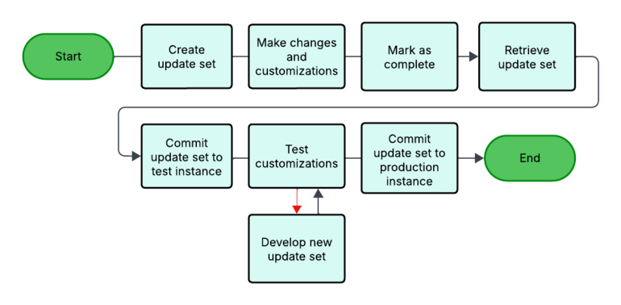
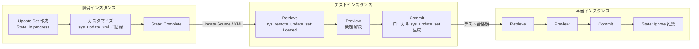
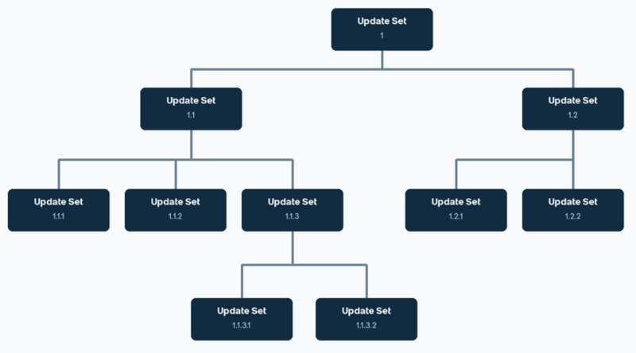
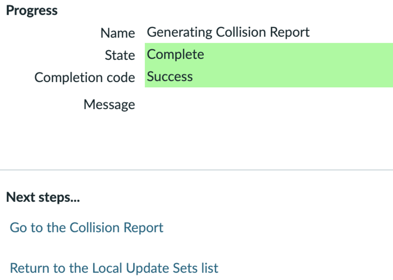
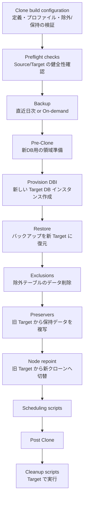
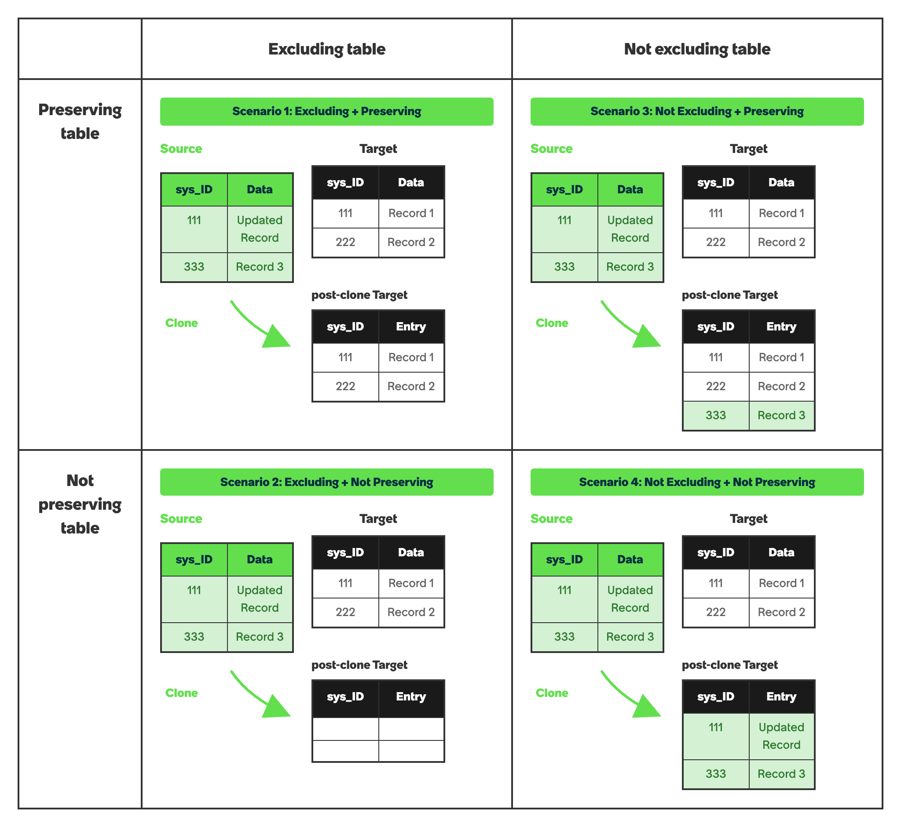
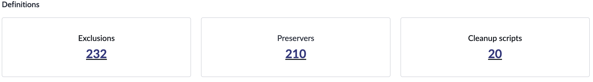

# Update Sets and System Clone（アップデートセットとクローン）

## 概要

ServiceNow では、開発（DEV）→テスト（TEST/UAT）→本番（PROD）という複数インスタンス間で「設定変更（構成・カスタマイズ）」と「データ」を別の仕組みで扱う。本ファイルは次の 2 つの仕組みを扱う。

| 仕組み | 移すもの | 方向 | 主な用途 |
|---|---|---|---|
| **Update Set（アップデートセット）** | 設定変更（メタデータ。`sys_metadata` 派生テーブルのレコード等）の差分 | 下位→上位（DEV→TEST→PROD） | カスタマイズのリリース、パッチ適用、設定のエクスポート |
| **System Clone / Instance Clone（インスタンスクローン）** | インスタンスのデータベース全体（データ＋メタデータ） | 上位→下位（PROD→非本番） | 非本番環境を本番と同じ状態にリフレッシュ、アップグレード検証 |

- Update Set は「構成変更の XML 集合」であり、インシデント等のトランザクションデータは原則として運ばない。[出典](https://www.servicenow.com/docs/r/australia/application-development/system-update-sets/customizations-tracked-update-sets.html)
- Clone は移送先（Target）のデータと構成を移送元（Source）で**上書き**する。Target 側で守りたいデータは Preserver（保持）、運びたくないデータは Exclusion（除外）で制御する。[出典](https://www.servicenow.com/docs/r/australia/platform-administration/system-clone-landing.html)
- スコープ付きアプリケーションの配布は Application Repository / ServiceNow Store / Source Control が本来の手段であり、Update Set と混在させない（後述）。アプリ開発全般は [アプリケーション開発](app-development.md) を参照。
- 2026 年時点では、Update Set のパイプライン自動化製品として **ReleaseOps**（Zurich で登場、Store アプリ）がある（後述）。

本ファイルの基準リリースは **Australia**（2026-05 GA）。Brazil での変更は判明分を「> **Brazil での変更:**」として併記する。

---

## 1. Update Set の基本

### 1.1 Update Set とは

`Update Set（アップデートセット）` は、あるインスタンスで行った構成変更をグループ化し、名前を付けて別インスタンスへ一括移送するための仕組みである。公式ドキュメントでは Update Set を次の要素を含む XML ファイルと説明している。[出典](https://www.servicenow.com/docs/r/australia/application-development/system-update-sets/exploring-system-update-sets.html)

- Update Set を一意に識別するレコード情報
- 構成変更（Customer Update）のリスト
- 他インスタンスが取得・適用できるかを決める State（状態）

| 利用者 | 役割（公式記述） |
|---|---|
| Admin | Update Set の作成・比較・マージ、取得（Retrieve）・プレビュー（Preview）・適用（Commit）の管理 |
| Developer | 特定のアプリケーションバージョン用の Update Set を作成し、追跡するアプリケーションテーブルを指定 |

メニュー：`All > System Update Sets`（システムアップデートセット）配下に `Local Update Sets`、`Retrieved Update Sets`、`Update Sources`、`Merge Update Sets`、`Merge Completed Sets`、`Update log` 等のモジュールがある。

### 1.2 Update Set と Application Repository の使い分け

公式ドキュメントは用途別の使い分けを次のように示している。[出典](https://www.servicenow.com/docs/r/australia/application-development/system-update-sets/exploring-system-update-sets.html)

| 手段 | 適する用途 |
|---|---|
| Update Sets | ベースシステム／インストール済みアプリへの変更の保存、特定バージョンのアプリの保存・適用、エクスポートファイルの作成 |
| Application Repository | 全社インスタンスへのアプリのインストール・更新、アプリの Update Set 管理、同一企業内でのアクセス制限、完成アプリのエンドユーザー配布 |

- **スコープ付きアプリの開発で Update Set と Application Repository を併用してはならない**。併用すると変更のスキップやコミットエラーが起きる。Application Repository からインストールしたアプリは、以後も Repository で開発・公開を続ける。[出典](https://www.servicenow.com/docs/r/australia/application-development/system-update-sets/exploring-system-update-sets.html)
- Update Set が運べるアプリケーションファイルには限りがある。大量データの移送には Import Set や Web サービスを使う（[データインポート/エクスポート](import-export-data.md)）。
- **リリース差の警告**：古いリリースの Update Set を新しいリリースへ適用するのは問題ないが、新しいリリース→古いリリース、または異なる Store アプリバージョン間の移送は互換性問題・データ損失のリスクがあるため避ける。[出典](https://www.servicenow.com/docs/r/australia/application-development/system-update-sets/t_RetrieveAnUpdateSet.html)

### 1.3 基本ワークフロー

**図 1：Update Set の 3 段階（DEV→TEST→PROD）ワークフロー**
- 画面ではなくフロー図。Start → 「Create update set」→「Make changes and customizations」→「Mark as complete」→「Retrieve update set」→「Commit update set to test instance」→「Test customizations」→「Commit update set to production instance」→ End の順に箱が並ぶ。「Test customizations」から下に分岐する「Develop new update set」の箱があり、テストで問題があれば新しい Update Set で修正して再テストするループを示している。
- 出典：https://www.servicenow.com/docs/r/australia/application-development/system-update-sets/exploring-system-update-sets.html （取得日：2026-11-02）

公式の標準手順（3 インスタンス構成）は次のとおり。[出典](https://www.servicenow.com/docs/r/australia/application-development/system-update-sets/exploring-system-update-sets.html)

1. 開発インスタンスで Update Set を作成する。
2. 開発インスタンスでカスタマイズを行う。
3. Update Set を Complete にする。
4. テストインスタンスにログインし、開発インスタンスから完了済み Update Set を Retrieve する。
5. テストインスタンスで Commit し、十分にテストする。
6. 問題があれば 1〜5 を繰り返し、**別の Update Set** で修正を開発する。
7. 移送経路を固定し（DEV→TEST→PROD）、**同じ Update Set を複数ソースから移送しない**。
8. 本番で Commit する。修正用 Update Set がある場合は**作成順に**両方を Commit する。

2 インスタンス構成（開発とテストを 1 つの Staging インスタンスに統合）の場合は、Staging で作成・変更・Complete・テストを行い、本番で Retrieve・Commit する。

---

## 2. 主要テーブルとレコード

| テーブル | ラベル | 内容 |
|---|---|---|
| `sys_update_set` | Update Set（Local Update Sets） | ローカルの Update Set レコード。Name、State、Application、Release date、Parent、Batch Base 等を持つ |
| `sys_update_xml` | Customer Update（カスタマーアップデート） | 構成変更 1 件ごとの XML ペイロード。1 オブジェクトにつき 1 レコード（同一オブジェクトを再変更すると上書き）。`update_set` フィールドで所属先を示す。`Replace on upgrade` フィールドを持つ |
| `sys_update_version` | Update Version | オブジェクトごとのバージョン履歴（Compare to Current 等で使用） |
| `sys_remote_update_set` | Retrieved Update Set | 他インスタンスから取得（または XML インポート）した Update Set。State は Loaded 等 |
| `sys_update_set_source` | Update Source | 取得元インスタンスの接続定義（下記 4.1）【推定：テーブル名は公開ドキュメントで明示されておらず、モジュール名から推定】 |
| `sys_update_preview_problem` 等 | Update Set Preview Problems | Preview で検出された問題のリスト（関連リスト名は公式記載、テーブル名は公開情報では確認できず） |

- Customer Update テーブルは「カスタマイズされたオブジェクトごとに 1 レコード」を持つ。Update Set を開き Customer Updates 関連リストのレコードを右クリック → `Compare to Current` で現行バージョンと比較できる。[出典](https://www.servicenow.com/docs/r/australia/application-development/system-update-sets/view-customer-update-records.html)
- Update Set レコードの関連リンク `Show Related Record` でカスタマイズ対象オブジェクトへ、`Show Application File` でアプリケーションファイルへ移動できる。オブジェクト側からはフォームヘッダー右クリック → `Show Latest Update` で最新の Customer Update へ移動する。[出典](https://www.servicenow.com/docs/r/australia/application-development/system-update-sets/navigation-between-records.html)
- 移送時の sys_id：Update Set は Retrieve/Import 時に `sys_remote_update_set` 上で新しい sys_id を得て、Commit 時に `sys_update_set` 上でさらに新しい sys_id を得る。元の sys_id は `remote_sys_id` フィールドに保持される。同じ XML を再アップロードすると `remote_sys_id` で照合され既存の Retrieved レコードを上書きする。[出典（ServiceNow 社員による Community ブログ）](https://www.servicenow.com/community/developer-blog/update-set-sys-ids-what-actually-happens-when-you-move-them/ba-p/3550415)

### 2.1 `sys_update_set` の主なフィールドと State

Update Set 作成フォーム（`All > System Update Sets > Local Update Sets` → New）の項目。[出典](https://www.servicenow.com/docs/r/australia/application-development/system-update-sets/create-select-update-set.html)

| Field | 説明 |
|---|---|
| Name | 一意の名前。命名規約で整理する |
| State | `In progress` / `Complete`（UI 上 Completed と表記される箇所あり） / `Ignore` |
| Release date | リリース予定日。Back out 実行時には設定が必要 |
| Application | Application picker で現在選択中のアプリケーションスコープ。Update Set 内の変更はこのスコープにのみ適用される |
| Description | 説明 |
| Parent | Batch の親 Update Set（6 章） |
| Batch Base | Batch の最上位 Update Set（自動表示） |
| Default set | スコープのデフォルト Update Set かどうか（3.3） |

`Submit` または `Submit and Make Current`（作成と同時にカレントに設定）で保存する。

| State | 意味 | 運用上の注意 |
|---|---|---|
| In progress | 変更を記録中。ピッカーに表示される | 作業中の状態 |
| Complete | 完了。他インスタンスが Retrieve できる。以後の変更は記録されない | 移送準備が整うまで Complete にしない。**Complete から In progress に戻さない**（追加分は新しい Update Set を作り作成順に Commit）[出典](https://www.servicenow.com/docs/r/australia/application-development/system-update-sets/t_CompleteUpdateSets.html) |
| Ignore | 作業を止めたが、他インスタンスへ移送したくない | 本番で Commit 済みの Update Set は Ignore にすると、クローン時の追加 Commit を防げる [出典](https://www.servicenow.com/docs/r/australia/application-development/system-update-sets/create-select-update-set.html) |

> `sys_remote_update_set` の State には `Loaded`（取得済み・未プレビュー）、`Previewed`、`Committed` 等がある。Loaded は XML インポート手順で公式に明記されている。[出典](https://www.servicenow.com/docs/r/australia/application-development/system-update-sets/t_SaveAnUpdateSetAsAnXMLFile.html) それ以外の完全な状態値一覧は公開情報では確認できず（第三者資料では Loaded / Previewing / Previewed / Committing / Committed / Error が挙げられている【第三者情報】）。

---

## 3. 記録の仕組み（何が記録され、何が記録されないか）

### 3.1 記録対象と対象外

`Update Set` はアプリケーションのテーブル・フィールド・レコードに対するカスタマイズを追跡する。構成情報は記録するが、タスクやプロセスのデータは記録しない。例えば Catalog item（カタログアイテム）の定義・変数・変数の選択肢は記録されるが、送信された注文やカタログタスクは記録されない。[出典](https://www.servicenow.com/docs/r/australia/application-development/system-update-sets/customizations-tracked-update-sets.html)

| 区分 | 例 | 扱い |
|---|---|---|
| 記録される | テーブル/フィールド定義（`sys_db_object`, `sys_dictionary`）、Business Rule、Client Script、UI Policy、UI Action、Script Include、ACL、フォーム/リストレイアウト、Choice、カタログアイテム定義・変数、Flow/Workflow、通知定義、システムプロパティ（`sys_properties`）など `update_synch` 属性を持つテーブル（多くは `sys_metadata` 派生） | 自動で `sys_update_xml` に記録 |
| 記録されない（データ） | Incident・Change・Request 等のタスクレコード、CMDB の CI、ユーザー、グループ、グループメンバー、ロール割当、ナレッジ記事、スケジュール等の業務データ | 記録されない。Import Set、XML エクスポート/インポート、インスタンス間インポートで移す【経験則：具体例の列挙は一般的な実務知見。公式は「task or process data は除外」とのみ記載】 |
| 既定で記録されない | Homepage（ホームページ）、Content page（コンテンツページ） | 対象レコードを Unload して手動で現在の Update Set に追加する |
| 追跡されない操作 | System Dictionary からの**テーブル削除** | Target で手動削除が必要 |
| 記録はされるが Target でスキップ | データ損失を伴う列のデータ型変更 | Target はスキップしログに記録。ログを見て手動対応 |

- **記録対象テーブルの確認方法**：`System Definition > Dictionary` で `Attributes contains update_synch` で絞り込む。[出典](https://www.servicenow.com/docs/r/australia/application-development/system-update-sets/customizations-tracked-update-sets.html)
- **`update_synch` 属性をディクショナリに追加してはならない**。誤用は深刻な性能問題やインスタンス停止を招く。この属性は顧客が使えるものではなく、既定ルールにより事前定義されていないテーブルへの付与はブロックされる。理由は、①複数テーブルにまたがる特殊な扱いが必要なコアテーブルでは重複 Update レコードが生じて重大な競合を起こす、②`update_synch` でデータレコードを移送すると性能問題を起こす、の 2 点。データ移送にはインスタンス間インポート（Import Set）を使う。[出典](https://www.servicenow.com/docs/r/australia/application-development/system-update-sets/customizations-tracked-update-sets.html)
- 独自テーブルを Update Set で追跡したいアプリケーション開発者は、テーブル作成時に `Extends Table` を `Application File [sys_metadata]` にする（Track an application table）。[出典](https://www.servicenow.com/docs/r/xanadu/application-development/system-update-sets/update-set-administration.html)
- データレコードを Update Set に入れたい場合、実務では「Add to Update Set」系の Community ユーティリティや XML エクスポートを使う例が多い【経験則】。ただし公式は Update Set をデータ移送手段として推奨していない。

### 3.2 Special handlers と Choice / Dictionary の扱い

**Special handlers（特殊ハンドラー）**：複数テーブルにまたがる情報を 1 つの Update Set エントリにまとめ、Commit 時に関連レコードがすべて正しく更新されるようにする仕組み。対象は次のとおり。[出典](https://www.servicenow.com/docs/r/australia/application-development/system-update-sets/customizations-tracked-update-sets.html)

- Workflows、Form sections、Lists、Related lists、Choice lists、System dictionary entries、Field labels

> **警告（公式）**：Form sections、Lists、Related lists、Choice lists、Field labels のハンドラーはレコードを削除して再挿入することがあり、それらのテーブルを参照するフィールドがあると予期しない結果やデータ損失につながる可能性がある。

**Choice lists**：新規・更新された選択肢は `sys_update_version` と `sys_update_xml` に別レコードとして保存される。例えば Task を拡張した `u_activity` テーブルにだけ見える State の選択肢を追加した場合、Update Set には `u_activity` 側の選択肢の更新・バージョンレコードのみが含まれ、Task テーブルの選択肢には影響しない。**大きな Choice list を Update Set に入れると Commit が極端に長くなる**ため避ける。

**Dictionary changes**：Update Set はデータ損失を招く辞書変更（テーブル削除、列データ型変更など）の適用をブロックする。Update Set Preview はデータ損失につながる型不一致を検出しない点に注意。Update Set で列を削除すると、Commit 時にその列の既存データは失われる（どの削除がデータ損失を伴うかの警告は表示される）。

**Application changes**：システムはアプリケーションごとに別々の Update Set を作成し、そのアプリケーションに関する変更のみを含める。これにより Commit 時に各アプリのアクセス設定が正しく評価される。

**App installation tracking（Yokohama で導入）**：特定のアプリケーション（Store アプリ／プラグイン）やバージョンを「app installation」として Update Set に登録し、Target での自動インストール対象として追跡できる。グローバル Update Set のみ対象で、既定で有効。手順は `sys_store_app.list`（プラグインは `v_plugin.list`）で対象を開き、関連リンク `Add app install to current update set` を選ぶ。[出典](https://www.servicenow.com/docs/r/australia/application-development/system-update-sets/enable-application-installation-tracking-through-update-set.html)、[Yokohama リリースノート](https://www.servicenow.com/docs/r/zurich/delta-yokohama-zurich/zurich-yokohama-systemupdatesets-release-notes.html)

**ドメイン**：1 つの Update Set が複数ドメイン（例：global と TOP）にまたがることはできない。[出典](https://www.servicenow.com/docs/r/SmYvGPN0OygSQs53fsexIQ/Y0wxSDRv_Q1BEoAvJ40o3A)（Yokohama 版）。詳細は [ドメインセパレーション](domain-separation.md)。

### 3.3 カレント Update Set、Update set picker、Default update set

**カレント Update Set の選択**：Next Experience では Unified Navigation のアプリケーションスコープアイコン（Application scope picker）を選び、`Update set` 欄からカレントにする Update Set を選択する（チェックマークで確定表示）。一覧にない場合は「+」アイコンで新規作成できる。**アプリケーションスコープを切り替えると、カレント Update Set は自動的にそのアプリのデフォルト Update Set に切り替わる**（別の Update Set を選び直すことは可能）。[出典](https://www.servicenow.com/docs/r/australia/application-development/system-update-sets/select-update-set-system-settings.html)

**Update set picker の利用者拡大**：既定では admin のみがピッカーを使える。他ロールに許可するには、①そのロールに `sys_update_set` の read 権限を付与し、②システムプロパティ `glide.ui.update_set_picker.role` を追加して値に対象ロールを設定する。[出典](https://www.servicenow.com/docs/r/australia/application-development/system-update-sets/t_GrantAccessToTheUpdateSetPicker.html)

**Default update set（デフォルトアップデートセット）**：[出典](https://www.servicenow.com/docs/r/australia/application-development/system-update-sets/default-update-sets.html)

- 各アプリケーションスコープにつき Default set = true の Update Set は 1 つだけ。あるセットを Default にすると、同スコープの他セットは自動的に false になる。
- **Global default update set**（Default set = true かつスコープ Global）はユーザー作成の Update Set に入れずに変更するためのセットで、システム機能を担う。**変更・削除・他システムへの移送をしてはならない**。
- 自動生成されるケース：
  - admin の初回ログイン時、Global default がその admin の Update Set に、アプリケーションスコープが Global に設定される。
  - あるスコープの Default set を Ignore/Complete にすると、直ちに新しい Default set が自動生成される（名前は旧名＋連番：`Default`, `Default 1`, `Default 2`…）。
  - スコープを切り替え、かつ優先 Update Set が Complete/Ignore で、切替先スコープに In progress の Default set がない場合。
- **Default update set を Back out してはならない**（インスタンス構成を損傷する）。[出典](https://www.servicenow.com/docs/r/australia/application-development/system-update-sets/t_BackOutUpdateSet.html)

**誤った Update Set に記録してしまった場合**：Customer Update レコードの Update Set フィールド値を直接変更してはならない。正しい Update Set に切り替え、元のオブジェクトに些細な変更を加えて保存し、その変更を元に戻して再度保存する。これで最新版のオブジェクトが目的の Update Set に入り、同一 Update Set 内の重複も防げる。[出典](https://www.servicenow.com/docs/r/australia/application-development/system-update-sets/using-system-update-sets.html)

> 補足：実務では Customer Update の `update_set` を直接書き換えて移動する方法が Community で紹介されることがあるが【第三者情報】、公式は明確に禁止している（上記）。

### 3.4 Update Set 関連システムプロパティ

| プロパティ | 説明 | 型 / 既定値 |
|---|---|---|
| `glide.update_set.auto_preview` | Retrieve 直後に自動で Preview を開始するか | true/false、既定 `true` |
| `glide.ui.update_set_picker.role` | Update set picker を利用できるロール（既定は admin のみ） | 公式表では true/false・既定 true と記載されているが、設定手順上はロール名を値に設定する |

[出典](https://www.servicenow.com/docs/r/australia/application-development/system-update-sets/update-sets-properties.html)。上表の `glide.ui.update_set_picker.role` の「型」は公式ページの表記とピッカー付与手順の記述が整合していない（手順では値にロールを設定）。実機で確認すること。

---

## 4. 移送（Transfer）：Update Source と XML

`Update set transfers` の公式ページは、移送手段として ①ReleaseOps、②IP Access Control 環境下での移送、③Update Source、④XML ファイルの 4 つを挙げる。[出典](https://www.servicenow.com/docs/r/australia/application-development/system-update-sets/update-set-transfers.html)

### 4.1 Update Source（リモートインスタンスからの Retrieve）

前提ロール：`admin` または `teamdev_user`（Retrieve 実行側）。[出典](https://www.servicenow.com/docs/r/australia/application-development/system-update-sets/t_RetrieveAnUpdateSet.html)

手順（**Target 側**で実施するプル型）：

1. Source 側で IP Address Access Control が有効なら、Target を例外に追加する（Source と Target のデータセンターが異なる場合は、Customer Service and Support にアプリケーションノードの IP を問い合わせ、`System Security > IP Address Access Control` に例外として追加）。
2. Target で `System Update Sets > Update Sources` → New。
3. 接続設定を入力。

| Field | 説明 |
|---|---|
| Name | リモートインスタンスの一意名 |
| Type | リモートが development / test / UAT のいずれか |
| Active | 転送可能か。不要なリモートは削除せず Active で無効化する |
| URL | リモートの URL（プロトコル含む）。レコードごとに一意（重複はエラーの原因）。**リモートは同じリリースファミリーである必要がある**。接続検証後は URL を変更できない |
| Username | リモート側で転送を認可するユーザー。**リモート側で admin ロールが必要** |
| Password | そのユーザーのパスワード |
| Short description | 補足情報 |

4. `Test Connection` で疎通を確認（成功しないと保存できない）。
5. フォームヘッダー右クリック → Save。
6. 関連リンク `Retrieve Completed Update Sets` を選ぶ。**Complete 状態の Update Set のみ**が取得され、Target に既に存在するものはスキップされる。確認画面に転送数とスキップ数が表示される。
7. 取得結果は `System Update Sets > Retrieved Update Sets` に表示される。`glide.update_set.auto_preview` が true なら自動で Preview が始まる。

### 4.2 XML ファイルでのエクスポート/インポート

使う場面：インスタンス間にネットワーク疎通がない、Source の admin 資格情報を渡したくない、重要なカスタマイズをローカルにバックアップしたい。[出典](https://www.servicenow.com/docs/r/australia/application-development/system-update-sets/t_SaveAnUpdateSetAsAnXMLFile.html)

**エクスポート**（ロール：admin）

1. `System Update Sets > Local Update Sets` または `Retrieved Update Sets`。
2. **Complete 状態**の Update Set を開く（Retrieved の場合は Loaded 状態である必要がある）。
3. 関連リンク `Export to XML` を選び、ファイルを保存。
   - `sys_update_set` の Export to XML UI Action は `UnloadRetrievedUpdateSet` プロセッサーを呼び出し、ローカル Update Set を一時的な Retrieved Update Set に変換して関連リスト込みでエクスポートし、必要に応じて一時セットを削除する。[出典（Zurich/Xanadu 版の記述）](https://www.servicenow.com/docs/r/a3E8xg0zsiQLBPKbKO15Mg/gEKzBHzXhs6Ha1fqfKEXLA)

**インポート**（ロール：admin、`security_admin` への権限昇格が必要）

1. `security_admin` に Elevate Role する。
2. `System Update Sets > Retrieved Update Sets` → 関連リンク `Import Update Set from XML`。
3. `Choose File` で XML を選び `Upload`。State = **Loaded** の Retrieved Update Set になる（ローカル／Retrieved のどちらから作った XML でも、別インスタンスにアップロードすると Retrieved Update Set として認識される）。
4. 通常どおり Preview → Commit する。

---

## 5. Preview と Commit

### 5.1 Preview（プレビュー）

`Preview` は Retrieved Update Set をローカルインスタンスと突き合わせて問題を検出する処理で、**すべての問題を解決するまで Commit できない**。[出典](https://www.servicenow.com/docs/r/australia/application-development/system-update-sets/t_PreviewARemoteUpdateSet.html)、[出典](https://www.servicenow.com/docs/r/australia/application-development/system-update-sets/t_CommitAnUpdateSet.html)

手順（ロール：admin）：

1. `System Update Sets > Retrieved Update Sets` で対象を開く。
2. `Preview Update Set` を選ぶ（大きなセットは時間がかかり、進捗ダイアログの Cancel で中断可能）。Update Set Preview ページに結果と問題が表示される。
3. 任意：`Show All Preview Records`（全プレビューレコード確認）、`Run Preview Again`（再比較）、`Update Set Preview Problems` 関連リストの確認。

**Preview record（プレビューレコード）**：Preview は Update 1 件ごとにプレビューレコードを作る。

| Field | 説明 |
|---|---|
| Disposition | `Collision` / `Update` / `Insert` / `Delete`。Collision は変更がローカルの同一オブジェクトの変更より古いことを示す |
| File differences | ローカル最新版と Update Set の差分。追加＝緑、変更＝黄、削除＝赤 |
| Proposed action | `Commit`（リモートの変更を受け入れる）/ `Skip`（拒否）。**既定はすべて Commit で、ローカルにより新しい更新があっても Commit になる** |

### 5.2 Preview Problems（プレビュー問題）の種類と解決

| Problem | 意味 | 解決方法 |
|---|---|---|
| Missing Object | オブジェクト、または参照先オブジェクトが Target に存在しない | Source で不足オブジェクトを含む別 Update Set を作って移送するか、ローカルで作成。`Find missing field` / `Find missing record` / `Find missing update` で Source を検索できる |
| Collision | Update Set 内の変更が、ローカルの同一オブジェクトの変更より古い | ローカル版を残す＝`Skip remote update`、Update Set 版を使う＝`Accept remote update`。`Compare with local`、`Show local field` / `Show local record` / `Show local update` で比較 |
| Uncommitted update | 同じオブジェクトが未 Commit の別 Retrieved Update Set にも存在する | 先に他方を Commit するか、この Update を他方へ移す。`Show uncommitted update` / `Show uncommitted Update Set` |
| Table to be deleted has data | 削除対象テーブルにデータがある（テーブルを戻してもデータは戻らない） | 関連問題を Skip/無視してから Commit。システムテーブルやスコープ外テーブルは削除できない |
| Application scope validation issue | スコープが Global でなく、アプリが Target にも Update Set にも Store にも存在しない | アプリスコープを持つインスタンスにのみ移送するか、Update Set にアプリを含める |
| Conflict within a single batch | 同じ Batch 内の複数 Update Set が競合する変更を持つ | `Compare Collisions` で比較し、採用する版で `Accept this collision` |

[出典](https://www.servicenow.com/docs/r/australia/application-development/system-update-sets/t_PreviewARemoteUpdateSet.html)

### 5.3 Commit（コミット）

手順（ロール：admin）：[出典](https://www.servicenow.com/docs/r/australia/application-development/system-update-sets/t_CommitAnUpdateSet.html)

1. `All > System Update Sets > Retrieved Update Sets` で対象を開き、全問題を解決する。
2. `Commit Update Set` を選ぶ。削除（Delete）を含む場合は警告が出て、問題がありそうな Update を最大 5 件表示（5 件超はリンク）。`Cancel` で Preview に戻る／`OK` でスキップ扱いの変更を飛ばして Commit 対象の変更を続行。
3. 成功すると完了ページが表示される。`Commit log` または `System Update Sets > Update log`（Update Set 名でフィルター）で **unsafe edit 警告**（データ損失を招く変更の阻止）や失敗レコードを確認し、必要なら対応用 Update Set を作る。
4. `System Update Sets > Local Update Sets` に生成されたローカル Update Set レコードで変更を確認する。
5. 以後作業しない・他に移送しないなら State を `Ignore` にする。

注意：
- 本番への Commit は業務時間外に行う（短時間の性能低下があり得る）。[出典](https://www.servicenow.com/docs/r/australia/application-development/system-update-sets/get-started-update-sets.html)
- 関連する複数 Update Set は**作成順**に Commit する。順序ミスを防ぐには Batch（6 章）を使う。
- Retrieved Update Set の Preview 画面から、問題がない場合に `Commit Update Set` で直接 Commit できる（プレビュー結果を見ずに全変更を Commit することになる点に注意）。

### 5.4 Back out（バックアウト）

Commit 済みの Update Set について、既存レコードへの変更を取り消せる。[出典](https://www.servicenow.com/docs/r/australia/application-development/system-update-sets/t_BackOutUpdateSet.html)

- Back out は**カレント Update Set に削除（delete）の Update を追加**する。そのため「Commit → Back out → 同じ Remote Update Set を再適用」すると、直近の削除と衝突して Preview エラーになる。
- レコードレベルの更新と Dictionary の変更の両方を元に戻す。一部はデータ損失を伴う（例：新規テーブル・フィールドの Back out はテーブル/列の削除となりデータも消える）。
- **Default update set は Back out しない**。
- Batch に属する Update Set を Back out すると、その子 Update Set もすべて Back out される。

手順（ロール：admin）：

1. `All > System Update Sets > Local Update Sets` で対象を開く（Complete で Release date が設定されていること。選択中のアプリケーションが Update Set の内容（例：Global）と一致していること）。
2. Back out で問題が起きそうなら、**変更を打ち消す新しい Update Set を作って Commit する**方を選ぶ。
3. `Back Out` を選ぶ。新しい Update Set による影響（Problems）が表示される。
4. 各問題を解決：最新版を残すなら `Decide to Keep Current`、前の版に戻すなら `Decide to Use Previous`。
5. 完了すると Update Set と関連 Update レコードは削除される。必要なら Retrieved Update Set から再度 Preview・Commit できる。

### 5.5 削除してはいけないもの

- Update Set を削除できるのは、カレントでなく、かつ `sys_update_xml` エントリを含まない場合のみ（`sys_update_set` の ACL による制御）。
- **`sys_update_xml` エントリを削除してはならない**：①変更は元に戻らない、②誰が適用したかの記録が消える、③Customer Update がなくなるため**アップグレード時にカスタマイズが上書きされる**。
- 変更を戻したいときは削除ではなく Back out する。[出典](https://www.servicenow.com/docs/r/australia/application-development/system-update-sets/delete-update-set-cautions.html)

### 5.6 アップグレードとの関係（Replace on upgrade）

構成変更ごとに Customer Update レコードがあり、既定で `Replace on upgrade = false`。アップグレード時、カスタマイズ済みオブジェクトへのベース側変更は既定でスキップされる（Skipped record）。一時的な回避策を本来の仕様に戻したい場合は、Customer Update（`Show Latest Update`）を開いて `Replace on upgrade` をオンにすると、次回アップグレードでそのオブジェクトがベース版に置き換わる。[出典](https://www.servicenow.com/docs/r/australia/application-development/system-update-sets/t_OverwriteCustomizsDuringUpgrades.html)。アップグレード時の Skipped 対応は [アップグレード管理](../../03_導入編/13-upgrade-management.md) を参照。

---

## 6. Batch（バッチ）Update Set

### 6.1 概念

`Batched update sets` は Complete 済みの Update Set をグループ化し、**一括で Preview・Commit** する仕組み。Commit 順序の誤りや Update Set の漏れを防ぐ。[出典](https://www.servicenow.com/docs/r/australia/application-development/system-update-sets/us-hier-overview.html)

- Update Set の `Parent` フィールドで親を指定して階層化する。1 つの親が複数の子を持て、子が同時に親にもなれる（多段階層）。
- 最上位の Update Set を **Batch Base（バッチベース）** と呼ぶ。Base を Preview/Commit するとバッチ全体が処理される。
- 処理順と衝突判定は、各変更がいつ行われたか、およびその連なり（ancestry）に基づいてシステムが決める。
- Local Update Sets 一覧の `Parent` 列と `Batch Base` 列で階層を確認できる。

**図 2：Batch Update Set の階層の例**
- 公式ドキュメントの概念図。最上位に「Update Set 1」（Batch Base）、その子に「1.1」「1.2」、1.1 の子に「1.1.1」「1.1.2」「1.1.3」、1.2 の子に「1.2.1」「1.2.2」、さらに 1.1.3 の子に「1.1.3.1」「1.1.3.2」がぶら下がる多段ツリー。Base（1）を Preview/Commit すると配下すべてが処理され、例えば 1.1 を Back out すると 1.1 配下（1.1.1〜1.1.3.2）も Back out される。
- 出典：https://www.servicenow.com/docs/r/australia/application-development/system-update-sets/us-hier-overview.html （取得日：2026-11-02）

### 6.2 操作

| 操作 | 手順 | 制約 |
|---|---|---|
| 作成 | `Local Update Sets` で子にしたい Update Set を開き、`Parent` に親を選んで Update | Complete 済みバッチに In progress の Update Set を加えると、バッチの状態は In progress に戻る |
| Retrieve | Batch Base を通常どおり Retrieve（バッチ全体が取得される） | — |
| Preview | `Retrieved Update Sets` で Batch Base を選び `Preview Update Set Batch`。問題があれば `Preview Problems for Batch` で解決し `Run Preview Again for Batch` | 子だけを個別に Preview できない（必要なら子の Parent を空にしてバッチから外す） |
| Commit | Batch Base で `Commit All Update Sets` | 事前に Preview し Collision を解決済みであること。子だけを個別 Commit できない |
| 再編成 | 子の `Parent` を変更、または空にしてバッチから外す | 親を外した Update Set は独立した Update Set、または子を持つ場合は新たな Base になる |
| Back out | Base でも子でも可能 | 選択した Update Set とその子すべてが Back out される。親を持つ Update Set を Back out すると Parent はクリアされる |

すべて admin ロールが必要。[出典](https://www.servicenow.com/docs/r/australia/application-development/system-update-sets/us-hier-create.html)、[出典](https://www.servicenow.com/docs/r/australia/application-development/system-update-sets/us-hier-preview.html)、[出典](https://www.servicenow.com/docs/r/australia/application-development/system-update-sets/us-hier-commit.html)、[出典](https://www.servicenow.com/docs/r/australia/application-development/system-update-sets/us-hier-reorg.html)

**クローンとの関係**：クローン時にバッチ階層を保持するには、**親（Base）だけを Ignore** にし、他の Update Set は Complete のままにする（バッチが再度クローン先で適用対象にならず、階層も保たれる）。[出典](https://www.servicenow.com/docs/r/australia/application-development/system-update-sets/us-hier-overview.html)

**実務パターン**【経験則】：リリース単位で空のグローバル親 Update Set（例：`REL-2026.06`）を作り、そのリリースに含む Update Set（スコープ別に分かれたものを含む）を子として紐付け、Base を移送する。本番に散在して移送済みの Update Set を本番でバッチ化するのは推奨されない。[出典（Community スレッド）](https://www.servicenow.com/community/developer-forum/servicenow-update-set-batching-best-practices-lessons-learnt/td-p/1770431/page/6)

---

## 7. Merge（マージ）と Compare（比較）／Collision

### 7.1 Merge update sets

複数の Update Set を 1 つに統合する機能。**後方互換のために残されている機能で、公式は Batch の方が予測可能で堅牢としている**。[出典](https://www.servicenow.com/docs/r/australia/application-development/system-update-sets/t_MergeUpdateSets.html)

手順（ロール：admin）：

1. `All > System Update Sets > Merge Update Sets`（In progress を対象）または `Merge Completed Sets`（Complete を対象）。
2. マージしたい Update Set だけが表示されるようリストをフィルター（**同じアプリケーションの Update Set 同士のみ**マージ可）。
3. 新しい Update Set の Name（必須）と Description（任意）を入力し `Merge` → 確認ダイアログで OK。
4. 各オブジェクトの**最新の変更**だけが元のセットから新セットへ移動する。移動数・スキップ数がメッセージ表示される。最新判定は Customer Update の `Updated` フィールドで行い、ペイロード内の `sys_updated_on` ではない。
5. `Merged Update Sets` 関連リストで元セットを開き、正しく移動したか確認。
6. 古い変更を誤って Commit しないよう、元セットを削除または空にする。

| 注意点 | 内容 |
|---|---|
| アンマージ不可 | マージ後に元に戻すことはできない [出典（Xanadu 版）](https://www.servicenow.com/docs/r/a3E8xg0zsiQLBPKbKO15Mg/7E7sCV1rEhJCTwQ4LYzhvg) |
| 取り残し | 移動されなかった古い変更は元セットに残る。それを新セットへ手で移さない |
| 手動マージ禁止 | 手作業で Customer Update を寄せ集めず、Merge モジュール（または Batch）を使う |

### 7.2 Compare local update sets と Collision report

ロール：admin。[出典](https://www.servicenow.com/docs/r/australia/application-development/system-update-sets/t_CompareLocalUpdateSets.html)

1. `All > System Update Sets > Local Update Sets` で比較したい Update Set のチェックボックスを選ぶ。
2. `Actions on selected rows...` → `Compare Update Sets`。Collision report が生成される。
3. 完了後 `Go to the Collision Report`。
4. 同じ Collision 番号が重複している行（＝同じ変更が別セットにある）を探す。
5. 不要な側の Update レコードを削除して解決する。**Update Set Collisions リストの Delete アクションでは削除できない**ので、`sys update` 列のリンクから Update レコードを直接開いて Delete する。削除はカスタマイズの記録を消すだけで、カスタマイズ自体は元に戻らない。
6. 再度比較して衝突がないことを確認し、その後に移送する。

**図 3：Compare Update Sets 実行後の進捗画面**
- 「Progress」セクションに Name「Generating Collision Report」、State「Complete」、Completion code「Success」が表示され、下部の「Next steps...」に「Go to the Collision Report」と「Return to the Local Update Sets list」のリンクがある。Local Update Sets リストで比較対象を選び、Actions on selected rows... から Compare Update Sets を実行した直後の画面。
- 出典：https://www.servicenow.com/docs/r/australia/application-development/system-update-sets/t_CompareLocalUpdateSets.html （取得日：2026-11-02）

### 7.3 Collision 検出の仕組みと Coalesce strategy

- **Collision の定義**：「ローカルにより新しい更新がある Update」。プラットフォームは各 Update Set の Customer Update の `Name` と `Updated` を比較し、Name が一致して更新日時が異なれば Collision と判定する。[出典](https://www.servicenow.com/docs/r/australia/application-development/system-update-sets/update-set-collisions.html)
- **Customer Update の Name**：多くのレコード種別では Name に sys_id が含まれる（例：`sysevent_email_template_9e1998c078b71100a92ecacd80df1d39`）。そのため別インスタンスで同一内容のレコードを独立に作ると sys_id が異なり、Collision として検出されない（重複レコードが生じる原因）。
- **Coalesce strategy（コアレス戦略）**：一意キーとなる列の組み合わせでレコードを識別する種別では、別インスタンスで独立に作った同一レコードでも Collision を検出できる。`sys_dictionary`、`sys_documentation`、`sys_choice_set`、`sys_ui_list`、`sys_ui_related_list` は sys_id ではなく Coalesce 列で Customer Update 名を作る。
- **書き換え**：移送時、Coalesce 戦略を持つテーブルのレコード／参照については Customer Update の名前や内部 sys_id が Target に合わせて書き換えられる（例：`sys_dictionary` の `tablename.fieldname` が A で sys_id 123、B で 456 の場合、B に記録される際に 123 → 456 へ置換）。

主な Coalesce 列（公式表から抜粋）：

| テーブル | Coalescing columns |
|---|---|
| `sys_db_object` | name |
| `sys_dictionary` | name, element |
| `sys_documentation` | name, element, language |
| `sys_choice_set` | name, element |
| `sys_properties` | name |
| `sys_ui_form` | name, view, sys_domain |
| `sys_ui_list` | name, view, sys_domain, element, relationship, parent |
| `sys_ui_section` | name, view, caption, sys_domain |
| `sys_ui_related_list` | name, view, related_list, sys_domain |
| `sys_ui_view` | name |
| `sys_ui_message` | key, language, code |
| `sys_module` | path |
| `sys_user_group` | name |
| `sys_user_role` | name |
| `sys_translated` | name, element, value, language |
| `sys_translated_text` | tablename, fieldname, documentkey, language |
| `sys_scope_table_access` | source_scope, target_scope, table_name |
| `sys_attachment` | 独自のマッチングロジック |

（ほかに `atf_input_variable`、`atf_output_variable`、`dynamic_*`、`sys_analytics_bucket`、`sys_collection`、`sys_index`、`sys_package`、`sys_wizard`、`ua_table_licensing_config` 等が列挙されている。）

**重複レコードの防止策**（公式）：①別インスタンスで再作成せず Update Set で移送して同じ sys_id を保つ、②XML エクスポート/インポートで同じ sys_id を保つ、③辞書でテーブルに一意インデックスを設定する。ベースラインの既定レコードはプロビジョニング時に XML でインポートされるため常に同じ sys_id を持つ。[出典](https://www.servicenow.com/docs/r/australia/application-development/system-update-sets/update-set-collisions.html)

---

## 8. System Clone（インスタンスクローン）の基本

### 8.1 Clone とは

`Instance Clone`（旧称 System Clone）は、Source インスタンスのデータとメタデータを Target インスタンスへコピーし、Target を上書きする機能。非本番環境が本番から乖離（drift）するのをリセットする目的で使い、アップグレード検証、新規アプリ・新機能のテストに用いる。[出典](https://www.servicenow.com/docs/r/australia/platform-administration/system-clone-landing.html)、[出典（Brazil 版 Exploring Instance Clone）](https://www.servicenow.com/docs/r/platform-administration/exploring-instance-clone.html)

| 項目 | 仕様 |
|---|---|
| データ源 | Source の**直近の日次バックアップ**（最大 36 時間前）。準備（バックアップ選択を含む）は申請時ではなく**スケジュール開始時刻**に始まる [出典](https://www.servicenow.com/docs/r/australia/platform-administration/t_StartAClone.html) |
| On-demand backup | Clone options で選ぶと、開始時刻に差分バックアップを取得してから Clone する（その分開始が遅れる） |
| 方向 | 本番→非本番、または非本番同士 |
| バージョン | 異なるファミリーリリース間でも可能。**Target は Source のバージョンに置き換わる**（例：Zurich→Yokohama の Clone で Target は Zurich になる）[出典（Brazil 版）](https://www.servicenow.com/docs/r/platform-administration/exploring-instance-clone.html) |
| 本番を Target にする | システムプロパティ `glide.db.clone.allow_clone_target` が TRUE ならインスタンスは Clone Target になれる（本番も含む）。本番を Target にした後は FALSE に戻すことが推奨される |
| UI | **Clone Admin Console**（Australia では既定 UI。旧 `clone_instance.do` はリダイレクト） |

### 8.2 ロール

| ユーザー | ロール | 対象 | 用途 |
|---|---|---|---|
| Clone Administrator | `clone_admin` | Source | Clone の申請・キャンセル・スケジュール、Clone Profile 管理 |
| Clone Profile 管理者 | `clone_admin` または `clone_profile_admin` | Source | カスタム Clone Profile 作成 [出典](https://www.servicenow.com/docs/r/australia/platform-administration/configure-clone-profile.html) |
| OAuth Administrator | `oauth_admin` | Target | Target 登録時の一回限りの OAuth 設定。以後の申請者は `clone_admin` のみで可 |
| SOAP user | `soap` | Source/Target | Basic 認証での SOAP 操作（identity type = machine）|

[出典（Brazil 版 Exploring Instance Clone）](https://www.servicenow.com/docs/r/platform-administration/exploring-instance-clone.html)。Xanadu 版では「申請には Source 側で clone admin または admin、Target 側で admin が必要」と記載されていたが、Australia では OAuth 方式（後述）に移行している。

### 8.3 Clone の処理フェーズ

公式（Brazil 版）は次のフェーズを示す。[出典](https://www.servicenow.com/docs/r/platform-administration/exploring-instance-clone.html)

- Cleanup script は Source で定義され、**Restore フェーズ開始前**に変更しないとその Clone には反映されない。
- Clone のキャンセルは **Node Repoint まで**可能。Node Repoint はクローンの「ステージ」であり「状態（State）」ではない。[出典](https://www.servicenow.com/docs/r/australia/platform-administration/clone-terminology.html)

### 8.4 Clone states

| State | 説明 |
|---|---|
| Requested | 申請済み・承認待ち |
| Scheduled | 予定日時に開始可能 |
| Active | 実行中 |
| Completed | 正常完了 |
| Canceled | キャンセル済み |
| Hold | サーバーが申請を拒否（予定時刻までに準備できなかった、または先行 Clone 完了前に追加申請があった） |
| Error | 実行中にエラー（サポートへ連絡） |
| Draft | 作成予定。Clone History テーブルには現れない |
| Rollback requested / Rolling back / Rolled back / Rollback failure | ロールバックの各状態 |

Cleanup script の実行状態：`Ready to schedule` → `Scheduled` → `Executing` → `Completed` / `Error` / `Not executed`（条件ロジックで意図的にスキップ）。エラー後に再試行すると Executing に戻り Runs 列が 1 増える。[出典](https://www.servicenow.com/docs/r/australia/platform-administration/clone-states.html)

---

## 9. Clone Admin Console

`Clone Admin Console` は Clone の管理・申請・監視を行う UI。Store アプリとして提供され、Australia では全 Clone 機能が `Clone Admin Console` メニュー配下に集約された。[出典](https://www.servicenow.com/docs/r/australia/platform-administration/Clone-UI.html)

| タブ | 内容 |
|---|---|
| Clone Activity（旧 Clone Home） | 既定ビュー。Clone 申請を新しい順に表示（CHG、Source/Target Instance、State、Scheduled Date/Time、Started、Completed、Duration、Profile Name）。検索・状態フィルター、右上に `Request Clone` ボタン |
| Instance Overview | インスタンスごとに最終 Clone 日を 1 行で表示。古い環境の特定に使う |
| Help | Now Assist for Clone（Australia Patch 2 以降、Now Assist ライセンスが必要）、KB リンク、アプリのバージョン |
| Configuration | Overview / Exclusions / Preservers / Cleanup Scripts / Clone Profiles / Clone Instances / Multi-Instance View を集約（旧 Definitions タブは廃止され統合） |

> 公式手順ページの多くは依然として `All > Clone Admin Console > Clone Home` と表記しているが、Australia のリリースノートでは「Clone Home は Clone Activity に名称変更」とされている。画面上の名称は Clone Admin Console のバージョンにより異なる可能性がある。[出典](https://www.servicenow.com/docs/r/delta-zurich-brazil/brazil-zurich-cloneadminconsole-release-notes.html)

**Multi-Instance View**：1 つのプライマリインスタンスから、リンクされた複数インスタンスの Clone 申請・状態・履歴・Cleanup script 状態（Australia Patch 5 以降）を一元監視する。Source・Target とも Australia Patch 2 以降が必要。[出典](https://www.servicenow.com/docs/r/australia/platform-administration/clone-multi-instance-view.html)

**レガシー UI**：Australia から `clone_instance.do` は Clone Admin Console へリダイレクトされ（30 秒後）、リスト/フォームからのレガシー Clone 申請はサポート外。Australia 以前の履歴は Clone History（`clone_instance` テーブル、`clone_instance_list.do`）に残り、Console のダッシュボードには表示されない。Console で申請した Clone は別の新テーブルに保存される（Xanadu で導入）。[出典](https://www.servicenow.com/docs/r/delta-washingtondc-australia/australia-washingtondc-cloneadminconsole-release-notes.html)

### 9.1 Target の登録と認証（OAuth 2.0）

Australia では Target 認証が username/password から **JWT 証明書ベース／OAuth 2.0 Authorization Code Flow** へ移行した。[出典](https://www.servicenow.com/docs/r/australia/platform-administration/clone-oauth-authentication.html)

- Source が OAuth クライアント、Target が認可サーバー。Target 登録時に一度だけ認可し、以後は Clone 申請ごとに短命の JWT アクセストークンを自動取得する（失効時は Console から再認可）。
- 利点：Clone 専用のローカル admin アカウントが不要（SSO を含む既存ログインを使える）、Target 登録は一回のみ、トークンは申請ごとに自動生成・失効。
- 前提：**Source・Target とも Australia Patch 5 以降**。ロールは Source に `clone_admin`、Target に `clone_admin` と `oauth_admin`。[出典](https://www.servicenow.com/docs/r/australia/platform-administration/setup-clone-oauth.html)

登録手順：`All > Clone Admin Console > Clone Home` → `Configuration > Clone instances` → New → Target URL を入力し Continue（バージョン互換性チェック）→ `Setup OAuth on Target`（Target が新しいタブで開く）→ `Set up OAuth` で Client ID 生成 → Client ID をコピーして Source の Add Clone Target フォームに貼付 → `Add Target` → Target で `Allow`（同意）→ Source にリダイレクトされ登録完了。

**Basic Auth フォールバック**：OAuth が使えない場合のみ。Target 側ユーザーに `clone_admin`、`soap` ロールと `identity_type = machine` が必要。identity_type = machine のユーザーは UI にログインできなくなる。公式は OAuth を推奨。

> **Brazil での変更:** OAuth 2.0 の Target 認証が「一回限りの Target 登録、トークンの自動生成と申請ごとの有効期限設定」として強化された（Patch 5 以降が前提）。Clone Profile の複製時に意図したスクリプト・Preserver・Exclusion のみが含まれるよう修正された。[出典](https://www.servicenow.com/docs/r/delta-zurich-brazil/brazil-zurich-cloneadminconsole-release-notes.html)

---

## 10. Exclusion・Preserver・Cleanup script・Clone Profile

### 10.1 4 つの組み合わせ

**図 4：Exclusion（除外）と Preserver（保持）の組み合わせ早見表**
- 2×2 の表。列が「Excluding table / Not excluding table」、行が「Preserving table / Not preserving table」。各セルに Source（sys_ID 111 = Updated Record、333 = Record 3）と Target（111 = Record 1、222 = Record 2）の例と、Clone 後の Target を示す。
  - Scenario 1（除外＋保持）：Clone 後 Target は 111 = Record 1、222 = Record 2 のまま（Target 不変）。
  - Scenario 2（除外＋非保持）：Clone 後 Target は空（テーブルは使える状態で空）。
  - Scenario 3（非除外＋保持）：Clone 後 Target は 111 = Record 1、222 = Record 2 に Source の 333 = Record 3 が追加（Target の既存は上書きされず Source 分が加わる）。
  - Scenario 4（非除外＋非保持）：Clone 後 Target は Source と同じ 111 = Updated Record、333 = Record 3（Target は置き換え）。
- 出典：https://www.servicenow.com/docs/r/australia/platform-administration/clone-exclusions-preservers-cleanupscripts.html （取得日：2026-11-02）

| Scenario | Exclusion | Preserver | Clone 後の Target |
|---|---|---|---|
| 1 | あり | あり | Target のレコードがそのまま残る |
| 2 | あり | なし | Source のレコードはコピーされず、Target のレコードも削除。テーブルは空だが使用可能 |
| 3 | なし | あり | Target のレコードが残り、Source のレコードも追加される |
| 4 | なし | なし | Source のレコードで Target を置き換え |

[出典](https://www.servicenow.com/docs/r/australia/platform-administration/clone-configurations-tab.html)

### 10.2 Exclusions（除外）

- Exclusion に指定したテーブルは Clone でデータがコピーされない。Clone は**テーブル全体を子テーブルも含めて truncate** する。子テーブルは一覧に個別表示されず親のみが表示される（例：`task` を除外すると Change・Incident・Problem も除外）。
- 除外してもテーブルスキーマと階層は Target にクローンされ、**空だが使えるテーブル**になる。
- 既定で**ログ、監査、通知、ワークフローコンテキスト、ライセンス使用量**のテーブルが除外される。これらの既定除外は Clone option の設定に関わらず常に適用される。
- 子テーブルの確認：`[instance].service-now.com/now/nav/ui/classic/params/target/generic_hierarchy_erd.do`。

[出典](https://www.servicenow.com/docs/r/australia/platform-administration/clone-configurations-tab.html)

追加手順（ロール：`clone_admin`）：`All > Clone Admin Console > Clone Home` → Configuration タブ → Exclusions → New → テーブル名を入力 → Save。[出典](https://www.servicenow.com/docs/r/australia/platform-administration/t_ExcludeATableFromCloning.html)

除外のガイドライン：[出典](https://www.servicenow.com/docs/r/australia/platform-administration/clone-exclusions-guidelines.html)

| 項目 | 内容 |
|---|---|
| Workflow context | `wf_context` と `wf_` で始まる関連テーブルを除外すると、Clone の長時間化に伴うワークフロータイマーの同期問題を防げる |
| Task の子テーブル | Table per hierarchy の Task 子テーブルは子だけを除外すればよい（親 Task の除外は不要） |
| ワイルドカード | `sys_script.*` のように 1 エントリで複数テーブルを除外可。**`*` の前に `.` が必要** |
| ユーザー関連は一体で扱う | `sys_user`, `sys_user_role`, `sys_user_group`, `sys_user_grmember`, `sys_group_has_role`, `sys_user_role_contains`, `customer_contact`（CSM 有効時）は保持/除外を揃える。漏れると Clone 後に**ログインできなくなる**可能性 |
| 除外不可 | `sys_db_object` と `sys_db_object.*` |

### 10.3 Preservers（保持）

- Preserver は Target 上のデータを上書きから守る。Preserver は **Source 側で定義**する（Target で定義しても効果はない）。保持データは Exclusion 処理の後に Target に再適用される。[出典（Brazil 版）](https://www.servicenow.com/docs/r/platform-administration/data-preservation.html)
- **子テーブルの扱いは Exclusion と逆**：Preserver はテーブルを保持しても子テーブルを自動では保持しないため、子テーブルを個別に追加する必要がある。[出典](https://www.servicenow.com/docs/r/australia/platform-administration/clone-configurations-tab.html)
  - ただし **RaptorDB** インスタンスでは、テーブルを保持すると階層と子孫テーブルが自動で保持される（RaptorDB のみ）。
  - Brazil 版の Data preservation ページは「親を保持すると子も保持されるが、MariaDB 間 Clone では子テーブルは自動保持されず手動追加が必要」と記載しており、DB エンジンによって挙動が異なる。自インスタンスの DB 種別を確認すること。
- 典型用途：インスタンス固有の認証設定、`sys_ui_bookmark`、`sys_ui_recent_selection`、`sys_user_preference`、テーマ、MID Server（`ecc_agent`）等。
- データベースビューは保持できない。Preserver は空にできない（空だと Clone を申請できない）。
- 大量データ（ユーザー・グループ・ロール等）の保持は Clone 時間を大きく延ばすため避け、ファイルにエクスポートして Clone 後にインポートする。Preserver には Condition を付けて必要分だけ保持する。[出典](https://www.servicenow.com/docs/r/australia/platform-administration/clone-duration-optimization.html)
- 未公開（unpublished）のカスタムアプリは Preserver で保持できない（11.3 参照）。

作成手順（ロール：`clone_admin`）：`All > Clone Admin Console > Clone Home` → Configuration → Preservers → New → Name（例：「User Preferences Data」）、Table（必須）、UI プロパティなら `Theme` にチェック、Condition builder で保持対象を定義 → Save。[出典](https://www.servicenow.com/docs/r/australia/platform-administration/create-new-clone-preserver.html)

**Multi-Provider SSO 有効化時に自動作成される既定 Preserver**（Brazil 版記載）：

| Name | Table | Condition（概要） |
|---|---|---|
| Certificate | `sys_certificate` | なし |
| Core Instance Properties | `sys_properties` | `glide.authenticate.external*`、`com.snc.integration.saml_esig*`、`glide.authenticate.multisso*`、`glide.authenticate.sso.redirect.idp` 等 |
| Digest Properties | `digest_properties` | なし |
| Identity Providers | `sso_properties` | なし |
| SAML2 Update1 Properties | `saml2_update1_properties` | なし |

Digest / Identity Providers / SAML2 の 3 つは揃えて削除しないと Clone がエラーになる。Target で既存 SAML 連携を維持するには Core Instance Properties Preserver に SAML プロパティを含める。[出典](https://www.servicenow.com/docs/r/platform-administration/data-preservation.html)。SSO 全般は [認証とSSO](authentication-sso.md)。

### 10.4 Cleanup scripts（クリーンアップスクリプト）

- Clone 後の作業（データ変更・設定変更）を自動化するスクリプト。Order の小さい順に実行（同じ Order は並列実行）。**定義したスコープに関わらずすべて Global スコープで実行**される。
- Clone 完了後、Active な Cleanup script はまとめて `Execute Clone Cleanup Script: Execute Cleanup Scripts Sequentially` というスケジュールジョブとして実行される。
- 既定では 1 つのスクリプトがエラーになると以降のスクリプトは実行されないため、カスタムスクリプトにはエラーハンドリングを入れる。
- Australia Patch 5 以降、Cleanup script の状態へのリンクが表示され、`clone_cleanup_script` テーブルでの Active 変更が全 Clone Profile に反映される。

[出典](https://www.servicenow.com/docs/r/australia/platform-administration/clone-exclusions-preservers-cleanupscripts.html)、[出典](https://www.servicenow.com/docs/r/delta-zurich-brazil/brazil-zurich-cloneadminconsole-release-notes.html)

既定の Cleanup script の例：

| Script | 内容 |
|---|---|
| Bad MID Server credentials after clone | Script Include `BadMIDCredentialAfterClone` を実行し、Down 状態の MID Server を `ecc_agent_issue` に記録するスケジュールジョブを作る |
| Clear scheduled job node association | Source で Active だったスケジュールジョブを Ready に戻し、System ID と Claimed by をクリア |
| Configure Email Accounts | Source のメールアカウント（Target で有効でないもの）とメールプロパティを Target に移す |
| Disable emails | Target のメールを無効化（`glide.email.read.active` と `glide.email.smtp.active` を false）。他のメール設定は既定 Preserver が Target 側を維持 |
| Install deactivated plugin | ドメインセパレーションを使うインスタンスで Domain Separation プラグインを有効化 |
| Regenerate all text indexes | Target のテキストインデックスを再構築 |
| Schedule drop backup tables | Clone 前の Target データの削除をスケジュール。元データは Clone 後 24 時間保持される（ロールバック用）。Clone で Target がダウングレードされた場合はこのバックアップは利用できない |

> 「Schedule drop backup tables」の説明（元データの保持 24 時間）と、Rollback ページの「Clone 後 7 日以内（シャード化インスタンスは 2 日以内）」という記述は公式ドキュメント間で整合していない。実際のロールバック可能期間は自インスタンスの Clone Admin Console で確認すること。

作成手順（ロール：`clone_admin`）：Clone Admin Console → Configuration（旧 Definitions）→ Cleanup scripts → New → Name、Order、Active、Script を入力して保存。[出典（Zurich 版）](https://www.servicenow.com/docs/r/7LhbZn3yz3Q58qhjZoU9iQ/YrioZJ6SAOn4jL7iVu6ZDA)

### 10.5 Clone Profiles（クローンプロファイル）

- Exclusion・Preserver・Cleanup script・オプションをまとめた再利用可能なテンプレート。
- `System Profile` は既定で提供され変更不可。カスタムプロファイルは System Profile の既定 Exclusion/Preserver/Script を引き継ぎ、作成時に既存のカスタム Exclusion/Preserver が自動追加される。一部の既定項目は削除できない。
- 用途別（アップグレード検証用、開発テスト用、IT アプリテスト用、HR アプリテスト用など）に作り分けられる。プロファイルは Console から複製できる。
- 作成：`All > Clone Admin Console > Home` → `Configuration > Clone Profiles` → New。ロール：`clone_admin` または `clone_profile_admin`。

[出典](https://www.servicenow.com/docs/r/australia/platform-administration/configure-clone-profile.html)、[出典](https://www.servicenow.com/docs/r/australia/platform-administration/clone-configurations-tab.html)

---

## 11. Clone の申請・オプション・キャンセル・ロールバック

### 11.1 Clone の申請

ロール：`clone_admin`。メニュー：`All > Clone Admin Console > Request Clone`。[出典](https://www.servicenow.com/docs/r/australia/platform-administration/t_StartAClone.html)

| Field | 説明 |
|---|---|
| Source instance | コピー元 |
| Target instance | コピー先（ページを離れずにインスタンス追加・選択が可能） |
| Clone Profile | 作成済みプロファイルを適用。**空欄の場合は利用可能なすべての Preserver・Exclusion・Cleanup script が適用**される。プロファイルの Default にチェックがあると申請画面を開くたびに読み込まれる |
| Lock settings at the time of clone request | 申請時点のプロファイル設定を固定（後のプロファイル変更が影響しない） |
| Clone Scheduled Start time | 開始日時。選択後に推定所要時間と完了時刻が表示される。**同じ Target への複数 Clone は 5 日以上間隔を空ける**（5 日以内だとエラー） |
| Email updates about this clone / External email address | 進捗・完了通知先 |

続いて Definitions の数値リンクで Exclusions・Preservers・Cleanup scripts を確認し、オプションを選んで Continue → サマリー確認（**同じ Target を含む 30 日以内の他申請は黄色でハイライト**、推定所要時間。新しい Source-Target ペアでは推定が過大になりがちで回数を重ねると精度が上がる）→ `Confirm and Submit Clone Request`。

**図 5：Request Clone 画面の Definitions セクション**
- 「Definitions」見出しの下に 3 つのタイルが並び、「Exclusions 232」「Preservers 210」「Cleanup scripts 20」のように、選択中のプロファイルで適用される件数がリンク付き数字で表示される（数値は公式ドキュメントのサンプル）。数字を選ぶと各定義の一覧を確認できる。
- 出典：https://www.servicenow.com/docs/r/australia/platform-administration/t_StartAClone.html （取得日：2026-11-02）

> 同一 Target への Clone の間隔について、Washington DC→Australia の統合リリースノートの Highlights には「少なくとも 7 日空ける」と記載された箇所があったが、Australia の Request a clone ページおよび Zurich→Brazil の統合リリースノートは「5 日」としている。本書は手順ページの「5 日」を採用する。

### 11.2 Clone options（申請時オプション）

| Option | 既定 | 説明 |
|---|---|---|
| Lock settings for this clone request | 未選択 | プロファイル設定を申請時点で固定 |
| Amount of data copied from the Task table | Full | `Full` / `Last 90 days`。Task と子テーブル（Incident・Problem・Change 等）の履歴日数を制限 |
| Clone frequency | None | `None` / `Weekly` / `Every 2 weeks` / `Every 4 weeks` と最大回数を指定して定期 Clone |
| Backup options | — | `Most recent`（最新の夜間バックアップ。アップグレードや大きな変更があった場合を除く）/ `On-demand backup`（開始時刻にバックアップを取得してから開始） |
| Exclude tables specified in Exclusion List | 除外する | Exclusion List のテーブル（と子テーブル）のレコードをコピーしない。スキーマは残る。既定の除外（監査・ライセンス使用量・ログ・通知）はこの設定に関わらず除外 |
| Exclude audit and log data | 除外する | 監査・ログを空のテーブルとして作成。**レコードの Activity stream が Source と一致しなくなる**（Activity stream は監査テーブルから生成されるため） |
| Exclude attachment data | 除外する | `sys_attachment` の動画・画像・大きなバイナリを除外。`ZZ_` で始まるテーブル名、`sys_certificate`、`sc_cat_item`、`sys_upgrade_manifest`、`ecc_agent_jar`、`ecc_agent_mib`、`sys_store_app`、`invisible.sys_store_app` の添付等のシステム関連ファイルは除外されない |
| Preserve theme | 保持する | Target のテーマと CSS を維持 |
| No. of days of In-progress Global Update Sets to be preserved | 保持しない | 直近 90 日以内の**グローバル**スコープの In progress Update Set を Target に保持。**スコープ付き Update Set は保持されない**。90 日超も保持されない |

[出典](https://www.servicenow.com/docs/r/australia/platform-administration/clone-options.html)

**定期 Clone（Schedule recurring clones）**：Request Clone 画面でカレンダーアイコンから時間枠を選び Schedule、Clone frequency と総回数を入力。同時にスケジュールできる将来の Clone の上限は Every 4 weeks＝7 回、Every 2 weeks＝13 回、Weekly＝25 回。[出典](https://www.servicenow.com/docs/r/australia/platform-administration/schedule-cloning.html)

**所要時間短縮のガイドライン**：[出典](https://www.servicenow.com/docs/r/australia/platform-administration/clone-duration-optimization.html)

- Task データ量は `Full` にする（`Last 90 days` は復元後に古いレコードを削除するため、かえって時間が延びる）。
- `Exclude Attachment Data` の選択は所要時間を増やし得る。
- 大量データを保持しない（ユーザー・グループ・ロールはエクスポート/インポートで対応）。Preserver に Condition を付ける。
- **Clone chaining**：①本番→テスト（重い処理：Cleanup script、90 日超 Task 除外などを 1 回だけ実施）、②テスト→その他の環境、と 2 段階に分けると、2 段目が軽くなり全体時間を短縮できる。[出典](https://www.servicenow.com/docs/r/australia/platform-administration/clone-terminology.html)

### 11.3 開発中の作業（In-flight）の扱い

Clone では Source のデータが Target を置き換えるため、**Target 上の進行中開発（WIP の Update Set、Source に存在しないスコープ付きアプリ）は上書きされる**。In progress の Update Set は Clone 前にエクスポートして Clone 後に再インポートし、Source に未デプロイのカスタムアプリは Clone 後に再インストールする。[出典](https://www.servicenow.com/docs/r/australia/platform-administration/clone-configurations-tab.html)

**大量の WIP Update Set を引き継ぐ公式手順**（ロール：`clone_admin`）：[出典](https://www.servicenow.com/docs/r/australia/platform-administration/clone-update-sets-example.html)

1. Target（WIP がある環境）で WIP Update Set の一覧を表示し、別タブで新しい親 Update Set を作る。
2. 一覧で列を一括更新（Shift＋列選択→ダブルクリックで値入力）し、WIP 全件の Parent を新しい親に設定。
3. 親を Completed にし、識別しやすい名前（例：`CLNREQ_DATE`）を付けてエクスポート。
4. Source でその親 Update Set を Retrieve（読み込み）する。**Commit はしない**。
5. 日次バックアップに取り込まれるまで 24 時間待つ（または Console の On-demand backup を使う）。
6. 通常どおり Source→Target の Clone を実行。Target には親 Update Set と WIP がそろう。
7. Target で親を In progress に戻し、子の親子関係を解除。Source の Retrieved 親 Update Set は削除してよい。

**開発中アプリの保持**：Clone は開発中アプリのバージョン差を保持せず、Source にインストールされている版だけを Target にコピーする。Target に同じアプリの開発版があれば Clone 後も編集可能だが版は Source の版になり、Source に存在しないアプリは Target から削除される。事前に Source Control へコミット、または Update Set に Publish して退避する。Source Control 連携済みなら Clone 後に自動でリモート変更が適用される（`glide.source_control.post_clone_import_enabled`、既定 true。遅延は `glide.source_control.post_clone_import_delay_time_sec`、リフレッシュ停止間隔は `glide.source_control.post_clone_import_pause_refresh_time_sec`＝既定 10800 秒）。[出典](https://www.servicenow.com/docs/r/australia/application-development/application-repository-self-hosted/preserve-applications-during-clone.html)

### 11.4 キャンセルとロールバック

| 操作 | 条件・手順 |
|---|---|
| Cancel | Scheduled / Requested / 実行中の Clone を **Node Repoint ステージまで**キャンセル可能。Target は Clone 前の状態のまま残る。`All > Clone Admin Console > Clone Home` → 対象タイル → Cancel → 理由を選び OK。State は Canceled。スケジュール済み Clone は変更できないため、キャンセルして再申請する [出典](https://www.servicenow.com/docs/r/australia/platform-administration/cancel-clone-cac.html) |
| Rollback | **直近の Clone のみ**。Clone 後 **7 日以内**（シャード化インスタンスは **2 日以内**）。`All > Clone Admin Console > Clone Home` → 対象タイル → Rollback。ロール：`clone_admin` [出典](https://www.servicenow.com/docs/r/australia/platform-administration/roll-back-a-cac-clone.html) |

---

## 12. ReleaseOps（Update Set 移送の自動化）

`ReleaseOps` は Update Set／アプリインストールのデプロイを自動化し、本番への不用意な変更のリスクを減らす Store アプリ（Zurich で登場）。規制環境・オンプレミスでは非サポート。[出典](https://www.servicenow.com/docs/r/application-development/releaseops/exploring-release-ops.html)

| 要素 | 内容 |
|---|---|
| Release | どの変更をいつ Target に移すかを定義（Scheduled / On-demand）。本番インスタンスで管理し Playbook を実行 |
| Deployment request | 1 つ以上の Update Set またはアプリインストールを含み、Release に紐付く |
| Pipeline / Playbook | 評価（Assessment）とリリースのステージ。サンプル Playbook を複製してカスタム Pipeline を作成 |
| Assessment | ATF テストスイートと Instance Scan を Deployment request の変更に実行。失敗は Tester が承認または差し戻し |
| Deployment analyzer | 変更をカスタマイズ可能なコンプライアンスルールで検査 |
| ロール | Pipeline manager / Release manager / Developer / Tester |

Update Set を Complete にすると Update Set フォームに `Promote update set` ボタンが表示され、押すと本番インスタンスの Deployment request フォームへ遷移する（ロール：developer または release_admin。開発インスタンスに `sn_releaseops.deployment_controller` プロパティが必要）。[出典](https://www.servicenow.com/docs/r/australia/application-development/releaseops/promote-update-set-for-deployment.html)

Australia での追加：AI エージェントによる Update Set 説明文・リリースノートの生成、Guided setup、Runbook tasks、ATF コードカバレッジ。[出典](https://www.servicenow.com/docs/r/australia/delta-zurich-australia/australia-zurich-releaseops-release-notes.html)

> **Brazil での変更:** Release を作成・選択する前に Deployment request の評価を開始できるようになった（リリースサイクルより長い評価に対応）。[出典](https://www.servicenow.com/docs/r/delta-australia-brazil/brazil-australia-releaseops-release-notes.html)

関連：Update Set の操作（create / complete / retrieve / preview / commit）は Yokohama から Flow Designer のアクション・サブフローとしても利用できる。[出典](https://www.servicenow.com/docs/r/zurich/delta-yokohama-zurich/zurich-yokohama-systemupdatesets-release-notes.html)。ATF は [Automated Test Framework (ATF)](automated-test-framework.md)、パイプライン全般は [Release Management と DevOps](../itsm/release-management.md) を参照。

---

## 13. インスタンス間移送のベストプラクティス

### 13.1 公式ガイドライン（Update Set）

[出典](https://www.servicenow.com/docs/r/australia/application-development/system-update-sets/get-started-update-sets.html)、[出典（Yokohama 版 Get started）](https://www.servicenow.com/docs/r/SmYvGPN0OygSQs53fsexIQ/Y0wxSDRv_Q1BEoAvJ40o3A)

| # | ガイドライン |
|---|---|
| 1 | 移送経路を固定する（DEV→TEST→PROD）。同じ Update Set を複数の Source から移送しない |
| 2 | Source と Target のバージョンをそろえる（古→新は可能だが問題が起きやすい。新→古は避ける） |
| 3 | 小〜中規模のタスクごとに 1 つの Update Set。スキーマ変更や大規模なワークフロー改修を含む巨大な Update Set はレビュー・処理が遅く競合しやすい |
| 4 | ベースレコードの sys_id をインスタンス間で一致させる（本番から非本番を Clone して揃える） |
| 5 | 本番への Commit は業務時間外 |
| 6 | 命名規約を決める（例：`PR10005 - Duplicate Email Issues Fix`、複数必要なら `PR10005.2 - …` と連番を付けて作成順を明示） |
| 7 | Update Set を削除しない。Customer Update の Update Set フィールドを手で変えない |
| 8 | 移送準備ができるまで Complete にしない。Complete から In progress に戻さない |
| 9 | 手作業でマージしない（Merge モジュールまたは Batch を使う） |
| 10 | Commit 前に必ず Preview する |
| 11 | TEST で問題が見つかったら DEV で新しい Update Set を作って修正し、PROD には両方を作成順に Commit する |
| 12 | 本番で Commit 済みの Update Set は Ignore にする（Clone 時の再適用防止） |
| 13 | Update Set 適用後に必要な手作業・データロードの To-do リストを管理する |
| 14 | `ldap_server_config` の `system_id` フィールドを Update Set に含めない（Target で誤ったノードを指す） |
| 15 | Default update set を Back out しない |

上記 7〜15 は ServiceNow 社員による Community 記事でも「Update Set Leading Practices」として整理されている。[出典](https://www.servicenow.com/community/developer-blog/servicenow-update-set-leading-practices-part-2/ba-p/3257209)

### 13.2 Clone と移送の運用設計

| 観点 | 推奨 | 根拠 |
|---|---|---|
| 非本番のリフレッシュ | 定期的に本番から非本番へ Clone し drift を解消、sys_id を揃える | 公式（8.1、13.1-4） |
| Clone 前の準備 | WIP Update Set のエクスポート（または 11.3 の Batch 退避）、Source Control へのコミット、未デプロイアプリの退避 | 公式（11.3） |
| Clone 後の確認 | メール無効化の確認、スケジュールジョブ・MID Server・連携先 URL/資格情報、SSO 設定、ライセンス対象外データの確認 | 公式の既定 Cleanup script（10.4）と【経験則】 |
| 連携設定の保持 | REST Message のエンドポイント、資格情報（`discovery_credentials` 等）、OAuth プロファイル、`sys_properties` のインスタンス固有値を Preserver で保護 | 【経験則】 |
| 本番を Target にしない | `glide.db.clone.allow_clone_target` を本番で FALSE に保つ | 公式（8.1） |
| Update Set の順序管理 | リリース単位で Batch 化し Base だけを移送 | 公式（6 章） |
| スコープ付きアプリ | Application Repository / Source Control で配布し、Update Set と混在させない | 公式（1.2） |
| データ移送 | Update Set ではなく Import Set・XML・インスタンス間インポート | 公式（3.1） |
| 自動化 | ReleaseOps または Flow のアクションで Retrieve→Preview→Commit を標準化し、ATF・Instance Scan をゲートにする | 公式（12 章） |
| 移送前レビュー | Instance Scan の「Execute an update set scan」で Update Set 単位のスキャンを実行 | [出典](https://www.servicenow.com/docs/r/australia/platform-administration/instance-scan/hs-execute-update-set-scan.html) |

実務上よく語られる追加の知見【経験則】：

- 「Update Set に入らないもの」（スケジュールジョブの一部、データ、グループ・ユーザー、ホームページ等）を設計段階で洗い出し、手作業手順書（To-do）に落としておくと本番リリースの漏れが減る。
- 開発者ごと・ストーリーごとに Update Set を分け、レビュー（Peer review）後に Complete にする運用が多い。
- 複数開発者が同一オブジェクトを触ると Collision の温床になるため、Compare Update Sets で事前検出する。

環境設計（インスタンス数・用途）は [インスタンス戦略と環境](../../03_導入編/07-instance-strategy.md)、リリース運用・ガバナンスは [運用とガバナンス](../../03_導入編/12-operations-governance.md)、カスタマイズの技術的負債は [カスタマイズと技術的負債](../../04_応用編/02-customization-technical-debt.md) を参照。

---

## 14. Brazil での変更まとめ

| 領域 | 変更（判明分） | 出典 |
|---|---|---|
| System Update Sets | Brazil 固有の新機能は公開情報では確認できず（Zurich・Australia でも新機能・変更なし） | [Yokohama→Australia 統合リリースノート](https://www.servicenow.com/docs/r/delta-yokohama-australia/australia-yokohama-systemupdatesets-release-notes.html) |
| Clone Admin Console | OAuth 2.0 Target 認証の強化（一回限りの登録、トークン自動生成・申請ごとの有効期限）、Clone Profile 複製の不具合修正、Instance Overview がタブ化 | [Zurich→Brazil 統合リリースノート](https://www.servicenow.com/docs/r/delta-zurich-brazil/brazil-zurich-cloneadminconsole-release-notes.html) |
| ReleaseOps | Release 作成前に Deployment request の評価を開始可能 | [Australia→Brazil リリースノート](https://www.servicenow.com/docs/r/delta-australia-brazil/brazil-australia-releaseops-release-notes.html) |

---

## 15. 関連ファイル

- [アプリケーション開発](app-development.md)（スコープ、Application Repository、Source Control、ServiceNow Studio）
- [データインポート/エクスポート](import-export-data.md)（Import Set、XML エクスポート/インポート）
- [データモデルとSystem Dictionary](data-model-dictionary.md)（`sys_metadata`、辞書属性）
- [Automated Test Framework (ATF)](automated-test-framework.md)
- [システム管理](system-administration.md)
- [インスタンスアーキテクチャ](instance-architecture.md)
- [ドメインセパレーション](domain-separation.md)
- [認証とSSO](authentication-sso.md)
- [インスタンス戦略と環境](../../03_導入編/07-instance-strategy.md)
- [アップグレード管理](../../03_導入編/13-upgrade-management.md)
- [アップグレードの教訓](../../04_応用編/04-upgrade-lessons.md)

---

## 参照元

公式ドキュメント（Australia）— System Update Sets
- https://www.servicenow.com/docs/r/australia/application-development/system-update-sets/system-update-sets.html
- https://www.servicenow.com/docs/r/australia/application-development/system-update-sets/exploring-system-update-sets.html
- https://www.servicenow.com/docs/r/australia/application-development/system-update-sets/get-started-update-sets.html
- https://www.servicenow.com/docs/r/australia/application-development/system-update-sets/customizations-tracked-update-sets.html
- https://www.servicenow.com/docs/r/australia/application-development/system-update-sets/create-select-update-set.html
- https://www.servicenow.com/docs/r/australia/application-development/system-update-sets/select-update-set-system-settings.html
- https://www.servicenow.com/docs/r/australia/application-development/system-update-sets/default-update-sets.html
- https://www.servicenow.com/docs/r/australia/application-development/system-update-sets/update-sets-properties.html
- https://www.servicenow.com/docs/r/australia/application-development/system-update-sets/t_GrantAccessToTheUpdateSetPicker.html
- https://www.servicenow.com/docs/r/australia/application-development/system-update-sets/enable-application-installation-tracking-through-update-set.html
- https://www.servicenow.com/docs/r/australia/application-development/system-update-sets/view-customer-update-records.html
- https://www.servicenow.com/docs/r/australia/application-development/system-update-sets/navigation-between-records.html
- https://www.servicenow.com/docs/r/australia/application-development/system-update-sets/using-system-update-sets.html
- https://www.servicenow.com/docs/r/australia/application-development/system-update-sets/t_CompleteUpdateSets.html
- https://www.servicenow.com/docs/r/australia/application-development/system-update-sets/update-set-transfers.html
- https://www.servicenow.com/docs/r/australia/application-development/system-update-sets/setting-source-for-update-set.html
- https://www.servicenow.com/docs/r/australia/application-development/system-update-sets/t_RetrieveAnUpdateSet.html
- https://www.servicenow.com/docs/r/australia/application-development/system-update-sets/t_SaveAnUpdateSetAsAnXMLFile.html
- https://www.servicenow.com/docs/r/australia/application-development/system-update-sets/t_PreviewARemoteUpdateSet.html
- https://www.servicenow.com/docs/r/australia/application-development/system-update-sets/t_CommitAnUpdateSet.html
- https://www.servicenow.com/docs/r/australia/application-development/system-update-sets/t_BackOutUpdateSet.html
- https://www.servicenow.com/docs/r/australia/application-development/system-update-sets/delete-update-set-cautions.html
- https://www.servicenow.com/docs/r/australia/application-development/system-update-sets/t_OverwriteCustomizsDuringUpgrades.html
- https://www.servicenow.com/docs/r/australia/application-development/system-update-sets/t_MergeUpdateSets.html
- https://www.servicenow.com/docs/r/australia/application-development/system-update-sets/t_CompareLocalUpdateSets.html
- https://www.servicenow.com/docs/r/australia/application-development/system-update-sets/update-set-collisions.html
- https://www.servicenow.com/docs/r/australia/application-development/system-update-sets/us-hier-overview.html
- https://www.servicenow.com/docs/r/australia/application-development/system-update-sets/us-hier-create.html
- https://www.servicenow.com/docs/r/australia/application-development/system-update-sets/us-hier-preview.html
- https://www.servicenow.com/docs/r/australia/application-development/system-update-sets/us-hier-commit.html
- https://www.servicenow.com/docs/r/australia/application-development/system-update-sets/us-hier-reorg.html
- https://www.servicenow.com/docs/r/australia/application-development/application-repository-self-hosted/preserve-applications-during-clone.html

公式ドキュメント（Australia）— Instance Clone
- https://www.servicenow.com/docs/r/australia/platform-administration/system-clone-landing.html
- https://www.servicenow.com/docs/r/australia/platform-administration/Clone-UI.html
- https://www.servicenow.com/docs/r/australia/platform-administration/clone-configurations-tab.html
- https://www.servicenow.com/docs/r/australia/platform-administration/clone-exclusions-preservers-cleanupscripts.html
- https://www.servicenow.com/docs/r/australia/platform-administration/clone-exclusions-guidelines.html
- https://www.servicenow.com/docs/r/australia/platform-administration/t_ExcludeATableFromCloning.html
- https://www.servicenow.com/docs/r/australia/platform-administration/create-new-clone-preserver.html
- https://www.servicenow.com/docs/r/australia/platform-administration/configure-clone-profile.html
- https://www.servicenow.com/docs/r/australia/platform-administration/clone-options.html
- https://www.servicenow.com/docs/r/australia/platform-administration/t_StartAClone.html
- https://www.servicenow.com/docs/r/australia/platform-administration/schedule-cloning.html
- https://www.servicenow.com/docs/r/australia/platform-administration/cancel-clone-cac.html
- https://www.servicenow.com/docs/r/australia/platform-administration/roll-back-a-cac-clone.html
- https://www.servicenow.com/docs/r/australia/platform-administration/clone-states.html
- https://www.servicenow.com/docs/r/australia/platform-administration/clone-terminology.html
- https://www.servicenow.com/docs/r/australia/platform-administration/clone-duration-optimization.html
- https://www.servicenow.com/docs/r/australia/platform-administration/clone-update-sets-example.html
- https://www.servicenow.com/docs/r/australia/platform-administration/clone-oauth-authentication.html
- https://www.servicenow.com/docs/r/australia/platform-administration/setup-clone-oauth.html
- https://www.servicenow.com/docs/r/australia/platform-administration/clone-multi-instance-view.html
- https://www.servicenow.com/docs/r/australia/platform-administration/instance-scan/hs-execute-update-set-scan.html

公式ドキュメント（Brazil・旧リリース・リリースノート）
- https://www.servicenow.com/docs/r/platform-administration/exploring-instance-clone.html
- https://www.servicenow.com/docs/r/platform-administration/data-preservation.html
- https://www.servicenow.com/docs/r/xanadu/application-development/system-update-sets/update-set-administration.html
- https://www.servicenow.com/docs/r/a3E8xg0zsiQLBPKbKO15Mg/7E7sCV1rEhJCTwQ4LYzhvg
- https://www.servicenow.com/docs/r/a3E8xg0zsiQLBPKbKO15Mg/gEKzBHzXhs6Ha1fqfKEXLA
- https://www.servicenow.com/docs/r/SmYvGPN0OygSQs53fsexIQ/Y0wxSDRv_Q1BEoAvJ40o3A
- https://www.servicenow.com/docs/r/7LhbZn3yz3Q58qhjZoU9iQ/YrioZJ6SAOn4jL7iVu6ZDA
- https://www.servicenow.com/docs/r/zurich/delta-yokohama-zurich/zurich-yokohama-systemupdatesets-release-notes.html
- https://www.servicenow.com/docs/r/delta-yokohama-australia/australia-yokohama-systemupdatesets-release-notes.html
- https://www.servicenow.com/docs/r/delta-washingtondc-australia/australia-washingtondc-cloneadminconsole-release-notes.html
- https://www.servicenow.com/docs/r/delta-zurich-brazil/brazil-zurich-cloneadminconsole-release-notes.html
- https://www.servicenow.com/docs/r/application-development/releaseops/exploring-release-ops.html
- https://www.servicenow.com/docs/r/australia/application-development/releaseops/promote-update-set-for-deployment.html
- https://www.servicenow.com/docs/r/australia/delta-zurich-australia/australia-zurich-releaseops-release-notes.html
- https://www.servicenow.com/docs/r/delta-australia-brazil/brazil-australia-releaseops-release-notes.html

ServiceNow Community
- https://www.servicenow.com/community/developer-blog/update-set-sys-ids-what-actually-happens-when-you-move-them/ba-p/3550415
- https://www.servicenow.com/community/developer-blog/servicenow-update-set-leading-practices-part-2/ba-p/3257209
- https://www.servicenow.com/community/developer-forum/servicenow-update-set-batching-best-practices-lessons-learnt/td-p/1770431/page/6
