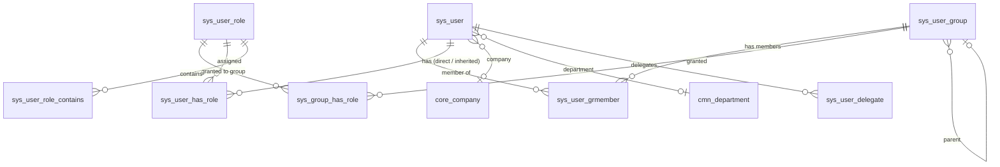
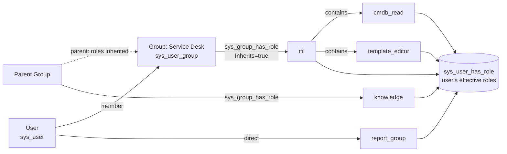
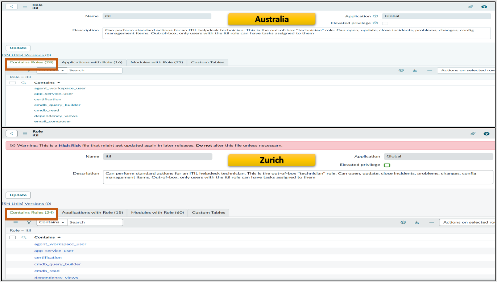
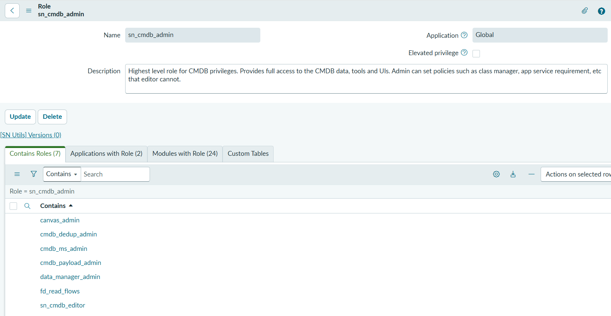
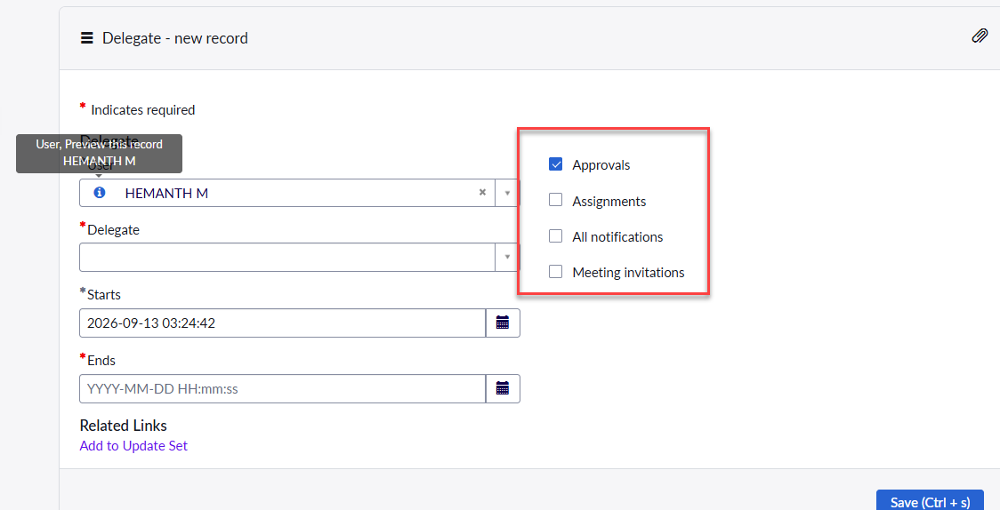
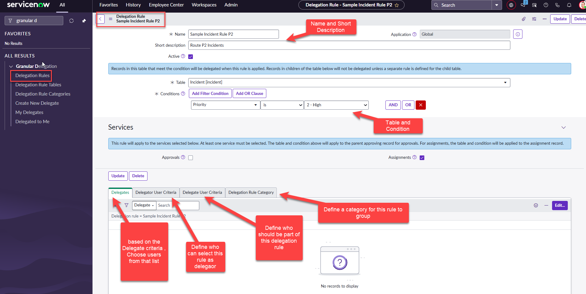

# ユーザー・グループ・ロール（Users, Groups, and Roles）

## 概要

ServiceNow の **User administration（ユーザー管理）** は、「誰がインスタンスにアクセスでき、何を見て何ができるか」を、次の3要素で制御する仕組みである。[出典](https://www.servicenow.com/docs/r/platform-administration/user-administration/c_UserAdministration.html)

| 要素 | テーブル | 役割 |
|---|---|---|
| **User（ユーザー）** | `sys_user` | インスタンスにログインする人、またはシステム／AI エージェントを表すアカウント |
| **Group（グループ）** | `sys_user_group` | ユーザーの集合。作業の割り当て先（Assignment group）、承認、通知、ロール付与の単位 |
| **Role（ロール）** | `sys_user_role` | 権限の束。ACL（アクセス制御）、モジュール表示、UI アクション等の判定に使われる |

本ファイルは、上記3テーブルとその中間テーブル、ロール継承、エレベーテッドロール（`security_admin`）、Role delegation（ロール委任）と承認・作業の Delegation（代理）、Impersonation（なりすまし）、ドメインセパレーションとの関係、LDAP 連携、主要ロール一覧（Australia で追加された Granular admin roles を含む）を扱う。

- 入門者向けの解説は [ユーザー・ロール・ライセンスの基本](../../01_入門編/08-users-roles-licensing-basics.md) を参照。
- ロールが実際にどのレコード／フィールドへのアクセスを許可するかの評価ロジックは [アクセス制御（ACL）](./access-control-acl.md) を参照。
- SSO・SAML・MFA などの認証は [認証とSSO](./authentication-sso.md)、ドメインセパレーションの詳細は [ドメインセパレーション](./domain-separation.md)、ロールとサブスクリプション（ライセンス）の関係は [ライセンスモデル](../../03_導入編/01-licensing-model.md) を参照。

> **基準リリースと出典について:** 本ファイルの基準リリースは Australia（2026-05 GA）である。ServiceNow の公式ドキュメントのバージョン非指定 URL（`/docs/r/<領域>/...`）は取得日（2026-11-02）時点で Brazil 版を表示するため、出典の多くは Brazil 版ページである。Australia と Brazil で差異が判明している箇所は「Brazil での変更」として明記した。差異の記載がない箇所は、Zurich 版・Brazil 版で同一内容であることから Australia でも同一と判断している（【推定】）。

---

## 1. データモデル全体像

### 1.1 主要テーブル一覧

ユーザー・グループ・ロールに関わる主要テーブルは次のとおりである。

| テーブル | ラベル（英語） | 内容 | 主な画面（メニュー） |
|---|---|---|---|
| `sys_user` | User | ユーザーアカウント | All > User Administration > Users |
| `sys_user_group` | Group | グループ | All > User Administration > Groups |
| `sys_user_role` | Role | ロール定義 | All > User Administration > Roles |
| `sys_user_grmember` | Group Member | ユーザーとグループの所属関係（多対多） | グループフォームの Group Members 関連リスト |
| `sys_user_has_role` | User Role | ユーザーに付与されたロール（直接付与と継承の両方） | ユーザーフォームの Roles 関連リスト |
| `sys_group_has_role` | Group Role | グループに付与されたロール | All > User Administration > Group Roles |
| `sys_user_role_contains` | Contained Role | ロールが包含する（Contains）ロール | ロールフォームの Contains Roles 関連リスト |
| `sys_user_group_type` | Group Type | グループの種別（`itil`、`catalog`、`survey` 等） | グループフォームの Type フィールド |
| `sys_user_delegate` | Delegate | 承認・作業の標準的な代理（Delegation）設定 | All > Self Service > My Profile の Delegates 関連リスト |
| `sys_granular_delegate` | Granular Delegate | Granular delegation（詳細な代理）設定 | Granular Delegation アプリケーションメニュー |
| `sys_delegation_rule` | Delegation Rule | Granular delegation のルール | Granular Delegation > Delegation Rules |
| `sys_audit_role` | Role Audit | ロール付与・削除の監査記録 | System Security > Reports > Role Audit |
| `core_company` / `cmn_department` / `cmn_location` | Company / Department / Location | ユーザーの所属を表す参照先 | User Administration 配下 |

出典：[Create a group](https://www.servicenow.com/docs/r/platform-administration/user-administration/t_CreateAGroup.html)、[Create a group role](https://www.servicenow.com/docs/r/platform-administration/user-administration/t_CreateAGroupRole.html)、[Delegating roles（Australia）](https://www.servicenow.com/docs/r/EqTdsLocR0Ylm0TDB1E9xw/p55J1ygJtr4~foabRV1OSA)、[Exploring Granular Delegation](https://www.servicenow.com/docs/r/SogDT~k7ktsbe1ZYegnaLg/f1ST0lQMraDFT3t9mJYGwQ)、[Delegate approvals and tasks](https://www.servicenow.com/docs/r/servicenow-platform/self-service/t_DelegateApprovalsTasks.html)

- `sys_user_role_contains` テーブル名は公式ドキュメント本文では明示されていないが、ServiceNow Community で「ロールの包含関係は `sys_user_role_contains`、グループ経由の付与は `sys_group_has_role` を見る」と広く案内されている。【第三者情報】 [出典](https://www.servicenow.com/community/developer-forum/user-is-not-part-any-group-but-still-has-the-roles/m-p/2787679)

### 1.2 関係図

- ユーザーがロールを得る経路は「ユーザーへの直接付与」と「所属グループからの継承」の2つで、いずれも結果は `sys_user_has_role` に展開される。ロールが他のロールを包含（Contains）している場合、包含先のロールも同じく展開される（詳細は [5. ロール継承](#5-ロール継承role-inheritance)）。

---

## 2. User（ユーザー）`sys_user`

### 2.1 ユーザーの作成

`sys_user` テーブルのレコードは **All > User Administration > Users > New** で作成する。必要ロールは `user_admin`（または `admin`）である。作成に最低限必要なのは **User ID** と、**Given name**・**Family name** のどちらか一方である。[出典](https://www.servicenow.com/docs/r/7LhbZn3yz3Q58qhjZoU9iQ/3VaN0iZLSqAEHZDp2SGJGQ)

ユーザー作成以外の登録経路として、セルフ登録（self-registration）、LDAP、SCIM、SSO 時の Just-in-Time プロビジョニング、Import Set 等がある（LDAP は [10 章](#10-ldap-連携ldap-integration)、SSO／SCIM は [認証とSSO](./authentication-sso.md)、Import Set は [データインポート/エクスポート](./import-export-data.md) を参照）。[出典](https://www.servicenow.com/docs/r/platform-administration/user-administration/c_UserAdministration.html)

### 2.2 ユーザーフォームの主要フィールド

| フィールド（英語ラベル） | 日本語訳 | 説明 |
|---|---|---|
| User ID（`user_name`） | ユーザーID | ログイン名。一意でなければならない。Update Set で重複 ID が取り込まれた場合は、より新しく作成されたレコードが ID を保持する |
| Given name / Family name（`first_name` / `last_name`） | 名 / 姓 | どちらか一方は必須。リリース・インスタンスによっては First name / Last name と表示される |
| Title | 役職 | 職名 |
| Department（`department`） | 部門 | `cmn_department` への参照 |
| Password | パスワード | レコード保存後に **Set Password** で設定。恒久／一時を選べる |
| Password needs reset | パスワード要リセット | 初回ログイン時にパスワード変更を強制する |
| Locked out（`locked_out`） | ロックアウト | ユーザーをインスタンスから締め出し、アクティブなセッションをすべて終了する。admin 自身が自分をロックアウトしないよう保護がある |
| Active（`active`） | 有効 | 無効ユーザーはリスト・参照フィールド・オートコンプリートで管理者にしか表示されない |
| Web service access only | Web サービスアクセスのみ | 非対話型（API 専用）ユーザーとしてマークする。Non-Interactive Sessions プラグインで利用可能 |
| Internal Integration User | 内部連携ユーザー | サービスアカウントを内部連携ユーザーとしてマークする |
| Identity type（`identity_type`） | アイデンティティ種別 | Human / Machine / AI。後述 |
| Email | メール | 通知の宛先。標準外の形式は検証スクリプトで弾かれる場合がある |
| Language / Time zone / Date format | 言語 / タイムゾーン / 日付形式 | ユーザー個別の表示設定 |
| Calendar integration | カレンダー連携 | Outlook への会議通知送信有無 |
| Business phone / Mobile phone | 電話番号 | 連絡先 |
| Photo | 写真 | 任意 |

出典：[Create a user（Zurich）](https://www.servicenow.com/docs/r/7LhbZn3yz3Q58qhjZoU9iQ/3VaN0iZLSqAEHZDp2SGJGQ)

ユーザーレコード作成後、フォームの関連リストから **Roles**、**Groups**、**Delegates**、**Skills**、**Subscriptions** を追加できる。[出典](https://www.servicenow.com/docs/r/7LhbZn3yz3Q58qhjZoU9iQ/3VaN0iZLSqAEHZDp2SGJGQ)

### 2.3 Identity type（アイデンティティ種別）と AI ユーザー

`sys_user.identity_type` フィールドは、アカウントが人か機械か AI かを分類する Choice フィールドである。

| 値（ラベル） | 内部値 | 用途 | Web service access only との連動 |
|---|---|---|---|
| Human | `human` | 従業員・契約者など人間 | 自動的にオフ |
| Machine | `machine` | サーバー、アプリケーション、サービスアカウントなど非人間 | 自動的にオン |
| AI | `ai_agent` | AI エージェント／エージェンティックワークフローが、呼び出し元ユーザーより多い権限を必要とする場合の実行ユーザー | 自動的にオフ |
| -（未分類） | `unclassified` | 既存レコードや未分類レコード。選択肢としては非アクティブ | — |

出典：[Create a user](https://www.servicenow.com/docs/r/7LhbZn3yz3Q58qhjZoU9iQ/3VaN0iZLSqAEHZDp2SGJGQ)、内部値は [New field introduction in User [sys_user] - Australia release](https://www.servicenow.com/community/itsm-articles/new-field-introduction-in-user-sys-user-australia-release/ta-p/3511607)【第三者情報】

- Australia のリリースノートには、Identity type ドロップダウンへの **AI** 選択肢の追加、AI 種別ユーザーの作成・編集・ロール管理・削除を行う `ai_user_admin` ロール、ユーザー作成時に種別を細分する **Identity sub-type** フィールドが記載されている。[出典](https://www.servicenow.com/docs/r/delta-australia-brazil/brazil-australia-identity-release-notes.html)
- AI種別とそれ以外の種別との間の変更は制限されている。[出典](https://www.servicenow.com/docs/r/7LhbZn3yz3Q58qhjZoU9iQ/3VaN0iZLSqAEHZDp2SGJGQ)
- `identity_type` フィールド自体は Zurich 時点で既に存在していたとのコミュニティ報告があり、正確な導入リリースは公開情報では確認できず。【第三者情報】 [出典](https://www.servicenow.com/community/itsm-articles/new-field-introduction-in-user-sys-user-australia-release/ta-p/3511607)
- 新しいインスタンスでは Web service access only チェックボックスが読み取り専用となり、Identity type の利用を促すメッセージが表示される画面例がある（[入門編 08](../../01_入門編/08-users-roles-licensing-basics.md) の画像参照）。読み取り専用化の正式な導入リリースは公開情報では確認できず。
- AI エージェントがツール実行時に継承するロールを制限する **Role masking（ロールマスキング）** が Australia／Brazil のリリースノートに記載されている（Australia Patch 3 でマスキング対象ロールが Agent Access Role Mapping テーブルに1ロール1レコードで保存されるよう変更）。詳細は [Now Assist と AI Agents](./now-assist-ai-agents.md) を参照。[出典](https://www.servicenow.com/docs/r/delta-australia-brazil/brazil-australia-identity-release-notes.html)

### 2.4 Australia で確認されている `sys_user` の追加フィールド

ServiceNow Community の記事は、Australia 時点の `sys_user` に以下のフィールドがあると紹介している。【第三者情報】 [出典](https://www.servicenow.com/community/itsm-articles/new-field-introduction-in-user-sys-user-australia-release/ta-p/3511607)

| ラベル | 列名 | 型 | 内容 |
|---|---|---|---|
| Identity Type | `identity_type` | Choice | 上記 2.3 |
| Manager HP1 | `manager_hp1` | Record Hierarchy Path | Manager（上長）関係から自動維持される管理階層パス。読み取り専用で、XML エクスポート・インポート対象外 |
| Time sheet policy | `time_sheet_policy` | Reference | タイムシートポリシー（SPM 関連） |
| Work agent status | `agent_status` | Choice | `on_shift`、`off_shift`、`on_break` 等のエージェント状態。AWA（Advanced Work Assignment）のプレゼンスとは別物 |

### 2.5 ユーザーの無効化・ロックアウト・削除

- **Active = false**：ログインできなくなる。レコードは残るため、過去チケットの参照（Caller、Assigned to 等）は維持される。[出典](https://www.servicenow.com/docs/r/7LhbZn3yz3Q58qhjZoU9iQ/3VaN0iZLSqAEHZDp2SGJGQ)
- **Locked out = true**：ログインを拒否し、既存セッションを即時終了する。[出典](https://www.servicenow.com/docs/r/7LhbZn3yz3Q58qhjZoU9iQ/3VaN0iZLSqAEHZDp2SGJGQ)
- **削除**：LDAP 連携の公式解説は、LDAP から消えたユーザーを自動削除しない理由として「削除するとユーザー履歴が消え参照がクリアされる」ことを挙げており、削除の判断は顧客に委ねている。実務では削除ではなく無効化が一般的である。[出典](https://www.servicenow.com/docs/r/GypxAX2jEErwkCxugICKdg/QeeX7ay14VRIqnHl3Qx5AQ) 【経験則】

### 2.6 Company・Department・Location

`sys_user` は Company（`core_company`）、Department（`cmn_department`）、Location（`cmn_location`）を参照できる。Company と Department はユーザーを分類する任意の手段と位置付けられている。[出典](https://www.servicenow.com/docs/r/platform-administration/user-administration/c_UserAdministration.html)

ドメインセパレーション環境では、ユーザーを Company に割り当てると、そのユーザーは Company のドメインに自動的に割り当てられる（[9 章](#9-ドメインセパレーションとの関係)）。[出典](https://www.servicenow.com/docs/r/platform-security/c_DomainAssignment.html)

---

## 3. Group（グループ）`sys_user_group`

### 3.1 グループの作成とフィールド

`sys_user_group` テーブルのレコードは **All > User Administration > Groups > New** で作成する。必要ロールは `user_admin`。[出典](https://www.servicenow.com/docs/r/platform-administration/user-administration/t_CreateAGroup.html)

| フィールド（英語ラベル） | 日本語訳 | 説明 |
|---|---|---|
| Name | 名前 | グループ名 |
| Manager | マネージャー | グループの管理者・リーダー。ロール委任（[7 章](#7-role-delegationロール委任)）の Group Manager Change ビジネスルールでも使われる |
| Type | 種別 | グループのカテゴリ（`sys_user_group_type` への複数値参照）。既定ではフォームに表示されないことがあり、フォーム構成で追加する（Work Management プラグイン有効時は自動追加）。`catalog` 種別のグループは Service Catalog > Catalog Policy > Fulfillment Groups にも表示される |
| Group email | グループメール | 配布リスト、または窓口（マネージャー等）のアドレス |
| Parent | 親グループ | このグループが属する上位グループ。後述のとおりロールが継承される |
| Active | 有効 | 無効グループは既存の参照値には残るが、非管理者からはリスト・参照ルックアップ・オートコンプリートで見えなくなる |
| Exclude manager | マネージャー除外 | グループ宛メール通知をマネージャーに送らない |
| Include members | メンバーを含める | グループメール宛ての通知を各メンバーにも個別に送る。承認通知はこの設定にかかわらず全メンバーに送られる |
| Description | 説明 | 補足情報 |

出典：[Create a group](https://www.servicenow.com/docs/r/platform-administration/user-administration/t_CreateAGroup.html)

- 公式ドキュメントは、任意の True/False フィールド（例：`u_hidden`）と `sys_user_group` の before query ビジネスルールを組み合わせて「メンバーにしか見えない隠しグループ」を作る方法も示している（標準フィールドではない）。[出典](https://www.servicenow.com/docs/r/platform-administration/user-administration/t_CreateAGroup.html)

### 3.2 親子グループとロール継承

- **Parent（親）を持つグループ（子グループ）は親グループのロールを継承する**。
- ただし **子グループのメンバーは親グループのメンバーにはならない**。
- 親グループに作業が割り当てられた場合、Assigned to のルックアップには親グループのメンバーのみが表示され、子グループのメンバーは表示されない。
- 親グループを変更した際のロール付与処理は、プロパティ `glide.ui.schedule_job_for_group_parent_change` で制御される（`true`：非同期、`false`：同期）。

出典：[Create a group](https://www.servicenow.com/docs/r/platform-administration/user-administration/t_CreateAGroup.html)

### 3.3 Group type（グループ種別）と Assignment group の絞り込み

- ベースシステムのグループ種別は `catalog`、`itil`、`survey` である。
- Type が空のグループは ITIL 扱いになる。
- `task.assignment_group` フィールドの既定の挙動は「種別が定義されたグループを除外する」ことであり、グループに種別を追加すると、参照修飾子（Reference qualifier）を変更しない限りタスクの Assignment group で選べなくなる。
- ベースシステムには `task.assignment_group` に Type = `itil` で絞り込む参照修飾子が含まれる。種別によるフィルタには組み込みの動的フィルタ `GetGroupFilter` を利用でき、拡張テーブル（`incident` 等）ごとに Dictionary override で絞り込みを変えられる。

出典：[Configure assignment group types](https://www.servicenow.com/docs/r/platform-administration/user-administration/c_ConfigGroupTypesForAssignGroups.html)、[Create a group](https://www.servicenow.com/docs/r/platform-administration/user-administration/t_CreateAGroup.html)

- 上記の「既定で種別付きグループを除外」と「Type = `itil` で絞り込む参照修飾子」は同じ公式ページ内の記述であり、実際にどちらの挙動になるかはインスタンスの Dictionary 設定（参照修飾子・Dictionary override）に依存する。導入時は対象テーブルの `assignment_group` 参照修飾子を必ず確認すること。【経験則】
- Type は複数値フィールドのため、特定種別を含むグループを抽出する場合は `type=<sys_id>`（完全一致）ではなく `typeLIKE<sys_id>` を使う必要がある、というコミュニティの知見がある。【第三者情報】 [出典](https://www.servicenow.com/community/itsm-forum/only-show-groups-with-quot-assignment-group-quot-ticked/m-p/695500)

> **Brazil での変更:** ベースシステムの **Conditional Script Writer** グループは、UI 上でタスクやインシデントの Assignment group として選択できなくなった。[出典](https://www.servicenow.com/docs/r/delta-australia-brazil/brazil-australia-identity-release-notes.html)

### 3.4 グループメンバーの管理

- グループへのユーザー追加は、グループフォームの **Group Members** 関連リスト（`sys_user_grmember`）またはユーザーフォームの **Groups** 関連リストで行う。[出典](https://www.servicenow.com/docs/r/platform-administration/user-administration/c_UserAdministration.html)
- `admin` ロールを含むグループには、非 admin ユーザーはメンバーを追加できない。`security_admin` を含むグループには、`security_admin` を持たないユーザーはメンバーを追加できない。[出典](https://www.servicenow.com/docs/r/platform-security/c_ElevatedPrivilege.html)

---

## 4. Role（ロール）`sys_user_role`

### 4.1 ロールの作成とフィールド

`sys_user_role` テーブルのレコードは **All > User Administration > Roles** で作成する。必要ロールは `admin`。[出典](https://www.servicenow.com/docs/r/7LhbZn3yz3Q58qhjZoU9iQ/krUISFxXaAluOpxq825IKg)

| フィールド（英語ラベル） | 日本語訳 | 説明 | 出典 |
|---|---|---|---|
| Name（`name`） | 名前 | ロール名。スコープアプリのロールは `<scope>.<name>`（例：`sn_hr_core.admin`）の形式になる | [Create a role](https://www.servicenow.com/docs/r/7LhbZn3yz3Q58qhjZoU9iQ/krUISFxXaAluOpxq825IKg)、[Role API](https://www.servicenow.com/docs/r/application-development/servicenow-sdk/role-api-now-ts.html) |
| Application | アプリケーション | ロールが属するアプリケーション（スコープ） | 同上 |
| Requires Subscription | サブスクリプション要否 | Yes（サブスクリプションが必要な Measured role＝計測対象ロール）/ No（計測対象外）/ Unspecified（どちらでもない） | [Create a role](https://www.servicenow.com/docs/r/7LhbZn3yz3Q58qhjZoU9iQ/krUISFxXaAluOpxq825IKg) |
| Elevated privilege（`elevated_privilege`） | 昇格権限 | オンにすると、ログイン時にシステムが自動付与しないロールになり、ユーザーが手動でエレベート（昇格）して初めて有効になる | 同上 |
| Description | 説明 | ロールの用途 | 同上 |
| Grantable（`grantable`） | 付与可能 | ロールを単独で付与できるか。既定 true。オフにするとロール委任でも委任できない | [Role API](https://www.servicenow.com/docs/r/application-development/servicenow-sdk/role-api-now-ts.html)、[Prevent a role from being delegated](https://www.servicenow.com/docs/r/7LhbZn3yz3Q58qhjZoU9iQ/Sjh7X8fM_kayfrIQtszkRQ) |
| Can delegate（`can_delegate`） | 委任可能 | ロール保持者が他者へ委任できるか。既定 true | 同上 |
| Assignable by（`assignable_by`） | 付与可能ロール | このロールをユーザーに付与できる別のロール | [Role API](https://www.servicenow.com/docs/r/application-development/servicenow-sdk/role-api-now-ts.html) |
| Application Administration（`scoped_admin`） | アプリケーション管理者 | そのアプリの Application Administrator ロールであることを示す。既定 false | 同上 |
| Contains Roles（関連リスト） | 包含ロール | このロールが包含する他のロール | 同上 |

- Grantable・Can delegate はフォーム既定では表示されず、「フォームを構成（Configure form）」で追加して編集する。[出典](https://www.servicenow.com/docs/r/7LhbZn3yz3Q58qhjZoU9iQ/Sjh7X8fM_kayfrIQtszkRQ)
- 列名（`elevated_privilege`、`can_delegate`、`assignable_by`、`scoped_admin`）は、ServiceNow Fluent の Role API プロパティ名（`elevatedPrivilege`、`canDelegate`、`assignableBy`、`scopedAdmin`）とサードパーティのテーブルリファレンスから対応付けたもの。インスタンスの Dictionary で確認することを推奨する。【推定】
- 公式ドキュメントは「ロールの作成・カスタマイズ・付与はサブスクリプション使用量に影響し得る」と注意喚起している（ユーザー単位のサブスクリプション割り当てを手動で行っていない場合、割り当てはロールに基づいて決まるため）。[出典](https://www.servicenow.com/docs/r/platform-administration/user-administration/t_CreateAGroupRole.html)

### 4.2 ロールの付与

**ユーザーへの付与（直接付与）：**

1. **All > User Administration > Users** でユーザーを開く。
2. **Roles** 関連リストで **Edit** を選択する。
3. **Collection**（候補）リストからロールを選び **Add**、**Save** する。

- 必要ロールは `user_admin` または `admin`。ただし `admin` ロールを付与するには付与者自身が `admin` を持つ必要があり、`security_admin` を付与するには `security_admin` にエレベートしている必要がある。
- Collection に表示されるのは、インストール済みアプリケーション／プラグインのロールのみ。
- 新しいロールは **ユーザーが新しいセッションを開始してから有効** になる。ログイン中のユーザーが新ロールで許可されたレコードにアクセスできない場合は、ログアウト・再ログインが必要。

出典：[Assign a role to a user](https://www.servicenow.com/docs/r/platform-administration/user-administration/t_AssignARoleToAUser.html)

**グループへの付与（推奨）：**

1. **All > User Administration > Group Roles** で **New**。
2. **Group**、**Role** を指定する。**Inherits**（既定でオン）がオンの場合、グループの全メンバーがロールを継承する。
3. **Submit**。

- 必要ロールは `admin`（公式手順上）。グループフォームの Roles 関連リストからも付与できる。
- 多数のメンバーを持つグループへのロール追加で待たされないよう、`glide.ui.schedule_slushbucket_save_for_group_roles` を `true` にすると保存処理をバックグラウンド実行にできる。

出典：[Create a group role](https://www.servicenow.com/docs/r/platform-administration/user-administration/t_CreateAGroupRole.html)

> 公式ドキュメントは **個々のユーザーではなくグループにロールを付与する方法を推奨** している。[出典](https://www.servicenow.com/docs/r/platform-administration/user-administration/t_AssignARoleToAUser.html)

### 4.3 ロール変更の監査

ロールの付与・削除の履歴は `sys_audit_role` テーブルに記録され、**System Security > Reports > Role Audit** で参照できる。[出典](https://www.servicenow.com/docs/r/EqTdsLocR0Ylm0TDB1E9xw/p55J1ygJtr4~foabRV1OSA)

Australia の `instance_operator` ロールは、既定で `identity_access_audit_viewer` と `user_role_history_viewer` を包含する（[11.4](#114-australia-の-granular-admin-roles細粒度管理ロール)）。【第三者情報】 [出典](https://www.servicenow.com/community/platform-privacy-security-blog/granular-admin-roles-in-australia-precise-access-control-for-a/ba-p/3562990)

---

## 5. ロール継承（Role Inheritance）

### ロール継承の3つの経路

ServiceNow のユーザーが実際に保持するロール（有効ロール）は、以下の3経路の和集合である。

| 経路 | 仕組み | 格納先 | 外し方 |
|---|---|---|---|
| ① 直接付与 | ユーザーにロールを付与 | `sys_user_has_role`（継承フラグなし） | ユーザーの Roles 関連リストから削除 |
| ② グループ継承 | 所属グループ（`sys_user_grmember`）に付与されたロール（`sys_group_has_role`、Inherits = true）を継承。親グループのロールは子グループに継承される | `sys_user_has_role`（継承フラグあり） | **ユーザーをグループから外す**（ユーザーレコードからは削除できない） |
| ③ ロール包含（Contains） | 付与されたロールが包含する子ロールを自動的に保持 | `sys_user_has_role`（継承フラグあり） | 親ロールを外す |

出典：[Assign a role to a user](https://www.servicenow.com/docs/r/platform-administration/user-administration/t_AssignARoleToAUser.html)（「グループに割り当てられたロールはユーザーレコードから削除できない。グループからユーザーを外す」）、[Create a group](https://www.servicenow.com/docs/r/platform-administration/user-administration/t_CreateAGroup.html)、[Create a group role](https://www.servicenow.com/docs/r/platform-administration/user-administration/t_CreateAGroupRole.html)

- `sys_user_has_role` には継承されたかどうかを示す **Inherited（`inherited`）** フラグがある。【第三者情報】 [出典](https://github.com/turbot/steampipe-plugin-servicenow/blob/v0.3.1/docs/tables/servicenow_sys_user_has_role.md)
- `sys_user_has_role` には付与元グループを示す **Granted by（`granted_by`）** などのフィールドもあるとされるが、公式な列一覧は公開情報では確認できず、インスタンスの Dictionary で確認すること。【経験則】

### ロール包含（Contains Roles）の確認方法

- ロールフォーム（All > User Administration > Roles でロールを開く）の **Contains Roles** 関連リストで、そのロールが包含するロールを確認できる。逆に、あるロールを包含する上位ロールはロールフォームの別の関連リスト（"Contained by" 相当）で確認する。【第三者情報】 [出典](https://www.servicenow.com/community/itsm-forum/how-to-find-a-role-contained-by-roles/td-p/563104)
- 公式ドキュメントのベースシステムロール一覧には、`itil` が `template_editor` を含み、`cmdb_read` が `admin` と `itil` に包含されることが記載されている。[出典](https://www.servicenow.com/docs/r/platform-administration/user-administration/base-system-roles.html)

### 例：Australia での `itil` / `itil_admin` 包含ロールの拡大

Australia では `itil` と `itil_admin` の包含ロールが拡大された。

- `itil` の主要な包含ロールは Zurich までの 24 個から、Australia で 28 個に増えた（4 ロール追加）。【第三者情報】
- `itil_admin` は Australia から既定で `sn_cmdb_admin` を包含する。これにより `itil_admin` 保持者は全員 CMDB 管理者相当の権限（CI Class Manager のポリシー設定を含む）を得るため、アップグレード前に `itil_admin` の付与対象を見直すよう同記事は推奨している。【第三者情報】
- 公式のベースシステムロール一覧（Brazil 版）にも「`itil_admin` は `sn_cmdb_admin` の権限を含む」と記載されている。[出典](https://www.servicenow.com/docs/r/platform-administration/user-administration/base-system-roles.html)

出典：[Expanded Role Inheritance for ITIL and ITIL_ADMIN (Australia)](https://www.servicenow.com/community/itsm-articles/expanded-role-inheritance-for-itil-and-itil-admin-australia/ta-p/3516134)（ServiceNow Community 記事。取得日 2026-11-02）

**キャプション:** `itil` ロールのロールフォームにおける Contains Roles 関連リストの比較（上：Australia、下：Zurich）。

**画面の説明:** クラシック UI（UI16）のロールフォーム。上部に Name（`itil`）、Application（Global）、Elevated privilege チェックボックス（オフ）、Description（「Can perform standard actions for an ITIL helpdesk technician. This is the out-of-box "technician" role. Can open, update, close incidents, problems, changes, config management items. Out-of-box, only users with the itil role can have tasks assigned to them」）がある。下部の関連リストタブは Contains Roles、Applications with Role、Modules with Role、Custom Tables。Contains Roles の件数は Australia が 28、Zurich が 24 で、いずれも `agent_workspace_user`、`app_service_user`、`certification`、`cmdb_query_builder`、`cmdb_read`、`dependency_views` などが並ぶ。Applications with Role は Australia 16／Zurich 15、Modules with Role は Australia 72／Zurich 60。Zurich 側にはベースシステムレコードの変更に関する "High Risk" 警告バナーが表示されている。なお件数はインスタンスのインストール済みプラグインによって変わり得る。

**出典:** https://www.servicenow.com/community/itsm-articles/expanded-role-inheritance-for-itil-and-itil-admin-australia/ta-p/3516134 （ServiceNow Community 記事。取得日 2026-11-02）【第三者情報】

**キャプション:** `sn_cmdb_admin` ロールのロールフォームと Contains Roles 関連リスト（Australia で `itil_admin` に包含されるようになったロール）。

**画面の説明:** ロールフォーム上部に Name（`sn_cmdb_admin`）、Application（Global）、Elevated privilege（オフ）、Description（「Highest level role for CMDB privileges. Provides full access to the CMDB data, tools and UIs. Admin can set policies such as class manager, app service requirement, etc that editor cannot.」）。Contains Roles（7 件）として `canvas_admin`、`cmdb_dedup_admin`、`cmdb_ms_admin`、`cmdb_payload_admin`、`data_manager_admin`、`fd_read_flows`、`sn_cmdb_editor` が表示されている。

**出典:** https://www.servicenow.com/community/itsm-articles/expanded-role-inheritance-for-itil-and-itil-admin-australia/ta-p/3516134 （ServiceNow Community 記事。取得日 2026-11-02）【第三者情報】

### ロール継承の注意点

- **ロール包含はロールの付与のみを伝播し、エレベーテッドロールのエレベーションは伝播しない。** エレベーテッドロール A がエレベーテッドロール B を包含していても、A にエレベートしただけでは B の権限は得られず、B にも個別にエレベートする必要がある。[出典](https://www.servicenow.com/docs/r/platform-security/c_ElevatedPrivilege.html)
- グループからユーザーを外しても継承ロールが残る、あるいはグループ所属がないのに継承ロールが表示される、という事象がコミュニティで報告されている。多くは別ロールの包含経由で付与されているケースである。【第三者情報】 [出典](https://www.servicenow.com/community/developer-forum/user-is-not-part-any-group-but-still-has-the-roles/m-p/2787679)
- `itil` のような包含ロールの多いベースシステムロールは、リリースごとに包含内容が変わる（上記 Australia の例）。アップグレード時はリリースノートとロールの Contains Roles を確認する。【経験則】

---

## 6. Elevated privilege roles（エレベーテッドロール）と `security_admin`

### 6.1 エレベーテッドロールの仕組み

**Elevated privilege role（昇格権限ロール）** は、ユーザーに付与されていてもログイン時には有効にならず、ユーザーが手動で **エレベート（Elevate：昇格）** して初めて有効になるロールである。

| 項目 | 仕様 |
|---|---|
| 有効化 | ログイン時に自動付与されない。ユーザーが手動でエレベートする |
| 前提 | エレベート対象のロールがユーザーに付与されていること |
| 有効期間 | 現在のユーザーセッションの間のみ。セッションタイムアウトまたはログアウトで解除 |
| 包含関係 | ロール A がロール B を包含していても、A へのエレベートでは B は有効にならない（個別にエレベートが必要） |
| ベースシステムの該当ロール | `security_admin` のみ（ACL と High Security Settings へのアクセスを付与） |
| ロール一覧での表示 | `security_admin` はエレベートするまでロール一覧に表示されない |
| カスタム | 任意のロールをロールフォームの Elevated privilege で昇格権限ロールに指定できる |
| `admin` ロール | `admin` 自体をエレベーテッドロールにする使い方はサポートされない（代わりに下記の強制エレベートプロパティを使う） |

出典：[Elevated privilege roles](https://www.servicenow.com/docs/r/platform-security/c_ElevatedPrivilege.html)、[Create a role](https://www.servicenow.com/docs/r/7LhbZn3yz3Q58qhjZoU9iQ/krUISFxXaAluOpxq825IKg)

- 公式ドキュメントは、Explicit Roles プラグイン利用時に `snc_internal` を昇格権限ロールにしてはならない（内部ユーザーがインスタンスにアクセスできなくなる）と警告している。[出典](https://www.servicenow.com/docs/r/platform-security/explicit-roles.html)

### 6.2 `security_admin` ロール

`security_admin` は High Security Settings に含まれるエレベーテッドロールで、保持者は **ACL（Access Control）の作成・変更** と **High Security Settings の変更** を行える。[出典](https://www.servicenow.com/docs/r/platform-security/security-admin-role.html)

- ベースシステムでは既定の System Administrator（`admin` ユーザー）のみが `security_admin` を持つ。`admin` ユーザーもログイン時点では保持しておらず、エレベートした後はセッション中保持し続ける。
- エレベーションが必要なため、少数のユーザー・グループにのみ付与するよう推奨されている。
- `security_admin` を他ユーザーに付与するには、付与者が `admin` を持ち、かつ `security_admin` にエレベートしている必要がある。`admin` だけでは付与できない。
- High Security の各プロパティは read_roles = `admin`、write_roles = `security_admin` であり、`admin` は値を参照できるが、変更には `security_admin` へのエレベートが必要である。

出典：[Security_admin role](https://www.servicenow.com/docs/r/platform-security/security-admin-role.html)、[Elevated privilege roles](https://www.servicenow.com/docs/r/platform-security/c_ElevatedPrivilege.html)

> 公式ドキュメント（Elevated privilege roles）の要約部分では "securityadmin" と表記されている箇所があるが、ロール名は `security_admin` である。

ACL 側から見た `security_admin` の位置付けは [アクセス制御（ACL）](./access-control-acl.md)、High Security Settings の内容は [プラットフォームセキュリティと暗号化](./platform-security-encryption.md) を参照。

### 6.3 エレベートの手順

1. バナー（ヘッダー）のユーザー画像（画像がなければイニシャル）を選択する。
2. **Elevate Roles**（ロールの昇格）を選択する。エレベート可能なロールの一覧ダイアログが表示される。
3. 有効化するロールを選び **OK**。以後、セッション終了までそのロールで制御される全リソースに昇格権限が適用される。
4. エレベーションを解除するには、同じダイアログでロールの選択を外す。

- 公式手順の前提ロールは `admin` である。

出典：[Elevate to a privileged role](https://www.servicenow.com/docs/r/platform-security/t_ElevateToAPrivilegedRole.html)

- エレベート中はヘッダーの枠やユーザープロファイルが赤く表示される、というコミュニティ報告がある。【第三者情報】 [出典](https://www.servicenow.com/community/developer-forum/regarding-security-admin-role/m-p/2745282)
- 上記手順が Next Experience UI と UI16 のどちらを前提とした記述かは、公式ページでは明示されていない。

### 6.4 管理者に手動エレベートを強制する（`glide.security.strict_elevate_privilege`）

システムプロパティ `glide.security.strict_elevate_privilege` を `true` にすると、`admin` ロールを持つすべてのユーザーが、ログイン時に表示されるダイアログでエレベートするロールを手動で選択するようになる。

| 項目 | 内容 |
|---|---|
| プロパティ | `glide.security.strict_elevate_privilege` |
| 値 | `true` |
| 必要ロール | `security_admin` |
| 設定手順 | admin でログイン → `security_admin` にエレベート → `sys_properties.list` を開く → 同プロパティを検索 → Value を `true` にして Submit |
| 効果 | ログイン時にロール選択ダイアログが表示される |

出典：[Force administrators to manually elevate](https://www.servicenow.com/docs/r/platform-security/t_ForceAdmManElev.html)（Australia・Yokohama・Washington DC 版でも同一手順）

---

## 7. Role delegation（ロール委任）

### 7.1 概要

**Role delegation（ロール委任）** は、管理者以外のユーザー（典型的にはグループマネージャー）が、グループ内の他ユーザーにロールを割り当てられるようにする機能である。**委任者（Role delegator）は自分が既に保持しているロールしか割り当てられない。** [出典](https://www.servicenow.com/docs/r/EqTdsLocR0Ylm0TDB1E9xw/p55J1ygJtr4~foabRV1OSA)

| 要素 | 内容 |
|---|---|
| `role_delegator` ロール | 委任者を示すロール。手動で付与するか、Group Manager Change ビジネスルールで自動付与する |
| Group Manager Change ビジネスルール | 既定で無効。有効化すると、グループフォームの Manager フィールドに設定されたユーザーに `role_delegator` を自動付与し、マネージャーでなくなると自動削除する |
| 委任の操作 | User Administration > Delegate Roles in Group（`role_delegator` が必要） |
| 委任者一覧 | User Administration > Role Delegators |
| 委任可能なロール | 委任者自身が保持するロールのみ |
| 対象グループ | 委任者が所属・管理していないグループも選択できる |
| 監査 | System Security > Reports > Role Audit（`sys_audit_role`） |

出典：[Delegating roles（Australia）](https://www.servicenow.com/docs/r/EqTdsLocR0Ylm0TDB1E9xw/p55J1ygJtr4~foabRV1OSA)、[Assign roles as a role delegator](https://www.servicenow.com/docs/r/K~TMjGrGv2CmYjaGLbVoJQ/cLnJfSbQHnzCSLjTD2cE_Q)

### 7.2 委任できないロール

- ベースシステムで委任できないロールは `admin`、`public`、`role_delegator` の3つ。`role_delegator` 保持者はこのロール自体をグループメンバーに委任できない。
- 任意のロールを委任不可にするには、**All > User Administration > Roles** でロールを開き、フォームを構成して **Grantable** または **Can delegate** フィールドを追加し、チェックを外して保存する。

出典：[Prevent a role from being delegated](https://www.servicenow.com/docs/r/7LhbZn3yz3Q58qhjZoU9iQ/Sjh7X8fM_kayfrIQtszkRQ)

- Australia の Granular admin roles には、ロール委任を管理する `role_delegator_admin` と、どのロールを特権ロールとするかを指定する `privileged_role_config_admin` が含まれる。[出典](https://www.servicenow.com/docs/r/platform-security/granular-admin-roles.html)

---

## 8. 承認・作業の Delegation（代理）

ロール委任（7 章）とは別に、不在時などに **承認（Approvals）や割り当てタスク（Assignments）を他ユーザーに代理させる** 機能がある。Standard delegation（標準）と Granular delegation（詳細）の2方式がある。

### 8.1 Standard delegation（標準の代理）`sys_user_delegate`

**手順:** All > Self Service > My Profile を開き、**Delegates** 関連リストで **New**。Delegates 関連リストが表示されない場合は、ITIL や Default などのビューに切り替えるか、フォームレイアウトで関連リストを追加する。[出典](https://www.servicenow.com/docs/r/servicenow-platform/self-service/t_DelegateApprovalsTasks.html)

| フィールド | 日本語訳 | 内容 |
|---|---|---|
| User | ユーザー | 代理を依頼する本人（Delegator） |
| Delegate | 代理人 | 代理する有効（Active）なユーザー |
| Starts / Ends | 開始 / 終了 | 代理人が代理できる期間 |
| Approvals | 承認 | 代理人が本人に代わって承認できる |
| Assignments | 割り当て | 代理人が本人に割り当てられたタスクを参照・作業できる |
| All notifications | 全通知 | 本人宛メール通知のコピーを代理人に送る（Meeting Invitation 種別を除く） |
| Meeting invitations | 会議招待 | Meeting Invitation メールのコピーを代理人に送る |

- 承認の代理設定自体に特別なロールは不要。
- 代理人が Service Portal から承認するには `approval_admin` または `approver_user` ロールが必要。
- **Approvals をオンにして All notifications をオフにすると、代理人は承認（の通知）を受け取らない**、と公式ドキュメントに記載されている。
- 代理人は本人と同じ「あなたに割り当てられました」メールを受け取るため、自分が代理であることを理解しておく必要がある。

出典：[Delegate approvals and tasks（Brazil）](https://www.servicenow.com/docs/r/servicenow-platform/self-service/t_DelegateApprovalsTasks.html)

**キャプション:** Standard delegation の Delegate（`sys_user_delegate`）新規レコードフォーム。

**画面の説明:** フォームタイトルは「Delegate - new record」。左側に User（本人。参照フィールド）、Delegate（必須。代理人の参照フィールド）、Starts（必須。日時）、Ends（必須。日時）が縦に並ぶ。右側に Approvals（オン）、Assignments、All notifications、Meeting invitations の4つのチェックボックスが赤枠で強調されている。下部に Related Links「Add to Update Set」、右下に Save ボタンがある。User 欄にはコミュニティ記事の投稿者のユーザー名が表示されている。

**出典:** https://www.servicenow.com/community/developer-articles/standard-vs-granular-delegation-let-s-clear-the-confusion/ta-p/3597312 （ServiceNow Community 記事、2026-09-13 投稿。取得日 2026-11-02）【第三者情報】

### 8.2 Granular delegation（詳細な代理）

**Granular delegation** は、承認と割り当てを別々に、かつ条件付きで代理させる機能である（Zurich のドキュメントで確認。導入リリースは公開情報では確認できず）。[出典](https://www.servicenow.com/docs/r/SogDT~k7ktsbe1ZYegnaLg/f1ST0lQMraDFT3t9mJYGwQ)

| 要素 | 内容 |
|---|---|
| プラグイン | `com.glide.granular_service_delegation`（有効化に `admin` が必要） |
| 管理ロール | `delegation_admin`（Granular delegation の管理とデリゲーションルールの設定。他ロールを包含しない） |
| Granular Delegate（`sys_granular_delegate`） | 誰が代理人で、いつ代理し、どの通知を受け取るか |
| Delegation Rule（`sys_delegation_rule`） | どのタスクレコードを代理させるかの条件。承認用／割り当て用を区別 |
| Delegation Rule Table（`sys_delegation_rule_table`） | 代理対象にできるタスクテーブル（限定されたテーブルのみ） |
| User Criteria（`user_criteria`） | 誰が委任者（Delegator）になれ、誰が代理人（Delegate）になれるか |
| `com.glide.delegation.default_days_since_update` | 非アクティブな代理レコードの保持日数（既定 7、最大 30） |
| スケジュールジョブ | Notify New Delegates（10 分ごとに代理期間開始を通知）、Clean Granular Delegation Records（日次で非アクティブレコードを削除） |

出典：[Exploring Granular Delegation（Zurich）](https://www.servicenow.com/docs/r/SogDT~k7ktsbe1ZYegnaLg/f1ST0lQMraDFT3t9mJYGwQ)、[Setting up Granular Delegation（Zurich）](https://www.servicenow.com/docs/r/zurich/employee-service-management/granular-delegation/granular-delegation-setup.html)

**標準と詳細の併用:** システムプロパティ `glide.approval.delegation.version` で動作を切り替える。

| 値 | 動作 |
|---|---|
| `v1` | Standard delegation のみ |
| `v2` | Granular delegation のみ |
| `v3` | 両方（既定） |

出典：[Exploring Granular Delegation（Zurich）](https://www.servicenow.com/docs/r/SogDT~k7ktsbe1ZYegnaLg/f1ST0lQMraDFT3t9mJYGwQ)

**重要な制約:**

- **Granular delegation はレコードへのアクセス権を付与しない。** 代理人は必要なロールを既に持っている必要がある（例：`task` 系テーブルにアクセスするには `itil`、Employee Center で IT リクエストを承認するには `approval_user` または `business_stakeholder`。HR の承認には適用されない）。
- **Flow や Workflow はデリゲーションルールを無視する**（Standard delegation が必要）。
- e-signature が必要な承認では、代理人が自分の資格情報を入力する。
- Core UI 16 では IT リクエスト承認のロール検証が実装されていない。

出典：[Exploring Granular Delegation（Zurich）](https://www.servicenow.com/docs/r/SogDT~k7ktsbe1ZYegnaLg/f1ST0lQMraDFT3t9mJYGwQ)

> **ロール名の表記揺れ:** 公式ドキュメント上、Standard delegation のページは `approver_user`、Granular delegation のページは `approval_user` と記載している。ベースシステムロール一覧に掲載されているのは `approver_user` であり、`approval_user` が別ロールか誤記かは公開情報では確認できず。

**キャプション:** Granular delegation の Delegation Rule（デリゲーションルール）フォームとアプリケーションメニュー。

**画面の説明:** Next Experience UI。左のナビゲーターで「granular d」とフィルタすると、Granular Delegation 配下に Delegation Rules、Delegation Rule Tables、Delegation Rule Categories、Create New Delegate、My Delegates、Delegated to Me のモジュールが表示される。右側のフォームは「Delegation Rule - Sample Incident Rule P2」で、Name、Short description（Route P2 Incidents）、Active（オン）、Application（Global）、Table（Incident [incident]）、Conditions（Priority is 2 - High）が設定されている。Services セクションには Approvals（オフ）と Assignments（オン）のチェックボックスがあり、「少なくとも1つのサービスを選択する必要がある。承認の場合は条件が親の承認対象レコードに、割り当ての場合は割り当てレコードに適用される」旨の説明が表示される。下部の関連リストタブは Delegates、Delegator User Criteria（誰がこのルールを委任者として選べるか）、Delegate User Criteria（誰が代理人になれるか）、Delegation Rule Category。フォーム上部の青い説明文は「条件に一致するレコードがこのルール適用時に代理される。子テーブルのレコードは、子テーブル用のルールを別途定義しない限り代理されない」旨を示す。

**出典:** https://www.servicenow.com/community/developer-articles/standard-vs-granular-delegation-let-s-clear-the-confusion/ta-p/3597312 （ServiceNow Community 記事、2026-09-13 投稿。取得日 2026-11-02）【第三者情報】

- 同記事のコメントでは、Granular delegation は既定で Employee Center のプロフィールに追加されないこと、代理人の参照フィールドに条件外の有効ユーザーも表示されること（選ぶと作業一覧が空になる）が指摘されている。【第三者情報】 [出典](https://www.servicenow.com/community/developer-articles/standard-vs-granular-delegation-let-s-clear-the-confusion/ta-p/3597312)

---

## 9. ドメインセパレーションとの関係

**Domain separation（ドメインセパレーション）** は、1つのインスタンス内でデータ・プロセス・管理タスクを論理的なドメインに分離する機能である（詳細は [ドメインセパレーション](./domain-separation.md)）。ユーザー・グループ・ロールとの関係は次のとおり。

### 9.1 ユーザーのドメイン

- ユーザーを Company に割り当てると、ユーザーはその Company のドメインに自動的に割り当てられる（例：ACME 社のユーザーは ACME ドメイン）。
- 他のドメイン決定条件がない場合、ユーザーが作成したレコードはそのユーザーのドメインを継承する。
- レコードのドメインは `sys_domain` フィールドに格納される（1レコード1ドメイン）。

出典：[Domain assignment](https://www.servicenow.com/docs/r/platform-security/c_DomainAssignment.html)

### 9.2 Visibility domains（可視ドメイン）

- **Visibility domains** は、ユーザーまたはグループに対して、本来ドメイン階層上アクセスできない他ドメインのレコードを参照可能にする設定である。User レコード・Group レコードの **Visibility domains** 関連リストで設定する。
- グループに設定した Visibility domains はグループメンバーに付与され、グループを抜けると失われる。個々のユーザーではなくグループに設定することが推奨されている。
- Visibility domains を追加しても、テーブルの ACL 要件（ロール等）は変わらない。

出典：[Visibility domains and Contains domains](https://www.servicenow.com/docs/r/1nuU0tTksWZZbL8T4WKSDg/7xX9uKkZd5PIOr2CyaQ9Aw)

- Visibility domains や Contains domains を多用すると、多数の OR 条件を含む低速クエリが発生するため、必要な場合のみ使うべきというベストプラクティスがある。【第三者情報】 [出典](https://www.servicenow.com/community/now-platform-blog/8-best-practices-for-supporting-domain-separation/ba-p/2286278)

### 9.3 ロール・ACL とドメイン

- ACL（`sys_security_acl`）、Script Include、System Property、Dictionary Entry 等のテーブルはドメイン分離できない。したがって、ロールによるアクセス制御（ACL）は全ドメイン共通の定義となり、ドメインは「どのレコードが見えるか」を、ロール／ACL は「何ができるか」を制御する、という役割分担になる。[出典](https://www.servicenow.com/docs/r/platform-security/c_DomainAssignment.html)
- ロール定義（`sys_user_role`）自体がドメイン分離対象かどうかは、公式ドキュメント上で明示を確認できず。

---

## 10. LDAP 連携（LDAP integration）

### 10.1 概要と前提条件

ServiceNow は LDAP ディレクトリ（Microsoft Active Directory、Novell、Domino、OpenLDAP 等。JNDI 経由）と連携し、ユーザー・グループの取り込みと LDAP 認証を行える。

| 項目 | 内容 |
|---|---|
| ディレクトリ要件 | LDAP v3 準拠 |
| ネットワーク | LDAP サーバーへのインバウンドのファイアウォール許可（または MID Server 経由） |
| サービスアカウント | 読み取り専用アカウント |
| LDAPS | サーバー SSL 証明書の公開鍵側（PKI 証明書）が必要 |
| 同期対象 | ユーザー（`sys_user`）とグループ（`sys_user_group`）。Department は参照されるが同期されない |
| 複数ドメイン | ドメインごとに LDAP サーバーレコードを作成し、一意の coalesce 属性（objectSid、email、userPrincipalName 等）を定義 |

出典：[Understanding LDAP integration（Yokohama）](https://www.servicenow.com/docs/r/GypxAX2jEErwkCxugICKdg/QeeX7ay14VRIqnHl3Qx5AQ)

- 設定メニューは **All > System LDAP > LDAP Servers**。LDAP サーバーレコードの **LDAP OU Definitions** 関連リストに、グループ用とユーザー用のサンプル OU 定義が含まれる。OU 定義の Table には `sys_user` または `sys_user_group` を指定し、Active な OU 定義のみがデータ取り込み対象となる。[出典](https://www.servicenow.com/docs/r/oJu9n0q6rU~F9UHAnNCt5w/_9i1bao0g0LkiPwuaeumTg)
- ベースシステムロール一覧に LDAP 専用の管理ロール（`ldap_admin` 等）は掲載されておらず、LDAP 設定に必要なロールは公開情報では明確に確認できず（一般に `admin` で設定する）。【経験則】
- 連携のカスタマイズは経験のある管理者またはプロフェッショナルサービスで行うことが前提とされている。[出典](https://www.servicenow.com/docs/r/GypxAX2jEErwkCxugICKdg/QeeX7ay14VRIqnHl3Qx5AQ)

### 10.2 データ取り込み（Transform Map）

| Transform Map | ソース（Import Set） | ターゲット | 用途 |
|---|---|---|---|
| LDAP User Import | `ldap_import` | `sys_user` | ユーザー作成（LDAP オンデマンドログイン時を含む）。Active Directory 用マッピング |
| LDAP Group Import | `ldap_group_import` | `sys_user_group` | OU からのグループ作成。Active Directory 用マッピング |

- Department 用の既定 Transform Map はない。
- `u_source` → `sys_user.source`（coalesce = false）。`source` は LDAP の DN を保持し、LDAP 認証の判定、マネージャー検索、グループメンバーシップの割り当てに使われる。
- ユーザーの coalesce キーは `u_samaccountname`（AD の場合）または `u_dn`／`u_cn`（その他）→ `sys_user.user_name`（coalesce = true）。値は一意でなければならない。
- objectSID・objectGUID などバイナリ属性での coalesce にはカスタム Transform Script が必要。
- 同一のソース／ターゲットテーブルの組み合わせに有効な Transform Map は1つだけにする（複数あると重複レコードが生じ得る）。
- Manager 等の参照は LDAP が DN を返すため Transform Script で解決する。Script Include **`LDAPUtils`** の `setManager`（変換中に Manager DN を解析して既存ユーザーに紐づけ）と `processManagers`（`onComplete` スクリプトで、後から取り込まれたマネージャーの紐づけを再試行）を使う。Manager 属性を使わない場合は両呼び出しを削除・コメントアウトする。
- DN を格納するターゲットフィールドは長さに注意（既定長 40 では不足し切り捨てられる可能性）。

出典：[LDAP transform maps（Zurich）](https://www.servicenow.com/docs/r/zurich/platform-security/ldap-integration/c_LDAPTransformMaps.html)

### 10.3 同期方式

| 方式 | 内容 |
|---|---|
| Scheduled refresh（定期取り込み） | 1日1回の完全な LDAP Browse（オフピーク時間帯推奨）。大規模 AD ではページング（既定で対応）を使い、1,000 オブジェクト上限を回避する |
| LDAP Listener | 永続検索（Persistent search）により、LDAP 側の変更（追加を含む）を数秒〜10 秒程度でインスタンスに反映する |
| On-demand（ログイン時） | LDAP User Import マップでログイン時にユーザーを作成する |

出典：[Understanding LDAP integration](https://www.servicenow.com/docs/r/GypxAX2jEErwkCxugICKdg/QeeX7ay14VRIqnHl3Qx5AQ)、[LDAP integration](https://www.servicenow.com/docs/r/1nuU0tTksWZZbL8T4WKSDg/o7EnKZISO18mtBrxD8Frsw)（取得時点で URL が 404。検索結果の要約に基づく）

- LDAP から削除されたエントリはインスタンス側で削除されない（履歴と参照を守るため）。無効化の扱いは顧客側で設計する。[出典](https://www.servicenow.com/docs/r/GypxAX2jEErwkCxugICKdg/QeeX7ay14VRIqnHl3Qx5AQ)

### 10.4 LDAP 認証

- サービスアカウントでユーザーの DN を取得し、その DN とユーザーが入力したパスワードで再バインド（Simple Bind）して認証する。パスワードは HTTPS セッション内でのみ扱われ保存されない。
- ユーザーレコードの **Source** が `ldap` で始まる場合、そのユーザーは LDAP で認証される。**LDAP Server** フィールドが認証先サーバーを決める。
- MID Server をローカルネットワークに置くと LDAP サーバーを外部トラフィックから保護できるが、**LDAP のパスワード認証は MID Server を経由できない** ため、認証にはインスタンスから LDAP サーバーへの直接接続が必要となる。

出典：[Understanding LDAP integration](https://www.servicenow.com/docs/r/GypxAX2jEErwkCxugICKdg/QeeX7ay14VRIqnHl3Qx5AQ)、MID Server 経由不可は検索結果の要約に基づく [LDAP integration overview](https://www.servicenow.com/docs/r/GypxAX2jEErwkCxugICKdg/4zEYyzFYoRfqnySPk2g26w)

- 近年は LDAP 連携に代わり、IdP（Microsoft Entra ID、Okta 等）からの SCIM プロビジョニングと SAML／OIDC SSO を組み合わせる構成が一般的である（[認証とSSO](./authentication-sso.md) 参照）。【経験則】 Australia の Granular admin roles には SCIM プロバイダー設定を管理する `scim_config_admin` がある。[出典](https://www.servicenow.com/docs/r/platform-security/granular-admin-roles.html)
- Active Directory からの CI・ユーザー情報取り込みには Service Graph Connector for Active Directory もある（[Service Graph Connectors](../itom/service-graph-connectors.md) 参照）。

---

## 11. 主要ロール一覧

### 11.1 プラットフォームの特殊ロール

| ロール | 説明 | 注意点 |
|---|---|---|
| `admin` | システム管理者。全機能・全データへのアクセスを持ち、ACL をオーバーライドし、すべてのロールチェックを通過する | より限定的なロールがあればそちらを使う。`admin` の付与には `admin` が必要 |
| `security_admin` | ACL と High Security Settings の変更（エレベーテッドロール） | 6 章参照 |
| `maint` | ServiceNow 社内利用のために予約されたロール | 顧客は使用しない |
| `nobody` | admin や maint を含む全アクセスを拒否する | 誤用すると元に戻せない場合がある。ユーザーに付与しない |
| `public` | ログインなしでのアクセスを許可する | 委任不可 |
| `user` | 顧客が利用可能なロールだが、ベースシステムでは機能を持たない | — |
| `snc_internal` / `snc_external` | Explicit Roles プラグイン（`com.glide.explicit_roles`）有効時に、内部ユーザー／外部ユーザーを明示するロール | Paris 以降、両方を同時に保持することはできない。プラグイン有効化時に既存ユーザー全員へ `snc_internal` が付与される。CSM（`com.sn_customerservice`）等の有効化でも自動的に有効化される |

出典：[Base system roles](https://www.servicenow.com/docs/r/platform-administration/user-administration/base-system-roles.html)、[Explicit Roles](https://www.servicenow.com/docs/r/platform-security/explicit-roles.html)、[Prevent a role from being delegated](https://www.servicenow.com/docs/r/7LhbZn3yz3Q58qhjZoU9iQ/Sjh7X8fM_kayfrIQtszkRQ)

### 11.2 ベースシステムロール（主要なもの）

公式の「Base system roles」一覧（Brazil 版、2026-09-10 更新）から、実務で頻出するものを分類して掲載する。説明は公式記述の要約である。[出典](https://www.servicenow.com/docs/r/platform-administration/user-administration/base-system-roles.html)

**ユーザー管理・セキュリティ**

| ロール | 説明 |
|---|---|
| `user_admin` | ユーザー、グループ、ロケーション、会社を管理する |
| `impersonator` | ユーザーのなりすまし（admin ユーザーを除く） |
| `approval_admin` | 自分に割り当てられていない承認依頼も参照・変更できる。Fulfiller ライセンスが必要 |
| `approver_user` | 自分宛ての承認依頼を変更できる。Requester の機能も持つ。有償 |
| `role_delegator` | グループ内でロールを委任する（7 章） |
| `data_classification_admin` / `data_classification_auditor` | Data Classification アプリケーションの管理／監査 |

**ITSM**

| ロール | 説明 |
|---|---|
| `itil` | ITIL ヘルプデスク担当者の標準ロール。インシデント・問題・変更・CI に対する標準操作。**タスクの割り当て（Assigned to）に必要**。`template_editor` と `cmdb_read` を包含する |
| `itil_admin` | `itil` に加えて ITIL レコードの削除や CMDB の完全な制御が可能。チームリード向け。`sn_cmdb_admin` の権限を含む |
| `incident_manager` | インシデントのプロパティと Major Incident トリガールールを管理する |
| `major_incident_manager` | Major Incident のライフサイクルを起票・主導し、リソースやチャネルを割り当てる |
| `communication_manager` | Major Incident の関係者向けコミュニケーションを管理する |
| `knowledge` / `knowledge_admin` | ナレッジ記事の作成・編集・レビュー／ナレッジベースの管理 |
| `task_editor` | 保護されたタスクフィールドの編集 |

**サービスカタログ**

| ロール | 説明 |
|---|---|
| `catalog` | サービスカタログのリクエストにアクセスする |
| `catalog_admin` | Service Catalog アプリケーション（カテゴリ、アイテム等）を管理する |
| `catalog_manager` | カテゴリにエディターを割り当て、カテゴリ内のアイテムを作成・変更・公開する |
| `catalog_editor` | 割り当てられたカテゴリのアイテムを作成・変更・公開する |
| `catalog_item_designer` | 自分のカテゴリへのリクエスト状況を参照する（申請時に自動付与） |

- Australia の Granular admin roles 一覧では、`catalog_admin` は「カタログ・カテゴリ・アイテムの管理（スクリプトを除く）」と説明されている。[出典](https://www.servicenow.com/docs/r/platform-security/granular-admin-roles.html)
- カタログ関連の詳細は [サービスカタログ](./service-catalog.md) を参照。

**CMDB・資産**

| ロール | 説明 |
|---|---|
| `cmdb_read` | すべての CMDB テーブルを読み取る（`admin` と `itil` に包含） |
| `sn_cmdb_user` | CMDB データの読み取り専用と基本 UI（レポート・ダッシュボード） |
| `sn_cmdb_editor` | CMDB レコードを編集できるが、ポリシーは変更できない |
| `sn_cmdb_admin` | CI Class Manager のポリシーを含む CMDB への完全なアクセス |
| `ecmdb_admin` | CMDB の管理 |
| `cmdb_dedup_admin` | CMDB 重複排除タスクのレビューと是正 |
| `asset` | ハードウェア・ソフトウェア資産の管理 |
| `model_manager` / `category_manager` | モデル／モデルカテゴリの管理 |
| `contract_manager` | 契約の作成・編集・削除 |
| `inventory_admin` / `inventory_user` | 在庫・ストックルームの管理／在庫情報の参照と移動オーダー |

**構成（Personalize）系**

| ロール | 説明 |
|---|---|
| `personalize` | フォーム、リスト、ルール、コントロール、スクリプトの構成 |
| `personalize_form` / `personalize_list` | フォームと関連リストのレイアウト／リストのレイアウト・ビュー |
| `personalize_dictionary` | Dictionary エントリとフィールドラベルの構成 |
| `personalize_choices` | 選択肢と定型応答の構成 |
| `personalize_rules` | ビジネスルールとスクリプトの構成（`business_rule_admin`、`client_script_admin`、`ui_policy_admin`、`ui_action_admin` を含む） |
| `list_updater` | リストの Update Entire List / Update Selected を使う |
| `view_changer` | アクティブなビューの切り替え |

**レポート・フィルター・テンプレート**

| ロール | 説明 |
|---|---|
| `report_admin` | レポートの管理 |
| `report_global` / `report_group` | グローバルレポート／グループ共有レポートの作成 |
| `report_publisher` / `report_scheduler` | レポートの公開ページへの公開／メール配信のスケジュール |
| `filter_admin` / `filter_global` / `filter_group` | フィルターの管理／グローバル・グループフィルターの作成 |
| `template_editor` / `template_editor_global` / `template_editor_group` | 個人／グローバル／グループのテンプレート作成 |

**インポート・連携**

| ロール | 説明 |
|---|---|
| `import_admin` | すべての Import Set とインポートの管理 |
| `import_set_loader` / `import_transformer` | Import Set のロード／Transform Map の管理と変換実行 |
| `import_scheduler` | インポートのスケジュール。**admin 権限でスクリプトを実行できるため実質的に admin と同等** |
| `soap` / `soap_query` / `soap_create` / `soap_update` / `soap_delete` / `soap_ecc` / `soap_script` | SOAP による全テーブルへの操作（種類別） |
| `mid_server` | MID Server が通常使用するテーブルへのアクセス |
| `agent_admin` | MID Server スクリプト等の管理 |

**その他**

| ロール | 説明 |
|---|---|
| `workflow_admin` / `workflow_creator` / `workflow_publisher` | レガシーなグラフィカル Workflow の管理／作成／公開 |
| `script_fix_admin` | Fix Script の作成・管理（実行は不可） |
| `survey_admin` / `survey_reader` | サーベイの管理／参照 |
| `timecard_admin` | 他ユーザーのタイムカードの承認・変更・削除 |
| `ais_admin` | AI Search のインデックス・設定・ログの管理 |
| `guided_tour_admin` | Guided Tour の管理 |
| `sn_appclient.app_client_user` / `upgrade_app` | アプリケーションのインストール／アップグレード |

### 11.3 リスクの高いロールの注意点

| ロール | リスク | 出典 |
|---|---|---|
| `admin` | ACL を含むすべてのチェックを通過する | [Base system roles](https://www.servicenow.com/docs/r/platform-administration/user-administration/base-system-roles.html) |
| `import_scheduler` | admin 権限でスクリプト実行可能＝実質 admin | 同上 |
| `nobody` | 誤って付与・使用すると回復不能な場合がある | 同上 |
| `soap`（および `soap_script`） | 全テーブルへの CRUD とスクリプト実行 | 同上 |
| `itil_admin` | Australia 以降 `sn_cmdb_admin` を包含し CMDB 管理権限を持つ | [Base system roles](https://www.servicenow.com/docs/r/platform-administration/user-administration/base-system-roles.html)、[Community 記事](https://www.servicenow.com/community/itsm-articles/expanded-role-inheritance-for-itil-and-itil-admin-australia/ta-p/3516134) |
| `impersonator` | 他ユーザーとして操作できる（admin ユーザーは除く） | [Base system roles](https://www.servicenow.com/docs/r/platform-administration/user-administration/base-system-roles.html) |

### 11.4 Australia の Granular admin roles（細粒度管理ロール）

Australia では、従来 `admin`（や `itil_admin`）が必要だった管理作業を、機能単位のロールで行えるようにする **Granular admin roles（細粒度管理ロール）** が導入された。

- ServiceNow Community の公式ブログは、Australia で **300 以上** のタスクベースの Granular admin roles が導入され、2026 年 5 月第1週に GA になったとしている。利用には Australia 以降が必要。採用は任意で、既存の admin ユーザーのアクセスは変わらない。今後の新機能は admin 権限を前提に構築しない方針とされる。【第三者情報】 [出典](https://www.servicenow.com/community/platform-privacy-security-blog/granular-admin-roles-in-australia-precise-access-control-for-a/ba-p/3562990)
- 公式ドキュメントは、Granular admin roles は既存の `admin` ロールとは別物で個別に付与する必要がある、としている。[出典](https://www.servicenow.com/docs/r/platform-security/granular-admin-roles.html)
- 命名は製品プレフィックス + 機能サフィックス（`_admin`、`_viewer`、`_auditor`、`_manager`、`_writer`）が多く、スコープ付きのドット表記（`sn_kmf.admin` 等）もある。各ロールの説明は User Administration > Roles で確認できる。【第三者情報】 [出典](https://www.servicenow.com/community/platform-privacy-security-blog/granular-admin-roles-in-australia-precise-access-control-for-a/ba-p/3562990)

**主な Granular admin roles（公式一覧から抜粋）**

| 領域 | ロール | 説明（要約） |
|---|---|---|
| Authentication | `sso_config_admin` | SAML、OIDC、Digest、証明書ベース認証の SSO 設定 |
| Authentication | `password_policy_admin` | パスワードポリシーの作成・管理・有効化 |
| Authentication | `user_authn_admin` | ログイン構成（SSO、アカウント回復、アダプティブ認証、MFA、パスワードポリシー） |
| Identity | `privileged_role_config_admin` | どのロールを特権ロールとするかの指定 |
| Identity | `role_delegator_admin` | ロール委任の管理 |
| Identity | `scim_config_admin` | SCIM プロバイダー構成とシステムプロパティの管理 |
| Identity | `mi_admin` | Machine Identity Console の管理（高権限） |
| Identity | `ai_user_admin` | Identity type = AI のユーザーの作成・編集・ロール管理・削除 |
| Platform | `update_set_admin` | Update Set の作成・削除・管理 |
| Platform | `source_control_admin` | ソース管理機能 |
| Server-side scripting | `script_include_admin` | `sys_script_include` への限定アクセス |
| Background scripts | `background_script_admin` | バックグラウンドスクリプトの管理 |
| Flow Designer | `flow_admin` | Flow Designer テーブルへの管理アクセス |
| Audit | `audit_admin` | `sys_audit` への書き込み・削除 |
| Notification | `notification_admin` / `email_admin` | 通知の構成／メールの再送・受信メールの再処理 |
| Inbound web services | `web_service_configuration_admin` / `web_service_admin` | REST・GraphQL・SOAP サービス構成／Scripted REST・GraphQL の作成 |
| Service Catalog | `catalog_admin` | カタログ・カテゴリ・アイテムの管理（スクリプト除く） |
| ITSM | `sn_incident_admin` | Incident Management の設定 |
| ITSM | `sn_mim_admin` | Major Incident Management とトリガールール |
| ITSM | `sn_change_admin` | Change Management の設定とプロパティ |
| ITSM | `sla_admin` | Service Level Management の設定 |
| ITOM | `discovery_admin` | Discovery の構成・監視・実行 |
| CMDB | `sn_cmdb_admin` | CMDB の構成とレコードの CRUD |
| Encryption | `security_admin` / `sn_kmf.admin` | セキュリティ操作／鍵操作 |
| HRSD | `sn_hr_core.admin` | HR 管理者 |
| CSM | `csm_admin` | CSM の全機能・データ |
| UI Builder | `ui_builder_admin` | UI Builder の管理 |
| Mobile | `mobile_admin` | モバイルアプリの構成 |

出典：[Granular admin roles（Brazil）](https://www.servicenow.com/docs/r/platform-security/granular-admin-roles.html)、`ai_user_admin` は [Identity release notes](https://www.servicenow.com/docs/r/delta-australia-brazil/brazil-australia-identity-release-notes.html)

- 公式一覧には `adpative_auth_admin` のような誤記と思われる表記も含まれるため、ロール名はインスタンスで確認すること。[出典](https://www.servicenow.com/docs/r/platform-security/granular-admin-roles.html)
- 公式ドキュメントは「以前 admin を保持していたユーザーは、アクセスしていた製品・モジュールに基づいて Granular roles を受け取る」とも記載しているが、Community ブログは「既存 admin のアクセスは変わらず採用は任意」としており、アップグレード時に自動で付与・置換されるかどうかの具体的な挙動は公開情報からは確定できない。【推定】

**ITSM の Granular admin roles（Australia）**

| ロール | 内容 |
|---|---|
| `sn_incident_admin` | Incident Management の完全な制御（インシデント設定・プロパティ） |
| `sn_mim_admin` | Major Incident Management の完全な制御 |
| `sn_tcm_admin` | タスクのコミュニケーションプランの設定 |
| `sn_iam_admin` | インシデント時の関係者コミュニケーション |
| `sn_contact_admin` | コミュニケーションで使う連絡先・受信者グループの管理 |
| `sn_task_outage_admin` | タスクと Outage（停止）の関係の設定 |
| `sn_change_admin` | Change Management の設定。`sn_change_writer`、`change_manager`、`sn_change_cab.cab_manager` を包含 |

出典：[ITSM Granular Admin Roles - Australia Release](https://www.servicenow.com/community/itsm-articles/itsm-granular-admin-roles-australia-release/ta-p/3515782)【第三者情報】

**`instance_operator` ロール**

`instance_operator` は、ログ確認、問題の診断、定常メンテナンス、ワークフローの稼働維持といった日常運用を、昇格した構成権限なしで行うためのロールである。スクリプト・フロー・コードの変更、ロール付与、アクセス変更はできない。既定で `identity_access_audit_viewer` と `user_role_history_viewer` を包含する。[出典](https://www.servicenow.com/docs/r/platform-security/granular-admin-roles.html)、包含ロールは [Community ブログ](https://www.servicenow.com/community/platform-privacy-security-blog/granular-admin-roles-in-australia-precise-access-control-for-a/ba-p/3562990)【第三者情報】

> **Brazil での変更:** Federated ID（Australia で導入：複数インスタンス間でロールに一意の識別子を与える）について、Brazil では User テーブルの Federated ID 条件に User ID 以外の任意の一意フィールドを使えるようになった（条件には一意フィールドを最低1つ含める必要がある）。また User Registration Request プラグインは将来的な廃止予定とされている。[出典](https://www.servicenow.com/docs/r/delta-australia-brazil/brazil-australia-identity-release-notes.html)

### 11.5 アプリケーション固有ロール

各アプリケーション（HRSD、CSM、SecOps 等）のロールは、それぞれの製品ドキュメントに記載されている。代表例と詳細は各リファレンスを参照。

| 領域 | 代表ロール | 参照 |
|---|---|---|
| ITSM | `itil`、`sn_incident_admin`、`change_manager` 等 | [ITSM 概要とパッケージ](../itsm/itsm-overview.md) |
| HRSD | `sn_hr_core.admin` 等 | [HR Service Delivery](../employee/hr-service-delivery.md) |
| CSM | `csm_admin`、`sn_customerservice_agent` 等 | [Customer Service Management](../customer/customer-service-management.md) |
| SecOps | `sn_si.admin`、`sn_vul.vulnerability_admin` 等 | [Security Operations](../secops/security-operations.md) |

- `sn_customerservice_agent` は本調査で公式ページを直接確認していない。【推定】

---

## 12. Impersonation（ユーザーのなりすまし）

**Impersonation（なりすまし）** は、管理者が他の認証済みユーザーとしてインスタンスを操作する機能で、主にテスト用途に使う。

- なりすまし中は対象ユーザーと同じメニュー・モジュールが表示され、操作は対象ユーザーが実行したものとして記録される。
- 対象ユーザーが admin 系ロールを持つ場合、なりすます側の管理者が同じロールを持っていなければ一部機能が制限される。HR 管理者や Security Incident Response のようなアプリケーション固有管理ロールも同様。
- 管理者はアプリケーション管理ロールを持つユーザーのパスワードを変更できない。
- スコープ保護されたロールや暗号化モジュールのロールは、モジュールアクセスポリシーで Impersonation オプションが構成されている場合のみサポートされる。
- 対象ユーザーには User ID が必要（ないと "The user you selected could not be impersonated" エラー）。
- ロックアウト中または無効なユーザーになりすますと、操作した時点でなりすました側がログアウトされる。
- システムログに "Impersonate Begin" / "Impersonate End" が記録される。さらに User impersonation auditing で専用の監査証跡を作成できる。
- なりすましは別ユーザーへのなりすまし開始またはセッション終了（ログアウト等）で終わる。

出典：[Impersonating users（Brazil）](https://www.servicenow.com/docs/r/platform-administration/user-administration/c_ImpersonateAUser.html)

- `impersonator` ロールは admin ユーザー以外のユーザーへのなりすましを許可する。[出典](https://www.servicenow.com/docs/r/platform-administration/user-administration/base-system-roles.html)
- テストには少なくとも admin、ITIL（または同等の担当者）、ESS（エンドユーザー）の各アカウントを用意することが推奨されている。[出典](https://www.servicenow.com/docs/r/platform-administration/user-administration/c_ImpersonateAUser.html)

---

## 13. 関連システムプロパティ一覧

| プロパティ | 既定・値 | 内容 | 出典 |
|---|---|---|---|
| `glide.security.strict_elevate_privilege` | `true` で有効 | admin ロール保持者にログイン時のエレベートロール選択を強制 | [Force administrators to manually elevate](https://www.servicenow.com/docs/r/platform-security/t_ForceAdmManElev.html) |
| `glide.ui.schedule_job_for_group_parent_change` | true / false | 親グループ変更時のロール付与を非同期（true）／同期（false）で実行 | [Create a group](https://www.servicenow.com/docs/r/platform-administration/user-administration/t_CreateAGroup.html) |
| `glide.ui.schedule_slushbucket_save_for_group_roles` | `true` でバックグラウンド | グループロール保存をバックグラウンド処理 | [Create a group role](https://www.servicenow.com/docs/r/platform-administration/user-administration/t_CreateAGroupRole.html) |
| `glide.approval.delegation.version` | `v3`（既定） | `v1` 標準のみ／`v2` 詳細のみ／`v3` 両方 | [Exploring Granular Delegation](https://www.servicenow.com/docs/r/SogDT~k7ktsbe1ZYegnaLg/f1ST0lQMraDFT3t9mJYGwQ) |
| `com.glide.delegation.default_days_since_update` | 7（最大 30） | Granular delegation の非アクティブ代理レコード保持日数 | [Setting up Granular Delegation](https://www.servicenow.com/docs/r/zurich/employee-service-management/granular-delegation/granular-delegation-setup.html) |
| `glide.security.explicit_roles.internal_user_blacklist` | — | `snc_internal` を付与しないユーザー種別の除外指定（Explicit Roles） | [Explicit Roles](https://www.servicenow.com/docs/r/platform-security/explicit-roles.html)（検索結果の要約に基づく） |

---

## 14. 設計上のベストプラクティス

| # | プラクティス | 根拠 |
|---|---|---|
| 1 | ロールはユーザーではなくグループに付与する | 公式推奨 [出典](https://www.servicenow.com/docs/r/platform-administration/user-administration/t_AssignARoleToAUser.html) |
| 2 | `admin` は最小限にし、より限定的なロール（Australia 以降は Granular admin roles、運用担当は `instance_operator`）を使う | 公式 [出典](https://www.servicenow.com/docs/r/platform-administration/user-administration/base-system-roles.html)、[出典](https://www.servicenow.com/docs/r/platform-security/granular-admin-roles.html) |
| 3 | `security_admin` は少数に限定し、`glide.security.strict_elevate_privilege` の有効化を検討する | 公式 [出典](https://www.servicenow.com/docs/r/platform-security/security-admin-role.html) |
| 4 | Granular admin roles への移行は、admin 保持者の棚卸し → 必要ロール特定 → サブ本番でテスト → admin 削除の順で進める | 【第三者情報】 [出典](https://www.servicenow.com/community/platform-privacy-security-blog/granular-admin-roles-in-australia-precise-access-control-for-a/ba-p/3562990) |
| 5 | 職務・ペルソナ単位でロールを束ねたグループを作る（作業割り当て用グループと権限付与用グループを分ける設計も一般的） | 【経験則】 |
| 6 | カスタムロールの作成・付与はサブスクリプション消費に影響するため、ライセンス管理と合わせて設計する | 公式 [出典](https://www.servicenow.com/docs/r/platform-administration/user-administration/t_CreateAGroupRole.html)、[ライセンスモデル](../../03_導入編/01-licensing-model.md) |
| 7 | 退職者は削除せず無効化（Active = false）する | 公式（LDAP 文脈）[出典](https://www.servicenow.com/docs/r/GypxAX2jEErwkCxugICKdg/QeeX7ay14VRIqnHl3Qx5AQ)、【経験則】 |
| 8 | 連携用アカウントは Identity type = Machine（Web service access only）とし、Password needs reset をオフにする | 公式 [出典](https://www.servicenow.com/docs/r/7LhbZn3yz3Q58qhjZoU9iQ/3VaN0iZLSqAEHZDp2SGJGQ)、【経験則】 |
| 9 | アップグレード時は `itil`／`itil_admin` 等の包含ロール変更をレビューする | 【第三者情報】 [出典](https://www.servicenow.com/community/itsm-articles/expanded-role-inheritance-for-itil-and-itil-admin-australia/ta-p/3516134) |
| 10 | Visibility domains はグループ単位で、必要最小限に設定する | 公式 [出典](https://www.servicenow.com/docs/r/1nuU0tTksWZZbL8T4WKSDg/7xX9uKkZd5PIOr2CyaQ9Aw) |

セキュリティ強化の実践知は [セキュリティ強化の実践](../../04_応用編/12-security-hardening-practice.md)、ガバナンスは [ガバナンスとCoEの実践](../../04_応用編/09-governance-coe-practice.md) を参照。

---

## 15. 公開情報で確認できなかった事項

- `sys_user_has_role`、`sys_user_role` の全列（`granted_by`、`inh_count` 等）の公式な列定義。
- `identity_type` フィールドの正確な導入リリース、Web service access only の読み取り専用化の導入リリース。
- Granular delegation の導入リリース（Zurich 版ドキュメントでは確認済み）。
- Granular admin roles 導入時に、既存 admin 保持者へ Granular roles が自動付与されるかどうかの具体的な挙動。
- `approval_user` と `approver_user` の関係（同一ロールの表記揺れか別ロールか）。
- LDAP 設定に必要な最小ロール（`admin` 以外の専用ロールの有無）。
- ロール定義（`sys_user_role`）がドメイン分離対象かどうか。
- Brazil におけるユーザー・グループ・ロールの変更点のうち、本ファイル記載以外のもの。

---

## 参照元

**ServiceNow 公式ドキュメント**

- User administration（Brazil）: https://www.servicenow.com/docs/r/platform-administration/user-administration/c_UserAdministration.html
- Base system roles（Brazil）: https://www.servicenow.com/docs/r/platform-administration/user-administration/base-system-roles.html
- Create a user（Zurich）: https://www.servicenow.com/docs/r/7LhbZn3yz3Q58qhjZoU9iQ/3VaN0iZLSqAEHZDp2SGJGQ
- Create a group（Brazil）: https://www.servicenow.com/docs/r/platform-administration/user-administration/t_CreateAGroup.html
- Create a group role（Brazil）: https://www.servicenow.com/docs/r/platform-administration/user-administration/t_CreateAGroupRole.html
- Assign a role to a user（Brazil）: https://www.servicenow.com/docs/r/platform-administration/user-administration/t_AssignARoleToAUser.html
- Configure assignment group types（Brazil）: https://www.servicenow.com/docs/r/platform-administration/user-administration/c_ConfigGroupTypesForAssignGroups.html
- Create a role（Zurich）: https://www.servicenow.com/docs/r/7LhbZn3yz3Q58qhjZoU9iQ/krUISFxXaAluOpxq825IKg
- Role API - ServiceNow Fluent: https://www.servicenow.com/docs/r/application-development/servicenow-sdk/role-api-now-ts.html
- Elevated privilege roles（Brazil）: https://www.servicenow.com/docs/r/platform-security/c_ElevatedPrivilege.html
- Security_admin role（Brazil）: https://www.servicenow.com/docs/r/platform-security/security-admin-role.html
- Force administrators to manually elevate（Brazil）: https://www.servicenow.com/docs/r/platform-security/t_ForceAdmManElev.html
- Elevate to a privileged role（Brazil）: https://www.servicenow.com/docs/r/platform-security/t_ElevateToAPrivilegedRole.html
- Granular admin roles（Brazil）: https://www.servicenow.com/docs/r/platform-security/granular-admin-roles.html
- Delegating roles（Australia、ja-JP）: https://www.servicenow.com/docs/r/EqTdsLocR0Ylm0TDB1E9xw/p55J1ygJtr4~foabRV1OSA
- Assign roles as a role delegator: https://www.servicenow.com/docs/r/K~TMjGrGv2CmYjaGLbVoJQ/cLnJfSbQHnzCSLjTD2cE_Q
- Prevent a role from being delegated: https://www.servicenow.com/docs/r/7LhbZn3yz3Q58qhjZoU9iQ/Sjh7X8fM_kayfrIQtszkRQ
- Delegate approvals and tasks（Brazil）: https://www.servicenow.com/docs/r/servicenow-platform/self-service/t_DelegateApprovalsTasks.html
- Exploring Granular Delegation（Zurich）: https://www.servicenow.com/docs/r/SogDT~k7ktsbe1ZYegnaLg/f1ST0lQMraDFT3t9mJYGwQ
- Setting up Granular Delegation（Zurich）: https://www.servicenow.com/docs/r/zurich/employee-service-management/granular-delegation/granular-delegation-setup.html
- Impersonating users（Brazil）: https://www.servicenow.com/docs/r/platform-administration/user-administration/c_ImpersonateAUser.html
- Domain assignment（Brazil）: https://www.servicenow.com/docs/r/platform-security/c_DomainAssignment.html
- Visibility domains and Contains domains: https://www.servicenow.com/docs/r/1nuU0tTksWZZbL8T4WKSDg/7xX9uKkZd5PIOr2CyaQ9Aw
- Understanding LDAP integration（Yokohama）: https://www.servicenow.com/docs/r/GypxAX2jEErwkCxugICKdg/QeeX7ay14VRIqnHl3Qx5AQ
- LDAP integration overview: https://www.servicenow.com/docs/r/GypxAX2jEErwkCxugICKdg/4zEYyzFYoRfqnySPk2g26w
- LDAP integration（取得時 404）: https://www.servicenow.com/docs/r/1nuU0tTksWZZbL8T4WKSDg/o7EnKZISO18mtBrxD8Frsw
- Define LDAP organizational units: https://www.servicenow.com/docs/r/oJu9n0q6rU~F9UHAnNCt5w/_9i1bao0g0LkiPwuaeumTg
- LDAP transform maps（Zurich）: https://www.servicenow.com/docs/r/zurich/platform-security/ldap-integration/c_LDAPTransformMaps.html
- Explicit Roles: https://www.servicenow.com/docs/r/platform-security/explicit-roles.html
- Combined Identity release notes（Australia → Brazil）: https://www.servicenow.com/docs/r/delta-australia-brazil/brazil-australia-identity-release-notes.html

**ServiceNow Community（【第三者情報】を含む）**

- Expanded Role Inheritance for ITIL and ITIL_ADMIN (Australia): https://www.servicenow.com/community/itsm-articles/expanded-role-inheritance-for-itil-and-itil-admin-australia/ta-p/3516134
- ITSM Granular Admin Roles - Australia Release: https://www.servicenow.com/community/itsm-articles/itsm-granular-admin-roles-australia-release/ta-p/3515782
- Granular admin roles in Australia（Platform Privacy & Security Blog）: https://www.servicenow.com/community/platform-privacy-security-blog/granular-admin-roles-in-australia-precise-access-control-for-a/ba-p/3562990
- New field introduction in User [sys_user] - Australia release: https://www.servicenow.com/community/itsm-articles/new-field-introduction-in-user-sys-user-australia-release/ta-p/3511607
- Standard vs Granular Delegation: https://www.servicenow.com/community/developer-articles/standard-vs-granular-delegation-let-s-clear-the-confusion/ta-p/3597312
- User is not part any group but still has the roles: https://www.servicenow.com/community/developer-forum/user-is-not-part-any-group-but-still-has-the-roles/m-p/2787679
- How to find a role contained by roles: https://www.servicenow.com/community/itsm-forum/how-to-find-a-role-contained-by-roles/td-p/563104
- Only show groups with "assignment group" ticked: https://www.servicenow.com/community/itsm-forum/only-show-groups-with-quot-assignment-group-quot-ticked/m-p/695500
- Regarding security_admin role: https://www.servicenow.com/community/developer-forum/regarding-security-admin-role/m-p/2745282
- 8 best practices for supporting domain separation: https://www.servicenow.com/community/now-platform-blog/8-best-practices-for-supporting-domain-separation/ba-p/2286278

**その他【第三者情報】**

- Steampipe ServiceNow plugin（sys_user_has_role）: https://github.com/turbot/steampipe-plugin-servicenow/blob/v0.3.1/docs/tables/servicenow_sys_user_has_role.md
