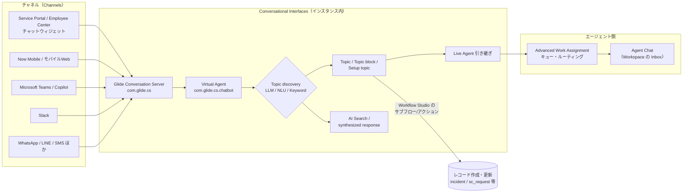
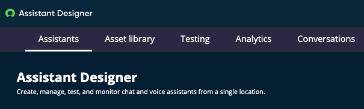
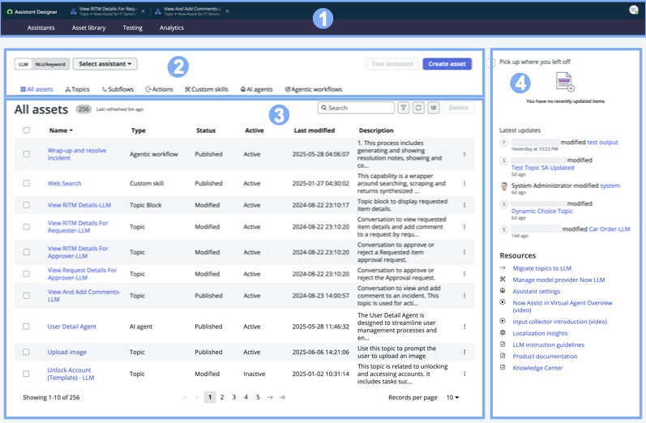
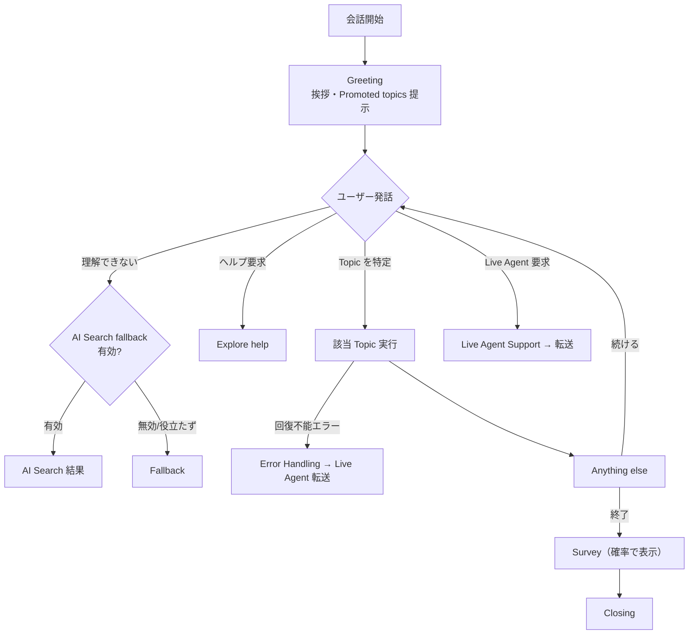
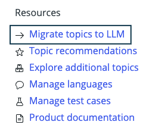
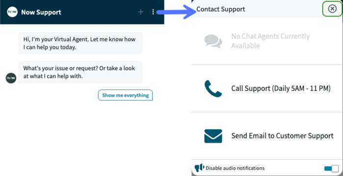
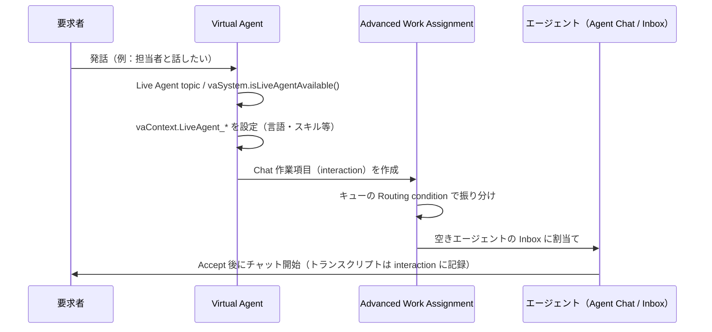

# Virtual Agent と会話型AI（Conversational Interfaces）

## 概要

**Conversational Interfaces（会話型インターフェース）** は、エンドユーザーが **Virtual Agent（バーチャルエージェント、チャットボット）** や **Live Agent（有人オペレーター）** と、ポータル・モバイル・Microsoft Teams・Slack などの好みのチャネルで会話するための ServiceNow のアプリケーション群である。管理の入口は `All > Conversational Interfaces > Home`（Conversational Interfaces Console）。[出典](https://www.servicenow.com/docs/r/australia/conversational-interfaces/exploring-ci.html)

本ファイルが扱う構成要素は次のとおり。

| 構成要素 | 役割 | 本ファイルの節 |
|---|---|---|
| Virtual Agent | 会話（Topic）を実行するボット本体。プラグイン `com.glide.cs.chatbot` | 「Virtual Agent の基本」 |
| Assistant Designer / Asset library（旧 Virtual Agent Designer） | Topic・Topic block・Setup topic 等を作成する設計ツール | 「Assistant Designer と Asset library」 |
| Topic discovery（NLU / Keyword / LLM） | ユーザー発話から実行すべき Topic を特定する仕組み | 「Topic discovery」 |
| ServiceNow Otto for Virtual Agent（旧 Now Assist in Virtual Agent） | 生成AI（LLM）による Topic discovery・要約回答・チャット体験 | 「ServiceNow Otto for Virtual Agent」 |
| Conversational Integration（Teams / Slack ほか） | 外部メッセージングアプリとの連携（ServiceNow Store アプリ） | 「チャネルと外部メッセージング連携」 |
| Live Agent 引き継ぎ・Agent Chat | 有人対応への転送と、エージェント側のチャット機能（AWA と連動） | 「Live Agent と Agent Chat」 |

> **名称に関する重要な注意（Australia 時点）:** 2026 年に ServiceNow は AI 体験のブランドを **ServiceNow Otto** に統合した（2026-05-05、Knowledge 2026 で発表。Now Assist、Moveworks、AI Experience を1つのアシスタントに統合したもの）。[出典](https://newsroom.servicenow.com/press-releases/details/2026/ServiceNow-Otto-creates-the-unified-AI-experience-for-the-enterprise/default.aspx)（ServiceNow プレスリリース、2026-05-05）製品への展開は、2026 年 8 月以降の月次 AI リリースで順次行われ、Brazil で全面提供される。このため、Australia 版の公式ドキュメントは 2026 年中に更新され、従来の **Now Assist in Virtual Agent** は **ServiceNow Otto for Virtual Agent**（ページにより「ServiceNow Otto in Virtual Agent」とも表記）、**Now Assist panel** は **ServiceNow Otto panel**、Virtual Agent Designer の一覧画面は **Assistant Designer Asset library** と表記されている。プラグイン ID やプロパティ名は旧名のまま残っており、Australia 版の公式ページでも `sn_nowassist_va.*` プロパティが使われている。本ファイルでは公式ドキュメントの現行表記を主とし、旧名を併記する。[出典](https://www.servicenow.com/community/developer-advocate-blog/otto-vs-now-assist-what-actually-changed/ba-p/3594171)（ServiceNow Community Developer Advocate Blog、2026-09-04）／[出典](https://www.servicenow.com/docs/r/australia/conversational-interfaces/now-assist-in-virtual-agent/assistant-designer.html)／[出典](https://www.servicenow.com/docs/r/australia/conversational-interfaces/now-assist-in-virtual-agent/using-now-assist-in-va.html)／[出典](https://www.servicenow.com/docs/r/australia/conversational-interfaces/now-assist-in-virtual-agent/nava-integrated-chat.html)

生成AI 機能全般（Now Assist スキル、AI Agents、AI Agent Studio、Now LLM Service 等）は [Now Assist と AI Agents](./now-assist-ai-agents.md)、AI Search は [Predictive Intelligence と AI Search](./predictive-intelligence-ai-search.md) を参照。

## Virtual Agent の基本

### プラグインとアクティベーション

Virtual Agent は **Glide Virtual Agent** プラグイン（`com.glide.cs.chatbot`）で提供される。`admin` ロールで `All > System Applications > All Available Applications > All` から有効化する。有効化には Virtual Agent のサブスクリプションが必要で、このプラグインは必要な関連プラグイン（**Glide Conversation Server**（`com.glide.cs`）など）を自動的に有効化する。ドメインセパレーションと委任管理（delegated admin）が有効なインスタンスでは、管理者は global ドメインにいる必要がある。[出典](https://www.servicenow.com/docs/r/australia/conversational-interfaces/virtual-agent/activate-virtual-agent.html)／[出典](https://www.servicenow.com/docs/r/australia/conversational-interfaces/virtual-agent/transfer-to-live-agent.html)

| プラグイン / アプリ | ID | 用途 |
|---|---|---|
| Glide Virtual Agent | `com.glide.cs.chatbot` | Virtual Agent 本体 |
| Glide Conversation Server | `com.glide.cs` | 会話サーバー。`virtual.agent` ユーザーを `sys_user` に作成 |
| Glide Virtual Agent Lite | `com.glide.cs.chatbot.lite` | 機能限定版（後述） |
| Agent Chat | `com.glide.interaction.awa` | Live Agent チャット（AWA 連動） |
| Interactions Management | `com.glide.interaction` | `interaction` テーブル。Agent Chat / Connect Support に含まれる |
| Virtual Agent integration with actionable notifications | `com.glide.cs.actionable.notification` | Virtual Agent チャネルでのアクション可能な通知 |
| Localization Framework Installer | `com.glide.localization_framework.installer` | 会話の多言語化 |
| Conversational Integration with Microsoft Teams | `sn_va_teams` | Teams 連携（Store アプリ） |
| Conversational Integration with Slack | `sn_va_slack` | Slack 連携（Store アプリ） |
| Profanity Filter | `sn_va_profanity` | 不適切語フィルター（任意） |

[出典](https://www.servicenow.com/docs/r/conversational-interfaces/virtual-agent/va-components.html)（この「Installed with Virtual Agent」ページは取得時点で Brazil 版が表示された）／[出典](https://www.servicenow.com/docs/r/australia/conversational-interfaces/live-agent-chat-context-vars.html)／[出典](https://www.servicenow.com/docs/r/australia/conversational-interfaces/virtual-agent/install-slack-from-store.html)

### Virtual Agent Lite（機能限定版）

**Virtual Agent Lite** は ITSM Standard の顧客が利用できる Virtual Agent の機能限定版で、インスタンスにプリインストールされている。利用には **ITSM Virtual Agent Conversation Topics Lite** をインストールし、提供される少数の事前構築 ITSM 会話（Keyword ベース）を使う。主な制約は次のとおり。[出典](https://www.servicenow.com/docs/r/australia/conversational-interfaces/virtual-agent/va-lite.html)

- 新しい Topic、Topic block、Custom control を作成できない（ITSM セルフサービスカテゴリの事前構築 Topic と Setup topic のみ）。
- Topic の条件指定、Live Agent 変数の指定、`Available for Agent Autopilot` トグルの有効化ができない。
- NLU（Natural Language Understanding）は非対応で Keyword ベースのみ。Topic switching や多言語 NLU も不可。
- Languages タブと翻訳は読み取り専用。
- カスタムチャネルでは動作しない（Slack、Microsoft Teams、Workplace by Facebook、Facebook Messenger の標準連携は可。ただし Workplace は Meta が 2026-06 に提供終了【第三者情報】、[出典](https://forwork.meta.com/meta-workplace/)）。
- 通知は単純通知のみ（Actionable notification 不可）。Virtual Agent Analytics Dashboard は利用不可。

> **Brazil での変更:** Virtual Agent for NLU と Virtual Agent Lite は「将来の非推奨化に向けた準備中（prepared for future deprecation）」とされ、いずれ新規インスタンスでは非表示・非アクティブになる（既存利用はサポート継続）。Glide Virtual Agent Lite の後継として Requestor Agents - Foundation、EmployeeWorks - User、EmployeeWorks for GovCloud - User が挙げられている。[出典](https://www.servicenow.com/docs/r/release-notes/virtual-agent-rn.html)

### ライセンスの位置づけ

- Virtual Agent プラグインの有効化には Virtual Agent のサブスクリプションが必要である。[出典](https://www.servicenow.com/docs/r/australia/conversational-interfaces/virtual-agent/activate-virtual-agent.html)
- Virtual Agent API は「Virtual Agent と同様の Pro/Enterprise ライセンス」、Virtual Agent Bot Interconnect は「Virtual Agent と同様の Pro ライセンス」が必要と、それぞれの公式ページに明記されている。[出典](https://www.servicenow.com/docs/r/australia/conversational-interfaces/virtual-agent/virtual-agent-api-supported-versions-licensing.html)／[出典](https://www.servicenow.com/docs/r/australia/conversational-interfaces/virtual-agent/using-sn-va-primary-bot-api.html)
- 一般には、フル機能の Virtual Agent は ITSM Pro 等の Pro/Enterprise パッケージに、Now Assist in Virtual Agent（現 ServiceNow Otto for Virtual Agent）は Pro Plus / Enterprise Plus（Now Assist for ITSM/HRSD/CSM 等）、または AI SKU（Foundation / Advanced / Prime）でも利用可能と説明されている。【第三者情報】[出典](https://www.servicenow.com/community/virtual-agent-nlu-articles/virtual-agent-faqs/ta-p/2349558)
- Australia の Virtual Agent リリースノートには、AI のライセンス階層として **Foundation、Advanced、Prime** が記載されている。階層ごとの機能差は公開情報では Virtual Agent 単位では確認できず。[出典](https://www.servicenow.com/docs/r/m4LmCVvkm6_8u3nlIuep5Q/qLjVpz4YhkTz49WHiXY6uA)
- Microsoft Teams 連携で使用する Microsoft Teams Graph spoke は **IntegrationHub トランザクションを消費**する（後述）。

詳細は [ライセンスモデル](../../03_導入編/01-licensing-model.md)、[エディション比較](../../03_導入編/03-edition-comparison.md)、[プラットフォームのパッケージ構成](./platform-licensing-packaging.md) を参照。

## Virtual Agent のロール

`virtual_agent_admin`（Virtual Agent administrator）は親ロールで、以下のサブロールをすべて含む。公式ドキュメントは「より限定的なロールがある場合は admin ロールの付与を避ける」よう注意している。[出典](https://www.servicenow.com/docs/r/australia/conversational-interfaces/virtual-agent/VA-roles.html)／[出典](https://www.servicenow.com/docs/r/conversational-interfaces/virtual-agent/va-components.html)

| ロール名（日本語） | `name` | 説明 |
|---|---|---|
| Virtual Agent administrator（Virtual Agent 管理者） | `virtual_agent_admin` | 親ロール。Topic 作成・管理、チャット設定など |
| NLU Administrator（NLU 管理者） | `nlu_admin` | ServiceNow NLU モデルの作成・学習。`virtual_agent_admin` に含まれる |
| Issue auto resolution administrator | `iar_admin` | 自動解決メッセージ（Virtual Agent・メール・SMS）の配信設定。`evam_admin`、`search_application_admin` を含む |
| Chat survey administrator | `chat_survey_admin` | チャット後アンケートの設定。`survey_admin` を含む |
| Chat analytics administrator | `chat_analytics_admin` | チャット分析 |
| Workflow Studio | `action_designer` | Workflow Studio でのアクション作成 |
| Flow designer | `flow_designer` | Workflow Studio でのフロー作成 |
| Automated testing framework designer | `atf_test_designer` | ATF テスト作成 |
| External application installation administrator | `external_app_install_admin` | Slack・Microsoft Teams 等の外部アプリのインストール。Assistant Designer の Topic（他 Topic が依存するものを含む）の変更・削除も可能 |
| Virtual Agent branding | `va_branding` | Scripted REST API 経由でブランディング設定を取得 |
| EVAM administrator | `evam_admin` | Entity View Action Mapper の管理 |
| Search application administrator | `search_application_admin` | 検索 UX 設定テーブルの管理。`ais_admin` を含む |
| Activity subscriptions administrator | `actsub_admin` | アクティビティ購読 |
| ACE user | `sn_ace.ace_user` | Automated Customer Experiences レコードの参照 |
| Conversational Interfaces guided setup administrator | `sn_ci_gs_content.ci_guided_setup_admin` | ガイド付きセットアップ |
| Localization requestor | `localization_requestor` | 多言語化の翻訳依頼（既定で含まれる） |
| Self-service manager | `sn_ssa_core.self_service_manager` | Pattern / Activity 設定・Deflection データの CRUD |
| Image administrator | `image_admin` | 画像テーブルの管理 |

関連ロール：

- `sn_vad_genai.topic_migration_admin` … NLU→LLM Topic 移行ツールの利用（`virtual_agent_admin` でも可）。[出典](https://www.servicenow.com/docs/r/australia/conversational-interfaces/virtual-agent/llm-topic-migration.html)
- `awa_admin` … AWA キューの作成・変更。`awa_agent` … AWA でチャットを受けるエージェント（後述）。
- `workspace_admin` … Agent Chat 設定（Zurich 版ドキュメントで記載）。

ロール設計の一般論は [ユーザー・グループ・ロール](./users-groups-roles.md) を参照。

## Assistant Designer と Asset library

### Assistant Designer の構成

**Assistant Designer** は、LLM ベースのチャット／音声アシスタントの作成・構成・管理・テストを一元化した管理画面である（Zurich で導入）。`All > Assistant Designer`（または `All > Conversational Interfaces > Assistant Designer`）から開く。Assistant Designer は ServiceNow Otto（旧 Now Assist）製品をインストールしている場合にのみ利用でき、**NLU のみを使う顧客は Assistant Designer にアクセスできない**（その場合は従来の Virtual Agent Designer UI になる）。[出典](https://www.servicenow.com/docs/r/australia/conversational-interfaces/now-assist-in-virtual-agent/assistant-designer.html)／[出典](https://www.servicenow.com/docs/r/delta-zurich-australia/australia-zurich-virtualagent-release-notes.html)

| タブ | 内容 |
|---|---|
| Assistants | アシスタントの作成・管理・テスト（音声アシスタントは Assistant Designer 内でテスト不可） |
| Asset library | Virtual Agent Designer のホーム。NLU/Keyword Topic と LLM アセットを作成 |
| Testing | 会話アシスタントの品質・性能評価（手動テストまたは自動評価） |
| Analytics | チャット・音声アシスタントのパフォーマンス監視 |
| Conversations | 完了した音声対話のログ |

*図: Assistant Designer のホーム画面上部*
画面上部に「Assistant Designer」のロゴがあり、その下に **Assistants / Asset library / Testing / Analytics / Conversations** の5つのタブが横に並ぶ。タブの下には「Create, manage, test, and monitor chat and voice assistants from a single location.」という説明文が表示される。
出典: https://www.servicenow.com/docs/r/australia/conversational-interfaces/now-assist-in-virtual-agent/assistant-designer.html （取得日: 2026-11-02）

Assistant Designer の主要用語は次のとおり。[出典](https://www.servicenow.com/docs/r/australia/conversational-interfaces/now-assist-in-virtual-agent/assistant-designer.html)

| 用語 | 定義 |
|---|---|
| Assistant（アシスタント） | ServiceNow Otto for Virtual Agent の管理構成一式を入れるコンテナ。チャットまたは音声の会話。複数作成でき、ポータル、モバイルアプリ、Microsoft Teams、Sidebar discussion などのチャネルに配置する |
| Conversational assets（会話アセット） | LLM 会話を構成する部品。Topics、Subflows、Actions、AI agents、Custom skills |
| Information sources（情報ソース） | AI Search の対象とするコンテンツ。Knowledge base（KB）記事、External content、Conversational catalog |

### Asset library（旧 Virtual Agent Designer ホーム）

**Asset library** は、すべての LLM アセットと NLU/Keyword Topic を一覧し、Topic、Subflow、Action、Custom skill、AI agent、Agentic workflow を作成できる画面である。ServiceNow Otto in Virtual Agent をインストールすると新しいリスト形式 UI になり、未インストールの場合は従来の **Virtual Agent Designer legacy topic cards page**（カード形式）が表示される（legacy 画面は会話型サブフロー／アクションに非対応）。[出典](https://www.servicenow.com/docs/r/australia/conversational-interfaces/virtual-agent/vad-topics-page.html)

*図: Assistant Designer Asset library（番号付き4領域）*
① 上部ナビゲーションヘッダー：Assistant Designer ロゴ、開いている Topic のタブ（例「View RITM Details For Requester」）、その下に Assistants / Asset library / Testing / Analytics タブ。② Topic リストコントロール：左上に **LLM / NLU/keyword** 切替スイッチと **Select assistant** ドロップダウン、右に **Test assistant** と **Create asset** ボタン、その下に All assets / Topics / Subflows / Actions / Custom skills / AI agents / Agentic workflows の絞り込みボタン。③ アセット一覧（例では 256 件）：Name、Type（Agentic workflow、Custom skill、Topic Block、Topic、AI agent 等）、Status（Published / Modified）、Active、Last modified、Description の列と、各行右端の「︙」（Show actions for this row）メニュー。右上に Search・Filter・Refresh・Edit columns アイコン。④ 右サイドパネル：「Pick up where you left off」（最近開いた Topic）、「Latest updates」（最近の更新者）、「Resources」（Migrate topics to LLM、Manage model provider Now LLM、Assistant settings、Input collector introduction、Localization insights、LLM instruction guidelines、Product documentation、Knowledge Center 等のリンク）。
出典: https://www.servicenow.com/docs/r/australia/conversational-interfaces/virtual-agent/vad-topics-page.html （取得日: 2026-11-02）

Asset library の各領域の機能は次のとおり。[出典](https://www.servicenow.com/docs/r/australia/conversational-interfaces/virtual-agent/vad-topics-page.html)

| 領域 | 主な機能 |
|---|---|
| 1. Navigation header bar | Assistants / Asset library / Testing / Analytics（/ Conversations）タブ（出典の Topics ページは Assistants / Asset library / Analytics のみを挙げているが、Assistant Designer 全体の説明と画面では Testing 等もある）。開いている Topic のタブ（ホバーで種類とスコープ表示、未保存変更は赤い点）。User preferences で「Group tabs by app scope」を切替 |
| 2. Topic list controls | **LLM / NLU/keyword 切替**。LLM 側：Select assistant、Test assistant（Standard / Enhanced / Premium chat でテスト）、Create asset、種類別ボタン。NLU/Keyword 側：Test active topics、Create topic |
| 3. Topic records list | 既定列：Name、Type、Status（Draft / Published / Modified）、Active、Last modified、Description、Promoted in。行メニュー：Visibility（Promoted / Discoverable / Visible / Active）、Conversational Settings、Remove from assistant、Delete |
| 4. Side panel | Pick up where you left off（直近3件）、Latest updates（直近5ユーザー）、Resources（ローカライズ分析、ドキュメント、**Migrate topics to LLM** 等） |

補足仕様：

- 非アクティブなアセットを Promoted / Discoverable / Visible にしようとすると「This asset must be active in order to be promoted, discoverable, or visible.」と表示される。
- System topic、Setup topic、Topic block、Custom control は Visible / Discoverable にできない（Australia で Setup topic に関するツールチップが追加。Live Agent topic は例外）。[出典](https://www.servicenow.com/docs/r/delta-zurich-australia/australia-zurich-virtualagent-release-notes.html)
- アシスタントに追加した **MCP Server** の機能は実行時に `sys_gen_ai_skills` テーブルに保存されるが、Asset library には表示されず、Discoverable / Visible / Promoted も変更できない（アシスタントの作成・編集フロー内の専用セクションで管理）。[出典](https://www.servicenow.com/docs/r/australia/conversational-interfaces/virtual-agent/conversation-designer-virtual-agent.html)
- 既定アシスタント `ServiceNow Otto Panel - Platform (default)` で AI agent を Discoverable / Visible / Promoted にするには、システムプロパティ `sn_aia.enable_aiagents_discovery` を `true` にする必要があり、変更は ServiceNow サポートへの依頼が必要。[出典](https://www.servicenow.com/docs/r/australia/conversational-interfaces/virtual-agent/conversation-designer-virtual-agent.html)

### アセット（Topic）の種類

Asset library で扱うアセットの Type は次のとおり。テンプレート Topic は名前に「(Template)」が付く。[出典](https://www.servicenow.com/docs/r/australia/conversational-interfaces/virtual-agent/conversation-designer-virtual-agent.html)

| Type | 説明 |
|---|---|
| Topic | 基本的な会話。特定の目的（依頼の受付、作業の案内など）を達成するフロー |
| Topic Block | 再利用可能な部品（呼び出し元 Topic から呼ばれるサブフロー的な会話）。Topic Block utility で呼び出す |
| Setup Topic | Greeting、Fallback、Closing など全会話に共通する構造（後述） |
| Small Talk | 雑談・想定外発話への応答。Small talk filter と併用 |
| Custom Input Control / Custom Response Control | 標準コントロールを補完する独自の入力／応答コントロール |
| Subflows / Actions | Workflow Studio で「会話型（conversational）」にしたサブフロー／アクション（LLM 用。ServiceNow Otto 構成時のみ表示） |
| Custom skills | AI Skill Kit で作成したカスタムスキル（閲覧） |
| AI agents / Agentic workflows | AI Agent Studio で作成した AI エージェント（閲覧） |

### Topic の状態と公開

- **Status**：`Draft`（下書き）／`Modified`（未公開の変更あり）／`Published`（公開済み）。
- **Active**：Active / Inactive。Topic を Active にすると公開も行われる。
- **Publish（公開）**：非アクティブまたは更新された Topic を保存し、Virtual Agent クライアントのユーザーが利用できるようにする操作。

[出典](https://www.servicenow.com/docs/r/australia/conversational-interfaces/virtual-agent/conversation-designer-virtual-agent.html)／[出典](https://www.servicenow.com/docs/r/australia/conversational-interfaces/virtual-agent/manage-topics-task.html)

### Topic の4つのタブ

Topic を開くと、Properties、Flow、NLU Intent、Languages の各タブで設計する。[出典](https://www.servicenow.com/docs/r/australia/conversational-interfaces/virtual-agent/conversation-designer-virtual-agent.html)

| タブ | 用途 |
|---|---|
| Properties（プロパティ） | 名前・種類・Model type・説明・利用アシスタント、利用者・チャネルの制御、Live Agent 変数、Keyword または NLU モデル/インテントの割り当て |
| Flow（フロー） | コントロール（User input / Bot response / Utility）を配置して会話フローを図で構築。**Table View** で表形式表示、Search table、Add new node、Variables サイドバー（Script variable 定義） |
| NLU Intent | NLU 有効時のみ。Utterance（発話例）の確認・編集、モデルの学習・テスト |
| Languages | 有効化された言語の翻訳状況、言語別テスト、翻訳編集・翻訳依頼（Localization Framework）、NLU 言語マッピング |

#### Properties タブの主要フィールド

`Topic Properties` タブのフィールドは Topic discovery の方式（LLM か NLU/Keyword か）で異なる。[出典](https://www.servicenow.com/docs/r/australia/conversational-interfaces/virtual-agent/vad-topic-properties-tab.html)

| フィールド | 対象 | 説明 |
|---|---|---|
| Application scope | 共通 | Topic が属するアプリケーションスコープ。**作成後は変更不可** |
| Model type | 共通 | `LLM` または `NLU/keyword`。**作成時に固定** |
| Type | 共通 | basic topic、topic block、setup topic、small talk topic |
| Internal name / Display name | 共通 | 内部名（顧客に非表示）／表示名 |
| Topic description used for discovery | LLM | LLM がユーザーの質問と Topic を照合するための説明。詳しいほど discovery 精度が上がる |
| Topic will be available in these assistant(s) | LLM | この Topic を使える LLM アシスタント |
| Topic description | NLU | Topic の用途の説明 |
| NLU model / Associated intent | NLU | 割り当てる NLU モデルとインテント |
| Enable DialogActs | NLU | ユーザー発話に動的に反応する |
| Confirm modified values with users | NLU | 値の変更を検知したときに確認メッセージを送る |

### コントロール（ノード）

Flow タブで使うコントロールは **User input（ユーザー入力）**、**Bot response（ボット応答）**、**Utility（ユーティリティ）** の3種類。各コントロールでは Data pill（データピル）と Condition builder（条件ビルダー）が使える。[出典](https://www.servicenow.com/docs/r/australia/conversational-interfaces/virtual-agent/virtual-agent-controls.html)

#### User input controls（ユーザー入力コントロール）

[出典](https://www.servicenow.com/docs/r/australia/conversational-interfaces/virtual-agent/va-user-inputs.html)

| コントロール | 説明 | LLM Topic で利用可 |
|---|---|---|
| Input Collector | LLM 会話で ServiceNow Otto が使うデータを収集 | ○ |
| Text | テキスト入力 | ○ |
| Static Choice | 事前定義の選択肢（単一選択） | ○ |
| Grouped Choice | 複数グループの選択肢を1メッセージで表示 | 記載なし |
| Dynamic Choice | テーブル照会やスクリプトで選択肢を動的生成 | ○ |
| Boolean | Yes/No | ○ |
| Date Time | 日付・時刻 | ○ |
| File Picker | 画像・ファイルのアップロード | 記載なし |
| Carousel | 画像付き選択肢の横スクロール表示 | ○ |
| Secure Text | 機密情報の暗号化入力（LLM Topic 向け） | ○ |

- 入力値は **入力変数** に保存され、変数名はコントロール名を小文字・スペースをアンダースコアにしたもの（例：`First prompt` → `first_prompt`）。
- **LLM Topic では1つの Topic（または1つの Input Collector）に User input を5個超置かない**ことが推奨されている（LLM が混乱し不正確な応答の原因になる）。
- NLU 有効時は Advanced options に **NLU entity**（スロットフィリング）や **Enable NLU to switch topics**（このノードでの Topic 切替許可）が表示される。Default value、Confirmation messages も Advanced options で設定する。

#### Bot response controls（ボット応答コントロール）

Text、**LLM Text**（プロンプト記述から応答を動的生成）、Image、Link（最大3項目）、HTML、Multi-response、Script、Card、Table（Zurich で「Show links for each record」トグル追加）、Video。応答は外部プラットフォーム（Teams 等）上では表示形式が変わる。[出典](https://www.servicenow.com/docs/r/australia/conversational-interfaces/virtual-agent/va-bot-responses.html)

#### Utilities（ユーティリティ）

ユーティリティはフロー上のノードだがユーザーには何も表示しない。[出典](https://www.servicenow.com/docs/r/australia/conversational-interfaces/virtual-agent/va-utilities.html)

| ユーティリティ | 説明 |
|---|---|
| Lookup | ServiceNow レコードの照会 |
| Script Action | スクリプト実行 |
| Record Action | レコードの作成・更新 |
| Decision | 条件分岐（2つ以上のブランチ） |
| Topic Block | Topic block の呼び出し |
| Action | Workflow Studio のアクション／サブフローを呼び出す（Workflow Studio との統合点） |
| Custom control | Custom input/response control の参照 |
| AI Connector | 生成AI をカスタムスキルや AI エージェントに接続（Zurich で AI エージェント選択に対応） |
| Deflection | Virtual Agent が解決に寄与した／解決した事象の記録 |
| Diagnostic Topic Executor | Topic 内コンポーネントの動作確認 |
| Geolocation | 位置座標の取得 |
| Multi File Upload | 複数ファイルの同時アップロード |
| Pause | 会話の一時停止 |

Workflow Studio 側の仕様は [Workflow Studio / Flow Designer](./flow-designer-workflow-studio.md) を参照。

### Setup topics（セットアップトピック）

**Setup topic** は、ウェルカム挨拶やフォールバック応答など、すべての会話に適用される標準構造である。既定の Setup topic は読み取り専用で、名前の末尾にピリオドが付く（例：`Greeting.`）。変更したい場合は複製してカスタム Setup topic を作る。Setup topic はチャット体験（Custom Greetings and Setup）に含めた場合にのみ discovery 対象となり、All Topics メニューに表示される。[出典](https://www.servicenow.com/docs/r/australia/conversational-interfaces/virtual-agent/working-setup-topics.html)

| Setup topic type | 既定 Topic | 動作 |
|---|---|---|
| Greeting | Greetings（個人名で挨拶する Dynamic Greeting Topic も同梱） | 会話開始時の挨拶と、対応可能な項目の提示 |
| Explore help | Virtual Agent Capabilities | 会話中にヘルプを求められたとき |
| Fallback | Fallback Topic | 発話を理解できず、AI Search fallback も無効または不発のとき |
| AI Search fallback | AI Search Fallback | 一致 Topic がない／多すぎるときに AI Search 結果を返す |
| Error | Error Handling Topic | 回復不能エラー時。エラーメッセージ表示後に Live Agent へ転送 |
| Live agent | Live Agent Support | ユーザーが Live Agent を要求したとき |
| Anything else | Anything Else Topic | タスク完了後に「他に何か」と尋ねる |
| Survey | Virtual Agent Feedback | 会話の最後に満足度を取得。既定で会話の33%に表示（`com.glide.cs.survey.probability`、例 `0.50` で50%） |
| Closing | Closing Conversation | 会話を終了するメッセージ |

> Anything else と Survey が新規インスタンスで既定で有効か無効かは、公開情報では確認できず。なお、どの Setup topic もチャット体験（chat experience）に含めた場合にだけ利用できる。

> チャット開始直後に Live Agent へ直接つなぎたい場合、Live Agent Support topic を Greeting に設定せず、システムメソッド（`vaSystem.connectToAgent()`）で転送することが推奨されている。[出典](https://www.servicenow.com/docs/r/australia/conversational-interfaces/virtual-agent/working-setup-topics.html)

### Chat experience（Custom Greetings and Setup）

**Chat experience（チャット体験）** は、Virtual Agent を実行するコンテキスト（どのポータル・デバイスか）ごとに、Setup topic、Promoted topics、AI Search の検索プロファイルを切り替える設定である。`All > Conversational Interfaces > Settings > Virtual Agent > Custom Greetings and Setup > View All` で設定し、`virtual_agent_admin` または `admin` が必要。設定は `sys_cs_context_profile`（Custom Greetings and Setup）テーブルに保存される。[出典](https://www.servicenow.com/docs/r/australia/conversational-interfaces/virtual-agent/configure-default-chat-experience.html)／[出典](https://www.servicenow.com/docs/r/conversational-interfaces/virtual-agent/va-components.html)

| フィールド | 説明 |
|---|---|
| Name / Description | 名前と目的（例：ESC portal） |
| Active | 有効/無効（既定で有効） |
| Order | 適用優先度。既定のチャット体験は `1000`。複数一致した場合は Order 値が最小のものを適用 |
| Condition Mode | `Simple`（条件ビルダー。例：`devicetype` と `portal`）または `Advanced`（true を返す JavaScript） |

- 既定のチャット体験は読み取り専用。カスタム体験は既定の設定を引き継ぎ、必要な部分だけ上書きする。
- **Promoted topics** はチャット画面の「Show me everything」ボタンの上に最大6個表示できる（Web とモバイルクライアントのみ）。

### スクリプト（vaInputs / vaVars / vaContext / vaSystem）

Topic 内のスクリプトはサーバー側で、Topic を定義したスコープで実行される（スコープ保護が適用される）。[出典](https://www.servicenow.com/docs/r/australia/conversational-interfaces/virtual-agent/virtual-agent-scripts.html)

| オブジェクト | スコープ | 説明 |
|---|---|---|
| `vaInputs` | Topic | 入力コントロールの値。`getValue()`、`getDisplayValue()`、`getDefaultValue()`、`getDefaultDisplayValue()`、`unbindEntity()`（NLU スロットの再質問）。**スクリプトから値を変更できない**。既定の `user` 変数は現在ユーザーの `sys_user` レコード |
| `vaVars` | Topic | Script variable。Variables サイドバーで定義し、スクリプトで代入可能。組み込みの `vaVars.global_utterance` あり |
| `vaContext` | 会話全体（global） | Context variable。Web クライアント URL のパラメーター（例：`$sn-va-web-client-app.do?sysparm_city=milan` → `vaContext.city`）からも生成。Live Agent 用は `vaContext.LiveAgent_<変数名>` |
| `vaSystem` | — | システムメソッド（下表） |

主な `vaSystem` メソッド：

| メソッド | 説明 |
|---|---|
| `connectToAgent()` | Live Agent へ転送 |
| `isLiveAgentAvailable()` / `isLiveAgentConfigured()` | 転送可能か／ライブチャットが有効か（`connectToAgent()` の前に確認） |
| `didConnectToLiveAgent()` | Live Agent に接続済みか |
| `attachRecordToConversation(tableName, sysId)` | レコードを Interaction の Related Tasks に追加 |
| `attachToRecord(mediaId, tableName, sysId)` | アップロード画像をレコードに添付 |
| `switchTopicByName()` / `switchTopicById(sysid)` | Topic へジャンプ（`resumeBehavior`：`resume` / `skip`） |
| `topicDiscovery(searchTextOverride, keywordImpl)` | 任意テキストで Topic discovery を実行 |
| `sendSkillPickerControl(msg, args)` / `sendTopicPickerControl(msg, label)` | スキル／Topic ピッカーを送信 |
| `getTranscript()` / `getConversationId()` / `getInteractionSysId()` / `getSearchText()` | 会話情報の取得 |
| `sendSystemMessage(message, showAvatar)` / `sendBatchedMessages()` | メッセージ送信 |

Topic 外からは `sn_cs.VASystemObject.getTranscriptById(<conversation sysId>)` で会話のトランスクリプトを取得できる。予約語は `com.glide.cs.javascript.reserved_words` で定義され、`vaInputs`/`vaVars` 名に使えない。未公開のシステムメソッドの使用は非サポート。スクリプト一般は [サーバーサイドスクリプト](./scripting-server-side.md) を参照。

### テスト

- **LLM Topic**：Assistant Designer のチャットウィンドウでプレビュー・テスト・デバッグ。アシスタントに関連付けていない LLM Topic は Test assistant からテストできない。Now Assist panel（Otto panel）や Microsoft Teams でのプレビューも可能。[出典](https://www.servicenow.com/docs/r/australia/conversational-interfaces/now-assist-in-virtual-agent/llm-assistants.html)
- **NLU/Keyword Topic**：チャットテストウィンドウ（Test active topics）でテスト。
- **Test a chat assistant**（Australia）：Standard / Enhanced / Premium chat の各体験でエンドツーエンドの会話をシミュレーション。
- **自動評価（Automated evaluations）**（Zurich で導入）：Assistant Designer の Testing で、conversation success、fluency、faithfulness、skill selection accuracy、turn count などの指標を自社のテストデータと正解（ground truth）で評価。[出典](https://www.servicenow.com/docs/r/delta-zurich-australia/australia-zurich-virtualagent-release-notes.html)
- Asset library には Automated test（ATF 連携の自動テストケース作成・実行）機能もある。ATF 全般は [Automated Test Framework (ATF)](./automated-test-framework.md) を参照。

## Topic discovery（トピック検出）

**Topic discovery** は、ユーザー発話から実行すべき Topic を特定する仕組みである。Virtual Agent は **LLM（大規模言語モデル）** と **NLU/Keyword** の2方式をサポートし、Topic ごとに Model type として選択する（作成後は変更不可）。[出典](https://www.servicenow.com/docs/r/australia/conversational-interfaces/virtual-agent/conversation-designer-virtual-agent.html)

| 観点 | NLU/Keyword topic discovery | LLM topic discovery |
|---|---|---|
| 前提 | Glide Virtual Agent（NLU は既定で有効、Lite は Keyword のみ） | ServiceNow Otto for Virtual Agent（旧 Now Assist in Virtual Agent）が有効 |
| 照合の手がかり | NLU モデルのインテント（Utterance で学習）、またはキーワード | Topic の **説明文（Topic description used for discovery）** |
| 事前準備 | モデル・インテント・Utterance・エンティティの作成と学習 | 平易で詳しい説明文の記述のみ |
| エンティティ抽出 | 入力ノードに NLU entity を関連付け（スロットフィリング） | 事前マッピング不要（LLM が抽出） |
| Topic switching | Enable NLU to switch topics / Resume topic flow の設定が必要 | 自然言語で切替（1セッションで複数回可）。ただし **カタログ注文フロー中は不可** |
| 複数一致時 | 確認メッセージ（Ask user if topic VA chose is correct 等） | 候補 Topic の一覧をユーザーに提示 |
| 発見可能になる条件 | Topic が Active・公開済みで discovery に含まれる | **LLM アシスタントに関連付け**かつ **Discoverable** |

[出典](https://www.servicenow.com/docs/r/australia/conversational-interfaces/virtual-agent/va-llm.html)／[出典](https://www.servicenow.com/docs/r/australia/conversational-interfaces/virtual-agent/implement-nlu-va.html)

### Discoverable / Visible / Promoted

Asset library の行メニュー（Visibility）でアセットごとに設定する。`virtual_agent_admin` または `admin` が必要。[出典](https://www.servicenow.com/docs/r/australia/conversational-interfaces/virtual-agent/manage-topics-task.html)／[出典](https://www.servicenow.com/docs/r/australia/conversational-interfaces/virtual-agent/vad-topics-page.html)

| 設定 | 意味 |
|---|---|
| Discoverable | ユーザー発話と一致したときに呼び出される（Topic discovery の対象）。discovery で結果がない場合は AI Search がフォールバックになり得る |
| Visible | チャット画面で「Show me everything」/「Show all my options」を選んだときの **All Topics** メニュー（Topic 一覧）に表示される |
| Promoted | アシスタントがユーザーに推奨表示する（Promoted in 列に表示）。順序の並べ替えや条件ビルダーによる優先度調整が可能 |

| Topic の種類 | Discoverable 既定 | Visible 既定 |
|---|---|---|
| Topics | 有効 | 有効 |
| Setup topics | 無効 | 有効 |
| Small talk topics | 無効 | 有効 |

> 設定は `sys_cs_topic`（Topics）テーブルの対応プロパティに自動反映され、Discoverable を有効にすると Visible も true になる。オプションは Active な Topic に対して設定し、Active にすると同時に公開される。テスト前に Conversational settings で1つ以上のアシスタントに関連付ける。[出典](https://www.servicenow.com/docs/r/australia/conversational-interfaces/virtual-agent/manage-topics-task.html)
>
> ただし Australia 版の Asset library ページには「System topic、Setup topic、Topic block、Custom control は Visible / Discoverable にできない」とあり、上表（Setup topic の Visible 既定が有効）とは公開情報の範囲では完全には整合しない。LLM アシスタントで Setup topic を発見可能にするには、複製した Setup topic を明示的に Discoverable にする必要がある（例：ServiceNow Otto の Live Agent setup topic の複製）。[出典](https://www.servicenow.com/docs/r/australia/conversational-interfaces/now-assist-in-virtual-agent/llm-assistants.html)

### NLU / Keyword topic discovery

NLU/Keyword 方式では、Topic 作成者が Topic を NLU モデルの **Intent（インテント、ユーザーが達成したいこと）** に関連付ける（これを **mapping** と呼ぶ）。Assistant Designer は **NLU Workbench** と統合されており、Topic 画面から離れずにモデル・インテントの作成、Utterance 編集、学習・テスト・公開ができる。[出典](https://www.servicenow.com/docs/r/australia/conversational-interfaces/virtual-agent/conversation-designer-virtual-agent.html)

主な仕様：[出典](https://www.servicenow.com/docs/r/australia/conversational-interfaces/virtual-agent/implement-nlu-va.html)／[出典](https://www.servicenow.com/docs/r/australia/conversational-interfaces/virtual-agent/configure-nlu-settings.html)

- **1つの Topic は NLU モデル内の1つのインテントにのみ対応**し、選択したインテントは他の Topic で使えなくなる。
- Topic 作成時は正しいアプリケーションスコープにいることを確認する（例：ITSM Topic は「ITSM Virtual Agent Conversations」スコープで作成し、「ITSM NLU Model for Virtual Agent Conversations」スコープではない）。
- **NLU Service Provider** はインスタンスで1つだけ選択できる：`ServiceNow NLU`（既定）、`IBM Watson Assistant`、`Google DialogFlow Essentials (ES)`。設定は `All > Conversational Interfaces > Settings > Virtual Agent > Natural Language Understanding (NLU) > View Settings`。Microsoft LUIS は Zurich 時点で「デプロイ・機能拡張・サポートの対象外」。
- NLU 設定フォームの項目：NLU Service Provider、Supported NLU Languages（ServiceNow NLU は English が既定で有効）、**Ask user if topic VA chose is correct**（初回インテント確定時の確認）、**Ask user if switched topic is correct**（Topic 切替時の確認、既定で有効）、Intent confirmation message。
- 新規の Virtual Agent 有効化では NLU の Activate トグルは既定でオン、Virtual Agent Lite ではオフ。
- 事前構築 Topic と NLU モデル（ITSM、HR 等）が提供されており、Topic Recommendations レポートで導入候補を特定できる。[出典](https://www.servicenow.com/docs/r/australia/conversational-interfaces/virtual-agent/prebuilt-topics-ITSM.html)
- Keyword 方式の Topic 検索は、プロパティ `com.glide.cs.suggest.enable_partial_search`（部分一致）、`com.glide.cs.suggest.enable_phonetic_search`（音声類似）、`com.glide.cs.suggest.enable_spell_check`（別綴り）、`com.glide.cs.suggest.minimum_characters`（これらが動作する最小文字数）で制御する。[出典](https://www.servicenow.com/docs/r/conversational-interfaces/virtual-agent/va-components.html)

> **Brazil での変更:** Virtual Agent NLU は非推奨化に向かい、NLU Topic は LLM へ移行すべきとされた。HR Service Delivery NLU Model、Intent Discovery、NLU Workbench-Advanced Features、Topic Recommendations、ITSM Virtual Agent Conversation Topics Lite などは「後継なしで非推奨化予定」のプラグインとして列挙されている。Apple Messages for Business、AWS End User Messaging、Facebook Messenger、LINE、Omnichannel Callback の NLU 機能も LLM 対応へ移行する。[出典](https://www.servicenow.com/docs/r/release-notes/virtual-agent-rn.html)

### LLM topic discovery

**LLM topic discovery** では、ServiceNow Otto for Virtual Agent が有効な場合に Topic の Model type として `LLM` を選べ、Virtual Agent は生成AI でユーザーの意図に合う Topic を発見する。唯一の要件は Properties タブの **平易で十分な説明文** であり、NLU モデル・インテント・バックアップキーワードは不要である。LLM はケース要約や解決メモの生成など言語タスクも実行できる。[出典](https://www.servicenow.com/docs/r/australia/conversational-interfaces/virtual-agent/va-llm.html)

LLM で可能になること（公式記載）：

- 単一の宣言済みインテントなしでの Topic discovery
- バックアップキーワードなしでのインテント発見
- 事前マッピングなしでのエンティティ値抽出
- 1セッション内での複数回の Topic switching（例：携帯電話の注文中に「やっぱりノートPCを」と言えば切り替わる。ただしカタログ注文フロー内では不可）

### LLM アシスタント

**LLM assistant（LLM アシスタント）** は LLM topic discovery を担う単位で、既定アシスタント **ServiceNow Otto for Virtual Agent** は Conversational Interfaces の Assistants ガイド付きセットアップで作成される。**LLM Topic はアシスタントに関連付けないと発見されず**、Test assistant でもテストできない。[出典](https://www.servicenow.com/docs/r/australia/conversational-interfaces/now-assist-in-virtual-agent/llm-assistants.html)

| 項目 | 仕様 |
|---|---|
| 既定アシスタント | `ServiceNow Otto in Virtual Agent (default)`、`ServiceNow Otto Panel - Platform (default)`。Employee Slate（`com.snc.ex_ai_portal`）導入時は Employee Slate 既定アシスタントも追加（有効化・編集・テスト可、削除不可） |
| 作成 | `Conversational Interfaces > Assistants`。`virtual_agent_admin` または `admin`。名前の重複は警告。Otto panel アシスタントは追加作成不可・名前変更不可 |
| Primary / Secondary assistant | Primary assistant は1つ以上の Secondary assistant にリンクでき、その情報ソース（検索ソース・アセット）を継承する。Primary 同士はリンク不可、既に Secondary を持つアシスタントは Secondary に選べない。同一インスタンス・同一ドメイン内のアシスタントのみ |
| Primary/Secondary で共有されないもの | Search application（Primary 自身の設定）、Now Assist スキルの有効化フラグ（Primary 自身）。Stop words は競合時に `sys_updated_on` が新しい方。Knowledge Graph は各アシスタントで設定が必要 |
| スキルの適用範囲 | `sys_gen_ai_skill_applicability`（Generative AI Skill Applicabilities）テーブルの Context Profile 列で、生成AI スキルを特定アシスタントだけに適用できる |
| 表示先（Display experiences） | アシスタントを有効化するには、ポータル・メッセージングチャネル・モバイルアプリのいずれか1つ以上の表示先が必要 |

[出典](https://www.servicenow.com/docs/r/australia/conversational-interfaces/now-assist-in-virtual-agent/create-assistant.html)／[出典](https://www.servicenow.com/docs/r/delta-zurich-australia/australia-zurich-virtualagent-release-notes.html)

### NLU/Keyword Topic から LLM Topic への移行（Topic migration）

**Topic migration workflow** は、既存の NLU/Keyword Topic を LLM Topic に移行するツールで、Asset library のサイドパネル Resources の **Migrate topics to LLM** から起動する（ServiceNow Otto in Virtual Agent 有効時のみ表示）。元の Topic は変更されず、Model type が LLM のコピーが作成される。[出典](https://www.servicenow.com/docs/r/australia/conversational-interfaces/virtual-agent/llm-topic-migration.html)

*図: Asset library サイドパネルの Resources セクション*
「Resources」見出しの下に、枠で強調された **Migrate topics to LLM** リンクがあり、続いて Topic recommendations、Explore additional topics、Manage languages、Manage test cases、Product documentation のリンクが縦に並ぶ。
出典: https://www.servicenow.com/docs/r/australia/conversational-interfaces/virtual-agent/llm-topic-migration.html （取得日: 2026-11-02）

| 項目 | 仕様 |
|---|---|
| ロール | `virtual_agent_admin` または `sn_vad_genai.topic_migration_admin` |
| 対象アセット | Topic、Topic block、Setup topic、Small talk、Custom input control、Custom response control |
| 公開 | 問題がなければ任意で公開可能。**Topic block は移行後に自動公開**（動的 Topic block は任意公開） |
| 説明文の生成 | Settings ステップの「Keep current topic descriptions?」（既定オフ）。オフなら生成AI がインテントの Utterance（最大10件）やキーワードから説明を生成し `Detail description` の Additional instructions に入れる。オンなら既存説明をそのまま移行 |
| プロパティ | `sn_vad_genai.utterances.count.for.topic.description`：説明生成に使う NLU Utterance の最大数 |
| ノードの変換 | NLU 入力ノードの `Prompt` → LLM ノードの `Detail description`。テキストはそのまま、スクリプト/データピルを含む場合は「Collect + ノード名」の定型文になり、キャンバスに「Add relevant detail description」警告が出る |
| エンティティ | simple、mapped、pattern、system-derived を移行。List vocabulary source は Static choice、Table vocabulary source は Dynamic choice ノードに変換 |
| 移行ログ | `topic_migration_execution_item` テーブル（Review migration log から CSV ダウンロード可） |

- LLM Topic では `Detail description` は必須（空のまま移行された場合は公開前に記入が必要）。
- 公式ドキュメントは「NLU の Utterance をそのまま LLM Topic の説明文に使うのは効果的でない。LLM の説明文にはより具体的で詳しい情報が必要」と注意している。

## ServiceNow Otto for Virtual Agent（旧 Now Assist in Virtual Agent）

**ServiceNow Otto for Virtual Agent** は、AI Search と生成AI のチャットスキルを組み合わせて、ユーザーの問題解決を早め Live Agent へのエスカレーションを減らす機能である。プラグイン ID・プロパティ接頭辞は旧名の `sn_nowassist_va` が使われている。[出典](https://www.servicenow.com/docs/r/australia/conversational-interfaces/now-assist-in-virtual-agent/using-now-assist-in-va.html)

### チャット体験（Standard / Enhanced / Premium chat）

ガイド付きセットアップで3種類のチャット体験から選ぶ。前提として、いずれの体験でも ServiceNow の既定チャットウィジェットボタン（default chat widget button）を有効にする。Enhanced / Premium でポータル検索後に要約回答（synthesized response）を表示するには、ポータルの AI Search 構成、既定の Search page ウィジェット、既定のチャットウィジェットボタンが必要。全画面体験には既定の Search Typeahead ウィジェットも必要。[出典](https://www.servicenow.com/docs/r/australia/conversational-interfaces/now-assist-in-virtual-agent/using-now-assist-in-va.html)

| 機能 | Standard chat | Enhanced chat | Premium chat |
|---|---|---|---|
| ポータル検索バーからチャットへ誘導 | × | ○ | ○ |
| チャットウィンドウのサイズ変更・移動 | × | ○ | ○ |
| Interactive view（KB 記事・カタログフォーム・組織図・AI エージェント widget を右側に表示） | × | ○ | ○ |
| 複数の会話を同時に保持 | × | ○ | ○ |
| タスク完了後も会話がアクティブのまま | × | ○ | ○ |
| View all topics / Show all options | ○ | ○ | ○ |

- 既定の AI 免責表示（AI disclaimer）を変更・削除すると、ユーザーに AI との会話である旨を知らせる責任は管理者側に移る（変更しないことが推奨）。
- 会話は既定で2時間の非アクティブで閉じる（管理者が変更可能）。

#### Premium chat の主な仕様（Australia）

**Premium chat** は、ユーザーの居場所と作業に応じて振る舞いと UI が変わる、プラットフォーム全体に現れるコンテキスト型チャットで、ServiceNow Otto アイコンまたは omnibar への入力で開く。[出典](https://www.servicenow.com/docs/r/australia/conversational-interfaces/now-assist-in-virtual-agent/nava-integrated-chat.html)

| 項目 | 仕様 |
|---|---|
| 入力 | 複数行入力、「+」メニューから Web search トグル（社内 KB と Web 検索の結果を組み合わせ）と File upload |
| ファイルアップロード | 1会話あたり **最大10ファイル・合計50MB**。PDF（ネイティブ／OCR）、JPEG、PNG、TXT、PPTX、Word、Excel、CSV |
| Chats 一覧 | Active（2時間の非アクティブで Closed へ。`sys_cs_channel` の **NASS** レコードの Conversation Idle Timeout で変更）、Updates（`sn_nowassist_va.nass_notification_enabled`、既定 true）、Closed（アシスタントの Chat experience で「Show closed chats」を有効化） |
| Live Agent | Support and settings の **Contact Live Agent**、または「Chat with live agent」等の発話、フォールバックの Request a live agent。**同時に Live Agent とつなげる会話は1つまで**。Australia でキュー待ち中の Live Agent 要求の取り消し、推定待ち時間の表示、エージェントの参加・退出表示が追加 |
| 要約回答と引用 | Genius Results を含む synthesized response。引用元：カタログ、Topic/Subflow/Action、Q&A KB 記事、External content、People、Knowledge Graph の拡張エンティティ |
| カタログ | Interactive view でカタログフォームを開いて送信（Australia で一部アイテムが会話型ではなくフォームで開く）。カタログの照合には ServiceNow Otto Multi-Turn Catalog Ordering スキルが必要 |
| 単一結果の自動起動 | Topic の検索結果が1件ならそのフローへ直行。カタログも自動起動させる場合は `sn_nowassist_va.synthesized_autostart_items` |
| フォールバック | Request a live chat、Search the web、Create a generic ticket、カスタムフォールバック Topic |
| フィードバック | 応答ごとに thumbs up/down と理由選択・自由記述（300文字まで）。分析ダッシュボードで集計 |
| 検索候補 | ポータル検索や VA への入力は Greeting の候補クエリとして `sys_search_suggestion` に蓄積 |
| 音声入力 | Premium chat で利用可（管理者がインスタンス単位で有効化、ユーザーも個別にオン/オフ）。Australia でプロフィール既定言語での文字起こし（非英語含む）に対応 |
| AI Guardian | 有効時、不適切表現を含む依頼には再入力を促す |

Australia で追加・変更されたその他の主な機能：プロンプトライブラリ（Premium chat 用プロンプトの作成・編集・削除、omnibar から利用）、Premium chat 利用可否のレディネスチェック、Branding でのパーソナライズ（トーン・応答長・ペルソナ）、Now Assist Panel - Platform アシスタントの既定を Premium chat に変更、MCP サーバーのアシスタントへの割当て、Portable chat widget（サードパーティサイトへの埋め込み）、Search sources に Include AI Responses 列（AI Search Admin console で編集）、Agentic support ページの非推奨化（既存アシスタントはすべて既定でエージェンティックモード）、「Prioritize AI agents during skills discovery」オプション（スキルが重なる場合に AI エージェントを KB や Q&A より優先）。[出典](https://www.servicenow.com/docs/r/m4LmCVvkm6_8u3nlIuep5Q/qLjVpz4YhkTz49WHiXY6uA)（Zurich→Australia 統合 Virtual Agent リリースノート）／[出典](https://www.servicenow.com/docs/r/delta-zurich-australia/australia-zurich-virtualagent-release-notes.html)

> **注記:** 上記の一部（Live Agent 要求の取り消し、音声設定、Prioritize AI agents、Now LLM Service への Gemma 4 追加と旧モデルの新規開発での利用停止（KB3066214）など）は Brazil の Virtual Agent リリースノートにも 2026 年 9〜10 月の項目として記載されている。ServiceNow Otto for Virtual Agent は ServiceNow Store の月次 AI リリースで更新されるため、同じ機能が Australia の累積リリースノートと Brazil のリリースノートの双方に現れていると考えられる。【推定】実際に利用できるかどうかは、インスタンスに導入済みの Store アプリのバージョンによる。

> **Brazil での変更:** 対象となる新規顧客では **Premium chat が既定かつ唯一のチャット体験** になる（アシスタントが Now LLM プロバイダーを使う場合は Premium chat を利用不可）。`sn_nowassist_va.assistant_personalization` プロパティは管理画面から削除され、ペルソナ・トーン・応答長のオプションは常に表示される。Conversational Analytics プラグインは Assistant Analytics に置き換えられる予定。[出典](https://www.servicenow.com/docs/r/release-notes/virtual-agent-rn.html)

Now Assist / AI Agents 全体、Now LLM Service、AI Control Tower 等は [Now Assist と AI Agents](./now-assist-ai-agents.md)、導入時の知見は [Now Assist / AI Agents 導入の知見](../../04_応用編/10-ai-adoption-lessons.md) を参照。

## チャネルと外部メッセージング連携

### Chat channel と Messaging channel

Conversational Interfaces は、ユーザーとエージェントがやり取りする経路を **Channel（チャネル）** と呼び、リアルタイムの **Chat mode**（同期）と長時間にわたる **Messaging mode**（非同期）がある。チャネルは `sys_cs_channel`（Messaging Channels）テーブルで定義される。[出典](https://www.servicenow.com/docs/r/australia/conversational-interfaces/ci-channels-overview.html)

| 種類 | 主なチャネル |
|---|---|
| Chat channels（同期） | Service Portal（mweb）チャットウィジェット、Mobile web（mweb）クライアント、Microsoft Teams、Slack、Google Chat（Google Workspace、Zurich で追加）、Workplace by Facebook（※）、Alexa、WhatsApp（Twilio）、LINE、Facebook Messenger |
| Messaging channels（非同期） | Mobile web（mweb）クライアント（iOS/Android/デスクトップ）、ServiceNow Otto panel、SMS（Twilio） |

※ Workplace by Facebook（Workplace from Meta）は、Meta が 2025-09-01 から読み取り専用とし、2026-06-01 にサービスを終了した。ServiceNow のドキュメントには連携が残っているが、本ナレッジ基準日（2026-11）時点では実際には利用できない。【第三者情報】（Meta の公式告知）[出典](https://forwork.meta.com/meta-workplace/)

- Live Agent サポートはチャネルごとに既定で有効。Bot-to-Bot や音声チャネルなどで無効にするには、チャネルの Channel Properties 関連リストに `disable_live_agent` プロパティを追加する。
- チャネル共通機能：未読メッセージ表示（最大50件まで閲覧）、入力中インジケーター、システムメッセージ、機密データのマスキング、アイドル会話の自動クローズ。

### Conversational Integration（外部メッセージングアプリ）

外部メッセージングアプリとの連携は、ServiceNow Store の **Conversational Integration** アプリとして提供される。以前は Slack 連携などが Virtual Agent プラットフォームに含まれていたが、現在は Store アプリに分離されている。[出典](https://www.servicenow.com/docs/r/australia/conversational-interfaces/virtual-agent/mssg-slack.html)／[出典](https://www.servicenow.com/docs/r/australia/conversational-interfaces/virtual-agent/va-integration-messaging-apps.html)

| チャネル | ServiceNow Otto 対応 | Synthesized response 対応 |
|---|---|---|
| Microsoft Teams / Copilot | ○ | ○ |
| Slack | ○ | ○ |
| WhatsApp | ○ | × |
| SMS / Twilio | ○ | × |
| IVR with Amazon Connect | ○ | × |
| AWS End User Messaging（`sn_sms_aws_adapter`） | ○ | × |
| Google Chat（Google Workspace、Zurich で追加） | 公開情報では確認できず | 公開情報では確認できず |
| Workplace by Facebook（Meta が 2026-06 に提供終了【第三者情報】） | × | × |
| Facebook Messenger | × | × |
| Apple Messages for Business | × | × |
| LINE | × | × |
| IBM Watson Assistant | × | × |
| Alexa | × | × |

[出典](https://www.servicenow.com/docs/r/BfFhnVBqpVWNfzvxxnpNzw/eYn0beX_CQLOgHdD3uqHuA)（Australia 版「Integrating Virtual Agent with messaging apps」）

共通の注意点：

- **オンプレミスインスタンスでは**、Slack、Microsoft Teams、Workplace などの Conversational Integration アプリ、その他のコンシューマー向けアプリ・音声アプリは **サポートされない**。
- Carousel、Date Time picker、Image、Multi-response などのコントロールは、Web と外部アプリで表示が異なる。
- 共通コマンドは Web と異なり、チャネルごとに Contextual Actions でカスタマイズできる。
- **Account linking（アカウント連携）**：メッセージングアプリのユーザーを ServiceNow のユーザープロファイルに対応付ける。Auto-linking で自動認証でき、手動での連携・解除（`logout` コマンド）も可能。未認証ユーザーは Service Portal にリダイレクトして認証できる。
- Google Workspace の Google Chat 連携は Zurich で追加された。

> **Brazil での変更:** Alexa、Conversational IVR with Amazon Connect、IBM Watson Assistant の会話連携は将来の非推奨化に向けた準備中（既存利用はサポート継続）。[出典](https://www.servicenow.com/docs/r/release-notes/virtual-agent-rn.html)

### Microsoft Teams 連携

**Conversational Integration with Microsoft Teams**（`sn_va_teams`）は、ServiceNow Store から入手する Teams 連携アプリで、要求者が Teams 上で Virtual Agent や Live Agent とチャットできるようにする。[出典](https://www.servicenow.com/docs/r/australia/conversational-interfaces/virtual-agent/teams-conv-integration.html)

| 項目 | 仕様 |
|---|---|
| インストール | `admin` ロールで Store から `sn_va_teams` をインストール。インストール後に Add Integrations メニューが表示される |
| 連携手順 | `All > Conversational Interfaces > Settings` → General Settings の Channels and integrations で View All → Microsoft Teams タイル → Add Integrations → **Integrate with ServiceNow Virtual Agent** → Teams アカウントでログイン → アプリ権限を承諾 → バックグラウンドインストール完了後「Go to Microsoft Teams」 |
| 必要ロール | `virtual_agent_admin` または `admin`。アプリ権限の一括承諾（管理者同意）には Microsoft 側の Application Administrator または Global Administrator |
| 制約 | **1つの Teams テナントは同時に1つのインスタンスにしか関連付けられない**。既に別インスタンスに関連付け済みの Teams テナントを付け替える場合、（Tokyo 以降は）管理者に依頼して旧インスタンスからアンインストールしてもらう必要がある |
| ボットの種類 | ServiceNow 提供の **Now Virtual Agent** production bot（自動更新）と **Self-configured bot**（自社でボットを作成。変更時はマニフェストを再アップロード） |
| IntegrationHub | **Microsoft Teams Graph spoke は IntegrationHub トランザクションを消費**するため、Teams での Virtual Agent 利用は IntegrationHub トランザクションにカウントされる。Microsoft 側の Teams API 利用も Microsoft 365 サブスクリプション側で課金対象になり得る |
| 特殊環境 | SPP（ServiceNow Protected Platform）環境：Tokyo 以降、商用／SPP のボット種別はインストール時に自動判定される。GCC 環境は self-configured bot を使う（GCC-H / DoD 向けのボット作成・制約ページあり） |
| 非対応機能 | Connect Support、Geo-location topic block |

[出典](https://www.servicenow.com/docs/r/BfFhnVBqpVWNfzvxxnpNzw/6DoDpVpMURCTP1YiJ7lI0A)（Australia 版「Integrate ServiceNow Virtual Agent with Microsoft Teams」）／[出典](https://www.servicenow.com/docs/r/australia/conversational-interfaces/virtual-agent/limited-features-msteams.html)

Teams 連携の構成項目（Australia 版ドキュメントの目次より）：ブランディング、リンク認証とリンクの開き方、Smart links、全ユーザーへの Teams アプリ一括インストール（事前リンク）、Auto-linking のカスタマイズ、Promoted topics、Message Extension、Azure Conditional Access、言語設定、Teams での Synthesized response、Teams で使えるコントロール、Teams 対応通知、ゲストユーザー認証とチャットのインポート。

**Microsoft Copilot 連携**：Zurich で、従来の Microsoft Bot Framework に代わり **Custom Engine Agent（CEA）** による Copilot 連携が導入された。手順は、Copilot 用の self-configured bot を作成 → `All > Conversational Interfaces > Assistant Designer` の Assistants タブで ServiceNow Otto for Virtual Agent (default) を Edit → Review display experiences → Channels タブでボットを選択 → `Channels and Integrations` の Microsoft Teams > Manage でボットの Edit configuration から **Copilot** を選択 → マニフェスト zip をダウンロードして Teams にアップロード（これにより Copilot の CEA が有効化）。ロールは `admin` または `virtual_agent_admin`。[出典](https://www.servicenow.com/docs/r/australia/conversational-interfaces/virtual-agent/activate-na-va-msteams.html)／[出典](https://www.servicenow.com/docs/r/delta-zurich-australia/australia-zurich-virtualagent-release-notes.html)

> Microsoft Teams の Premium chat では、ServiceNow Otto for Virtual Agent の合成応答（synthesized response）の引用がクリック可能で、記事・レコード・カタログアイテムに直接リンクし、出典はメッセージ下部に引用と並べて表示される。Standard chat では引用はクリックできず、メッセージ下部の出典一覧を参照する形になる。[出典](https://www.servicenow.com/docs/r/australia/conversational-interfaces/now-assist-in-virtual-agent/nava-integrated-chat.html)

なお、Teams / Slack と ServiceNow のレコード単位のコラボレーション（エージェント同士の会話）は **Sidebar** 機能で扱われ、Virtual Agent とは別機能である。

### Slack 連携

**Conversational Integration with Slack**（`sn_va_slack`）は、Slack ワークスペースで要求者を Virtual Agent や Live Agent につなぐ Store アプリである。[出典](https://www.servicenow.com/docs/r/australia/conversational-interfaces/virtual-agent/install-slack-from-store.html)

| 項目 | 仕様 |
|---|---|
| 前提プラグイン | `com.glide.cs.chatbot`（フル機能）または `com.glide.cs.chatbot.lite`（機能限定）を先に有効化 |
| インストール | `All > Conversational Interfaces > Settings` → Channels and routing の Channels で View all → Slack タイルの **Get Slack plugin** → Store で Get → Request Install（インスタンス名と理由を入力、自動承認） |
| 必要ロール | `virtual_agent_admin` と `external_app_install_admin`、または `admin` |
| 連携 | Channels and integrations で Slack の Add Integrations →「Integrate with ServiceNow Virtual Agent」→ Slack ワークスペース URL を入力 → ServiceNow にサインイン → Slack の権限要求を承認 |
| 制約 | **1つの Slack ワークスペースと1つのインスタンスが1対1**で対応する。インスタンスごとに別のワークスペースを使い、非本番インスタンスでのテストには self-configured bot を使う |
| Enterprise Grid | ユーザーはワークスペース間を移動して Virtual Agent ボットを使える。非本番テストには別グリッドまたはグリッド外のワークスペースを使う |
| クローン時 | クローン先の非本番インスタンスでは、インストールをやり直す |
| 自動リンク | Store リリースのインストール後、メッセージングユーザーは ServiceNow アカウントに自動リンクされる |
| 非対応機能 | Connect Support、Geo-location topic block（legacy NLU） |

[出典](https://www.servicenow.com/docs/r/australia/conversational-interfaces/virtual-agent/limited-slack-features.html)

Slack 連携の構成項目：Virtual Agent settings for Slack（通知、ユーザープロファイルの連携、システムメッセージ、Contextual actions）、ブランディング、事前リンク、Promoted topics、ServiceNow Otto for Virtual Agent の Slack での有効化、Slack での Synthesized response、対応コントロール、対応通知。設定は `sys_cs_adapter_configuration_page_slack`（Configurations - Slack Integration）、Teams は `sys_cs_adapter_configuration_page_teams` に保存される。[出典](https://www.servicenow.com/docs/r/conversational-interfaces/virtual-agent/va-components.html)

### Virtual Agent Bot Interconnect

**Virtual Agent Bot Interconnect** は、ServiceNow Virtual Agent を **Primary bot（主ボット）** として、Google Dialogflow、Microsoft Power Virtual Agents、他インスタンスの ServiceNow Virtual Agent などを **Secondary bot（副ボット）** にまとめ、統一されたチャット体験を提供する Store アプリである（Virtual Agent と同様の Pro ライセンスが必要）。[出典](https://www.servicenow.com/docs/r/australia/conversational-interfaces/virtual-agent/using-sn-va-primary-bot-api.html)

- 認証とアカウント連携、Primary/Secondary を横断した Intent discovery、LLM Topic 会話に対応。会話は一度に1つのボットとのみ行う。
- 応答は翻訳されない（ユーザー言語を Secondary bot に渡し、その言語で返すことを期待する）。
- Secondary bot の応答待ちタイムアウトは Bot Interconnect Topic Block の Additional Params に `return JSON.stringify({ timeout : 30000 })`（ミリ秒）で上書きできる。
- デバッグログは `sn_va_bot_ic.bot_interconnect.enable.logging` を `true`。
- Secondary インスタンスの Live Agent への接続（live agent connection）に対応。ただし Secondary 側は非同期モードでのみ動作し、Autopilot モードは非対応。
- Bot Interconnect 経由では `LiveAgent_language` などの追加コンテキスト変数が Secondary 側に渡らなかったという報告がある。【第三者情報】（ServiceNow Community フォーラム投稿、2025-10）[出典](https://www.servicenow.com/community/virtual-agent-nlu-forum/bot-interconnect-does-not-send-context-variables-when-the/m-p/3412467)

Virtual Agent API（カスタムチャネルや外部ボットとの統合用 API）の互換バージョンは、公式ページでは 3.14.3（Yokohama）、3.14.2 / 3.14.1（Xanadu）までの記載で、Australia 対応バージョンは公開情報では確認できず。[出典](https://www.servicenow.com/docs/r/australia/conversational-interfaces/virtual-agent/virtual-agent-api-supported-versions-licensing.html)

## Live Agent と Agent Chat

### Live Agent への転送（Transfer to a live agent）

会話に人の介入が必要な場合、Virtual Agent の会話を **Agent Chat** の **Live Agent** に転送する。[出典](https://www.servicenow.com/docs/r/australia/conversational-interfaces/virtual-agent/transfer-to-live-agent.html)

| 転送方法 | 内容 |
|---|---|
| エラー時の自動転送 | 回復不能エラー発生時（Error Handling setup topic） |
| スクリプト | Topic スクリプトで `vaSystem.connectToAgent()`。事前に `vaSystem.isLiveAgentAvailable()` で確認（Agent Workspace の場合はキューのスケジュールとエージェントのオンライン状況を確認するが、**スキルは考慮しない**） |
| 手動（Web） | Contact support の **Contact Live Agent** |
| 手動（メッセージングアプリ） | 「agent」と入力（Live Agent 未構成の環境では動作しない） |
| LLM Topic | 「人と話したい」などの自然言語での依頼で LLM が引き継ぐ |
| Live Agent Only | Messaging Channels テーブルでチャネルの「Live Agent Only」を有効にすると、ボットを介さず直接 Live Agent へ |

- 前提：Agent Chat を有効化・構成済みであること（使わない場合は Agent Chat 設定で無効化）。転送時にエージェントがいなければ「no agents available」メッセージになり転送されない。
- Agent Workspace（AWA）では、Chat service channel の構成とエージェントが担当するキューに基づき、資格のある空きエージェントに自動ルーティングされ、エージェントの Inbox に表示される。
- 感情分析（Sentiment analysis）を構成すると Virtual Agent と Live Agent の会話の両方が分析され、`sys_cs_interaction_insight`（Interaction Insights）に保存される。
- 既定の転送先キューは `com.glide.cs.live_agent_queue`（Topic が別キューを指定しない場合に使用）。転送メッセージは `com.glide.cs.general.live_agent_handoff_message`、Live Agent 未設定時のエラーは `com.glide.cs.general.live_agent_handoff_error_message`。[出典](https://www.servicenow.com/docs/r/conversational-interfaces/virtual-agent/va-components.html)

*図: Virtual Agent チャットウィンドウ（左）と Contact Support オプション（右）*
左側は「Now Support」というヘッダーのチャットウィンドウで、ボットが「Hi, I'm your Virtual Agent. Let me know how I can help you today.」「What's your issue or request? Or take a look at what I can help with.」と表示し、「Show me everything」ボタンがある。ヘッダー右の「︙」メニューを選ぶと（矢印）、右側の **Contact Support** パネルが開き、「No Chat Agents Currently Available」（エージェント不在のためグレー表示）、「Call Support (Daily 5AM - 11 PM)」、「Send Email to Customer Support」、最下部に「Disable audio notifications」トグルが表示される。エージェントがいる場合は Contact Live Agent が有効になる。
出典: https://www.servicenow.com/docs/r/australia/conversational-interfaces/virtual-agent/transfer-to-live-agent.html （取得日: 2026-11-02）

### Live agent chat context variables（Live Agent 用コンテキスト変数）

**チャットコンテキスト変数** は、Topic から Live Agent に情報を渡したり、Live Agent へのルーティングを制御したりするための変数で、スクリプトでは `vaContext.LiveAgent_<変数名>` として読み書きする。Topic で使うには Properties タブの **Live Agent Variables** の鉛筆アイコンから追加する。[出典](https://www.servicenow.com/docs/r/australia/conversational-interfaces/live-agent-chat-context-vars.html)／[出典](https://www.servicenow.com/docs/r/australia/conversational-interfaces/virtual-agent/virtual-agent-scripts.html)

| 変数 | 説明 |
|---|---|
| `application` | チャットのアプリケーションスコープ（Global、HR、CSM、ITSM 等） |
| `language` | 要求者の言語（ISO 639-1 の2文字コード） |
| `mandatory_skills` / `optional_skills` | エージェントに必須／あると良いスキルとスキルレベル（AWA の割当ルールで定義） |
| `portal` / `page` | チャットを開始したポータル名／ページ |
| `devicetype` | デバイス種別（`mweb`、`android`、`ios` 等） |
| `search_text` | 要求者の検索語 |
| `short_description` | 関連 `interaction` レコードの短い説明 |
| `interaction_id` | チャットセッションの `interaction` レコードの sys_id |
| `table` / `sys_id` | 関連レコード（通常、チャット開始時にポータルで見ていたレコード） |
| `case` | CSM のケース（`sn_customerservice_case`） |
| `interaction_account` / `interaction_contact` / `interaction_consumer` | CSM の B2B アカウント・連絡先／B2C 消費者 |
| `csp_category` / `csp_email` / `csp_first_name` / `csp_last_name` | Consumer Service Portal の事前チャットアンケート値 |
| `hr_topic_id` / `esc_pre_chat_ask_a_question` | HR のキュー振り分け用 Topic ID／HR Case の事前チャット回答 |
| `pre_chat_survey_name` / `pre_assessment_instance` | 事前チャットアンケート（`asmt_assessment_instance`） |
| `post_chat_survey_name` / `post_assessment_instance` | 事後チャットアンケート |
| `auto_resolution_context_id` | Auto Resolution で作成されたレコードの ID |
| `queue` | Connect Support のチャットキュー sys_id（非推奨） |

AWA のキューの Work item routing condition では、関連するコンテキストフィールドにドットウォークしてこれらの変数を条件に使える。

### Agent Chat（エージェント側のチャット）

**Agent Chat** は、エージェントが Workspace で要求者とチャットするためのライブチャット機能で、マネージャーによる監視・支援も含む。プラグインは `com.glide.interaction.awa`。[出典](https://www.servicenow.com/docs/r/australia/conversational-interfaces/agent-chat/ci-use-agent-chat.html)

エージェントが使える主な機能：

- **Quick actions**：別キューへの転送やコンテキスト情報の表示などのショートカット（`/help` 等）
- **Response templates**：挨拶やよくある回答の定型文
- **Agent assist**：KB 記事、Q&A、過去のインシデント/ケースから解決策を提示
- **Dynamic Translation for Agent Chat**：要求者の母語での対話
- **Inbox**：作業割当ての受信、在席状態の設定、チャットの Accept / Reject / Transfer
- **Conversation Autopilot**：Virtual Agent のセルフサービス Topic をエージェントから起動
- **Interaction wrap up**：対応後のワークノートや更新の入力

Agent Chat の設定は `All > Conversational Interfaces > Home` の **Agent Chat** タイルから、global ビューで行う。以下は Zurich 版ドキュメントの記載（Australia 版の該当ページは取得できず）。[出典](https://www.servicenow.com/docs/r/Xh633tLbz1TiB0XwDksy6A/1C6~K57XLxHCIHxZNiYHaA)

| 区分 | 設定項目 |
|---|---|
| User chat settings | Agent names and avatars（エージェント名・アバターの表示。無効なら匿名）、Agent name in header、Transcripts（要求者によるトランスクリプトのダウンロード） |
| Chat statuses and messages | Live chat wait status（推定待ち時間、1分ごとに更新）、Agent Transfer Message（**プレーンテキストのみ、全キュー共通で1つ**）、"No agent available" message（全キュー共通で1つ） |
| Agent chat features | Agent Whisper（スーパーバイザーからエージェントへの非公開メッセージ。新規インスタンスで既定有効。無効化時は `/help` quick action も手動で無効化）、Emojis、Conversation Autopilot、Dynamic language translation、Profanity detection（Profanity Filter 導入時）、Conversation History（表示する過去会話数と絞り込み） |
| Quick action configurations | Quick Action Toolbar Controls 画面 |

前提となる AWA 構成：Service channel、Work item queue、Work assignment（割当ルール）、Live Feed profile（エージェント名・アバター）、Service Portal での Agent Chat。

### Advanced Work Assignment（AWA）のチャットキュー

Live Agent へのルーティングは **Advanced Work Assignment（AWA）** のキューで行う。キューの作成・変更には `awa_admin` または `admin` が必要で、`All > Advanced Work Assignment > Queues`（または Home の Set up queues）から操作する。標準で **Universal Request Chat Queue** が用意されている。[出典](https://www.servicenow.com/docs/r/australia/conversational-interfaces/advanced-work-assignment/awa-create-queue.html)

| フィールド | 説明 |
|---|---|
| Name / Number / Active / Application / Order / Short description | 基本情報 |
| Service channel | Chat などのサービスチャネル |
| Schedule | キューの稼働スケジュール |
| Routing Condition | Condition mode（`Simple` / `Advanced`）、Work item routing condition、Script（Advanced 時） |
| Initial agent response | エージェントの最初の応答 |
| Target wait time / Max Wait Time / Max wait time message | 目標待ち時間、最大待ち時間（Chat チャネル関連付け後に表示）、最大待ち時間超過時のメッセージ（Max Wait Time > 0 のとき必須） |

- キューにグループが割り当てられていない（Eligibility Assignment がない）場合、作業項目はキューにルーティングされても AWA はエージェントに割り当てない。
- チャットを受けるエージェントのグループには `awa_agent` と `workspace_user` ロールが必要とされる。【第三者情報】（Community フォーラム回答）[出典](https://www.servicenow.com/community/hrsd-forum/always-displays-no-chat-agents-currently-available-in-the-chat/m-p/1322369/page/3)
- **Connect Support は Utah で非推奨**になり、AWA と Agent Chat への移行が推奨されている（可用性・キャパシティ・スキル・Agent Affinity に基づく自動割当て、キューのオーバーフロー処理などが利用可能）。[出典](https://www.servicenow.com/docs/r/australia/conversational-interfaces/advanced-work-assignment/migrate-from-connect-support.html)

Workspace 側の仕様は [Workspace と UI Builder](./workspaces-ui-builder.md)、CSM でのチャット活用は [Customer Service Management](../customer/customer-service-management.md) を参照。

### 会話のクローズとタイムアウト

放置された Virtual Agent / Agent Chat の会話は、スケジュールジョブ **Time Out Abandoned VA Conversations**（1時間ごとに実行）で自動クローズされる。[出典](https://www.servicenow.com/docs/r/australia/conversational-interfaces/virtual-agent/va-open-conversations.html)

| 項目 | 仕様 |
|---|---|
| 既定のタイムアウト | **2時間（7200秒）**（Virtual Agent・Live Agent 会話） |
| 全体設定 | `sys_properties` に `com.glide.cs.conversation_idle_timeout`（integer、秒）を追加。ジョブが3600秒ごとに動くため **7200 未満** を指定する（例：1800 = 30分） |
| チャネル別設定 | `sys_cs_channel`（Messaging Channels）の **Conversation Idle Timeout** フィールドで全体設定を上書き |
| ジョブの変更 | `All > System Definition > Scheduled Jobs` で Time Out Abandoned VA Conversations を編集 |
| 終了発話 | NLU/Keyword では End Conversations インテント（「Bye」「Exit」等）で Closing topic。LLM でも同様 |

### Interaction レコードと会話データ

Virtual Agent の会話ごとに **`interaction`**（Interactions）テーブルにレコードが作成され、使われた Topic 要素や Live Agent 転送も含めて会話全体が記録される（Interaction Management プラグイン `com.glide.interaction`）。`interaction.list` で参照できる。[出典](https://www.servicenow.com/docs/r/australia/conversational-interfaces/virtual-agent/va-interactions.html)

| 主要フィールド | 説明 |
|---|---|
| Type | Virtual Agent の会話は `Chat` |
| State | `In Progress`、`Closed Complete`、`Closed Abandoned` |
| State Reason | Left Before Engagement、No Activity、User Ended、Auto Closed、No User Response、Topic Complete、Left for search、Agent Ended、Error |
| Virtual agent / Agent chat | Virtual Agent の会話か／Agent Chat に転送されたか（true/false） |
| Assigned to | 対応者（Live Agent 名または Virtual Agent） |
| Opened for | 要求者（匿名は Guest） |
| Sentiment | Positive / Neutral / Negative / null（感情分析有効時） |
| Transcript | 会話ログ。ライブチャットで4000文字を超える場合は添付ファイルとして保存 |
| Agent average response time | エージェントの平均応答時間 |

- 会話中に作成・更新したケース・インシデント・リクエストを Related Tasks（関連タスク）に関連付けるには、Topic 側でそのように設計する必要がある。方法は、レコードの作成・更新に **Action utility** を使う、参照に **Lookup utility** を使う、または `vaSystem.attachRecordToConversation(tableName, sysId)` を呼び出す、のいずれかである。**Script Action utility** で作成・更新したレコードは Related Tasks として記録されない。[出典](https://www.servicenow.com/docs/r/australia/conversational-interfaces/virtual-agent/va-interactions.html)
- Interaction Logs タブには、会話中に実行されたすべての Topic（Setup topic を含む）が実行順に表示される。

Virtual Agent の主なテーブル：[出典](https://www.servicenow.com/docs/r/conversational-interfaces/virtual-agent/va-components.html)

| テーブル | 説明 |
|---|---|
| `sys_cb_topic` | Topic の設計時定義 |
| `sys_cb_design_topic` | 公開済み Topic（設計定義と実行時 Topic を参照） |
| `sys_cs_topic` | Topic の実行時インスタンス（12時間ごとにクリーンアップ） |
| `sys_cb_topic_category` | Topic カテゴリ |
| `sys_cs_topic_library_usage` | 公開済み Topic block への参照 |
| `sys_cs_conversation` / `sys_cs_message` / `sys_cs_session` / `sys_cs_conversation_task` | 会話、メッセージ、セッション、会話タスク |
| `sys_cs_fdih_invocation` | 会話中の Workflow Studio アクション／サブフロー呼び出しの状態 |
| `sys_cs_consumer` / `sys_cs_consumer_account` | 会話の利用者（`sys_user` 参照）／外部アプリのユーザー情報 |
| `sys_cs_context_profile` | Custom Greetings and Setup（チャット体験） |
| `sys_cs_context_topic` | 事前チャットアンケート回答に基づく Topic 選択ルール |
| `sys_cs_virtual_agent_context` | Virtual Agent のコンテキスト変数 |
| `sys_cs_live_agent_setup` / `sys_cs_support_queue_cache` | Live Agent 設定とキュー情報／キュー待ち時間のキャッシュ |
| `sys_cs_connect_handoff` | Virtual Agent 会話と Workspace 会話の対応 |
| `sys_cs_channel` | Messaging Channels |
| `sys_cs_adapter_configuration_page`（`_slack`、`_teams` ほか） | 外部メッセージング連携の設定 |
| `sys_cs_branding_setup` | Web チャットクライアントのブランディング |
| `sys_cs_media` | 会話の添付（`sys_attachment` へのリンク） |

主なシステムプロパティ（上記以外）：`com.glide.cs.branding.msg_delay`（ボットメッセージ間の最小遅延）、`com.glide.cs.branding.type_presence_delay`（入力中アニメーション表示までの遅延）、`com.glide.cs.general.support_email` / `support_hours` / `support_phone`（Contact Support に表示する連絡先）、`com.glide.cs.general.error_message`、`com.glide.cs.conversation_faulted_reason`、`com.glide.cs.global_configuration`。[出典](https://www.servicenow.com/docs/r/conversational-interfaces/virtual-agent/va-components.html)

### 分析

- **Conversational Analytics dashboard**（Platform Analytics experience）：Virtual Agent の会話分析ダッシュボード（Virtual Agent Lite では利用不可）。`chat_analytics_admin` ロール。
- **Assistant analytics**：Assistant Designer の Analytics タブでチャット・音声アシスタントの性能を監視。
- Brazil では Conversational Analytics プラグインが Assistant Analytics に置き換えられる予定。[出典](https://www.servicenow.com/docs/r/release-notes/virtual-agent-rn.html)

レポート全般は [レポートとアナリティクス](./reporting-analytics.md) を参照。

## ドメインセパレーションと多言語化

- **ドメインセパレーション**：Virtual Agent のサポートレベルは **Standard**。チャット構成、ブランディング、NLU 設定、Topic とコンポーネントをドメインに割り当てられ、ドメインごとに分離された Virtual Agent ビューになる。ゲストユーザーはセッションのドメインに制限され、カスタムチャットチャネルではプロバイダーアプリのドメイン、チャットウィジェットではポータルに関連付けたドメイン ID が使われる。`com.glide.domain.msp_extensions.installer` プラグインが必要。[出典](https://www.servicenow.com/docs/r/australia/conversational-interfaces/virtual-agent/domain-separation-virtual-agent.html) 詳細は [ドメインセパレーション](./domain-separation.md)。
- **多言語化**：Topic の翻訳は Localization Framework（Virtual Agent と一緒に自動導入）で行い、対応言語のプラグインを有効化する。Languages タブで翻訳状況の確認・依頼・編集を行う。Agent Chat では Dynamic Translation で要求者の言語に翻訳できる。Premium chat では言語検出により会話言語が自動で切り替わる。日本語化全般は [ローカライゼーション（日本語化）](./localization.md) を参照。

## リリース別の主な変更（Zurich〜Brazil）

| リリース | 主な変更 |
|---|---|
| Zurich | Assistant Designer の導入（Assistants / Asset library / Analytics）。アシスタント会話の自動評価。Google Workspace（Google Chat）連携。AI Connector utility で AI エージェントを選択可能。Microsoft Copilot 連携を Custom Engine Agent（CEA）に移行。Coral テーマを新規ポータル・Web・モバイルの既定に（ダークテーマあり）。Table bot response に「Show links for each record」。Sensitive Data Handler / Sensitive Data Masking は将来の非推奨化準備（Data Privacy へ移行）。Microsoft LUIS はサポート対象外 |
| Australia | Premium chat の拡充（プロンプトライブラリ、ドキュメント表示、ファイルアップロード 10ファイル/50MB、音声入力、組織図 UI 刷新、レディネスチェック）。Live Agent 要求の取り消し、推定待ち時間、エージェント参加・退出表示。Portable chat widget。MCP サーバーのアシスタントへの割当て。Employee Slate 既定アシスタント。Personalization（トーン・応答長・ペルソナ）。Agentic support ページの非推奨化（全アシスタントが既定でエージェンティック）。Now LLM Service への Gemma 4 追加と旧モデルの新規開発での利用停止（2026年9月の月次 AI リリース以降、KB3066214。Brazil のリリースノートにも同じ項目あり） |
| Brazil（2026-09 EA） | 対象の新規顧客で Premium chat が既定かつ唯一の体験。Virtual Agent for NLU / Virtual Agent Lite、Alexa / Amazon Connect IVR / IBM Watson 連携の非推奨化準備。Conversational Analytics → Assistant Analytics。NLU 機能の LLM への移行 |

[出典](https://www.servicenow.com/docs/r/m4LmCVvkm6_8u3nlIuep5Q/qLjVpz4YhkTz49WHiXY6uA)（Zurich→Australia 統合 Virtual Agent リリースノート。Australia 行の内容を裏付ける）／[出典](https://www.servicenow.com/docs/r/delta-zurich-australia/australia-zurich-virtualagent-release-notes.html)／[出典](https://www.servicenow.com/docs/r/release-notes/virtual-agent-rn.html)

> **出典間の不一致:** delta-zurich-australia 版の Virtual Agent リリースノートは、Australia の多くの項目について「No updates for this release」と表示する。Australia 行の記述は、内容が具体的な統合リリースノート（m4LmCVvkm6_8u3nlIuep5Q/qLjVpz4YhkTz49WHiXY6uA）に基づく。

> **出典間の不一致（Brazil）:** Zurich→Brazil の差分リリースノート（delta-zurich-brazil）は、取得時点で Virtual Agent について「No updates for this release」と表示した。一方、Brazil 版の Virtual Agent リリースノートには上記の非推奨化や新機能が記載されている。本ファイルでは、内容が具体的な Brazil 版 Virtual Agent リリースノートを採用した。[出典](https://www.servicenow.com/docs/r/delta-zurich-brazil/brazil-zurich-virtualagent-release-notes.html)

## 設計・運用上の留意点

以下は公式ドキュメントの記述から導かれる設計上の要点である。

- **新規構築は LLM Topic を基本とする**：Brazil で NLU と Virtual Agent Lite の非推奨化準備が示されたため、新たに NLU モデルへ投資するより、LLM Topic とアシスタントを前提に設計するのが妥当である。【推定】既存の NLU Topic は Topic migration で移行し、説明文（Detail description）は Utterance の流用ではなく具体的に書き直す。
- **LLM Topic の説明文が品質を決める**：LLM discovery の唯一の要件は説明文である。似た Topic が複数あると候補一覧が出て会話が長くなるため、Topic 同士の境界（何を扱い、何を扱わないか）を説明文に書き分ける。【経験則】
- **入力ノードは少なく**：LLM Topic の User input は1 Topic／1 Input Collector あたり5個以下に抑える（公式推奨）。
- **アシスタントへの関連付けと Discoverable を忘れない**：LLM Topic はアシスタント未関連付けだと発見されない。
- **Live Agent 転送の前に可用性を確認**：`vaSystem.isLiveAgentAvailable()` はスキルを考慮しないため、スキルベースのルーティングは `LiveAgent_mandatory_skills` などのコンテキスト変数と AWA の割当ルールで設計する。
- **Teams / Slack はテナント・ワークスペースとインスタンスが1対1**：本番と非本番で同じ Teams テナントや Slack ワークスペースを共有できないため、非本番では self-configured bot や別ワークスペースを使い、クローン後は連携をやり直す。
- **IntegrationHub トランザクション**：Teams 連携は IntegrationHub トランザクションを消費するため、ユーザー数と会話量からトランザクション消費を見積もる。[IntegrationHub](./integrationhub.md) を参照。
- **タイムアウト**：`com.glide.cs.conversation_idle_timeout` は 7200 秒未満で設定する（ジョブが1時間ごとのため）。

関連する導入・運用の知見は [連携設計](../../03_導入編/09-integration-design.md)、[Now Assist / AI Agents 導入の知見](../../04_応用編/10-ai-adoption-lessons.md)、[定着化と組織変革](../../04_応用編/13-adoption-change-management.md) を参照。

## 公開情報では確認できなかった事項

- Australia 版の Agent Chat 設定ページ（Setting up Agent Chat）の内容（Zurich 版で代替）。
- Virtual Agent API の Australia 対応バージョン番号。
- AI SKU の階層 Foundation / Advanced / Prime ごとの、ServiceNow Otto for Virtual Agent の機能差（どの階層でも利用可能とする第三者情報はある）。
- Promoted topics の Web / モバイル以外（Teams / Slack）での表示数上限（Teams / Slack には個別の Promoted topics 設定ページがある）。
- Brazil の正式 GA 日付と、Brazil で Virtual Agent / Assistant Designer の UI 名称がさらに変わるかどうか。

## 参照元

- Getting started with the Asset library in Assistant Designer（Australia）: https://www.servicenow.com/docs/r/australia/conversational-interfaces/virtual-agent/conversation-designer-virtual-agent.html
- Assistant Designer Asset library（Australia）: https://www.servicenow.com/docs/r/australia/conversational-interfaces/virtual-agent/vad-topics-page.html
- Assistant Designer（Australia）: https://www.servicenow.com/docs/r/australia/conversational-interfaces/now-assist-in-virtual-agent/assistant-designer.html
- LLM topic discovery in Virtual Agent（Australia）: https://www.servicenow.com/docs/r/australia/conversational-interfaces/virtual-agent/va-llm.html
- Migrating NLU/keyword Virtual Agent topics to LLM topics（Australia）: https://www.servicenow.com/docs/r/australia/conversational-interfaces/virtual-agent/llm-topic-migration.html
- LLM assistants（Australia）: https://www.servicenow.com/docs/r/australia/conversational-interfaces/now-assist-in-virtual-agent/llm-assistants.html
- Create a chat assistant（Australia）: https://www.servicenow.com/docs/r/australia/conversational-interfaces/now-assist-in-virtual-agent/create-assistant.html
- Using Now Assist in Virtual Agent（Australia）: https://www.servicenow.com/docs/r/australia/conversational-interfaces/now-assist-in-virtual-agent/using-now-assist-in-va.html
- Premium chat（Australia）: https://www.servicenow.com/docs/r/australia/conversational-interfaces/now-assist-in-virtual-agent/nava-integrated-chat.html
- Topic Properties tab（Australia）: https://www.servicenow.com/docs/r/australia/conversational-interfaces/virtual-agent/vad-topic-properties-tab.html
- Assistant Designer controls / user input controls / bot responses / utilities（Australia）: https://www.servicenow.com/docs/r/australia/conversational-interfaces/virtual-agent/virtual-agent-controls.html , https://www.servicenow.com/docs/r/australia/conversational-interfaces/virtual-agent/va-user-inputs.html , https://www.servicenow.com/docs/r/australia/conversational-interfaces/virtual-agent/va-bot-responses.html , https://www.servicenow.com/docs/r/australia/conversational-interfaces/virtual-agent/va-utilities.html
- Working with setup topics（Australia）: https://www.servicenow.com/docs/r/australia/conversational-interfaces/virtual-agent/working-setup-topics.html
- Configure a Virtual Agent chat experience（Australia）: https://www.servicenow.com/docs/r/australia/conversational-interfaces/virtual-agent/configure-default-chat-experience.html
- Implement NLU in Virtual Agent（Australia）: https://www.servicenow.com/docs/r/australia/conversational-interfaces/virtual-agent/implement-nlu-va.html
- Configure NLU in Virtual Agent（Australia）: https://www.servicenow.com/docs/r/australia/conversational-interfaces/virtual-agent/configure-nlu-settings.html
- Prebuilt Virtual Agent topics, topic blocks, and ServiceNow NLU models: https://www.servicenow.com/docs/r/australia/conversational-interfaces/virtual-agent/prebuilt-topics-ITSM.html
- Control topic discovery and visibility（Australia）: https://www.servicenow.com/docs/r/australia/conversational-interfaces/virtual-agent/manage-topics-task.html
- Virtual Agent scripts（Australia）: https://www.servicenow.com/docs/r/australia/conversational-interfaces/virtual-agent/virtual-agent-scripts.html
- Activate Virtual Agent（Australia）: https://www.servicenow.com/docs/r/australia/conversational-interfaces/virtual-agent/activate-virtual-agent.html
- Virtual Agent roles（Australia）: https://www.servicenow.com/docs/r/australia/conversational-interfaces/virtual-agent/VA-roles.html
- Installed with Virtual Agent（取得時点で Brazil 版）: https://www.servicenow.com/docs/r/conversational-interfaces/virtual-agent/va-components.html
- Virtual Agent Lite（Australia）: https://www.servicenow.com/docs/r/australia/conversational-interfaces/virtual-agent/va-lite.html
- Exploring Conversational Interfaces Console（Australia）: https://www.servicenow.com/docs/r/australia/conversational-interfaces/exploring-ci.html
- Channels in Conversational Interfaces（Australia）: https://www.servicenow.com/docs/r/australia/conversational-interfaces/ci-channels-overview.html
- Integrating Virtual Agent with messaging apps（Australia）: https://www.servicenow.com/docs/r/BfFhnVBqpVWNfzvxxnpNzw/eYn0beX_CQLOgHdD3uqHuA , https://www.servicenow.com/docs/r/australia/conversational-interfaces/virtual-agent/va-integration-messaging-apps.html
- Conversational Integration with Microsoft Teams（Australia）: https://www.servicenow.com/docs/r/australia/conversational-interfaces/virtual-agent/teams-conv-integration.html
- Integrate ServiceNow Virtual Agent with Microsoft Teams（Australia）: https://www.servicenow.com/docs/r/BfFhnVBqpVWNfzvxxnpNzw/6DoDpVpMURCTP1YiJ7lI0A
- Activate ServiceNow Otto for Virtual Agent for Microsoft Teams（Australia）: https://www.servicenow.com/docs/r/australia/conversational-interfaces/virtual-agent/activate-na-va-msteams.html
- Unsupported Virtual Agent features in Microsoft Teams（Australia）: https://www.servicenow.com/docs/r/australia/conversational-interfaces/virtual-agent/limited-features-msteams.html
- Conversational Integration with Slack（Australia）: https://www.servicenow.com/docs/r/australia/conversational-interfaces/virtual-agent/mssg-slack.html
- Install the Conversational Integration with Slack（Australia）: https://www.servicenow.com/docs/r/australia/conversational-interfaces/virtual-agent/install-slack-from-store.html
- Unsupported Virtual Agent features in Slack（Australia）: https://www.servicenow.com/docs/r/australia/conversational-interfaces/virtual-agent/limited-slack-features.html
- Transferring Virtual Agent conversations to a live agent（Australia）: https://www.servicenow.com/docs/r/australia/conversational-interfaces/virtual-agent/transfer-to-live-agent.html
- Live agent chat context variables（Australia）: https://www.servicenow.com/docs/r/australia/conversational-interfaces/live-agent-chat-context-vars.html
- Closing Virtual Agent and Agent Chat conversations（Australia）: https://www.servicenow.com/docs/r/australia/conversational-interfaces/virtual-agent/va-open-conversations.html
- Virtual Agent interaction records（Australia）: https://www.servicenow.com/docs/r/australia/conversational-interfaces/virtual-agent/va-interactions.html
- Agent Chat（Australia）: https://www.servicenow.com/docs/r/australia/conversational-interfaces/agent-chat/ci-use-agent-chat.html
- Setting up Agent Chat（Zurich）: https://www.servicenow.com/docs/r/Xh633tLbz1TiB0XwDksy6A/1C6~K57XLxHCIHxZNiYHaA
- Move from Connect Support to Advanced Work Assignment and Agent Chat（Australia）: https://www.servicenow.com/docs/r/australia/conversational-interfaces/advanced-work-assignment/migrate-from-connect-support.html
- Create a work item queue（Australia）: https://www.servicenow.com/docs/r/australia/conversational-interfaces/advanced-work-assignment/awa-create-queue.html
- Using Virtual Agent Bot Interconnect（Australia）: https://www.servicenow.com/docs/r/australia/conversational-interfaces/virtual-agent/using-sn-va-primary-bot-api.html
- Supported versions and licensing requirements in Virtual Agent API（Australia）: https://www.servicenow.com/docs/r/australia/conversational-interfaces/virtual-agent/virtual-agent-api-supported-versions-licensing.html
- Domain separation and Virtual Agent（Australia）: https://www.servicenow.com/docs/r/australia/conversational-interfaces/virtual-agent/domain-separation-virtual-agent.html
- Combined Virtual Agent release notes for upgrades from Zurich to Australia: https://www.servicenow.com/docs/r/delta-zurich-australia/australia-zurich-virtualagent-release-notes.html
- Combined Virtual Agent release notes, Zurich to Australia（統合版、Australia 行の主な根拠）: https://www.servicenow.com/docs/r/m4LmCVvkm6_8u3nlIuep5Q/qLjVpz4YhkTz49WHiXY6uA
- Virtual Agent release notes（Brazil）: https://www.servicenow.com/docs/r/release-notes/virtual-agent-rn.html
- Brazil–Zurich Virtual Agent delta release notes: https://www.servicenow.com/docs/r/delta-zurich-brazil/brazil-zurich-virtualagent-release-notes.html
- ServiceNow Community, "Otto vs Now Assist: what actually changed"（2026-09-04）: https://www.servicenow.com/community/developer-advocate-blog/otto-vs-now-assist-what-actually-changed/ba-p/3594171
- ServiceNow Press Release, "ServiceNow Otto creates the unified AI experience for the enterprise"（2026-05-05）: https://newsroom.servicenow.com/press-releases/details/2026/ServiceNow-Otto-creates-the-unified-AI-experience-for-the-enterprise/default.aspx
- Meta, Workplace の提供終了告知【第三者情報】: https://forwork.meta.com/meta-workplace/
- ServiceNow Community, Virtual Agent FAQs【第三者情報】: https://www.servicenow.com/community/virtual-agent-nlu-articles/virtual-agent-faqs/ta-p/2349558
- ServiceNow Community フォーラム（Bot Interconnect のコンテキスト変数）【第三者情報】: https://www.servicenow.com/community/virtual-agent-nlu-forum/bot-interconnect-does-not-send-context-variables-when-the/m-p/3412467
- ServiceNow Community フォーラム（Agent Chat に必要なロール）【第三者情報】: https://www.servicenow.com/community/hrsd-forum/always-displays-no-chat-agents-currently-available-in-the-chat/m-p/1322369/page/3
