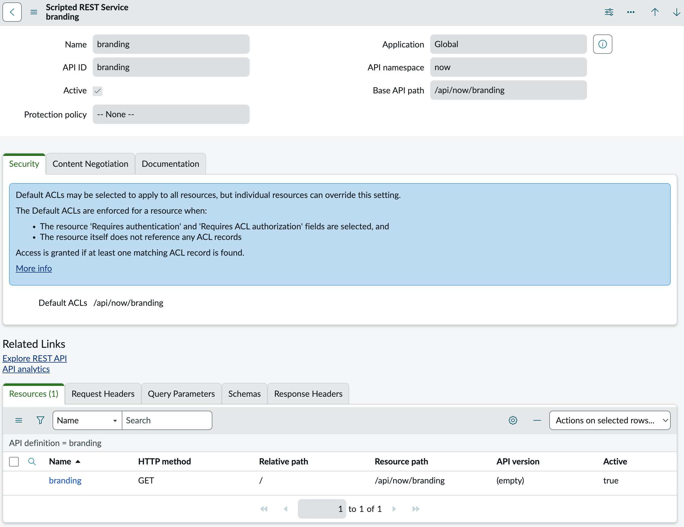
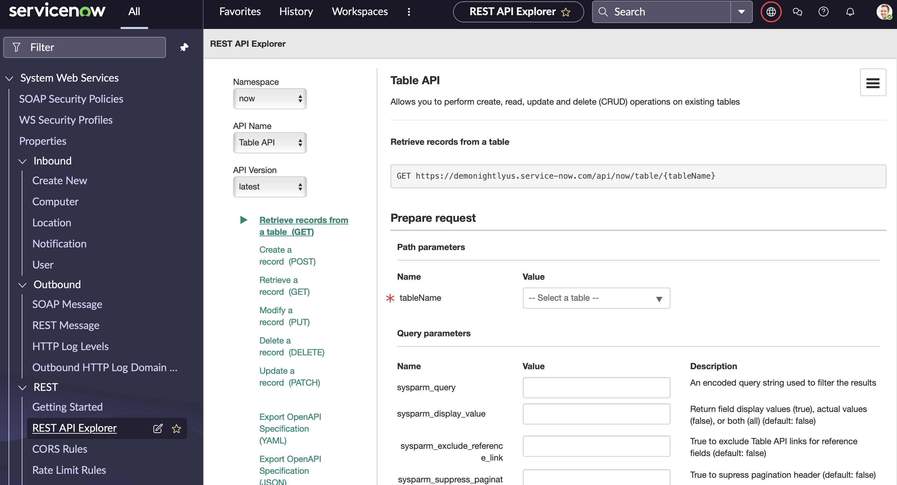

# Web Services / REST API（Webサービスと REST API）

## 概要

ServiceNow AI Platform（旧 Now Platform）は、外部システムとのデータ連携のために **インバウンド（Inbound：外部→ServiceNow）** と **アウトバウンド（Outbound：ServiceNow→外部）** の Web サービスを標準で提供する。本ファイルは基準リリース **Australia**（2026-05 GA）の公式ドキュメントに基づき、以下を網羅する。

| 区分 | 機能 | 主な用途 |
|---|---|---|
| インバウンド REST | Table API / Aggregate API / Attachment API / Import Set API / Batch API | 任意テーブルの CRUD、集計、添付ファイル、ステージング経由の取り込み、複数リクエストの一括送信 |
| インバウンド REST（カスタム） | Scripted REST API | 独自エンドポイントの実装 |
| アウトバウンド REST | REST Message / `RESTMessageV2` | 外部 REST API の呼び出し |
| SOAP | Direct Web Services / Scripted SOAP / Outbound SOAP Message | レガシー連携、WSDL ベース連携 |
| GraphQL | GraphQL API framework（Scripted Schema） | UI コンポーネント等からの柔軟なクエリ |
| 開発・運用ツール | REST API Explorer、GraphQL Explorer、Rate Limit Rules | API の試行、OpenAPI 出力、流量制御 |
| セキュリティ | Basic 認証、OAuth 2.0、API Key / HMAC、相互認証（mTLS）、REST API Access Policy、REST API Auth Scope、ACL、CORS | 認証・認可 |

[出典](https://www.servicenow.com/docs/r/australia/api-reference/rest-api-explorer/c_RESTAPI.html)

関連ファイル：ローコード連携（Spoke、REST Step）は [IntegrationHub](./integrationhub.md)、インポートセット・変換マップの詳細は [データインポート/エクスポート](./import-export-data.md)、イントラネット経由の通信は [MID Server](./mid-server.md)、ACL の評価ロジックは [アクセス制御（ACL）](./access-control-acl.md)、SSO・MFA 全般は [認証とSSO](./authentication-sso.md)、設計方針は [連携設計](../../03_導入編/09-integration-design.md)、実務上の落とし穴は [連携の落とし穴](../../04_応用編/08-integration-pitfalls.md) を参照。

---

## 1. インバウンド REST API の共通仕様

### 1.1 URL 形式とバージョン

ServiceNow のインバウンド REST API の URL は次の形式である。

```
https://<instance>.service-now.com/api/<namespace>/<api_path>
https://<instance>.service-now.com/api/<namespace>/<version>/<api_path>
```

- 標準 API の Namespace（名前空間）は `now`（例：`/api/now/table/incident`）。
- `api_version`（`v1`、`v2` など）は省略可能で、省略時は**最新バージョン**のエンドポイントが使われる。
- 利用可能なバージョンは REST API Explorer で確認できる。

[出典](https://www.servicenow.com/docs/r/australia/api-reference/rest-api-explorer/c_RESTAPI.html)

> **実務上の注意 `【経験則】`:** バージョン省略時は最新版に追従するため、本番連携ではバージョンを明示（例：`/api/now/v2/table/...`）して、アップグレード時の挙動変化を避けるのが一般的である。Table API では v1 と v2 で「該当なし」時の応答が異なる（後述）。

### 1.2 HTTP メソッドとヘッダー

| 項目 | 仕様 |
|---|---|
| 対応メソッド | GET、POST、PUT、PATCH、DELETE、HEAD（HEAD はボディなしで応答） |
| 複数レコード送信 | POST / PUT / PATCH は、複数レコードを送っても**最初の1件のみ**処理する |
| Database View | Database View（データベースビュー）は読み取り専用で、POST / PUT / PATCH で更新不可 |
| メソッド上書き | `X-http-method-override` ヘッダーで HTTP メソッドを上書き可能 |
| フォーマット | `Accept` / `Content-Type` に `application/json` または `application/xml` |
| 必須ヘッダー | POST / PUT / PATCH / DELETE は `Accept` と `Content-Type` の両方、GET / HEAD は `Accept` のみ。欠落時は `400 Bad Request` |
| デバッグ | `X-WantSessionDebugMessages` ヘッダーでセッションのデバッグログを応答に含められる |

[出典](https://www.servicenow.com/docs/r/australia/api-reference/rest-api-explorer/c_RESTAPI.html)

### 1.3 関連システムプロパティ

| プロパティ | 既定値 | 説明 |
|---|---|---|
| `glide.rest.cors.enabled` | `true` | CORS（Cross-Origin Resource Sharing）評価を行う。`false` で評価をスキップ |
| `glide.invalid_query.returns_no_rows` | （未設定 = false 相当） | `true` にすると、不正なエンコードクエリで 0 件を返す（既定では不正部分を無視して検索） |
| `glide.http.user.agent` | — | アウトバウンド HTTP の User-Agent（既定 `ServiceNow/1.0`） |

[出典](https://www.servicenow.com/docs/r/australia/api-reference/rest-api-explorer/c_RESTAPI.html)、[出典（RESTMessageV2）](https://www.servicenow.com/docs/r/australia/api-reference/server-api-reference/c_RESTMessageV2API.html)

CORS ルールは **All > System Web Services > REST > CORS Rules** で定義する（REST API Explorer 画像のナビゲーターにも表示）。

### 1.4 HTTP レスポンスコード

`REST API HTTP response codes` で定義されている標準レスポンスコードは以下のとおり。

| コード | メッセージ | 意味 |
|---|---|---|
| 200 | Success | 成功（ボディあり） |
| 201 | Created | 作成成功（ボディあり） |
| 204 | Success | 成功（ボディなし） |
| 400 | Bad Request | URI が API に一致しない、処理失敗、不正なヘッダー |
| 401 | Unauthorized | 認証失敗・API 利用権限なし |
| 403 | Forbidden | 操作不可。ACL、Business Rule、Data Policy による拒否も含む |
| 404 | Not found | リソースなし。**ACL 制約でも 404 になり得る** |
| 405 | Method not allowed | 当該 API で許可されていない HTTP メソッド |
| 406 | Not acceptable | `Accept` で指定した形式に非対応 |
| 415 | Unsupported media type | リクエストボディ形式に非対応 |
| 429 | Too Many Requests | レート制限超過（[§9](#9-インバウンド-rest-api-のレート制限rate-limiting)） |
| 500 | Internal server error | 想定外のエラー（応答に詳細） |
| 502 | Bad gateway | ゲートウェイ／プロキシが上流から不正応答を受信 |
| 503 | Service unavailable | 一時的に処理不能 |

[出典](https://www.servicenow.com/docs/r/australia/api-reference/rest-api-explorer/r_RESTAPIHTTPResponseCodes.html)、429 は [出典](https://www.servicenow.com/docs/r/australia/api-reference/rest-api-explorer/inbound-REST-API-rate-limiting.html)

エラー時のボディは共通して次の形式である。

```json
{
  "error": { "message": "...", "detail": "..." },
  "status": "failure"
}
```

### 1.5 REST API の ACL とテーブルアクセス

- REST API へのアクセスは、API／エンドポイント単位の ACL（Access Control List）で定義されたロール・条件で制御される。ACL は **System Security > Access Control (ACL)** で確認できる。
- 以下の REST API ACL はベースシステムに存在するが**既定で非アクティブ**（＝API 単位の ACL では制限されず、テーブル側の ACL で制御される）。それ以外の REST API ACL は既定でアクティブ。
  - Table API / Aggregate API / Import Set API / Attachment API
- REST API ACL の **名前は変更してはならない**（公式の注意事項）。
- 既定では、ベースシステム・グローバル・スコープ付きのすべてのテーブルが Web サービス経由でアクセス可能。ACL で読み取り権限のないフィールドは応答に含まれない。
- REST 呼び出しのユーザーは、対話ユーザーと同様に ACL の評価対象となる。

[出典](https://www.servicenow.com/docs/r/australia/api-reference/rest-api-explorer/c_RESTAPI.html)

> **設計上の注意 `【経験則】`:** 連携用ユーザーには `admin` を付与せず、必要なテーブルに限定したカスタムロールを付与し、ユーザーレコードの **Web service access only（Web サービス専用アカウント）** をオンにして UI ログインを禁止するのが一般的な推奨である。Basic 認証制限（[§11.3](#113-basic-認証basic-authentication)）でも Web サービス専用アカウントは例外扱いとなる。

---

## 2. Table API

### 2.1 概要

`Table API` は、任意のテーブルに対して CRUD（作成・参照・更新・削除）操作を行う最も基本的な REST API である。Namespace は `now`、パスは `/api/now/table`。

[出典](https://www.servicenow.com/docs/r/australia/api-reference/rest-apis/c_TableAPI.html)

### 2.2 エンドポイント一覧

| メソッド | パス | 用途 | 主なステータス |
|---|---|---|---|
| GET | `/api/now/table/{tableName}` | 複数レコード取得 | 200 |
| GET | `/api/now/table/{tableName}/{sys_id}` | 1件取得 | 200, 404 |
| POST | `/api/now/table/{tableName}` | 1件作成 | 201, 400, 404 |
| PUT | `/api/now/table/{tableName}/{sys_id}` | 1件更新（全フィールドを返す） | 200, 400, 404 |
| PATCH | `/api/now/table/{tableName}/{sys_id}` | 1件更新 | 200, 400, 404 |
| DELETE | `/api/now/table/{tableName}/{sys_id}` | 1件削除（ボディなし） | 204 |

各パスはバージョン付き形式（`/api/now/{api_version}/table/...`）も可。

[出典](https://www.servicenow.com/docs/r/australia/api-reference/rest-apis/c_TableAPI.html)

### 2.3 クエリパラメータ

| パラメータ | 対象 | 既定値 | 説明 |
|---|---|---|---|
| `sysparm_query` | GET（一覧） | なし | エンコードクエリ（Encoded query）。`=`、`!=`、`LIKE`、`STARTSWITH`、`ENDSWITH`、`^`（AND）、`^OR`、`ORDERBY` / `ORDERBYDESC` 等。不正部分は無視（`glide.invalid_query.returns_no_rows=true` で 0 件） |
| `sysparm_limit` | GET（一覧） | **10000** | 最大取得件数。`sysparm_offset` と組み合わせてページング。極端に大きい値は性能に影響。**ACL 評価前に適用**されるため、閲覧可能レコードが期待より少なく返ることがある |
| `sysparm_offset` | GET（一覧） | 0 | 取得開始位置。負数不可 |
| `sysparm_fields` | GET / POST / PUT / PATCH | 全フィールド | 返却フィールドのカンマ区切りリスト。ドットウォーク可。不正なフィールドは無視 |
| `sysparm_display_value` | GET / POST / PUT / PATCH | `false` | `false`＝DB 値、`true`＝表示値、`all`＝両方。表示値は DB から直接読まないため性能に影響し得る |
| `sysparm_exclude_reference_link` | GET / POST / PUT | `false` | 参照フィールドの Table API リンク（`link`）を除外 |
| `sysparm_view` | GET / POST / PUT / PATCH | なし | `desktop`、`mobile`、`both` の UI ビューでフィールドを決定。`sysparm_fields` が優先 |
| `sysparm_input_display_value` | POST / PUT / PATCH | `false` | 入力値を表示値として解釈するか。`true` の場合、日時はユーザーのタイムゾーンで解釈され UTC に変換。**暗号化フィールドの設定には `true` が必須** |
| `sysparm_no_count` | GET（一覧） | `false` | `true` で `select count(*)` を省略（大規模テーブルで有効） |
| `sysparm_suppress_pagination_header` | GET（一覧） | `false` | `true` で `Link` ヘッダーを抑止 |
| `sysparm_query_category` | GET（一覧） | なし | クエリカテゴリ名（読み取りレプリカ等のクエリルーティング用） |
| `sysparm_query_no_domain` | GET / PUT / PATCH / DELETE | `false` | ドメインセパレーション環境で、ユーザーの設定外ドメインのレコードも対象にする。システム管理者または `query_no_domain_table_api` ロールが必要 |
| `name=value` | GET（一覧） | なし | `&active=true` のようなフィールド条件。`sysparm_query` と排他 |

[出典](https://www.servicenow.com/docs/r/australia/api-reference/rest-apis/c_TableAPI.html)

### 2.4 ヘッダー

| 方向 | ヘッダー | 説明 |
|---|---|---|
| リクエスト | `Accept` | `application/json`（既定）／`application/xml` |
| リクエスト | `Content-Type` | POST / PUT / PATCH で指定 |
| リクエスト | `X-no-response-body` | `true` で応答ボディを抑止（POST / PUT / PATCH） |
| レスポンス | `Link` | ページング用の相対 URL（`first`、`prev`、`next`、`last`） |
| レスポンス | `X-Total-Count` | クエリに一致する総件数 |
| レスポンス | `Location` | POST で作成されたリソースの URL |

[出典](https://www.servicenow.com/docs/r/australia/api-reference/rest-apis/c_TableAPI.html)

### 2.5 挙動上の注意

- **v1 と v2 の違い:** GET 一覧で有効なクエリが 0 件のとき、v1 は `404`、v2 は `200` と空配列 `[]` を返す。
- **`sys_` 接頭辞フィールド**はシステム生成のため、通常は更新できない。
- POST で指定しなかったフィールドは自動生成でなければデータ型の null 値になる。
- PUT は変更したフィールドだけでなく全フィールドを返す。
- 必要ロールはテーブルの ACL に依存する（Table API 固有のロールはない）。

[出典](https://www.servicenow.com/docs/r/australia/api-reference/rest-apis/c_TableAPI.html)

### 2.6 リクエスト例

```bash
# 有効な P1 インシデントを 100 件ずつ、必要フィールドのみ取得
curl "https://<instance>.service-now.com/api/now/v2/table/incident?sysparm_query=active=true^priority=1^ORDERBYDESCsys_updated_on&sysparm_fields=number,short_description,assignment_group.name&sysparm_limit=100&sysparm_offset=0&sysparm_display_value=true&sysparm_exclude_reference_link=true" \
  -H "Accept: application/json" \
  -H "Authorization: Bearer <access_token>"
```

> **性能上の推奨 `【経験則】`:** 大量取得では `sysparm_fields` で列を絞り、`sysparm_no_count=true` を付け、`ORDERBY` を固定した上で `sysparm_offset` ページング（または `sys_updated_on` 等による差分取得）を行う。既定の `sysparm_limit`=10000 のまま全件取得すると、トランザクションのタイムアウトや性能劣化を招きやすい。詳細は [パフォーマンスチューニング](../../04_応用編/03-performance-tuning.md) を参照。

---

## 3. Aggregate API

### 3.1 概要

`Aggregate API` は、GlideAggregate を用いてテーブルの件数・平均・最小・最大・合計を算出する読み取り専用 API である。テーブルに読み取りアクセスが定義されている場合のみクエリが許可される。

| メソッド | パス |
|---|---|
| GET | `/api/now/stats/{tableName}` |
| GET | `/api/now/{api_version}/stats/{tableName}` |

[出典](https://www.servicenow.com/docs/r/australia/api-reference/rest-apis/c_AggregateAPI.html)

### 3.2 クエリパラメータ

| パラメータ | 既定値 | 説明 |
|---|---|---|
| `sysparm_count` | なし | `true` で一致件数を返す |
| `sysparm_avg_fields` / `sysparm_min_fields` / `sysparm_max_fields` / `sysparm_sum_fields` | なし | 集計対象フィールド（カンマ区切り） |
| `sysparm_group_by` | なし | グループ化フィールド（カンマ区切り） |
| `sysparm_having` | なし | 集計結果に対する条件。`aggregate^field^operator^value` 形式（例：`count^state^=^1`）。複数はカンマ区切り |
| `sysparm_order_by` | 昇順 | グループ結果の並び。`^DESC` で降順 |
| `sysparm_query` | なし | エンコードクエリ |
| `sysparm_display_value` | `false` | `true` / `false` / `all` |
| `name=value` | なし | フィールド条件。choice / reference は表示値でも指定可（例：`&state=closed`） |

- `sysparm_<aggregate>_fields` と `sysparm_count` のどちらも指定しない場合、集計は実行されない。
- 応答は `result` 配列で、各要素に `stats`（集計値）と `groupby_fields`（グループ値）を含む。
- ステータス：200、401、403、500。

[出典](https://www.servicenow.com/docs/r/australia/api-reference/rest-apis/c_AggregateAPI.html)

```bash
# 割り当てグループ別の未完了インシデント件数
curl "https://<instance>.service-now.com/api/now/stats/incident?sysparm_query=active=true&sysparm_count=true&sysparm_group_by=assignment_group&sysparm_display_value=true" \
  -H "Accept: application/json" -u "<user>:<password>"
```

---

## 4. Attachment API

### 4.1 エンドポイント一覧

`Attachment API` は `sys_attachment`（Attachment）テーブルに対する添付ファイルのアップロード・ダウンロード・メタデータ操作を行う。

| メソッド | パス | 用途 | 成功時 |
|---|---|---|---|
| GET | `/api/now/attachment` | 複数添付のメタデータ | 200 |
| GET | `/api/now/attachment/{sys_id}` | 1件のメタデータ | 200 |
| GET | `/api/now/attachment/{sys_id}/file` | バイナリ取得 | 200 |
| POST | `/api/now/attachment/file` | バイナリアップロード | 201 |
| POST | `/api/now/attachment/upload` | multipart/form-data アップロード | 201 |
| PATCH | `/api/now/attachment/{sys_id}` | ファイル名変更 | 204 |
| DELETE | `/api/now/attachment/{sys_id}` | 削除 | 204 |
| GET / POST / DELETE | `/api/now/attachment/{sys_id}/attributes` | 属性（Attachment Attributes）一覧・追加・全削除 | 200 / 201 / 204 |
| GET / PUT / DELETE | `/api/now/attachment/{sys_id}/attributes/{attribute_key}` | 個別属性の取得・更新・削除 | 200 / 200 / 204 |

[出典](https://www.servicenow.com/docs/r/australia/api-reference/rest-apis/c_AttachmentAPI.html)

### 4.2 主なパラメータ

| エンドポイント | パラメータ | 説明 |
|---|---|---|
| GET `/attachment` | `sysparm_limit`（既定 1000）、`sysparm_offset`（既定 0）、`sysparm_query` | `sys_attachment` に対するエンコードクエリ（`ORDERBY` 可） |
| GET `/{sys_id}/file` | `Accept`（既定 `*/*`） | 応答ヘッダー `X-Attachment-Metadata` にサイズ・名前・種別 |
| POST `/file` | `table_name`、`table_sys_id`、`file_name`（必須）、`creation_time`、`encryption_context`（任意） | ボディにバイナリ、`Content-Type` 必須（例：`image/jpeg`） |
| POST `/upload` | フォーム項目 `table_name`、`table_sys_id`、ファイルパート | `Content-Type: multipart/form-data`。ファイルは**最後のパート**に置く |
| PATCH `/{sys_id}` | ボディ `file_name`（必須） | 名前変更 |

応答の主なフィールド：`sys_id`、`file_name`、`content_type`、`size_bytes`、`size_compressed`、`compressed`、`table_name`、`table_sys_id`、`download_link`、`image_width`、`image_height` など。

[出典](https://www.servicenow.com/docs/r/australia/api-reference/rest-apis/c_AttachmentAPI.html)

### 4.3 ロールと制限

- 認証ユーザーには `sys_attachment` レコードを作成できる権限と、**添付先テーブルの読み書き権限**が必要（例：インシデントへの添付には `itil`）。添付専用の既定ロールはないため、必要に応じて専用ロールを作成する。
- 1リクエストで扱えるファイルは1つ。
- `com.glide.attachment.max_size`：最大ファイルサイズ（既定 1024MB）。
- `glide.attachment.extensions`：許可する拡張子。

[出典](https://www.servicenow.com/docs/r/australia/api-reference/rest-apis/c_AttachmentAPI.html)

```bash
curl "https://<instance>.service-now.com/api/now/attachment/file?table_name=incident&table_sys_id=<sys_id>&file_name=log.txt" \
  -X POST -H "Content-Type: text/plain" -H "Accept: application/json" \
  --data-binary @log.txt -u "<user>:<password>"
```

---

## 5. Import Set API

### 5.1 概要とエンドポイント

`Import Set API` は、ステージングテーブル（Import Set table）にデータを挿入し、Transform Map（変換マップ）で本番テーブルへ反映する。Table API と異なり、変換マップ・Coalesce（一致キー）・変換スクリプトによる**データ整形と重複排除**を挟める点が特徴である。SOAP の Import Set Web Service と同等の機能を REST で提供する。

| メソッド | パス | 変換 |
|---|---|---|
| POST | `/api/now/import/{stagingTableName}` | 1件挿入、**同期**変換 |
| POST | `/api/now/import/{stagingTableName}/insertMultiple` | 複数件挿入、既定で**非同期**変換 |
| GET | `/api/now/import/{stagingTableName}/{sys_id}` | ステージングレコードと変換結果の取得 |

[出典](https://www.servicenow.com/docs/r/australia/api-reference/rest-apis/c_ImportSetAPI.html)

### 5.2 insertMultiple の仕様

| 項目 | 内容 |
|---|---|
| クエリパラメータ | `multi_import_set_id`：既存の Multi Import Set（`sys_multi_import_set`）に追加。`run_after`：先に完了させる Import Set の sys_id（非同期時のみ） |
| ボディ形式（既定） | `records` 配列のキー・値。キーは既定で**列ラベル**。`sys_rest_insert_multiple`（Rest Insert Multiples）で列名に変更可 |
| ボディ形式（データソース形式） | JSON データソースから作成したステージングテーブルで、`sys_data_source` にパスを定義し、`sys_rest_insert_multiple` の「Use data source format」を有効化 |
| 同期化 | `sys_rest_insert_multiple` にソーステーブルを登録し、変換を同期に設定 |
| ヘッダー | `Accept` / `Content-Type` とも JSON のみ |
| 応答 | `import_set_id`、`multi_import_set_id` |

単一 POST / GET の応答 `result` には `display_name`、`display_value`、`record_link`、`status`、`sys_id`、`table`、`transform_map`、変換スクリプトで設定した `status_message` / `error_message` が含まれる。

[出典](https://www.servicenow.com/docs/r/australia/api-reference/rest-apis/c_ImportSetAPI.html)

### 5.3 注意事項

- 値は**文字列の名前・値ペアのみ**受け付ける。ネストした JSON はそのまま格納されない（`:` が `=` に変わる等）。
- Import Set テーブルはスケジュールで削除されるため、古い sys_id の GET は 404 になり得る。
- 非認証アクセスを許可する場合はテーブル名を `sys_public.list` に追加するが、テーブル ACL は引き続き適用される（非推奨 `【経験則】`）。
- ロールの観点では `import_admin`（インポートセット管理）、`import_transformer`（変換マップ管理・変換実行）が関連ロールとして SOAP ドキュメントに記載されている。

[出典](https://www.servicenow.com/docs/r/australia/api-reference/rest-apis/c_ImportSetAPI.html)、[出典（SOAP ロール）](https://www.servicenow.com/docs/r/australia/api-reference/web-services/c_SOAPWebService.html)

インポートセットの全体像は [データインポート/エクスポート](./import-export-data.md)、移行設計は [データ移行](../../03_導入編/08-data-migration.md) を参照。

---

## 6. Batch API

`Batch API` は、複数の REST リクエストを1回の HTTP 呼び出しにまとめて往復回数を減らすための API である。並列トランザクション処理用ではない。

| 項目 | 内容 |
|---|---|
| エンドポイント | POST `/api/now/{api_version}/batch`（例：`/api/now/v1/batch`） |
| ボディ | `batch_request_id`（任意）、`rest_requests[]`（必須：`id`、`method`、`url`（相対パス）、任意で `headers[]`、`body`（**Base64 エンコード**）、`exclude_response_headers`） |
| 応答 | `serviced_requests[]`（`status_code`、`status_text`、`headers`、`execution_time`（ms）、`body`（Base64））、`unserviced_requests[]`（未処理 ID） |
| リクエスト項目サイズ | 既定 5MB、`glide.rest.batch.max.inputSize` で最大 10MB |
| 応答項目サイズ | 既定 10MB、`glide.rest.batch.max.outputSize`、またはヘッダー `X-BATCHREQUEST-MAX-OUTPUT-SIZE`（プロパティ値以下） |
| タイムアウト | 30 秒超は Transaction Quota Rule「REST Batch API request timeout」で打ち切り |
| ヘッダー | `Content-Type` は `application/json` のみ、`Accept` は `application/json` または `multipart/mixed` |
| セキュリティ | 各リクエストに既存 ACL が適用 |

[出典](https://www.servicenow.com/docs/r/australia/api-reference/rest-apis/batch-api.html)

---

## 7. Scripted REST API

### 7.1 概要

`Scripted REST API` は、開発者が独自のエンドポイント（リソース）と処理スクリプトを定義できるカスタム REST API である。標準 API で表現しにくい業務ロジック（複数テーブルの一括処理、外部仕様に合わせた入出力変換）に用いる。

**メニュー:** All > System Web Services > Scripted REST APIs

[出典](https://www.servicenow.com/docs/r/australia/api-reference/rest-api-explorer/c_CustomWebServices.html)

### 7.2 URI 形式

```
https://<instance>.service-now.com/api/<name_space>/<version>/<api_id>/<relative_path>
```

| 要素 | 内容 |
|---|---|
| `name_space` | グローバルスコープでは `glide.appcreator.company.code` プロパティ値、スコープアプリではスコープ名（例：`x_company_appname`） |
| `version` | 任意（例：`v1`） |
| `api_id` | フォームの **API ID**（既定は Name から生成） |
| `relative_path` | リソースごとに定義 |

[出典](https://www.servicenow.com/docs/r/australia/api-reference/rest-api-explorer/c_CustomWebServices.html)

### 7.3 Scripted REST Service フォーム



**図: Scripted REST Service フォーム**
- 画面説明：Scripted REST API（例：`branding`）のレコード画面。上部に **Name**、**API ID**、**Active**、**Protection policy**（保護ポリシー、例では「-- None --」）、右側に **Application**（例：Global）、**API namespace**（例：`now`）、**Base API path**（例：`/api/now/branding`）が並ぶ。中段のタブは **Security**（Default ACLs の説明と設定欄。「リソースの Requires authentication と Requires ACL authorization が選択され、かつリソース自身が ACL を参照していない場合に Default ACLs が適用され、一致する ACL が1つでもあればアクセスを許可」と表示）、**Content Negotiation**（既定の入出力フォーマット）、**Documentation**。Related Links に **Explore REST API**、**API analytics**。下部の関連リストに **Resources**（Name、HTTP method、Relative path、Resource path、API version、Active）、**Request Headers**、**Query Parameters**、**Schemas**、**Response Headers**。
- 出典：https://www.servicenow.com/docs/r/australia/api-reference/rest-api-explorer/c_CustomWebServices.html （Figure 1. Scripted REST Service form）
- 取得日：2026-11-02

### 7.4 作成手順とロール

| 項目 | 内容 |
|---|---|
| 管理ロール | `web_service_admin`（Scripted REST API とリソースの参照・作成・変更・削除） |
| 呼び出し側ロール | エンドポイント呼び出し自体に特定ロールは不要（ACL 設定次第） |
| API 作成 | Scripted REST APIs > New → Name（API ID 自動生成）→ Default ACLs 選択 → Submit |
| リソース作成 | API レコードの **Resources** 関連リスト > New → Name（URI に影響）→ HTTP method → **Script** に処理を記述 → 任意で親 API 設定の上書き（セキュリティ、Content Type）→ Documentation タブの Short description（REST API Explorer に表示）→ Submit |
| 追加設定 | リクエスト／レスポンスヘッダー、クエリパラメータ、スキーマ（OpenAPI 3.0.1 形式）、サンプルからのリクエスト定義自動生成、最大リクエストサイズ、バージョニング |

[出典（作成）](https://www.servicenow.com/docs/r/australia/api-reference/rest-api-explorer/t_CreateAScriptedRESTService.html)、[出典（リソース）](https://www.servicenow.com/docs/r/australia/api-reference/rest-api-explorer/t_CreateAScriptedRESTAPIResource.html)、[出典（概要）](https://www.servicenow.com/docs/r/australia/api-reference/rest-api-explorer/c_CustomWebServices.html)

> 格納テーブル名について：API 定義は `sys_ws_definition`、リソースは `sys_ws_operation` に格納されることが一般に知られているが、本調査の対象とした公式ページ上では明記を確認できなかった `【経験則】`。

### 7.5 スクリプト例

リソースの Script は `request`（RESTAPIRequest）と `response`（RESTAPIResponse）を受け取る関数として記述する。クエリパラメータは `request.queryParams` で参照する（公式記載）。パスパラメータ（`{number}` 等）は `request.pathParams` で参照するのが一般的である `【経験則】`。

```javascript
(function process(/*RESTAPIRequest*/ request, /*RESTAPIResponse*/ response) {
    var number = request.pathParams.number;             // 例: relative_path = /incident/{number}
    var gr = new GlideRecordSecure('incident');          // ACL を適用する
    if (!gr.get('number', number)) {
        response.setError(new sn_ws_err.NotFoundError('The specified record does not exist'));
        return;
    }
    response.setStatus(200);
    response.setBody({ number: gr.getValue('number'), state: gr.getDisplayValue('state') });
})(request, response);
```

（`GlideRecordSecure` の利用と組み込みエラーオブジェクトの利用は公式 Good practices の推奨。[出典](https://www.servicenow.com/docs/r/australia/api-reference/rest-api-explorer/scripted-rest-good-practices.html)）

### 7.6 バージョニング

- バージョンは任意。新機能は既存バージョンを変更せず**新バージョンとして追加**し、既存連携を壊さない。
- いずれかのバージョンを **Default** にすると、バージョンなし URI でそのバージョンに到達する。Default がない場合は最新版。
- 公式は、クライアントにバージョン指定を促すため、バージョン固有エンドポイントの利用か Default なし構成を推奨している。

[出典](https://www.servicenow.com/docs/r/australia/api-reference/rest-api-explorer/c_CustomWebServices.html)、[出典（Good practices）](https://www.servicenow.com/docs/r/australia/api-reference/rest-api-explorer/scripted-rest-good-practices.html)

### 7.7 セキュリティ設定マトリクス

Scripted REST API の認証・認可は、API レコードの **Default ACLs**、リソースの **Requires authentication**、**Requires ACL authorization**、リソースの **ACLs** の組み合わせで決まる。

| # | 構成 | API の Default ACLs | Requires authentication | Requires ACL authorization | リソースの ACLs |
|---|---|---|---|---|---|
| 1 | 公開（認証・ACL なし） | 任意 | False | 任意 | 任意 |
| 2 | Basic 認証のみ（ACL なし） | 任意 | True | False | 任意 |
| 3 | 認証＋ACL（既定 ACL なし） | 未選択 | True | True | 未選択 |
| 4 | リソース単位の ACL 必須 | 任意 | True | True | 1つ以上選択 |
| 5 | API 単位の ACL 必須 | 1つ以上選択 | True | True | 未選択 |

- ACL の Type は **`REST_Endpoint`**。複数 ACL がある場合は**いずれか1つ**を満たせばよい。
- リソース側の設定は親 API の設定を上書きする。
- `snc_external` ロールのユーザーは、別の ACL で許可しない限り既定 ACL でブロックされる。
- パスベースの ACL（Path-based ACL）を追加し、REST API Explorer から確認することもできる。
- 認証方式そのものは API Access Policy（[§11.6](#116-rest-api-access-policyrest-api-アクセスポリシー)）で制御する。

[出典](https://www.servicenow.com/docs/r/australia/api-reference/rest-api-explorer/c_CustomWebServices.html)

### 7.8 フォーマットとエラー応答

- 既定のサポート形式は `application/json`、`application/xml`、`text/xml`。API レベル、さらにリソースレベルで上書き可能。
- 応答形式はリクエストの `Accept` に従い、非対応の場合は JSON にフォールバック。
- エラー時はボディに `error.message` / `error.detail` と `status: "failure"`。数値の HTTP ステータスはボディではなくヘッダーに入る。

[出典](https://www.servicenow.com/docs/r/australia/api-reference/rest-api-explorer/c_CustomWebServices.html)

### 7.9 公式 Good practices（要約）

| # | プラクティス | 要点 |
|---|---|---|
| 1 | REST の慣例に従う | GET は参照のみ、POST は作成、PUT/PATCH は更新、DELETE は削除 |
| 2 | バージョニング | 大きな変更は新バージョンで、任意パラメータで後方互換に拡張 |
| 3 | 適切なステータスコード | 200 / 201 / 204、40X（クライアント誤り）、50X（サーバー処理失敗） |
| 4 | 有用なエラー情報 | メッセージ付きでエラーを返す。組み込みエラーオブジェクトを活用 |
| 5 | アクセス制御の強制とテスト | 認証必須、`GlideRecordSecure` 使用、更新系はより厳格に |
| 6 | 自動テスト | 応答コード・ヘッダー・ボディ・認証を検証（Postman、[ATF](./automated-test-framework.md) 等） |

[出典](https://www.servicenow.com/docs/r/australia/api-reference/rest-api-explorer/scripted-rest-good-practices.html)

---

## 8. REST API Explorer

### 8.1 概要とアクセス

`REST API Explorer` は、インスタンス上の REST API（標準・Scripted REST）を参照し、リクエストを組み立てて実行し、応答を確認できるブラウザツールである。

| 項目 | 内容 |
|---|---|
| メニュー | All > System Web Services > REST > REST API Explorer（フィルターナビゲーターで検索も可） |
| 必要ロール | `rest_api_explorer`（OpenAPI エクスポートは `web_service_admin`、`rest_api_explorer`、`admin` のいずれか） |
| 選択項目 | **Namespace**（例：`now`）、**API Name**（例：Table API）、**API Version**（例：`latest`） |
| 主な機能 | API リソースの一覧・説明、パス／クエリパラメータ入力、ヘッダー指定、送信と応答確認、各種言語のコードサンプル生成、テーブルから REST API を直接探索、OpenAPI 仕様のエクスポート |

[出典（アクセス）](https://www.servicenow.com/docs/r/australia/api-reference/rest-api-explorer/t_GetStartedAccessExplorer.html)、[出典（概要）](https://www.servicenow.com/docs/r/australia/api-reference/rest-api-explorer/use-REST-API-Explorer.html)、[出典（REST APIs）](https://www.servicenow.com/docs/r/australia/api-reference/rest-api-explorer/c_RESTAPI.html)



**図: REST API Explorer**
- 画面説明：Next Experience UI の REST API Explorer。左のナビゲーターには **System Web Services** 配下に SOAP Security Policies、WS Security Profiles、Properties、**Inbound**（Create New、Computer、Location、Notification、User）、**Outbound**（SOAP Message、**REST Message**、HTTP Log Levels、Outbound HTTP Log Domain…）、**REST**（Getting Started、**REST API Explorer**、**CORS Rules**、**Rate Limit Rules**）が表示されている。中央左に **Namespace**（`now`）、**API Name**（Table API）、**API Version**（`latest`）のドロップダウンと、メソッド一覧（Retrieve records from a table (GET)、Create a record (POST)、Retrieve a record (GET)、Modify a record (PUT)、Delete a record (DELETE)、Update a record (PATCH)）、**Export OpenAPI Specification (YAML)** / **(JSON)** リンク。右側に選択中メソッドの URL（`GET https://<instance>/api/now/table/{tableName}`）と **Prepare request** セクション（Path parameters の `tableName` 選択、Query parameters の `sysparm_query`、`sysparm_display_value`、`sysparm_exclude_reference_link`、`sysparm_suppress_pagination_header` 等の入力欄と説明）が並ぶ。
- 出典：https://www.servicenow.com/docs/r/australia/api-reference/rest-api-explorer/t_GetStartedAccessExplorer.html
- 取得日：2026-11-02

### 8.2 OpenAPI 仕様のエクスポート

1. All > System Web Services > REST > REST API Explorer を開く。
2. エクスポートする API を選択（例：Namespace `now`、API Name `Table API`、API Version `latest`）。
3. メソッド一覧の下の **Export OpenAPI Specification (YAML)** または **(JSON)** をクリックして保存する。

出力される OpenAPI のバージョンは当該ページでは明記されていない（Scripted REST のスキーマ定義は OpenAPI 3.0.1 形式）。

[出典](https://www.servicenow.com/docs/r/australia/api-reference/rest-api-explorer/export-openapi-specification.html)

---

## 9. インバウンド REST API のレート制限（Rate Limiting）

### 9.1 仕組み

Rate Limit Rules（`sys_rate_limit_rules`）は、インバウンド REST API リクエストの**1時間あたりの処理件数**を、特定ユーザー・特定ロール保有ユーザー・全ユーザー単位で制限する。

| 項目 | 仕様 |
|---|---|
| メニュー | All > System Web Services > REST > Rate Limit Rules |
| 必要ロール | `rate_limit_admin` |
| 単位 | 1時間あたりのリクエスト数（REST API リソース単位） |
| 対象 | インバウンド REST のみ |
| カウント方式 | 各ノードがユーザー別にメモリでカウントし、**30 秒ごと**に DB にコミット。そのためルールの反映や制限の効き始めに最大 30 秒の遅れがある |
| 超過時 | HTTP **429 Too Many Requests** |

[出典](https://www.servicenow.com/docs/r/australia/api-reference/rest-api-explorer/inbound-REST-API-rate-limiting.html)

### 9.2 優先順位

1. **Single user（単一ユーザー）** のルールは、ロール・全ユーザーのルールより優先。
2. **Users with role（ロール）** のルールは、全ユーザーのルールより優先。
3. ユーザーが複数ロールで複数ルールに該当する場合、**最も制限の厳しい（上限が小さい）ルール**が適用。

公式の例：`import_admin` ロールのルール（3件/時）と `itil` ロールのルール（5件/時）の両方に該当するユーザーには 3件/時 が適用される。

[出典](https://www.servicenow.com/docs/r/australia/api-reference/rest-api-explorer/inbound-REST-API-rate-limiting.html)

### 9.3 Rate Limit Rule フォームのフィールド

| フィールド | 説明 |
|---|---|
| REST API resource | 以下の項目から自動導出 |
| Name | ルールの一意な名前 |
| REST API | 対象の外部公開 REST API |
| Version | API バージョン |
| Resource | 選択バージョンの API リソース（例：`GET /now/v2/table/incident`） |
| Table | 対象テーブル（Table API の場合のみ表示） |
| Import set table | 対象インポートセットテーブル（Import Set API の場合のみ表示） |
| Active | 有効/無効（既定で有効） |
| Request limit per hour | 1時間あたりの上限。**変更するとカウントが 0 にリセットされ、当該時間の違反が削除される** |
| Apply to | Single user / Users with role / All users |
| Role / User | Apply to に応じて表示 |

保存後、関連リスト **Rate Limit Counts**（ユーザー別カウント、**毎日クリア**）と **Rate Limit Violations**（違反、**隔週クリア**）が表示される。カウントのリセット（0 に戻し当該時間の違反を削除）も可能。

[出典（作成）](https://www.servicenow.com/docs/r/australia/api-reference/rest-api-explorer/create-REST-API-rate-limits.html)、[出典（監視）](https://www.servicenow.com/docs/r/australia/api-reference/rest-api-explorer/monitor-request-counts.html)、[出典（リセット）](https://www.servicenow.com/docs/r/australia/api-reference/rest-api-explorer/reset-rest-api-rate-limits.html)

### 9.4 レスポンスヘッダーと 429 応答

| ヘッダー | 説明 |
|---|---|
| `X-RateLimit-Limit` | 1時間あたりの許可リクエスト数 |
| `X-RateLimit-Reset` | 次回リセット時刻（Unix 時刻） |
| `X-RateLimit-Rule` | 適用されたルールの sys_id |
| `Retry-After` | 再試行可能になるまでの秒数（拒否時のみ） |

```json
{
  "error": {
    "message": "Rate limit exceeded",
    "detail": "Rate limit of 10 requests per hour for Table API exceeded"
  },
  "status": "failure"
}
```

[出典](https://www.servicenow.com/docs/r/australia/api-reference/rest-api-explorer/inbound-REST-API-rate-limiting.html)

> **補足 `【第三者情報】`:** ServiceNow Community の記事では、持続的なスループットの実際の制約は1時間あたりのレート制限よりも同時実行数（キュー）とリクエスト処理時間であること、キューが満杯の場合に 429 が返ること、キューイングされ未実行の要求に 202 が返る場合があること、クライアント側で指数バックオフによる再試行を実装すべきことが述べられている。[出典](https://www.servicenow.com/community/developer-articles/understanding-servicenow-rest-api-rate-limits-key-concepts-amp/ta-p/3407367)
>
> **補足 `【経験則】`:** REST 要求にはトランザクションクォータ（Transaction Quota Rules）による実行時間上限も別途かかる（Batch API の 30 秒ルールは公式に明記）。Table API 等の既定タイムアウト値は本調査では公式ページで確認できなかった。

---

## 10. アウトバウンド REST（REST Message / RESTMessageV2）

### 10.1 概要

アウトバウンド REST は、ServiceNow から外部の REST サービスに対してデータを取得・作成・更新・削除する機能である。送信方法は次の3つ。

- **REST Message レコード**（定義を保存して再利用）＋ `RESTMessageV2` スクリプト API
- `RESTMessageV2` の空コンストラクタで、スクリプトのみで送信
- ワークフロー／フローの REST アクティビティ・ステップ（Flow Designer の REST Step は [IntegrationHub](./integrationhub.md) の機能）

MID Server 経由で送信すれば、社内ネットワーク上の REST プロバイダーにも到達できる。

[出典](https://www.servicenow.com/docs/r/australia/api-reference/web-services/c_OutboundRESTWebService.html)

### 10.2 REST Message の構成要素とフォーム

**メニュー:** All > System Web Services > Outbound > REST Message（必要ロール：`web_service_admin`）

REST Message は次の要素で構成される。

| 要素 | 説明 |
|---|---|
| Endpoint | 送信先 URL（必須）。`${variable}` 形式の変数を含められる |
| HTTP Headers | 任意数のヘッダー（Name / Value） |
| Authentication | 認証タイプ（No authentication / Basic / OAuth 2.0）とプロファイル。相互認証も設定可能 |
| HTTP Methods | GET、POST、PUT、PATCH、DELETE 等。各メソッドはエンドポイント・認証・ヘッダーを上書き可能 |

- REST Message の作成時に、レコードの値を継承した既定の HTTP メソッドが自動作成される。**作成後に REST Message 側を変更しても既存の HTTP メソッドには自動反映されない**。
- HTTP Method レコードでは、セキュリティ設定の上書き、HTTP ヘッダー、変数（Variable Substitutions）、PUT/POST/PATCH のボディ定義、**Test** による送信テスト、スクリプトプレビュー生成（Preview Script Usage）が可能。
- HTTP メソッドの認証は既定で「Inherit from parent」。

[出典（要素）](https://www.servicenow.com/docs/r/australia/api-reference/web-services/r_RESTMessageElements.html)、[出典（作成）](https://www.servicenow.com/docs/r/australia/api-reference/web-services/t_ConfiguringARESTMessage.html)、[出典（HTTP メソッド）](https://www.servicenow.com/docs/r/australia/api-reference/web-services/t_DefineAnHTTPMethod.html)

> 格納テーブルは REST Message が `sys_rest_message`、HTTP Method が `sys_rest_message_fn` であることが一般に知られているが、本調査の公式ページでは明記を確認できなかった `【経験則】`。

### 10.3 アウトバウンド REST の認証

| 方式 | 内容 | 制約 |
|---|---|---|
| Basic authentication | ユーザー名・パスワードを各リクエストに付与（Basic Auth Profile） | — |
| OAuth 2.0 | OAuth プロバイダーとプロファイル（Application Registry）を使用 | **MID Server 経由では利用不可** |
| Mutual authentication（相互認証 / mTLS） | Protocol Profile でクライアント証明書を提示 | **Basic 認証と組み合わせた場合のみ**。MID Server 経由不可 |

- 認証付きの新しいスクリプト送信には `RESTMessageV2` を使う（旧 `RESTMessage` API は非推奨）。
- AWS 署名などのカスタム認証（Authentication Algorithm framework）は IntegrationHub の **REST step** でのみ利用でき、`RESTMessageV2` では使えない。
- `RESTMessageV2` は multipart のファイル添付送信、組み込みのリトライポリシーに対応しない（リトライはスクリプトで実装）。

[出典](https://www.servicenow.com/docs/r/australia/api-reference/web-services/c_OutboundRESTAuth.html)

### 10.4 RESTMessageV2 API（`sn_ws` 名前空間）

| メソッド | 説明 |
|---|---|
| `RESTMessageV2()` / `RESTMessageV2(name, methodName)` | 空オブジェクト生成／REST Message レコードと HTTP メソッドから生成 |
| `execute()` | 同期送信して応答（`RESTResponseV2`）を待つ |
| `executeAsync()` | 応答を待たずに送信 |
| `setEndpoint()` / `getEndpoint()` | エンドポイント設定・取得 |
| `setHttpMethod()` | HTTP メソッド（GET、POST、PUT、PATCH、DELETE、HEAD のみ） |
| `setRequestHeader()` / `getRequestHeader()` / `getRequestHeaders()` | ヘッダー操作 |
| `setRequestBody()` / `getRequestBody()` | ボディ（直接設定時は変数置換されない） |
| `setRequestBodyFromAttachment(sysId)` | 添付ファイルをボディとして送信 |
| `setQueryParameter()` | URL クエリパラメータ追加 |
| `setStringParameter()` / `setStringParameterNoEscape()` | `${var}` 変数への値設定（XML エスケープ有／無） |
| `setBasicAuth()` | Basic 認証情報で上書き |
| `setAuthenticationProfile(type, id)` | `basic` または `oauth2` のプロファイル指定 |
| `setRequestorProfile()` | OAuth トークン取得時の Requestor Profile 上書き |
| `setMutualAuth(profileName)` | 相互認証の Protocol Profile 指定 |
| `setMIDServer(name)` | MID Server 経由で送信 |
| `setEccCorrelator()` / `setEccParameter()` | ECC Queue 関連（MID Server 経由時のみ） |
| `setHttpTimeout(ms)` | ソケットタイムアウト（ストリーム応答はこれを超えることがある） |
| `setLogLevel()` | `basic` / `elevated` / `all` のアウトバウンドログレベル |
| `setAllowedRedirectURIs()` | リダイレクト許可先の制限 |
| `disableForcedVariableSubstitution()` | 強制変数置換の無効化（`{}` や `$` を含むボディ対策） |
| `saveResponseBodyAsAttachment()` | 応答ボディを添付ファイルとして保存（暗号化コンテキスト指定可） |

[出典](https://www.servicenow.com/docs/r/australia/api-reference/server-api-reference/c_RESTMessageV2API.html)

```javascript
try {
    var r = new sn_ws.RESTMessageV2('External CRM', 'Get customer');  // REST Message 名, HTTP Method 名
    r.setStringParameterNoEscape('customer_id', current.u_customer_id);
    r.setHttpTimeout(30000);
    var response = r.execute();
    var status = response.getStatusCode();
    var body = response.getBody();
    if (status == 200) {
        var obj = JSON.parse(body);
        // ...
    } else {
        gs.error('CRM call failed: ' + status + ' ' + response.getErrorMessage());
    }
} catch (ex) {
    gs.error('CRM call exception: ' + ex.message);
}
```

アウトバウンド HTTP のログは **System Logs > Outbound HTTP Requests**（`sys_outbound_http_log`）で確認でき、ログレベルは REST Explorer 画像のナビゲーターにもある **HTTP Log Levels** / **Outbound HTTP Log Domain…** で制御する（テーブル名は `【経験則】`）。

> **実務上の推奨 `【経験則】`:** ビジネスルール内での同期 `execute()` はユーザー操作をブロックするため、非同期ビジネスルール、イベント＋スクリプトアクション、Flow（IntegrationHub）への移行を検討する。資格情報は REST Message に直書きせず、Connection & Credential Alias（[IntegrationHub](./integrationhub.md)）または認証プロファイルで管理する。

---

## 11. 認証とアクセス制御

### 11.1 インバウンド認証方式の全体像

| 方式 | 概要 | 主な設定場所 |
|---|---|---|
| Basic authentication | `Authorization: Basic` ヘッダー。既定で利用可能 | ユーザーレコード、Basic Auth Restriction |
| OAuth 2.0 | Bearer トークン。複数のグラントタイプに対応 | System OAuth > Application Registry、Machine Identity Console |
| API Key | `x-sn-apikey` ヘッダーまたはクエリパラメータ | System Web Services > API Access Policies |
| HMAC | 署名付きトークン | 同上 |
| 証明書ベース認証 / 相互認証（mTLS） | クライアント証明書 | Certificate-based authentication |
| セッション Cookie | 既存 UI セッションへの結合（UI からの呼び出し） | — |
| MFA | Basic 認証＋ワンタイムパスワード | MFA 設定 |

[出典](https://www.servicenow.com/docs/r/australia/api-reference/rest-api-explorer/c_RESTAPI.html)

### 11.2 OAuth 2.0（インバウンド）

**サポートするグラントタイプ:**

| グラント | 用途 | 備考 |
|---|---|---|
| Authorization Code | ユーザー同意のもとで代理アクセス（Web・モバイル） | 公開クライアントは **PKCE** に対応 |
| Client Credentials | ユーザー不在の M2M 連携。トークンはクライアントアプリ自身を表す | Machine Identity Console から構成 |
| JWT Bearer | クライアントが秘密鍵で JWT に署名してトークンを取得（共有シークレット不要） | — |
| Third-Party ID Token Flow | 外部 IdP（Azure AD、Okta 等）のトークンを受け入れ | — |
| Resource Owner Password Credentials（ROPC） | クライアントがユーザー名・パスワードを収集 | レガシー用途のみ推奨 |
| Implicit | レガシー SPA 向け | 公式は Authorization Code + PKCE への置換を推奨 |

- 管理に必要なロール：`oauth_admin`、`mi_admin`、`admin`（Application Registry の従来手順では `security_admin` に言及）。
- OAuth のスコープは **REST API Auth Scope** によって特定 REST API へのアクセスに限定できる。

[出典](https://www.servicenow.com/docs/r/australia/platform-security/authentication/oauth-inbound.html)、[出典（OAuth アプリケーション）](https://www.servicenow.com/docs/r/australia/platform-security/authentication/c_OAuthApplications.html)

**従来の手順（Application Registry）:**

1. システムプロパティ `com.snc.platform.security.oauth.is.active` を `true` にする（OAuth 2.0 プラグイン）。
2. **System OAuth > Application Registry** > New > 「Create an OAuth API endpoint for external clients」。
3. `client_id` / `client_secret` を控え、`/oauth_token.do` に URL エンコードの POST でトークンを取得。
4. 以降のリクエストに `Authorization: Bearer <access_token>` を付与。

```bash
curl -d "grant_type=password&client_id=<client_id>&client_secret=<client_secret>&username=<user>&password=<password>" \
  https://<instance>.service-now.com/oauth_token.do
# 応答例: {"scope":"useraccount","token_type":"Bearer","expires_in":1799,"refresh_token":"...","access_token":"..."}
```

[出典（有効化）](https://www.servicenow.com/docs/r/australia/api-reference/rest-api-explorer/t_EnableOAuthWithREST.html)、[出典（例）](https://www.servicenow.com/docs/r/australia/api-reference/rest-api-explorer/r_RESTOAuthExample.html)

**トークン有効期間（ServiceNow が OAuth プロバイダーの場合の既定）:** アクセストークン 30 分（1800 秒）、リフレッシュトークン 100 日。[出典](https://www.servicenow.com/docs/r/australia/platform-security/authentication/c_OAuthApplications.html)

**Client Credentials グラントの構成（Machine Identity Console）:**

- メニュー：**Machine Identity Console > Inbound integrations > New integration > OAuth - Client credential grant**
- Details：Name、Provider name（必須）、Client ID、Client Secret、Comments、Active
- Auth scope：スコープ作成・選択、「Limit authorization to the following APIs」、「Allow access only to APIs in selected scope」
- Advanced options：**Enforce token restriction**（REST API Access Policy で指定した API のみに制限）、**Token Format**（`JWT` / `Opaque`。JWKS は `api/now/oauth/jwks`）、**Access token lifespan**（既定 1800 秒）

[出典](https://www.servicenow.com/docs/r/australia/platform-security/authentication/configure-an-oauth-client-credential-grant.html)

> **Brazil での変更:** Brazil のドキュメントでは Security Center 7.0 の推奨設定として `glide.oauth.inbound.ropc.grant_type.disabled`（既定 `false`、推奨 `true`）が追加され、ROPC グラントによるトークン発行を無効化できる。Implicit グラント禁止、OAuth state パラメータ検証、OAuth パラメータの POST ボディ限定などのハードニング項目も同ドキュメント群に掲載されている。[出典](https://www.servicenow.com/docs/r/platform-security/instance-security-hardening-settings/sc-disable-resource-owner-password-credentials-ropc-in-oauth-2-token-grants.html?contentId=2L4VIN97FW70_LPVKH~4Kw)

### 11.3 Basic 認証（Basic authentication）

- REST API の既定の認証方式は Basic 認証または OAuth。
- **Yokohama 以降、Basic 認証による REST API 認証で MFA は既定で必須ではない。**
- MFA が有効な場合、`401` 応答に `X-MFA_TOKEN: invalid` ヘッダーがあれば「資格情報は正しいが MFA トークンが無効／欠落」、ヘッダーがなければ「資格情報が不正」を意味する。

[出典](https://www.servicenow.com/docs/r/australia/api-reference/rest-api-explorer/c_RESTAPI.html)

**Basic authentication restriction（Basic 認証制限）:** Basic 認証を使えるアカウントを制御する機能。

| 項目 | 内容 |
|---|---|
| メニュー | All > Basic Auth Restriction > Properties（変更には `security_admin`） |
| プロパティ | `glide.authenticate.basic_auth.restriction.default_decision`（既定判断）、`glide.authenticate.basic_auth.restriction.enforce`（`false`＝追跡のみ、`true`＝ブロック） |
| 個別判断 | Maintain current login（`snc_basic_auth_api_access` ロール付与）、Revoke Basic Auth API login、Convert to web service access only account、Apply default from system property |
| 強制時に許可される条件 | Web Services Access Only アカウント、有効な MFA ワンタイムパスワード、`snc_basic_auth_api_access` ロールのいずれか |

[出典](https://www.servicenow.com/docs/r/australia/platform-security/authentication/basic-auth-restriction.html)

> 新規／アップグレード済みインスタンスごとの既定動作や強制開始時期は、本調査の公式ページでは確認できなかった。Basic 認証を使う既存連携がある場合は、追跡期間中に識別ユーザー一覧を確認する必要がある。

### 11.4 API Key / HMAC 認証

| 項目 | 内容 |
|---|---|
| プラグイン | API Key and HMAC Authentication（`com.glide.tokenbased_auth`）。依存：`com.glide.rest.auth.scope`、`com.glide.rest.policy`、`com.glide.auth.scope` |
| 目的 | Webhook URL 等にユーザー名・パスワードを露出させずに認証する |
| 必要ロール | `api_service_admin`、`adaptive_auth_policy_admin` |
| 渡し方 | `x-sn-apikey` を **Auth Header** または **Query Parameter** で送信（プレフィックス指定可） |
| 機能 | トークンとユーザーの紐付け、Auth Scope との紐付け、認証プロファイル経由で API Access Policy に適用 |

**設定手順（API Key）:**

1. **All > System Web Services > API Access Policies > Inbound Authentication Profiles** > New >「Create API Key authentication profiles」。Name、Application、Auth Parameter（`x-sn-apikey: Auth Header` / `x-sn-apikey: Query Parameter`）を設定。
2. **All > System Web Services > API Access Policies > REST API Key** > New。Name、Description、Active、**User**（紐付けユーザー）、**Auth Scope**、**Token**（自動生成）、**Expiry**（空欄＝無期限）。
3. **All > System Web Services > REST API Access Policies** で対象 API のポリシーを作成し、上記認証プロファイルを追加。

- **Global REST API Policy では Token Based Auth（API Key/HMAC）は許可されない。** API 個別のポリシーを作る必要がある。
- 機密情報の送信には POST を使うよう公式が警告している（クエリパラメータでの送信はログ等に残るため）。

[出典（概要）](https://www.servicenow.com/docs/r/australia/platform-security/authentication/api-key-and-hmac-rest-apis.html)、[出典（設定）](https://www.servicenow.com/docs/r/australia/platform-security/authentication/configure-api-key.html)、[出典（HMAC）](https://www.servicenow.com/docs/r/australia/platform-security/authentication/configure-hmac.html)

```bash
curl "https://<instance>.service-now.com/api/now/table/incident?sysparm_limit=1" \
  -H "Accept: application/json" -H "x-sn-apikey: <token>"
```

### 11.5 API Access Policy（API アクセスポリシー）

API Access Policy は、非対話セッションの API について**どの認証方式を許可するか**とその条件（フィルタ条件、IP 範囲等）を定義する。

- 3レベルのポリシー：**REST API**（グローバル／API 個別）、**SOAP API**（グローバル／API 個別）、**System/Export Processor**。
- 自動インストールされるプラグイン：`com.glide.rest.policy`、`com.glide.soap.policy`、`com.glide.processor.policy`、`com.glide.rest.auth.scope`。
- 既定の **Global Blocking Policy** を構成するか、カスタムポリシーを作成する（例：特定 IP 範囲からの OAuth 2.0 のみ許可）。

[出典](https://www.servicenow.com/docs/r/australia/platform-security/authentication/api-access-policy.html)、[出典（REST API access policies）](https://www.servicenow.com/docs/r/australia/platform-security/authentication/inbound-authentication-profile.html)

### 11.6 REST API Access Policy（REST API アクセスポリシー）

**メニュー:** All > System Web Services > REST API Access Policies（ロール：`api_service_admin`、`adaptive_auth_policy_admin`。事前に認証プロファイルを作成）

| フィールド | 説明 |
|---|---|
| Name / Active | 一意な名前／有効化 |
| REST API / REST API PATH | 対象 API（例：Attachment API、`now/attachment`） |
| Version / Apply to all versions | 特定バージョン／全バージョン |
| HTTP Method / Apply to all methods | 特定メソッド／全メソッド |
| Resource / Apply to all resources | 子リソース（例：`/now/attachment`）／全リソース |
| Table / Apply to all tables | Table API の場合のみ |
| Global | API の全メソッド・バージョン・リソースに適用 |
| Application | スコープ |
| Inbound authentication profiles | 許可する認証プロファイル（1つ以上） |
| Advertise all auth schemes | 既定 `false`（`WWW-Authenticate` には最後に設定したプロファイルのみ表示） |

認証プロファイルの例：Basic Auth、ID Token、Certificate-based Auth、OAuth、WSSE Auth。作成可能なタイプ：標準 HTTP、WSSE、API Key、HMAC。

[出典](https://www.servicenow.com/docs/r/australia/platform-security/authentication/create-api-access-policy.html)

### 11.7 REST API Auth Scope

- REST API に Auth Scope を紐付けると、その Auth Scope を持つ OAuth Entity（OAuth アプリケーション）のトークンだけがその API にアクセスできる。
- Auth Scope レコードがない REST API には、有効な OAuth Entity なら誰でもアクセスできる。新規 OAuth Entity の既定 Auth Scope は空。
- **`useraccount` は特別なスコープで、付与された OAuth Entity は Auth Scope を設定した API にもアクセスできる。**
- REST API に Auth Scope を有効化すると、**既存の OAuth トークンはその API にアクセスできなくなる**（管理者が OAuth Entity に同じ Auth Scope を追加する必要がある）。
- 手順：Auth Scope 作成 → REST API に紐付け → OAuth Entity に紐付け → OAuth フローでトークン取得 → API 呼び出し。

[出典](https://www.servicenow.com/docs/r/australia/platform-security/authentication/rest-api-auth-scope.html)

### 11.8 認証方式の選定指針 `【経験則】`

| シナリオ | 推奨 |
|---|---|
| サーバー間の定期連携（M2M） | OAuth 2.0 Client Credentials または JWT Bearer ＋ Auth Scope ＋ REST API Access Policy |
| ユーザー代理（モバイル、ポータル外アプリ） | Authorization Code + PKCE |
| SaaS からの Webhook 受信（ヘッダー固定値しか送れない） | API Key（ヘッダー）＋ API 個別ポリシー ＋ IP 制限 |
| レガシー連携・短期 PoC | Basic 認証（Web service access only ユーザー、Basic Auth Restriction の例外管理） |

詳細なハードニングは [セキュリティ強化の実践](../../04_応用編/12-security-hardening-practice.md)、SSO は [認証とSSO](./authentication-sso.md) を参照。

---

## 12. SOAP Web サービス

### 12.1 インバウンド SOAP（Direct Web Services）

- ACL が適切に構成されていれば、**すべてのテーブルが Direct Web Service** として利用可能。
- WSDL は動的生成：`https://<instance>.service-now.com/<table>.do?WSDL`（例：`incident.do?WSDL`）。テーブル・インポートセットのスキーマと操作を記述。
- Import Set への SOAP 挿入（SOAP Web Service Import Sets）も可能で、Scripted SOAP より推奨される。

[出典](https://www.servicenow.com/docs/r/australia/api-reference/web-services/c_SOAPWebService.html)

**SOAP 関連ロール:**

| ロール | 権限 |
|---|---|
| `soap` | すべての SOAP 操作 |
| `soap_query` | 参照（WSDL / XSD / スキーマ要求にも既定で必要） |
| `soap_create` | 挿入 |
| `soap_update` | 更新 |
| `soap_query_update` | 参照と更新 |
| `soap_delete` | 削除 |
| `soap_ecc` | `ecc_queue`（Queues）テーブルの参照・挿入・削除 |
| `soap_script` | Scripted Web Services の実行 |
| `import_admin` / `import_transformer` | インポートセット管理／変換マップ管理・実行 |

**SOAP 関連プロパティ:**

| プロパティ | 説明 |
|---|---|
| `glide.basicauth.required` | `true` で WSDL・SOAP 要求すべてに Authorization ヘッダーを要求 |
| `glide.soap.invalidate_session_timeout` | セッション寿命（秒、5〜1200、既定 60） |
| `glide.soap.request_processing_timeout` | 長時間要求を 408 ではなく 307 リダイレクトにする閾値（ホスティング環境の最短ソケットタイムアウト 300 秒より大きくする） |
| `glide.soap.max_redirects` | 長時間要求で許可するリダイレクト数 |
| `glide.soapprocessor.allow_long_running_threads` | 長時間要求処理に `true` が必要 |
| `glide.soap.default_security_policy` | インバウンド要求に適用する WS-Security ポリシー |
| `glide.processor.debug.SOAPProcessor` | SOAP デバッグログ（既定 `false`） |
| （Enforce strict security） | SOAP ロールと ACL 条件の両方を要求 |

[出典](https://www.servicenow.com/docs/r/australia/api-reference/web-services/c_SOAPWebService.html)

### 12.2 Scripted SOAP Web Services

- 管理者が入力・出力パラメータを定義し、JavaScript で処理を書くカスタム SOAP サービス。
- 公式は「可能な限り Direct Web Services または SOAP Import Sets を使う」ことを推奨（実装・保守が容易なため）。
- Strict security 有効時は `soap_script` ロールが必要。
- **WSDL Compliance** チェックで、スクリプトの出力順を WSDL 定義（Output Parameters 関連リスト）の順に並べ替える。静的 WSDL の作成も可能。
- スクリプトで使えるグローバル変数：`soapRequestDocument`、`soapRequestXML`、`request`、`response`。

[出典](https://www.servicenow.com/docs/r/australia/api-reference/web-services/c_ScriptedWebServices.html)

### 12.3 アウトバウンド SOAP（SOAP Message）

- **SOAP Message** モジュール（All > System Web Services > Outbound > SOAP Message）で、エンドポイント、WSDL、認証、関数（SOAP Message Functions）を定義・テスト・保存する。
- **Generate sample SOAP messages** で WSDL から SOAP Message Functions を自動生成。`${variable}` 形式の変数置換、MID Server 経由送信、外部 XSD を参照する WSDL にも対応。
- スクリプトからは `SOAPMessageV2` / `SOAPResponseV2` API で送信（非同期送信例あり）。
- 認証：Basic 認証、WS-Security（ユーザー名・パスワード、またはキーストアと信頼済みサーバー証明書による署名）、相互認証。
- プロキシ経由の送信はプロパティで設定可能。

[出典（Outbound SOAP）](https://www.servicenow.com/docs/r/australia/api-reference/web-services/c_OutboundSOAPWebService.html)、[出典（SOAP message）](https://www.servicenow.com/docs/r/australia/api-reference/web-services/c_SOAPMessage.html)、[出典（Security）](https://www.servicenow.com/docs/r/australia/api-reference/web-services/c_OutboundSOAPSecurity.html)

> **位置付け `【経験則】`:** 新規の連携では REST が第一選択であり、SOAP は SOAP のみ対応する既存システム（ERP、レガシー監視ツール等）との接続で使われることが多い。

---

## 13. GraphQL API

### 13.1 概要

ServiceNow の **GraphQL API framework** は、開発者がスコープアプリケーション内で GraphQL スキーマ（Scripted Schema）を定義し、レコードデータを柔軟に取得・更新できる仕組みである。UI Builder のコンポーネント（データリソース）からのクエリにも使われる（[Workspace と UI Builder](./workspaces-ui-builder.md) 参照）。

[出典](https://www.servicenow.com/docs/r/australia/api-reference/web-services/scripted-graph-ql.html)

### 13.2 構成要素

| 要素 | 内容 |
|---|---|
| GraphQL Scripted Schemas（`sys_graphql_schema`） | **Schema script** フィールドに SDL（Schema Definition Language）を記述。サポートする操作は **Query と Mutation のみ** |
| GraphQL Scripted Resolvers（関連リスト） | 各フィールドの返却データを定義するリゾルバー |
| GraphQL Scripted Typeresolvers | Interface / Union を具象型に解決 |
| GraphQL Scripted Resolver Mappings | リゾルバーとスキーマフィールドの対応付け |
| ディレクティブ | `@source`（親オブジェクトのプロパティへのマッピング）、`@defer`（遅いフィールドを後送し multipart で返す。`Accept: multipart/mixed` が必要） |
| グローバル関数 | リゾルバー：`getArguments()`、`getSource()`。Typeresolver：`getArguments()`、`getObject()`、`getTypeName()` |
| 名前空間 | クエリには **Application namespace**（スコープ）と **Schema namespace** の両方が必要 |
| デモ | GraphQL Framework Demo Application プラグイン（`com.glide.graphql.framework.demo`）で PTO カレンダーのサンプルスキーマ |

**制限:** Subscription 操作とカスタムスカラー型は非対応。

[出典](https://www.servicenow.com/docs/r/australia/api-reference/web-services/scripted-graph-ql.html)

```graphql
query {
  x_graph_scope {          # Application namespace
    planet {               # Schema namespace
      findAll { name mass distance }
    }
  }
}
```

### 13.3 GraphQL Explorer とプロパティ

- **GraphQL Explorer:** All > System Web Services > GraphQL > GraphQL Explorer（ロール：`graphql_schema_admin` または `admin`）。ドキュメント表示、クエリ実行、ショートカット、タブ、履歴の各機能を持つ。
- **プロパティ**（All > System Web Services > GraphQL > Properties）：

| プロパティ | 既定 | 説明 |
|---|---|---|
| `glide.graphql.introspection_enabled` | false | イントロスペクション（スキーマ探索）を有効化。イントロスペクション要求には `graphql_schema_admin` が必要 |
| `glide.graphql.glide_record_schema.introspection_enabled` | false | GlideRecord スキーマを Explorer のドキュメント・補完に表示 |
| `glide.graphql.debug` | false | デバッグログ |

[出典（Explorer）](https://www.servicenow.com/docs/r/australia/api-reference/web-services/test-gql-schema.html)、[出典（プロパティ）](https://www.servicenow.com/docs/r/australia/api-reference/web-services/graphql-properties.html)

> GraphQL の HTTP エンドポイントは一般に `POST /api/now/graphql` として知られるが、本調査の公式ページでは明記を確認できなかった `【経験則】`。

---

## 14. 方式選定の早見表

| 要件 | 推奨方式 | 理由 |
|---|---|---|
| 単純な単一テーブルの CRUD | Table API | 標準・保守不要 |
| 外部マスタの定期取り込み（整形・重複排除あり） | Import Set API（insertMultiple）または IntegrationHub / Data Source | Transform Map と Coalesce を使える |
| ダッシュボード用の件数・集計 | Aggregate API | 全件取得より軽量 |
| ファイルの授受 | Attachment API | 単一ファイル単位、最大サイズはプロパティで制御 |
| 複数の小さな呼び出しの往復削減 | Batch API | 1回の HTTP で複数要求 |
| 複数テーブル更新・独自 I/F 仕様 | Scripted REST API | ロジックをサーバー側に集約、バージョニング可能 |
| 外部 API の呼び出し | IntegrationHub（Spoke / REST Step）または RESTMessageV2 | ローコード、資格情報管理、リトライ |
| 社内ネットワーク内のシステム | RESTMessageV2 / SOAP ＋ MID Server | ファイアウォール内への到達（OAuth は MID 経由不可に注意） |
| UI コンポーネントからの柔軟なデータ取得 | GraphQL | 必要なフィールドのみ取得 |
| レガシー SOAP システム | Direct Web Services / Outbound SOAP Message | WSDL ベース |

`【経験則】`（各機能の仕様は本文の出典参照）

---

## 15. Brazil での変更（判明分）

> **Brazil での変更:** 2026-09-10 更新の Brazil ドキュメントでも、Table API・Scripted REST API・Rate Limit Rules・REST API Explorer・Outbound REST 認証の仕様は本ファイル記載内容（Australia）から大きな変更は確認されなかった。セキュリティ面では、Security Center 7.0 として OAuth ROPC 無効化（`glide.oauth.inbound.ropc.grant_type.disabled`）、Implicit グラント禁止、OAuth state 検証、REST API Access Policy のキー生成正規化、スコープ付きアウトバウンドトークン（MCP OAuth）の最小権限などのハードニング設定が Brazil ドキュメントに掲載されている。各項目の導入リリースはページ上で明記されていない。[出典](https://www.servicenow.com/docs/r/platform-security/instance-security-hardening-settings/sc-disable-resource-owner-password-credentials-ropc-in-oauth-2-token-grants.html?contentId=2L4VIN97FW70_LPVKH~4Kw)、[出典（Table API Brazil）](https://www.servicenow.com/docs/r/api-reference/rest-apis/c_TableAPI.html?contentId=7w1JJoLZD0npie7B6i9GEw)

---

## 16. 公開情報では確認できなかった事項

- Table API など各 REST API の既定トランザクションタイムアウト値（Transaction Quota Rules の値。Batch API の 30 秒のみ確認）。
- Scripted REST（`sys_ws_definition` / `sys_ws_operation`）、REST Message（`sys_rest_message` / `sys_rest_message_fn`）、GraphQL エンドポイント（`/api/now/graphql`）の公式ページ上での明記。
- Rate Limit Counts / Violations の格納テーブル名。
- Basic 認証制限の新規／アップグレードインスタンスでの既定状態と強制開始時期。
- REST API Explorer の OpenAPI エクスポートの OpenAPI バージョン。
- API Key and HMAC 認証が導入されたリリース（Australia ドキュメントには存在）。

---

## 参照元

すべて取得日 2026-11-02。

**REST API 共通・標準 API**
- REST APIs（Australia）: https://www.servicenow.com/docs/r/australia/api-reference/rest-api-explorer/c_RESTAPI.html
- REST API HTTP response codes: https://www.servicenow.com/docs/r/australia/api-reference/rest-api-explorer/r_RESTAPIHTTPResponseCodes.html
- Table API: https://www.servicenow.com/docs/r/australia/api-reference/rest-apis/c_TableAPI.html
- Table API（Brazil）: https://www.servicenow.com/docs/r/api-reference/rest-apis/c_TableAPI.html?contentId=7w1JJoLZD0npie7B6i9GEw
- Aggregate API: https://www.servicenow.com/docs/r/australia/api-reference/rest-apis/c_AggregateAPI.html
- Attachment API: https://www.servicenow.com/docs/r/australia/api-reference/rest-apis/c_AttachmentAPI.html
- Import Set API: https://www.servicenow.com/docs/r/australia/api-reference/rest-apis/c_ImportSetAPI.html
- Batch API: https://www.servicenow.com/docs/r/australia/api-reference/rest-apis/batch-api.html

**Scripted REST / REST API Explorer / レート制限**
- Scripted REST APIs: https://www.servicenow.com/docs/r/australia/api-reference/rest-api-explorer/c_CustomWebServices.html
- Create a scripted REST API: https://www.servicenow.com/docs/r/australia/api-reference/rest-api-explorer/t_CreateAScriptedRESTService.html
- Create a scripted REST API resource: https://www.servicenow.com/docs/r/australia/api-reference/rest-api-explorer/t_CreateAScriptedRESTAPIResource.html
- Scripted REST APIs good practices: https://www.servicenow.com/docs/r/australia/api-reference/rest-api-explorer/scripted-rest-good-practices.html
- Use the REST API Explorer: https://www.servicenow.com/docs/r/australia/api-reference/rest-api-explorer/use-REST-API-Explorer.html
- Access the REST API Explorer: https://www.servicenow.com/docs/r/australia/api-reference/rest-api-explorer/t_GetStartedAccessExplorer.html
- Export to OpenAPI specification: https://www.servicenow.com/docs/r/australia/api-reference/rest-api-explorer/export-openapi-specification.html
- Inbound REST API rate limiting: https://www.servicenow.com/docs/r/australia/api-reference/rest-api-explorer/inbound-REST-API-rate-limiting.html
- Create an inbound REST API rate limit: https://www.servicenow.com/docs/r/australia/api-reference/rest-api-explorer/create-REST-API-rate-limits.html
- Monitor inbound REST API rate limit counts and violations: https://www.servicenow.com/docs/r/australia/api-reference/rest-api-explorer/monitor-request-counts.html
- Reset an inbound REST API rate limit: https://www.servicenow.com/docs/r/australia/api-reference/rest-api-explorer/reset-rest-api-rate-limits.html
- Understanding ServiceNow REST API Rate Limits（Community）`【第三者情報】`: https://www.servicenow.com/community/developer-articles/understanding-servicenow-rest-api-rate-limits-key-concepts-amp/ta-p/3407367

**アウトバウンド REST / SOAP / GraphQL**
- Outbound REST web service: https://www.servicenow.com/docs/r/australia/api-reference/web-services/c_OutboundRESTWebService.html
- REST message elements: https://www.servicenow.com/docs/r/australia/api-reference/web-services/r_RESTMessageElements.html
- Create a REST message: https://www.servicenow.com/docs/r/australia/api-reference/web-services/t_ConfiguringARESTMessage.html
- Define a REST message HTTP method: https://www.servicenow.com/docs/r/australia/api-reference/web-services/t_DefineAnHTTPMethod.html
- Outbound REST authentication: https://www.servicenow.com/docs/r/australia/api-reference/web-services/c_OutboundRESTAuth.html
- RESTMessageV2 API: https://www.servicenow.com/docs/r/australia/api-reference/server-api-reference/c_RESTMessageV2API.html
- SOAP web service: https://www.servicenow.com/docs/r/australia/api-reference/web-services/c_SOAPWebService.html
- Scripted SOAP web services: https://www.servicenow.com/docs/r/australia/api-reference/web-services/c_ScriptedWebServices.html
- Outbound SOAP: https://www.servicenow.com/docs/r/australia/api-reference/web-services/c_OutboundSOAPWebService.html
- SOAP message: https://www.servicenow.com/docs/r/australia/api-reference/web-services/c_SOAPMessage.html
- Outbound SOAP security: https://www.servicenow.com/docs/r/australia/api-reference/web-services/c_OutboundSOAPSecurity.html
- Query record data using the GraphQL API framework: https://www.servicenow.com/docs/r/australia/api-reference/web-services/scripted-graph-ql.html
- Test GraphQL APIs with GraphQL Explorer: https://www.servicenow.com/docs/r/australia/api-reference/web-services/test-gql-schema.html
- GraphQL system properties: https://www.servicenow.com/docs/r/australia/api-reference/web-services/graphql-properties.html

**認証・アクセス制御**
- Enable OAuth with inbound REST: https://www.servicenow.com/docs/r/australia/api-reference/rest-api-explorer/t_EnableOAuthWithREST.html
- REST OAuth example: https://www.servicenow.com/docs/r/australia/api-reference/rest-api-explorer/r_RESTOAuthExample.html
- OAuth applications: https://www.servicenow.com/docs/r/australia/platform-security/authentication/c_OAuthApplications.html
- OAuth Inbound: https://www.servicenow.com/docs/r/australia/platform-security/authentication/oauth-inbound.html
- Configure an OAuth Client credential grant: https://www.servicenow.com/docs/r/australia/platform-security/authentication/configure-an-oauth-client-credential-grant.html
- JWT Grant: https://www.servicenow.com/docs/r/australia/platform-security/authentication/jwt-bearer-grant.html
- Basic authentication restriction: https://www.servicenow.com/docs/r/australia/platform-security/authentication/basic-auth-restriction.html
- API Key and HMAC Authentication for inbound REST APIs: https://www.servicenow.com/docs/r/australia/platform-security/authentication/api-key-and-hmac-rest-apis.html
- Configure API key: https://www.servicenow.com/docs/r/australia/platform-security/authentication/configure-api-key.html
- Configure HMAC: https://www.servicenow.com/docs/r/australia/platform-security/authentication/configure-hmac.html
- API access policy: https://www.servicenow.com/docs/r/australia/platform-security/authentication/api-access-policy.html
- REST API access policies: https://www.servicenow.com/docs/r/australia/platform-security/authentication/inbound-authentication-profile.html
- Create REST API access policy: https://www.servicenow.com/docs/r/australia/platform-security/authentication/create-api-access-policy.html
- REST API Auth Scope: https://www.servicenow.com/docs/r/australia/platform-security/authentication/rest-api-auth-scope.html
- Disable ROPC（Brazil / Security Center 7.0）: https://www.servicenow.com/docs/r/platform-security/instance-security-hardening-settings/sc-disable-resource-owner-password-credentials-ropc-in-oauth-2-token-grants.html?contentId=2L4VIN97FW70_LPVKH~4Kw
