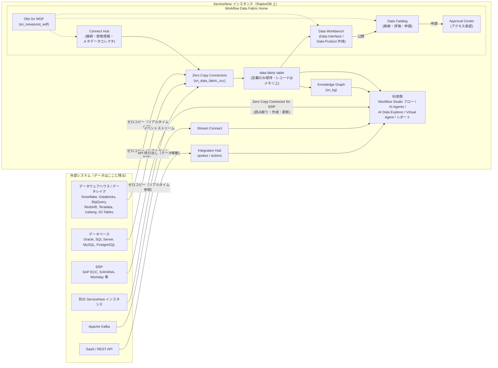
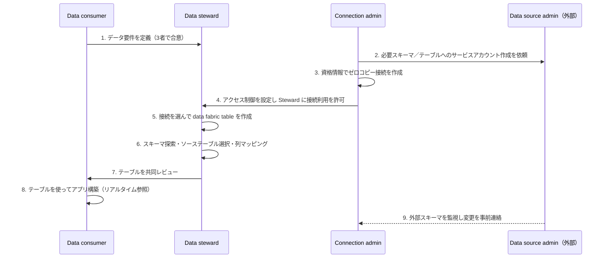
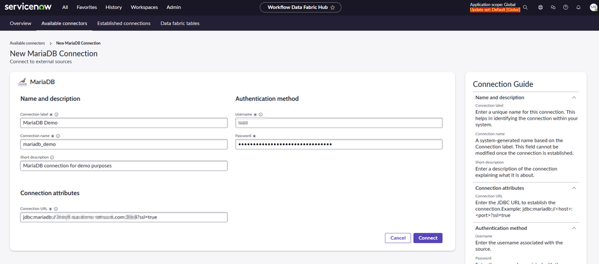
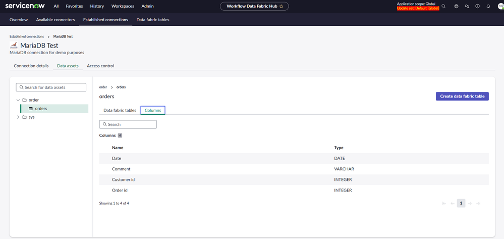
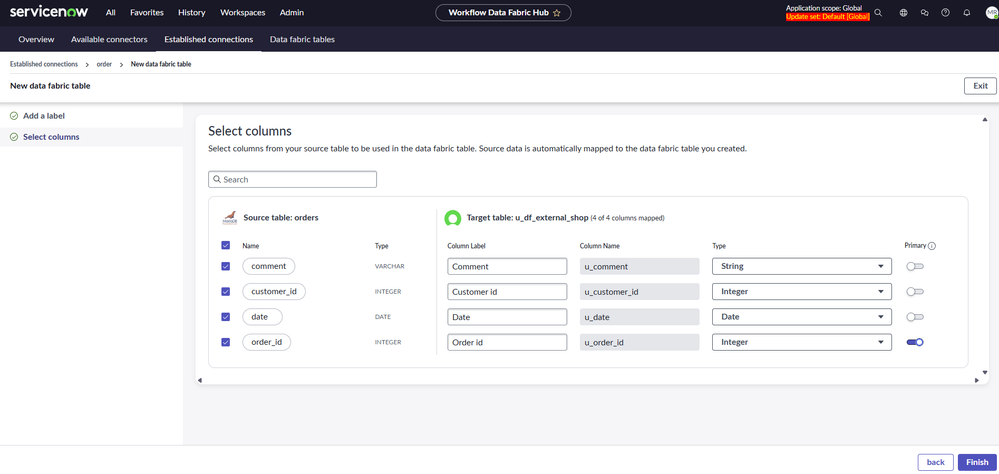
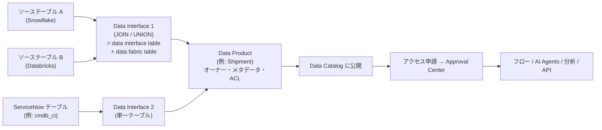

# Workflow Data Fabric（ワークフローデータファブリック）

## 概要

**Workflow Data Fabric（WDF、ワークフローデータファブリック）** は、ServiceNow AI Platform 上で「企業内外のデータをその所在場所のまま接続し、ガバナンス（統制）を効かせたうえで、ワークフロー・アナリティクス・AI エージェントから利用可能にする」ための製品群の総称である。Australia リリースの公式ドキュメントでは、WDF は単一製品ではなく、Zero Copy Connectors、Integration Hub、Stream Connect、Data Catalog、RPA Hub、External Content Connectors、Automation Center などを束ねたポートフォリオとして定義されている [出典](https://www.servicenow.com/docs/r/u~ldaY8ZPxJiUgZ1Inf6mw/v2AEWzRgQcJgifdwavT4Pg)。

Workflow Data Fabric の中核概念は次の 3 点である。

1. **Zero Copy（ゼロコピー）**: 外部データ（Snowflake、Databricks、BigQuery、Oracle、SAP など）をインスタンスへ複製せず、クエリ時にリアルタイムで参照する。参照用の仮想テーブルが **data fabric table（データファブリックテーブル）** である。
2. **Governed data contract（統制されたデータ契約）**: Australia で導入された **Workflow Data Fabric Home（WDF Home）** では、Data Steward（データスチュワード）が **Data Interface（データインターフェース）** と **Data Product（データプロダクト）** を作成し、**Data Catalog（データカタログ）** に公開する。利用者はカタログで検索・評価・アクセス申請してから使う。
3. **AI 向けコンテキスト**: Knowledge Graph（ナレッジグラフ）、AI Data Explorer、AI Agents、MCP（Model Context Protocol）から統制済みデータを利用できるようにする。

本ファイルは Australia（2026-05 GA）を基準とし、Brazil での変更点は判明分を併記する。Integration Hub の詳細は [integrationhub.md](integrationhub.md)、AI 機能の詳細は [now-assist-ai-agents.md](now-assist-ai-agents.md)、CMDB 向けの Service Graph Connectors は [../itom/service-graph-connectors.md](../itom/service-graph-connectors.md) を参照。

> **名称に関する注意:** WDF 関連の名称はリリースごとに頻繁に変わっている。Zurich 以前の「Workflow Data Fabric Hub」は、Australia の公式手順では「Zero Copy Connector Hub」というメニュー名で記載されている。また 2026-05 の Knowledge 2026 で発表された **ServiceNow Otto** ブランドにより、Brazil の文書では「Now Assist for WDF」が「ServiceNow Otto for WDF」と表記される（アプリ ID は `sn_nowassist_wdf` のまま）。本ファイルでは公式文書の表記をそのまま使い、旧称を併記する。

---

## 1. 沿革（リリース・発表の時系列）

Workflow Data Fabric は 2024 年秋に発表され、その後ストアアプリの更新とファミリーリリースの両方で機能が追加されてきた。下表は公式発表・リリースノートから確認できた主要マイルストーンである。

| 時期 | 出来事 | 出典 |
|---|---|---|
| 2024-09-10 | Xanadu リリースと同時に **RaptorDB Pro** を発表（PostgreSQL ベースの新 DB）。Knowledge Graph の将来提供も予告 | [Business Wire](https://www.businesswire.com/news/home/20240910738918/en/5708684/ServiceNow-Announces-Powerful-Data-Enhancements-to-Unlock-Value-With-Ultra-Scale-and-Performance)、[The Register](https://www.theregister.com/2024/09/10/servicenow_xanadu_postgres_raptordb/) |
| 2024-10-23 | **Workflow Data Fabric** を発表。RaptorDB Pro 上で稼働し、Zero Copy、Integration Hub、Knowledge Graph などを含むと説明 | [プレスリリース PDF](https://s205.q4cdn.com/537566246/files/doc_news/ServiceNow-introduces-Workflow-Data-Fabric-forging-a-new-generation-of-AI-fueled-productivity-for-the-enterprise-10-23-2024-traffic-2024.pdf) |
| Yokohama Patch 5 | Databricks、BigQuery、Oracle、Snowflake、Redshift、SAP ECC、SAP S/4HANA の Primary connector が利用可能に（最小互換バージョン） | [Primary connectors](https://www.servicenow.com/docs/r/integrate-applications/primary-connectors-zcc.html) |
| 2025-05（Knowledge 2025） | data.world の買収合意を発表（データカタログ／ガバナンス。ナレッジグラフベース）。**Workflow Data Network**（Snowflake、Databricks、SAP、Workday 等のパートナーエコシステム）を発表 | [TechCrunch](https://techcrunch.com/2025/05/07/servicenow-acquires-data-world-two-months-after-acquiring-moveworks)、[Constellation Research](https://www.constellationr.com/insights/news/servicenow-launches-workflow-data-network-acquires-dataworld) |
| 2025-08 | Zero Copy Connectors 2.0.0 で「Workflow Data Fabric の一部」と位置付け。Workflow Data Fabric Hub 2.0.1 の初期機能セット | [ZCC release notes](https://www.servicenow.com/docs/r/C17ZqvSaMwUVpMBg8Nc5sg/SdQ0itUWCLe9rs6C6FFZDQ)、[Hub release notes](https://www.servicenow.com/docs/r/C17ZqvSaMwUVpMBg8Nc5sg/4WKARrd73Zvn~5GtywUirQ) |
| 2026-01 | ZCC 2.1.0: Amazon S3 Tables、Teradata の Primary connector を追加。Primary JDBC connector に接続プール。Zurich Patch 4 以上が必要 | [ZCC release notes](https://www.servicenow.com/docs/r/C17ZqvSaMwUVpMBg8Nc5sg/SdQ0itUWCLe9rs6C6FFZDQ) |
| 2026-03 | ZCC 3.0.3: Snowflake／Oracle／Databricks の OAuth 認証対応、Cloudera Impala（Preview）を Primary に追加、Iceberg を Community から Primary（Preview）へ。Australia 互換 | 同上 |
| 2026-04 | ZCC 3.1.0: サブスクリプション階層 **ZCC - Primary** と **ZCC - Advanced** を導入 | 同上 |
| 2026-05-05 | **Australia GA**。WDF Home、Connect Hub、Data Catalog（ServiceNow 版）、Data Workbench を Australia 文書に収載。Knowledge 2026 で ServiceNow Otto を発表 | [WDF Home](https://www.servicenow.com/docs/r/u~ldaY8ZPxJiUgZ1Inf6mw/NzLy7Im_P_XRxPy7CTErNw) |
| 2026-05 | Data Product アプリ 1.0.9 で **Data Products / Data Interfaces が初の GA**（Australia Patch 1 以上） | [Data Product release notes](https://www.servicenow.com/docs/r/C17ZqvSaMwUVpMBg8Nc5sg/xHBrb3S2PWA1wHwt~djp~g) |
| 2026-09 | Hub 3.3.2: コネクタへの Preview ラベル、AI-Native SKU の導入、ZCC アプリを Foundation／Advanced 階層に分割。Hub 4.0.3: REST ベースの Zero Copy connector と個人認証（personal auth）を追加（Australia／Brazil 互換） | [Hub release notes](https://www.servicenow.com/docs/r/C17ZqvSaMwUVpMBg8Nc5sg/4WKARrd73Zvn~5GtywUirQ) |
| 2026-09〜10 | ZCC 3.2.3: MySQL、PostgreSQL を Community → Primary。ZCC 4.0.1: Microsoft SQL Server を Community → Primary。ZCC 3.1.6: Australia へのバックポート | [ZCC release notes](https://www.servicenow.com/docs/r/C17ZqvSaMwUVpMBg8Nc5sg/SdQ0itUWCLe9rs6C6FFZDQ) |

> **注意:** WDF の機能は **ファミリーリリース（Australia、Brazil）とは独立した ServiceNow Store アプリ**として頻繁に更新される。機能の有無は「ファミリーリリース＋パッチ」だけでなく「各ストアアプリのバージョン」で判断する必要がある。

---

## 2. Workflow Data Fabric の構成要素（Australia）

Australia の Workflow Data Fabric ランディングページは、WDF に含まれる製品・機能を以下のように列挙している [出典](https://www.servicenow.com/docs/r/u~ldaY8ZPxJiUgZ1Inf6mw/v2AEWzRgQcJgifdwavT4Pg)。

| 構成要素（英語名） | 日本語での説明 | 本ナレッジ内の詳細 |
|---|---|---|
| Workflow Data Fabric Home | 異なるシステムのデータを統制された単一レイヤーに統合し、ビジネス利用可能な Data Product として発見可能にする入口 | 本ファイル §4 |
| Zero Copy Connectors | 外部データを複製せずにインスタンスから直接参照する。接続と data fabric table を Workflow Data Fabric Hub（Australia では Zero Copy Connector Hub）で作成 | 本ファイル §5 |
| Data Catalog | 組織のデータ資産の検索可能なインベントリ。メタデータ、リネージ（系譜）、ガバナンスポリシー付き | 本ファイル §8 |
| Integration Hub | Workflow Studio のコンポーネント（spoke、action）やカスタム連携で統合タスクを自動化。**別途サブスクリプションが必要**と記載 | [integrationhub.md](integrationhub.md) |
| Integration Hub Remote Process Sync | 複数インスタンス間でプロセスを一方向／双方向同期 | [integrationhub.md](integrationhub.md) |
| Conversational Spokes | Now Assist（Otto）などの会話型 UI から Integration Hub の spoke アクションを実行 | [now-assist-ai-agents.md](now-assist-ai-agents.md) |
| Stream Connect | Apache Kafka 環境と ServiceNow インスタンスを接続 | 本ファイル §11.3 |
| External Content Connectors | AI Search が Confluence Cloud、SharePoint Online 等の外部リポジトリのコンテンツとメタデータを検索可能にする | [predictive-intelligence-ai-search.md](predictive-intelligence-ai-search.md) |
| RPA Hub | ユーザー操作を模倣してアプリケーション横断でエンドツーエンド自動化 | [process-automation-rpa-mining.md](process-automation-rpa-mining.md) |
| Automation Center | 複数ベンダーの自動化のライフサイクルを一元的に統制し、リアルタイムダッシュボードで監視 | [process-automation-rpa-mining.md](process-automation-rpa-mining.md) |
| Boomi（Boomi API Management） | パートナーシップによる API のフルライフサイクル管理（Boomi が直接サポート） | — |

同ページは「関連する ServiceNow アプリケーション・機能」として、Instance Data Replication（IDR）、Inbound Email Actions、Workflow Studio、Actions、Exports、Imports、Classic Orchestration を挙げている。これらは WDF の製品群には含まれないが、データ連携の選択肢として比較対象になる（§11 参照）。

**Knowledge Graph と RaptorDB の位置付け:** 2024-10 の発表時点では、WDF は「RaptorDB Pro 上で稼働し、Knowledge Graph を含む」と説明された [出典](https://s205.q4cdn.com/537566246/files/doc_news/ServiceNow-introduces-Workflow-Data-Fabric-forging-a-new-generation-of-AI-fueled-productivity-for-the-enterprise-10-23-2024-traffic-2024.pdf)。一方、Australia のドキュメントでは Knowledge Graph は「Intelligent Experiences（AI）」側、RaptorDB は「ServiceNow AI Platform Capabilities」側に収載されており、WDF ランディングページの構成要素表には含まれていない。本ファイルでは WDF と密接に連携する隣接コンポーネントとして §9、§10 で扱う。

---

## 3. アーキテクチャ全体像

Workflow Data Fabric の論理構成を、公式ドキュメントの記述（WDF Home、Zero Copy Connectors、Data Catalog、Knowledge Graph の各ページ）に基づいて図示する。

- **データの所在:** Zero Copy の経路では、data fabric table の **定義** はプラットフォーム上に保存されるが、**レコード** は外部ソースに残り、参照時のみ読み取り専用でメモリに保持される [出典](https://www.servicenow.com/docs/r/u~ldaY8ZPxJiUgZ1Inf6mw/fglb7_Urr9mTk76Zx3Q6Qg)。
- **データの移動:** Integration Hub、Import Set、Stream Connect の経路では、データはインスタンスのテーブルに取り込まれる（または外部へ送られる）。
- **統制レイヤー:** Australia の WDF Home では、Connect Hub（接続）→ Data Workbench（契約定義）→ Data Catalog（公開・発見）→ Approval Center（アクセス承認）という流れでガバナンスを効かせる [出典](https://www.servicenow.com/docs/r/u~ldaY8ZPxJiUgZ1Inf6mw/83A3LXZt1gNcqeruuQccKw)。

---

## 4. Workflow Data Fabric Home（WDF Home）

### 4.1 Workflow Data Fabric Home とは

Workflow Data Fabric Home は、Australia の公式ドキュメントで「ServiceNow の統合データ基盤（unified data foundation）」と説明される UI 群である。WDF Home は、データを所在場所のまま接続し、安定した契約（stable contracts）で統制し、ワークフロー・アナリティクス・AI 向けに準備することを目的とする。解決する課題として、データが多数のシステムに分散していること、チームごとに連携を作り直していること、AI エージェントが統制されたコンテキストを欠いていることが挙げられている [出典](https://www.servicenow.com/docs/r/u~ldaY8ZPxJiUgZ1Inf6mw/NzLy7Im_P_XRxPy7CTErNw)。

### 4.2 WDF Home の構成要素

| 構成要素 | 説明 |
|---|---|
| Otto Panel for WDF Home | ページヘッダー右上に埋め込まれた Now Assist（Otto）パネル。連携・発見・アクションについて、作業中の画面を離れずに AI ガイダンスを得られる |
| Otto for WDF search field | ホーム画面の検索欄。既存データの再利用か新規ソースの接続かを推奨し、適切な画面へ誘導する |
| Connect Hub | Connection Admin が外部システムへの接続を作成・管理し、資格情報・認証を設定し、メタデータコレクタを構成し、Data Steward に接続データへのアクセスを付与する場所 |
| Data Catalog | 利用者が Data Product と Data Interface を閲覧するセルフサービス層。信頼スコア（trust score）、リネージ、ガバナンスメタデータを表示し、アクセス申請を受け付ける |
| Data Workbench | Data Steward が Data Interface と Data Product を作成し、マッピングと ACL を定義し、公開・本番昇格する場所 |

[出典](https://www.servicenow.com/docs/r/u~ldaY8ZPxJiUgZ1Inf6mw/NzLy7Im_P_XRxPy7CTErNw)

**ナビゲーション:** WDF Home のヘッダーには Home アイコン、ServiceNow Otto パネル（右上）、クイックリンクがあり、Data Catalog、Connect Hub、Data Workbench の各アイコンから各機能に遷移する。Data Workbench は「Data Product、Data Interface、data fabric table の構築・管理・統制」の場所と説明されている [出典](https://www.servicenow.com/docs/r/u~ldaY8ZPxJiUgZ1Inf6mw/gZD6FRvF7SxnR2insXSNHQ)。Data Interface 作成手順のメニューパスは **All > Workflow Data Fabric > Data Workbench** である [出典](https://www.servicenow.com/docs/r/u~ldaY8ZPxJiUgZ1Inf6mw/jUvu1vAWsNDMeBpsoaCTmQ)。

### 4.3 主要用語（Key terms）

Australia の「Workflow Data Fabric key terms」ページに定義された用語を以下にまとめる [出典](https://www.servicenow.com/docs/r/t2jQMKLZFp9AGt3V12O7mQ/K585OXkryihcv70fwSNFaw)。

| 用語（英語） | 定義（要約） |
|---|---|
| Workflow Data Fabric | システム横断で企業データに接続し、メタデータと安定した契約でコンテキストを付与し、ワークフロー・アナリティクス・AI エージェントに提供する統合データレイヤー |
| Workflow Data Fabric Home Page | Now Assist for WDF を搭載した AI ガイド付きの入口。カタログの自然言語検索、再利用か新規作成かの助言、Connect Hub 等への誘導を行う |
| Data product（データプロダクト） | 1 つ以上の Data Interface から構成される、統制された再利用可能なパッケージ。出荷、請求書、プロジェクトなどのビジネス概念を表す。メタデータ、ドキュメント、オーナーシップ、アクセス制御を含み、Data Catalog に公開される |
| Data interface（データインターフェース） | 利用者がデータにアクセスする際のスキーマを定める、安定した統制済みデータ契約。単一テーブル、JOIN、複数ソースの UNION を表現でき、後方互換性を強制して利用者を破壊的変更から守る |
| Data fabric table（データファブリックテーブル） | 外部データオブジェクトの ServiceNow 上の射影（projection）。物理的にコピーせずに、ServiceNow に格納されているかのように外部データを扱える |
| Data Workbench | データ管理者が Data Interface と Data Product を作成し、マッピングと ACL を定義し、本番へ公開・昇格する画面 |
| Metadata crawler（メタデータクローラー） | 接続済みデータソースに対して実行され、スキーマを発見し、リネージを構築し、Data Catalog のガバナンスメタデータを投入する自動スキャナー（他ページでは metadata collector と表記） |
| Connectors（コネクタ） | 特定の外部アプリケーションとの通信を担う事前構築済みコンポーネント。アクション、トリガー、データマッピングを提供 |
| Connection（接続） | ServiceNow と外部データソース（DB、SaaS、REST API、イベントストリーム、別インスタンス等）の間の安全で統制されたアクセス経路 |
| Spoke（スポーク） | ServiceNow Store から入手する、パッケージ化された再利用可能な連携。Azure DevOps、Salesforce、Jira 等の事前構築済みアクションを提供 |
| MCP（Model Context Protocol）server | データを移動するのではなく、AI エージェントに構造化された意味的に豊かなコンテキストを提供するサーバー |
| Connect Hub | 接続管理者が外部システムへの接続を作成・管理し、資格情報・認証を設定し、メタデータクローラーを構成し、データ管理者にアクセスを付与する画面 |
| Trust score（信頼スコア） | Data Catalog に表示される、データ資産の品質・ガバナンス・信頼性の指標 |
| Mapping（マッピング） | 異なるソースのデータを Data Product のインターフェースにどう対応させるかの定義 |
| Knowledge graph | Data Product がオントロジー、タクソノミー、メタデータで意味的にリンクされて形成されるグラフ。ドメイン横断のクエリと推論を支える |
| Data Catalog | 利用者が Data Product、Data Interface 等を検索・評価するセルフサービス発見レイヤー |
| Zero-copy connector（ZCC） | データを移動・複製せずに外部データへのリアルタイムクエリアクセスを提供する連携方式。大量データやデータ鮮度が重要な分析用途に適する |

### 4.4 WDF Home のロール（Australia）

Australia では **ServiceNow WDF Unified Hub**（`sn_wdf_unified_hub`）プラグインの有効化時に以下のロールがインストールされる [出典](https://www.servicenow.com/docs/r/t2jQMKLZFp9AGt3V12O7mQ/u42wAf24sxXecgVmYDfNbA)。

| ロール（タイトル [名前]） | 責務 | 包含ロール（Contains roles） |
|---|---|---|
| Connection Admin（接続管理者）[`connection_admin`] | 接続の作成・管理、資格情報の設定、メタデータコレクタの構成、Data Steward への接続アクセス付与 | `df_data_steward`、`external_app_install_admin`、`agent_admin`、`credential_admin`、`web_service_admin`、`sn_nowassist_wdf.creator_admin` |
| Data Steward（データスチュワード）[`df_data_steward`] | すべての Data Product と Data Interface の作成・所有。スキーマ設計、ガバナンス、メタデータ管理、後方互換性の担保、データ契約のライフサイクル管理 | `sn_nowassist_wdf.creator_admin`、`wdf_consumer` |
| WDF Builder（WDF ビルダー）[`wdf_builder`] | コネクタ、spoke、MCP サーバーを作成して接続レイヤーを拡張する。データ契約は所有・変更しない | `wdf_consumer`、`sn_nowassist_wdf.creator_admin`、`connection_admin`、`template_editor_global`、`action_designer`、`sn_appclient.app_client_user`、`sn_g_app_creator.app_creator` |
| WDF Operator（WDF オペレーター）[`wdf_operator`] | Data Interface 経由で統制済みデータを消費する決定論的（deterministic）／エージェント型のワークフローを構築する。契約の消費者であり所有者ではない | `fd_read`、`now.assist.creator`、`flow_designer`、`sn_nowassist_wdf.creator_admin`、`sn_mcp_client.viewer`、`wdf_consumer` |
| WDF Consumer（WDF コンシューマー）[`wdf_consumer`] | Data Catalog で Data Product を発見・評価し、アクセスを申請し、ワークフロー・分析・AI エージェント・API を通じて統制済みデータを利用する | `sn_nowassist_wdf.creator_admin` |

> **ロール包含関係の文書間差異:** 上表は Australia の「Workflow Data Fabric Home roles」（pt-BR 版）に基づく。同じ Australia の「Data catalog roles」ページでは、`connection_admin` の包含ロールに `wdf_operator` と `df_connection_admin` も含まれると記載されている [出典](https://www.servicenow.com/docs/r/u~ldaY8ZPxJiUgZ1Inf6mw/r6B9MkwJU3hiEd35_QxLTA)。実機の `sys_user_role_contains` で確認すること。

### 4.5 WDF Home のセットアップ構成（3 つのオプション）

Australia の「Configuring Workflow Data Fabric Home」は、導入範囲に応じた 3 つのセットアップオプションを示している。各オプションは前のオプションの上に積み上がるため、小さく始めて後から拡張できる [出典](https://www.servicenow.com/docs/r/u~ldaY8ZPxJiUgZ1Inf6mw/FP~bRWsErwmhyZVoyZh3kw)。

| オプション | 適する用途 | 追加される機能 |
|---|---|---|
| 1: Connect Hub | Flow Designer、spoke 等の外部接続を一元管理したい | 接続、資格情報、Steward へのアクセス付与、Otto によるガイド付き発見 |
| 2: Data Catalog + Connect Hub | 再利用可能な Data Product は不要だが、発見とメタデータ管理をしたい | メタデータコレクタ、カタログ化された資産、リネージと影響分析、カタログ閲覧 |
| 3: Data Products + Data Catalog + Connect Hub | 接続→統制→データ活用のフルライフサイクル | Data Interface、Data Product、公開された統制済み契約、ワークフロー・分析・AI からの消費 |

### 4.6 WDF Home のアプリケーションとプラグイン ID

**前提となるストアアプリ（Prerequisites）:**

| アプリ | ID |
|---|---|
| Zero Copy Connectors | `sn_data_fabric_zcc` および `sn_data_fabric` |
| Workflow Data Fabric Credits（WDF Tokenization） | `sn_wdf_token` |

**起点となるトップレベルアプリ（いずれか 1 つをインストールすると依存関係が自動で入る）:** Connect Hub（`sn_wdf_connect_hub`）、ServiceNow Data Catalog（`sn_dcg_core`）、Data Products（`sn_data_product`）。公式ドキュメントは「個々のサブアプリケーション（例: `sn_dcg_ui` 単体）を直接インストールするとエラーになる」と警告している [出典](https://www.servicenow.com/docs/r/u~ldaY8ZPxJiUgZ1Inf6mw/FP~bRWsErwmhyZVoyZh3kw)。

**自動インストールされるアプリ:**

| アプリケーション | App ID | どの起点アプリで入るか |
|---|---|---|
| WDF Unified Hub（WDF Home） | `sn_wdf_unified_hub` | Connect Hub / Data Catalog / Data Products |
| Connect Hub | `sn_wdf_connect_hub` | Connect Hub / Data Catalog / Data Products |
| ServiceNow Otto for WDF | `sn_nowassist_wdf` | Connect Hub / Data Catalog / Data Products |
| ServiceNow Data Catalog（UI） | `sn_dcg_ui` | Data Catalog / Data Products |
| ServiceNow Data Catalog（Core） | `sn_dcg_core` | Data Catalog / Data Products |
| Data Catalog Graph Explorer | `sn_hexplorer` | Data Catalog / Data Products |
| Data Catalog Metadata Collectors（UI） | `sn_meta_collectors` | Data Catalog / Data Products |
| Data Catalog Metadata Collectors（Core） | `sn_dcg_cc` | Data Catalog / Data Products |
| Data Product | `sn_data_product` | Data Products のみ |

**構成手順（概要）:**

1. 未導入の前提アプリ（Zero Copy Connectors、Workflow Data Fabric Credits）をインストールする。
2. 選択したセットアップに応じた起点ストアアプリをインストールする（`admin` ロールが必要）。
3. Otto for WDF（`sn_nowassist_wdf`）を構成する。ServiceNow Product Documentation コネクタを作成し、フル AI エージェント機能のためにフロー生成スキル（flow generation skill）を有効化する。
4. WDF ロールをユーザーに割り当てる。

[出典](https://www.servicenow.com/docs/r/u~ldaY8ZPxJiUgZ1Inf6mw/FP~bRWsErwmhyZVoyZh3kw)

### 4.7 Connect Hub

Connect Hub は「ServiceNow と外部システムの連携を発見・構築・管理する統合ワークスペース」である。Australia 文書時点の最新版は Connect Hub v2.4.0 と記載されている [出典](https://www.servicenow.com/docs/r/u~ldaY8ZPxJiUgZ1Inf6mw/FAiLHznoli3ADa~yxmkhOg)。

| 機能 | 説明 |
|---|---|
| 外部システムの発見 | MS Teams、Jira、Snowflake など 200 以上のサードパーティシステムと接続方式を探索 |
| コネクタの構築・管理 | 事前構築済み Spoke、Zero Copy Connectors、カスタムコネクタ種別、コネクタライブラリの閲覧。MCP クライアントの統合 |
| 接続と資格情報の構成 | 認証、エンドポイント URL、アクセス制御の設定 |
| 専門ツールへの入口 | Spoke 構築や MCP クライアント設定の起点 |

Connect Hub は **Connector（コネクタ）** と **Connection（接続）** を区別する。Connector は特定の外部アプリとの通信方法（アクション、トリガー、データマッピング）を定義する再利用可能な部品であり、Connection は 1 つの環境向けの資格情報・エンドポイントを保持する構成インスタンスである。1 つの Connector から複数の Connection（例: Jira の開発用・ステージング用・本番用）を作成できる。Connect Hub が扱う接続種別として、Zero Copy Connectors、Spokes、MCP クライアントが挙げられている [出典](https://www.servicenow.com/docs/r/u~ldaY8ZPxJiUgZ1Inf6mw/FAiLHznoli3ADa~yxmkhOg)。

---

## 5. Zero Copy Connectors（ゼロコピーコネクタ）

### 5.1 Zero Copy Connectors とは

Zero Copy Connectors（ZCC）アプリケーションは、データソースコネクタを閲覧し、接続を確立し、外部データにアクセスする data fabric table を作成するためのアプリである。データはリアルタイムで取得され、インスタンスにはコピーされない。作成した data fabric table は AI エージェント、ワークフロー、アナリティクスに供給できる [出典](https://www.servicenow.com/docs/r/u~ldaY8ZPxJiUgZ1Inf6mw/Bois1NVQnYcPg8Go2~GGig)。

| 主要機能 | 説明 | 主な利用者 |
|---|---|---|
| Zero copy connections（ゼロコピー接続） | インスタンスにデータを保存せず、外部ソースへリアルタイムにアクセス | Connection admin |
| Data fabric tables | 外部（またはローカル）データの仮想表現。利用者にはローカルテーブルのように見える | Data steward、Data consumer |
| Data fabric tables in applications | アプリに含まれる事前定義の data fabric table に、内部または外部データをマッピング | Instance admin、Connection admin、Data steward |

### 5.2 インストールと入手方法

Zero Copy Connectors の入手経路は以下のとおりである（Zurich の構成ページに基づく。Australia でも前提アプリ ID は同一）[出典](https://www.servicenow.com/docs/r/oZRGKGLbfcn968v3Ubchmw/wgpo_3jNRkjLF8eMP5u6Ow)。

| 項目 | 内容 |
|---|---|
| Workflow Data Fabric Hub アプリ | プラグイン ID `sn_data_fabric`。ServiceNow Store から入手。**本番・非本番インスタンスとも無償** |
| Zero Copy Connectors アプリ | プラグイン ID `sn_data_fabric_zcc`。**Now Support Service Catalog から申請**する。有効化すると Workflow Data Fabric Hub（`sn_data_fabric`）も自動インストールされる |
| Hub 単体でできること | ServiceNow local instance connector を使い、アプリに含まれる data fabric table をローカルインスタンスのテーブルにマッピング |
| 外部データ参照に必要なもの | Zero Copy Connectors アプリ（`sn_data_fabric_zcc`）によるゼロコピー接続 |

構成手順は、(1) `sn_data_fabric` の有効化、(2) Now Support Service Catalog で Zero Copy Connectors を申請、(3) Connection administrator（接続管理者）の作成、(4) データソース管理者と協力して外部ソースへのアクセスを許可、の 4 ステップである [出典](https://www.servicenow.com/docs/r/oZRGKGLbfcn968v3Ubchmw/wgpo_3jNRkjLF8eMP5u6Ow)。

> **Australia での変更（パッケージ分割）:** Australia Patch 1 で、Primary connector のみを含む新プラグイン **Zero Copy Connectors Primary（`sn_zcc_primary`）** が追加され、Store の階層が **ZCC - Primary** と **ZCC - Advanced**（Primary と Community のすべてを含む）に分かれたことが、公式ドキュメントの検索結果要約で確認できる（ZCC release notes 3.1.0、2026-04 と整合）[出典](https://www.servicenow.com/docs/r/C17ZqvSaMwUVpMBg8Nc5sg/SdQ0itUWCLe9rs6C6FFZDQ)。その後 Hub 3.3.2（2026-09）のリリースノートでは「ZCC アプリを Foundation / Advanced 階層に分割」「AI-Native SKU を導入」と表記されている [出典](https://www.servicenow.com/docs/r/C17ZqvSaMwUVpMBg8Nc5sg/4WKARrd73Zvn~5GtywUirQ)。階層名は文書・時期により「Primary / Advanced」と「Foundation / Advanced」が混在するため、契約時に最新の SKU 名を確認すること。

### 5.3 ロール（Zero Copy / Workflow Data Fabric Hub）

Zurich の「Workflow Data Fabric Hub roles」では、Hub のロールは次の 2 つである [出典](https://www.servicenow.com/docs/r/oZRGKGLbfcn968v3Ubchmw/HP44Hi8pPkdc6YYqRIdWQQ)。

| ロール | 説明 | 特記事項 |
|---|---|---|
| Connection administrator [`df_connection_admin`] | Workflow Data Fabric Hub で接続を作成・管理する | 接続管理に加え、data steward と同様に data fabric table も管理できる。利用可能なコネクタの閲覧とゼロコピー接続の作成に必要 |
| Data steward [`df_data_steward`] | Workflow Data Fabric Hub で data fabric table を作成・管理する | **他のロール経由で継承した場合のみ** data steward として table を作成・管理できる。**直接付与** された場合は Hub にアクセスできるが table の作成・管理はできない |

Australia では WDF Home 側のロール体系（§4.4）に統合され、`connection_admin` が `df_data_steward` 等を包含する構成になっている。data fabric table を管理するには「`df_data_steward` または `connection_admin` を含むロール」が必要と記載されている [出典](https://www.servicenow.com/docs/r/u~ldaY8ZPxJiUgZ1Inf6mw/fglb7_Urr9mTk76Zx3Q6Qg)。

### 5.4 利用者とエンドツーエンドのワークフロー

Zero Copy Connectors の公式ドキュメントは、3 種類の利用者と 9 ステップのワークフローを示している [出典](https://www.servicenow.com/docs/r/u~ldaY8ZPxJiUgZ1Inf6mw/Bois1NVQnYcPg8Go2~GGig)。

| 利用者 | 責務 |
|---|---|
| Connection admin（接続管理者） | データソース管理者と連携して安全な接続を設定し、資格情報を管理し、データアクセスを維持する |
| Data steward（データスチュワード） | data fabric table を作成し、列をマッピングし、データ品質を維持する |
| Data consumer（データ利用者） | data fabric table を使ってアプリを構築し、データ要件を定義する |

### 5.5 コネクタの種類

Zero Copy のコネクタには 2 種類がある [出典](https://www.servicenow.com/docs/r/oZRGKGLbfcn968v3Ubchmw/lM8VFd~DvIYmg8Sln_LfRw)。

| 種類 | 開発・サポート | 特徴 |
|---|---|---|
| Primary connectors（プライマリコネクタ） | ServiceNow が開発・提供・サポート | Glide クエリとリスト表示を高速化するよう強化され、大半のクエリがデータソース側で実行される（プッシュダウン） |
| Community connectors（コミュニティコネクタ） | オープンソースコミュニティが開発し、ServiceNow が提供 | 基本機能は認定済みだが **ServiceNow のサポート範囲外**。機能は Primary と異なる場合がある |

一部の Primary connector には **Preview** ラベルが付く。Preview コネクタは文書化された範囲で完全に機能し、他の Primary connector と同じサポートを受けるが、プラットフォーム対応や機能に制限がありうる。未対応のデータ型・認証方式の詳細は KB0010487 に記載されている（公開情報では本文を確認できず）[出典](https://www.servicenow.com/docs/r/oZRGKGLbfcn968v3Ubchmw/DllQ4f0poliNmGIEEl6ecA)。

### 5.6 Primary connector 一覧

公式の Primary connectors ページ（Brazil 版、2026-09-10 更新）に掲載された一覧を示す。「最小互換」列が Australia 以前のものは Australia でも利用可能である [出典](https://www.servicenow.com/docs/r/integrate-applications/primary-connectors-zcc.html)。

| コネクタ | データソース | アクセス | 最小互換バージョン |
|---|---|---|---|
| Databricks | Databricks データ分析プラットフォーム | 読み取り専用 | Yokohama Patch 5 |
| Google BigQuery | BigQuery データウェアハウス | 読み取り専用 | Yokohama Patch 5 |
| Oracle | Oracle データベース | 読み取り専用 | Yokohama Patch 5 |
| Snowflake | 外部 Snowflake アカウント | 読み取り専用 | Yokohama Patch 5 |
| Amazon Redshift | Redshift データウェアハウス | 読み取り専用 | Yokohama Patch 5 |
| SAP ECC | SAP ECC システム | 読み取り専用 | Yokohama Patch 5 |
| SAP S/4HANA | SAP S/4HANA システム | 読み取り専用 | Yokohama Patch 5 |
| Teradata | Teradata | 読み取り専用 | Zurich Patch 4 |
| ServiceNow Remote Instance | 別の ServiceNow インスタンス | 読み取り専用 | Zurich Patch 4 |
| Amazon S3 Tables | Amazon S3 Tables | 読み取り専用 | Zurich Patch 9 |
| Apache Iceberg | Iceberg 形式のデータ | 読み取り専用 | Zurich Patch 9 |
| Cloudera Impala | Cloudera Impala | 読み取り専用 | Australia |
| MySQL | MySQL インスタンス | 記載なし | Australia Patch 6 |
| PostgreSQL | PostgreSQL インスタンス | 記載なし | Australia Patch 6 |
| Acumatica | Acumatica アカウント（ERP） | 記載なし | Australia Patch 6 |
| Oracle HCM（Discovery） | Oracle HCM アカウント（人事データ） | 記載なし | Australia Patch 6 |
| Microsoft SQL Server | Microsoft SQL Server インスタンス | 記載なし | Australia Patch 6 |

- MySQL、PostgreSQL（ZCC 3.2.3、2026-09）と Microsoft SQL Server（ZCC 4.0.1、2026-10）は **Community から Primary に昇格** したコネクタである [出典](https://www.servicenow.com/docs/r/C17ZqvSaMwUVpMBg8Nc5sg/SdQ0itUWCLe9rs6C6FFZDQ)。昇格前の SQL Server は Community connector として提供されていた（Yokohama 文書）[出典](https://www.servicenow.com/docs/r/mGE8r5NBpLYtmri_sFVECw/1GcxDNNlCIf9ILodPkbBZw)。
- Zero Copy Connectors（data fabric table）経由の外部データアクセスは **読み取り専用** である。外部データへの書き込み（作成・更新）が必要な場合は、Zero Copy Connector for ERP（§6）、Integration Hub（§11）、Remote Table（スクリプト）を検討する。
- 認証: ZCC 3.0.3（2026-03）で Snowflake、Oracle、Databricks の **OAuth** 認証に対応した。Hub 4.0.3（2026-09）で **個人認証（personal auth）** と **REST ベースの Zero Copy connector** が追加された [出典](https://www.servicenow.com/docs/r/C17ZqvSaMwUVpMBg8Nc5sg/4WKARrd73Zvn~5GtywUirQ)。
- コネクタごとのネットワーク要件（IP 許可リスト、MID Server の要否、Private Link 等）は公開情報では確認できず。Community 記事で「Zero Copy Architecture & Networking」という動画が紹介されているのみである [出典](https://www.servicenow.com/community/workflow-data-fabric-articles/zero-copy-connectors/ta-p/3550002)。

### 5.7 ゼロコピー接続の作成

**メニュー:** Australia の文書では **All > Zero Copy Connector Hub**（または **Admin > Zero Copy Connector Hub**）配下に、Available connectors、Established connections、Data fabric tables の各タブがある。Zurich 以前は同じ機能が **Workflow Data Fabric Hub** という名前で記載されている [出典](https://www.servicenow.com/docs/r/u~ldaY8ZPxJiUgZ1Inf6mw/guU2UO7Y2ax4gofRDuEycA)、[出典](https://www.servicenow.com/docs/r/oZRGKGLbfcn968v3Ubchmw/lM8VFd~DvIYmg8Sln_LfRw)。

**接続作成フォームの例（Microsoft SQL Server、Community connector 時代の Yokohama 手順）:** All > Workflow Data Fabric Hub > Available connectors > Community connectors でコネクタを選び **Connect** を押すと、以下の項目を入力するフォームが開く。必要ロールは `df_connection_admin` [出典](https://www.servicenow.com/docs/r/mGE8r5NBpLYtmri_sFVECw/1GcxDNNlCIf9ILodPkbBZw)。

| セクション | フィールド | 説明 |
|---|---|---|
| Name and description | Connection label | 接続を識別する一意の名前 |
| Name and description | Connection name | Connection label から自動生成。**接続確立後は変更不可** |
| Name and description | Short description | 接続の説明 |
| Connection attributes | Connection URL | JDBC URL。例: `jdbc:sqlserver://<host>:<port>;databaseName=<databaseName>;encrypt=true;trustServerCertificate=true` |
| Authentication method | Username / Password | データソースのユーザー名とパスワード |

**Connect** を押すと外部データソースへのテスト接続が行われ、接続情報と到達性が検証される。成功したら **Access Control** タブで data steward のアクセスを構成する。失敗した場合はデータソース管理者と接続情報を確認する [出典](https://www.servicenow.com/docs/r/mGE8r5NBpLYtmri_sFVECw/1GcxDNNlCIf9ILodPkbBZw)。

*図1: Workflow Data Fabric Hub の新規接続作成画面（MariaDB の例）*

- **画面の説明:** 画面上部に「Workflow Data Fabric Hub」のアプリ名と、Overview / Available connectors / Established connections / Data fabric tables の 4 タブが並ぶ。Available connectors > New MariaDB Connection 画面で、左側に「Name and description」（Connection label、Connection name、Short description）、「Connection attributes」（Connection URL に `jdbc:mariadb://<host>:<port>?ssl=true` 形式の JDBC URL）、右側に「Authentication method」（Username、Password）の入力欄があり、右下に Cancel / Connect ボタンがある。画面右端には各項目の入力方法を説明する「Connection Guide」パネルが表示される。
- **注意:** 本スクリーンショットは 2025-07 時点（Zurich 期）の Community 投稿のもので、メニュー名は「Workflow Data Fabric Hub」である。Australia の公式文書では同機能が「Zero Copy Connector Hub」と表記されている。
- **出典:** ServiceNow Community「I tried the MariaDB Zero Copy Connector to fuel my AI Agents」（2025-07-20 投稿）https://www.servicenow.com/community/workflow-data-fabric-blog/i-tried-the-mariadb-zero-copy-connector-to-fuel-my-ai-agents/ba-p/3327287 （取得日: 2026-11-03）【第三者情報】

**確立済み接続の管理項目:** Zurich の「Managing zero copy connections」では、確立済み接続について、ロールによるアクセス管理、データ資産の閲覧、接続の監視、接続の更新（サービスアカウント、認証、セキュリティ設定）、接続のテストの各操作が提供される [出典](https://www.servicenow.com/docs/r/oZRGKGLbfcn968v3Ubchmw/8JygAti0IKYhPQOgGlIYZw)。確立済み接続の画面には Connection details / Data assets / Access control のタブがある（図2）。

*図2: 確立済み接続（MariaDB Test）の Data assets タブ*

- **画面の説明:** Established connections > MariaDB Test 画面。上部に Connection details / Data assets / Access control の 3 タブがあり、Data assets タブが選択されている。左ペインに「Search for data assets」検索欄と外部 DB のスキーマツリー（`order` スキーマ配下の `orders` テーブル、`sys` スキーマ）が表示される。右ペインには選択したテーブル `orders` の Data fabric tables / Columns サブタブがあり、Columns タブにソース列（Date: DATE、Comment: VARCHAR、Customer id: INTEGER、Order id: INTEGER）が一覧表示される。右上に「Create data fabric table」ボタンがある。
- **出典:** 同上 Community 投稿（2025-07-20）https://www.servicenow.com/community/workflow-data-fabric-blog/i-tried-the-mariadb-zero-copy-connector-to-fuel-my-ai-agents/ba-p/3327287 （取得日: 2026-11-03）【第三者情報】

### 5.8 data fabric table（データファブリックテーブル）

#### 5.8.1 data fabric table の基本仕様

data fabric table は、外部ソースに格納されたデータの **仮想表現（virtual representation）** である。定義は ServiceNow AI Platform 上にあり、レコードは外部ソースに残る。物理テーブルと同様にリストとフォームで表示でき、アクセス制御（ACL）も物理テーブルと同じ仕組みで働く。各テーブルは、data steward が作成時に選んだアプリケーションスコープに属する [出典](https://www.servicenow.com/docs/r/u~ldaY8ZPxJiUgZ1Inf6mw/fglb7_Urr9mTk76Zx3Q6Qg)。

| 観点 | data fabric table の仕様 |
|---|---|
| データの保存場所 | 外部ソース。インスタンスには定義のみ |
| メモリ上の扱い | 外部レコードは読み取り専用モードでメモリに保持され、インスタンスには保存されない |
| クエリタイミング | テーブルを表示・アクセスするたびにソースへ新しいクエリを発行。リスト／フォームを開いている間はメモリに保持され、閉じるとパージされる。次回アクセス時にソースから再取得 [出典](https://www.servicenow.com/docs/r/u~ldaY8ZPxJiUgZ1Inf6mw/vdLJlIcLw1vrKjAsL1R1Eg) |
| 書き込み | 不可（view-only）。外部ソースは変更できない |
| アクセス制御 | 物理テーブルと同じ ACL の仕組み |
| 管理画面 | All（または Admin）> Zero Copy Connector Hub > Data fabric tables。ラベル／名前で検索、データソース・接続・作成者でフィルタ。**Active** タブ（有効な接続のテーブル）と **Others** タブ（無効化・未構成の接続のテーブル） |
| 環境間移送 | **Update Set** で ServiceNow インスタンス間にデプロイ可能 [出典](https://www.servicenow.com/docs/r/u~ldaY8ZPxJiUgZ1Inf6mw/vdLJlIcLw1vrKjAsL1R1Eg) |

#### 5.8.2 data fabric table と Remote Table の違い

| 観点 | data fabric table | Remote Table（リモートテーブル） |
|---|---|---|
| 取得方式 | ゼロコピー接続（スクリプト不要） | スクリプトでデータを取得 |
| 外部データの変更 | 不可（読み取り専用） | スクリプトで insert / update / delete 可能 |
| 共通点 | どちらも外部データへのアクセスを提供 | 同左 |

[出典](https://www.servicenow.com/docs/r/u~ldaY8ZPxJiUgZ1Inf6mw/fglb7_Urr9mTk76Zx3Q6Qg)

#### 5.8.3 data fabric table の作成手順（Australia）

**必要ロール（以下のいずれか、または `admin`）** [出典](https://www.servicenow.com/docs/r/u~ldaY8ZPxJiUgZ1Inf6mw/guU2UO7Y2ax4gofRDuEycA):

- `delegated_developer` ＋ `sn_dd_<application_scope_name>_tablesforms` または `sn_dd_<application_scope_name>_delegatedadmin`、**かつ** `df_data_steward` を含むロール
- `delegated_developer` ＋ `sn_dd_<application_scope_name>_tablesforms` または `sn_dd_<application_scope_name>_delegatedadmin`、**かつ** `df_connection_admin`

**スコープに関する制約:** グローバルスコープに data fabric table を作成できるのは `admin` のみである。`delegated_developer` と `sn_dd_<scope>_tablesforms` を持つ data steward は、権限を持つアプリケーションスコープ内にのみ作成できる。

**手順:**

1. **All > Zero Copy Connector Hub > Established connections**（または Admin > …）を開く。
2. 使用する確立済み接続を選ぶ。
3. 接続画面で **Data assets** タブを選ぶ。
4. データ資産一覧からソーステーブルを選ぶ。
5. **Create data fabric table** を選ぶ。
6. ラベルを入力し **Continue** を選ぶ。
7. 1 つ以上のソース列をマッピングする。選択した列は、同じ名前とデータ型で新テーブルに作成される。
8. （任意）**Primary Key** トグルで主キーを設定する（§5.8.4）。
9. （任意）他テーブルへの参照を設定する（§5.8.5）。
10. **Finish** を選ぶ。

結果として data fabric table が作成されデータソースに接続され、データ利用者はインスタンス上の物理テーブルと同様に使用できる。

*図3: New data fabric table ウィザードの「Select columns」ステップ*

- **画面の説明:** Established connections > order > New data fabric table 画面。左側にウィザードのステップ（Add a label、Select columns）が表示される。中央の「Select columns」では、左に「Source table: orders」の列（comment: VARCHAR、customer_id: INTEGER、date: DATE、order_id: INTEGER）とチェックボックス、右に「Target table: u_df_external_shop (4 of 4 columns mapped)」の対応列（Column Label、Column Name＝`u_comment` 等の自動生成名、Type＝String / Integer / Date のプルダウン）と「Primary」トグルが並ぶ。この例では `order_id` の Primary トグルがオンになっている。右下に back / Finish ボタンがある。グローバルスコープで作成したため、ターゲットテーブル名・列名に `u_` 接頭辞が付いている。
- **出典:** ServiceNow Community「I tried the MariaDB Zero Copy Connector to fuel my AI Agents」（2025-07-20 投稿）https://www.servicenow.com/community/workflow-data-fabric-blog/i-tried-the-mariadb-zero-copy-connector-to-fuel-my-ai-agents/ba-p/3327287 （取得日: 2026-11-03）【第三者情報】

#### 5.8.4 主キー（Primary key）の仕様

| 仕様 | 内容 |
|---|---|
| 役割 | レコードを識別し、他テーブルからの参照を可能にする |
| 自動検出 | ソースで検出された主キーは自動選択される。検出されない場合は一意値を持つ列を選べる |
| 一意性 | 主キーを選択しても一意性は **強制されない**。Steward が値の一意性を確認する必要がある |
| 削除 | 一度定義した主キーは削除できない。変更するにはテーブルを削除して再作成する |
| 未定義時 | 主キーがないと参照を作れず、検索も機能しない。後からテーブル編集で追加可能 |
| ソース由来 | ソースから引き継いだ主キーは作成後に変更できない |
| 参照列 | 参照（Reference）列は主キーにできない |

[出典](https://www.servicenow.com/docs/r/u~ldaY8ZPxJiUgZ1Inf6mw/guU2UO7Y2ax4gofRDuEycA)

#### 5.8.5 参照（Reference）と ACL

data fabric table 同士、または data fabric table とローカルテーブルの間に参照を張れる。

- **ローカルテーブルを参照する場合:** インスタンス管理者が、参照先テーブル（例: `User [sys_user]`）に対して **type = `record`、operation = `data_fabric`** の ACL ルールを作成する必要がある。
- **表示値:** 参照先列の **Display** 属性を true にしないと参照列に値が表示されない（参照先テーブルの定義で設定）。
- **参照先の条件:** 参照先テーブルには一意値を持つ主キー列が少なくとも 1 つ必要。主キーのデータ型はソース列と一致する必要がある。Set Reference ダイアログには **主キーが 1 つだけ定義されたテーブル** のみ表示される。
- **手順:** 両テーブルで同じレコードを表す列を特定 → その列の **Type** を **Reference** に変更 → **Set reference** → **Table** にテーブル名 → **Reference key** で主キー列を選択 → **Set reference**。

[出典](https://www.servicenow.com/docs/r/u~ldaY8ZPxJiUgZ1Inf6mw/guU2UO7Y2ax4gofRDuEycA)、[出典](https://www.servicenow.com/docs/r/u~ldaY8ZPxJiUgZ1Inf6mw/vdLJlIcLw1vrKjAsL1R1Eg)

#### 5.8.6 data fabric table の制約一覧

| 制約 | 内容 | 出典 |
|---|---|---|
| 大文字小文字だけが異なるテーブル名 | ソースに `MY_TABLE` と `my_table` のようなテーブルがあるとスキーマが読み込めない | [Managing data fabric tables](https://www.servicenow.com/docs/r/u~ldaY8ZPxJiUgZ1Inf6mw/vdLJlIcLw1vrKjAsL1R1Eg) |
| 複合キー | 参照キーに使えるのは単一の主キー列のみ。複合キーは非対応 | 同上 |
| 参照先の主キー数 | 参照先テーブルにはちょうど 1 つの主キーが定義されている必要がある | 同上 |
| 書き込み | 読み取り専用 | [Data fabric tables](https://www.servicenow.com/docs/r/u~ldaY8ZPxJiUgZ1Inf6mw/fglb7_Urr9mTk76Zx3Q6Qg) |
| グローバルスコープ | 作成は `admin` のみ | [Create a data fabric table](https://www.servicenow.com/docs/r/u~ldaY8ZPxJiUgZ1Inf6mw/guU2UO7Y2ax4gofRDuEycA) |
| その他 | 追加の制約は KB2017730 に記載（KB 本文は公開情報では確認できず） | [Managing data fabric tables](https://www.servicenow.com/docs/r/u~ldaY8ZPxJiUgZ1Inf6mw/vdLJlIcLw1vrKjAsL1R1Eg) |
| インスタンス種別 | Community 投稿では「Zero Copy Connectors は sub-prod または prod インスタンスでのみ利用可能」とされる（PDI では利用不可の趣旨）【第三者情報】 | [Community](https://www.servicenow.com/community/workflow-data-fabric-blog/i-tried-the-mariadb-zero-copy-connector-to-fuel-my-ai-agents/ba-p/3327287) |

#### 5.8.7 data fabric table の利用先

| 利用先 | 条件・説明 |
|---|---|
| リスト／フォーム／アプリ | 物理テーブルと同様に表示・参照 |
| Workflow Studio フロー | data fabric table を使ってアプリやワークフローを構築（Zero Copy の主要用途として記載） |
| AI Data Explorer | 会話型 UI で可視化・分析を作成可能。事前に **Semantic Table Configuration [`sn_query_gen_table_config`]**（Query Generation）にテーブルを追加する必要がある |
| Knowledge Graph | Now Assist Virtual Agent、AI Agents、生成 AI スキルの性能向上に利用（§9.3） |
| アプリでの二重構成 | アプリに物理テーブルと data fabric 版の両方を含め、管理者がインポート（物理）かライブ参照（data fabric）かを選べる |

[出典](https://www.servicenow.com/docs/r/u~ldaY8ZPxJiUgZ1Inf6mw/fglb7_Urr9mTk76Zx3Q6Qg)

**公式ユースケース例:** 製造業が、ローカルの資産・人員データと外部の保守記録・センサーデータを組み合わせ、故障アラート、保守ケースの自動作成、技術者向けの一元的なデータ参照を実現する [出典](https://www.servicenow.com/docs/r/u~ldaY8ZPxJiUgZ1Inf6mw/fglb7_Urr9mTk76Zx3Q6Qg)。

### 5.9 Zero Copy Connectors / Hub のバージョン履歴（抜粋）

ストアアプリのバージョンとファミリーリリースの対応は以下のとおりである。

| アプリ | バージョン | 時期 | 主な内容 |
|---|---|---|---|
| Workflow Data Fabric Hub | 2.0.1 | 2025-08 | 初期機能セット（ゼロコピー・ローカルデータからの data fabric table 作成、リアルタイム取得、AI エージェント／ワークフロー対応） |
| Workflow Data Fabric Hub | 2.1.0 / 1.1.0 | 2025-10 | data fabric table 編集時に INT / BIGINT 列の参照が失われる不具合を修正 |
| Workflow Data Fabric Hub | 2.2.1 | 2026-01 | Zurich Patch 4 以上との互換リリース |
| Workflow Data Fabric Hub | 3.0.1 / 3.1.0 | 2026-03 / 04 | Australia（Patch 1）互換リリース |
| Workflow Data Fabric Hub | 3.2.2 | 2026-08 | Now Assist 依存を削除。ZCC Hub UI App がライセンス不要に |
| Workflow Data Fabric Hub | 3.3.2 | 2026-09 | Preview ラベル、AI-Native SKU、ZCC の Foundation / Advanced 分割（Australia） |
| Workflow Data Fabric Hub | 4.0.3 | 2026-09 | REST ベース Zero Copy connector、個人認証（Australia / Brazil） |
| Zero Copy Connectors | 2.0.0〜4.0.1 | 2025-08〜2026-10 | §1 の沿革表を参照 |

[出典](https://www.servicenow.com/docs/r/C17ZqvSaMwUVpMBg8Nc5sg/4WKARrd73Zvn~5GtywUirQ)、[出典](https://www.servicenow.com/docs/r/C17ZqvSaMwUVpMBg8Nc5sg/SdQ0itUWCLe9rs6C6FFZDQ)

---

## 6. Zero Copy Connector for ERP

### 6.1 Zero Copy Connector for ERP とは

**Zero Copy Connector for ERP** は、ERP システムからデータを取得・更新するための ServiceNow のスコープ付きアプリケーションである。旧称は **ERP Data Hub**、**ERP Canvas**。レガシーなカスタムコードをデジタル化されたワークフローに置き換えて ERP コアをクリーンに保つ「ERP モダナイゼーション」を支援し、ERP 側にデータベースビューやエンドポイントを作る必要を減らす [出典](https://www.servicenow.com/docs/r/u~ldaY8ZPxJiUgZ1Inf6mw/v5paVBqYriUV760tVMW1dw)。

| 項目 | 内容 |
|---|---|
| 対応 ERP | SAP ECC、SAP S/4HANA、SAP S/4HANA Cloud、SuccessFactors、Workday、Oracle E-Business Suite（EBS） |
| Model（モデル） | ERP アプリの基盤オブジェクト。ERP データを **remote table** と **extraction table** に含め、ERP に対する **読み取り・更新・作成** を支える |
| 利用先 | ServiceNow Studio / Creator Studio で構築したアプリ、Workflow Studio のフロー |
| Content pack | SAP ドメイン知識が少ない開発者向けに、事前定義のモデルとプロセス拡張を提供 |
| AI | ServiceNow Otto のエージェント型ワークフロー向け AI agent collection |
| 入手 | ServiceNow Store からダウンロード。インスタンスに表示されない場合はローカルキャッシュをクリア |

Community 記事によれば、ERP 向け統合パターンは (1) Flow Designer アクションと Remote Table によるリアルタイム読み取り、(2) Extraction Table による定期バッチ、(3) Write-back Model による作成・更新、の 3 種で、書き込みは ERP 自身のビジネスロジックと統制を経由する。ストアのコンテンツパックとして Enterprise Data Foundation、Hire to Retire、Quote to Cash、Source to Settle が挙げられている【第三者情報】[出典](https://www.servicenow.com/community/workflow-data-fabric-articles/zero-copy-connectors/ta-p/3550002)。

### 6.2 技術仕様（判明分）

| 項目 | 内容 | 出典 |
|---|---|---|
| アプリケーションスコープ | `sn_erp_integration`（ロール名・プロパティ名の接頭辞から） | 下記 |
| クエリ用ロール | `sn_erp_integration.erp_user` | [Query a remote table（Yokohama）](https://www.servicenow.com/docs/r/yokohama/application-development/erp-integration-framework/erp-canvas-query-remote-table.html) |
| ページサイズ | 1 ページあたりのレコード数の既定値は 50。システムプロパティ `sn_erp_integration.result_page_size` で上書き可能 | 同上 |
| リモートテーブルの照会 | Zero Copy Connector ホーム → remote tables ページから Glide for SAP で照会。条件ビルダーによる検索・ソート・フィルタが可能 | 同上 |
| SAP 書き込み方式 | BAPI と OData による更新、SAP IDoc 対応（Store リスティングの記載） | [ServiceNow Store](https://publisher.servicenow.com/store/app/5f99eb221b246a50a85b16db234bcbae) |
| Primary connector | SAP ECC と SAP S/4HANA は Zero Copy の Primary connector 一覧にも掲載（読み取り専用、Yokohama Patch 5〜） | [Primary connectors](https://www.servicenow.com/docs/r/integrate-applications/primary-connectors-zcc.html) |

SAP 側の前提条件（RFC ユーザー権限、ネットワーク経路、MID Server の要否）は公開情報では確認できず。

---

## 7. Data Products / Data Interfaces / Data Workbench

### 7.1 Data Product と Data Interface の関係

Australia の WDF Home では、Data Steward が Data Workbench で **Data Interface（データ契約）** を作成し、それらを束ねて **Data Product（ビジネス概念単位のパッケージ）** として Data Catalog に公開する [出典](https://www.servicenow.com/docs/r/t2jQMKLZFp9AGt3V12O7mQ/K585OXkryihcv70fwSNFaw)。

Data Interface がサポートするパターンとして、単一テーブル、JOIN、UNION、双方向同期（bi-directional sync）、集計（aggregation）が WDF Home の利点表に挙げられている [出典](https://www.servicenow.com/docs/r/u~ldaY8ZPxJiUgZ1Inf6mw/NzLy7Im_P_XRxPy7CTErNw)。ただし Data Product アプリ 1.0.9 の GA 機能として明記されているのは「DBView による UNION と JOIN」であり、スキーママッピングと変換、遅延バインディング（late binding）は「coming soon」とされている [出典](https://www.servicenow.com/docs/r/C17ZqvSaMwUVpMBg8Nc5sg/xHBrb3S2PWA1wHwt~djp~g)。

### 7.2 データプロダクト関連の 4 つの画面

| 画面 | 役割 |
|---|---|
| Connect Hub | ゼロコピーコネクタを構成し、Snowflake、Databricks、Oracle 等へのライブなデータ経路を作る。メタデータコレクタは別途設定し、スケジュール実行で資産メタデータを Data Catalog に公開する |
| Data Workbench | Data Steward が Data Interface と Data Product を作成・構成・管理するオーサリング環境。下書き（draft）と公開済み（published）の資産を種別・状態でフィルタ表示。資産の作成・編集はすべてここで行う |
| Data Catalog | 利用者が公開済み Data Product を探してアクセス申請する。公開後、メタデータコレクタの実行を経て、名前・説明・タグ・含まれる Data Interface とともに表示される |
| Approval Center | 承認者がアクセス申請をレビューし、ガバナンスポリシーに従って許可・却下する。承認されると必要なロールが自動プロビジョニングされる |

[出典](https://www.servicenow.com/docs/r/u~ldaY8ZPxJiUgZ1Inf6mw/83A3LXZt1gNcqeruuQccKw)

### 7.3 単一テーブルからの Data Interface 作成手順（Australia）

**必要ロール:** `data_product_admin`、`df_data_steward`、`delegated_developer`、スコープ管理者（delegatedadmin）。**メニュー:** All > Workflow Data Fabric > Data Workbench > Create > Create data interface [出典](https://www.servicenow.com/docs/r/u~ldaY8ZPxJiUgZ1Inf6mw/jUvu1vAWsNDMeBpsoaCTmQ)。

1. **Basic details:** Interface label（Data Catalog での識別名）、Unique name（ラベルから自動生成）、Application scope を入力して Continue。
2. **Select source tables:** Add を選び、Data Catalog を検索してテーブルを追加する。**`sys_` で始まるテーブルと子テーブル（child tables）は非対応**。単一テーブルなので結合方式の選択は不要。
3. **列の選択:** 含める列を選ぶ。列を絞ると将来のソーススキーマ変更の影響を減らせる。
4. **Define target table:** 自動マッピングされた名前とデータ型を確認し、必要ならラベルと型を調整して **Create table**。これで data interface テーブルと、その下の data fabric table が作成される。
5. **Connect and verify:** ソーステーブル横の Connect and verify を選び、コネクタを選んで **Verify**。接続が確認されると「Verified」状態になる。
6. （任意）**Preview** でライブレコード上位 10 件を確認。
7. **権限ステップ:** 外部ソースのみの Interface はアクセスロールが自動構成される。ServiceNow テーブルを含む場合は、提示されるメールテンプレートをセキュリティ管理者に送り、生成された複合ロール（composite role）に read ロールを追加してもらい、確認チェックボックスをオンにする。
8. **Review and finalize:** Done で公開され、概要ページが開く。

公開した Interface は Data Workbench に表示され、メタデータコレクタの実行後に Data Catalog に表示される。スケジュール実行を待たない場合、管理者が Connect Hub からコレクタを手動実行できる。

### 7.4 Data Product アプリの要件とバージョン

| 項目 | 内容 |
|---|---|
| 依存アプリ | Zero Copy Connector Hub、Zero Copy Connectors、ServiceNow Data Catalog（Data Product アプリと一緒に自動インストール） |
| 対象インスタンス | **Australia Patch 1 以上** |
| ライセンス | サブプロダクション・開発環境では無償。**本番利用には Workflow Data Fabric（WDF）Foundation または Advanced SKU が必要** |
| 前提 | サブプロダクション環境で **AI Search の有効化** が必要 |
| 1.0.9（2026-05） | 初の GA。カタログファースト（Data Catalog に取り込んだ資産から Interface / Product を作成）、DBView による UNION / JOIN、ACL・ロールベース・申請ベースのアクセス、Snowflake・Databricks・ServiceNow ネイティブデータへのフェデレーテッドクエリ（プッシュダウン実行） |
| 1.1.1（2026-06） | 公開済み Data Interface の編集に対応（ラベル、ソーステーブルの追加・削除、結合方式の変更、ターゲット列の型・ラベル変更、列追加）。**Interface 名と既存フィールド名は変更不可**。Review Changes モーダルで差分確認、保存失敗時は最後の公開状態に戻る |
| 1.1.3〜1.2.9（2026-07〜09） | グローバルスコープでの作成不具合修正、JOIN 空結果の修正、無効な接続をピッカーから除外 等 |

[出典](https://www.servicenow.com/docs/r/C17ZqvSaMwUVpMBg8Nc5sg/xHBrb3S2PWA1wHwt~djp~g)

Data Product / Data Interface の状態値（draft、published 以外の状態や、状態を保持するテーブル名・フィールド名）は公開情報では確認できず。

---

## 8. Data Catalog（データカタログ）

### 8.1 Data Catalog とは

Data Catalog は Workflow Data Fabric アプリケーション内のモジュールで、組織のデータ資産を発見・理解・管理するための **セルフサービスの発見・ガバナンスレイヤー** である。自動的な技術メタデータ収集、Data Steward によるビジネスコンテキストの付与、アクセス申請前の信頼性・リネージ評価を組み合わせる [出典](https://www.servicenow.com/docs/r/u~ldaY8ZPxJiUgZ1Inf6mw/9gQxGsHxMSun2QPQPaCXAQ)。

ServiceNow は 2025-05 にデータカタログ企業 **data.world** の買収を発表した。data.world のカタログはナレッジグラフ上に構築されている [出典](https://techcrunch.com/2025/05/07/servicenow-acquires-data-world-two-months-after-acquiring-moveworks)。Community のスターターガイドは WDF の Data Catalog を「data.world を基盤とする、ナレッジグラフベースのカタログ（リネージ、用語集、メタデータ管理）」と説明し、data.world 版 Data Catalog の環境申請には KB2445501 を参照するよう案内している【第三者情報】[出典](https://www.servicenow.com/community/workflow-data-fabric-articles/starter-guide-for-workflow-data-fabric/ta-p/3364887)。Australia では ServiceNow 上のアプリ（`sn_dcg_core`、`sn_dcg_ui` 等）として Data Catalog が提供されている（§4.6）。

### 8.2 Data Catalog の主要機能

| 機能 | 説明 |
|---|---|
| Search and discovery（検索と発見） | キーワード検索、ファセットフィルタ、ソースシステム・ドメイン・コレクション別の閲覧。資産名、説明、タグ、分類、用語集用語を検索対象とし、結果に信頼スコアと品質指標を表示 |
| Asset details and relationships | スキーマ、フィールド説明、オーナーシップ、データ分類、リネージを含む関係 |
| Business glossary（ビジネス用語集） | 企業のデータ語彙を定義する用語を作成・維持し、カタログ資産にリンク |
| Metadata collectors（メタデータコレクタ） | ソースシステムに接続してスキーマを発見し、リネージを構築する自動スキャナー。スケジュールまたはオンデマンドで実行 |
| 組織化 | ドメイン、コレクション、タグ、分類で資産を整理 |
| 利用先 | data fabric table、API、分析ダッシュボード、AI エージェント |

[出典](https://www.servicenow.com/docs/r/u~ldaY8ZPxJiUgZ1Inf6mw/9gQxGsHxMSun2QPQPaCXAQ)

### 8.3 Data Catalog のライフサイクル

| 段階 | 担当 | 内容 |
|---|---|---|
| 1. Connect（接続） | Connection Admin | 接続を作成し、コレクタを構成 |
| 2. Harvest（収集） | （自動） | コレクタが実行され、技術メタデータをカタログに投入 |
| 3. Enrich（拡充） | Data Steward | 用語集用語、説明、オーナーシップ、分類、ドメイン、コレクションを付与 |
| 4. Discover（発見） | Catalog Viewer（WDF Consumer） | 検索し、メタデータとリネージを確認、信頼スコアを評価、サンプルデータをプレビュー |
| 5. Access（アクセス） | 利用者 | ガバナンスワークフローでアクセスを申請し、承認後にデータを利用 |

[出典](https://www.servicenow.com/docs/r/u~ldaY8ZPxJiUgZ1Inf6mw/9gQxGsHxMSun2QPQPaCXAQ)

### 8.4 Data Catalog のロール

| ロール（技術名） | 概要 | 包含ロール |
|---|---|---|
| Connection Admin（`connection_admin`） | 外部システムからデータをインポートするメタデータコレクタを設定・管理し、収集をスケジュールし、連携の健全性を監視し、収集資産を検証する。**カタログ資産を直接作成・編集することはできない** | `df_data_steward`、`external_app_install_admin`、`agent_admin`、`wdf_operator`、`credential_admin`、`web_service_admin`、`sn_nowassist_wdf.creator_admin`、`df_connection_admin` |
| Data Steward（`df_data_steward`） | カタログ資産、用語集用語、タグ、ドメイン、メタデータを完全な編集権限で作成・管理。一括操作と資産ライフサイクル管理も可能 | `sn_nowassist_wdf.creator_admin`、`wdf_consumer` |
| WDF Consumer（`wdf_consumer`） | カタログ資産の検索・閲覧、関係とリネージの探索、分析のためのデータソース接続。読み取り専用 | `sn_nowassist_wdf.creator_admin` |

[出典](https://www.servicenow.com/docs/r/u~ldaY8ZPxJiUgZ1Inf6mw/r6B9MkwJU3hiEd35_QxLTA)

> **矛盾に見える点の整理:** Connection Admin は `df_data_steward` を包含するが、同ページは「カタログ資産を直接作成・編集できない」と説明している。公式文書の記述どおりに転記しているが、実際の権限は ACL の評価結果に依存するため、実機で検証すること。

### 8.5 メタデータコレクタ

メタデータコレクタの対応ソースは公式ドキュメント本文では確認できなかったが、ServiceNow Store のリスティングには以下が記載されている【第三者情報（Store リスティングの検索結果要約）】。

- 15 ソース版: ServiceNow、Azure Data Factory、BigQuery、Databricks、dbt Cloud、Fivetran、SQL Server、MongoDB、MySQL、Oracle、PostgreSQL、Power BI、Redshift、Snowflake、Tableau
- 17 ソース版: 上記に Amazon S3 と Teradata を追加
- 前提: Australia ファミリーのインスタンス、AI Search の有効化。コレクタは **MID Server** を使用し、専用 MID Server に約 8GB の JVM メモリを割り当てることが推奨されている。各コレクタには、ソースのメタデータ API またはシステムカタログへの読み取り権限を持つサービスアカウントと、ソースエンドポイントへのネットワーク到達性が必要

[出典](https://store.servicenow.com/store/app/48a1bd23976447d0c8c33ef11153afc7)

MID Server の一般的な構成は [mid-server.md](mid-server.md) を参照。

---

## 9. Knowledge Graph（ナレッジグラフ）

### 9.1 Knowledge Graph とは

**ServiceNow Knowledge Graph** は、企業データを「エンティティ（実体）とその関係のグラフ」として組織化する AI Platform 上のアプリケーションである。Knowledge Graph はコンテキストを付与することで、Otto for Virtual Agent、AI Agents、AI Search などの AI 機能による検索・インサイト・自動化を支える [出典](https://www.servicenow.com/docs/r/SRy58xeijUUqttfwLgfrHQ/ADBXI0oa_suBlOXW7fzomg)。

| 機能 | 説明 |
|---|---|
| Natural language queries（自然言語クエリ、NLQ） | ServiceNow の構造化データについて会話形式で質問（例: 自分のマネージャーや割り当て資産） |
| User context | Virtual Agent と AI Agents にロール・部署・所在地を渡し、応答をパーソナライズ |
| Slot-filling（スロット充填） | 既知の情報でフォームやチャットの入力を事前補完 |
| AI Agents 強化 | エージェントがグラフから事実と関係を取得して精度を向上 |
| Workflow Data Fabric 連携 | あらゆるソースのデータを複製せず、安全かつリアルタイムに参照 |

### 9.2 Knowledge Graph の構成要素とロール

| 構成要素 | 説明 |
|---|---|
| Knowledge Graph schema（スキーマ） | 実世界のエンティティ（テーブル）と関係のグラフィカルなモデル。エンティティがノード、関係がエッジ。ノードはプロパティ（列）を持つ |
| Knowledge Graph Designer | 管理者がスキーマ、ノード、プロパティ、関係を作成・管理するノーコード UI。自然言語クエリをテストして応答を確認する監査機能も持つ。スキーマ作成・データ取り込みから性能監視までをカバー |
| Graph Query Builder | エンティティ選択、関係追加、フィルタ適用でクエリを構築・実行するビジュアルツール。自然言語からのクエリ生成も可能 |
| 事前構築済み統合（4 種） | (1) Otto for Virtual Agent・Otto パネル・AI Agents 向けユーザーコンテキスト、(2) Virtual Agent・Otto パネル向けスロット充填、(3) 人に関するクエリと人物引用カード用の従業員スキーマ（既定のユーザー NLQ グラフとサンプル）、(4) AI Agents のツールとしての利用 |

| ロール | 説明 |
|---|---|
| Knowledge Graph admin [`kg_admin`] | Designer でスキーマを作成・管理 |
| Requester（依頼者） | Virtual Agent と AI Agents でパーソナライズされた回答を得る |
| Fulfiller（対応者） | Otto パネルと AI Agents で自然言語の結果を得る |

[出典](https://www.servicenow.com/docs/r/SRy58xeijUUqttfwLgfrHQ/ADBXI0oa_suBlOXW7fzomg)（Zurich 版、2026-03-12 更新。Australia 固有ページの本文は取得できなかったため Zurich 版で記載）

**アプリとプロパティ（第三者情報を含む）:**

- アプリケーション ID は `sn_kg`。Store リスティングでは Now Assist SKU のいずれかの有効化が必要とされる【第三者情報（Store／Community）】[出典](https://store.servicenow.com/store/app/05296f6e1be06a50a85b16db234bcb78)。
- Community 記事では、Now Assist in Virtual Agent で Knowledge Graph を有効化するシステムプロパティとして `sn_vad_genai.knowledge_graph.enabled` と `sn_ais_assist.enable_knowledge_graph_nlq`（いずれも true）、既定スキーマを指定する `sn_ais_assist.kgnlq_schema_name`（既定値 `sn_kg.now_user_graph_nlq`）が紹介されている。なお Community 記事ではロール名を `sn_kg.kg_admin` と表記しており、公式文書の `kg_admin` と異なる【第三者情報】[出典](https://www.servicenow.com/community/now-assist-blog/customizing-knowledge-graph-configurations/ba-p/3476626)。

### 9.3 Workflow Data Fabric と Knowledge Graph の統合

Knowledge Graph は Workflow Data Fabric と統合され、サードパーティのデータを複製せずに安全に取得できる。WDF の Zero Copy connectors と Knowledge Graph のセマンティックレイヤーにより、外部データにリアルタイムでアクセスできる [出典](https://www.servicenow.com/docs/r/ja-JP/intelligent-experiences/knowledge-graph/workflow-data-fabric-in-knowledge-graph.html)。

| 項目 | 内容 |
|---|---|
| 必須条件 | **主キーを設定した WDF テーブル（data fabric table）のみ** サポート |
| 例示されたソース | Snowflake、Google BigQuery 由来の WDF テーブルを Knowledge Graph スキーマに追加可能 |
| 利用シーン | Virtual Agent と AI Agents で、外部（WDF）データと内部データの両方を使った自然言語クエリ |
| ベストプラクティス | (1) WDF テーブル構成時に主キーを追加、(2) 分かりやすい名前を付ける、(3) Knowledge Graph スキーマ上でテーブルに同義語（synonyms）を追加して NLQ 精度を上げる、(4) 内部テーブルと同じ要領で WDF テーブルをスキーマに追加 |
| 管理者の作業 | WDF テーブルを含む Knowledge Graph スキーマを構築し、Otto パネル、AI Agents、Otto for Virtual Agent にリンク |

> **Brazil での変更:** Brazil 版の同ページ（2026-09-10 更新）では「WDF テーブルが **Enterprise Graph** に含まれる」と明記されている [出典](https://www.servicenow.com/docs/r/ja-JP/intelligent-experiences/knowledge-graph/workflow-data-fabric-in-knowledge-graph.html)。Australia 版ページ（2026-03-12 更新）にも同統合の記載はあるが、Enterprise Graph への包含が Australia 時点で既定かどうかは公開情報では確認できず。

### 9.4 Knowledge Graph（製品）と WDF 用語の「knowledge graph」の違い

WDF の key terms には「Knowledge graph: Data Product がオントロジー、タクソノミー、メタデータで意味的にリンクされたグラフ」という定義もある [出典](https://www.servicenow.com/docs/r/t2jQMKLZFp9AGt3V12O7mQ/K585OXkryihcv70fwSNFaw)。これは Data Catalog（data.world 由来のナレッジグラフベースのカタログ、Graph Explorer `sn_hexplorer`）側の概念であり、§9.1〜9.3 の AI 向け **Knowledge Graph アプリ（`sn_kg`）** とは文書上別のコンポーネントとして記載されている。両者の内部的な統合関係は公開情報では確認できず。

---

## 10. RaptorDB

### 10.1 RaptorDB とは

**RaptorDB** は ServiceNow AI Platform のワークロード向けに最適化された ServiceNow の新しいデータベースで、1 つのインスタンスでより多くのユーザー・ワークフロー・データを扱えるようにすることを目的とする [出典](https://www.servicenow.com/docs/r/servicenow-platform/raptordb.html)。RaptorDB は 2024-09 の Xanadu リリースとともに発表され、従来の MariaDB に代わるバックエンドとして **PostgreSQL をベースに ServiceNow が買収した独自技術を組み合わせたもの** と報じられている【第三者情報】[出典](https://www.theregister.com/2024/09/10/servicenow_xanadu_postgres_raptordb/)。ServiceNow の製品ページは RaptorDB Pro を、同一のライブデータセット上でトランザクション処理と分析処理を実行する **HTAP（Hybrid Transactional/Analytical Processing）** データベースと説明している [出典](https://www.servicenow.com/au/products/raptordb.html)。

### 10.2 RaptorDB Standard と RaptorDB Professional

Australia の公式ドキュメントは 2 つのティアを比較している。RaptorDB Standard は目標状態の既定プライマリ DB、RaptorDB Professional はライセンス製品である（詳細はアカウントチームに問い合わせ）。**RaptorDB のロールアウトは Australia へのアップグレードとは連動しない** [出典](https://www.servicenow.com/docs/r/ZUQIWHvhWUsSoHqqH5PGGw/5Qd2YfoK8IS79fmQigCt0Q)。

| 機能 | RaptorDB Standard | RaptorDB Professional |
|---|---|---|
| ServiceNow ワークロードへの最適化 | Yes | Yes |
| 応答時間の改善 | Yes | Yes |
| ウルトラスケールの性能と拡張性 | No | Yes |
| 組み込み列ストア（column store）による高度な分析 | No | Yes |
| 拡張インスタンストポロジのサポート | No | Yes |
| セルフホスト環境のサポート | No | Yes |
| データスナップショット | No | Yes |
| SQL API | No | Yes（Australia から） |
| アーカイブ Tier 2 ストレージ | No | Yes（Australia から） |

[出典](https://www.servicenow.com/docs/r/ZUQIWHvhWUsSoHqqH5PGGw/5Qd2YfoK8IS79fmQigCt0Q)（Australia、de-DE 版、2026-03-12 更新）

**発表時の性能主張（ServiceNow 発表値、RaptorDB Pro）:** 全体トランザクション時間を最大 53% 改善、レポート・分析・リスト表示の取得を 27 倍高速化、ワークフロー全体のトランザクションスループットを 3 倍 [出典](https://www.businesswire.com/news/home/20240910738918/en/5708684/ServiceNow-Announces-Powerful-Data-Enhancements-to-Unlock-Value-With-Ultra-Scale-and-Performance)。これらは ServiceNow の初期ユースケースに基づく値で、独立したベンチマークではない。

### 10.3 RaptorDB と Workflow Data Fabric の関係

- 2024-10 の WDF 発表では、WDF は「Now Platform と新たに導入された高性能 DB **RaptorDB Pro** を基盤とする」と説明された [出典](https://s205.q4cdn.com/537566246/files/doc_news/ServiceNow-introduces-Workflow-Data-Fabric-forging-a-new-generation-of-AI-fueled-productivity-for-the-enterprise-10-23-2024-traffic-2024.pdf)。2025-05 の Workflow Data Network も「RaptorDB Pro を基盤とする」と報じられている【第三者情報】[出典](https://www.constellationr.com/insights/news/servicenow-launches-workflow-data-network-acquires-dataworld)。
- 一方、Zero Copy Connectors、data fabric table、Data Products の公式ドキュメント（前提条件・依存アプリ）には **RaptorDB が必須であるという記載は見当たらない**。Zero Copy 機能が MariaDB 上のインスタンスで利用可能かどうかは公開情報では明示されていないため、導入前にアカウントチームに確認すること。
- RaptorDB Professional の **SQL API**（Live Connect: ODBC / JDBC による読み取り専用 SQL アクセス）は、ServiceNow のデータを外部 BI・分析ツールから参照する「逆方向」の経路であり、外部データを ServiceNow から参照する Zero Copy と対をなす [出典](https://www.servicenow.com/docs/r/servicenow-platform/raptordb.html)。

### 10.4 RaptorDB への移行に関する留意点

ServiceNow Community の RaptorDB 移行 FAQ（2024-12）には次の記載がある【第三者情報（Community 記事）】[出典](https://www.servicenow.com/community/servicenow-ai-platform-blog/servicenow-raptordb-migration-frequently-asked-questions/ba-p/3126045)。

| 項目 | 内容 |
|---|---|
| アプリ層への影響 | アプリケーション、連携、カスタマイズ、テーブル、クエリは移行前後で同じ。DB は顧客・エンドユーザーに透過的 |
| スケジュール | RaptorDB Pro のエンタイトルメント処理後に本番移行をスケジュール可能。サブプロダクションでの試験開始日と本番カットオーバー日をアカウントチーム・移行チームと調整 |
| 失敗時 | カットオーバー前の失敗は MariaDB のまま再スケジュール。カットオーバー後は「fix forward（前進修正）」方針。MariaDB への切り戻しは追加ダウンタイムと一部データ損失の可能性あり |
| クローン | RaptorDB → MariaDB / RaptorDB へのクローンは可。**MariaDB → RaptorDB へのクローンは不可** |
| 混在 | 同一アカウント内で MariaDB と RaptorDB のインスタンスが混在しても Update Set は機能する |

インスタンスアーキテクチャ全般は [instance-architecture.md](instance-architecture.md)、クローンは [update-sets-cloning.md](update-sets-cloning.md) を参照。

> **Brazil での変更:** Brazil の文書では **RaptorDB Professional V2** と **Live Archive**（旧 Data Archiving）が記載されている。Live Archive はレコードと添付ファイルをプライマリ DB から圧縮列形式のオブジェクトストレージへ移し、既存のアーカイブルール・ACL・行レベルセキュリティを維持したまま照会可能にする（RaptorDB Professional 専用、Live Archive プラグインが必要）。RaptorDB Professional ページでは Live Connect（ODBC / JDBC による読み取り専用 SQL アクセス）、列ストアインデックス、クエリ並列化、リソース割り当てが挙げられている [出典](https://www.servicenow.com/docs/r/platform-administration/data-archiving-with-raptordb-professional-v2.html)、[出典](https://www.servicenow.com/docs/r/servicenow-platform/raptordb.html)。

---

## 11. Integration Hub との関係と連携方式の使い分け

### 11.1 公式の使い分け指針

Zero Copy Connectors の公式ドキュメントは、Integration Hub との使い分けを次のように示している [出典](https://www.servicenow.com/docs/r/u~ldaY8ZPxJiUgZ1Inf6mw/Bois1NVQnYcPg8Go2~GGig)。

- **Zero Copy Connectors** を使う: インスタンスにデータを保存せずにリアルタイムで取得したい場合。
- **Integration Hub** を使う: 高度なインポート・変換オプションや、カスタマイズ可能な連携が必要な場合。

Integration Hub は WDF の構成要素の一つであり、WDF は Integration Hub を置き換えるものではなく、**Zero Copy（参照）と Integration Hub（移動・操作）を同じ統制レイヤー（Connect Hub、Data Catalog）の下で併用する** 構成になっている。Australia の Connect Hub は Spoke（Integration Hub）、Zero Copy Connectors、MCP クライアントを同じ画面で扱う [出典](https://www.servicenow.com/docs/r/u~ldaY8ZPxJiUgZ1Inf6mw/FAiLHznoli3ADa~yxmkhOg)。

### 11.2 データ連携方式の比較

| 方式 | データの移動 | 方向 | リアルタイム性 | 書き込み | 主な用途 | 詳細 |
|---|---|---|---|---|---|---|
| Zero Copy Connectors（data fabric table） | なし（参照時にメモリ保持） | 外部 → ServiceNow（参照） | リアルタイム | 不可 | DWH / データレイクの大量データ参照、AI・分析への供給 | 本ファイル §5 |
| Zero Copy Connector for ERP | 原則なし（extraction table は取り込み） | 双方向 | リアルタイム／バッチ | 可（作成・更新） | SAP 等 ERP のモダナイゼーション | 本ファイル §6 |
| Integration Hub（Spoke / REST / SOAP） | あり | 双方向 | フロー実行時 | 可 | SaaS 操作、プロセス連携、データ取り込み | [integrationhub.md](integrationhub.md) |
| Stream Connect for Apache Kafka | あり | 双方向 | ストリーミング | 可 | 大量イベントの取り込み・送信 | §11.3 |
| Import Set / Transform Map | あり | 外部 → ServiceNow | バッチ | — | 一括取り込み、データ移行 | [import-export-data.md](import-export-data.md) |
| Remote Table | なし（スクリプトで取得） | 双方向 | リアルタイム | 可（スクリプト） | 少量の外部データをスクリプトで参照・操作 | [scripting-server-side.md](scripting-server-side.md)（スクリプト全般） |
| Instance Data Replication（IDR） | あり | ServiceNow → ServiceNow | 公開情報では確認できず | — | プロデューサーインスタンスから 1 つ以上のコンシューマーインスタンスへデータ更新を複製 | 本ファイル §2（関連機能） |
| Service Graph Connectors | あり | 外部 → CMDB | バッチ | — | CMDB への CI 取り込み（IRE 経由） | [../itom/service-graph-connectors.md](../itom/service-graph-connectors.md) |
| RaptorDB Professional SQL API（Live Connect） | なし | ServiceNow → 外部（参照） | リアルタイム | 不可（読み取り専用） | 外部 BI ツールから ServiceNow データを SQL で参照 | 本ファイル §10 |

各方式の出典は本文中の各節を参照。Integration Hub、Import Set、Remote Table、IDR の詳細仕様は各リンク先ファイルに委ねる。

### 11.3 Stream Connect（概要）

Stream Connect for Apache Kafka は、ServiceNow の **Hermes Messaging Service** を使って顧客の Kafka 環境とインスタンスを接続する。**Stream Connect Installer** プラグインのインストールでストリーミング機能が有効になる。プロデューサーとして Workflow Studio の Kafka Producer ステップと ProducerV2 API、コンシューマーとして Kafka Message トリガー、ETL Consumer、Transform Map Consumer、Script Consumer がある。セットアップには `integration_hub_admin` ロールが必要で、KMF 証明書の手順には `hermes_admin`、`sn_kmf.cryptographic_manager`、または `admin` が必要と記載されている [出典](https://www.servicenow.com/docs/r/integrate-applications/integration-hub/stream-connect-apache-kafka.html)、[出典](https://www.servicenow.com/docs/r/integrate-applications/integration-hub/stream-connect-quick-start.html)。詳細は [integrationhub.md](integrationhub.md) を参照。

### 11.4 Workflow Data Fabric と Integration Hub の契約上の関係

- Australia の WDF ランディングページは、Integration Hub について「別途サブスクリプションが必要（A separate subscription is required）」と記載している [出典](https://www.servicenow.com/docs/r/u~ldaY8ZPxJiUgZ1Inf6mw/v2AEWzRgQcJgifdwavT4Pg)。
- 一方、ServiceNow の WDF 価格ページ（検索結果要約）および WDF Foundation の契約概要 PDF（2026-04-09 発効）では、**WDF Foundation に Integration Hub Enterprise、Now Assist for Spokes、External Content Connectors、RPA Hub 等のエンタイトルメントが含まれる** と記載されている（ページ本体は取得時 HTTP 403 で直接閲覧できず、検索結果の要約で確認）[出典](https://www.servicenow.com/platform/workflow-data-fabric/pricing.html)、[出典](https://www.servicenow.com/content/dam/servicenow-assets/public/en-us/doc-type/legal/wdf-foundation-overview.pdf)。
- 両者は「Integration Hub は ITSM 等のスイートとは別に購入が必要で、その購入手段の一つが WDF パッケージである」と解釈すれば整合するが【推定】、実際の契約範囲は見積・契約書で確認すること。ライセンス全般は [platform-licensing-packaging.md](platform-licensing-packaging.md)、[../../03_導入編/01-licensing-model.md](../../03_導入編/01-licensing-model.md) を参照。

---

## 12. ライセンスと Workflow Data Fabric Credits

### 12.1 パッケージ構成

Workflow Data Fabric のパッケージについて、公開情報から確認できた内容は以下のとおりである。

| 項目 | 内容 | 確度 |
|---|---|---|
| WDF Foundation | Integration Hub Enterprise、Otto（Now Assist）for Spokes、External Content Connectors、RPA Hub、Automation Center、Zero Copy Connectors（**Primary connector のみ**）、Data Catalog、AI Data Explorer を含む | 公式価格ページの検索結果要約（本体は 403 で未閲覧） |
| WDF Advanced | 「複雑なデータ環境向け」。API Access Volume、Platform Analytics Advanced 等を含むとされるが全項目は未確認 | 同上 |
| Data Products の本番利用 | WDF Foundation または Advanced SKU が必要（サブプロダクション・開発は無償） | 公式（Data Product release notes） |
| Workflow Data Fabric Hub アプリ | 本番・非本番とも無償。Hub 3.2.2 以降、ZCC Hub UI App はライセンス不要 | 公式（Configuring WDF Hub、Hub release notes） |
| ZCC 階層 | ZCC - Primary（ServiceNow 構築の本番品質コネクタ）／ZCC - Advanced（Primary＋Community 全部）。のちに Foundation / Advanced と表記 | 公式（ZCC / Hub release notes） |
| Fabric Credits の量 | 1 パックあたり年間最大 200 万（2M）Fabric Credits、未使用分は年次で失効し返金なし | 【第三者情報】（英国 G-Cloud 価格文書、Community スターターガイド） |

[出典](https://www.servicenow.com/docs/r/C17ZqvSaMwUVpMBg8Nc5sg/xHBrb3S2PWA1wHwt~djp~g)、[出典](https://www.servicenow.com/docs/r/oZRGKGLbfcn968v3Ubchmw/wgpo_3jNRkjLF8eMP5u6Ow)、[出典](https://www.servicenow.com/docs/r/C17ZqvSaMwUVpMBg8Nc5sg/4WKARrd73Zvn~5GtywUirQ)、[出典](https://assets.applytosupply.digitalmarketplace.service.gov.uk/g-cloud-15/documents/92331/724835305645807-pricing-document-2026-01-30-1039.pdf)

価格（金額）は公式に公開されていない。価格の推定は [../../03_導入編/02-pricing.md](../../03_導入編/02-pricing.md) を参照。

### 12.2 Workflow Data Fabric Credits（WDF クレジット）

**Workflow Data Fabric Credits** は WDF の利用量を統一メーターで計測する仕組みである。1 クレジットは統一メーター上の 1 消費単位で、基盤となる製品に応じて 1 レコード、1 API コール、1 MB のデータスループット、1 分の実行時間などに相当する [出典](https://www.servicenow.com/docs/r/t2jQMKLZFp9AGt3V12O7mQ/eU3_BqWskI7QCrc5UG2Dpg)。

| 項目 | 内容 |
|---|---|
| 計測カテゴリ | Transactions（API コール、資産、レコード、トランザクション）、Data volume（MB / GB）、Usage（実行時間） |
| 計測単位 | アカウント単位。機能ごとの消費クレジット数は WDF ライセンスの条件で決まる（機能別レートは文書に記載なし） |
| アプリ | WDF Tokenization application（`sn_wdf_token`）。見つからない場合は ServiceNow Store から申請 |
| 前提 | WDF ライセンスと `admin` ロール |
| インストール | All > System Applications > All Available Applications > All で WDF Tokenization を検索 → バージョン選択 → Install。依存関係を確認し、必要なら Store で追加エンタイトルメントを取得。デモデータは開発・テスト環境のみ推奨 |
| ダッシュボード | **All > Workflow Data Fabric Usage > Usage Dashboard**。Overall usage タブ（付与クレジット総数、使用量、日次平均、残量、推移）と Product breakdown タブ（製品別、期間・製品でフィルタ） |
| 関連 KB | KB2276348（クレジット、WDF 製品、メーターソースの追跡・再現）、KB2239792（直近 367 日の WDF クレジット消費の集計） |

[出典](https://www.servicenow.com/docs/r/t2jQMKLZFp9AGt3V12O7mQ/eU3_BqWskI7QCrc5UG2Dpg)、[出典](https://www.servicenow.com/docs/r/integrate-applications/credits.html)

Store リスティングによれば、WDF Tokenization は WDF の全消費を単一の Fabric Credit 残高に集約し、エンタイトルメントとクレジット引き落としのために **Subscription Management** を必要とする【第三者情報（Store リスティングの検索結果要約）】[出典](https://store.servicenow.com/store/app/5dbe5ac21b87e654159bc845624bcb8f)。

> **Brazil での変更:** Brazil の「Monitoring Workflow Data Fabric capability usage with Subscription Management」では、機能を使うたびに WDF ライセンス条件で定められた数の **token** が消費されると記載され、token ratio タブで `capability_id` ごとの `exchange_value`（例: `API_ACCESS` の `exchange_value` が 8 なら API アクセス 1 回で 8 トークン）を確認できる [出典](https://www.servicenow.com/docs/r/platform-administration/monitoring-wdf-capability-use.html)。ただし Brazil 版の「Workflow Data Fabric Credits」ページ自体は引き続き「Credits」の用語を使っている [出典](https://www.servicenow.com/docs/r/integrate-applications/credits.html)。

---

## 13. ServiceNow Otto for WDF（旧 Now Assist for WDF）

**ServiceNow Otto for Workflow Data Fabric**（アプリ ID `sn_nowassist_wdf`）は、利用者が達成したい目的を記述すると、WDF のツール・データ資産・次のステップを AI が推奨する機能である。連携のセットアップ、連携ツールの比較、情報源の探索についてガイダンスを提供し、テーブルやフィールドの詳細などの参照情報も返す [出典](https://www.servicenow.com/docs/r/integrate-applications/now-assist-for-workflow-data-fabric-landing.html)。

| 項目 | 内容 |
|---|---|
| 構成に必要なロール | `admin` |
| 構成作業（Australia） | ServiceNow Product Documentation コネクタの作成、フロー生成スキルの有効化（§4.6） |
| 関連ロール | `sn_nowassist_wdf.creator_admin`（WDF の全ロールが包含） |
| 利用制限 | in-country SKU では一部モデルプロバイダ・AI 機能が利用不可。FedRAMP、NSC DOD IL5、Australia IRAP-Protected、セルフホスト等の制限環境では一部 AI 機能が利用不可。一部機能は特定リージョンのみ |
| データ取り扱い | アプリデータは中央の ServiceNow 環境（別リージョン、Microsoft Azure 等のサードパーティクラウドの可能性あり）に送信される。入出力・編集内容は ServiceNow の技術改善に使われる（オプトアウト可） |

> **名称の経緯:** 2026-05-05（Knowledge 2026）に ServiceNow は Now Assist、Moveworks、AI Experience を統合した **ServiceNow Otto** を発表した [出典](https://www.eagletribune.com/region/servicenow-otto-creates-the-unified-ai-experience-for-the-enterprise/article_aaecf144-5d1c-50b0-8a7a-e478389730c5.html)。Australia の WDF 文書では「Now Assist for WDF」と「ServiceNow Otto for WDF」の両表記が混在し、Brazil の文書では「ServiceNow Otto」に統一されている。AI 機能全般は [now-assist-ai-agents.md](now-assist-ai-agents.md) を参照。

---

## 14. Brazil での変更点（判明分のまとめ）

本文中で個別に記載した Brazil での変更点を一覧化する。

| 領域 | 変更内容 | 出典 |
|---|---|---|
| 名称 | WDF 文書で AI アシスタントを「ServiceNow Otto」と表記。WDF Home の入口として「ServiceNow Otto for WDF」が明記される | [WDF Home（Brazil）](https://www.servicenow.com/docs/r/integrate-applications/wdf.html) |
| Primary connector | MySQL、PostgreSQL、Acumatica、Oracle HCM（Discovery）、Microsoft SQL Server が Primary に（最小互換 Australia Patch 6） | [Primary connectors](https://www.servicenow.com/docs/r/integrate-applications/primary-connectors-zcc.html) |
| Hub 4.0.3 | REST ベースの Zero Copy connector、Zero Copy connector の個人認証（Australia / Brazil 互換） | [Hub release notes](https://www.servicenow.com/docs/r/C17ZqvSaMwUVpMBg8Nc5sg/4WKARrd73Zvn~5GtywUirQ) |
| Knowledge Graph | WDF テーブルが Enterprise Graph に含まれる旨を明記 | [WDF in Knowledge Graph](https://www.servicenow.com/docs/r/ja-JP/intelligent-experiences/knowledge-graph/workflow-data-fabric-in-knowledge-graph.html) |
| RaptorDB | RaptorDB Professional V2、Live Archive、Live Connect（ODBC / JDBC） | [RaptorDB](https://www.servicenow.com/docs/r/servicenow-platform/raptordb.html) |
| 利用量計測 | Subscription Management で token ratio（`capability_id` / `exchange_value`）を確認 | [Monitoring WDF capability use](https://www.servicenow.com/docs/r/platform-administration/monitoring-wdf-capability-use.html) |

なお、多くの WDF 機能はストアアプリとして Australia にもバックポートされている（例: ZCC 3.1.6 の Australia バックポート、Primary connector の最小互換が Australia Patch 6）。「Brazil で変更」と表記した項目でも、ストアアプリの更新により Australia で利用可能になる場合がある。

---

## 15. 設計・導入時の注意点

以下は公式文書の記述から導かれる設計上の論点と、一般に語られる実務上の知見である。

| 論点 | 内容 | 根拠 |
|---|---|---|
| 書き込み要件の有無 | Zero Copy（data fabric table）は読み取り専用。チケット処理の結果を外部 DWH に書き戻すような要件は Integration Hub 等で別設計が必要 | 公式（§5.8） |
| 主キー設計 | 主キーがないと参照・検索・Knowledge Graph 連携ができず、主キーは後から削除・変更できない。ソース側で一意列を事前に確認する | 公式（§5.8.4、§9.3） |
| ソーススキーマ変更 | ZCC のワークフローでデータソース管理者がスキーマ変更を事前連絡する役割になっている。Data Interface は列を絞ることで変更影響を減らせる | 公式（§5.4、§7.3） |
| 性能・コスト | data fabric table は表示のたびにソースへクエリを発行する。Primary connector は大半のクエリをソース側で実行するため、ソース側（Snowflake 等）のコンピュート課金・同時実行数に影響しうる | 公式（クエリ挙動）＋【推定】（ソース側課金への影響） |
| Community connector | ServiceNow のサポート範囲外。本番用途では Primary connector（または Primary へ昇格済みのもの）を優先 | 公式（§5.5） |
| ACL | ローカルテーブル参照には `data_fabric` operation の record ACL が必要。ServiceNow テーブルを含む Data Interface はセキュリティ管理者による複合ロールへの read ロール追加が必要 | 公式（§5.8.5、§7.3） |
| 環境移送 | data fabric table は Update Set で移送可能。接続（資格情報）は環境ごとに作成する前提で設計する（Connect Hub の Connector / Connection 分離） | 公式（§5.8.1、§4.7） |
| PDI での検証 | Zero Copy は sub-prod / prod インスタンスでのみ利用可能とされ、PDI では試せない | 【第三者情報】（Community） |
| バージョン管理 | WDF はストアアプリの更新頻度が高い。アップグレード計画ではファミリーリリースに加えて WDF 関連アプリのバージョン互換を確認する | 公式（§1、§5.9）。アップグレード全般は [../../03_導入編/13-upgrade-management.md](../../03_導入編/13-upgrade-management.md) |
| クレジット消費の可視化 | Credits は機能横断の統一メーターで消費されるため、Usage Dashboard で製品別消費を定期監視し、閾値アラートを設定する | 公式（§12.2） |

連携設計全般は [../../03_導入編/09-integration-design.md](../../03_導入編/09-integration-design.md)、連携の落とし穴は [../../04_応用編/08-integration-pitfalls.md](../../04_応用編/08-integration-pitfalls.md) を参照。

---

## 16. 公開情報では確認できなかった事項

以下は調査時点（2026-11-02〜03）で公開情報から確認できなかった事項である。推測で埋めず、実機・アカウントチーム・Now Support で確認すること。

- data fabric table、Data Interface、Data Product の定義を格納するシステムテーブル名（`sys_db_object` 上の扱いや専用テーブル名）とフィールド一覧
- Data Product / Data Interface の状態値（draft / published 以外）とその遷移
- KB2017730（data fabric table の追加制約）、KB0010487（Preview connector の制約、未対応データ型・認証方式）の本文
- コネクタごとのネットワーク要件（IP 許可リスト、Private Link、MID Server の要否）、1 クエリあたりの行数上限・タイムアウト
- Zero Copy Connectors が RaptorDB 必須かどうか（MariaDB インスタンスでの利用可否）
- WDF Advanced パッケージの全構成と、機能別のクレジット消費レート
- Knowledge Graph の Australia 版ページ本文（本ファイルは Zurich 版と Brazil 版で記載）
- Zero Copy Connector for ERP の SAP 側前提条件（RFC ユーザー権限等）とロール一覧
- メタデータコレクタの対応ソース一覧の公式ドキュメント上の記載（Store リスティングのみで確認）

---

## 参照元

**ServiceNow 公式ドキュメント（Australia）**
- Workflow Data Fabric（ランディング）: https://www.servicenow.com/docs/r/u~ldaY8ZPxJiUgZ1Inf6mw/v2AEWzRgQcJgifdwavT4Pg
- Workflow Data Fabric（pt-BR 版）: https://www.servicenow.com/docs/r/t2jQMKLZFp9AGt3V12O7mQ/MJKsNewVwgB1lH0VYNwRAw
- Exploring Workflow Data Fabric Home: https://www.servicenow.com/docs/r/u~ldaY8ZPxJiUgZ1Inf6mw/NzLy7Im_P_XRxPy7CTErNw
- Workflow Data Fabric Home navigation: https://www.servicenow.com/docs/r/u~ldaY8ZPxJiUgZ1Inf6mw/gZD6FRvF7SxnR2insXSNHQ
- Configuring Workflow Data Fabric Home: https://www.servicenow.com/docs/r/u~ldaY8ZPxJiUgZ1Inf6mw/FP~bRWsErwmhyZVoyZh3kw
- Workflow Data Fabric Home roles: https://www.servicenow.com/docs/r/t2jQMKLZFp9AGt3V12O7mQ/u42wAf24sxXecgVmYDfNbA
- Workflow Data Fabric key terms: https://www.servicenow.com/docs/r/t2jQMKLZFp9AGt3V12O7mQ/K585OXkryihcv70fwSNFaw
- Connect to external systems（Connect Hub）: https://www.servicenow.com/docs/r/u~ldaY8ZPxJiUgZ1Inf6mw/FAiLHznoli3ADa~yxmkhOg
- Exploring Zero Copy Connectors: https://www.servicenow.com/docs/r/u~ldaY8ZPxJiUgZ1Inf6mw/Bois1NVQnYcPg8Go2~GGig
- Data fabric tables: https://www.servicenow.com/docs/r/u~ldaY8ZPxJiUgZ1Inf6mw/fglb7_Urr9mTk76Zx3Q6Qg
- Managing data fabric tables: https://www.servicenow.com/docs/r/u~ldaY8ZPxJiUgZ1Inf6mw/vdLJlIcLw1vrKjAsL1R1Eg
- Create a data fabric table: https://www.servicenow.com/docs/r/u~ldaY8ZPxJiUgZ1Inf6mw/guU2UO7Y2ax4gofRDuEycA
- Zero Copy Connector for ERP: https://www.servicenow.com/docs/r/u~ldaY8ZPxJiUgZ1Inf6mw/v5paVBqYriUV760tVMW1dw
- Data products navigation: https://www.servicenow.com/docs/r/u~ldaY8ZPxJiUgZ1Inf6mw/83A3LXZt1gNcqeruuQccKw
- Create a data interface from a single table: https://www.servicenow.com/docs/r/u~ldaY8ZPxJiUgZ1Inf6mw/jUvu1vAWsNDMeBpsoaCTmQ
- Data Catalog: https://www.servicenow.com/docs/r/u~ldaY8ZPxJiUgZ1Inf6mw/1wOKVSNRNv~5PeYcvTaCkQ
- Explore Data Catalog: https://www.servicenow.com/docs/r/u~ldaY8ZPxJiUgZ1Inf6mw/9gQxGsHxMSun2QPQPaCXAQ
- Data catalog roles: https://www.servicenow.com/docs/r/u~ldaY8ZPxJiUgZ1Inf6mw/r6B9MkwJU3hiEd35_QxLTA
- Workflow Data Fabric Credits: https://www.servicenow.com/docs/r/t2jQMKLZFp9AGt3V12O7mQ/eU3_BqWskI7QCrc5UG2Dpg
- RaptorDB（Australia、de-DE）: https://www.servicenow.com/docs/r/ZUQIWHvhWUsSoHqqH5PGGw/5Qd2YfoK8IS79fmQigCt0Q

**ServiceNow 公式ドキュメント（Brazil）**
- Workflow Data Fabric Home: https://www.servicenow.com/docs/r/integrate-applications/wdf.html
- Exploring Workflow Data Fabric: https://www.servicenow.com/docs/r/integrate-applications/exploring-workflow-data-fabric.html
- Primary connectors: https://www.servicenow.com/docs/r/integrate-applications/primary-connectors-zcc.html
- Workflow Data Fabric Credits: https://www.servicenow.com/docs/r/integrate-applications/credits.html
- ServiceNow Otto for WDF: https://www.servicenow.com/docs/r/integrate-applications/now-assist-for-workflow-data-fabric-landing.html
- Workflow Data Fabric integration with Knowledge Graph: https://www.servicenow.com/docs/r/ja-JP/intelligent-experiences/knowledge-graph/workflow-data-fabric-in-knowledge-graph.html
- RaptorDB: https://www.servicenow.com/docs/r/servicenow-platform/raptordb.html
- Live Archive with RaptorDB Professional V2: https://www.servicenow.com/docs/r/platform-administration/data-archiving-with-raptordb-professional-v2.html
- Monitoring Workflow Data Fabric capability usage: https://www.servicenow.com/docs/r/platform-administration/monitoring-wdf-capability-use.html
- Stream Connect for Apache Kafka: https://www.servicenow.com/docs/r/integrate-applications/integration-hub/stream-connect-apache-kafka.html
- Stream Connect quick start guide: https://www.servicenow.com/docs/r/integrate-applications/integration-hub/stream-connect-quick-start.html

**ServiceNow 公式ドキュメント（Zurich / Yokohama）**
- Exploring Workflow Data Fabric Hub（Zurich）: https://www.servicenow.com/docs/r/oZRGKGLbfcn968v3Ubchmw/Ahifz2x~2ZokSlrt8YeI7Q
- Configuring Workflow Data Fabric Hub（Zurich）: https://www.servicenow.com/docs/r/oZRGKGLbfcn968v3Ubchmw/wgpo_3jNRkjLF8eMP5u6Ow
- Workflow Data Fabric Hub roles（Zurich）: https://www.servicenow.com/docs/r/oZRGKGLbfcn968v3Ubchmw/HP44Hi8pPkdc6YYqRIdWQQ
- Available connectors（Zurich）: https://www.servicenow.com/docs/r/oZRGKGLbfcn968v3Ubchmw/lM8VFd~DvIYmg8Sln_LfRw
- Primary connectors（Zurich）: https://www.servicenow.com/docs/r/oZRGKGLbfcn968v3Ubchmw/DllQ4f0poliNmGIEEl6ecA
- Managing zero copy connections（Zurich）: https://www.servicenow.com/docs/r/oZRGKGLbfcn968v3Ubchmw/8JygAti0IKYhPQOgGlIYZw
- Data fabric tables（Zurich）: https://www.servicenow.com/docs/r/oZRGKGLbfcn968v3Ubchmw/zZ9GRQGdwywlfXXI5JPTPA
- Create a Microsoft SQL Server connection（Yokohama）: https://www.servicenow.com/docs/r/mGE8r5NBpLYtmri_sFVECw/1GcxDNNlCIf9ILodPkbBZw
- Query a remote table using Zero Copy Connector for ERP（Yokohama）: https://www.servicenow.com/docs/r/yokohama/application-development/erp-integration-framework/erp-canvas-query-remote-table.html
- Exploring Knowledge Graph（Zurich）: https://www.servicenow.com/docs/r/SRy58xeijUUqttfwLgfrHQ/ADBXI0oa_suBlOXW7fzomg

**ServiceNow ストアリリースノート**
- Zero Copy Connectors release notes: https://www.servicenow.com/docs/r/C17ZqvSaMwUVpMBg8Nc5sg/SdQ0itUWCLe9rs6C6FFZDQ
- Workflow Data Fabric Hub release notes: https://www.servicenow.com/docs/r/C17ZqvSaMwUVpMBg8Nc5sg/4WKARrd73Zvn~5GtywUirQ
- Data Product release notes: https://www.servicenow.com/docs/r/C17ZqvSaMwUVpMBg8Nc5sg/xHBrb3S2PWA1wHwt~djp~g

**ServiceNow 公式サイト・プレスリリース**
- WDF 発表（2024-10-23）: https://s205.q4cdn.com/537566246/files/doc_news/ServiceNow-introduces-Workflow-Data-Fabric-forging-a-new-generation-of-AI-fueled-productivity-for-the-enterprise-10-23-2024-traffic-2024.pdf
- RaptorDB Pro 発表（2024-09-10）: https://www.businesswire.com/news/home/20240910738918/en/5708684/ServiceNow-Announces-Powerful-Data-Enhancements-to-Unlock-Value-With-Ultra-Scale-and-Performance
- RaptorDB 製品ページ: https://www.servicenow.com/au/products/raptordb.html
- WDF 価格・パッケージページ（取得時 403、検索結果要約で参照）: https://www.servicenow.com/platform/workflow-data-fabric/pricing.html
- WDF Foundation Overview（取得時 403、検索結果要約で参照）: https://www.servicenow.com/content/dam/servicenow-assets/public/en-us/doc-type/legal/wdf-foundation-overview.pdf
- ServiceNow Store（Data Catalog Metadata Collectors）: https://store.servicenow.com/store/app/48a1bd23976447d0c8c33ef11153afc7
- ServiceNow Store（WDF Tokenization）: https://store.servicenow.com/store/app/5dbe5ac21b87e654159bc845624bcb8f
- ServiceNow Store（Knowledge Graph）: https://store.servicenow.com/store/app/05296f6e1be06a50a85b16db234bcb78
- ServiceNow Store（Zero Copy Connector for ERP）: https://publisher.servicenow.com/store/app/5f99eb221b246a50a85b16db234bcbae

**ServiceNow Community**
- Zero Copy Connectors（記事）: https://www.servicenow.com/community/workflow-data-fabric-articles/zero-copy-connectors/ta-p/3550002
- Starter Guide for Workflow Data Fabric: https://www.servicenow.com/community/workflow-data-fabric-articles/starter-guide-for-workflow-data-fabric/ta-p/3364887
- I tried the MariaDB Zero Copy Connector to fuel my AI Agents（画像出典）: https://www.servicenow.com/community/workflow-data-fabric-blog/i-tried-the-mariadb-zero-copy-connector-to-fuel-my-ai-agents/ba-p/3327287
- ServiceNow RaptorDB Migration FAQ: https://www.servicenow.com/community/servicenow-ai-platform-blog/servicenow-raptordb-migration-frequently-asked-questions/ba-p/3126045
- Customizing Knowledge Graph configurations: https://www.servicenow.com/community/now-assist-blog/customizing-knowledge-graph-configurations/ba-p/3476626

**第三者情報**
- The Register（RaptorDB / Xanadu）: https://www.theregister.com/2024/09/10/servicenow_xanadu_postgres_raptordb/
- TechCrunch（data.world 買収）: https://techcrunch.com/2025/05/07/servicenow-acquires-data-world-two-months-after-acquiring-moveworks
- Constellation Research（Workflow Data Network）: https://www.constellationr.com/insights/news/servicenow-launches-workflow-data-network-acquires-dataworld
- ServiceNow Otto 発表報道（2026-05-05）: https://www.eagletribune.com/region/servicenow-otto-creates-the-unified-ai-experience-for-the-enterprise/article_aaecf144-5d1c-50b0-8a7a-e478389730c5.html
- UK G-Cloud 15 価格文書（Fabric Credits）: https://assets.applytosupply.digitalmarketplace.service.gov.uk/g-cloud-15/documents/92331/724835305645807-pricing-document-2026-01-30-1039.pdf
