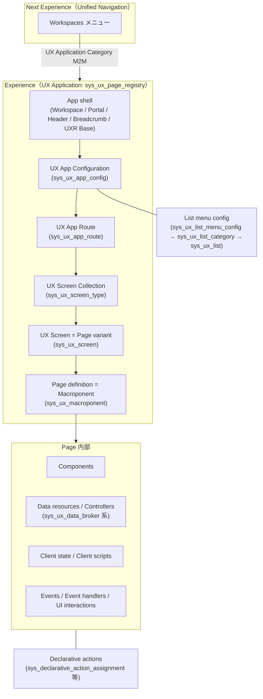
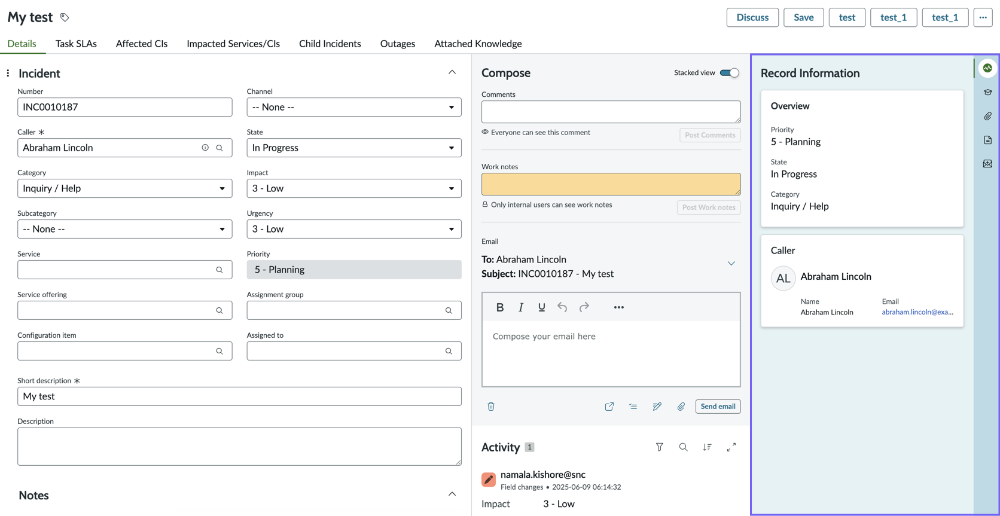
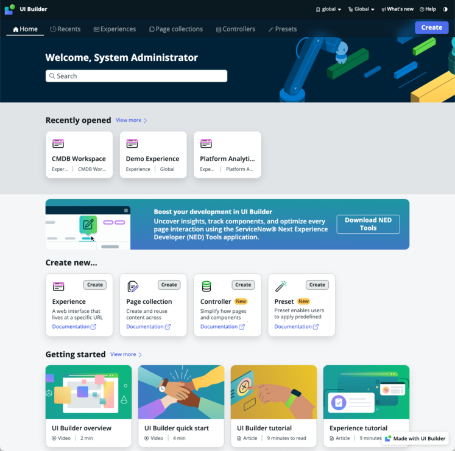
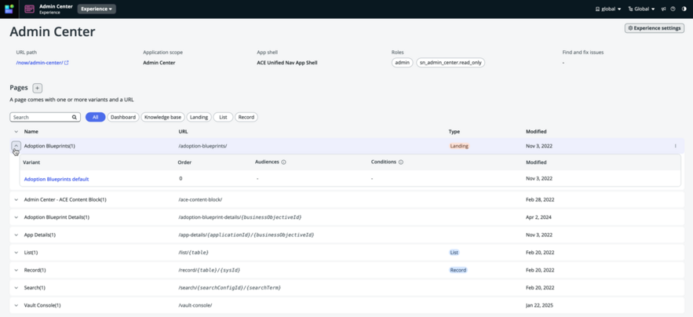
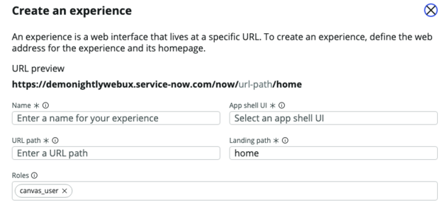
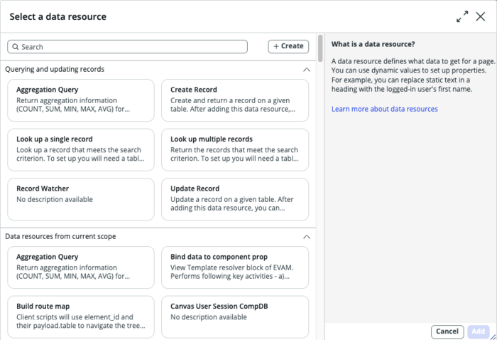
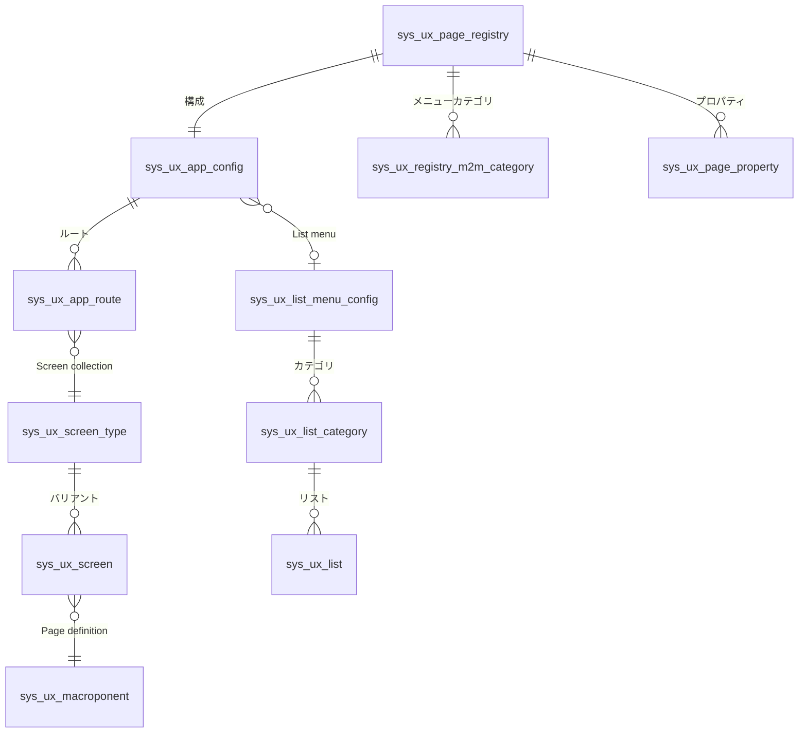

# Workspace と UI Builder

## 概要

本ファイルは、ServiceNow の**エージェント（フルフィラー）向け作業画面**である **Workspace（ワークスペース）** と、その画面を構築・カスタマイズするツールである **UI Builder（UIB）** を、基準リリース **Australia（2026-05 GA）** に沿って解説する。

扱う範囲は次のとおり。

| 区分 | 内容 |
|---|---|
| Configurable Workspace | Next Experience 上の「構成可能なワークスペース」の構成要素（リスト、フォーム、Activity stream、Compose、Tabs sidebar）、宣言型アクション、管理用プロパティ |
| Service Operations Workspace (SOW) | ITSM/ITOM 向けワークスペース。ロール、ランディングページ、Admin Center、移行 |
| 各種 Workspace 一覧 | ServiceNow が提供する製品別ワークスペース |
| UI Builder | Experience / App shell / Page / Variant / Audience / Component / Data resource / Controller / Client state / Event / UI interaction / Page collection、関連テーブル、ロール、AI 機能 |
| 旧 Agent Workspace | 旧世代ワークスペースの位置付け、非推奨（deprecated）化、SOW 等への移行 |

関連ファイル:

- Next Experience UI 全体（Unified Navigation、テーマ、Polaris 等）は [Next Experience UI](./next-experience-ui.md) を参照。
- Core UI（UI16）のリスト・フォームは [リストとフォーム](./lists-forms.md) を参照。
- ポータル（Service Portal / Employee Center）は [Service Portal と Employee Center](./portals-employee-center.md) を参照。
- アプリ開発全般（App Engine Studio、ServiceNow Studio、スコープ）は [アプリケーション開発](./app-development.md) を参照。
- ITSM の各プロセスは [Incident Management](../itsm/incident-management.md) 等を参照。
- Now Assist / ServiceNow Otto の AI 機能全般は [Now Assist と AI Agents](./now-assist-ai-agents.md) を参照。

> **用語上の注意:** 2026 年以降の公式ドキュメントでは「Now Platform」が「ServiceNow AI Platform」と表記され、また 2026-05 発表の AI ブランド **ServiceNow Otto** により一部の「Now Assist」表記が「ServiceNow Otto」に置き換わりつつある（例: UI Builder Agent のページでは「ServiceNow Otto for Creator（`sn_now_creator`）」と表記）。本ファイルでは原則として公式ドキュメント上の表記に従い、旧表記を併記する。[出典](https://www.servicenow.com/docs/r/australia/application-development/ui-builder/uib-builder-agent-concept.html)

---

## 1. ワークスペースの世代と全体像

### 1.1 ワークスペースとは

ServiceNow の公式定義では、Workspace（ワークスペース）は「エージェントが1つの業務全体を効率的に完了できるよう、1つの集中した作業領域にツール群をまとめたもの」である。例として、エージェントは受信したケースを確認し、詳細を見て、依頼者とやり取りし、クローズするまでを1つの画面で行える。[出典](https://www.servicenow.com/docs/r/australia/platform-user-interface/learn-about-agent-workspace.html)

### 1.2 世代の整理

ServiceNow のワークスペースには、技術基盤の異なる2世代が存在する。

| 世代 | 名称 | 導入時期 | 構築ツール | Australia 時点の位置付け |
|---|---|---|---|---|
| 第1世代 | **Agent Workspace**（旧ワークスペース、Classic Workspace と呼ばれることもある） | London 頃【経験則】 | Workspace Experience モジュール群＋Legacy UI Builder（Orlando、ランディングページのみ） | 機能強化なし。製品別に順次 deprecated（非推奨）化。Quebec 以降は新規ワークスペース作成に使用不可 |
| 第2世代 | **Configurable Workspace**（構成可能なワークスペース。WEP Workspace、Next Experience Workspace とも呼ばれる） | Quebec | UI Builder（新 UIB、Quebec〜） | 現行・推奨。SOW、CSM Configurable Workspace 等の製品ワークスペースはすべてこの世代 |

[出典（Community FAQ）](https://www.servicenow.com/community/next-experience-articles/workspace-getting-started-faqs/ta-p/2331982)

ServiceNow Community の Workspace FAQ（ServiceNow 社員による Next Experience 記事）では次のように整理されている。

- **WEP（Web Experience Platform）** は Next Experience の体験を支える技術スタックの総称で、Next Experience UI Framework、ServiceNow CLI、Next Experience Components とカスタムコンポーネント、UI Builder を含む。
- 「Configurable Workspace」と「WEP Workspace」は同義。一方「Agent Workspace」は前身の別製品であり、同義ではない。
- Agent Workspace は「構成の自由度が足りない」という顧客の声を受け、後継として Configurable Workspace が作られた。新規導入は Configurable Workspace から始めるべきで、Agent Workspace は機能強化を受けない。
- Legacy UI Builder（Orlando）は Agent Workspace のランディングページ専用で、コンポーネントも限定的。新 UI Builder（Quebec）は Configurable Workspace、App Engine Studio のポータル、カスタム Experience、Next Experience ランディングページの構築に使い、130 以上のコンポーネントとページバリアントを持つ。Legacy UIB のページは新 UIB では開けず、作り直しが必要。

[出典（Community FAQ）](https://www.servicenow.com/community/next-experience-articles/workspace-getting-started-faqs/ta-p/2331982)

### 1.3 アーキテクチャ全体図

テーブル間の関係の詳細は「8. UI Builder の内部データモデル（テーブル）」を参照。

---

## 2. Configurable Workspace（構成可能なワークスペース）

### 2.1 概要と位置付け

Configurable Workspace は「ServiceNow AI Platform が提供するワークスペース App shell」であり、ServiceNow はこれを基盤に、特定のユーザー・課題を対象とした**製品別のビルド済み Configurable Workspace**（例: Service Operations Workspace、CSM Configurable Workspace）を提供している。管理者は UI Builder を使って、ゼロから Configurable Workspace の Experience を作るか、ビルド済みワークスペースを自社のワークフロー・ブランド・データに合わせて変更する。[出典](https://www.servicenow.com/docs/r/australia/platform-user-interface/learn-about-agent-workspace.html)

- Configurable Workspace は ServiceNow AI Platform の機能で、**既定で有効（active by default）**。[出典](https://www.servicenow.com/docs/r/release-notes/configurable-workspace-rn.html)
- ブラウザ要件: **モバイルデバイス、Internet Explorer、旧 Microsoft Edge（Legacy）は非対応**。Chromium ベースの Edge 等を使用する。[出典](https://www.servicenow.com/docs/r/release-notes/configurable-workspace-rn.html)
- Configurable Workspace は Platform UI（Core UI）と完全な機能パリティを持つことを目的としておらず、一部のリスト・フォーム操作は同等だが、設計思想として別の体験を提供する。[出典（Community FAQ）](https://www.servicenow.com/community/next-experience-articles/workspace-getting-started-faqs/ta-p/2331982)

### 2.2 構成要素（Parts within a Configurable Workspace）

公式ドキュメントは Configurable Workspace の構成要素を次のように定義している。[出典](https://www.servicenow.com/docs/r/australia/platform-user-interface/learn-about-agent-workspace.html)

| 構成要素 | 説明 |
|---|---|
| Lists（リスト） | ケース、タスク、インシデント等の複数レコードを表示し、エージェントが素早く探して作業できるようにする |
| Forms（フォーム） | レコードの詳細を表示・入力・更新する |
| Activity stream（アクティビティストリーム） | レコード内の更新・コミュニケーションの履歴を時系列で表示する |
| Compose（コンポーズ） | レコードページ内で、Comments（コメント）、Work notes（作業メモ）、Email により顧客や他エージェントとやり取りする |
| Tabs sidebar（タブサイドバー。Contextual sidebar / Contextual side panel とも） | レコードページ右側の柔軟なパネル。Agent assist、Attachments、Form templates 等のツールをタブとして表示する |

#### 画像: Configurable Workspace のレコードページと Tabs sidebar

- **キャプション:** Configurable Workspace の標準レコードページ（インシデント）。右端の紫枠が Tabs sidebar。
- **画面の説明:** 画面上部にレコードタイトル（「My test」）とアクションボタン（Discuss、Save、カスタムボタン、「…」メニュー）が並び、その下に Details、Task SLAs、Affected CIs、Impacted Services/CIs、Child Incidents、Outages、Attached Knowledge のタブがある。左カラムはフォーム（Number、Caller、Category、Subcategory、Service、Service offering、Configuration item、Short description、Description、Channel、State、Impact、Urgency、Priority、Assignment group、Assigned to）。中央カラムは Compose（Comments、Work notes、Email の作成欄。Stacked view トグルあり）と Activity（履歴）。右カラムは Tabs sidebar で、「Record Information」（Overview: Priority/State/Category、Caller 情報）が表示され、最右端に縦に並んだアイコンでサイドバーのタブ（Record information、学習、添付、ドキュメント、メール等）を切り替える。
- **出典:** ServiceNow Docs「Tabs sidebar」（Australia）https://www.servicenow.com/docs/r/australia/platform-user-interface/contextual-sidebar-configurable-workspace.html （取得日: 2026-11-02）

### 2.3 Tabs sidebar の標準タブ

UI Builder の標準レコードページテンプレート（Standard record page template）では、Tabs コンポーネントにより次のタブが既定で表示される。ビルド済みワークスペース（CRM Workspace、Service Operations Workspace 等）では製品ごとに追加タブが構成されている場合がある。[出典](https://www.servicenow.com/docs/r/australia/platform-user-interface/contextual-sidebar-configurable-workspace.html)

| タブ | 機能 |
|---|---|
| Agent assist | オープン中レコードの Short description に関連するリソース（ナレッジ等）の候補を提示する |
| Attachments | 現在レコードへのファイルの追加・プレビュー・ダウンロード・削除 |
| Form templates | フィールドを自動入力するテンプレートで新規レコード作成を簡素化する |

### 2.4 Configurable Workspace 用語集（主要用語）

Configurable Workspace の公式用語集から、本ファイルの理解に必要な用語を抜粋する。[出典](https://www.servicenow.com/docs/r/australia/platform-user-interface/configurable-workspace-glossary.html)

| 用語 | 定義（要約） |
|---|---|
| App shell | Web 体験の静的要素（ヘッダー、フッター、メニューナビゲーション）。主に Workspace と Portal で使用 |
| Contextual sidebar | ページのメインコンテンツに関連するコンテンツの列。コンポーネントはタブとして縦に積まれる |
| Declarative actions | スクリプトや API の知識なしに、ワークスペースのフォーム・フィールド・リスト・関連リストに機能を追加する仕組み。Form actions、List actions、Related list actions、Field decorators を含む |
| Form action layout group | 複数アクションを split button / menu button にまとめたもの |
| Form action layout item | アクションボタンの見た目を定義するレコード |
| Form record presence | 同じレコードを閲覧中のユーザーのアバター表示 |
| Form template | Creator Studio が提供する、フォーム上に配置された事前定義済みの質問セット |
| Full / Mini email composer | 別タブで開くメール作成（Full）と、レコードページ内で使うメール作成（Mini） |
| Landing page | ワークスペースを開いたときに表示され、新規・割り当て済み・高優先度のケースやグループのケースの概要を示すページ |
| Predicate Builder | 条件式を視覚的に組み立てるコンポーネント |
| Record List | Glide レコードのリストを表示するためのコンポーネントバンドル（ヘッダー、リスト、ページネーション） |
| Ribbon | フォームに表示されるレコードの文脈情報（素早く把握するためのカード群） |
| Variant | ロールや条件でアクセスを制御する UI Builder ページのバージョン |

### 2.5 リストの管理（UI Builder 外で構成するもの）

Configurable Workspace のリスト機能のうち、UI Builder のコンポーネントではなくプラットフォーム側で構成するもの。[出典](https://www.servicenow.com/docs/r/australia/platform-user-interface/administer-lists-configurable-workspace.html)

| 機能 | 構成方法 |
|---|---|
| Live updates（リストのライブ更新） | システムプロパティ `glide.lists.live_list_enabled` を追加。Zurich 以降はリストページ単位でも設定可能 |
| Google Sheets へのエクスポート | リストから Google Sheets へ直接エクスポートするよう構成（Zurich で追加） |
| レコード件数のバックグラウンド読み込み | 大きなテーブルで件数をバックグラウンド取得: `glide.ui.fetch.list.record.count.asynchronously` |
| 関連リストのバックグラウンド読み込み | 大量レコード追加時の関連リスト読み込みをワークスペース全体でバックグラウンド化 |
| 関連リストのグループ化 | 関連リストをフィールドでグループ化（Australia では Group by の選択保持にも対応） |

ワークスペースのリストメニュー（左ナビゲーションのリスト一覧）は、**List menu configuration（`sys_ux_list_menu_config`）→ List category（`sys_ux_list_category`）→ List（`sys_ux_list`）** の3階層で定義され、リストの可視性は **Applicability（`sys_ux_applicability`）** で制御する（`sys_ux_list` のロール・アクセスは `sys_ux_applicability_m2m_list` で紐付く）。[出典（Fluent Workspace API）](https://www.servicenow.com/docs/r/application-development/servicenow-sdk/fluent-workspace-api.html) [出典（CSM 移行ガイド）](https://www.servicenow.com/docs/r/XqB45azTkh_fhRBNTD2pSw/0_9YdUANAo1swE5N57eLdQ)

### 2.6 フォームの管理（UI Builder 外で構成するもの）

[出典](https://www.servicenow.com/docs/r/australia/platform-user-interface/administer-forms-configurable-workspace.html)

| 機能 | 構成方法・プロパティ |
|---|---|
| Browser warning | 未保存の変更があるページから離れる際に警告を表示（Zurich でブラウザの戻る/進む操作にも対応） |
| Disable reflow | インスタンス／Experience／ページ単位でリフロー（ズーム時の再レイアウト）を無効化 |
| 自動リサイズ | フィールドがスクロールなしで複数行を表示 |
| Personalize Form メニュー | アクセス可能ロール: `glide.ui.personalize_form_role`、メニュー無効化: `glide.ui.personalize_form` |
| Advanced view rules | クライアントスクリプトでフォームバリアントの閲覧者を決定 |
| Mention suggestions | レコード閲覧権限を持つ受信者に基づく @mention 候補 |
| Form header / Highlighted value | フォームヘッダーと強調表示値の構成 |
| Script fields | スクリプト型フィールドのサポート |
| HTML editor toolbar | ジャーナル入力フィールドの HTML エディタツールバー |
| Text commands | メール・ジャーナル・HTML フィールドでキーボードショートカットにより適用するテキストコマンドの構成／無効化 |
| Character counter | ジャーナルフィールドの残り文字数表示 |
| Inline validation | 文字列フィールドのガイダンステキストと正規表現による入力検証（アカウント ID、SSN、SIN 等） |
| Resize modals | UI Builder のプロパティでレコードページ上の全モーダルをリサイズ可能に |

### 2.7 ユーザー側のワークスペース設定（Workspace preferences）

ワークスペースにアクセス権があり、ワークスペースにフォーカスしているときに **User Menu > Preferences > Workspace** で表示される（必要ロールなし）。[出典](https://www.servicenow.com/docs/r/australia/platform-user-interface/next-experience-workspace-preferences.html)

| 設定 | 内容 |
|---|---|
| Ribbon | フォーム読み込み時にリボンウィジェットを既定で表示 |
| Contextual side panel | フォーム読み込み時にコンテキストサイドパネルを既定で表示 |
| Activity stream | アクティビティストリームの全アクティビティを自動展開 |
| Dynamic loading | ページ上のコンテンツを必要に応じて動的に読み込む（無効化すると即時に全読み込み） |

### 2.8 Unified Navigation の Workspaces メニューへの追加

ワークスペースは Next Experience の Unified Navigation の **Workspaces** メニューに表示される。アクセスできるワークスペースが1つならそれが表示され、複数ある場合は Workspaces メニューに並ぶ。追加手順（必要ロール: `admin`）:

1. **All > Now Experience Framework > Experiences** に移動する。
2. 対象の UX Application（Experience）を選択する。
3. 関連リスト **UX Application Category M2Ms** で **New** を選択する（New ボタンはそのアプリケーションへのアクセス権がある場合のみ表示）。
4. フォームを入力する: **Experience Category** = `Workspace`、**Application**（既定 Global）、**UX Application** = 表示したいワークスペース、**Order**（並び順。システムプロパティ `glide.ui.next_experience.workspace_sorting` を作成すると有効化される）。
5. Submit し、ブラウザを更新する。

[出典](https://www.servicenow.com/docs/r/australia/platform-user-interface/add-workspace-unified-navigation.html)

Unified Navigation の Workspace メニューにおける表示可否は ACL で制御される（KB1167916 参照とされる）。[出典（Community FAQ）](https://www.servicenow.com/community/next-experience-articles/workspace-getting-started-faqs/ta-p/2331982)

### 2.9 ヘッダー・サイドバーの構成（UX Page Property）

ServiceNow Community の Workspace FAQ によれば、ワークスペースのヘッダーとサイドバーは次のように構成する。[出典（Community FAQ）](https://www.servicenow.com/community/next-experience-articles/workspace-getting-started-faqs/ta-p/2331982)

| Next Experience UI | ヘッダー | サイドバー（左ナビ） |
|---|---|---|
| 有効 | Unified Navigation ヘッダーは構成不可 | 基本的な構成は Experience settings、高度な構成は UX Page Property（`sys_ux_page_property`）の `chrome_toolbar`（JSON） |
| 無効 | Experience settings、または UX Page Property `chrome_header` | UX Page Property `chrome_toolbar` |

---

## 3. 宣言型アクション（Declarative actions）

### 3.1 概要

Declarative actions（宣言型アクション）は、Configurable Workspace のフォーム・フィールド・リスト・関連リストに、**ページのオーナーシップを取らずに（UI Builder ページをカスタマイズせずに）** 独自のボタンや機能を追加する仕組みである。自社のアプリケーションスコープ内に必要なレコードを作成する方式のため、ベースシステムの UI Builder ページを直接カスタマイズするよりアップグレードが円滑になる。[出典](https://www.servicenow.com/docs/r/australia/platform-user-interface/declarative-actions-landing.html)

### 3.2 アクションの種類とナビゲーション

アプリケーションナビゲーターで「Declarative actions」を検索すると表示されるモジュール（**All > Now Experience Framework > Declarative Actions** 配下）。[出典](https://www.servicenow.com/docs/r/australia/platform-user-interface/declarative-actions-landing.html)

| モジュール | 説明 |
|---|---|
| Create New Action | List、Related list、Form、Field decorator、Attachment アクションを新規作成 |
| Action Configurations | アクションのグループを Configurable Experience に紐付ける（`sys_ux_action_config`） |
| Form Action Layouts | 複数のレイアウト項目・グループを1つのテーブル単位レイアウトにまとめる |
| Form Action Layout Items | フォームのアクションバーに表示される個々のボタンの見た目を定義 |
| Form Action Layout Groups | 複数アクションを split button / menu button にまとめる |
| Form Actions | フォームのボタン選択後の動作を定義 |
| List Actions | リスト上部のアクションバーに表示されるアクション |
| Related List Actions | 関連リスト上部のアクションバーに表示されるアクション |
| List Action Groups | 複数リストアクションを split button にまとめる |
| Field Decorators | フィールド内にアイコンとして表示されるアクション。**単一行文字列フィールドのみ対応**（複数行は非対応） |
| Attachment Actions | 添付ファイルに対するアクション |

### 3.3 共通フィールドと実装方式（Implemented as）

[出典（Declarative actions glossary）](https://www.servicenow.com/docs/r/australia/platform-user-interface/declarative-actions-glossary.html)

| フィールド | 説明 | 対象モデル |
|---|---|---|
| Action label | 実行時にボタンに表示されるテキスト（必須） | 全モデル |
| Action name | ラベルから自動生成される一意の識別子 | 全モデル |
| Active | 表示有無（既定 true、必須） | 全モデル |
| Application | アクションのスコープ（既定は現在のスコープ、必須） | 全モデル |
| Implemented as | 実装方式（必須）: Server script / Client script / UXF client action（Australia では UI interaction も選択可） | 全モデル |
| Specify client action | UXF client action 選択時、トリガー時に内部イベントを発火するペイロード | 全モデル |
| Table | アクションを特定テーブルに限定。Global は全テーブル | 全モデル |
| View | 特定ビューのフォーム・リストに限定（空欄はビュー問わず） | 全モデル |
| Enable for all configurable experiences | true でどの Experience の該当フォームにも表示（既定 false） | Form |
| Experience restricted | true で指定した Experience のみに表示（既定 false） | List、Field decorator、Related list |
| Tooltip / Description / Client script / Server script | ツールチップ、説明、各実装方式のスクリプト | 各モデル |

| 実装方式 | 動作 |
|---|---|
| Server script | サーバー側で実行（レコード作成・削除・再割り当て等）。`current` がレコードを表す |
| Client script | ブラウザで実行し、フォーム・リストの関数と連携 |
| UXF client action | UI Builder ページのページレベルイベント（モーダル表示、ナビゲーション、データ再読込等）を発火 |
| UI interaction（Australia） | 再利用可能な UI interaction を起動。フォーム／リスト／関連リストアクションでのみ利用可。ページのオーナーシップ不要でモーダル表示も可能 |

[出典（Trigger a UI interaction from a declarative action）](https://www.servicenow.com/docs/r/ja-JP/platform-user-interface/configure-da-ui-interactions.html) [出典（UI interactions）](https://www.servicenow.com/docs/r/australia/application-development/ui-builder/uib-ui-interactions.html)

### 3.4 関連テーブル

ServiceNow Community の宣言型アクション入門記事（Tokyo 以降未更新と明記）では次のテーブルが挙げられている。[出典（Community 記事）](https://www.servicenow.com/community/next-experience-articles/introduction-to-declarative-actions/ta-p/2332003)

| テーブル | ラベル | 役割 |
|---|---|---|
| `sys_declarative_action_assignment` | Action Assignment | アクション本体 |
| `sys_declarative_action_model_definition` | — | Action Assignment に追加されるフィールドを定義するモデル |
| `sys_ux_form_action` | UX Form Action | フォームアクションをアクションバーに表示するために必要 |
| `sys_ux_form_action_layout` | UX Form Action Layout | フォーム上の配置（レイアウト項目） |
| `sys_ux_action_config` | UX Actions Configuration | アクションをグローバルまたは特定ワークスペースにスコープ |
| `sys_declarative_action_payload_definition` | Action Payload Definition | UXF Client Action に渡すペイロード定義 |
| `sys_ux_addon_event_mapping` | UX Add-on Event Mapping | UXF Client Action とページのハンドルイベントの紐付け・ペイロードマッピング |

### 3.5 UI Action との違い

- 従来の UI Action（`sys_ui_action`）は、**Format for Configurable Workspace** を true にするとワークスペースのアクションバーに表示できるが、表示位置はアクションバーに限られる。宣言型アクションはリスト・関連リスト・フィールドにも配置できる。[出典（Community 記事）](https://www.servicenow.com/community/next-experience-articles/introduction-to-declarative-actions/ta-p/2332003)
- UI Builder 上でボタンを直接ページに追加するとページ変更（オーナーシップ取得）になるが、宣言型アクションはページを変更しない。
- Australia では **Form action layout groups** により、ベースのアクションを変更せずに順序・ラベル・アイコンをカスタマイズでき、**Public pages** では未ログインユーザーが埋め込みページ上の指定された宣言型アクション・UI アクションを利用できる（ACL は引き続き適用）。[出典（Zurich→Australia 統合リリースノート）](https://www.servicenow.com/docs/r/m4LmCVvkm6_8u3nlIuep5Q/zDIhLoz1_0AXTfdPdmzZLQ)
- 宣言型アクションはドメイン単位でオーバーライド可能（ドメインセパレーション環境）。[出典](https://www.servicenow.com/docs/r/australia/application-development/ui-builder/uib-domain-sep.html)

---

## 4. ServiceNow が提供するワークスペース一覧

### 4.1 公式「List of workspaces」掲載分（Australia）

公式ドキュメント「List of workspaces」（Australia、2026-03-12 更新）に掲載されているワークスペースは次のとおり。[出典](https://www.servicenow.com/docs/r/australia/platform-user-interface/list-of-workspaces.html)

| ワークスペース | 製品領域 | 概要 |
|---|---|---|
| Workspace | Platform | ServiceNow AI Platform の既定ワークスペース。製品別ワークスペースの基盤 |
| Audit Workspace | IRM（GRC） | 監査責任者・監査人向けのシングルペインビュー。監査タイムライン、予算・リソース、高優先度の指摘事項、統制テストの進捗 |
| Cloud Discovery Workspace | ITOM | クラウド運用の包括的管理 |
| CMDB Workspace | Platform（CMDB） | CMDB の検索・探索、健全性と最近のアクティビティ確認、各種 CMDB ダッシュボード |
| Compliance Workspace | IRM（GRC） | ポリシー、統制目標、統制、課題、ポリシー例外の統合管理 |
| Continuous Authorization and Monitoring | IRM（GRC） | Risk Management Framework（RMF）の7ステップに基づくセキュリティ態勢の判断 |
| CSM Configurable Workspace | CSM | カスタマーサービスエージェント向けワークスペース |
| Digital Portfolio Management Workspace | ITSM（DPM） | サービス、サービスオファリング、ビジネスアプリケーション、アプリケーションサービスの一元管理 |
| DEX Application & Device Health | ITSM（DEX） | デジタルワークプレイスの性能・セキュリティ・コンプライアンス監視 |
| Enterprise Architecture Workspace | APM | Application Portfolio Management の一部。複数ビューによるポートフォリオ管理 |
| Platform Analytics Workspace | Platform（Analytics） | Next Experience の全アナリティクスを管理する Analytics Center |
| Resource Management Workspace | SPM | リソースマネージャー向けの全リソース作業の一元ビュー |
| Service Operations Workspace for ITSM | ITSM | ITSM/ITOM の複数ワークフローを統合する Configurable Workspace |
| Service Operations Workspace for ITOM | ITOM | ITOM ワークフロー向け Configurable Workspace |
| Workforce Optimization for ITSM | ITSM | チームのスキル・スケジュール・作業割り当て・パフォーマンス管理 |

> 注: Xanadu 版の同ページには **Vendor Management Workspace** も掲載されていたが、Australia 版および Brazil 版には掲載がない。[出典（Xanadu 版）](https://www.servicenow.com/docs/r/xanadu/platform-user-interface/configure-user-experiences/list-of-workspaces.html)

### 4.2 一覧ページ以外の主なワークスペース

公式「List of workspaces」は網羅的ではなく、各製品ドキュメントで個別に提供されるワークスペースが多数存在する。主なものを示す（HR の Configurable 版、Digital Product Release Workspace、DevOps Change Workspace、Admin Center は本調査で公式ドキュメント上の存在を確認。その他の行は【経験則】による例示で、正式名称は各製品ファイル・製品ドキュメントで確認のこと）。

| ワークスペース | 領域 | 参照先 |
|---|---|---|
| Agent Workspace for HR Case Management (Configurable)（HR Agent Workspace） | HRSD | [HR Service Delivery](../employee/hr-service-delivery.md) |
| Security Operations 系ワークスペース（SIR 等） | SecOps | [Security Operations](../secops/security-operations.md) |
| Field Service 系ワークスペース（Dispatcher 等） | FSM | [Field Service Management](../customer/field-service-management.md) |
| Project Workspace、Strategic Planning Workspace 等 | SPM | [Strategic Portfolio Management](../spm/strategic-portfolio-management.md) |
| Hardware / Software Asset Workspace | ITAM | [ITAM 概要](../itam/itam-overview.md) |
| Digital Product Release Workspace、DevOps Change Workspace | ITSM | [Release Management と DevOps](../itsm/release-management.md) |
| Admin Center（ServiceNow 管理者向け） | Platform | [システム管理](./system-administration.md) |

ワークスペースの正確な提供有無・名称・ライセンス要件は製品・エディションごとに異なるため、各製品ドキュメントで確認すること（`【推定】` 一覧ページ以外のワークスペース数は数十に及ぶが、公式な総数は公開情報では確認できず）。

---

## 5. Service Operations Workspace（SOW）

### 5.1 概要

Service Operations Workspace（SOW）は、複数の IT Service Management（ITSM）および IT Operations Management（ITOM）ワークフローに統合された体験を提供する Configurable Workspace である。ITSM 向けの **Service Operations Workspace for ITSM** と ITOM 向けの **Service Operations Workspace for ITOM** があり、統合することでサービスと運用を1つのプラットフォームで扱える。旧 **ITSM Agent Workspace** の後継である。[出典](https://www.servicenow.com/docs/r/australia/it-service-management/service-operations-workspace/explore-sow.html)

- SOW は San Diego でリリースされ、ITSM Agent Workspace とフルパリティとされた（Problem Management の一部機能はワークスペース外）。[出典（Community FAQ）](https://www.servicenow.com/community/next-experience-articles/workspace-getting-started-faqs/ta-p/2331982)
- SOW for ITSM は Australia で**既定で有効**、Australia の既定バージョンは **9.0**。ServiceNow Store で配布され、旧リリースからのアップグレード時に 9.0 が自動インストールされる。[出典（SOW for ITSM リリースノート Australia）](https://www.servicenow.com/docs/r/IDeOjpA1hzonPLWG~inEpg/WR7g~P9UDo0UEa48SL6vdQ)
- ライセンス: **ITSM Standard 以上**のライセンスが必要（セットアップの最初のステップ）。[出典](https://www.servicenow.com/docs/r/australia/it-service-management/service-operations-workspace/getting-started-sow.html) Investigation Framework 機能には ITSM Professional が必要とされる（Zurich 版ドキュメント）。[出典](https://www.servicenow.com/docs/r/zurich/better-together/solutions/service-operations.html)

### 5.2 アクセス方法

- 必要ロール: `itil`（または後述の SOW 用ロール）。
- 手順: インスタンスにログインし、Unified Navigation の **Workspaces** メニューから **Service Operations Workspace** を選択する。[出典](https://www.servicenow.com/docs/r/australia/it-service-management/service-operations-workspace/access-sow-itsm.html)
- URL は一般に `/now/sow/home` 【経験則】（ワークスペースの URL は `/now/<path>/<landingPath>` 形式。[出典（Fluent Workspace API）](https://www.servicenow.com/docs/r/application-development/servicenow-sdk/fluent-workspace-api.html)）。

### 5.3 ユーザー類型

[出典](https://www.servicenow.com/docs/r/australia/it-service-management/service-operations-workspace/explore-sow.html)

| ユーザー | 条件 | 主な対象レコード |
|---|---|---|
| Tier 1 agent | `itil` または `sn_sow.sow_home` ロールを持ち、Service desk group に所属 | Interaction、Incident、Request |
| Tier 2 agent | `itil` ロール | Incident、Request、Change、Problem、Major incident |
| Administrator | SOW を実装・設定するユーザー | — |

### 5.4 画面構成（UI）

[出典](https://www.servicenow.com/docs/r/australia/it-service-management/service-operations-workspace/service-operations-workspace-ui.html)

| 要素 | 開き方 | 内容 |
|---|---|---|
| Landing page（ランディングページ） | 左ナビのホームアイコン | 担当作業、アナウンス、今後のタスクを確認。Tier 1 はパフォーマンスと割り当てられたコース（学習）も確認 |
| Lists（リスト） | 左ナビのリストアイコン | インシデント、カタログタスク、リクエスト、問題等のリスト。**My Lists** タブで独自リストや既存リストの別バージョンを作成可能 |
| Inbox（受信箱） | 左ナビ | エージェントチャット。ステータスを Available / Away に切替。Service Portal からのチャットは **Agent Chat Queue** グループのメンバーの Inbox に届く。自動割り当て有効時は **Chat - Most Capacity** 割り当てルールに従い自動割り当てされ Interaction レコードが作成される。無効時はエージェントが承諾／拒否する（ロール `awa_agent` が必要） |
| Record view（レコードビュー） | ランディングページまたはリストから | タスクレコードの全情報。Overview / Details / Related records タブ、Compose、Activity、Contextual side panel |

**エージェントの典型的な流れ:** ランディングページで担当・障害・アナウンスを確認し SLA・優先度・緊急度で作業を優先付け → 報告内容からインシデント作成（関連インシデントや最近の Interaction を参照）→ Recommended Actions で解決を加速 → On-call の専門家に連絡 → Microsoft Teams で依頼者・同僚と協働 → 必要に応じ変更要求を作成。[出典](https://www.servicenow.com/docs/r/australia/it-service-management/service-operations-workspace/explore-sow.html)

### 5.5 主な機能

[出典](https://www.servicenow.com/docs/r/australia/it-service-management/service-operations-workspace/explore-sow.html)

| 機能 | 内容 |
|---|---|
| Incident Management in SOW | 文脈情報と対象アクションによるインシデント管理。Agent Client Collector（ACC）のメトリクスデータで調査を加速 |
| Recommended Actions for ITSM | 類似インシデントやナレッジ記事に基づくリアルタイムの推奨。Incident、Incident task、Problem、Problem task、Change request、Change task、Interaction、Request で利用 |
| On-Call Scheduling | オンコールスケジュール、ローテーション、エスカレーションポリシー |
| Microsoft Teams 連携 | タスクから依頼者・同僚と Teams チャットで協働 |
| Request Management | インシデント／Interaction からのリクエスト作成とライフサイクル管理 |
| Walk-up Experience | ウォークアップ窓口の Interaction、予約、在庫室、キオスク |
| Guided setup | **All > Adoption Services > Guided Setup** から管理者向けの段階的設定 |
| Guided tours | 「Show help」アイコンから Take a Tour / Select a Tour。UI 要素をカスタマイズするとツアーが壊れる可能性があるため更新が必要 |
| SOW Admin Center | SOW の大半の設定を一元管理する管理画面 |

### 5.6 ランディングページの種類と Audience

Service Operations Workspace ITSM Applications（`sn_sow_itsm_cont`）には既定で **Tier 1 landing page** と **Tier 2 landing page** がある（ITOM Apps `sn_sow_itom_cont` 等をインストールすると追加のランディングページが利用可能）。ランディングページへのアクセスは、ページに紐付く **Audience（オーディエンス）** で決まり、複数該当する場合は **Order が最小の Audience** が採用される。[出典](https://www.servicenow.com/docs/r/australia/it-service-management/service-operations-workspace/landing-page-types-sow.html)

| ランディングページ | Audience | ロール | User criteria inclusion |
|---|---|---|---|
| Tier 1 | SOW Common Audience | `admin` | なし |
| Tier 1 | SOW Service Desk Audience Granular | `sn_incident_write` | Audience の「Service Desk Group Inclusion」に含まれるグループに所属 |
| Tier 1 | SOW Service Desk Audience | `itil` | 同上 |
| Tier 2 | SOW Tier 2/3 landing page Audience | `itil` | なし |

**ログイン時のリダイレクト**は、条件付き（User criteria、例: Service Desk グループ）、全体（全ユーザーをまず SOW ホームへ送り Audience で振り分け）、任意（ユーザーがオプトアウト可能）のいずれかで構成できる。[出典](https://www.servicenow.com/docs/r/australia/it-service-management/service-operations-workspace/landing-page-redirection-sow-itsm.html)

### 5.7 アクセス制御とロール

ユーザーが SOW にアクセスできるかは、(1) ログイン時の SOW ランディングページへのリダイレクト有無、(2) `sn_sow.sow_user` ロールの有無、(3) ユーザーが属する最初の Audience、で決まる。`itil` は `sn_sow.sow_user` を含むが、`itil` 以外のカスタム／詳細ロールのユーザーには `sn_sow.sow_user` を付与し、Audience をカスタムロールに合わせて更新する必要がある（カスタムロールは ACL の更新も必要）。[出典](https://www.servicenow.com/docs/r/australia/it-service-management/service-operations-workspace/access-controls-sow-itsm.html)

主要ロール（Australia、2026-09-21 更新版）。**ITSM Roles プラグイン（`com.snc.itsm.roles`）を先にインストール・有効化**しないと、ロール継承（例: `sn_incident_read` → `sn_sow.sow_home`/`sn_sow.sow_list`）が正しく機能しない場合がある。[出典](https://www.servicenow.com/docs/r/australia/it-service-management/service-operations-workspace/roles-in-sow.html)

| ロール | 説明 | 継承ロール |
|---|---|---|
| `itil` | SOW の全ページへのアクセス | `sn_sow.sow_user` |
| `sn_sow.sow_user` | SOW へのアクセス（基本ロール） | なし |
| `sn_sow.sow_home` | SOW ホーム（ランディング）ページ | `sn_sow.sow_user` |
| `sn_sow.sow_list` | SOW リストページ | `sn_sow.sow_user` |
| `admin` | SOW Admin Center を含む全ページ、全モジュールの設定 | なし |
| `sn_sow_itsm_admin.sow_admin_user` | SOW Admin Center（Incident Management 関連設定のみ） | なし |
| `sn_sow_admin.sow_admin_center_user` | Change manager による SOW Admin Center アクセス | `sn_ace.ace_user` |
| `awa_agent` | SOW の Inbox | なし |
| `sn_sow.it_agent_dashboard_user` | IT Agent Dashboard | なし |
| `sn_service_desk_agent` | Tier 1 サービスデスク（`com.snc.itsm.roles` インストール時） | `sn_incident_write`、`sn_problem_write`、`sn_change_write`、`sn_request_write`、`tracked_file_reader`（ITSM Gen AI `com.sn.itsm.gen.ai` 導入時は `knowledge_user`、`now_assist_panel_user` も） |
| `sn_incident_read` / `sn_incident_write` | インシデントレコードページの読取／書込 | `sn_sow.sow_home`、`sn_sow.sow_list` |
| `sn_problem_read` / `sn_problem_write` | 問題レコードページの読取／書込 | `sn_sow.sow_home`、`sn_sow.sow_list` |
| `sn_change_read` / `sn_change_write` | 変更レコードページの読取／書込 | `sn_sow.sow_home`、`sn_sow.sow_list` |
| `sn_request_read` / `sn_request_write` | リクエストレコードページの読取／書込 | `sn_sow.sow_home`、`sn_sow.sow_list` |
| `change_manager` | SOW Admin Center の Change Management 設定 | `sn_sow_admin.sow_admin_center_user`、`itil` ほか |
| `oc_read` | On-call Schedules、Experts On-call、Escalation Tracking 等 | — |
| `rota_admin` | オンコールのシフト・ロスター・スケジュールの全管理、オンボーディングウィザード | `sn_sow.sow_home`、`sn_sow.sow_list`、`sn_sd.success_dashboard_details_read` |

> Zurich（12 月版）で Admin Center 用の詳細管理ロール（SOW 全般、Incident、Major Incident Management、On-Call Scheduling、Problem Management）が追加され、Australia では「`admin` ロールなしで SOW の設定・プロパティページにアクセスできる詳細管理ロール」が新機能として挙げられている。[出典（Zurich RN）](https://www.servicenow.com/docs/r/u1slaAtcFiiXFQcd9RcR_A/ZrYUQ4m1VLOmQivznqG56w) [出典（Australia RN）](https://www.servicenow.com/docs/r/IDeOjpA1hzonPLWG~inEpg/WR7g~P9UDo0UEa48SL6vdQ)

### 5.8 構成アプリケーション（Store アプリ）

Service Operations Workspace ITSM Applications でインストールされる主なコンポーネント（Australia）。[出典](https://www.servicenow.com/docs/r/t~YvqQkg2oQX4L7ySrpyuQ/xIyp5kzoOQmdJ7RnGoKR_A)

| 種別 | 名称 | ID |
|---|---|---|
| プラグイン | UX Framework - User Criteria | `com.glide.ux.user_criteria` |
| プラグイン | Dynamic Related Records for Configurable Workspace | `com.snc.uib.sn_dyn_rel_rec` |
| Store アプリ | Service Operations Workspace Core | `sn_sow` |
| Store アプリ | SOW Record Page | `sn_sow_record` |
| Store アプリ | SOW Quick Links component | `sn_sow_quick_links` |
| Store アプリ | Incident / Problem / Change / Request Management for SOW | `sn_sow_inc` / `sn_sow_problem` / `sn_sow_chg` / `sn_sow_req` |
| Store アプリ | Collaboration Services for SOW | `sn_sow_collab` |
| Store アプリ | Interaction Management for SOW | `sn_sow_interaction` |
| Store アプリ | Interceptor UI for SOW | `sn_sow_interceptor` |
| Store アプリ | SOW ITSM Common | `sn_sow_itsm_common` |
| Store アプリ | On-Call Scheduling for SOW | `sn_sow_on_call` |
| Store アプリ | Walk-Up Experience for SOW | `sn_sow_walkup` |
| Store アプリ | Recommendations for Incident Management / Recommendation Framework | `sn_sow_incident_rf` / `sn_rf` |
| Store アプリ | Service Level Management Experience for Workspace | `sn_sla` |
| Store アプリ | SOW Admin Center / SOW ITSM Admin Center | `sn_sow_admin` / `sn_sow_itsm_admin` |

（名称は公式ドキュメントのドイツ語版から英語名に再構成したもの。正確な英語表記はインスタンスのプラグイン一覧で確認のこと。）

### 5.9 Contextual side panel の構成

SOW の全レコードページで利用可能な Contextual side panel のタブ追加・削除、Recommended Actions（コンテキスト、ルール、推奨、リソースジェネレーター）、Agent Assist タブのレコード種別ごとの有効化、Experts on-call パネルのサポートグループ推奨を構成できる。[出典](https://www.servicenow.com/docs/r/australia/it-service-management/service-operations-workspace/contextual-side-panel-configurations-sow-itsm.html) Australia では SOW Admin Center から**特定のテーブルとタブの組み合わせで Contextual side panel を非表示**にするオプションが追加された。[出典](https://www.servicenow.com/docs/r/IDeOjpA1hzonPLWG~inEpg/WR7g~P9UDo0UEa48SL6vdQ)

#### 画像: SOW のレコードビュー

> 注: 次の画面は公式ドキュメント掲載のものだが、ファイルサイズの都合で保存していない。公式ページ「Service Operations Workspace for ITSM user interface」の Figure 3「Record view」を参照。画面説明: インシデント（INC0014782）のレコードビュー。上部にワークスペースタブ（List、INC0014782）、タイトル、Priority（1 - Critical）、State（In Progress）、Opened、右上に Save、Create change request（ドロップダウン: Create incident task / Create outage / Create problem / Create request）、Resolve ボタン。Overview / Details / Related records タブ。Overview には Summary、Impact（Affected CIs、Impacted Services/CIs の件数カード）、Affected CIs 関連リスト。右側に Compose（Comments / Work notes (Private)）と Activity、最右端に Contextual side panel のアイコン列。[出典](https://www.servicenow.com/docs/r/australia/it-service-management/service-operations-workspace/service-operations-workspace-ui.html)（取得日: 2026-11-02）

### 5.10 Australia の SOW for ITSM 新機能

[出典（SOW for ITSM リリースノート Australia）](https://www.servicenow.com/docs/r/IDeOjpA1hzonPLWG~inEpg/WR7g~P9UDo0UEa48SL6vdQ)

| 区分 | 内容 |
|---|---|
| 新機能 | **UI16 モジュールリンクのリダイレクト:** UI16 のフォーム・リスト等のモジュールリンクを SOW の対応画面へリダイレクト。システムプロパティ `sn_sow_itsm_admin.experience_redirection_enabled.sow` = true が必要 |
| 新機能 | 詳細管理ロールによる SOW 設定・プロパティページへのアクセス（`admin` 不要） |
| 新機能 | SOW Admin Center でテーブル×タブ単位の Contextual side panel 非表示 |
| 新機能 | Request / RITM レコードのチェックリスト作成・管理・追跡 |
| 新機能（9.2〜） | `incident_write` を持つ共同作成者による Post Incident Report（PIR）操作、Overview タブでの AI インシデント要約・解決計画の提案 |
| 新機能（2026-06） | AI summary and suggestions カードを Overview タブ（Overview 非表示の L1 は Details タブ）に表示 |
| 変更 | 参照フィールドの自動読込動作を SOW Admin Center の `ref_search_on_click` で構成 |
| 変更 | Record information サイドパネルの最近のインシデント／Interaction／タスクを「過去7日」ではなく「最新10件」表示（View All あり） |
| 非推奨 | なし |

> **Brazil での変更:** SOW for ITSM は Brazil で既定バージョン **9.5**。新規プロビジョニングされた zboot インスタンスで、エンタイトルメントがある場合に SOW for ITSM Advanced Applications 等をバッチインストールするスケジュールジョブ（Auto install SOW）が追加。インシデントに添付されたナレッジ記事が既定で Related records タブに表示。**Migration Utility for Service Operations Workspace（`sn_sow_migration`）は代替なしで非推奨**。Agent Client Collector for Investigation（`com.snc.acc_adapter`）と Microsoft Endpoint Configuration Manager for Investigation（`com.snc.mecm_adapter`）が非推奨予定。[出典](https://www.servicenow.com/docs/r/release-notes/service-operations-workspace-itsm-rn.html)

---

## 6. UI Builder

### 6.1 概要

**UI Builder（UIB）** は、App Engine Studio で生成されたワークスペースやカスタム Web Experience のページを作成するための **WYSIWYG の Web UI ビルダー**であり、Next Experience Components とカスタム Web コンポーネントを部品として使う。[出典](https://www.servicenow.com/docs/r/australia/application-development/ui-builder/ui-builder-overview.html)

| 項目 | 内容 |
|---|---|
| 起動 | **All > Now Experience Framework > UI Builder**（URL は一般に `/now/builder/ui` 【経験則】） |
| 必要ロール | `ui_builder_admin`（UI Builder でのタスク全般に必要） |
| 有効化 | 既定で有効。最新版は ServiceNow Store から取得 |
| ブラウザ | Internet Explorer 非対応 |
| 対象 Experience | Workspace Experience（App Engine Studio 生成のものを含む）、カスタム Web / Portal Experience、Next Experience ランディングページ |
| 制約 | **ベースシステムの Service Portal（Employee Center 等）は構築・構成できない**（Service Portal Designer を使用） |

[出典（概要）](https://www.servicenow.com/docs/r/australia/application-development/ui-builder/ui-builder-overview.html) [出典（Australia RN）](https://www.servicenow.com/docs/r/IDeOjpA1hzonPLWG~inEpg/fFNgdbVDDJ7rIDPamwLwiA)

### 6.2 ロール

| ロール | 説明 |
|---|---|
| `ui_builder_admin` | UI Builder での作業に必要。`ui_interaction_admin`、`canvas_user`、`workspace_admin` を含む。既定ではどのグループにも割り当てられていない。elevated role ではない。ユーザーレコードの Roles 関連リストで付与する |
| `admin` | UI Builder の全機能へのアクセス |
| アプリケーション固有 admin | ServiceNow Studio で UI Builder アプリケーションレベルの開発を Delegated developer に委任可能 |

[出典（UI generation roles）](https://www.servicenow.com/docs/r/australia/application-development/ui-builder/ui-generation-roles.html) [出典（Security and roles）](https://www.servicenow.com/docs/r/australia/application-development/ui-builder/security-roles.html)

> 注: UI generation roles ページ（Australia）では `ui_builder_admin` が「ServiceNow Otto for Creator」の見出しのもとで「AI による UI 生成で Experience を作成する」ロールとして記載されている。AI 機能の利用には別途 Now Assist / ServiceNow Otto のライセンスが必要（per-user サブスクリプション管理については営業担当へ確認、と記載）。

### 6.3 セキュリティ（スコープ、ドメイン、保護ポリシー）

UI Builder のセキュリティは**アプリケーションスコープ、ドメインセパレーション、保護ポリシー**で制御される。[出典](https://www.servicenow.com/docs/r/australia/application-development/ui-builder/security-roles.html)

- **アプリケーションスコープ:** ページ作成時にスコープを設定し、**作成後は変更できない**。UI Builder でスコープを変更するとプラットフォーム側のスコープも変わる（逆も同様）。スコープピッカーは URL フィールドの右。Experience settings はスコープが異なると読み取り専用になる。
- **保護ポリシー（Protection policy）:** 保護されたレコードの変更・コピーを防ぐ。UI Builder は保護レコードの変更時に通知する。
- **ドメインセパレーション:** UI Builder は Standard レベルでドメインセパレーションに対応。プロセス／UI 分離テーブルには `sys_override` 列があり、Global で作ったページをサブドメインで保存するとオーバーライドになる。現在のドメインとバリアントのドメインが異なるとレコードは読み取り専用。**Create Override** でページ定義の内容を（スクリーン条件と Audience を除いて）現在ドメインにコピーできる。`ui_builder_admin` は既定ではドメイン選択メニューにアクセスできず、`itil` 等のロールまたはシステムプロパティで付与が必要。Viewport と宣言型アクションもドメイン単位でオーバーライド可能。[出典](https://www.servicenow.com/docs/r/australia/application-development/ui-builder/uib-domain-sep.html) 詳細は [ドメインセパレーション](./domain-separation.md) を参照。

### 6.4 UI Builder の画面構成

#### 画像: UI Builder ホーム

- **キャプション:** UI Builder のホームページ。
- **画面の説明:** 上部バーに Home、Recents、Experiences、Page collections、Controllers、Presets のタブと、右側にアプリケーションスコープ（global）・ドメイン（Global）ピッカー、What's new、Help、テーマ切替、青い **Create** ボタン。中央に「Welcome, System Administrator」と検索バー。「Recently opened」に最近開いた Experience（CMDB Workspace、Demo Experience、Platform Analytics…）のカード。「Create new...」セクションに Experience（特定 URL に存在する Web インターフェース）、Page collection（コンテンツの再利用）、Controller（New）、Preset（New）の作成カード。下部に「Getting started」として UI Builder overview（動画 2 分）、quick start（動画 4 分）、tutorial（記事）、Experience tutorial（記事）。中段に Next Experience Developer（NED）Tools の案内バナー。
- **出典:** ServiceNow Docs「Navigate the UI Builder application」（Australia）https://www.servicenow.com/docs/r/australia/application-development/ui-builder/nav-uib.html （取得日: 2026-11-02）

UI Builder の領域（エディタ画面）。[出典](https://www.servicenow.com/docs/r/australia/application-development/ui-builder/nav-uib.html)

| 領域 | 機能 |
|---|---|
| UI Builder home | 最近開いた Experience、Experience／Page collection 作成、検索。上部タブで Experiences、Page collections、Controllers、Presets、UI interactions の一覧へ |
| Experience view | Experience の構造を確認する中心画面。Pages リストを展開してバリアントを表示。名前・URL・ページタイプ・バリアントで検索・フィルター |
| 左縦バー | Data resources、Client state、Client scripts 等へのアクセス |
| Top bar | Experience 内ページの切替、ページ設定（可用性、順序、Audience）、プレビュー、URL を開く、ドメイン・スコープ選択、エラー／警告、Save |
| Content tree | カラムレイアウト、カラム、コンポーネントの階層表示・編集 |
| Toolbox | レイアウトとコンポーネントの追加 |
| Stage（ステージ） | ページを構築・編集する領域 |
| Configuration panel | レイアウト・コンポーネントの設定、スタイル、イベント（Config / Style / Events タブ） |
| Data resources / Client state / Client scripts | データバインド、ページ変数、スクリプト |

#### 画像: Experience view

- **キャプション:** UI Builder の Experience view（例: Admin Center Experience）。
- **画面の説明:** 上部に Experience 名「Admin Center」と右上の **Experience settings** ボタン。メタ情報として URL path（`/now/admin-center/`）、Application scope（Admin Center）、App shell（ACE Unified Nav App Shell）、Roles（`admin`、`sn_admin_center.read_only`）、Find and fix issues。下部の **Pages** セクションに「A page comes with one or more variants and a URL」とあり、検索欄とフィルター（All、Dashboard、Knowledge base、Landing、List、Record）。ページ一覧の列は Name、URL、Type、Modified。例: Adoption Blueprints（`/adoption-blueprints/`、Landing）を展開すると Variant（Adoption Blueprints default）、Order（0）、Audiences、Conditions、Modified が表示される。他に `/list/{table}`（List）、`/record/{table}/{sysId}`（Record）、`/search/{searchConfigId}/{searchTerm}` 等のルートが並ぶ。
- **出典:** ServiceNow Docs「Navigate the UI Builder application」（Australia）https://www.servicenow.com/docs/r/australia/application-development/ui-builder/nav-uib.html （取得日: 2026-11-02）

### 6.5 UI Builder 用語集（Australia）

[出典](https://www.servicenow.com/docs/r/australia/application-development/ui-builder/ui-builder-glossary.html)

| 用語 | 定義（要約） |
|---|---|
| Action | ページ上またはコンポーネント内のユーザー主導の動作。イベントとイベントハンドラーで追加 |
| App shell | Experience の固定要素（ヘッダー、フッター、ナビゲーションメニュー） |
| Client script | ページ上のコンポーネントと Client state parameter を操作するクライアント側 JavaScript。イベントハンドラーとして紐付け |
| Client state parameter | そのページだけにデータを保持するページスコープの変数 |
| Component | ページの構成部品。イベントとプロパティで相互に通信（Heading、Image、List、Form、Button 等） |
| Component ID | スクリプトやデータバインドでコンポーネントを識別する名前（ラベルから生成、編集可） |
| Component preset | 定義済みのプロパティ値とイベントマッピングの集合 |
| Component properties | Configuration パネルの Config / Style / Events タブの設定 |
| Controller | データとイベントロジックを保持しプリセットを有効にするデータリソース |
| Data binding | UI 要素にデータを結び付けて表示させること |
| Data resource | ページのコンポーネントが取得するデータを定義する再利用可能な仕組み |
| EVAM（Entity View Action Mapper） | カード・リストでデータを表示する標準フォーマット |
| Event / Event handler / Event mapping | ユーザー操作やページ上の出来事／発生時に実行される処理／両者の対応付け |
| Macroponent | UI Builder ページの中核データ構造。フィールドにページを定義する JSON を保持 |
| Modal / Popover | フォーカスを奪うオーバーレイウィンドウ／他の操作を継続できる小さなオーバーレイ |
| Now Code Editor | CSS、HTML、JavaScript、XML、JSON 用のリッチエディタ |
| Page | カラムレイアウト・カラム・コンポーネントのコンテナ |
| Page collection | タブやモーダル内で使う再利用可能なページのグループ |
| Repeater | 配列の要素ごとに子コンテンツを繰り返し描画するコンポーネント |
| Variant | ロールまたは条件でアクセスを制限したページのバージョン。同じ URL で対象者別に異なるページを提供 |

---

## 7. UI Builder の構成要素（詳細）

### 7.1 Experience（エクスペリエンス）

Experience は「特定の URL に存在する Web インターフェース」であり、ワークスペースやポータルの単位となる。作成手順（必要ロール: `ui_builder_admin`）:

1. **All > Now Experience Framework > UI Builder** に移動。
2. **Create > Experience** を選択（Brazil 版ドキュメントでは「AI-Generated experience」も選択肢として記載。7.15 参照）。
3. フォームを入力して **Create**、**Open experience** で Experience の main page を開く。

| フィールド | 説明 |
|---|---|
| Name（必須） | Experience の内部名。ブラウザタブに表示される |
| App shell UI（必須） | ページコンテンツを包む App shell |
| URL path（必須） | Experience URL に付加されるパス（例: `my/app`）。名前から自動生成 |
| Landing path（必須） | ホームページに到達するための接頭辞。既定 `home`。同じパスのページを作るとそれがホームになる |
| Roles | アクセスできるロールを制限。空欄なら**ログイン済み全ユーザー**がアクセス可能 |

[出典](https://www.servicenow.com/docs/r/australia/application-development/ui-builder/create-experience.html) [出典（Configurable Workspace の Experience 作成）](https://www.servicenow.com/docs/r/australia/platform-user-interface/create-configurable-workspace-experience-uib.html)

#### 画像: Create an experience フォーム

- **キャプション:** UI Builder の「Create an experience」モーダル。
- **画面の説明:** 説明文「An experience is a web interface that lives at a specific URL. To create an experience, define the web address for the experience and its homepage.」の下に URL preview（`https://<instance>.service-now.com/now/url-path/home`）。入力欄は Name（必須）、App shell UI（必須、「Select an app shell UI」）、URL path（必須）、Landing path（必須、既定値 `home`）、Roles（例として `canvas_user` が設定済み）。
- **出典:** ServiceNow Docs「Create an experience」（Australia）https://www.servicenow.com/docs/r/australia/application-development/ui-builder/create-experience.html （取得日: 2026-11-02）

Experience の URL は `https://<instance>/now/<URL path>/<landing path>` となる（上記 URL preview より）。

#### Workspace Experience settings

Workspace Experience の **Experience settings** では次を変更できる（正しいアプリケーションスコープにいない場合は読み取り専用）。[出典](https://www.servicenow.com/docs/r/australia/application-development/ui-builder/ui-builder-workspace-settings.html)

| 設定 | 内容 |
|---|---|
| General settings | タイトル、説明、パス |
| Brand and theme | 割り当て済みテーマの表示（テーマ変更は Theme Builder。[Next Experience UI](./next-experience-ui.md) 参照） |
| Side navigation | サイドナビゲーションに表示するページの選択 |
| Utility settings | 通知のオン／オフ、グローバル検索の表示／非表示と検索ソース |

Zurich で、Experience 全体のアラート自動消去（auto-dismiss）を Experience settings で設定できるようになった。[出典（Zurich UIB RN）](https://www.servicenow.com/docs/r/zurich/release-notes/ui-builder-rn.html)

### 7.2 App shell

App shell は Experience ページのコンテンツを包むラッパーで、UI Builder では**必須**。App shell が Experience をワークスペース型にするかポータル型にするかを決める。[出典](https://www.servicenow.com/docs/r/australia/application-development/ui-builder/app-shells-uibuilder.html)

| App shell | 説明・用途 |
|---|---|
| Breadcrumb app shell | ヘッダー、パンくず型ナビゲーション、プライマリナビゲーションバーを持つワークスペース。マルチタスク不要の集中ワークフローやウィザード向け |
| Header app shell | ヘッダーとユーザーメニューのみ。ナビゲーションが最小限でよい Experience 向け |
| Portal app shell | ポータル用のヘッダーとフッター。メニュー、ユーティリティ、ロゴ、ログインの構成の参照実装 |
| UXR Base Experience app shell | Next Experience バナーのみで視覚コンポーネントなし。親アプリ内で構成される Experience の基盤機能（構成、コンテキストバインド、ルーティング、画面読込、キャッシュ）を提供。Identity Center が直接使用 |
| Workspace app shell | ワークスペース用ヘッダー・フッター。課題の検索・調査・解決のツールを提供。見た目は Theme Builder で管理。Configurable Workspace を作る場合はこれを選択 |

なお、製品ワークスペースでは独自の App shell（例: Admin Center の「ACE Unified Nav App Shell」）が使われている場合がある（6.4 の Experience view 画像参照）。

### 7.3 Page（ページ）と URL パラメータ

Page は「ワークスペース、ポータル、カスタムアプリケーションの UI を構成するコンポーネントの集合」である。作成手順（必要ロール: `ui_builder_admin`）の要点:[出典](https://www.servicenow.com/docs/r/australia/application-development/ui-builder/create-page.html)

| 手順・項目 | 内容 |
|---|---|
| 作成方法 | Create from scratch（ゼロから）、Page template（テンプレート）、Legacy template（Record/List 等のページ定義の再利用） |
| Name | ページの一意な名前 |
| URL Path | 必須・一意。使用可能文字は数字、英字、`-` `.` `_` `~`。単語はスラッシュまたはハイフンで区切る |
| Type（URL page type） | None、Dashboard、Knowledge base、List、Record（ランディングページは既定で Landing）。Experience view でのフィルタに使う（Zurich 28.2 で追加） |
| Required parameters | ページが必要とするデータ（`sys_id`、`table`、query 等）。コンポーネントからバインド可能 |
| Optional parameters | 名前と値のペア。順序に依存しない |
| Variant name | 既定は「Default」 |
| Audiences / Conditions | 任意。条件はドロップダウンまたはエンコードクエリで指定 |
| Responsive | 既定は Build responsive（Xanadu Store Release 1 以降、ゼロから作成したページで Responsive authoring が利用可能。既存ページやテンプレート作成ページは従来のリフローモデル） |

**Responsive authoring** では、ブレークポイントごとにコンポーネントの表示可否、設定、スタイル、レイアウトを調整できる。[出典](https://www.servicenow.com/docs/r/australia/application-development/ui-builder/responsive-authoring.html)

**レイアウト**は Column layout（カラムレイアウト）に加え、Flexbox と CSS Grid を利用できる。[出典](https://www.servicenow.com/docs/r/australia/application-development/ui-builder/work-layouts.html)

**パフォーマンス設定（Manage performance settings）:** ページのメニューから開き、Progressive loading（コンポーネントの読込継続中にページを利用可能にする）または Full page loading（全読込後に表示、Page loader threshold duration で最大待機時間）を選択。Priority タブでコンポーネントを高優先度に、Cache and headers タブでデータリソースに Data policy を適用してキャッシュできる。[出典](https://www.servicenow.com/docs/r/australia/application-development/ui-builder/performance-settings.html)

### 7.4 Page variant（ページバリアント）と条件

**Page variant** は同じパスに存在し、User criteria（Audience）で異なる対象者を狙うページのバリエーションである。例: エージェント用ホームページと、そのマネージャー用バリアントを同じ URL に置く。作成は Experience の Pages セクションの **+ > Add a variant to a page > + Add variant**。[出典](https://www.servicenow.com/docs/r/australia/application-development/ui-builder/create-variant.html)

**バリアント条件（Variant conditions）:**[出典](https://www.servicenow.com/docs/r/australia/application-development/ui-builder/control-conditions-for-your-variant.html)

| 項目 | 内容 |
|---|---|
| Parameter | 評価対象。**ページに追加済みのパラメータのみ**評価可能（例: Standard record template の `table`、`sysId`）。サブページの条件は親ページのコントローラーの出力も参照可能 |
| Operator | is、is not、starts with 等 |
| Value | 比較する値（"Incident"、"12345" 等） |
| AND / OR | 画面上は AND または OR の一方のみ。混在させるには **Enter as text** でエンコードクエリを記述（例: `table=task^sysId=abcd1234^ORsysId=efgh5678`） |
| 優先順位 | 同じ条件を持つ複数バリアントは **Order** 設定に従う |

Workspace Builder のドキュメントでは、**ワークスペースの既定のレコードページは読み取り専用で編集できず、内容を変えるにはページバリアントを作成してそのバリアントを編集する**と記載されている。ベースシステムのページを直接変更せずバリアントで差分を作る考え方は、製品ワークスペース（SOW 等）のカスタマイズでも同様に推奨される【経験則】。[出典](https://www.servicenow.com/docs/r/zUlSbxoxKPAWFDGUdAoSCw/ISZpTHJOTtJabtpL107XMw)

### 7.5 Audience（オーディエンス）

Audience は「誰がページを見られるか」を定義する。一般にロールとドメインに基づく許可／拒否リストで構成され、**Role、Group、User、Company、Department、Location、Script** を対象にできる。[出典](https://www.servicenow.com/docs/r/australia/application-development/ui-builder/add-audiences.html)

- Role 以外（Department、Group、Location、Company）でアクセスを構成するには、システムプロパティ **`glide.ux.user_criteria_enabled` = true** が必要。
- Audience レコードの **Order** は小さいほど優先度が高い。**Active** チェックボックスが必要。
- 必要な Audience が一覧にない場合は **Open audiences in platform** からプラットフォーム側で作成する。

### 7.6 Component（コンポーネント）と Component Builder

コンポーネントはページの構成部品で、イベントとプロパティで相互に通信する。Toolbox のコンポーネントライブラリから追加し、Configuration panel の Config / Style / Events タブで設定する。[出典](https://www.servicenow.com/docs/r/australia/application-development/ui-builder/ui-builder-overview.html)

**Component preset（プリセット）:** 定義済みのプロパティ値とイベントマッピングでコンポーネントを自動構成する。プリセットにはコントローラーが必要な場合があり、コントローラーがページに構成されているとコンポーネントライブラリでプリセット対応コンポーネントが強調表示される。[出典](https://www.servicenow.com/docs/r/australia/application-development/ui-builder/controllers.html)

**Zurich で削除されたコンポーネント:** UI Builder から **List、List - Simple、List - Related** コンポーネントが削除され **Record List component bundle** に置き換えられた。**Condition Builder** も削除され **Predicate Builder** に置き換えられた。[出典（Zurich→Australia 統合 RN）](https://www.servicenow.com/docs/r/m4LmCVvkm6_8u3nlIuep5Q/zDIhLoz1_0AXTfdPdmzZLQ)

**カスタムコンポーネントの2つの作り方:**[出典](https://www.servicenow.com/docs/r/australia/application-development/ui-builder/component-builder.html)

| 項目 | Component Builder（UI Builder 内、ローコード） | NOW CLI（コード） |
|---|---|---|
| 対象者 | ドラッグ＆ドロップで作りたいユーザー | HTML/CSS/JavaScript を書く開発者 |
| 複雑さ | 単純〜中程度 | 複雑・高度なカスタマイズ |
| 保存先テーブル | 「Macroponent Components」として **`sys_ux_macroponent`** | **`sys_uib_toolbox_component`** |
| コントローラー・データリソース参照 | 可 | — |
| 作成 | UI Builder ホームの **Create > Component**（必要ロール `ui_builder_admin`） | ServiceNow CLI |

- Component Builder ではテスト値（Test values、Zurich 28.2 で追加）で必須／任意 URL パラメータをシミュレートできる。
- ベストプラクティス: Component Builder にはガバナンス機能がなく、類似コンポーネントの乱立による UI の断片化が起きやすいため、定期的な監査とチーム間の連携が推奨される。セキュリティポリシーが `read_only` のコンポーネントはアップグレードセーフ（その反面、OOTB コンポーネントは編集できない場合がある）。

### 7.7 Data resource（データリソース）

#### 概要

Data resource（データリソース）は、UI Builder のコンポーネントが表示するデータを取得する仕組みで、Glide、GraphQL、REST API からデータを取得し、コンポーネント用に変換する。データリソースのレコード（`sys_ux_data_broker` 系）はコンポーネントとサーバーの仲介役となり、1つのデータリソースを複数コンポーネントで共有できる。[出典](https://www.servicenow.com/docs/r/australia/application-development/ui-builder/data-resources.html) [出典（Community 記事）](https://www.servicenow.com/community/next-experience-articles/all-about-data-resources-in-ui-builder/ta-p/2360643)

データリソースドロワーは3つのセクションで構成される: **Data resources**（Experience のデータリソース）、**Configuration/Events**（構成済みデータリソースとイベント）、**Preview**（返却データの JSON）。

#### データリソースの種類

| 種類 | 説明 |
|---|---|
| Controller | データとイベントロジックをカプセル化し、コンポーネントのプリセットを有効化 |
| GraphQL | GraphQL のクエリ／ミューテーションを実行 |
| Transform | 入力データを別形式に変換するサーバー側スクリプト（既存の Script Include の再利用に便利） |
| Client state | クライアント情報、ドメイン固有の状態、ユーザー設定等のクライアント側データ |
| Composite | 複数のデータリソースを含む単一の再利用可能なデータリソース |
| REST | REST API リクエストによるデータリソース |

[出典](https://www.servicenow.com/docs/r/australia/application-development/ui-builder/data-resources.html)

Community 記事では、加えて **Scriptlet**（サンドボックス化されたクライアント側 JavaScript。Transform より高速に読込・実行）にも言及があり、可能なら Transform より Scriptlet を、GraphQL＋Scriptlet の組み合わせには Composite を推奨している。[出典（Community 記事）](https://www.servicenow.com/community/next-experience-articles/all-about-data-resources-in-ui-builder/ta-p/2360643)

#### 代表的なデータリソース

#### 画像: Select a data resource モーダル

- **キャプション:** UI Builder でデータリソースを追加する「Select a data resource」モーダル。
- **画面の説明:** 左上に検索欄と「+ Create」ボタン。「Querying and updating records」カテゴリに Aggregation Query（COUNT、SUM、MIN、MAX、AVG の集計情報を返す）、Create Record（指定テーブルにレコードを作成して返す）、Look up a single record（検索条件に合うレコードを1件取得）、Look up multiple records（条件に合う複数レコードを取得）、Record Watcher、Update Record（指定テーブルのレコードを更新）のカード。「Data resources from current scope」カテゴリに Aggregation Query、Bind data to component prop（EVAM の View Template resolver ブロック）、Build route map、Canvas User Session CompDB 等。右ペインに「What is a data resource?」の説明（ページで取得するデータを定義し、動的値でプロパティを設定できる。例: 見出しの静的テキストをログインユーザーの名に置き換える）。右下に Cancel / Add。
- **出典:** ServiceNow Docs「Dynamically expose data in UI Builder pages」（Australia）https://www.servicenow.com/docs/r/australia/application-development/ui-builder/data-resources.html （取得日: 2026-11-02）

| データリソース | 用途 |
|---|---|
| Look up a single record | `sys_id` 等で1件取得 |
| Look up multiple records | 条件に合う複数レコード取得（大量件数は `max_results` を増やすのではなくタイプアヘッド検索やページネーションを推奨【第三者情報】Community 記事より） |
| Create Record / Update Record | レコードの作成／更新（Mutate 型） |
| Aggregation Query | 集計（COUNT、SUM、MIN、MAX、AVG） |
| Record Watcher | レコード変更の監視 |

#### Local と Inherited

- **Local data resource:** ページに自分で追加・構成するインスタンス。同じデータリソースを異なる構成で複数追加できる。
- **Inherited data resource:** App shell や親ページ等から自動的にページに読み込まれるもの。読み取り専用で UI Builder では構成しない。
- 注意: **1ページで GlideForm は1つのみ**サポート。
- データリソースは、セキュリティ権限で制限されない限り、どのアプリケーションのものでもどのページにも追加できる。

[出典（データリソース）](https://www.servicenow.com/docs/r/australia/application-development/ui-builder/data-resources.html) [出典（追加手順）](https://www.servicenow.com/docs/r/australia/application-development/ui-builder/add-data-resources.html)

#### 評価タイミング（When to evaluate this data resource）

| 選択肢 | 動作 | 適するケース |
|---|---|---|
| Immediately（eager evaluation） | ページ／コンポーネントの読込時に自動取得 | ユーザーがすぐ見る中核コンテンツ。不要データまで取ると読込が遅くなる |
| Only when invoked（explicit evaluation） | ボタン押下等の特定操作まで取得を遅延 | 必要時のみ取得し初期表示を高速化 |

[出典](https://www.servicenow.com/docs/r/australia/application-development/ui-builder/data-resources.html)

#### Read（Query）と Mutate

Community 記事によれば、データリソースの **Mutates server data** チェックボックスで読み取り型と更新型を区別する。[出典（Community 記事）](https://www.servicenow.com/community/next-experience-articles/all-about-data-resources-in-ui-builder/ta-p/2360643)

| 区分 | Read（Mutates = false） | Mutate（Mutates = true） |
|---|---|---|
| 実行タイミング | ページ読込時、バインドした Client state 変更時、refresh イベント時 | Execute イベントのトリガー時のみ |
| 入力 | プロパティにバインド | Execute イベントハンドラーでマッピング |
| 結果の取得 | 直接バインド | Operation Succeeded イベントのペイロード（例: `event.payload.output.data`） |
| イベント | Data Fetch Initiated / Succeeded / Failed | Operation Succeeded / Failed 等 |

書き込み操作はページ読込時に実行されないよう必ず Mutate にすること。

#### Transform データリソースの ACL

カスタムの Transform データブローカー（`sys_ux_data_broker_transform`）を実行するには、**Type = `ux_data_broker`、Operation = `execute`、Name = データブローカーの `sys_id`** の ACL が必要で、未作成の場合「ACL failed for databroker」「You don't have permission to select this data resource」エラーになる。[出典（Community 記事）](https://www.servicenow.com/community/next-experience-articles/how-to-fix-the-quot-acl-failed-for-databroker-quot-error-in-uib/ta-p/2391976) ServiceNow Fluent の ACL API でも `ux_data_broker` は ACL タイプとして定義されている（他に `ux_page`、`ux_route`、`pd_action` 等）。[出典](https://www.servicenow.com/docs/r/application-development/servicenow-sdk/acl-api-now-ts.html) ACL の詳細は [アクセス制御（ACL）](./access-control-acl.md) を参照。

### 7.8 データバインディング

| バインド種別 | 構文例 | 用途 |
|---|---|---|
| Context binding | `@context.props.table` | URL パラメータ（ページプロパティ）をコンポーネントに結び付ける。テスト値または固定値の設定が必要 |
| Data resource binding | `@data.lookup_record_1.result.number.displayValue` | データリソースの結果を結び付ける |
| Component binding | `@elements.list_menu_1.selectedListId` | 他コンポーネントの公開値を参照 |
| Client state binding | `@state.<parameter>` | Client state parameter と双方向に同期 |

[出典](https://www.servicenow.com/docs/r/australia/application-development/ui-builder/data-resources.html)

コンポーネントのプロパティにマウスを合わせて **Dynamic data binding** ボタンを押すか `@` を入力してバインドする。数式（Formula）でも複数値を組み合わせられる。[出典](https://www.servicenow.com/docs/r/australia/application-development/ui-builder/client-state-parameters.html)

### 7.9 Controller（コントローラー）

Controller は、コンポーネントプリセットがデータをバインドするために使う特殊なデータリソースで、サーバーからコンポーネントへデータを運び、コンポーネント操作に基づく更新をサーバーへ戻す。[出典](https://www.servicenow.com/docs/r/australia/application-development/ui-builder/controllers.html)

| 項目 | 内容 |
|---|---|
| Data controller | ページに表示する情報を決める。手動でページに追加可能 |
| UI controller | ページテンプレート使用時に追加され、手動追加不可 |
| 追加可能なもの（Australia） | **Record controller（form controller）のみ**手動追加可能 |
| 制約 | 同じコントローラーを1ページに2回使えない。テンプレートで作成したページのコントローラーは削除不可 |
| 構成項目 | Type（Controller）、Table、Sys ID（`-1` で新規レコード用。完全な GUID が生成され、保存前のレコードに添付ファイル保存等が可能） |
| データパス | `@data.<controller id>.<category>.<property>`（例: `@data.gform.form.view`） |
| 必要ロール | ドキュメント上は `admin`（追加・編集・削除） |
| カスタムコントローラー | Controller Builder で作成（Advanced feature） |

### 7.10 Client state parameter、Client script、Event

**Client state parameter** はページ変数で、値が変わるとバインドしたコンポーネントがリアルタイムに更新される。構成項目は **Name**（空白不可）、**Type**（String / Number / Boolean / JSON）、**Initial value**。実行時は **Update client state parameter** イベントハンドラーまたはクライアントスクリプトで変更する。[出典](https://www.servicenow.com/docs/r/australia/application-development/ui-builder/client-state-parameters.html)

**Client script** は、イベント発生時に実行されるクライアント側スクリプトで、Client scripts セクションで作成し、イベントハンドラーとしてコンポーネントに紐付ける。[出典](https://www.servicenow.com/docs/r/australia/application-development/ui-builder/define-client-scripts.html)

**Event（イベント）** と **Event handler（イベントハンドラー）**:[出典](https://www.servicenow.com/docs/r/australia/application-development/ui-builder/work-events.html)

| 区分 | 内容 |
|---|---|
| Component events | コンポーネント固有のイベント（例: Button clicked、List の Row clicked、Data fetch failed） |
| Page events | Page event mappings、Variant event mappings、Dispatched events（親イベントハンドラーをモデルにした中継イベント）、Handled events（他ユーザーが利用できるよう公開したイベント。ペイロードを手動定義またはテンプレート選択） |
| Data resource events | データ取得の通知 |
| Declarative action events | 宣言型アクションへのバインド |

| イベントハンドラーの種類 | 例 |
|---|---|
| Inherited event handlers（App shell 等から公開） | Link to destination（App route／External URL へ遷移。`route`、`fields`、`params`、`passiveNavigation` 等）、Add parameters to URL、Open or close modal dialog |
| Page-level event handlers | Add / Remove / Clear alert notifications、Set loading state、Update client state parameter、UXF macroponent viewport load requested |
| Data resource handlers | データ取得・書込・再取得（例: Refresh ボタンで Look Up Record を再実行） |
| Client scripts | カスタムスクリプト |

イベントはイベントハンドラーにマッピングされるまで何もしない。プリセットのイベントマッピングは無効化できる（プリセット提供のマッピング自体は編集不可）。Zurich で「未保存の変更を持つコンポーネント」を識別するイベント（dirty state）が追加された。[出典（Zurich UIB RN）](https://www.servicenow.com/docs/r/zurich/release-notes/ui-builder-rn.html)

### 7.11 UI interactions（UI インタラクション）

**UI interactions** は、UI 要素とロジック・スクリプトを1つの単位にまとめた再利用可能なフローで、UI Builder のコンポーネントイベントや宣言型アクションから起動する。1つを複数ページで再利用でき、変更は使用箇所すべてに反映される。レコードベースで長時間にわたる逐次プロセスには Playbook を使うべきとされる。[出典](https://www.servicenow.com/docs/r/australia/application-development/ui-builder/uib-ui-interactions.html)

| 項目 | 内容 |
|---|---|
| 構成 | Inputs（string、true/false、choice、reference、JSON）→ Trigger → Start（1つ以上）→ Steps（逐次、イベントによる分岐、並列 And パス）→ End |
| Type | Generic（任意のコンポーネント）、Form（保存・検証・スクリプト）、List（再表示・スクリプト）。Type によりツールボックスが変わる。一部の基礎プロパティは作成後変更不可（作り直しが必要） |
| ツールボックス | モーダル、モードレスダイアログ、動的フォーム、Component Builder のカスタムコンポーネント、条件・If/Else・ナビゲーション、フォーム／リストアクション、クライアント／サーバースクリプトステップ |
| トリガー | 宣言型アクション（ページをカスタマイズせずにフォーム・リストにボタンを配置）、UI Builder ページイベント |
| アクセス | UI Builder ホームの **UI interactions** タブ、または **All > Now Experience Framework > UI interactions** |
| 必要ロール | `ui_builder_admin`（作成手順の記載） |
| 編集時の注意 | 使用中の UI interaction を変更する前に Settings と Usage ページを確認し、必要に応じて複製してから編集する |

**Australia の新機能（UI Builder 29.2 を含む）:**[出典（Australia UIB RN）](https://www.servicenow.com/docs/r/IDeOjpA1hzonPLWG~inEpg/fFNgdbVDDJ7rIDPamwLwiA)

- **イベント駆動の UI interaction:** イベントから直接 UI interaction を起動でき、1つの interaction を複数イベント・複数ページで再利用できる。モーダル等のコンポーネントを特定ページに縛る必要がなく、UXF Client Action を使った宣言型アクションの手動配線を置き換える。
- **UI interaction フローのインプレース編集（29.2）:** 図エディタ上でステップ、If/Else、And 分岐を任意位置に挿入、ステップの outgoing event の変更、イベントと下流ステップの削除、その位置で使えないツールボックス項目とその理由の表示。

### 7.12 Page collection と Viewport

**Page collection（`sys_ux_extension_point`）** は、複数の Experience で再利用することを想定したページのグループで、Viewport（モーダル Viewport を含む）または Tabs コンポーネントで使用する。[出典](https://www.servicenow.com/docs/r/australia/application-development/ui-builder/page-collections.html)

- Page collection のページは**サンドボックス化**されており、呼び出し元ページの URL パラメータやデータリソースにはアクセスできない。アクセスできるのは Page collection レコードで指定され、実行時に呼び出し元から渡される **Controller** のみ。
- 呼び出し元ページを変更するには、Page collection のページからイベントをディスパッチし、呼び出し元がそれを受けて処理する。
- 作成には Component と Controller の選択が必要（Tab または Viewport コンポーネントのみ）。Controller の依存関係を JSON で渡すこともできる。

**Viewport** は、ページ定義コンテンツ内にネストできるバリアントの一種で、ドメインごとにオーバーライド可能。[出典](https://www.servicenow.com/docs/r/australia/application-development/ui-builder/uib-domain-sep.html)

### 7.13 Experience 間でのページ共有（Use pages across experiences）

Zurich で導入され、Australia リリースノートでも「Changes」として記載されている機能。1つのページを複製せずに複数 Experience で再利用し、更新は使用箇所すべてに自動反映される。[出典](https://www.servicenow.com/docs/r/australia/application-development/ui-builder/use-across-pages.html) [出典（Zurich UIB RN）](https://www.servicenow.com/docs/r/zurich/release-notes/ui-builder-rn.html)

- **有効化手順（`ui_builder_admin`）:** UI Builder で Experience を開く → **Experience settings** → **Open app config**（UX App Configuration）→ 共有したいページを選び **Use across experiences** をオン → Update。共有可能なページには Experience view で青い「2枚のページ」アイコンが表示され、アイコンから UX App Route の設定ページへ遷移できる。[出典](https://www.servicenow.com/docs/r/australia/application-development/ui-builder/enable-use-across-exp.html)
- **制約:** ページを共有する際は、同じソース Experience にルートが結び付く**リンク先ページ（linked pages）もすべて指定**する必要がある。共有ページの構成は現状プラットフォーム側でのみ可能で、UI Builder の Experience view では閲覧のみ。

### 7.14 コラボレーションと問題検出

- UI Builder はリアルタイムのコラボレーションツールとユーザープレゼンス表示を提供する。[出典](https://www.servicenow.com/docs/r/australia/application-development/ui-builder/collaboration.html)
- **Find and fix issues:** 一般的な構成上の問題とその修正方法を提示する（Top bar の保存ボタン横のアイコンでページのエラー・警告を表示）。[出典](https://www.servicenow.com/docs/r/australia/application-development/ui-builder/nav-uib.html)
- **Page definition 欠落の修復:** UI Builder のページは画面レコード（`sys_ux_screen`）がページ定義（Macroponent レコード）を参照しており、部分インポート・DB の手動編集・データ破損で参照が外れるとページを描画できない。修復手順: 該当ページで **Open variant record** → `sys_ux_macroponent.list` でアプリケーションスコープを絞り込み対象 Macroponent の名前をコピー → バリアントレコードの **UX Screens** タブから画面レコードを開き **Page Definition** フィールドに入力 → Update。[出典](https://www.servicenow.com/docs/r/australia/application-development/ui-builder/resolve-missing-page-definition.html)

### 7.15 AI 機能（UI Builder Agent / AI 生成 Experience）

| 機能 | 導入 | 内容 |
|---|---|---|
| Now Assist panel / Conversational help | Zurich GA | UI Builder を離れずに質問しガイダンスを得る |
| Build pages with Now Assist | Zurich（28.2、2025-12） | コンポーネント追加、データバインド、レイアウト調整、ページインサイト（コンポーネント数、データリソース情報、アクセス権限） |
| AI on pages | Zurich GA | 任意のページ・コンポーネント・コントローラーに生成 AI 機能を追加（Now Assist skills をページに追加） |
| Floating Now Assist panel | Zurich（28.2） | 固定パネルからドラッグ可能なフローティングパネルへ |
| UI Builder Agent | Zurich 以降 | AI Agent Studio で事前構成済みのエージェント。UI Builder の機能説明、ページ構成の把握（例: 動的テーマ・クライアントスクリプトの有無）、ページ構成の加速（レイアウト変更、ボタン追加、背景色変更） |
| AI-Generated experience | Brazil 版ドキュメントで確認 | 自然言語の説明から Home（ランディング）・List・Record の3ページからなる接続済み Experience を生成 |

[出典（Zurich UIB RN）](https://www.servicenow.com/docs/r/zurich/release-notes/ui-builder-rn.html) [出典（UI Builder Agent）](https://www.servicenow.com/docs/r/australia/application-development/ui-builder/uib-builder-agent-concept.html)

**UI Builder Agent の前提（Australia、2026-10 更新版）:** Application Manager から **ServiceNow Otto for Creator（`sn_now_creator`、旧 Now Assist for Creator）**、**UI Generation（`sn_ui_generation`、Zurich 版以降）**、**Conversational Studio（`sn_convo_studio`）** をインストールし、AI Agent Studio で UI Builder Agent セットアップウィザードを有効化、AI Admin Hub で ServiceNow Otto パネルをオン、Assistant Designer で既定の「ServiceNow Otto Panel - Platform assistant」に表示エクスペリエンスを追加し AI Search の有効化を依頼して有効化する。[出典](https://www.servicenow.com/docs/r/australia/application-development/ui-builder/uib-builder-agent-concept.html)

> **Brazil での変更:** Brazil 版ドキュメントで「Create an AI-generated experience」が確認できる。手順は **All > Now Experience Framework > UI Builder > Create > Experience > AI-Generated experience** で説明（名前、テーブル、ナビゲーションスタイル、チャートの希望）を入力し **Generate preview** → 読み取り専用プレビュー（名前、ナビゲーション、ページタイプ、チャートパラメータ、テーブル、データサンプル）を確認 → **Save and edit experience** または **Regenerate preview**。前提は ServiceNow Otto for Creator のインストール、`ui_builder_admin`、AI Admin Hub での Experience generation スキルの有効化。省略した詳細は LLM が推定するため意図と異なる場合がある。Australia での提供有無は公開情報では明確に確認できず。[出典](https://www.servicenow.com/docs/r/application-development/now-assist-for-creator/generate-ui.html)

AI 機能・ライセンスの全体像は [Now Assist と AI Agents](./now-assist-ai-agents.md) を参照。

---

## 8. UI Builder の内部データモデル（テーブル）

### 8.1 主要テーブル

ServiceNow Fluent の Workspace API ドキュメントは、ワークスペース定義のビルドで次のテーブルにメタデータが書き込まれるとしている。[出典](https://www.servicenow.com/docs/r/application-development/servicenow-sdk/fluent-workspace-api.html)

| テーブル | ラベル | 役割 |
|---|---|---|
| `sys_ux_page_registry` | UX Application | Experience 本体。**All > Now Experience Framework > Experiences** で一覧 |
| `sys_ux_app_config` | UX App Configuration | Experience の構成（Experience settings の **Open app config** で開く） |
| `sys_ux_registry_m2m_category` | UX Application Category M2M | Experience を Unified Navigation の Workspaces メニュー等のカテゴリに紐付け |
| `sys_ux_page_property` | UX Page Property | Experience のプロパティ（`chrome_header`、`chrome_toolbar` 等） |
| `sys_ux_screen_type` | UX Screen Collection | ページ（バリアント群）のまとまり |
| `sys_ux_app_route` | UX App Route | Experience 内のルート（URL）と必須／任意パラメータ |
| `sys_ux_screen` | UX Screen | ページバリアント。Page definition（Macroponent）、条件、順序を保持 |
| `sys_ux_macroponent` | UX Macroponent Definition | ページ定義（およびComponent Builder 製コンポーネント）。JSON でページ内容を保持 |

その他の関連テーブル:

| テーブル | 役割 | 出典 |
|---|---|---|
| `sys_ux_list_menu_config` / `sys_ux_list_category` / `sys_ux_list` | ワークスペースのリストメニュー、カテゴリ、リスト | [Fluent Workspace API](https://www.servicenow.com/docs/r/application-development/servicenow-sdk/fluent-workspace-api.html) |
| `sys_ux_applicability` / `sys_ux_applicability_m2m_list` | リスト等の可視性（Applicability／Audience）とリストへの紐付け | [Fluent Workspace API](https://www.servicenow.com/docs/r/application-development/servicenow-sdk/fluent-workspace-api.html)、[CSM 移行ガイド](https://www.servicenow.com/docs/r/XqB45azTkh_fhRBNTD2pSw/0_9YdUANAo1swE5N57eLdQ) |
| `sys_ux_extension_point` | Page collection | [Page collections](https://www.servicenow.com/docs/r/australia/application-development/ui-builder/page-collections.html) |
| `sys_uib_toolbox_component` | NOW CLI で作成したコンポーネント | [Component Builder](https://www.servicenow.com/docs/r/australia/application-development/ui-builder/component-builder.html) |
| `sys_ux_data_broker`（系列）/ `sys_ux_data_broker_transform` | データリソース／Transform データブローカー | [Community 記事](https://www.servicenow.com/community/next-experience-articles/all-about-data-resources-in-ui-builder/ta-p/2360643) |
| `sys_declarative_action_assignment` 他 | 宣言型アクション（3.4 参照） | [Community 記事](https://www.servicenow.com/community/next-experience-articles/introduction-to-declarative-actions/ta-p/2332003) |

### 8.2 テーブル間の関係

`【第三者情報】` 第三者ブログ（UI Builder Tips #1: The Tables Behind UI Builder）は次のように整理している: UX Application（`sys_ux_page_registry`）がワークスペースのランディングパスを指定し、ワークスペース内のルートと画面を束ねる。UX App Route（`sys_ux_app_route`）はワークスペース内の1ルートで、必須パラメータ（fields）と任意パラメータを保持する。UX Screen（`sys_ux_screen`）はバリアントと同じもので、Screen collection（ルートを持つ）、表示条件、バリアント内容の Macroponent 定義を結び付ける。[出典](https://hashnode-hub.vercel.app/posts/66c667c8c512f0c5fdeeb478)

公式ドキュメントでも「UI Builder のページは画面レコード（`sys_ux_screen`）に支えられ、それがページ定義（Macroponent レコード）を参照する」と明記されている。[出典](https://www.servicenow.com/docs/r/australia/application-development/ui-builder/resolve-missing-page-definition.html)

（上図のカーディナリティは公式資料と第三者情報を組み合わせた【推定】を含む。`sys_ux_app_config` と `sys_ux_list_menu_config` の関係、`sys_ux_app_route` と `sys_ux_screen_type` の参照方向は公開情報では厳密に確認できず。）

### 8.3 コードでの定義（ServiceNow Fluent / SDK）

ServiceNow SDK（Fluent）の **Workspace API** で、ワークスペースをコードとして定義できる。[出典](https://www.servicenow.com/docs/r/application-development/servicenow-sdk/fluent-workspace-api.html)

| オブジェクト | 主なプロパティ | 対応テーブル |
|---|---|---|
| Workspace | `$id`、`title`、`path`（ケバブケース。`{workspace.path}.*` に一致する ACL で保護）、`tables`、`listConfig`、`landingPath`（既定 `home`）、`active` | `sys_ux_page_registry` 他 |
| UxListMenuConfig | `name`、`description`、`active`、`categories` | `sys_ux_list_menu_config` |
| categories | `title`、`lists`、`order`（小さいほど先頭）、`active` | `sys_ux_list_category` |
| lists | `title`、`table`、`columns`、`condition`（エンコードクエリ）、`order`、`applicabilities` | `sys_ux_list` |
| Applicability | `name`、`roles` または `roleNames` | `sys_ux_applicability` |

ダッシュボードは Dashboard API（`par_dashboard`）の `visibilities` でワークスペースのホームページとして使える。詳細は [アプリケーション開発](./app-development.md) を参照。

---

## 9. Workspace Builder（App Engine Studio / ServiceNow Studio）

ローコード開発者向けに、App Engine Studio（AES）または ServiceNow Studio からワークスペースを作成し、**Workspace Builder** で編集できる。[出典](https://www.servicenow.com/docs/r/zUlSbxoxKPAWFDGUdAoSCw/ISZpTHJOTtJabtpL107XMw)

| 項目 | 内容 |
|---|---|
| 必要ロール | ServiceNow Studio: `admin` または Guided Application Creator。AES: `sn_app_eng_studio.user` または `delegated_developer` |
| 開始 | ServiceNow Studio: User interface 種別のファイルで Workspace を作成。AES: **All > App Engine > App Engine Studio** の My Apps でアプリを開き、Experience の **Add > Workspace > Begin** |
| 入力 | Name、Description、URL（アプリ名から生成、編集可）、Role（1つ以上必須。カスタムロールは事前に Security で作成）、Primary Table と Secondary Tables（**既定ビューを持つテーブルのみ**） |
| 生成物 | 基本ワークスペース、Primary table のレコードページ、インライン編集可能なホームページ |
| 制約 | 既定のレコードページは読み取り専用（バリアントを作成して編集）。アプリケーションテンプレートから作成したワークスペースは一部を UI Builder で編集する必要がある。**Tokyo より前に作成したワークスペースは UI Builder で編集**。技術的ダッシュボードを含む場合は「Open in UI Builder」が求められる。ACL が欠落しているとホームページ編集前にロール追加が必要 |

App Engine Studio でのワークスペース作成はライセンス上の考慮が必要な場合があり、Community FAQ では営業担当への確認を推奨している。[出典（Community FAQ）](https://www.servicenow.com/community/next-experience-articles/workspace-getting-started-faqs/ta-p/2331982) 詳細は [アプリケーション開発](./app-development.md) と [プラットフォームのパッケージ構成](./platform-licensing-packaging.md) を参照。

---

## 10. 旧 Agent Workspace の廃止と移行

### 10.1 Agent Workspace（旧）の位置付け

- Agent Workspace は Configurable Workspace の前身で、別製品。Next Experience UI 有効時、Agent Workspace は**独自テーマの別ブラウザタブで開き**、Unified Navigation と統合テーマの恩恵を受けない。[出典（Community FAQ）](https://www.servicenow.com/community/next-experience-articles/workspace-getting-started-faqs/ta-p/2331982)
- **Quebec 以降、Agent Workspace で新しいワークスペースを作成することはできない。** San Diego 以降へのアップグレードや Next Experience 有効化後も既存の Agent Workspace は引き続き利用可能。[出典（Community FAQ）](https://www.servicenow.com/community/next-experience-articles/workspace-getting-started-faqs/ta-p/2331982)
- 一般方針として、Agent Workspace は「置き換えとなる Configurable Workspace が全機能を備えた時点で deprecated になる」とされ、製品ごとに順次 deprecated 化されている。[出典（Community FAQ）](https://www.servicenow.com/community/next-experience-articles/workspace-getting-started-faqs/ta-p/2331982)
- 旧 Agent Workspace の URL は一般に `/now/workspace/agent`、構成は「Workspace Experience」系モジュールで行っていた【経験則】。旧テーブルとして `sys_aw_list_category`、`sys_aw_list`、`sys_aw_master_config` 等がある（`sys_aw_list_category` → `sys_ux_list_category`、`sys_aw_list` → `sys_ux_list` と `sys_ux_applicability_m2m_list` に対応）。[出典（CSM 移行ガイド）](https://www.servicenow.com/docs/r/XqB45azTkh_fhRBNTD2pSw/0_9YdUANAo1swE5N57eLdQ)

### 10.2 製品別の非推奨状況

| 旧ワークスペース | 状況 | 後継 | 出典 |
|---|---|---|---|
| ITSM Agent Workspace | **Deprecated、ServiceNow のサポート対象外**（「ITSM Agent Workspace is deprecated, and is no longer supported by ServiceNow.」。2024 年の Migration Utility 2.0.x リリースノートで明記） | Service Operations Workspace for ITSM | [Store RN](https://www.servicenow.com/docs/r/store-release-notes/store-rn-itsm-migration-utility-sow.html)、[Community ブログ](https://www.servicenow.com/community/itsm-blog/migration-utility-for-service-operations-workspace/ba-p/3107862) |
| HR Service Delivery Agent Workspace (Classic) | **Deprecated、サポート対象外、新規有効化不可**（Yokohama 版ドキュメント） | Agent Workspace for HR Case Management (Configurable) | [HRSD Classic](https://www.servicenow.com/docs/r/H8yQl2SqBqnT6LbpTm28UQ/lLQ63ymGP6rTFRk2AgckwA) |
| CSM Agent Workspace | Xanadu 版「Changes to plugins」ページで Washington DC にて deprecated とされている旨を検索結果上で確認（ページ本文は未精査） | CSM Configurable Workspace | [Changes to plugins（Xanadu）](https://docs.servicenow.com/bundle/kingston-release-notes/page/administer/plugins/reference/plugin-changes.html) |

ServiceNow の非推奨プロセスは Now Support の **KB0867184「Deprecation Process」** に定義されている。一般に deprecated となったアプリ／プラグインは、インスタンス上で有効のまま残るが、機能強化・修正・サポートの対象外となる（`【第三者情報】` Community 投稿での KB 引用に基づく）。[出典](https://www.servicenow.com/community/service-operations-workspace/will-the-itsm-agent-workspace-still-be-available-after-dec-24/m-p/3123349)

### 10.3 ITSM Agent Workspace → SOW 移行（Migration Utility）

**Migration Utility for Service Operations Workspace（`sn_sow_migration`）** は、ITSM Agent Workspace の共通構成・カスタマイズを SOW for ITSM に移行する画面上のユーティリティ。特定機能だけの部分移行と全体移行が可能だが、**一度移行に成功した機能は再移行できない**。[出典](https://www.servicenow.com/docs/r/australia/it-service-management/service-operations-workspace/migration-from-itsm-aw-sow.html) [出典（Community ブログ）](https://www.servicenow.com/community/itsm-blog/migration-utility-for-service-operations-workspace/ba-p/3107862)

**手順（非本番インスタンスで実施し、update set で本番へ移送）:**

1. Migration Utility for Service Operations Workspace をインストール（`admin`。デモデータと関連 Store アプリ・プラグインも導入される）。
2. カスタム ITSM テーブルがあれば、システムプロパティ `sn_sow_migration.itsm_aw_migration_tables` に指定（リストカテゴリ・モジュール、リストアクション、関連リストアクション、New record メニュー項目の移行対象にする）。
3. 移行ユーティリティが使う Table API 用に Basic 認証構成（`sys_auth_profile_basic`）を作成。**ログイン中の admin ユーザーの資格情報と一致する必要がある**。
4. 移行変更を記録する update set を作成し current に設定（v2.1.2 以降は SOW のスコープアプリごとに複数 update set）。
5. **SOW Admin Center > Migrate from ITSM Agent Workspace to SOW** から機能を選択して移行、ログを確認、失敗分を修正して再実行、テスト、完了マーク。
6. 本番へは update set で移送。

[出典](https://www.servicenow.com/docs/r/australia/it-service-management/service-operations-workspace/migration-from-itsm-aw-sow.html) [出典（Community ブログ）](https://www.servicenow.com/community/itsm-blog/migration-utility-for-service-operations-workspace/ba-p/3107862)

| 区分 | 項目 |
|---|---|
| 移行可能 | UI actions and layouts、Ribbon、View rules、New record menu items、リスト・フォームの Highlighted fields、List actions、List categories and modules、Form headers、Search configurations、Agent assist、Related list declarative actions、Field decorators（Incident、Interaction、Change、Problem、Knowledge、Request、Task、CI、Lists、カスタム ITSM テーブル）。v2.3.1 で ITSM 子タスクテーブル |
| 移行不要（両方で動作） | Workspace notifications、Agent chat、Activity stream configuration、Record tags、Email client、Templates、Agent assist cards、Form annotations、List export/import/refresh prompt |
| 移行不可 | ランディングページとその権限、ワークスペースのロールと権限、ユーザー権限、ブランディング（色・ロゴ）、Look up and verify、Workspace module |

| バージョン | 時期 | 内容 |
|---|---|---|
| 2.0.0 | 2024-08 | 初版 |
| 2.0.1 | 2024-09 | 移行レコードが誤った update set に記録される問題の修正 |
| 2.1.2 | 2024-11 | スコープアプリごとの複数 update set |
| 2.2.1 | 2025-02 | Basic 認証ユーザー一覧へのリンク、update set の既定名、New record フォームビューを workspace に設定、スキップ項目の報告 |
| 2.3.1 | 2025-05 | ITSM 子タスクテーブルの移行、update set を current に設定する前提アクション、左ナビから ITSM Agent Workspace を削除する機能 |

[出典（Store RN）](https://www.servicenow.com/docs/r/store-release-notes/store-rn-itsm-migration-utility-sow.html)

> **Brazil での変更:** Migration Utility for Service Operations Workspace（`sn_sow_migration`）は Brazil で**代替なしで deprecated**。ITSM Agent Workspace からの移行を予定している場合は、Brazil へのアップグレード前に実施するか、移行対象を手動で再構成する計画が必要になる【推定】。[出典](https://www.servicenow.com/docs/r/release-notes/service-operations-workspace-itsm-rn.html)

### 10.4 移行の考え方

- Core UI のカスタマイズを**そのまま持ち込む（lift and shift）べきではない**。プロセスを OOTB 機能と比較し、エージェントの実際の働き方に合わせて再構成する。[出典（Community FAQ）](https://www.servicenow.com/community/next-experience-articles/workspace-getting-started-faqs/ta-p/2331982)
- Agent Workspace や Quebec より前に作成したカスタムワークスペースには移行ツール／移行パスがない（FAQ 執筆時点。ITSM については後に Migration Utility が提供された）。Legacy UI Builder のページは新 UI Builder で作り直しが必要。[出典（Community FAQ）](https://www.servicenow.com/community/next-experience-articles/workspace-getting-started-faqs/ta-p/2331982)
- ワークスペースのカスタマイズは、OOTB ページのオーナーシップを取るより、**バリアントの追加、宣言型アクション、UI interaction** で拡張する方がアップグレード影響を抑えられる（3.1、7.11 参照）。技術的負債の観点は [カスタマイズと技術的負債](../../04_応用編/02-customization-technical-debt.md) を参照。

### 10.5 UI16（Core UI）との関係

- Australia リリースでは **UI11 と UI15**（レガシー UI）が deprecated となり、機能強化・不具合修正・サポートの対象外となった。UI16 はこの対象に含まれていない。[出典（Australia 非推奨サマリ）](https://www.servicenow.com/docs/r/australia/release-notes/rn-summary-deprecated-info.html)
- `【第三者情報】` Community のフォーラムでは、UI16 の公式なサポート終了日は発表されておらず、SOW for ITSM は「必須ではないが強く推奨」と回答されている（2026 年、出典リンクなしの回答）。[出典](https://www.servicenow.com/community/developer-forum/ui16-deprecation-and-service-operations-workspace-mandate/m-p/3568701)
- Australia の SOW for ITSM では UI16 のモジュールリンクを SOW へリダイレクトする機能が追加された（5.10 参照）。

---

## 11. リリース別の変更点まとめ

### 11.1 UI Builder

| リリース | 主な変更 | 出典 |
|---|---|---|
| Orlando | Legacy UI Builder（Agent Workspace ランディングページ用） | [Community FAQ](https://www.servicenow.com/community/next-experience-articles/workspace-getting-started-faqs/ta-p/2331982) |
| Quebec | 新 UI Builder、Configurable Workspace | 同上 |
| Xanadu（Store Release 1） | Responsive authoring | [Create a page](https://www.servicenow.com/docs/r/australia/application-development/ui-builder/create-page.html) |
| Zurich | Component Builder、AI on pages、Conversational help（Now Assist panel）、未保存変更イベント、アラート自動消去、ページの Experience 間共有。28.2（2025-12）: Now Assist でのページ構築、Component Builder のテスト値、フローティング Now Assist パネル、pageType、Experience view 強化（検索・フィルタ・10ページ以上で自動ページネーション） | [Zurich UIB RN](https://www.servicenow.com/docs/r/zurich/release-notes/ui-builder-rn.html) |
| Australia | イベント駆動の UI interactions、UI interaction フローのインプレース編集（29.2）、ページの Experience 間共有（Changes）、列プロパティのドロップダウンのスクリーンリーダー対応。非推奨なし | [Australia UIB RN](https://www.servicenow.com/docs/r/IDeOjpA1hzonPLWG~inEpg/fFNgdbVDDJ7rIDPamwLwiA) |
| Brazil | UI Builder のリリースノートは「No updates for this release」 | [Zurich→Brazil 統合 RN](https://www.servicenow.com/docs/r/delta-zurich-brazil/brazil-zurich-uibuilder-release-notes.html) |

### 11.2 Configurable Workspace

**Australia の主な変更**（[Zurich→Australia 統合 RN](https://www.servicenow.com/docs/r/m4LmCVvkm6_8u3nlIuep5Q/zDIhLoz1_0AXTfdPdmzZLQ)）:

| 領域 | 内容 |
|---|---|
| 新機能 | 宣言型アクション向け UI interactions（ページオーナーシップなしで拡張） |
| リスト | Record list change tracking（最近の変更の AI 要約）、AI filter assist（自然言語→エンコードクエリ）、モバイル向けリスト、列の固定（Record List）、Highlighted value の medium サイズ、データ可視化表示、適用フィルタのサマリ、カタログ変数を列に、複数セッションタブで開く、ギャラリーカードのカスタマイズ、関連リストの Group by 保持、階層クエリ・動的クエリ |
| セッションタブ | 閉じるアイコンはホバー時のみ、テキストのぼかし表示、More タブへの集約 |
| フォーム | 注釈フィールドのリッチテキスト、HTML エディタツールバー刷新、未保存フィールドのインジケータ・背景色（ワークスペース全体で一括設定）、住所フィールドの検索・検証・自動入力、AI で更新されたフィールドの AI indicator、Highlighted value の背景色、ジャーナルのテキストコマンド、文字列の inline validation、Watch list |
| Form templates | 適用前プレビュー、既適用時の確認、追加ボタンの発見性向上 |
| Activity stream / Email | ユーザーで絞込、投稿の編集・削除、KB リンク追加、メール下書き表示、書式コピー、キーボードショートカット |
| Attachments | モードレスのファイルビューア、ヘッダー等のカスタマイズ、ローディング表示、ドロップゾーン |
| 宣言型アクション | Form action layout groups によるカスタマイズ、Public pages |
| 非推奨・削除 | なし |

> **Brazil での変更（Configurable Workspace）:** 宣言型アクションボタンの **AI gradients**（AI 体験であることを視覚的に示す）、フォームの **Dynamic schema** フィールド型、Form template の**セマンティック検索**、Highlighted value の**カラーラベル**、リスト行の**コンテキストメニューアクション**、Short description に基づき類似レコードを AI でグループ化し要約する **Group similar items**、リストの AI indicator を無効化するシステムプロパティ、UI Builder の Predicate Builder でグローバル OR 演算子の非表示と全 Core UI フィールド対応。非推奨なし。[出典](https://www.servicenow.com/docs/r/release-notes/configurable-workspace-rn.html)

---

## 12. 設計・運用上のポイント

以下は公式ドキュメントの記述から導かれる実務上の留意点である。

| 観点 | ポイント | 根拠 |
|---|---|---|
| ワークスペース選定 | まず製品別ワークスペース（SOW、CSM Configurable Workspace 等）を評価し、カバーされない用途のみ App Engine Studio / UI Builder でカスタム作成する | [Community FAQ](https://www.servicenow.com/community/next-experience-articles/workspace-getting-started-faqs/ta-p/2331982) |
| アップグレード容易性 | OOTB ページのオーナーシップを取らず、バリアント・宣言型アクション・UI interaction で拡張する | [Declarative actions](https://www.servicenow.com/docs/r/australia/platform-user-interface/declarative-actions-landing.html) |
| スコープ | ページのスコープは作成後変更不可。作成前にスコープを確認する | [Security and roles](https://www.servicenow.com/docs/r/australia/application-development/ui-builder/security-roles.html) |
| アクセス制御 | Experience の Roles を空欄にすると全ログインユーザーがアクセス可能。Audience、ACL（`ux_page`、`ux_route`、`ux_data_broker`）と組み合わせる | [Create an experience](https://www.servicenow.com/docs/r/australia/application-development/ui-builder/create-experience.html) |
| SOW ロール | ITSM Roles プラグイン（`com.snc.itsm.roles`）を先に有効化。`itil` 以外のロールでは `sn_sow.sow_user` と Audience を構成 | [Roles in SOW](https://www.servicenow.com/docs/r/australia/it-service-management/service-operations-workspace/roles-in-sow.html) |
| 性能 | 不要なデータリソースは「Only when invoked」に。大量件数はページネーション。Progressive loading と高優先度コンポーネントを活用 | [Data resources](https://www.servicenow.com/docs/r/australia/application-development/ui-builder/data-resources.html)、[Performance](https://www.servicenow.com/docs/r/australia/application-development/ui-builder/performance-settings.html) |
| コンポーネント統制 | Component Builder 製コンポーネントは乱立しやすい。定期監査を行う | [Component Builder](https://www.servicenow.com/docs/r/australia/application-development/ui-builder/component-builder.html) |
| ガイドツアー | UI 要素をカスタマイズしたら関連する Guided tour も更新する | [Exploring SOW](https://www.servicenow.com/docs/r/australia/it-service-management/service-operations-workspace/explore-sow.html) |
| 移行タイミング | ITSM Agent Workspace から SOW への Migration Utility は Brazil で deprecated。Australia のうちに移行を完了させるのが望ましい【推定】 | [SOW Brazil RN](https://www.servicenow.com/docs/r/release-notes/service-operations-workspace-itsm-rn.html) |

---

## 13. 確認できなかった事項

- UI Builder の正式な URL（`/now/builder/ui`）、旧 Agent Workspace の URL（`/now/workspace/agent`）、SOW の URL（`/now/sow/home`）を明記した公式ページは今回確認できず（いずれも【経験則】として記載）。
- `sys_ux_app_route` と `sys_ux_screen_type` の厳密な参照関係、`sys_ux_data_broker` 系テーブルの全サブテーブル一覧とフィールド定義は公開情報では確認できず。
- ITSM Agent Workspace 等の旧 Agent Workspace プラグインの最終的な削除（removal）時期は公開情報では確認できず。
- AI-Generated experience が Australia で利用可能かどうかは公開情報では明確に確認できず（Brazil 版ドキュメントで確認）。
- 公式「List of workspaces」以外を含むワークスペースの総数・完全な一覧は公開情報では確認できず。

---

## 参照元

### ServiceNow 公式ドキュメント（UI Builder、Australia）

- UI Builder overview: https://www.servicenow.com/docs/r/australia/application-development/ui-builder/ui-builder-overview.html
- UI Builder glossary: https://www.servicenow.com/docs/r/australia/application-development/ui-builder/ui-builder-glossary.html
- Navigate the UI Builder application: https://www.servicenow.com/docs/r/australia/application-development/ui-builder/nav-uib.html
- Create an experience: https://www.servicenow.com/docs/r/australia/application-development/ui-builder/create-experience.html
- Define UI experiences using app shells: https://www.servicenow.com/docs/r/australia/application-development/ui-builder/app-shells-uibuilder.html
- Configure UI Builder workspace experiences: https://www.servicenow.com/docs/r/australia/application-development/ui-builder/ui-builder-workspace-settings.html
- Create a page in UI Builder: https://www.servicenow.com/docs/r/australia/application-development/ui-builder/create-page.html
- Create a page variant: https://www.servicenow.com/docs/r/australia/application-development/ui-builder/create-variant.html
- Control the conditions for a page variant: https://www.servicenow.com/docs/r/australia/application-development/ui-builder/control-conditions-for-your-variant.html
- Learn about audiences: https://www.servicenow.com/docs/r/australia/application-development/ui-builder/add-audiences.html
- Use pages across experiences: https://www.servicenow.com/docs/r/australia/application-development/ui-builder/use-across-pages.html
- Enable pages to be used across experiences: https://www.servicenow.com/docs/r/australia/application-development/ui-builder/enable-use-across-exp.html
- Page collections: https://www.servicenow.com/docs/r/australia/application-development/ui-builder/page-collections.html
- Responsive authoring: https://www.servicenow.com/docs/r/australia/application-development/ui-builder/responsive-authoring.html
- Work with layouts: https://www.servicenow.com/docs/r/australia/application-development/ui-builder/work-layouts.html
- Optimize page loading performance: https://www.servicenow.com/docs/r/australia/application-development/ui-builder/performance-settings.html
- Dynamically expose data in UI Builder pages: https://www.servicenow.com/docs/r/australia/application-development/ui-builder/data-resources.html
- Add and configure data resources: https://www.servicenow.com/docs/r/australia/application-development/ui-builder/add-data-resources.html
- Bind data using controllers: https://www.servicenow.com/docs/r/australia/application-development/ui-builder/controllers.html
- Client state parameters: https://www.servicenow.com/docs/r/australia/application-development/ui-builder/client-state-parameters.html
- Define and bind client scripts: https://www.servicenow.com/docs/r/australia/application-development/ui-builder/define-client-scripts.html
- Manage actions in UI Builder pages: https://www.servicenow.com/docs/r/australia/application-development/ui-builder/work-events.html
- UI interactions: https://www.servicenow.com/docs/r/australia/application-development/ui-builder/uib-ui-interactions.html
- Component Builder: https://www.servicenow.com/docs/r/australia/application-development/ui-builder/component-builder.html
- Collaborate with other UI Builder developers: https://www.servicenow.com/docs/r/australia/application-development/ui-builder/collaboration.html
- Learn about security and roles: https://www.servicenow.com/docs/r/australia/application-development/ui-builder/security-roles.html
- Learn about domain separation (UI Builder): https://www.servicenow.com/docs/r/australia/application-development/ui-builder/uib-domain-sep.html
- Resolve a missing page definition: https://www.servicenow.com/docs/r/australia/application-development/ui-builder/resolve-missing-page-definition.html
- UI Builder Agent: https://www.servicenow.com/docs/r/australia/application-development/ui-builder/uib-builder-agent-concept.html
- UI generation roles: https://www.servicenow.com/docs/r/australia/application-development/ui-builder/ui-generation-roles.html
- Create an AI-generated experience（Brazil）: https://www.servicenow.com/docs/r/application-development/now-assist-for-creator/generate-ui.html
- Add a workspace（Workspace Builder, Australia）: https://www.servicenow.com/docs/r/zUlSbxoxKPAWFDGUdAoSCw/ISZpTHJOTtJabtpL107XMw
- Workspace API - ServiceNow Fluent: https://www.servicenow.com/docs/r/application-development/servicenow-sdk/fluent-workspace-api.html
- Access Control List API - ServiceNow Fluent: https://www.servicenow.com/docs/r/application-development/servicenow-sdk/acl-api-now-ts.html

### ServiceNow 公式ドキュメント（Configurable Workspace、Australia）

- Exploring Configurable Workspace: https://www.servicenow.com/docs/r/australia/platform-user-interface/learn-about-agent-workspace.html
- Configurable Workspace glossary: https://www.servicenow.com/docs/r/australia/platform-user-interface/configurable-workspace-glossary.html
- List of workspaces: https://www.servicenow.com/docs/r/australia/platform-user-interface/list-of-workspaces.html
- List of workspaces（Xanadu）: https://www.servicenow.com/docs/r/xanadu/platform-user-interface/configure-user-experiences/list-of-workspaces.html
- Create a Configurable Workspace experience: https://www.servicenow.com/docs/r/australia/platform-user-interface/create-configurable-workspace-experience-uib.html
- Add a workspace to the Unified Navigation Workspaces menu: https://www.servicenow.com/docs/r/australia/platform-user-interface/add-workspace-unified-navigation.html
- Configure Workspace preferences: https://www.servicenow.com/docs/r/australia/platform-user-interface/next-experience-workspace-preferences.html
- Administering lists for Configurable Workspace: https://www.servicenow.com/docs/r/australia/platform-user-interface/administer-lists-configurable-workspace.html
- Administering forms for Configurable Workspace: https://www.servicenow.com/docs/r/australia/platform-user-interface/administer-forms-configurable-workspace.html
- Tabs sidebar: https://www.servicenow.com/docs/r/australia/platform-user-interface/contextual-sidebar-configurable-workspace.html
- Customizing Configurable Workspace with declarative actions: https://www.servicenow.com/docs/r/australia/platform-user-interface/declarative-actions-landing.html
- Declarative actions glossary: https://www.servicenow.com/docs/r/australia/platform-user-interface/declarative-actions-glossary.html
- Trigger a UI interaction from a declarative action: https://www.servicenow.com/docs/r/ja-JP/platform-user-interface/configure-da-ui-interactions.html
- CSM: Lists（Agent Workspace→Configurable Workspace テーブル対応）: https://www.servicenow.com/docs/r/XqB45azTkh_fhRBNTD2pSw/0_9YdUANAo1swE5N57eLdQ

### ServiceNow 公式ドキュメント（Service Operations Workspace、Australia）

- Exploring Service Operations Workspace for ITSM: https://www.servicenow.com/docs/r/australia/it-service-management/service-operations-workspace/explore-sow.html
- Access Service Operations Workspace for ITSM: https://www.servicenow.com/docs/r/australia/it-service-management/service-operations-workspace/access-sow-itsm.html
- Service Operations Workspace for ITSM user interface: https://www.servicenow.com/docs/r/australia/it-service-management/service-operations-workspace/service-operations-workspace-ui.html
- Types of landing pages in SOW for ITSM: https://www.servicenow.com/docs/r/australia/it-service-management/service-operations-workspace/landing-page-types-sow.html
- Landing page redirection in SOW for ITSM: https://www.servicenow.com/docs/r/australia/it-service-management/service-operations-workspace/landing-page-redirection-sow-itsm.html
- Getting started with SOW for ITSM: https://www.servicenow.com/docs/r/australia/it-service-management/service-operations-workspace/getting-started-sow.html
- Roles in SOW for ITSM: https://www.servicenow.com/docs/r/australia/it-service-management/service-operations-workspace/roles-in-sow.html
- Access controls in SOW for ITSM: https://www.servicenow.com/docs/r/australia/it-service-management/service-operations-workspace/access-controls-sow-itsm.html
- Contextual side panel configurations in SOW for ITSM: https://www.servicenow.com/docs/r/australia/it-service-management/service-operations-workspace/contextual-side-panel-configurations-sow-itsm.html
- Migration from ITSM Agent Workspace to SOW for ITSM: https://www.servicenow.com/docs/r/australia/it-service-management/service-operations-workspace/migration-from-itsm-aw-sow.html
- Components installed with SOW ITSM Applications（Australia, de-DE）: https://www.servicenow.com/docs/r/t~YvqQkg2oQX4L7ySrpyuQ/xIyp5kzoOQmdJ7RnGoKR_A
- Automating and optimizing your services and operations using SOW（Zurich）: https://www.servicenow.com/docs/r/zurich/better-together/solutions/service-operations.html

### リリースノート

- UI Builder release notes（Australia）: https://www.servicenow.com/docs/r/IDeOjpA1hzonPLWG~inEpg/fFNgdbVDDJ7rIDPamwLwiA
- UI Builder release notes（Zurich）: https://www.servicenow.com/docs/r/zurich/release-notes/ui-builder-rn.html
- Combined UI Builder release notes Zurich→Brazil: https://www.servicenow.com/docs/r/delta-zurich-brazil/brazil-zurich-uibuilder-release-notes.html
- Combined Configurable Workspace release notes Zurich→Australia: https://www.servicenow.com/docs/r/m4LmCVvkm6_8u3nlIuep5Q/zDIhLoz1_0AXTfdPdmzZLQ
- Configurable Workspace release notes（Brazil）: https://www.servicenow.com/docs/r/release-notes/configurable-workspace-rn.html
- SOW for ITSM release notes（Australia）: https://www.servicenow.com/docs/r/IDeOjpA1hzonPLWG~inEpg/WR7g~P9UDo0UEa48SL6vdQ
- SOW for ITSM release notes（Zurich）: https://www.servicenow.com/docs/r/u1slaAtcFiiXFQcd9RcR_A/ZrYUQ4m1VLOmQivznqG56w
- SOW for ITSM release notes（Brazil）: https://www.servicenow.com/docs/r/release-notes/service-operations-workspace-itsm-rn.html
- Migration Utility for SOW release notes（Store）: https://www.servicenow.com/docs/r/store-release-notes/store-rn-itsm-migration-utility-sow.html
- Deprecation information（Australia）: https://www.servicenow.com/docs/r/australia/release-notes/rn-summary-deprecated-info.html
- HR Service Delivery Agent Workspace (Classic): https://www.servicenow.com/docs/r/H8yQl2SqBqnT6LbpTm28UQ/lLQ63ymGP6rTFRk2AgckwA
- Changes to plugins（Xanadu）: https://docs.servicenow.com/bundle/kingston-release-notes/page/administer/plugins/reference/plugin-changes.html

### ServiceNow Community

- Workspace Getting Started FAQs: https://www.servicenow.com/community/next-experience-articles/workspace-getting-started-faqs/ta-p/2331982
- All about Data Resources in UI Builder: https://www.servicenow.com/community/next-experience-articles/all-about-data-resources-in-ui-builder/ta-p/2360643
- Introduction to Declarative Actions: https://www.servicenow.com/community/next-experience-articles/introduction-to-declarative-actions/ta-p/2332003
- How to fix the "ACL failed for databroker" error in UIB: https://www.servicenow.com/community/next-experience-articles/how-to-fix-the-quot-acl-failed-for-databroker-quot-error-in-uib/ta-p/2391976
- Migration Utility for Service Operations Workspace（ITSM Blog）: https://www.servicenow.com/community/itsm-blog/migration-utility-for-service-operations-workspace/ba-p/3107862
- Will the ITSM Agent Workspace still be available after Dec 24?: https://www.servicenow.com/community/service-operations-workspace/will-the-itsm-agent-workspace-still-be-available-after-dec-24/m-p/3123349
- UI16 Deprecation and Service Operations Workspace Mandate: https://www.servicenow.com/community/developer-forum/ui16-deprecation-and-service-operations-workspace-mandate/m-p/3568701

### 第三者情報

- UI Builder Tips #1: The Tables Behind UI Builder: https://hashnode-hub.vercel.app/posts/66c667c8c512f0c5fdeeb478
