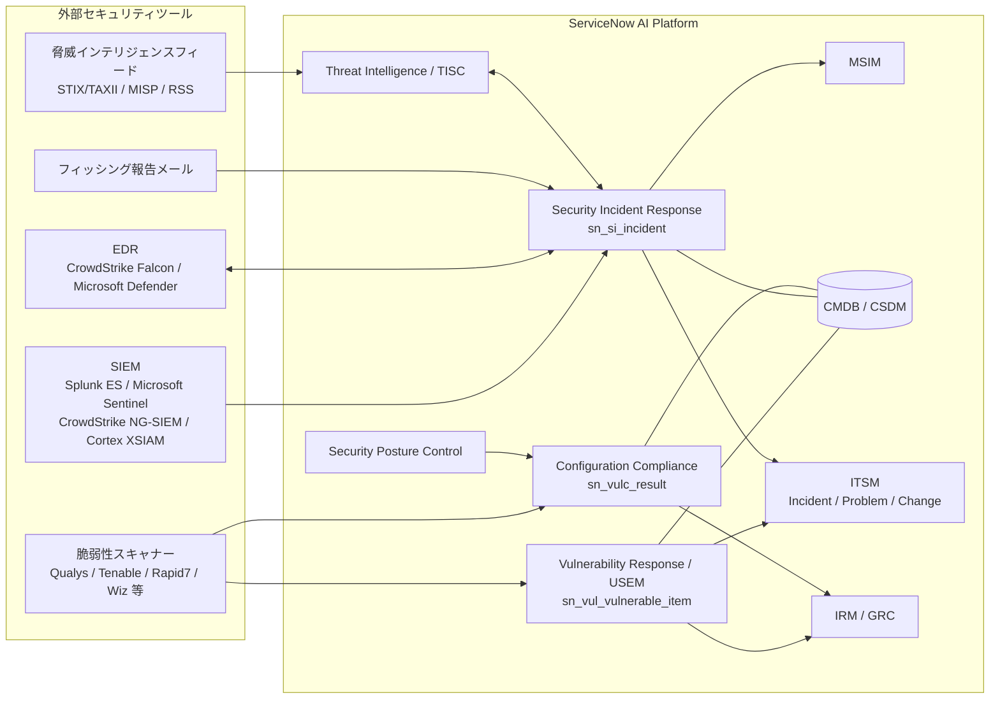
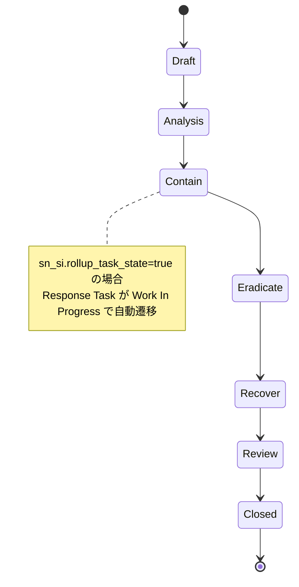
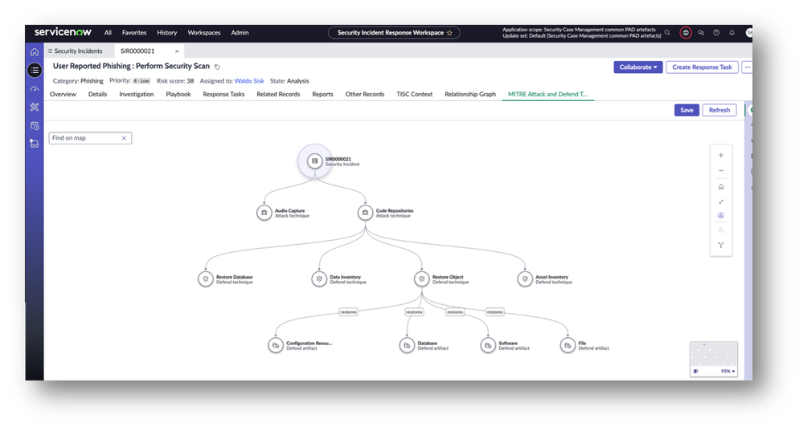
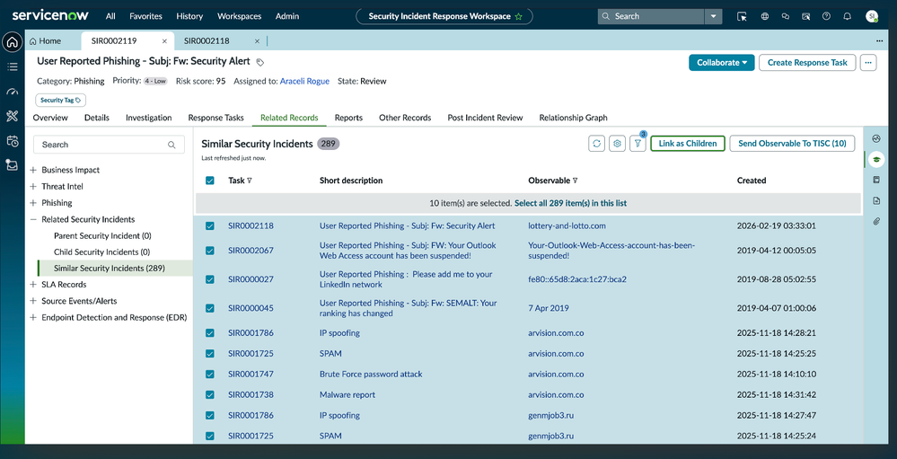
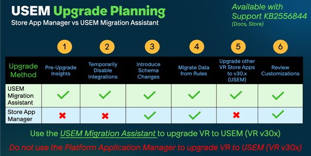
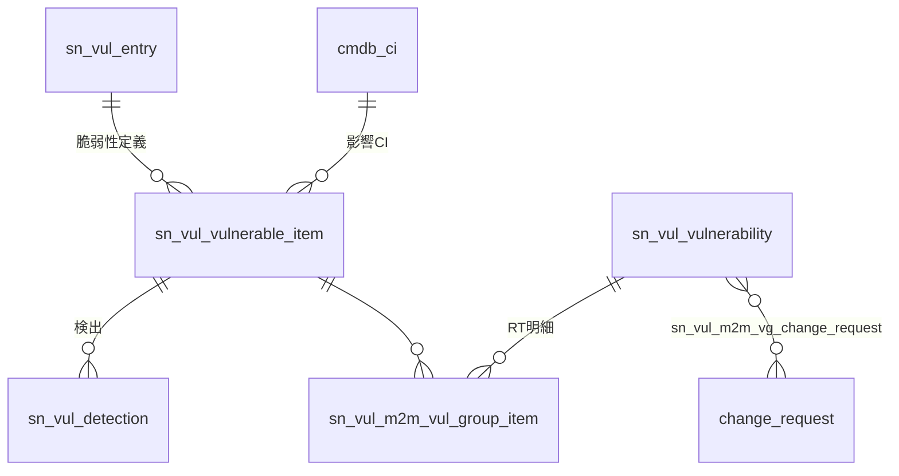
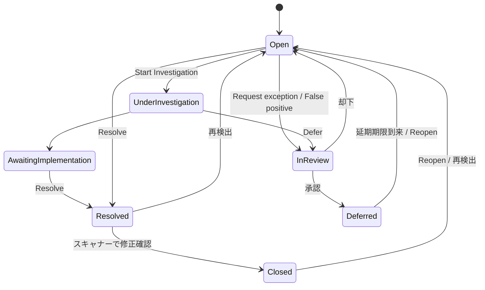

# Security Operations (SecOps)（セキュリティ運用）

## 概要

**Security Operations（SecOps、セキュリティ運用）** は、ServiceNow AI Platform 上でセキュリティチーム（SOC、脆弱性管理チーム、CISO 組織）の業務をワークフロー化する製品群である。SecOps は検知そのもの（SIEM/EDR/スキャナー）を自前で行う製品ではなく、外部のセキュリティツールが出したアラート・検出結果を取り込み、**CMDB とビジネス影響に基づいて優先順位付けし、IT 部門へのタスク割り当て・変更管理・追跡・報告までを一気通貫で管理する**「対応（Response）とオーケストレーション」の層を担う。[出典](https://www.servicenow.com/community/secops-articles/faqs-for-security-operations/ta-p/2316260)

SecOps の主要アプリケーションは次のとおりである。

| アプリケーション | 英語略称 | 役割（日本語） | 主テーブル | スコープ／ロール接頭辞 |
|---|---|---|---|---|
| Security Incident Response | SIR | セキュリティインシデント対応 | `sn_si_incident` | `sn_si` |
| Major Security Incident Management | MSIM | 重大セキュリティインシデント管理（War room） | — | `sn_msi` |
| Vulnerability Response | VR | インフラ脆弱性対応 | `sn_vul_vulnerable_item` | `sn_vul` |
| Application Vulnerability Response | AVR | アプリケーション脆弱性対応（SAST/DAST 等） | — | `sn_vul`（`app_*` ロール） |
| Container Vulnerability Response | CVR | コンテナ脆弱性対応 | — | `sn_vul_container` |
| Configuration Compliance | CC | 構成コンプライアンス（CIS ベンチマーク等） | `sn_vulc_result` | `sn_vulc` |
| Unified Security Exposure Management | USEM | VR/AVR/CVR/CC を統合したエクスポージャー管理（VR v30.x） | — | — |
| Threat Intelligence | TI | 脅威インテリジェンス（IoC リポジトリ） | `sn_ti_observable` 等 | `sn_ti` |
| Threat Intelligence Security Center | TISC | STIX 2.1 ベースの次世代脅威インテリジェンス基盤 | `sn_sec_tisc_*` | `sn_sec_tisc` |
| Security Posture Control | SPC | セキュリティツールのカバレッジ不足・資産可視化 | （CC の Test Result として出力） | — |
| Now Assist（ServiceNow Otto）for SecOps | — | 生成 AI スキル・AI エージェント | — | — |

**配布形態：** SecOps アプリケーションとその連携（インテグレーション）は、Madrid リリース以降 **ServiceNow Store から配布**される（プラットフォームのファミリーリリースとは別のバージョン番号を持つ）。利用前にエンタイトルメント（ライセンス）を確認し、Store からダウンロード・有効化する必要がある。[出典](https://www.servicenow.com/docs/r/zwMwt0JEh8FTHmrqXNjCAw/igd_fiyg21Ko2Xdn4u7f8Q)

> **本ファイルの基準:** Australia（2026-05 GA）。ただし SecOps アプリは Store 配布で月次〜四半期ごとに更新されるため、本文ではアプリのバージョン（例：SIR 14.x、VR 26.x / 30.x）も併記する。Brazil での変更点は「> **Brazil での変更:**」で併記する。

関連ファイル：
- 製品群全体の位置付け → [製品ポートフォリオ一覧](../../01_入門編/03-product-portfolio.md)
- インスタンス自体のセキュリティ（Security Center、ハードニング） → [プラットフォームセキュリティと暗号化](../platform/platform-security-encryption.md)
- GRC・リスク管理との連携 → [Integrated Risk Management (GRC)](../irm/integrated-risk-management.md)
- CMDB → [CMDB と CSDM](../platform/cmdb-csdm.md)、資産取り込み → [Service Graph Connectors](../itom/service-graph-connectors.md)
- ライセンス → [ライセンスモデル](../../03_導入編/01-licensing-model.md)、[価格情報](../../03_導入編/02-pricing.md)

---

## 1. SecOps 全体アーキテクチャ

SecOps の各アプリケーションは、共通基盤（Security Support Common / `sn_sec_cmn`、Vulnerability Response Common / `sn_vul_cmn`）と CMDB を共有する。外部ツールからの取り込みは主に「インテグレーション（Store アプリ）」「Import Set API」「Event Management」「IntegrationHub スポーク」を経由する。

[出典](https://www.servicenow.com/docs/r/x8~ohSTeWLioGLVI5x3Vgg/CAr14Q4UAkAqdObnfk6HNw)、[出典](https://www.servicenow.com/docs/r/security-management/spc-overview.html)

### 1.1 ベースシステムが提供するインテグレーションの種類

Security Operations のベースシステムは、以下 6 種類のインテグレーション方式を提供する（Australia）。[出典](https://www.servicenow.com/docs/r/x8~ohSTeWLioGLVI5x3Vgg/CAr14Q4UAkAqdObnfk6HNw)

| インテグレーション種別 | 用途 | 代表例 |
|---|---|---|
| Security Incident Response — Event Management integration | Event Management のイベントを解析して Security Incident を自動生成（SIEM 連携） | 各種 SIEM |
| Security Incident Response — Import Set API integration | Import Set API 経由で外部ツールが Security Incident を作成 | Splunk |
| Threat Intelligence — lookup source integration | Observable（IoC）の照会・エンリッチメント | マルウェアスキャン、レピュテーション照会 |
| Threat Intelligence — threat source integration | 脅威フィードの取り込み | STIX/TAXII フィード |
| Vulnerability Response — scanner invocation integration | ServiceNow からスキャナーに再スキャン等を指示 | Qualys Cloud Platform |
| Vulnerability Response — data integration | スキャナーの検出結果を VR に取り込む | Qualys、Tenable、Rapid7 等 |

### 1.2 Setup Assistant（セットアップアシスタント）

**Setup Assistant** は SIR・VR の初期設定をガイドする画面である。完全なアクセスには `sn_secops_setup.admin` ロールが必要で、`sn_si.admin` を持つユーザーはこれを継承する。Setup Assistant は「SIR Admin」「VR Admin」「VR/SIR Admin」「System Admin」の 4 段階のアクセスレベルを持つ。各ステップの完了状況は `sn_secops_setup_status` テーブル（Setup Status）で管理され、その `key`・`complete` フィールドは読み取り専用である。[出典](https://www.servicenow.com/docs/r/x8~ohSTeWLioGLVI5x3Vgg/EjEx2i4_BJB~IAh6cy32sQ)

SIR 側の Setup Assistant の主なステップ：

| # | ステップ | 必要ロール | メニュー／補足 |
|---|---|---|---|
| 1 | Process Definition（プロセス定義）の作成・選択 | `sn_si.admin`（選択は `admin` / `sn_si.admin`） | All > Security Incident > Administration > Process Definition。既定は NIST Stateful |
| 2 | 不正状態（Invalid states）の修正 | `admin` | 定義変更後に孤立した状態値を一括修正 |
| 3 | Security Incident 用グループ作成とロール付与 | `user_admin` または `sn_si.admin` | Security incident type も設定 |
| 4 | Calculator Group / Calculator（重大度計算）の作成 | `sn_si.admin` | 条件に応じて Severity 等を設定 |
| 5 | SLA 定義 | `sn_si.admin` | 個別インシデントの SLA 補正は `sn_si.basic` |
| 6 | Runbook（公開済みナレッジ記事のリンク） | `sn_si.knowledge_admin` | |
| 7 | Risk score weights（リスクスコアの重み） | `sn_sec_cmn.admin` | 閲覧は `sn_si.read` |
| 8 | Phishing email rules（フィッシングメールルール） | `sn_sec_cmn.write` | All > Security Operations > Email Processing > User Reported Phishing |

VR 側の Setup Assistant では、Vulnerability Response Settings、ペルソナロールの割り当て、Vulnerability Assignment Rules、Remediation Task Rules、Risk Calculators、Remediation Target Rules、スキャナー連携の設定を順に行う（4.6 節「VR の導入手順（Australia）」参照）。

---

## 2. Security Incident Response（SIR、セキュリティインシデント対応）

### 2.1 SIR の概要と処理フロー

**Security Incident Response（SIR）** は、セキュリティインシデントのライフサイクル全体（初期分析 → 封じ込め → 根絶 → 復旧 → 事後レビュー）を管理するアプリケーションである。SIR は NIST のインシデントハンドリングのベストプラクティスに沿ったワークフローを既定で提供し、組織のランブックに合わせてカスタマイズできる。[出典](https://www.servicenow.com/docs/r/x8~ohSTeWLioGLVI5x3Vgg/eyajkubrzs~4YCt1eYwMMg)

SIR の処理フロー（公式ドキュメントの 4 段階）：

| 段階 | 内容 |
|---|---|
| Discovery（検出・起票） | Security Incident フォームからの手動起票、Event Management／アラートルール経由のイベント、外部監視システム、Service Catalog（Security Request）からインシデントを作成 |
| Analysis（分析） | 関連する脆弱性、Incident、Change、Problem、タスク、影響 CI／CI グループをフォーム上で確認。NIST データベースやサードパーティ検知ツールと照合しマルウェア・脆弱性を特定。サービスマップで影響範囲を把握 |
| Containment, Eradication, Recovery（封じ込め・根絶・復旧） | 他部門への Response Task 割り当て、影響システムに対する Problem / Change 作成、SMS・ブリッジコール等のコミュニケーション |
| Review（事後レビュー） | Post-Incident Review（PIR）、ナレッジ記事化、解決レポート自動生成、関係者へのサーベイ自動送信 |

[出典](https://www.servicenow.com/docs/r/x8~ohSTeWLioGLVI5x3Vgg/eyajkubrzs~4YCt1eYwMMg)

**Administrator lockdown（管理者ロックダウン）：** SIR は機密性確保のため、セキュリティ専用ロールと ACL によりアクセスを制限する。システム管理者（`admin`）はユーザーの偽装（Impersonate）は可能だが、SIR アプリケーション管理者ロールで付与される機能（セキュリティインシデントやプロファイル情報）にはアクセスできず、そのロールを持つユーザーのパスワードも変更できない。[出典](https://www.servicenow.com/docs/r/x8~ohSTeWLioGLVI5x3Vgg/eyajkubrzs~4YCt1eYwMMg)

SIR の主要用語：

| 用語（英語） | 日本語 | 説明 |
|---|---|---|
| Active | アクティブ | Closed / Cancelled 以外の状態のインシデント |
| Inbound security requests | セキュリティリクエスト | カタログ経由の低影響リクエスト（新しい入館証など）。`sn_si_request` |
| Response tasks | 対応タスク | 脅威への対応アクションを追跡するタスク。`sn_si_task` |
| Security incident calculators | 計算ルール | 条件一致時にレコード値（重大度等）を更新 |
| Security incident treemaps | ツリーマップ | 階層データを入れ子の矩形で表示するチャート |
| Threat lookup | 脅威照会 | ファイル・URL・IP をマルウェアスキャンするカタログ要求 |
| Vulnerability scan | 脆弱性スキャン | Security Incident フォームから影響 CI のスキャンを起動 |
| Post incident review (PIR) | 事後レビュー | 発生原因と対応内容を記録した事後レポート |

### 2.2 SIR の状態値（State）とプロセス定義

SIR の状態遷移は **Process Definition（プロセス定義、`sn_si_process_definition`）** で制御される。既定のプロセス定義は **NIST Stateful** で、スクリプトインクルード名が空または不正な場合も `ProcessDefinition_NIST_Stateful` が使われる。管理者は `sn_si` スコープのスクリプトインクルードでカスタムプロセス定義を作成できる。[出典](https://www.servicenow.com/docs/r/x8~ohSTeWLioGLVI5x3Vgg/EjEx2i4_BJB~IAh6cy32sQ)

| プロセス定義 | 方向性 | 説明 |
|---|---|---|
| NIST Stateful（既定） | 一方向（Unidirectional） | 状態を前方にのみ順に進める。ステップのスキップ不可 |
| NIST Open | 双方向（Bidirectional） | 前後どちらにも遷移可（例：Analysis → Draft） |

**Security Incident（`sn_si_incident`）の状態（NIST Stateful）：**

| State | 日本語 | 意味 |
|---|---|---|
| Draft | 下書き | 起票者が情報を追記中で、まだ対応可能な状態ではない |
| Analysis | 分析 | 割り当て済みで分析中 |
| Contain | 封じ込め | 問題が特定され、被害の封じ込め・最小化を実施中 |
| Eradicate | 根絶 | 封じ込め済みで、原因の除去を実施中 |
| Recover | 復旧 | 解決済みで、影響システムの正常稼働を確認中 |
| Review | レビュー | 対応完了・システム正常だが、事後レビューが未完了 |
| Closed | クローズ | 完了。クローズ前に Closure Information タブの入力が必須 |

（Cancelled も Active の定義上存在する。数値の state 値はインスタンスの Dictionary で確認すること。公開ドキュメントでは数値は確認できず。）

**Security Incident Response Task（`sn_si_task`）の状態：** Ready → Assigned → Work In Progress → Complete（または Canceled）。システムプロパティ `sn_si.rollup_task_state`（既定 `true`）が有効な場合、Response Task が Work In Progress になると親インシデントの状態が Contain に進む。[出典](https://www.servicenow.com/docs/r/x8~ohSTeWLioGLVI5x3Vgg/EjEx2i4_BJB~IAh6cy32sQ)、[出典](https://www.servicenow.com/docs/r/x8~ohSTeWLioGLVI5x3Vgg/Ggj2k2A3Ycyj_BpBcgz1tA)

> 実務注記：NIST Stateful では Review から Contain へ戻すことができないため、差し戻し運用が必要な組織は NIST Open の採用やカスタム定義を検討する。【第三者情報】[出典](https://www.servicenow.com/community/secops-forum/nist-state-for-security-incident-response/m-p/3454359)

### 2.3 SIR のロール

SIR のロールは Australia の「Components installed with Security Incident Response」で以下のとおり定義されている。[出典](https://www.servicenow.com/docs/r/x8~ohSTeWLioGLVI5x3Vgg/Ggj2k2A3Ycyj_BpBcgz1tA)

| ロール名（英語ラベル） | ロール | 権限概要 | 主な内包ロール |
|---|---|---|---|
| Security Incident Administrator | `sn_si.admin` | SIR データ全体のフルコントロール（テリトリー、スキル含む） | `sn_si.analyst`、`sn_si.manager`、`sn_si.knowledge_admin`、`sn_si.ingestion_profile_admin`、`sn_sec_cmn.admin`、`sn_secops_setup.admin`、`sn_ti.observable.admin`、`flow_designer`、`pd_author`、`user_admin` ほか |
| Profile Admin | `sn_si.ingestion_profile_admin` | Splunk / Splunk ES / Azure Sentinel 連携のプロファイル管理 | — |
| Security Incident Analyst | `sn_si.analyst` | インシデント、リクエスト、タスク、Problem、Change、Outage の管理 | `sn_si.basic`、`sn_msi.promoter`、`sn_msi.proposer`、`awa_agent`、`pd_operator`、`snc_platform_rest_api_access` |
| Security Incident Basic | `sn_si.basic` | インシデント・リクエスト・タスクの作成／更新の基本権限 | `sn_si.read`、`sn_sec_cmn.write`、`sn_ti.read`、`sn_ti.observable.read/write`、`task_editor`、`pa_viewer` ほか |
| Chief Information Security Officer (CISO) | `sn_si.ciso` | CISO ダッシュボードの閲覧・編集 | `sn_si.basic`、`sn_si.read`、`pa_viewer` |
| Security Incident External | `sn_si.external` | 自グループに属するインシデントのみ閲覧（外部委託先等） | `service_fulfiller` |
| Security Incident Integration User | `sn_si.integration_user` | 外部ツールからのインシデント作成・更新 | `import_transformer` |
| Security Incident Knowledge Administrator | `sn_si.knowledge_admin` | セキュリティインシデント用ナレッジベースの管理 | `knowledge_admin`、`sn_si.read` |
| Security Incident Manager | `sn_si.manager` | アナリストと同等のアクセス＋マネージャ機能 | `pd_author`、`pd_operator`、`sn_si.basic` |
| Security Incident Read | `sn_si.read` | セキュリティインシデントの読み取り | `sn_sec_cmn.read`、`sn_ti.observable.read`、`workspace_user` ほか |
| Security Restriction Access Manager | `sn_si.restriction_access_manager` | インシデントのフィールド変更制限の適用 | — |
| Security Incident Special Access | `sn_si.special_access` | SecOps 外のユーザーへ特定インシデントへのアクセスを付与 | — |
| Security Special Access Enabler | `sn_si.special_access_enabler` | 同上（付与操作） | — |
| Security Incident Special Access Read Manager | `sn_si.special_access_read_manager` | インシデントの Read access フィールドを管理 | `sn_si.special_access_enabler` |
| Security Incident Special Access Writer Manager | `sn_si.special_access_write_manager` | インシデントの Privileged access フィールドを管理 | `sn_si.special_access_enabler` |
| Secops Setup Assistant Administrator | `sn_secops_setup.admin` | Setup Assistant と REST エンドポイントのフルコントロール | — |

SIR アプリ v14.1.0（2026-06）では TISC ユーザー向けの粒度の細かい read/write ロール、GRC ユーザー向け read ロール、「AI Security and Privacy Incidents」用ロールと ACL が追加され、`sn_si.basic` から `inventory_user` ロールが削除された。[出典](https://www.servicenow.com/docs/r/store-release-notes/store-secops-rn-sir.html)

### 2.4 SIR のテーブル

| ラベル | テーブル | 用途 |
|---|---|---|
| Security Incident | `sn_si_incident` | セキュリティインシデント本体（`task` 拡張） |
| Security Incident Response Task | `sn_si_task` | 対応タスク |
| Security Request | `sn_si_request` | セキュリティリクエスト |
| Security Scan Request | `sn_si_scan_request` | スキャン要求 |
| Security Incident Process Definition | `sn_si_process_definition` | プロセス定義 |
| Security Incident Process Definition Selector | `sn_si_process_definition_selector` | 有効なプロセス定義の選択 |
| Security Incident Calculator / Calculator Group | `sn_si_calculator` / `sn_si_calculator_group` | 計算ルール |
| Severity Calculator | `sn_si_severity_calculator` | 重大度計算 |
| Security Incident Template | `sn_si_incident_template` | インシデントテンプレート |
| Security Incident Response Task Template | `sn_si_task_template` | タスクテンプレート |
| Security Incident Runbook Document | `sn_si_runbook_document` | ランブック文書 |
| Security Incident Attack Vectors | `sn_si_attack_vector` | 攻撃ベクトル |
| Security Incident Audit Log | `sn_si_audit_log` | 監査ログ |
| Security Incident Import | `sn_si_incident_import` | インポートステージング |
| Security Incident Enrichment Firewall / Malware Results / Network Statistics / Running Processes / Running Services | `sn_si_enrichment_firewall` / `sn_si_enrichment_malware` / `sn_si_enrichment_network_statistics` / `sn_si_enrichment_running _processes`（ドキュメント上の表記のまま） / `sn_si_enrichment_running_service` | エンリッチメントデータ |
| Security Incident Related Enrichment Data | `sn_si_m2m_incident_enrichment` | インシデントとエンリッチメントの M2M |
| Security Incident Email Search | `sn_si_m2m_incident_email_search` | メール検索結果 |
| Security Incident Related Customer Service Case | `sn_si_m2m_incident_customerservice_case` | CSM ケースとの関連 |
| Task Affected User | `sn_si_m2m_task_affected_user` | 影響ユーザー |
| Post Incident Review Assignment Rule | `sn_si_pir_condition` | PIR 割り当てルール |
| News Feed Configuration | `sn_si_feed_configuration` | ニュースフィード設定 |
| Template Workflow Activity Outcome Evaluator | `sn_si_wf_activity_outcome_evaluator` | ワークフロー活動の結果評価 |
| Setup Status | `sn_secops_setup_status` | Setup Assistant の進捗 |

[出典](https://www.servicenow.com/docs/r/x8~ohSTeWLioGLVI5x3Vgg/Ggj2k2A3Ycyj_BpBcgz1tA)

> `sn_si_incident` は ITSM の `incident` テーブルとは別のテーブルであり、両者の継承関係はない（どちらも `task` を拡張）。ITSM の Incident / Problem / Change とは関連レコードとしてリンクする。詳細は [Incident Management](../itsm/incident-management.md) を参照。

### 2.5 SIR のシステムプロパティ

| プロパティ | 既定値 | 説明 |
|---|---|---|
| `sn_si.rollup_task_state` | `true` | Response Task が Work In Progress になるとインシデントを Contain に進める |
| `sn_si.risk.score.green` / `.orange` / `.red` | 0–49 / 50–79 / 80–100 | リスクスコアの色帯（リストのドット表示） |
| `sn_si.enable_sighting_search` | `true` | 有効化済み連携での Sighting search（IoC 目撃検索）を有効化 |
| `sn_si.sighting_search_raw_data_rows` | 50（0–100） | Sighting search ごとに保存する生データ行数 |
| `sn_si.associate_ci_with_sighting_search` | `true` | Sighting search 結果を CMDB CI に関連付け |
| `sn_si.link_dest_ip` | 除外 | Destination コンテキストの Observable を CI / 影響ユーザー関係に含めるか |
| `sn_si.popup` | `true` | インシデントから Problem / Change 作成時にポップアップを開く |
| `sn_si.default.start.time` / `sn_si.default.end.time` | 08:00 / 17:00 | スケジュール未設定時のアナリスト稼働時間（自動割り当て用） |
| `sn_si.location.weight` / `sn_si.skills.weight` / `sn_si.timezone.weight` | 各 10 | 自動割り当ての重み（場所／スキル／タイムゾーン） |
| `sn_si.max.agents.processed` | 100（上限 300） | 自動割り当て 1 回あたりの処理アナリスト数 |
| `sn_si.work.spacing` | 0 | タスク終了から次タスクまでの間隔（分） |
| `sn_si.journal_field.html_enabled` | `work_notes`, `comments` | HTML を描画するジャーナルフィールド |
| `sn_si.refresh_impacted.event` | `false` | 影響サービスをバックグラウンドで計算 |
| `sn_si.critical_service.calculator.use_cache` | `false` | Critical service calculator で事前計算済み CI データを使用 |
| `sn_si_aw.defaultCategories` | `sn_ti_m2m_task_observables`, `sn_si_m2m_task_affected_user`, `sn_si_incident` | Relationship Graph タブの既定ノード |

スケジュールジョブ「Lookup Security Incident Observables」が、ユーザー定義のスケジュールで Observable の照会を行う。[出典](https://www.servicenow.com/docs/r/x8~ohSTeWLioGLVI5x3Vgg/Ggj2k2A3Ycyj_BpBcgz1tA)

### 2.6 Security Incident Response Workspace（SIR ワークスペース）

**Security Incident Response Workspace** は SIR アナリスト向けの Next Experience ワークスペースで、Store アプリとして SIR 本体とは別バージョンで提供される（2026-10 時点の最新 1.12.0）。従来の Core UI（UI16）も引き続きサポートされる。[出典](https://www.servicenow.com/docs/r/store-release-notes/store-secops-rn-sir-workspace.html)

SIR ワークスペースのインシデントレコードには、Overview、Details、Investigation、Playbook、Response Tasks、Related Records、Reports、Other Records、TISC Context、Relationship Graph、MITRE Attack and Defend Techniques、Post Incident Review などのタブがある（下図参照）。

- **キャプション：** Security Incident Response Workspace のインシデントレコード「MITRE Attack and Defend Techniques」タブ。
- **画面説明：** 上部の Unified Navigation 中央にワークスペース名「Security Incident Response Workspace」。レコードヘッダーに件名（User Reported Phishing : Perform Security Scan）、Category: Phishing、Priority: 4 - Low、Risk score: 38、Assigned to、State: Analysis が並び、右上に「Collaborate」「Create Response Task」ボタン。タブ行は Overview / Details / Investigation / Playbook / Response Tasks / Related Records / Reports / Other Records / TISC Context / Relationship Graph / MITRE Attack and Defend Techniques。本文はグラフ表示で、中心のセキュリティインシデント（SIR0000021）から Attack technique（Audio Capture、Code Repositories）が分岐し、さらに D3FEND の Defend technique（Restore Database、Data Inventory、Restore Object、Asset Inventory）と Defend artifact（Configuration Resource、Database、Software、File）へ「restores」関係で展開される。右上に Save / Refresh、右側にズーム等の操作パネル。
- **出典：** ServiceNow Community「Key features released in Q1 2026 for Security Incident Response」 https://www.servicenow.com/community/secops-articles/key-features-released-in-q1-2026-for-security-incident-response/ta-p/3518413 （取得日：2026-11-03）

- **キャプション：** Related Records タブで類似セキュリティインシデントを選択し、親インシデントへ一括リンクする画面。
- **画面説明：** ヘッダーは User Reported Phishing - Subj: Fw: Security Alert、Category: Phishing、Priority: 4 - Low、Risk score: 95、State: Review。左ペインに関連レコードの分類ツリー（Business Impact、Threat Intel、Phishing、Related Security Incidents〔Parent / Child / Similar Security Incidents (289)〕、SLA Records、Source Events/Alerts、Endpoint Detection and Response (EDR)）。右ペインは「Similar Security Incidents」リストで、列は Task / Short description / Observable / Created。上部に「Link as Children」「Send Observable To TISC (10)」ボタンがあり、複数行を選択して子インシデントとしてリンクできる。
- **出典：** 同上 https://www.servicenow.com/community/secops-articles/key-features-released-in-q1-2026-for-security-incident-response/ta-p/3518413 （取得日：2026-11-03）

SIR ワークスペースの主な機能追加（Store リリースノートより）：

| バージョン | 時期 | 主な追加機能 |
|---|---|---|
| 1.7.0 | 2025-02 | Executive Summary / Analyst Report テンプレート、会議通話（Zoom / Teams / WebEx）、Relationship Graph ビジュアライザー |
| 1.7.9 | 2025-05 | オンコールスケジューリング、Relationship Graph の管理設定 |
| 1.7.21 | 2025-08 | 一括クローズ（Bulk Closure） |
| 1.7.41 | 2025-11 | クローズ後の添付ファイル変更制限、一部ページへのシステム管理者直接アクセスを削除 |
| 1.8.0 | 2025-12 | Vulnerability Manager Workspace からの「Create security incident」、AWA Inbox |
| 1.8.3 | 2026-01 | MITRE ATT&CK D3FEND 関係グラフ |
| 1.8.5 | 2026-03 | Response Task からのメール作成、既定ランディングタブ設定、Quick Filters 設定、リスト自動更新 |
| 1.9.0 | 2026-04 | TISC Context タブで脆弱性・関連インテリジェンス表示 |
| 1.9.1 | 2026-06 | Advanced Timeline（相関セキュリティデータ） |
| 1.10.1 | 2026-09 | MITRE ATLAS フレームワーク統合 |
| 1.12.0 | 2026-10 | 修正のみ（Create Incident / Create Problem モーダルから Priority を削除） |

[出典](https://www.servicenow.com/docs/r/store-release-notes/store-secops-rn-sir-workspace.html)

### 2.7 SIR アプリのバージョン履歴（2025〜2026）

| バージョン | 時期 | 主な変更 |
|---|---|---|
| 13.6.4 | 2025-02 | Teams / Zoom / WebEx 会議通話、日次ステータスメール、各種連携の Flow Designer 移行 |
| 13.6.5 | 2025-03 | Close Security Incident の生成 AI 対応 |
| 13.6.6 | 2025-05 | 検知時刻（detection time）フィールド追加、「Run Orchestration」UI アクション削除 |
| 13.9.0 | 2025-08 | 一括クローズ、シフト引き継ぎ（shift handover）、複数 ITSM レコードのリンク、ユーザープレゼンス |
| 13.9.23 | 2025-12 | クローズ後の添付制限、サードパーティリスクスコアリング、NIST ベースの優先度付け、パターンベースのフィッシング allow/deny ルール |
| 13.9.33 | 2026-02 | `user_admin` なしで非セキュリティグループを管理可能に |
| 14.0.1 | 2026-03 | 「Link as Children」UI アクション、未照合の影響ユーザー対応 |
| 14.1.0 | 2026-06 | TISC 用粒度ロール、GRC 用 read ロール、AI Security and Privacy Incidents ロール |
| 14.1.2 | 2026-07 | 外部ユーザーが Response Task からインシデントを開ける |
| 14.4.0 | 2026-09 | ITIL ユーザーへの「Create Security Incident」UI アクション表示を制限 |
| 14.4.4 | 2026-10 | Closed / Canceled のインシデントを以降の編集から保護 |

[出典](https://www.servicenow.com/docs/r/store-release-notes/store-secops-rn-sir.html)

Australia 時点（2026 年 Q1）での SIR の主な機能追加（Community 公式記事）：MITRE D3FEND 統合、重複ユーザー生成の不具合修正、複数値選択可能な Quick filters、インシデントの一括リンク、外部ユーザーへの読み取り専用共有、インシデントリストの自動更新（システムプロパティで間隔指定）、Microsoft Sentinel の Defender ポータル移行への対応、**AI-Powered Integration Builder** の GA（LLM が対象ツールの REST API ドキュメントを読み、連携のドラフトを生成）。[出典](https://www.servicenow.com/community/secops-articles/key-features-released-in-q1-2026-for-security-incident-response/ta-p/3518413)

> **Brazil での変更:** SIR に **MITRE ATLAS** フレームワーク（プロンプトインジェクション、モデルポイズニング等 AI/ML 固有の脅威）が追加され、MITRE ノードマップ・タイムライン・MITRE 情報カードで ATLAS テクニックが別アイコン表示される（設定は Threat Intelligence Properties ページ）。会話形式でセキュリティインシデントデータを分析する「Analyze security incident data」、AI 機能の効果を測る「Security Incident AI ROI Summary」ダッシュボード、Cortex XSIAM のフィールドマッピング（Incident ID 指定、SIR to XSIAM Mapping パネル）も追加。Security Incident Response Process Mining Content Pack（`com.sn_sir_process_mining_cp`）は廃止され、コアの Process Mining Content Pack に置き換え（自動インストール、対応不要）。[出典](https://www.servicenow.com/docs/r/release-notes/secops-sir-rn.html)

### 2.8 フィッシング対応（User Reported Phishing）

SIR は、ユーザーが報告したフィッシングメールを専用メールボックス経由で取り込み、セキュリティインシデントを自動作成する機能を持つ。メールルール（Phishing email rules）は All > Security Operations > Email Processing > User Reported Phishing で定義し、`sn_sec_cmn.write` ロールが必要。SIR 13.9.23（2025-12）でパターンベースの allow/deny ルールが追加された。[出典](https://www.servicenow.com/docs/r/x8~ohSTeWLioGLVI5x3Vgg/EjEx2i4_BJB~IAh6cy32sQ)、[出典](https://www.servicenow.com/docs/r/store-release-notes/store-secops-rn-sir.html)

### 2.9 Major Security Incident Management（MSIM、重大セキュリティインシデント管理）

**Major Security Incident Management（MSIM）** は、ランサムウェア等の重大インシデント時に経営層・法務・広報を含めた War room 型の対応を行う Store アプリである。セキュリティインシデントを MSI として「Propose（提案）」または直接「Promote（昇格）」でき、昇格すると Major Security Incident レコード（状態 Accepted）になる。MSI 作成後に追加の SIR をリンクできる。設定は All > Major Security Incident Management > MSI Administration > Configurations。Microsoft Teams 等のチャットチャネル、File Explorer（FE）と連携する。[出典](https://www.servicenow.com/docs/r/zwMwt0JEh8FTHmrqXNjCAw/dsm3ThU0RNTPTvFCekAPPw)、[出典](https://www.servicenow.com/docs/r/zwMwt0JEh8FTHmrqXNjCAw/1mGA01XSoFnOOefw481dVg)

| ロール | 名称 | 権限 |
|---|---|---|
| `sn_msi.workspace_admin` | MSI Administrator | MSIM のインストール・設定、依存アプリ（File Explorer）、Teams・チャットチャネル、ワークスペース、MSI Administration |
| `sn_msi.workspace_manager` | MSI Manager | 設定ページ閲覧（変更不可）、Details / Collaboration / Task Organizer タブでの編集、MSI への昇格、File Explorer 操作、レコードのリンク |
| `sn_msi.workspace_responder` | MSI Responder | 任意ロール。Details / Tasks タブでの閲覧・編集・対応、レコードのリンク |
| `sn_msi.proposer` / `sn_msi.promoter` | — | `sn_si.analyst` に内包される MSI 提案／昇格権限 |

MSIM のタイムラインカテゴリ（ベースシステム）は Custom、Response、Threat。MSIM Workspace には Zero-day Vulnerability Playbook がある（`sn_msi.workspace_manager` が必要）。[出典](https://www.servicenow.com/docs/r/zwMwt0JEh8FTHmrqXNjCAw/dsm3ThU0RNTPTvFCekAPPw)、[出典](https://www.servicenow.com/docs/r/oSH5i53rTg~e09IL9MtC6g/lUjVcerYT7KIbXAsabspBw)

---

## 3. プレイブックと SOAR 機能

### 3.1 ServiceNow における SOAR の位置付け

ServiceNow は「SOAR」という独立製品名を前面に出していないが、SIR が **Playbook（Process Automation Designer ベース）**、**Workflow Studio / Flow Designer**、**IntegrationHub スポーク**、**Sighting search / エンリッチメント**、**EDR 連携による封じ込めアクション** を組み合わせることで、SOAR（Security Orchestration, Automation and Response）相当の機能を提供する。外部の SOAR 製品（Cortex XSOAR 等）とは「インシデント管理・ケース管理の記録系」として双方向連携する構成も一般的である。【経験則】

- ServiceNow の Global Incident Response チームは Flow Designer とオーケストレーションでプレイブックを構築し、顧客向けにも公開した経緯がある。[出典](https://www.servicenow.com/community/secops-articles/playbooks-for-password-spray-endpoint-detection-and-typo/ta-p/2316903)
- SIR 13.6.6（2025-05）で旧来の「Run Orchestration」UI アクションが削除され、13.5.1〜13.6.4 で各連携がワークフロー（旧 Workflow エンジン）から Flow Designer に移行された。[出典](https://www.servicenow.com/docs/r/store-release-notes/store-secops-rn-sir.html)
- Flow Designer / IntegrationHub の詳細は [Workflow Studio / Flow Designer](../platform/flow-designer-workflow-studio.md)、[IntegrationHub](../platform/integrationhub.md) を参照。

### 3.2 SIR Workspace の Playbook

SIR Workspace のプレイブックは、コードを書かずに作成・構成できるフローベースのプレイブックで、インシデントレコードの Playbook タブに表示される。セキュリティインシデントのプレイブックフローは自動実行または手動起動できる。ベースのプレイブックは **Enterprise Security Case Management PAD Commons** アプリケーションの Activity Definition を使用する。[出典](https://www.servicenow.com/docs/r/EWrRf5nZrig8aC6lvNhE7Q/VwHEJCOUlMB9toJGp96G4Q)

ベースシステムのサンプルプレイブック（5 種）：

| プレイブック | 対象 |
|---|---|
| Playbook for Manual Phishing | フィッシング（手動） |
| Playbook for Automated Phishing | フィッシング（自動） |
| Playbook for Manual Malware | マルウェア（手動） |
| Playbook for Automated Malware | マルウェア（自動） |
| Playbook for Failed Login Manual | ログイン失敗（手動） |

[出典](https://www.servicenow.com/docs/r/EWrRf5nZrig8aC6lvNhE7Q/VwHEJCOUlMB9toJGp96G4Q)

### 3.3 自動化を構成する要素

| 要素 | 内容 | 主なテーブル／ロール |
|---|---|---|
| Calculators（計算ルール） | 条件一致時に Severity・Priority 等を設定 | `sn_si_calculator`、`sn_si_severity_calculator` |
| Risk score | 重み付けリスクスコア（Setup Assistant で重み設定） | `sn_sec_cmn.admin` |
| Response task templates | インシデント種別ごとのタスク自動生成 | `sn_si_task_template` |
| Runbooks | ナレッジ記事をインシデント／タスクに紐付け | `sn_si_runbook_document` |
| Auto-assignment | 場所・スキル・タイムゾーンの重みでアナリストを自動割り当て | `sn_si.*.weight` プロパティ |
| Enrichment / Sighting search | SIEM・EDR へ IoC の目撃検索、エンリッチメント結果を保存 | `sn_si_enrichment_*`、`sn_si.enable_sighting_search` |
| Playbooks | PAD ベースのプレイブック | `pd_author` / `pd_operator`（`sn_si.manager` 等に内包） |
| AI-Powered Integration Builder | LLM による連携ドラフト生成（2026 Q1 GA） | — |

[出典](https://www.servicenow.com/docs/r/x8~ohSTeWLioGLVI5x3Vgg/Ggj2k2A3Ycyj_BpBcgz1tA)、[出典](https://www.servicenow.com/community/secops-articles/key-features-released-in-q1-2026-for-security-incident-response/ta-p/3518413)

---

## 4. Vulnerability Response（VR）と Unified Security Exposure Management（USEM）

### 4.1 VR の概要

**Vulnerability Response（VR、脆弱性対応）** は、サードパーティスキャナーの検出結果を取り込み、CMDB の CI と照合して **Vulnerable Item（VI、脆弱性項目）** を作成し、リスクスコアで優先度を付け、**Remediation Task（RT、修正タスク）** に束ねて IT 担当グループへ割り当て、修正の進捗・期限（Remediation Target）・例外（Deferral / False Positive）を管理するアプリケーションである。VR は Change Management と連携して修正のための変更要求を作成できる。[出典](https://www.servicenow.com/docs/r/x8~ohSTeWLioGLVI5x3Vgg/r4txelem41snRcX3bQXe5g)、[出典](https://www.servicenow.com/docs/r/x8~ohSTeWLioGLVI5x3Vgg/gfzl087_DD6DEMX2PTbn1g)

VR ファミリーの関連アプリ：

| アプリ | 対象 |
|---|---|
| Vulnerability Response（VR） | ホスト／インフラの脆弱性 |
| Application Vulnerability Response（AVR） | アプリケーションの脆弱性（SAST / DAST / SCA 等、例：Veracode、Invicti、Wiz） |
| Container Vulnerability Response（CVR） | コンテナイメージの脆弱性 |
| Configuration Compliance（CC） | 構成設定の不備（[5 章](#5-configuration-compliancecc構成コンプライアンス)） |
| Patch Orchestration（パッチオーケストレーション） | サードパーティのパッチ管理ツール（例：Microsoft SCCM）との連携。パッチ・パッチ展開データの参照と適用（テーブル `sn_vul_patch_orch_*`） |
| Exposure Assessment（エクスポージャー評価、Vulnerability Assessment Workspace） | 新規 CVE（CISA KEV 等）に対し、ソフトウェアインストール情報から影響資産を評価（v19.0〜、ロール `sn_vul_analyst.vul_event_manager`、テーブル `sn_vul_exp_by_sw`） |

[出典](https://www.servicenow.com/docs/r/x8~ohSTeWLioGLVI5x3Vgg/0qWAPqOKYi4ApHZD9QaE5w)（Patch Orchestration と Exposure Assessment は「Components installed with Vulnerability Response」に載っているロール・テーブル・スケジュールジョブに基づく。独立したアプリとしての正式名称は公開情報では確認できず）

### 4.2 USEM（Unified Security Exposure Management）への移行

**Unified Security Exposure Management（USEM）** は、VR・AVR・CVR・CC を単一アーキテクチャに統合する仕組みで、**VR v30.x**（2025-12-11 リリース）で提供される。USEM をインストールすると、依存アプリとして **Security Exposure Management Workspace**、**Administration for Security Exposure Management**、**Risk Scoring**、**Exception Management**、**Remediation Task Management** が自動的にインストールされる。[出典](https://www.servicenow.com/docs/r/security-management/sem-workflow.html)、[出典](https://www.servicenow.com/community/secops-articles/essential-information-vr-to-usem-upgrade-guidance/ta-p/3453606)

USEM のワークフロー：

1. **Install and activate** — ServiceNow Store から USEM をインストール
2. **Access the workspace** — Security Exposure Management Workspace を開く
3. **Ingest and correlate** — Qualys、Tenable、Veracode 等のスキャナーから取り込み、インフラ・アプリ・コンテナ・クラウドにまたがる検出結果を重複排除・相関
4. **Prioritize and remediate** — Risk Scoring で重大度を割り当て、検出結果から Remediation Task を起票、統合例外管理
5. **Monitor and report** — ダッシュボード、保存済みフィルター、Watch topic で追跡

[出典](https://www.servicenow.com/docs/r/security-management/sem-workflow.html)

v30.0 以降、Security Exposure Management Workspace の **Administration console** で VR・AVR・CVR・CC の設定を一元管理でき、従来の Vulnerability Manager Workspace / IT Remediation Workspace を置き換える。[出典](https://www.servicenow.com/docs/r/x8~ohSTeWLioGLVI5x3Vgg/r4txelem41snRcX3bQXe5g)

**VR の 2 系統（2026-10 時点）：**

| 系統 | 最新バージョン | 状況 |
|---|---|---|
| Non-USEM（26.x） | 26.9.4（2026-09） | 従来アーキテクチャ。性能改善・修正中心 |
| USEM（30.x） | 30.9.2（2026-10） | 新機能はこちら中心（ルールのプレビュー、Pentest 結果のリンク、認定パートナー連携、Integration Health Diagnostics 等） |

[出典](https://www.servicenow.com/docs/r/store-release-notes/store-secops-rn-vulnerability-response.html)

**移行上の重要事項（Community 公式記事）：**

- **Brazil ファミリーへのアップグレード時は USEM（VR v30.x）が最低サポートバージョン**となる。v30 未満の VR がインストールされたまま Brazil に上げると VR は強制的に v30.x に上がり、その後 USEM Migration Assistant で移行を完了する必要がある。ServiceNow は強制アップグレード前の移行を推奨している。
- **Australia Patch 3m / 4m の既知の問題**：これらのパッチで v30 未満の VR が自動的に USEM へアップグレードされ、ロールバックできない場合がある。VR に留まりたい顧客は適用を避ける必要がある。
- 新規インストールは Application Manager から最新 v30.x をインストール（USEM 依存アプリも同時に入る）。既存 VR は Application Manager を使わず、**USEM Migration Assistant**（KB2556844、要サポートログイン）を使う。
- VR v30.x は **Central Vulnerability Database（CVDB）** Store アプリに依存する。【第三者情報】VR のエンタイトルメントを持つ顧客は追加ライセンスなしで CVDB を利用できる（同記事のコメント欄での ServiceNow 社員の回答。公式ドキュメント・契約条件では未確認）。

[出典](https://www.servicenow.com/community/secops-articles/essential-information-vr-to-usem-upgrade-guidance/ta-p/3453606)

- **キャプション：** USEM Upgrade Planning — Store App Manager と USEM Migration Assistant の比較。
- **画面説明：** 6 つの段階（1 Pre-Upgrade Insights、2 Temporarily Disable Integrations、3 Introduce Schema Changes、4 Migrate Data from Rules、5 Upgrade other VR Store Apps to v30.x (USEM)、6 Review Customizations）を列に並べた比較表。USEM Migration Assistant はすべての段階に対応（チェック）しているのに対し、Store App Manager は 1・2・5 に非対応（×）。下部に「Use the USEM Migration Assistant to upgrade VR to USEM (VR v30x)」「Do not use the Platform Application Manager to upgrade VR to USEM (VR v30x)」と記載。右上に「Available with Support KB2556844」。
- **出典：** ServiceNow Community「Essential Information: VR to USEM Upgrade Guidance」 https://www.servicenow.com/community/secops-articles/essential-information-vr-to-usem-upgrade-guidance/ta-p/3453606 （取得日：2026-11-03）

> **Brazil での変更:** Brazil ファミリーでは VR の最低サポートバージョンが USEM（v30.x）となる（上記）。Brazil のドキュメントでは Application Vulnerability Response から USEM へのアップグレードパスが記載されている。[出典](https://www.servicenow.com/docs/r/security-management/application-vulnerability-response/avr-landing.html)

### 4.3 VR のデータモデル（主要テーブル）

VR のデータは「脆弱性定義（Vulnerability Entry）」「検出（Detection）」「脆弱性項目（Vulnerable Item = CI × 脆弱性）」「修正タスク（Remediation Task）」の 4 層で構成される。

| ラベル | テーブル | 説明 |
|---|---|---|
| Vulnerability Entry | `sn_vul_entry` | 脆弱性定義の基底テーブル |
| National Vulnerability Database Entry | `sn_vul_nvd_entry` | NVD の CVE 定義 |
| Third Party Vulnerability Entry | `sn_vul_third_party_entry` | スキャナーベンダー固有の脆弱性定義（例：Qualys QID） |
| Vulnerability CVEs | `sn_vul_m2m_entry_cve` | サードパーティエントリと CVE の関連 |
| CWE / CWE Weakness 等 | `sn_vul_cwe`、`sn_vul_cwe_weakness` ほか | CWE 定義 |
| Vulnerable Item | `sn_vul_vulnerable_item` | CI × 脆弱性の組（VI / VIT） |
| Vulnerable Item Detection | `sn_vul_detection` | スキャナーによる個々の検出（ポート・プロトコル等） |
| Remediation Tasks | `sn_vul_vulnerability` | 修正タスク（旧称 Vulnerability Group） |
| Remediation Task | `sn_vul_remediation_task` | VR・AVR・CVR・CC（Test result group）の RT を集約するテーブル（v18.0〜）。`sn_vul_vulnerability` の情報を保持し、`sn_vul_vulnerability` をリストで参照できないユーザーも詳細を見られる。Vulnerability Manager Workspace / IT Remediation Workspace から利用 |
| Remediation Task Items | `sn_vul_m2m_vul_group_item` | RT と VI の関連 |
| Remediation Task Change Requests | `sn_vul_m2m_vg_change_request` | RT と変更要求の関連 |
| Remediation Task Rules | `sn_vul_grouping_rule` | RT のグルーピングルール |
| Vulnerability Assignment Rule | `sn_vul_assignment_rule` | 割り当てルール |
| Remediation Target Rule | `sn_vul_ttr_rule` | 修正期限ルール |
| Vulnerability Calculator / Calculator Rule / Risk Rule | `sn_vul_calculator_group` / `sn_vul_calculator` / `sn_vul_calc_risk` | リスク計算 |
| Vulnerability Rollup Calculator | `sn_vul_rollup` | VI から RT へのロールアップ |
| Exception Rule / Exception Management Configuration | `sn_vul_auto_exception_rule` / `sn_vul_exception_config` | 例外管理 |
| Vulnerability State Change Approval | `sn_vul_change_approval` | 状態変更（例外・誤検知）承認 |
| Vulnerability Solution | `sn_vul_solution` | 修正方法（パッチ等） |
| Exploit / Malware Kit | `sn_vul_exploit` / `sn_vul_malware_kit` | エクスプロイト情報 |
| Exposure Assessment | `sn_vul_exp_by_sw` | ソフトウェアベースのエクスポージャー評価 |
| Vulnerability Integration / Run / Run Stats / Log | `sn_vul_integration` / `sn_vul_integration_run` / `sn_vul_integration_stats` / `sn_vul_integration_log` | 連携実行管理 |
| Vulnerability Scanner | `sn_vul_scanner` | スキャナー定義 |
| Severity Map | `sn_vul_severity_map` | スキャナー重大度の正規化 |
| Patch Deployment / Patch Update | `sn_vul_patch_orch_deployment` / `sn_vul_patch_orch_update` | パッチオーケストレーション |
| Usage by CI classes | `sn_vul_licensing_usage_by_ci_classes` | ライセンス使用量 |
| Setup Status | `sn_vul_setup_status` | Setup Assistant 進捗 |

[出典](https://www.servicenow.com/docs/r/x8~ohSTeWLioGLVI5x3Vgg/0qWAPqOKYi4ApHZD9QaE5w)

> **注意：** Remediation Task のテーブルは `sn_vul_vulnerability`（ラベル Remediation Tasks）と `sn_vul_remediation_task`（ラベル Remediation Task）の 2 つがある。公式ドキュメントによると、`sn_vul_vulnerability` は「修正のために整理された VI の集合」で、VR の RT の実体である。`sn_vul_remediation_task` は VR・AVR・CVR・CC の RT を集約するテーブルで、`sn_vul_vulnerability` の情報をワークスペースや閲覧権限の限られたユーザーに提供する。[出典](https://www.servicenow.com/docs/r/x8~ohSTeWLioGLVI5x3Vgg/0qWAPqOKYi4ApHZD9QaE5w) USEM（Remediation Task Management）環境でレポートや連携がどちらを参照すべきかは、導入済みのバージョンで確認すること。なお、両テーブルの使い分けは Community でも議論されている。【第三者情報】[出典](https://www.servicenow.com/community/secops-forum/what-is-the-difference-between-quot-sn-vul-remediation-task-quot/m-p/2412868)

### 4.4 VR のロール（ペルソナロールと粒度ロール）

VR は「ペルソナロール」と、ペルソナに内包される「粒度ロール（granular roles）」の 2 層構成である。ペルソナロールは Setup Assistant から割り当てる。[出典](https://www.servicenow.com/docs/r/x8~ohSTeWLioGLVI5x3Vgg/BxCA02fka1r6NilJdkFO_Q)

**ペルソナロール：**

| ペルソナ | ロール | 説明 |
|---|---|---|
| Vulnerability Admin | `sn_vul.vulnerability_admin`（旧 `sn_vul.admin` は非推奨） | VR アプリとレコードへの完全アクセス。ルール設定、サードパーティ連携のインストール |
| Vulnerability Analyst | `sn_vul.vulnerability_analyst` | VI 修正に関わる全レコードの閲覧・更新（`read_all` / `write_all` を内包） |
| Remediation Owner | `sn_vul.remediation_owner` | 自分または所属グループに割り当てられた脆弱性の修正・更新（`read_assigned` / `write_assigned` を内包。v20.0 以降 `read_all` は含まない） |
| Configuration Item Manager | `sn_vul.ci_manager` | CMDB に存在しない未照合 CI の再分類 |
| Exception Manager | （ドキュメント上ロール名の記載なし） | 例外管理 |

**主な粒度ロール・その他ロール：**

| ロール | 説明 |
|---|---|
| `sn_vul.read_all` / `sn_vul.write_all` | 全 VI・RT の閲覧／編集 |
| `sn_vul.read_assigned` / `sn_vul.write_assigned` | 割り当て分のみ閲覧／編集 |
| `sn_vul.read_group_rules` | Remediation Task Rule の閲覧 |
| `sn_vul.vulnerability_read` / `sn_vul.vulnerability_write` | v10.3 以前の旧ロール（アップグレード顧客は継続利用可） |
| `sn_vul.vulnerability_ciso` | Performance Analytics の CISO ダッシュボード閲覧 |
| `sn_vul.false_positive_approver` | 誤検知（False Positive）申請の承認／却下 |
| `sn_vul.exception_approver` | 例外（Deferral）申請の承認／却下 |
| `sn_vul.delete` | ソースレコード・VI の削除 |
| `sn_vul.view_manager_workspace` | Vulnerability Manager Workspace の閲覧 |
| `sn_vul.vr_import_admin` | スケジュールジョブの実行ユーザー（変更不可） |
| `sn_vul_analyst.vul_event_manager` | 新規脆弱性の評価・影響資産の特定（v19.0、Vulnerability Assessment Workspace） |
| `sn_vul.app_read_all` / `sn_vul.app_write_all` / `sn_vul.app_write_assigned` | AVR の粒度ロール |

[出典](https://www.servicenow.com/docs/r/x8~ohSTeWLioGLVI5x3Vgg/0qWAPqOKYi4ApHZD9QaE5w)、[出典](https://www.servicenow.com/docs/r/x8~ohSTeWLioGLVI5x3Vgg/BxCA02fka1r6NilJdkFO_Q)、[出典](https://www.servicenow.com/docs/r/x8~ohSTeWLioGLVI5x3Vgg/3Wyg8inCahk9bQhHOhrQcw)

VR v30.8.5 で VR ロールから SIR ロールが削除された。[出典](https://www.servicenow.com/docs/r/store-release-notes/store-secops-rn-vulnerability-response.html)

### 4.5 Remediation Task / Vulnerable Item の状態

**Remediation Task の状態（Australia）：**

| State | 日本語 | トリガー | 主なアクション |
|---|---|---|---|
| Open | オープン | 作成時 | Start Investigation、Mark as false positive、Request exception、Resolve、Create Change、Split、Defer |
| Under Investigation | 調査中 | Start Investigation ボタン | Create Security Incident、Create Change、Split、Defer |
| Awaiting Implementation | 実装待ち | Awaiting Implementation ボタン（VR 外へ委譲済み） | Create Change、Split、Defer、Resolve |
| In Review | レビュー中 | 例外・誤検知申請の承認待ち | — |
| Deferred | 延期 | Request Exception（承認後） | Reopen（延期期限で自動再オープン） |
| Resolved | 解決済み | Resolve ボタン | Reopen |
| Closed | クローズ | **スキャナーによる確認**（v23.0 以降 Close ボタンは削除） | Reopen |

- Remediation Owner は VI / RT を **Resolved にしかできない**。スキャナーが修正を確認すると Closed、未修正なら再オープンされる。
- 例外を申請（Request Exception）すると、RT は承認ワークフロー上 In Review になり、承認されるまでクローズできない。承認されると Deferred になり、延期期限（defer date）に再オープンされる。誤検知（False Positive）申請が承認・却下された後の遷移は、このページには書かれていない。
- v23.0 以降、旧「Remediation Task State Approval」ワークフローは非推奨となり、同名の Flow Designer フローに置き換えられた。

[出典](https://www.servicenow.com/docs/r/x8~ohSTeWLioGLVI5x3Vgg/gfzl087_DD6DEMX2PTbn1g)

**VI 状態の決定ルール：** RT の状態は関連する VI の状態を更新する。VI が複数の RT に属する場合、優先順位 **Closed > Deferred > Resolved > In Review > Awaiting Implementation > Under Investigation（> Open）** の最も高いものが VI の状態になる。複数 RT で Deferred の場合は期限が最も遅いものが優先される。手動で状態を設定した VI は RT の状態を自動追従しない。RT が「Closed – Canceled」や「Fixed with Exception」でクローズされた場合、VI の状態は変わらず、他の RT に属していなければ Open に戻ることがある。[出典](https://www.servicenow.com/docs/r/x8~ohSTeWLioGLVI5x3Vgg/nngJCL~cF3g9IbwvUlrXiw)

### 4.6 VR の導入手順（Australia）

1. ServiceNow Store から Vulnerability Response をダウンロードし、インスタンスにインストール（`admin`）。
2. Setup Assistant で Vulnerability Response Settings から設定開始（`sn_vul.vulnerability_admin` または `admin`）。
3. 既定ルールとカルキュレーターを確認：Vulnerability Assignment Rules、Remediation Task Rules、Risk Calculators（Default Risk Calculator が有効）、Remediation Target Rules。
4. サードパーティスキャナーアプリ（例：Qualys Vulnerability）を設定：アカウント情報、インポート設定、スケジュール、CI Lookup Rules。
5. Implementation checklist で結果を検証。性能・構成のベストプラクティスは KB1157979 を参照。

[出典](https://www.servicenow.com/docs/r/x8~ohSTeWLioGLVI5x3Vgg/r4txelem41snRcX3bQXe5g)

### 4.7 リスクスコアとリスクレーティング

VR のリスク計算は **Vulnerability Calculator（`sn_vul_calculator_group`）** と **Calculator Rule（`sn_vul_calculator`）** で行う。カルキュレーターは順に評価され、最初に一致したものが使われる。カルキュレーター内のルールも Order 順に評価され、最初に一致したルールが Risk Score を更新する。対象フィールド（Risk Score）ごとに有効にできるカルキュレーターは 1 つのみ。[出典](https://www.servicenow.com/docs/r/x8~ohSTeWLioGLVI5x3Vgg/3Hl03aogPFrru7chhJttaQ)

| カルキュレーター | 既定 | 内容 |
|---|---|---|
| Default Risk Calculator | 有効 | Default Risk Rule で、脆弱性の重大度、エクスプロイト情報、CI の重要度（Criticality）、CI の外部露出、**EPSS スコア** を重み付けして Risk Score を算出 |
| Vulnerability Severity | 無効 | 正規化した重大度のみから算出（Unknown は 100） |

- **Risk Rating** は、VI テーブルのビジネスルール「Update Risk Rating from Risk Score」により Risk Score 変更時に計算される。
- カルキュレーターは VI 作成時、CI・脆弱性の変更時、「Calculate Risk Score」UI アクション実行時に動作する。スクリプトなしのルールの方が性能影響は小さい。
- Risk Score 変更時のワークノート記録はシステムプロパティ `sn_sec_cmn.risk_score_changes_add_worknotes` で制御（v25.0.3 以降既定で無効）。

| Risk Rating | Risk Score |
|---|---|
| 1 | 90–100 |
| 2 | 70–89 |
| 3 | 40–69 |
| 4 | 1–39 |
| 5 | 0 |

[出典](https://www.servicenow.com/docs/r/x8~ohSTeWLioGLVI5x3Vgg/3Hl03aogPFrru7chhJttaQ)

**EPSS / KEV：** EPSS 連携を有効化すると Vulnerability Entry テーブルに EPSS Score、EPSS Percentile、EPSS Last Modified フィールドが追加され、ロールアップカルキュレーターで CVE からサードパーティエントリへ値が伝播し、日次ジョブで更新される。CISA KEV（Known Exploited Vulnerabilities）はスケジュールジョブ「V19.0: Insert CISA exploited CVE to exposure config」等で取り込まれ、ロール `sn_vul_cisa.configure_intelligence_integration` で設定する。[出典](https://www.servicenow.com/docs/r/aWI6yzr0o7OSh9MJT0Yyxw/0I6HVh3oxvOglZXT2Igh8g)、[出典](https://www.servicenow.com/docs/r/x8~ohSTeWLioGLVI5x3Vgg/0qWAPqOKYi4ApHZD9QaE5w)

**ロールアップ：** Vulnerability Rollup Calculator（`sn_vul_rollup`）は、関連 VI の最大リスク・平均リスク・件数の重み付けで RT のリスクスコアを算出する。[出典](https://www.servicenow.com/docs/r/9rlb2awQeTeY3Z9jGMo5DQ/5sodV0LCKBj9SAFWL8lqYA)

### 4.8 Remediation Target Rules（修正期限ルール）

**Remediation Target Rule（`sn_vul_ttr_rule`）** は、SLA に相当する VI の修正期限を設定するルールである（例：PCI タグの資産は PCI DSS に従い 30 日以内）。

- 複数のルールが一致した場合、**最も厳しい（最短の）期限**が適用される。
- 期限は Deferred / Resolved / Closed 以外の VI でフォーム・リストに表示される。これらの状態の VI は再適用処理から除外される。
- スケジュールジョブ「Evaluate remediation targets」が有効なルールから期限を再計算する。
- ルールを無効化すると、適用済みの期限は未クローズの VI から消去される。削除時はクローズ／延期／解決済みの VI の期限は保持される。
- Australia では、リスクレーティングが変化した場合の期限の扱い（変更日から再計算、リスク上昇時のみ早い期限を維持、など）を管理者が選択できる。期限計算の既定の基準日は Last opened。

[出典](https://www.servicenow.com/docs/r/x8~ohSTeWLioGLVI5x3Vgg/Rk0nNjDmu1fZ7GxcJJ20Jg)

> Remediation Task には SLA を適用できる。SLA 定義は All > Vulnerability Response > Administration > SLA Definitions で管理し（`sn_vul.vulnerability_admin` が必要）、Task SLA は Remediation Task の関連リストに表示される。[出典](https://www.servicenow.com/docs/r/EWrRf5nZrig8aC6lvNhE7Q/sJ4tFH053_kQcc4~oRrn_w)（Brazil 版のページ。Australia 版の同名ページは未確認）
>
> VI の期限には Remediation Target を使う。SLA（`contract_sla`）の対象は `task` を拡張したテーブルなので、VI には適用しないのがベースラインの考え方とされる。【第三者情報】[出典](https://www.servicenow.com/community/for-new-customers-vr-forum-read/vulnerability-response-vulnerable-item-table-not-showing-up-in/m-p/321571)

### 4.9 主なスケジュールジョブとプロパティ

| ジョブ／プロパティ | 内容 |
|---|---|
| Evaluate remediation targets | 修正期限の再計算 |
| Reapply all vulnerability assignment rules | 割り当てルールの再適用 |
| Re-open deferred vulnerability groups / Check Vulnerable Item and Groups Deferment Expiration | 延期期限切れの再オープン |
| Auto-Close Vulnerable Detections | 古い検出の自動クローズ（旧 Auto-close Stale Detections ジョブは 22.1.3 で非推奨） |
| Rerun calculators | リスクカルキュレーターの再実行 |
| Rollup vulnerable item values to vulnerability and group | VI 値のロールアップ |
| V19.0: Run exposure assessment for configured CVEs / Run software exposure | エクスポージャー評価 |
| Close cancel VITs that do not have a CI associated | CI 未関連 VI のキャンセル |
| `sn_sec_rem.rerun_task_rules` | 割り当てルール再実行の有効化（v30.3.3 で `sn_vul.rerun_task_rules` から改名。`true` にする必要あり） |
| `sn_vul.filter_inactive_sw_installs` | エクスポージャー評価で非アクティブなソフトウェアインストールを除外（v22.0〜） |
| `sn_vul_patch_orch.patch_approval_required` | パッチ適用承認の要否 |

v24.0.6 以降、よく使うシステムプロパティは VR アプリの Properties メニューから参照できる。[出典](https://www.servicenow.com/docs/r/x8~ohSTeWLioGLVI5x3Vgg/0qWAPqOKYi4ApHZD9QaE5w)、[出典](https://www.servicenow.com/docs/r/store-release-notes/store-secops-rn-vulnerability-response.html)

### 4.10 VR のワークスペース

| ワークスペース | ペルソナ | 用途 |
|---|---|---|
| Security Exposure Management Workspace（USEM / v30.0 以降） | 全 VR ペルソナ（ロール別に最適化） | VR・AVR・CVR・CC の統合ワークスペース。Administration console、自然言語クエリ（AI） |
| Vulnerability Manager Workspace（従来） | 脆弱性マネージャ・アナリスト | 重大な脆弱性・設定不備の特定と優先度付け、IT への RT 送付 |
| IT Remediation Workspace（従来） | IT スペシャリスト（Remediation Owner） | パッチ、再スキャン、変更要求、例外による修正 |
| Vulnerability Assessment Workspace | 脆弱性イベントマネージャ | エクスポージャー評価、ゼロデイ等の緊急イベント管理 |

[出典](https://www.servicenow.com/docs/r/security-management/vulnerability-response-workspaces/vulnerability-response-workspaces-overview.html)、[出典](https://www.servicenow.com/docs/r/x8~ohSTeWLioGLVI5x3Vgg/r4txelem41snRcX3bQXe5g)

### 4.11 スキャナー連携

VR の連携は Store アプリとして個別に提供され、多くは別途サブスクリプション／インストールが必要。公式ドキュメント・リリースノートで確認できる主な連携先：

| 分類 | 連携先（例） |
|---|---|
| ホスト脆弱性スキャナー | Qualys（Host Detection）、Tenable（Tenable.io / Tenable.sc、エンドポイントスキャン）、Rapid7（InsightVM / Data Warehouse）、Microsoft Defender Vulnerability Management |
| アプリ脆弱性（AVR） | Veracode、Invicti（DAST / IAST）、Wiz Application Vulnerability Response、GitHub |
| クラウド／コンテナ | Prisma Cloud（Prisma Hosts）、Wiz |
| ソリューション情報 | Microsoft Security Response Center（MSRC）、Red Hat Security Advisory、CSAF |
| パッチ管理 | Microsoft SCCM、HCL BigFix |
| インテリジェンス | NVD、CWE、CISA KEV、EPSS |

[出典](https://www.servicenow.com/docs/r/x8~ohSTeWLioGLVI5x3Vgg/0qWAPqOKYi4ApHZD9QaE5w)、[出典](https://www.servicenow.com/docs/r/store-release-notes/store-secops-rn-vulnerability-response.html)

- VI の重複排除は**異なる連携間では行われない**（例：Rapid7 と Qualys の両方が同じ CI・脆弱性を検出すると別 VI）。[出典](https://www.servicenow.com/docs/r/zwMwt0JEh8FTHmrqXNjCAw/Qyarf~b7BO39Hoi3qeZ6vA)
- v30.2.5 / v26.5.3 で `cmdb_ci` を検出の一意性基準に使えるようになった。v30.8.5 で連携プールがノード数に応じて自動スケール。[出典](https://www.servicenow.com/docs/r/store-release-notes/store-secops-rn-vulnerability-response.html)
- スキャナーの資産を CMDB の CI に照合する際は CI Lookup Rules と IRE（Identification and Reconciliation Engine）を用いる。未照合資産は `sn_vul.ci_manager` が再分類する。CMDB 品質の重要性は [CMDB成功の要因](../../04_応用編/05-cmdb-success-factors.md) を参照。

---

## 5. Configuration Compliance（CC、構成コンプライアンス）

### 5.1 CC の概要

**Configuration Compliance（CC）** は、構成評価ツール（SCM ツール、例：Qualys Policy Compliance、Tenable 等）の結果を取り込み、CIS ベンチマーク等の **Configuration Test（構成テスト）** に対する CI ごとの不合格を **Test Result（テスト結果、`sn_vulc_result`）** として管理し、VR と同じ考え方で Remediation Task に束ねて修正・例外管理を行うアプリケーションである。CC は Security Posture Control の検出結果（ツールカバレッジ不足）の出力先にもなる。[出典](https://www.servicenow.com/docs/r/x8~ohSTeWLioGLVI5x3Vgg/fadmNQMIM6~qSzyMzv7sTg)、[出典](https://www.servicenow.com/docs/r/security-management/spc-overview.html)

### 5.2 CC の主要テーブル

| ラベル | テーブル | 説明 |
|---|---|---|
| Test Result | `sn_vulc_result` | CI ごとの構成テスト結果（不合格） |
| Test Result History | `sn_vulc_result_history` | 結果の履歴 |
| Remediation Tasks | `sn_vulc_result_group` | 修正タスク（旧称 Test Result Group） |
| Remediation Tasks (M2M) | `sn_vulc_m2m_result_result_group` | RT と Test Result の関連 |
| Configuration Test | `sn_vulc_test` | 構成テスト定義 |
| Test Groups | `sn_vulc_policy` | テストグループ（旧称 Policy） |
| Policy Configuration Test | `sn_vulc_policy_test` | テストグループとテストの関連 |
| Authoritative Source | `sn_vulc_auth_src` | 準拠基準（CIS 等） |
| Citation | `sn_vulc_citation` | 引用（GRC 連携） |
| Technology / Configuration Test Technology | `sn_vulc_technology` / `sn_vulc_test_technology` | 対象技術 |
| Test Criticality Map | `sn_vulc_test_criticality_map` | テストの重要度マッピング |
| Assignment Rule | `sn_vulc_assignment_rule` | 割り当てルール |
| Remediation Task Rule | `sn_vulc_grouping_rule` | RT ルール |
| Remediation Target Rule | `sn_vulc_ttr_rule` | 修正期限ルール |
| Risk Calculators / Calculator / Risk Score Rollup Calculator | `sn_vulc_calculator_group` / `sn_vulc_calculator_risk_score` / `sn_vulc_risk_score_rollup` | リスク計算 |
| State Change Approval | `sn_vulc_state_change_approval` | 状態変更承認 |
| Change request creation / association | `sn_vulc_action_create_cr` / `sn_vulc_action_associate_cr` | 変更要求作成・関連付け |
| Missing asset table | `sn_vul_missing_asset` | 未照合資産 |

[出典](https://www.servicenow.com/docs/r/x8~ohSTeWLioGLVI5x3Vgg/fadmNQMIM6~qSzyMzv7sTg)

### 5.3 CC のロール

| ロール | 説明 |
|---|---|
| `sn_vulc.admin` | Configuration Compliance 管理者 |
| `sn_vulc.read` / `sn_vulc.write` | 読み取り／書き込み |
| `sn_vulc.write_assignment` | 割り当てフィールドの書き込み |
| `sn_vulc.remediation_owner` | 修正担当 |
| `sn_vulc.import_admin` | CC.System（インポート実行） |
| `sn_vulc.false_positive_approver` / `sn_vulc.exception_approver` | 誤検知／例外の承認 |
| `sn_vulc.auditor`、`sn_vulc.advanced_read`、`sn_vulc.delete`、`sn_vulc.bulk_edit` | 監査・高度な読み取り・削除・一括編集 |
| `sn_vulc.read_task_rules`、`sn_vulc.read_assignment_rules`、`sn_vulc.read_risk_score_configuration`、`sn_vulc.read_auto_close_rules`、`sn_vulc.read_test_criticality_mapping` | 各種ルールの読み取り |
| `sn_vulc.create_watch_topic` / `edit_watch_topic` / `read_watch_topic` | Watch topic（v14.7〜） |
| `sn_vul_cmn.admin`（VRCommon.System）、`sn_sec_cmn.admin`（SecCommon.System） | 共通基盤 |

[出典](https://www.servicenow.com/docs/r/x8~ohSTeWLioGLVI5x3Vgg/fadmNQMIM6~qSzyMzv7sTg)

### 5.4 CC の状態値

**Test Result の状態（優先順位の高い順）：** Closed → Closed（False positive）→ Deferred → Resolved → In Review → Awaiting Implementation → Under Investigation → Open → Closed（Cancelled）→ Closed（Fixed）。サブステートは Fixed、Cancelled、False positive、Result Invalid（v15.0 で非推奨）。単一 RT に属する Test Result は通常 RT の状態に一致する（Fixed / Cancelled でのクローズは例外）。[出典](https://www.servicenow.com/docs/r/zwMwt0JEh8FTHmrqXNjCAw/Nj1~88muBmhJrfSpTgiu7Q)

**CC の Remediation Task の状態：** Open、Under Investigation、In Review、Deferred、Awaiting Implementation、Resolved、Closed。

**バージョン別の変更：**

| バージョン | 変更 |
|---|---|
| v14.9 | 「Test Result Group」→「Remediation Task」、「Group Rules」→「Remediation Task Rules」、「Policy」→「Test group」に名称変更 |
| v14.12 | RT を False positive としてクローズ可能に |
| v15.0 | Close ボタンと Resolve モーダルの Resolution フィールドを削除、Result Invalid サブステートを非推奨化 |
| v15.1.5 | よく使うシステムプロパティを All > Configuration Compliance > Properties から参照可能に |

[出典](https://www.servicenow.com/docs/r/zwMwt0JEh8FTHmrqXNjCAw/Nj1~88muBmhJrfSpTgiu7Q)、[出典](https://www.servicenow.com/docs/r/x8~ohSTeWLioGLVI5x3Vgg/fadmNQMIM6~qSzyMzv7sTg)

- **Auto-Close Stale Test Results：** Closed-Stale にした Test Result がスキャナーで再検出されると再オープンされ Open に戻る。[出典](https://www.servicenow.com/docs/r/aWI6yzr0o7OSh9MJT0Yyxw/wg30VVgdEV6rzmF00~ggPg)
- **割り当てルール：** Test Result がルール条件に一致した時点で割り当ての検索は停止する（最初の一致が優先）。[出典](https://www.servicenow.com/docs/r/aWI6yzr0o7OSh9MJT0Yyxw/2aItp4EuDXCL26BmYkxjdA)
- **実務注記：** `sn_vulc_result` には `nobody` ロールのレコードレベル書き込み ACL があり、手動クローズは想定されていない（RT 経由でロールアップ）。スクリプトで作成した Test Result で RT が自動作成されない場合は `sn_vulc.rerun_group_rules` プロパティを確認する、という報告がある。【第三者情報】[出典](https://www.servicenow.com/community/secops-forum/configuration-compliance-can-not-manually-close-test-results-and/m-p/3525948)、[出典](https://www.servicenow.com/community/secops-forum/remediation-task-in-configuration-compliance-are-not-getting/m-p/3158217)

GRC（IRM）連携：Authoritative Source / Citation により、CC のテスト結果を IRM のポリシー・コントロールの準拠状況（Control Indicator 等）に紐付けられる。詳細は [Integrated Risk Management (GRC)](../irm/integrated-risk-management.md) を参照。

---

## 6. Threat Intelligence と Threat Intelligence Security Center（TISC）

### 6.1 2 つの脅威インテリジェンスアプリ

ServiceNow には、従来の **Threat Intelligence（TI、`sn_ti`）** と、STIX 2.1 ベースで再設計された **Threat Intelligence Security Center（TISC、`sn_sec_tisc`）** がある。どちらも Store から配布される。

| 観点 | Threat Intelligence（TI） | Threat Intelligence Security Center（TISC） |
|---|---|---|
| スコープ | `sn_ti` | `sn_sec_tisc` |
| データモデル | IoC Repository（Observable、Indicator、Attack mode/method） | STIX 2.1 オブジェクト（Threat Entities = SDO、Observables、Indicators、Relationships、Vulnerabilities、Observed Data） |
| 取り込み | Threat Sources、TAXII Profiles（STIX 1.1 / 2.0 / 2.1） | Feed（スケジュール取り込み）、Import Assistant、RSS、TISC Intel Exchange API（STIX 2.1 / MISP） |
| 共有 | — | Outbound TAXII Collections（他 TISC インスタンスへ）、STIX / MISP 共有 |
| 画面 | Core UI（All > Threat Intelligence） | TISC Workspace（Home、Threat Library、Visualizer、Case） |
| MITRE | MITRE-ATT&CK モジュール | MITRE-ATT&CK リポジトリ（Threat Intel Library とは別管理） |

[出典](https://www.servicenow.com/docs/r/x8~ohSTeWLioGLVI5x3Vgg/bf5wVW2WDwbfY01wsvCdPA)、[出典](https://www.servicenow.com/docs/bundle/zurich-security-management/page/product/secops-integration-threat-security-center/concept/observables.html)、[出典](https://www.servicenow.com/docs/r/api-reference/rest-apis/tisc-intel-ex-api.html)

### 6.2 Threat Intelligence（TI）

**ロール：**

| ロール | 名称 | 説明 |
|---|---|---|
| `sn_ti.admin` | Threat Administrator | 脅威プロパティ、SLA、通知のフルコントロール。Attack mode、Indicator、Observable の削除は Threat Administrator のみ |
| `sn_ti.read` | Threat Reader | 脅威情報の読み取り |
| `sn_ti.write` | Threat Writer | 脅威情報の書き込み（削除不可） |
| `sn_ti.mitre_analyst` | MITRE Analyst | MITRE-ATT&CK モジュールと SIR モジュールの読み取り |

**主なメニュー：**

- All > Threat Intelligence > Administration > Properties（API キー、照会動作、非アクティブ閾値）
- All > Threat Intelligence > Sources > Threat Sources（ソース、スケジュール、プロセッサ）
- All > Threat Intelligence > Sources > TAXII Profiles（TAXII プロファイル。各プロファイルに 1 つ以上のコレクション／フィード）
- All > Threat Intelligence > IoC Repository > Observables（Observable を選択して Threat lookup を実行。結果は Threat Lookup Results タブ）

[出典](https://www.servicenow.com/docs/r/x8~ohSTeWLioGLVI5x3Vgg/bf5wVW2WDwbfY01wsvCdPA)、[出典](https://www.servicenow.com/docs/r/9rlb2awQeTeY3Z9jGMo5DQ/Q_VhYsyNmMZHi50sWjo1sA)

**Observable：** Threat scan で IP アドレスやハッシュがマルウェア判定等になった場合、その値は自動的に **Observable（`sn_ti_observable`）** テーブルに追加される。SIR のインシデントとは `sn_ti_m2m_task_observables` で関連付けられる。[出典](https://www.servicenow.com/docs/r/security-management/t_AddObservable.html)、[出典](https://www.servicenow.com/docs/r/x8~ohSTeWLioGLVI5x3Vgg/Ggj2k2A3Ycyj_BpBcgz1tA)

### 6.3 TISC

**ロール：** `sn_sec_tisc.admin`（Threat Intelligence administrator）、`sn_sec_tisc.analyst`（Threat Intelligence analyst）。スクリプト用に `sn_sec_tisc.integration_write`（エンリッチメント連携テーブル）、`sn_sec_tisc.rules_write`（Threat score calculator rule テーブル）、API 用に `sn_sec_tisc.api_obs_read_access` がある。[出典](https://www.servicenow.com/docs/r/x8~ohSTeWLioGLVI5x3Vgg/9Val_WRROG~jAL1iQ7ZsUw)、[出典](https://www.servicenow.com/docs/r/Hl2CblJbxzWNxnQLivjlGg/DplHA1Y7jBkgfbSibAcwig)

**前提プラグイン：**

| プラグイン | ID |
|---|---|
| Security Case Management common workspace components | `com.snc.escm.ws_commons` |
| Threat Intelligence Support Common | `com.snc.threat` |
| Column Level Encryption | `com.glide.encryption` |
| Large JSON and XML Payload Builder API | `com.glide.streaming_builder` |
| Security Support Core | `com.snc.security_support.core` |

**TISC の設定手順（管理者）：** ① Store からインストールしロール付与 → ② データソース（Threat Intelligence Feeds）設定 → ③ Observable のエンリッチメント連携設定（ベースシステムでは事前設定なし）→ ④ Import Intelligence のデータインポート承認設定 → ⑤ Threat Score Calculator 定義（ベースに 1 ルールあり）→ ⑥ Taxonomy 作成 → ⑦ MITRE-ATT&CK リポジトリ設定 → ⑧ TISC プロパティ設定。[出典](https://www.servicenow.com/docs/r/x8~ohSTeWLioGLVI5x3Vgg/9Val_WRROG~jAL1iQ7ZsUw)

**TISC の Observable タイプ：** IPv4 / IPv6、ドメイン名、URL、ファイル・メール成果物、ハッシュ（MD5、SHA1、SHA256、SHA512）、レジストリキー、X.509 証明書など。Observable レコードは Observable Source（`sn_sec_tisc_observable_source`）を拡張したテーブルに格納される。[出典](https://www.servicenow.com/docs/bundle/zurich-security-management/page/product/secops-integration-threat-security-center/concept/observables.html)、[出典](https://www.servicenow.com/docs/r/api-reference/rest-apis/tisc-intel-ex-api.html)

**TISC Intel Exchange API：** 外部インテリジェンス（STIX 2.1 等）を受け取り、Inbound intelligence レコードと Indicator / Object / Observable レコードを作成する REST API。API 全般は [Web Services / REST API](../platform/web-services-api.md) を参照。[出典](https://www.servicenow.com/docs/r/api-reference/rest-apis/tisc-intel-ex-api.html)

Australia へのアップグレードでは、プロパティ `sn_sec_tisc.reporting.email_template_sn_sec_tisc_case` が `sn_sec_tisc.default_report_email_template` に改名された。[出典](https://www.servicenow.com/docs/r/delta-zurich-australia/australia-zurich-threatintelligencesecuritycenter-release-notes.html)

> **Brazil での変更:** TISC に以下が追加：脅威アドバイザリ（PDF・画像）から AI が IoC・脅威アクター・マルウェア・キャンペーンを抽出する **AI-assisted import**、CrowdStrike NextGen SIEM での Sighting search（新プラグイン `sn_sec_cs_sighting`）、CrowdStrike の Premium Threat Feed、SIR ワークスペースから TISC ケースを作らずにエンティティをセキュリティインシデントへリンク（TISC Context タブと双方向同期）、STIX Indicator のパターンから Observable を抽出。CrowdStrike Falcon EDR 連携では Indicator のソースが「TISC Intelligence」となり、Detect に加え Prevent アクションに対応。自動相関ルールが見直され、「Relate Indicators with Objects Based on Common Observables」ルールは削除（既存の関係は保持）。MITRE 取り込みに、新しい ATT&CK バージョンで廃止されたテクニック／タクティクス関連のレビューキューが追加。[出典](https://www.servicenow.com/docs/r/release-notes/secops-tisc-rn.html)

---

## 7. セキュリティポスチャー（Security Posture Control ほか）

### 7.1 Security Posture Control（SPC）

**Security Posture Control（SPC）** は、企業の資産インベントリとセキュリティツールの配備・カバレッジ状況を可視化し、セキュリティポスチャーを評価するアプリケーションである。社内セキュリティ標準への準拠を監視するカスタムポリシーとインサイトを作成でき、脆弱性マネージャは SPC のインサイトを使って高リスク資産の修正を優先できる。SPC は 2 つのアプリで構成され、いずれも ServiceNow Store で別サブスクリプションとして販売される。[出典](https://www.servicenow.com/docs/r/security-management/spc-overview.html)

| コンポーネント | 内容 |
|---|---|
| Asset Security Posture Management（ASPM） | エンドポイント保護、インフラ監視、ネットワーク等の監視カテゴリ別の資産データを比較し、例えば EDR エージェントが入っていない資産を Finding として報告 |
| Mitigation Controls Monitoring | セキュリティツールの構成から、資産に対するどの脅威が緩和されているかを表示（SPC Workspace から利用） |

- **データソース：** Service Graph Connectors（Store で別途提供）、Hardware Asset Management（HAM）、ITOM Discovery が投入する CMDB 資産データ。脆弱性・ツール未導入・インターネット露出の高リスク組み合わせポリシーには、Qualys・Rapid7・Tenable 等のスキャナー連携と Vulnerability Response が必要。
- **出力：** カバレッジ不足は **Configuration Compliance の Finding / Test Result** として報告され、CC の割り当てルールで修正チームに自動割り当てできる。
- **ワークスペース：** SPC Workspace。
- **バージョン（Brazil ドキュメント時点）：** SPC Core v7.1 / v7.0、ASPM v5.5、Mitigation Controls Monitoring v4.2。

[出典](https://www.servicenow.com/docs/r/security-management/spc-overview.html)、[出典](https://www.servicenow.com/docs/r/aWI6yzr0o7OSh9MJT0Yyxw/ZqsMCg~e~sPw0ZiBeOMCMA)

製品ページでは、未管理資産の検出による CIS ベンチマーク準拠支援や 100 以上の標準ポリシーがうたわれている。[出典](https://www.servicenow.com/au/products/security-posture-control.html)

### 7.2 Security Center（インスタンス自体のセキュリティ）との区別

**Security Center** は、SecOps の製品ではなく、**ServiceNow インスタンス自体**のセキュリティポスチャーとコンプライアンスを改善するための Store アプリである（ハードニングベースライン、Security Tasks、Machine Identity Manager / Access Analyzer / Scripting Governance 連携、単一／複数インスタンスのポスチャーダッシュボード、スキャン結果レポート）。2026-09 の v3.5.2 / v3.5.3 でハードニングベースライン バージョン 9 が追加された。詳細は [プラットフォームセキュリティと暗号化](../platform/platform-security-encryption.md) と [セキュリティ強化の実践](../../04_応用編/12-security-hardening-practice.md) を参照。[出典](https://www.servicenow.com/docs/r/C17ZqvSaMwUVpMBg8Nc5sg/Xc6rRhAANZpXSe3qh1FuRQ)

### 7.3 CISO 向けの可視化

- SIR の `sn_si.ciso` ロールで CISO ダッシュボードを閲覧・編集できる。[出典](https://www.servicenow.com/docs/r/x8~ohSTeWLioGLVI5x3Vgg/Ggj2k2A3Ycyj_BpBcgz1tA)
- VR の `sn_vul.vulnerability_ciso` ロールで Performance Analytics の CISO ダッシュボードを閲覧できる。[出典](https://www.servicenow.com/docs/r/x8~ohSTeWLioGLVI5x3Vgg/0qWAPqOKYi4ApHZD9QaE5w)
- Performance Analytics の詳細は [レポートとアナリティクス](../platform/reporting-analytics.md) を参照。

---

## 8. 生成 AI：Now Assist（ServiceNow Otto）for SecOps

### 8.1 名称とティア

SecOps 向け生成 AI は **Now Assist for Security Operations（SecOps）** として Store 配布される。Now Assist for SecOps v6.4.5（2026-08）のリリースノートで「Now Assist を **ServiceNow Otto** に改名」と記載されており、現行ドキュメントでは「ServiceNow Otto for Security Incident Response (SIR)」と表記されている。v6.0.0（2026-04）で生成 AI スキル・エージェント・エージェンティックワークフローの**製品ティア**が導入された。[出典](https://www.servicenow.com/docs/r/C17ZqvSaMwUVpMBg8Nc5sg/gQK~DNy~PjCa5kujWxK8kg)、[出典](https://www.servicenow.com/docs/r/x8~ohSTeWLioGLVI5x3Vgg/Y2ce_RVCYtKdTnaM3q7wZA)

| ティア | 説明（公式） |
|---|---|
| Foundation | AI basics to deliver insights（洞察を提供する AI の基本） |
| Advanced | AI to boost productivity across relevant use cases（関連ユースケースの生産性向上） |
| Prime | Act autonomously with all AI assets, and create your own（全 AI 資産で自律的に動作し、独自作成も可能） |

ティアに対応する Store アプリとして「Security Incident Response - Advanced」「Security Incident Response - Prime」があり、いずれも v1.0.1（2026-04）で提供開始、v1.0.4（2026-05）で現名称に改名、v1.0.10（2026-09）で Brazil 認定。[出典](https://www.servicenow.com/docs/r/C17ZqvSaMwUVpMBg8Nc5sg/FN7P7crDNe_nEeay0LlVuA)、[出典](https://www.servicenow.com/docs/r/C17ZqvSaMwUVpMBg8Nc5sg/deCQ08l5yEenZePh~DPDAQ)

**利用制約：** 一部の AI 機能は FedRAMP、NSC DOD IL5、Australia IRAP-Protected データセンター、セルフホスト等の制限環境では利用できない（KB0743854）。In-country SKU には独自の制限がある（KB1584492）。[出典](https://www.servicenow.com/docs/r/x8~ohSTeWLioGLVI5x3Vgg/Y2ce_RVCYtKdTnaM3q7wZA)

### 8.2 主な生成 AI スキル

| スキル | 内容 | 導入 |
|---|---|---|
| Security incident summarization | インシデントの要約（時系列順・直近の活動を重視：v6.1.2） | 初期 |
| Generate security incident recommended actions | 推奨対応アクションの生成（Now Assist パネルからは不可） | v1.1.2（2024-11） |
| Generate post-incident analysis | 事後分析レポートの生成（Now Assist パネルからは不可） | v1.1.2（2024-11） |
| Close security incident（closure notes） | クローズノートの生成 | SIR 13.6.5（2025-03） |
| Correlation Insights | 関連レコード（CI、変更要求等）の相関インサイト。MCP 経由ではインシデント ID を任意指定可（v6.4.5） | — |
| Evaluate natural language conditions | 自然言語条件の評価 | v4.3.1（2026-03） |
| Quality assessment reports | インシデント対応品質の評価レポート | v4.1.5（2025-12） |

[出典](https://www.servicenow.com/docs/r/C17ZqvSaMwUVpMBg8Nc5sg/gQK~DNy~PjCa5kujWxK8kg)

v6.3.4（2026-07）で全スキルの既定モデルが Now LLM からサードパーティ（3P）モデルに変更された。スキルは AI Admin Hub で有効化・設定する。

### 8.3 エージェンティックワークフローと AI エージェント（Australia）

| エージェンティックワークフロー | 目的 | 使用する AI エージェント |
|---|---|---|
| Close security incident | Now Assist パネルから自然言語でインシデントをクローズ | Security incident wrap-up generator |
| Analyze security operations metrics | SOC マネージャ向けにケース量、MTTA、MTTR を生成 | Security incident retrieval AI agent、Security metrics analysis AI agent |
| Security incident resolution | 解決方針の特定とクローズ | Endpoint Detection and Response AI agent、Exchange online integration handling AI agent、Observable analysis AI agent、Security incident resolution AI agent、Security incident wrap up generator AI agent、Security incident activities handling AI agent |
| Generate SIR Shift Handover Report | シフト引き継ぎレポートの各セクションを生成 | Security incident shift handover AI Agent |

既定でワークフローとエージェントのレコードは読み取り専用で、変更するには複製する。エージェンティックワークフローはロールマスキングでアクセス可能なユーザーを決定する。[出典](https://www.servicenow.com/docs/r/Hl2CblJbxzWNxnQLivjlGg/6JPYJensijedprlRRbQaDw)

**Security incident activities handling AI agent** は、Incident / Change / Problem / Response Task の説明文をドラフトし、ユーザーのレビュー・承認後にのみ作成する。メールもユーザーが宛先・件名・本文を承認してから送信し、依頼に応じて状態を更新する。許可ロール・データアクセスロールとも `sn_si.analyst` が必要。エージェントの個別ページでは、関連ワークフローを「Resolve security incident」と書いている。[出典](https://www.servicenow.com/docs/r/XRgEFx7nPN6ciT_BBIvnbg/IfK5KyPBYH2qfdPShns5GQ)

> **表記について：** 上の表のワークフロー名とエージェント名は、一覧の公式ページ（[出典](https://www.servicenow.com/docs/r/Hl2CblJbxzWNxnQLivjlGg/6JPYJensijedprlRRbQaDw)）の表記に合わせている。公式ドキュメントの中でも表記が揺れている。
> - ワークフロー：一覧ページでは「Security incident resolution」、エージェントの個別ページでは「Resolve security incident」
> - エージェント：一覧ページの中で「Security incident wrap-up generator」と「Security incident wrap up generator AI agent」の 2 通り
>
> 解決用ワークフローに Security incident activities handling AI agent が含まれるという構成が一致するため、それぞれ同じワークフロー・エージェントを指すと考えられる。【推定】

VR 側では、USEM の Security Exposure Management Workspace で脆弱性データへの自然言語クエリが可能（Unified Security Exposure Management AI skills and agents）。[出典](https://www.servicenow.com/docs/r/zwMwt0JEh8FTHmrqXNjCAw/iNeg7GvFndzEPcDtQHyAMg)

> **Brazil での変更:** Now LLM Service に Gemma 4 がオープンウェイトモデルとして追加され、旧モデルは既存の公開済みスキル・エージェントでは引き続き使えるが新規開発・構成には使えなくなる（KB3066214）。SIR に「Analyze security incident data」（会話形式分析）と Security Incident AI ROI Summary ダッシュボード（Now Assist for SecOps v6.5.2）が追加。[出典](https://www.servicenow.com/docs/r/release-notes/secops-sir-rn.html)

Now Assist / AI Agents の全般仕様は [Now Assist と AI Agents](../platform/now-assist-ai-agents.md) を参照。

---

## 9. 主要連携

### 9.1 SIEM / XDR / EDR 連携（SIR）

| 連携先 | 主な機能 | 出典 |
|---|---|---|
| Splunk / Splunk ES | Import Set API でのインシデント作成、プロファイル（`sn_si.ingestion_profile_admin`）、インシデント分類、過去データ・アラート取得、双方向更新とクローズ同期（Zurich で導入） | [出典](https://www.servicenow.com/docs/r/x8~ohSTeWLioGLVI5x3Vgg/CAr14Q4UAkAqdObnfk6HNw) |
| Microsoft Sentinel（Azure Sentinel） | インシデント取り込みと双方向同期。Defender ポータル移行に対応（2026 Q1） | [出典](https://www.servicenow.com/community/secops-articles/key-features-released-in-q1-2026-for-security-incident-response/ta-p/3518413) |
| CrowdStrike Next-Gen SIEM | セキュリティインシデント候補となる検知を発見し自動起票、フィールドマッピング、フィルター、検知コメントと SIR ワークノートの同期 | [出典](https://www.servicenow.com/docs/r/aWI6yzr0o7OSh9MJT0Yyxw/MPl~6X5aFqagctsj0Q5_Gw) |
| Palo Alto Networks Cortex XSIAM | 状態・優先度・ワークノートの双方向同期（ワークノートと XSIAM コメントの同期は Zurich で導入。Brazil でフィールドマッピングを強化） | [出典](https://www.servicenow.com/docs/r/security-management/security-incident-response/cortex-xsiam-siem.html) |
| CrowdStrike Falcon（EDR）、Microsoft Defender 等 | エンドポイント情報取得・封じ込め（EDR AI agent からも利用） | [出典](https://www.servicenow.com/docs/r/Hl2CblJbxzWNxnQLivjlGg/6JPYJensijedprlRRbQaDw) |
| Microsoft Defender | Microsoft Defender と SIR の間で状態とワークノートを双方向に同期（Australia） | [出典](https://www.servicenow.com/docs/r/m4LmCVvkm6_8u3nlIuep5Q/znxRGVI3epSQvJ3UzuQy_w) |
| Microsoft Exchange Online | メール検索・削除（Exchange online integration handling AI agent） | 同上 |
| Sumo Logic Cloud SIEM | Webhook によるインサイトの SIR インシデント化（第三者提供） | 【第三者情報】[出典](https://help.sumologic.com:443/docs/cse/integrations/security-incident-response-integration) |

「Combined Security Incident Response release notes for upgrades from Zurich to Australia」では、SIR の連携機能が次のリリースに分けて載っている。
- **Zurich**：ServiceNow のワークノートと Palo Alto Networks XSIAM コメントの同期、Splunk ES との双方向更新・クローズ同期、CrowdStrike Next-Gen SIEM の検知コメントと SIR ワークノートの同期・検知状態の自動更新
- **Australia**：Microsoft Defender と SIR の間で状態とワークノートを双方向に同期。CrowdStrike Next-Gen SIEM の検知コメント同期・状態の自動更新は Australia の項にも載っている

Zurich→Australia でアップグレードする顧客は、どちらも新機能として受け取る。[出典](https://www.servicenow.com/docs/r/m4LmCVvkm6_8u3nlIuep5Q/znxRGVI3epSQvJ3UzuQy_w)

### 9.2 ServiceNow 内部連携

| 連携先 | 内容 |
|---|---|
| CMDB / CSDM | 影響 CI・ビジネスサービスの特定、VR の CI 照合、Criticality によるリスク計算。[CMDB と CSDM](../platform/cmdb-csdm.md) |
| ITSM（Incident / Problem / Change） | SIR から Problem / Change 作成、複数 INC / CHG / PRB のリンク（SIR 13.9.0〜）。VR の RT から Change 作成・関連付け（`sn_vul_m2m_vg_change_request`）。[Change Management](../itsm/change-management.md) |
| ITOM（Discovery、Service Mapping、Event Management） | 資産データ、サービスマップによる影響範囲、Event Management 経由の SIR 起票。[Event Management と AIOps](../itom/event-management-aiops.md) |
| SAM（Software Asset Management） | ソフトウェアインストール情報によるエクスポージャー評価（`sn_vul_sam_config`）。[Software Asset Management](../itam/software-asset-management.md) |
| IRM / GRC | CC の Citation・Authoritative Source、VR / SIR のリスク指標連携、GRC ユーザー向け read ロール（SIR 14.1.0）。[Integrated Risk Management](../irm/integrated-risk-management.md) |
| CSM | SIR と顧客ケースの関連（`sn_si_m2m_incident_customerservice_case`）。[Customer Service Management](../customer/customer-service-management.md) |
| Advanced Work Assignment | `awa_agent`（`sn_si.analyst` に内包）、AWA Inbox（SIR Workspace 1.8.0） |
| Process Mining | SIR のプロセス分析（Brazil でコア Content Pack に統合） |

### 9.3 Data Loss Prevention Incident Response / Trusted Security Circle

Store 配布の SecOps アプリには **Data Loss Prevention Incident Response**（DLP インシデント対応）と **Trusted Security Circle**（組織間の脅威情報共有）も含まれる。[出典](https://www.servicenow.com/docs/r/zwMwt0JEh8FTHmrqXNjCAw/igd_fiyg21Ko2Xdn4u7f8Q) Australia での詳細仕様（テーブル・ロール）は本調査では確認できず。

---

## 10. ライセンスとパッケージ

- SecOps のアプリケーション（SIR、VR、TI、CC 等）は Store から配布されるが、利用には**エンタイトルメント（サブスクリプション）**が必要。[出典](https://www.servicenow.com/docs/r/zwMwt0JEh8FTHmrqXNjCAw/igd_fiyg21Ko2Xdn4u7f8Q)
- SPC（Core / ASPM / Mitigation Controls Monitoring）は別サブスクリプション。[出典](https://www.servicenow.com/docs/r/security-management/spc-overview.html)
- 【第三者情報】VR のエンタイトルメントを持つ顧客は CVDB Store アプリを追加ライセンスなしで利用可能（Community 記事のコメント欄での ServiceNow 社員の回答。公式ドキュメント・契約条件では未確認）。[出典](https://www.servicenow.com/community/secops-articles/essential-information-vr-to-usem-upgrade-guidance/ta-p/3453606)
- VR 用のライセンス使用量テーブル（`sn_vul_licensing_usage`、`sn_vul_licensing_usage_by_ci_classes`）があり、CI クラス別の使用量を確認できる。[出典](https://www.servicenow.com/docs/r/x8~ohSTeWLioGLVI5x3Vgg/0qWAPqOKYi4ApHZD9QaE5w)
- 【第三者情報】SecOps は Standard / Professional / Enterprise のエディションで販売され、Threat Intelligence は Professional 以上、VR はデバイス数課金（例：「Security Operations Professional - VR - Devices」）、SIR はアナリスト（フルフィラー）課金とされる。エディションごとの連携（コネクタ）数の上限があるとの情報もある。[出典](https://redresscompliance.com/servicenow-secops-licensing-guide)、[出典](https://www.servicenow.com/community/for-new-customers-vr-forum-read/how-license-is-calculated-for-quot-security-operations/m-p/322400)
- 公式のエディション別機能比較表・定価は公開情報では確認できず。価格の推定値は [価格情報](../../03_導入編/02-pricing.md)、エディション比較は [エディション比較](../../03_導入編/03-edition-comparison.md) を参照。

---

## 11. 設計・運用上のポイント

| 観点 | ポイント | 根拠 |
|---|---|---|
| アクセス分離 | SIR は Administrator lockdown により `admin` でもデータにアクセスできない。SecOps 外のユーザーへの共有は Special Access 系ロールで個別に付与 | 公式 |
| プロセス定義 | NIST Stateful（一方向）か NIST Open（双方向）かを早期に決める。変更後は Invalid states の修正が必要 | 公式 |
| CMDB 品質 | VR・SIR の価値は CI 照合精度とビジネスサービス関連付けに依存。未照合資産は `sn_vul.ci_manager` が処理 | 公式／【経験則】 |
| VR の割り当て設計 | Assignment Rule（最初の一致）と Remediation Task Rule の粒度が IT 部門の受容性を左右する。RT を細かくしすぎると件数過多、粗すぎると責任分界が曖昧 | 【経験則】 |
| 期限管理 | VI は Remediation Target、RT は SLA を使う。複数ルール一致時は最短期限 | 公式（Remediation Target、RT の SLA 定義）／【第三者情報】（VI に SLA を使わない理由） |
| USEM 移行 | Brazil 移行前に USEM Migration Assistant で計画的に移行。Australia Patch 3m / 4m の自動アップグレード問題に注意 | Community 公式記事 |
| Store アプリのバージョン管理 | ファミリーアップグレードとは別に SecOps アプリの更新計画が必要（月次〜四半期でリリース）。アップグレード管理は [アップグレード管理](../../03_導入編/13-upgrade-management.md) | 公式 |
| AI の利用制約 | IRAP-Protected 等の制限環境では一部 AI 機能が使えない | 公式 |

---

## 参照元

**ServiceNow 公式ドキュメント（Australia）**
- Understanding Security Incident Response: https://www.servicenow.com/docs/r/x8~ohSTeWLioGLVI5x3Vgg/eyajkubrzs~4YCt1eYwMMg
- Components installed with Security Incident Response: https://www.servicenow.com/docs/r/x8~ohSTeWLioGLVI5x3Vgg/Ggj2k2A3Ycyj_BpBcgz1tA
- Setup Assistant reference（Australia）: https://www.servicenow.com/docs/r/x8~ohSTeWLioGLVI5x3Vgg/EjEx2i4_BJB~IAh6cy32sQ
- Setup Assistant reference（Brazil。内容は Australia 版と同じ。本文では Australia 版を出典とする）: https://www.servicenow.com/docs/r/security-management/security-incident-response/setup-assistant-reference.html
- Combined Security Incident Response release notes for upgrades from Zurich to Australia: https://www.servicenow.com/docs/r/m4LmCVvkm6_8u3nlIuep5Q/znxRGVI3epSQvJ3UzuQy_w
- View Vulnerability Response SLAs for remediation tasks（Brazil）: https://www.servicenow.com/docs/r/EWrRf5nZrig8aC6lvNhE7Q/sJ4tFH053_kQcc4~oRrn_w
- Types of ServiceNow integrations provided: https://www.servicenow.com/docs/r/x8~ohSTeWLioGLVI5x3Vgg/CAr14Q4UAkAqdObnfk6HNw
- Vulnerability Response implementation: https://www.servicenow.com/docs/r/x8~ohSTeWLioGLVI5x3Vgg/r4txelem41snRcX3bQXe5g
- Components installed with Vulnerability Response: https://www.servicenow.com/docs/r/x8~ohSTeWLioGLVI5x3Vgg/0qWAPqOKYi4ApHZD9QaE5w
- Vulnerability Response personas and granular roles: https://www.servicenow.com/docs/r/x8~ohSTeWLioGLVI5x3Vgg/BxCA02fka1r6NilJdkFO_Q
- Components installed with Application Vulnerability Response: https://www.servicenow.com/docs/r/x8~ohSTeWLioGLVI5x3Vgg/3Wyg8inCahk9bQhHOhrQcw
- Vulnerability Response remediation task states: https://www.servicenow.com/docs/r/x8~ohSTeWLioGLVI5x3Vgg/gfzl087_DD6DEMX2PTbn1g
- Remediation tasks and vulnerable item states: https://www.servicenow.com/docs/r/x8~ohSTeWLioGLVI5x3Vgg/nngJCL~cF3g9IbwvUlrXiw
- Vulnerability Response calculators and vulnerability calculator rules: https://www.servicenow.com/docs/r/x8~ohSTeWLioGLVI5x3Vgg/3Hl03aogPFrru7chhJttaQ
- Vulnerability Response remediation target rules: https://www.servicenow.com/docs/r/x8~ohSTeWLioGLVI5x3Vgg/Rk0nNjDmu1fZ7GxcJJ20Jg
- Components installed with Configuration Compliance: https://www.servicenow.com/docs/r/x8~ohSTeWLioGLVI5x3Vgg/fadmNQMIM6~qSzyMzv7sTg
- Set up Threat Intelligence: https://www.servicenow.com/docs/r/x8~ohSTeWLioGLVI5x3Vgg/bf5wVW2WDwbfY01wsvCdPA
- Set up Threat Intelligence Security Center: https://www.servicenow.com/docs/r/x8~ohSTeWLioGLVI5x3Vgg/9Val_WRROG~jAL1iQ7ZsUw
- Now Assist (ServiceNow Otto) for Security Incident Response: https://www.servicenow.com/docs/r/x8~ohSTeWLioGLVI5x3Vgg/Y2ce_RVCYtKdTnaM3q7wZA
- Using AI agentic workflows in Now Assist for Security Incident Response: https://www.servicenow.com/docs/r/Hl2CblJbxzWNxnQLivjlGg/6JPYJensijedprlRRbQaDw
- Security incident activities handling AI agent: https://www.servicenow.com/docs/r/XRgEFx7nPN6ciT_BBIvnbg/IfK5KyPBYH2qfdPShns5GQ

**ServiceNow 公式ドキュメント（Zurich / Yokohama / Brazil・その他）**
- Security Operations and the ServiceNow Store: https://www.servicenow.com/docs/r/zwMwt0JEh8FTHmrqXNjCAw/igd_fiyg21Ko2Xdn4u7f8Q
- Configuration Compliance states: https://www.servicenow.com/docs/r/zwMwt0JEh8FTHmrqXNjCAw/Nj1~88muBmhJrfSpTgiu7Q
- Use Auto-Close Stale Test Results in Configuration Compliance: https://www.servicenow.com/docs/r/aWI6yzr0o7OSh9MJT0Yyxw/wg30VVgdEV6rzmF00~ggPg
- Create or edit Configuration Compliance assignment rules: https://www.servicenow.com/docs/r/aWI6yzr0o7OSh9MJT0Yyxw/2aItp4EuDXCL26BmYkxjdA
- Major Security Incident Management administration: https://www.servicenow.com/docs/r/zwMwt0JEh8FTHmrqXNjCAw/dsm3ThU0RNTPTvFCekAPPw
- Major Security Incident Management roles: https://www.servicenow.com/docs/r/zwMwt0JEh8FTHmrqXNjCAw/1mGA01XSoFnOOefw481dVg
- Using the Zero-day Vulnerability Playbook: https://www.servicenow.com/docs/r/oSH5i53rTg~e09IL9MtC6g/lUjVcerYT7KIbXAsabspBw
- Sample Playbooks for SIR Workspace: https://www.servicenow.com/docs/r/EWrRf5nZrig8aC6lvNhE7Q/VwHEJCOUlMB9toJGp96G4Q
- Security Exposure Management workflow: https://www.servicenow.com/docs/r/security-management/sem-workflow.html
- Vulnerability Response workspaces overview: https://www.servicenow.com/docs/r/security-management/vulnerability-response-workspaces/vulnerability-response-workspaces-overview.html
- Vulnerability Response Rollup Calculators: https://www.servicenow.com/docs/r/9rlb2awQeTeY3Z9jGMo5DQ/5sodV0LCKBj9SAFWL8lqYA
- Understanding the EPSS integration: https://www.servicenow.com/docs/r/aWI6yzr0o7OSh9MJT0Yyxw/0I6HVh3oxvOglZXT2Igh8g
- VR vulnerable item detections from third-party integrations: https://www.servicenow.com/docs/r/zwMwt0JEh8FTHmrqXNjCAw/Qyarf~b7BO39Hoi3qeZ6vA
- Supporting information for USEM AI skills and agents: https://www.servicenow.com/docs/r/zwMwt0JEh8FTHmrqXNjCAw/iNeg7GvFndzEPcDtQHyAMg
- Application Vulnerability Response landing（Brazil）: https://www.servicenow.com/docs/r/security-management/application-vulnerability-response/avr-landing.html
- Exploring Security Posture Control: https://www.servicenow.com/docs/r/security-management/spc-overview.html
- Using the Security Posture Control workspace: https://www.servicenow.com/docs/r/aWI6yzr0o7OSh9MJT0Yyxw/ZqsMCg~e~sPw0ZiBeOMCMA
- TISC observables（Zurich）: https://www.servicenow.com/docs/bundle/zurich-security-management/page/product/secops-integration-threat-security-center/concept/observables.html
- Define an observable: https://www.servicenow.com/docs/r/security-management/t_AddObservable.html
- Perform threat enrichment on observables: https://www.servicenow.com/docs/r/9rlb2awQeTeY3Z9jGMo5DQ/Q_VhYsyNmMZHi50sWjo1sA
- TISC Intel Exchange API: https://www.servicenow.com/docs/r/api-reference/rest-apis/tisc-intel-ex-api.html
- Creating users in ServiceNow TISC instance: https://www.servicenow.com/docs/r/Hl2CblJbxzWNxnQLivjlGg/DplHA1Y7jBkgfbSibAcwig
- CrowdStrike Next-Gen SIEM integration for Security Operations: https://www.servicenow.com/docs/r/aWI6yzr0o7OSh9MJT0Yyxw/MPl~6X5aFqagctsj0Q5_Gw
- Cortex XSIAM SIEM: https://www.servicenow.com/docs/r/security-management/security-incident-response/cortex-xsiam-siem.html

**リリースノート**
- Security Incident Response（Store）: https://www.servicenow.com/docs/r/store-release-notes/store-secops-rn-sir.html
- Security Incident Response Workspace（Store）: https://www.servicenow.com/docs/r/store-release-notes/store-secops-rn-sir-workspace.html
- Vulnerability Response（Store）: https://www.servicenow.com/docs/r/store-release-notes/store-secops-rn-vulnerability-response.html
- Now Assist for Security Operations (SecOps): https://www.servicenow.com/docs/r/C17ZqvSaMwUVpMBg8Nc5sg/gQK~DNy~PjCa5kujWxK8kg
- Security Incident Response - Advanced: https://www.servicenow.com/docs/r/C17ZqvSaMwUVpMBg8Nc5sg/FN7P7crDNe_nEeay0LlVuA
- Security Incident Response - Prime: https://www.servicenow.com/docs/r/C17ZqvSaMwUVpMBg8Nc5sg/deCQ08l5yEenZePh~DPDAQ
- Security Center: https://www.servicenow.com/docs/r/C17ZqvSaMwUVpMBg8Nc5sg/Xc6rRhAANZpXSe3qh1FuRQ
- Brazil Security Incident Response release notes: https://www.servicenow.com/docs/r/release-notes/secops-sir-rn.html
- Brazil Threat Intelligence Security Center release notes: https://www.servicenow.com/docs/r/release-notes/secops-tisc-rn.html
- Combined TISC release notes Zurich to Australia: https://www.servicenow.com/docs/r/delta-zurich-australia/australia-zurich-threatintelligencesecuritycenter-release-notes.html

**ServiceNow 公式サイト・Community**
- Security Posture Control 製品ページ: https://www.servicenow.com/au/products/security-posture-control.html
- FAQs for Security Operations: https://www.servicenow.com/community/secops-articles/faqs-for-security-operations/ta-p/2316260
- Essential Information: VR to USEM Upgrade Guidance: https://www.servicenow.com/community/secops-articles/essential-information-vr-to-usem-upgrade-guidance/ta-p/3453606
- Key features released in Q1 2026 for Security Incident Response: https://www.servicenow.com/community/secops-articles/key-features-released-in-q1-2026-for-security-incident-response/ta-p/3518413
- Playbooks for password spray, endpoint detection and typo squatting: https://www.servicenow.com/community/secops-articles/playbooks-for-password-spray-endpoint-detection-and-typo/ta-p/2316903

**フォーラム・第三者情報**
- NIST state for Security Incident Response（Community フォーラム）: https://www.servicenow.com/community/secops-forum/nist-state-for-security-incident-response/m-p/3454359
- sn_vul_remediation_task と sn_vul_vulnerability の違い（Community フォーラム）: https://www.servicenow.com/community/secops-forum/what-is-the-difference-between-quot-sn-vul-remediation-task-quot/m-p/2412868
- Vulnerability Response tables list（Community フォーラム）: https://www.servicenow.com/community/secops-forum/vulnerability-response-tables-list/m-p/1330296
- VI テーブルと SLA（Community フォーラム）: https://www.servicenow.com/community/for-new-customers-vr-forum-read/vulnerability-response-vulnerable-item-table-not-showing-up-in/m-p/321571
- Configuration Compliance Test Result の手動クローズ（Community フォーラム）: https://www.servicenow.com/community/secops-forum/configuration-compliance-can-not-manually-close-test-results-and/m-p/3525948
- CC Remediation Task が作成されない（Community フォーラム）: https://www.servicenow.com/community/secops-forum/remediation-task-in-configuration-compliance-are-not-getting/m-p/3158217
- VR デバイスライセンス計算（Community フォーラム）: https://www.servicenow.com/community/for-new-customers-vr-forum-read/how-license-is-calculated-for-quot-security-operations/m-p/322400
- Redress Compliance「ServiceNow SecOps Licensing Guide」: https://redresscompliance.com/servicenow-secops-licensing-guide
- Sumo Logic SIR Integration: https://help.sumologic.com:443/docs/cse/integrations/security-incident-response-integration
