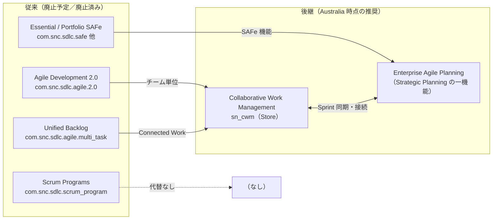
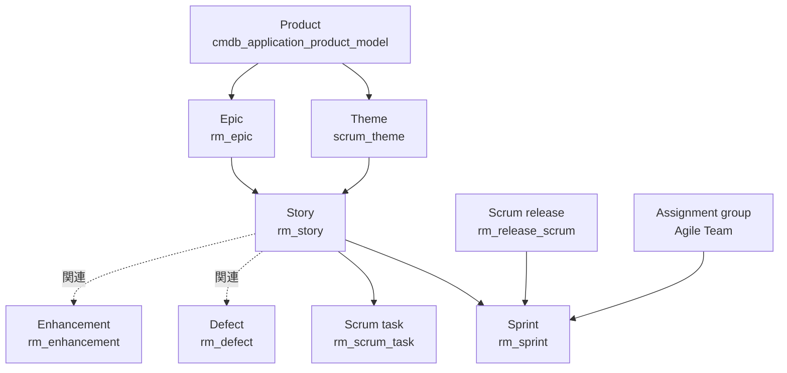
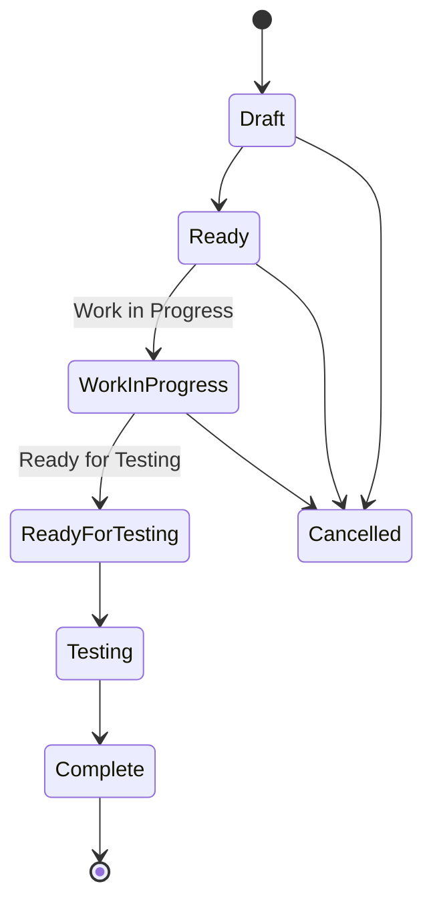
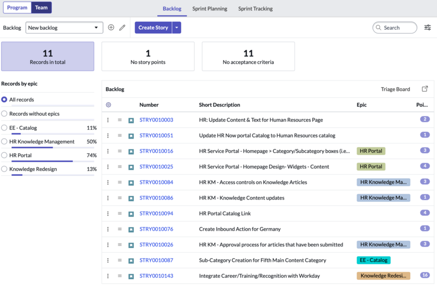
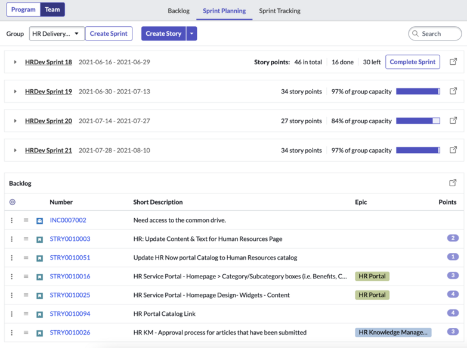
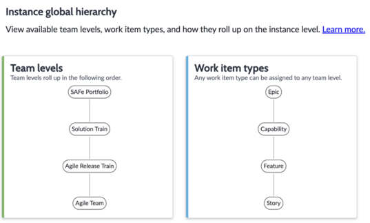
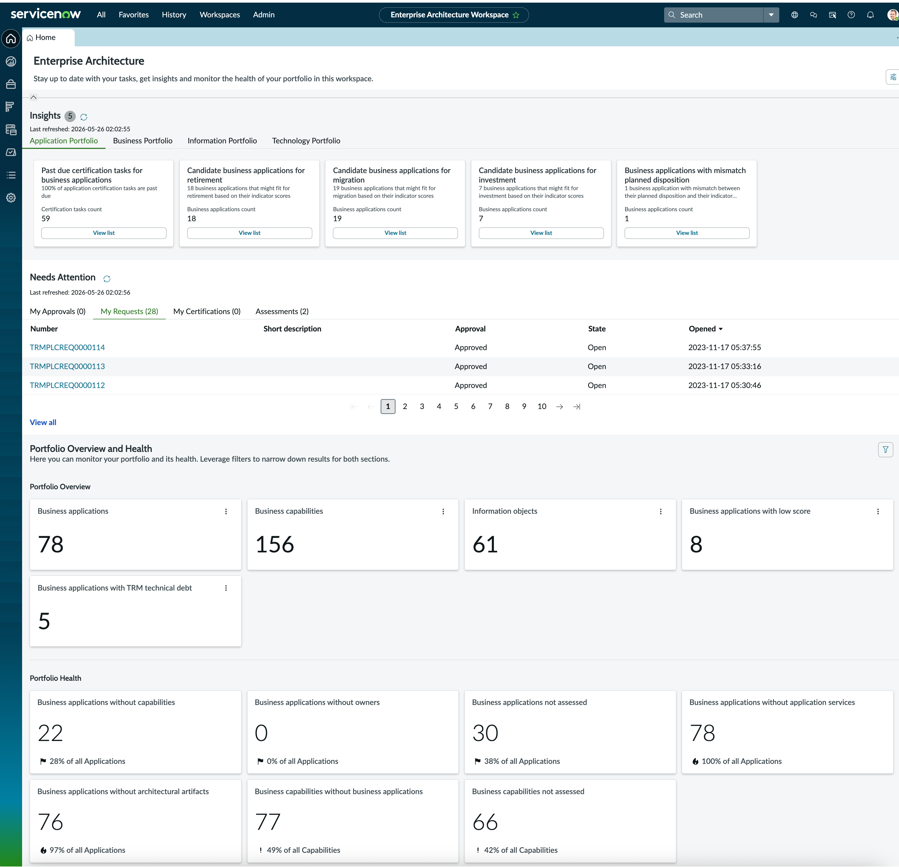
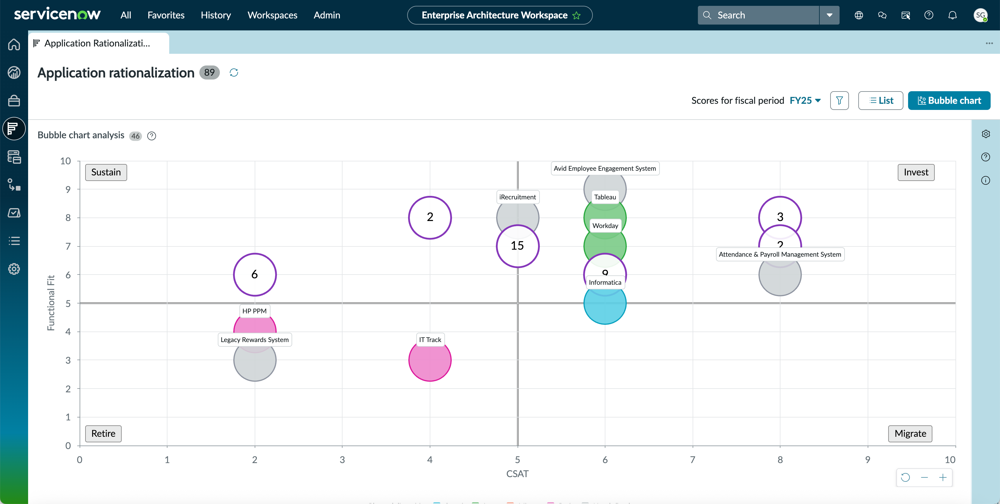

# Agile Development・APM・EAM（アジャイル開発・アプリケーションポートフォリオ管理・エンタープライズアーキテクチャ）

## 概要

本ファイルは、ServiceNow の Strategic Portfolio Management（SPM、戦略的ポートフォリオ管理）領域のうち、**開発・デリバリー寄り**と**アーキテクチャ寄り**のアプリケーション群を扱うリファレンスである。PPM（プロジェクト／デマンド／リソース管理）や Strategic Planning 全般は [Strategic Portfolio Management（PPM）](./strategic-portfolio-management.md) を参照。

| 区分 | アプリケーション（英語正式名称） | 位置付け（Australia 時点） |
|---|---|---|
| チーム単位アジャイル（従来） | Agile Development 2.0（アジャイル開発 2.0） | **Australia から廃止予定（planned for deprecation）**。2026-04 に新規販売終了。リリースノート上の廃止時期は 2030-08（コミュニティ記事では End of Support を「2030 以降・日付未定」としている。1.3 参照） |
| チーム単位アジャイル（後継） | Collaborative Work Management（CWM、協調作業管理） | ServiceNow Store アプリ。Agile 2.0 の公式後継 |
| 複数チーム（プログラム） | Scrum Programs（スクラムプログラム） | C リリースで廃止予定。代替なし |
| スケールドアジャイル（従来） | Essential SAFe / Portfolio SAFe 等 | Xanadu で廃止（新規有効化不可） |
| スケールドアジャイル（後継） | Enterprise Agile Planning（EAP、エンタープライズアジャイル計画） | Strategic Planning（Store アプリ）の一機能。SPM Pro（旧ティア）／Prime（新ティア）が必要【第三者情報】 |
| アプリポートフォリオ／EA | Enterprise Architecture（EA、旧 Application Portfolio Management／APM）＋ Enterprise Architecture Workspace | `com.snc.apm` プラグイン＋ Store アプリ `sn_apm_ws`。別途サブスクリプション |
| デジタルプロダクトのリリース | Digital Product Release（DPR、デジタルプロダクトリリース） | Store アプリ（ITSM 系ドキュメントに掲載） |
| サービス／アプリのポートフォリオ俯瞰 | Digital Portfolio Management（DPM、デジタルポートフォリオ管理） | DPM Workspace（ITSM 系ドキュメントに掲載） |

> **用語の注意:** 本ファイルのタイトルにある「EAM」は **Enterprise Architecture Management（エンタープライズアーキテクチャ管理）** の意味で使っている。ServiceNow には別製品として **Enterprise Asset Management（EAM、エンタープライズ資産管理）** が存在するため混同しないこと（資産管理は [ITAM 概要](../itam/itam-overview.md) を参照）。

> **製品名の注意:** ServiceNow 公式ドキュメント（Australia 後期パッチ以降の EA リリースノート）では、生成 AI 機能のブランド名が **Now Assist から「ServiceNow Otto」に改称**されたと記載されている。EA リリースノートの原文は「ServiceNow Otto for Enterprise Architecture (EA) is rebranded to ServiceNow Otto.」（ServiceNow Otto for Enterprise Architecture (EA) は ServiceNow Otto にブランド変更された）であり、旧称「Now Assist for Enterprise Architecture」からの対応関係は原文に明記されていない。本ファイルでは原文に合わせて両方の名称を用いる。[出典](https://www.servicenow.com/docs/r/australia/delta-xanadu-australia/australia-xanadu-enterprisearchitecture-release-notes.html)

---

## 1. アジャイル系アプリケーションの全体像と移行方針

### 1.1 アジャイル系アプリの系譜

ServiceNow のアジャイル系アプリケーションは、Australia リリースで大きな転換点を迎えている。Agile Development 2.0 とその関連プラグインは「Australia 以降、廃止予定」とされ、チーム単位の作業管理は Collaborative Work Management（CWM）へ、複数チームのスケールドアジャイルは Enterprise Agile Planning（EAP）へ集約される。[出典](https://www.servicenow.com/docs/r/IDeOjpA1hzonPLWG~inEpg/neJjFWiM6xJCQbaXFj~3eQ)

### 1.2 Agile Development 2.0 関連プラグインの廃止予定一覧（Australia リリースノート）

Australia リリースノートの Agile Development 2.0 ページ（2026-03-12 更新）は、以下のプラグインを廃止予定として列挙している。「C リリース」は Brazil の次のファミリーを指す。[出典](https://www.servicenow.com/docs/r/IDeOjpA1hzonPLWG~inEpg/neJjFWiM6xJCQbaXFj~3eQ)

| プラグイン名 | プラグイン ID | 廃止時期 | 代替 |
|---|---|---|---|
| Agile Development 2.0 | `com.snc.sdlc.agile.2.0` | 2030-08 | Collaborative Work Management（Store） |
| Agile Development 2.0 - ATF Tests | `com.snc.sdlc.agile.2.0.atf` | C リリース | なし |
| Agile Development 2.0 - Development ATF Tests | `com.snc.sdlc.agile.2.0.atf.dev` | C リリース | なし |
| Agile Development — Unified Backlog | `com.snc.sdlc.agile.multi_task` | C リリース | Collaborative Work Management（Store） |
| Scrum Programs | `com.snc.sdlc.scrum_program` | C リリース | なし |
| Atlassian Jira Integration for Agile Development | `app_agile_jira_integrations` | C リリース | SPW Jira Integrations（Store） |
| Microsoft Azure DevOps Integration for Agile Development | `app_agile_ado_integration` | C リリース | なし |
| Work Progress Status for Agile Teams | `com.sn_scrum_progress` | C リリース | なし（CWM の導入を推奨） |
| Performance Analytics Content Pack for Agile 2.0 | `com.sn_scrum_dashboards` | C リリース | Collaborative Work Management（Store） |
| Agile Development v2（モバイル） | `com.snc.sdlc.agile.mobile` | C リリース | なし |

廃止予定のアプリケーションは、新規インスタンスへの展開・有効化が行われなくなり、ServiceNow はサポート・修正・機能強化を提供しなくなる、と説明されている。[出典](https://www.servicenow.com/docs/r/IDeOjpA1hzonPLWG~inEpg/neJjFWiM6xJCQbaXFj~3eQ)

### 1.3 廃止スケジュールと既存顧客への影響（コミュニティ公式記事）

ServiceNow 社員による CWM コミュニティの記事「Start Here: Agile 2.0 Deprecation and Collaborative Work Management」（2026-04-28 投稿。投稿後に更新されており、以下は 2026-11-08 取得時点の記載）は、次のタイムラインを示している。【第三者情報】（ServiceNow Community 上の社員投稿。製品ドキュメントではない）[出典](https://www.servicenow.com/community/cwm-articles/start-here-agile-2-0-deprecation-and-collaborative-work/ta-p/3533752)

| 時期 | イベント | 内容 |
|---|---|---|
| 2026-04 | End of Sale（新規販売終了） | 新規顧客は Agile Development 2.0 の購入・プラグイン導入が不可。SPM の SKU から Agile Development が除外 |
| 2027-05（Canada リリース、予定） | Agile Teams SKU の End of Renewal | 既存顧客は継続利用可能で、コンプライアンス違反にはならない |
| 2030 以降（日付未定） | End of Support | 全ての有効な Agile Development 契約の満了後。サポートケースを受け付けず、アプリは「カスタマイズ扱い」となる。アプリ自体は無効化されない |

> **廃止時期の記載の相違:** Australia リリースノート（1.2）は `com.snc.sdlc.agile.2.0` の廃止時期を「August 2030（2030-08）」としている。一方、ServiceNow Community 記事（2026-04）は End of Support を「2030+ (Exact Date TBD)」（2030 以降・日付未定、全ての有効な契約の満了後）としている。両者は一致していないため、自社に適用される実際の時期はアカウント担当に確認すること。

- 同記事は「強制的な切替日（forced cutover date）はない」と明記している。
- Agile 2.0 と CWM は同一インスタンスでも別インスタンスでも併用可能（記事コメントでの回答）。
- **Sprint 履歴は移行されない**。`rm_sprint` と CWM の `sn_cwm_sprint` は構造的に互換性がないため、履歴参照用に Agile 2.0 を読み取り専用で残すことが推奨されている。
- 移行パス：Path A「CWM のみ」（個々のチームが自チームのスプリントとストーリーを管理）、Path B「CWM ＋ EAP」（ART、SAFe、Scrum of Scrums などの複数チーム調整。SPM Pro（旧ティア）または Prime（2026-04 以降の新ティア）が必要）。
- EAP は SPM Pro / Prime ライセンスが必要だが、EAP にアクセスするユーザーのみが対象で、CWM のみを使うチームメンバーは CWM ライセンスで足りる、とされる。

**移行手順（同記事より要約）**【第三者情報】

1. CWM と EAP のライセンスとロールを確認する。
2. チームごとに CWM Space を 1 つ作成し、その中に Board を作成する。
3. Connected Work でストーリーを取り込む（アクティブなレコードに絞る）。初回インポートの上限は条件ごとに 100 件で、システムプロパティ（`sys_properties_list.do`）で調整可能。
4. カスタムフィールド・カラムを再作成する。
5. 区切りのよい時点から新しい CWM Sprint を開始する。
6. デイリースタンドアップを Kanban ビューで実施する。

**テーブル対応表（同記事より）**【第三者情報】

| 区分 | テーブル |
|---|---|
| 共有（移行不要） | `rm_story`、`rm_scrum_task`、`sn_align_core_scrum_epic`（EAP と CWM で共有。新規エピックはこちらを推奨）、`sn_align_core_feature`（EAP で管理。CWM では Lists で扱う）、`rm_defect`（共有だが CWM のネイティブ UI はロードマップ。当面は Connected Work で扱う） |
| Connected Work で参照できるレガシー | `rm_epic`（Agile 2.0）、`rm_feature`（Agile 2.0。Connected Work 経由の参照のみ）、`rm_enhancement`（Connected Work で参照可能、CWM の Add Item からは作成不可） |
| その他のレガシー | `sn_safe_epic`（サポート終了。新規連携を作らない）、`rm_theme`（Story フォーム上は有効だが CWM Board でのグルーピング不可） |
| DPR | `sn_dpr_feature`（Digital Product Release と結び付く戦略的なプロダクト可視化用） |
| EAP のみ（Path B） | `sn_align_core_capability`、`sn_apw_adv_iteration`（Planning Interval） |
| Sprint | `rm_sprint`（Agile 2.0。履歴は移行されない）、`sn_cwm_sprint`（CWM。切替時に新規開始） |

> 注：同記事の表では Agile 2.0 のテーマを `rm_theme` と記載しているが、製品ドキュメントのテーブル一覧では Theme は `scrum_theme` である（「2.2 テーブル」参照）。
>
> 注：同様に、公式のコンポーネント一覧では EAP のイテレーションは `sn_apw_advanced_eap_iteration`（「5.4 EAP のテーブル」参照）、DPR のフィーチャーは `sn_dpr_model_product_feature`（「7.1」参照）である。同記事の `sn_apw_adv_iteration`、`sn_dpr_feature` という表記は公式ドキュメントでは確認できていない。

**CWM 移行時の既知のギャップ（同記事より）**【第三者情報】

- CWM の「Create Epic」は `sn_align_core_scrum_epic` に書き込むが、Board 上に表示されない（回避策：CWM Advanced 2.2.1 以降または CWM Standard 11.0.1 の Lists 機能）。
- Defect／Enhancement を「Add Item」から作成できない（Connected Work または Lists で扱う）。
- Sprint Goal（スプリントゴール）は標準では未提供。
- Theme 単位のグルーピング表示はない。
- CWM と Project Workspace の双方向同期、Board と Demand／Project の紐付けは標準では未提供（ロードマップ）。
- DPR（Digital Product Release）と CWM の連携は標準では未提供（ロードマップ）。
- Agile 2.0 の過去の Sprint データの移行は未提供。
- Sprint のベロシティ、バーンダウン、バーンアップは CWM Advanced 2.2.1（2026-09）で対応済み。

> **Brazil での変更:** CWM 11.0.1（Brazil リリースノート掲載）で、全ての Board に List／Gantt／Kanban／Sprint planning に並ぶ **Dashboard タブ**が追加され、「Team progress」（ウォーターフォール用）と「Team sprint tracker」（アジャイル用）の 2 つの共有ダッシュボードが自動追加された。Sprint バーンアップ／バーンダウンのウィジェットには **CWM Daily Sprint Data Collection** スケジュールジョブの有効化が必要。EAP から CWM への Sprint 同期（名前・状態・キャパシティ・日付）は、カレンダーベースに加え非カレンダーベースのイテレーションを使うチームにも拡張された。CWM は Store アプリ `sn_cwm` として導入する（admin ロール必須）。[出典](https://www.servicenow.com/docs/r/97F4kxpjkdv178Iq1OQ9sQ/7wgVtukTP2CDVt94ciGlrQ)

---

## 2. Agile Development 2.0（アジャイル開発 2.0）

Agile Development 2.0 は、Scrum（スクラム）手法でプロダクト・リリース・エピック・ストーリー・スプリント・スクラムタスクを管理する ServiceNow のアプリケーションである。プラグイン `com.snc.sdlc.agile.2.0` の有効化でインストールされる。上記のとおり Australia から廃止予定だが、既存顧客は引き続き利用できるため、仕様を記載する。

### 2.1 標準の業務フロー

Australia ドキュメント「Agile Development process flow」は、次の 9 ステップを一般的な進め方として示している（唯一の手順ではないと注記）。[出典](https://www.servicenow.com/docs/r/4~5Anqt12idfVzJWPcxoHw/2nYLcprr4nDTyFBaSnvtKw)

| # | ステップ | 主な担当 | 内容 |
|---|---|---|---|
| 1 | Define products（プロダクト定義） | Product owner | 機能群ごとに Product を作成し、オーナーを割り当てる。作業項目は Theme（テーマ）に紐付けてビジネスゴールに関連付け可能 |
| 2 | Create epics and stories | Product owner | 高レベル要件を Epic として登録し、Story に分解。いずれも Product に関連付け |
| 3 | Create releases | Product owner | 開始日・終了日を持つ Release（通常は四半期〜半年）を作成し、Product・Epic・Story を関連付け |
| 4 | Create personalized backlogs | Product owner／Scrum master | フィルター条件で Story・Defect・Incident 等を組み合わせた個人用バックログを作成 |
| 5 | Create assignment groups | Scrum master | 「Agile Team」タイプのグループを作成し、メンバーごとのスプリントあたりストーリーポイントを設定。合計がグループのキャパシティ |
| 6 | Create sprints | Scrum master | 1〜4 週間の Sprint を作成。Sprint はリリース期間内に収める必要あり |
| 7 | Plan sprint activities | チーム＋Scrum master | 優先順位付けされたストーリーを、合計ポイントがキャパシティに合うよう選択。ベロシティレポートを参照 |
| 8 | Track sprint progress | Scrum master／チーム | デイリースタンドアップ、ストーリー更新、障害除去。スコープ変更はチーム・Scrum master・Product owner で協議 |
| 9 | Track release progress | Product owner | リリースゴール達成に必要なペースでストーリーが完了しているかを確認 |

### 2.2 テーブル

Agile Development 2.0 のインストールで追加される主なテーブルは次のとおり（Australia ドキュメント「Components installed with Agile Development 2.0」、2026-03-12 更新）。[出典](https://www.servicenow.com/docs/r/australia/it-business-management/agile-development/components-installed-with-agile-2.0.html)

| ラベル | テーブル名 | 用途 |
|---|---|---|
| Product Assignment Group | `m2m_product_group` | プロダクトとグループの関連 |
| Release Assignment Group | `m2m_release_group` | リリースとグループの関連 |
| Application Model | `cmdb_application_product_model` | リリース管理対象となるプロダクト全体（Agile の「Product」） |
| Release Product | `m2m_product_release` | 管理対象プロダクト（リリースとの関連） |
| Story Dependencies | `m2m_story_dependencies` | ストーリーの前提／依存関係 |
| Scrum task | `rm_scrum_task` | スプリント中にストーリーに対して行う個別作業 |
| Release team member | `scrum_pp_release_team_member` | リリースに参加するユーザー |
| Sprint team member | `scrum_pp_sprint_team_member` | スプリントに参加するユーザー |
| Team | `scrum_pp_team` | タスクとストーリーを完了させるチーム |
| Team name | `scrum_pp_team_name` | スクラムチーム名 |
| Theme | `scrum_theme` | 具体的なプロダクト、または抽象的なゴール（性能改善など） |
| Scrum release | `rm_release_scrum` | プロダクトのバージョン。完了期限付きのスプリント群を含む |
| Sprint | `rm_sprint` | 一定期間に取り組むバックログ項目の単位 |
| Epic | `rm_epic` | まだストーリーに分解されていない関連要件のまとまり |
| Story | `rm_story` | 1 スプリント内で完了可能な自己完結した作業単位 |
| Defect | `rm_defect` | プロダクトの期待動作からの逸脱 |
| Documentation Task | `rm_doc` | ドキュメント作成タスク |
| Enhancement | `rm_enhancement` | 既存プロダクトの改善 |
| SDLC release | `rm_release_sdlc` | 個別のプロダクトバージョン |
| Testing Task | `rm_test` | テストタスク |

Scrum Programs を有効化すると、さらに `epic_backlog_definition`（エピックバックログのフィルター条件）と `scrum_program_m2m_group`（スクラムプログラムとチームの関連）が追加される。[出典](https://www.servicenow.com/docs/r/australia/it-business-management/agile-development/installed-with-scrum-programs.html)

### 2.3 ロール

Agile Development 2.0 のロールは次のとおり。`scrum_user` が全ロールの基底（読み取り専用）である。[出典](https://www.servicenow.com/docs/r/australia/it-business-management/agile-development/components-installed-with-agile-2.0.html)

| ロール名（Title） | ロール | 説明 | 包含ロール |
|---|---|---|---|
| Scrum admin（スクラム管理者） | `scrum_admin` | Agile Development 2.0 の完全な制御 | `scrum_user`、`rm_product_admin`、`rm_task_admin`、`rm_test_admin`、`rm_doc_admin`、`rm_story_admin`、`rm_epic_admin`、`rm_releasescrum_admin`、`rm_sprint_admin` |
| Scrum master（スクラムマスター） | `scrum_master` | スプリント進行のガイド、リリースバックログとスプリント間のストーリー移動、エピック・ストーリー・スプリント・チームメンバー管理 | `scrum_sprint_planner`、`scrum_story_creator`、`scrum_user` |
| Scrum product owner（プロダクトオーナー） | `scrum_product_owner` | プロダクトのビジネス価値とバックログの所有、バックログとリリース間の移動、テーマ・エピック・ストーリー・プロダクト・リリース・チーム管理 | `scrum_release_planner`、`scrum_story_creator`、`scrum_user` |
| Scrum release planner | `scrum_release_planner` | リリース計画、テーマ・プロダクト・リリース管理 | `scrum_user`、`scrum_story_creator` |
| Scrum sprint planner | `scrum_sprint_planner` | スプリントプロセス、ストーリーとスプリントの管理 | `scrum_user`、`scrum_story_creator` |
| Scrum story creator | `scrum_story_creator` | プロダクトの記述要素の作成、エピック・ストーリー・タスク管理 | `rm_scrum_task_admin`、`scrum_user` |
| Scrum story editor | `scrum_story_editor` | Story テーブルの編集権限 | `scrum_user`、`rm_scrum_task_admin` |
| Scrum team member（チームメンバー） | `scrum_team_member` | スプリント内のストーリー作業、スクラムタスク作成、ストーリー更新、Enhancement 要求・Defect 報告 | `scrum_user`、`scrum_story_creator`、`scrum_story_editor`、`rm_defect_admin`、`rm_enhancement_admin`、`rm_scrum_task_admin` |
| Scrum task admin | `rm_scrum_task_admin` | `rm_scrum_task` テーブルの管理 | `scrum_user` |
| Scrum user | `scrum_user` | 基本の読み取り専用ロール。作成・編集・管理は不可 | `cmdb_read` |

追加ロール：

| ロール | 説明 | 前提 |
|---|---|---|
| `sn_agile_read`（Business stakeholder role） | Agile Development 2.0 と Scrum Programs の全テーブルを読み取り、レポート作成に使う業務ステークホルダー向けロール | Business Stakeholder プラグイン（`com.snc.business_stakeholder`）有効化で Read only roles for Agile 2.0（`com.snc.agile_read_roles`）も有効化される。新規顧客は zBoot で有効化済みだが、ロール自体は `com.snc.sdlc.agile.2.0` 有効化時のみ利用可能。アップグレード顧客は `com.snc.agile_read_roles` を手動で有効化する [出典](https://www.servicenow.com/docs/r/australia/it-business-management/agile-development/business-stakeholder-role-agile-dev-2-0.html) |
| `it_program_manager`（Program manager） | 全スクラムプログラムを完全に制御。`program_manager`、`scrum_product_owner`、`scrum_master` を包含 | Scrum Programs で導入（PPM で導入済みの場合は追加されない）[出典](https://www.servicenow.com/docs/r/australia/it-business-management/agile-development/installed-with-scrum-programs.html) |
| `feature_user` | Story フォームの Defect 参照フィールドから Defect を新規作成するために必要 | admin が付与 [出典](https://www.servicenow.com/docs/r/australia/it-business-management/agile-development/create-a-story.html) |

### 2.4 Story（ストーリー）フォームと状態値

Story は **All > Agile Development > Stories** から作成する（必要ロール：`scrum_story_creator` または `scrum_admin`）。Agile board の Backlog／Sprint Planning タブ、Product・Release・Sprint・Theme・Epic の関連リスト、Defect／Enhancement レコードからも作成できる。[出典](https://www.servicenow.com/docs/r/australia/it-business-management/agile-development/create-a-story.html)

**Story フォームの主なフィールド**

| フィールド | 説明 |
|---|---|
| Number | システム採番 |
| Theme | 関連テーマ。1 ストーリーは同時に 1 テーマのみ。Product に紐付くテーマから選択 |
| Epic | 関連エピック。1 ストーリーは同時に 1 エピックのみ。Product に紐付くエピックから選択 |
| Type | Development、Documentation、Spike など |
| Classification | 開発の種類。既定で Feature（関連レコードタブの Defect／Enhancement とは無関係） |
| State | 状態（下表）。既定は Draft |
| Points | 見積もり工数（ストーリーポイント） |
| Priority | 優先度。プロダクトオーナーがランク付けに利用 |
| Product / Release | 関連プロダクト／リリース（リリースはプロダクトに紐付くものから選択） |
| Assignment group | ストーリーが属するアジャイルチーム |
| Sprint | 関連スプリント（Assignment group 選択時のみ表示） |
| Assigned to | 担当者（スクラムロールを持つユーザー） |
| Demand / Project / Project phase | デマンド・プロジェクト・アジャイルフェーズとの関連（PPM 連携） |
| Blocked | 進行を妨げる問題がある場合のフラグ |
| Short description / Description | 概要／詳細 |
| Acceptance criteria | Complete に移すための受け入れ基準 |
| Work notes | 作業メモ |
| Defect / Enhancement（Related Records） | `rm_defect`／`rm_enhancement` への参照 |

**Story の状態値（`rm_story.state`）**

| 表示値 | 内部値（進捗ボード用プロパティより） | 意味 |
|---|---|---|
| Draft | -6 | 説明・受け入れ基準を作成中 |
| Ready | 1 | 開発チームが着手可能 |
| Work in Progress | 2 | 開発中 |
| Ready for Testing | -7 | テスト担当者が着手可能 |
| Testing | -8 | 要件に基づくテスト中 |
| Complete | 3 | 開発とテストが完了 |
| Cancelled | 公開情報では内部値を確認できず | 取り消し |

状態の表示値は Story フォームのドキュメント、内部値はシステムプロパティ `com.snc.sdlc.scrum.pp.progress.story.states` の既定値（`-6, 1, 2, -7, -8, 3`）に基づく。カスタム状態を追加する場合は、Story フォームの State を右クリック > Configure Choices で選択肢を追加する（必要ロール：`admin` または `pa_admin`）。[出典](https://www.servicenow.com/docs/r/australia/it-business-management/agile-development/create-a-story.html) [出典](https://www.servicenow.com/docs/r/australia/it-business-management/agile-development/customize-story-states-of-your-agile-dashboard-reports.html)

> 上図は状態の並び順を示したもので、遷移制約（どの状態からどこへ移せるか）は公開情報では確認できず。

### 2.5 システムプロパティ

| プロパティ | 説明 | 型 | 既定値 |
|---|---|---|---|
| `com.snc.sdlc.scrum.pp.burndown.ideal.linear` | バーンダウンチャートの理想線を直線で描画 | true/false | false |
| `com.snc.sdlc.scrum.pp.progress.story.states` | 進捗ボードに表示するストーリー状態（順序付き） | 整数リスト | `-6, 1, 2, -7, -8, 3` |
| `com.snc.sdlc.scrum.pp.progress.task.state` | 進捗ボードに表示するタスク状態（-6 Draft, 1 Ready, 2 Work in progress, 3 Complete） | 整数リスト | `-6, 1, 2, 3` |
| `com.snc.sdlc.scrum.pp.task_uses_actual_hours` | Scrum Task フォームの Actual hours フィールドを有効化し、進捗ボードに実績時間を表示 | true/false | true |
| `com.snc.sdlc.scrum.pp.default_sprint_length` | スプリント長を計算できない場合の既定日数 | 整数 | 14 |

[出典](https://www.servicenow.com/docs/r/australia/it-business-management/agile-development/components-installed-with-agile-2.0.html)

### 2.6 Agile board（アジャイルボード）

Agile board は Agile Development 2.0 のスクラム活動（バックログ管理、スプリント計画、スプリント進捗追跡）の中心となるランディングページで、タブで構成される。必要ロールは `scrum_admin`、`scrum_master`、`scrum_product_owner`、`scrum_sprint_planner` のいずれか。画面上部の「Program / Team」切替で、プログラム（Scrum Programs）単位とチーム単位を切り替える。[出典](https://www.servicenow.com/docs/r/4Pll~Vzr5Rr79UNYLnUdJw/BLGHMNHQo_S9lrh4aCO6xA)

| タブ | 主な機能 |
|---|---|
| Backlog | ストーリー・エピック・テーマの作成。チームに割り当て済みでスプリント未投入のストーリー表示。サマリーカード（総件数、ストーリーポイント未設定件数、受け入れ基準未設定件数）。ページをまたぐ並べ替え。「Records by epic」でエピック別の進捗バーと割合を表示 |
| Sprint Planning | スプリントの作成・整理・監視・開始・完了。現在／将来スプリントを時系列表示（計画日、ストーリーポイント、グループベロシティに対する割合）。バックログからスプリントへドラッグ＆ドロップ。完了スプリントの未完了ストーリーをバックログまたは将来スプリントへ移動 |
| Sprint Tracking | 現在スプリントを 3 つのビューで追跡。Story board（レーン移動で状態更新）、Task board（スクラムタスクのレーン移動がストーリー状態に反映）、List view（スクラムタスクとテストを追加し、未完了項目を確認） |

**図1：Agile Development 2.0 の Agile board — Backlog タブ**
画面上部に「Program / Team」の切替トグルと「Backlog / Sprint Planning / Sprint Tracking」の 3 タブがある。Backlog タブでは、左上の「Backlog」ドロップダウンで個人用バックログ（例：New backlog）を選び、「Create Story」ボタンで新規ストーリーを作成する。上部に「Records in total（11）」「No story points（1）」「No acceptance criteria（11）」の 3 つのサマリーカードが並ぶ。左ペインの「Records by epic」には All records／Records without epics と各エピック（例：HR Portal 74%）の進捗バーが表示され、右側のリストには Number（STRY…）、Short Description、Epic、Points の列がある。リスト右上には「Triage Board」（Unified Backlog の機能）へのリンクがある。
出典：[Agile board in Agile Development 2.0（ServiceNow Docs, Yokohama）](https://www.servicenow.com/docs/r/4Pll~Vzr5Rr79UNYLnUdJw/BLGHMNHQo_S9lrh4aCO6xA)（取得日：2026-11-03）

**図2：Agile board — Sprint Planning タブ**
上部の「Group」ドロップダウンで対象アジャイルチーム（例：HR Delivery…）を選択し、「Create Sprint」「Create Story」ボタンを使う。各スプリント（例：HRDev Sprint 18、期間 2021-06-16〜2021-06-29）は折りたたみ行で表示され、現在スプリントには「Story points: 46 in total / 16 done / 30 left」と「Complete Sprint」ボタン、将来スプリントには「34 story points」「97% of group capacity」とキャパシティ消化率のバーが表示される。画面下部の Backlog セクションには Incident（INC…）を含むバックログ項目が並び、ここからスプリントへドラッグ＆ドロップで割り当てる。
出典：[Agile board in Agile Development 2.0（ServiceNow Docs, Yokohama）](https://www.servicenow.com/docs/r/4Pll~Vzr5Rr79UNYLnUdJw/BLGHMNHQo_S9lrh4aCO6xA)（取得日：2026-11-03）

### 2.7 ダッシュボード

Agile 2.0 のダッシュボードは Performance Analytics Content Pack for Agile 2.0（`com.sn_scrum_dashboards`、C リリースで廃止予定）が必要である。[出典](https://www.servicenow.com/docs/r/4~5Anqt12idfVzJWPcxoHw/2nYLcprr4nDTyFBaSnvtKw)

| ダッシュボード | 主なレポート |
|---|---|
| Agile 2.0 Team dashboard | Velocity History、Velocity by Type |
| Agile 2.0 Sprint dashboard | バーンアップ、バーンダウン、累積フロー |
| Agile 2.0 Release dashboard | バーンアップ、バーンダウン、サイクルタイム |

### 2.8 Agile Development — Unified Backlog（統合バックログ）

Agile Development — Unified Backlog（`com.snc.sdlc.agile.multi_task`）は、Defect・Problem・Enhancement・Incident など異なるタスクタイプのレコードを 1 か所のバックログで優先順位付けし、自動でストーリーを作成するアプリケーションである。[出典](https://www.servicenow.com/docs/r/australia/it-business-management/agile-development/unified-backlog.html)

- **Triage board（トリアージボード）**：フィルター条件ごとに作成（例：Defect 用、Incident 用）。条件に合致する新規レコードが自動で表示される。
- トリアージボードからバックログに追加した項目には **ストーリーが自動作成**される。以降は通常のストーリーとしてチーム割当・スプリント投入を行う。
- Story board でストーリーのレーンを移動すると、**ストーリーの状態のみが更新され、元のトリアージ対象レコード（例：Incident）の状態は変わらない**。元レコードの状態は、ストーリーを開き「元レコードのタブ」に切り替えて変更する。
- C リリースで廃止予定。CWM の **Connected Work** が後継とされる。[出典](https://www.servicenow.com/community/cwm-articles/start-here-agile-2-0-deprecation-and-collaborative-work/ta-p/3533752)

### 2.9 PPM との連携（ハイブリッド型プロジェクト）

Agile Development 2.0 を Project Portfolio Management と併用すると、ウォーターフォールのプロジェクト計画の中にアジャイルフェーズを持たせられる。[出典](https://www.servicenow.com/docs/r/australia/it-business-management/ppm-collaboration/c_SDLCIntegrationWithProjectPortfolioSuite.html)

1. スクラムチームを表すグループを作成し、メンバーを追加する。
2. スプリントを作成する。
3. Project Workbench からグループをプロジェクトに割り当てる。
4. **プロジェクトバックログ**（そのプロジェクトの全ストーリー）と**グループバックログ**（複数プロジェクトから当該グループに割り当てられたストーリー）を維持する。
5. グループ単位でスプリント計画（ランク付け、ポイント付与、スプリント投入）を行う。
6. プロジェクトに紐付かない単発ストーリーも作成可能。
7. ストーリー・フェーズ・プロジェクトの進捗を Project Workbench のタイムラインで追跡する。

PPM 側の詳細は [Strategic Portfolio Management（PPM）](./strategic-portfolio-management.md) を参照。

### 2.10 外部ツール連携

| 連携 | プラグイン | Australia 時点の状況 |
|---|---|---|
| Atlassian Jira | `app_agile_jira_integrations` | C リリースで廃止予定。後継は SPW Jira Integrations（Store）。EAP にも Jira 構成の有効化・Jira プロジェクトと EAP チームの関連付け機能がある |
| Microsoft Azure DevOps | `app_agile_ado_integration` | C リリースで廃止予定。代替なし |

[出典](https://www.servicenow.com/docs/r/IDeOjpA1hzonPLWG~inEpg/neJjFWiM6xJCQbaXFj~3eQ)

---

## 3. Scrum Programs（スクラムプログラム）

Scrum Programs（`com.snc.sdlc.scrum_program`）は、複数のスクラムチームを「プログラム」として束ね、プログラムレベルのエピックバックログとプランニングボードで計画するアプリケーションである。C リリースで廃止予定で、**代替は提供されない**。複数チームの調整には EAP の利用が想定される。[出典](https://www.servicenow.com/docs/r/IDeOjpA1hzonPLWG~inEpg/neJjFWiM6xJCQbaXFj~3eQ)

| コンポーネント | 名前 | 内容 |
|---|---|---|
| ロール | `it_program_manager` | 全スクラムプログラムを完全に制御。`program_manager`、`scrum_product_owner`、`scrum_master` を包含 |
| テーブル | `epic_backlog_definition` | エピックバックログ作成に使うフィルター条件 |
| テーブル | `scrum_program_m2m_group` | スクラムプログラムとチームの関連 |
| ビジネスルール | Set global rank for epic（`rank_configuration`） | 既存エピックのグローバルランクを設定する修正スクリプト |
| UI マクロ | `program_planning_constants` | プランニングボードに表示するチーム数上限 `TEAM_LIMIT`（既定 15）とストーリー数上限 `STORY_LIMIT`（既定 1000）。増やすと読み込みが遅くなる |

[出典](https://www.servicenow.com/docs/r/australia/it-business-management/agile-development/installed-with-scrum-programs.html)

---

## 4. SAFe（Scaled Agile Framework）

### 4.1 従来の SAFe プラグイン（Xanadu で廃止）

ServiceNow は従来、Essential SAFe／Portfolio SAFe 等のプラグインで SAFe（Scaled Agile Framework）を提供していたが、**Xanadu リリースで廃止**された。これらのプラグインは新規有効化ができなくなったが、既存利用者は継続利用できる。Yokohama・Zurich・Australia では SAFe の新機能・変更・追加廃止はない。[出典](https://www.servicenow.com/docs/r/australia/delta-xanadu-australia/australia-xanadu-scaledagileframeworksafe-release-notes.html)

| プラグイン名 | プラグイン ID |
|---|---|
| Essential SAFe | `com.snc.sdlc.safe` |
| Portfolio SAFe | `com.snc.sdlc.portfolio_safe` |
| Performance Analytics Content Pack for Essential SAFe | `com.sn_safe_dashboards` |
| Work Progress Status for SAFe | `com.sn_safe_progress` |
| Agile - Scaled Agile Framework - Unified Backlog | `com.snc.sdlc.safe.multi_task` |
| Read-only roles for SAFe | 公開情報では ID を確認できず |

> リリースノートのサマリー部分では `com.snc.sdlc.portfoliosafe` のように表記揺れがあるため、実インスタンスで ID を確認すること。

ServiceNow は代替として **Strategic Planning の Enterprise Agile Planning（EAP）** を推奨している。EAP は柔軟なチーム／作業階層の構成と、チーム間コミュニケーション用のインタラクティブなワークスペースを提供する、と説明されている。SAFe 用グループを EAP に移行する際は「Add Agile Team type to SAFe groups for EAP migration」の手順がある。[出典](https://www.servicenow.com/docs/r/australia/delta-xanadu-australia/australia-xanadu-scaledagileframeworksafe-release-notes.html)

---

## 5. Enterprise Agile Planning（EAP、エンタープライズアジャイル計画）

### 5.1 概要と提供形態

Enterprise Agile Planning（EAP）は、Strategic Planning アプリケーション（ServiceNow Store）の一機能で、SAFe などのスケールドアジャイルを組織全体に展開するためのチーム構造・作業構造・計画カレンダーを提供する。[出典](https://www.servicenow.com/docs/r/4Pll~Vzr5Rr79UNYLnUdJw/jNcobQL9lEJDilQxDV7A9g)

- ライセンス：ServiceNow Community の社員記事は「EAP requires SPM Pro/SPM Prime」としている（EAP にアクセスするユーザーのみが対象）。【第三者情報】[出典](https://www.servicenow.com/community/cwm-articles/start-here-agile-2-0-deprecation-and-collaborative-work/ta-p/3533752)
- 画面：Strategic Planning の Store リリースノート（4.0.2、2024-02）は、SPM Pro ライセンスの機能は Strategic Planning Workspace でのみ利用でき、Portfolio Planning Workspace で使っていた場合は Strategic Planning のインストールが必要と説明している。同じく Strategic Planning は `com.snc.sdlc.agile.2.0` ファミリーのプラグインに依存するとされる。[出典](https://www.servicenow.com/docs/r/C17ZqvSaMwUVpMBg8Nc5sg/zwPAPpmXvX2YQ49g2VkksA)
- EAP 固有のライセンス・インストール要件を明記した公式ページは公開情報では確認できず。

### 5.2 既定の構成（Agile configurations）

EAP の構成（Configuration）は、チームレベル構造・作業項目タイプ・計画カレンダーの対応付けからなる。既定では次の構成が用意されている（Strategic Planning のデモデータを入れると Full Configuration が有効化される）。[出典](https://www.servicenow.com/docs/r/4Pll~Vzr5Rr79UNYLnUdJw/jNcobQL9lEJDilQxDV7A9g)

| 構成 | 用途（SAFe の構成に対応） |
|---|---|
| Full Configuration | Portfolio > Solution Train > ART > Agile Team の全階層 |
| Essential Configuration | ART と Agile Team 中心 |
| Large Solution Configuration | Solution Train を含む大規模ソリューション |
| Portfolio Configuration | ポートフォリオレベル中心 |
| Kanban Configuration | カンバン運用 |

> 上表は Yokohama 版ドキュメントに基づく（Australia 版の同ページは確認できず）。Brazil 期の Strategic Planning 4.18.0 では **Scrum Configuration** が追加されている（5.5 の「Brazil での変更」参照）。

- **既定のチーム階層**：Portfolio > Solution Train > Agile Release Train（ART）> Agile Team
- **既定の作業項目階層**：Epic > Capability > Feature > Story
- 構成の作成・編集時、**任意の作業項目タイプを任意のチームレベルに割り当て可能**（例：Feature を Solution Train レベル、Story を ART レベルに対応付け）。
- 全ての EAP 作業項目タイプは `sn_align_core_eap_planning_item` を継承し、これは Strategic Planning の `sn_align_core_planning_item` を継承する。Story は `rm_story` に保存される。カスタム作業項目タイプも作成可能。

**図3：EAP 構成の「Instance global hierarchy」**
Strategic Planning Workspace の EAP 構成画面の一部。左の「Team levels」カードには、チームレベルが上から「SAFe Portfolio → Solution Train → Agile Release Train → Agile Team」の順にロールアップすることが示される。右の「Work item types」カードには「Epic → Capability → Feature → Story」の階層と、「Any work item type can be assigned to any team level（任意の作業項目タイプを任意のチームレベルに割り当て可能）」という説明が表示される。
出典：[Agile configurations in EAP（ServiceNow Docs, Yokohama）](https://www.servicenow.com/docs/r/4Pll~Vzr5Rr79UNYLnUdJw/jNcobQL9lEJDilQxDV7A9g)（取得日：2026-11-03）

### 5.3 EAP のロール

| ロール | 主な権限 | 包含ロール |
|---|---|---|
| EAP admin `sn_apw_advanced.eap_admin` | EAP 構成へのチームの追加・削除。イテレーションの削除は admin のみ | `sn_apw_advanced.eap_scrum_master` |
| EAP scrum master `sn_apw_advanced.eap_scrum_master` | 計画カレンダーとカレンダースパンの作成・編集・削除。Planning Interval／Sprint の作成・編集。計画カレンダーに従うイテレーションの開始日・終了日を変更できる唯一のロール。ワークスペースの Settings では Planning calendars サブページのみ表示 | `sn_apw_advanced.eap_user` |
| EAP user `sn_apw_advanced.eap_user` | 作業項目の作成・更新・削除。チームのタイムラインがある場合のイテレーション作成と日付設定。計画カレンダーに従わないイテレーションの日付変更。チームの Backlog と Planning Board へのアクセス | `scrum_master`、`sn_apw_advanced.eap_read_only`、`now_assist_panel_user`（ServiceNow Otto for SPM プラグインがある場合のみ） |
| EAP read-only role `sn_apw_advanced.eap_read_only` | チーム・イテレーションをまたいだ EAP 計画項目とストーリーの閲覧（Backlog、Planning board、Hierarchy タブ、Home タブのダッシュボードウィジェット、チームレベルの Docs） | `scrum_user`、`workspace_user`、`canvas_user` |

[出典](https://www.servicenow.com/docs/r/australia/it-business-management/enterprise-agile-planning/components-installed-with-enterprise-agile-planning.html)

### 5.4 EAP のテーブル

| ラベル | テーブル名 | 説明 |
|---|---|---|
| Enterprise agile team | `sn_apw_advanced_eap_team` | 全 EAP チーム（Portfolio、Solution Train、ART、Agile Team）の基底テーブル |
| SAFe Portfolio | `sn_apw_advanced_eap_portfolio` | Portfolio（`sn_apw_advanced_eap_team` を継承） |
| Solution Train | `sn_apw_advanced_solution_train` | Solution Train（同上） |
| Agile Release Train | `sn_apw_advanced_agile_release_train` | ART（同上） |
| Agile Team | `sn_apw_advanced_agile_team` | Agile Team（同上） |
| EAP planning item | `sn_align_core_eap_planning_item` | 全 EAP 作業項目タイプの基底。`sn_align_core_planning_item`（Planning Item Entry）を継承 |
| Epic | `sn_align_core_scrum_epic` | EAP の Epic |
| Capability | `sn_align_core_capability` | EAP の Capability |
| Feature | `sn_align_core_feature` | EAP の Feature |
| Story | `rm_story` | 全ストーリー（Agile 2.0 と共通） |
| Enterprise agile calendar | `sn_apw_advanced_eap_calendar` | Planning Interval や Sprint などのイテレーション種別のカレンダー（`business_calendar` を継承） |
| Enterprise agile calendar entry | `sn_apw_advanced_eap_calendar_span` | カレンダーエントリーの期間（`business_calendar_span` を継承） |
| Enterprise agile configuration | `sn_apw_advanced_eap_configuration` | Full、Portfolio などの構成 |
| Enterprise agile configuration detail | `sn_apw_advanced_eap_configuration_detail` | チームタイプごとの既定作業項目タイプと計画カレンダー、チーム階層、Backlog／Planning board に表示する作業項目タイプ |
| Enterprise agile iteration | `sn_apw_advanced_eap_iteration` | チームレベルのイテレーション（キャパシティ、合計ポイント、State 等） |
| Enterprise agile iteration type | `sn_apw_advanced_eap_iteration_type` | 計画カレンダー種別（Planning Interval、Sprint） |
| Enterprise agile team structure | `sn_apw_advanced_eap_team_structure` | チーム階層 |
| Enterprise agile work structure | `sn_apw_advanced_eap_work_structure` | 作業項目タイプ階層 |

スケジュールジョブ「Populate parent level data for work item and stories」（および Bulk 版）は、親作業項目の情報を最大 7 階層まで補完する。[出典](https://www.servicenow.com/docs/r/australia/it-business-management/enterprise-agile-planning/components-installed-with-enterprise-agile-planning.html)

### 5.5 EAP と CWM／Agile 2.0 の連携

- EAP チームを CWM に接続すると（「Connect an EAP team with CWM」）、EAP 側の Backlog と Hierarchy ページは CWM 接続チームでも表示される（Strategic Planning 4.16.0、2026-07）。[出典](https://www.servicenow.com/docs/r/C17ZqvSaMwUVpMBg8Nc5sg/zwPAPpmXvX2YQ49g2VkksA)
- 計画カレンダーに従わない Sprint は、イテレーションの開始日・終了日を使って Agile Development 2.0 に同期され、日付変更は Agile 2.0 側の Sprint に反映される（Strategic Planning 4.18.0）。[出典](https://www.servicenow.com/docs/r/97F4kxpjkdv178Iq1OQ9sQ/~5mKYbhL77VirnIzYi2Mvw)

> **Brazil での変更（Strategic Planning 4.18.0〜4.19.0、Brazil リリースノート掲載）:**
> - **Scrum Configuration** の追加：Planning Interval を持たず Sprint のみで運用する単一 Agile Team レベルの構成。Epic と Story を許可し、Story は計画カレンダー種別「Scrum Sprint」（既定提供）に対応。既定では非アクティブ。
> - **Allow unique cadence for each team**：構成ごとに、チームごとの独自イテレーション日程を許可できる。`sn_apw_advanced_eap_iteration` の Enterprise agile calendar entry フィールドは必須でなくなった。
> - イテレーションに **Spillover** と **New scope** フィールドを追加（スプリント中のスコープ変動を把握）。
> - **Kanban チームを ART 内で Scrum チームと併存**可能（4.19.0）。チームの Planning methodology フィールドで Scrum／Kanban を選択。Kanban に切り替えると未完了のスプリント（現在のスプリントを含む）はキャンセルされる。CWM 接続チームは、アクティブ／計画済みのスプリントがある間は Kanban に切り替えられない。アップグレード時、既存チームは業務カレンダーがあれば Scrum、なければ Kanban が自動設定されるため、スプリント運用のチームは確認が必要。
> [出典](https://www.servicenow.com/docs/r/97F4kxpjkdv178Iq1OQ9sQ/~5mKYbhL77VirnIzYi2Mvw)

---

## 6. Enterprise Architecture（旧 Application Portfolio Management）

### 6.1 概要と名称の変遷

ServiceNow の **Enterprise Architecture（EA、エンタープライズアーキテクチャ）** は、旧称 **Application Portfolio Management（APM、アプリケーションポートフォリオ管理）** である。ビジネスケイパビリティ、アプリケーションポートフォリオ、情報ポートフォリオ、テクノロジーポートフォリオを 1 つの EA 実践の中で管理し、コスト・リスク・価値・技術的負債などの指標（Indicator）に基づいて、ビジネスアプリケーションへの投資・維持・置換を判断するためのアプリケーションである。ArchiMate、CSDM、AWS などの業界標準記法でのモデリングや、Architecture Analyzer による関係性の探索も提供する。[出典](https://www.servicenow.com/docs/r/97F4kxpjkdv178Iq1OQ9sQ/kCgEdrb3TZrXI34tCytjhg)

- 現在の主 UI は **Enterprise Architecture Workspace（EA Workspace、EAW）**（Store アプリ `sn_apm_ws`）。
- 旧 UI（Classic の **All > Enterprise Architecture > …** モジュール、例：Capability Ratings > Capability Map）は「Legacy」と表記される。Indicator や TRM のモジュールは Xanadu 以降 EA Workspace に移行し、従来モジュールは新規ユーザーには非推奨とされている。[出典](https://www.servicenow.com/docs/r/U2CVwXuy001wBq~XyYjcSg/T0JnK3mPx5XcMYgOLCtvSw)

### 6.2 有効化・インストール要件

| 項目 | ID | 種別 | 備考 |
|---|---|---|---|
| Enterprise Architecture | `com.snc.apm` | プラグイン | **別途サブスクリプションが必要** |
| Enterprise Architecture Workspace | `sn_apm_ws` | Store アプリ | `admin` ロールでインストール |
| Basic Software Asset Management | `com.snc.sams` | プラグイン | テクノロジーポートフォリオ情報の表示に必要 |
| Technology Portfolio Management | `sn_apm_tpm` | Store アプリ | 同上（TLM ラベルには EA Workspace 9.2.1 以上かつ `sn_apm_tpm` 1.11.0 以上が必要） |
| Digital Integration Management | `sn_apm_di` | Store アプリ | デジタルインテグレーション管理（6.10） |
| Application Total Cost of Ownership | 公開情報では ID を確認できず | プラグイン | アプリ TCO（6.11） |
| ServiceNow Otto for Enterprise Architecture (EA) | 公開情報では ID を確認できず | プラグイン | 生成 AI 機能（6.14） |
| Enterprise Modeling and Visualization（EMV） | 公開情報では ID を確認できず | Store アプリ | Store リリースノート上、6.2.2（2026-06、Australia 対応）が存在 |

**インストール手順（Australia）**：All > System Applications > All Available Applications > All でアプリ名または ID を検索 → バージョンを選択して Install → 依存関係を確認（必要に応じ Store でエンタイトルメント取得）→ 任意で「Load demo data」（開発／テストインスタンスでの初回インストール時のみ推奨）→ Install。ワークスペースは **Workspaces > Enterprise Architecture Workspace** から開く。[出典](https://www.servicenow.com/docs/r/7j6XJu~hiM8er80NoATFxQ/X3cbzHCDhxKO9mBCEx5T2A)

### 6.3 ロール

Enterprise Architecture Workspace のアクセスロールは次の 4 階層である。Australia では `sn_apm.apm_read` < `sn_apm.apm_user` < `sn_apm.apm_admin` < `sn_apm.apm_analyst` の順に権限が広がり、**`sn_apm.apm_analyst` が最上位**である（下表は下位から順に記載）。

| ロール | 名称 | 主な権限 | 包含ロール（EA 関連） | 想定ユーザー |
|---|---|---|---|---|
| `sn_apm.apm_read` | EA Read User | ワークスペースの全ページ・レコードを読み取り専用で閲覧。EA dashboard、Application 360、Application Assessments ダッシュボードの閲覧（Yokohama で業務ステークホルダーロールにワークスペース読み取りが追加） | なし | 業務ステークホルダー、経営層、監査 |
| `sn_apm.apm_user` | EA User | ビジネスアーキテクチャ、情報、テクノロジー、モデリング、データ認証のポートフォリオデータ作成・更新。ビジネスアプリ詳細・アプリケーションサービス・プロダクトケイパビリティの更新、デマンド作成、図の承認申請、割当済み認証タスクの完了。TRM 製品・ライフサイクルの**申請**（承認は不可） | `pa_viewer`、`canvas_user`、`certification`、`report_user` など | アプリオーナー、業務アナリスト、ポートフォリオマネージャー |
| `sn_apm.apm_admin` | EA Admin | `sn_apm.apm_user` の全権限を含む。Setup ページの構成（アプリケーションカテゴリ、Indicator、スコアリングプロファイル、TRM フェーズ・カテゴリ、データドメイン、成果物カテゴリ、デマンドアクション、モデリング設定）。Publishing Center（追加で `knowledge_admin`、`sp_admin` と EA グループメンバーであることも必要）。レガシー CMDB 認証ポリシー（追加で `certification_admin`） | `sn_apm.apm_user`、`certification_admin`、`assessment_admin` など | EA 管理者 |
| `sn_apm.apm_analyst` | EA Analyst | **`sn_apm.apm_admin` の全権限を含む**。ビジネスアプリ、デジタルインテグレーション、デジタルインターフェースの追加。Application Assessments／Application 360 ダッシュボード閲覧。**Enterprise Architect グループのメンバーである場合に限り**、TRM 製品要求・TRM ライフサイクル要求・モデリング図要求の承認／却下、TRM 製品ライフサイクルの作成、保留中 TRM 要求の閲覧・更新 | `sn_apm.apm_admin`、`data_manager_admin`、`treemap_user` | エンタープライズ／ソリューションアーキテクト |

- **プラットフォームの `admin` ロール**は、EA Workspace・TLM・TRM・TPM・App TCO・読み取り専用ロール等のプラグイン有効化、TCO ソースとコストタイプの構成、認証ポリシーの公開・実行などに必要。
- **Enterprise Architect グループ**はロールではなくガバナンス用グループ。`sn_apm.apm_analyst` を付与するだけでは承認権限は得られない（原文「Assigning the role alone is not sufficient for these actions.」）。
- Australia 版で Enterprise Architect グループのメンバーであることが必要とされる操作（ロール不問のものを含む）：
  - アーキテクチャ成果物のバージョン承認要求の承認／却下、Application／Technology／Business／Data Architecture の各ドキュメントタイプのオーナー権限
  - ビジネスアプリの Retire（廃止）
  - Architecture Review Board（ARB）のアーキテクチャレビューの申請
  - TRM 標準フェーズ、製品ライフサイクル、技術的負債テーブルの読み取り
  - Services Approval Group モジュールでの EA ワークフローグループの管理、APM Guided Setup の「Configure Enterprise Architecture Group」ステップ

[出典（Australia 版アクセスロール）](https://www.servicenow.com/docs/r/australia/application-portfolio-management/eaw-access-roles.html) [出典（Components installed with EA Workspace）](https://www.servicenow.com/docs/r/7j6XJu~hiM8er80NoATFxQ/WKg9d_g1~ocqbaLB_8Kdeg)

> **注:** Australia では、アクセスロールのページと「Components installed with Enterprise Architecture Workspace」はいずれも「`sn_apm.apm_analyst` が `sn_apm.apm_admin` を、`sn_apm.apm_admin` が `sn_apm.apm_user` を含む」と記載しており、両者は一致している。Yokohama 版のアクセスロールのページでは順序の説明が異なる（admin を最上位とする説明）ため、旧リリースの資料を参照する際は注意すること。[出典（Yokohama 版アクセスロール）](https://www.servicenow.com/docs/r/6k4g_5wX4~40dsUynycZuQ/5mE9JJXOEQMwWjC5Rf6PEA)

**Granular admin role（細分化された管理者ロール）**：Australia では、EA 機能の管理に全体 `admin` ではなく `sn_apm.apm_admin` を使う「最小権限」の方針が示されている。Zurich では 4 つのシステムプロパティ（デジタルインターフェース／インテグレーションの活動フィールド、TPM 製品タイプ、ソフトウェアインストールの CI）に、Australia では EA として TRM technical debt トグル、TRM 要求の活動フィールド、ページングや TLM タイムライン範囲などのプロパティに（Early Availability として）`sn_apm.apm_admin` が適用された。プラグイン有効化には引き続き全体 `admin` が必要。[出典](https://www.servicenow.com/docs/r/australia/application-portfolio-management/eaw-gran-admin-role-changes.html) [出典](https://www.servicenow.com/docs/r/australia/delta-xanadu-australia/australia-xanadu-enterprisearchitecture-release-notes.html)

### 6.4 EA Workspace の構成（ホーム画面とナビゲーション）

EA Workspace のホーム（Overview）ページは次のセクションで構成される。[出典](https://www.servicenow.com/docs/r/australia/application-portfolio-management/eaw-overview.html)

| セクション | 内容 |
|---|---|
| Insights | アプリケーション／ビジネス／情報／テクノロジーの各ポートフォリオについての状況（例：ビジネスケイパビリティに関連付けられていないビジネスアプリ）をカードで提示 |
| Needs Attention | 要対応タスク。My Approvals（承認待ち）、My Requests（自分の申請）、My Certifications（自分・自グループ・管理グループ・直属部下に割り当てられた認証タスク）、Assessments（アプリ評価） |
| Portfolio Overview and Health | ポートフォリオ全体と健全性の監視。フィルター（適用数を表示、Clear all filters で解除）でビジネスアプリ・ケイパビリティを絞り込み |

左側のナビゲーションには、Home、Dashboards、Portfolio、Application Rationalization、Technology Portfolio、Enterprise Modeling and Visualization、Data Certification、Architecture Analyzer、Setup などのアイコンが並ぶ（アイコン構成はバージョンにより異なる）。

**図4：Enterprise Architecture Workspace のホーム（Overview）ページ**
画面上部のタイトルは「Enterprise Architecture」。「Insights（5）」セクションには Application Portfolio／Business Portfolio／Information Portfolio／Technology Portfolio のタブがあり、「Past due certification tasks for business applications（59）」「Candidate business applications for retirement（18）」「…for migration（19）」「…for investment（7）」「Business applications with mismatch planned disposition（1）」の各カードに「View list」ボタンがある。「Needs Attention」には My Approvals／My Requests（28）／My Certifications／Assessments のタブと、TRM ライフサイクル要求（TRMPLCREQ…）の一覧が表示される。「Portfolio Overview and Health」の Portfolio Overview には Business applications（78）、Business capabilities（156）、Information objects（61）、Business applications with low score（8）、Business applications with TRM technical debt（5）のタイルが、Portfolio Health には「Business applications without capabilities」「…without owners」「…not assessed」「…without application services」「…without architectural artifacts」「Business capabilities without business applications」「Business capabilities not assessed」の件数と全体に占める割合が並ぶ。
出典：[Enterprise Architecture Workspace Overview（ServiceNow Docs, Australia）](https://www.servicenow.com/docs/r/australia/application-portfolio-management/eaw-overview.html)（取得日：2026-11-03）

### 6.5 ポートフォリオ（Portfolio）ページの構成

Portfolio ページは次のポートフォリオで構成される（Australia）。

| ポートフォリオ | 主なエンティティ |
|---|---|
| Business Architecture（ビジネスアーキテクチャ） | Business units（事業部門）、Departments（部門。事業部門のサブセット）、Goals（目標）、Value streams（バリューストリーム）／Value stream stages（ステージ）、Business capabilities（ビジネスケイパビリティ）、Business processes（ビジネスプロセス）、Business process activities、Demands（デマンド）、Business actors、Business roles、Drivers、Stakeholders |
| Application Portfolio（アプリケーションポートフォリオ） | Business applications（ビジネスアプリケーション）、Application services（アプリケーションサービス）、Digital interfaces、Digital integrations、Product capabilities |
| Information Portfolio（情報ポートフォリオ） | Data domains（データドメイン）、Information objects（情報オブジェクト）、Architectural artifacts（アーキテクチャ成果物）、Architectural decision records（ADR）、Architectural Documents（Australia で追加） |
| Technology Portfolio（テクノロジーポートフォリオ） | TRM（Technology Reference Model）カテゴリ・製品・ライフサイクル、TLM（Technology Lifecycle Management）、技術的負債 |
| AI Portfolio（Zurich で追加） | AI System、AI Model、AI Dataset、AI Prompt の各プロダクトモデル（AI Control Tower ワークスペースが必要） |

[出典](https://www.servicenow.com/docs/r/australia/application-portfolio-management/eaw-business-architecture.html) [出典](https://www.servicenow.com/docs/r/australia/delta-xanadu-australia/australia-xanadu-enterprisearchitecture-release-notes.html)

**Australia で追加されたビジネスアーキテクチャのエンティティ**：Business Actors（業務アクター）、Business Roles（親ロール階層を持つ業務ロール）、Stakeholders（影響度と関心度で評価）、Drivers（緊急度で評価）、Business Process Activities が Portfolio List ビューに追加された。また、事業部門・ケイパビリティ・プロセス・目標間の関連レコードを関連リストから直接追加・削除できるようになった。[出典](https://www.servicenow.com/docs/r/australia/delta-xanadu-australia/australia-xanadu-enterprisearchitecture-release-notes.html)

### 6.6 Business Application（ビジネスアプリケーション）`cmdb_ci_business_app`

Business Application は CMDB の CI クラス `cmdb_ci_business_app` に保存され、EA の中核エンティティである。CSDM 上の位置付けは [CMDB と CSDM](../platform/cmdb-csdm.md) を参照。Australia の Business application フォームの主なフィールドは次のとおり。[出典](https://www.servicenow.com/docs/r/7j6XJu~hiM8er80NoATFxQ/4rLKLPENngsI7fTJcDCWjQ)

**基本情報**

| フィールド | 説明 | 選択肢 |
|---|---|---|
| Name / Number | 名前／自動採番（プレフィックス設定可） | |
| Business process | 支援するビジネスプロセス | |
| Application type | カスタムか商用か | Homegrown（内製）、End-user computing (EUC)、Commercial off-the-shelf (COTS)、SaaS |
| Publisher | 発行元 | |
| Architecture type | アーキテクチャ | Client Server、N-Tier、Web-based、Other、Platform Host、Platform Application |
| Platform host | ホストするハードウェア／ソフトウェア。Architecture type が Platform Application の場合必須 | |
| Install type | 配置形態 | On-Premises、Cloud、Hybrid、Third Party Hosted |
| Business unit / Department | 関連事業部門／部門 | |
| Installed | 導入日時 | |
| Status | 運用状態（監査対象） | Implementing、In Production、Pilot、Under Evaluation |
| Life cycle stage / Life cycle stage status | Status から `life_cycle_mapping` テーブルに基づき自動設定 | |
| Application scoring profile | 戦略スコアの計算に使うスコアリングプロファイル | |
| Application category / Application family | 目的・機能による分類（合理化・統合に利用）／同一プラットフォームやベンダーの関連アプリ群 | |
| Technology stack | 構築技術スタック | |
| User base / Active user count | 利用者数／アクティブ利用者数（監査対象） | |
| Accessibility level | アクセシビリティ評価 | A、AA、AAA |
| Age in months | Installed から自動計算 | |

**Planned disposition（処分計画）セクション**

| フィールド | 説明 | 選択肢 |
|---|---|---|
| Planned disposition | アプリの将来計画 | Invest（追加投資）、Sustain（最小投資で維持）、Migrate（他アプリへ移行）、Retire（廃止） |
| Target date | 処分の目標日（本日以降） | |
| Migration Strategy | Migrate 選択時のみ表示 | Rehost、Replatform、Repurchase、Refactor |
| Target Business Application | 移行先アプリ（Migrate 時のみ） | |
| Reasoning | 判断理由 | |

**Owners／Compliance／Contract セクション**

| フィールド | 説明 |
|---|---|
| Portfolio manager | ポートフォリオの IT オーナー（PPM Standard `com.snc.financial_planning_pmo` 有効時に表示） |
| Business owner | 業務側オーナー（全アプリに設定すべき） |
| IT application owner | IT 側オーナー（必須） |
| Managed by / Managed by group | 保守・アップグレード・ライフサイクル判断を含む全体管理の責任者／グループ |
| Supported by / Support group | 日常サポート（インシデント解決、利用者支援）の担当者／グループ |
| Business criticality | 業務重要度（監査対象） |
| Emergency tier | 緊急時の対応区分 |
| Data classification | データの機密区分（GRC ポリシー適用の判断に使用）：Confidential、Highly Sensitive、Internal、Public |
| Certified | 組織の要件・ポリシーを満たしているか |
| Vendor / Support vendor / Contract end date | ベンダー／保守ベンダー／契約終了日（監査対象） |

> Retired または End of Life のライフサイクルステージにあるビジネスアプリは、Australia で Business Portfolio と Application Rationalization のバブルチャートから既定で除外される（`sn_apm_ws.business_application_default_filter` で変更可能だが、変更は ServiceNow のアカウント担当経由が案内されている）。[出典](https://www.servicenow.com/docs/r/australia/application-portfolio-management/eaw-bubble-chart-view.html)

### 6.7 Indicator（指標）とスコアリング

EA Workspace は、Indicator（指標）から得た値を正規化・重み付け・集計し、ビジネスアプリケーションとビジネスケイパビリティごと、会計期間（fiscal period）ごとに複合スコアを算出する。[出典](https://www.servicenow.com/docs/r/australia/application-portfolio-management/eaw-application-indicator-score-calculation.html)

**主要テーブル**

| テーブル | ラベル | 役割 |
|---|---|---|
| `apm_application_profile` | Scoring Profile | Indicator をまとめる。ビジネスアプリごとに 1 プロファイルを割当 |
| `apm_application_profile_indicator` | Profile Indicator | Indicator とプロファイルの対応、プロファイル内の重み（weightage） |
| `apm_metric` | Indicator | データソース、方向（Direction）、正規化設定 |
| `apm_app_indicator_score` | Indicator Score | Indicator×アプリ×会計期間のスコア |
| `apm_app_score` | Application Score | アプリ（およびケイパビリティ）×会計期間の最終スコア |

**Indicator の種類（データソース）**

| 種類 | データソース値 | 生値の収集方法 |
|---|---|---|
| Performance Analytics | `pa` | 構成済みの PA（Platform Analytics）指標から会計期間の値を取得。Breakdown はプロファイルと同じ CI クラス（例：Business Application）を対象とする必要あり |
| Custom script | `script` | Indicator に定義したスクリプトを実行。アプリの sys_id と重みを含む JSON を返す |
| Query condition | `condition` | 指定テーブル・条件に GlideAggregate を実行し SUM／COUNT／AVERAGE／MIN／MAX で集計 |
| Assessment | `assessment` | 会計期間内の、アプリに関連する全評価グループの評価結果を集計 |
| Composite（親 Indicator） | `indicators` | 子 Indicator の正規化値を合計。プロファイルスコアには親の重みのみ算入 |

**正規化（1〜10）と計算式**

- 全アプリの生値が同一の場合：正規化値 = 10
- Direction = Maximize（例：Business Value）：`((appWeight − minWeight) / (maxWeight − minWeight)) × 9 + 1`
- Direction = Minimize（例：インシデント件数）：`10 − ((appWeight − minWeight) / (maxWeight − minWeight)) × 9`
- Indicator の「Consider absolute values」を選択すると、min/max に Target minimum／Target maximum を使用（Assessment 型は非対応で、自動的に 1〜10）。Normalization script が定義されていれば標準式を上書き。
- **Indicator スコア** = 正規化値 × Indicator の重み ÷ プロファイル内の重み合計（小数第 2 位で丸め）。
- **アプリケーションスコア** = 「Use in app score calc」が選択された Indicator スコアの合計。

**ビジネスケイパビリティのスコア**：リーフ（`leaf_node = true`）のケイパビリティのみ直接計算し、親は直下の子スコアの算術平均でロールアップ（未評価 –1 は除外）。スコアは `apm_app_score` に `ci_class = cmdb_ci_business_capability` のプロファイルで格納される。ケイパビリティのヒートマップ既定閾値は、7〜10＝緑（ギャップなし）、4〜7 未満＝オレンジ（中程度ギャップ）、0〜4 未満＝赤（重大ギャップ）、–1／空＝灰（未評価）。閾値はウィジェットごとに `apm_capability_map_instance` テーブルで設定可能。[出典](https://www.servicenow.com/docs/r/australia/application-portfolio-management/eaw-application-indicator-score-calculation.html)

- Yokohama 以降、Indicator やスコアリングプロファイルのレコードに **Regenerate** ボタンがあり、会計期間を指定したスコア再生成ができる。[出典](https://www.servicenow.com/docs/r/australia/delta-xanadu-australia/australia-xanadu-enterprisearchitecture-release-notes.html)
- 標準提供の Indicator の中には `cmdb_ci_business_app` のフィールド（Emergency tier、Data classification 等）を直接参照するものがある。また、レコード上の business application フィールドを直接数えるインシデント／問題／変更件数の旧 Indicator は、現在は impacted services／business application リストを使う方式が推奨とされる。【第三者情報】[出典](https://www.servicenow.com/community/apm-articles/measure-your-application-inventory-with-the-indicator-and/ta-p/2958231)

### 6.8 Application Rationalization（アプリケーション合理化）

Application Rationalization ページは、ビジネスアプリをスコアに基づいて評価し、Invest／Sustain／Migrate／Retire を判断するための画面で、**List ビュー**（Zurich 以降の既定ランディング）と **Bubble chart ビュー**を持つ。[出典](https://www.servicenow.com/docs/r/australia/application-portfolio-management/eaw-bubble-chart-view.html)

> **筆者による補足（公式ドキュメントの記載ではない）:** この 4 区分は、アプリケーション合理化で一般に用いられる Gartner の TIME モデル（Tolerate／Invest／Migrate／Eliminate）とおおむね対応する考え方として説明されることが多い。【経験則】

**Bubble chart の仕様（Australia）**

| 項目 | 仕様 |
|---|---|
| 軸 | X 軸・Y 軸にそれぞれ Indicator スコア（0〜10 固定スケール） |
| バブル | 1 バブル＝1 ビジネスアプリ。ホバーでスコア概要、選択で Info ペインに詳細 |
| グルーピング | X・Y 値が ±0.25 以内のアプリは 1 つのグループバブルにまとめ、件数を表示 |
| 色 | Planned disposition（Invest／Sustain／Migrate／Retire／未設定）に固定で対応 |
| サイズ | 選択した Indicator スコア。Australia で Overall score（全体スコア）、Yokohama 以降で TRM 技術的負債 Indicator も選択可 |
| 会計期間 | 既定は最新（`apm_app_indicator_score` から導出）。期間長は `com.glide.fiscal_calendar.fiscal_unit`。「Scores for fiscal period」で変更、選択は保存される |
| 表示上限 | 既定 500 件。`sn_apm_ws.appRationalizationMaximumBubbles` で変更 |
| 対象 | 評価済み（assessed）のアプリのみ。Retired／End of Life は除外 |
| コンテキストメニュー | デマンド作成、Planned disposition 設定、ライフサイクルデータ追加 |
| 操作 | ズーム（画面ボタン、ダブルクリック、範囲選択）、パン（Shift＋ドラッグ）、400% までの拡大に対応 |
| スコアリングプロファイル | `sn_apm_ws.app_indicator_scoring_profile` で使用プロファイルを指定（sys_id は 1 つのみ。カンマ区切りは非対応で Default Application Profile にフォールバック） |
| カスタム Indicator | 作成後、既定のアプリケーションプロファイルに Profile Indicator として紐付け、有効化が必要 |

**図5：EA Workspace の Application rationalization — Bubble chart ビュー**
上部ナビゲーションに「Enterprise Architecture Workspace」、ページタイトル「Application rationalization（89）」。右上に「Scores for fiscal period: FY25」、フィルターアイコン、「List」「Bubble chart」の切替ボタンがある。「Bubble chart analysis（46）」の下に、X 軸「CSAT」・Y 軸「Functional Fit」（いずれも 0〜10）の散布図が描かれ、4 象限に「Sustain（左上）」「Invest（右上）」「Retire（左下）」「Migrate（右下）」のラベルがある。各バブルにはアプリ名（Workday、Tableau、Informatica、HP PPM、Legacy Rewards System 等）が表示され、数字入りの紫枠バブル（2、3、6、15 など）はグループ化された複数アプリを示す。右下にズームリセット・縮小・拡大のボタンがある。
出典：[Bubble chart view of application rationalization（ServiceNow Docs, Australia）](https://www.servicenow.com/docs/r/australia/application-portfolio-management/eaw-bubble-chart-view.html)（取得日：2026-11-03）

**関連するシステムプロパティ（`sn_apm_ws` スコープ）**

| プロパティ | 用途 |
|---|---|
| `sn_apm_ws.appRationalizationMaximumBubbles` | バブルチャートの最大表示数（既定 500） |
| `sn_apm_ws.app_indicator_scoring_profile` | バブルチャートで使用するスコアリングプロファイル |
| `sn_apm_ws.app_rationalization_default_filter` | 合理化ページの既定フィルター |
| `sn_apm_ws.business_application_default_filter` | Retired／End of Life 除外など、ビジネスアプリの既定フィルター（このプロパティのみバブルチャートのページに記載 [出典](https://www.servicenow.com/docs/r/australia/application-portfolio-management/eaw-bubble-chart-view.html)） |
| `sn_apm_ws.batch_size_ba_lifecycle_gantt` | ビジネスアプリライフサイクル Gantt のバッチサイズ |
| `sn_apm_ws.certificationPolicyTables` | 認証ポリシー対象テーブル |
| `sn_apm_ws.record_mention_config` | レコードメンション設定 |

既定値は公開情報では確認できず。`business_application_default_filter` 以外の 6 プロパティの出典：[Components installed with EA Workspace](https://www.servicenow.com/docs/r/7j6XJu~hiM8er80NoATFxQ/WKg9d_g1~ocqbaLB_8Kdeg)

### 6.9 ビジネスケイパビリティとケイパビリティマップ

ビジネスケイパビリティ（`cmdb_ci_business_capability`）は、組織が事業活動を遂行し目標を達成する能力を表す。ケイパビリティとビジネスアプリの間に CI リレーションを張り、またアプリケーション技術とも関連付けてリスクを把握する。EA Workspace の Portfolio ページから、ケイパビリティの作成、サブケイパビリティ追加、アーキテクチャ成果物の追加、利用する事業部門との関連付けが可能。[出典](https://www.servicenow.com/docs/r/australia/application-portfolio-management/eaw-business-capabilities.html)

> **Australia Patch 5 での変更:** それ以前はビジネスケイパビリティのフォーム上の Business Unit フィールドで 1 つの事業部門しか関連付けられなかったが、Patch 5 で既定フォームから同フィールドが外され、**Related business units 関連リスト**で複数事業部門を関連付ける方式に変わった。既存の関連は自動移行されないため、関連リストへの明示的な追加が必要。フィールド自体はテーブルに残り、Form Layout で戻せる。[出典](https://www.servicenow.com/docs/r/australia/application-portfolio-management/eaw-business-capabilities.html)

- レガシー UI のケイパビリティマップは **All > Enterprise Architecture > Capability Ratings > Capability Map** にあり、最大 6 階層を表示する。[出典](https://www.servicenow.com/docs/r/U2CVwXuy001wBq~XyYjcSg/T0JnK3mPx5XcMYgOLCtvSw)
- Business Portfolio ページでは、ケイパビリティ階層マップ上でビジネスケイパビリティやビジネスアプリを Add メニューから追加し、ドラッグで関連付け、ボックスを色分けできる。

### 6.10 情報ポートフォリオとデジタルインテグレーション

**情報ポートフォリオのデータモデル**：情報ポートフォリオは **Information Object（情報オブジェクト）** と **Data Domain（データドメイン）** の 2 テーブルを中心とする。[出典](https://www.servicenow.com/docs/r/australia/application-portfolio-management/eaw-information-portfolio.html)

- Information Object は CMDB の CI クラス `cmdb_ci_information_object`（CMDB プラグイン提供）で、アプリとデータベース間でやり取りされるデータの種類を論理的に表す。EA プラグインを有効化すると、このテーブルに Data domain フィールド（EA が提供する Data Domain テーブルへの参照）が追加される。
- リレーション：Business application —「Uses::Used by」→ Information object —「Depends on::Used by」→ データベースカタログ／インスタンス。
- Discovery が検出したデータベースアプリケーション、データベースインスタンス、データベースカタログと連携する。
- Architectural artifacts（アーキテクチャ成果物）と **ADR（Architectural Decision Records、アーキテクチャ決定記録）** も情報ポートフォリオで管理する。ADR は Yokohama で 1 ステップ作成、複数ページ、ユーザー／レコードのタグ付け、承認ワークフロー、バージョンドロップダウンが追加された。

**デジタルインテグレーション**：Digital Integration Management（`sn_apm_di`、Store）をインストールすると、2 つのビジネスアプリ間の連携（消費側アプリ、提供側アプリ、提供側が公開するインターフェース）を **Digital Integration（`sn_apm_di_digital_integration`）** として管理できる。名前・バージョン・種別・データフロー方向・使用ミドルウェア・オーナーなどのメタデータを保持し、作成すると 2 つのビジネスアプリ間にインターフェース種別の CI リレーションが作成され、ノードマップから参照可能になる。承認用のカタログアイテムも提供される。画面は **Workspaces > Enterprise Architecture Workspace > Portfolio > Application Portfolio > Digital Integrations**。[出典](https://www.servicenow.com/docs/r/australia/application-portfolio-management/eaw-digital-integration.html)

### 6.11 Application TCO（総保有コスト）

Application Total Cost of Ownership（TCO）プラグインは、ビジネスアプリのコストを評価し、ポートフォリオの優先順位付けに使う。[出典](https://www.servicenow.com/docs/r/australia/application-portfolio-management/eaw-manage-application-tco.html)

| テーブル | 説明 |
|---|---|
| `sn_apm_tco` | ビジネスアプリごとの TCO 明細（Cost type、Expense type、Cost、Fiscal period、Billing date、Vendor、Source、Source cost type） |
| `sn_apm_tco_cost_type` | TCO コストタイプ |
| `sn_apm_tco_source` | TCO ソース名 |
| `sn_apm_tco_source_cost_type` | ソースで使用するコストタイプ |

- Indicator「**Portfolio TCO**」が会計期間ごとのアプリ総コストを収集し、Application Rationalization の List ビューに表示される。
- 重複防止のビジネスルール（Check for duplicate cost type／source name／source cost type）が追加される。
- Dashboards ページの Portfolio TCO タブ：Business Application TCO（当四半期・前四半期）、年間トレンド、アプリカテゴリ別、Planned disposition 別。

> **Brazil での変更:** Portfolio TCO タブの「Business applications by TCO score」ウィジェットは、TCO スコア帯を Indicator Score レコードの **Score range** フィールドから読むようになった。アップグレード時は既存レコードが未設定のため、一度だけ「Update Score Range in Indicator Score Table」スケジュールジョブ（既定は非アクティブ）を実行する必要がある。[出典](https://www.servicenow.com/docs/r/97F4kxpjkdv178Iq1OQ9sQ/kCgEdrb3TZrXI34tCytjhg)

### 6.12 テクノロジーポートフォリオ（TRM・TLM・技術的負債）

| 機能 | 説明 |
|---|---|
| TRM（Technology Reference Model、技術参照モデル） | 組織の技術標準。TRM カテゴリ・製品・製品ライフサイクル（`sn_apm_trm_standards_product_lifecycle`）を管理。ライフサイクルフェーズは Approved、Approved with Constraints、Divest、Evaluation、Unapproved など。`sn_apm.apm_user` はサービスカタログ（Technology Reference Model Management）から製品／ライフサイクルを申請し、Enterprise Architect グループの Analyst が承認 |
| TLM（Technology Lifecycle Management） | 旧 TPM（Technology Portfolio Management）。Australia でワークスペース上の名称が TLM に変更されたが、**テーブル名・ジョブ名は TPM のまま**（例：`sn_apm_tpm_technology_lifecycle`）。ソフトウェア製品のライフサイクルデータには SAM Foundation または Professional が必要 |
| 技術的負債（TRM technical debt） | TRM のフェーズや標準から外れた製品の利用を技術的負債（`sn_apm_trm_standards_technical_debt`）として記録。製品ライフサイクルに基づくレベル 2 判定は `sn_apm_trm.is_product_life_cycle_tech_debt_enabled` が true の場合のみ。スケジュールジョブ「Populate TRM technical debts in the EA Workspace」で更新 |
| スケジュールジョブ | 「Populate TPM Discovered Technologies and Lifecycles」（Yokohama で停止時の Restart ボタンを追加） |
| Publishing Center（Australia） | TRM カタログをナレッジベースへ公開（製品・ライフサイクルのフィルター付き）。公開ワークフロー、状況追跡、ジョブ履歴を一元管理。ServiceNow Knowledge Management を使用 |

[出典](https://www.servicenow.com/docs/r/6k4g_5wX4~40dsUynycZuQ/YVLusktthAeIk6nIiJBpVQ) [出典](https://www.servicenow.com/docs/r/7j6XJu~hiM8er80NoATFxQ/ejF81H1aLzf8zrxtjTmjrA) [出典](https://www.servicenow.com/docs/r/australia/delta-xanadu-australia/australia-xanadu-enterprisearchitecture-release-notes.html)

ソフトウェア資産管理側の詳細は [Software Asset Management](../itam/software-asset-management.md) を参照。

> **Brazil での変更（Brazil EA、EA Workspace）:**
> - **技術的負債の設定**：スケジュールジョブが使うサーバー／理由の条件を構成可能。サーバーごとに 1 レコードか、ソフトウェア製品ごとに 1 レコードかを選べる。
> - **技術的負債の状態の永続化**：ジョブ実行のたびに削除・再作成せず、**Active／Resolved／Archived** の状態間を遷移して履歴を保持。技術的負債リスト／フォームに State、Edition、Number フィールドと Discovered Technology 関連リストを追加。
> - TPM Technology Lifecycle レコードに **Governing TRM Product／Governing TRM Product Lifecycle** フィールドを追加。
> - 1 件の TRM 製品要求／ライフサイクル要求に複数ライフサイクルレコード（最大 5 つのバージョン・エディションの組み合わせまたは 5 つのハードウェアモデル、各最大 10 フェーズ）を含められる。
> [出典](https://www.servicenow.com/docs/r/97F4kxpjkdv178Iq1OQ9sQ/kCgEdrb3TZrXI34tCytjhg)

### 6.13 Enterprise Modeling and Visualization（EMV）と Architecture Analyzer

**EMV** は EA Workspace 内の図作成機能で、ArchiMate、BPMN、CSDM、AWS、EA Extended、カスタムシェイプのライブラリを提供する。リリースごとの主な追加は次のとおり。[出典](https://www.servicenow.com/docs/r/australia/delta-xanadu-australia/australia-xanadu-enterprisearchitecture-release-notes.html)

| リリース | 主な追加 |
|---|---|
| Yokohama | ビジネスプロセスマップ図、全 ArchiMate シェイプ、バリューストリームモデリング、カスタムシェイプ、空白図 |
| Zurich | CSDM 5 準拠の CSDM シェイプ、AWS シェイプ、グループ化、BPMN 詳細編集、PNG ダウンロード、上流／下流の関連レコード選択、バージョンラベル、AI ガバナンスシェイプ、Undo／Redo |
| Australia | 整列・分配、ArchiMate／AWS／CSDM／EA Extended の双方向コネクタポート、**BPMN 2.0 ライブラリ**、**ArchiMate 3.2** 準拠（Technology 層の名称変更、Network 系シェイプ削除）、関係線のラベル、**AI Lens による画像からのビジネスプロセスマップ生成**、図を**ドキュメント**としてテンプレート付きで保存（PDF エクスポート、承認ワークフロー）、**図のバージョン比較**（色分け表示と Now Assist による変更要約）、キーボード操作と 400% 拡大対応 |

**Architecture Analyzer**（Australia）は、アプリケーション・サービス・インフラ間の関係を視覚的に探索するキャンバスで、全ての EA 拡張エンティティに対応する。

### 6.14 生成 AI（Now Assist／ServiceNow Otto for EA）

Australia の EA 向け生成 AI 機能（ServiceNow Otto for Enterprise Architecture プラグインが必要）は次のとおり。[出典](https://www.servicenow.com/docs/r/australia/delta-xanadu-australia/australia-xanadu-enterprisearchitecture-release-notes.html)

| 機能 | 内容 |
|---|---|
| Enterprise Architecture query agent | アプリ、ケイパビリティ、バリューストリーム、TRM 標準、情報オブジェクトに関する自然言語質問に回答。複数条件、トレンド比較、影響分析、フォローアップ質問の提案。回答中のレコード名はクリック可能なリンク |
| Business application summarization | ケイパビリティ階層、List ビュー、バブルチャートから文脈に応じたアプリ要約を生成 |
| Dashboard insights | 各 EA ダッシュボードウィジェットのインサイト |
| Diagram change analysis | 図のバージョン比較の変更要約 |
| AI Search（TRM） | 公開済み TRM カタログを Now Assist パネルで検索 |
| AI Lens | 画像からビジネスプロセスマップを生成 |

- **EA query agent** は読み取り専用で、ServiceNow Knowledge Graph（CMDB と EA データを反映）経由でデータにアクセスする。管理者が Knowledge Graph のシステムプロパティを有効化する必要があり、初回の CMDB データ処理には数日かかる場合がある。1〜2 種類の関係をたどる質問が得意で、多層の関係や集計値（件数・割合）は元データでの検証が推奨されている。ワークスペースの ServiceNow Otto パネルから利用する。[出典](https://www.servicenow.com/docs/r/australia/application-portfolio-management/ea-qna-overview.html)
- 対応 LLM：Australia 時点で既定は Azure OpenAI（Now LLM Service も選択可）。GPT-5.4 mini、Gemini 3.5 Flash など第三者 LLM に対応。

> **Brazil での変更（Brazil Patch 1 / Early Availability）:**
> - **MCP for Enterprise Architecture が GA**：AI アシスタントから、インスタンスを開かずにビジネスアプリのインサイト、ケイパビリティマッピング、アーキテクチャ関係、合理化データを照会可能。
> - EA query agent が**インフラ影響分析**に対応（データベース、サーバー、ストレージ等の CI から、依存するアプリケーションサービス、ビジネスアプリ、ケイパビリティまで CMDB 関係をたどる）。
> - 新プラグイン **Enterprise Architecture for AICT（`com.sn_ea_aict`）**：EA Workspace とは独立に AI システムとビジネスアプリの関連を保持する共有データモデル。AI Control Tower Core（`app-ai-governance`）の依存として自動インストール。EA Workspace 10.1.3 より前で AI Control Tower 連携を有効化していた場合、アップグレード後に「Migrate BA Product Model Map from EA Workspace」ジョブを実行する。
> - AI Control Tower 連携でドメインセパレーションに対応。
> - Business application insights スキルのトリガー（Automatic／User trigger）を AI Admin Hub で選択可能。Now LLM Service 上で Gemma 4 モデルを利用可能。
> [出典](https://www.servicenow.com/docs/r/97F4kxpjkdv178Iq1OQ9sQ/kCgEdrb3TZrXI34tCytjhg)

AI 機能全般は [Now Assist と AI Agents](../platform/now-assist-ai-agents.md) を参照。

### 6.15 データ認証（Data Certification）

EA Workspace の Data Certification は、ビジネスアプリ等の EA データの正確性・完全性を定期的に認証する機能である。[出典](https://www.servicenow.com/docs/r/australia/delta-xanadu-australia/australia-xanadu-enterprisearchitecture-release-notes.html)

- Yokohama：認証データを CMDB Data Management Task Control テーブルに保存・参照。Setup の「Certification Schedules」を「**Certification Policies**」に改称。レガシーの Certification Schedules テーブル利用者は認証ポリシーへの移行が推奨される。
- Zurich：ワークスペースから認証ポリシーの作成・オンデマンド実行・有効化・無効化が可能に。
- Australia：「Certifications」を「**My certifications**」に改称。
- 認証タスクは Home の Needs Attention > My Certifications タブに表示される。

### 6.16 Yokohama〜Australia の主な変更（まとめ）

| リリース | 主な変更 |
|---|---|
| Yokohama | Application Rationalization（会計期間フィルター、技術的負債スコア、エクスポート）、ADR 強化、データ認証の CMDB Data Management 移行、Indicator スコア再生成、`sn_apm.apm_read` への EA Workspace 読み取り権限追加、EMV 強化 |
| Zurich | ワークスペースからのデータ認証、TRM／Business Portfolio のエクスポート、TRM カテゴリのオーナー、TLM ライフサイクル識別子、AI Portfolio、合理化バブルのグループ化とズーム（上限 500）、List ビューが既定、EMV（CSDM 5、AWS）、Coral テーマ既定化 |
| Australia | 新ビジネスアーキテクチャエンティティ（Actors、Roles、Stakeholders、Drivers、Process Activities）、Publishing Center、ドキュメント機能、Architecture Analyzer、図のバージョン比較、TPM→TLM 改称、ADR の File type → Document、Granular admin role（EA）、EA query agent、ServiceNow AI 製品ティア（Foundation／Advanced／Prime） |

[出典](https://www.servicenow.com/docs/r/australia/delta-xanadu-australia/australia-xanadu-enterprisearchitecture-release-notes.html)

---

## 7. Digital Product（デジタルプロダクト）関連アプリケーション

ServiceNow で「デジタルプロダクト」を扱うアプリケーションには、リリース管理の **Digital Product Release（DPR）** と、サービス・アプリのポートフォリオを俯瞰する **Digital Portfolio Management（DPM）** がある。いずれも製品ドキュメント上は IT Service Management の配下に掲載されている。リリース管理・DevOps の全体像は [Release Management と DevOps](../itsm/release-management.md) を参照。

### 7.1 Digital Product Release（DPR）

Digital Product Release は、リリースマネージャー・プロダクトマネージャー・プログラムマネージャーが、デジタルプロダクトとサービスの計画から提供までのリリースプロセスを管理するためのリリース管理ソリューションである。ServiceNow Store から入手する（アプリ ID は公開情報では確認できず。コンポーネントは `sn_dpr_model`／`sn_dpr_workspace` スコープ）。[出典](https://www.servicenow.com/docs/r/australia/it-service-management/digital-product-release/dpr-workspace.html)

**Digital Product Release Workspace**（**Workspaces > Digital Product Release Workspace**）のユーザー：

| ペルソナ | 主な活動 |
|---|---|
| Release manager | リリースカレンダーとリリーステンプレートの管理、ポリシーゲートを含むリリースプロセスの確立 |
| Release coordinator／Program manager | リリース全体の依存関係の伝達、スコープ承認、状況報告 |
| Product manager | 新プロダクト・サービス・機能強化・フィーチャーのリリース、スコープ計画、リリース開始、AI または手動でのリリースノート作成 |
| Engineering lead | 開発スコープをリリースに接続 |

- ランディングページには、自分がリリースオーナーまたはリリースチームメンバーであるリリースについて、アクティブリリース、未完了の承認タスク、ポリシー準拠状況が表示される。キャンセル／置換されたフェーズの項目は集計に含まれない。
- **Release template Playbook** でリリーステンプレートを作成する。

**ロールとテーブル**（Australia「Components installed with Digital Product Release」（2026-03-12 更新）より抜粋。同ページにはこのほか Release Task、Release Calendar、Key Date など計 23 テーブルが記載されている。ペルソナとロールの対応はドキュメントに明記されていない）[出典](https://www.servicenow.com/docs/r/QykF2iRSIs6VXztArCSo3w/_uNCTiuPKwHTiLMhRWO1gQ)

| 区分 | 名前 | 説明 |
|---|---|---|
| ロール | `sn_dpr_model.product_manager` | デジタルプロダクトの管理（プロダクトフィーチャーの作成・削除・読み取りロール等を包含） |
| ロール | `sn_dpr_model.release_admin` | リリースプロセスの定義とリリースの監視 |
| ロール | `sn_dpr_model.release_coordinator` | プロダクトチームの責務を支援 |
| ロール | `sn_dpr_model.release_user` | Digital Product Release User。リリース詳細の閲覧とリリースタスクの更新・承認（リリースの作成・変更は不可）。`sn_dpr_workspace.workspace_user`、`sn_dpr_model.product_feature_read` 等を包含。product_manager／release_admin／release_coordinator はいずれもこのロールを包含する（コミュニティ回答では「読み取り専用」と説明されている【第三者情報】） |
| ロール | `sn_dpr_model.release_calendar_admin` | Digital Product Release Calendar Admin。リリースカレンダーの管理（他の DPR ロールと組み合わせて付与）。`release_admin` が包含 |
| ロール | `sn_dpr_model.release_template_admin` | Digital Product Release Template Admin。リリーステンプレートの管理。`release_admin` が包含 |
| ロール | `sn_dpr_workspace.workspace_user` | Digital Product Release Workspace User。DPR Workspace へのアクセス（`cmdb_read` を包含） |
| ロール | `sn_dpr_model.product_feature_create`／`_write`／`_delete`／`_read`、`sn_dpr_model.product_enhancement_read` | プロダクトフィーチャーの作成／更新／削除／閲覧、プロダクト Enhancement の閲覧 |
| テーブル | `sn_dpr_model_release` | Release |
| テーブル | `sn_dpr_model_release_bundle` | Release Bundle（まとめて追跡するリリース群） |
| テーブル | `sn_dpr_model_release_phase` | Release Phase |
| テーブル | `sn_dpr_model_release_template` | Release Template |
| テーブル | `sn_dpr_model_product_feature` | Product Feature |
| テーブル | `sn_dpr_model_product_enhancement` | Product Enhancement |

コミュニティでは、プロダクトマネージャー／オーナーに `product_manager`、承認・ポリシー・テンプレートを定義する人に `release_admin`、スコープ承認とコミュニケーションを担う人に `release_coordinator` を割り当てる例が紹介されているが、ServiceNow は「組織次第」と回答している。【第三者情報】[出典](https://www.servicenow.com/community/digital-product-release-forum/dpr-mapping-personas-and-roles/m-p/3201819)

DPR には REST API（Digital Product Release API。リリースバンドルやリリースのポリシー状況のエンドポイント）があり、Release Management v2 からのデータ移行手順も用意されている。[出典](https://www.servicenow.com/docs/r/ko-KR/api-reference/rest-apis/digital-product-release-api.html)

> **Brazil での変更（DPR 2.6.2、Brazil リリースノート掲載）:**
> - **Restricted access to releases**：リリースの閲覧をリリースチームに限定（リリース、フェーズ、タスク、ポリシーマッピング、キー日付等にレコードレベルで適用）。Product Settings でプロダクトチームを設定。
> - **On hold** 状態の追加（保留中は現フェーズの完了や自動フェーズ進行が停止）。
> - ステージ型リリースのフェーズに計画／実績の開始・終了日。
> - 新プロパティ `sn_dpr.default_phase_for_changes`／`sn_dpr.default_phase_for_cis`（変更・CI をリリースに関連付ける際の既定フェーズ）。
> - `sn_dpr_workspace.enhancement_work_item_types` で、プロダクト Enhancement を自動作成する作業項目タイプを制御（空にすると作成停止）。旧プロパティ `sn_dpr_workspace.auto_create_product_enhancement_for_primary_epic` は削除。
> - 検証済みリリースを Change Management に引き渡し、変更承認をデプロイスケジュールとサービス影響に集中させる位置付けが明記された。
> [出典](https://www.servicenow.com/docs/r/97F4kxpjkdv178Iq1OQ9sQ/VBpV0JStRGKGU1fkQZaUuA)

### 7.2 Digital Portfolio Management（DPM）

Digital Portfolio Management は、自分が所有・関心を持つ**ソリューション**（サービス、サービスオファリング、ビジネスアプリケーション、サービスインスタンス）を **DPM Workspace** で一元管理するアプリケーションで、プラットフォーム全体のデータを Plan／Build／Run のライフサイクルで表示する。CSDM に準拠し、70 以上のテーブルと多数の指標をデータソースとする。[出典](https://www.servicenow.com/docs/r/australia/it-service-management/digital-portfolio-management/dpm-landing.html)

| タブ | 内容 | 必要な関連アプリ（任意） |
|---|---|---|
| Needs attention（＋コンテキストサイドパネル） | 要対応事項 | サービス：追加インストール不要。ビジネスアプリ：Audit Management（`sn_audit`。監査）、Technology Lifecycle Management（`sn_apm_tpm`。技術リスク。依存：`com.snc.apm`、`com.snc.sams`） |
| Plan | ロードマップ、改善イニシアチブ、デマンド | Strategic Planning（`com.sn_align_ws`）、Continual Improvement Management（`com.sn_cim`）、Demand Management（`idea_core`、`dmn_demand`、`pm_project`） |
| Build | プロジェクト、変更、改善 | Strategic Planning、Project Portfolio Management（`com.snc.financial_planning_pmo`）、Continual Improvement Management。ビジネスアプリでは加えて Agile Development（アジャイルデータ。出典上のプラグイン ID は `com.snc.sdlc.agile.2`）、DevOps for DPM（フロー／Accelerate 指標） |
| Run（サービス／サービスオファリング） | KPI、パフォーマンス、可用性、インシデント、顧客満足度 | KPI group（`sn_team_perf_kpi_group`、自動インストール）＋ Performance Analytics |
| Run（ビジネスアプリ） | KPI 等 | Application Portfolio Management（`com.snc.apm`）、DevOps for DPM（Accelerate 指標） |
| Risk（ビジネスアプリのみ） | リスク・コンプライアンス | GRC／Risk Management 系プラグイン（`com.sn_risk`、`com.snc.governance`、`sn.grc.common`、`com.snc.risk_asmt`、`com.snc.grc_risk_dep`、`com.snc.grc.common`、`com.snc.grc_policy_dep`）、Audit Management（`sn_audit`） |
| Info | サービス／ビジネスアプリの一般情報 | 追加インストール不要 |
| Needs attention（サービスインスタンス） | 要対応事項 | Alerts：`com.glide.platform_ml`。技術リスク：`sn_apm_tpm`（依存：`com.snc.apm`、`com.snc.sams`） |
| Run（サービスインスタンス） | 信頼性指標、アラート | Reliability indicators：`sn_srm`。Alerts：`com.glide.platform_ml` |
| Info（サービスインスタンス） | 一般情報 | 追加インストール不要 |

各タブの閲覧には `sn_dpm.dpm_manager`、Run タブでの KPI 作成には `sn_dpm.dpm_admin` が必要。Plan／Build タブのロードマップ閲覧には Strategic Planning のロール（`sn_align_core.apw_user`、`sn_align_core.apw_admin`。出典には `sn.align_ws` も併記されているが表記揺れの可能性がある）が、ロードマップの編集にはさらに `sn_roadmap_plng.roadmap_editor` が必要。表示されるデータは各ソースアプリのライセンスレベル（Standard／Pro）に従う。[出典](https://www.servicenow.com/docs/r/australia/it-service-management/digital-portfolio-management/dpm-related-products.html)

- ビジネスアプリについては、監査、技術リスク、**アジャイル開発**（Agile Development 2.0 と連携）、**DevOps 指標**（DevOps value stream metrics）を表示できる。ビジネスアプリのデータには Enterprise Architecture（`com.snc.apm`）や TPM（`sn_apm_tpm`）が関連する。
- ロール：`sn_dpm.dpm_manager`（DPM Manager）、`sn_dpm.dpm_admin`（DPM Admin）。エンタープライズポートフォリオ（Utah 以降）には `sn_ep.enterprise_portfolio_admin`／`sn_ep.enterprise_portfolio_viewer`。Plan タブのロードマップ編集には `sn_roadmap_plng.roadmap_editor` が関係する。

[出典](https://www.servicenow.com/docs/r/australia/it-service-management/digital-portfolio-management/dpm-related-products.html)

---

## 8. アプリケーション選定の目安

| 目的 | Australia 時点の推奨 | 備考 |
|---|---|---|
| 単一チームのスクラム／カンバン | Collaborative Work Management（CWM） | 新規顧客は Agile 2.0 を購入できない（2026-04 End of Sale）【第三者情報】 |
| 既存 Agile 2.0 の継続利用 | 継続利用可（2030 以降まで） | 新機能は提供されない。移行は CWM へ |
| 複数チーム・SAFe・ART | Enterprise Agile Planning（Strategic Planning） | SPM Pro（旧ティア）／Prime（新ティア）。CWM と接続可能 |
| プロジェクト内のアジャイルフェーズ | Agile 2.0 × PPM 連携（従来）／CWM | CWM と Project Workspace の双方向同期は標準未提供（ロードマップ）【第三者情報】 |
| アプリ棚卸し・合理化・ケイパビリティマップ | Enterprise Architecture＋EA Workspace | 別途サブスクリプション |
| 技術標準・EOL 管理 | EA の TRM／TLM ＋ SAM | SAM Foundation／Professional が前提 |
| デジタルプロダクトのリリースゲート | Digital Product Release | Store アプリ |
| サービス／アプリの Plan-Build-Run 俯瞰 | Digital Portfolio Management | CSDM の成熟度に依存 |

ライセンス面について、ServiceNow Community の SPM ガイドは、SPM を Standard／Professional（Pro）／Pro Plus のティアで説明し、Strategic Planning（EAP を含む）は Pro に含まれ、**Enterprise Architecture は別ライセンス**としている。【第三者情報】[出典](https://www.servicenow.com/community/spm-articles/strategic-portfolio-management-welcome-guide/ta-p/2368193) なお、このガイドは 2026 年 4 月のパッケージ刷新より前のティア名を用いている。刷新後のティアは Foundation／Advanced／Prime であり（[ライセンスモデル](../../03_導入編/01-licensing-model.md) 参照）、本ファイル中の「Pro」は旧ティア、「Prime」は新ティアの名称である。新旧ティアの正式な対応関係は公開情報では確認できず。ライセンスの詳細は [ライセンスモデル](../../03_導入編/01-licensing-model.md) と [エディション比較](../../03_導入編/03-edition-comparison.md) を参照。

---

## 9. 確認できなかった事項

- Story の Cancelled 状態の内部値、および Story 状態の遷移制約。
- Application TCO、ServiceNow Otto for EA、Enterprise Modeling and Visualization、Digital Product Release の各プラグイン／アプリ ID。
- Agile Development 2.0 の End of Support の確定日（リリースノートは 2030-08、コミュニティ記事は「2030 以降・日付未定」で不一致。1.3 参照）。
- EAP 既定構成（5.2）の Australia 版ドキュメント。
- `sn_apm_ws.*` システムプロパティの既定値。
- 従来 SAFe プラグインのテーブル一覧の全体（`sn_safe_epic` のみコミュニティ記事で確認）。
- Brazil の Agile Development 2.0 リリースノート（Brazil 版リリースノートの目次に Agile Development 2.0 の項目が見当たらなかった）。
- EAP・CWM・EA の SKU ごとの正式な包含関係と価格（公式の定価・パッケージ表は公開情報では確認できず）。

---

## 参照元

**Agile Development 2.0 / Scrum Programs / Unified Backlog**
- Components installed with Agile Development 2.0（Australia）: https://www.servicenow.com/docs/r/australia/it-business-management/agile-development/components-installed-with-agile-2.0.html
- Agile Development process flow（Australia）: https://www.servicenow.com/docs/r/4~5Anqt12idfVzJWPcxoHw/2nYLcprr4nDTyFBaSnvtKw
- Agile board in Agile Development 2.0（Yokohama）: https://www.servicenow.com/docs/r/4Pll~Vzr5Rr79UNYLnUdJw/BLGHMNHQo_S9lrh4aCO6xA
- Create a story in Agile Development 2.0（Australia）: https://www.servicenow.com/docs/r/australia/it-business-management/agile-development/create-a-story.html
- Customize story states of your Agile Development 2.0 dashboard reports（Australia）: https://www.servicenow.com/docs/r/australia/it-business-management/agile-development/customize-story-states-of-your-agile-dashboard-reports.html
- Business stakeholder role for Agile Development 2.0（Australia）: https://www.servicenow.com/docs/r/australia/it-business-management/agile-development/business-stakeholder-role-agile-dev-2-0.html
- Agile Development — Unified Backlog（Australia）: https://www.servicenow.com/docs/r/australia/it-business-management/agile-development/unified-backlog.html
- Components installed with Scrum Programs（Australia）: https://www.servicenow.com/docs/r/australia/it-business-management/agile-development/installed-with-scrum-programs.html
- Agile Development 2.0 integration with Project Portfolio Management（Australia）: https://www.servicenow.com/docs/r/australia/it-business-management/ppm-collaboration/c_SDLCIntegrationWithProjectPortfolioSuite.html
- Agile Development 2.0 release notes（Australia Release Notes）: https://www.servicenow.com/docs/r/IDeOjpA1hzonPLWG~inEpg/neJjFWiM6xJCQbaXFj~3eQ
- Start Here: Agile 2.0 Deprecation and Collaborative Work Management（ServiceNow Community）: https://www.servicenow.com/community/cwm-articles/start-here-agile-2-0-deprecation-and-collaborative-work/ta-p/3533752
- Collaborative Work Management (CWM) release notes（Brazil）: https://www.servicenow.com/docs/r/97F4kxpjkdv178Iq1OQ9sQ/7wgVtukTP2CDVt94ciGlrQ

**SAFe / Enterprise Agile Planning**
- Combined SAFe release notes, Xanadu to Australia: https://www.servicenow.com/docs/r/australia/delta-xanadu-australia/australia-xanadu-scaledagileframeworksafe-release-notes.html
- Components installed with Enterprise Agile Planning（Australia）: https://www.servicenow.com/docs/r/australia/it-business-management/enterprise-agile-planning/components-installed-with-enterprise-agile-planning.html
- Agile configurations in EAP: https://www.servicenow.com/docs/r/4Pll~Vzr5Rr79UNYLnUdJw/jNcobQL9lEJDilQxDV7A9g
- Strategic Planning release notes（Brazil）: https://www.servicenow.com/docs/r/97F4kxpjkdv178Iq1OQ9sQ/~5mKYbhL77VirnIzYi2Mvw
- Strategic Planning release notes（Store バージョン履歴。4.0.2、4.16.0 等）: https://www.servicenow.com/docs/r/C17ZqvSaMwUVpMBg8Nc5sg/zwPAPpmXvX2YQ49g2VkksA

**Enterprise Architecture（APM）**
- Combined Enterprise Architecture release notes, Xanadu to Australia: https://www.servicenow.com/docs/r/australia/delta-xanadu-australia/australia-xanadu-enterprisearchitecture-release-notes.html
- Enterprise Architecture release notes（Brazil）: https://www.servicenow.com/docs/r/97F4kxpjkdv178Iq1OQ9sQ/kCgEdrb3TZrXI34tCytjhg
- Components installed with Enterprise Architecture Workspace（Australia）: https://www.servicenow.com/docs/r/7j6XJu~hiM8er80NoATFxQ/WKg9d_g1~ocqbaLB_8Kdeg
- Install Enterprise Architecture Workspace（Australia）: https://www.servicenow.com/docs/r/7j6XJu~hiM8er80NoATFxQ/X3cbzHCDhxKO9mBCEx5T2A
- Enterprise Architecture Workspace access roles（Yokohama）: https://www.servicenow.com/docs/r/6k4g_5wX4~40dsUynycZuQ/5mE9JJXOEQMwWjC5Rf6PEA
- Enterprise Architecture Workspace access roles（Australia、2026-06-09 更新）: https://www.servicenow.com/docs/r/australia/application-portfolio-management/eaw-access-roles.html
- Granular admin role changes in Enterprise Architecture（Australia、2026-03-12 更新）: https://www.servicenow.com/docs/r/australia/application-portfolio-management/eaw-gran-admin-role-changes.html
- Business application form（Australia）: https://www.servicenow.com/docs/r/7j6XJu~hiM8er80NoATFxQ/4rLKLPENngsI7fTJcDCWjQ
- Enterprise Architecture Workspace Overview（Australia）: https://www.servicenow.com/docs/r/australia/application-portfolio-management/eaw-overview.html
- Bubble chart view of application rationalization（Australia）: https://www.servicenow.com/docs/r/australia/application-portfolio-management/eaw-bubble-chart-view.html
- Application indicator score calculation in Enterprise Architecture Workspace（Australia）: https://www.servicenow.com/docs/r/australia/application-portfolio-management/eaw-application-indicator-score-calculation.html
- Exploring the business architecture（Australia）: https://www.servicenow.com/docs/r/australia/application-portfolio-management/eaw-business-architecture.html
- Exploring business capabilities（Australia）: https://www.servicenow.com/docs/r/australia/application-portfolio-management/eaw-business-capabilities.html
- Exploring the information portfolio（Australia）: https://www.servicenow.com/docs/r/australia/application-portfolio-management/eaw-information-portfolio.html
- Exploring digital integrations in Enterprise Architecture Workspace（Australia）: https://www.servicenow.com/docs/r/australia/application-portfolio-management/eaw-digital-integration.html
- Exploring total cost of ownership (TCO) in Enterprise Architecture Workspace（Australia）: https://www.servicenow.com/docs/r/australia/application-portfolio-management/eaw-manage-application-tco.html
- Exploring Enterprise Architecture query agent（Australia）: https://www.servicenow.com/docs/r/australia/application-portfolio-management/ea-qna-overview.html
- Manage Technology Reference Model (TRM) technical debt: https://www.servicenow.com/docs/r/6k4g_5wX4~40dsUynycZuQ/YVLusktthAeIk6nIiJBpVQ
- View technology lifecycle details: https://www.servicenow.com/docs/r/7j6XJu~hiM8er80NoATFxQ/ejF81H1aLzf8zrxtjTmjrA
- View business capability details in capability map - Legacy: https://www.servicenow.com/docs/r/U2CVwXuy001wBq~XyYjcSg/T0JnK3mPx5XcMYgOLCtvSw
- Measure your application inventory with the indicator…（ServiceNow Community）: https://www.servicenow.com/community/apm-articles/measure-your-application-inventory-with-the-indicator-and/ta-p/2958231

**Digital Product Release / Digital Portfolio Management**
- Digital Product Release Workspace（Australia）: https://www.servicenow.com/docs/r/australia/it-service-management/digital-product-release/dpr-workspace.html
- Components installed with Digital Product Release（Australia）: https://www.servicenow.com/docs/r/QykF2iRSIs6VXztArCSo3w/_uNCTiuPKwHTiLMhRWO1gQ
- Digital Product Release release notes（Brazil）: https://www.servicenow.com/docs/r/97F4kxpjkdv178Iq1OQ9sQ/VBpV0JStRGKGU1fkQZaUuA
- Digital Product Release API: https://www.servicenow.com/docs/r/ko-KR/api-reference/rest-apis/digital-product-release-api.html
- DPR - Mapping personas and roles（ServiceNow Community）: https://www.servicenow.com/community/digital-product-release-forum/dpr-mapping-personas-and-roles/m-p/3201819
- Digital Portfolio Management（Australia）: https://www.servicenow.com/docs/r/australia/it-service-management/digital-portfolio-management/dpm-landing.html
- Digital Portfolio Management related applications and data sources（Australia）: https://www.servicenow.com/docs/r/australia/it-service-management/digital-portfolio-management/dpm-related-products.html

**ライセンス**
- Strategic Portfolio Management Welcome Guide（ServiceNow Community）: https://www.servicenow.com/community/spm-articles/strategic-portfolio-management-welcome-guide/ta-p/2368193

**画像出典（取得日：2026-11-03）**
- `agile-board-backlog.png`、`agile-board-sprint-planning.png`: https://www.servicenow.com/docs/r/4Pll~Vzr5Rr79UNYLnUdJw/BLGHMNHQo_S9lrh4aCO6xA
- `eap-configuration-hierarchy.png`: https://www.servicenow.com/docs/r/4Pll~Vzr5Rr79UNYLnUdJw/jNcobQL9lEJDilQxDV7A9g
- `eaw-overview.png`: https://www.servicenow.com/docs/r/australia/application-portfolio-management/eaw-overview.html
- `eaw-bubble-chart.png`: https://www.servicenow.com/docs/r/australia/application-portfolio-management/eaw-bubble-chart-view.html
- 画像の著作権は ServiceNow, Inc. に帰属する。社内参照目的に限り利用し、外部へ再配布しない。
