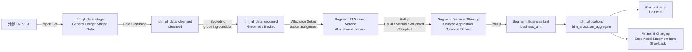
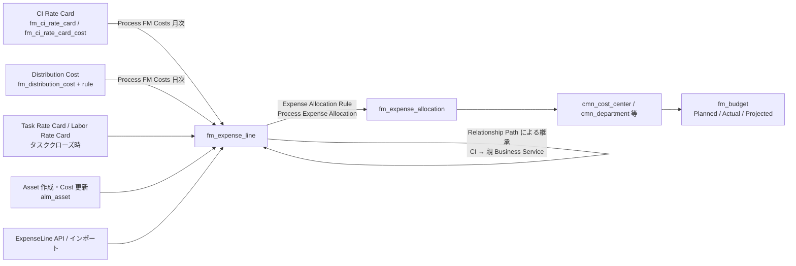
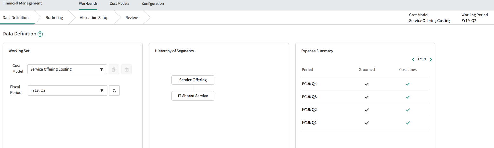
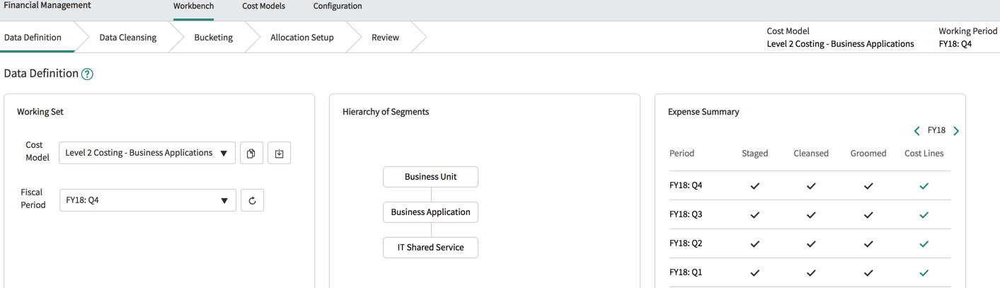
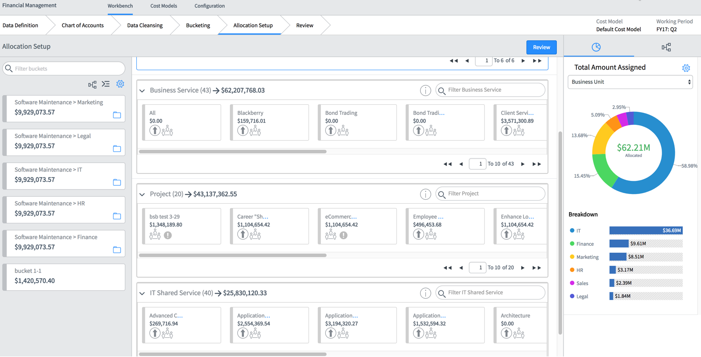
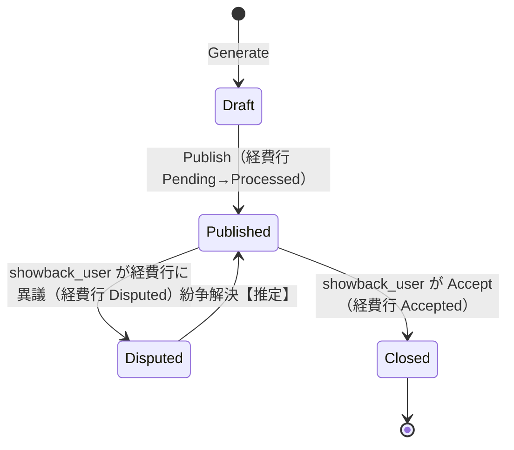
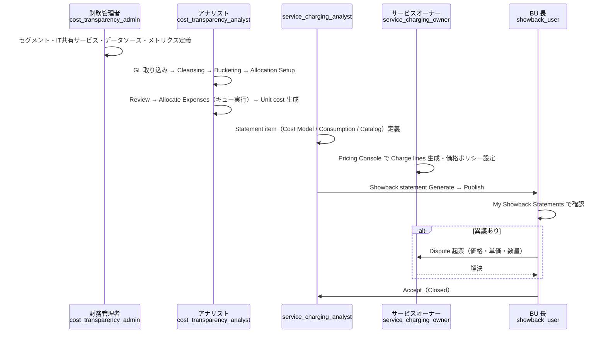
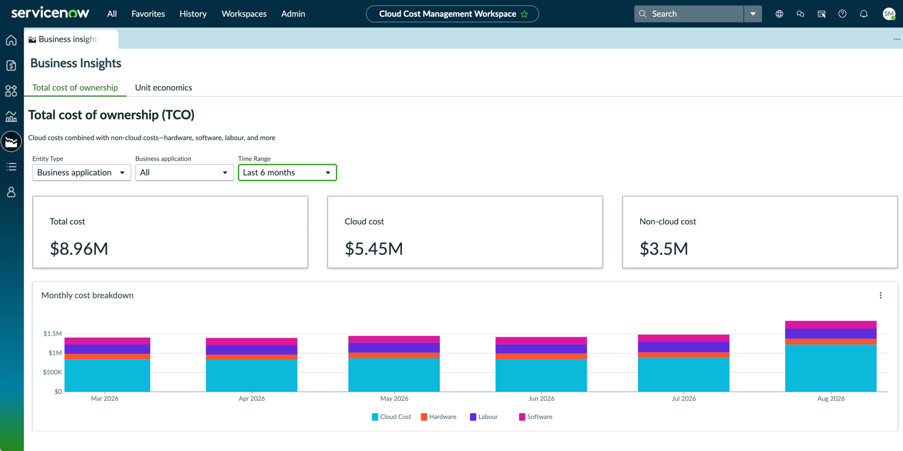

# IT Financial Management（ITFM/TBM）とコスト配賦・ショーバック

## 概要

本ファイルは、ServiceNow における **IT Financial Management（ITFM、IT 財務管理）** のうち、**IT コストの透明化（Cost Transparency）とコスト配賦（Cost Allocation）、サービス・アプリケーション単位のコスト算出、ショーバック（Showback）／チャージバック（Chargeback）** を扱う機能群をまとめたリファレンスである。プロジェクト・デマンド単位の予算・実績管理（SPM の Financial Planning、`cost_plan` / `fm_expense_line` によるプロジェクト財務）は [Strategic Portfolio Management（PPM）](./strategic-portfolio-management.md) を参照。

ServiceNow の ITFM 関連機能は、単一の製品ではなく以下の複数アプリケーションに分かれている。**Australia（2026-05 GA）時点で最も重要な事実**は、TBM 型のコストモデル（セグメント階層・バケット・ロールアップ）を提供していた **Financial Management の Financial Modeling は 2021 年 3 月以降、新規有効化（activation）が不可**であり、公式ドキュメントも **Xanadu 版が最後の掲載**になっている点である（後述 §2）。[出典](https://www.servicenow.com/docs/r/xanadu/it-business-management/financial-management/c_ITFinance.html)

| 機能群 | 主なプラグイン / アプリ | 役割 | Australia での位置付け |
|---|---|---|---|
| **Financial Management（Financial Modeling）** | `com.snc.financial_management`（Financial Management Core） | 総勘定元帳（GL）からの経費取り込み、セグメント階層型コストモデル、バケット（コストプール）、ロールアップ配賦、ユニットコスト | 2021-03 以降新規有効化不可。既存実装は継続サポート（機能強化なし、性能改善のみ）。Australia 版ドキュメントには掲載なし |
| **Financial Charging（ショーバック）** | Financial Management の一部（独立したプラグイン ID は公開情報では確認できず） | Statement item、Showback statement、Service Pricing Console、紛争（Dispute） | 同上（Financial Management の一部）。ITBM Analyst ライセンスが前提 |
| **Cost Management** | `com.snc.cost_management` | CI レートカード、タスク/労務レートカード、配賦コスト（Distribution cost）、経費配賦ルール（Expense allocation rule）、予算とコストセンター | **Australia で現行**。プラットフォーム同梱の配賦エンジン |
| **Expense Line** | 全インスタンスで有効 | `fm_expense_line`（経費明細）とスクリプト API `ExpenseLine` | **Australia で現行**。ITAM・CMDB・契約・SPM が共通に使う経費レコード |
| **Cloud Cost Management（CCM）** | ServiceNow Store（スコープ `sn_clin`。CCM 8.0.0 以前は Planned Deprecation、高速な請求処理向けに Infra Stack アプリあり [出典](https://www.servicenow.com/docs/r/australia/it-asset-management/cloud-cost-management/cloud-insights-landing-page.html)） | クラウド請求取り込み、共有コスト配賦ポリシー、TCO・ユニットエコノミクス | **Australia で現行**（v11.0.0 で TCO / Business Insights 追加） |
| **Application TCO（Enterprise Architecture）** | Enterprise Architecture Workspace 同梱 | ビジネスアプリケーション単位の TCO（`sn_apm_tco`） | **Australia で現行** |
| **Software Spend Detection（SAM）** | `com.sn_sam_spend` | 財務トランザクションからソフトウェア支出を検出・正規化 | **Australia で現行**（Patch 6 で Core UI 廃止→ワークスペースへ） |
| **AI Cost Management** | ServiceNow Store（単体購入、または SAM Advanced / SAM Prime に包含 [出典](https://www.servicenow.com/community/sam-blog/launching-today-new-solution-tackles-end-to-end-ai-costs-and/ba-p/3618473)） | 外部 AI サービスの支出可視化・上限管理（対応サービスはリリースノート記載で Claude Enterprise、Microsoft Copilot） | **Australia で新規**（v1.0） |
| パートナー製 ITFM/TBM アプリ | Apptio、Nicus、Brightfin など（Store） | TBM タクソノミー準拠のコストモデル、請求書型チャージバック | 【第三者情報】Financial Modeling の代替として公式に案内されている「Partner Store Apps」 |

> **用語:** 本ファイルでは、TBM（Technology Business Management）で一般的な「コストプール（cost pool）」を ServiceNow の **Bucket（バケット）**、「タワー（tower）」を **IT Shared Service（IT 共有サービス）**、「配賦ルール」を **Rollup（ロールアップ）／Bucket assignment（バケット割り当て）／Allocation metric（配賦メトリクス）／Expense allocation rule（経費配賦ルール）** に対応付けて説明する。ServiceNow 公式ドキュメントは「TBM」という語や TBM Council タクソノミーへの準拠を明示しておらず、この対応付けは【推定】である。

関連ファイル：[Strategic Portfolio Management（PPM）](./strategic-portfolio-management.md)、[Agile Development・APM・EAM](./agile-apm-eam.md)、[CMDB と CSDM](../platform/cmdb-csdm.md)、[Software Asset Management](../itam/software-asset-management.md)、[Cloud Management](../itom/cloud-management.md)、[ITAM 概要](../itam/itam-overview.md)、[Finance・Supply Chain・その他ワークフロー](../other/finance-supply-chain-esg.md)、[ライセンスコスト最適化](../../04_応用編/06-license-cost-optimization.md)。

---

## 1. 全体アーキテクチャ

### 1.1 データの流れ（TBM 型コストモデル）

Financial Modeling（Xanadu 版ドキュメントに基づく）は、総勘定元帳（GL）の経費を取り込み、クレンジング → バケット化 → セグメント階層への配賦 → ロールアップ → 配賦明細（allocation line）生成、という段階を経てサービスやビジネスユニットのコストを算出する。[出典](https://www.servicenow.com/docs/r/xanadu/it-business-management/financial-management/c_TheITFinanceWorkbench.html)



### 1.2 データの流れ（Cost Management 型の経費配賦）

Cost Management は、CI・タスク・契約などの「経費の発生源（Expense source）」ごとに `fm_expense_line` を生成し、経費配賦ルールで部門・コストセンター等へ `fm_expense_allocation` を作成する。GL を起点とする Financial Modeling とは逆に、**運用データ（CMDB・タスク）を起点に積み上げる方式**である。[出典](https://www.servicenow.com/docs/r/australia/it-business-management/cost-management/r_CostManagement.html)



### 1.3 どれを使うか（判断の目安）

| 要件 | Australia での候補 | 備考 |
|---|---|---|
| CI・サービス単位の経費を積み上げ、部門・コストセンターへ按分したい | Cost Management + Expense Line | ネイティブ、追加サブスクリプション不要とされる【第三者情報】[出典](https://www.servicenow.com/community/spm-forum/cost-management-and-financial-management-plugins-what-s-the/m-p/1018065) |
| GL 起点の TBM 型コストモデル（多階層の配賦・ユニットコスト）を新規に構築したい | パートナー Store アプリ（Apptio、Nicus、Brightfin 等） | Financial Modeling は新規有効化不可。公式は「Partner Store Apps」への相談を案内 [出典](https://www.servicenow.com/docs/r/xanadu/it-business-management/financial-management/c_ITFinance.html) |
| 既に Financial Modeling を実装済み | 継続利用（サポート継続） | 将来の改善は性能面のみ、機能追加なし |
| クラウド費用を事業部・コストセンターへ配賦・可視化したい | Cloud Cost Management（共有コスト配賦ポリシー、Business Insights） | |
| ビジネスアプリ単位の TCO を見たい | Enterprise Architecture の Application TCO、CCM の Business Insights | CCM は EA の非クラウドコストを合算 |
| ソフトウェア支出の把握 | SAM の Software Spend Detection | |
| プロジェクト・投資の予算計画 | SPM Financial Planning / Investment Funding | [SPM ファイル](./strategic-portfolio-management.md) 参照 |

---

## 2. Australia での提供形態と経緯

### 2.1 Financial Modeling の新規有効化停止

Financial Management 概要ページ（Xanadu 版、最終版）には次の注意書きがある。[出典](https://www.servicenow.com/docs/r/xanadu/it-business-management/financial-management/c_ITFinance.html)

- **2021 年 3 月以降、Financial Modeling は有効化（activation）できない。**
- **新規顧客**：Financial Modeling のエンタイトルメントがなく利用したい場合は、Partner Store Apps のいずれかに相談する（実装パートナー経由）。
- **既存顧客（エンタイトルメントあり・未実装）**：同様に Partner Store Apps に相談する。
- **既存顧客（エンタイトルメントあり・実装済み）**：継続利用可能。ServiceNow サポートは実装済みの形で支援を継続する。将来の拡張は **性能（performance）のみで機能（functionality）は対象外**。

### 2.2 ドキュメント掲載状況（本ファイル作成時の確認結果）

ServiceNow 公式ドキュメント（Fluid Topics）の各リリース版 Strategic Portfolio Management（`itbm` バンドル）の目次を確認した結果は以下のとおり。

| リリース | Financial Management / Financial Modeling / Financial Charging / Showback のトピック | Cost Management のトピック |
|---|---|---|
| Xanadu | 掲載あり（約 125 トピック） | 掲載あり |
| Yokohama | 掲載なし | 掲載あり |
| Zurich | 掲載なし | 掲載あり |
| **Australia** | **掲載なし** | **掲載あり**（2026-03-12 更新） |
| Brazil | 掲載なし | 掲載あり |

- 上表は本ファイル作成時（2026-11-08）に公式ドキュメント API の目次を検索した結果であり、「Yokohama 以降で Financial Management のドキュメントが SPM バンドルから外れた」ことを示す。ただし、**その理由（製品廃止か、ドキュメント移設か）を説明する公式の告知は確認できず**、各リリースの「Deprecation information for all <release> features and products」ページにも Financial Management の記載は見当たらなかった。【推定】Financial Modeling の新規有効化停止（2021-03）を受け、ドキュメント上の維持対象から外れたものと考えられる。
- 一方、Australia 版の Customer Service Management ドキュメントには「Integrating with Financial Management」（`com.snc.pa.fm.csm` によるケース単位の配賦ダッシュボード）が引き続き掲載されており、**既存実装との連携機能は Australia でも参照され続けている**。[出典](https://www.servicenow.com/docs/r/GOfWgam_hnLy1~sy07BOkA/z7laZ3jUfMR9b9oFINPpKg)
- 検索エンジン上には Australia 版を名乗る「Showback statements - Legacy」「Define, generate, and publish a showback statement」ページ（韓国語・ポルトガル語の機械翻訳版、2026-03〜06 更新表示）がヒットするが、本ファイル作成時点ではいずれも HTTP 404 または目次に存在せず、内容を確認できなかった。

### 2.3 ライセンス上の前提

- Financial Management Core（`com.snc.financial_management`）は Now Platform とは**別サブスクリプション**、Cost Management はプラットフォームに含まれる、と ServiceNow 社員が Community で回答している（2019-01-22）。【第三者情報】[出典](https://www.servicenow.com/community/spm-forum/cost-management-and-financial-management-plugins-what-s-the/m-p/1018065)
- Xanadu 版ドキュメントでは、以下の機能が **「ITBM Analyst ライセンス所有時のみ利用可能」** と明記されている。
  - 複数コストモデルの作成（Cost Model フォームからの作成）[出典](https://www.servicenow.com/docs/r/xanadu/it-business-management/financial-management/c_CostModel.html)
  - 規定（prescriptive）コストモデル（Level 1〜3 Costing）[出典](https://www.servicenow.com/docs/r/xanadu/it-business-management/financial-management/c_CostModel.html)
  - Financial Charging（ショーバック）全般 [出典](https://www.servicenow.com/docs/r/xanadu/it-business-management/financial-management/financial-reporting.html)
  - Review ステージの「View Expense Lines」（GL Expense Lines）[出典](https://www.servicenow.com/docs/r/xanadu/it-business-management/financial-management/t_AllocateExpensesWithTheWorkbench.html)
- ITBM Analyst ライセンスを持たない場合、セグメントあたり 4,000 アカウント、コストモデルあたり 12,000 アカウントの上限がある（後述 §4.2）。
- Enterprise Architecture（旧 APM）ライセンス利用者には **Business Application Costing** モデル、SPM ライセンス利用者には **Service Offering Costing** モデルがベースシステムで提供される（Financial Management を有効化済みの場合）。[出典](https://www.servicenow.com/docs/r/xanadu/it-business-management/financial-management/financial-management-spm.html)

ライセンス全般は [ライセンスモデル](../../03_導入編/01-licensing-model.md) を参照。

---

## 3. Financial Management（Financial Modeling）のデータモデル

> 本章以降 §3〜§7 は **Xanadu 版公式ドキュメント（2024-08-01 更新、一部 2026-07-02 更新）** に基づく。Australia 版の公式ドキュメントは存在しないため、既存実装を Australia にアップグレードして利用している場合の仕様として参照すること。

### 3.1 構成要素

Financial Management アプリケーションは次の要素で動作する。[出典](https://www.servicenow.com/docs/r/xanadu/it-business-management/financial-management/c_ITFinance.html)

| 要素 | 説明 |
|---|---|
| General ledger（総勘定元帳） | 組織の経費一覧。全会計期間の経費を保持 |
| Fiscal period（会計期間） | 経費が発生した期間。ワークベンチでは一度に 1 期間のみ扱う |
| Cost model（コストモデル） | 経費をセグメント階層のアカウントへどう配賦するかを定義するレコード群 |
| Allocation engine（配賦エンジン） | コストモデルに基づき経費を計算・配賦する中核 |
| Financial reports and dashboards | 配賦結果のレポート・ダッシュボード |

要件：レポート表示に **Report Charting v2** の有効化が必要。会計カレンダー（Fiscal Calendar）は IT Financial Management 配下からプラットフォーム領域へ移管されている。[出典](https://www.servicenow.com/docs/r/xanadu/it-business-management/financial-management/cost-transparency-setup.html)、[Fiscal calendar（Australia）](https://www.servicenow.com/docs/r/australia/platform-administration/time-configuration/c_FiscalCalendar.html)

### 3.2 テーブル一覧（Financial Management）

`itfm_` プレフィックスのテーブル群。[出典](https://www.servicenow.com/docs/r/xanadu/it-business-management/financial-management/r_InstalledWithITFinanceTables.html)

#### 経費データ（General Ledger）

| テーブル | ラベル | 説明 |
|---|---|---|
| `itfm_gl_data_staged` | General Ledger Staged Data | インポート直後の未クレンジング経費 |
| `itfm_gl_data_cleansed` | General Ledger Cleansed Data | クレンジング済み経費（Staged 作成時に対応レコードが自動生成） |
| `itfm_gl_data_groomed` | Groomed General Ledger Data | バケット化済み経費。データソースなしモデルの手入力金額もここに保持 |
| `itfm_gl_accounts` | General Ledger Accounts | 勘定科目と番号 |
| `itfm_gl_log` | General Ledger Log | 会計期間への経費追加時のログ |
| `itfm_data_source` | Financial Data Source | 経費データの取得元（Staged GL または Cost Plan Breakdown） |
| `itfm_data_source_field_map` | Financial Data Source Field Map | データソース列とトランザクション列の対応 |
| `itfm_cleansing_condition` | Cleansing Condition | クレンジング時に自動生成される条件 |
| `itfm_grooming_condition` | Grooming Condition | バケット化（グルーミング）時の条件 |

#### コストモデルと配賦

| テーブル | ラベル | 説明 |
|---|---|---|
| `itfm_cost_model` | Financial Model | コストモデル |
| `itfm_ca_segment_map` | Segment Definition | セグメント定義（階層で使うセグメント） |
| `itfm_itcoa_hierarchy` | Segment Relationship | セグメント階層の親子関係（Data Definition ステージで定義） |
| `itfm_itcoa_definition` | ITCOA Definition | コストモデルの参照フィールドマッピング |
| `itfm_group_segment_acct` | Segment Group Accounts | グループ化された ITCOA アカウント |
| `itfm_shared_service` | IT Shared Service | IT 共有サービス（TBM のタワー相当【推定】） |
| `itfm_shared_service_type` | IT Shared Service Type | IT 共有サービスの分類 |
| `itfm_bucket` | Bucket | 類似経費をまとめるバケット（コストプール相当） |
| `itfm_bucket_allocation_rule` | Bucket Allocation Rule | 経費をバケットへ割り当てるルール |
| `itfm_bucket_account_allocation` | Bucket Account Allocation | バケット割り当て情報 |
| `itfm_bucket_allocation_account` | Bucket Allocation Account | バケット・アカウント・コストモデルの参照リンク |
| `itfm_rollup` | Cost Allocation Rollup | ワークベンチで作成されるロールアップ |
| `itfm_rollup_override` | Cost Allocation Rollup Override | ロールアップの上書き値 |
| `itfm_sibling_relationship` | Sibling Rollup Relationship | 兄弟セグメント間のロールアップ定義 |
| `itfm_cost_allocation_metric` | Cost Allocation Metric | 加重（weighted）・カスタム配賦で使うメトリクス |
| `itfm_cost_allocation_group` | Cost Allocation Group | 配賦に関連付けるグループ |
| `itfm_weight_map` | Weight Maps | 加重メトリクス計算用の重み関係 |
| `itfm_weight_map_run_log` | Weight Map Run Log | 重みマップ生成ログ |
| `itfm_service_offering_allocation_map` | Service Offering Allocation Map | IT 共有サービス→サービスオファリングの消費量（重み）。Service Offering Costing で使用 [出典](https://www.servicenow.com/docs/r/xanadu/it-business-management/financial-management/use-service-offering-allocation-maps.html) |

#### 配賦結果

| テーブル | ラベル | 説明 |
|---|---|---|
| `itfm_allocation` | Cost Allocation | 配賦処理された全配賦明細（詳細レベル） |
| `itfm_allocation_aggregate` | Cost Allocation Aggregate | 配賦明細の集約版（Controlled Cost Lines） |
| `itfm_account_allocation` | Cost Allocation | 各アカウントへの入出配賦の全体ビュー |
| `itfm_allocation_breakdown` | Cost Allocation Breakdown Aggregate | Breakdown relationship に基づくセグメント間 2 次元配賦明細 |
| `itfm_unit_cost` | Unit Costs | 配賦から生成されたユニットコスト明細 |
| `itfm_segment_unit_metrics` | Unit Cost Metrics | ユニットコストメトリクス定義 |
| `itfm_ca_run_log` | Cost Allocation Runs Log | 配賦実行ログ |
| `itfm_ca_main_config` | Main Report Configuration | メインレポート設定 |
| `itfm_report` | FM Report | 財務レポート |
| `itfm_session` | ITFM Session | ワークベンチのセッション情報 |

#### Financial Charging（ショーバック）

| テーブル | ラベル | 説明 |
|---|---|---|
| `itfm_charge_item` | Statement Item | ショーバックの明細ソース定義（親） |
| `itfm_charge_item_cons` | Consumption Statement Item | 任意の消費量テーブルを元にする明細 |
| `itfm_charge_item_cm` | Cost Model Statement Item | Financial Modeling の出力を元にする明細 |
| `itfm_charge_item_sc` | Service Catalog Statement Item | サービスカタログ要求を元にする明細 |
| `itfm_charge_item_breakdown` | Base Statement Item Breakdown | 明細ブレークダウン定義（親） |
| `itfm_charge_item_breakdown_cons` / `_cm` / `_sc` | Consumption / Cost Model / Service Catalog Breakdown | 種別ごとのブレークダウン |
| `itfm_breakdown` | Breakdown Relationship | ブレークダウン定義 |
| `itfm_chg_item_drilldown` | Statement Item Drilldown | ドリルダウン定義 |
| `itfm_charge_line` | Service Charge Line | 個々のショーバック明細行 |
| `itfm_charge_line_drilldown` | Service Charge Line Drilldown | 明細行ドリルダウン |
| `itfm_sc_price_rate_card` | Service Charge Price Ratecard | 価格レートカード |
| `itfm_sb_stmt_def` | Showback Statement Definition | ショーバック明細書の定義 |
| `itfm_sb_stmt_line_def` | Showback Statement Line Definition | 明細書行の定義 |
| `itfm_sb_stmt_line_unit_cost_def` | Showback Statement Line Unit Cost Definition | 明細書行のユニットコスト定義 |
| `itfm_sb_stmt` | Showback Statement | ショーバック明細書 |
| `itfm_charge_expense_line` | Statement Expense Line | 明細書の経費行 |
| `itfm_charge_expense_line_details` | Statement Expense Line Details | 経費行の詳細 |
| `itfm_dispute` | Statement Dispute | 紛争（異議申し立て） |
| `itfm_reporting_entity` | Reporting Entity | ユーザー/グループに割り当てたレポーティング対象 |

#### Financial Planning（ITFM 予算計画、参考）

`itfm_plan_definition`（Budget Definitions）、`itfm_plan`、`itfm_plan_core`、`itfm_plan_item`、`itfm_plan_versions`、`itfm_plan_key`、`itfm_planner`、`itfm_plan_viewer`、`itfm_plan_actuals`、`itfm_budget`、`itfm_budget_forecast`、`itfm_bf_item`、`itfm_budget_target`、`itfm_budget_period`、`itfm_forecast_period`、`itfm_budget_segment_map`、`itfm_fx_config`、`itfm_fx_rate` などの予算計画系テーブルも Financial Management に含まれる。これは SPM の PPM Financial Planning（`cost_plan` 等）とは別の、IT 部門予算（セグメント×予算キー）を立てる機能である。[出典](https://www.servicenow.com/docs/r/xanadu/it-business-management/financial-management/r_InstalledWithITFinanceTables.html)

共通：`business_unit`（Business Unit）、`fiscal_period`（Fiscal Calendar のテーブル）を使用する。

### 3.3 ロール一覧（Financial Management）

[出典](https://www.servicenow.com/docs/r/xanadu/it-business-management/financial-management/r_InstalledWithITFinanceUserRoles.html)

| ロール | 権限 | 包含ロール |
|---|---|---|
| `cost_transparency_admin` | Financial Modeling の全メニュー・モジュール | `cost_transparency_analyst`, `cost_transparency_owner` |
| `cost_transparency_analyst` | Financial Modeling モジュールとワークベンチ | `cost_transparency_user` |
| `cost_transparency_user` | GL と配賦レコードの参照のみ | なし |
| `sn_itfm_read` | FM APM ダッシュボード（Application TCO、Costing for Business Applications、CIO ダッシュボード）とその元テーブルの参照 | `pa_viewer`, `cmdb_read` |
| `service_charging_analyst` | Statement item・ブレークダウン・ドリルダウン・Showback statement definition / line definition の CRUD、ショーバック明細書の生成と公開 | — |
| `service_charging_owner` | Statement item 参照、Service Charging Console でのプライシングポリシー設定、ドリルダウン参照 | — |
| `showback_user` | ショーバック明細書の参照と承認（Accept） | — |

その他、データソース作成には `itfm_plan_analyst`、セグメント定義作成には `budget_admin` も手順上の必要ロールとして記載されている。[出典](https://www.servicenow.com/docs/r/xanadu/it-business-management/financial-management/create-data-sources.html)、[出典](https://www.servicenow.com/docs/r/xanadu/it-business-management/financial-management/create-segment-definition.html)

**読み取り専用ロール `sn_itfm_read`**：PPM Standard の読み取り専用ロールプラグイン（`com.snc.pmo_read_roles`）有効時に利用可能。FM APM ダッシュボードには Financial Management For APM（`com.snc.financial_management_for_apm`）が必要で、これにより Performance Analytics – Content Pack – Financial Management for APM（`com.snc.pa.fm.apm`）が有効化される。参照可能テーブル：`itfm_allocation_aggregate`、`itfm_allocation`、`itfm_cost_model`、`itfm_bucket`、`itfm_ca_segment_map`、`itfm_shared_service`、`itfm_allocation_breakdown`。[出典](https://www.servicenow.com/docs/r/xanadu/it-business-management/financial-management/user-roles-fm-apm.html)

### 3.4 ドメインセパレーション

Financial Management は **ドメインセパレーション非対応（Support level: No support）**。ドメインフィールドが存在してもビジネスロジックはない。[出典](https://www.servicenow.com/docs/r/xanadu/it-business-management/financial-management/domain-separation-financial-management.html)（Cost Management [出典](https://www.servicenow.com/docs/r/australia/it-business-management/cost-management/domain-separation-cost-management.html)・Expense Line [出典](https://www.servicenow.com/docs/r/australia/it-service-management/expense-line/domain-separation-expense-line.html) も同様に非対応（Support level: No support）。§8.7 参照）。MSP 型の多テナント配賦を行う場合は注意（[ドメインセパレーション](../platform/domain-separation.md)）。

---

## 4. Financial Modeling：コストモデルとコストプール

### 4.1 経費データの取り込み

- 財務データは **General Ledger Staged Data（`itfm_gl_data_staged`）** に Import Set または Easy Import で取り込む。会計カレンダーが財務データと整合していることが前提。[出典](https://www.servicenow.com/docs/r/xanadu/it-business-management/financial-management/c_GeneralLedger.html)
- **Financial Data Source（`itfm_data_source`）**：任意のプラットフォームテーブルを経費ソースにできる（必須列は金額・勘定番号・日付）。フォーム項目：Name、GL Account、Amount、Table、Currency、Posting date、Condition。ナビゲーション：**All > Financial Modeling > Data Sources > Setup**。[出典](https://www.servicenow.com/docs/r/xanadu/it-business-management/financial-management/create-data-sources.html)
- 既定データソース：**GL Staged**、**Cost Plan Breakdown**（FM と PPS（PPM）財務計画の連携）。[出典](https://www.servicenow.com/docs/r/xanadu/it-business-management/financial-management/data-sources.html)
- 既定フィールドマップ：

| セグメント名 | トランザクションテーブル |
|---|---|
| Cost Center | `cmn_cost_center` |
| Location | `cmn_location` |
| Vendor | `core_company` |
| Department | `cmn_department` |
| Project | `pm_project` |

- フィールドマップ（`itfm_data_source_field_map`）の主要項目：Datasource field、Cleansed Column、**Used by cleansing**（クレンジングで使用）、Segment name、Mapped to transaction field、**Used for Bucket split**（バケット分割で使用）。
- データソースを指定しないコストモデルも可能。その場合クレンジングステージは表示されず、バケット（サブバケット）に金額を直接入力する。

#### Groomed General Ledger Data の State

| State | 意味 |
|---|---|
| Unallocated | 未配賦 |
| Allocated | 配賦済み |
| Locked | ロック済み（配賦明細を取り消せない） |

その他主要項目：Account name / number、Amount、Currency（`fx_currency` の 3 文字コード）、Document amount / currency、Bucket、Sub-bucket、Cost center、Department、Fiscal period、Location、Vendor（`core_company`）、Posting date、Local amount / currency、Segments。[出典](https://www.servicenow.com/docs/r/xanadu/it-business-management/financial-management/t_View_ExpensesInTheGeneralLedger.html)

### 4.2 セグメント（Segment）とセグメント階層

セグメントはコストモデル階層で使うトランザクションテーブルを定義する。セグメントに含まれる個々のレコードを **Account（アカウント）** と呼ぶ。[出典](https://www.servicenow.com/docs/r/xanadu/it-business-management/financial-management/segments.html)

| 既定セグメント | トランザクションテーブル |
|---|---|
| Business Unit | `business_unit` |
| Department | `cmn_department` |
| Business Service | `cmdb_ci_service` |
| Business Capability | `cmdb_ci_business_capability` |
| Business Application | `cmdb_ci_business_app` |
| Service Offering | `service_offering` |
| Server | `cmdb_ci_server` |
| Cost Center | `cmn_cost_center` |
| Location | `cmn_location` |
| Vendor | `core_company`（Vendor チェックありのみ） |
| IT Shared Service | `itfm_shared_service` |

- コストモデルに割り当て済みのセグメントは削除不可。
- **Segment Definition フォーム**（**All > Financial Modeling > Administration > Segments**）：Segment name、Transactional table、Primary field、**Used by Cost Allocation**、**Used by Budgeting**、Condition、**Fiscal effective start / end**（例：サーバーの導入日〜廃棄日で配賦対象を絞る）。同一テーブルに条件違いで複数セグメントを作れる（例：`core_company` の Vendor=true / false）。[出典](https://www.servicenow.com/docs/r/xanadu/it-business-management/financial-management/create-segment-definition.html)
- **CMDB/CSDM との関係**：Business Service、Business Application、Service Offering、Business Capability、Server がそのままセグメントになるため、**コストモデルの品質は CMDB/CSDM の整備度に直結する**（[CMDB と CSDM](../platform/cmdb-csdm.md)）。

#### アカウント数の上限（非 Analyst ライセンス）

| パラメータ | しきい値 |
|---|---|
| セグメントあたり最大アカウント数 | 4,000 |
| コストモデルあたり合計アカウント数 | 12,000 |

しきい値超過時は **Basic Allocation Setup**（軽量 UI）が自動有効化され、さらに **Allocate Expenses の実行は動作しない**。[出典](https://www.servicenow.com/docs/r/xanadu/it-business-management/financial-management/c_TheITFinanceWorkbench.html)

### 4.3 IT Shared Service（IT 共有サービス）

IT に関連しつつ組織横断で共有されるサービス（ヘルプデスク、音声ネットワーク等）。既定のセグメント階層では IT 共有サービスの経費がビジネスサービスへロールアップする。作成：**All > Financial Modeling > Hierarchy of Segments > IT Shared Services**（`cost_transparency_admin`）。フォーム項目：Name、Owner、Description、Group、Service type。[出典](https://www.servicenow.com/docs/r/xanadu/it-business-management/financial-management/c_ITSharedService.html)

規定コストモデルには、以下の **シード済み IT 共有サービス（cost collection container）** が含まれる（TBM のタワーに近い粒度【推定】）。[出典](https://www.servicenow.com/docs/r/xanadu/it-business-management/financial-management/preconfigured-prescriptive-cost-models.html)

| IT Shared Service | 集約するコスト |
|---|---|
| Equip End Users | エンドユーザー個人デバイス、その上のソフトウェア、サポート |
| Facilitate Configuration Change | 日常的な変更・リリース・構成管理（非セキュリティパッチ、FW 更新等） |
| Facilitate Connectivity | ネットワーク接続（ハード・ソフト・サポート） |
| Management and Overhead | IT 経営層報酬、コンプライアンス・監査、未分類コスト |
| Monitor the Environment | ITOM イベント管理・監視 |
| Perform Upgrades/Maintenance | プロジェクト化された大規模アップグレード |
| Provide Tech Support | Incident / Problem / Knowledge（Tier 1〜3 サポート） |
| Run Business Applications | 業務アプリ運用の要員時間 |
| Secure the Environment | セキュリティ運用 |
| Store and Manage Data | データ・ストレージ管理（バックアップ、DR 複製等） |
| Supply Computing Power | DR 設備、予備品、UPS、データセンターのスペース・電力・冷却 |

### 4.4 コストモデル（Cost Model）

コストモデルは「階層内のアカウントへ経費をどう配賦するか」を定めるルール・方式・メトリクスの集合。ITBM Analyst ライセンスがあれば複数モデルを作成し、配賦エンジンを実行するモデルを選べる。[出典](https://www.servicenow.com/docs/r/xanadu/it-business-management/financial-management/c_CostModel.html)

#### Financial Model フォーム（**All > Financial Modeling > Cost Models > All**、`cost_transparency_admin`）

[出典](https://www.servicenow.com/docs/r/xanadu/it-business-management/financial-management/t_CreateACostModel.html)

| フィールド | 説明 |
|---|---|
| Name | 最大 80 文字 |
| Description | 説明 |
| Used by Cost Allocation | 配賦に使用 |
| Model Owner | 作成者 |
| Data Source | 経費ソース。モデル操作前のみ編集可。未指定ならクレンジングステージなし |
| Used by Budgeting | 予算モデルとして使用 |
| Fiscal Unit | 月・四半期・期間 |
| Include Sub-Bucket info | 生成明細にサブバケット情報を保持 |
| User Group | ITFM タイプのユーザーグループに限定（アクセス制御） |

アクセス制御のルール：`cost_transparency_analyst` は既定モデルと自グループに紐づくモデルのみ、`cost_transparency_admin` と admin は全モデル。Used by Cost Allocation と Used by Budgeting の両方が有効なモデルは全ユーザーがアクセス可能。

フォーム上の主なアクション：

| アクション | 内容 |
|---|---|
| Allocate Expenses | 会計期間を選び配賦エンジンを実行（ワークベンチ外から実行可） |
| Download Cost Model | モデルと関連要素（セグメント定義・階層、バケット、クレンジング/グルーミング条件、バケット割り当て、ロールアップ・上書き、消費メトリクス）をダウンロードし別インスタンスへ移送 |
| Generate Bucket Cost | データソースなしモデルで、リーフバケットごとに金額 0 の Groomed 行を生成（既存行は上書きしない） |
| Build segment hierarchy（関連リンク） | 対話 UI で階層を構築 |
| Clone Model and Replace Top Segment（関連リンク） | 最上位セグメントを差し替えたクローン作成（バケット割り当て・ロールアップ等は再設定が必要） |

関連リスト：Buckets、**Unit Cost Metrics**、**Breakdown Relationships**、**Sibling Rollup Relationship**。

#### Controlled cost lines（Xanadu の変更）

新規顧客では配賦エンジンが **Controlled Cost Lines**（`itfm_allocation_aggregate`）を既定で生成し、**GL Expense Lines** は生成しない（新規・クローンモデルで Generate Controlled Cost Lines = true、Generate GL Expense Lines = false、いずれも編集不可）。セグメント間の 2 次元レポート（例：IT 共有サービス→ビジネスユニット）が必要な場合は Breakdown relationship を明示定義し、`itfm_allocation_breakdown` を生成する。[出典](https://www.servicenow.com/docs/r/xanadu/it-business-management/financial-management/generating-controlled-cost-lines.html)

### 4.5 規定（Prescriptive）コストモデル

| モデル | 階層（下→上） | 主な用途 | 前提 |
|---|---|---|---|
| Level 1 Costing — Shared Services | Bucket → IT Shared Service → Business Unit | IT インフラのフルロードコスト、共有サービスのショーバック | ITBM Analyst |
| Level 2 Costing — Business Applications | Bucket → IT Shared Service → Business Application → Business Unit | アプリ・エンドユーザーのコスト、BU との整合 | ITBM Analyst |
| Level 2 Costing — Business Services | Bucket → IT Shared Service → Business Service（`cmdb_ci_service`）→ Business Unit | 業務サービス単位のコスト、運用コストドライバー | ITBM Analyst |
| Level 3 Costing — Business Capabilities | …→ Business Capability → Business Unit | ビジネスケイパビリティ単位（イノベーションのコスト） | ITBM Analyst |
| Business Application Costing | Bucket → IT Shared Service → Business Application（`cmdb_ci_business_app` または `cmdb_ci_appl`）→ Business Unit | APM（EA）利用者向け | EA ライセンス |
| Service Offering Costing | IT Shared Service → Service Offering（`service_offering`） | SPM 利用者向け。サービスレベルごとの支出 | SPM ライセンス |

[出典](https://www.servicenow.com/docs/r/xanadu/it-business-management/financial-management/preconfigured-prescriptive-cost-models.html)、[出典](https://www.servicenow.com/docs/r/xanadu/it-business-management/financial-management/preconfigured-prescriptive-cost-models-two.html)、[出典](https://www.servicenow.com/docs/r/xanadu/it-business-management/financial-management/financial-management-apm.html)

- Level 2/3 のビジネスサービス・ケイパビリティモデルは「フェーズ II、または既に Financial Management に投資済みの場合」に推奨と記載。
- Business Application Costing / Service Offering Costing は **データソースなし**（支出を直接入力。GL をソースにする設定は任意）。



**図 1：Service Offering Costing コストモデル（Financial Management ワークベンチ）** — 画面上部に「Financial Management」と 3 タブ（Workbench / Cost Models / Configuration）、その下にステージ（Data Definition → Bucketing → Allocation Setup → Review）が並ぶ。データソースなしモデルのため Data Cleansing ステージがない。左の Working Set で Cost Model（Service Offering Costing）と Fiscal Period（FY19: Q2）を選択、中央の Hierarchy of Segments に「IT Shared Service → Service Offering」の 2 階層、右の Expense Summary に期間別の Groomed / Cost Lines 生成状況（チェック）が表示される。出典：[Financial Management for licensed SPM users（Xanadu）](https://www.servicenow.com/docs/r/xanadu/it-business-management/financial-management/financial-management-spm.html)（取得日 2026-11-08）

#### Service Offering Costing の既定動作と規定メトリクス

[出典](https://www.servicenow.com/docs/r/xanadu/it-business-management/financial-management/financial-management-spm.html)

- 全サブバケットはシード済み IT 共有サービスに **均等（Equal）** に配賦、IT Shared Service → Service Offering も既定は **Equal** ロールアップ。
- 規定メトリクス：

| メトリクス | 重みの元 |
|---|---|
| Allocate to Service Offering on Allocation Maps | `itfm_service_offering_allocation_map`（IT 共有サービス×サービスオファリングの Allocation Weight） |
| Allocate to Service Offerings on related CIs | `cmdb_rel_ci` の CI 数 |
| Allocate to Service Offerings on Total Subscribers | `service_offering` のサブスクライバー数 |

- 設定：**All > Financial Modeling for SPM > Service Offering Costing Model**、**Service Offering Allocation Maps**（項目：Allocation Weight、IT Shared Service、Service Offering）。必要ロール `cost_transparency_analyst`。[出典](https://www.servicenow.com/docs/r/xanadu/it-business-management/financial-management/use-service-offering-allocation-maps.html)

#### その他の規定メトリクス（L1/L2/L3 モデル）

| メトリクス | 配賦先 | 重みの元（ドキュメント記載） |
|---|---|---|
| Allocate to Business Unit on Headcount | Business Unit | `sys_user`→`cmn_department`→BU のアクティブユーザー数 |
| Allocate to Business Unit based on CI Count | Business Unit | CI 数 |
| Allocate to Business Units on Computer count | Business Unit | コンピューター数 |
| Allocate to Business Unit on Change Request volume / based on CIs | Business Unit | 変更要求件数 |
| Allocate to Business Unit based on Incident volume | Business Unit | インシデント件数 |
| Allocate to Application based on Active User Count | Business Application | アクティブユーザー数 |
| Allocate to (Business) Application based on Compute Power | Business Application | `cmdb_rel_ci` の Child.Class=Server 件数 |
| Allocate to Applications using database count | Business Application | DB 数 |
| Allocate to Business Service based on CI count / compute power / database count / change request volume / incident volume | Business Service | 各件数 |

[出典](https://www.servicenow.com/docs/r/xanadu/it-business-management/financial-management/preconfigured-prescriptive-cost-models.html)、[出典](https://www.servicenow.com/docs/r/xanadu/it-business-management/financial-management/preconfigured-prescriptive-cost-models-two.html)

---

## 5. Financial Modeling：ワークベンチと配賦ルール

### 5.1 ワークベンチの構成

**Financial Modeling > Workbench** から起動。3 タブとステージで構成される。[出典](https://www.servicenow.com/docs/r/xanadu/it-business-management/financial-management/c_TheITFinanceWorkbench.html)

| タブ / ステージ | 内容 |
|---|---|
| **Workbench** タブ | |
| ① Data Definition | 会計期間（Working set）とコストモデルの選択、モデルのクローン・ダウンロード、セグメント階層の確認、Expense Summary（Staged / Cleansed / Groomed / Cost Lines の有無） |
| ② Data Cleansing | 不要経費の除外、同一セグメントへのマージ、セグメントレコードと経費行のマッピング（データソースなしモデルでは非表示） |
| ③ Bucketing | 経費をバケット（コストプール）へ分類。フィルタ条件（grooming condition）、ドラッグ＆ドロップ |
| ④ Allocation Setup | バケットをセグメント/アカウントへ割り当て、ロールアップ（配賦ルール）作成 |
| ⑤ Review | 割り当て率の確認、配賦エンジン実行 |
| **Cost Models** タブ | モデル一覧、クローン・比較・削除、Breakdown relationship |
| **Configuration** タブ | 通貨表示、配賦明細の詳細度、Basic Allocation Setup、Missing Money Analysis、表示件数、メインレポート設定、配賦明細の削除 |



**図 2：Data Definition ステージ（Level 2 Costing — Business Applications）** — ステージは Data Definition → Data Cleansing → Bucketing → Allocation Setup → Review の 5 段階。Working Set で Cost Model（Level 2 Costing - Business Applications）と Fiscal Period（FY18: Q4）を選択し、隣にクローンアイコンとダウンロードアイコンがある。中央の Hierarchy of Segments は下から IT Shared Service → Business Application → Business Unit の 3 階層。右の Expense Summary は期間ごとに Staged / Cleansed / Groomed / Cost Lines の生成済みチェックを表示する。出典：[Prescriptive cost models for shared services and business applications（Xanadu）](https://www.servicenow.com/docs/r/xanadu/it-business-management/financial-management/preconfigured-prescriptive-cost-models.html)（取得日 2026-11-08）

### 5.2 Bucketing（コストプール化）

- **Bucket** は経費を配賦前にまとめる任意の分類。Segment（配賦先となる組織・サービスの部分）とは別概念。[出典](https://www.servicenow.com/docs/r/xanadu/it-business-management/financial-management/c_TheDataBucketingStage.html)
- 画面：左ペイン＝勘定番号別のクレンジング済み経費、中央＝バケット（サブバケットを親バケット内にグループ化）、右＝サマリー。
- バケットフォームの **Exclude from cost model** を選ぶと配賦対象外バケット（Buckets Excluded from Cost Model）になる。
- バケットフィルタ条件（grooming condition、Advanced query conditions 型）で自動振り分け。
- 必要ロール：`cost_transparency_admin` または `cost_transparency_analyst`。

### 5.3 Allocation Setup（配賦ルールの設定）

[出典](https://www.servicenow.com/docs/r/xanadu/it-business-management/financial-management/c_TheAllocationSetupStage.html)



**図 3：Allocation Setup ステージ（Default Cost Model、FY17: Q2）** — 左ペインにバケット一覧（例：Software Maintenance > Marketing $9,929,073.57 など、サブバケット単位）とフィルタ。中央ペインにセグメントごとの折りたたみ領域（Business Service (43) → $62,207,768.03、Project (20) → $43,137,362.55、IT Shared Service (40) → $25,830,120.33）があり、各アカウントのカードに金額とロールアップ（上矢印）・関係アイコンが付く。右ペインは Total Amount Assigned のドーナツチャート（Business Unit 別：$62.21M Allocated、IT $36.69M、Finance $9.61M、Marketing $8.51M、HR $3.17M、Sales $2.39M、Legal $1.84M）と Breakdown バー。上部右に Review ボタン。出典：[Allocation Setup stage（Xanadu）](https://www.servicenow.com/docs/r/xanadu/it-business-management/financial-management/c_TheAllocationSetupStage.html)（取得日 2026-11-08）

#### バケット割り当て（Bucket assignment）の方式

[出典](https://www.servicenow.com/docs/r/xanadu/it-business-management/financial-management/t_AssignABucketToASegmentOrAnAccount.html)

| 割り当て先 | 方式 | 説明 |
|---|---|---|
| 単一アカウント | Allocate 100% | バケットをアカウントへドラッグ。複数バケット同時可 |
| セグメント | **Equal** | セグメント内アカウントへ同率 |
| セグメント | **Manual** | 指定パーセンテージ |
| セグメント | **Weighted** | 加重メトリクス（親子セグメントを指定したメトリクスのみ選択可。Total weight 設定のメトリクスではバケット分割不可） |

#### ロールアップ（Rollup）

ロールアップは「下位アカウントの経費を上位アカウントへ自動配賦する」配賦ルール。[出典](https://www.servicenow.com/docs/r/xanadu/it-business-management/financial-management/c_RollupsForAllocations.html)

- **Account-specific rollup**（特定アカウント→上位の 1 つ以上のアカウント）と **Segment-specific rollup**（セグメント内全アカウント→親セグメント）。**アカウント指定が優先**し、セグメント指定は適用されない。
- 直近の親だけでなく **祖父母（grandparent）セグメント** や **兄弟（sibling）セグメント** へもロールアップ可能（兄弟は Sibling Rollup Relationship で定義：Relation Name、From Segment、To Segment）。[出典](https://www.servicenow.com/docs/r/xanadu/it-business-management/financial-management/define-sibling-rollup-relationship.html)
- **Total weight 対応**の加重メトリクスでは、ロールアップのない アカウントがあると合計が 100% 未満になり得る（消費量の重みで正確に按分）。

Rollup Method の選択肢（アカウント単位）：[出典](https://www.servicenow.com/docs/r/xanadu/it-business-management/financial-management/t_CreateRollupsOneAcctToAnother.html)

| Rollup Method | 説明 |
|---|---|
| Segment's default method | Data Definition で作成された CI 関係の既定ルールに従う（CMDB 項目間の既定） |
| None | 上位へロールアップしない |
| Equal | 指定した親アカウントへ同率 |
| Manual | 指定パーセンテージ（合計 100%） |
| Weighted | 親アカウントのセグメントへのロールアップを定義した既存の加重メトリクス。**Enforce Relationship** が有効なメトリクスは子セグメントも考慮 |
| Scripted | スクリプトで決定 |

ロールアップを作成すると、Data Definition ステージで自動作成されたシステムメトリクス（セグメント関係管理用）が自動更新される。

#### Missing Money Analysis（配賦漏れ分析）

Configuration タブで有効化すると Allocation Setup に Missing Money Logs アイコンが追加される（ページ読み込みが遅くなる可能性あり）。配賦漏れは **Segment rollup errors / Account rollup errors / Bucket allocation errors** の 3 分類で記録され、原因と対処のヒント（Missing money logs factoring tips）が提供される。Madrid 以前の allocation log の拡張版。[出典](https://www.servicenow.com/docs/r/xanadu/it-business-management/financial-management/t_ConfigureGeneralSettings.html)

### 5.4 配賦メトリクス（Allocation metrics）

[出典](https://www.servicenow.com/docs/r/xanadu/it-business-management/financial-management/c_AllocationMetrics.html)

| 種類 | 説明 |
|---|---|
| Weighted metrics | セグメントの集計値に基づく重み（例：セグメントが使うサーバー数、資産の減価償却額） |
| Scripted weighted metrics | 加重メトリクスのスクリプト版 |
| Scripted methods | allocation method API を使うカスタムスクリプト（旧 scripted metrics） |
| System metrics | ワークベンチ操作で自動作成（読み取り専用） |

- ワークベンチ経由の設定が推奨（リスト/フォームでの直接作成より）。Geneva 以降メトリクスで会計期間をサポート。

#### Weighted Metric フォーム（**All > Financial Modeling > Consumption Metrics > Create Weighted Metric**、`cost_transparency_admin`）

[出典](https://www.servicenow.com/docs/r/xanadu/it-business-management/financial-management/t_CreateWeightedAllocationMetrics.html)

| セクション | フィールド | 説明 |
|---|---|---|
| 基本 | Name / Allocation group（既定 ITSM）/ System metric / Refresh frequency | |
| Cost Allocation | Allocate to | 配賦先セグメント（ドットウォーク可） |
| | Apply filter (Cost Allocation) | 配賦先の条件 |
| Weight Table | Weight table | 重み計算に使うテーブル |
| | Reference to allocate from / to | 重みテーブル上の配賦元・配賦先参照 |
| | Aggregate | **Count / Value of / Sum / Average / Min / Max** |
| | Aggregate field | 集計対象フィールド（Count 以外） |
| | Apply filter (Weight Table) | 重みテーブルの条件 |
| Intermediary Segment | Enforce intermediary segment / Intermediary Segment / reference / Aggregate | 階層外の中間セグメントを経由する重み |
| Relationship | Enforce relationship / Allocate from / Relation type（Allocate from / Allocate to / Intermediary）/ Relationship field from | 既存の関係で配賦先を限定 |

フォーム上部の **Metric Visualization** が設定を図示する。**Preview weight map** で、選択メトリクス・会計期間におけるアカウント別の按分率を事前確認できる。

### 5.5 Review と配賦実行

[出典](https://www.servicenow.com/docs/r/xanadu/it-business-management/financial-management/c_TheAllocationReviewStage.html)、[出典](https://www.servicenow.com/docs/r/xanadu/it-business-management/financial-management/t_AllocateExpensesWithTheWorkbench.html)

- Review ページのサマリー：Bucketing（バケット割り当て率）、Allocation Setup（バケット→アカウント割り当て率）、Others（配賦予定額、クレンジング額、未割り当て/割り当て済みバケット額）。
- **配賦ジョブのキュー**：複数コストモデル・複数会計期間の配賦を同時にキュー投入でき、複数ユーザーが同一インスタンスで要求可能。実行中ジョブのキャンセル、キューからの除外（dequeue）も可能。
- 実行後のリンク：View on Cost Analysis、View Expense Lines（ITBM Analyst、Xanadu へのアップグレード顧客で GL Expense Lines を有効化していた場合のみ）、View Cost Lines、View Cost Line Breakdowns（**Run On Demand Only** が true だと breakdown 行は生成されず明示生成が必要）、View Unit Costs、**View Cost Tree**（セグメント・アカウントを選んで寄与アカウントを階層表示）。
- 実行結果：GL レコードの State が **Allocated** に変わり、配賦明細の合計は元経費と一致。適用ルールがない経費は **Unallocated** のまま。
- **丸め**：配賦明細は小数第 2 位で丸め（$100.495→$100.50、$100.494→$100.49）。$0.00 に丸められた明細は作成されない。

### 5.6 ユニットコストとコスト分析

- **Generate unit costs**：コストモデルの **Unit Cost Metrics** 関連リスト（項目：Cost Model、Unit Cost Segment、Unit Cost Metric、Unit、Transactional table、Include Bucket Info、Unit Cost Accounts filter）を作成し、**Generate Unit Cost Metrics** で会計期間を指定して `itfm_unit_cost` を生成。参照は **Financial Modeling > Cost Model Lines > Unit Costs**。合計コストと数量、バケット別内訳（Include Bucket Info 有効時）を保持。[出典](https://www.servicenow.com/docs/r/xanadu/it-business-management/financial-management/generate-unit-costs.html)
- **Cost analysis**（**Financial Modeling > Cost Analysis**）：生成済み配賦明細のみに基づき、ワークベンチ同様の UI でバケット額・アカウント配賦額・ロールアップ額を確認。過去期間を現在のルールの影響なしに参照でき、「有効なショーバック報告ツール」と位置付けられている。[出典](https://www.servicenow.com/docs/r/xanadu/it-business-management/financial-management/financial-management-cost-analysis.html)

### 5.7 Configuration タブとその他の仕様

- 通貨：Kingston までは `com.glide.financial_management.currency_code` プロパティ（London で削除、アップグレード顧客は継続利用可）、現在は `glide.system.locale` が機能通貨。スクリプトからは `SNC.FMCurrency().getGlobalCurrencyCode()` で取得。[出典](https://www.servicenow.com/docs/r/xanadu/it-business-management/financial-management/t_ConfigureGeneralSettings.html)
- 配賦明細にセグメント値の Sys ID を保持する設定（ドットウォークでのレポートが可能になるが性能影響あり）。
- 表示件数（Display Records per segment）：5 / 10 / 15 / 25 / 50。
- Main Report Configuration：CIO ダッシュボードのメイン財務レポートに使うコストモデルを会計期間ごとに選択。
- Advanced Actions：配賦の取り消し、配賦明細の削除。

### 5.8 Financial Management のダッシュボード（Platform Analytics）

Xanadu 版で以下のダッシュボードが提供されていた：Application TCO、Business Application Costing、CIO dashboard for Business Applications、Level 1 Costing – Shared Services、Level 2 Costing – Business Applications、Level 2 Costing – Business Services、Level 3 Costing – Business Capabilities。[出典](https://www.servicenow.com/docs/r/xanadu/it-business-management/financial-management/financial-content-pack.html)

CSM 向けには `com.snc.pa.fm.csm`（CSM Financials Dashboard、モデル：CSM Allocation Model for Cost Account / for Channels、ケース件数・解決時間・担当グループ人数で按分）があり、Australia 版 CSM ドキュメントにも掲載されている。[出典](https://www.servicenow.com/docs/r/GOfWgam_hnLy1~sy07BOkA/z7laZ3jUfMR9b9oFINPpKg)

---

## 6. Financial Charging（ショーバック／チャージバック）

### 6.1 概要

Financial Charging は、ビジネスサービスの財務面（消費量とコスト）を、それを消費するステークホルダー（ビジネスユニット長、部門長、アカウント長）に報告する機能。**ITBM Analyst ライセンス所有時のみ利用可能**。[出典](https://www.servicenow.com/docs/r/xanadu/it-business-management/financial-management/financial-reporting.html)

- **Showback（ショーバック）**：IT ハードウェア、ソフトウェア、クラウドサービス、共有サービスのコストを追跡し、ビジネスユニットへ「報告用の請求書（showback statement）」として提示する。お金の移動は伴わない。[出典](https://www.servicenow.com/docs/r/xanadu/it-business-management/financial-management/showback-statements.html)
- **Chargeback（チャージバック）**：ServiceNow ドキュメントの Financial Charging は「ショーバック」として記述されており、**部門への実際の課金・会計仕訳（内部振替）を行う機能の記載は公開情報では確認できず**。Service Pricing Console のプライシングポリシー（割増・割引・単価）により「回収額（Total Charges）」を算出する仕組みはあり、これをチャージバックの価格決定に用いることは可能【推定】。会計システムへの振替仕訳はインテグレーションで実装する必要がある【推定】。
- **Cost Management の経費配賦**も公式に「チャージバックや請求ではないが、請求のソースとして使える」と説明されている（§8.5）。

### 6.2 Statement item（明細ソース）の 3 種類

**All > Financial Charging > Administration > Statement Items**（`service_charging_analyst`）で、まず種類を選ぶ。[出典](https://www.servicenow.com/docs/r/xanadu/it-business-management/financial-management/determine-statement-item.html)

| 種類 | コストの元 | 主なフィールド |
|---|---|---|
| **Consumption Statement Item**（`itfm_charge_item_cons`） | 任意のプラットフォームテーブルの消費量データ（日次・月次）。単価はテーブル値またはレートカード | Consumption table、Consumption item、Consumed date、Aggregate、Consumption table filter、Fiscal unit、**Price basis**（Amount / Ratecard class / Unit price）、Amount field、Ratecard class、Consumption table ratecard mapping field、Rate Card Item mapping field |
| **Cost Model Statement Item**（`itfm_charge_item_cm`） | Financial Modeling の配賦明細（ユニットコスト） | Cost model、Unit cost metric、Segment、Transactional table、Segment accounts filter、Buckets Filter、Sub Segment、Sub Accounts Filter |
| **Service Catalog Statement Item**（`itfm_charge_item_sc`） | 完了したカタログ要求（`sc_req_item`）の価格 | Catalog、Category、Catalog item。対象期間判定は既定で `opened_at`、システムプロパティ `com.snc.showback.catalog.consumed_date` で変更可 |

共通の Service Charging セクション：**Service owner**（ショーバック項目の管理者）、**Pricing policy**（Statement item / Statement item breakdown / Item（カタログアイテム）レベル）、**Pricing policy method**（平均ユニットコストに対する%調整、または単価上書き。Item レベルは%方式のみ）。各フォームから **Generate Charge Lines** で会計期間を指定して明細行を生成し、Breakdown（`*_breakdown_*`）で明細を細分化する。[出典](https://www.servicenow.com/docs/r/xanadu/it-business-management/financial-management/define-consumption-statmt-item.html)、[出典](https://www.servicenow.com/docs/r/xanadu/it-business-management/financial-management/define-cost-model-statement-item.html)、[出典](https://www.servicenow.com/docs/r/xanadu/it-business-management/financial-management/define-service-catalog-statmt-item.html)

### 6.3 Showback Statement Definition と生成・公開

**All > Financial Charging > Administration > Showback Statement Definition**（`service_charging_analyst`）。[出典](https://www.servicenow.com/docs/r/xanadu/it-business-management/financial-management/define-showback-statement.html)

| フィールド | 説明 |
|---|---|
| Name / Description | 定義名・説明 |
| Reporting entity | 報告対象（例：Business Unit、Cost Center、Department） |
| Reporting user field | 明細書を受け取る責任者（エンティティ長） |
| Frequency | 生成する会計周期 |
| Reporting user group field | 閲覧可能なユーザーグループ |

- 関連リスト **Showback Statement Line Definitions** で明細書の行（どの Statement item を載せるか）を定義。
- **Generate**：会計期間を指定して明細書を生成。**Publish**：未公開の会計期間を選んで公開 → showback_user が **My Showback Statements** で参照可能になる。
- 同じ Statement item からドリルダウンエンティティを使い、Cost Center / BU / Department など異なるレポーティングエンティティ向けの明細書を複数作れる。
- 一括生成：**All > Financial Charging > Showback > Generate Showback**（Showback Run Log：Fiscal period、Status、Showback、Last generated、Published、Published date）から **Generate Statement**。[出典](https://www.servicenow.com/docs/r/xanadu/it-business-management/financial-management/generate-showback-statements.html)

### 6.4 Showback Statement とステータス

一覧：**All > Financial Charging > Showback > All Showback Statements**。[出典](https://www.servicenow.com/docs/r/xanadu/it-business-management/financial-management/view-all-showback-statements.html)

Showback Statement（`itfm_sb_stmt`）主要項目：Reporting entity、Fiscal period、Assigned to、State、Total cost、Assignment group、Short description、Additional comments、Work notes。**Accept** ボタンで承認。

Statement Expense Line（`itfm_charge_expense_line`）の項目：Showback statement、Statement item、Statement item breakdown、Volume、Unit rate、Cost（= Unit rate × Volume）、State。詳細行（`itfm_charge_expense_line_details`）は Unit rate、Volume、Amount。[出典](https://www.servicenow.com/docs/r/xanadu/it-business-management/financial-management/add-statement-expense-line.html)



- 注：`Disputed --> Published`（紛争解決後に Published へ戻る）遷移は【推定】である。公式ドキュメントが定めるのは下表の Statement と経費行の State の対応関係のみで、紛争解決後の Statement の State は公開情報では確認できず。

| Showback Statement の State | 経費行（Statement Expense Line）の State |
|---|---|
| Draft | Pending |
| Published | Processed |
| Disputed | Disputed |
| Closed | Accepted |

### 6.5 Dispute（紛争）

**All > Financial Charging > My Open Disputes**（`showback_user`）。Statement Dispute（`itfm_dispute`）項目：Number、Statement expense line、Opened by、**Assigned to**（価格ポリシー・単価・数量・総コストに関する場合は service charging owner、明細書全体への異議は service charging analyst）、Reason code、State（Open、Work in progress …）。[出典](https://www.servicenow.com/docs/r/xanadu/it-business-management/financial-management/raise-a-dispute.html)

### 6.6 Service Pricing Console とレートカード

- **All > Financial Charging > Service Charging > Console**（`service_charging_owner`）。左ペイン「My Statement Items」、会計期間選択、**Generate Lines**（Charge lines 生成ジョブをスケジュール）。[出典](https://www.servicenow.com/docs/r/xanadu/it-business-management/financial-management/view-service-pricing-console.html)
- Overview タブ：プライシングポリシー、総コスト、総チャージ、Cost trend（コスト vs 価格のスプライン）、Charge lines（Name、Average unit cost、Quantity、Total cost = Unit Cost × Quantity、Price Adjustment (%)、Unit Price、Total Charges）。**Set Pricing Policy** → **Set Price**。
- Drilldown タブ：ドリルダウンエンティティ別、Charge line item Breakdown、Breakdown accounts。
- 用語の定義（ドキュメント記載）：**Cost**＝サービス提供の実費、**Price**＝コスト要因に基づき決めた金額、**Charge**＝ビジネスサービスから請求される金額。
- **Service Charge Rate Cards**（**Financial Charging > Service Charging > Service Charge Rate Cards**、`itfm_sc_price_rate_card`）：プライシングポリシー設定でレートカードが生成される。次期の価格ポリシーを設定しない場合、レートカードは次の会計期間に引き継がれる。[出典](https://www.servicenow.com/docs/r/xanadu/it-business-management/financial-management/create-ratecards-for-business-service.html)

### 6.7 ショーバック用ダッシュボード

| ダッシュボード | 利用者 | 内容 |
|---|---|---|
| Financial Analyst Showback dashboard | 財務アナリスト | 生成済み全明細書、サービス提供コストと回収（ショーバック）の分析 |
| Business Unit Owner Showback dashboard | BU オーナー | 割り当てられた明細項目、プライシングポリシー設定、前期コスト |

[出典](https://www.servicenow.com/docs/r/xanadu/it-business-management/financial-management/financial-analyst-showback-dashboard.html)、[出典](https://www.servicenow.com/docs/r/xanadu/it-business-management/financial-management/business-unit-owner-showback-dashboard.html)

---

## 7. ロール別の業務フロー（Financial Management）



---

## 8. Cost Management（Australia 現行のネイティブ配賦機能）

### 8.1 概要とプラグイン

Cost Management アプリケーションは CI のコストを追跡し、ビジネスユニットへ配賦してレポートに使う。Australia 版ドキュメント（2026-03-12 更新）に掲載。[出典](https://www.servicenow.com/docs/r/australia/it-business-management/cost-management/r_CostManagement.html)

提供機能：レートカード、CI コスト定義、CI の一時コスト、定期 CI コストの経費行化、一括コストの複数ソースへの配分、タスク・プロジェクトのコスト追跡、**CI コストの集約とビジネスサービス/アプリへの賦課**、**柔軟な配賦ルールによるビジネスユニットへの経費配賦**、コストセンター別の予算・実績追跡。

- 有効化：**All > System Applications > All Available Applications > All** で `com.snc.cost_management`（Cost Management）をインストール（`admin`）。ドメインセパレーション + 委任管理環境ではグローバルドメインで実施。デモデータ任意。[出典](https://www.servicenow.com/docs/r/australia/it-business-management/cost-management/t_ActivatingCostManagement.html)
- モジュール名は環境・手順により **Cost**（例：Cost > Costs > CI Rate Cards）と **Financial Management**（例：Financial Management > Expense Allocation Rules）の両方の表記がドキュメントに混在している。

### 8.2 テーブル（Cost Management / Expense Line）

[出典](https://www.servicenow.com/docs/r/australia/it-business-management/cost-management/r_InstalledWithCostManagement.html)、[出典](https://www.servicenow.com/docs/r/australia/it-service-management/expense-line/r_InstalledWithExpenseLine.html)

| テーブル | ラベル | 説明 |
|---|---|---|
| `fm_expense_line` | Expense Line | 経費明細（Expense Line プラグイン、全インスタンスで有効）。レートカードへのリンク、状態、次回処理日 |
| `fm_expense_allocation` | Expense Allocation | 経費行から配賦ルールで生成される配賦。ターゲットはコストセンター、部門、会社、グループ、ユーザー等 |
| `fm_expense_allocation_rule` | Expense Allocation Rule | 経費行→配賦の変換ルール（テーブル＋条件、または Advanced スクリプト） |
| `allocation_unit` | Allocation Unit | ビジネスサービスの容量と使用量（合計・配賦済み・残り単位） |
| `fm_cmdb_rel_cc` | CI Cost Center Relationship | コストセンターが消費するビジネスサービスと使用単位数 |
| `fm_budget` | Budget | コストセンター群の計画・実績配賦額 |
| `fm_budget_cost_center` | Budget Cost Center | 予算とコストセンターの関連 |
| `fm_ci_rate_card` | CI Rate Card | CI とコストの関連（分類で複数カード可） |
| `fm_ci_rate_card_cmdb_ci_m2m` | CI Rate Cards | CI とレートカードの関連 |
| `fm_ci_rate_card_cost` | Rate Card Cost | レートカードの定期コスト（全関連 CI に適用） |
| `fm_contract_rate_card` | Contract Rate Card | 契約の価格詳細、定期経費の自動生成 |
| `fm_rate_card` / `fm_recurring_rate_card` | Rate Card | レートカード / 定期コストの集合 |
| `fm_distribution_cost` | Distribution Cost | レコード群に分配するコスト（例：データセンター電力） |
| `fm_distribution_cost_rule` | Distribution Cost Rule | 分配方法 |
| `fm_distribution_units` | Distribution Units | レートカードに紐づく CI の単位数 |
| `fm_labor_rate_card` | Labor Rate Card | 職能別の時間単価 |
| `fm_task_rate_card` | Task Rate Card | タスクコスト定義 |
| `fm_relationship_path` | Relationship Path | CI 間の親子関係（コスト集約経路） |
| `clm_m2m_rate_card_user` | Rate Card Users | レートカードとユーザー |
| `fm_log` | Financial Management Log | 処理ログ（システムログを拡張） |

### 8.3 ロールとプロパティ

| ロール | 権限 | 包含 |
|---|---|---|
| `financial_mgmt_admin`（Financial Admin） | 配賦単位、固定資産、減価償却、レートカード、分配コスト、経費行、経費配賦の作成・更新・削除 | `financial_mgmt_user` |
| `financial_mgmt_user`（Financial User） | 配賦単位・経費配賦の参照、レートカード・経費行の作成/参照/更新、固定資産・減価償却・分配コストの CRUD | なし |

Cost Overview モジュールの権限：`admin`・`asset` は参照＋カスタマイズ、`financial_mgmt_admin`・`financial_mgmt_user`・`procurement_user`・`sam` は参照のみ。[出典](https://www.servicenow.com/docs/r/australia/it-business-management/cost-management/r_CostOverviewModuleRoles.html)

| プロパティ | 説明 |
|---|---|
| `com.snc.time_card.default_rate` | 労務レートカードが該当しない場合の既定時間単価 |
| `glide.cost_mgmt.calc_actual_cost` | Planned task の経費行合計をタスクの Work cost に加算 |
| `glide.cost_mgmt.debug` | デバッグログ（`fm_log`）。大量ログになるためテスト・調査時のみ |
| `glide.cost_mgmt.process_task_cis` | タスク経費行作成時に影響 CI へも経費行を作成（既定 false） |
| `glide.cost_mgmt.service_allocation.method` | ビジネスサービス→コストセンター配賦を total units / allocated units のどちらで計算するか（§8.6） |

主なビジネスルール：`fm_processExpenseAllocation`（`fm_expense_line` 作成時に配賦ルール処理）、**Process CI Relationships**（CI ソースの経費を親へ継承・タスク経費を影響 CI へ）、**Process Task Rate Cards**（タスク非アクティブ化時）、**Process time card**（タイムカード承認時に経費行作成）、`fm_calcBudgetValues`（予算残額更新）、`fm_updateAllocationUnits` / `fm_updateAllocationAvailable`（配賦単位の再計算）、**Prevent more than one allocation per ci**（`allocation_unit`）。[出典](https://www.servicenow.com/docs/r/australia/it-business-management/cost-management/r_InstalledWithCostManagement.html)

### 8.4 コストの発生源（Cost sources）

[出典](https://www.servicenow.com/docs/r/australia/it-business-management/cost-management/c_CostSources.html)

| 発生源 | 仕組み | 処理タイミング |
|---|---|---|
| **CI Rate Card** | CI 種別（例：サーバーモデル×データセンター）ごとの定期コストテンプレート。Define condition（Table + Condition）で対象 CI を定義し **Update CI List**（Replace / Merge）で同期。Summary type：Grow Business / Run Business / Transform Business | スケジュールジョブ **Process FM Costs** / Process Last Month CI Costs（月次） |
| **Distribution Cost** | CI 単位で表せない一括コスト（例：データセンター電力 $5,500/月）を Distribution Cost Rule の対象レコードへ **均等分配**。Advanced=true でスクリプトによる任意金額分配（変数 `distCost`、`distCostAmount`、ExpenseLine API で行作成） | **Process FM Costs**（日次） |
| **Task Rate Card** | タスククローズ時に条件一致（Order の小さい順）で経費行作成。フラット単価（例：P1 インシデント $150）または **Use time worked**（作業時間×労務単価、未該当時は Default labor rate 例 $250/h） | タスククローズ時 |
| **Labor Rate Card** | ユーザー条件（例：Development 部門）ごとの時間単価（例 $100/h）。**Rate type**（Standard / Overtime 等）でタイムカードと照合、複数該当時は Order 最小、該当なしは `com.snc.time_card.default_rate` | タイムカード承認時 |
| **Asset** | 資産作成時に Cost から経費行を自動作成、Cost / Quantity 変更で更新（統合ソフトウェアライセンスを除く） | 資産作成・更新時 |
| **Contract Rate Card** | 契約の定期経費 | 定期 |
| カスタム | インポート、`ExpenseLine` API | 任意 |

[出典](https://www.servicenow.com/docs/r/australia/it-business-management/cost-management/c_CIRateCards.html)、[出典](https://www.servicenow.com/docs/r/australia/it-business-management/cost-management/r_ProcessTaskRateCards.html)、[出典](https://www.servicenow.com/docs/r/australia/it-business-management/cost-management/RateType.html)、[出典](https://www.servicenow.com/docs/r/australia/it-service-management/expense-line/c_CreateExpenseLinesAutomatically.html)、[出典](https://www.servicenow.com/docs/r/australia/it-business-management/cost-management/r_DefiningDistributionRules.html)

#### CI コストのサービスへの集約（Relationship Path）

**All > Cost > Administration > Relationship Paths** で、子 CI クラス→親クラス（または All parent classes）と関係タイプ（または All relationships）を定義する。CI の経費行が生成されると親 CI を評価し、一致すれば親の経費行（inherited = true）を作成、親がなくなるまで繰り返す。**複数の有効な親がある場合は有効経路数で均等割り**して過大集約を防ぐ。全関係を対象にするのは非効率なので必要な経路のみ定義する。[出典](https://www.servicenow.com/docs/r/australia/it-business-management/cost-management/t_EnableRelationshipAggregation.html)、[出典](https://www.servicenow.com/docs/r/australia/it-business-management/cost-management/t_CIRelationships.html)

→ **CMDB の関係（Service Mapping / CSDM のサービス→アプリ→インフラ）が、そのままサービス単位コストの経路になる**（[Service Mapping](../itom/service-mapping.md)、[CMDB と CSDM](../platform/cmdb-csdm.md)）。

### 8.5 経費配賦ルール（Expense Allocation Rule）

経費配賦は「経費に責任を持つビジネスエンティティへ経費を割り当てる」もので、**チャージバックや請求そのものではないが請求のソースとして使える**、と公式に説明されている。[出典](https://www.servicenow.com/docs/r/australia/it-business-management/cost-management/c_AllocatingExpenses.html)

**All > Cost > Administration > Expense Allocation Rules**（`admin` / `financial_mgmt_admin` / `financial_mgmt_user`）。配賦はスケジュールジョブ **Process Expense Allocation** で生成。[出典](https://www.servicenow.com/docs/r/australia/it-service-management/expense-line/t_CreateAnAllocationRule.html)

| フィールド | 説明 |
|---|---|
| Name | ルール名 |
| Table | 経費ソースのテーブル（例：サーバー） |
| Allocation field | 配賦先を示すフィールド（例：サーバーの Department） |
| Inherited | 継承経費に適用するか |
| Active | 有効 |
| Percentage | 配賦率（Advanced 時は不可） |
| Summary type | Grow Business / Run Business / Transform Business |
| Condition | 適用条件（Advanced 時は不可） |
| Advanced | スクリプトを使用 |
| Script | 配賦ロジック |

**スクリプト配賦**：変数 `allocation`（配賦オブジェクト）、`expense`（処理中の経費行 GlideRecord）、`rule`（ルール）を使い、`allocation.createAllocation(targetGlideRecord, amount);` で配賦を作成する。用途例：コストセンターの人数比で全社配賦、使用量データからの金額算出、サービス利用ユーザーの追跡。[出典](https://www.servicenow.com/docs/r/australia/it-service-management/expense-line/t_UseAScriptedAllocation.html)

デモの例：
- **Server - Department** ルール：ステータス条件に合うサーバー由来の経費行の 100% をサーバーの部門へ配賦。
- **Process Svc-CC Relationships**（既定の Advanced ルール）：ビジネスサービスの経費行を、そのサービスを消費するコストセンターへ使用単位比で配賦。例：Retail サービス容量 50 単位、Trading コストセンター 10 単位 → サーバー dbaix901nyc の $2,500 経費のうち $500（20%）を Trading へ。

### 8.6 ビジネスサービス→コストセンター配賦（Allocation Unit）

[出典](https://www.servicenow.com/docs/r/australia/it-business-management/cost-management/r_DefaultAllocationRule.html)、[出典](https://www.servicenow.com/docs/r/australia/it-business-management/cost-management/t_DefineAnAllocationUnit.html)、[出典](https://www.servicenow.com/docs/r/australia/it-business-management/cost-management/t_DefineACostCenter.html)

- **Allocation Unit**（**All > Cost > Config > Allocation Units**）：Configuration Item（ビジネスサービス）、Total Units、Allocated Units（スクリプト算出）、Available Units、Updated、Unit Type（フォーム構成で追加：席数、ライセンス、GB 等）。
- **CI Cost Center Relationship**（コストセンターの関連リスト）：Service、Cost Center、Allocation Percentage（**未実装**）、Allocation Type（Units）、Allocation Units。
- 計算方式（`glide.cost_mgmt.service_allocation.method`、**All > Financial Management > Properties**、システム全体設定）：

| 方式 | 例（容量 100、配賦済み 50、ABC が 25） | 特徴 |
|---|---|---|
| `all_units` | 25/100 = 25% | 未配賦容量分（50%）は配賦されず IT オーバーヘッドとして残る |
| `allocated_units` | 25/50 = 50% | 常に 100% 配賦（フルコスト回収） |

### 8.7 予算とコストセンター

- **Budget**（**All > Cost > Config > Budgets**、`fm_budget`）：Number、Name、Start、End、Planned（入力/インポート）、**Actual**（期間中のコストセンター配賦の合計）、**Remaining**（Planned − Actual）、**Projected**（日次平均を残期間に適用した見込み）。関連リスト：Cost Centers、Expense Allocations。[出典](https://www.servicenow.com/docs/r/australia/it-business-management/cost-management/t_ManageABudget.html)
- **Cost Center**（**All > Cost > Config > Cost Center**、`cmn_cost_center`）：Name、Manager、Account number、Code、Valid from / to、Location、Parent。関連リスト：Budgets、CI Cost Center Relationships、Expense Allocations。
- ドメインセパレーション：**非対応**。[出典](https://www.servicenow.com/docs/r/australia/it-business-management/cost-management/domain-separation-cost-management.html)

### 8.8 ExpenseLine API

`ExpenseLine` スクリプトインクルード（Global）は `fm_expense_line` をサーバースクリプトから生成する。**Cost Management（`com.snc.cost_management`）が必要**。[出典](https://www.servicenow.com/docs/r/australia/api-reference/server-api-reference/c_ExpenseLineAPI.html)

| メソッド | 説明 |
|---|---|
| `ExpenseLine(GlideRecord source, Number amount, String description)` | コンストラクタ（source は経費の発生源） |
| `createExpense()` | 経費行を作成（Boolean）。source が `cmdb_ci` の場合 `processCIParents()` で親へ継承 |
| `setCostSource(GlideRecord)` | 生成元のレートカード費用・分配コスト・タスクレートカード |
| `setDescription(String)` / `setParent(GlideRecord)` / `setRecurring(Boolean)` / `setSummaryType(String)` | 説明、親経費行、定期フラグ、summary_type（例：`run_business`） |

```javascript
var ci = new GlideRecord("cmdb_ci_server");
ci.query();
ci.next();
var exp = new ExpenseLine(ci, 234.56, "Test expense line");
exp.setSummaryType("run_business");
var success = exp.createExpense();
```

その他のスクリプトインクルード：`ExpenseManagementUtils`、`ExpenseManagementUtilsAJAX`。経費行の **Source ID** は任意テーブルの任意レコードにリンクでき、契約・資産・CI・ソフトウェアインストール・リース・ユーザー・グループ等に経費を紐づけられる。[出典](https://www.servicenow.com/docs/r/australia/it-service-management/expense-line/c_ExpenseLine.html)

---

## 9. 他製品とのデータ連携（コスト透明化のデータソース）

### 9.1 CMDB / CSDM

| 連携点 | 内容 |
|---|---|
| Financial Modeling のセグメント | `cmdb_ci_service`、`cmdb_ci_business_app`、`service_offering`、`cmdb_ci_business_capability`、`cmdb_ci_server` をセグメント化 |
| 加重メトリクス | `cmdb_rel_ci` の CI 数・サーバー数などを重みに使用 |
| Cost Management | CI レートカード、Relationship Path による CI→親サービスの経費継承 |
| CCM | Tag category source で CMDB 関係からビジネスコンテキストを導出 |

CMDB の網羅性・関係の正確性が配賦の妥当性を左右する（[CMDB 成功の要因](../../04_応用編/05-cmdb-success-factors.md)）。

### 9.2 ITAM（HAM / SAM）

- 資産（`alm_asset`）作成・コスト更新で経費行を自動生成（Expense Line のビジネスルール **Create Expense Line**）。[出典](https://www.servicenow.com/docs/r/australia/it-service-management/expense-line/r_InstalledWithExpenseLine.html)
- **Software Spend Detection**（`com.sn_sam_spend`）：インポートした財務トランザクションからソフトウェア購入を検出し、SAM のパブリッシャー/製品に正規化（AI による分類・正規化スキルあり）。部門別のソフトウェア購入可視化、類似製品の統合、未管理ソフトウェアのモデル化に利用。**Australia Patch 6 から Core UI では利用不可**となり、Software Asset Workspace の License operations 配下に集約（既存データは保持）。[出典](https://www.servicenow.com/docs/r/australia/it-asset-management/software-asset-management/software-spend-detection.html)
- 詳細は [Software Asset Management](../itam/software-asset-management.md)、[Hardware Asset Management](../itam/hardware-asset-management.md)。

### 9.3 Cloud Cost Management（CCM）

CCM（旧 Cloud Insights）は Australia ドキュメントでは Asset Management バンドルに掲載され、クラウド資源の発見、コストセンター・ビジネスサービス・カスタムエンティティ別のクラウド支出分析、削減推奨、最適化の自動化を提供する。Store からインストール。CCM 8.0.0 以前は Planned Deprecation（新規不可・既存サポート継続）。[出典](https://www.servicenow.com/docs/r/australia/it-asset-management/cloud-cost-management/cloud-insights-landing-page.html)

#### 共有コスト配賦ポリシー（Shared cost allocation policy）

共有クラウドリソースのコストを事業ラインへ分割するポリシー。**Workspaces > Cloud Cost Management Workspace > Operations > Administration > Shared cost allocation policies**。必要ロール：`sn_clin_core.insights_admin`、または所有サービスアカウントについて `sn_clin_core.insights_owner`。前提：サービスアカウントとデータセンターを持つクラウドアカウント、Billing Download ジョブ実行済み、Kubernetes の場合はプロバイダー側でコスト配賦タグを有効化。Discovery と Billing Download 完了時に有効ポリシーが適用され、変更後は **Reapply policies** で再適用。[出典](https://www.servicenow.com/docs/r/australia/it-asset-management/cloud-cost-management/create-shared-cost-policy.html)

| 主なフィールド | 説明 |
|---|---|
| Active / Name / Description | |
| Run order | 低い順に評価し、最初に一致したポリシーのみ適用（一意） |
| Start month / End month / Start year / End year | 処理対象の月次支出期間 |
| Provider | クラウドプロバイダー（編集時変更不可） |
| Service category / Service accounts（GCP は Projects）/ Cloud service / Resource type（Kubernetes：Cloud resource / Kubernetes cluster）/ Region / Purchase option（On demand / Reserved / Savings plans / Tax / Unknown） | 対象の絞り込み |
| Business unit / Department / Division / Cost center | 対象リソースの所属（All / Specific） |
| **Allocation type** | **Fixed**（グループごとの%指定）、**Even**（均等）、**Proportional**（直接コスト比で自動算出） |
| Cost distribution | 配賦先（Business unit、Division、Department、Cost center）と Allocation percentage。合計 100%、負数不可、組み合わせ一意 |
| Namespace Distribution | Kubernetes クラスタの Namespace 別配賦（Fixed / Even のみ） |

[出典](https://www.servicenow.com/docs/r/australia/it-asset-management/cloud-cost-management/shared-cost-allocation-policy-fields.html)

#### Business Insights（TCO とユニットエコノミクス、CCM v11.0.0）



**図 4：Cloud Cost Management Workspace > Business insights > Total cost of ownership（TCO）** — タブは「Total cost of ownership」と「Unit economics」。フィルタは Entity Type（Business application）、Business application（All）、Time Range（Last 6 months）。上段に 3 つのスコアカード（Total cost $8.96M、Cloud cost $5.45M、Non-cloud cost $3.5M）、下段に Monthly cost breakdown の積み上げ棒グラフ（Mar〜Aug 2026、凡例：Cloud Cost / Hardware / Labour / Software）。出典：[Business Insights view（Australia）](https://www.servicenow.com/docs/r/australia/it-asset-management/cloud-cost-management/business-insights-ccm-ws.html)（取得日 2026-11-08）

- **TCO ダッシュボード**：クラウドコスト（`sn_cld_spend_core_monthly_aggregated_cost`）と、**Enterprise Architecture プラグイン（`com.snc.apm`）由来の非クラウドコスト**（労務、ライセンス等）をビジネスエンティティ別に合算。非クラウドコスト表示には `com.snc.apm` が必要。アクセス：**Workspaces > Cloud Cost Management Workspace > Business insights**。[出典](https://www.servicenow.com/docs/r/australia/it-asset-management/cloud-cost-management/business-insights-ccm-ws.html)
- **Unit economics ダッシュボード**：ビジネスアプリ×期間で Average cost / revenue / margin per <unit type>、Average margin %、トレンド、月次合計。データは **Cloud Cost Management Workspace > Operations > Upload business data** からテンプレート（Monthly unit metric、Currency code、Monthly revenue、Business application（CMDB の名称と一致必須）、Units、Date）をアップロード（`insights_admin`、1 回 1 ファイル、エラー行は Mark as reviewed / Exclude）。[出典](https://www.servicenow.com/docs/r/australia/it-asset-management/cloud-cost-management/upload-business-data.html)
- **Tag category source**：各クラウドでのタグ付けの代わりに、既存の CMDB 関係からビジネスコンテキストを自動導出し、EA のタクソノミーと支出帰属を揃える（v11.0.0）。[出典](https://www.servicenow.com/docs/r/IDeOjpA1hzonPLWG~inEpg/9OCciOkewEbuKNFXpx_aIw)
- v10.0.0：FOCUS（FinOps Open Cost and Usage Specification）による Azure 請求処理（EA / MCA / MPA）、優先通貨表示、Azure CSP（MSP 配下）対応。
- CCM ロール（主要）：`sn_clin_core.insights_admin`（財務責任者向け、`insights_owner`・`spend_admin`・`insights_user`・`cloud_integrations_admin`・`budget_viewer`・`spend_owner` を包含）など。[出典](https://www.servicenow.com/docs/r/australia/it-asset-management/cloud-cost-management/cloud-insights-roles.html)
- 詳細は [Cloud Management](../itom/cloud-management.md) を参照。

### 9.4 Enterprise Architecture：Application TCO

Application TCO プラグインは EA Workspace のインストール時に自動導入され、ビジネスアプリケーションのコスト評価とポートフォリオ優先度付けに使う。[出典](https://www.servicenow.com/docs/r/australia/application-portfolio-management/eaw-manage-application-tco.html)、[出典](https://www.servicenow.com/docs/r/australia/application-portfolio-management/eaw-install-app-tco.html)

| テーブル | 説明 |
|---|---|
| `sn_apm_tco` | Total Cost of Ownership（Cost type、Expense type、Cost、Fiscal period、Billing date、Vendor、Source、Source cost type） |
| `sn_apm_tco_cost_type` | TCO コスト種別 |
| `sn_apm_tco_source` | TCO ソース名 |
| `sn_apm_tco_source_cost_type` | ソースごとのコスト種別 |

- 指標 **Portfolio TCO**（会計期間ごとのビジネスアプリ総コスト）は Application Rationalization の評価に利用。
- ダッシュボード（Portfolio TCO タブ）：当四半期/前四半期 TCO、年間トレンド、アプリカテゴリ別、計画処置（planned disposition）別。
- ソース作成：**Workspaces > Enterprise Architecture Workspace > Setup > TCO > Sources**（`admin`）。
- TCO フォーム項目：Business application、Cost type、Cost、Fiscal period、Billing date、Reference、Vendor、Source、Source cost type、Short description。[出典](https://www.servicenow.com/docs/r/australia/application-portfolio-management/new-tco-form.html)
- 詳細は [Agile Development・APM・EAM](./agile-apm-eam.md)。

### 9.5 AI Cost Management（Australia で新規）

AI Cost Management は、外部 AI アカウントのコストと使用量を集約し、組織全体の AI 支出を追跡・最適化する Store アプリ（v1.0）。[出典](https://www.servicenow.com/docs/r/australia/it-asset-management/asset-management/ai-cost-management.html)

- **提供形態（ライセンス）**：単体（standalone）で購入するか、**SAM Advanced / SAM Prime** に含まれる形で提供される。SAM Professional / Enterprise の利用者には、Advanced / Prime への移行について ServiceNow 担当者へ相談するよう案内されている。しきい値設定とアラート（推奨事項付き）による支出管理も訴求されている。[出典](https://www.servicenow.com/community/sam-blog/launching-today-new-solution-tackles-end-to-end-ai-costs-and/ba-p/3618473)
- **以下はリリースノート（Australia）の記載に基づく**（Australia 版製品ドキュメントの概要ページには対応プロバイダー・取り込み頻度・上限の記載はない。またリリースノートのハッシュ URL は本レビュー時点（2026-11-08）で HTTP 404 となり再確認できなかった）：Anthropic Claude Enterprise と Microsoft Copilot のデータを日次取り込みし、製品・モデル・コストセンター・部門・ユーザー別に支出を帰属。アカウント・コストセンター・部門単位の月次支出上限としきい値アラート（消化速度に応じた重大度）を設定できる。[出典](https://www.servicenow.com/docs/r/IDeOjpA1hzonPLWG~inEpg/waDtZdhBiGhxHakYZwmP6g)

### 9.6 SPM Financial Planning との関係

- Financial Modeling の既定データソース **Cost Plan Breakdown** は PPM の財務計画（`cost_plan_breakdown`）をコストモデルに取り込む連携。[出典](https://www.servicenow.com/docs/r/xanadu/it-business-management/financial-management/data-sources.html)
- Cost Management の Task Rate Card / Labor Rate Card / Time card は、プロジェクトタスクの実績コスト（`fm_expense_line`）の源泉にもなる（`glide.cost_mgmt.calc_actual_cost`）。
- プロジェクト・デマンド・投資の予算計画は [Strategic Portfolio Management（PPM）](./strategic-portfolio-management.md) を参照。

### 9.7 外部 ERP / GL

Financial Modeling は GL 取り込み（Import Set / Easy Import）を前提とし、Cost Management は経費行のインポートや ExpenseLine API で外部コストを取り込む。ERP 連携の方式は [IntegrationHub](../platform/integrationhub.md)、[データインポート/エクスポート](../platform/import-export-data.md)、[連携設計](../../03_導入編/09-integration-design.md) を参照。チャージバックの会計仕訳を ERP に戻す標準機能は公開情報では確認できず。

---

## 10. パートナー製 ITFM/TBM アプリケーション【第三者情報】

Financial Modeling の新規有効化停止後、ServiceNow は「Partner Store Apps」への相談を案内している（§2.1）。ServiceNow Store 上の例：

| ベンダー | 製品・位置付け（各社公開情報） |
|---|---|
| Apptio（IBM） | Store に「Service Total Cost of Ownership (TCO)」等の掲載あり。タワー・サブタワー・サービスへの IT 経費の可視化（TBM）を訴求 [出典](https://apprepo.service-now.com/store/app/0a7eef6a1b646a50a85b16db234bcbd7) |
| Nicus | 「ネイティブ ServiceNow アプリ」で Bill of IT を管理、TBM 等の配賦手法に対応、紛争・承認ワークフロー、自動請求書、サービス P&L、FMDB for ServiceNow を訴求 [出典](https://www.nicus.com/solutions/it-showback-and-chargeback/) |
| Brightfin | ServiceNow 上でネイティブにチャージバックを構築。パススルー課金、コストモデリング後のチャージバック、サービスプロバイダーモデルの 3 方式と、可視化→ショーバック→チャージバック→価値ベース料金の成熟度を提示 [出典](https://www.brightfin.com/it-chargeback-models-on-servicenow/) |

- ServiceNow Community では 2024-10 に「SPM Financial Management でサービスコスティング/チャージバック/ショーバックを実装するための資料が見つからない」という質問が投稿され、回答が付いていない（閲覧 1,160 回）。ネイティブ機能での新規 ITFM 実装の公式ガイダンスが乏しい状況を示す一例。【第三者情報】[出典](https://www.servicenow.com/community/spm-forum/seeking-spm-financial-management-service-costing-chargeback/m-p/3065076)
- 価格は公開されていない（本ファイルでは記載しない）。

---

## 11. 実装上の留意点

### 11.1 配賦手法の選び方【経験則】

ServiceNow Community の ITFM 解説（2018、SPM ブログ）は、配賦手法を単純なものから防御性の高いものへ次の順に整理している。[出典](https://www.servicenow.com/community/spm-blog/itfm-cost-allocations-the-basics/ba-p/2280110)【第三者情報】

| 手法 | ServiceNow での実現例 | 長所・短所 |
|---|---|---|
| 均等割（Even spread） | Rollup / Bucket assignment の Equal、Distribution Cost Rule（非 Advanced）、CCM の Even | データ不要。多用するとモデルが無意味化 |
| 手動比率（Manual %） | Manual ロールアップ、CCM の Fixed | 現場知識を反映できるが根拠が属人的 |
| 受け手属性で加重（Recipient weighting） | Weighted metric（人数・PC 台数・CI 数）、`all_units`/`allocated_units` | 例：ヘルプデスク費を BU 人数で配賦 |
| 消費・使用量データ | Weighted metric（インシデント件数、サーバー数）、Consumption Statement Item、CCM の Proportional | 最も防御的だが取得が難しい |

同記事は、各コストドライバーを **From/To（どこからどこへ）・Materiality（金額の重要性）・Rationale（透明化か行動変容か）** で評価し、データギャップのロードマップを作って段階的に高度化することを推奨している。

### 11.2 Australia で新規に ITFM を始める場合の構成例【推定】

1. **経費の器**：`fm_expense_line` を共通の経費レコードとし、資産・契約・CI レートカード・分配コスト・タスク/労務レートカードで発生源ごとに生成。
2. **サービス単位コスト**：CSDM に沿って Business Service / Application / Service Offering と CI の関係を整備し、Relationship Path で集約。
3. **コストセンター配賦**：Expense Allocation Rule（条件・%またはスクリプト）と Allocation Unit（サービス消費単位）で `fm_expense_allocation` を生成、`fm_budget` で予実管理。
4. **クラウド・AI・ソフトウェア**：CCM の共有コスト配賦ポリシーと Business Insights、AI Cost Management、SAM Spend Detection で領域別に把握。
5. **ショーバック**：Platform Analytics / レポートで `fm_expense_allocation` をコストセンター別に提示（Financial Charging の明細書・紛争ワークフローは新規には使えないため、必要ならカスタムアプリまたはパートナー製品）。
6. **GL 起点の多階層 TBM モデル・チャージバック請求**：パートナー製品を検討。

### 11.3 その他の注意点

- Financial Management・Cost Management・Expense Line はいずれも **ドメインセパレーション非対応**。[出典](https://www.servicenow.com/docs/r/xanadu/it-business-management/financial-management/domain-separation-financial-management.html)、[出典](https://www.servicenow.com/docs/r/australia/it-business-management/cost-management/domain-separation-cost-management.html)、[出典](https://www.servicenow.com/docs/r/australia/it-service-management/expense-line/domain-separation-expense-line.html)
- Financial Modeling の非 Analyst ライセンス上限（4,000 / 12,000 アカウント）超過時は配賦が実行できない。
- 配賦明細は小数第 2 位丸めのため、ロールアップの多段化で端数差が発生し得る（$0.00 明細は作成されない）。
- `glide.cost_mgmt.debug` は大量ログを生成するため本番常時有効化は避ける。
- Australia 版 CCM ドキュメントでは **Cloud Cost Management 8.0.0 以前は Planned Deprecation**（新規導入向けに Store から入手不可、既存導入は継続サポート）とされ、請求ファイルの処理速度を改善した **Cloud Cost Management Infra Stack** アプリの検討が案内されている。[出典](https://www.servicenow.com/docs/r/australia/it-asset-management/cloud-cost-management/cloud-insights-landing-page.html)（`sn_clin` スコープ全体の非推奨化と Infra Stack への移行については、リリースノート（ハッシュ URL）の記載に基づくが、本レビュー時点でページが取得できず再確認できなかった。[出典](https://www.servicenow.com/docs/r/IDeOjpA1hzonPLWG~inEpg/9OCciOkewEbuKNFXpx_aIw)）
- 経費行の変更は過去分に遡及しない（レートカード費用を変更しても既生成の経費行は不変。履歴保持には新規費用を作成し旧費用に終了日を設定）。[出典](https://www.servicenow.com/docs/r/australia/it-business-management/cost-management/c_CIRateCardCosts.html)

---

## 12. Brazil での変更点（判明分）

> **Brazil での変更:** Cost Management のトピック（Activate Cost Management、Components installed with Cost Management、Cost Management Demo Data、Domain separation and Cost Management 等）は Brazil 版 SPM ドキュメントにも引き続き掲載されている。Financial Management（Financial Modeling / Financial Charging）は Brazil 版にも掲載がない。Cost Management 自体の機能変更は公開情報では確認できず。

> **Brazil での変更:** Cloud Cost Management の Brazil 版リリースノート（2026-09-10 更新）では、Brazil へのアップグレード後にカスタマイズ/削除した ACL ロールの再確認が推奨され、**Insights admin（`insights_admin`）と Insights owner（`insights_owner`）に付与されていた `sn_change_write` ロールが `sn_change_read` に置き換えられた**。また Cloud Cost Management Workspace（ホーム、Spend、Optimization、Operations、Admin、Budget）のアクセシビリティ改善（見出し構造、ドラッグ＆ドロップ操作）が行われた。v11.0.0（TCO / Unit economics / Tag category source / Saved views）の内容は Australia と同一で、`sn_clin` の将来の非推奨予定も継続。[出典](https://www.servicenow.com/docs/r/97F4kxpjkdv178Iq1OQ9sQ/~gVbEH~S7ebULYw~3U5p8g)

> **Brazil での変更:** AI Cost Management のリリースノートは Brazil 版も v1.0（Claude Enterprise / Microsoft Copilot 連携、Home view、支出上限・アラート）で、Australia から追加機能の記載はない。

---

## 参照元

### ServiceNow 公式ドキュメント — Financial Management（Xanadu 版、最終掲載版）

- [Financial Management](https://www.servicenow.com/docs/r/xanadu/it-business-management/financial-management/c_ITFinance.html)
- [Tables installed with Financial Management](https://www.servicenow.com/docs/r/xanadu/it-business-management/financial-management/r_InstalledWithITFinanceTables.html)
- [User roles installed with Financial Management](https://www.servicenow.com/docs/r/xanadu/it-business-management/financial-management/r_InstalledWithITFinanceUserRoles.html)
- [Read-only roles for Financial Management](https://www.servicenow.com/docs/r/xanadu/it-business-management/financial-management/user-roles-fm-apm.html)
- [Domain separation and Financial Management](https://www.servicenow.com/docs/r/xanadu/it-business-management/financial-management/domain-separation-financial-management.html)
- [Financial Management for licensed APM users](https://www.servicenow.com/docs/r/xanadu/it-business-management/financial-management/financial-management-apm.html)
- [Financial Management for licensed SPM users](https://www.servicenow.com/docs/r/xanadu/it-business-management/financial-management/financial-management-spm.html)
- [Configure service offering costing cost model](https://www.servicenow.com/docs/r/xanadu/it-business-management/financial-management/customize-service-offering-costing-cost-model.html)
- [Allocate expenses using service offering allocation map](https://www.servicenow.com/docs/r/xanadu/it-business-management/financial-management/use-service-offering-allocation-maps.html)
- [Financial Modeling](https://www.servicenow.com/docs/r/xanadu/it-business-management/financial-management/cost-transparency-setup.html)
- [General ledger](https://www.servicenow.com/docs/r/xanadu/it-business-management/financial-management/c_GeneralLedger.html)
- [View expenses in the general ledger](https://www.servicenow.com/docs/r/xanadu/it-business-management/financial-management/t_View_ExpensesInTheGeneralLedger.html)
- [Financial data sources and field maps](https://www.servicenow.com/docs/r/xanadu/it-business-management/financial-management/data-sources.html)
- [Create a financial data source](https://www.servicenow.com/docs/r/xanadu/it-business-management/financial-management/create-data-sources.html)
- [Segments](https://www.servicenow.com/docs/r/xanadu/it-business-management/financial-management/segments.html)
- [Create a segment definition](https://www.servicenow.com/docs/r/xanadu/it-business-management/financial-management/create-segment-definition.html)
- [IT shared services](https://www.servicenow.com/docs/r/xanadu/it-business-management/financial-management/c_ITSharedService.html)
- [Financial Management workbench](https://www.servicenow.com/docs/r/xanadu/it-business-management/financial-management/c_TheITFinanceWorkbench.html)
- [The Bucketing stage](https://www.servicenow.com/docs/r/xanadu/it-business-management/financial-management/c_TheDataBucketingStage.html)
- [Allocation Setup stage](https://www.servicenow.com/docs/r/xanadu/it-business-management/financial-management/c_TheAllocationSetupStage.html)
- [Rollups for allocations](https://www.servicenow.com/docs/r/xanadu/it-business-management/financial-management/c_RollupsForAllocations.html)
- [Create rollups from one account to another account](https://www.servicenow.com/docs/r/xanadu/it-business-management/financial-management/t_CreateRollupsOneAcctToAnother.html)
- [Assign a bucket to a segment or an account](https://www.servicenow.com/docs/r/xanadu/it-business-management/financial-management/t_AssignABucketToASegmentOrAnAccount.html)
- [The Allocation Review stage](https://www.servicenow.com/docs/r/xanadu/it-business-management/financial-management/c_TheAllocationReviewStage.html)
- [Allocate expenses with the workbench](https://www.servicenow.com/docs/r/xanadu/it-business-management/financial-management/t_AllocateExpensesWithTheWorkbench.html)
- [Prescriptive cost models for shared services and business applications](https://www.servicenow.com/docs/r/xanadu/it-business-management/financial-management/preconfigured-prescriptive-cost-models.html)
- [Prescriptive cost models for business services and business capabilities](https://www.servicenow.com/docs/r/xanadu/it-business-management/financial-management/preconfigured-prescriptive-cost-models-two.html)
- [Cost models](https://www.servicenow.com/docs/r/xanadu/it-business-management/financial-management/c_CostModel.html)
- [Create a cost model from Cost Model form](https://www.servicenow.com/docs/r/xanadu/it-business-management/financial-management/t_CreateACostModel.html)
- [Generating controlled cost lines](https://www.servicenow.com/docs/r/xanadu/it-business-management/financial-management/generating-controlled-cost-lines.html)
- [Generate unit costs](https://www.servicenow.com/docs/r/xanadu/it-business-management/financial-management/generate-unit-costs.html)
- [Define a sibling rollup relationship](https://www.servicenow.com/docs/r/xanadu/it-business-management/financial-management/define-sibling-rollup-relationship.html)
- [Allocation metrics](https://www.servicenow.com/docs/r/xanadu/it-business-management/financial-management/c_AllocationMetrics.html)
- [Create weighted allocation metrics](https://www.servicenow.com/docs/r/xanadu/it-business-management/financial-management/t_CreateWeightedAllocationMetrics.html)
- [Use cost analysis to view the allocation of amount](https://www.servicenow.com/docs/r/xanadu/it-business-management/financial-management/financial-management-cost-analysis.html)
- [Configure general settings](https://www.servicenow.com/docs/r/xanadu/it-business-management/financial-management/t_ConfigureGeneralSettings.html)
- [Financial Management Platform Analytics Solutions](https://www.servicenow.com/docs/r/xanadu/it-business-management/financial-management/financial-content-pack.html)
- [Financial Charging](https://www.servicenow.com/docs/r/xanadu/it-business-management/financial-management/financial-reporting.html)
- [Determine the statement item type](https://www.servicenow.com/docs/r/xanadu/it-business-management/financial-management/determine-statement-item.html)
- [Define a consumption statement item](https://www.servicenow.com/docs/r/xanadu/it-business-management/financial-management/define-consumption-statmt-item.html)
- [Define a cost model statement item](https://www.servicenow.com/docs/r/xanadu/it-business-management/financial-management/define-cost-model-statement-item.html)
- [Define a service catalog statement item](https://www.servicenow.com/docs/r/xanadu/it-business-management/financial-management/define-service-catalog-statmt-item.html)
- [Define, generate, and publish a showback statement](https://www.servicenow.com/docs/r/xanadu/it-business-management/financial-management/define-showback-statement.html)
- [Monitor service charges in the service pricing console](https://www.servicenow.com/docs/r/xanadu/it-business-management/financial-management/view-service-pricing-console.html)
- [Create ratecards to fix price for your business service](https://www.servicenow.com/docs/r/xanadu/it-business-management/financial-management/create-ratecards-for-business-service.html)
- [Showback statements](https://www.servicenow.com/docs/r/xanadu/it-business-management/financial-management/showback-statements.html)
- [View all showback statements](https://www.servicenow.com/docs/r/xanadu/it-business-management/financial-management/view-all-showback-statements.html)
- [Add statement expense line](https://www.servicenow.com/docs/r/xanadu/it-business-management/financial-management/add-statement-expense-line.html)
- [Generate showback statements for upcoming fiscal period](https://www.servicenow.com/docs/r/xanadu/it-business-management/financial-management/generate-showback-statements.html)
- [View my showback statements as a showback user](https://www.servicenow.com/docs/r/xanadu/it-business-management/financial-management/view-my-showback-statements.html)
- [Raise a dispute](https://www.servicenow.com/docs/r/xanadu/it-business-management/financial-management/raise-a-dispute.html)
- [Financial analyst showback dashboard](https://www.servicenow.com/docs/r/xanadu/it-business-management/financial-management/financial-analyst-showback-dashboard.html)
- [Business unit owner showback dashboard](https://www.servicenow.com/docs/r/xanadu/it-business-management/financial-management/business-unit-owner-showback-dashboard.html)

### ServiceNow 公式ドキュメント — Australia

- [Cost Management](https://www.servicenow.com/docs/r/australia/it-business-management/cost-management/r_CostManagement.html)
- [Activate Cost Management](https://www.servicenow.com/docs/r/australia/it-business-management/cost-management/t_ActivatingCostManagement.html)
- [Components installed with Cost Management](https://www.servicenow.com/docs/r/australia/it-business-management/cost-management/r_InstalledWithCostManagement.html)
- [Cost overview module roles](https://www.servicenow.com/docs/r/australia/it-business-management/cost-management/r_CostOverviewModuleRoles.html)
- [CI rate cards](https://www.servicenow.com/docs/r/australia/it-business-management/cost-management/c_CIRateCards.html)
- [CI rate card costs](https://www.servicenow.com/docs/r/australia/it-business-management/cost-management/c_CIRateCardCosts.html)
- [Enable relationship aggregation](https://www.servicenow.com/docs/r/australia/it-business-management/cost-management/t_EnableRelationshipAggregation.html)
- [Process task rate cards](https://www.servicenow.com/docs/r/australia/it-business-management/cost-management/r_ProcessTaskRateCards.html)
- [Rate type in labor rate card](https://www.servicenow.com/docs/r/australia/it-business-management/cost-management/RateType.html)
- [Create or update a budget](https://www.servicenow.com/docs/r/australia/it-business-management/cost-management/t_ManageABudget.html)
- [Using distribution costs and rules](https://www.servicenow.com/docs/r/australia/it-business-management/cost-management/r_UsingDistributionCostsAndRules.html)
- [Defining distribution rules](https://www.servicenow.com/docs/r/australia/it-business-management/cost-management/r_DefiningDistributionRules.html)
- [Define a cost center](https://www.servicenow.com/docs/r/australia/it-business-management/cost-management/t_DefineACostCenter.html)
- [Default allocation rule](https://www.servicenow.com/docs/r/australia/it-business-management/cost-management/r_DefaultAllocationRule.html)
- [Define an allocation unit](https://www.servicenow.com/docs/r/australia/it-business-management/cost-management/t_DefineAnAllocationUnit.html)
- [Cost sources](https://www.servicenow.com/docs/r/australia/it-business-management/cost-management/c_CostSources.html)
- [CI relationships](https://www.servicenow.com/docs/r/australia/it-business-management/cost-management/t_CIRelationships.html)
- [Allocating expenses](https://www.servicenow.com/docs/r/australia/it-business-management/cost-management/c_AllocatingExpenses.html)
- [Domain separation and Cost Management](https://www.servicenow.com/docs/r/australia/it-business-management/cost-management/domain-separation-cost-management.html)
- [Domain separation and Expense Line](https://www.servicenow.com/docs/r/australia/it-service-management/expense-line/domain-separation-expense-line.html)
- [Expense Line](https://www.servicenow.com/docs/r/australia/it-service-management/expense-line/c_ExpenseLine.html)
- [Components installed with Expense Line](https://www.servicenow.com/docs/r/australia/it-service-management/expense-line/r_InstalledWithExpenseLine.html)
- [Create an allocation rule](https://www.servicenow.com/docs/r/australia/it-service-management/expense-line/t_CreateAnAllocationRule.html)
- [Use a scripted allocation](https://www.servicenow.com/docs/r/australia/it-service-management/expense-line/t_UseAScriptedAllocation.html)
- [Automatic expense line creation](https://www.servicenow.com/docs/r/australia/it-service-management/expense-line/c_CreateExpenseLinesAutomatically.html)
- [ExpenseLine - Global（API Reference）](https://www.servicenow.com/docs/r/australia/api-reference/server-api-reference/c_ExpenseLineAPI.html)
- [Defining fiscal calendars](https://www.servicenow.com/docs/r/australia/platform-administration/time-configuration/c_FiscalCalendar.html)
- [Cloud Cost Management](https://www.servicenow.com/docs/r/australia/it-asset-management/cloud-cost-management/cloud-insights-landing-page.html)
- [Create or update a shared cost allocation policy](https://www.servicenow.com/docs/r/australia/it-asset-management/cloud-cost-management/create-shared-cost-policy.html)
- [List of Shared cost allocation policy fields](https://www.servicenow.com/docs/r/australia/it-asset-management/cloud-cost-management/shared-cost-allocation-policy-fields.html)
- [Business Insights view](https://www.servicenow.com/docs/r/australia/it-asset-management/cloud-cost-management/business-insights-ccm-ws.html)
- [Upload business data for unit economics](https://www.servicenow.com/docs/r/australia/it-asset-management/cloud-cost-management/upload-business-data.html)
- [Cloud Cost Management roles](https://www.servicenow.com/docs/r/australia/it-asset-management/cloud-cost-management/cloud-insights-roles.html)
- [Tag category source](https://www.servicenow.com/docs/r/australia/it-asset-management/cloud-cost-management/tag-category-source.html)
- [AI Cost Management](https://www.servicenow.com/docs/r/australia/it-asset-management/asset-management/ai-cost-management.html)
- [Software Spend Detection](https://www.servicenow.com/docs/r/australia/it-asset-management/software-asset-management/software-spend-detection.html)
- [Exploring total cost of ownership (TCO) in Enterprise Architecture Workspace](https://www.servicenow.com/docs/r/australia/application-portfolio-management/eaw-manage-application-tco.html)
- [Total cost of ownership form](https://www.servicenow.com/docs/r/australia/application-portfolio-management/new-tco-form.html)
- [Install the Application Total Cost of Ownership (TCO) plugin](https://www.servicenow.com/docs/r/australia/application-portfolio-management/eaw-install-app-tco.html)
- [Integrating with Financial Management（CSM、Australia）](https://www.servicenow.com/docs/r/GOfWgam_hnLy1~sy07BOkA/z7laZ3jUfMR9b9oFINPpKg)

### ServiceNow 公式リリースノート

- [Cloud Cost Management release notes（Australia）](https://www.servicenow.com/docs/r/IDeOjpA1hzonPLWG~inEpg/9OCciOkewEbuKNFXpx_aIw)
- [Cloud Cost Management release notes（Brazil）](https://www.servicenow.com/docs/r/97F4kxpjkdv178Iq1OQ9sQ/~gVbEH~S7ebULYw~3U5p8g)
- [AI Cost Management release notes（Australia）](https://www.servicenow.com/docs/r/IDeOjpA1hzonPLWG~inEpg/waDtZdhBiGhxHakYZwmP6g)（2026-11-08 時点で HTTP 404、再確認できず）

### ServiceNow Community 公式ブログ

- [Launching today: new solution tackles end-to-end AI costs（ServiceNow Community SAM Blog）](https://www.servicenow.com/community/sam-blog/launching-today-new-solution-tackles-end-to-end-ai-costs-and/ba-p/3618473)

### ServiceNow Community・第三者（【第三者情報】）

- [Cost Management and Financial Management plugins - what's the difference（ServiceNow Community、2019-01-22）](https://www.servicenow.com/community/spm-forum/cost-management-and-financial-management-plugins-what-s-the/m-p/1018065)
- [ITFM Cost Allocations - the basics（ServiceNow Community SPM Blog、2018-09-10）](https://www.servicenow.com/community/spm-blog/itfm-cost-allocations-the-basics/ba-p/2280110)
- [seeking SPM Financial Management service costing chargeback/showback path（ServiceNow Community、2024-10-04）](https://www.servicenow.com/community/spm-forum/seeking-spm-financial-management-service-costing-chargeback/m-p/3065076)
- [Nicus — IT Showback and Chargeback](https://www.nicus.com/solutions/it-showback-and-chargeback/)
- [Brightfin — IT Chargeback Models on ServiceNow](https://www.brightfin.com/it-chargeback-models-on-servicenow/)
- [Apptio | Service Total Cost of Ownership (TCO) - ServiceNow Store](https://apprepo.service-now.com/store/app/0a7eef6a1b646a50a85b16db234bcbd7)
