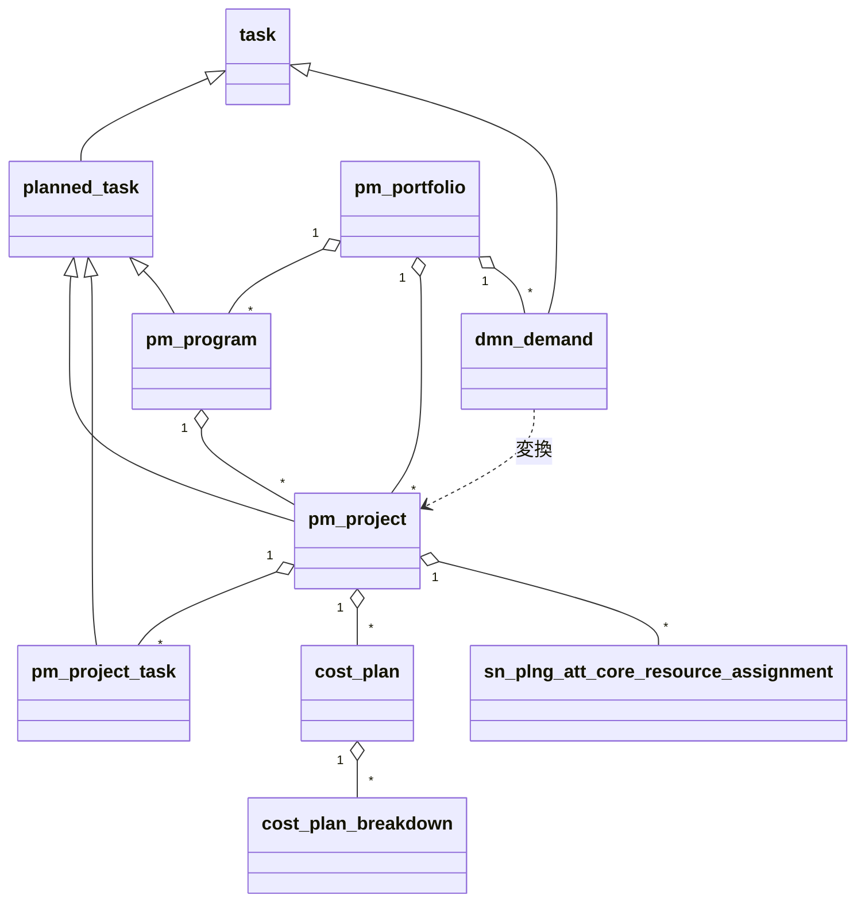
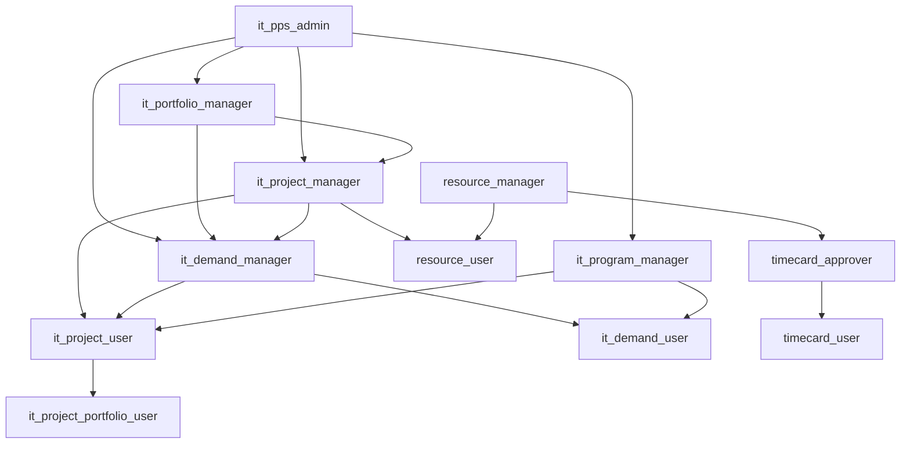
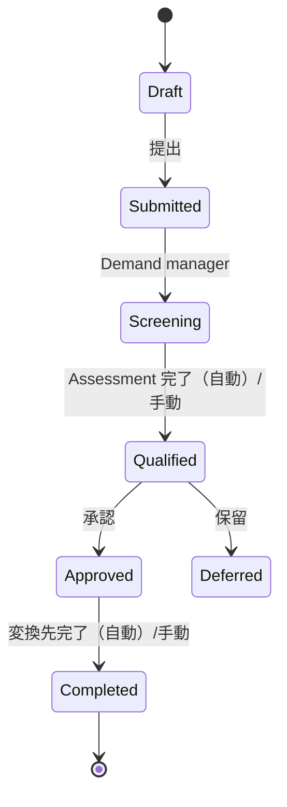
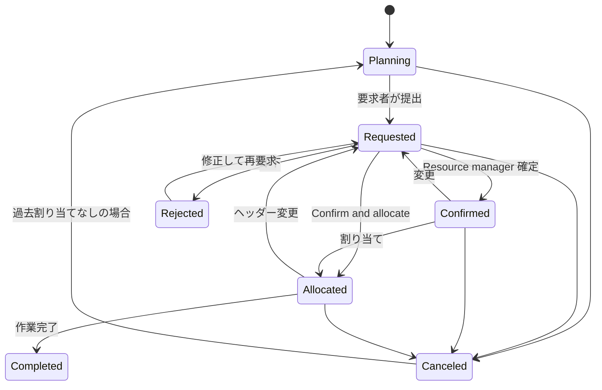
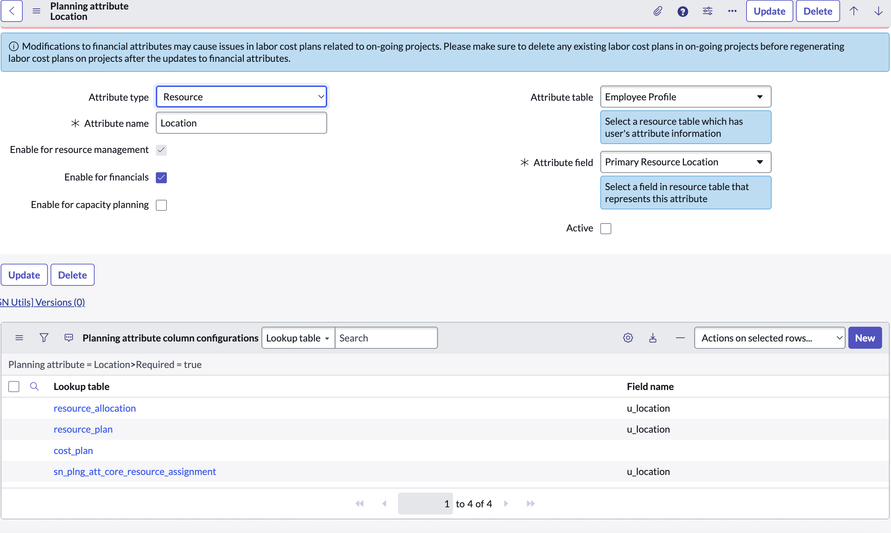
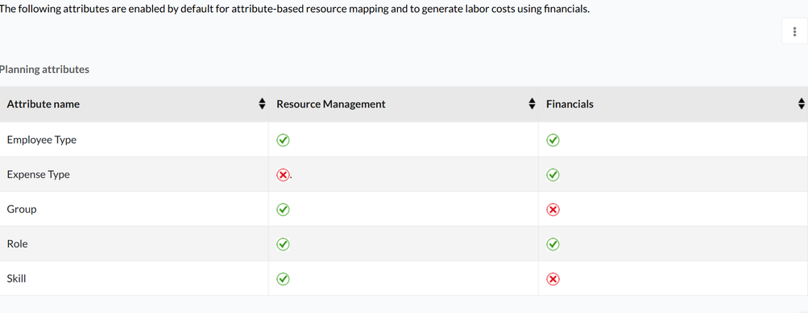
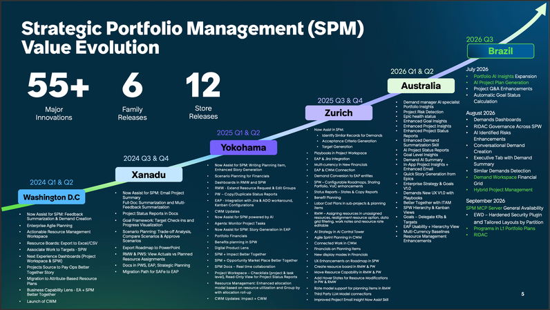

# Strategic Portfolio Management（PPM）

## 概要

**Strategic Portfolio Management（SPM、戦略的ポートフォリオ管理）** は、ServiceNow の「戦略から実行まで（strategy-to-execution）」を扱う製品ラインであり、旧称は **IT Business Management（ITBM）** である。公式ドキュメントの内部バンドル ID は現在も `itbm` が使われている。[出典](https://www.servicenow.com/docs/r/4~5Anqt12idfVzJWPcxoHw/Zo0OiuqKHlp3Xpud9sAoJg)

SPM の中核である **Project Portfolio Management（PPM、プロジェクト・ポートフォリオ管理）** は、Innovation（アイデア）、Demand（デマンド）、Project（プロジェクト）、Program（プログラム）、Resource（リソース）、Portfolio（ポートフォリオ）管理をカバーし、ウォーターフォール、アジャイル、ハイブリッドのいずれの手法にも対応する。[出典](https://www.servicenow.com/docs/r/7GoNY9eeDRD0FzxldbEmXw/6BWTobmScZ3vBhKKvvCo8A)

本ファイルは Australia リリース（2026-05 GA）を基準に、以下を扱う。

| 節 | 内容 |
|---|---|
| 製品構成とパッケージ | SPM のアプリケーション群、PPM Standard プラグイン、SPM Standard/Pro、SPM Advanced/Prime（AI ネイティブ SKU） |
| データモデル | PPM Standard がインストールするテーブル一覧、`planned_task` 階層 |
| ロール | PPM Standard、Strategic Planning Workspace、Investment Funding、Goal Framework のロール |
| Demand Management | 状態遷移、Demand フォーム、Next Experience for Demand Management、Playbook |
| Project / Program Management | 状態値、Project Workspace、Planning console の非推奨 |
| Portfolio Management / Portfolio Planning | `pm_portfolio`、Strategic Planning Workspace / Portfolio Planning Workspace |
| Resource Management | Resource plan（旧）と Resource assignment（新）、移行、Resource Management Workspace |
| Financial Planning | Cost plan、Benefit plan、Expense line、Budget、Baseline、ロールアップ計算 |
| Investment Funding | テーブル、ロール、トップダウン/ボトムアップ |
| Goals（Goal Framework） | テーブル、ロール、プロパティ、Target |
| Australia の新機能・非推奨 / Brazil での変更 | リリース差分 |

関連する Agile Development 2.0、Enterprise Agile Planning（EAP）、Application Portfolio Management（APM）、Enterprise Architecture（EA）は [Agile Development・APM・EAM](./agile-apm-eam.md) を参照。ライセンス全般は [ライセンスモデル](../../03_導入編/01-licensing-model.md) と [プラットフォームのパッケージ構成](../platform/platform-licensing-packaging.md) を参照。

---

## 1. 製品構成とパッケージ

### 1.1 SPM を構成するアプリケーション

ServiceNow 公式リリースノート（Brazil 版の SPM 一覧ページ）は、SPM 関連アプリケーションとして以下を挙げている。[出典](https://www.servicenow.com/docs/r/7GoNY9eeDRD0FzxldbEmXw/6BWTobmScZ3vBhKKvvCo8A)

| アプリケーション | 概要 |
|---|---|
| Project Portfolio Management（PPM） | Innovation、Demand、Project、Program、Resource、Portfolio 管理。ウォーターフォール/Agile/ハイブリッド対応 |
| Project Workspace | プロジェクトの定義・計画・追跡・監視のための Next Experience ワークスペース |
| Portfolio Planning | 作業と組織目標の整合を可視化（Portfolio Planning Workspace） |
| Strategic Planning | 単一ワークスペースでのエンドツーエンドの計画（Strategic Planning Workspace、SPW） |
| Goal Framework for SPM | Goal Framework で定義した Goal の Target 実績値（actual value）を自動更新 |
| Collaborative Work Management（CWM） | タスク、ドキュメント、計画を1つのワークスペースで扱う |
| SPM Enterprise-Wide Deployment | SPM データをパーティション化し、部門・事業部単位でレコードの可視性を制御 |
| Extended Security for Enterprise-Wide Deployment | パーティションのアクセス制御を API、エージェント型ワークフロー、間接参照、パーティション化されていない親テーブルに拡張 |
| MCP for Strategic Portfolio Management | MCP 互換 AI アシスタントから自然言語で SPM データにアクセス（Brazil 一覧に掲載） |
| Strategic Spend Tracking for PPM | プロジェクトとデマンドの戦略的価値を評価 |

このほか、SPM Advanced のストアリリースノートは、対象範囲として Portfolio Planning、Financial Planning、Project Portfolio Management、Demand、Resource、Cost、Digital Portfolio、Collaborative Work、Innovation、Time Card Management を列挙している。[出典](https://www.servicenow.com/docs/r/C17ZqvSaMwUVpMBg8Nc5sg/VWHKHBeksjxJ_i3qfbzDMA)

### 1.2 PPM Standard プラグイン（`com.snc.financial_planning_pmo`）

**PPM Standard（Project Portfolio Management）** プラグイン `com.snc.financial_planning_pmo` は、PPM 系アプリケーションの基本プラグインである。公式ドキュメントは「すべての PPM アプリケーションが、そのユーザーロールとテーブルとともにインスタンスにインストールされる」と記述している。PPM Standard は旧称 **Project Portfolio Suite with Financials** で、Financial Management と Project Portfolio Management を統合したものである。[出典](https://www.servicenow.com/docs/r/4~5Anqt12idfVzJWPcxoHw/Zo0OiuqKHlp3Xpud9sAoJg) [出典](https://www.servicenow.com/docs/r/s8BPDWDEVTaN0SLuos4GTg/6cBy5suQKxBIHxk0FxTDpg)

| 項目 | 内容 |
|---|---|
| プラグイン名 | PPM Standard (Project Portfolio Management) |
| プラグイン ID | `com.snc.financial_planning_pmo` |
| 必要ロール | `admin` |
| 有効化手順 | All > System Applications > All Available Applications > All で名前または ID を検索し、Install を選択 |
| 注意 | Domain separation（ドメインセパレーション）と Delegated admin が有効な場合、管理者は global ドメインにいる必要がある。プラグインが見つからない場合は ServiceNow に依頼 |
| Australia での位置づけ | Australia リリースノートでは「PPM は ServiceNow AI Platform の機能として PPM Standard プラグインの有効化で利用可能」と記載 |

[出典](https://www.servicenow.com/docs/r/4~5Anqt12idfVzJWPcxoHw/Zo0OiuqKHlp3Xpud9sAoJg) [出典](https://www.servicenow.com/docs/r/m4LmCVvkm6_8u3nlIuep5Q/11_p2voQiUcmszYxaNh8BQ)

> 注記：プラグインの技術的な有効化可否と、利用ライセンス（SPM サブスクリプション）の有無は別である。本番利用には該当するサブスクリプションが必要。ライセンスの詳細は [ライセンスモデル](../../03_導入編/01-licensing-model.md) を参照。

関連プラグイン・アプリケーション：

| プラグイン/アプリ | ID | 用途 | 出典 |
|---|---|---|---|
| Customer Project Management | `com.snc.csm_ppm` | CSM と PPM Standard の連携 | [出典](https://www.servicenow.com/docs/r/order-management/sales-and-order-management/plugins-activated-spm-integration.html) |
| Investment Funding | `sn_invst_pln_v2`（旧 `sn_invst_pln`） | 投資・資金配分（ServiceNow Store） | [出典](https://www.servicenow.com/docs/r/4~5Anqt12idfVzJWPcxoHw/emMURSNx~mPGNN4uty1RXQ) |
| PPM–SPW integration | `com.sn_align_snow_int` | PPM（`pm_project`/`dmn_demand`）と Strategic Planning Workspace の連携 | 【第三者情報】ServiceNow 社員によるコミュニティ記事 [出典](https://www.servicenow.com/community/spm-articles/spm-project-workspace-financial-calculations-and-rollup-flows/ta-p/3549813) |
| Scenario Planning for PPM | `com.snc.ppm_scenario_planning` | シナリオ計画（Australia で非表示・将来非推奨） | [出典](https://www.servicenow.com/docs/r/m4LmCVvkm6_8u3nlIuep5Q/11_p2voQiUcmszYxaNh8BQ) |
| Project Status Report（モバイル） | `com.sn_store_ppm.mobile` | Australia で将来非推奨。Project Workspace の Status report を使用 | [出典](https://www.servicenow.com/docs/r/m4LmCVvkm6_8u3nlIuep5Q/11_p2voQiUcmszYxaNh8BQ) |
| Fiscal Calendar | `com.snc.fiscal_calendar` | 会計カレンダー（Investment Funding の依存） | [出典](https://www.servicenow.com/docs/r/4~5Anqt12idfVzJWPcxoHw/emMURSNx~mPGNN4uty1RXQ) |
| Planned Task_v2 | `com.snc.planned_task_v2` | タスクエンティティ（Investment Funding の依存） | [出典](https://www.servicenow.com/docs/r/4~5Anqt12idfVzJWPcxoHw/emMURSNx~mPGNN4uty1RXQ) |

### 1.3 SPM Standard / SPM Pro と AI ネイティブ SKU（Advanced / Prime）

SPM のライセンス区分は、従来の **SPM Standard / SPM Pro**（一部資料では Professional）と、2026 年にストアアプリとして登場した **SPM Advanced / SPM Prime**（AI ネイティブ SKU）が併存している。

- Australia の PPM リリースノートは、Scenario Planning for PPM の代替として「Strategic Planning Workspace（SPM Pro）」と「Portfolio Planning Workspace（SPM Standard）」を挙げており、Strategic Planning Workspace は SPM Pro、Portfolio Planning Workspace は SPM Standard に対応することが読み取れる。[出典](https://www.servicenow.com/docs/r/m4LmCVvkm6_8u3nlIuep5Q/11_p2voQiUcmszYxaNh8BQ)
- Next Experience for Demand Management は SPM Standard または Pro ライセンスが必要とされる。[出典](https://www.servicenow.com/docs/r/m4LmCVvkm6_8u3nlIuep5Q/11_p2voQiUcmszYxaNh8BQ)
- Australia では AI Platform の **Foundation / Advanced / Prime** の3階層がライセンスに応じて利用できる AI 機能・スキルを決めると記載されている。[出典](https://www.servicenow.com/docs/r/m4LmCVvkm6_8u3nlIuep5Q/11_p2voQiUcmszYxaNh8BQ)

| SKU（ストアアプリ） | バージョン履歴 | 内容 |
|---|---|---|
| Strategic Portfolio Management - Advanced | 1.0.2（2026-04）、1.3.0（2026-09、AI Native SKU 対応） | デマンド受付からプロジェクト実行までの AI によるポートフォリオ可視化。ServiceNow Otto for SPM and CWM、Moveworks for SPM を含む。Portfolio Planning、Financial Planning、PPM、Demand、Resource、Cost、Digital Portfolio、Collaborative Work、Innovation、Time Card Management をカバー |
| Strategic Portfolio Management - Prime | 1.0.4（2026-04）、1.2.0（2026-09、AI Native SKU） | SPM Advanced の上位。Strategic Planning と Investment Funding を追加し、Advanced Platform AI（エージェント・スキルの新規作成）を含む |

[出典](https://www.servicenow.com/docs/r/C17ZqvSaMwUVpMBg8Nc5sg/VWHKHBeksjxJ_i3qfbzDMA) [出典](https://www.servicenow.com/docs/r/C17ZqvSaMwUVpMBg8Nc5sg/uogXR2eYEdvEMR54fijDfQ)

コミュニティ回答では、SPM Standard は Demand、PPM、基本的な Resource（割り当て・キャパシティ）、Financial planning（Cost plan、予算の可視化）を含み、SPM Pro はこれに Scenario planning、OKR、Innovation management、Agile 連携、高度な財務モデリング（ROI 評価・予測）を加えると説明されている。【第三者情報】[出典](https://www.servicenow.com/community/spm-forum/how-to-distinguish-between-standard-spm-and-spm-pro/m-p/3436778)

> 公式な SPM Standard / Pro / Advanced / Prime の機能対比表（エンタイトルメント一覧）は、公開ドキュメントでは確認できず。正確な範囲は ServiceNow の SPM 製品ページ（Plans and packages）または営業担当に確認する。価格は [価格情報](../../03_導入編/02-pricing.md) を参照。

---

## 2. データモデル

### 2.1 PPM Standard がインストールするテーブル

PPM Standard プラグインが Australia でインストールするテーブルは以下のとおり（公式「Tables installed with PPM Standard」より、9セクション・83テーブル）。[出典](https://www.servicenow.com/docs/r/4~5Anqt12idfVzJWPcxoHw/6OfsT~rMJEiWdR2hU_NdSg)

#### PPM Standard（財務）

| ラベル | テーブル名 |
|---|---|
| Cost Plan（コストプラン） | `cost_plan` |
| Cost Plan Breakdown（コストプラン内訳） | `cost_plan_breakdown` |
| Cost Type Definition（コストタイプ定義） | `resource_type_definition` |
| Project Funding（プロジェクト資金） | `project_funding` |
| Benefit Plan（ベネフィットプラン） | `benefit_plan` |
| Benefit Breakdown（ベネフィット内訳） | `benefit_plan_breakdown` |
| Budget Reference Rates（予算参照レート） | `itfm_fx_rate` |
| Inbound Actuals Configuration | `sn_invst_pln_inbound_actuals_config` |
| Incoming Expense Lines | `sn_invst_pln_inbound_actuals` |

#### Project Portfolio Suite

| ラベル | テーブル名 |
|---|---|
| Project Stakeholder | `pm_m2m_project_stakeholder` |
| Project Time Card Exception | `project_timecard_exception` |
| Project Time Category | `project_time_category` |
| Time Sheet Exception | `time_sheet_exception` |

#### Demand Management

| ラベル | テーブル名 |
|---|---|
| Demand（デマンド） | `dmn_demand` |
| Decision（意思決定） | `dmn_decision` |
| Stakeholder Register（ステークホルダー登録簿） | `dmn_stakeholder_register` |
| Requirement（要件） | `dmn_requirement` |
| Demand Stakeholder | `dmn_m2m_demand_stakeholder` |
| Demand Stage Config | `dmn_stage_config` |
| Idea | `idea` |
| Demand Task（デマンドタスク） | `dmn_demand_task` |

#### Project Management

| ラベル | テーブル名 |
|---|---|
| Goal | `goal` |
| Issue | `issue` |
| Personalize Workbench | `workbench_config_user` |
| Portfolio | `pm_portfolio` |
| Portfolio Project | `pm_portfolio_project` |
| Portfolio Project Goal | `pm_portfolio_goal` |
| Portfolio Project Issue | `pm_portfolio_issue` |
| Portfolio Project Relationships | `pm_m2m_portfolio_project` |
| Portfolio Project Risk | `pm_portfolio_risk` |
| Project | `pm_project` |
| Project Task | `pm_project_task` |
| Project Task Link | `pm_project_task_link` |
| Project Template | `project_template` |
| Project Template Configuration | `project_template_config` |
| Project Template Task | `project_template_task` |
| Risk | `risk` |
| Project Change Request | `project_change_request` |
| Status Report | `project_status` |
| Teamspace | `pm_app_config` |
| Planned task Relationship | `planned_task_rel_planned_task` |
| Baseline | `planned_task_baseline` |
| Baseline Item | `planned_task_baseline_item` |
| Task Relationship | `task_rel_task` |
| Planned task Recalculation Exclusions | `planned_task_recalculation_exclusions` |

#### Program Management

| ラベル | テーブル名 |
|---|---|
| Program | `pm_program` |
| Program Task | `pm_program_task` |

#### Resource Management

| ラベル | テーブル名 |
|---|---|
| Resource Plan（リソースプラン） | `resource_plan` |
| Resource Plan Logs | `resource_plan_logs` |
| Resource Allocation（リソース割り当て） | `resource_allocation` |
| Resource Allocation Daily | `resource_allocation_daily` |
| Requested Allocation | `requested_allocation` |
| Requested Allocation Daily | `requested_allocation_daily` |
| Resource Aggregate Daily / Weekly / Monthly | `resource_aggregate_daily` / `resource_aggregate_weekly` / `resource_aggregate_monthly` |
| Resource Event / Resource Event Color | `resource_event` / `resource_event_color` |
| Resource Report（ほか Chart/Daily/Export/Monthly） | `resource_report`、`resource_report_chart`、`resource_report_daily`、`resource_report_export`、`resource_report_monthly` |
| Resource Role | `resource_role` |
| Group Resource Roles | `group_has_resource_role` |
| User Resource Role | `user_has_resource_role` |
| User Calendar Event | `user_calendar_event` |
| User Schedule | `user_has_schedule` |

#### Innovation Management

| ラベル | テーブル名 |
|---|---|
| Idea | `im_idea_core` |
| Idea Category | `im_category` |
| Idea Category Configuration | `im_category_config` |
| Idea Categories | `im_m2m_idea_category` |
| Idea Module | `im_module` |

> 注：Idea は Demand Management 側の `idea` と Innovation Management 側の `im_idea_core` の2テーブルが存在する。

#### Time Card Management

| ラベル | テーブル名 |
|---|---|
| Time Card | `time_card` |
| Time Sheet | `time_sheet` |
| Time Sheet Policy | `time_sheet_policy` |
| Time Card Daily | `time_card_daily` |

#### Rate Model

| ラベル | テーブル名 |
|---|---|
| Rate Model | `rate_model` |
| Rate Model Entity | `rate_model_entity` |
| Rate Model Entity Attribute | `rate_model_entity_attribute` |
| Rate Model Line | `rate_model_line` |
| Rate Model Line Attribute | `rate_model_line_attribute` |
| Rate Line Import Set | `imp_rate_model_line` |

[出典](https://www.servicenow.com/docs/r/4~5Anqt12idfVzJWPcxoHw/6OfsT~rMJEiWdR2hU_NdSg)

### 2.2 PPM Standard 以外の主要テーブル

| テーブル | 用途 | 提供元 | 出典 |
|---|---|---|---|
| `sn_plng_att_core_resource_assignment` | Resource Assignment（リソースアサインメント）。Resource plan の後継 | Resource Management（属性ベース） | [出典](https://www.servicenow.com/docs/r/4~5Anqt12idfVzJWPcxoHw/lzNaM6N2n6sTYU3nlP9KXQ) |
| `sn_plng_att_core_cpaam_combination` | 属性組み合わせ（CPAAM） | 同上 | 【第三者情報】[出典](https://www.servicenow.com/community/spm-articles/a-practical-guide-to-resource-assignments/ta-p/3259573) |
| `sn_plng_att_core_attribute_based_resource_aggregates` | 属性ベースのリソース集計（Utilization 等） | 同上 | 【第三者情報】[出典](https://www.servicenow.com/community/spm-forum/attribute-based-aggregates-table-sn-plng-att-core-attribute/m-p/3527691) |
| `fm_expense_line` | Expense Line（経費明細）。実績コストのソース | Financial Management | 【第三者情報】[出典](https://www.servicenow.com/community/spm-articles/spm-project-workspace-financial-calculations-and-rollup-flows/ta-p/3549813) |
| `sn_invst_pln_invst_*` | Investment Funding の各テーブル（§8 参照） | Investment Funding | [出典](https://www.servicenow.com/docs/r/4~5Anqt12idfVzJWPcxoHw/lDZCbQDlSid9rQFY3Ti2fQ) |
| `sn_align_core_planning_item` | Planning Item（計画項目）。サブタイプ `sn_align_core_project`、`sn_align_core_demand` 等 | Strategic Planning / Portfolio Planning | 【第三者情報】[出典](https://www.servicenow.com/community/spm-articles/spm-project-workspace-financial-calculations-and-rollup-flows/ta-p/3549813) |
| `sn_gf_goal` ほか `sn_gf_*` | Goal Framework（§9 参照） | Goal Framework | [出典](https://www.servicenow.com/docs/r/4~5Anqt12idfVzJWPcxoHw/SaBCSxphCtT9Kleo8GLljw) |
| `cmn_value_stream_category` | Value stream category | Portfolio Planning | [出典](https://www.servicenow.com/docs/r/C17ZqvSaMwUVpMBg8Nc5sg/CO_f4AHsLTYW9cH41Ya20w) |

### 2.3 `planned_task` 階層

`pm_project`（Project）と `pm_project_task`（Project Task）は `planned_task`（Planned Task）を親とし、`planned_task` は `task` を継承する。Project / Project Task の State（状態）は `task` から継承され、`planned_task` の State 列に対する Dictionary override（辞書オーバーライド）の Attributes フィールドで状態カテゴリが宣言されている。[出典](https://www.servicenow.com/docs/r/4~5Anqt12idfVzJWPcxoHw/c9RS0oEzIVbECWV6RnHzmw)

> 注：`pm_program` と `dmn_demand` の親テーブルは公式ページで直接確認できなかったため、上図の継承線は【推定】である（いずれも Planned task 系の計画項目として扱われる）。インスタンスの System Dictionary で確認すること。データモデル全般は [データモデルと System Dictionary](../platform/data-model-dictionary.md) を参照。

---

## 3. ロール

### 3.1 PPM Standard でインストールされるロール

`it_` 接頭辞付きロールが現行の推奨ロールであり、接頭辞なし（`project_manager`、`demand_manager` 等）はそれに内包される下位ロールである。Australia での一覧は以下。[出典](https://www.servicenow.com/docs/r/4~5Anqt12idfVzJWPcxoHw/oK21ACshcvfKsTp8cyK2VA)

| ロール名 | 表示名 | 説明 | 内包ロール |
|---|---|---|---|
| `it_pps_admin` | PPS admin | Project、Demand、Program、Portfolio、Resource、Time card、Agile、タイムライン可視化の設定・プリファレンスを閲覧・変更 | `it_program_manager`、`it_portfolio_manager`、`it_project_manager`、`it_demand_manager`、`pps_admin`、`timeline_admin`、`rate_model_admin` |
| `it_portfolio_manager` | Portfolio manager | 全ポートフォリオへのアクセスと Project/Demand ユーザーアクセス。Budget owner ロールは Financial Management で追加 | `it_demand_user`、`it_project_manager`、`it_project_user`、`portfolio_manager`、`it_demand_manager`、`it_project_portfolio_user` |
| `it_program_manager` | Program manager | 全プログラムへのアクセス | `resource_user`、`it_project_user`、`program_manager`、`it_demand_user` |
| `it_project_manager` | Project manager | 全 Project Management 機能。Project、Task、Resource plan の作成・管理。構成設定は PPS admin を使う | `resource_user`、`it_demand_manager`、`it_project_user`、`project_manager`（`timecard_approver` を内包）、`timeline_user`、`rate_model_user` |
| `it_project_user` | Project user | Project フォームの閲覧。Project Task の一部フィールド（Time constraint、State 等）を変更可 | `it_project_portfolio_user`、`project_user` |
| `it_project_portfolio_user` | Portfolio user | IT Portfolio Project レコードの閲覧 | `project_portfolio_user` |
| `it_demand_manager` | Demand manager | 全 Demand Management モジュール | `it_project_user`、`resource_user`、`timeline_user`、`demand_manager`、`it_demand_user`、`rate_model_user` |
| `it_demand_user` | Demand user | Demand と Stakeholders モジュールへのアクセス | `demand_user`、`pps_resource` |
| `resource_manager` | Resource manager | Resource plan のレビュー、確定・割り当て、スキル作成、スケジュール参照、グループ作成・属性更新 | `resource_user`、`timecard_approver`、`skill_admin`、`rate_model_user` |
| `resource_user` | Resource user | Resource plan の作成とリソース要求。通常 PM に付与。Confirmed/Allocated 状態のプランは変更不可 | なし |
| `pps_resource` | PPS resource | リソース計画の対象となるユーザー/グループを決める（このロールを持つ者が Resource plan に表示される） | なし |
| `idea_admin` | Idea admin | Idea モジュール作成、カテゴリ定義、アイデアから Story/Epic/Feature/Project/Demand 作成 | `idea_manager` |
| `idea_manager` | Idea manager | アイデア管理、Project/Demand タスク作成 | なし |
| `idea_manager_professional` | Idea manager professional | アイデアから Story/Epic/Feature/Project/Demand を作成 | なし |
| `timecard_admin` | Time card admin | 全 Time card への書き込み | `timecard_user`、`timecard_approver` |
| `timecard_approver` | Time card approver | 提出された Time card の承認・却下 | `timecard_user` |
| `timecard_user` | Time card user | 自分の Time card 作成 | なし |
| `it_rate_model_admin` | Rate model admin | Rate model の全権限（属性構成、Rate line インポート/エクスポート） | `rate_model_user`、`import_set_loader`、`import_transformer`、`import_admin` |
| `rate_model_user` | Rate model user | Rate model / Rate line の参照のみ | なし |

> Australia の変更：Project のプロパティ（Project properties）は `pps_admin` のみが編集可能になった。Demand の `com.snc.idea.universal_request.copy_fields` プロパティは `idea_admin` または `pps_admin` のみ更新可能。[出典](https://www.servicenow.com/docs/r/m4LmCVvkm6_8u3nlIuep5Q/11_p2voQiUcmszYxaNh8BQ)

### 3.2 Strategic Planning Workspace / Portfolio Planning のロール

| ロール | 説明 | 出典 |
|---|---|---|
| `sn_align_core.apw_admin` | Strategic Planning Workspace の管理者。全機能にアクセス。Australia では SPW 管理者向けガイド付きセットアップにアクセス | [出典](https://www.servicenow.com/docs/r/MrftC6mNgCta3UqwXSW7Kg/1sj_NNd2uthc0x7spsBAZQ) [出典](https://www.servicenow.com/docs/r/C17ZqvSaMwUVpMBg8Nc5sg/CO_f4AHsLTYW9cH41Ya20w) |
| `sn_align_core.apw_user` | Portfolio plan、Free-form roadmap、Planning item の作成・更新・削除。ポートフォリオ/プロダクトマネージャー、事業部リード等向け。カスタムダッシュボード作成にも必要 | [出典](https://www.servicenow.com/docs/r/MrftC6mNgCta3UqwXSW7Kg/1sj_NNd2uthc0x7spsBAZQ) |
| `sn_align_core.ap_read_only` | 共有された Portfolio plan（Planning/Scoring ページ）と Free-form roadmap の閲覧のみ | [出典](https://www.servicenow.com/docs/r/MrftC6mNgCta3UqwXSW7Kg/1sj_NNd2uthc0x7spsBAZQ) |
| `sn_align_ws.scenario_approver` | ポートフォリオのシナリオ承認 | [出典](https://www.servicenow.com/docs/r/MrftC6mNgCta3UqwXSW7Kg/1sj_NNd2uthc0x7spsBAZQ) |
| `sn_align_ws.spw_funding_user` | Financials ページでの予算配分（Budget allocation）、財務変更を含むシナリオの承認 | [出典](https://www.servicenow.com/docs/r/MrftC6mNgCta3UqwXSW7Kg/1sj_NNd2uthc0x7spsBAZQ) |
| `sn_align_ws.spw_financial_user` | Planning item の Cost plan / Expense line 作成、Prioritization での財務データ参照 | [出典](https://www.servicenow.com/docs/r/C17ZqvSaMwUVpMBg8Nc5sg/CO_f4AHsLTYW9cH41Ya20w) |
| `sn_apw_advanced.spw_goal_user_read` / `sn_apw_advanced.spw_goal_user` | SPW での Goal 閲覧 / 編集 | 【第三者情報】検索結果要約による。公式ページ本文は未確認 |
| `sn_apw_advanced.eap_scrum_master` | EAP のイテレーション作成・日付変更・計画カレンダー管理（Australia で追加）。`eap_admin` ⊃ `eap_scrum_master` ⊃ `eap_user` | [出典](https://www.servicenow.com/docs/r/m4LmCVvkm6_8u3nlIuep5Q/ABIxKvZ8RODp8uPsRnnQ3w) |
| `sn_value_stream.value_stream_admin` / `sn_value_stream.value_stream_user` | Value stream の管理 / 利用 | [出典](https://www.servicenow.com/docs/r/C17ZqvSaMwUVpMBg8Nc5sg/CO_f4AHsLTYW9cH41Ya20w) |

ServiceNow 社員によるコミュニティ記事（2026-03）は、新しい Financials の権限を以下2プロファイルに分けて付与する方法を示している。【第三者情報】[出典](https://www.servicenow.com/community/spm-articles/how-to-segregate-access-to-the-new-financials-using-roles/ta-p/3511602)

| 機能 | Financials User（`it_portfolio_manager` + `sn_align_core.apw_user` + `sn_align_ws.spw_financial_user`） | Budget Allocation User（`it_portfolio_manager` + `sn_align_ws.spw_funding_user` + `sn_align_ws.scenario_approver`） |
|---|---|---|
| Portfolio plan の Financials タブ | 可 | 可 |
| シナリオ承認 | 不可 | 可 |
| Demand/Project/Epic の Financials での予算配分 | 不可 | 可 |

同記事では、`portfolio_manager` から `sn_align_ws.spw_funding_user` を外す手順が含まれる（従来 `portfolio_manager` が内包していたため）。

Investment Funding と Goal Framework のロールはそれぞれ §8.3、§9.2 を参照。ロール全般の仕組みは [ユーザー・グループ・ロール](../platform/users-groups-roles.md) を参照。

---

## 4. Demand Management（デマンド管理）

### 4.1 概要

**Demand Management（デマンド管理）** は、ビジネスからの投資要求（アイデア・要望）を一元的に受け付け、評価（Assessment）・優先順位付け・承認を経て Project、Enhancement、Epic 等の実行エンティティに変換するアプリケーションである。デマンドは `dmn_demand` テーブルに格納される。[出典](https://www.servicenow.com/docs/r/it-business-management/strategic-planning/demand-process-flow.html) [出典](https://www.servicenow.com/docs/r/4~5Anqt12idfVzJWPcxoHw/6OfsT~rMJEiWdR2hU_NdSg)

デマンドの入口：

- Service Catalog（サービスカタログ）からの提出（[サービスカタログ](../platform/service-catalog.md) 参照）
- Idea Portal（アイデアポータル）からのアイデア → デマンド化
- Next Experience for Demand Management（Demand Workspace）での直接作成
- Brazil 以降：Employee Slate（Employee Hub）からの会話型作成（§11 参照）

### 4.2 Demand のロール（業務上の役割）

| 役割 | 主な作業 |
|---|---|
| Business user（ビジネスユーザー） | Service Catalog または Idea Portal からアイデア/デマンドを提出 |
| Demand manager（デマンドマネージャー） | デマンドの精緻化、状態遷移、タスク割り当て、承認/保留、変換、完了 |
| Demand user（デマンドユーザー） | デマンドのレビュー・詳細追記 |
| Stakeholder（ステークホルダー） | スコアリング Assessment への回答、デマンドのレビュー |
| Demand approver（デマンド承認者） | Qualified デマンドの承認または保留（Defer） |
| SME（Subject matter expert） | Demand manager の要請に応じて支援 |

[出典](https://www.servicenow.com/docs/r/it-business-management/strategic-planning/demand-process-flow.html)

### 4.3 Demand の状態（State）遷移

Demand の状態は **Draft → Submitted → Screening → Qualified → Approved / Deferred → Completed** である。

| 遷移元 | 遷移先 | トリガー / 実施者 |
|---|---|---|
| Draft（下書き） | Submitted（提出済み） | Demand manager または Demand user が基本情報を入力して提出 |
| Submitted | Screening（スクリーニング） | Demand manager が移行 |
| Screening | Qualified（適格） | Assessment 提出後に自動、または Demand manager が手動 |
| Qualified | Approved（承認済み） | Demand manager または Demand approver |
| Qualified | Deferred（保留） | Demand manager または Demand approver |
| Approved | Completed（完了） | 変換先エンティティの完了時に自動、または Demand manager が任意の状態から手動 |

[出典](https://www.servicenow.com/docs/r/it-business-management/strategic-planning/demand-process-flow.html)

- Demand フォームの **Assessment Required** チェックボックス（既定オン）をオフにすると、Assessment をスキップして Qualified に直接移行する。[出典](https://www.servicenow.com/docs/r/4~5Anqt12idfVzJWPcxoHw/qF3etSvFEesZNgRWjkx8MA)
- 状態の数値（choice value）は公開ドキュメントでは確認できず。インスタンスの `dmn_demand.state` の Choice List で確認する。

### 4.4 Demand フォームの主要フィールド（Australia）

`dmn_demand` の Demand フォームはセクション単位で以下のフィールドを持つ。[出典](https://www.servicenow.com/docs/r/4~5Anqt12idfVzJWPcxoHw/qF3etSvFEesZNgRWjkx8MA)

#### General

| フィールド | 説明 / 選択肢 |
|---|---|
| Name | デマンド名 |
| Category（カテゴリ） | `Strategic`（将来計画：Project、Story 等）/ `Operational`（運用作業：Change、Defect 等） |
| Type（タイプ） | Category に依存。Strategic：Enhancement、Project、Epic、Story、EAP Epic、EAP Feature、EAP Capability、No Conversion。Operational：Change、Defect、No Conversion。一部は Agile Development 2.0 / Strategic Planning の有効化に依存 |
| Project / Enhancement / Epic / Story | 変換で作成されたレコード（読み取り専用） |
| Number | 自動採番 |
| Approved start date / Approved end date | ステークホルダー承認済みの開始/終了日。Project フォームへ引き継がれる |
| Planned start date / Planned end date | 承認までの暫定計画日（Australia の新規インストールでは Start/Due date から名称変更。アップグレード環境は旧ラベルのまま） |
| Description | 説明 |

#### Details

| フィールド | 説明 / 選択肢 |
|---|---|
| Portfolio / Program | 所属ポートフォリオ / プログラム |
| Investment Class（投資クラス） | `Run`（既存業務維持）/ `Change`（変革・改善） |
| Investment Type（投資タイプ） | Cost Reduction、End User Experience、Legal and Regulatory、Revenue Generating、Service Sustaining、Strategic Enabler、Artificial Intelligence |
| Demand manager | デマンドマネージャー |
| Collaborators | 編集・貢献可能なユーザー |
| Expense type | `capex` / `opex` |
| Priority | 優先度 |
| Department / Business Unit / Impacted Business Units | 部門 / 事業部 / 影響事業部 |
| Project Manager | Strategic/Project の場合のみ。プロジェクト作成後はロック |
| Idea | 元アイデア |
| Business Capabilities / Business Applications / Impacted Business Applications | Enterprise Architecture のケイパビリティ/アプリケーション（[Agile Development・APM・EAM](./agile-apm-eam.md) 参照） |

> Zurich で Investment class / Investment type は Project と Demand テーブル上では非推奨となり、親（Planning item）レベルのフィールドに値がコピーされた。これらを使うフィルターやパーソナライズは更新が必要。[出典](https://www.servicenow.com/docs/r/m4LmCVvkm6_8u3nlIuep5Q/ABIxKvZ8RODp8uPsRnnQ3w)

#### Business Case

Strategic priority（戦略的優先事項、事業部でフィルター）、Primary goal（主目標）、Business case、Risk of performing（実施リスク）、Risk of not performing（未実施リスク）、Enablers、Barriers、In scope、Out of scope、Assumptions。

#### Financials

| フィールド | 説明 |
|---|---|
| Rate Model | リソースコスト計算用のレートモデル |
| Project Currency | 変換後プロジェクトの通貨（マルチカレンシー） |
| Capital expense / Operating expense | CapEx / OpEx |
| Total planned cost | CapEx + OpEx から計算 |
| Financial benefit | 見込み収益（Benefit breakdown からロールアップまたは手入力） |
| Financial return | 総コストと Financial benefit から計算 |
| ROI % | ROI（Qualified または Approved 時に計算） |
| Capital budget / Operating budget | 会計年度横断の CapEx/OpEx 予算合計 |
| Discount Rate % / Net present value / Internal rate of return % | 割引率 / NPV / IRR |
| Demand Actual Cost / Demand Actual Effort | 承認済み Time card からの実績コスト / 実績工数（後者は既定で非表示） |

#### Assessment Data

| フィールド | 説明 |
|---|---|
| Impact | ビジネス影響度 |
| Risk | Assessment 結果からのリスク値 |
| Value | Impact と Financial return からのビジネス価値 |
| T-Shirt size | 規模（値は組織で定義） |
| Score | Risk、Value、Size から計算（Value が高いほど上昇、Risk と Size が高いほど低下） |
| Assessment Required | Assessment の要否（既定オン） |

#### Preferences / その他

| フィールド | 説明 |
|---|---|
| Close Demand | Project 変換時にデマンドをいつ閉じるか：None、On creation of project、On closure of project（Enhancement の既定は None） |
| Project calculation | タスク依存関係の計算方法：Manual / Automatic（既定） |
| EAP Details（Team、Converted to） | EAP タイプの場合のみ表示 |
| AI Associations（Product、Impacted AI systems） | AI Control Tower がインストールされ Investment Type が Artificial Intelligence の場合のみ表示。`sn_ai_steward` ロールは Related Links から AI system を作成可能（Australia） |

[出典](https://www.servicenow.com/docs/r/4~5Anqt12idfVzJWPcxoHw/qF3etSvFEesZNgRWjkx8MA) [出典](https://www.servicenow.com/docs/r/m4LmCVvkm6_8u3nlIuep5Q/11_p2voQiUcmszYxaNh8BQ)

### 4.5 デマンドの変換（Conversion）

デマンドの **Category** と **Type** が変換先エンティティを決める。変換先は Project、Enhancement、Epic/Story（Agile Development 2.0）、EAP エンティティ（Epic、Feature、Capability）である。

- 変換でエンティティが作成されると Category と Type は読み取り専用になり、作成されたエンティティを削除すると再び編集可能になる。[出典](https://www.servicenow.com/docs/r/4~5Anqt12idfVzJWPcxoHw/qF3etSvFEesZNgRWjkx8MA)
- EAP エンティティ（Epic、Feature、Capability）への変換は Zurich で追加され、共通フィールドがコピーされてデマンドは Approved に移行する。[出典](https://www.servicenow.com/docs/r/m4LmCVvkm6_8u3nlIuep5Q/11_p2voQiUcmszYxaNh8BQ)
- Type が `No Conversion` の場合、実行エンティティを作らずにデマンドとして資金付与等を行う（1つ以上の Project/Epic/Program を含む大型案件への資金付与など）。

### 4.6 Next Experience for Demand Management（Demand Workspace）

**Next Experience for Demand Management** は、デマンドの作成、評価、コラボレーション、変換を統合した Next Experience UI である（Australia で拡充、SPM Standard/Pro ライセンスが必要。Classic UI も引き続き利用可）。Australia での主な機能：[出典](https://www.servicenow.com/docs/r/m4LmCVvkm6_8u3nlIuep5Q/ABIxKvZ8RODp8uPsRnnQ3w) [出典](https://www.servicenow.com/docs/r/m4LmCVvkm6_8u3nlIuep5Q/11_p2voQiUcmszYxaNh8BQ)

| 機能 | 内容 |
|---|---|
| All Demands ホーム | 状態の色分け表示、Playbook / Details / Docs タブ |
| Playbooks | ローコードで構成可能なガバナンスステージ/アクティビティ（既定 Playbook とカスタム Playbook） |
| AI Checkpoint ステージ / AI associations | AI Control Tower プラグインがある場合に表示 |
| Demand financials grid | Cost plan、Benefit plan、Baseline の表示・作成・比較（Australia Patch 5） |
| Demand dashboards | Overview、Financials、Data Quality タブ。部門、事業部、ポートフォリオ、プログラム、デマンドマネージャーでフィルター |
| Similar demand identification | Name、Description、Business Case を比較して類似デマンドを提示する AI スキル（Zurich で Now Assist として追加） |
| Demand summarization | Summarize ボタンで構造化サマリーを生成。AI Overview タブに出力。Submitted/Screening/Qualified/Approved で自動生成が既定（Brazil で状態ごとに選択可能に変更）。Demand task、Cost plan、Benefit plan、Resource assignment、Work notes も参照 |
| Docs 連携 | ドキュメントでの共同作業 |

Portfolio Planning のストアバージョン履歴では、Demand Workspace（8.13.0、2026-03）、Demands dashboard と RIDAC（8.17.0、2026-08）、My Demands ウィジェット（8.18.0、2026-09）、Smart assessments と Dynamic demand types（8.19.0、2026-10）が追加されている。[出典](https://www.servicenow.com/docs/r/C17ZqvSaMwUVpMBg8Nc5sg/CO_f4AHsLTYW9cH41Ya20w)

### 4.7 Demand planning item（Strategic Planning 側）

Strategic Planning / Portfolio Planning の Demand planning item フォームは、Name、Description、State、Owner、Planning state、Category、Execution URL、MoSCoW（1 Must have〜4 Won't have）、Portfolio、Program、Product、Strategic program、Primary goal、Primary target、Strategic priority、承認/計画日付、Investment class/type、Priority、Business case 系、Financials（Planned cost、Planned capEx/opEx、Planned ROI、Financial return、Planned benefit）、Assessment data（Impact、Risk、Value、Score）を持つ。Description は ServiceNow Otto for SPM がインストールされていれば Write planning item スキルで推敲できる。[出典](https://www.servicenow.com/docs/r/4~5Anqt12idfVzJWPcxoHw/huAuYhm0vX_SrCyFbFDV5A)

> Australia では新規の planning item デマンドが新しい Execution URL を使う。既存分は「Update Demand Planning Item Execution URL」ジョブで更新する。[出典](https://www.servicenow.com/docs/r/m4LmCVvkm6_8u3nlIuep5Q/ABIxKvZ8RODp8uPsRnnQ3w)

---

## 5. Project / Program Management

### 5.1 Project と Project Task の状態値

`pm_project` と `pm_project_task` の State は以下（Australia）。[出典](https://www.servicenow.com/docs/r/4~5Anqt12idfVzJWPcxoHw/c9RS0oEzIVbECWV6RnHzmw)

| 値 | ラベル | カテゴリ |
|---|---|---|
| `-5` | Pending（保留中） | Pending |
| `1` | Open（オープン） | Open |
| `2` | Work in Progress（作業中） | Work in Progress |
| `3` | Closed Complete（完了） | Closed |
| `4` | Closed Incomplete（未完了で終了） | Closed |
| `7` | Closed Skipped（スキップ） | Closed |

表示ルール：

- Pending / Open：計画開始日（Planned start date）を表示
- Open / Work in Progress：実績開始日（Actual start date）を表示
- Closed：実績終了日（Actual end date）を表示

[出典](https://www.servicenow.com/docs/r/4~5Anqt12idfVzJWPcxoHw/c9RS0oEzIVbECWV6RnHzmw)

運用上の補足（コミュニティ情報）：

- 親プロジェクトの状態はタスクの状態カテゴリから算出され、一部タスクが Closed で他が Open/Pending/WIP の場合、プロジェクトは Work in Progress となる。【第三者情報】[出典](https://www.servicenow.com/community/spm-articles/understanding-project-states/ta-p/2303762)
- Closed から Work in Progress / Pending / Open への戻しは許可されない。【第三者情報】[出典](https://www.servicenow.com/community/spm-articles/discussion-notes-on-changing-project-state-field-notes-on/ta-p/2297241)
- 各状態の業務上の意味は ServiceNow が定義しておらず、組織が定義する必要がある。【第三者情報】[出典](https://www.servicenow.com/community/spm-forum/pending-vs-open-project-state/m-p/989940)

### 5.2 Project Workspace

**Project Workspace（プロジェクトワークスペース）** は、プロジェクトマネージャーが計画、タスク管理、リソース割り当て、財務追跡、コラボレーションを1つの画面で行う Next Experience の中心的アプリケーションである。[出典](https://www.servicenow.com/docs/r/4~5Anqt12idfVzJWPcxoHw/UoC6r3iaOdIrMPFY6vfZlA)

| ページ（タブ） | 内容 |
|---|---|
| Planning | タスク、サブプロジェクト、依存関係、タイムライン（ガント）。CWM のタスク/ストーリーをリンク表示 |
| Details | プロジェクトの詳細情報、ハイレベルな CapEx/OpEx 見積 |
| Financials | Cost plan（予測）、Expense line（実績）、Labor cost、Financial baseline、予算比較 |
| RIDAC | Risk、Issue、Decision、Action、Change request の管理 |
| Analytics | プロジェクト分析 |
| Docs | ドキュメント。Project Gen AI Docs スキルで要約・詳述・短縮 |
| Status Reports | ステータスレポート作成 |
| Resources | Resource assignment の管理（Zurich で追加。日付の「Sync all」ボタン） |

その他の機能：Playbooks（ステージ型ガイド付きワークフロー）、Write items スキル（Planning item の説明推敲）、AI agents for SPM（プロジェクトタスクの自律監視）、フォームフィールド・ユーザーロール・システムプロパティの構成。[出典](https://www.servicenow.com/docs/r/4~5Anqt12idfVzJWPcxoHw/UoC6r3iaOdIrMPFY6vfZlA)

Australia の Project Workspace 関連の変更（ローカライズ版リリースノートより）：

- 管理者向けに、プロジェクトに紐づく Asset request（資産要求）の表示、Hardware request フォームへの Project 参照フィールド追加
- Project Workspace を離れずに未割り当てタスクを含む Assignment の延長・更新が可能
- Resources タブを新しいブラウザータブではなく同一ページ内に保持

[出典](https://www.servicenow.com/docs/r/de-DE/release-notes/project-workspace-rn.html)

### 5.3 Planning console（レガシー）の非推奨

従来のフォームベース UI の **Planning console（計画コンソール）** は非推奨となり、サポート対象外で将来のリリースで非表示になる。プロジェクトマネージャーは Project Workspace（Next Experience）に移行する必要がある。Planning console を開くには `it_project_manager` ロールが必要。[出典](https://www.servicenow.com/docs/r/4~5Anqt12idfVzJWPcxoHw/gW_cPPq9eZH~xOWmFjHaVg) [出典](https://www.servicenow.com/docs/r/4~5Anqt12idfVzJWPcxoHw/R4GwFwlMd5FzYJyXGxcF0A)

また、Australia では **Project Workbench** が「デプロイ・機能拡張・サポート・有効化の対象外」とされた。[出典](https://www.servicenow.com/docs/r/m4LmCVvkm6_8u3nlIuep5Q/11_p2voQiUcmszYxaNh8BQ)

> **Brazil での変更:** Brazil リリースノートでも Planning console は「非推奨・サポート対象外」と明記され、Project Workspace（Next Experience）の使用が求められる。また Project Workspace が All ナビゲーションメニューから直接アクセス可能になった。[出典](https://www.servicenow.com/docs/r/delta-australia-brazil/brazil-australia-projectportfoliomanagement-release-notes.html)

### 5.4 Project の構成要素

| 要素 | テーブル | 説明 |
|---|---|---|
| Project Task | `pm_project_task` | プロジェクトのタスク。リソース割り当ての親 |
| Project Template | `project_template`、`project_template_task` | プロジェクトテンプレート |
| Baseline | `planned_task_baseline`、`planned_task_baseline_item` | スケジュールのベースライン |
| Status Report | `project_status` | ステータスレポート |
| Risk / Issue | `risk`、`issue` | RIDAC の R/I |
| Project Change Request | `project_change_request` | プロジェクト変更要求 |
| Project Stakeholder | `pm_m2m_project_stakeholder` | ステークホルダー |
| Task Relationship | `planned_task_rel_planned_task` | 先行・後続関係（依存関係） |

[出典](https://www.servicenow.com/docs/r/4~5Anqt12idfVzJWPcxoHw/6OfsT~rMJEiWdR2hU_NdSg)

### 5.5 Program Management

**Program（プログラム）** は関連プロジェクトの集合で、`pm_program` テーブルに格納される。`it_program_manager` ロールが全プログラムにアクセスできる。[出典](https://www.servicenow.com/docs/r/4~5Anqt12idfVzJWPcxoHw/oK21ACshcvfKsTp8cyK2VA)

- Portfolio Planning では Project Program lens（8.2.0）、Program planning（8.3.0）、Programs メニュー（8.18.0、2026-09）が追加されている。[出典](https://www.servicenow.com/docs/r/C17ZqvSaMwUVpMBg8Nc5sg/CO_f4AHsLTYW9cH41Ya20w)

> **Brazil での変更:** Program Workbench の利用者に Strategic Planning Workspace への入口が用意され、既存プログラムごとに Portfolio plan が自動作成される（一括移行ではなく段階的移行）。`pm_program` テーブルは SPW/PPW でも引き続き使用される。【第三者情報】ServiceNow 社員によるコミュニティ記事 [出典](https://www.servicenow.com/community/spm-articles/2026-spm-delta-deck-brazil-release/ta-p/3598803)

### 5.6 Time Card Management と Rate Model

- **Time Card（タイムカード）** は `time_card` / `time_sheet` に格納され、`timecard_user` が作成、`timecard_approver` が承認する。承認済み Time card が Demand/Project の実績コスト・実績工数（Actual cost/effort）の基になる。[出典](https://www.servicenow.com/docs/r/4~5Anqt12idfVzJWPcxoHw/oK21ACshcvfKsTp8cyK2VA) [出典](https://www.servicenow.com/docs/r/4~5Anqt12idfVzJWPcxoHw/qF3etSvFEesZNgRWjkx8MA)
- **Rate Model（レートモデル）** は `rate_model` / `rate_model_line` に格納され、ロール・属性ごとの単価を定義して労務コスト計算に用いる。

---

## 6. Portfolio Management と Portfolio / Strategic Planning

### 6.1 Portfolio Management（`pm_portfolio`）

**Portfolio（ポートフォリオ）** は関連する Program、Project、Demand をグループ化したもので、`pm_portfolio` テーブルに格納される。ポートフォリオマネージャーは、配下の進捗、状態、コスト、リソース、スケジュール、リスク、課題を追跡し、年次ポートフォリオ計画を立てる。ポートフォリオ管理には `it_portfolio_manager` ロールが必要（PPM Standard 有効化で追加）。[出典](https://www.servicenow.com/docs/r/PvI2AdxOMyZ7yoXpFrGIfg/fYYDkWezAqj2J6C2Fpcugg)

### 6.2 Strategic Planning Workspace と Portfolio Planning Workspace

**Strategic Planning Workspace（SPW、旧 Alignment Planner Workspace）** と **Portfolio Planning Workspace（PPW）** は、ポートフォリオ計画、優先順位付け、ロードマップ、キャパシティ、財務を扱う Next Experience ワークスペースである。前述のとおり SPW は SPM Pro、PPW は SPM Standard に対応する。Portfolio Planning は 2023-02 の 6.0.1 で Alignment Planner Workspace から改称された。[出典](https://www.servicenow.com/docs/r/C17ZqvSaMwUVpMBg8Nc5sg/CO_f4AHsLTYW9cH41Ya20w) [出典](https://www.servicenow.com/docs/r/m4LmCVvkm6_8u3nlIuep5Q/11_p2voQiUcmszYxaNh8BQ)

主要機能（Portfolio Planning リリースノートより）：[出典](https://www.servicenow.com/docs/r/C17ZqvSaMwUVpMBg8Nc5sg/CO_f4AHsLTYW9cH41Ya20w)

| 領域 | 機能 |
|---|---|
| Portfolio plan | Lens（Planning item lens、Project Program lens 等）、モジュラープラン、個人/公開ビュー、共有リンク、Kanban / Hierarchy タブ、ドラッグ&ドロップでのランキング |
| Prioritization | ランキング、MoSCoW、スコアリング |
| Roadmap | フィルター、グルーピング、PowerPoint エクスポート（8.19.0 で3年分）、カスタムテーマ、マイルストーン |
| Scenario planning | 複数シナリオ、予算シミュレーション、シナリオ比較、承認でライブプランを更新、承認メール通知 |
| Financial planning | Cost plan、Expense line、Budget、Financial baseline、Benefit plan、マルチカレンシー、ロールアップ、Excel/CSV エクスポート |
| Capacity / Resource | Resource board、キャパシティビュー（青＝範囲内、赤＝過剰割り当て）、労務コスト自動生成 |
| RIDAC | Risk、Issue、Decision、Action、Change を Planning item・Goal・EAP Iteration に紐づけ（Australia で追加） |
| Portfolio insights | 遅延・不整合・リスクのある Planning item を検出する AI スキル（Australia）。重大度しきい値は管理者が設定 |

Australia の Portfolio plan 拡張：Planning ページへの Kanban / Hierarchy タブ追加、タブごとの保存ビュー、既存ユーザー向けリンク共有と公開共有、折りたたみヘッダー、Cost/Resource/Schedule/Scope の状態属性、「No status」オプション、承認/計画/実績日付を比較するロールアップバー。[出典](https://www.servicenow.com/docs/r/m4LmCVvkm6_8u3nlIuep5Q/ABIxKvZ8RODp8uPsRnnQ3w)

> Australia の非推奨：Scenario Planning for PPM（`com.snc.ppm_scenario_planning`）は非表示・有効化不可（サポートは継続）、Investment Portal は Portfolio Planning Workspace へ、PMO dashboard は Execution dashboard へ置き換え。[出典](https://www.servicenow.com/docs/r/m4LmCVvkm6_8u3nlIuep5Q/11_p2voQiUcmszYxaNh8BQ)

依存アプリ（Portfolio Planning リリースノート記載）：Playbook（28.4.1 以降）、AI Control Tower、Enterprise-Wide Deployment（パーティション）、Employee Slate、Enterprise Agile Planning、Next Experience for Demand Management、SPM Prioritization、EA Workspace。Playbooks には Zurich Patch 7 以上が必要。アプリ固有のシステムプロパティは `app-alignment-planner-core` スコープにある。[出典](https://www.servicenow.com/docs/r/C17ZqvSaMwUVpMBg8Nc5sg/CO_f4AHsLTYW9cH41Ya20w)

---

## 7. Resource Management（リソース管理）

### 7.1 2つのモデル：Resource plan（旧）と Resource assignment（新）

Resource Management には2つのモデルがある。

| モデル | テーブル | 状態 | 管理 UI | 位置づけ |
|---|---|---|---|---|
| Resource plan（リソースプラン） | `resource_plan`、`resource_allocation`、`requested_allocation` | Planning、Requested、Confirmed、Allocated、Completed、Canceled、Rejected | Allocation workbench（Classic） | 将来リリースで新規顧客は利用不可 |
| Resource assignment（リソースアサインメント） | `sn_plng_att_core_resource_assignment` | Resource status：Unassigned / Pending、Approved、Unapproved（カスタム追加可） | Resource Management Workspace、Project Workspace | 推奨 |

公式ドキュメントは「Resource plan は将来のリリースで新規顧客には提供されなくなる」と明記し、より柔軟な Resource assignment の利用を推奨している。[出典](https://www.servicenow.com/docs/r/4~5Anqt12idfVzJWPcxoHw/j5rbmeNaXOkeveNIEMWYTg)

Zurich では Resource Allocation workbench と Capacity planning overview が新規顧客のナビゲーションから削除され、Resource Management レポートは非推奨（Resource Management Workspace の Overview ダッシュボードを使用）となった。[出典](https://www.servicenow.com/docs/r/m4LmCVvkm6_8u3nlIuep5Q/11_p2voQiUcmszYxaNh8BQ)

### 7.2 Resource plan の状態遷移（レガシー）

| 状態 | 説明 |
|---|---|
| Planning | 作成時の既定。編集可能 |
| Requested | Resource manager のレビュー待ち |
| Rejected | Resource manager が却下。変更して再要求するまで維持 |
| Confirmed | 将来の作業用にリソースをブロック（Soft allocation 作成）。Resource manager のみ変更可 |
| Allocated | Soft allocation が Hard allocation に。キャンセル・完了・変更のみ可能 |
| Completed | 関連タスク/プロジェクト完了・キャンセル後。完了日以降の割り当ては削除 |
| Canceled | 過去・将来の割り当てを全削除。過去の割り当てがない場合のみ Planning に戻せる |

主な遷移：Planning → Requested（要求者が提出）、Requested → Confirmed / Rejected（Resource manager）、Requested → Allocated（「Confirm and allocate」）、Confirmed → Allocated、Confirmed のプランを変更すると Requested に戻る、Allocated のヘッダー変更で割り当て削除・Requested に戻る、Allocated → Completed。[出典](https://www.servicenow.com/docs/r/4~5Anqt12idfVzJWPcxoHw/j5rbmeNaXOkeveNIEMWYTg)

Request type（要求単位）：

| 単位 | 計算 |
|---|---|
| Hourly | 時間数で要求 |
| FTE | 計画時間 = 平均日次 FTE 時間 × 稼働日数 × FTE 値。日次 FTE 時間はユーザー/グループレコードまたは Default Average Daily FTE プロパティ、稼働日はユーザー/グループのスケジュールから |
| Person days | 計画時間 = 人日数 × (平均日次 FTE 時間 ÷ 1人日あたり時間) |

[出典](https://www.servicenow.com/docs/r/4~5Anqt12idfVzJWPcxoHw/j5rbmeNaXOkeveNIEMWYTg)

### 7.3 Planning attribute（計画属性）と Resource assignment

Resource assignment は **Planning attribute（計画属性）** に基づく属性ベースのモデルで、Group、Skill、Role を主要属性として要員を要求する。Planning attribute は All > Project Administration > Planning Attributes で管理する。【第三者情報】[出典](https://www.servicenow.com/community/spm-articles/a-practical-guide-to-resource-assignments/ta-p/3259573)

- **キャプション:** Planning attribute レコード「Location」の編集フォーム（Core UI）。
- **画面説明:** 上部に「財務属性の変更は進行中プロジェクトの労務コストプランに影響するため、再生成前に既存の労務コストプランを削除すること」という注意バナーがある。左側に Attribute type（Resource）、Attribute name（Location）、Enable for resource management、Enable for financials、Enable for capacity planning の各チェックボックス、右側に Attribute table（Employee Profile）、Attribute field（Primary Resource Location）、Active がある。下部の関連リスト「Planning attribute column configurations」には、この属性が追加される Lookup table として `resource_allocation`、`resource_plan`、`cost_plan`、`sn_plng_att_core_resource_assignment` が並び、Field name は `u_location` となっている。
- **出典:** https://www.servicenow.com/community/spm-articles/a-practical-guide-to-resource-assignments/ta-p/3259573 （ServiceNow Community 記事内の画像、取得日 2026-11-03）

- **キャプション:** 属性ベースのリソースマッピングと労務コスト生成で既定有効となる Planning attribute の一覧表。
- **画面説明:** 列は Attribute name、Resource Management、Financials。Employee Type（RM 可・Financials 可）、Expense Type（RM 不可・Financials 可）、Group（RM 可・Financials 不可）、Role（RM 可・Financials 可）、Skill（RM 可・Financials 不可）。つまり Group と Skill はリソース要求専用、Expense Type は財務専用、Employee Type と Role は両方に使われる。
- **出典:** https://www.servicenow.com/community/spm-articles/a-practical-guide-to-resource-assignments/ta-p/3259573 （ServiceNow Community 記事内の画像、取得日 2026-11-03）

Resource assignment の Resource status にカスタム値を追加する手順（`admin`）：All > System Definition > Tables で Resource Assignment（`sn_plng_att_core_resource_assignment`）を開き、任意のレコードの Resource status ラベルを右クリック → Show Choice List → Label/Value を入力 → ヘッダー右クリックで **Insert and Stay**（Save/Update は元の選択肢を上書きするため不可）。[出典](https://www.servicenow.com/docs/r/4~5Anqt12idfVzJWPcxoHw/lzNaM6N2n6sTYU3nlP9KXQ)

### 7.4 Resource plan から Resource assignment への移行

Australia ドキュメントは、Resource plan、Operational resource plan、Cost plan を一括で Resource assignment / 属性ベース Cost plan に移行する手順を示している。[出典](https://www.servicenow.com/docs/r/t50FqY34BO_zQ~d4gxe26g/QAE91u6ZAbE4khqwOvZmHw)

1. Planning attribute（Group、Skill、Role を主属性、財務用に Employee type、Expense type、Role）を定義し、属性ベースの Resource assignment を有効化する。
2. 関連リンク「Migrate resource plans」または同名のスケジュールジョブで移行を実行（Resource plan、Operational resource plan、Cost plan をまとめて移行）。
3. Group/Skill/Role の一意な組み合わせごとに Resource assignment を作成（Member preference がある場合はユーザーごと）。
4. 既存割り当てを、リソース名と計画期間で再作成（Allocation type は Planned duration、配分は常に均等）。
5. 割り当て済みコスト/時間を計画コスト/計画時間にコピー。Confirmed/Allocated の実績時間は保持。
6. Operational resource plan は Request type が Hours に変更（Allocated と Completed のみ移行）。
7. Cost plan は Employee type / Expense type / Role の一意な組み合わせごとに属性ベースの Cost plan を作成（元のコストタイプは「Labor CapEx」）。計画コストは移動し、実績コストは既存プランに残る。

状態のマッピング：

| Resource plan の状態 | Resource assignment の Resource status |
|---|---|
| Planning、Requested | Unassigned |
| Allocated、Confirmed、Completed | Approved |
| Rejected | Unapproved |
| Canceled、In progress | 移行対象外 |

[出典](https://www.servicenow.com/docs/r/t50FqY34BO_zQ~d4gxe26g/QAE91u6ZAbE4khqwOvZmHw)

> 移行後、移行された Resource assignment について `sn_plng_att_core_attribute_based_resource_aggregates` の Utilization がほぼ空になるという報告がある。【第三者情報】[出典](https://www.servicenow.com/community/spm-forum/attribute-based-aggregates-table-sn-plng-att-core-attribute/m-p/3527691)

### 7.5 Resource Management Workspace

**Resource Management Workspace** は、複数の計画ワークスペースの Resource assignment を集約し、リソースマネージャーが一元管理するワークスペースで、ServiceNow Store からインストールする。[出典](https://www.servicenow.com/docs/r/4~5Anqt12idfVzJWPcxoHw/jXuyhP0aImfhpq0bp42Zwg)

| 領域 | 内容 |
|---|---|
| Resource board | チーム、ロール、スキルでフィルターしたビュー（Resource card で作成） |
| Resource allocation view（上部トレイ） | リソースごとの割り当て作業（週次/月次）と空き状況、過剰割り当てアイコン |
| Unassigned tasks（下部トレイ） | 未割り当てのリソース要求 |
| Heatmap モーダル | 割り当て作業と工数の内訳 |
| AI Resource Finder | 未割り当て Assignment の3点メニューから起動。Resource fit analysis スキルで候補者を適合度（%）と理由付きで順位付け。空き状況ヒートマップ（緑＝要求工数を満たす、赤＝不足）。スコア表示は ServiceNow Otto のスキル要件を満たすユーザーのみ |
| Microsoft Teams 連携 | タスクオーナーへの連絡 |
| 承認ワークフロー | Assignment の状態（Approved、Unapproved、Pending）設定 |

Portfolio Planning 8.19.0（2026-10）でも Resource Board が追加されている。[出典](https://www.servicenow.com/docs/r/C17ZqvSaMwUVpMBg8Nc5sg/CO_f4AHsLTYW9cH41Ya20w)

---

## 8. Investment Funding（投資資金管理）

### 8.1 概要と概念

**Investment Funding** は、エンティティに対する Investment（投資）を作成し、戦略目標に沿って資金を配分・要求するストアアプリケーションである。[出典](https://www.servicenow.com/docs/r/4~5Anqt12idfVzJWPcxoHw/QglcXDd0sbyQc0noofSp4Q)

| 概念 | 説明 |
|---|---|
| Investment（投資） | 資金、コスト、ベネフィット、ビジネスケース、目標を保持。各 Investment は Investment entity に紐づく |
| Investment entity（投資エンティティ） | 資金付与の対象となるトランザクションテーブル（Project、Team、Business Unit、Epic、Portfolio 等） |
| Generic investment | エンティティに紐づかずオーナーに紐づく投資（研修・研究イニシアティブ等）。任意のエンティティや他の Generic investment に資金付与可能 |
| Top-level investment | 資金を受け取り配分する最上位の Investment |
| Top-down funding | 事業目標・戦略に基づいて資金を Investment に配分 |
| Bottom-up funding | Investment が1つ以上の資金源に資金を要求 |
| Owner / Co-owner | Owner は資金の要求・計画・配分・却下が可能。Co-owner は Owner と同じ権限 |

ドメインセパレーションは「Data only」レベルでサポートされる。資金操作は「資金要求」「資金配分の計画」「資金配分」「実績支出の入力」「資金要求の却下」。[出典](https://www.servicenow.com/docs/r/4~5Anqt12idfVzJWPcxoHw/QglcXDd0sbyQc0noofSp4Q) [出典](https://www.servicenow.com/docs/r/zurich/it-business-management/investment-funding/investment-funding-overview.html)

SPM Prime は Strategic Planning とともに Investment Funding を含む（§1.3）。

### 8.2 インストール

| 項目 | 内容 |
|---|---|
| アプリケーション ID | `sn_invst_pln_v2`（旧版は `sn_invst_pln`） |
| 必要ロール | `admin` |
| 手順 | System Applications > All Available Applications > All で検索 → Install → 依存関係を確認 → Install。一覧にない場合は ServiceNow Store から要求 |
| 自動有効化される依存プラグイン | Fiscal Calendar（`com.snc.fiscal_calendar`）、Widgets（`com.snc.app.widgets`）、Ag-Grid Components Plugin（`com.snc.app.grid`）、Planned Task_v2（`com.snc.planned_task_v2`） |
| 任意 | PPM Standard（`com.snc.financial_planning_pmo`）。インストール済みなら Project と Demand に対して資金要求・配分が可能 |

[出典](https://www.servicenow.com/docs/r/4~5Anqt12idfVzJWPcxoHw/emMURSNx~mPGNN4uty1RXQ)

Project/Demand 向けに Investment Funding を有効化すると、`project_manager`、`demand_manager`、`portfolio_manager`、`program_manager` に `sn_invst_pln_investment_user` ロールが追加される（検索結果要約による。名前空間表記は版により異なる可能性あり）。[出典](https://www.servicenow.com/docs/r/4~5Anqt12idfVzJWPcxoHw/1uTR5pY_j6WWgv~WS99dyg)

### 8.3 テーブルとロール

| ラベル | テーブル名 |
|---|---|
| Business Case | `business_case` |
| Fund Request（資金要求） | `sn_invst_pln_invst_funding_base_request` |
| Funding（資金） | `sn_invst_pln_invst_funding_base_fund` |
| Funding Base | `sn_invst_pln_invst_funding_base` |
| Funding Base Breakdown | `sn_invst_pln_invst_funding_base_breakdown` |
| Funding Configuration | `sn_invst_pln_invst_funding_configuration` |
| Investment Entity | `sn_invst_pln_invst_funding_entity` |
| Funding State | `sn_invst_pln_invst_funding_state` |
| Investment | `sn_invst_pln_invst_investment` |

| ロール | 説明 |
|---|---|
| `sn_invst_pln_v2.investment_admin` | Investment entity の作成、プリファレンス・会計カレンダーの設定 |
| `sn_invst_pln_v2.investment_planner` | 投資計画（詳細な権限記述は公開ページで確認できず） |
| `sn_invst_pln_v2.investment_user` | Investment と資金の管理 |

[出典](https://www.servicenow.com/docs/r/4~5Anqt12idfVzJWPcxoHw/lDZCbQDlSid9rQFY3Ti2fQ)（ロール説明の一部は検索結果要約による）

> 注：PPM×SPW 財務連携では `sn_invst_pln_investment`（Demand/Project と Portfolio planning を結ぶ Investment、`funding_entity_id` で `pm_project`/`dmn_demand` を参照）、`sn_invst_pln_invst_budget`（Budget v2）といったテーブル名も使われる（コミュニティ記事）。公式の Investment Funding コンポーネント一覧とは名称が異なるため、インスタンスで確認すること。【第三者情報】[出典](https://www.servicenow.com/community/spm-articles/spm-project-workspace-financial-calculations-and-rollup-flows/ta-p/3549813)

> Investment Portal は Australia で将来非推奨とされ、Portfolio Planning Workspace の使用が推奨される。Zurich で Investment Funding をインストールしても Investment Portal のみが表示され計画モジュールが見えない、という報告がある（回答なし）。[出典](https://www.servicenow.com/docs/r/m4LmCVvkm6_8u3nlIuep5Q/11_p2voQiUcmszYxaNh8BQ) 【第三者情報】[出典](https://www.servicenow.com/community/spm-forum/sn-invst-pln-plugin-installed-but-only-investment-portal-visible/m-p/3450655)

---

## 9. Financial Planning（財務計画）

### 9.1 主要オブジェクト

SPM の財務計画は、Project Workspace の Financials タブ、Demand Workspace の Financials grid、Strategic/Portfolio Planning Workspace の Financials ページで行う。[出典](https://www.servicenow.com/docs/r/4~5Anqt12idfVzJWPcxoHw/VlCo7TKcJshMoykbSKNv5A)

| オブジェクト | テーブル | 説明 |
|---|---|---|
| Cost plan（コストプラン） | `cost_plan` | 必要期間の費用計画と再予測。計画コストと実績コストを追跡。Cost 画面から作成・編集・削除 |
| Cost plan breakdown | `cost_plan_breakdown` | 会計期間（Fiscal period）ごとの内訳。Start/End fiscal period を変更すると内訳が自動更新 |
| Expense line（経費明細） | `fm_expense_line` | 実績コスト。Cost plan に紐づけるか、計画外支出として単独作成 |
| Benefit plan（ベネフィットプラン） | `benefit_plan`、`benefit_plan_breakdown` | 期待効果（金銭的・非金銭的。8.5.0 で Monetary / Non-monetary benefit plan） |
| Budget（予算） | Budget widget、Budget vs EAC Variance widget（Demand と Project のみ） | 予算 |
| Baseline（ベースライン） | 手動/自動で取得するスナップショット | 初期予測と最新コストの比較、差異分析 |
| Labor cost（労務コスト） | 属性ベース Cost plan | 属性ベースの Resource assignment と財務属性から自動生成（「Generate labor costs」） |
| Cost Type Definition | `resource_type_definition` | コストタイプ（Expense type：`capex`/`opex`） |
| Budget Reference Rates | `itfm_fx_rate` | 予算換算レート（マルチカレンシー） |

[出典](https://www.servicenow.com/docs/r/4~5Anqt12idfVzJWPcxoHw/VlCo7TKcJshMoykbSKNv5A) [出典](https://www.servicenow.com/docs/r/4~5Anqt12idfVzJWPcxoHw/6OfsT~rMJEiWdR2hU_NdSg) [出典](https://www.servicenow.com/docs/r/4~5Anqt12idfVzJWPcxoHw/abjni3FHJBeD~89qEKFqyg)

用語の変更：**Forecast**（旧 EAC、Estimate at Completion）と **Remaining Estimates**（旧 ETC、Estimate to Completion）は Cost plan ごとに全期間と年次で表示される。[出典](https://www.servicenow.com/docs/r/4~5Anqt12idfVzJWPcxoHw/VlCo7TKcJshMoykbSKNv5A)

### 9.2 Financials 画面の設定項目

| 項目 | 内容 |
|---|---|
| Time scope | Planning item と Cost plan のうち、会計期間範囲が大きい方 |
| Time scale | 会計カレンダーの種類に応じて Month または Period が既定 |
| Functional currency | 計算に使う通貨 |
| Display mode | Forecast、Budget vs Forecast、Budget Allocation（資金付与ロール向け）、Planned vs Actual、Planned-only（Zurich で導入） |
| 左ペイン | Name、Cost type、Expense type、Start fiscal period、End fiscal period、Total planned cost、Employee type、Role（Personalize で変更可） |
| 右ペイン | 選択 Time scope の Actuals、Forecast、Remaining Estimates |
| 再予測 | 最小の時間スケールで将来期間の値をダブルクリックしてインライン編集 |
| Export | Cost / Baseline 比較を Excel/CSV でダウンロード |

[出典](https://www.servicenow.com/docs/r/4~5Anqt12idfVzJWPcxoHw/VlCo7TKcJshMoykbSKNv5A) [出典](https://www.servicenow.com/docs/r/4~5Anqt12idfVzJWPcxoHw/~Iq7DkqjTiKv5EqPWv6HIQ)

### 9.3 ロールアップと計算式

ServiceNow 社員によるコミュニティ記事は、Project Workspace の財務ロールアップを以下5系統として説明している。【第三者情報】[出典](https://www.servicenow.com/community/spm-articles/spm-project-workspace-financial-calculations-and-rollup-flows/ta-p/3549813)

| 系統 | フロー |
|---|---|
| Planned Cost | `cost_plan_breakdown.value`（会計期間別）→ `cost_plan` → 作業項目の `estimated_cost`、`planned_capital`、`planned_operating` |
| Planned Benefit | `benefit_plan_breakdown` → `benefit_plan` → `estimated_benefit` |
| Actual Cost | `fm_expense_line`（`state` = `processed` のみ）→ Task/Project → `cost_plan_breakdown`（actual）→ `actual_cost` |
| Budget | SPW での承認 → `sn_invst_pln_invst_budget` → Task 種別の `cost_plan_breakdown`（期間別）→ `budget_cost` |
| Actual Benefit | 期間別の実現効果 → `benefit_plan_breakdown`（actual）→ `actual_benefit` |

- `cost_plan_breakdown.breakdown_type` は `requirement`（Cost plan レベル、見積用）と `task`（Project/Demand レベル、予算配分用）。
- システムプロパティ `sn_invst_pln.budget_allocation_attribute`（`expense_type` / `cost_type`）で、予算内訳を Expense type 単位か Cost type 単位で生成するかを制御する。
- Budget v1 は `project_funding`（レガシー）、Budget v2 は `sn_invst_pln_invst_budget`。

| 指標 | 計算式 |
|---|---|
| Total Planned Cost | `cost_plan_breakdown.value` の合計 |
| Planned ROI % | (Planned Benefit − Total Planned Cost) / Total Planned Cost × 100 |
| Forecast | 過去期間の実績 + 現在・将来期間の計画コスト |
| NPV | Σ[(benefit_t − cost_t) / (1 + i)^t]、i = Discount Rate % / 100 |
| IRR | NPV = 0 となる割引率（反復計算。2会計年度以上、正負のネットキャッシュフロー年が必要） |

### 9.4 Australia の財務関連の変更

- Demand financials grid（Australia Patch 5）：Next Experience for Demand Management で Cost plan、Benefit plan、Baseline を表示・作成・比較。[出典](https://www.servicenow.com/docs/r/m4LmCVvkm6_8u3nlIuep5Q/ABIxKvZ8RODp8uPsRnnQ3w)
- Financial baseline の投資通貨（investment currency）への移行（実績、コスト、ベネフィット、予算を含む）。[出典](https://www.servicenow.com/docs/r/m4LmCVvkm6_8u3nlIuep5Q/ABIxKvZ8RODp8uPsRnnQ3w)
- Portfolio Planning 8.13.0（2026-03）でマルチカレンシーのベースラインと Resource assignment からの労務コスト自動生成。[出典](https://www.servicenow.com/docs/r/C17ZqvSaMwUVpMBg8Nc5sg/CO_f4AHsLTYW9cH41Ya20w)

> **Brazil での変更:** Portfolio Insights に **Budget Overrun** インサイトカード（当年度の予測が承認予算を超えるポートフォリオプランを検出し、根本原因と推奨アクションを提示）と **Cost Variance** インサイトカード（実績支出が計画から設定しきい値以上乖離した Cost plan を要因別に提示）が追加された。カード表示順は「リスクのあるプロジェクト → 予算超過 → コスト差異 → 計画終了日超過 → 開始遅延 → 計画と承認の不整合」に固定。[出典](https://www.servicenow.com/docs/r/delta-australia-brazil/brazil-australia-projectportfoliomanagement-release-notes.html)

---

## 10. Goals（Goal Framework）

### 10.1 概要

**Goal Framework** は、Goal（目標）を作成し、Target（指標目標値）を設定し、進捗を監視して戦略計画とビジネス成果を結びつけるアプリケーションである。**Goal Framework for SPM** は Target の実績値（actual value）を Target source から自動更新する。戦略（Strategic plan / Strategic priority）→ Goal → Target → 作業項目（Planning item、Demand、Project 等）の紐づけで OKR 的な運用を行う。[出典](https://www.servicenow.com/docs/r/4~5Anqt12idfVzJWPcxoHw/SaBCSxphCtT9Kleo8GLljw) [出典](https://www.servicenow.com/docs/r/delta-australia-brazil/brazil-australia-goalframeworkforspm-release-notes.html)

> PPM Standard の旧来の `goal` テーブル（Project Management セクション）と Goal Framework の `sn_gf_goal` は別テーブルであり、移行ジョブは一方向コピーのため両者がずれることがあるとの報告がある。【第三者情報】[出典](https://www.servicenow.com/community/spm-forum/strategic-planning-and-spm-goal-data-sync-goal-and-sn-gf-goal/m-p/2745560)

### 10.2 テーブル

| ラベル | テーブル名 | 備考 |
|---|---|---|
| Goal | `sn_gf_goal` | Goal Core を継承 |
| Goal Core | `sn_gf_core_goal` | |
| Target | `sn_gf_goal_target` | |
| Units | `sn_gf_units` | Target の測定単位 |
| Target Progress | `sn_gf_goal_target_progress` | 進捗 |
| Goal Relationship | `sn_gf_goal_m2m_relationship` | |
| Strategic Plan | `sn_gf_strategic_plan` | Alignment Planner Workspace がある場合のみ表示 |
| Strategic Priority | `sn_gf_strategy` | |
| Strategy Value | `sn_gf_strategy_value` | Alignment Planner Workspace がある場合のみ表示 |
| Context Variable | `sn_gfa_context_variable` | Goal Framework for SPM |
| Target Breakdown | `sn_gfa_target_breakdown` | Goal Framework for SPM |
| Target Source | `sn_gfa_target_source` | Goal Framework for SPM |

[出典](https://www.servicenow.com/docs/r/4~5Anqt12idfVzJWPcxoHw/SaBCSxphCtT9Kleo8GLljw)

### 10.3 ロール

| ロール | 説明 | 内包ロール |
|---|---|---|
| `sn_gf.goal_user_read` | Goal の閲覧 | なし |
| `sn_gf.goal_user` | Goal、Sub-goal、Target の作成・閲覧・編集・削除（オーナー/コントリビューター制約あり） | `sn_gf.goal_user_read` |
| `sn_gf.goal_admin` | 他者の Goal/Target の編集、Goal プリファレンス更新、Target source と Context variable の作成（SPM） | `sn_gf.goal_user_read`、`sn_gf.goal_user` |
| `sn_gf.strategy_planner_read` | 全 Strategic plan と Strategic value の閲覧 | なし |
| `sn_gf.strategy_planner` | Strategic plan と Value の作成・閲覧・編集・削除（オーナー/スポンサー制約あり） | `sn_gf.strategy_planner_read` |
| `sn_gf.epmo_strategy_planner` | 任意の Goal の作成・閲覧・編集・削除 | `sn_gf.goal_user_read`、`sn_gf.goal_user`、`sn_gf.goal_admin`、`sn_gf.strategy_planner` |

[出典](https://www.servicenow.com/docs/r/4~5Anqt12idfVzJWPcxoHw/SaBCSxphCtT9Kleo8GLljw)

### 10.4 システムプロパティ

| プロパティ | 説明 | 既定値 |
|---|---|---|
| `glide.ui.sn_gf_goal_target_activity.field` | Target フィールドのアクティビティストリームを有効化 | — |
| `sn_gf.allow_goal_deletion` | Goal の削除を許可 | `true` |
| `sn_gf.allow_target_deletion` | Target の削除を許可 | `true` |
| `sn_gf.goal_calendar_type` | Goal のカレンダー：Gregorian Calendar / Fiscal Period | Gregorian Calendar |
| `sn_gf.weighted_average_enabled` | Sub-goal と Target からの加重平均による Goal 進捗計算 | — |
| `sn_gfa_disable_target_breakdown` | インスタンスレベルの Target breakdown 制御 | `false` |
| `sn_gfa.target_breakdown_decimals` | Target breakdown 値の小数桁数 | `2` |
| `sn_gfa.weeklyCheckInDayToMapMonth` | 週次内訳を月にマッピングする週末曜日 | Friday |

[出典](https://www.servicenow.com/docs/r/4~5Anqt12idfVzJWPcxoHw/SaBCSxphCtT9Kleo8GLljw)

### 10.5 Target と Breakdown

- Target breakdown は日次、週次、月次、四半期、年次の間隔で作成でき、最終目標値を累積（cumulative）または非累積で配分する。
- 作業項目を Goal と Target に整列（align）させ、構成した Target source で実績値を自動更新できる。

[出典](https://www.servicenow.com/docs/r/delta-australia-brazil/brazil-australia-goalframeworkforspm-release-notes.html)

### 10.6 Australia の Goal 関連新機能

| 機能 | 内容 |
|---|---|
| Status rollup | Target breakdown から累積 Target へ、Target と Sub-goal から Goal へ状態がロールアップ |
| Multi-level targets | 上位レベル（Company 等）で作成した Target を Assigned entity type / Assigned entity フィールドで下位レベル（Business Unit、Department 等）に直接割り当て、冗長な Sub-goal を削減。組織レベル：Company、Business Unit、Department、Portfolio、Product model、Value stream、Initiative、Strategic Program |
| Strategy and Goals boards | Strategic plan、Priority、Goal をボードで整理（フィルター、共有、お気に入り） |
| Goal notifications | メンション、コメント、Target チェックイン予定時にオーナー/コントリビューターへ通知 |
| Goal insights | Goal の状態・信頼度・リスクのある Target を予測する AI スキル（スケジュールジョブは既定で非アクティブ） |
| Strategic Priority の Status | Status フィールド（None、Green、Yellow、Red）を追加 |

[出典](https://www.servicenow.com/docs/r/delta-australia-brazil/brazil-australia-goalframeworkforspm-release-notes.html) [出典](https://www.servicenow.com/docs/r/m4LmCVvkm6_8u3nlIuep5Q/ABIxKvZ8RODp8uPsRnnQ3w)

> **Brazil での変更:** Goal Framework for SPM に以下が追加・変更された。[出典](https://www.servicenow.com/docs/r/delta-australia-brazil/brazil-australia-goalframeworkforspm-release-notes.html)
> - **Maintain-type targets**：Maintain above / Maintain below / Maintain constant の3種（稼働率など一定水準の維持を測る指標向け）。Target distribution フィールドは非表示。進捗は「目標を満たしたチェックイン期間の割合」で、Maintain constant は許容範囲を使う。
> - **自動ステータス計算**：実績入力時に達成率から Green/Yellow/Red を計算（既定しきい値 Green ≥90%、Yellow 75–89%、Red <75%）。プロパティ `sn_gfa.target.auto_status.thresholds` で調整、`false` で手動選択に戻す。Target オーナーは上書き可能。
> - Breakdown の再生成（日付や最終目標値の変更時、記録済み実績は保持）、実績記録後の Target Type 変更、定量 Target のチェックイン頻度既定値を Quarterly に、ステータス「None」を「No status」に改称。

---

## 11. AI 機能（Now Assist for SPM / ServiceNow Otto）

SPM の生成 AI 機能は、Australia で **ServiceNow Otto**（会話型 AI 体験の新名称）の下に整理されている。主な SPM スキル：[出典](https://www.servicenow.com/docs/r/m4LmCVvkm6_8u3nlIuep5Q/ABIxKvZ8RODp8uPsRnnQ3w) [出典](https://www.servicenow.com/docs/r/m4LmCVvkm6_8u3nlIuep5Q/11_p2voQiUcmszYxaNh8BQ)

| スキル | 内容 |
|---|---|
| Demand summarization | デマンドの構造化サマリー（AI Overview タブ） |
| Similar demand identification | 類似デマンド検出 |
| Write planning item / Write items | Planning item の説明推敲 |
| Project Gen AI Docs | Docs の要約・詳述・短縮 |
| Epic status assessment | 6つのリスク観点で Epic の健全性（赤/黄/緑）を評価 |
| Epic story generation | Epic から User story を生成（Agile Development 2.0、EAP） |
| Portfolio insights | 遅延・不整合・リスクのある Planning item を検出 |
| Goal insights | Goal 状態・信頼度の予測 |
| Resource fit analysis | Resource Finder での候補者適合度 |
| Demand AI Specialist | Portfolio Planning 8.14.0 でパネル追加 |

- Australia（Patch 4）で、新規または非アクティブな AI アセットの既定 LLM はサードパーティ LLM になった。既存の Now LLM Service 構成は変更されず、手動で選択可能。[出典](https://www.servicenow.com/docs/r/m4LmCVvkm6_8u3nlIuep5Q/11_p2voQiUcmszYxaNh8BQ)
- Now Assist for SPM のアップグレード差分ページは、Australia では更新なしと記載している。[出典](https://www.servicenow.com/docs/r/m4LmCVvkm6_8u3nlIuep5Q/bDG7fmzo39r7qSPsgYPSYg)

> **Brazil での変更:** Demand summarization スキルはベーススキルをコピーして入力フィールド、関連エンティティ、プロンプトをカスタマイズ可能になった（同時にアクティブにできるのは1バージョンのみ）。MCP for Strategic Portfolio Management により、MCP 互換 AI クライアントからガバナンスと監査証跡を保ったまま SPM データを照会できる。[出典](https://www.servicenow.com/docs/r/delta-australia-brazil/brazil-australia-projectportfoliomanagement-release-notes.html) [出典](https://www.servicenow.com/docs/r/7GoNY9eeDRD0FzxldbEmXw/6BWTobmScZ3vBhKKvvCo8A)

AI 機能全般は [Now Assist と AI Agents](../platform/now-assist-ai-agents.md) を参照。

---

## 12. Australia の新機能・変更・非推奨（まとめ）

### 12.1 新機能（PPM / Strategic Planning）

| 領域 | 内容 | 出典 |
|---|---|---|
| Demand | AI Associations タブ（影響 AI システムのリンク）、Demand summarization、Next Experience for Demand Management の拡充、Playbooks、Demand financials grid、Demand dashboards | [出典](https://www.servicenow.com/docs/r/m4LmCVvkm6_8u3nlIuep5Q/11_p2voQiUcmszYxaNh8BQ) [出典](https://www.servicenow.com/docs/r/m4LmCVvkm6_8u3nlIuep5Q/ABIxKvZ8RODp8uPsRnnQ3w) |
| 管理ロール強化 | Project properties は `pps_admin` のみ編集可、Idea 関連プロパティの書き込みロール追加、Bubble chart workbench ACL に UserIsAuthenticated 条件 | [出典](https://www.servicenow.com/docs/r/m4LmCVvkm6_8u3nlIuep5Q/11_p2voQiUcmszYxaNh8BQ) |
| Portfolio plan | Kanban/Hierarchy タブ、保存ビュー、公開共有、状態属性、ロールアップバー、Planning item lens | [出典](https://www.servicenow.com/docs/r/m4LmCVvkm6_8u3nlIuep5Q/ABIxKvZ8RODp8uPsRnnQ3w) |
| RIDAC | Planning item、Goal、EAP iteration への RIDAC 紐づけ、RIDAC メニュー、ロールベースの参照/編集 | [出典](https://www.servicenow.com/docs/r/m4LmCVvkm6_8u3nlIuep5Q/ABIxKvZ8RODp8uPsRnnQ3w) |
| Goals | Status rollup、Multi-level targets、Strategy and Goals boards、Goal notifications、Goal insights | [出典](https://www.servicenow.com/docs/r/m4LmCVvkm6_8u3nlIuep5Q/ABIxKvZ8RODp8uPsRnnQ3w) |
| AI | Portfolio insights、Epic status assessment、Epic story generation、AI Platform 3階層（Foundation/Advanced/Prime） | [出典](https://www.servicenow.com/docs/r/m4LmCVvkm6_8u3nlIuep5Q/11_p2voQiUcmszYxaNh8BQ) |
| EAP | Iteration 作成、Hierarchy タブ、`eap_scrum_master` ロール（詳細は [Agile Development・APM・EAM](./agile-apm-eam.md)） | [出典](https://www.servicenow.com/docs/r/m4LmCVvkm6_8u3nlIuep5Q/ABIxKvZ8RODp8uPsRnnQ3w) |

### 12.2 非推奨・削除（Australia）

| 対象 | 内容 / 代替 |
|---|---|
| Scenario Planning for PPM（`com.snc.ppm_scenario_planning`） | 非表示・有効化不可（サポート継続）。SPW（SPM Pro）または PPW（SPM Standard）を使用 |
| Project Status Report（`com.sn_store_ppm.mobile`） | Project Workspace の Status report を使用 |
| PMO dashboard | Execution dashboard を使用 |
| Investment Portal | Portfolio Planning Workspace を使用 |
| Project Workbench | デプロイ・拡張・サポート・有効化の対象外 |
| Planning console | 非推奨・サポート対象外。Project Workspace を使用 |
| Demand Management の admin 権限 | `dmn_stakeholder_register.number` の admin 編集権限、Bubble chart workbench の admin ACL、admin 用の重複アプリモジュールを削除 |
| Agile Development 2.0 | Australia から関連プラグインとともに非推奨予定（詳細は [Agile Development・APM・EAM](./agile-apm-eam.md)） |

[出典](https://www.servicenow.com/docs/r/m4LmCVvkm6_8u3nlIuep5Q/11_p2voQiUcmszYxaNh8BQ) [出典](https://www.servicenow.com/docs/r/4~5Anqt12idfVzJWPcxoHw/gW_cPPq9eZH~xOWmFjHaVg)（Agile Development 2.0 の非推奨予定は Australia の SPM リリースノートの検索結果要約によるもので、該当ページ本文は確認できず）

---

## 13. Brazil での変更点（判明分）

Brazil（2026-09 EA、GA 時期は情報源により不一致）での SPM 関連の変更点のうち、判明しているものを以下にまとめる。

| 領域 | 変更内容 | 出典 |
|---|---|---|
| Portfolio Insights | Budget Overrun / Cost Variance インサイトカード、固定表示順、各カードの説明ポップオーバー | [出典](https://www.servicenow.com/docs/r/delta-australia-brazil/brazil-australia-projectportfoliomanagement-release-notes.html) |
| Demand | Demand summarization スキルのカスタマイズ、状態ごとのトリガー選択（既定の全状態自動を廃止）、Employee Hub（Employee Slate）の My Demands ウィジェットで会話型のデマンド作成・追跡（Project Workspace と Employee Slate Core が必要） | [出典](https://www.servicenow.com/docs/r/delta-australia-brazil/brazil-australia-projectportfoliomanagement-release-notes.html) |
| Project Workspace | All メニューから Next Experience の Project Workspace にアクセス可能 | [出典](https://www.servicenow.com/docs/r/delta-australia-brazil/brazil-australia-projectportfoliomanagement-release-notes.html) |
| 非推奨 | Planning console（サポート終了）、Process Mining Content Pack for SPM は別ストアアプリへ移行、Now LLM Service に Gemma 4 追加（旧モデルは新規開発不可） | [出典](https://www.servicenow.com/docs/r/delta-australia-brazil/brazil-australia-projectportfoliomanagement-release-notes.html) |
| Goals | Maintain-type targets、自動ステータス計算（`sn_gfa.target.auto_status.thresholds`）、Breakdown 再生成、チェックイン既定 Quarterly、「No status」改称 | [出典](https://www.servicenow.com/docs/r/delta-australia-brazil/brazil-australia-goalframeworkforspm-release-notes.html) |
| AI / 連携 | MCP for Strategic Portfolio Management | [出典](https://www.servicenow.com/docs/r/7GoNY9eeDRD0FzxldbEmXw/6BWTobmScZ3vBhKKvvCo8A) |
| Hybrid Project Management | PM は Project Workspace で統制、メンバーは CWM で実行、リアルタイム同期 | 【第三者情報】[出典](https://www.servicenow.com/community/spm-articles/2026-spm-delta-deck-brazil-release/ta-p/3598803) |
| RIDAC | Risk/Issue/Decision/Action/Change を個別タブ化しインライン編集、Project から Epic/Feature/Iteration まで可視性拡大 | 【第三者情報】[出典](https://www.servicenow.com/community/spm-articles/2026-spm-delta-deck-brazil-release/ta-p/3598803) |
| Programs in SPW | Program Workbench から SPW への入口、既存プログラムごとに Portfolio plan を自動作成 | 【第三者情報】[出典](https://www.servicenow.com/community/spm-articles/2026-spm-delta-deck-brazil-release/ta-p/3598803) |
| Enterprise-Wide Deployment | Extended Security for Enterprise-Wide Deployment（API、エージェント型ワークフロー、間接参照へのパーティション制御拡張） | [出典](https://www.servicenow.com/docs/r/7GoNY9eeDRD0FzxldbEmXw/6BWTobmScZ3vBhKKvvCo8A) |

- **キャプション:** ServiceNow Community の「2026 SPM Delta Deck - Brazil Release」記事に掲載されたスライド「Strategic Portfolio Management (SPM) Value Evolution」。
- **画面説明:** 左上に「55+ Major Innovations / 6 Family Releases / 12 Store Releases」と記載。左下から右上へ Washington D.C（2024 Q1&Q2）、Xanadu（2024 Q3&Q4）、Yokohama（2025 Q1&Q2）、Zurich（2025 Q3&Q4）、Australia（2026 Q1&Q2）、Brazil（2026 Q3）の階段状タイムラインがあり、各リリースの主な追加機能が箇条書きされている。Australia の欄には Demand manager AI specialist、Portfolio Insights、Project Risk Detection、Epic health status、Enhanced Goal Insights、Demand Summarization Skill、AI Strategy in AI Control Tower、Goals – Delegate KRs & Targets、Enterprise Strategy & Goals V1.0 など。Brazil の欄は July 2026（Portfolio AI Insights Expansion、AI Project Plan Generation、Automatic Goal Status Calculation 等）、August 2026（Demands Dashboards、RIDAC Governance Across SPW、Similar Demands Detection、Demand Workspace Financial Grid、Hybrid Project Management）、September 2026（SPM MCP Server General Availability、EWD – Hardened Security Plugin and Tailored Layouts by Partition、Programs in L1 Portfolio Plans、RIDAC）に分かれている。
- **出典:** https://www.servicenow.com/community/spm-articles/2026-spm-delta-deck-brazil-release/ta-p/3598803 （ServiceNow 社員による Community 記事内の画像、取得日 2026-11-03）

> 注：このスライドはストアアプリの月次リリース（2026-07〜09）を Brazil 期として示しており、Brazil ファミリーリリースそのものではなくストアアプリ更新で提供される機能を含む。インスタンスのファミリーリリースとストアアプリのバージョンの両方を確認すること。【経験則】

---

## 14. 実装上の留意点

- **Next Experience への移行が前提**：Planning console、Project Workbench、Allocation workbench、Investment Portal、PMO dashboard、Scenario Planning for PPM がいずれも非推奨・ナビゲーション除外となっており、新規導入では Project Workspace、Resource Management Workspace、Next Experience for Demand Management、SPW/PPW を前提に設計する。[出典](https://www.servicenow.com/docs/r/m4LmCVvkm6_8u3nlIuep5Q/11_p2voQiUcmszYxaNh8BQ)
- **Resource assignment を採用する**：新規顧客は Resource plan が将来使えなくなるため、最初から Planning attribute と Resource assignment で設計する。既存顧客は §7.4 の移行が必要。[出典](https://www.servicenow.com/docs/r/4~5Anqt12idfVzJWPcxoHw/j5rbmeNaXOkeveNIEMWYTg)
- **ストアアプリの更新頻度が高い**：Portfolio Planning は 2026 年だけで 8.11.3〜8.19.0 と頻繁に更新されており、ファミリーリリースのアップグレードとは別にストアアプリ更新の検証計画が必要。[出典](https://www.servicenow.com/docs/r/C17ZqvSaMwUVpMBg8Nc5sg/CO_f4AHsLTYW9cH41Ya20w) アップグレード管理は [アップグレード管理](../../03_導入編/13-upgrade-management.md) を参照。
- **会計カレンダーを先に整備する**：Cost plan、Budget、Goal（`sn_gf.goal_calendar_type` = Fiscal Period の場合）、Investment Funding はいずれも会計期間（Fiscal period）に依存する。Investment Funding は Fiscal Calendar プラグインを依存として有効化する。[出典](https://www.servicenow.com/docs/r/4~5Anqt12idfVzJWPcxoHw/emMURSNx~mPGNN4uty1RXQ)
- **大規模組織のデータ分離**：部門・事業部ごとに SPM データの可視性を分ける場合は SPM Enterprise-Wide Deployment（パーティション）を検討する。ドメインセパレーションとの関係は [ドメインセパレーション](../platform/domain-separation.md) を参照。

---

## 参照元

### ServiceNow 公式ドキュメント（Australia）
- Activate PPM Standard: https://www.servicenow.com/docs/r/4~5Anqt12idfVzJWPcxoHw/Zo0OiuqKHlp3Xpud9sAoJg
- Tables installed with PPM Standard: https://www.servicenow.com/docs/r/4~5Anqt12idfVzJWPcxoHw/6OfsT~rMJEiWdR2hU_NdSg
- Roles installed with PPM Standard: https://www.servicenow.com/docs/r/4~5Anqt12idfVzJWPcxoHw/oK21ACshcvfKsTp8cyK2VA
- PPM Standard (Project Portfolio Management): https://www.servicenow.com/docs/r/s8BPDWDEVTaN0SLuos4GTg/6cBy5suQKxBIHxk0FxTDpg
- Demand workflow: https://www.servicenow.com/docs/r/it-business-management/strategic-planning/demand-process-flow.html
- Demand form: https://www.servicenow.com/docs/r/4~5Anqt12idfVzJWPcxoHw/qF3etSvFEesZNgRWjkx8MA
- Demand planning item form: https://www.servicenow.com/docs/r/4~5Anqt12idfVzJWPcxoHw/huAuYhm0vX_SrCyFbFDV5A
- Project and project task states: https://www.servicenow.com/docs/r/4~5Anqt12idfVzJWPcxoHw/c9RS0oEzIVbECWV6RnHzmw
- Project Workspace: https://www.servicenow.com/docs/r/4~5Anqt12idfVzJWPcxoHw/UoC6r3iaOdIrMPFY6vfZlA
- Using Planning console - Legacy: https://www.servicenow.com/docs/r/4~5Anqt12idfVzJWPcxoHw/gW_cPPq9eZH~xOWmFjHaVg
- Open the project planning console: https://www.servicenow.com/docs/r/4~5Anqt12idfVzJWPcxoHw/R4GwFwlMd5FzYJyXGxcF0A
- Portfolio Management: https://www.servicenow.com/docs/r/PvI2AdxOMyZ7yoXpFrGIfg/fYYDkWezAqj2J6C2Fpcugg
- Components installed with Strategic Planning Workspace: https://www.servicenow.com/docs/r/MrftC6mNgCta3UqwXSW7Kg/1sj_NNd2uthc0x7spsBAZQ
- Resource plans: https://www.servicenow.com/docs/r/4~5Anqt12idfVzJWPcxoHw/j5rbmeNaXOkeveNIEMWYTg
- Migration of resource plans, operational resource plans, and cost plans: https://www.servicenow.com/docs/r/t50FqY34BO_zQ~d4gxe26g/QAE91u6ZAbE4khqwOvZmHw
- Define custom statuses for resource assignments: https://www.servicenow.com/docs/r/4~5Anqt12idfVzJWPcxoHw/lzNaM6N2n6sTYU3nlP9KXQ
- Exploring Resource Management Workspace: https://www.servicenow.com/docs/r/4~5Anqt12idfVzJWPcxoHw/jXuyhP0aImfhpq0bp42Zwg
- Investment Funding: https://www.servicenow.com/docs/r/4~5Anqt12idfVzJWPcxoHw/QglcXDd0sbyQc0noofSp4Q
- Investment Funding (Zurich): https://www.servicenow.com/docs/r/zurich/it-business-management/investment-funding/investment-funding-overview.html
- Components installed with Investment Funding: https://www.servicenow.com/docs/r/4~5Anqt12idfVzJWPcxoHw/lDZCbQDlSid9rQFY3Ti2fQ
- Install Investment Funding: https://www.servicenow.com/docs/r/4~5Anqt12idfVzJWPcxoHw/emMURSNx~mPGNN4uty1RXQ
- Activate Investment Funding for projects and demands: https://www.servicenow.com/docs/r/4~5Anqt12idfVzJWPcxoHw/1uTR5pY_j6WWgv~WS99dyg
- Financial planning for Projects and Demands: https://www.servicenow.com/docs/r/4~5Anqt12idfVzJWPcxoHw/VlCo7TKcJshMoykbSKNv5A
- Financial planning for planning items: https://www.servicenow.com/docs/r/4~5Anqt12idfVzJWPcxoHw/~Iq7DkqjTiKv5EqPWv6HIQ
- Cost Plan form: https://www.servicenow.com/docs/r/4~5Anqt12idfVzJWPcxoHw/abjni3FHJBeD~89qEKFqyg
- Components installed with Goal Framework and Goal Framework for SPM: https://www.servicenow.com/docs/r/4~5Anqt12idfVzJWPcxoHw/SaBCSxphCtT9Kleo8GLljw
- Plugins activated for the SPM integration (Sales and Order Management): https://www.servicenow.com/docs/r/order-management/sales-and-order-management/plugins-activated-spm-integration.html

### ServiceNow 公式リリースノート
- Strategic Portfolio Management release notes（Brazil 一覧）: https://www.servicenow.com/docs/r/7GoNY9eeDRD0FzxldbEmXw/6BWTobmScZ3vBhKKvvCo8A
- Combined Project Portfolio Management release notes (Zurich → Australia): https://www.servicenow.com/docs/r/m4LmCVvkm6_8u3nlIuep5Q/11_p2voQiUcmszYxaNh8BQ
- Combined Strategic Planning release notes (Zurich → Australia): https://www.servicenow.com/docs/r/m4LmCVvkm6_8u3nlIuep5Q/ABIxKvZ8RODp8uPsRnnQ3w
- Combined Now Assist for SPM release notes (Zurich → Australia): https://www.servicenow.com/docs/r/m4LmCVvkm6_8u3nlIuep5Q/bDG7fmzo39r7qSPsgYPSYg
- Combined PPM release notes (Australia → Brazil): https://www.servicenow.com/docs/r/delta-australia-brazil/brazil-australia-projectportfoliomanagement-release-notes.html
- Combined Goal Framework for SPM release notes (Australia → Brazil): https://www.servicenow.com/docs/r/delta-australia-brazil/brazil-australia-goalframeworkforspm-release-notes.html
- Portfolio Planning release notes（ストア）: https://www.servicenow.com/docs/r/C17ZqvSaMwUVpMBg8Nc5sg/CO_f4AHsLTYW9cH41Ya20w
- Strategic Portfolio Management - Advanced release notes: https://www.servicenow.com/docs/r/C17ZqvSaMwUVpMBg8Nc5sg/VWHKHBeksjxJ_i3qfbzDMA
- Strategic Portfolio Management - Prime release notes: https://www.servicenow.com/docs/r/C17ZqvSaMwUVpMBg8Nc5sg/uogXR2eYEdvEMR54fijDfQ
- Project Workspace release notes（de-DE, Australia）: https://www.servicenow.com/docs/r/de-DE/release-notes/project-workspace-rn.html

### ServiceNow Community（【第三者情報】を含む）
- 2026 SPM Delta Deck - Brazil Release: https://www.servicenow.com/community/spm-articles/2026-spm-delta-deck-brazil-release/ta-p/3598803
- A Practical Guide to Resource Assignments: https://www.servicenow.com/community/spm-articles/a-practical-guide-to-resource-assignments/ta-p/3259573
- SPM Project Workspace financial calculations and rollup flows: https://www.servicenow.com/community/spm-articles/spm-project-workspace-financial-calculations-and-rollup-flows/ta-p/3549813
- How to Segregate Access to the New Financials Using Roles: https://www.servicenow.com/community/spm-articles/how-to-segregate-access-to-the-new-financials-using-roles/ta-p/3511602
- How to distinguish between Standard SPM and SPM Pro?: https://www.servicenow.com/community/spm-forum/how-to-distinguish-between-standard-spm-and-spm-pro/m-p/3436778
- Understanding project states: https://www.servicenow.com/community/spm-articles/understanding-project-states/ta-p/2303762
- Discussion notes on changing project state: https://www.servicenow.com/community/spm-articles/discussion-notes-on-changing-project-state-field-notes-on/ta-p/2297241
- Pending vs. Open Project State: https://www.servicenow.com/community/spm-forum/pending-vs-open-project-state/m-p/989940
- Attribute-based aggregates table Utilization: https://www.servicenow.com/community/spm-forum/attribute-based-aggregates-table-sn-plng-att-core-attribute/m-p/3527691
- Strategic Planning and SPM goal data sync (goal and sn_gf_goal): https://www.servicenow.com/community/spm-forum/strategic-planning-and-spm-goal-data-sync-goal-and-sn-gf-goal/m-p/2745560
- sn_invst_pln plugin installed but only Investment Portal visible: https://www.servicenow.com/community/spm-forum/sn-invst-pln-plugin-installed-but-only-investment-portal-visible/m-p/3450655
