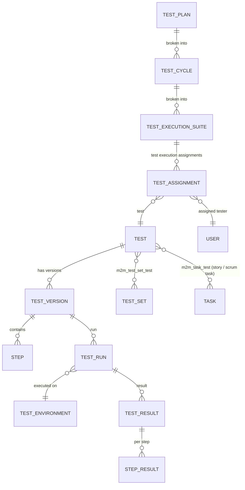
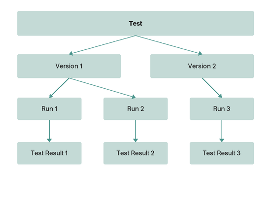
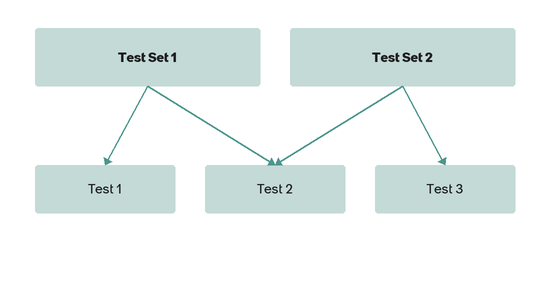
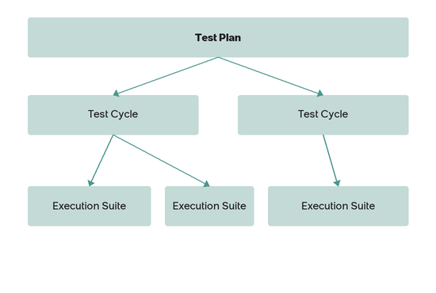
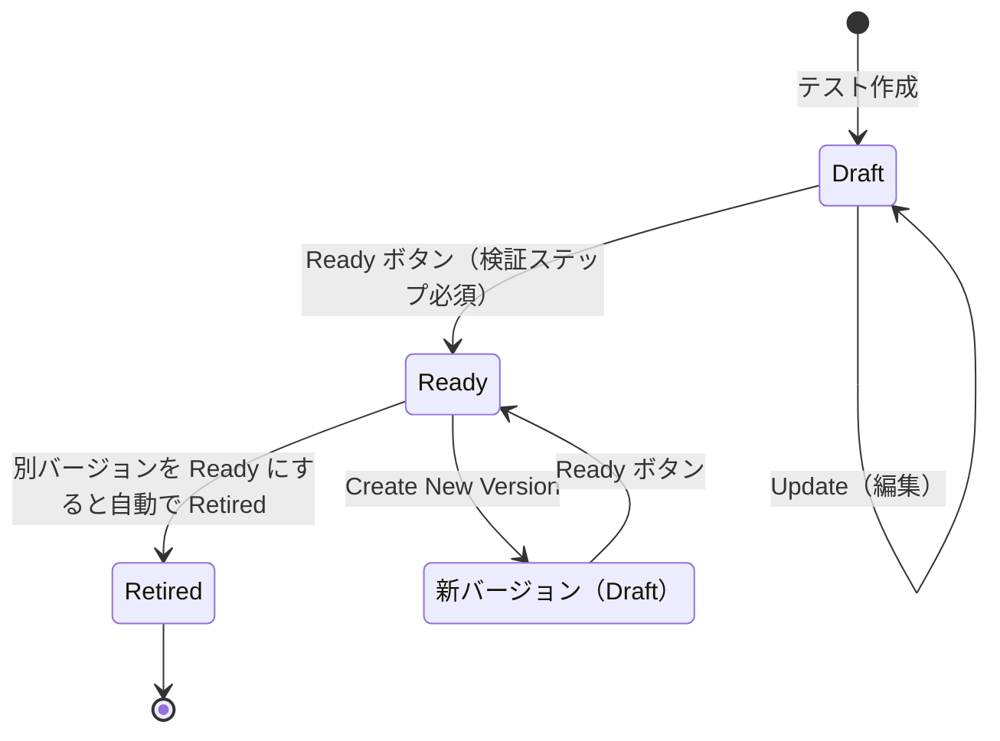
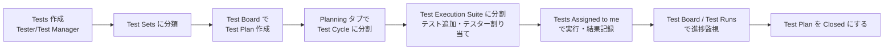
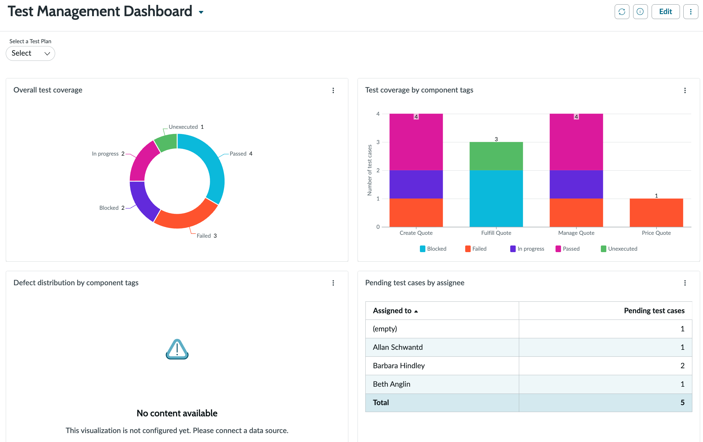

# Test Management 2.0（テスト管理 2.0）

## 概要

Test Management 2.0（テスト管理 2.0）は、ServiceNow の Strategic Portfolio Management（SPM、戦略的ポートフォリオ管理）製品群に属する**手動テスト（manual testing）管理アプリケーション**である。テストケース（ServiceNow 2.0 の用語では Test／Test version）の作成とバージョン管理、テストのグルーピング（Test set）、テスト計画（Test plan）→ テストサイクル（Test cycle）→ テスト実行スイート（Test execution suite）による計画と割り当て、テスターによる実行（Test run）と結果記録（Test result）を、インスタンス上で一元管理する。[出典](https://www.servicenow.com/docs/r/australia/it-business-management/test-management/overview-test-management2.html)

公式ドキュメント（SPM の「Test Management applications」）には 2 つの版が併記されている。

| 版 | プラグイン | 位置付け（Australia 時点のドキュメント記載） |
|---|---|---|
| Test Management 2.0 | `com.snc.test_management.2.0`（表記揺れあり。1.2 参照） | 新規利用者向けの推奨版。業界標準に沿ったデータモデル、Test Board、Agile Development 2.0／SAFe／PPM 連携 |
| Test Management 1.0 | `com.snc.test_mgmt` | London より前のリリースから使っている既存顧客向け。基本的な UAT（受入テスト）のみ。ドキュメント上は「廃止」と明記されていない |

[出典](https://www.servicenow.com/docs/r/australia/it-business-management/test-management/test-management-overview.html)

本ファイルの範囲と関連ファイルは次のとおり。

| トピック | 本ファイル | 関連ファイル |
|---|---|---|
| 手動テストの計画・実行・記録（Test Management 2.0／1.0） | ◎ | — |
| 自動テスト（ATF） | 使い分けのみ（8 章） | [Automated Test Framework (ATF)](../platform/automated-test-framework.md) |
| Agile Development 2.0／SAFe／EAP／CWM 本体 | 連携部分のみ（5 章） | [Agile Development・APM・EAM](./agile-apm-eam.md) |
| PPM（プロジェクト・Project Workbench） | 連携部分のみ（6 章） | [Strategic Portfolio Management（PPM）](./strategic-portfolio-management.md) |
| ITSM の Release Management | 関係の整理のみ（6.3） | [Release Management と DevOps](../itsm/release-management.md) |
| 導入プロジェクトでのテスト計画・Go-Live 判定 | — | [テストと本番稼働](../../03_導入編/11-testing-golive.md) |

> **Brazil での変更:** Brazil 版の SPM ドキュメント（2026-09-10 更新）でも Test Management 1.0／2.0 のトピック構成・プラグイン・ロール・テーブルは Australia と同一であり、Brazil の「Deprecation information for all Brazil features and products」および SPM 系リリースノートにも Test Management の記載は見当たらない。機能変更は公開情報では確認できず。[出典](https://www.servicenow.com/docs/r/it-business-management/test-management/installed-with-testmanagement2.0.html)、[出典](https://www.servicenow.com/docs/r/release-notes/rn-summary-deprecated-info.html)

---

## 1. 有効化・プラグイン・ライセンス

### 1.1 有効化手順

Test Management 2.0 は**既定では有効化されていない**。`admin` ロールを持つ管理者が次の手順でプラグインを有効化する。[出典](https://www.servicenow.com/docs/r/australia/it-business-management/test-management/activate-test-management2.html)

1. **All > System Applications > All Available Applications > All** に移動する。
2. フィルターと検索バーでプラグイン名または ID（`com.snc.test_management.2.0`）を検索する。見つからない場合は ServiceNow に依頼が必要な場合がある。
3. **Install** を選択する。

- ドメインセパレーションと Delegated admin（委任管理）が有効なインスタンスでは、管理ユーザーが **global ドメイン**にいる必要がある。そうでない場合「Application installation is unavailable because another operation is running: Plugin Activation for <plugin name>」エラーになる。[出典](https://www.servicenow.com/docs/r/australia/it-business-management/test-management/activate-test-management2.html)
- インストールされるコンポーネントは「Find components installed with an application」（Application Files テーブル）で確認できる。

### 1.2 関連プラグイン一覧

| プラグイン名 | プラグイン ID | 用途 |
|---|---|---|
| Test Management 2.0 | `com.snc.test_management.2.0` | 本体（有効化ページの表記） |
| Test Management 2.0 - ATF Tests | `com.snc.test_management.2.0.atf` | Test Management 2.0 の Quick start tests（ATF のテスト）を提供（7 章） |
| Test Management 2.0 — Data Migration | `com.snc.test_migration_v1_v2` | 1.0 → 2.0 のデータ移行（10 章） |
| Read only roles for Test Management 2.0 | `com.snc.tm2_read_roles` | 読み取り専用ロール `sn_tm2_read` を提供（2.2） |
| Business Stakeholder | `com.snc.business_stakeholder` | 有効化すると上記の読み取り専用ロール用プラグインも有効化される |
| Test Management（1.0） | `com.snc.test_mgmt` | 旧版本体 |
| Read only roles for Test Management 1.0 | `com.snc.tm1_read_roles` | 旧版の読み取り専用ロール `sn_tm1_read` |

出典：[Activate Test Management 2.0](https://www.servicenow.com/docs/r/australia/it-business-management/test-management/activate-test-management2.html)、[Quick start tests for Test Management 2.0](https://www.servicenow.com/docs/r/australia/it-business-management/test-management/quick-start-tests-test-management.html)、[Migration from Test Management 1.0 to 2.0](https://www.servicenow.com/docs/r/australia/it-business-management/test-management/migrate-test.html)、[Business stakeholder role for Test Management 2.0](https://www.servicenow.com/docs/r/australia/it-business-management/test-management/business-stakeholder-role-test-mgmt2.html)

> **プラグイン ID の表記揺れ（公式ドキュメント内の不一致）:** Australia の公式ドキュメント内で、本体プラグイン ID が 3 通りに記載されている。
> - `com.snc.test_management.2.0` … 「Activate Test Management 2.0」「Quick start tests」「Business stakeholder role」「Test Management applications」
> - `com.snc.sdlc.test_management` … 「Installed with Test Management 2.0」（Brazil 版も同じ）
> - `com.snc.testmanagement.2.0`／`com.snc.testmigrationv1v2` … 概要ページの AI 生成要約、移行ページの AI 生成要約
>
> 実インスタンスでは **System Definition > Plugins**（`v_plugin`）で名前「Test Management 2.0」を検索して実 ID を確認すること。本ファイルは有効化手順ページの `com.snc.test_management.2.0` を正として扱う。

### 1.3 ライセンス上の位置付け

- 公式の製品ドキュメントには、Test Management 2.0 がどのサブスクリプションに含まれるかの記載はない。
- ServiceNow 社員の Community 回答（2022-01）では「Test Management 2.0 は現在 ITBM Professional パッケージに含まれている。エンタイトルメントはアカウント担当に確認を」とされている。【第三者情報】[出典](https://www.servicenow.com/community/spm-forum/test-management-2-0-and-agile-releases/m-p/1025079)
- Community の別回答（2023-10）では「Test Management は有償サブスクリプションが必要」とされている。【第三者情報】[出典](https://www.servicenow.com/community/developer-forum/test-managment-2-0-license/m-p/2695556)
- ServiceNow 社員による Community 記事（2026-04-28）は、Agile Development 2.0 の End of Sale（2026-04）に伴い **SPM の SKU から Agile Development が除外された**としている【第三者情報】。Test Management 2.0 の Sprint testing（5.1）と Defect（`rm_defect`）連携（6.1）は Agile 2.0 に依存するため、新規顧客がこれらを使えるかどうかの判断に直接かかわる（5.3）。詳細は [Agile Development・APM・EAM](./agile-apm-eam.md) の 1.3 節を参照。[出典](https://www.servicenow.com/community/cwm-articles/start-here-agile-2-0-deprecation-and-collaborative-work/ta-p/3533752)
- ITBM は SPM の旧称であり、Australia 時点では SPM Professional 相当に含まれると考えられるが、現行の SKU 構成での扱いは公開情報では確認できず【推定】。SPM のパッケージ構成は [Strategic Portfolio Management（PPM）](./strategic-portfolio-management.md) と [ライセンスモデル](../../03_導入編/01-licensing-model.md) を参照。

---

## 2. ロール

### 2.1 Test Management 2.0 のロール

| 表示名 | ロール名 | 内包ロール | 公式の説明 |
|---|---|---|---|
| Tester（テスター） | `sn_test_management.tester` | なし | テストを作成し、類似のテストをテストセットにまとめる（"Can create tests, and group similar tests to a test set."） |
| Test Manager（テストマネージャー） | `sn_test_management.test_manager` | `sn_test_management.tester` | テスト作成・テストセット作成に加え、テスト計画を管理し、実行結果を参照する |

[出典](https://www.servicenow.com/docs/r/australia/it-business-management/test-management/installed-with-testmanagement2.0.html)

概要ページは、両ロールの役割を次のように説明している。[出典](https://www.servicenow.com/docs/r/australia/it-business-management/test-management/overview-test-management2.html)

| ロール | できること |
|---|---|
| Tester | テスト・テストセットの作成、テストの実施、結果の記録、テストのステータス更新、失敗したテストに関する欠陥（Defect）レコードの**手動**作成 |
| Test Manager | 手動テストプロセスの準備と監視。テスト・テストセットの作成と保守、テスターが作成した内容の評価、テスト計画・テストサイクル・テスト実行スイートを通じたテスト実行の準備、テスターへの割り当て、進捗の追跡、テスト計画のクローズ |

### 2.2 操作別の必要ロール

| 操作 | 必要ロール | 出典 |
|---|---|---|
| プラグイン有効化 | `admin` | [Activate](https://www.servicenow.com/docs/r/australia/it-business-management/test-management/activate-test-management2.html) |
| テスト作成（Tests モジュール） | `sn_test_management.tester` または `sn_test_management.test_manager` | [Create a test](https://www.servicenow.com/docs/r/australia/it-business-management/test-management/create-test2.html) |
| テストセット作成 | `sn_test_management.tester` または `sn_test_management.test_manager` | [Create a test set](https://www.servicenow.com/docs/r/australia/it-business-management/test-management/create-test-set.html) |
| テスト計画作成（Test Board） | `sn_test_management.test_manager` | [Create a test plan](https://www.servicenow.com/docs/r/australia/it-business-management/test-management/create-test-plan.html) |
| テストサイクル・実行スイートの追加／編集 | `sn_test_management.test_manager` | [Planning tab](https://www.servicenow.com/docs/r/australia/it-business-management/test-management/use-planning-tab.html) |
| テスト実行スイート作成（単独） | `sn_test_management.test_manager` | [Create a test execution suite](https://www.servicenow.com/docs/r/australia/it-business-management/test-management/create-test-execution-suite.html) |
| 割り当てられたテストの実行 | `sn_test_management.tester` | [Run your test assignments](https://www.servicenow.com/docs/r/australia/it-business-management/test-management/run-your-test-assignments.html) |
| Test Board のカスタム列定義 | `admin` | [Define a custom column](https://www.servicenow.com/docs/r/australia/it-business-management/test-management/add-custom-column.html) |
| Agile Board からストーリーのテストを作成 | `scrum_user` または `scrum_admin`（アジャイルグループのメンバーであること） | [Create a test for a story](https://www.servicenow.com/docs/r/australia/it-business-management/test-management/create-test-plan-for-story-agile2.html) |
| Agile Board の List view からテスト実行 | `scrum_user` | [Run your tests from the List view](https://www.servicenow.com/docs/r/australia/it-business-management/test-management/run-test-plan-within-agile2.html) |
| SAFe Board からテスト作成・実行 | `safe_scrum_user` または `safe_admin` | [Create a test for a SAFe story](https://www.servicenow.com/docs/r/australia/it-business-management/scaled-agile-framework-safe/create-SAFe-test.html) |
| 1.0 → 2.0 のテストスイート変換 | `admin` | [Convert test suites](https://www.servicenow.com/docs/r/australia/it-business-management/test-management/migrate-test-suites.html) |

### 2.3 読み取り専用ロール（Business stakeholder）

`sn_tm2_read`（Business stakeholder role）は、Test Management 2.0 の全テーブルへの**読み取り専用アクセス**（レポート作成用のデータ参照）と、Test Management ダッシュボードへの読み取り専用アクセスを与える。組織内のビジネスステークホルダーであれば誰にでも付与できる。[出典](https://www.servicenow.com/docs/r/australia/it-business-management/test-management/business-stakeholder-role-test-mgmt2.html)

| 条件 | 内容 |
|---|---|
| 新規顧客 | `com.snc.tm2_read_roles` は zBoot 時に有効化済み。ただし `sn_tm2_read` は `com.snc.test_management.2.0` を有効化したときにのみ利用可能になる |
| アップグレード顧客 | `com.snc.tm2_read_roles` を手動で有効化する必要がある |
| テーブルアクセスの前提 | `com.snc.tm2_read_roles` と `com.snc.test_management.2.0` の両方が有効であること |

旧版（1.0）では同様に `sn_tm1_read`（`com.snc.tm1_read_roles`＋`com.snc.test_mgmt`）が用意されている。[出典](https://www.servicenow.com/docs/r/australia/it-business-management/test-management/business-stakeholder-role-tm-1.html)

---

## 3. データモデル（Test Management 2.0）

### 3.1 主要概念

| 概念（英語） | 日本語 | 定義（公式） |
|---|---|---|
| Test | テスト | 機能が正しく動くかを判断する条件またはステップの集合。期待結果を含められる |
| Test version | テストバージョン | 1 つのテストは複数のバージョンを持てる。**Ready 状態のバージョンは実行できるが編集できない** |
| Test step | テストステップ | テストバージョン内の手順。「Needs Verification」を付けたステップが検証ステップ（期待結果）になる |
| Test set | テストセット | 関連するテストのグループ。1 つのテストを複数のテストセットに含められる自由形式の集合（製品・コンポーネント・リリース等で分類） |
| Test plan | テスト計画 | 製品・機能を「どのように・いつ」テストするかを記述し、テストを実行する期間を持つ |
| Test cycle | テストサイクル | テスト計画内のフェーズまたは反復（例：回帰テスト、スモークテスト、スプリント、UAT、結合テスト） |
| Test execution suite | テスト実行スイート | テストサイクルをさらに分割した最小の計画単位。テストを「いつ・誰が」実行するかを定義し、テスターへの個別割り当てを持つ |
| Test execution assignment | テスト実行割り当て | テストとテスターの紐付け |
| Test environment | テスト環境（実行環境） | テストを実行する構成（ブラウザーのバージョン、OS など）。実行時に選択する |
| Test run | テスト実行 | 実行の記録。開始・終了時刻、環境、結果など |
| Test result／Step result | テスト結果／ステップ結果 | すべての結果は特定の Run と特定の Test version に紐付く |

出典：[Test Management 2.0 overview](https://www.servicenow.com/docs/r/australia/it-business-management/test-management/overview-test-management2.html)、[Data model enhancements](https://www.servicenow.com/docs/r/australia/it-business-management/test-management/data-model-enhancements-test.html)、[Run your test assignments](https://www.servicenow.com/docs/r/australia/it-business-management/test-management/run-your-test-assignments.html)

> **用語の注意（「テストケース」「テストスイート」）:** 「Test case」「Test suite」は **Test Management 1.0 の用語**である。2.0 では 1.0 の Test case が **Test version**、Test が **Test step**、Test suite が **Test set** に対応する（10 章の移行マッピング）。2.0 の概要ページには「Test case: テストスイートに保存され、テスト計画に追加される関連テストの集合」という用語説明も残っているが、2.0 のテーブルに Test case／Test suite は存在しない。[出典](https://www.servicenow.com/docs/r/australia/it-business-management/test-management/migrate-test.html)

### 3.2 テーブル一覧

Test Management 2.0 を有効化すると次の 15 テーブルがインストールされる（すべて `sn_test_management` スコープ）。[出典](https://www.servicenow.com/docs/r/australia/it-business-management/test-management/installed-with-testmanagement2.0.html)

| 表示名 | テーブル名 | 公式の説明 |
|---|---|---|
| Test | `sn_test_management_test` | テストの詳細 |
| Test Version | `sn_test_management_test_version` | テストバージョンの詳細 |
| Steps | `sn_test_management_step` | テストステップの詳細 |
| Test Set | `sn_test_management_test_set` | テストセットの詳細 |
| Test Set Test | `sn_test_management_m2m_test_set_test` | テストと複数テストセットの多対多 |
| Test Plan | `sn_test_management_test_plan` | テスト計画の詳細 |
| Test Cycle | `sn_test_management_test_cycle` | テストサイクルの詳細 |
| Test Execution Suite | `sn_test_management_test_execution_suite` | テスト実行スイートの詳細 |
| Planned Test Task | `sn_test_management_planned_task` | Planned Task（`planned_task`）テーブルを拡張 |
| Test Execution Assignment | `sn_test_management_test_assignment` | テストとテスターの紐付け |
| Test Environment | `sn_test_management_test_environment` | テスト環境の詳細 |
| Test Run | `sn_test_management_test_run` | テスト実行の詳細 |
| Test Result | `sn_test_management_test_result` | テスト結果の詳細 |
| Step Result | `sn_test_management_step_result` | ステップ結果の詳細 |
| Task Test | `sn_test_management_m2m_task_test` | テストと複数のスクラムタスク（ストーリー等）の多対多 |

- `sn_test_management_planned_task` は `planned_task` を拡張している。Test Plan／Test Cycle／Test Execution Suite が計画開始日・終了日・期間・State（Pending／Open／Work in progress／Closed complete／Closed incomplete／Closed skipped）を持ち、Test Board でガント表示されることから、これら 3 テーブルは `sn_test_management_planned_task` の子テーブルと考えられる【推定】（公式ドキュメントに継承関係の明記なし）。実機では **System Definition > Tables** で確認すること。
- テスト本体（`sn_test_management_test`）、バージョン（`sn_test_management_test_version`）、ステップ（`sn_test_management_step`）は別テーブルであるため、Table API や Import Set で一括投入する場合は Test → Test version → Steps の順に作成し、参照をつなぐ必要がある【推定】（Community にも Table API でテストだけが作成されるという質問が見られたが、該当スレッドはアーカイブ済みで内容を確認できず）。

### 3.3 関係図

テーブル間の参照フィールド名は公式に公開されていないため、下図は公式の概念説明とテーブル説明から構成した論理モデルである【推定】。

**図 1：テストのバージョンと実行結果の関係（Test Management 2.0）**
画面ではなく概念図。最上段に「Test」が 1 つあり、その下に「Version 1」「Version 2」の 2 バージョンがぶら下がる。Version 1 からは「Run 1」「Run 2」、Version 2 からは「Run 3」が分岐し、各 Run の下にそれぞれ「Test Result 1〜3」が 1 対 1 で付く。1 つのテストが複数バージョンを持ち、各実行（Run）と結果がどのバージョンに対するものかを追跡できることを示す。
出典：[Data model enhancements in Test Management 2.0（ServiceNow Docs, Australia）](https://www.servicenow.com/docs/r/australia/it-business-management/test-management/data-model-enhancements-test.html)（取得日：2026-11-04）

**図 2：テストセット（Test set）の概念**
概念図。1 つの「Test Set」の下に複数の「Test」が並び、テストセットが自由形式のテストの集合であることを示す（同じテストが別のテストセットに属することもできる）。
出典：[Data model enhancements in Test Management 2.0（ServiceNow Docs, Australia）](https://www.servicenow.com/docs/r/australia/it-business-management/test-management/data-model-enhancements-test.html)（取得日：2026-11-04）

**図 3：テスト計画の階層（Test Plan → Test Cycle → Execution Suite）**
概念図。最上段の「Test Plan」から 2 つの「Test Cycle」に分岐し、左のテストサイクルは 2 つの「Execution Suite」、右のテストサイクルは 1 つの「Execution Suite」に分割される。テスト計画は期間（タイムフレーム）を持ち、サイクル（例：UAT、結合テスト）、さらに実行スイート（いつ・誰が実行するか）へと細分化される。
出典：[Data model enhancements in Test Management 2.0（ServiceNow Docs, Australia）](https://www.servicenow.com/docs/r/australia/it-business-management/test-management/data-model-enhancements-test.html)（取得日：2026-11-04）

---

## 4. 機能仕様（Test Management 2.0）

### 4.1 メニュー（モジュール）

アプリケーションメニュー **Test Management 2.0** 配下に、公式ドキュメントで確認できる次のモジュールがある。

| モジュール | 用途 | 出典 |
|---|---|---|
| Tests | テストの作成・保守（バージョン管理） | [Create a test](https://www.servicenow.com/docs/r/australia/it-business-management/test-management/create-test2.html) |
| Test Sets | テストセットの作成 | [Create a test set](https://www.servicenow.com/docs/r/australia/it-business-management/test-management/create-test-set.html) |
| Test Board | テスト計画の作成・構造化・監視 | [Test Board](https://www.servicenow.com/docs/r/australia/it-business-management/test-management/test-board.html) |
| Test Execution Suites | テスト実行スイートの単独作成 | [Create a test execution suite](https://www.servicenow.com/docs/r/australia/it-business-management/test-management/create-test-execution-suite.html) |
| Tests Assigned to me | 自分に割り当てられたテストの一覧と実行 | [Run your test assignments](https://www.servicenow.com/docs/r/australia/it-business-management/test-management/run-your-test-assignments.html) |
| Test Runs | 全テスト計画を横断したテスト実行と結果の履歴 | 同上 |
| Settings > Planning Console | Test Board の Planning タブ表示列（Planning Console Display Columns）の定義 | [Define a custom column](https://www.servicenow.com/docs/r/australia/it-business-management/test-management/add-custom-column.html) |

概要ページは「Test Plans」「Run」モジュールにも言及しているが、手順ページでは Test Board と Test Runs が使われている。実インスタンスのメニュー構成と完全一致するかは公開情報では確認できず。

### 4.2 テスト（Test）とテストバージョン（Test version）

**作成手順**：**All > Test Management 2.0 > Tests** で **New** → テスト名を入力し、Test version フォームでステップを追加して **Submit**。作成後、Tests リストからテストを開き、**Test versions** 関連リストからバージョンを開く。Agile Board の Sprint Tracking からも作成できる（5.1）。[出典](https://www.servicenow.com/docs/r/australia/it-business-management/test-management/create-test2.html)

**Test version フォームの項目・ボタン**

| 項目 | 説明 |
|---|---|
| Test | テストの一意な名前 |
| Owner | テストを作成した所有者 |
| Version | 自動採番されるバージョン |
| State | Draft／Ready／Retired（下表） |
| Short description | 簡単な説明 |
| Add Step（ボタン） | ステップを追加。ステップ説明を入力して Enter で次のステップへ進める |
| Change step order（アイコン） | ドラッグでステップ順を変更 |
| Needs Verification（チェックボックス） | ステップを検証ステップにする。実行時に合否の確認が必要になる。期待結果は別レコードではなく検証ステップとして記録する |
| Delete a test step（アイコン） | ステップを削除 |
| Run（ボタン） | ステップを実行。Ready 状態のときのみ表示 |
| Update（ボタン） | バージョンの変更を保存 |
| Ready（ボタン） | バージョンを Ready 状態にする |
| Create New Version（ボタン） | 新しいバージョンを作成 |
| Delete（ボタン） | バージョンを削除 |

**Test version の関連リスト**：Other versions（全バージョン）、Test Results（各バージョンの実行結果）、Test Sets（所属テストセット）。[出典](https://www.servicenow.com/docs/r/australia/it-business-management/test-management/create-test-plan-for-story-agile2.html)

**Test version の状態（State）**

| State | 意味 | 編集 | 実行 |
|---|---|---|---|
| Draft | 作成時の初期状態 | 可 | 不可 |
| Ready | 実行承認済み。複数バージョンがある場合、Ready は常に 1 つだけ | 不可（変更は Create New Version） | 可 |
| Retired | 使用終了 | — | 不可 |

[出典](https://www.servicenow.com/docs/r/australia/it-business-management/test-management/create-test2.html)、[出典](https://www.servicenow.com/docs/r/australia/it-business-management/agile-development/test-version-form.html)

Quick start tests（7 章）のテスト名から、次のビジネスルールが読み取れる。[出典](https://www.servicenow.com/docs/r/australia/it-business-management/test-management/quick-start-tests-test-management.html)

- 検証ステップ（Needs Verification）を含むテストバージョンは Ready にできる。**検証ステップを含まないテストバージョンは Ready にできない**。
- あるテストバージョンを Ready にすると、**同じテストの他の Ready バージョンは Retired になる**。
- **Ready 状態でないテストは実行スイートに割り当てられない**。

### 4.3 テストセット（Test set）

1. **All > Test Management 2.0 > Test Sets** で **New**、名前を入力して **Submit**。
2. **Test Management 2.0 > Tests** でテストを選択し **Add to Test Set** → Select Test Set ウィンドウでテストセットを検索して **Add**。
3. テストセットのレコードを開き、ドラッグ＆ドロップでテストの順序を変更できる。

[出典](https://www.servicenow.com/docs/r/australia/it-business-management/test-management/create-test-set.html)

### 4.4 Test Board

Test Board は、テスト計画を作成・構造化・監視するための専用 UI である。[出典](https://www.servicenow.com/docs/r/australia/it-business-management/test-management/test-board.html)

| 機能 | 内容 |
|---|---|
| カード表示 | 全テスト計画をカードで一覧表示。各カードに開始日・終了日、テストの Passed／Failed／Blocked の割合、残日数を表示 |
| 検索 | 名前、期間、所有者などのフィルター条件でテスト計画を検索 |
| Planning タブ：Test plan work item hierarchy | テスト計画の下にテストサイクル・実行スイートを展開可能な行で表示。各フォームを開かずに開始・終了日時などを一括編集、追加・削除、表示列の設定 |
| Planning タブ：Gantt chart | テスト計画と子タスクのタイムラインを青いタスクバーで表示。子タスクの期間変更に応じて計画のバーが伸縮。バー端のドラッグで期間変更 |
| カスタム列 | 例：テスト計画の完了率を表示する列（4.7） |

**テスト計画の作成**（`sn_test_management.test_manager`）：**All > Test Management 2.0 > Test Board** → **Create Test Plan** → Name と Planned start date を入力して **OK** → Details タブで残りを入力。[出典](https://www.servicenow.com/docs/r/australia/it-business-management/test-management/create-test-plan.html)

| フィールド | 説明 |
|---|---|
| Name | テスト計画の一意な名前 |
| Planned start date | 実行開始予定日時 |
| Planned end date | 実行終了予定日時 |
| Duration | 予定開始日と予定終了日の差 |
| Number | 自動採番 |
| Owner | 作成者 |
| State | 下表 |
| Description | 説明 |
| Progress セクション | テスト計画内のテストの Passed／Failed／Blocked の割合 |

**テスト計画の状態（State）**

| State | 意味 |
|---|---|
| Pending | まだ実施準備ができていない |
| Open | 実施可能 |
| Work in progress | 実施中 |
| Closed complete | 完了してクローズ |
| Closed incomplete | 未完了のままクローズ |
| Closed skipped | 実施せずにクローズ |

[出典](https://www.servicenow.com/docs/r/australia/it-business-management/test-management/create-test-plan.html)

### 4.5 テストサイクルとテスト実行スイート（Planning タブ）

**All > Test Management 2.0 > Test Board** → テスト計画を選択 → **Planning** タブで、次の操作を行う（`sn_test_management.test_manager`）。[出典](https://www.servicenow.com/docs/r/australia/it-business-management/test-management/use-planning-tab.html)

| 操作 | 方法 |
|---|---|
| テストサイクル追加 | テスト計画を選択 → 右クリック **Add Test Cycle**（または追加アイコン） |
| テストサイクル編集 | 右クリック **Edit** でフォームを開く |
| テストサイクル削除 | 右クリック **Delete**。**配下の実行スイートも削除される** |
| 実行スイート追加 | テストサイクルを選択 → 右クリック **Add Execution Suite**（または追加アイコン） |
| 実行スイート編集 | 右クリック **Edit** |
| テスト追加 | 実行スイートを選択 → 右クリック **Add tests** |
| テストセット追加 | 実行スイートを選択 → 右クリック **Add test sets** |
| 列の表示／非表示 | 歯車アイコン → チェックボックスで選択（設定は保存される） |
| ガントの操作 | ホバーでタスク概要、バーの左右端ドラッグで開始・終了日変更、バー全体ドラッグで移動、上部で月／日単位とズームレベル、**Auto Fit** で計画全体を 1 画面に表示 |

### 4.6 テスト実行スイート（Test execution suite）の単独作成

テスト計画・テストサイクルを作るほどでもない小規模なテストでは、実行スイートだけを**短いテスト計画**として作成できる。**All > Test Management 2.0 > Test Execution Suites**（`sn_test_management.test_manager`）。[出典](https://www.servicenow.com/docs/r/australia/it-business-management/test-management/create-test-execution-suite.html)

| フィールド | 説明 |
|---|---|
| Name | 一意な名前 |
| Planned start date／Planned end date | 開始・終了予定日時 |
| Planned duration | 予定開始日と予定終了日の差 |
| Number | 自動採番 |
| State | 現在の状態（値の一覧は公式に記載なし。テスト計画と同じ Planned Task 系の値と推定【推定】） |
| Assignment group | スイートを担当するグループ |
| Progress：Percent complete／Percent passed／Percent failed／Percent blocked | 自動計算 |

**割り当て**：フォームの **Add tests**（Tests リストから選択 → **Add to Execution Suite**）または **Add test sets** でテストを追加し、**Test execution assignments** 関連リストでテストごとにユーザー（テスター）を割り当てる。

### 4.7 Test Board のカスタム列

`admin` が **All > Test Management 2.0 > Settings > Planning Console** → 右上の歯車 → System Settings の Developer セクションで Application に **Test Management** を選択 → **Planning Console Display Columns** 関連リストで **New** → ラベル等を入力して Submit。作成後、列を対象テーブルに関連付ける。[出典](https://www.servicenow.com/docs/r/australia/it-business-management/test-management/add-custom-column.html)

> 参考：Test Board の Planning タブは PPM の Planning Console 系の仕組み（Planning Console Display Columns）を設定に用いている。PPM 側の旧 Planning console は Australia で非推奨扱いになっているが（[Strategic Portfolio Management（PPM）](./strategic-portfolio-management.md) 参照）、Test Management 2.0 の Test Board への影響は公開情報では確認できず。

### 4.8 テストの実行（Test run）と結果

**前提**：テストマネージャーがテストを Ready にして自分に割り当てていること、インスタンスに実行環境（Test environment）が 1 つ以上構成されていること、`sn_test_management.tester` ロール。[出典](https://www.servicenow.com/docs/r/australia/it-business-management/test-management/run-your-test-assignments.html)

1. **All > Test Management 2.0 > Tests Assigned to me** に移動する。
2. テストを選択して **Run**（Ready 状態のテストのみ実行可能）。
3. ポップアップで実行環境（ブラウザーのバージョンや OS などの構成）を選択する。
4. **Test Execution** ポップアップで各ステップを Passed／Failed／Blocked にマークする。Failed と Blocked ではコメントと添付ファイルを追加できる。**Pause** で中断して後で再開できる。
5. **Done** をクリックする。

実行用ウィンドウは小さなブラウザーウィンドウで開き、テスト対象システムの横に並べて使える。ウィンドウを開き直さずに複数テストを連続実行できる。[出典](https://www.servicenow.com/docs/r/australia/it-business-management/test-management/usability-enhancements-test.html)

**テスト全体のステータス判定**（結果は Test Result フォームに保存）

| 優先度 | 条件 | 全体ステータス |
|---|---|---|
| 1（最優先） | 1 つ以上のステップが Blocked | **Blocked** |
| 2 | 1 つ以上のステップが Failed | **Failed** |
| 3 | 1 つ以上のステップが未実行 | **Not finished** |
| 4 | 全ステップが Passed | **Passed** |

[出典](https://www.servicenow.com/docs/r/australia/it-business-management/test-management/run-your-test-assignments.html)、[出典](https://www.servicenow.com/docs/r/australia/it-business-management/test-management/run-test-plan-within-agile2.html)

- SAFe の実行手順には「ステップが Blocked になると、残りのステップに進んで検証できない」との注記がある。[出典](https://www.servicenow.com/docs/r/australia/it-business-management/scaled-agile-framework-safe/run-SAFe-test.html)
- テスト実行（Run）がクローズされると実行スイートの進捗が更新され、テスト計画・テストサイクルへ進捗がロールアップされる（Quick start tests のテスト名より）。[出典](https://www.servicenow.com/docs/r/australia/it-business-management/test-management/quick-start-tests-test-management.html)
- 全テスト計画を横断した実行履歴は **Test Management 2.0 > Test Runs** で参照する。

### 4.9 汎用テストの全体フロー（Release readiness testing）

公式は「General testing（汎用テスト）」として、リリースのフェーズ単位のテスト、製品投入前の機能群テスト、新規ソフトウェアの結合・アクセシビリティに関するリリース準備性テストを想定し、次の流れを示している。[出典](https://www.servicenow.com/docs/r/australia/it-business-management/test-management/release-readiness-testing.html)

---

## 5. Agile Development 2.0／SAFe との連携

### 5.1 Sprint testing（スプリントテスト）

Test Management 2.0 は Agile Development 2.0 と連携し、スクラムチームがスプリント単位でユーザーストーリーをテストできる（Sprint testing）。テスト計画が「サイクル・実行スイートを横断するリリース準備性テスト」向けであるのに対し、Sprint testing は「ストーリーにテストを紐付けてスプリントごとに追跡する」用途である。[出典](https://www.servicenow.com/docs/r/australia/it-business-management/test-management/sprint-testing.html)

| 手順 | 内容 |
|---|---|
| 1. テスト作成 | **All > Agile Development > Agile Board** → **Sprint Tracking** タブ → **List** view → 右上の **Show** で **Tests** を選択 → **Add Test**。その行のストーリーに自動でリンクされる（`scrum_user` または `scrum_admin`、アジャイルグループのメンバー） |
| 既存テストの紐付け | ストーリーレコードの **Tests** 関連リストから既存テストを追加 |
| 2. 実行 | List view でテストを選択し、ストーリーの **Run** をクリックすると**そのストーリーの全テストを一括実行**。環境を選択（Lookup using list アイコン）→ Run → Test Execution ポップアップで判定 → Done（`scrum_user`） |
| 3. レビューとクローズ | List view に各テストの最新結果が表示される。全テストが Passed になったら Sprint Tracking でストーリーの State を **Complete** にする |

出典：[Create a test for a story](https://www.servicenow.com/docs/r/australia/it-business-management/test-management/create-test-plan-for-story-agile2.html)、[Run your tests from the List view](https://www.servicenow.com/docs/r/australia/it-business-management/test-management/run-test-plan-within-agile2.html)、[Sprint testing](https://www.servicenow.com/docs/r/australia/it-business-management/test-management/sprint-testing.html)

- List view からのテスト作成は、Agile Development 2.0 と Test Management 2.0 の両方がインストールされている場合のみ可能。
- ストーリーとテストの紐付けは Task Test（`sn_test_management_m2m_task_test`）テーブルで管理される（テーブル説明「Associates tests to multiple scrum tasks」）。
- Agile Development 2.0 標準の **Testing Task**（`rm_test`、スクラムタスクの一種）とは別物である。`rm_test` は「テスト作業」というタスクであり、テスト手順・実行結果は持たない【推定】。Agile 2.0 のテーブルは [Agile Development・APM・EAM](./agile-apm-eam.md) を参照。
- ストーリーの全テストが Passed でなくてもストーリーを Complete にできるかどうか（システムによる強制の有無）は公開情報では確認できず。手順上は運用ルールとして扱われている。

### 5.2 SAFe（Scaled Agile Framework）

Test Management 2.0 プラグインがインストールされていれば、SAFe Board でも同様にテストを作成・実行できる。[出典](https://www.servicenow.com/docs/r/australia/it-business-management/scaled-agile-framework-safe/create-SAFe-test.html)

- **All > Scaled Agile Framework (SAFe) > SAFe Board** → 左上でレベルを **Team**、隣のリストでチームを選択 → **Sprint Tracking** タブ → **List** view → **Show** で **Tests** → **Add Test**。
- 実行も同画面でストーリーの **Run** から行う（ストーリーの全テストを一括実行）。[出典](https://www.servicenow.com/docs/r/australia/it-business-management/scaled-agile-framework-safe/run-SAFe-test.html)
- 必要ロール：`safe_scrum_user` または `safe_admin`。

### 5.3 Agile 2.0 の廃止予定と Test Management 2.0 への影響

Australia リリースノートは、Agile Development 2.0（`com.snc.sdlc.agile.2.0`）を 2030-08 に廃止予定とし、後継を ServiceNow Store の Collaborative Work Management（CWM）としている。Agile 2.0 は 2026-04 に新規販売終了となった（Community の ServiceNow 社員記事）。詳細は [Agile Development・APM・EAM](./agile-apm-eam.md) の 1 章を参照。[出典](https://www.servicenow.com/docs/r/IDeOjpA1hzonPLWG~inEpg/neJjFWiM6xJCQbaXFj~3eQ)、[出典](https://www.servicenow.com/community/cwm-articles/start-here-agile-2-0-deprecation-and-collaborative-work/ta-p/3533752)【第三者情報】

| 観点 | 状況 |
|---|---|
| Test Management 2.0 自体の廃止予定 | Australia・Brazil の廃止情報ページに記載なし（2026-11 時点） |
| Sprint testing（Agile 2.0 連携） | Agile 2.0 の Agile Board／Sprint Tracking に依存する。End of Sale で SPM の SKU から Agile Development が除外された【第三者情報】（1.3）ため、Agile 2.0 を新規導入できない顧客では利用できない【推定】 |
| 欠陥（Defect、`rm_defect`） | Agile 2.0 の Defects モジュールに依存（6 章）。同 Community 記事のテーブル対応表では `rm_defect` は「レガシー」テーブルに分類されている【第三者情報】（[Agile Development・APM・EAM](./agile-apm-eam.md) 1.3 節）。Agile 2.0 廃止後に Test Management 2.0 側で欠陥をどう扱うかの公式説明は公開情報では確認できず |
| CWM との連携 | CWM のリリースノート（Brazil, 11.0.1）・ドキュメントに Test Management 2.0 との連携の記載はない。公開情報では確認できず |
| Enterprise Agile Planning（EAP）との連携 | EAP のドキュメントに Test Management 2.0 との連携の記載はない。公開情報では確認できず |

[出典](https://www.servicenow.com/docs/r/release-notes/spm-cwm-rn.html)

> **実務上の含意【推定】:** 新規に Agile 2.0 を導入できない顧客が Test Management 2.0 を使う場合、利用範囲は「Test Board による汎用テスト（テスト計画・サイクル・実行スイート）」と「PPM 連携」が中心となり、ストーリー連動の Sprint testing と Defect 連携は使えない、あるいはカスタマイズが必要になる可能性が高い。導入前にアカウント担当へ確認すること。

---

## 6. 欠陥（Defect）管理・PPM・Release との連携

### 6.1 Test Management 2.0 における欠陥の扱い

- Test Management 2.0 は**失敗したテストから欠陥（Defect）を自動作成しない**。テスターが欠陥レコードを手動で作成し、説明欄にテスト名とステップ番号を記載する。失敗したテストは再テストのために欠陥と関連付けて扱う。[出典](https://www.servicenow.com/docs/r/australia/it-business-management/test-management/run-your-test-assignments.html)、[出典](https://www.servicenow.com/docs/r/australia/it-business-management/test-management/overview-test-management2.html)
- 2.0 のテーブル一覧（3.2）に欠陥テーブルや欠陥とテスト結果の多対多テーブルは含まれない。つまり、Test Result と Defect をつなぐ標準の参照・関連リストはない（1.0 には `m2m_tm_test_case_instance_defect` があった）。
- 欠陥レコードの起票先として標準で想定されるのは Agile Development 2.0 の **Defect**（`rm_defect`、**All > Agile Development > Defects**）である【推定】（公式は「defect record」とのみ記載）。

**Agile Development 2.0 の Defect フォーム（参考）** [出典](https://www.servicenow.com/docs/r/australia/it-business-management/agile-development/create-defect-report.html)

| フィールド | 説明 |
|---|---|
| Number | 自動採番 |
| Priority | 優先度（プロダクトオーナーがストーリー作成時に利用） |
| State | Draft（既定）／Scoping／Awaiting approval／Work in progress／Testing/QA／Deploy/Launch／Closed Complete／On Hold／Cancelled |
| Assignment group／Assigned to | 担当グループ・担当者 |
| Product | 関連プロダクト |
| Reported against | 欠陥の起票元となった Problem・Change・その他タスク |
| Short Description／Description／Work notes | 説明・作業メモ |

- Defect を作成するには `feature_user`、`scrum_story_creator`、`scrum_admin` のいずれかが必要。`feature_user` のみの場合は Defects モジュールで欠陥を参照できるが、欠陥レコードの Stories 関連リストは見えない。[出典](https://www.servicenow.com/docs/r/australia/it-business-management/agile-development/defect-reports.html)
- 「Reported against」はタスク参照であるため、テストの実行に関連するタスク（例：実行スイート）を入れて追跡する運用が考えられる【推定】。

**Community で報告されている課題**【第三者情報】

- 2019 年から 2024 年にかけて「失敗したテストから欠陥を起票する機能」の提供時期を問う投稿が続いているが、ServiceNow からの公式回答は表示されていない。[出典](https://www.servicenow.com/community/spm-forum/how-can-i-create-a-bug-or-defect-in-test-management-2-0/m-p/2719244)
- 2024-06 の投稿では、失敗した Run に「ストーリー欠陥を追加」する UI アクションがないため自前で作った、欠陥をストーリーにフラグを付けて管理すると短い説明に「DEFECT」接頭辞が並んで扱いにくい、Test Board のドリルダウンで失敗テストだけを開けない、1.0 には欠陥専用テーブルがあった、という不満が挙げられている。回答は「1.0 は古いので 2.0 へ。要望はアカウントチームへ」というものだった。[出典](https://www.servicenow.com/community/expert-services-forum/test-management-2-0-defect-management/m-p/2954050)

> **実務上の対応例【経験則】:** (1) Test Result（`sn_test_management_test_result`）または Step result のフォームに「Create Defect」UI アクションを追加し、`rm_defect` を作成して参照フィールド（カスタム）で結果と紐付ける、(2) 欠陥とテストの多対多テーブルを追加して再テスト対象を追跡する、(3) 欠陥管理は外部ツール（Jira 等）や ITSM の Problem／Incident を使い、Test Management は実行記録に限定する、のいずれかが取られる。いずれもカスタマイズとなるため、アップグレード時の影響を考慮する（[カスタマイズと技術的負債](../../04_応用編/02-customization-technical-debt.md)）。

### 6.2 Project Portfolio Management（PPM）連携

Test Management 2.0 と PPM の両方を有効化すると、プロジェクトでテスト活動を行える。[出典](https://www.servicenow.com/docs/r/australia/it-business-management/ppm-collaboration/r_TestManagementIntegrationWithPPS.html)

- プロジェクトにテストフェーズ（test phase）を追加する。
- テストフェーズにテスト実行スイートを割り当てる。
- 実行スイートに紐付くテストを参照し、テスターに割り当てる。
- テストを実施して結果を記録する。
- タイムラインの **Percentage complete** フィールドで進捗を追跡する。
- テスターが結果を記録すると、情報はテスト → テストフェーズ → プロジェクトへと更新される。
- 既存の Test Management 1.0 と PPM の連携（テストフェーズとテスト計画の関連付け）は従来どおり動作する。

**1.0 の PPM 連携（参考）**：1.0 の Test Plan フォームには、Project Portfolio Suite プラグイン（`com.snc.project_portfolio_suite`）の Test Management PPM Integration が有効な場合に **Project** と **Project Phase**（Project Workbench のプロジェクトフェーズ）フィールドが表示される。Project Workbench のタイムラインでテストフェーズを選択し、詳細ビューで **New** からテストケースを作成できる（`it_project_manager`。テストケース追加前にテストフェーズにテスト計画を指定する必要がある）。[出典](https://www.servicenow.com/docs/r/australia/it-business-management/test-management/t_CreateATestPlan.html)、[出典](https://www.servicenow.com/docs/r/australia/it-business-management/project-management/t_CreateTestCaseProjWorkbench.html)

> **注意:** Australia では Project Workbench が「デプロイ・機能拡張・サポート・有効化の対象外」とされた。Project Workbench を前提とする 1.0 の PPM 連携手順は新規導入では使えない。2.0 のテストフェーズ連携が Project Workspace（Next Experience）でどう操作されるかは公開情報では確認できず。[出典](https://www.servicenow.com/docs/r/m4LmCVvkm6_8u3nlIuep5Q/11_p2voQiUcmszYxaNh8BQ)

### 6.3 Release（リリース）との関係

| リリースの種類 | テーブル | Test Management 2.0 との関係 |
|---|---|---|
| ITSM Release Management（ソフトウェア・ハードウェアのリリース） | `rm_release` 等 | 標準の参照・連携は公開情報では確認できず |
| Agile Development 2.0 のリリース（Agile release、`rm_release_scrum`） | Agile 2.0 | テスト計画をリリースに直接紐付ける標準機能は公開情報では確認できず。ストーリー経由（Sprint testing）で間接的に関連する |
| Digital Product Release（DPR） | DPR | 公開情報では確認できず |

- 公式の位置付けは「テスト計画はリリース準備性テストに用いる」というもので、リリースとの紐付けはテスト計画名・期間・説明で表現する運用が一般的である【経験則】。
- ServiceNow 社員の Community 回答（2022-01）は、Agile Release（プロダクトオーナーが作成し、複数プロダクト・プロジェクトのストーリーをリリースバックログとして持つ）と ITSM の Release（ソフトウェア・ハードウェアのリリースサイクル管理。Agile／ITBM と併用できる独立製品）を区別して説明しているが、テスト計画との紐付けには回答していない。【第三者情報】[出典](https://www.servicenow.com/community/spm-forum/test-management-2-0-and-agile-releases/m-p/1025079)
- Release Management 本体は [Release Management と DevOps](../itsm/release-management.md) を参照。

---

## 7. Quick start tests（ATF）

Test Management 2.0 には、アップグレードやアプリ開発などの構成変更後に Test Management 2.0 が引き続き動作することを検証する ATF の Quick start tests が用意されている。利用には `com.snc.test_management.2.0` と `com.snc.test_management.2.0.atf` の有効化が必要。コピーしてインスタンス固有のデータに合わせてカスタマイズして使う。[出典](https://www.servicenow.com/docs/r/australia/it-business-management/test-management/quick-start-tests-test-management.html)

| テストスイート | テスト | 検証内容 | 導入リリース |
|---|---|---|---|
| Test version test suite | Create test version should create test | テスト作成とバージョン作成 | Madrid |
| 〃 | Should be able to mark test version as ready when it contains verification steps | 検証ステップがあれば Ready にできる | Madrid |
| 〃 | Should not able to mark test version as ready when it does not contain verification step | 検証ステップがなければ Ready にできない | Madrid |
| 〃 | Marking a test version as ready should retire other test version in ready state | Ready 化で他の Ready バージョンが Retired になる | Madrid |
| Test results rollup test suite | When test run closed, should update execution suite progress | Run クローズで実行スイートの進捗更新 | Madrid |
| 〃 | Should not be able to assign a test not in ready state | Ready でないテストは割り当て不可 | Madrid |
| 〃 | Test progress should roll up for test plan and test cycle | テスト計画・テストサイクルへの進捗ロールアップ | Madrid |

---

## 8. ATF（Automated Test Framework）との使い分け

Test Management 2.0 は手動テストの管理アプリ、ATF は ServiceNow インスタンス上の機能を自動実行する回帰テスト基盤である。Test Management 2.0 の公式ドキュメントには ATF のテスト結果を取り込む連携の記載はなく、ATF との接点は 7 章の Quick start tests（Test Management 2.0 自体を ATF で検証するもの）のみである。

| 観点 | Test Management 2.0 | ATF |
|---|---|---|
| 目的 | 人が実行するテスト（UAT、探索的確認、外部システムを含む E2E、アクセシビリティ確認等）の計画・割り当て・記録 | ServiceNow インスタンス内の機能の自動回帰テスト |
| テスト対象 | 任意のシステム（ServiceNow 以外も可。実行環境としてブラウザー・OS を定義） | 原則として同一インスタンス上の ServiceNow 機能 |
| 主なテーブル | `sn_test_management_*` | `sys_atf_test`、`sys_atf_test_suite`、`sys_atf_test_result` など |
| 実行者 | テスター（`sn_test_management.tester`） | テストランナー（Client test runner／Scheduled client test runner 等） |
| 計画・期間管理 | Test plan → Test cycle → Test execution suite、ガント、State | Test suite とスケジュール実行 |
| バージョン管理 | Test version（Draft／Ready／Retired） | テストのバージョン管理機能は ATF 固有の仕組みに従う（ATF ファイル参照） |
| 結果の粒度 | ステップごとの Passed／Failed／Blocked、コメント・添付 | ステップごとの成功・失敗、スクリーンショット、ログ |
| 本番インスタンスでの実行 | 記録の場として本番で使うことも可能【推定】 | 本番での誤実行を防ぐため、テスト実行はプロパティ `sn_atf.runner.enabled` で既定無効 |
| ライセンス | SPM 系とされる【第三者情報】【推定】（1.3。公式記載なし） | プラットフォーム標準 |

出典：[Test Management 2.0 overview](https://www.servicenow.com/docs/r/australia/it-business-management/test-management/overview-test-management2.html)、[Quick start tests for Test Management 2.0](https://www.servicenow.com/docs/r/australia/it-business-management/test-management/quick-start-tests-test-management.html)。ATF 列の出典：[ATF properties](https://www.servicenow.com/docs/r/application-development/automated-test-framework-atf/atf-admin-properties.html)（`sn_atf.runner.enabled` は既定で無効。"to prevent users from unintentionally running tests on production instances"）、[Automated Test Framework (ATF)](https://www.servicenow.com/docs/r/application-development/automated-test-framework-atf/atf-landing-page.html)。ATF のテーブル（`sys_atf_*`）・テストランナー（Client test runner、スケジュール実行等）の詳細と出典は [Automated Test Framework (ATF)](../platform/automated-test-framework.md) の該当節を参照。

**使い分けの指針【経験則】**

- アップグレードのたびに繰り返す ServiceNow 標準・カスタム機能の回帰テストは ATF で自動化する。
- 業務部門が実施する UAT、帳票や外部連携先の目視確認、手順書ベースのシナリオテストは Test Management 2.0（または Excel・外部テスト管理ツール）で管理する。
- ATF の実行結果を Test Management 2.0 の Test Result に自動反映する標準機能はない。両者の結果を一つのテスト計画で可視化したい場合は、ATF の結果（`sys_atf_test_result`）を参照するレポート・ダッシュボードを別途作るか、カスタム連携を作る必要がある【推定】。
- 導入プロジェクトにおけるテスト工程全体の設計は [テストと本番稼働](../../03_導入編/11-testing-golive.md) を参照。

---

## 9. ダッシュボード・レポート

### 9.1 Test Management 2.0 の進捗可視化

| 手段 | 内容 |
|---|---|
| Test Board のカード | テスト計画ごとの Passed／Failed／Blocked の割合と残日数 |
| Test Plan フォームの Progress セクション | 計画内テストの Passed／Failed／Blocked の割合 |
| Test Execution Suite フォームの Progress セクション | Percent complete／passed／failed／blocked（自動計算） |
| Test Board のカスタム列 | 例：計画の完了率 |
| Agile Board の Sprint Tracking（List view） | ストーリーごとのテストの最新結果 |
| Test Runs モジュール | 全計画横断の実行・結果履歴 |
| レポート | `sn_tm2_read` で全 2.0 テーブルを読み取り、レポートを作成できる |

出典：[Test Board](https://www.servicenow.com/docs/r/australia/it-business-management/test-management/test-board.html)、[Create a test execution suite](https://www.servicenow.com/docs/r/australia/it-business-management/test-management/create-test-execution-suite.html)、[Business stakeholder role for Test Management 2.0](https://www.servicenow.com/docs/r/australia/it-business-management/test-management/business-stakeholder-role-test-mgmt2.html)

- `sn_tm2_read` の説明には「Test Management ダッシュボードへの読み取り専用アクセス」とあるが、2.0 専用のダッシュボード（名称・ウィジェット構成）を説明する公式ページは見当たらない。公開情報では確認できず。
- Community では「結果を Excel/CSV にエクスポートできる」「PDF レポートは可能、Word はカスタマイズが必要」との回答がある（根拠ドキュメントは示されていない）。【第三者情報】[出典](https://www.servicenow.com/community/itsm-forum/digging-into-test-management-2-0/m-p/3027456)

### 9.2 Test Management ダッシュボード（1.0）

Test Management 1.0 には **Test Management > Overview** から開く **Test Management Dashboard** がある。各レポートの **Select a Test Plan** で、個別のテスト計画または全アクティブ計画を選んで分析する。[出典](https://www.servicenow.com/docs/r/australia/it-business-management/test-management/r_TestManagementDashboard.html)

| レポート | 種類 | 内容 |
|---|---|---|
| Overall Test Coverage | 円（ドーナツ） | テストケースの実行ステータス別分布（Passed／Failed／Blocked／In progress／Unexecuted） |
| Test Coverage By Component Tags | 棒（積み上げ） | テストケースに付けたタグ別の実行ステータス分布 |
| Defect Distribution By Component Tags | 棒 | タグ別の欠陥分布（色は欠陥の優先度 Critical／High／Moderate／Low） |
| Pending Test Cases By Assignee | リスト | テスター別の未完了テストケース数 |

**図 4：Test Management Dashboard（Test Management 1.0）**
Next Experience 形式のダッシュボード画面。上部にタイトル「Test Management Dashboard」と更新・情報・Edit ボタン、その下に「Select a Test Plan」ドロップダウンがある。左上「Overall test coverage」はドーナツグラフ（例：Passed 4、Failed 3、Blocked 2、In progress 2、Unexecuted 1）、右上「Test coverage by component tags」はタグ（例：Create Quote／Fulfill Quote／Manage Quote／Price Quote）ごとの積み上げ棒グラフ、左下「Defect distribution by component tags」（画像ではデータソース未設定で「No content available」）、右下「Pending test cases by assignee」は Assigned to と Pending test cases の件数表（合計 5）。
出典：[Test Management dashboard（ServiceNow Docs, Australia）](https://www.servicenow.com/docs/r/australia/it-business-management/test-management/r_TestManagementDashboard.html)（取得日：2026-11-04）

---

## 10. Test Management 1.0 と 2.0 の比較・移行

### 10.1 機能比較

| 機能 | Test Management 1.0 | Test Management 2.0 |
|---|---|---|
| PPM 連携 | なし（※比較表の記載。ただし 1.0 には Project Portfolio Suite 経由の Test Plan とプロジェクトフェーズの連携がある。6.2） | あり（テストフェーズに実行スイートを割り当て） |
| Agile Development 2.0 連携 | なし | あり（Sprint testing） |
| SAFe 連携 | なし | あり |
| テストのバージョン | 不可 | 複数バージョンを作成・保守できる |
| テストの関連付け | テストは 1 つのテストスイートにのみ所属 | 複数のテストセット・テスト計画・テストサイクルに所属できる |
| 期間 | テスト計画で「どうテストするか」を記述 | 計画に実行期間を持たせ、サイクル → 実行スイートへ分割して期間を指定 |
| 実行と結果の追跡 | 一度に 1 テストを実行し結果を参照 | 一度に 1 テストを実行し、どのバージョンを実行したかと結果を参照 |
| 欠陥 | Report Defect／Assign Defect（Agile 2.0 必須）、欠陥の多対多テーブルあり | 手動起票のみ（6.1） |
| サインオフ | Test plan sign-off（PDF スナップショット） | 公開情報では確認できず |
| ガイド付き実行 | Guided test execution（Assessments エンジン、Self-Service > My Tests） | なし（Test Execution ポップアップ） |
| ドメインセパレーション | サポート（Basic） | サポート（Basic） |

出典：[Test Management applications](https://www.servicenow.com/docs/r/australia/it-business-management/test-management/test-management-overview.html)、[Domain separation and Test Management](https://www.servicenow.com/docs/r/australia/it-business-management/test-management/domain-separation-test-management.html)

**ドメインセパレーション**：Test Management のサポートレベルは **Basic**（ビジネスロジックがデータを適切なドメインに入れ、UI・キャッシュキー・レポート・ロールアップ・集計で実行時の分離をサポート。マルチテナントで機能させる設定はインスタンス所有者が行う）。[出典](https://www.servicenow.com/docs/r/australia/it-business-management/test-management/domain-separation-test-management.html)。詳細は [ドメインセパレーション](../platform/domain-separation.md)。

### 10.2 Test Management 1.0 の仕様（参考）

既存顧客の保守や移行判断のために、1.0 の主要仕様をまとめる。[出典](https://www.servicenow.com/docs/r/australia/it-business-management/test-management/installed-with-testmanagement.html)

**ロール**

| 表示名 | ロール名 | 内包ロール | 説明 |
|---|---|---|---|
| Test manager | `tm_test_manager` | `tm_tester` | テスト計画とテストスイート（メタデータ）を管理。計画・実行・管理の全権限 |
| Tester | `tm_tester` | `feature_user` | テストケースとテストを実行 |

**テーブル**

| 表示名 | テーブル名 | 説明 |
|---|---|---|
| Test Plan | `tm_test_plan` | テスト計画。`planned_task` を拡張 |
| Test Case Instance | `tm_test_case_instance` | テスト計画内のテストケース。`planned_task` を拡張 |
| Test Instance | `tm_test_instance` | テスト計画内のテスト |
| Test Suite | `tm_test_suite` | テストスイート（テストケースのリポジトリ） |
| Test Case | `tm_test_case` | テストケース |
| Test | `tm_test` | テスト |
| Test Environment | `tm_test_environment` | テスト環境 |
| Test Case Defects | `m2m_tm_test_case_instance_defect` | 失敗したテストについて記録された欠陥 |

**主な仕様**

- 用語：Test suite（テストケースのリポジトリ。テスト計画にコピーできる）、Test case（関連テストの集合。計画内で各テストケースにテスターを割り当てる）、Test（条件・手順と期待結果）、Test plan（テスト計画。テスト環境を指定可能）、Test environment（URL で指定するテスト先インスタンス）。[出典](https://www.servicenow.com/docs/r/australia/it-business-management/test-management/r_TestManagementKeyTerms.html)
- メニュー：**Test Management > Test Execution > Test Plans**、**Test Management > Test Execution > Test Environments**、**Test Management > Test Repository**、**Test Management > Overview**（ダッシュボード）。
- 有効化：個別アプリとして、または Project Portfolio Suite with Financials プラグインの一部として有効化できる。[出典](https://www.servicenow.com/docs/r/australia/it-business-management/test-management/t_ActivateTestManagement.html)
- Test Environment の Type：Development／Production／QA／User Acceptance Testing (UAT)／Staging／Support。[出典](https://www.servicenow.com/docs/r/australia/it-business-management/test-management/t_CreatingTestEnvironments.html)
- テストケースの Execution Status：Unexecuted／In Progress／Passed／Failed／Blocked（Blocked Reason 必須）／Retest（欠陥が Closed Complete になり再実行可能）。**個々のテストのステータスはテストケース全体のステータスに影響せず、手動で更新する**。[出典](https://www.servicenow.com/docs/r/australia/it-business-management/test-management/t_UpdateTheStatusOfATestCase.html)
- 欠陥：Test フォームの **Report Defect** リンク（`tm_tester`。Agile Development 2.0 プラグインが必要。ドキュメントは `rm_tester` ロールの確認も求めている）で欠陥を作成すると、テストケースの「Defects for Test Case」とテスト計画の「Test Plan Defects」関連リストに追加される。既存欠陥は **Assign Defect** で紐付ける。[出典](https://www.servicenow.com/docs/r/australia/it-business-management/test-management/t_ReportADefectFromAFailedTest.html)、[出典](https://www.servicenow.com/docs/r/australia/it-business-management/test-management/t_AssignADefectToATestCase.html)
- サインオフ：Test Plan フォームの **Sign-off Test Plan** 関連リンクから、合否件数・未完了テストケース・未解決欠陥とイシュー・サインオフ履歴を確認してサインオフする。1 計画に複数サインオフ可、失敗テストケースがあってもサインオフ可。サインオフごとに計画のスナップショットを PDF で添付する。[出典](https://www.servicenow.com/docs/r/australia/it-business-management/test-management/c_TestPlanSignOff.html)
- Guided test execution：Assessments アプリケーションでテスターに通知し、**Self-Service > My Tests** または **Self-Service > My Assessments** で実行する。この方式では `tm_tester` ロールは不要。[出典](https://www.servicenow.com/docs/r/australia/it-business-management/test-management/c_GuidedTestExecution.html)

### 10.3 1.0 から 2.0 への移行

非本番インスタンスで実施・検証してから本番で同じ手順を行う。[出典](https://www.servicenow.com/docs/r/australia/it-business-management/test-management/migrate-test.html)

1. `com.snc.test_management.2.0` と Test Management 2.0 — Data Migration（`com.snc.test_migration_v1_v2`）を有効化する。
2. **All > Test Migration > Migrate Test Suites** で 1.0 のテストスイート一覧から対象を選択し、テストセットに変換する（`admin`）。[出典](https://www.servicenow.com/docs/r/australia/it-business-management/test-management/migrate-test-suites.html)
3. 移行後のテストセットとテストが 2.0 で正しく表示されることを検証する。

**移行マッピング**

| 1.0 | 1.0 のフィールド | 2.0 での扱い |
|---|---|---|
| Test case → **Test version** | Short Description | Short Description |
| 〃 | Domain | Domain |
| 〃 | Test Suite | テストとテストセットの関連を作成 |
| 〃 | Prerequisites | 旧テストケースへのリンク |
| Test → **Test step** | Order | Order |
| 〃 | Domain | Domain |
| 〃 | Detailed description | 旧テストへのリンク |
| 〃 | Test | Step |
| 〃 | Test data | 旧テストへのリンク |
| 〃 | Expected result | Verification step（検証ステップ） |
| Test suite → **Test set** | Name／Owner／Domain | Name／Owner／Domain |

**制約・注意**

- **テスト計画は移行できない**（データモデルの大幅な変更のため）。進行中の計画は 2.0 で作り直す。
- 移行したテストスイート・テストケース・テストは **1.0 から削除されない**。
- 1.0 テーブルに追加したカスタムフィールドは、Script Include `TestMigrationTableMapping` でデフォルトのマッピング（`TestMigrationTableMappingBase`）をオーバーライドして移行する。
- 1.0 の欠陥の関連（`m2m_tm_test_case_instance_defect`）、サインオフ履歴、実行結果の移行についての記載はない。公開情報では確認できず。

---

## 11. 廃止・移行状況のまとめ（2026-11 時点）

| 対象 | 状況 | 出典 |
|---|---|---|
| Test Management 2.0 | Australia・Brazil とも現行ドキュメントあり。廃止予定の告知なし | [Australia](https://www.servicenow.com/docs/r/australia/it-business-management/test-management/overview-test-management2.html)、[Brazil 廃止情報](https://www.servicenow.com/docs/r/release-notes/rn-summary-deprecated-info.html) |
| Test Management 1.0 | ドキュメント上は「既存顧客向け」「基本的な UAT には十分な場合がある」。廃止の明記なし。新規には 2.0 を推奨 | [Test Management applications](https://www.servicenow.com/docs/r/australia/it-business-management/test-management/test-management-overview.html) |
| Agile Development 2.0（Sprint testing・Defect の前提） | 廃止予定（`com.snc.sdlc.agile.2.0` は 2030-08）。2026-04 新規販売終了。後継 CWM | [Agile 2.0 RN](https://www.servicenow.com/docs/r/IDeOjpA1hzonPLWG~inEpg/neJjFWiM6xJCQbaXFj~3eQ) |
| Agile Development 2.0 - ATF Tests | C リリースで廃止予定、代替なし | 同上 |
| Project Workbench（1.0 の PPM 連携 UI） | Australia でデプロイ・拡張・サポート・有効化の対象外 | [PPM RN](https://www.servicenow.com/docs/r/m4LmCVvkm6_8u3nlIuep5Q/11_p2voQiUcmszYxaNh8BQ) |
| CWM／EAP との Test Management 連携 | 公開情報では確認できず | [CWM RN](https://www.servicenow.com/docs/r/release-notes/spm-cwm-rn.html) |

> **Brazil での変更:** Test Management 2.0／1.0 のドキュメントは 2026-09-10 付で Brazil 版に更新されているが、内容（プラグイン、ロール、15 テーブル、状態判定ルール等）に Australia からの変更は見当たらない。Brazil の廃止情報ページにも Test Management の記載はない。

---

## 12. 設計・運用上の留意点

- **ロール設計**：テスト実行者が多い UAT では、業務ユーザーに `sn_test_management.tester` を付与する必要がある。ロール付与がサブスクリプション上どう扱われるか（有償ユーザーとして数えられるか）は公開情報では確認できないため、アカウント担当に確認する【推定】。1.0 の Guided test execution のように「ロール不要で実行できる」仕組みは 2.0 にはない。
- **テストのバージョン運用**：Ready 化したテストは編集できない。UAT 中に手順の誤記を直す場合も新バージョンを作り、Ready 化すると旧 Ready は自動で Retired になる。実行スイートに割り当て済みのテストがどのバージョンで実行されるかは Run と Result で追跡できる（3.3）。
- **検証ステップ必須**：検証ステップ（Needs Verification）が 1 つもないテストは Ready にできない。Excel から移行する場合は「期待結果」列を検証ステップとして取り込む必要がある【推定】。
- **実行環境の事前登録**：Test environment が 1 件もないとテストを実行できない。Test Management 2.0 の Test environment はブラウザーのバージョン・OS などの実行構成を表す（3.1、4.8）。プロジェクト開始時に、ブラウザー・OS などの実行構成（必要に応じて対象環境名を含める）を事前に登録しておく。インスタンス単位（URL）や DEV／TEST／UAT といった環境種別で環境を表すのは 1.0 の Test Environment の考え方（10.2）であり、2.0 で対象環境を区別したい場合は環境名を名称に含める運用が取られる【経験則】。
- **欠陥管理の設計**：標準では Test Result と Defect がつながらない。欠陥の起票先（`rm_defect`／Problem／外部ツール）と、テスト結果との紐付け方法（説明欄の記載ルール、カスタム参照、UI アクション）を設計段階で決める【経験則】。
- **Excel からの一括投入**：テスト・バージョン・ステップの一括投入は Import Set と変換スクリプトで行うのが一般的である【経験則】。テスト・バージョン・ステップは別テーブルのため、順に作成して参照をつなぐ必要がある【推定】（3.2）。データ投入一般は [データインポート/エクスポート](../platform/import-export-data.md) を参照。
- **Agile 2.0 廃止の影響評価**：Sprint testing や欠陥連携を前提とする設計は、Agile 2.0 の廃止予定（5.3）を踏まえ、CWM 移行時の扱いを事前に確認する。

---

## 13. 確認できなかった事項

- 本体プラグイン ID の正式表記（`com.snc.test_management.2.0`／`com.snc.sdlc.test_management`／`com.snc.testmanagement.2.0` が公式ドキュメント内で混在）。
- Test Plan／Test Cycle／Test Execution Suite と `sn_test_management_planned_task` の継承関係、各テーブルの参照フィールド名、Test execution suite・Test cycle・Test execution assignment・Test run の状態値一覧。
- Test Management 2.0 の現行ライセンス上の位置付け（SPM のどのエディション・SKU に含まれるか）。
- Test Management 2.0 専用ダッシュボードの名称・構成（`sn_tm2_read` の説明には言及あり）。
- CWM、Enterprise Agile Planning、Digital Product Release、ITSM Release Management との連携の有無。
- Agile Development 2.0 廃止後の Sprint testing・Defect 連携の扱い。
- Test Management 2.0 のシステムプロパティ（公式ドキュメントに記載なし）。
- Brazil における機能変更（ドキュメント上は変更なし）。

---

## 参照元

**ServiceNow 公式ドキュメント（Australia、Test Management 2.0）**
- Test Management applications: https://www.servicenow.com/docs/r/australia/it-business-management/test-management/test-management-overview.html
- Test Management 2.0（ランディング）: https://www.servicenow.com/docs/r/australia/it-business-management/test-management/test-management2-landing-page.html
- Test Management 2.0 overview: https://www.servicenow.com/docs/r/australia/it-business-management/test-management/overview-test-management2.html
- Activate Test Management 2.0: https://www.servicenow.com/docs/r/australia/it-business-management/test-management/activate-test-management2.html
- Installed with Test Management 2.0: https://www.servicenow.com/docs/r/australia/it-business-management/test-management/installed-with-testmanagement2.0.html
- Business stakeholder role for Test Management 2.0: https://www.servicenow.com/docs/r/australia/it-business-management/test-management/business-stakeholder-role-test-mgmt2.html
- Quick start tests for Test Management 2.0: https://www.servicenow.com/docs/r/australia/it-business-management/test-management/quick-start-tests-test-management.html
- Testing using Test Management 2.0: https://www.servicenow.com/docs/r/australia/it-business-management/test-management/release-readiness-testing.html
- Create a test in Test Management 2.0: https://www.servicenow.com/docs/r/australia/it-business-management/test-management/create-test2.html
- Create a test set in Test Management 2.0: https://www.servicenow.com/docs/r/australia/it-business-management/test-management/create-test-set.html
- Test Board in Test Management 2.0: https://www.servicenow.com/docs/r/australia/it-business-management/test-management/test-board.html
- Create a test plan using Test Board: https://www.servicenow.com/docs/r/australia/it-business-management/test-management/create-test-plan.html
- Add and modify test cycles and test execution suites: https://www.servicenow.com/docs/r/australia/it-business-management/test-management/use-planning-tab.html
- Define a custom column in Test Board: https://www.servicenow.com/docs/r/australia/it-business-management/test-management/add-custom-column.html
- Create a test execution suite: https://www.servicenow.com/docs/r/australia/it-business-management/test-management/create-test-execution-suite.html
- Run your test assignments: https://www.servicenow.com/docs/r/australia/it-business-management/test-management/run-your-test-assignments.html
- Sprint testing: https://www.servicenow.com/docs/r/australia/it-business-management/test-management/sprint-testing.html
- Create a test for a story: https://www.servicenow.com/docs/r/australia/it-business-management/test-management/create-test-plan-for-story-agile2.html
- Run your tests from the List view: https://www.servicenow.com/docs/r/australia/it-business-management/test-management/run-test-plan-within-agile2.html
- Data model enhancements: https://www.servicenow.com/docs/r/australia/it-business-management/test-management/data-model-enhancements-test.html
- Functionality enhancements: https://www.servicenow.com/docs/r/australia/it-business-management/test-management/functionality-enhancements-test.html
- Usability enhancements: https://www.servicenow.com/docs/r/australia/it-business-management/test-management/usability-enhancements-test.html
- Domain separation and Test Management: https://www.servicenow.com/docs/r/australia/it-business-management/test-management/domain-separation-test-management.html
- Migration from Test Management 1.0 to 2.0: https://www.servicenow.com/docs/r/australia/it-business-management/test-management/migrate-test.html
- Convert test suites: https://www.servicenow.com/docs/r/australia/it-business-management/test-management/migrate-test-suites.html
- Test Management 2.0 integration with PPM: https://www.servicenow.com/docs/r/australia/it-business-management/ppm-collaboration/r_TestManagementIntegrationWithPPS.html

**ServiceNow 公式ドキュメント（Australia、Agile／SAFe／PPM）**
- Test version form in Agile Development 2.0: https://www.servicenow.com/docs/r/australia/it-business-management/agile-development/test-version-form.html
- Report a defect in Agile Development 2.0: https://www.servicenow.com/docs/r/australia/it-business-management/agile-development/create-defect-report.html
- Reporting defects in Agile Development 2.0: https://www.servicenow.com/docs/r/australia/it-business-management/agile-development/defect-reports.html
- Create a test for a SAFe story: https://www.servicenow.com/docs/r/australia/it-business-management/scaled-agile-framework-safe/create-SAFe-test.html
- Run a test for a SAFe story: https://www.servicenow.com/docs/r/australia/it-business-management/scaled-agile-framework-safe/run-SAFe-test.html
- Create a test case in the project workbench: https://www.servicenow.com/docs/r/australia/it-business-management/project-management/t_CreateTestCaseProjWorkbench.html

**ServiceNow 公式ドキュメント（ATF）**
- Automated Test Framework (ATF): https://www.servicenow.com/docs/r/application-development/automated-test-framework-atf/atf-landing-page.html
- ATF properties: https://www.servicenow.com/docs/r/application-development/automated-test-framework-atf/atf-admin-properties.html

**ServiceNow 公式ドキュメント（Australia、Test Management 1.0）**
- Test Management 1.0: https://www.servicenow.com/docs/r/australia/it-business-management/test-management/c_TestManagement.html
- Activate Test Management: https://www.servicenow.com/docs/r/australia/it-business-management/test-management/t_ActivateTestManagement.html
- Components installed with Test Management: https://www.servicenow.com/docs/r/australia/it-business-management/test-management/installed-with-testmanagement.html
- Business stakeholder role for Test Management 1.0: https://www.servicenow.com/docs/r/australia/it-business-management/test-management/business-stakeholder-role-tm-1.html
- Test Management key terms: https://www.servicenow.com/docs/r/australia/it-business-management/test-management/r_TestManagementKeyTerms.html
- Test Management process flow: https://www.servicenow.com/docs/r/australia/it-business-management/test-management/r_TestManagementProcessFlow.html
- Create a test plan（1.0）: https://www.servicenow.com/docs/r/australia/it-business-management/test-management/t_CreateATestPlan.html
- Create a test environment: https://www.servicenow.com/docs/r/australia/it-business-management/test-management/t_CreatingTestEnvironments.html
- Guided test execution: https://www.servicenow.com/docs/r/australia/it-business-management/test-management/c_GuidedTestExecution.html
- Update the status of a test case: https://www.servicenow.com/docs/r/australia/it-business-management/test-management/t_UpdateTheStatusOfATestCase.html
- Report a defect from a failed test: https://www.servicenow.com/docs/r/australia/it-business-management/test-management/t_ReportADefectFromAFailedTest.html
- Assign a defect to a test case: https://www.servicenow.com/docs/r/australia/it-business-management/test-management/t_AssignADefectToATestCase.html
- Test Management dashboard: https://www.servicenow.com/docs/r/australia/it-business-management/test-management/r_TestManagementDashboard.html
- Test plan sign-off: https://www.servicenow.com/docs/r/australia/it-business-management/test-management/c_TestPlanSignOff.html

**リリースノート・廃止情報**
- Agile Development 2.0 release notes（Australia）: https://www.servicenow.com/docs/r/IDeOjpA1hzonPLWG~inEpg/neJjFWiM6xJCQbaXFj~3eQ
- Project Portfolio Management release notes（Australia）: https://www.servicenow.com/docs/r/m4LmCVvkm6_8u3nlIuep5Q/11_p2voQiUcmszYxaNh8BQ
- Installed with Test Management 2.0（Brazil）: https://www.servicenow.com/docs/r/it-business-management/test-management/installed-with-testmanagement2.0.html
- Deprecation information for all Brazil features and products: https://www.servicenow.com/docs/r/release-notes/rn-summary-deprecated-info.html
- Collaborative Work Management (CWM) release notes（Brazil）: https://www.servicenow.com/docs/r/release-notes/spm-cwm-rn.html

**ServiceNow Community【第三者情報】**
- How can i create a Bug or Defect in Test Management 2.0: https://www.servicenow.com/community/spm-forum/how-can-i-create-a-bug-or-defect-in-test-management-2-0/m-p/2719244
- Test Management 2.0 Defect Management: https://www.servicenow.com/community/expert-services-forum/test-management-2-0-defect-management/m-p/2954050
- Test Management 2.0 and Agile Releases: https://www.servicenow.com/community/spm-forum/test-management-2-0-and-agile-releases/m-p/1025079
- Test Managment 2.0 license: https://www.servicenow.com/community/developer-forum/test-managment-2-0-license/m-p/2695556
- Digging into Test Management 2.0: https://www.servicenow.com/community/itsm-forum/digging-into-test-management-2-0/m-p/3027456
- Start Here: Agile 2.0 Deprecation and Collaborative Work Management: https://www.servicenow.com/community/cwm-articles/start-here-agile-2-0-deprecation-and-collaborative-work/ta-p/3533752
