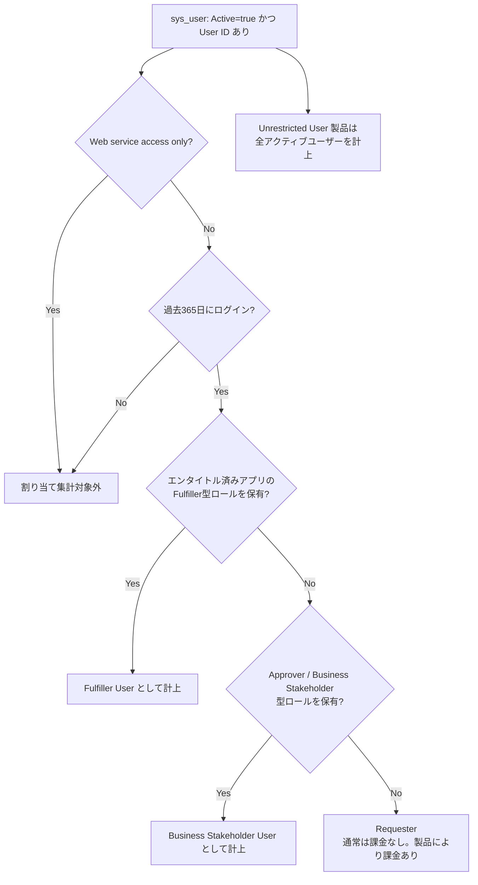
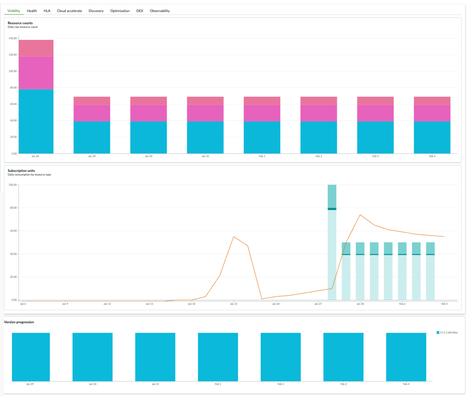
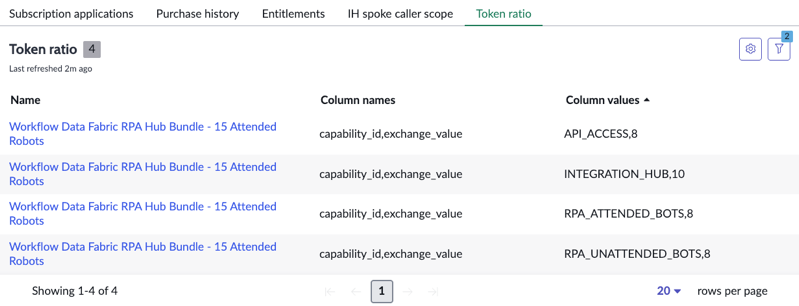
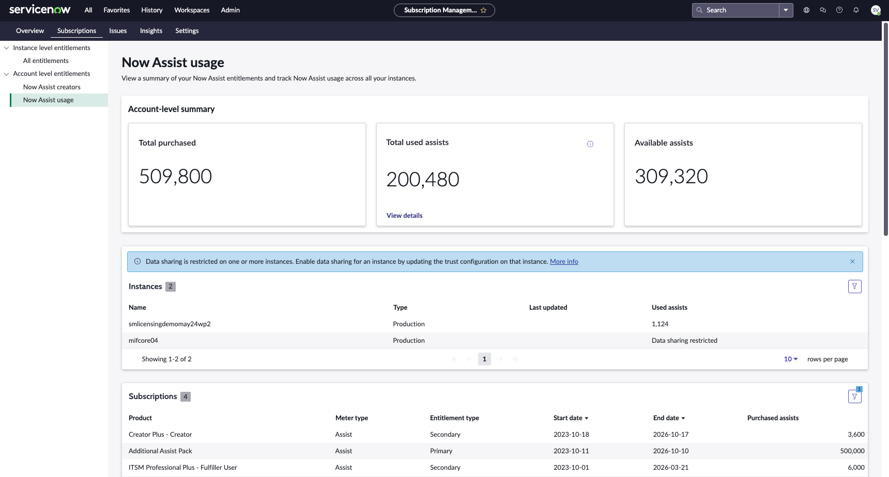
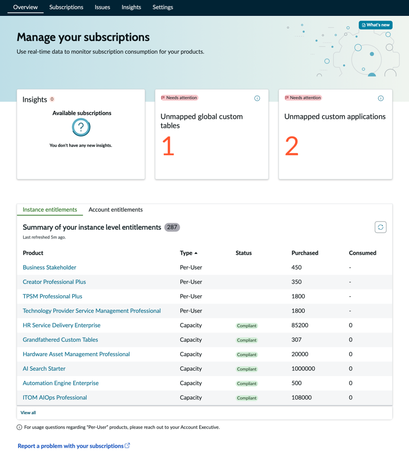
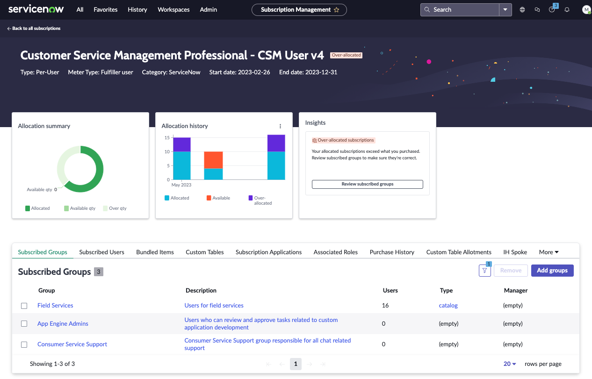
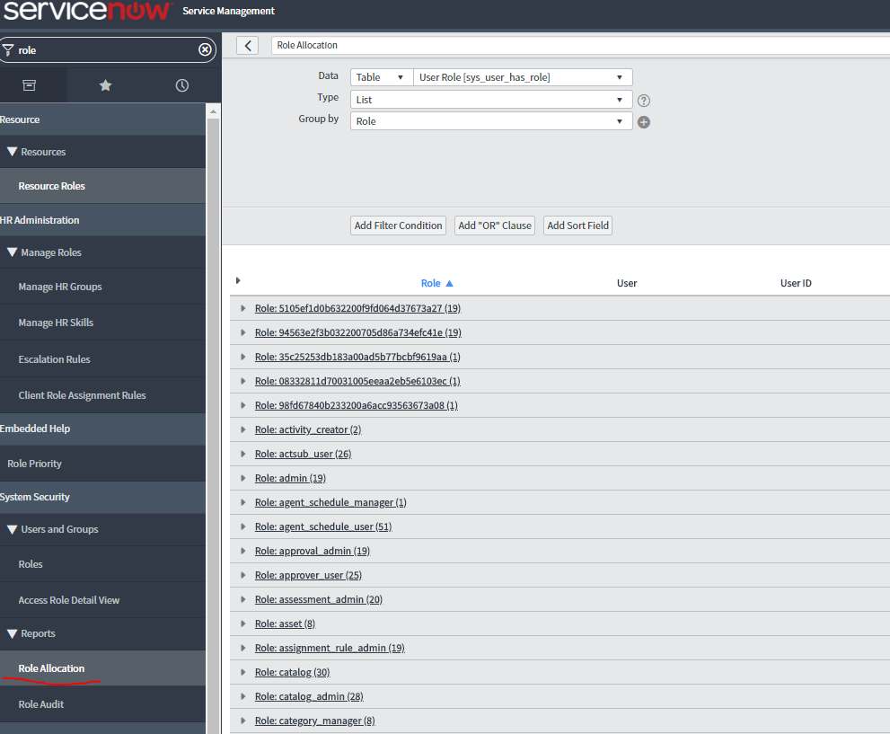

# ライセンスモデル（Licensing Model）

## 概要

ServiceNow のライセンスは、すべて**期間契約型のサブスクリプション（Subscription）**である。永続ライセンスは提供されていない。顧客は Order Form（注文書）で製品 SKU（Product Code）ごとに数量と期間を契約する。契約内容は ServiceNow 側から顧客の本番インスタンスに日次で同期される。同期されたデータは **Subscription Management（サブスクリプション管理）** アプリケーションで、利用状況（割り当て数・消費数）と比べて確認できる。[出典](https://www.servicenow.com/docs/r/australia/platform-administration/viewing-instance-level-entitlements.html)

ServiceNow ライセンスの課金単位は、大きく次の 3 系統に分かれる。

| 系統 | 何に対して課金するか | 代表製品 | Subscription Management 上の Type |
|---|---|---|---|
| ユーザー課金（Per-User / Unrestricted User / Unlimited） | ロールを持つユーザー数、または全アクティブユーザー数 | ITSM、CSM、FSM、App Engine、SPM、HRSD、Employee Center Pro | Per-User、Unrestricted User、Unlimited |
| 容量課金（Capacity） | 管理対象のリソース数（CI、デバイス、ノード）、レコード数、ポータル訪問数など | ITOM（Subscription Unit）、HAM/SAM、Cloud Capacity、カスタムテーブル | Capacity |
| 消費型課金（Capacity の一種、アカウント単位プール） | トランザクション、Assist、トークンの消費量 | Integration Hub、Now Assist（Assist）、Workflow Data Fabric（トークン） | Capacity / アカウントレベルエンタイトルメント |

ライセンスの実務で押さえる要点は次のとおり。

1. どの**ロール**を付与するとどの**メーター（Meter type）**に計上されるか。
2. どの数値が**課金根拠（ピーク値か 90 日平均か）**になるか。
3. 契約更新時の **True-up（超過分の精算）** をどう管理するか。

> **注意:** ServiceNow 公式ドキュメントは「価格、パッケージ、その他顧客契約で決まる詳細」は扱わないと明記している。本ファイルでは、契約で決まる部分（SU 比率、Assist 付与量、True-up 条項など）に `【第三者情報】`・`【推定】`・`【経験則】` を付けて区別する。[出典](https://www.servicenow.com/docs/r/australia/it-operations-management/itom-su-licensing-landing-page.html)

関連ファイル:
- 入門的な説明 → [ユーザー・ロール・ライセンスの基本](../01_入門編/08-users-roles-licensing-basics.md)
- 価格の推定値 → [価格情報](02-pricing.md)
- エディション（Foundation / Advanced / Prime、旧 Standard / Pro / Enterprise）の機能差 → [エディション比較](03-edition-comparison.md)
- プラットフォーム製品のパッケージ構成 → [プラットフォームのパッケージ構成](../02_リファレンス/platform/platform-licensing-packaging.md)
- コスト最適化の実践知 → [ライセンスコスト最適化](../04_応用編/06-license-cost-optimization.md)

---

## 1. サブスクリプションの基本構造

### 1.1 サブスクリプションの構成要素

ServiceNow のサブスクリプションは、Subscriptions [`license_details`] テーブルにレコードとして保持される。`license_details` の Subscription フォームの主な項目は次のとおり（フィルターナビゲーターで `license_details.list` と入力して開く）。[出典](https://www.servicenow.com/docs/r/australia/platform-administration/subscription-form-v2.html)

| フィールド | 内容 |
|---|---|
| Name（名前） | サブスクリプション名（例: `Customer Service Management Professional - CSM User v4`） |
| Category（カテゴリ） | 購入元。ServiceNow platform か ServiceNow Store |
| Type（タイプ） | Per-User / Unrestricted User / Capacity / Unlimited / Display |
| Start date / End date（開始日 / 終了日） | サービス契約で合意したサブスクリプション期間 |
| Capacity Definition（容量定義） | 容量の算出ロジック（テーブルクエリまたはスクリプト）の ID |
| Display only（表示のみ） | `true` の場合、割り当てや監視に対応していない |
| Product Code（製品コード） | Order Form に記載された製品 SKU |

Subscription フォームには次の関連リンクがある。
- Manage Your Tables: マッピング済みのカスタムテーブル
- View Subscription History: ステータス・日付・推移
- View User Subscription History: ユーザーの割り当て履歴

### 1.2 サブスクリプションタイプ（Subscription types）とメーター（Meter）

各製品サブスクリプションは**メーター（Meter）**によって計測される。メーターの種類と計測内容の詳細は Support の KB0727967「Values for Subscription-Based Products」に記載されている。[出典](https://www.servicenow.com/docs/r/australia/platform-administration/types-subscription-v2.html)

| Subscription type（サブスクリプションタイプ） | 関連するメーター | 割り当て方法 | 説明 |
|---|---|---|---|
| **Per-User**（ユーザー単位） | Rights-based user（権利ベース）: Fulfiller User と Business Stakeholder User を計測。Application user: 製品へ何らかのアクセス権を持つユーザーを計測（Creator User を含む） | 手動割り当て（グループ追加）。ただし後述の自動割り当てあり | 割り当てロールとアクセス権に応じてユーザーにエンタイトルメントを与える |
| **Capacity**（容量） | Devices、Subscription Units、Transactions | 自動計算 | 計測単位、トランザクション数、作成レコード数、管理リソース数（デバイス、ソフトウェア、ノード）を自動で追跡する |
| **Unrestricted User**（無制限ユーザー） | Unrestricted user: インスタンス全体のアクティブユーザー数 | インスタンスが自動割り当て | ロールに関係なく組織のアクティブユーザー数に対してエンタイトルメントを与える |
| **Unlimited**（無制限） | 計測上限なし | インスタンスが自動割り当て | 割り当て可能なユーザー数に上限がない |
| **Display Only**（表示のみ） | なし | 計測しない | 情報表示のみ。割り当てをサポートしない |

**アクティブユーザー（Active user）の公式定義:** Users [`sys_user`] テーブルのレコードのうち、User ID フィールドに値があり、Active フィールドが `true` のもの。[出典](https://www.servicenow.com/docs/r/australia/platform-administration/viewing-instance-level-entitlements.html)

**割り当て集計に使う「アクティブユーザー」:** Subscription Management で割り当て合計に計上されるのはアクティブユーザーだけである。次のユーザーはカウントから除外される。[出典](https://www.servicenow.com/docs/r/australia/platform-administration/subscription-details-v2.html)
- 過去 365 日間にインスタンスへログインしていないユーザー
- Web service access only（Web サービスアクセスのみ）が設定されたユーザー
- User ID が空のユーザー

### 1.3 アカウントレベルとインスタンスレベル

Subscription Management では、エンタイトルメントは 2 つの粒度で表示される。[出典](https://www.servicenow.com/docs/r/australia/platform-administration/viewing-account-level-entitlements.html)

| 粒度 | 対象 | 表示場所 |
|---|---|---|
| Instance-level entitlements（インスタンスレベル） | インスタンスごとの製品サブスクリプション（ITSM、HRSD、ITOM 等） | Admin > Subscription Management > Subscriptions > All entitlements |
| Account-level entitlements（アカウントレベル） | 全インスタンス共通のプール。Now Assist の Assist、Now Assist Creator（Creator Plus）、Cloud capacity | Admin > Subscription Management > Subscriptions > Account level entitlements |

- アカウントレベルの全体像は**本番インスタンス**の Subscription Management で確認する。非本番インスタンスでは、そのインスタンス自身のデータしか表示されない。
- 他の本番インスタンスのデータを集約して見るには、データを持つ側のインスタンスで **All > Multi-Instance Management > Trust Configuration** を開き、集約先（primary production instance）の Grant access 列を `true` にする。既定では本番インスタンス間のデータ共有は制限されている。[出典](https://www.servicenow.com/docs/r/australia/platform-administration/share-subscription-data.html)

コミュニティの解説では、課金区分を次の 3 つに整理している。[出典](https://www.servicenow.com/community/servicenow-ai-platform-articles/about-servicenow-licensing-guide/ta-p/3512215) `【第三者情報】`（ServiceNow 社員によるコミュニティ記事。公式の契約文書ではない）
1. Account-level（アカウント単位）: Assist、Creator、Cloud Storage など。ユーザーは数えない。
2. Role-based（ロールベース）: ロール割り当てテーブルを、エンタイトル済みアプリにマッピングされたロールで照会して数える。ITSM、CSM、GRC、SPM/APM など。
3. Definition / capacity-based（定義・容量ベース）: 検出したサーバー、デバイス、ノード、AI システム、ロボット、ポータル訪問、作業指示などを数える。製品ごとに 1 つ以上の Definition ID を持つ。

---

## 2. ユーザーライセンス種別

### 2.1 ユーザー種別の一覧

ServiceNow では、ユーザー種別（Fulfiller、Requester など）は**ロール名ではなく課金上の区分**である。「Fulfiller」という名前の OOTB ロールは存在しない。各製品のロールが Fulfiller 型か Business Stakeholder 型かにマッピングされ、そのロールを持つユーザーが該当メーターに計上される。[出典](https://www.servicenow.com/docs/r/australia/platform-administration/subscription-details-v2.html)

| 種別（英語 / 日本語） | 公式メーター | 概要 | 課金 |
|---|---|---|---|
| **Fulfiller User**（フルフィラー / 処理担当者） | Fulfiller User | チケットの処理・更新・割り当てなど、Requester と Business Stakeholder の機能を超える操作をするユーザー | 有償（最も高い） |
| **Business Stakeholder User**（ビジネスステークホルダー） | Business Stakeholder User | Fulfiller より権限が少ない。承認、レコード閲覧、レポート閲覧が中心 | 有償（Fulfiller より安価） |
| **Approver**（承認者） | ― | 承認だけをする利用者。現在は Business Stakeholder の一形態として扱われる（後述） | 下記参照 |
| **Requester User**（リクエスター / 依頼者） | ― | 依頼の起票、自分の依頼の確認、ナレッジ閲覧、カタログ申請 | 通常は追加課金なし |
| **Unrestricted User**（無制限ユーザー） | Unrestricted user | ロールに関係なく全アクティブユーザーを数える | 全アクティブユーザー数で課金 |
| **Creator User**（クリエーター） | Creator User | `now.assist.creator` ロールなどアプリ開発・生成 AI 開発の権利 | 有償（Creator / Creator Plus） |

公式ドキュメントのメーター定義は次のとおり。[出典](https://www.servicenow.com/docs/r/australia/platform-administration/subscription-details-v2.html)
- Fulfiller 型アクセスを持つユーザーは、**Fulfiller User** メーターの Per-User サブスクリプションで追跡する。
- Fulfiller より権限が少ないユーザーは、**Business Stakeholder User** メーターの Per-User サブスクリプションで追跡する。
- `now.assist.creator` ロールを持つユーザーは、**Creator User** メーターの Per-User サブスクリプションで追跡する。
- カスタムテーブルなどプラットフォームオブジェクトの作成・保持は、**Capacity** メーターの容量サブスクリプションで追跡する。

### 2.2 Fulfiller（フルフィラー）

Fulfiller は、プロセスの担い手（サービスデスク担当、変更実装者、CSM エージェント、HR エージェントなど）向けのライセンスである。

- **カウント条件（コミュニティ解説）:** 次の 3 条件をすべて満たすユーザーが数えられる。[出典](https://www.servicenow.com/community/servicenow-ai-platform-articles/about-servicenow-licensing-guide/ta-p/3512215) `【第三者情報】`
  - 過去 365 日以内にログインしたアクティブユーザーである。
  - Web Service Access Only ではない。
  - エンタイトル済みアプリにマッピングされた Fulfiller ロールを持つ。
  この条件は、公式ドキュメントのアクティブユーザー除外条件と一致する。
- **対象製品の例:** ITSM、CSM / TSM、FSM、App Engine、GRC。SPM/APM と Legal Service Delivery は「Fulfiller + Requester」の両方が課金対象とされる。[出典](https://www.servicenow.com/community/servicenow-ai-platform-articles/about-servicenow-licensing-guide/ta-p/3512215) `【第三者情報】`
- **契約上の定義（第三者の引用）:** 「Fulfiller User とは、Business Stakeholder User 機能または Requester User 機能に加えて、何らかの機能を実行するすべての User」。範囲は広く定義されている。[出典](https://www.cloudnuro.ai/blog/understanding-servicenow-licensing-a-comprehensive-guide) `【第三者情報】`
- **カスタムロールの扱い:** カスタムロールが Subscription Management で Fulfiller としてマークされる事例がコミュニティで報告されている。カスタムロールの包含関係（`contains`）でマッピング済みロールを含めると、Fulfiller として計上される。[出典](https://www.servicenow.com/community/developer-forum/custom-roles-are-marked-as-fufiller-in-subscription-management/td-p/3480378) `【第三者情報】`

### 2.3 Business Stakeholder（ビジネスステークホルダー）と Approver（承認者）

Business Stakeholder は、管理職や業務部門の責任者が承認やレポート閲覧をするためのライセンスである。

- **できること（第三者の解説）:** Requester の全操作に加え、承認、任意のレコードの閲覧、レポートの閲覧とドリルダウンができる。[出典](https://www.cloudnuro.ai/blog/understanding-servicenow-licensing-a-comprehensive-guide) `【第三者情報】`
- **対象製品:** Business Stakeholder サブスクリプションは ITSM、ITBM（現 SPM）、CSM、FSO、TSM、App Engine に限られる。[出典](https://www.cloudnuro.ai/blog/understanding-servicenow-licensing-a-comprehensive-guide) `【第三者情報】`
- **プラグインとロール（公式）:** `business_stakeholder` ロールは Business Stakeholder プラグイン（`com.snc.business_stakeholder`）の有効化でインストールされる。公式の「Installed with Business Stakeholder」ページでは、このロールを「すべての ITSM 製品のレコードを閲覧・承認できる」ロールと説明している（本ファイル作成時は検索結果の抜粋で確認。包含ロールの全一覧は取得できず）。[出典](https://www.servicenow.com/docs/bundle/zurich-it-service-management/page/reuse/itsm/reference/installed-with-business-stakeholder_1.html)
- **代表ロール:** `business_stakeholder`。ITSM の場合、`approver_user` に加えて incident / problem / change / request の参照権限を含む。コミュニティでは `business_stakeholder`、`approver_user`、カスタムロールが典型例として挙がっている。[出典](https://www.servicenow.com/community/developer-forum/need-help-understanding-itsm-roles-for-requesters-fulfillers-and/td-p/3412974) `【第三者情報】`
- **計測ロジック（コミュニティ解説）:** BSH は「Approver ロールを持ち、Fulfiller ロールを持たない」ユーザーである。計測には、ロール割り当てテーブルと承認アクティビティの 2 つを使う。Fulfiller マッピング済みロールを付与されると BSH の計測から外れ、Fulfiller として計上される。[出典](https://www.servicenow.com/community/servicenow-ai-platform-articles/about-servicenow-licensing-guide/ta-p/3512215) `【第三者情報】`
- **重複計上:** Business Stakeholder ロールと Fulfiller ロールの両方を持つユーザーは、1 ライセンス（Fulfiller）だけを消費するとされる。[出典](https://www.servicenow.com/community/developer-forum/how-to-track-per-user-licenses-for-business-stakeholders/td-p/3206240) `【第三者情報】`
- **制約の例:** Business Stakeholder では CMDB の読み書きなど一部の操作が許可されず、Fulfiller が必要になるという報告がある。[出典](https://www.servicenow.com/community/virtual-agent-forum/can-business-stakeholders-use-asset-management/m-p/2735027) `【第三者情報】`

**Approver の位置づけ:** 古い契約（いわゆる "Approver license"）では Approver が独立した区分だった。現行の公式メーターには Approver という名称はなく、Business Stakeholder User メーターに統合されている。情報源によっては「Business Stakeholder（Approver とも呼ばれる）」と同義に扱う。[出典](https://redresscompliance.com/servicenow-license-types-2026) `【第三者情報】`

> **実務上の注意 `【経験則】`:**
> - 承認者に `approver_user` だけを与えるのか、`business_stakeholder` を与えるのかで、計上先と閲覧範囲が変わる。
> - 承認だけなら、メール承認やポータル承認（Requester のまま承認できる形態）で足りるかを契約条件と照らして確認する。

### 2.4 Requester（リクエスター）

- **定義（第三者の引用）:** Requester User は「Fulfiller User または Business Stakeholder User 以外の、サブスクリプションサービスのユーザープロファイルで "active" にチェックが入っているすべてのユーザー」。[出典](https://www.cloudnuro.ai/blog/understanding-servicenow-licensing-a-comprehensive-guide) `【第三者情報】`
- **課金:** ITSM 等では、Requester（ポータルでの起票、自分の依頼の参照、ナレッジ閲覧）は通常は追加課金されない。[出典](https://www.servicenow.com/community/servicenow-ai-platform-forum/are-requestor-not-charged-by-servicenow/m-p/2487515) `【第三者情報】`
- **例外:** SPM/APM、Legal Service Delivery などでは Requester も課金対象になる。HRSD は Unrestricted User（全従業員課金）である。製品ごとに必ず契約を確認する。[出典](https://www.servicenow.com/community/servicenow-ai-platform-articles/about-servicenow-licensing-guide/ta-p/3512215) `【第三者情報】`
- Requester は「ロールを持たない（snc_internal のみ）」ユーザーとして運用されることが多い。ロールの詳細は [ユーザー・グループ・ロール](../02_リファレンス/platform/users-groups-roles.md) を参照。

### 2.5 Unrestricted User（無制限ユーザー）

- **公式定義:** Unrestricted User は、ロールに関係なく組織のアクティブユーザー数に対してエンタイトルメントを与える。インスタンスが自動で割り当てる。Unrestricted User サブスクリプションは単一の製品サブスクリプションに統合（consolidate）されない。[出典](https://www.servicenow.com/docs/r/australia/platform-administration/types-subscription-v2.html)
- **対象製品:** HRSD、Employee Center Pro など、全従業員が利用者になる製品。[出典](https://www.servicenow.com/community/servicenow-ai-platform-articles/about-servicenow-licensing-guide/ta-p/3512215) `【第三者情報】`
- **HRSD の計測:** HRSD は「HR Users」、つまり HR Profile テーブル上で雇用期間内にあるアクティブな人数を数えるという報告がある。応募者や退職者のうち雇用期間外の人は除外される。[出典](https://www.servicenow.com/community/hrsd-forum/hrsd-is-it-required-to-buy-licenses-for-all-existing-sys-users/td-p/3490867) `【第三者情報】`
- **CSM の外部ユーザー:** `snc_external` ロールを持つ CSM の外部ユーザーは、Unrestricted User のカウントから除外されるとされる。[出典](https://www.cloudnuro.ai/blog/understanding-servicenow-licensing-a-comprehensive-guide) `【第三者情報】`
- **運用上のポイント `【経験則】`:**
  - Unrestricted User 課金の製品を契約している場合、退職者や連携用アカウントを `sys_user` で Active のまま放置すると、カウントが膨らむ。
  - 連携用アカウントには「Web service access only」を設定する。
  - 退職者を無効化するプロセスを ID 連携（SCIM/LDAP）で自動化しておく。

### 2.6 Creator / Creator Plus（クリエーター）

- **Creator User メーター:** `now.assist.creator` ロールを持つユーザーを計測する。[出典](https://www.servicenow.com/docs/r/australia/platform-administration/subscription-details-v2.html)
- **アカウントレベル管理:** Creator Plus はアカウントレベルで管理される。**Admin > Subscription Management > Subscriptions > Now Assist creators** で、購入数と全インスタンスでの割り当て数を確認できる。複数インスタンスで同じユーザーに割り当てても、1 人として重複排除（de-duplicate）される。Instances 一覧に表示されるのは Washington DC Patch 2 以降のインスタンスだけである。[出典](https://www.servicenow.com/docs/r/australia/platform-administration/monitoring-now-assist-creator.html)
- **ステータス:** Creator Plus 製品のステータスは「Account-level only」で、割り当てステータスは計算されない。[出典](https://www.servicenow.com/docs/r/australia/platform-administration/subscriptions-overview-v2.html)
- **App Engine:** App Engine（旧 Now Platform App Engine）のユーザー課金やカスタムテーブル枠については [アプリケーション開発](../02_リファレンス/platform/app-development.md) と [プラットフォームのパッケージ構成](../02_リファレンス/platform/platform-licensing-packaging.md) を参照。

> **Brazil での変更:** Product subscriptions overview の Account entitlements タブで、全インスタンスにおける Creator Plus の一意な割り当て数を Allocated 列で監視できると明記された（重複排除の注記付き）。[出典](https://www.servicenow.com/docs/r/platform-administration/subscriptions-overview-v2.html)

### 2.7 ユーザー種別判定の流れ

注: 365 日ログイン条件と Web service access only の除外は公式ドキュメントの「Active users」定義に基づく。Fulfiller / BSH の判定順は前掲のコミュニティ解説に基づく。[出典](https://www.servicenow.com/docs/r/australia/platform-administration/subscription-details-v2.html) / [出典](https://www.servicenow.com/community/servicenow-ai-platform-articles/about-servicenow-licensing-guide/ta-p/3512215)

---

## 3. パッケージ（Package）

### 3.1 2026 年 4 月のパッケージ刷新（Foundation / Advanced / Prime）

2026 年 4 月に ServiceNow は主要製品のパッケージを刷新した。

**公式発表（ServiceNow Newsroom、2026-04-09）で確認できる事項:** [出典](https://newsroom.servicenow.com/press-releases/details/2026/ServiceNow-moves-beyond-the-sidecar-AI-era-giving-customers-a-complete-AI-native-experience-across-all-products-and-packages/default.aspx)
- ServiceNow は全製品ポートフォリオを AI 対応にすると発表した。すべての製品に AI、データ接続、ワークフロー実行、セキュリティ、ガバナンスが含まれる。顧客は別途購入や統合をしなくても AI パッケージを使い始められる。
- 新しい**段階型のオファーモデル（tiered offer model）**を導入した。段階は「AI assistance（AI アシスタンス）」「agentic automation（エージェント型自動化）」「fully autonomous operations（完全自律運用）」の 3 つで、全ポートフォリオに適用される。
- 中堅企業向けに **ESM Foundation** を発表した。IT、HR、法務、財務、調達、ワークプレイスのサービスを 1 つにまとめた製品で、「数週間で稼働できる」とされる。
- ESM Foundation と新パッケージモデルは、発表日時点で全顧客が利用できる。
- Build Agent には無償枠がある（顧客 100 コール、Personal Developer Instance 25 コール）。
- 発表文には、ティア名（Foundation / Advanced / Prime）の製品別の一覧、Assist の付与量、価格は書かれていない。

以下の表はコミュニティ記事と第三者情報に基づく。公式の価格表や製品別のパッケージ定義書は公開されていないため、内容は契約時に必ずアカウントチームに確認すること。

| 項目 | 内容 | 出典 |
|---|---|---|
| 刷新日 | 2026-04-09 に新しい商用モデルへ移行（発表日は公式 Newsroom と一致） | [出典](https://nownegotiations.pages.dev/blog/servicenow-2026-changes-summary) `【第三者情報】` |
| 旧ティア | Standard、Professional（Pro）、Pro Plus、Enterprise、Enterprise Plus | [出典](https://redresscompliance.com/servicenow-2026-pricing-tiers-pillar) `【第三者情報】` |
| 新ティア（ITSM） | **Foundation / Advanced / Prime** の 3 段階 | [出典](https://www.servicenow.com/community/itsm-articles/itsm-licensing-in-april-2026-foundation-advanced-and-prime-in/ta-p/3544380) `【第三者情報】` |
| 新ティア（ITOM） | **ITOM Advanced / ITOM Prime** の 2 段階（Foundation なし） | [出典](https://www.servicenow.com/community/architect-articles/navigating-the-april-2026-servicenow-itom-licensing-model/ta-p/3555121) `【第三者情報】` |
| 旧 SKU 販売終了 | 2026-07-01 以降の更新見積は新ティアで作成されるとの情報あり | [出典](https://redresscompliance.com/servicenow-2026-pricing-tiers-pillar) `【第三者情報】` |
| AI の扱い | 生成 AI（Now Assist）が各ティアに同梱され、ティアごとに Assist 割当量が異なる。旧 Pro Plus / Enterprise Plus のような AI 専用アドオン SKU は不要になった | [出典](https://www.servicenow.com/community/itsm-articles/itsm-licensing-in-april-2026-foundation-advanced-and-prime-in/ta-p/3544380) `【第三者情報】` |

**ITSM の各ティアの概要（コミュニティ記事）:** [出典](https://www.servicenow.com/community/itsm-articles/itsm-licensing-in-april-2026-foundation-advanced-and-prime-in/ta-p/3544380) `【第三者情報】`

| ティア | 主な内容 |
|---|---|
| Foundation | Incident（基本）、Request、Asset、Cost、Virtual Agent、Predictive Intelligence、Now Assist for ITSM（OOTB 構成レベル） |
| Advanced | Foundation に Problem、Change、Major Incident、On-Call、Walk-up、Platform Analytics Advanced、Process Mining for Platform を追加。Assist 割当が増える |
| Prime | Advanced に DevOps Change Velocity を追加。Assist 割当が最大で、カスタム AI スキルや AI エージェントを新規構築できる唯一のティア |

**ITOM の各ティアの概要（コミュニティ記事）:** [出典](https://www.servicenow.com/community/architect-articles/navigating-the-april-2026-servicenow-itom-licensing-model/ta-p/3555121) `【第三者情報】`
- **ITOM Advanced:** Agentless Discovery、ACC for Visibility、Service Mapping、CMDB 360、Tag Governance、Cloud Account Management、API Insights などを含む。CMDB の作成とガバナンスが中心。
- **ITOM Prime:** Advanced に Event Management、Metric Intelligence、ACC for Monitoring、Health Log Analytics、Service Observability、Synthetic Monitoring を追加する。SU あたりの Workflow Data Fabric クレジットは Advanced の約 2 倍。
- **Service Ops Advanced / Prime（ITSM + ITOM の複合 SKU）:** 統一クレジットメーターを使う。**1 クレジット = 1 ITOM SU、10 クレジット = 1 ITSM Fulfiller User** とされ、True-up と更新サイクルも統一される。
- **ESM Foundation:** ITSM Foundation とコアビジネススイートを組み合わせたユーザー単位の SKU とされる。[出典](https://www.servicenow.com/community/itsm-articles/itsm-licensing-in-april-2026-foundation-advanced-and-prime-in/ta-p/3544380) `【第三者情報】`

**公式ドキュメントでの裏付け:** ITOM の License Report フォームの説明に「2026 Packaging SKUs を含むサポート対象 CI カテゴリ」「2026 Packaging SKU での CI 消費予測（Predict CI consumption for 2026 Packaging SKU）」という記述がある。これにより、2026 年パッケージ SKU が存在することは公式ドキュメントでも確認できる。[出典](https://www.servicenow.com/docs/r/australia/it-operations-management/license-report-form.html)

> CSM についても 2026 年 4 月にパッケージが再設計されたとするコミュニティ記事がある。詳細は [エディション比較](03-edition-comparison.md) を参照。[出典](https://www.servicenow.com/community/architect-articles/april-2026-servicenow-csm-license-packaging-redesign-what/ta-p/3562359) `【第三者情報】`

### 3.2 旧パッケージ（2026 年 3 月以前の契約）

2026 年 4 月以前に締結された契約は、契約期間中は旧 SKU のまま有効である。旧 SKU は Subscription Management の製品名に現れる（例: `ITSM Professional Plus - Fulfiller User`、`HR Service Delivery Enterprise`、`ITOM AIOps Professional`）。

| 旧ティア | 概要 |
|---|---|
| Standard | 基本 ITSM プロセス |
| Professional（Pro） | Performance Analytics、Predictive Intelligence、Virtual Agent などを追加 |
| Pro Plus / Enterprise Plus | Pro / Enterprise に Now Assist（生成 AI）と Assist 付与量を追加したアドオン型 SKU |
| Enterprise | Pro に DevOps など上位機能を追加 |

旧 Pro Plus の Assist 付与量は「Fulfiller 1 人あたり年間約 6,000」とする第三者情報がある。ただし製品や契約によって 5,000〜25,000 と幅があるとされる。[出典](https://redresscompliance.com/servicenow-now-assist-ai-pricing.html) `【第三者情報】`

各ティアの機能差は [エディション比較](03-edition-comparison.md) と [ITSM Pro/Enterprise 固有機能](../02_リファレンス/itsm/itsm-pro-features.md) を参照。

### 3.3 バンドル製品とスポークのエンタイトルメント

- **Integration Hub スポーク:** 製品サブスクリプションには Integration Hub のスポーク利用権が同梱されることがある。ServiceNow 開発のスポークを使うには、Integration Hub サブスクリプションか、スポークを含む Subscription Product が必要である。製品ごとに同梱されるスポークの一覧は KB1224540「Spoke entitlement per Subscription Product」で確認する。[出典](https://www.servicenow.com/docs/r/australia/integrate-applications/integration-hub/subscription-usage.html)
- **ITOM バンドル:** ITOM バンドルには、特定のスポークとプロトコルに対する Integration Hub / Workflow Data Fabric のエンタイトルメントが含まれる。ただし次の例外がある。[出典](https://www.servicenow.com/docs/r/australia/it-operations-management/itom-licensing-subscription-types.html)
  - ITOM Cloud Accelerate で、ITOM Cloud Accelerate アプリ以外から Cloud Action Library を使う場合は、Workflow Data Fabric Enterprise バンドルが追加で必要。
  - Cloud Account Management には Cloud Governance Suite SKU が必要。
- **Bundled Items（同梱アイテム）:** 製品サブスクリプションには、カスタムテーブル枠、ポータル訪問数、トランザクション枠などのアドオンが同梱されることがある。これらはサブスクリプション詳細画面の **Bundled Items** タブで監視する。[出典](https://www.servicenow.com/docs/r/australia/platform-administration/subscription-details-v2.html)

---

## 4. 容量課金：Subscription Unit（SU）

### 4.1 ITOM の Subscription Unit

ITOM（IT Operations Management）は、ユーザー数ではなく**管理対象リソース（CI）の数**で課金する。CI 数を **Subscription Unit（SU、サブスクリプションユニット）** に換算して計測する。[出典](https://www.servicenow.com/docs/r/australia/it-operations-management/itom-license-module.html)

- ライセンス対象のリソースは **CI カテゴリ**に割り当てられる。1 SU がカバーするリソース数は、CI カテゴリごとに異なる。
- どの CI カテゴリを使うか、カテゴリごとの SU 比率（SU ratio）はどうするかは、**顧客契約**で決まる。契約情報は ServiceNow プラットフォームに同期される。
- ITOM/OT SU Licensing の最新版がサポートする CI カテゴリ（Australia）は次のとおり。[出典](https://www.servicenow.com/docs/r/australia/it-operations-management/check-ci-type-require-license.html)

| CI カテゴリ（英語） | 日本語 |
|---|---|
| Servers | サーバー |
| Containers | コンテナ（Container Image CI と関係を持たないものだけ計上） |
| Container Images | コンテナイメージ |
| PaaS | PaaS リソース |
| FaaS | FaaS（サーバーレス関数） |
| End User Devices | エンドユーザーデバイス |
| IoT | IoT デバイス |
| Customer Prem Devices | 顧客構内デバイス |
| Unresolved Monitored Object | 未解決の監視対象オブジェクト |
| Unclassed category | 未分類 |
| APIs | API |
| AI Agents | AI エージェント |
| GPUs | GPU |
| Service Instances | サービスインスタンス |

**SU 比率の例:**
- ITOM の公式 SU 概要文書（Tanium 関連、2026-04-09 発効）では、サーバーが 1:1 とされている。[出典](https://www.servicenow.com/content/dam/servicenow-assets/public/en-us/doc-type/legal/it-operations-management-itom-servicenow-subscription-unit-overview-tanium.pdf)（公式 PDF。本ファイル作成時は検索結果の抜粋でのみ確認）
- コミュニティや第三者からは、FaaS 20:1、メッセージングサービス 3:1、Networking Devices Advanced 1:25 などの値が報告されている。ただしバージョンによって比率は異なる。[出典](https://www.servicenow.com/community/itom-forum/article-for-itom-licensing-calculations-servicenow-it-operations/td-p/3596603) `【第三者情報】`
- 2026 年 4 月のパッケージ刷新で、管理対象エンティティの SU マッピング表が変わったとされる。旧比率（例: サーバー 1:1、未解決管理デバイス 4:1）が引き続き適用されるかは、公開情報では確認できず。[出典](https://www.servicenow.com/community/architect-articles/navigating-the-april-2026-servicenow-itom-licensing-model/ta-p/3555121) `【第三者情報】`
- 自社の比率は、インスタンスの **ITOM License > License Summary** で該当サブスクリプションを開き、**ITOM CI subscription unit ratio** タブで確認するのが正確である。

**ITOM 製品ごとの計上方法（Australia 公式）:** [出典](https://www.servicenow.com/docs/r/australia/it-operations-management/itom-license-module.html)

| 製品 | SU の計上対象 |
|---|---|
| ITOM Visibility | Discovery（水平・トップダウン）で検出した CI と、Service Graph Connectors で CMDB に取り込んだ CI |
| ITOM Discovery | Visibility のサブセット（エントリー向け）。Discovery と Service Graph Connectors の CI |
| ITOM AIOps | アラート・イベント・メトリックを取得した CI（全 CI カテゴリ） |
| Health Log Analytics | ライセンス対象リソースから受信したログに基づく CI。ITOM AIOps でも同時に計上されるため、AIOps のサブスクリプションも必要 |
| ITOM Cloud Accelerate | Cloud Migration Assessment、Cloud Configuration Governance、Cloud Action Library が管理・監視する CI。複数機能が同じ CI を報告した場合は重複を除去する |
| ITOM Optimization | クラウドリソースのライフサイクル管理 |
| Service Observability 等 | Service Reliability Management、SLO Management、Synthetic monitoring も課金対象として列挙されている |

### 4.2 バンドル購入と単品（a la carte）購入

ITOM は、単品（a la carte）、バンドル、またはその併用で購入できる。[出典](https://www.servicenow.com/docs/r/australia/it-operations-management/itom-licensing-subscription-types.html)

| 購入形態 | 計算ルール |
|---|---|
| **バンドル（Bundle）** | バンドルに含まれる全 ITOM アプリに同じ SU 数が付与される（例: ITOM Visibility + ITOM AIOps の 500 SU バンドルなら、各アプリに 500 SU）。消費レベルはバンドル内で**最も多く消費した製品**の値で決まる。一方のアプリの余りを他方に回すことはできない。バンドルは同時に 1 つだけ購入できる。[出典](https://www.servicenow.com/docs/r/australia/it-operations-management/itom-licensing-bundle-subscription.html) |
| **単品（a la carte）** | アプリごとに個別に計算する。あるアプリの未消費分を、超過した別アプリに充当することはできない。超過すると Subscriptions ウィンドウで overdrawn（超過）と表示される。[出典](https://www.servicenow.com/docs/r/australia/it-operations-management/itom-licensing-individual-subscription.html) |
| **併用** | 大半のアプリをバンドルでカバーし、SU を多く消費するアプリだけ単品で追加する |

### 4.3 ITOM ライセンスの監視（ITOM/OT SU Licensing）

ITOM の SU 消費は、ServiceNow Store から入手する **ITOM/OT SU Licensing** アプリで計算・表示する。最新版を常にインストールしておく必要がある。[出典](https://www.servicenow.com/docs/r/australia/it-operations-management/view-itom-license-statistics.html)

| 項目 | 内容 |
|---|---|
| 必要ロール | `sn_itom_license.reader` |
| License Summary | All > ITOM License > License Summary。バンドルと単品の購入数・消費数を表示する |
| Licenses by CI Type | All > ITOM License > Licenses by CI Type。CI カテゴリを展開すると、課金対象の CI タイプが表示される |
| ITOM Licensing Dashboard | All > ITOM License > ITOM Licensing Dashboard |
| OTM Licensing Dashboard | All > OTM License > OTM Licensing Dashboard（Operational Technology 用） |
| メタデータテーブル | ITOM Licensing MetaData [`itom_lu_metadata`]。CI カテゴリと親 CI タイプを保持する。子 CI タイプ（例: Apache Web Server は Web Server の子）は既定で含まれる |
| 日次カウント | ITOM Licensing CI Counts [`itom_lu_ci_counts`] |
| 課金カウント | UsageAnalytics Counts for Tables [`usageanalytics_count`] |
| 関連 KB | KB0748149「ITOM Subscription Unit license calculation logic」 |

**License Report フォームの主な項目:** [出典](https://www.servicenow.com/docs/r/australia/it-operations-management/license-report-form.html)

| フィールド | 説明 |
|---|---|
| CI Category | CI のカテゴリ |
| Domain | CI が属するドメイン |
| Total Count | ITOM アプリごと、CI タイプ別の CI 日次カウントの **90 日平均**（Aggregated 条件が true の場合。false の場合はその日の日次カウント） |
| Subscription Unit Ratio | 1 SU として数える CI 数。**顧客契約で決まる** |
| Total Subscription Units Consumed | CI 数と SU 比率から計算した、期間内の消費 SU 合計 |
| Sum | アプリおよび全 ITOM アプリの SU 消費合計 |

**図: ITOM Licensing Dashboard（ITOM ライセンスダッシュボード）**
- **画面の場所:** All > ITOM License > ITOM Licensing Dashboard。必要ロールは `sn_itom_license.reader`。
- **上部タブ:** ITOM アプリごとに Visibility、Health、HLA、Cloud accelerate、Discovery、Optimization、DEX、Observability のタブがある。
- **1 段目「Resource counts」:** 検出された全リソースを、CI 分類前の状態で日次に数えた積み上げ棒グラフ。
- **2 段目「Subscription units」:** CI カテゴリ別の日次 SU 消費（過去 120 日分）の棒グラフ。オレンジの折れ線は Usage Analytics のカウント（SU 比率を使った過去 90 日の平均消費）を表す。
- **3 段目「Version progression」:** 各日に使われていた ITOM Licensing のバージョン。バージョン更新時のカウント急増の説明に使う。
- 出典: https://www.servicenow.com/docs/r/australia/it-operations-management/itom-licensing-dashboard.html （取得日: 2026-11-03）

> **課金根拠は「90 日平均」か「ピーク」か:**
> - 公式ドキュメントでは、Usage Analytics のカウントは「SU 比率による過去 90 日の平均消費」と説明されている。[出典](https://www.servicenow.com/docs/r/australia/it-operations-management/itom-licensing-dashboard.html)
> - 一方、コミュニティ記事では「課金対象は直近の計上期間の**ピーク値**であり平均ではない。大規模な Discovery を 1 日走らせただけのスパイクが、その期間の課金数を決めることがある」と説明されている。[出典](https://www.servicenow.com/community/servicenow-ai-platform-articles/about-servicenow-licensing-guide/ta-p/3512215) `【第三者情報】`
> - 両者は「ダッシュボード上の平均値」と「`usageanalytics_count` の各期間値から何を課金根拠とするか（契約条項）」という別のレイヤーの話である可能性がある。どちらを根拠とするかは**契約で確認すること**。公開情報だけでは確定できず。

### 4.4 ITAM（HAM / SAM）の Subscription Unit

ITAM 製品（Hardware Asset Management、Software Asset Management、Enterprise Asset Management）も、管理対象資産数を SU に換算する容量課金である。Subscription Management の画面例では、`Hardware Asset Management Professional` が Type = Capacity で表示されている。[出典](https://www.servicenow.com/docs/r/australia/platform-administration/subscriptions-overview-v2.html)

**ITAM の SU 比率の例:** ServiceNow 公式の「ITAM Financial Services overview」（2025-07-31 発効、金融業向け ITAM の SU 概要）には次の比率が記載されている。[出典](https://www.servicenow.com/content/dam/servicenow-assets/public/en-us/doc-type/legal/itam-financial-services-overview.pdf)（公式 PDF。本ファイル作成時は検索結果の抜粋でのみ確認し、PDF 本文は取得できず）

| リソース種別 | SU 比率（リソース数 : SU） |
|---|---|
| Server | 1:1 |
| End User Computing Device | 4:1（1 SU = 4 台） |
| Networking Device | 5:1 |
| Mobile Device | 10:1 |
| Monitor | 15:1 |
| Unclassified Hardware | 1:1 |
| Printer | 10:1 |
| Storage | 3:1 |

注: 上表は金融業向け ITAM 製品の文書であり、標準の HAM / SAM の比率と同じかどうかは公開情報では確認できず。自社の比率は Subscription Management の該当サブスクリプションの Capacity Definition と契約書で確認する。

- **SAM Pro / HAM Pro / EAM:** コミュニティの licensing guide では Asset Management カテゴリの定義ベース（capacity）製品として列挙されている。[出典](https://www.servicenow.com/community/servicenow-ai-platform-articles/about-servicenow-licensing-guide/ta-p/3512215) `【第三者情報】`
- **他製品の SU 概要文書:** DEX（Digital End-User Experience）や EAM などにも製品別の SU 概要 PDF が公開されている。[出典](https://www.servicenow.com/content/dam/servicenow-assets/public/en-us/doc-type/legal/servicenow-subscription-unit-overview-digital-enduser-experience-dex.pdf) / [出典](https://www.servicenow.com/content/dam/servicenow-assets/public/en-us/doc-type/legal/sn-enterprise-asset-management.pdf)
- 製品機能は [ITAM 概要](../02_リファレンス/itam/itam-overview.md)、[Hardware Asset Management](../02_リファレンス/itam/hardware-asset-management.md)、[Software Asset Management](../02_リファレンス/itam/software-asset-management.md) を参照。

### 4.5 容量サブスクリプションの算出ロジック（Capacity Definition）

容量サブスクリプションの消費量は、**Capacity Definition（容量定義）**レコードの**テーブルクエリ**または**スクリプト定義**で計算される。[出典](https://www.servicenow.com/docs/r/australia/platform-administration/view-how-totals-calculated-capacity-subscriptions-v2.html)

確認手順は次のとおり（必要ロール: `usage_admin`、`sn_sub_man.admin`、`admin` のいずれか）。
1. Admin > Subscription Management > Subscriptions（または All > Subscription Management > All Subscriptions）を開く。
2. 容量サブスクリプションを選び、Capacity Definition フィールドのレコード ID を選択してプレビューする。
3. 定義タイプに応じて中身を確認する。
   - Table query の場合: Table Name、Query、Aggregation Type、Aggregation Column。SQL も確認できる。
   - Scripted definition の場合: Script フィールド。
4. **Execute** で即時実行し、最新のカウントを確認する（この手動実行は、システムが監視する実行回数には計上されない）。過去の実行結果は Previous Executions 関連リストに残る。
5. Capacity Definition の ID がない場合は、アカウント担当に問い合わせる（KB0727967 も参照）。

**統合（Consolidated）サブスクリプション:** [出典](https://www.servicenow.com/docs/r/australia/platform-administration/subscription-details-v2.html)
- 同じ Capacity Definition を持つ複数の容量サブスクリプションは、1 つに統合される。例えば Integration Hub を 2 種類購入した場合は、`Integration Hub Pool` という 1 つのプールにまとまる。
- 他製品にセカンダリ明細として付いてくるトランザクション枠なども、定義が一致すればプールに加算される。内訳は **Subscription line items** タブで確認する。
- Per-User サブスクリプションに付いているカスタムテーブル枠も、1 つの製品サブスクリプションに統合できる（Bundled Items タブに合計が出る）。
- Unrestricted User サブスクリプションは統合されない。

---

## 5. 消費型課金：Integration Hub トランザクション、Assist、Workflow Data Fabric トークン

### 5.1 Integration Hub トランザクション

**公式に確認できる事項:** [出典](https://www.servicenow.com/docs/r/australia/integrate-applications/integration-hub/subscription-usage.html)
- **Integration Hub Transactions は Subscription Product（ITSM 等の製品サブスクリプション）に含まれない。** スポークを製品に同梱されたエンタイトルメントで使える場合でも、スポークやプロトコルの利用でトランザクションを消費することがある。その場合は、Integration Hub または Workflow Data Fabric のサブスクリプションを追加購入する必要がある。
- 製品に同梱されたスポークは、その製品の範囲外のユースケースにも使用できる。
- 契約上の定義は Integration Hub 補遺（Addendum）に記載されている: https://www.servicenow.com/content/dam/servicenow-assets/public/en-us/doc-type/legal/snc-addendum-integrationhub.pdf （本ファイル作成時に本文は取得できず）

**Integration Hub Usage Dashboard（公式、Australia で v3.0.0）:** [出典](https://www.servicenow.com/docs/r/australia/integrate-applications/integration-hub/use-the-integration-hub-usage-dashboard.html)
- **IH Transactions (Tx) Usage レポート:** 過去 1 年のトランザクション使用量を、契約パッケージの年間トランザクション数と比較する。
- **使用量の内訳:** パッケージから消費されるトランザクション数は、**Integration Hub、External Content Connectors、Orchestration で実行したトランザクションの合計**である。内訳は Transactions (Tx) by Type レポートで確認できる。
- **レポート構成:**
  - Overview セクション: Transactions per Caller Scope（呼び出し元アプリスコープ別）、Transactions by Month（ビジネスユニットプール別）
  - Spokes セクション: Top Spokes（上位 10）、Top Spoke Actions、Custom Spoke Transaction Usage
  - Protocols and Features セクション: Protocol Usage、Feature Usage
- **Data egress（データ送出）タブ:** REST/SOAP、JSON、エクスポートセット、URI 別のデータ送出量も表示する。[出典](https://www.servicenow.com/docs/r/PjeVwAzGnEEzroXtwXYanw/K68ihmlM2eetzzNWao4BOA)
- **サブスクリプション通知:** サブスクリプションに含まれないスポーク、プロトコル、機能を Flow で使うと、情報メッセージが表示される（例: 「This flow uses features that are not included in your Integration Hub subscription.」）。この通知は利用を**ブロックしない**が、未ライセンス機能は本番インスタンスで使えない場合がある。[出典](https://www.servicenow.com/docs/r/australia/integrate-applications/integration-hub/integrationhub-subscription-notifications.html)

**トランザクションのカウントルール（コミュニティ情報、公式定義は未確認）:** [出典](https://www.servicenow.com/community/servicenow-ai-platform-forum/what-does-servicenow-count-in-integration-hub-transactions/m-p/3471330) `【第三者情報】`

| ケース | 計上 |
|---|---|
| Flow / Subflow が **Integration Step を含む Action** を実行（REST、SOAP、PowerShell、SSH、JDBC、OpenAPI、OOTB スポークのアクション） | 1 実行ごとに 1 トランザクション |
| ループ内の REST アクションが 50 回実行される | 50 トランザクション |
| 同期実行か非同期（スケジュール）実行か | どちらも計上 |
| Look Up Record、Log など外部呼び出しのないロジックだけのアクション | 計上しない |
| Flow のアクション内の Script Step から呼んだスクリプトで外部呼び出し | 計上（実行コンテキストで判定） |
| Business Rule や Script Include から直接 `sn_ws.RESTMessageV2()` を呼ぶ | 「通常は計上されない」という回答と、「数年前に抜け穴は塞がれた」という反論があり、**見解が割れている** |
| 失敗したトランザクション | 成功・失敗に関係なく計上されるという回答あり |

- **使用量の確認先:** `ua_ih_usage` テーブル、または IntegrationHub > Dashboard。[出典](https://www.servicenow.com/community/servicenow-ai-platform-forum/what-does-servicenow-count-in-integration-hub-transactions/m-p/3471330) `【第三者情報】`
- **パッケージの年間トランザクション数:** Starter / Standard / Professional / Enterprise の年間トランザクション数（例: 1M / 3M / 6M）を示す第三者情報があるが、公式には確認できず。[出典](https://redresscompliance.com/servicenow-integrationhub-licensing-guide.html) `【第三者情報】`

詳細は [IntegrationHub](../02_リファレンス/platform/integrationhub.md) と [連携の落とし穴](../04_応用編/08-integration-pitfalls.md) を参照。

### 5.2 Workflow Data Fabric トークン

Workflow Data Fabric（WDF）のサブスクリプションには**トークン**が含まれる。WDF の各機能（API アクセス、Integration Hub、RPA ロボットなど）を使うたびに、ライセンス条件で決まった数のトークンが消費される。[出典](https://www.servicenow.com/docs/r/australia/platform-administration/monitoring-wdf-capability-use.html)

- **トークン使用量の推移:** WDF サブスクリプション詳細画面の Allocation summary で確認する。
- **Token ratio タブ:** 機能 1 回あたりの消費トークン数を表示する。Column names は `capability_id,exchange_value`、Column values は「機能 ID,トークン数」の形式。

**図: Workflow Data Fabric サブスクリプション詳細の Token ratio（トークン比率）タブ**
- **画面の場所:** Subscription Management > Subscriptions で WDF サブスクリプション（例: 「Workflow Data Fabric RPA Hub Bundle - 15 Attended Robots」）を開き、Token ratio タブを選ぶ。
- **列構成:** Name、Column names（`capability_id,exchange_value`）、Column values。
- **画面例の値:** `API_ACCESS,8`、`INTEGRATION_HUB,10`、`RPA_ATTENDED_BOTS,8`、`RPA_UNATTENDED_BOTS,8`。例えば `API_ACCESS,8` は、API アクセスを要する機能 1 回で 8 トークンを消費することを意味する。これらは画面例の値であり、実際の値は契約による。
- 出典: https://www.servicenow.com/docs/r/australia/platform-administration/monitoring-wdf-capability-use.html （取得日: 2026-11-03）

- **2026 年パッケージとの関係:** 2026 年パッケージでは、ITOM Prime などのティアに「SU あたりの WDF クレジットプール」が付与されるとされる。[出典](https://www.servicenow.com/community/architect-articles/navigating-the-april-2026-servicenow-itom-licensing-model/ta-p/3555121) `【第三者情報】`
- 詳細は [Workflow Data Fabric](../02_リファレンス/platform/workflow-data-fabric.md) を参照。

### 5.3 Now Assist の Assist（生成 AI の消費単位）

**Assist（アシスト）** は、Now Assist（生成 AI）や AI Agents の利用を計測する消費単位である。トークン数ではなく「スキル・ワークフローの実行回数 × 機能ごとの係数」で計上される。

**公式に確認できる事項（Subscription Management の Now Assist usage 画面）:** [出典](https://www.servicenow.com/docs/r/australia/platform-administration/monitoring-now-assist-usage.html)
- **画面の場所:** Admin > Subscription Management > Subscriptions > Now Assist usage。必要ロールは `usage_admin`、`sn_sub_man.admin`、`admin` のいずれか。
- **集計範囲:** 本番・非本番インスタンスをまたいだアカウント全体の Assist 消費を集計する。**Moveworks Assist** も含まれ、スキル名の先頭に「MW」が付く。
- **demo インスタンス:** demo インスタンスで使った Assist は Total used assists から除外される。
- **カード:** Total purchased（購入合計）、Total used assists（使用合計）、Available assists（残量）。View details で消費推移を表示し、契約期間中に購入数を超えた時点を確認できる。
- **Instances 一覧:** インスタンスごとの Used assists。Washington DC Patch 2 以降のインスタンスだけが表示される。データ共有が制限されたインスタンスは「Data sharing restricted」と表示される。
- **Subscriptions 一覧:** 製品ごとに Meter type（Assist）、Entitlement type（Primary = Assist パック自体、Secondary = 製品に付随する Assist）、Start date、End date、Purchased assists を表示する。
- **Domain 一覧:** ドメインセパレーション環境では、ドメイン別の消費を表示する。
- **スキル別の使用量（現在のインスタンス、夜間更新）:**
  - Number of actions: 実行回数
  - Assist ratio: 1 実行あたりの Assist 数
  - Total assists: Number of actions × Assist ratio
- **Utilization history:** 月次・日次で消費推移を表示する。

**図: Subscription Management の Now Assist usage（Now Assist 使用量）画面**
- **画面の場所:** Subscription Management の Subscriptions タブで、左ペインの Account level entitlements > Now Assist usage を選ぶ（左ペインには Instance level entitlements > All entitlements、Account level entitlements > Now Assist creators もある）。
- **Account-level summary:** 3 枚のカードがある（画面例: Total purchased 509,800、Total used assists 200,480、Available assists 309,320）。
- **Instances:** インスタンス名、Type（Production 等）、Last updated、Used assists の一覧。データ共有が制限されたインスタンスは「Data sharing restricted」と表示され、Trust configuration の更新を促すバナーが出る。
- **Subscriptions:** Product、Meter type、Entitlement type、Start date、End date、Purchased assists の一覧。画面例は次のとおり。
  - 「Additional Assist Pack」: Primary、500,000
  - 「Creator Plus - Creator」: Secondary、3,600
  - 「ITSM Professional Plus - Fulfiller User」: Secondary、6,000
- 出典: https://www.servicenow.com/docs/r/australia/platform-administration/monitoring-now-assist-usage.html （取得日: 2026-11-03）

**Assist の契約上の定義（ServiceNow 公式文書「Now Assist Overview」、2025-09-10 発効版）:** [出典](https://www.servicenow.com/community/s/cgfwn76974/attachments/cgfwn76974/now-assist-forum/2134/1/sn-assist-overview%20(1).pdf)
- 「Assist」は、Now Assist スキルの利用を、実行されたスキルアクション（skill action）で計測する単位である。
- 顧客が使える Assist の総数は**顧客の契約**で定まり、**アカウントレベルでプール**される。
- ユーザーは Now Assist スキルを単一のスキルアクションとして、または複数のスキルアクションの組み合わせとして実行したときに Assist を発生させる。
- **Now Assist スキルの利用はすべて Assist を消費する。ユーザーがライセンス席（licensed seat）を持っていない場合も同じである。**
- 本ファイルで参照した版は、ServiceNow Community に添付された 2025-09-10 発効版（PDF 作成日 2025-10-10、全 11 ページ）である。正本は `doc-type/legal/sn-assist-overview.pdf` にあるとされ、2026 年パッケージ以降に係数が改定されている可能性がある。契約時は Order Form が参照する版を確認すること。

**Assist の消費係数（同文書 2.1「Now Assist Actions and Assists Consumed」から主要な行を抜粋）:** [出典](https://www.servicenow.com/community/s/cgfwn76974/attachments/cgfwn76974/now-assist-forum/2134/1/sn-assist-overview%20(1).pdf)

| Skill（スキル） | 1 回の定義（Skill Action） | Assist / 回 |
|---|---|---|
| Summarization（case / incident など）、Chat / Call summarization、CI summarization | 要約リクエスト 1 回 | 1 |
| Resolution note generation | 解決メモ生成 1 回 | 1 |
| Change risk explanation | 変更リスク説明 1 回 | 1 |
| Request and requested item summarization | ITSM 要求・要求アイテムの要約 1 回 | 1 |
| Now Assist Q&A genius results（Search Q&A） | AI Search 結果の回答カード 1 件 | 1 |
| Platform navigation | ナビゲーション要求 1 回 | 1 |
| Post-incident analysis | インシデント後分析 1 回 | 1 |
| Incident assist | 関連インシデントの照会 1 回 | 5 |
| Chat reply recommendations | チャット返信の推奨 1 回 | 5 |
| Code generation / Code autocomplete / Code explain | コード生成・補完（採用時）・説明 1 回 | 5 |
| Document summarization | 文書要約 1 回 | 5 |
| Now Assist panel | Now Assist パネルでの会話 1 回 | 5 |
| Knowledge article generation | ナレッジ記事生成 1 回 | 10 |
| Now Assist Virtual Agent | Virtual Agent トピックの end-to-end 実行 1 回 | 10 |
| Multi-turn catalog ordering | 会話型カタログ注文 1 回 | 10 |
| Flow recommendation | 採用されたフロー推奨 1 件 | 10 |
| Agentic workflow - small | 4 アクション未満の agentic workflow 1 回 | 25 |
| Agentic workflow - medium | 5〜8 アクションの agentic workflow 1 回 | 50 |
| Agentic workflow - large | 9〜20 アクションの agentic workflow 1 回 | 150 |
| Contract analysis | 契約分析 1 回 | 50 |
| Test case generation | テストケース生成 1 回 | 50 |
| Catalog item generation | カタログアイテム生成 1 回 | 250 |
| Work notes analysis | 作業メモ分析 1 回（小規模レコード向けは 100） | 250 |
| Flow generation / RPA bot generation / Spoke generation | 生成 1 回（プレビューを含む） | 500 |
| Experience (UI) generation | エクスペリエンス生成 1 回 | 1,000 |
| App generation / Playbook generation | アプリ・プレイブック生成 1 回 | 2,500 |

注: PDF のレイアウト上、一部の行は値の対応を目視で確認した。Skill Kit（External LLM / Now LLM）の呼び出しは 1 回 1 Assist と記載されている。全行は原本で確認すること。

**Agentic workflow（AI エージェント）の範囲（公式文書）:** [出典](https://www.servicenow.com/community/s/cgfwn76974/attachments/cgfwn76974/now-assist-forum/2134/1/sn-assist-overview%20(1).pdf)
- Agentic workflow は、AI エージェントチームが実行する一連の処理である。オーケストレーターエージェントが活動を開始した時点で始まる。
- 次のいずれかで終わる: ワークフローの完了、20 アクション到達、1 時間の無操作。
- 最初の 20 アクションを超えたアクションは、新しい agentic workflow として数える。
- 規模は Small（4 アクション未満）25、Medium（5〜8）50、Large（9〜20）150 Assist である。
- **数えないアクション:** オーケストレーターとコミュニケーターのアクションは数えない。ワークフロー内でツールとして実行されたスキル、Virtual Agent トピック、会話型カタログアイテムは別途課金されない。[出典](https://www.servicenow.com/community/servicenow-ai-platform-blog/think-before-you-prompt-assists-vs-tokens-in-servicenow/ba-p/3583777) `【第三者情報】`
- **同じプールから消費されるもの:** サブプロダクション環境、AI Agent Studio のテスト、評価（evaluation）実行も、本番と**同じプールから消費する**。AI Agent Advisor のデータセット生成は消費しない。[出典](https://www.servicenow.com/community/servicenow-otto-articles/best-practices-in-managing-ai-agents-skills-and-assists-in/ta-p/3569710) `【第三者情報】`
- **プールのリセット:** Assist プールは 365 日のバーンダウン方式で、契約記念日にリセットされる。[出典](https://www.servicenow.com/community/servicenow-otto-articles/best-practices-in-managing-ai-agents-skills-and-assists-in/ta-p/3569710) `【第三者情報】`
  - 以前は「直近 365 日のローリング合計」方式だったが、固定プールに対する 365 日バーンダウン方式に変わった。3 年契約でも年ごとに割当があり、超過は各契約年の購入量に対して判定される。[出典](https://www.servicenow.com/community/servicenow-ai-platform-blog/platform-academy-february-3rd-2026-platform-academy-now-assist/ba-p/3488602) `【第三者情報】`（ServiceNow 社員による Platform Academy のまとめ）
  - 未使用の Assist はリセット時に失効し、繰り越されない。[出典](https://www.servicenow.com/community/now-assist-articles/a-6-step-framework-for-now-assist-consumption-forecasting/ta-p/3493141) `【第三者情報】`
  - Subscription Management には、消費率（50%、75% など）に応じたアラートやしきい値通知の機能はまだない（ロードマップ上）とされる。[出典](https://www.servicenow.com/community/servicenow-ai-platform-blog/platform-academy-february-3rd-2026-platform-academy-now-assist/ba-p/3488602) `【第三者情報】`
  - Update Set は使用量データを運ばない。DEV・TEST・本番のテストはすべて合計に計上される。Demo / evaluation インスタンスは除外される。[出典](https://www.servicenow.com/community/servicenow-ai-platform-blog/platform-academy-february-3rd-2026-platform-academy-now-assist/ba-p/3488602) `【第三者情報】`
- **スパイク通知プロパティ（Australia Patch 3 以降、`sn_aia_property`）:** [出典](https://www.servicenow.com/community/servicenow-otto-articles/best-practices-in-managing-ai-agents-skills-and-assists-in/ta-p/3569710) `【第三者情報】`
  - `alert.assist_spike_hours_to_check`（既定 3 時間）
  - `alert.assist_spike_usage_percentage_threshold`（既定 0.5）
  - `alert.assist_spike_usage_threshold`（既定 5,000 Assist）
- **関連テーブル:** [出典](https://www.servicenow.com/community/servicenow-otto-articles/best-practices-in-managing-ai-agents-skills-and-assists-in/ta-p/3569710) `【第三者情報】`
  - `sys_gen_ai_usage_log`: 呼び出しごとの Assist 数
  - `sys_generative_ai_log`
  - `sn_aia_tool_execution_tier`: エージェント実行のティアと Assist 数
  - `now_assists_skills`
  - `sn_nowassist_skill_config`
- **インスタンス内の分析:** All > Now Assist Admin > Analytics（Store アプリ）でインスタンス内の詳細分析ができる。Subscription Management はアカウント全体のプール管理に使う。[出典](https://www.servicenow.com/community/servicenow-otto-articles/best-practices-in-managing-ai-agents-skills-and-assists-in/ta-p/3569710) `【第三者情報】`
- **超過時の扱い:** プールを超過した場合は追加 Assist パック（画面例の「Additional Assist Pack」）の購入が必要になる。超過単価の上限や事前合意の追加単価がないと、定価で請求されるリスクがあるとされる。[出典](https://upperedge.com/servicenow/breaking-down-the-mystery-behind-servicenow-now-assist-understanding-consumption-based-licensing/) `【第三者情報】`
- **二重消費:** AI が連携処理を起動すると、Assist プールと Integration Hub トランザクションプールの両方を消費することがある。[出典](https://nownegotiations.pages.dev/servicenow-integration-hub-licensing-guide) `【第三者情報】`

機能の詳細は [Now Assist と AI Agents](../02_リファレンス/platform/now-assist-ai-agents.md)、導入の知見は [Now Assist / AI Agents 導入の知見](../04_応用編/10-ai-adoption-lessons.md) を参照。

---

## 6. インスタンス数

- **契約の基本形:** Order Form には通常、本番インスタンス 1 つと、1 つ以上の非本番（sub-production）インスタンスが含まれる。ServiceNow の用語では、sub-production と non-production は同義である。[出典](https://www.servicenow.com/community/servicenow-ai-platform-forum/what-is-a-sub-production-instance/m-p/1005204) `【第三者情報】`
- **典型的な構成:** 「本番 1 + 非本番 2（DEV / TEST）」が推奨構成として語られる。DEV / TEST の非本番インスタンスにはユーザーライセンス費用がかからないとする回答もある。[出典](https://www.servicenow.com/community/developer-forum/typically-how-many-non-prod-instances-are-included-as-part-of/m-p/3288608) `【第三者情報】`
- **追加インスタンス:** 追加の非本番インスタンスは「Additional Non-Production Instance」という別製品として販売される。[出典](https://www.servicenow.com/products/entitlements.html) `【第三者情報】`（公式ページだが、本ファイル作成時に本文は取得できず）
- **非本番インスタンスの冗長構成:** 非本番インスタンスは、本番の Advanced High Availability 構成を持たないとされる。[出典](https://www.servicenow.com/community/incident-management-forum/differences-between-non-production-and-sub-production-instances/m-p/2413712) `【第三者情報】`
- **サブスクリプションデータは本番のみ:** サブスクリプションデータは本番インスタンスにだけ届き、日次でダウンロードされる。自己ホスト（self-hosted）インスタンスにはサブスクリプション情報が届かない。[出典](https://www.servicenow.com/docs/r/australia/platform-administration/viewing-instance-level-entitlements.html)
- **非本番での消費:** 非本番インスタンスでの Assist や Integration Hub トランザクションの消費は、アカウントのプールから差し引かれる（Assist は公式画面でも本番・非本番を集計）。[出典](https://www.servicenow.com/docs/r/australia/platform-administration/monitoring-now-assist-usage.html)
- **オンプレミス（自己ホスト）:** ライセンスデータは Now Support から取得する。
  1. Automation Store > Service Catalog > Instance Management > Request On-Prem Licensing Information で申請する（`customer_admin` または `partner_admin`、Yokohama 以降、development インスタンスは対象外）。
  2. My Licensing Requests から XML / JSON をダウンロードする。
  3. All > Subscription Management > Import Entitlement Data で取り込む。
  オンプレミスではアカウントレベルのエンタイトルメントを使えないため、各インスタンスで集計する必要がある。[出典](https://www.servicenow.com/docs/r/australia/platform-administration/manage-subscriptions-on-prem.html)

インスタンス構成の設計は [インスタンス戦略と環境](07-instance-strategy.md) と [インスタンスアーキテクチャ](../02_リファレンス/platform/instance-architecture.md) を参照。

---

## 7. 契約期間・更新・True-up

### 7.1 契約期間

- **期間の記録:** 各製品サブスクリプションには Start date / End date があり、サービス契約の General セクションの期間と一致する。[出典](https://www.servicenow.com/docs/r/australia/platform-administration/subscription-form-v2.html)
- **購入履歴:** 製品の変更（追加購入など）があると、Purchase History タブに同じ製品の行が複数表示されることがある。[出典](https://www.servicenow.com/docs/r/australia/platform-administration/subscription-details-v2.html)
- **期間の長さ:** エンタープライズ契約は 3 年（36 か月）が一般的とされる。年額を毎年請求する形が多い。最短契約期間や年次値上げ率の公式な規定は、公開情報では確認できず。`【経験則】`
- **co-term（期間の統一）:** 途中で追加購入した製品の終了日を既存契約にそろえる co-term が、更新交渉の基本戦術として推奨されている。[出典](https://redresscompliance.com/servicenow-renewal-playbook) `【第三者情報】`

### 7.2 True-up（超過分の精算）

True-up は、契約数量を超えて利用した分を精算する仕組みである。具体的な条項（測定時点、単価、遡及期間）は契約ごとに異なり、公式な一般規定は公開されていない。以下は第三者情報である。

| 論点 | 第三者情報の内容 | 出典 |
|---|---|---|
| 測定基準 | 平均ではなく、期間中の**ピーク利用**で測定されるとされる。例: 500 席契約で 6 週間だけ 575 に増えた場合、75 席分が請求対象になった | [出典](https://redresscompliance.com/servicenow-true-up-risks-white-paper.html) `【第三者情報】` |
| 単価 | 契約単価で、残存期間を按分して請求される | 同上 `【第三者情報】` |
| ベースライン | 精算後の数量が新しいベースライン（下限）になり、双方向（減少も反映される）条項がなければ増える一方になる | 同上 `【第三者情報】` |
| 主な発生原因 | 本来 Requester でよいユーザーに Fulfiller ロールを付与するミスが最大の原因とされ、超過の 35〜50% を占めるという推計がある | 同上 `【第三者情報】` |
| 交渉上の防御策 | 超過上限（True-up collar）、Assist の超過単価固定、更新時の一括精算 | [出典](https://redresscompliance.com/servicenow-renewal-playbook) `【第三者情報】` |

**Subscription Management 上の超過表示（公式）:** [出典](https://www.servicenow.com/docs/r/australia/platform-administration/subscriptions-overview-v2.html)

| Status（ステータス） | 意味 |
|---|---|
| Compliant | 割り当て数 < 購入数 |
| Near capacity | 割り当て数がしきい値（既定 90%）を超えた。Settings タブ > Allocation Status で変更可 |
| Even | 割り当て数 = 購入数 |
| Over-allocated | 割り当て数 > 購入数 |
| Account-level only | ステータスを計算しない（Creator Plus のみ） |

> **Brazil での変更:** Product subscriptions overview のステータス説明が「allocated subscription **entitlements**」ベースの表現に変わった。超過ステータスは「Over-allocated」から「Over-consumed（over-consumed）」系の表記に変わり、Insights の説明も「over-consumed」になった。[出典](https://www.servicenow.com/docs/r/platform-administration/subscriptions-overview-v2.html)

### 7.3 更新（Renewal）時の注意

- **割り当ての記録:** 更新で新しい製品 SKU が追加されることがある。現在の割り当てを更新日前に記録しておく（Maintain per-user subscription allocations at renewal）。[出典](https://www.servicenow.com/docs/r/australia/platform-administration/managing-user-subscriptions-v2.html)
- **Usage Administrator（使用量管理者）の役割:** 公式ドキュメントでは次の 3 つを担う人物として描かれている。[出典](https://www.servicenow.com/docs/r/australia/platform-administration/managing-user-subscriptions-v2.html)
  1. グループを追加して Per-User サブスクリプションを割り当てる。
  2. 使用量を追跡し、超過したらグループを外す。
  3. 終了日を監視し、更新前に割り当てを文書化する。
- **交渉の開始時期:** 更新交渉は 9〜12 か月前から始めることが推奨されている。[出典](https://redresscompliance.com/servicenow-renewal-checklist-12-months.html) `【第三者情報】`

---

## 8. ライセンス監査と監視

### 8.1 Subscription Management（サブスクリプション管理）

Subscription Management は、サブスクリプションを先回りして管理し、インスタンス上の使用状況を監視するためのアプリケーションである。[出典](https://www.servicenow.com/docs/r/australia/platform-administration/subscription-management-landing-page-v2.html)

| 項目 | 内容 |
|---|---|
| 必要ロール | `usage_admin`、`sn_sub_man.admin`、`admin` のいずれか |
| メニュー | Admin > Subscription Management、または All > Subscription Management > Subscription Management |
| タブ | Overview / Subscriptions / Issues / Insights / Settings |
| データ更新 | 本番インスタンスに日次でダウンロード。Subscribed users は日次スケジュールジョブで更新されるため、反映まで最大 1 日かかる |
| 主要テーブル | Subscriptions [`license_details`]、Subscription Insights definition [`sn_sub_man_st_subscription_insights`]、Custom Table Inventory [`ua_custom_table_inventory`]、Subscription license detail definition [`sn_sub_man_st_subscription_license_detail_metric`]、Account level entitlements [`sn_sub_man_st_account_level_entitlement`] |

**図: Subscription Management の Overview（概要）タブ「Manage your subscriptions」**
- **上部タブ:** Overview、Subscriptions、Issues、Insights、Settings。
- **上段のカード:**
  - Insights: 利用可能なサブスクリプションなどの提案
  - Unmapped global custom tables（未マッピングのグローバルカスタムテーブル数。画面例は 1、「Needs attention」）
  - Unmapped custom applications（未マッピングのカスタムアプリ数。画面例は 2）
- **下段の「Summary of your instance level entitlements」:** Instance entitlements タブと Account entitlements タブがある。列は Product、Type、Status、Purchased、Consumed。画面例は次のとおり。
  - Business Stakeholder / Creator Professional Plus / TPSM Professional Plus: Per-User（Status と Consumed は空欄）
  - HR Service Delivery Enterprise（85,200）/ Hardware Asset Management Professional（20,000）/ AI Search Starter / Automation Engine Enterprise / ITOM AIOps Professional（108,000）: Capacity、Compliant
- **注記:** 「Per-User 製品の使用量についてはアカウントエグゼクティブに問い合わせること」と書かれている。
- 出典: https://www.servicenow.com/docs/r/australia/platform-administration/subscriptions-overview-v2.html （取得日: 2026-11-03）

**重要な制約（公式）:** ユーザーベースのサブスクリプションの割り当て詳細とステータスは、割り当てが不完全な場合の誤表示を防ぐため、Overview では**非表示**になっている。正確なユーザー単位の割り当て状況は、アカウントエグゼクティブに問い合わせる必要がある。[出典](https://www.servicenow.com/docs/r/australia/platform-administration/subscriptions-overview-v2.html)

**Per-User サブスクリプションの割り当て:** [出典](https://www.servicenow.com/docs/r/australia/platform-administration/allocate-subscriptions-v2.html)
- **手動割り当ての可否:** 手動割り当ての画面フローは、**過去に一度も使っていない場合は表示されない**。その場合は、ユーザーとグループのロールに基づく自動割り当てになる。過去に手動割り当てをしたことがあれば、引き続き手動で割り当てられる（手動割り当てタブが見えない場合は KB2974856 を参照）。
- **手動割り当ての手順:**
  1. 製品を選ぶ。
  2. Add groups を選ぶ。
  3. 推奨グループ（ロールタイプに基づく）を選んで追加する。
- **組み込みグループ:**
  - User グループ: `sys_user` の全アカウント
  - Active user グループ: 365 日未ログイン、Web service access only、User ID 空のユーザーを除外
- **ベストプラクティス:** 計測対象ロール（measured roles）は、個人ではなくグループに付与する。グループにはマネージャーを置いて、メンバーとロールの管理を任せる。[出典](https://www.servicenow.com/docs/r/australia/platform-administration/managing-user-subscriptions-v2.html)

**図: 製品サブスクリプションの詳細画面（例: Customer Service Management Professional - CSM User v4）**
- **ヘッダー:** Type: Per-User、Meter Type: Fulfiller user、Category: ServiceNow、Start date / End date。ステータスバッジは「Over-allocated」。
- **カード:**
  - Allocation summary: ドーナツ図。Allocated / Available qty / Over qty
  - Allocation history: 月別棒グラフ。Allocated / Available / Over-allocated
  - Insights: 「Your allocated subscriptions exceed what you purchased.」と表示され、Review subscribed groups ボタンがある
- **下段のタブ:** Subscribed Groups、Subscribed Users、Bundled Items、Custom Tables、Subscription Applications、Associated Roles、Purchase History、Custom Table Allotments、IH Spoke、More。
- **Subscribed Groups の一覧:** Group、Description、Users、Type、Manager。右上に Remove / Add groups ボタンがある。
- 出典: https://www.servicenow.com/docs/r/australia/platform-administration/subscription-details-v2.html （取得日: 2026-11-03）

**カスタムテーブルとカスタムアプリのマッピング（コンプライアンス上必須）:** [出典](https://www.servicenow.com/docs/r/australia/platform-administration/allocate-custom-table-subsc-app-v2.html) / [出典](https://www.servicenow.com/docs/r/australia/platform-administration/map-custom-applications-v2.html)
- **原則:** 作成したカスタムテーブルとスコープアプリは、必ず製品サブスクリプション（カスタムテーブル枠を持つもの）にマッピングする。
- **未マッピングの確認先:** Admin > Subscription Management > Issues の次の 2 タブ。
  - Unmapped global custom tables
  - Unmapped custom applications
- **マッピング方法:** Recommended Product 列の推奨製品にマッピングするか、任意の製品を選ぶ。
- **スコープアプリの扱い:** スコープアプリをマッピングすると、以後そのアプリに追加されたテーブルは自動でマッピングされる。
- **手動でのマッピング:** `sys_app.list` に Subscription（`subscription_entitlement`）列を追加して設定することもできる。
- **選択できないサブスクリプション:** 期限切れ、grandfathered（旧契約）、Store アプリのサブスクリプションは選択肢に出ない。
- **関連レポート:** Unmapped global custom tables と Unmapped custom applications の件数は Single Score レポート（ソース: `ua_custom_table_inventory`）で表示される。

### 8.2 Usage Analytics（使用状況分析）

Usage Analytics は、全インスタンスの使用データを収集し、使用状況ダッシュボードを定期的に更新する仕組みである。[出典](https://www.servicenow.com/docs/r/australia/platform-administration/platform-performance/usage-analytics-module-subscription.html)

**収集タイミング:**
- アプリケーション使用データは、アプリが開かれるたびに収集する。
- テーブルのカウントは 1 日 1 回収集する。

**収集対象:**
- システム内のアクティブユーザー数
- 検出したハードウェア CI 数（Discovery 利用インスタンス）
- Cloud Management のサービスカタログアイテム数

**ダッシュボード（`admin` または `usage_admin`、Self-Service > Dashboards から選択）:** [出典](https://www.servicenow.com/docs/r/australia/platform-administration/platform-performance/app-usage-overview-dashboard.html)

| ダッシュボード | 主なレポート |
|---|---|
| Application Usage Overview（Usage Overview） | Usage of ServiceNow Applications（月別の閲覧・操作数）、Users of ServiceNow Applications（月別アクティブユーザー数。アクセス可能だったユーザーを含み、実際にアクセスしたユーザーに限らない）、Usage / Users of Custom Applications、Additional Metrics |
| ServiceNow Store Usage Overview | ServiceNow Store から入手したアプリの使用状況 |

**Additional Metrics（契約に応じて表示）:** プライマリ DB サイズ（MB）、Active users、Active users for subscriptions、Custom applications、Custom tables extending base system tables other than Task、Virtual node count、Physical node count、Discovery / Event Management / Orchestration などのプラグイン有効状況など。[出典](https://www.servicenow.com/docs/r/australia/platform-administration/platform-performance/app-usage-overview-dashboard.html)

**`usageanalytics_count` テーブル（UsageAnalytics Counts for Tables）:**
- ITOM Licensing ダッシュボードのデータソースでもある。[出典](https://www.servicenow.com/docs/r/australia/it-operations-management/itom-licensing-dashboard.html)
- コミュニティ記事では、次の手順で各製品の Definition ID の計測値を確認する方法が紹介されている。[出典](https://www.servicenow.com/community/servicenow-ai-platform-articles/about-servicenow-licensing-guide/ta-p/3512215) `【第三者情報】`
  1. `usageanalytics_count` に DefinitionID 列を追加する。
  2. Most Recent Date の降順で並べ、該当 Definition ID で絞り込む。
  3. 定義が非アクティブに見える場合は `usageanalytics_count_cfg` → `ua_stats_defn` の順にたどる。
  ITOM だけでも 20 以上の Definition ID がある。

### 8.3 ライセンス監査（License audit）の実務

ServiceNow のライセンス監査は、主に次の 2 つの場面で起こる。`【経験則】`
1. **更新時のレビュー:** アカウントチームが、インスタンスから自動送信される使用データ（Usage Analytics / Subscription Management のデータ）を基に、超過を指摘する。
2. **契約上の監査権の行使:** 監査の頻度と範囲は契約で規定される。[出典](https://nownegotiations.pages.dev/servicenow-license-audit) `【第三者情報】`

ServiceNow は SaaS で、インスタンスの使用データを日常的に収集している。そのため、オンプレミスソフトウェアのような「監査で初めて実態が判明する」形にはなりにくい。**ServiceNow 側は常に使用状況を把握している**前提で運用する。`【経験則】`

**ロール保有状況の棚卸し（Role Allocation レポート）:** ロール割り当ては User Role [`sys_user_has_role`] テーブルに保持される。コミュニティでは、`sys_user_has_role` を Role でグループ化したリストで、ロールごとの保有者数を確認する方法が紹介されている。組み込みの **System Security > Reports > Role Allocation** モジュールを使えば、レポートを自作する必要はない。[出典](https://www.servicenow.com/community/servicenow-ai-platform-articles/servicenow-subscription-usage-license-utilization-counting/ta-p/2321993) `【第三者情報】`

**図: System Security > Reports > Role Allocation（ロール割り当て）レポート**
- **画面の場所:** アプリケーションナビゲーターで「role」と入力し、System Security > Reports > Role Allocation を選ぶ（左ペインで赤線が引かれている項目）。同じ階層に Role Audit もある。
- **レポート条件:** Data = Table / User Role [`sys_user_has_role`]、Type = List、Group by = Role。
- **一覧:** Role ごとにグループ化され、括弧内に保有ユーザー数が表示される（画面例: `admin (19)`、`approver_user (25)`、`agent_schedule_user (51)`、`catalog (30)` など）。グループを展開すると User と User ID が表示される。
- **使い方:** `itil` などの Fulfiller 型ロールや `approver_user` / `business_stakeholder` の保有者数を把握し、Subscription Management の割り当て数と突き合わせる。
- 出典: https://www.servicenow.com/community/servicenow-ai-platform-articles/servicenow-subscription-usage-license-utilization-counting/ta-p/2321993 （ServiceNow Community、取得日: 2026-11-03）

**監査に備えた定常チェックリスト:**

| # | チェック項目 | 確認場所 | 根拠 |
|---|---|---|---|
| 1 | 製品ごとの Status が Over-allocated / Near capacity になっていないか | Subscription Management > Subscriptions | [公式](https://www.servicenow.com/docs/r/australia/platform-administration/viewing-instance-level-entitlements.html) |
| 2 | 未マッピングのカスタムテーブル・カスタムアプリがないか | Subscription Management > Issues | [公式](https://www.servicenow.com/docs/r/australia/platform-administration/subscriptions-overview-v2.html) |
| 3 | Fulfiller 型ロールを持つが実際には処理をしていないユーザーがいないか | ロール割り当て（`sys_user_has_role`）と業務実績の突合 | `【経験則】` |
| 4 | 365 日以上ログインしていないロール保有者、退職者が Active のまま残っていないか | `sys_user`（Active、Last login） | [公式（Active users 定義）](https://www.servicenow.com/docs/r/australia/platform-administration/subscription-details-v2.html) |
| 5 | 連携用アカウントに Web service access only が設定されているか | `sys_user` | 同上 |
| 6 | ITOM の SU が契約数を超えていないか。Discovery 範囲の拡大による急増がないか | ITOM License > ITOM Licensing Dashboard | [公式](https://www.servicenow.com/docs/r/australia/it-operations-management/itom-licensing-dashboard.html) |
| 7 | Integration Hub トランザクションの年間消費ペース | Integration Hub Usage Dashboard | [公式](https://www.servicenow.com/docs/r/australia/integrate-applications/integration-hub/use-the-integration-hub-usage-dashboard.html) |
| 8 | Assist の消費ペース（契約記念日までに枯渇しないか）、非本番での過剰消費 | Subscription Management > Now Assist usage | [公式](https://www.servicenow.com/docs/r/australia/platform-administration/monitoring-now-assist-usage.html) |
| 9 | 他の本番インスタンスのデータが Data sharing restricted で見えなくなっていないか | Trust Configuration | [公式](https://www.servicenow.com/docs/r/australia/platform-administration/share-subscription-data.html) |
| 10 | サブスクリプションの終了日と更新準備 | Subscription Management > 製品詳細 > Purchase History | [公式](https://www.servicenow.com/docs/r/australia/platform-administration/subscription-details-v2.html) |

最適化施策の詳細は [ライセンスコスト最適化](../04_応用編/06-license-cost-optimization.md) と [運用とガバナンス](12-operations-governance.md) を参照。

---

## 9. 導入プロジェクトでのライセンス設計の進め方

導入プロジェクト（要件定義〜設計）でライセンス設計を進める手順を示す。`【経験則】`

1. **利用者ペルソナの棚卸し:** 部門・役割ごとに「起票のみ」「承認・閲覧のみ」「処理・更新する」「開発する」に分類する。それぞれ Requester / Business Stakeholder / Fulfiller / Creator に対応する。
2. **ロール設計とライセンスの対応表作成:** 各カスタムロールが、どの製品の Fulfiller 型 / BSH 型ロールを `contains` するかを明示する。ロールは個人ではなくグループに付与する（公式推奨）。詳細は [ユーザー・グループ・ロール](../02_リファレンス/platform/users-groups-roles.md) を参照。
3. **容量系の見積もり:** ITOM は CI カテゴリ別の台数 × SU 比率で見積もる。ITAM は資産種別ごとに見積もる。カスタムテーブル数は、製品同梱枠と App Engine 枠を比較する。
4. **消費系の見積もり:** Integration Hub はフローの外部呼び出し回数 × 実行頻度（ループや再試行を含む）で見積もる。Assist は「件数 × 利用率 × 機能ごとの Assist 係数」で見積もる。どちらも**非本番（テスト・負荷試験）分を上乗せする**。
5. **インスタンス構成:** 本番 1 + 非本番の数と用途（DEV / TEST / UAT / 訓練）を決め、追加非本番の要否を判断する。
6. **ガバナンス:** `usage_admin` を持つライセンス管理者を任命する。Near capacity のしきい値（既定 90%）を必要に応じて下げ、月次でレビューする。
7. **契約交渉:** 新ティア（Foundation / Advanced / Prime）と旧 SKU のマッピング、True-up 条項、Assist の超過単価、co-term を確認する。価格は [価格情報](02-pricing.md) を参照。

---

## 10. 確認できなかった事項（公開情報では確認できず）

- 2026 年 4 月パッケージ刷新について、公式発表文（2026-04-09）は確認できた。ただし製品別のティア名・正式な機能一覧・ティア別の Assist 付与量・旧 SKU の販売終了日（第三者情報では 2026-07-01）は公式には確認できず。
- Integration Hub トランザクションの公式なカウント定義（補遺 PDF の本文は取得できず）。直接 `RESTMessageV2` 呼び出しが計上されるかについては、コミュニティでも見解が割れている。
- Assist 消費係数の**最新版**の公式表。2025-09-10 発効版はコミュニティ添付の PDF で確認したが、`doc-type/legal` 配下の正本と、2026 年パッケージ以降の改定内容は取得できず。
- ITOM の 2026 年パッケージ下での CI カテゴリ別 SU 比率。
- True-up の測定基準（ピークか平均か）、契約期間、値上げ率に関する公式な一般規定。
- 標準契約に含まれる非本番インスタンス数の公式規定。
- Business Stakeholder / Requester の契約上の正式定義文（ServiceNow の契約文書の原文）。

---

## 参照元

**ServiceNow 公式ドキュメント（Australia / Brazil）**
- https://www.servicenow.com/docs/r/australia/platform-administration/subscription-management-landing-page-v2.html
- https://www.servicenow.com/docs/r/australia/platform-administration/types-subscription-v2.html
- https://www.servicenow.com/docs/r/australia/platform-administration/subscriptions-overview-v2.html
- https://www.servicenow.com/docs/r/platform-administration/subscriptions-overview-v2.html （Brazil）
- https://www.servicenow.com/docs/r/australia/platform-administration/subscription-details-v2.html
- https://www.servicenow.com/docs/r/australia/platform-administration/viewing-instance-level-entitlements.html
- https://www.servicenow.com/docs/r/australia/platform-administration/viewing-account-level-entitlements.html
- https://www.servicenow.com/docs/r/australia/platform-administration/share-subscription-data.html
- https://www.servicenow.com/docs/r/australia/platform-administration/configure-subscription-allocation-status-v2.html
- https://www.servicenow.com/docs/r/australia/platform-administration/managing-user-subscriptions-v2.html
- https://www.servicenow.com/docs/r/platform-administration/managing-user-subscriptions-v2.html （Brazil）
- https://www.servicenow.com/docs/r/australia/platform-administration/allocate-subscriptions-v2.html
- https://www.servicenow.com/docs/r/australia/platform-administration/map-custom-applications-v2.html
- https://www.servicenow.com/docs/r/australia/platform-administration/allocate-custom-table-subsc-app-v2.html
- https://www.servicenow.com/docs/r/australia/platform-administration/monitoring-capacity-subscriptions.html
- https://www.servicenow.com/docs/r/australia/platform-administration/view-how-totals-calculated-capacity-subscriptions-v2.html
- https://www.servicenow.com/docs/r/australia/platform-administration/subscription-form-v2.html
- https://www.servicenow.com/docs/r/australia/platform-administration/monitoring-now-assist-usage.html
- https://www.servicenow.com/docs/r/australia/platform-administration/monitoring-now-assist-creator.html
- https://www.servicenow.com/docs/r/australia/platform-administration/monitoring-wdf-capability-use.html
- https://www.servicenow.com/docs/r/australia/platform-administration/manage-subscriptions-on-prem.html
- https://www.servicenow.com/docs/r/australia/platform-administration/platform-performance/usage-analytics-module-subscription.html
- https://www.servicenow.com/docs/r/australia/platform-administration/platform-performance/app-usage-overview-dashboard.html
- https://www.servicenow.com/docs/r/australia/it-operations-management/itom-su-licensing-landing-page.html
- https://www.servicenow.com/docs/r/australia/it-operations-management/itom-license-module.html
- https://www.servicenow.com/docs/r/australia/it-operations-management/itom-licensing-subscription-types.html
- https://www.servicenow.com/docs/r/australia/it-operations-management/itom-licensing-bundle-subscription.html
- https://www.servicenow.com/docs/r/australia/it-operations-management/itom-licensing-individual-subscription.html
- https://www.servicenow.com/docs/r/australia/it-operations-management/view-itom-license-statistics.html
- https://www.servicenow.com/docs/r/australia/it-operations-management/check-ci-type-require-license.html
- https://www.servicenow.com/docs/r/australia/it-operations-management/itom-licensing-dashboard.html
- https://www.servicenow.com/docs/r/australia/it-operations-management/license-report-form.html
- https://www.servicenow.com/docs/r/australia/integrate-applications/integration-hub/subscription-usage.html
- https://www.servicenow.com/docs/r/integrate-applications/integration-hub/subscription-usage.html （Brazil）
- https://www.servicenow.com/docs/r/australia/integrate-applications/integration-hub/use-the-integration-hub-usage-dashboard.html
- https://www.servicenow.com/docs/r/australia/integrate-applications/integration-hub/integrationhub-subscription-notifications.html
- https://www.servicenow.com/docs/r/PjeVwAzGnEEzroXtwXYanw/K68ihmlM2eetzzNWao4BOA （Integration Hub Usage Dashboard v3.0.0）

**ServiceNow 公式発表・公式文書（本文確認済み）**
- https://newsroom.servicenow.com/press-releases/details/2026/ServiceNow-moves-beyond-the-sidecar-AI-era-giving-customers-a-complete-AI-native-experience-across-all-products-and-packages/default.aspx （2026-04-09 プレスリリース）
- https://www.servicenow.com/community/s/cgfwn76974/attachments/cgfwn76974/now-assist-forum/2134/1/sn-assist-overview%20(1).pdf （Now Assist Overview、2025-09-10 発効版、Community 添付）
- https://www.servicenow.com/docs/bundle/zurich-it-service-management/page/reuse/itsm/reference/installed-with-business-stakeholder_1.html （Installed with Business Stakeholder、検索抜粋で確認）

**ServiceNow 公式の契約関連 PDF（本文未取得、検索結果の抜粋またはドキュメントからのリンクで確認）**
- https://www.servicenow.com/content/dam/servicenow-assets/public/en-us/doc-type/legal/snc-addendum-integrationhub.pdf
- https://www.servicenow.com/content/dam/servicenow-assets/public/en-us/doc-type/legal/sn-assist-overview.pdf
- https://www.servicenow.com/content/dam/servicenow-assets/public/en-us/doc-type/legal/it-operations-management-itom-servicenow-subscription-unit-overview-tanium.pdf
- https://www.servicenow.com/content/dam/servicenow-assets/public/en-us/doc-type/legal/itam-financial-services-overview.pdf
- https://www.servicenow.com/content/dam/servicenow-assets/public/en-us/doc-type/legal/servicenow-subscription-unit-overview-digital-enduser-experience-dex.pdf
- https://www.servicenow.com/content/dam/servicenow-assets/public/en-us/doc-type/legal/sn-enterprise-asset-management.pdf
- https://www.servicenow.com/products/entitlements.html

**ServiceNow Community**
- https://www.servicenow.com/community/servicenow-ai-platform-articles/about-servicenow-licensing-guide/ta-p/3512215
- https://www.servicenow.com/community/itsm-articles/itsm-licensing-in-april-2026-foundation-advanced-and-prime-in/ta-p/3544380
- https://www.servicenow.com/community/architect-articles/navigating-the-april-2026-servicenow-itom-licensing-model/ta-p/3555121
- https://www.servicenow.com/community/architect-articles/april-2026-servicenow-csm-license-packaging-redesign-what/ta-p/3562359
- https://www.servicenow.com/community/servicenow-otto-articles/best-practices-in-managing-ai-agents-skills-and-assists-in/ta-p/3569710
- https://www.servicenow.com/community/servicenow-ai-platform-blog/think-before-you-prompt-assists-vs-tokens-in-servicenow/ba-p/3583777
- https://www.servicenow.com/community/servicenow-ai-platform-forum/what-does-servicenow-count-in-integration-hub-transactions/m-p/3471330
- https://www.servicenow.com/community/itom-forum/article-for-itom-licensing-calculations-servicenow-it-operations/td-p/3596603
- https://www.servicenow.com/community/developer-forum/need-help-understanding-itsm-roles-for-requesters-fulfillers-and/td-p/3412974
- https://www.servicenow.com/community/developer-forum/how-to-track-per-user-licenses-for-business-stakeholders/td-p/3206240
- https://www.servicenow.com/community/developer-forum/custom-roles-are-marked-as-fufiller-in-subscription-management/td-p/3480378
- https://www.servicenow.com/community/virtual-agent-forum/can-business-stakeholders-use-asset-management/m-p/2735027
- https://www.servicenow.com/community/servicenow-ai-platform-forum/are-requestor-not-charged-by-servicenow/m-p/2487515
- https://www.servicenow.com/community/hrsd-forum/hrsd-is-it-required-to-buy-licenses-for-all-existing-sys-users/td-p/3490867
- https://www.servicenow.com/community/servicenow-ai-platform-forum/what-is-a-sub-production-instance/m-p/1005204
- https://www.servicenow.com/community/developer-forum/typically-how-many-non-prod-instances-are-included-as-part-of/m-p/3288608
- https://www.servicenow.com/community/incident-management-forum/differences-between-non-production-and-sub-production-instances/m-p/2413712
- https://www.servicenow.com/community/servicenow-ai-platform-blog/platform-academy-february-3rd-2026-platform-academy-now-assist/ba-p/3488602
- https://www.servicenow.com/community/now-assist-articles/a-6-step-framework-for-now-assist-consumption-forecasting/ta-p/3493141
- https://www.servicenow.com/community/servicenow-ai-platform-articles/servicenow-subscription-usage-license-utilization-counting/ta-p/2321993

**第三者情報（パートナー・アドバイザリー）**
- https://www.cloudnuro.ai/blog/understanding-servicenow-licensing-a-comprehensive-guide
- https://redresscompliance.com/servicenow-license-types-2026
- https://redresscompliance.com/servicenow-2026-pricing-tiers-pillar
- https://redresscompliance.com/servicenow-now-assist-ai-pricing.html
- https://redresscompliance.com/servicenow-integrationhub-licensing-guide.html
- https://redresscompliance.com/servicenow-true-up-risks-white-paper.html
- https://redresscompliance.com/servicenow-renewal-playbook
- https://redresscompliance.com/servicenow-renewal-checklist-12-months.html
- https://nownegotiations.pages.dev/blog/servicenow-2026-changes-summary
- https://nownegotiations.pages.dev/servicenow-integration-hub-licensing-guide
- https://nownegotiations.pages.dev/servicenow-license-audit
- https://upperedge.com/servicenow/breaking-down-the-mystery-behind-servicenow-now-assist-understanding-consumption-based-licensing/
