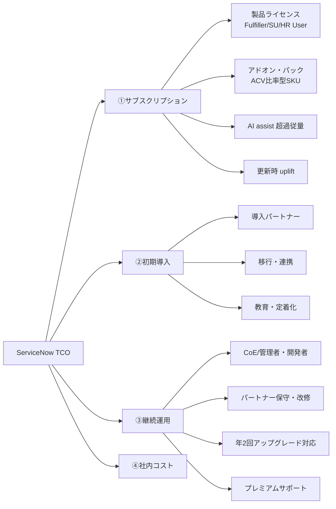

# 価格情報（Pricing：推定価格・価格交渉・TCO）

## 概要

ServiceNow の価格情報（Pricing）について、本ファイルは次の問いに答える。

1. ServiceNow の製品・パッケージは、1ユーザー（1 Fulfiller）あたり、または 1 Subscription Unit あたり、いくらくらいか（**すべて【推定】**）。
2. 2026年4月に導入された新パッケージ **Foundation / Advanced / Prime** は価格にどう影響するか。
3. 実際の契約で、どの程度の割引・値上げ（uplift）が起きているか。何を交渉すべきか。
4. ライセンス以外を含めた総所有コスト（TCO: Total Cost of Ownership）はどう構成され、どう試算するか。

> **重要な前提：ServiceNow は定価（list price / rate card）を公開していない。** 公式製品ページ・公式ドキュメントはいずれも「アカウントチーム（account team）に問い合わせ」を案内するのみであり、本ファイルに記載する金額はすべて、公共調達の公開価格表、購買プラットフォームの集計値、ライセンスアドバイザリー企業・パートナーの公開ベンチマークから集めた **【推定】** である。見積・予算化では必ず ServiceNow またはリセラー（販売代理店）からの正式見積を取得すること。[出典](https://www.servicenow.com/docs/r/intelligent-experiences/enable-ai-experiences/ai-native-sku-overview.html)（取得日 2026-11-02）

- ライセンスの課金単位（Fulfiller / Requester / Approver / Unrestricted User / Subscription Unit 等）の定義は [ライセンスモデル](01-licensing-model.md) を参照。
- パッケージごとの機能差は [エディション比較](03-edition-comparison.md) と [プラットフォームのパッケージ構成](../02_リファレンス/platform/platform-licensing-packaging.md) を参照。
- コスト削減の実践知は [ライセンスコスト最適化](../04_応用編/06-license-cost-optimization.md) を参照。

### 本ファイルにおける確度ラベルと日付の扱い

| 表記 | 意味 |
|---|---|
| 【推定】 | 価格・割引率・費用などの数値。公式定価ではない。**本ファイルの金額はすべてこれに該当する** |
| 【第三者情報】 | パートナー、アドバイザリー企業、購買プラットフォーム等の公開情報に基づく非数値の記述 |
| 【経験則】 | 実務で一般に語られる知見 |
| 取得日 | 本ファイルの全出典は 2026-11-02 に確認した。各表では「出典記事の公開・更新日」と「取得日」を分けて記載する |

---

## 1. ServiceNow の価格の基本構造

### 1.1 価格は非公開・個別見積

ServiceNow のサブスクリプション価格は、製品・パッケージ（tier）・ユーザー種別・数量・契約年数・地域・リセラー経由か否かによって個別に見積られる。公式の「ServiceNow product tiers」ページ（Brazil 版、2026-09-10 更新）は、新 tier の提供可否と利用権（entitlement）についてアカウントチームへの問い合わせを案内しており、価格は記載していない。[出典](https://www.servicenow.com/docs/r/intelligent-experiences/enable-ai-experiences/ai-native-sku-overview.html)（取得日 2026-11-02）

日本の販売パートナーである日立ソリューションズも、FAQ で「価格は非公開」「お支払いは1年ごと」と明記している。【第三者情報】[出典](https://www.hitachi-solutions.co.jp/servicenow/faq/faq03/)（取得日 2026-11-02）

### 1.2 課金単位（メトリクス）の種類

ServiceNow の価格は製品ごとに異なる課金単位（license metric）で積み上がる。主な単位は次のとおり（定義の詳細は [ライセンスモデル](01-licensing-model.md)）。

| 課金単位 | 主な対象製品 | 価格の考え方 |
|---|---|---|
| Fulfiller User（フルフィラー） | ITSM、CSM、FSM、App Engine 等 | チケットを処理・更新する担当者1人あたり。**ITSM 費用の大半を占める** |
| Requester（依頼者）| ITSM 等 | 一般に追加費用なし（Fulfiller 価格に含まれる）【第三者情報】 |
| Approver / Business Stakeholder（承認者） | ITSM 等 | Fulfiller より低い単価で有償【第三者情報】 |
| Unrestricted User（無制限ユーザー） | ITSM（全社契約型）、SecOps、App Engine、SPM 等 | アクティブなユーザープロファイル全員が対象。単価は低いが母数が大きい |
| HR User | HR Service Delivery | 雇用開始〜終了日の範囲にある従業員1人あたり |
| Subscription Unit（SU） | ITOM、SAM、HAM 等 | 管理対象 IT リソースを規定比率（Defined Ratios）で SU に換算 |
| Transaction / Visit / Pack | Virtual Agent、Integration Hub、Customer Portal、Order Management 等 | パック単位で購入し、未使用分は失効 |
| Assist（アシスト） | Now Assist（生成 AI）| 2026年以降は tier 内にプールとして同梱され、超過分は従量課金 |

公開価格表（英国 G-Cloud 14）では、上記の単位ごとに SKU（例：`PROD17243` IT Service Management Standard - Fulfiller User v3）が定義されている。[出典](https://assets.applytosupply.digitalmarketplace.service.gov.uk/g-cloud-14/documents/92465/204661809116859-pricing-document-2025-06-30-1349.pdf)（取得日 2026-11-02）

### 1.3 価格を決める主な変数

| 変数 | 価格への影響 | 確度 |
|---|---|---|
| tier（Foundation / Advanced / Prime、旧 Standard / Pro / Enterprise） | 上位 tier ほど単価が高い。旧体系では Standard→Enterprise で約2〜2.4倍（§3.3 の Redress 数量帯別単価。G-Cloud 旧価格〔§3.1〕では 2.25倍） | 【推定】 |
| 数量（seat band） | 数量帯ごとに単価が段階的に下がる（数量帯の例は §3.3 の Redress の帯：1〜99 / 100〜499 / 500〜999 / 1,000〜2,499 / 2,500 以上 Fulfiller）。Vendr は「fulfiller・requester 数が多い組織では数量割引が一般的」と述べるのみで、しきい値は公表していない（Vendr の規模区分は従業員数 500〜2,500 / 2,500 以上 の企業規模） | 【推定】 |
| 契約年数 | 3年契約が一般的。複数年・前払いで単価が下がる | 【第三者情報】 |
| 製品バンドル | ITSM + ITOM（ServiceOps）、ESM 等の組み合わせで割引が増える | 【第三者情報】 |
| 契約時期 | 四半期末（3・6・9・12月）、特に12月の会計年度末が有利とされる | 【経験則】 |
| AI 利用量 | 2026年以降、assist プール超過分が従量で加算される | 【第三者情報】 |
| 更新時の値上げ（uplift） | 上限条項がないと年 7〜12% 程度の値上げが提示されるとの報告 | 【推定】 |

出典：[Vendr](https://www.vendr.com/marketplace/ServiceNow)、[Redress Compliance（8〜12% uplift）](https://redresscompliance.com/servicenow-8-to-12-percent-unit-price-increase-pushback)、[Now Advisory](https://nownegotiations.pages.dev/servicenow-new-commercial-model)（いずれも取得日 2026-11-02）

---

## 2. 2026年4月のパッケージ刷新（Foundation / Advanced / Prime）と価格

### 2.1 何が変わったか

ServiceNow は製品とパッケージを **Foundation（ファウンデーション）/ Advanced（アドバンスト）/ Prime（プライム）** の3 tier で構成するようになった。公式ドキュメントは「各 tier は AI を組み込み、前の tier を段階的に拡張する」と説明している。[出典](https://www.servicenow.com/docs/r/intelligent-experiences/enable-ai-experiences/ai-native-sku-overview.html)（取得日 2026-11-02）

| 項目 | 内容 | 確度・出典 |
|---|---|---|
| 発効日 | 2026-04-09（旧5 tier を新3 tier に置換） | 【第三者情報】[Community](https://www.servicenow.com/community/upgrades-and-patching-forum/servicenow-ai-native-licensing-in-2026-a-practical-guide-to/m-p/3565858) |
| 旧 SKU の販売終了（End of Sale） | 2026-07-01。以降の更新見積は新 tier で作成。契約期間中の旧 SKU は更新まで有効 | 【第三者情報】[Redress](https://redresscompliance.com/servicenow-2026-pricing-tiers-pillar) |
| AI の扱い | Now Assist、Moveworks レイヤー（EmployeeWorks）、Workflow Data Fabric Foundation、RaptorDB Standard、AI Control Tower を全 tier に同梱（Workflow Data Fabric Advanced は有償アップグレード。下記 Brazil 注記参照） | 公式 [docs](https://www.servicenow.com/docs/r/intelligent-experiences/enable-ai-experiences/ai-native-sku-overview.html) / 【第三者情報】 |
| AI の課金 | tier ごとに assist プールを同梱し、超過分は従量（consumption）課金 | 【第三者情報】[Community](https://www.servicenow.com/community/upgrades-and-patching-forum/servicenow-ai-native-licensing-in-2026-a-practical-guide-to/m-p/3565858) |
| リリースとの関係 | 新 tier の展開は顧客のアップグレードサイクルとは独立 | 公式 [docs](https://www.servicenow.com/docs/r/intelligent-experiences/enable-ai-experiences/ai-native-sku-overview.html) |
| 製品ライン情報 | 公式ドキュメントは最新の製品ライン情報として KB 記事 `KB3160245` を参照させている | 公式 [docs](https://www.servicenow.com/docs/r/intelligent-experiences/enable-ai-experiences/ai-native-sku-overview.html) |
| tier の位置づけ（公式説明） | Foundation＝AI skills と routine AI agents による task-based assistance／Advanced＝ワークフローの工程全体を自動化する agentic workflows／Prime＝自律的に判断・実行する autonomous AI workforce | 公式 [docs](https://www.servicenow.com/docs/r/XRgEFx7nPN6ciT_BBIvnbg/YQiwIh0UNsqUGKnKcD1BQg) |
| 価格モデルの考え方 | 「サブスクリプションのコミット＋assist（利用トークン）」のハイブリッド。ServiceNow は純粋な per-user 課金（価値実証前にコストが先行）と純粋な従量課金（複数年計画が困難）の中間と説明。調査会社は Prime 採用前に自社の消費モデルを作るよう助言 | 【第三者情報】[Info-Tech（2026-04-13）](https://www.infotech.com/software-reviews/research/servicenow-bundles-ai-into-every-product-and-bets-that-context-is-the-missing-piece) |
| 標準同梱の追加要素 | Process Mining、Moveworks（従業員向け会話レイヤー）も既定で同梱 | 同上 |

> **Brazil での変更:** 公式「ServiceNow product tiers」ページは Brazil 版（2026-09-10 更新）として、AI Agent Studio で自然言語指示から新規エージェントを構築できるのは Prime のみ、AI Action Fabric の inbound MCP Server Console は Prime のみ、Workflow Data Fabric Advanced（Zero Copy Connectors、Stream Connect）は有償アップグレード、RaptorDB Standard は全 tier 同梱で高負荷向け RaptorDB Professional は別オプション、と記載している。外部 AI の管理には別途「AI Control Tower for Enterprise AI」ライセンスが必要。[出典](https://www.servicenow.com/docs/r/intelligent-experiences/enable-ai-experiences/ai-native-sku-overview.html)（取得日 2026-11-02）

tier ごとの機能差の詳細は [エディション比較](03-edition-comparison.md)、AI 機能は [Now Assist と AI Agents](../02_リファレンス/platform/now-assist-ai-agents.md) を参照。

### 2.2 製品ラインごとの tier 構成（価格に関係する点）

| 製品ライン | tier | 価格に影響する特記事項 | 出典 |
|---|---|---|---|
| ITSM | Foundation / Advanced / Prime | Foundation＝Incident（基本）、Request、Asset、Cost ＋ Virtual Agent、Predictive Intelligence、Now Assist for ITSM（すぐ使える標準構成のレベル）。Advanced＝Problem、Change、Major Incident、On-Call、Walk-up、Platform Analytics Advanced、Process Mining 等を追加し、**旧 ITSM Professional の大半を使っている場合に評価すべき新しい基準**（"Advanced is the new baseline to evaluate"）。Prime＝DevOps Change Velocity、最大 assist 配分、カスタム AI スキル/エージェント構築。新モデルでは Virtual Agent は会話数無制限（"Virtual Agent now has unlimited conversations"。記事は新モデル全体の変更として記載。tier 別の条件や契約差は記事の推奨どおりアカウントチームに確認） | 【第三者情報】[Community（ITSM）](https://www.servicenow.com/community/itsm-articles/itsm-licensing-in-april-2026-foundation-advanced-and-prime-in/ta-p/3544380) |
| ITOM | Advanced / Prime（**Foundation なし**） | 課金単位は SU。Prime は Event Management、Metric Intelligence、Health Log Analytics 等を追加し、Workflow Data Fabric クレジットと GenAI assist 配分がおおむね2倍 | 【第三者情報】[Community（ITOM）](https://www.servicenow.com/community/architect-articles/navigating-the-april-2026-servicenow-itom-licensing-model/ta-p/3555121) |
| ServiceOps（ITSM + ITOM） | Advanced / Prime | 統一クレジットメーター：**1 Credit = 1 ITOM SU、10 Credits = 1 ITSM Fulfiller User**。true-up と更新サイクルを一本化 | 同上 |
| ESM Foundation | Foundation | ITSM Foundation + コアビジネススイートを per-user メトリクスで | 【第三者情報】[Community（ITSM）](https://www.servicenow.com/community/itsm-articles/itsm-licensing-in-april-2026-foundation-advanced-and-prime-in/ta-p/3544380) |
| CSM | Foundation / Advanced / Prime | Foundation の App Engine Starter は 50 fulfiller / 100 unnamed user / 50 transaction に制限。Advanced は Customer Portal 訪問 2,000回/fulfiller/月（unrestricted user は 400回）。Prime は 4,000回/fulfiller/月、Process Mining 15,000 レコード | 【第三者情報】[Community（CSM）](https://www.servicenow.com/community/architect-articles/the-april-2026-servicenow-csm-packaging-redesign-what/ta-p/3562359) |
| ITSM Prime Add-on | Add-on | CSM Prime / Industry Prime 顧客向け。別の ITSM 製品ラインや更新サイクルを持たずに Prime 相当の ITSM AI を追加 | 同上 |

> ServiceOps の「10 Credits = 1 ITSM Fulfiller User」という換算比は、ITSM Fulfiller 1人と ITOM SU 10個がほぼ同等の価格価値で扱われることを示唆する。ただし金額そのものは公開情報では確認できず。【推定】

### 2.3 旧 tier から新 tier へのマッピングと価格影響

| 旧 tier | 新 tier（報告ベース） | 更新時の価格影響（報告ベース） |
|---|---|---|
| Standard | Foundation | 「8 to 12 percent」記事：おおむね横ばい（broadly flat）／「2026 pricing tiers」記事：同梱された Now Assist の費用分だけ基本価格が上昇（"Base rose to fund bundled Now Assist"）。**同じアドバイザリーの記事間で記述が食い違う** |
| Pro（Professional） | Foundation または Advanced（Redress）／旧 Professional の大半を使っているなら Advanced が評価の基準（Community） | おおむね横ばい（「8 to 12 percent」記事）。「2026 pricing tiers」記事は「どのワークフローが上位 tier に移ったかを確認せよ」と注記 |
| Pro Plus（Now Assist 付き） | Foundation または Advanced | 0〜15% 増（「8 to 12 percent」記事） |
| Enterprise | Advanced | 公開情報では幅を確認できず |
| Enterprise Plus | Prime | 公開情報では幅を確認できず |

【推定】【第三者情報】出典：[Redress Compliance「2026 pricing tiers」（2026-06-24公開・2026-08-16更新）](https://redresscompliance.com/servicenow-2026-pricing-tiers-pillar)、[Redress Compliance「8 to 12 percent」（2026-09-04公開）](https://redresscompliance.com/servicenow-8-to-12-percent-unit-price-increase-pushback)、[Community（ITSM）](https://www.servicenow.com/community/itsm-articles/itsm-licensing-in-april-2026-foundation-advanced-and-prime-in/ta-p/3544380)（取得日 2026-11-02）

> **注意（機能喪失のリスク）：** Community 記事によれば、ITSM Foundation には Problem Management、Change Management、Major Incident Management が含まれない（§2.2）。旧 ITSM Standard / Professional でこれらのプロセスを使っている場合、Foundation へマッピングすると機能を失うため、実質的には Advanced が必要になる。「横ばい」という価格影響は Foundation へのマッピングを前提にした値であり、Advanced が必要な場合は更新額が増える可能性がある。【推定】

- 同アドバイザリーは、マッピングは「機械的ではない」（新 tier はモジュールの深さではなく AI 能力で区切られているため）と注意している。【第三者情報】
- 別のアドバイザリーは「旧 tier の据え置き（grandfathering）はなく、全顧客が次回更新時に移行する」と記述し、ベンダー提示のマッピングは交渉の出発点にすぎないとしている。【第三者情報】[出典](https://nownegotiations.pages.dev/servicenow-new-commercial-model)
- ServiceNow Community のコメント欄では、DevOps Change Velocity が旧 ITSM Professional から ITSM Prime 専用に移ったことが確認されている。旧 Pro でこの機能を使っていた組織は Prime 化の圧力を受ける点に注意。【第三者情報】[出典](https://www.servicenow.com/community/itsm-articles/itsm-licensing-in-april-2026-foundation-advanced-and-prime-in/ta-p/3544380)

---

## 3. 製品・パッケージ別の推定価格

> **以下の表はすべて【推定】である。** 為替・数量・契約年数・交渉により実際の価格は大きく変わる。表中「出典の日付」は出典記事の公開/更新日、取得日はいずれも 2026-11-02。

### 3.1 英国 G-Cloud 14 公開価格表（旧 v3 SKU、リセラー掲載価格）

英国政府の調達フレームワーク G-Cloud 14 では、ServiceNow リセラー（SCC）が SKU 単位の基準価格（Base Price GBP）を公開している。**ServiceNow の SKU 番号付きで価格が一般公開されている数少ない一次資料**であるが、次の制約がある。

- 2026-04 以前の旧体系（`v3` 等）の SKU であり、Foundation / Advanced / Prime の価格ではない。
- 価格表には「Base Price GBP」とのみあり、**課金期間（月額か年額か）が明記されていない**。Virtual Agent パック（月4,000会話）が £1,666.40 であること等から月額表記と解するのが自然だが、公開情報では確定できず。【推定】
- 英国公共部門向けの掲載価格であり、民間・日本の価格とは異なる。
- 文書の1ページ目の見出しは「SCC ServiceNow Products & Pricing for G Cloud 13」（副題「G-Cloud 14 - ServiceNow Pricing」）で、各ページのフッターに「G-Cloud 1May2019」が残っている。旧フレームワーク向け資料の流用の可能性があり、価格の時点は確定できない。
- PDF のテキスト抽出時に表の列配置が崩れるため、SKU 名と価格が同じ行で対応付けられたものだけを掲載する。ただし、同じ行で対応付けても列ずれの影響を受ける可能性がある（例：HRSD Enterprise `PROD17238` は同じ行が £4.00、上から順に読むと £12.80 となり、Enterprise が Professional〔£8.00〕より安いという不自然な結果になるため本表には掲載しない）。

| SKU | 製品（旧体系） | 課金単位 | Base Price（GBP） |
|---|---|---|---|
| `PROD17243` | IT Service Management Standard - Fulfiller User v3 | Fulfiller User | £80.00 |
| `PROD17252` | IT Service Management Standard - Unrestricted User v3 | Unrestricted User | £12.00 |
| `PROD17256` | IT Service Management Professional - Fulfiller User v3 | Fulfiller User | £120.00 |
| `PROD17257` | IT Service Management Professional - Unrestricted User v3 | Unrestricted User | £16.00 |
| `PROD17259` | IT Service Management Enterprise - Fulfiller User v3 | Fulfiller User | £180.00 |
| `PROD17269` | IT Service Management Enterprise - Unrestricted User v3 | Unrestricted User | £24.00 |
| `PROD09218` | Virtual Agent ITSM Conversation - Transaction Pack（月4,000会話、未使用分は月次失効） | Transaction Pack | £1,666.40 |
| `PROD14995` | ITOM Operator Professional v2 | Subscription Unit | £19.20 |
| `PROD16963` | ITOM AIOps Enterprise v2 | Subscription Unit | £30.40 |
| `PROD14997` | IT Operations Management（ITOM Visibility） | Subscription Unit | £9.60 |
| `PROD16951` | Strategic Portfolio Management Standard - SPM User | SPM User | £60.00 |
| `PROD16953` | Strategic Portfolio Management Professional - SPM User | SPM User | £100.00 |
| `PROD17143` | Customer Service Management Standard - Fulfiller User v6 | Fulfiller User | £100.00 |
| `PROD17145` | Customer Service Management Professional With App Engine 100 - Fulfiller User v6 | Fulfiller User | £180.00 |
| `PROD17237` | HR Service Delivery Professional - HR User v4 | HR User | £8.00（列対応は要確認） |
| `PROD13076` | App Engine - Unrestricted User | Unrestricted User | £16.00 |
| `PROD15370` | Field Service - Contractor User | Contractor User | £28.00 |
| `PROD17366` | Healthcare & Life Sciences - Fulfiller User | Fulfiller User | £240.00 |
| `PROD16743` | Security Operations Standard - SIR - Unrestricted User | Unrestricted User | £1.80 |
| `PROD12821` | Security Operations Standard - VR - Devices | Devices | £1.40 |
| `PROD12019` | Integrated Risk Management Standard - IRM User | IRM User | £4.00 |
| `PROD14208` | Integrated Risk Management Standard - IRM Operator | IRM Operator | £80.00 |
| `PROD15033` | Software Asset Management Professional - Subscription Unit | Subscription Unit | £6.40 |
| `PROD16047` | Hardware Asset Management Professional - Subscription Unit v2 | Subscription Unit | £3.20 |

【推定】出典：[G-Cloud 14 SCC ServiceNow Pricing（ファイル名日付 2025-06-30）](https://assets.applytosupply.digitalmarketplace.service.gov.uk/g-cloud-14/documents/92465/204661809116859-pricing-document-2025-06-30-1349.pdf)（取得日 2026-11-02）

同価格表から読み取れるパッケージ上の事実（価格試算に影響するもの）：

- ITSM Standard / Professional の Fulfiller・Unrestricted SKU には **App Engine Starter 25**（カスタムテーブル25個まで）、Enterprise には **App Engine Starter 50** が含まれる。
- ITSM Professional / Enterprise には Predictive Intelligence、Virtual Agent、Performance Analytics が含まれ、Virtual Agent には1 Fulfiller あたり月次の会話トランザクション枠が付く（超過は Transaction Pack を追加購入）。
- Unrestricted User 型の ITSM は「アクティブなユーザープロファイルを持つ全ユーザー」を数える方式で、Fulfiller 型とは課金母数がまったく異なる。
- Performance Analytics 等の一部アプリは「対象製品 ACV の 20%」のように**他製品の年間契約額（ACV: Annual Contract Value）に対する比率**で価格付けされている。Employee Document Management は「HR ACV の 30%」。
- Integration Hub は年間トランザクション数のパック（例：1M / 10M / 100M）で、**未使用分は年次で失効し返金されない**。

### 3.2 ITSM Fulfiller の推定単価（旧 tier、米ドル、月額/1ユーザー）

| tier | 推定単価（USD/月/Fulfiller） | 出典（出典の日付） |
|---|---|---|
| Standard | $100 | [Redress Compliance](https://redresscompliance.com/how-much-is-servicenow-2026)（2026年）※1〜99名帯 |
| Professional | $150 | 同上 |
| Enterprise | $200 | 同上 |
| 全 tier の幅 | $70〜$200 超 | [eesel.ai](https://eesel.ai/blog/servicenow-license-types-and-cost)（2026-05-07更新）、[InvGate](https://blog.invgate.com/servicenow-pricing)（2026-10-07） |
| ITOM/SecOps 等の上位モジュールを伴う場合 | $150〜$250 | [eesel.ai](https://eesel.ai/blog/servicenow-license-types-and-cost)（Rezolve.ai の推定を引用） |

【推定】（取得日 2026-11-02）

### 3.3 数量帯別の推定単価（旧 tier、USD/月/Fulfiller）

ライセンスアドバイザリー企業が見積書・注文書から集計したとする数量帯別の推定単価。**数量が増えるほど単価は大きく下がる**（1〜99名帯と 2,500名超帯で約2.2〜2.6倍の差）。

| Fulfiller 数量帯 | Standard | Professional | Enterprise |
|---|---|---|---|
| 1〜99 | $100 | $150 | $200 |
| 100〜499 | $80 | $120 | $165 |
| 500〜999 | $65 | $95 | $135 |
| 1,000〜2,499 | $50 | $75 | $110 |
| 2,500 以上 | $38 | $60 | $90 |

【推定】出典：[Redress Compliance「How much is ServiceNow 2026」](https://redresscompliance.com/how-much-is-servicenow-2026)（取得日 2026-11-02）。同記事はこれを「公表定価ではなく、見積書・注文書由来の旧 tier レート」と説明している。

### 3.4 新 tier（Foundation / Advanced / Prime）の推定単価

新 tier の価格は公開情報が少ない。現時点で確認できたのは次のみ。

| tier | 推定単価（USD/月/ユーザー） | 備考 | 出典 |
|---|---|---|---|
| Foundation | $70〜$100 | ベンチマーク案件の値 | [Redress（2026-08-16更新）](https://redresscompliance.com/servicenow-2026-pricing-tiers-pillar) |
| Advanced | 公開情報では確認できず | 旧 Pro〜Enterprise 相当の価格帯と推定される【推定】 | — |
| Prime | $160〜$200 以上（従量課金を除く） | 全ユーザーを Prime に統一すると請求額が約3分の1増えたとの報告 | 同上 |
| AI 従量超過 | tier 費用の 15〜30% | エージェントと Now Assist の本稼働後に超過が膨らんだ事例の幅 | 同上 |

【推定】（取得日 2026-11-02）

> 公式・Community の解説はいずれも、assist の1アクションあたり消費量、tier ごとのプールサイズ、超過単価を「公開されていない」としている。[出典](https://www.servicenow.com/community/upgrades-and-patching-forum/servicenow-ai-native-licensing-in-2026-a-practical-guide-to/m-p/3565858)（取得日 2026-11-02）

### 3.5 Now Assist（生成 AI）の価格の変遷

| 時期 | 価格の仕組み | 推定額 | 出典 |
|---|---|---|---|
| 2023-09〜2026-04（旧体系） | ITSM / CSM / HRSD の Pro・Enterprise 顧客が **Pro Plus / Enterprise Plus** アドオンを seat 単位で購入。Creator 向けは Creator Plus。各 seat に一定数の assist が付与され、追加購入可能 | 初期の assist 付与量は非公開 | [Constellation Research（2023-09-20）](https://www.constellationr.com/insights/news/servicenow-launches-now-assist-across-now-platform-pricing-bundles) 【第三者情報】 |
| 同上 | 同上 | $25〜$75/Fulfiller/月（バンドルにより変動） | [Redress](https://redresscompliance.com/how-much-is-servicenow-2026) 【推定】 |
| 同上 | 同上 | ベースライセンスに対して約 25〜60% 上乗せ | [eesel.ai](https://eesel.ai/blog/servicenow-license-types-and-cost) 【推定】 |
| 2026-04 以降（新体系） | 全 tier に同梱され、テナント単位の assist プールを消費。超過は従量 | 超過単価は非公開 | [Community](https://www.servicenow.com/community/upgrades-and-patching-forum/servicenow-ai-native-licensing-in-2026-a-practical-guide-to/m-p/3565858) 【第三者情報】 |

（取得日 2026-11-02）

ServiceNow の決算説明では、Pro Plus を含む案件が上位20件中15件（2025年Q1）、Plus 製品が上位20件中18件（2025年Q2）と報告されており、AI 付き上位 SKU への誘導が営業上の重点であったことがうかがえる。【第三者情報】出典：[Q1 2025 決算説明会トランスクリプト（2025-04-23、MarketBeat）](https://www.marketbeat.com/earnings/reports/2025-4-23-servicenow-inc-stock)（"Pro Plus products were included in 15 of our top 20 deals"）、[Q2 2025 決算説明会トランスクリプト（2025-07-23、Investing.com）](https://www.investing.com/news/transcripts/earnings-call-transcript-servicenow-beats-q2-2025-estimates-stock-dips-93CH-4149489)（"Plus products were included in 18 of the top 20 deals"）（取得日 2026-11-02）

### 3.6 その他の製品（ITOM、ITAM、CSM、HRSD、SecOps、IRM、SPM、App Engine）

ITSM 以外の製品について、民間価格の信頼できる推定値は公開情報ではほとんど確認できなかった。確認できたのは次のとおり。

| 製品 | 課金単位 | 推定値・参考値 | 出典 |
|---|---|---|---|
| ITOM | Subscription Unit（SU）。管理対象リソースを規定比率で換算 | G-Cloud 旧 SKU で £9.60〜£30.40/SU（期間不明） | §3.1 |
| SAM（Software Asset Management） | Subscription Unit（SU） | G-Cloud 旧 Professional SU £6.40（期間不明）。民間価格は確認できず | §3.1 |
| HAM（Hardware Asset Management） | Subscription Unit（SU） | G-Cloud 旧 Professional SU v2 £3.20（期間不明）。民間価格は確認できず | §3.1 |
| CSM | Fulfiller（+ Portal Visit、高負荷時は従量） | G-Cloud 旧 Standard Fulfiller £100 | §3.1、[Vendr](https://www.vendr.com/marketplace/ServiceNow) |
| HRSD | HR User（従業員数）+ HR エージェント | G-Cloud 旧 Professional HR User £8.00（列対応は要確認） | §3.1 |
| SecOps | セキュリティアナリスト単位、Unrestricted User、Device 等（従量課金の場合あり） | G-Cloud 旧 Standard で SIR Unrestricted User £1.80、VR Device £1.40（期間不明）。民間価格は確認できず | §3.1、[Vendr](https://www.vendr.com/marketplace/ServiceNow) |
| IRM | IRM User / IRM Operator | G-Cloud 旧 Standard IRM User £4.00 / IRM Operator £80.00（期間不明）。民間価格は確認できず | §3.1 |
| SPM | SPM User | G-Cloud 旧 Standard £60 / Professional £100 | §3.1 |
| App Engine | Fulfiller / Unrestricted User | G-Cloud 旧 Unrestricted £16 | §3.1 |

【推定】（取得日 2026-11-02）

### 3.7 日本円での参考値

ServiceNow の日本円建て単価は公開情報ではほぼ確認できない。日本のパートナー・ベンダーのブログに次の記載があるが、根拠・前提（為替、数量、製品構成）が明示されておらず、記事内でも数値が揺れているため、**桁感の把握にのみ使うこと**。

| 項目 | 記載値 | 出典（出典の日付） |
|---|---|---|
| Fulfiller ライセンス | 年間 10〜30万円/ユーザー（別箇所では $100〜$300/ユーザー） | [Aurant Technologies（2026-06-25更新）](https://aurant-technologies.com/blog/servicenow-itsm-introduction-guide/) |
| 複数モジュール利用時の Fulfiller | 年間1ユーザーあたり 50万円超 | 同上 |
| 約500ユーザー規模（ライセンス+保守） | 年 2,000〜5,000万円 | 同上 |
| 最低契約規模 | 年間数千万円〜 | 同上 |
| Fulfiller 1,000名規模の年間ライセンス | 5〜10億円 | 同上 |

【推定】（取得日 2026-11-02）

> **注意（同一記事内の桁の食い違い）：** 「1,000名で年5〜10億円」は1ユーザーあたり年50〜100万円に相当し、同じ記事の「年10〜30万円/ユーザー」とは桁が異なる。§5.3 の「約2,000名規模でライセンス5年3〜10億円」（＝1名あたり年3〜10万円程度）とも整合しない。どの値も前提が不明なため、**いずれも単独では見積・予算の根拠に使わないこと**。【推定】

#### 歴史的な日本円の公表価格（参考）

日本で ServiceNow の円建て単価が公表された例として、日立ソリューションズの販売開始時のニュースリリース（2013-01-25）がある。**13年以上前の旧エディション体系の価格であり、現在の見積には使えない**が、「日本でも Fulfiller 単位の月額課金・ボリュームディスカウント」という価格構造が当初から続いていることの裏付けになる。

| 製品 | 価格（税抜） | 備考 |
|---|---|---|
| ServiceNow Enterprise Edition | 月額 13,500円/ライセンス（税込 14,175円、当時の税率5%） | ライセンス数によるボリュームディスカウントあり。販売開始 2013-01-25 |

【第三者情報】出典：[日立ソリューションズ ニュースリリース（2013-01-25）](https://www.hitachi-solutions.co.jp/company/press/news/2013/0125.pdf)（取得日 2026-11-02）

> 米ドル推定値を円換算する場合は、換算レートを明記すること（例：1 USD = 150 円と仮定すると、$100/月/Fulfiller は年 18万円/Fulfiller）。為替は変動するため、この換算例自体も【推定】である。日本向けの見積は円建て・ドル建てのいずれもあり得るため、見積通貨と為替条項を必ず確認する。【経験則】

---

## 4. 公開されている契約・取引データ

### 4.1 Vendr（SaaS 購買プラットフォーム）の集計値

| 指標 | 値 |
|---|---|
| 平均年間契約額（ACV） | $127,117 |
| 中央値（年額） | $127,118（110件の購買に基づく） |
| 価格帯 | $43,647（下限）〜 $700,691（上限） |
| 取扱案件数 | 64件 |
| 平均削減率（Avg Savings） | 8.1% |

【推定】出典：[Vendr ServiceNow](https://www.vendr.com/marketplace/ServiceNow)（取得日 2026-11-02）。同ページは案件数を 64件と 110件の2通りで示しており、差異の説明はない。Vendr の利用者は中堅企業が多いとされ、大企業の ELA（Enterprise License Agreement）規模はこの分布に十分反映されていない可能性がある。【推定】

価格比較サイト CostBench も Vendr の購買データ（n=82）を引用し、次の値を示している（最終検証 2026-06-09）。

| 指標 | 値 |
|---|---|
| 年間契約額の中央値 | $129,976 |
| 平均交渉割引（対見積） | 8% |
| 更新時値上げ（購入者報告） | 更新時値上げは 10〜90% の報告。一般的には1年更新で約 20%、3年更新で約 12%（同ページは別箇所で「ライン項目単位で 20〜90% 増の例」とも記載） |
| 契約上の注意 | 期中のダウングレード不可、自動更新 |

【推定】出典：[CostBench（2026-06-09 検証）](https://costbench.com/software/help-desk/servicenow)（取得日 2026-11-02）。同ページは Reddit 投稿等も根拠に含み、ページ内で数値の不整合（導入費用比率が 50〜100% と 50〜150% の2通り等）がある。

### 4.2 割引率のベンチマーク（アドバイザリー企業の公開値）

| 項目 | 報告値 | 出典 |
|---|---|---|
| 定価からの達成割引（2025〜2026年の成約案件） | 25〜45%（上限は規模・複数年・有力な代替案が必要） | [Redress（2026-09-04）](https://redresscompliance.com/servicenow-8-to-12-percent-unit-price-increase-pushback) |
| モジュール別の交渉による値下げ幅 | ITSM 15〜35%、HRSD 25〜40%、CSM 20〜30%（同記事の根拠〔evidence〕節）。同記事の本文では ITSM 40〜50%・HRSD 55〜70%（定価比）、FAQ では ITSM 40〜50%・ITOM 35〜55%・HRSD 55〜70% と記載が不一致 | 同上 |
| ITSM Pro/Enterprise の定価比割引（3年 ACV） | 28〜48% | [Redress（discount benchmarks）](https://redresscompliance.com/servicenow-discount-benchmarks-what-enterprises-actually-achieve.html) |
| Vendr 経由の平均削減率 | 8.1% | [Vendr](https://www.vendr.com/marketplace/ServiceNow) |

【推定】（取得日 2026-11-02）

#### 年間契約額（ACV）帯別の割引ベンチマーク

同じアドバイザリー企業は、ACV 規模ごとの割引中央値と上位25%（top quartile）を公開している。**契約規模が大きいほど割引率が高い**傾向が明確である。

| ACV 帯（USD） | 割引中央値 | 上位25% | 次の段階に進むための要因（報告ベース） | 備考 |
|---|---|---|---|---|
| 50万未満 | 8〜12% | 20% | 書面の競合提案＋3年契約 | 同記事の導入部は中央値を 8% とも記載 |
| 50万〜200万 | 15〜22% | 28% | 事業部ごとの契約を1つの契約書に統合、Fulfiller 下限数のコミット | — |
| 200万〜500万 | 27% | 43% | 名前を出したリファレンス顧客になること、Q4 クローズ、複数モジュールのコミット | 550件超（平均 ACV 220万）に基づく。現実的な目標は 34〜38% |
| 500万超 | 30〜40% | 45% 以上 | ELA 構造（uplift 上限、予約容量、数量削減権）。割引率より構造が重要 | — |

【推定】出典：[Redress Compliance「Price benchmarks by spend tier 2026」（2026-08-20）](https://redresscompliance.com/servicenow-price-benchmarks-by-spend-tier-2026)（取得日 2026-11-02）

#### 更新時値上げ（uplift）・契約期間・時期のベンチマーク

| 項目 | 報告値 | 出典 |
|---|---|---|
| 注文書のデフォルト uplift | 年 7〜12%（複利） | [Redress（spend tier）](https://redresscompliance.com/servicenow-price-benchmarks-by-spend-tier-2026) |
| 更新時の初回提示 | 15〜25%（最終的に 10% 前後で決着することが多い） | 同上 |
| 「年3%上限」の落とし穴 | 複利で3年累計約 9.3% | 同上 |
| ACV $5M で uplift 7%（上限なし）の3年影響 | 約 +$1.05M（出典値。2年目 +$350K・3年目 +$724.5K〔$5M×(1.07²−1)〕で計算すると約 +$1.07M。出典本文の内訳「2年目 350K・3年目 375K」も合計と一致しない）。3% 上限なら約 +$455K、CPI 連動 2.5% なら約 +$378K（いずれも同じ方法で検算一致） | 同上 |
| 契約期間 | 3年が標準。2年は約 3〜5ポイント不利（"price two years about 3 to 5 points worse"）。5年は uplift 0〜3% 上限と年 10〜15% の数量削減権がある場合のみ検討価値 | 同上 |
| 時期 | ServiceNow の会計年度末（12月）の Q4 クローズで 3〜5ポイント有利。ただし最終3週間に交渉を持ち込まれると逆に 5〜8ポイント失うとの指摘 | 同上、[Vendr](https://www.vendr.com/marketplace/ServiceNow) |
| AI 上位 SKU の値上げ例 | 旧 ITSM Pro の AI プレミアム単価が $150→$180/Fulfiller/月に上がり、1,500 Fulfiller で年約 $540K 増 | [Redress（spend tier）](https://redresscompliance.com/servicenow-price-benchmarks-by-spend-tier-2026) |

【推定】（取得日 2026-11-02）

**読み方の注意：** Vendr の 8.1% は「最初の見積額に対する削減率」、アドバイザリーの 25〜48% は「（非公開の）定価に対する割引率」であり、基準が異なる。また、アドバイザリー企業は交渉支援サービスを販売しているため、高い割引率が強調されやすい（選択バイアス）。【推定】

### 4.3 価格交渉事例（公開事例・試算例）

公開情報で確認できる価格交渉の「事例」は、匿名化された事例または試算例に限られる。企業名入りの価格公開事例は確認できなかった。

#### 事例A：Enterprise 1,200 Fulfiller の更新（アドバイザリーの仮想事例）

| シナリオ | 年間費用（USD） | 計算式 |
|---|---|---|
| 現状（1,200 Fulfiller × $110/月） | $1,584,000 | 1,200 × $110 × 12 |
| 数量据え置きで 10% 割引 | $1,425,600 | $1,584,000 × 0.9 |
| 未使用ライセンス整理後、500〜999帯の単価で再見積 | $1,243,440 | 732 × $135 × 12 ＋ 240 × $20 × 12 |
| 未使用整理後、$110 単価を維持 | $1,023,840 | 732 × $110 × 12 ＋ 240 × $20 × 12（＝$57,600） |
| 単価維持＋180 seat を Professional に格下げ | $948,240 | $1,023,840 − 180 × $35 × 12 |

数量の前提：1,200 名のうち、承認のみを行う 240 名を承認者ライセンス（$20/月と仮定）に移し、軽量な stakeholder 144 名・非アクティブ 60 名・テスト/管理用 24 アカウントを除外して、Fulfiller を 732 名とする。格下げは Enterprise と Professional の単価差を $35/月と仮定。

【推定】出典：[Redress Compliance](https://redresscompliance.com/how-much-is-servicenow-2026)（取得日 2026-11-02）。同記事は承認者ライセンスを $20/月と仮定した仮想事例と明記している。また、数量を減らしたことで上位の数量帯から外れ、帯単価（$135）で再見積されると、$110 を維持した場合より年 $219,600 増える（$1,243,440 − $1,023,840）点を、単価維持を交渉すべき理由として挙げている。

**示唆：** ヘッドラインの割引率交渉（10%）よりも、**未使用ライセンスの整理（shelfware 削減）と tier の適正化**のほうが削減効果が大きい（▲40%）。【推定】

#### 事例B：期中追加 Fulfiller の単価上昇

- 期中に Fulfiller を追加した顧客が、既存のコミット単価ではなく新規単価で見積られ、**単価が 8〜12% 高くなる**事象が報告されている。
- 期中追加分を主契約の終了日に揃える co-termination により、拡張費用の 3〜8% 相当が上乗せされる場合がある。
- 400 seat 追加時に単価を $100 → $90/月にできれば、3年間で約 $144,000 の差になる（試算）。
- 「40% 割引 + 年 9% の上限なし値上げ」では実効割引が目減りする。出典は「約 25%」と記載しているが、検算すると3年目（値上げ2回後：0.6 × 1.09² ≒ 0.713）で約 29%、4年目相当（値上げ3回後：0.6 × 1.09³ ≒ 0.777）で約 22% となり、出典値はどちらの前提とも一致しない。

【推定】出典：[Redress Compliance（2026-09-04）](https://redresscompliance.com/servicenow-8-to-12-percent-unit-price-increase-pushback)（取得日 2026-11-02）

#### 事例C：2026年 tier 移行時の更新

- Standard / Pro 顧客はおおむね横ばい、Pro Plus 顧客は 0〜15% 増、Enterprise Plus は Prime へ（「8 to 12 percent」記事）。ただし同アドバイザリーの別記事は Standard の基本価格が Now Assist 同梱分だけ上昇したとしており、Problem / Change を使う旧 Standard / Pro 顧客は Advanced が必要になり得る（§2.3）。
- 全ユーザーを Prime に揃えた結果、請求額が約3分の1増え、10社中6社では付加価値が得られなかった（アドバイザリーの 30〜40件の更新ベンチマーク）。
- AI 従量の超過が、エージェント・Now Assist 稼働後に tier 費用の 15〜30% に達した例がある。
- 開発・検証などのサブプロダクション環境も本番と同じ assist プールを消費する（旧体系では開発インスタンスに追加費用はなかった）。

【推定】出典：[Redress（2026-08-16更新）](https://redresscompliance.com/servicenow-2026-pricing-tiers-pillar)、[Community](https://www.servicenow.com/community/upgrades-and-patching-forum/servicenow-ai-native-licensing-in-2026-a-practical-guide-to/m-p/3565858)（取得日 2026-11-02）

#### 事例D：米国連邦政府（GSA OneGov）との一括合意（公開事例）

企業名・機関名と割引率が公開されている数少ない価格交渉事例が、米国 GSA（General Services Administration、一般調達局）の OneGov 合意である。GSA が 2025-09-03 に発表した。

| 対象 | 割引 | 基準 | 期限 |
|---|---|---|---|
| ITSM Pro + ITSM Pro Plus バンドル（Unrestricted User） | 最大 70% | GSA 定価（Unrestricted User 単価） | 2028-09-30 まで |
| ITSM Pro 単体へのアップグレード | 40% | Pro Unrestricted User 定価 | 2026-09-30 まで（**本ファイル作成時点で期限切れ**） |

- 新規・既存を問わず全連邦機関が対象。Carahsoft の GSA Schedule およびその連邦リセラー経由で提供される。
- 70% 割引バンドルの SKU：`SNITSMPROPLUS`（ServiceNow ITSM + ProPlus (GenAI) Unrestricted User、FedRAMP GCC）、`SNITSMPROPLUSNSC`（同、FedRAMP IL5/NSC）。いずれも有効期限 2028-09-30。40% アップグレードの SKU は Carahsoft のページでは確認できず。
- 報道は、このバンドルが AI 機能（Pro Plus＝Now Assist）の普及加速を目的としたものと説明している。

【第三者情報】【推定】出典：[Constellation Research（2025-09-04）](https://www.constellationr.com/insights/news/servicenow-offers-us-government-discounts-high-70-itsm)、[Carahsoft GSA OneGov](https://www.carahsoft.com/servicenow/gsa-onegov)（取得日 2026-11-02）

**示唆：** 「AI 付き上位バンドルへの移行」と引き換えに大幅割引が提示されるパターンは、民間でも 2026 年の tier 移行時に起こり得る。割引率の大きさに目を奪われず、更新時の単価（割引がいつまで続くか）と移行後 tier の必要性を評価すること。【経験則】

### 4.4 交渉の論点チェックリスト

公開されているアドバイザリー・購買プラットフォーム・Community 記事に共通する交渉論点を整理する。【第三者情報】【経験則】

| # | 論点 | 具体的な要求例 | 出典 |
|---|---|---|---|
| 1 | tier マッピング | 各旧 entitlement を、実利用をカバーする**最も低い新 tier** に割り当てる。ベンダー提示のマッピングを前提にしない | [Now Advisory](https://nownegotiations.pages.dev/servicenow-new-commercial-model) |
| 2 | Prime の範囲限定 | Prime はエージェントを構築・運用するチームに限定し、他は Foundation / Advanced に置く | [Redress](https://redresscompliance.com/servicenow-2026-pricing-tiers-pillar) |
| 3 | 数量の実態合わせ | Fulfiller / Requester 数を実際の更新行動に基づいて再集計し、組織再編・売却分を除外 | [Now Advisory](https://nownegotiations.pages.dev/servicenow-new-commercial-model) |
| 4 | 更新時値上げの上限 | 年間 uplift を「米国 CPI と 4% の低い方」などの**明示数値**で上限設定し、定価ではなく実効単価に適用。4% 上限なら3年複利で約12.5%、5〜7% なら約16〜23%（1.05³≒1.158、1.07³≒1.225。出典は15〜21%と記載）。Now Advisory は「上限付き uplift は初日のヘッドライン割引1〜2ポイントより通常価値がある」と指摘 | [Redress](https://redresscompliance.com/servicenow-8-to-12-percent-unit-price-increase-pushback)、[Now Advisory](https://nownegotiations.pages.dev/servicenow-new-commercial-model) |
| 5 | 期中追加単価の固定 | 数量帯別の Fulfiller 単価を注文書に明記し、期中追加はコミット済み帯の単価で | 同上 |
| 6 | true-down 権 | 年最大 15% の数量削減と比例減額 | 同上 |
| 7 | AI プールと超過単価 | assist プールのサイズと超過単価を、想定利用量モデルに紐づけて**書面で**合意。将来の Prime 拡張単価のロック、移行時の価格保護 | [Redress](https://redresscompliance.com/servicenow-2026-pricing-tiers-pillar) |
| 8 | 定義の契約書への固定 | tier・ロール定義を、変更され得る外部ドキュメント参照ではなく契約書本文に記載 | [Now Advisory](https://nownegotiations.pages.dev/servicenow-new-commercial-model) |
| 9 | 時期と競合 | 四半期末（特に12月）に交渉。競合（BMC Helix、Jira Service Management 等）の見積を用意。予算上限を見積前に提示 | [Vendr](https://www.vendr.com/marketplace/ServiceNow) |
| 10 | アンバンドル | プレミアムサポート、アドオン、プロフェッショナルサービスを分離して評価し、不要なものは外す | 同上 |
| 11 | 割引率ではなく単価 | ヘッドライン割引率ではなく、実効単価（effective rate per fulfiller）で比較・交渉 | [Redress](https://redresscompliance.com/servicenow-8-to-12-percent-unit-price-increase-pushback) |
| 12 | ServiceNow Impact の比率 | Impact を付ける場合は ACV に対する比率を引き下げ、契約期間中の比率固定（拡張分にも適用）、更新時に Impact を外す権利、tier 変更時の比率を事前合意。製品単価と一体で交渉 | [UpperEdge（2025-12-16）](https://upperedge.com/servicenow/servicenow-impact-the-hidden-costs-no-one-is-talking-about-and-how-to-negotiate-them-down/) |

想定されるベンダー側の反論（報告ベース）：拡張分を「別フットプリントの新しい価値」と位置づける、同梱 AI を理由に単価を正当化する、既存 seat の値下げではなく新モジュールの大幅割引を提案する、2026-07-01 の旧 SKU 販売終了を理由にする、単価譲歩と長期契約をセットにする。【第三者情報】[出典](https://redresscompliance.com/servicenow-8-to-12-percent-unit-price-increase-pushback)

競合製品との価格比較は [競合比較](16-competitor-comparison.md)、ライセンス最適化の実践は [ライセンスコスト最適化](../04_応用編/06-license-cost-optimization.md) を参照。

---

## 5. 総所有コスト（TCO）の内訳

### 5.1 TCO の構成要素

ServiceNow の TCO は、サブスクリプション費用だけでなく、導入・運用・人材・AI 従量を含めて評価する必要がある。

| 区分 | 項目 | 内容 | 規模感【推定】 |
|---|---|---|---|
| ①サブスクリプション | 製品ライセンス | Fulfiller / SU / HR User 等 × 単価 × 年数 | §3 参照 |
| | アドオン・パック | Virtual Agent / Integration Hub / Portal Visit / AI Search のパック、Performance Analytics（ACV 比率型）等 | 製品 ACV の 20〜30% 程度の比率型 SKU が存在（§3.1） |
| | AI 従量超過 | assist プール超過分 | tier 費用の 15〜30% に達した例（§4.3） |
| | 追加インスタンス・環境 | 追加のサブプロダクション環境、RaptorDB Professional 等の上位オプション | 公開情報では確認できず |
| | 更新時の値上げ | 上限なしの場合、年 7〜12% 程度 | §4.2 |
| ②導入（初期） | 導入パートナー費用 | 要件定義・設計・構築・テスト・移行 | 年間ライセンス額の 3〜5倍（第一年度）との海外推定 |
| | データ移行・連携構築 | 旧ツールからの移行、IntegrationHub/REST 連携 | 案件依存 |
| | トレーニング・定着化 | 管理者・エージェント・利用者教育 | 案件依存 |
| ③運用（継続） | 社内運用体制（CoE / CCoE） | プラットフォームオーナー、管理者、開発者 | 専任要員が必要 |
| | パートナー保守・改修 | 設定変更・機能追加が都度有償になりやすい | 案件依存 |
| | アップグレード対応 | 年2回のファミリーリリースへの追随、回帰テスト | [アップグレード管理](13-upgrade-management.md) 参照 |
| | プレミアムサポート | 標準サポートを超える支援 | ライセンスの約 20% との推定 |
| | ServiceNow Impact（成功支援パッケージ） | Guided / Total / Integrated Success。強化された技術サポート、厳選コンテンツ、（Total 以上）Customer Success Executive・Platform Architect 等の専任チーム、アクセラレーター等を提供 | 定価は年間サブスクリプション料の Guided 10%、Total 30% との報告（§5.6） |
| ④その他 | 社内人件費・機会費用 | 業務部門の要件出し・テスト参加 | 案件依存 |

【推定】出典：[InvGate（2026-10-07、Motadata・Desk365・CostBench の推定を引用）](https://blog.invgate.com/servicenow-pricing)、[G-Cloud 14 価格表](https://assets.applytosupply.digitalmarketplace.service.gov.uk/g-cloud-14/documents/92465/204661809116859-pricing-document-2025-06-30-1349.pdf)、[Redress](https://redresscompliance.com/servicenow-2026-pricing-tiers-pillar)（取得日 2026-11-02）



### 5.2 初期導入費用の参考値

#### 日本のパートナーが公開している参考価格

日立ソリューションズは、ライセンス費用とは別の「導入費用」について、次のパターン別参考価格（税込、2026年8月時点）を公開している。

| パターン | 期間の目安 | 参考価格（税込） |
|---|---|---|
| クイックスタート | 1〜3か月 | 300万円から |
| スタンダード | 3〜6か月 | 1,000万円から |
| サービス改革 | 6か月以上 | 3,000万円から |

【推定】【第三者情報】出典：[日立ソリューションズ FAQ](https://www.hitachi-solutions.co.jp/servicenow/faq/faq03/)（取得日 2026-11-02）。同社は「上記はサンプルであり、お客さまのご要望や予算に応じてご提案します」としている。

同社のクイックスタート型 ITSM パッケージは、ITSM の機能を Incident Management（インシデント管理）と Knowledge Management（ナレッジ管理）の2つに絞り、約2か月でスモールスタートできるとしている（価格は問い合わせ）。【第三者情報】[出典](https://www.hitachi-solutions.co.jp/servicenow/products/itsmqs/)（取得日 2026-11-02）

三井情報（MKI）は 2022-03-10 に、ITSM の Incident Management、Knowledge Management、Request Management（社内申請・承認）の3機能とその基盤を最短2か月で導入する「easy500」を **構築費 500万円（ライセンス費用は別途）** で発表している。【第三者情報】【推定】[出典](https://cloud.watch.impress.co.jp/docs/news/1394270.html)（取得日 2026-11-02。発表から4年以上経過しており現行価格は未確認）

#### その他の公開推定値

| 項目 | 推定値 | 出典（出典の日付） |
|---|---|---|
| 初期構築（コンサル+構築、ライセンス別） | 3,000万円〜1億円以上 | [Aurant Technologies（2026-06-25）](https://aurant-technologies.com/blog/servicenow-itsm-introduction-guide/) |
| 中規模 ITSM の初期構築 | 1〜3億円 | 同上 |
| パートナー人月単価 | 150〜250万円 | 同上 |
| 標準的な導入期間 | 12〜24か月 | 同上 |
| 導入費用の比率 | 年間ライセンスの 3〜5倍（6〜12か月の導入） | [InvGate（Motadata 引用）](https://blog.invgate.com/servicenow-pricing) |
| 50 Fulfiller 規模の初年度総額 | $270,000〜$450,000（重いモジュール抜き）／導入込みで $500,000〜$2M に達する例 | 同上（Motadata、Desk365 引用） |

【推定】（取得日 2026-11-02）

> 上表の値は出典間で桁が異なる（例：日立ソリューションズのクイックスタート 300万円〜 と、Aurant の「初期構築 3,000万円〜」）。前者は機能を絞った小規模導入、後者は一般的な全社 ITSM 導入を想定していると考えられる。スコープ（対象プロセス数、連携数、移行データ量、ポータル要件）を揃えて比較すること。【推定】

### 5.3 5年 TCO の参考例（日本、約2,000名規模）

| 項目 | 5年間の推定額 |
|---|---|
| ライセンス（ITSM + ITOM、5年） | 3〜10億円 |
| 初期構築（導入パートナー） | 1〜5億円 |
| 保守・改修（5年） | 1〜3億円 |
| 運用要員（CCoE、5年） | 1〜3億円 |
| **5年 TCO 合計** | **6〜21億円** |

【推定】出典：[Aurant Technologies（2026-06-25）](https://aurant-technologies.com/blog/servicenow-itsm-introduction-guide/)（取得日 2026-11-02）。同記事は実装パートナー費用の節で保守費を「年額1〜3億円」としており、表の「5年保守・改修 1〜3億円」（5年合計）と最大5倍食い違う。また別箇所で「3年でライセンス費が2〜3倍になり得る」とも述べており、上表には値上げ・拡張分が反映されていない可能性がある。

### 5.4 TCO 試算テンプレート

実務での概算は、次の式で各項目を積み上げる。単価・比率は自社見積で置き換えること。【経験則】

```text
年間サブスクリプション
  = Σ(製品ごとの数量 × 実効単価 × 12)        … Fulfiller / HR User / SU 等
  + ACV比率型アドオン（例：対象ACV × 20%）
  + パック類（VA / IntegrationHub / Portal Visit / AI Search）
  + AI assist 超過見込み（想定消費 − 同梱プール）× 超過単価
5年サブスクリプション
  = 年間サブスクリプション × Σ(1 + uplift)^(t-1)  … t = 1..5、uplift は契約上限
初期導入
  = パートナー費用 + 移行・連携 + 教育・定着化 + 社内要員
年間運用
  = CoE要員 + パートナー保守 + アップグレード回帰テスト + プレミアムサポート
TCO(5年) = 5年サブスクリプション + 初期導入 + 年間運用 × 5
```

#### 試算例（ITSM のみ、200 Fulfiller、旧 Professional 相当の単価を仮定）

| 項目 | 前提 | 金額（USD） |
|---|---|---|
| 年間ライセンス | 200 × $120/月 × 12（100〜499帯の Professional 推定単価、§3.3） | $288,000 |
| 5年ライセンス（uplift 4%/年上限） | $288,000 × (1 + 1.04 + 1.04² + 1.04³ + 1.04⁴) ≒ $288,000 × 5.416 | 約 $1,560,000 |
| 5年ライセンス（uplift 9%/年、上限なし） | $288,000 × 5.985 | 約 $1,724,000 |
| 初期導入 | 年間ライセンスの 3倍と仮定 | $864,000 |
| 年間運用 | CoE 3名相当 + 保守を年 $300,000 と仮定 | 5年で $1,500,000 |
| **5年 TCO（uplift 4% の場合）** | | **約 $3.9M** |

【推定】単価は §3.3、導入比率は §5.2 の第三者推定に基づく仮定値。uplift 上限の有無だけで5年ライセンスが約 $164,000（約10%）変わる点は、Now Advisory の「上限付き uplift は初日のヘッドライン割引1〜2ポイントより通常価値がある（"usually worth more than an extra point or two of headline discount"）」という指摘【第三者情報】を裏付ける。[出典](https://nownegotiations.pages.dev/servicenow-new-commercial-model)

#### ベンダー委託の ROI 調査（Forrester TEI）に見るコスト構成

ServiceNow が委託した Forrester の TEI（Total Economic Impact）調査は、少数の顧客インタビューから合成した「複合組織（composite organization）」のモデルであり、ベンダー委託である点に注意が必要だが、コスト項目の立て方の参考になる。

| 調査 | 対象 | 結果（3年） | コスト項目 |
|---|---|---|---|
| 2017 年 | ITSM、ITOM、Performance Analytics | ROI 195%、便益現在価値 $17.3M、NPV $11.4M、回収期間 9か月 | 初年度の ServiceNow へのプロフェッショナルサービス費（ITSM/ITOM/CMDB/Discovery 展開支援）、年間ライセンス（Fulfiller、ITOM ノード） |
| 2019 年 | IT アプリケーション群 | 便益 $22.7M に対しコスト $6.9M、NPV $15.8M、ROI 229% | 同上 |

【第三者情報】出典：[Forrester TEI（ITSM/ITOM/ITAM/ITBM）](https://intelligentcio.com/wp-content/uploads/sites/12/2020/05/Forrester-Total-Economic-Impact-for-ITSM-ITOM-ITAM-and-ITBM-Research-Report.pdf)（取得日 2026-11-02）。2025〜2026 年の新 tier を対象とした TEI 調査は公開情報では確認できず。

### 5.5 TCO を左右する見落としやすい要因

| 要因 | 内容 | 確度 |
|---|---|---|
| サブプロダクションの AI 消費 | テスト、プロンプト調整、クローン環境のスケジュールジョブが本番と同じ assist プールを消費する | 【第三者情報】[Community](https://www.servicenow.com/community/upgrades-and-patching-forum/servicenow-ai-native-licensing-in-2026-a-practical-guide-to/m-p/3565858) |
| データ品質と AI コスト | CMDB / CSDM の品質が低いとエージェントが再試行・ループし assist 消費が増える。ナレッジ品質が低いと検索が繰り返される | 【第三者情報】同上 |
| 主な AI 消費源 | Virtual Agent の未一致会話の Now Assist フォールバック、Workspace の要約自動生成、Now Assist Skill Kit のカスタムスキル | 【第三者情報】同上 |
| 未使用パックの失効 | 旧体系（2026-04 以前の SKU）の場合、Virtual Agent 会話パックは月次で失効（新 tier では Virtual Agent が会話数無制限とされ、パック自体が不要になる可能性がある。§2.2）。Integration Hub トランザクションは年次で失効し返金なし | §3.1（G-Cloud 価格表） |
| 期中追加の単価 | 期中追加が新規単価・co-termination で割高になる | 【推定】§4.3 |
| 機能の tier 移動 | 例：DevOps Change Velocity が Prime 専用へ移動。使っている機能が上位 tier に移ると更新時に費用増 | 【第三者情報】§2.3 |
| ポータル訪問上限 | CSM Advanced は 2,000 訪問/fulfiller/月の上限。外部顧客ポータルの成長で追加パックが必要 | 【第三者情報】§2.2 |
| カスタマイズの技術的負債 | 過度なカスタマイズはアップグレード費用を押し上げる | [アップグレードの教訓](../04_応用編/04-upgrade-lessons.md)、[スクリプティングのベストプラクティス](../04_応用編/07-scripting-best-practices.md) 参照 |

### 5.6 ServiceNow Impact（成功支援パッケージ）の費用

ServiceNow Impact は、ライセンスとは別に購入する顧客成功支援（customer success）パッケージである。公式ドキュメントが記載するパッケージ構成は次のとおり。

| パッケージ | 主な内容（公式） | 推定価格【推定】 |
|---|---|---|
| Guided | プレミアムなデジタル体験（Premium digital experience）、強化された技術サポート、厳選コンテンツ。アクセラレーターは同時に1つ | 年間サブスクリプション料の 10% |
| Total | 専任チーム（Impact Squad Team：Customer Success Executive、Platform Architect、Customer Success Manager、Support Account Manager の 4 ロール。Australia 版 Impact packages ページによる。Washington DC 版は 4 人目が空欄だった）、個別推奨、予防ツール。アクセラレーター同時7つ（Architecture・Strategy・Technical 各2、Optimization 1） | 年間サブスクリプション料の 30% |
| Integrated Success | Total の全内容 ＋ プログラム推進・設計・アーキテクチャ・技術実装の専門家支援（Engineering Manager、Business Process Consultant、Solution Architect） | 公開情報では確認できず |

- 公式ドキュメントは「アドオンパッケージは SKU ごと・年単位で別途価格設定される」とし、契約条件は ServiceNow の Impact 法務スケジュール（`https://www.servicenow.com/legal/servicenow-impact.html`）を参照させている。[出典](https://www.servicenow.com/docs/r/washingtondc/impact/impact-packages.html)（取得日 2026-11-02）
- 推定価格は第三者アドバイザリーの報告であり、**Impact はサブスクリプション総額に対する比率で課金されるため、製品追加・数量増・AI 消費増に連動して自動的に増額する**と指摘されている。【推定】[出典](https://upperedge.com/servicenow/servicenow-impact-the-hidden-costs-no-one-is-talking-about-and-how-to-negotiate-them-down/)（2025-12-16、取得日 2026-11-02）

### 5.7 利用状況の可視化（Subscription Management）

ServiceNow インスタンスの Subscription Management（サブスクリプション管理）は、購入済み利用権（entitlement）と実際の割当・消費を突き合わせ、過剰購入（shelfware）と過剰割当（over-allocation）の両方を把握するための公式機能であり、TCO 管理の基礎データになる。

| 項目 | 内容（公式ドキュメント） |
|---|---|
| メニュー | All > Subscription Management（Admin メニューからも可）。タブ：Overview / Instance entitlements / Account entitlements / Settings |
| 必要ロール | `usage_admin`、`sn_sub_man.admin`、または `admin` |
| サブスクリプション種別 | per-user / capacity / unrestricted user / unlimited / display only（display only は計測対象外） |
| 割当 | per-user は（手動割当をしていない管理者には）ロールに基づき自動割当。capacity・unrestricted・unlimited はインスタンス上で自動割当 |
| ステータス（Status 列） | Compliant（割当 < 購入）／Near capacity（割当が閾値超え、既定 90%、Settings タブで変更）／Even（割当 = 購入）／Over-allocated（割当 > 購入）／Account-level only（割当ステータスを算出しない。Creator Plus 製品のみ） |
| レポート | Insights（過剰割当・未使用の利用権、テーブル `sn_sub_man_st_subscription_insights`）、未マッピングのカスタムテーブル（`ua_custom_table_inventory`）、未マッピングのカスタムアプリ |
| カスタムテーブル | 作成したカスタムテーブル・アプリはいずれかの製品サブスクリプションにマッピングが必要（App Engine の利用権消費に関係） |

出典：[Product subscriptions overview](https://www.servicenow.com/docs/r/platform-administration/subscriptions-overview-v2.html)（Brazil 版、取得日 2026-11-02）

AI（Now Assist / assist）の消費は、同じく Subscription Management 内のダッシュボードで監視する。

| 項目 | 内容（公式ドキュメント） |
|---|---|
| メニュー | Admin > Subscription Management > Subscriptions > Now Assist usage |
| アカウント単位の集計 | 全インスタンスの消費（Moveworks の assist を含む）と購入済み entitlement を比較 |
| インスタンス別・ドメイン別 | Used assists 列で確認。インスタンス一覧に出るのは Washington DC Patch 2 以降。ドメイン別はドメインセパレーション有効時のみ |
| サブスクリプション一覧 | assist を含む製品、entitlement 種別（primary / secondary）、開始・終了日、購入 assist 数 |
| スキル別 | Number of actions、Assist ratio、Total assists、利用推移。**Total assists = Number of actions × Assist ratio**。Moveworks スキルは `MW` 接頭辞 |
| 更新頻度 | スキルテーブルは夜間更新 |
| 計上除外 | デモインスタンスでの assist 消費は合計から除外 |
| 公式の推奨 | 契約期間の利用推移から超過時点を確認し、毎月増加が続く場合は entitlement の追加購入を検討 |

出典：[Monitoring Now Assist usage in Subscription Management](https://www.servicenow.com/docs/r/platform-administration/monitoring-now-assist-usage.html)（取得日 2026-11-02）

> 公式ドキュメントは「デモインスタンスは除外」とのみ記載しており、**開発・テスト等のサブプロダクションインスタンスが除外されるとは書いていない**。サブプロダクションも本番と同じプールを消費するという第三者報告（§4.3）と整合する。【推定】

運用上は、プール枯渇前のアラート閾値設定、AI Control Tower によるチーム別クォータとキルスイッチの設定、名前付きオーナーによる月次レビューが推奨されている。【第三者情報】[出典](https://www.servicenow.com/community/upgrades-and-patching-forum/servicenow-ai-native-licensing-in-2026-a-practical-guide-to/m-p/3565858)（取得日 2026-11-02）

利用状況の監視とシステム管理の詳細は [システム管理](../02_リファレンス/platform/system-administration.md)、運用ガバナンスは [運用とガバナンス](12-operations-governance.md) を参照。

---

## 6. 予算化・見積取得の実務手順

コンサルタント・PM が ServiceNow の予算を組む際の手順を示す。【経験則】

| ステップ | 実施内容 | 成果物 |
|---|---|---|
| 1. スコープ確定 | 対象製品ライン（ITSM、ITOM、HRSD、CSM 等）と必須機能を列挙。各機能がどの tier に属するかを [エディション比較](03-edition-comparison.md) で確認 | 機能×tier 対応表 |
| 2. 数量算定 | Fulfiller / Approver / Requester / HR User / 管理対象 CI（SU 換算）を実データから算定。3年後の増減も見積る | 数量計画（年次） |
| 3. AI 利用量の見積 | Now Assist / AI Agents の想定ユースケースごとに件数を見積り、サブプロダクション分を加算 | assist 消費モデル |
| 4. 概算 | §3 の推定単価で幅（下限〜上限）を持たせた概算を作成 | 概算予算（幅付き） |
| 5. 正式見積の取得 | ServiceNow 直販または複数リセラーから見積を取得。数量帯別単価、uplift 上限、期中追加単価、assist プール・超過単価を明記させる | 正式見積 |
| 6. 導入見積 | 複数パートナーからスコープを揃えた導入見積を取得 | 導入見積比較表 |
| 7. TCO 算定 | §5.4 のテンプレートで5年 TCO を算定し、競合と比較 | TCO 比較表 |
| 8. 交渉 | §4.4 のチェックリストに沿って交渉。四半期末をターゲットに | 合意条件書 |

導入方法論・体制は [導入方法論](04-implementation-methodology.md)、[プロジェクト体制とパートナー](05-project-organization.md)、日本市場特有の商流（SIer・リセラー経由）は [日本市場における導入](15-japan-market.md) を参照。

---

## 7. 確認できなかった事項

以下は公開情報では確認できなかった。推測で埋めず、見積・アカウントチームへの確認が必要である。

- ServiceNow の公式定価（rate card）。全製品・全 tier。
- Foundation / Advanced / Prime の tier 別価格（Foundation と Prime の第三者推定のみ存在、Advanced は確認できず）。
- ITOM の新体系における SU 換算比の公式確認（2026-04-09 発効版 SU Overview の PDF 本文は未確認。第三者転記では Container 1:3→1:10、Unresolved Monitored Object 1:1→1:4 に変更。[ITOM 概要 5.4](../02_リファレンス/itom/itom-overview.md#54-su-比率managed-it-resource-type-と比率) 参照）。
- ITOM の新体系における SU 換算比（旧体系の 1:1〔サーバー〕、4:1 等が継続するか）は Community でも未回答。
- 日本円建ての公式・準公式単価、および日本における企業名入りの価格交渉事例。
- G-Cloud 14 価格表の課金期間（月額か年額か）の明示。
- 米国 GSA の連邦定価（Unrestricted User 単価そのもの）。OneGov の割引率のみ公開。
- ServiceNow Impact の公式価格、および 2026 年 tier 移行後の Impact の比率。
- ServiceNow 公式のプレスリリース本文（2026-04-09 発表）は取得できず（Business Wire がアクセス拒否）。発表日・内容は調査会社と Community 記事で確認。
- Brazil リリースに伴う価格改定の有無（公式ドキュメントは tier 展開がアップグレードサイクルと独立と記載するのみ）。

---

## 参照元

すべて取得日 2026-11-02。

### ServiceNow 公式・Community

- ServiceNow product tiers（Brazil、2026-09-10 更新）: https://www.servicenow.com/docs/r/intelligent-experiences/enable-ai-experiences/ai-native-sku-overview.html
- ITSM Licensing in April 2026: Foundation, Advanced and Prime in Plain Language（Community、2026-05-28）: https://www.servicenow.com/community/itsm-articles/itsm-licensing-in-april-2026-foundation-advanced-and-prime-in/ta-p/3544380
- Navigating the April 2026 ServiceNow ITOM Licensing Model（Community、2026-06-18）: https://www.servicenow.com/community/architect-articles/navigating-the-april-2026-servicenow-itom-licensing-model/ta-p/3555121
- April 2026 ServiceNow CSM License Packaging Redesign（Community、2026-07-02 / 2026-07-22 更新）: https://www.servicenow.com/community/architect-articles/the-april-2026-servicenow-csm-packaging-redesign-what/ta-p/3562359
- ServiceNow AI-Native Licensing in 2026: A Practical Guide to Assists, Consumption, and Governance（Community、2026-06-29）: https://www.servicenow.com/community/upgrades-and-patching-forum/servicenow-ai-native-licensing-in-2026-a-practical-guide-to/m-p/3565858
- ServiceNow product tiers（別 URL 版）: https://www.servicenow.com/docs/r/XRgEFx7nPN6ciT_BBIvnbg/YQiwIh0UNsqUGKnKcD1BQg
- Product subscriptions overview（Subscription Management）: https://www.servicenow.com/docs/r/platform-administration/subscriptions-overview-v2.html
- Monitoring Now Assist usage in Subscription Management: https://www.servicenow.com/docs/r/platform-administration/monitoring-now-assist-usage.html
- Impact packages: https://www.servicenow.com/docs/r/washingtondc/impact/impact-packages.html
- Impact packages（Australia）: https://www.servicenow.com/docs/r/australia/impact/impact-packages.html

### 決算説明会トランスクリプト

- ServiceNow Q1 2025 Earnings Call Transcript（2025-04-23、MarketBeat）: https://www.marketbeat.com/earnings/reports/2025-4-23-servicenow-inc-stock
- ServiceNow Q2 2025 Earnings Call Transcript（2025-07-23、Investing.com）: https://www.investing.com/news/transcripts/earnings-call-transcript-servicenow-beats-q2-2025-estimates-stock-dips-93CH-4149489

### 公共調達の公開価格表・公共部門事例

- G-Cloud 14 SCC ServiceNow Products & Pricing（2025-06-30）: https://assets.applytosupply.digitalmarketplace.service.gov.uk/g-cloud-14/documents/92465/204661809116859-pricing-document-2025-06-30-1349.pdf
- Constellation Research — ServiceNow offers US government discounts as high as 70% on ITSM（2025-09-04）: https://www.constellationr.com/insights/news/servicenow-offers-us-government-discounts-high-70-itsm
- Carahsoft — ServiceNow GSA OneGov: https://www.carahsoft.com/servicenow/gsa-onegov

### 購買プラットフォーム・アドバイザリー・第三者

- Vendr — ServiceNow: https://www.vendr.com/marketplace/ServiceNow
- Redress Compliance — How much is ServiceNow 2026: https://redresscompliance.com/how-much-is-servicenow-2026
- Redress Compliance — ServiceNow 2026 pricing tiers（2026-06-24 / 2026-08-16 更新）: https://redresscompliance.com/servicenow-2026-pricing-tiers-pillar
- Redress Compliance — 8 to 12 percent unit price increase pushback（2026-09-04）: https://redresscompliance.com/servicenow-8-to-12-percent-unit-price-increase-pushback
- Redress Compliance — Discount benchmarks: https://redresscompliance.com/servicenow-discount-benchmarks-what-enterprises-actually-achieve.html
- Now Advisory — ServiceNow new commercial model: https://nownegotiations.pages.dev/servicenow-new-commercial-model
- InvGate — ServiceNow Pricing（2026-10-07）: https://blog.invgate.com/servicenow-pricing
- eesel.ai — ServiceNow license types and costs（2026-05-07 更新）: https://eesel.ai/blog/servicenow-license-types-and-cost
- Constellation Research — ServiceNow launches Now Assist across Now Platform, pricing bundles（2023-09-20）: https://www.constellationr.com/insights/news/servicenow-launches-now-assist-across-now-platform-pricing-bundles
- Redress Compliance — Price benchmarks by spend tier 2026（2026-08-20）: https://redresscompliance.com/servicenow-price-benchmarks-by-spend-tier-2026
- CostBench — ServiceNow（2026-06-09 検証）: https://costbench.com/software/help-desk/servicenow
- UpperEdge — ServiceNow Impact: the hidden costs（2025-12-16）: https://upperedge.com/servicenow/servicenow-impact-the-hidden-costs-no-one-is-talking-about-and-how-to-negotiate-them-down/
- Info-Tech / SoftwareReviews — ServiceNow Bundles AI Into Every Product（2026-04-13）: https://www.infotech.com/software-reviews/research/servicenow-bundles-ai-into-every-product-and-bets-that-context-is-the-missing-piece
- Forrester TEI for ITSM/ITOM/ITAM/ITBM（ServiceNow 委託）: https://intelligentcio.com/wp-content/uploads/sites/12/2020/05/Forrester-Total-Economic-Impact-for-ITSM-ITOM-ITAM-and-ITBM-Research-Report.pdf

### 日本のパートナー・ベンダー

- 日立ソリューションズ — ServiceNow FAQ（費用）: https://www.hitachi-solutions.co.jp/servicenow/faq/faq03/
- 日立ソリューションズ — ITSM クイックスタート: https://www.hitachi-solutions.co.jp/servicenow/products/itsmqs/
- Aurant Technologies — ServiceNow ITSM 導入ガイド（2026-06-25 更新）: https://aurant-technologies.com/blog/servicenow-itsm-introduction-guide/
- 日立ソリューションズ — ニュースリリース（2013-01-25、ServiceNow 販売開始）: https://www.hitachi-solutions.co.jp/company/press/news/2013/0125.pdf
- クラウド Watch — 三井情報 easy500（2022-03-10）: https://cloud.watch.impress.co.jp/docs/news/1394270.html

### 関連ファイル

- [ライセンスモデル](01-licensing-model.md) / [エディション比較](03-edition-comparison.md) / [競合比較](16-competitor-comparison.md) / [日本市場における導入](15-japan-market.md)
- [プラットフォームのパッケージ構成](../02_リファレンス/platform/platform-licensing-packaging.md) / [Now Assist と AI Agents](../02_リファレンス/platform/now-assist-ai-agents.md)
- [ライセンスコスト最適化](../04_応用編/06-license-cost-optimization.md)
