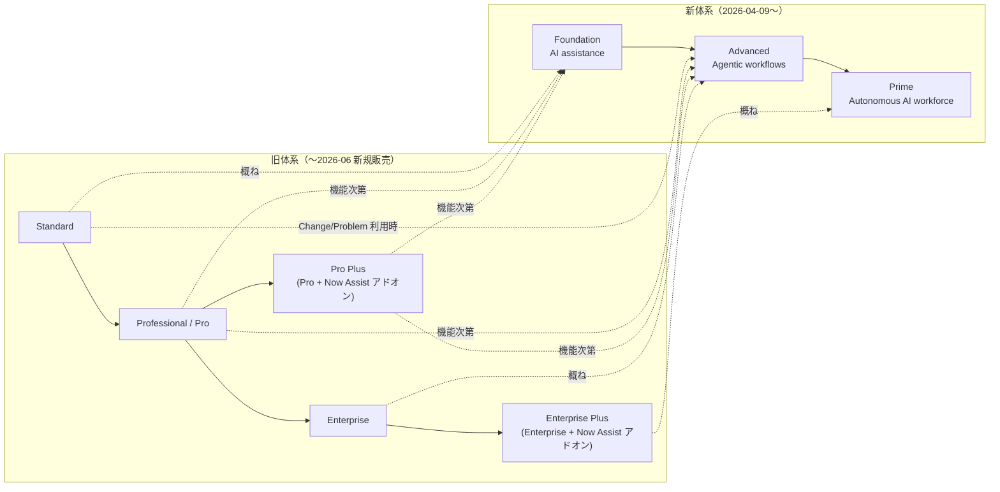
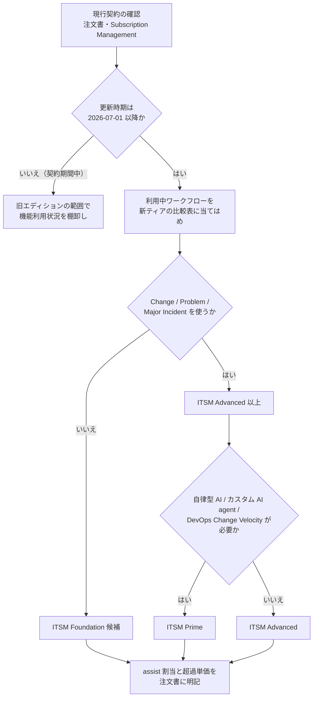

# エディション比較（Edition Comparison）

## 概要

ServiceNow の製品は、同じ製品ライン（例：ITSM）の中で機能範囲の異なる **package（パッケージ）/ tier（ティア）/ edition（エディション）** に分かれて販売される。本ファイルは、主要製品ごとに「どのエディションで何が使えるか」を比較し、コンサルタント・PM がエディション選定や見積レビューで使えるようにまとめたものである。

本ファイルを読むうえで最も重要な前提は次の 2 点である。

1. **2026-04-09 に販売体系が切り替わった。** ServiceNow は旧来の 5 段階（**Standard / Professional（Pro）/ Pro Plus / Enterprise / Enterprise Plus**）を、AI を全ティアに同梱した 3 段階（**Foundation / Advanced / Prime**）へ置き換えた。プレスリリースは「ESM Foundation and the new packaging model are now available for all customers」と述べている [出典](https://newsroom.servicenow.com/press-releases/details/2026/ServiceNow-moves-beyond-the-sidecar-AI-era-giving-customers-a-complete-AI-native-experience-across-all-products-and-packages/default.aspx)。旧 SKU の新規販売終了（end of sale）は 2026-07-01 とする第三者情報が複数ある 【第三者情報】 [出典](https://redresscompliance.com/servicenow-2026-pricing-tiers-pillar)。
2. **既存顧客の多くは契約更新まで旧エディションのまま稼働している。** 基準リリース Australia（2026-05 GA）時点で、実案件では「旧エディションの既存契約」と「新ティアへの更新提案」が併存する。そのため本ファイルでは **新旧両方の比較表と対応関係** を示す。

> **注意：** ServiceNow は製品ドキュメントで「価格・パッケージングの詳細は顧客契約による」と明記しており [出典](https://www.servicenow.com/docs/r/it-operations-management/itom-visibility/itom-visibility-landing-page.html)、エディションの正式な中身は **注文書（Order Form）と契約に添付される製品記述（Product Overview / Entitlement）** が最終根拠である。本ファイルの比較表は公式価格ページ・公式ドキュメント・コミュニティ記事・パートナー資料から再構成したもので、確度ラベルを付けて区別している。

関連ファイル：
- ライセンスの課金単位（Fulfiller、Unrestricted User、Subscription Unit 等）→ [ライセンスモデル](./01-licensing-model.md)
- 価格の推定値 → [価格情報](./02-pricing.md)
- ライセンス削減策 → [ライセンスコスト最適化](../04_応用編/06-license-cost-optimization.md)
- 各製品の機能詳細 → [ITSM Pro/Enterprise 固有機能](../02_リファレンス/itsm/itsm-pro-features.md)、[プラットフォームのパッケージ構成](../02_リファレンス/platform/platform-licensing-packaging.md)

---

## 1. エディション体系の変遷

### 1.1 年表

| 時期 | 出来事 | 出典・確度 |
|---|---|---|
| 〜2020 頃 | ITSM などで Standard / Professional / Enterprise の 3 段階が定着。Pro で Performance Analytics、Predictive Intelligence、Virtual Agent 等が加わる構成 | 【第三者情報】 [出典](https://redresscompliance.com/servicenow-standard-vs-pro-vs-enterprise-which-edition.html) |
| 2021（Quebec） | CSM に Enterprise パッケージが追加 | 【第三者情報】（CSM Quebec リリースブログ要約） [出典](https://www.servicenow.com/community/csm-blog/what-s-new-in-customer-service-management-in-the-quebec-release/ba-p/2292161) |
| 2023-09（Vancouver） | 生成 AI「Now Assist」を ITSM / CSM / HRSD 向けの **Pro Plus / Enterprise Plus** アドオンとして販売開始（Creator 向けは Creator Plus）。Pro または Enterprise の保有が前提 | 【第三者情報】 [出典](https://www.constellationr.com/insights/news/servicenow-launches-now-assist-across-now-platform-pricing-bundles) |
| 2025（Zurich） | HRSD に新しい Professional / Enterprise SKU が導入（Hiring Experiences を同梱） | ServiceNow Community 公式ブログ [出典](https://www.servicenow.com/community/hrsd-blog/zurich-release-deep-dive-hrsd/ba-p/3375480) |
| 2025-10-17 | Custom Table Guide 改定。App Engine Starter で「Direct Task Inherited Tables」が対象外に | 【第三者情報】 [出典](https://www.servicenow.com/community/servicenow-ai-platform-articles/the-new-servicenow-s-custom-table-guide-and-its-impact-on-your/ta-p/3482612) |
| **2026-04-09** | **Foundation / Advanced / Prime の新ティア発表・提供開始。** 全製品に AI を同梱、ESM Foundation（中堅企業向け）発表 | 公式プレスリリース [出典](https://newsroom.servicenow.com/press-releases/details/2026/ServiceNow-moves-beyond-the-sidecar-AI-era-giving-customers-a-complete-AI-native-experience-across-all-products-and-packages/default.aspx) |
| 2026-05-05（Knowledge 2026。Australia GA と同時期） | Now Assist・Moveworks・AI Experience を統合した **ServiceNow Otto** を発表。製品 UI・ドキュメント上の名称変更は 2026-07〜08 の Store リリースで順次反映（Now Assist for ITSM 17.0.5 等に「branding has been renamed to ServiceNow Otto」と記載）。リブランドに伴って既存の製品権利が不変かどうかは **公開情報では確認できず** | 公式プレスリリース [出典](https://newsroom.servicenow.com/press-releases/details/2026/ServiceNow-Otto-creates-the-unified-AI-experience-for-the-enterprise/default.aspx)、公式 Store リリースノート [出典](https://www.servicenow.com/docs/r/store-release-notes/store-rn-itsm-now-assist.html) |
| 2026-07-01 | 旧 SKU の新規販売終了（以降の更新は新ティアで見積） | 【第三者情報】 [出典](https://echelonai.com/blog/7-questions-to-ask-before-you-renew-servicenow) |
| 2026-07-09 | Now Assist Admin Console 9.0.5 の Store リリースノートに「ServiceNow is introducing three AI subscription tiers - Foundation, Advanced, and Prime」、Generative AI Controller 13.1.2 に「AI entitlements are now standardized across products using a Good / Better / Best」と記載 | 公式 Store リリースノート [出典](https://www.servicenow.com/docs/r/store-release-notes/na-suite-rn-2026-07-09.html) |
| 2026-09（Brazil） | 製品ドキュメントに「ServiceNow product tiers」ページ（Brazil 版）が掲載 | 公式ドキュメント [出典](https://www.servicenow.com/docs/r/intelligent-experiences/enable-ai-experiences/ai-native-sku-overview.html) |

上図の点線（旧→新の対応）は第三者のアドバイザリー情報に基づく目安であり、機械的な 1 対 1 対応ではない（詳細は「4. 旧エディション → 新ティアの対応」）。

---

## 2. 旧体系（Standard / Pro / Pro Plus / Enterprise / Enterprise Plus）の共通構造

旧体系は製品ラインごとに次の段階で構成されていた。全製品が 5 段階を持つわけではなく、ITOM・ITAM・App Engine などは独自の名称体系を持っていた。

| エディション | 位置づけ（製品横断の共通パターン） | 代表的な追加機能 | 確度 |
|---|---|---|---|
| **Standard** | コアのワークフロー（ITSM ならインシデント・問題・変更・要求・ナレッジ）と標準レポート | 標準の Reports / Dashboards、Service Catalog、Knowledge、Workspace 等 | 【第三者情報】 |
| **Professional（Pro）** | Standard ＋ アナリティクスと機械学習 | **Performance Analytics**（KPI・トレンド・ブレークダウン）、**Predictive Intelligence**（分類・類似検索・推奨）、**Virtual Agent**、Continual Improvement Management 等 | 【第三者情報】 [出典](https://www.servicenow.com/community/architect-articles/understanding-servicenow-licensing-packaging-tiers-standard/ta-p/3532073) |
| **Pro Plus** | Pro ＋ **Now Assist（生成 AI）** のアドオン | 要約、解決メモ生成、ナレッジ記事生成、Now Assist in Virtual Agent / AI Search、AI Agent Studio 等 | 旧製品ドキュメントの文言をコミュニティ投稿が引用 [出典](https://www.servicenow.com/community/virtual-agent-forum/itsm-pro-quot-versus-quot-pro-plus-licensing-question/m-p/3150403)、機能例は 【第三者情報】 [出典](https://www.constellationr.com/insights/news/servicenow-launches-now-assist-across-now-platform-pricing-bundles) |
| **Enterprise** | Pro ＋ 運用最適化 | **Workforce Optimization**、**Process Mining**（Process Optimization）等 | 【第三者情報】 [出典](https://assets.applytosupply.digitalmarketplace.service.gov.uk/g-cloud-15/documents/92271/205111268855265-pricing-document-2026-01-29-1405.pdf) |
| **Enterprise Plus** | Enterprise ＋ Now Assist のアドオン | Pro Plus と同等の生成 AI ＋ Enterprise 機能 | 【第三者情報】 |

補足：

- 旧体系の製品ドキュメントには「The Now Assist for ITSM application requires an IT Service Management Pro Plus or Enterprise Plus license.」という記載があった（コミュニティ投稿で原文引用）[出典](https://www.servicenow.com/community/virtual-agent-forum/itsm-pro-quot-versus-quot-pro-plus-licensing-question/m-p/3150403)。つまり **旧 Standard では生成 AI は購入できず、Pro 以上が前提** であった。
- Pro Plus / Enterprise Plus は ITSM・CSM・HRSD のほか、業界別ライセンス（Telecommunications、Financial Services、Healthcare 等）の保有者にも提供された 【第三者情報】 [出典](https://www.constellationr.com/insights/news/servicenow-launches-now-assist-across-now-platform-pricing-bundles)。
- Now Assist は **製品ごと** のアドオンであり、Now Assist for ITSM を買っても CSM や HRSD の Now Assist は使えない 【第三者情報】 [出典](https://redresscompliance.com/servicenow-now-assist-ai-pricing-guide.html)。
- 旧体系でも **同一製品ラインの全 Fulfiller は同じパッケージに揃える**（ITSM の一部ユーザーだけ Pro にする、は原則不可）運用が一般的で、App Engine・SecOps・IntegrationHub 等が例外とされる 【第三者情報】 [出典](https://redresscompliance.com/servicenow-foundation-advanced-prime-compared)。一方で「同一インスタンス内で異なるティアの混在が認められる」とする第三者情報もあり、契約条件で確認が必要である。

---

## 3. 新体系（Foundation / Advanced / Prime）の共通構造

### 3.1 ティアの定義（公式）

製品ドキュメント「ServiceNow product tiers」（Brazil 版、2026-09-10 更新）は、3 ティアを次のように定義している [出典](https://www.servicenow.com/docs/r/intelligent-experiences/enable-ai-experiences/ai-native-sku-overview.html)。

| Tier（ティア） | 公式の説明（要約） | 代表的な AI 機能 |
|---|---|---|
| **Foundation** | 「The Foundation tier delivers AI-assisted insights and routine automation.」タスク単位の支援、AI skills、定型の AI agents | AI skills（要約・分類等）、routine AI agents |
| **Advanced** | 複雑なプロセス全体の文脈を統合する **agentic workflows（エージェント型ワークフロー）** を追加し、ワークフローのステップ全体をユーザーと並走して自動化 | Agentic workflows |
| **Prime** | 「Prime unlocks a fully autonomous workforce that executes multi-step tasks end to end.」意思決定と実行を自律的に行う **AI specialists** | Autonomous AI workforce、カスタム AI agents / skills の新規作成 |

- 同ページは、ティアの展開（rollout）は **インスタンスのアップグレードサイクルとは独立** であり、提供可否と権利の詳細は ServiceNow のアカウントチームに確認するよう記載している [出典](https://www.servicenow.com/docs/r/intelligent-experiences/enable-ai-experiences/ai-native-sku-overview.html)。
- プレスリリースは「AI, data, security, and governance are now in every ServiceNow offering — not a separate purchase.」とし、AI・データ・セキュリティ・ガバナンスを全オファリングに同梱したと述べている [出典](https://newsroom.servicenow.com/press-releases/details/2026/ServiceNow-moves-beyond-the-sidecar-AI-era-giving-customers-a-complete-AI-native-experience-across-all-products-and-packages/default.aspx)。

### 3.2 プラットフォーム AI 要素のティア別提供（公式）

「ServiceNow product tiers」ページに記載された、ティア横断のプラットフォーム要素の扱いは次のとおり [出典](https://www.servicenow.com/docs/r/intelligent-experiences/enable-ai-experiences/ai-native-sku-overview.html)。

| 要素 | Foundation | Advanced | Prime | 備考 |
|---|---|---|---|---|
| Now Assist（生成 AI skills。例：incident summarization） | ○ | ○ | ○ | ITSM、CSM、ServiceNow Otto for HRSD、業界ソリューションで全ティア提供 |
| AI agents（AI Agent Studio） | OOTB エージェントを設定して利用 | OOTB エージェントを設定して利用 | **自然言語指示から新規エージェントを作成可能** | カスタム AI agent の新規構築は Prime のみ |
| AI Action Fabric | 外向き（outbound）A2A 接続 | 外向き A2A 接続 | ＋ **内向き MCP Server Console** | |
| AI Control Tower | ○（同一機能） | ○ | ○ | 外部 AI 資産の完全管理には別ライセンス「AI Control Tower for Enterprise AI」が必要 |
| Workflow Data Fabric（WDF） | ティア横断：**WDF Foundation**（Integration Hub、RPA Hub、Automation Center、Data Catalog）は全ティアに同梱（「embedded in every tier edition」）。**WDF Advanced**（Zero Copy Connectors、Stream Connect）は有償アップグレード（「available as a paid upgrade」）。ティアによる購入可否の制約は記載なし | ← | ← | 同ページのティア比較表（Foundation / Advanced / Prime 列）に WDF の行はない。Foundation ティアで WDF Advanced を購入できるかは公開情報では確認できず |
| RaptorDB Standard | ○ | ○ | ○ | RaptorDB Professional（ultra-scale analytics 等）は有償オプション |
| Moveworks for ServiceNow（EmployeeWorks） | ティア相当レベルで同梱 | ティア相当レベルで同梱 | ティア相当レベルで同梱 | |

### 3.3 Assists（アシスト）による従量計測

- 新体系でも **ユーザー（Fulfiller 等）や Subscription Unit による課金は継続** し、AI 利用は **assists** と呼ばれるトークン的な単位で計測される。各ティアには assist の割当（allocation）があり、上位ティアほど割当が多い 【第三者情報】 [出典](https://www.servicenow.com/community/itsm-articles/itsm-licensing-in-april-2026-foundation-advanced-and-prime-in/ta-p/3544380)。
- ティアごとの assist 数量、Moveworks 機能のティア別分割は **公開情報では確認できず**（コミュニティ記事でも「still not public」とされている）[出典](https://www.servicenow.com/community/architect-articles/understanding-servicenow-licensing-packaging-tiers-standard/ta-p/3532073)。
- assist は **アカウント単位でプール** され、非本番インスタンスも同じプールを消費するとする第三者情報がある 【第三者情報】 [出典](https://redresscompliance.com/servicenow-2026-pricing-tiers-pillar)。詳細は [ライセンスモデル](./01-licensing-model.md) を参照。

### 3.4 製品によってティア構成が異なる

| 製品ライン | 提供ティア | 根拠 |
|---|---|---|
| ITSM | Foundation / Advanced / Prime | 公式価格ページ |
| ITOM | **Advanced / Prime のみ（Foundation なし）** | 公式価格ページ |
| CSM | Foundation / Advanced / Prime | 【第三者情報】コミュニティ記事 |
| HRSD | Foundation / Advanced / Prime | 公式価格ページ（検索結果経由）＋【第三者情報】 |
| SecOps（SIR / VR） | Foundation / Advanced / Prime（SIR と VR で独立に選択可） | 【第三者情報】コミュニティ記事 |
| App Engine | Foundation / Prime（検索結果上の表記） | 公式価格ページ（検索結果経由） |
| ITAM（SAM / HAM） | HAM Foundation / Advanced / Prime（Now Assist for HAM 4.1.0 のリリースノートに記載。各ティアの機能範囲は公開情報では確認できず）、SAM Advanced / SAM Prime | 公式 Store リリースノート [出典](https://www.servicenow.com/docs/r/store-release-notes/na-suite-rn-2026-07-09.html)＋【第三者情報】 |
| IRM、SPM | 新ティアの中身は **公開情報では確認できず** | — |

さらに、複数製品をまとめた **組み合わせ SKU** が用意されている 【第三者情報】 [出典](https://www.servicenow.com/community/itsm-articles/itsm-licensing-in-april-2026-foundation-advanced-and-prime-in/ta-p/3544380)。

| 組み合わせ SKU | 内容 |
|---|---|
| **ESM Foundation** | ITSM Foundation ＋ 業務部門（IT・HR・法務・財務・調達・ワークプレイス）の基本サービス。ユーザー単位課金。中堅企業向けで「数週間で稼働」を謳う（公式プレスリリース） |
| **ServiceOps Advanced / Prime** | ITSM と ITOM を共通のクレジットメーターで購入（1 Credit = 1 ITOM SU、10 Credits = 1 ITSM Fulfiller とする記事あり）【第三者情報】 [出典](https://www.servicenow.com/community/architect-articles/navigating-the-april-2026-servicenow-itom-licensing-model/ta-p/3555121) |
| **ITSM Prime Add-on** | CSM Prime や Industry Prime の顧客が、ITSM 一式を別途購入せずに Prime レベルの ITSM AI を追加するための SKU |

---

## 4. 旧エディション → 新ティアの対応

ServiceNow は公式な対応表を公開していない（2026-11 時点で **公開情報では確認できず**）。以下は第三者のアドバイザリー情報に基づく目安である 【第三者情報】 [出典](https://redresscompliance.com/servicenow-2026-pricing-tiers-pillar) [出典](https://nownegotiations.pages.dev/servicenow-license-tiers)。

| 旧エディション | 最も近い新ティア | 注意点 |
|---|---|---|
| Standard | Foundation（ITSM で Change / Problem を使っていれば **Advanced**） | 新 ITSM Foundation には Problem / Change が含まれない（後述）。Now Assist が同梱される分、基本価格は上昇したとされる |
| Professional（Pro） | Foundation または Advanced | どのワークフローが上位ティアへ移動したかの確認が必須 |
| Pro Plus | Foundation または Advanced | Now Assist は新体系では Foundation から同梱 |
| Enterprise | Advanced | Process Mining・Voice は Advanced に位置 |
| Enterprise Plus | Prime | 自律型エージェント・カスタム AI 構築は Prime のみ |

- 既存契約は **契約期間中は旧 SKU のまま** で、更新・追加購入・契約変更のタイミングで新ティアに移行する 【第三者情報】 [出典](https://redresscompliance.com/servicenow-foundation-advanced-prime-compared)。
- 旧体系は「モジュールの深さ」で段階を分けていたのに対し、新体系は「AI の自律度」で段階を分けているため、**機械的な読み替えはできない** 【第三者情報】 [出典](https://redresscompliance.com/servicenow-2026-pricing-tiers-pillar)。

---

## 5. 製品別比較

凡例：○＝含まれる、×＝含まれない、△＝条件付き・アドオン・上限あり、—＝情報なし。

### 5.1 ITSM（IT Service Management）

#### 5.1.1 新ティア（ITSM Foundation / Advanced / Prime）—公式価格ページ

ServiceNow 公式の ITSM 価格ページ（Plans and Packages）に掲載された比較表を再構成した。Web アーカイブの 2026-04-09 および 2026-10-05 時点のスナップショットで同一内容を確認した（取得日 2026-11-03）[出典](https://www.servicenow.com/products/itsm/pricing.html)。

**各パッケージの説明（公式文言）**

| パッケージ | 公式の一文説明 | 明示されている同梱内容 |
|---|---|---|
| **ITSM Foundation** | 「AI agents and skills that accelerate IT service delivery with task-based, always-on support.」 | Service Catalog and Request Management、Incident Management、Asset Management and CMDB、Virtual Agent、Workflow Data Fabric、Service Graph Connectors for End-User Computers、Now Assist and Platform AI Foundation、Moveworks for ITSM Foundation |
| **ITSM Advanced** | 「Agentic workflows that automate complex IT processes, working side by side with your team.」 | Foundation ＋ Major Incident Management and On-Call Management、Change Management、Problem Management、AI Voice Agents、Platform Analytics Advanced、Process Mining、Now Assist and Platform AI Advanced、Moveworks for ITSM Advanced |
| **ITSM Prime**（RECOMMENDED 表示） | 「AI Specialists that independently manage IT workflows, make decisions, and drive results.」 | Foundation・Advanced ＋ L1 Service Desk AI Specialist、AI Agents for ITSM、AI Agent for Digital End-User Experience (DEX)、DevOps Change Velocity、Digital Product Release、Now Assist and Platform AI Prime、Moveworks for ITSM Prime |

**機能比較表（Compare features）**

| 区分 | 機能 | Foundation | Advanced | Prime |
|---|---|---|---|---|
| AI Agents and Skills | Now Assist for ITSM | ○ | ○ | ○ |
| | Moveworks for ITSM | ○ | ○ | ○ |
| | Now Assist for CMDB | ○ | ○ | ○ |
| | Document Intelligence | ○ | ○ | ○ |
| | Now Assist for Setup | ○ | ○ | ○ |
| | AI Search | ○ | ○ | ○ |
| | AI Voice Agents | × | ○ | ○ |
| ITSM Capabilities | Incident Management（インシデント管理） | ○ | ○ | ○ |
| | Request Management（要求管理） | ○ | ○ | ○ |
| | Asset Management（資産管理） | ○ | ○ | ○ |
| | Cost Management（コスト管理） | ○ | ○ | ○ |
| | Problem Management（問題管理） | × | ○ | ○ |
| | Change Management（変更管理） | × | ○ | ○ |
| | Major Incident Management（重大インシデント管理） | × | ○ | ○ |
| | On-Call Management（オンコール管理） | × | ○ | ○ |
| | Walk-Up Experience | × | ○ | ○ |
| | Digital Portfolio Management | × | ○ | ○ |
| | Digital Product Release | × | × | ○ |
| | DevOps Change Velocity | × | × | ○ |
| Platform Capabilities | AI Control Tower | ○ | ○ | ○ |
| | Workflow Data Fabric | ○ | ○ | ○ |
| | CMDB / CSDM | ○ | ○ | ○ |
| | Knowledge Management（ナレッジ管理） | ○ | ○ | ○ |
| | Employee Center | ○ | ○ | ○ |
| | Now Mobile | ○ | ○ | ○ |
| | Workflow Automation | ○ | ○ | ○ |
| | Application Development | ○ | ○ | ○ |
| | Virtual Agent | ○ | ○ | ○ |
| | Predictive Intelligence | ○ | ○ | ○ |
| | **App Engine Starter**（カスタムテーブル枠） | △ 10 tables | △ 25 tables | △ 50 tables |
| | Universal Request | ○ | ×（Pro 版に置換） | ×（Pro 版に置換） |
| | Universal Request Pro | × | ○ | ○ |
| | Mobile Publishing | × | ○ | ○ |
| | Platform Analytics Advanced | × | ○ | ○ |
| | Process Mining | × | △ 10K records/year | △ 15K records/year |

> 上表の「Universal Request」行は Foundation のみ ○ だが、Advanced / Prime は上位版の Universal Request Pro を含むため実質的な機能後退ではない。

**旧体系からの主な変化（ITSM）**

- **Problem / Change が Foundation に含まれない。** 旧 ITSM Standard は Incident・Problem・Change・Request を含んでいたため、Change を運用している旧 Standard 顧客は Advanced 相当になる 【第三者情報】 [出典](https://redresscompliance.com/servicenow-foundation-advanced-prime-compared)。
- **Predictive Intelligence と Virtual Agent が Foundation から同梱**（旧体系では Pro 以上）。Virtual Agent は「unlimited conversations」とされる 【第三者情報】 [出典](https://www.servicenow.com/community/itsm-articles/itsm-licensing-in-april-2026-foundation-advanced-and-prime-in/ta-p/3544380)。
- **Now Assist が Foundation から同梱**（旧体系では Pro Plus / Enterprise Plus アドオン）。
- **DevOps Change Velocity が Prime 専用** に移動（旧体系では ITSM Pro に含まれていた）。コミュニティ記事の著者も「moved exclusively to Prime」と回答している 【第三者情報】 [出典](https://www.servicenow.com/community/itsm-articles/itsm-licensing-in-april-2026-foundation-advanced-and-prime-in/ta-p/3544380)。
- **Platform Analytics Advanced（旧 Performance Analytics 相当）と Process Mining は Advanced 以上**。
- Advanced でインシデントフォームの Contextual Side Panel（Playbooks、Recommendations、Agent Assist）が見えないという報告に対し、サポートは「AI-Native ITSM Record Page」が SRP の代わりに表示されるためで UI Builder で無効化できる（KB3222535）と回答した、というコミュニティ上のやり取りがある 【第三者情報】 [出典](https://www.servicenow.com/community/itsm-articles/itsm-licensing-in-april-2026-foundation-advanced-and-prime-in/ta-p/3544380)。
- Knowledge Management Advanced が Foundation に含まれるかは、コミュニティでも未確認とされている（**公開情報では確認できず**）。

#### 5.1.2 旧エディション（ITSM Standard / Pro / Pro Plus / Enterprise / Enterprise Plus）

旧 ITSM の公式価格ページはアーカイブからも取得できなかったため、パートナー資料・コミュニティ記事から再構成した 【第三者情報】 [出典](https://assets.applytosupply.digitalmarketplace.service.gov.uk/g-cloud-15/documents/92271/205111268855265-pricing-document-2026-01-29-1405.pdf) [出典](https://redresscompliance.com/servicenow-standard-vs-pro-vs-enterprise-which-edition.html) [出典](https://www.servicenow.com/community/architect-articles/understanding-servicenow-licensing-packaging-tiers-standard/ta-p/3532073)。

| 機能 | Standard | Pro | Pro Plus | Enterprise | Enterprise Plus |
|---|---|---|---|---|---|
| Incident / Problem / Change / Request / Knowledge | ○ | ○ | ○ | ○ | ○ |
| Asset & Cost Management、Digital Portfolio Management、セルフサービス | ○ | ○ | ○ | ○ | ○ |
| Service Catalog / Service Portal / CMDB / 標準 Reports | ○ | ○ | ○ | ○ | ○ |
| Performance Analytics（KPI・トレンド） | × | ○ | ○ | ○ | ○ |
| Predictive Intelligence | × | ○ | ○ | ○ | ○ |
| Virtual Agent | × | ○ | ○ | ○ | ○ |
| DevOps Change Velocity | × | ○ | ○ | ○ | ○ |
| Continual Improvement Management | × | ○（資料により Enterprise とするものあり） | ○ | ○ | ○ |
| Workforce Optimization | × | × | × | ○ | ○ |
| Process Mining（Process Optimization） | × | × | × | ○ | ○ |
| Now Assist for ITSM（要約、解決メモ、ナレッジ生成、AI Search / Virtual Agent の生成 AI、AI Agents） | × | × | ○ | × | ○ |

- Fujitsu の G-Cloud 価格資料（2026-01-29）は、ITSM Standard を「Incident, Problem, Change, Request, Asset and Cost Management, Digital Portfolio Management, and self-service experience」、ITSM Enterprise を「Includes all capabilities of ITSM Pro plus ... Workforce Optimisation and Process Mining」、ITSM Pro Plus（Add-On）を「Enhances ITSM Enterprise with advanced AI Agents, analytics, conversational summarisation...」と記載している（Pro Plus の説明文は Enterprise Plus と混同している可能性あり）【第三者情報】。
- 機能の割当は資料によって食い違いがある（例：Process Mining・Workforce Optimization を Pro に含めるパートナー資料もある）【第三者情報】 [出典](https://www.cancom.at/_asset/adabcd61-b525-41da-be61-b6dd9e35aed4)。既存契約の確認では、必ず注文書と Subscription Management の表示で照合する。

詳細機能は [ITSM 概要とパッケージ](../02_リファレンス/itsm/itsm-overview.md)、[ITSM Pro/Enterprise 固有機能](../02_リファレンス/itsm/itsm-pro-features.md) を参照。

---

### 5.2 ITOM（IT Operations Management）

#### 5.2.1 新ティア（ITOM Advanced / Prime）—公式価格ページ

ITOM の新パッケージには **Foundation が存在しない**。公式価格ページ（Web アーカイブ 2026-08-11 スナップショットで確認、取得日 2026-11-03）[出典](https://www.servicenow.com/products/it-operations-management/pricing.html)。

| パッケージ | 公式説明 | 明示されている同梱内容 |
|---|---|---|
| **ITOM Advanced** | 「Agentic workflows that automate IT operations, working side by side with your team to prevent issues.」 | Discovery、Service Mapping、Certificate Inventory and Management、AI Agent Topology Mapping、Now Assist for ITOM (Advanced)、API Insights、Learning Enhanced Automation Playbook (LEAP)、Cloud Account Management |
| **ITOM Prime**（RECOMMENDED） | 「AI Specialists that independently manage infrastructure health, make decisions, and drive uptime.」 | Advanced ＋ AI Specialists、Event Management、Metric Intelligence、Health Log Analytics、Now Assist for ITOM (Prime)、Service Observability、Service Reliability Management、Synthetic Monitoring |

| 区分 | 機能 | Advanced | Prime |
|---|---|---|---|
| AI Agents and Skills | Now Assist for ITOM | ○ | ○ |
| | Now Assist for Service Graph Connectors | ○ | ○ |
| | Platform AI Skills and Agents | ○ | ○ |
| | Document Intelligence / Now Assist for CMDB / Now Assist for Setup | ○ | ○ |
| ITOM Capabilities | Agentless Discovery | ○ | ○ |
| | IT Service Graph Connectors | ○ | ○ |
| | CMDB 360 | ○ | ○ |
| | Service Mapping | ○ | ○ |
| | Tag Governance | ○ | ○ |
| | TLS Certificate Inventory and Management | ○ | ○ |
| | Firewall Audits and Reporting | ○ | ○ |
| | API Insights | ○ | ○ |
| | Cloud Account Management | ○ | ○ |
| | Agent Client Collector - Framework | ○ | ○ |
| | Kubernetes Visibility Agent | ○ | ○ |
| | LEAP | ○ | ○ |
| | Event Management | × | ○ |
| | Metric Intelligence | × | ○ |
| | Agent Client Collector - Monitoring | × | ○ |
| | SLO/SLI Management | × | ○ |
| | Service Reliability Management | × | ○ |
| | Health Log Analytics | × | ○ |
| | Service Observability | × | ○ |
| | Synthetic Monitoring | × | ○ |
| Platform Capabilities | AI Control Tower、Workflow Data Fabric、CMDB、CSDM、Knowledge Management、Employee Center、Now Mobile、Workflow Automation、Application Development、Predictive Intelligence、Universal Request Pro、Mobile Publishing、Platform Analytics Advanced、Process Mining | ○ | ○ |
| | App Engine Starter（カスタムテーブル枠） | △ 5 tables 【第三者情報】 [出典](https://www.servicenow.com/community/architect-articles/navigating-the-april-2026-servicenow-itom-licensing-model/ta-p/3555121) | △ 数量の記載なし（価格ページは ○ のみ。コミュニティ記事も「Everything in Advanced, plus」とするのみ） |

- 価格ページの注記：「App Engine Starter tables are for configuring packaged applications.」（App Engine Starter のテーブル枠はパッケージアプリケーションの構成用）。
- コミュニティ記事によれば、Prime は Workflow Data Fabric のクレジットプールが SU あたり約 2 倍、GenAI assist 割当も約 2 倍とされる（正確な倍率は非公開）。また旧 Professional にあったイベント相関（AIOps）は **Prime のみ** になり、Advanced にはイベント相関・ログ分析・SRE 機能がない 【第三者情報】 [出典](https://www.servicenow.com/community/architect-articles/navigating-the-april-2026-servicenow-itom-licensing-model/ta-p/3555121)。
- 課金単位は引き続き **Subscription Unit（SU）**。CI カテゴリごとの SU 比率は契約で定義される（公式ドキュメント）[出典](https://www.servicenow.com/docs/r/guxhDnVk8OUAJKLm7WZsYA/8XAnPqUIHAXKSJUAjYY0Mw)。新体系で SU 換算比率が変わったとする記事があるが、新しい比率は **公開情報では確認できず**。

#### 5.2.2 旧エディション（ITOM Visibility / AIOps / Optimization 等）

旧 ITOM は「Standard / Pro / Enterprise」と、用途別の「Visibility / Health（AIOps）/ Optimization」の名称が時期によって併用され、個別購入（à la carte）とバンドルの組み合わせも可能だった。公式ドキュメント（Zurich）は製品として ITOM Visibility、ITOM Discovery、ITOM AIOps、Health Log Analytics、ITOM Optimization、ITOM Cloud Accelerate を挙げ、バンドルと個別購入を組み合わせられると記載している [出典](https://www.servicenow.com/docs/r/guxhDnVk8OUAJKLm7WZsYA/8XAnPqUIHAXKSJUAjYY0Mw)。

| 旧 SKU（2026-01 時点のパートナー価格表） | 内容（パートナー記載） | 課金単位 | 確度 |
|---|---|---|---|
| ITOM Visibility | Discovery、Service Mapping、証明書管理、Firewall Audits、Service Graph Connectors、CMDB エンリッチメント | SU | 【第三者情報】 |
| ITOM AIOps Professional | Visibility ＋ Event Management、Metric Intelligence、Service Reliability | SU | 【第三者情報】 |
| ITOM AIOps Enterprise | ＋ Health Log Analytics、クラウド最適化、Synthetic Monitoring、異常検知 | SU | 【第三者情報】 |

出典：[Fujitsu G-Cloud 価格資料](https://assets.applytosupply.digitalmarketplace.service.gov.uk/g-cloud-15/documents/92271/205111268855265-pricing-document-2026-01-29-1405.pdf)

> **Brazil での変更:** Brazil 版の ITOM Visibility ドキュメントでは、Visibility 配下のアプリとして Firewall Audits and Reporting、Certificate Inventory and Management、Cryptographic Asset Compliance、AI Agent Topology Mapping、ITOM Content Service、Tag Governance、Cloud Discovery Workspace、Cloud License Estimator が列挙され、Service Graph Connectors と CMDB 360 が Visibility にデータを供給すると説明されている [出典](https://www.servicenow.com/docs/r/it-operations-management/itom-visibility/itom-visibility-landing-page.html)。

詳細は [ITOM 概要とパッケージ](../02_リファレンス/itom/itom-overview.md)、[Event Management と AIOps](../02_リファレンス/itom/event-management-aiops.md) を参照。

---

### 5.3 ITAM（IT Asset Management：SAM / HAM）

ITAM は ITSM のエディションとは **別サブスクリプション** で、ITSM Pro を買っても SAM / HAM の高度機能は付かない 【第三者情報】 [出典](https://www.servicenow.com/community/ham-forum/i-am-looking-for-asset-management-features-that-comes-with-itsm/m-p/2948069)。ITSM 側に含まれるのは基本的な Asset Management（`alm_asset` 系の資産レコード管理）と CMDB である（新 ITSM Foundation の「Asset Management and CMDB」）。

| 体系 | SKU | 内容 | 課金単位 | 確度 |
|---|---|---|---|---|
| 旧 | SAM Professional（SAM Pro） | ソフトウェア資産ライフサイクル、ディスカバリー、正規化、支出検出、ライセンスコンプライアンス、リクレーム、最適化。Platform Analytics、Predictive Intelligence、Client Software Distribution を含む | SU（管理対象デバイス等） | 【第三者情報】 |
| 旧 | SAM Enterprise | SAM Pro ＋ クラウドコスト管理、ML による正規化 | SU | 【第三者情報】 |
| 旧 | HAM（HAM Pro） | ハードウェア資産ライフサイクル、デバイス・ネットワーク資産管理、分析、Predictive Intelligence | SU（リソースカテゴリごとの比率） | 機能内容は 【第三者情報】、課金方式は公式ドキュメント [出典](https://www.servicenow.com/docs/r/xUi4EDRoQXDqROOshinXwQ/uCno_JMAfN4aeh_edNjfCg) |
| 新 | **HAM Foundation / Advanced / Prime** | Now Assist for Hardware Asset Management 4.1.0 のリリースノートは「Feature visibility is now automatically enforced based on the HAM SKU tier (Foundation, Advanced, or Prime)」と記載。また AI Agents for ITAM 4.1.0 のリリースノートは「Introducing a new HAM Advanced SKU consolidating all HAM and AI capabilities」と記載し、ティア別プラグインと `sys_gen_ai_asset_subscription` による実行時の権利チェックを追加したとしている。各ティアの機能範囲は **公開情報では確認できず** | — | 公式 Store リリースノート（2026-07-09）[出典](https://www.servicenow.com/docs/r/store-release-notes/na-suite-rn-2026-07-09.html) |
| 新 | SAM Advanced / **SAM Prime** | SAM Prime は「Software Asset Management AI Prime」アプリとして Store に掲載。SAM Enterprise 相当＋ AI 機能とする情報あり | — | 【第三者情報】 [出典](https://apprepo.service-now.com/store/app/70bdf70747c44f10a342e65fe16d4368) |

- HAM の課金は「リソースカテゴリごとの Subscription Unit 比率」で、オプトインしたリソースカテゴリだけが Subscription Unit に計上される。公式ドキュメント「Hardware Asset Management licensing」（Australia 版、2026-03-12 更新）は、比率の例として End-user computers 4:1、Servers 1:1、Network gear 5:1、Mobile devices 10:1、Monitors 15:1、Storage 3:1、Printers 10:1 等を挙げている（資産数 : SU 数。比率は契約で異なりうる）[出典](https://www.servicenow.com/docs/r/xUi4EDRoQXDqROOshinXwQ/uCno_JMAfN4aeh_edNjfCg)。
- 出典：[Fujitsu G-Cloud 価格資料](https://assets.applytosupply.digitalmarketplace.service.gov.uk/g-cloud-15/documents/92271/205111268855265-pricing-document-2026-01-29-1405.pdf)、[Redress Compliance ITAM](https://redresscompliance.com/servicenow-itam-licensing) 【第三者情報】。
- SAM Advanced と SAM Prime の機能境界、HAM Foundation / Advanced / Prime の各ティアの機能境界は **公開情報では確認できず**。

詳細は [ITAM 概要](../02_リファレンス/itam/itam-overview.md)、[Software Asset Management](../02_リファレンス/itam/software-asset-management.md) を参照。

---

### 5.4 HRSD（HR Service Delivery）

#### 5.4.1 旧エディション（HRSD Standard / Professional / Enterprise ＋ Plus）

HRSD は **Unrestricted User（全従業員数）** を課金単位とする（[ライセンスモデル](./01-licensing-model.md) 参照）。

| 機能 | Standard | Professional | Enterprise | 確度・出典 |
|---|---|---|---|---|
| HR Case Management / HR Knowledge | ○ | ○ | ○ | 【第三者情報】Fujitsu |
| Employee Center（Pro）/ Universal Request | ○ | ○ | ○ | 【第三者情報】Fujitsu（Standard に Employee Center Pro と Universal Request を記載） |
| HR Agent Workspace | — | ○ | ○ | 【第三者情報】Fujitsu |
| Performance Analytics | × | ○ | ○ | 【第三者情報】Fujitsu。2023 年のコミュニティ投稿では旧 Professional に Lifecycle Events・PA・ECP がないとの証言あり 【第三者情報】 [出典](https://www.servicenow.com/community/hrsd-forum/differences-between-servicenow-hrsd-standard-professional-and/m-p/2574722) |
| Predictive Intelligence / Virtual Agent / モバイル | × | ○ | ○ | 【第三者情報】Fujitsu |
| Employee Journey Management（Lifecycle Events、Journey Designer、Journey Accelerator） | × | × | ○ | 【第三者情報】Fujitsu |
| Alumni Service Center | × | × | ○ | 【第三者情報】Fujitsu |
| Hiring Experiences（Applicant Center、Recruiter Workspace、Interview Management & Scheduling） | × | ○（Zurich の新 SKU） | ○（Zurich の新 SKU） | ServiceNow Community 公式ブログ [出典](https://www.servicenow.com/community/hrsd-blog/zurich-release-deep-dive-hrsd/ba-p/3375480) |
| Now Assist for HRSD | × | Pro Plus | Enterprise Plus | 公式 Community ブログ（下表） |

HRSD は Store リリースごとに機能の必要 SKU が明示されている。2026-03 Store リリースのブログ（ServiceNow 社員による公式ブログ）の記載は次のとおり [出典](https://www.servicenow.com/community/hrsd-blog/march-2026-store-release-deep-dive-blog-hrsd/ba-p/3506473)。

| 機能（2026-03 Store リリース） | 必要 SKU |
|---|---|
| Recommended actions in HRSD | HRSD Standard, Professional, or Enterprise |
| Case creation—HR profile view | HRSD Standard, Professional, or Enterprise |
| COE Security Policy—diagnostic tool | HRSD Standard, Professional, or Enterprise |
| Universal Request—interdepartmental communication | HRSD Standard, Professional, or Enterprise |
| Employee Relations consolidated view in HR Agent Workspace | HRSD Professional or Enterprise |
| Interview self-scheduling V2 | HRSD Professional Plus or Enterprise Plus |
| Employee Relations—Interview summarizer | HRSD Professional Plus or Enterprise Plus |
| Voice agents for HRSD V3.0 | HRSD Professional Plus or Enterprise Plus |
| Advanced Knowledge Editor | HRSD Professional Plus or Enterprise Plus |
| Employee feedback collection V2 | HRSD Professional Plus or Enterprise Plus |
| Team digest on Manager Hub | HRSD Professional Plus or Enterprise Plus |
| Generate onboarding ramp-up plan V1.3（Employee Journeys） | **HRSD Enterprise Plus** |
| Generate offboarding knowledge transfer plan | **HRSD Enterprise Plus** |

#### 5.4.2 新ティア（HR Foundation / Advanced / Prime）

- 公式 HRSD 価格ページ（直接取得不可。検索エンジン上の抜粋で確認）は、上位パッケージを「Includes Foundation, and: Agentic Workflows, Employee Journey Management, Voice Agents for HR, Process Mining, Platform Analytics Advanced, Mobile Publishing, Universal Request Pro」と記載し、全パッケージに **Virtual Agent の無制限会話** と **Predictive Intelligence** が含まれるとしている。最上位には AI Specialists / Autonomous Service Desk が含まれる 【第三者情報（検索結果の抜粋経由）】 [出典](https://www.servicenow.com/products/hr-service-delivery/pricing.html)。
- 第三者のバイヤーガイドは、新規 HR 購入は HR Foundation / HR Advanced / HR Prime で見積られ、Foundation は HR ケース管理とナレッジ管理を含むとしている 【第三者情報】 [出典](https://redresscompliance.com/hrsd-for-enterprise-2026)。
- Australia リリースの HRSD ブログ（2026-06-12）は、新機能 **HR L1 Service Desk AI Specialist** について「Contact your ServiceNow Account team for eligibility.」とのみ記載し、ティアを明示していない [出典](https://www.servicenow.com/community/hrsd-blog/australia-release-deep-dive-blog-hrsd/ba-p/3558203)。

| 機能（推定整理） | HR Foundation | HR Advanced | HR Prime |
|---|---|---|---|
| HR ケース・ナレッジ、Employee Center、Universal Request | ○ | ○ | ○ |
| Virtual Agent（無制限会話）、Predictive Intelligence、Now Assist（ServiceNow Otto for HRSD） | ○ | ○ | ○ |
| Employee Journey Management、Agentic Workflows、Voice Agents for HR | × | ○ | ○ |
| Process Mining、Platform Analytics Advanced、Mobile Publishing、Universal Request Pro | × | ○ | ○ |
| AI Specialists（HR L1 Service Desk AI Specialist 等） | × | × | ○ |

上表は検索結果の抜粋と第三者情報からの整理であり 【推定】、正式な割当は契約で確認すること。

詳細は [HR Service Delivery](../02_リファレンス/employee/hr-service-delivery.md) を参照。

---

### 5.5 CSM（Customer Service Management）

#### 5.5.1 旧エディション（CSM Standard / Professional / Pro Plus / Enterprise）—公式価格ページ

公式 CSM 価格ページ（Web アーカイブ 2025-05-23 スナップショット、取得日 2026-11-03）の比較表を再構成した [出典](https://www.servicenow.com/products/customer-service-management/pricing.html)。

**各パッケージの説明（公式文言）**

| パッケージ | 説明 |
|---|---|
| CSM Standard | 「For growing businesses that need to create impact with confidence.」Agent Workspace、Case Management、Omnichannel、Self-Service、Knowledge Management、Walk-Up Experience for Customer Service、Service Management for Issue Resolution、Advanced Work Assignment、Engagement Messenger、Digital Portfolio Management |
| CSM Professional | 「For businesses planning to use AI and built-in analytics to boost self-service and increase productivity.」Standard ＋ Proactive Customer Service Operations、Task Intelligence、Performance Analytics、Virtual Agents、Outsourced Customer Service、Continual Improvement Management、Vendor Management Workspace、DevOps |
| **CSM Pro Plus**（MOST POPULAR、Professional へのアドオン） | AI Agent Studio、AI Agent analytics、AI Agent Orchestrator、Now Assist in AI Search、Now Assist in Virtual Agent、Case summarization、Chat summarization、Resolution notes generation、Email reply recommendation |
| CSM Enterprise | 「For enterprises that want to enhance their people, processes, and technology to increase efficiency and reduce costs.」Standard・Pro ＋ Workforce Optimization、Process Mining |

**機能比較表**

| 機能 | Standard | Pro | Enterprise |
|---|---|---|---|
| Agent Workspace | ○ | ○ | ○ |
| Case Management | ○ | ○ | ○（表上は「Add-on」表記。掲載ミスの可能性あり） |
| Omnichannel（Messaging は Pro 以上） | ○ | ○ | ○ |
| Self-Service / Knowledge Management | ○ | ○ | ○ |
| Walk-Up Experience for Customer Service | ○ | ○ | ○ |
| Service Management for Issue Resolution | ○ | ○ | ○ |
| Engagement Messenger | ○ | ○ | ○ |
| Digital Portfolio Management | ○ | ○ | ○ |
| Advanced Work Assignments | ○ | ○ | ○ |
| Agent Affinity（AWA の一部） | × | ○ | ○ |
| Shift-Based Assignment（AWA の一部） | × | × | ○ |
| Proactive Customer Service Operations | × | △ ITOM が必要 | △ ITOM が必要 |
| Task Intelligence | × | ○ | ○ |
| Performance Analytics | × | ○ | ○ |
| Virtual Agent | × | ○ | ○ |
| Outsourced Customer Service | × | ○ | ○ |
| Continual Improvement Management | × | ○ | ○ |
| Vendor Management Workspace | × | ○ | ○ |
| DevOps | △（下記注） | ○ | ○ |
| Now Assist for CSM | × | △ 追加料金（Pro Plus） | △ 追加料金（Enterprise Plus） |
| Workforce Optimization | × | × | ○ |
| Process Mining | × | × | ○ |
| プラットフォーム共通：AI Search、Benchmarks、Chat、Employee Center、CMDB、CSDM、Mobile Agent、Now Mobile、Reports and Dashboards | ○ | ○ | ○ |
| Service Catalog、Service Level Management、Surveys and Assessments、Workspaces | × | ○ | ○ |

価格ページの注記（原文）：「1. Messaging (part of Omnichannel) is included in the Professional package. 2. Agent Affinity (part of Advanced Work Assignment) is included in the Professional package. 3. IT Operations Management is needed for Proactive Customer Service Operations. 4. Shift-Based Assignment (part of Advanced Work Assignment) is included in the Enterprise Package.」

> **DevOps の所属ティアについての注：** 上記スナップショットでは、パッケージ説明文が DevOps を Professional の追加機能（「Standard ＋ … DevOps」）として挙げる一方、機能比較表では Standard に ○ が付いていた（公式ページ内の不整合）。第三者の製品リスティングは DevOps を CSM Standard に含めているが 【第三者情報】 [出典](https://us.fitgap.com/products/servicenow-customer-service-management)、アーカイブの再取得ができず確定できないため Standard は △ とした。既存契約では注文書で確認すること。

#### 5.5.2 新ティア（CSM Foundation / Advanced / Prime）

コミュニティ記事（2026-07-02 公開）による整理 【第三者情報】 [出典](https://www.servicenow.com/community/architect-articles/april-2026-servicenow-csm-license-packaging-redesign-what/ta-p/3562359)。

| 項目 | CSM Foundation | CSM Advanced | CSM Prime |
|---|---|---|---|
| 想定 | メール・フォーム中心の小規模運用 | BPO・共有サービス型を含む標準的な企業運用 | プラットフォーム上限を解放した大規模運用 |
| CRM の顧客・ケース基本機能、ナレッジ管理 | ○ | ○ | ○ |
| Now Assist for CSM | 基本割当 | ○ | 年間消費割当が約 2 倍 |
| App Engine Starter | 50 fulfillers / 100 unnamed users / 50 transactions 上限 | — | — |
| Engagement Messenger | —（記載なし） | ○ | ○【推定】 |
| Proactive Customer Service Operations | × | ○ | ○【推定】 |
| Outsourced Customer Service | × | ○ | ○【推定】 |
| Service Bridge（ITSM へのエスカレーション） | × | ○ | ○【推定】 |
| ポータル訪問上限 | — | 2,000 visits / fulfiller / 月、400 / unrestricted user | 4,000 visits / fulfiller / 月 |
| Process Mining | — | — | 15,000 records |
| カスタム AI skills / agents 構築（AI Control Tower 管理下） | × | × | ○ |

- 記事は Foundation について「completely lacks Service Bridge, Outsourced Customer Service, and Proactive Operations」と明記している（上表の × はこれに基づく）。
- 記事は Advanced に Engagement Messenger を挙げるが、Foundation での扱いは明記されておらず **公開情報では確認できず**（旧 CSM Standard には Engagement Messenger が含まれていた）。
- Prime 列の Engagement Messenger・Proactive Customer Service Operations・Outsourced Customer Service・Service Bridge は記事に個別の記載がなく、Prime が Advanced を包含するという一般構造からの 【推定】 である。
- 「CSM には Foundation がない」とするパートナー記事もあり、情報が一致していない 【第三者情報】 [出典](https://www.getmacha.com/blog/servicenow-csm-ai-implementation)。

詳細は [Customer Service Management](../02_リファレンス/customer/customer-service-management.md) を参照。Field Service Management（FSM）は CSM とは別ライセンスで、Standard / Professional / Enterprise があり Schedule Optimization と Field Service Marketplace は Professional への有償アドオンとするコミュニティ投稿がある 【第三者情報】 [出典](https://www.servicenow.com/community/field-service-management-forum/fsm-package-plugins-and-functionalities-standard-professional/m-p/3411597)。詳細は [Field Service Management](../02_リファレンス/customer/field-service-management.md)。

---

### 5.6 SecOps（Security Operations：SIR / VR）

SecOps は **Security Incident Response（SIR）** と **Vulnerability Response（VR）** が別製品で、それぞれにエディションがある。

#### 5.6.1 旧エディション

Fujitsu G-Cloud 価格資料（2026-01-29）の記載 【第三者情報】 [出典](https://assets.applytosupply.digitalmarketplace.service.gov.uk/g-cloud-15/documents/92271/205111268855265-pricing-document-2026-01-29-1405.pdf)。

| 製品 | Standard | Professional | Enterprise |
|---|---|---|---|
| **SIR** | エンドツーエンドのインシデント対応と自動化ワークフロー（検知・調査・封じ込め・解決） | Standard ＋ 高度な自動化、インテグレーションバンドル、Predictive Intelligence、Major Security Incident の大規模管理 | Professional ＋ エンタープライズ級オーケストレーション、Threat Intelligence Security Center アクセス、高度な分析 |
| **VR** | 脆弱性フィードと資産コンテキストの相関によるリスクベース脆弱性管理、ビジネス影響に基づく優先度付けと自動化 | Standard ＋ Application Vulnerability Response、Patch Orchestration、SBOM Response、Vulnerability Crisis Management | Professional ＋ Container Vulnerability Response、クラウドセキュリティ連携、Configuration Compliance |

- 補足：Vancouver リリースの公式ブログは「With Vulnerability Response Professional and Enterprise」で Prisma Cloud 連携によるコンテナ脆弱性取り込みが可能と記載している [出典](https://www.servicenow.com/community/secops-blog/what-s-new-in-security-operations-vancouver-release/bc-p/2722602)。
- Threat Intelligence Security Center（TISC）について、ServiceNow Community の記事は「SIR Professional には含まれず、SIR Enterprise に含まれる。または SIR なしで単体購入も可能」としている 【第三者情報】 [出典](https://www.servicenow.com/community/secops-articles/understand-threat-intelligence-security-center-s-value-to-your/ta-p/2962991)。これは上表の Fujitsu 資料（SIR Enterprise に TISC アクセスを記載）と整合する。Professional 以下で TISC を使うには別途購入が必要になる。基本の Threat Intelligence モジュールは Professional から含まれるとする第三者情報もあり、TISC と混同しないよう注意する 【第三者情報】 [出典](https://redresscompliance.com/servicenow-secops-licensing-guide)。
- Security Posture Control のエディション上の扱いは **公開情報では確認できず**。

#### 5.6.2 新ティア（SIR / VR Foundation / Advanced / Prime）

コミュニティ記事（2026-07-16）による整理 【第三者情報】 [出典](https://www.servicenow.com/community/secops-articles/servicenow-secops-2026-packaging-guide-for-cisos/ta-p/3568678) [出典](https://www.servicenow.com/community/architect-articles/technical-blueprint-the-april-2026-servicenow-secops-licensing/ta-p/3568679)。

| ティア | SIR | VR | 共通 |
|---|---|---|---|
| Foundation | SIR/VR 共通（製品別の割当は記事に記載なし） | 同左 | コアテーブル（core application tables）、Threat Intelligence、Configuration Compliance、基本的な Now Assist。記事は「ticketing discipline framework」と位置づけ |
| Advanced | Major Security Incident Management（MSIM） | Vulnerability Crisis Management（ゼロデイ）、Patch Orchestration | Cybersecurity Executive Dashboard（取締役会向け報告） |
| Prime | **DLP Incident Response**（SIR Prime 専用） | **Vulnerability Solution Management**（VR Prime 専用。修正を根本原因 CI に紐付け） | —（記事は「security stack consolidation に焦点を当てたネイティブなプラットフォーム機能」と述べるのみで、具体的な機能名なし） |

- SIR と VR のティアは **独立に選択可能**（例：SIR Prime ＋ VR Advanced）。
- **Configuration Compliance の位置づけの変化：** 旧体系では Configuration Compliance は VR Enterprise に含まれていた（5.6.1 の Fujitsu 資料）が、新体系のコミュニティ記事では Foundation の要素として挙げられている。ただし記事は SIR/VR のどちらに割り当てるかを明記しておらず、旧 VR Standard 相当の契約で利用できるかは注文書で確認すること 【第三者情報】。
- Vulnerability Solution Management は CI マッピングの精度に強く依存する（「relies heavily on precise CI mapping」）ため、Prime 移行前に CMDB 健全性の確認が必要とされる 【第三者情報】 [出典](https://www.servicenow.com/community/architect-articles/technical-blueprint-the-april-2026-servicenow-secops-licensing/ta-p/3568679)。

詳細は [Security Operations](../02_リファレンス/secops/security-operations.md) を参照。

---

### 5.7 IRM（Integrated Risk Management / GRC）

#### 5.7.1 旧エディション（IRM Standard / Professional / Enterprise）

| 項目 | Standard | Professional | Enterprise | 確度・出典 |
|---|---|---|---|---|
| ポリシー・コンプライアンス管理、リスク評価、監査ワークフロー、Performance Analytics | ○ | ○ | ○ | 【第三者情報】Fujitsu |
| インテリジェント自動化、Virtual Agent、継続的モニタリング、Predictive Intelligence | × | ○ | ○ | 【第三者情報】Fujitsu |
| Advanced Risk / Advanced Audit 等の advanced 機能 | — | ○（Store リスティングは「standard IRM advanced features and applications, including Advanced Risk Management, Advanced Audit, Compliance」と記載） | ○ | 【第三者情報】 |
| 高度な自動リスク評価、包括的コンプライアンス、運用リスクのオーケストレーション | × | × | ○ | 【第三者情報】Fujitsu |
| Continuous Authorization and Monitoring（CAM）、Regulatory Change、Operational Resilience | × | 資料により異なる | ○ | 公式 IRM 製品ページは直接取得できず（HTTP 403）、検索エンジン経由の抜粋で Enterprise 欄に記載があるのを見ただけで **原文は未確認** [出典](https://www.servicenow.com/products/integrated-risk-management.html)。CAM は Standard / Professional / Enterprise の各 IRM ライセンスで利用可能とするコミュニティ投稿もあり、情報が一致しない 【第三者情報】 |

- 課金単位は **IRM Operator** 等（パートナー価格表の表記）【第三者情報】。GRC Business User Lite、GRC Reader 等の軽量ロールが別途ある。
- 2022 年のコミュニティ投稿では、Professional の Advanced Risk には「アクティブな Risk Assessment Methodology（RAM）は最大 2 つまで」という制限があったとの報告がある（公式定義は未確認）【第三者情報】 [出典](https://www.servicenow.com/community/grc-forum/what-is-limited-in-advanced-risk-professional/td-p/1324339/page/2)。
- CAM の Store リリースノートには「this plugin will be used to identify if customers are entitled to Enterprise license from CAM perspective」との記載がある（検索結果の抜粋）[出典](https://www.servicenow.com/docs/r/store-release-notes/store-grc-rn-continuous-authorization-monitoring-advanced.html)。

#### 5.7.2 新ティア

IRM の Foundation / Advanced / Prime 別の中身は **公開情報では確認できず**（2026-11-02 時点）。「IRM Advanced license」に言及するコミュニティ記事はある 【第三者情報】 [出典](https://www.servicenow.com/community/grc-articles/introduction-to-continuous-authorization-and-monitoring-cam/ta-p/3563558)。

詳細は [Integrated Risk Management (GRC)](../02_リファレンス/irm/integrated-risk-management.md) を参照。

---

### 5.8 SPM（Strategic Portfolio Management、旧 ITBM / PPM）

#### 5.8.1 旧エディション（SPM Standard / Professional）

| 機能 | Standard | Professional | 確度・出典 |
|---|---|---|---|
| Project Portfolio Management、Demand Management、Resource Management | ○ | ○ | 【第三者情報】 |
| Innovation Management、Release Management、Digital Portfolio Management、Alignment Planner Workspace、Scenario Planning、Mobile | ○ | ○ | 【第三者情報】 [出典](https://project-management.com/servicenow-itbm-review/) |
| 財務計画 | ○ | ○ | 【第三者情報】Fujitsu |
| Performance Analytics | △ 資料により異なる | ○ | Fujitsu は Standard に記載 【第三者情報】 [出典](https://assets.applytosupply.digitalmarketplace.service.gov.uk/g-cloud-15/documents/92271/205111268855265-pricing-document-2026-01-29-1405.pdf)、ServiceNow 社員のコミュニティ回答では Pro のプラットフォーム機能 [出典](https://www.servicenow.com/community/spm-forum/plugin-for-servicenow-spm-professional/m-p/3166538) |
| Strategic Planning（戦略計画・プロダクト計画） | × | ○ | ServiceNow 社員のコミュニティ回答 [出典](https://www.servicenow.com/community/spm-forum/plugin-for-servicenow-spm-professional/m-p/3166538) |
| Scaled Agile Framework（SAFe）、Investment Funding、Agile Development | × | ○ | 【第三者情報】 |
| Predictive Intelligence、Virtual Agent（Pro プラットフォーム機能） | × | ○ | ServiceNow 社員のコミュニティ回答 [出典](https://www.servicenow.com/community/spm-forum/plugin-for-servicenow-spm-professional/m-p/3166538) |

- 課金単位は **SPM User**（Fulfiller ＋ Requester がともに課金対象）とされる 【第三者情報】 [出典](https://www.servicenow.com/community/servicenow-ai-platform-articles/about-servicenow-licensing-guide/ta-p/3512215)。
- SPM Enterprise の公式な機能構成は **公開情報では確認できず**。
- 本番インスタンスでは、購入済みの SPM Pro ライセンスに応じて利用可能なプラグインが表示される（KB0759221 参照）とのコミュニティ回答がある。

#### 5.8.2 新ティア

SPM の Foundation / Advanced / Prime 別の中身は **公開情報では確認できず**。

詳細は [Strategic Portfolio Management](../02_リファレンス/spm/strategic-portfolio-management.md)、[Agile Development・APM・EAM](../02_リファレンス/spm/agile-apm-eam.md) を参照。

---

### 5.9 App Engine（ローコード開発基盤）

App Engine は「カスタムアプリケーションを作って Fulfiller に使わせる」ための権利で、各製品に **App Engine Starter**（カスタムテーブルの無償枠）が同梱される点が他製品と異なる。

#### 5.9.1 旧エディション（App Engine Starter / Enterprise）

| 項目 | App Engine Starter | App Engine Enterprise | 確度・出典 |
|---|---|---|---|
| 入手方法 | 各製品に同梱（無償） | 有償 | 公式ドキュメントの文言（コミュニティ投稿で引用）：「App Engine Starter is free and included in all products ... a paid license of App Engine subscription is needed」 [出典](https://www.servicenow.com/community/app-engine-forum/app-engine-subscriptions/m-p/3127910) |
| カスタムテーブル | 製品・エディションごとの上限あり（パートナー価格資料には「App Engine Starter 25: … up to 25 Custom Tables」「App Engine Starter 50: … up to 50 Custom Tables」という SKU 記述がある） | 無制限（unlimited custom apps / tables） | 【第三者情報】 [出典](https://assets.applytosupply.digitalmarketplace.service.gov.uk/g-cloud-14/documents/92465/204661809116859-pricing-document-2025-06-30-1349.pdf)。どの製品・エディションにどちらの枠が付くかは公開情報では確認できず |
| Direct Task Inherited Tables（`task` を拡張し、拡張階層がすべてカスタムテーブルのもの） | **×（2025-10-17 の Custom Table Guide 改定以降）** | ○ | 【第三者情報】 [出典](https://www.servicenow.com/community/servicenow-ai-platform-articles/the-new-servicenow-s-custom-table-guide-and-its-impact-on-your/ta-p/3482612) |
| App Engine Studio、Now Assist for Creator、AI Agents、Process Mining、PA、Virtual Agent、Predictive Intelligence | × | ○ | 【第三者情報】コミュニティ投稿 |

- 「App Engine Standard」というエディション名を挙げる資料もあるが、公式の Starter / Enterprise の枠組みとは一致しない 【第三者情報】。
- 同改定で、カスタムテーブル計上の除外（exempt）対象から `sys_portal_page`、`sys_transform_script`、`dl_definition`、`sys_transform_map`、`sys_filter`、`sys_user_preference`、`sys_choice` が外れ、`cmdb_ci` を拡張したテーブルのみが除外対象になったとされる 【第三者情報】 [出典](https://www.servicenow.com/community/servicenow-ai-platform-articles/the-new-servicenow-s-custom-table-guide-and-its-impact-on-your/ta-p/3482612)。

#### 5.9.2 新ティア

| 項目 | App Engine Foundation | App Engine Prime | 確度 |
|---|---|---|---|
| カスタムテーブル | 15 | 無制限 | 公式価格ページ（検索結果の抜粋） |
| スコープアプリ | 3 | 無制限 | 公式価格ページ（検索結果の抜粋） |
| Now Assist for App Engine / Now Assist for Creator（ServiceNow Otto for App Engine / for Creator） | × | ○ | 公式「App Engine - Prime」リリースノート 29.1.3（2026-04）は「Building on Foundation capabilities」として Prime が ServiceNow Otto for App Engine と ServiceNow Otto for Creator を解放すると記載 [出典](https://www.servicenow.com/docs/r/C17ZqvSaMwUVpMBg8Nc5sg/a_EYDYFki7jMi9g11U1kDQ)。Store のアプリページ [出典](https://appstoreprod.service-now.com/store/app/cd00c4db47cc03103d01112a636d43e2) |

出典：[App Engine 価格ページ](https://www.servicenow.com/products/now-platform-app-engine/pricing.html)（直接取得不可、検索結果の抜粋で確認）。App Engine Advanced の有無は **公開情報では確認できず**。

**製品同梱の App Engine Starter 枠（新 ITSM の例）**：Foundation 10 tables、Advanced 25 tables、Prime 50 tables（公式 ITSM 価格ページ）。

詳細は [アプリケーション開発](../02_リファレンス/platform/app-development.md)、[カスタマイズと技術的負債](../04_応用編/02-customization-technical-debt.md)、[スクリプティングのベストプラクティス](../04_応用編/07-scripting-best-practices.md) を参照。

---

## 6. 横断サマリ（製品 × エディション早見表）

| 製品 | 旧体系 | 新体系（2026-04〜） | 課金単位（主） | 新旧の主な違い |
|---|---|---|---|---|
| ITSM | Standard / Pro / Pro Plus / Enterprise / Enterprise Plus | Foundation / Advanced / Prime | Fulfiller | Problem・Change が Advanced へ。PI・VA・Now Assist が Foundation から。DevOps Change Velocity が Prime 専用 |
| ITOM | Visibility / AIOps Professional / AIOps Enterprise（＋ Standard/Pro/Enterprise 表記） | **Advanced / Prime のみ** | Subscription Unit | Event Management・HLA 等の AIOps は Prime 専用 |
| ITAM | SAM Pro / SAM Enterprise / HAM（Pro） | SAM Advanced / SAM Prime、HAM Foundation / Advanced / Prime（各ティアの機能範囲は公開情報では確認できず） | SU（デバイス等） | AI 機能を SKU ティアで制御 |
| HRSD | Standard / Professional / Enterprise ＋ Pro Plus / Enterprise Plus | HR Foundation / Advanced / Prime | Unrestricted User（全従業員） | EJM・Voice Agents が Advanced。AI Specialist は Prime |
| CSM | Standard / Professional / Pro Plus / Enterprise（/ Enterprise Plus） | Foundation / Advanced / Prime | Fulfiller（＋ポータル利用量） | Service Bridge・Outsourced CS・Proactive Operations は Foundation 外（Advanced に記載）。カスタム AI は Prime |
| SecOps | SIR / VR 各 Standard / Professional / Enterprise | SIR / VR 各 Foundation / Advanced / Prime | Fulfiller・資産数等 | MSIM・Patch Orchestration が Advanced。DLP IR・VSM が Prime |
| IRM | Standard / Professional / Enterprise | 公開情報では確認できず | IRM Operator 等 | — |
| SPM | Standard / Professional（/ Enterprise） | 公開情報では確認できず | SPM User | — |
| App Engine | Starter（同梱）/ Enterprise | Foundation / Prime | Fulfiller ＋ Creator | Foundation は 15 tables / 3 apps |

---

## 7. 実務での使い方

### 7.1 エディション選定の進め方

**チェックリスト**

| # | 確認項目 | 理由 |
|---|---|---|
| 1 | 現在使っている機能を「新ティア比較表」の行単位で棚卸ししたか | 旧 Standard の Change / Problem、旧 Pro の DevOps Change Velocity など、**上位ティアに移動した機能** がある |
| 2 | ITOM で Event Management / AIOps を使っているか | ITOM Advanced にはイベント相関がなく **Prime が必要** |
| 3 | CSM で Engagement Messenger、Proactive Customer Service Operations、Outsourced Customer Service、Service Bridge を使っているか | Proactive Operations・Outsourced CS・Service Bridge は Foundation に含まれないとされる。Engagement Messenger は Advanced に記載があり、Foundation での扱いは公開情報では確認できず 【第三者情報】 |
| 4 | カスタムアプリで `task` を拡張したテーブルを使っているか | App Engine Starter の対象外（2025-10-17 改定）となり、App Engine Enterprise（または相当ティア）が必要になりうる |
| 5 | 製品同梱の App Engine Starter テーブル数（例：ITSM Foundation 10 / Advanced 25 / Prime 50（公式価格ページ）、ITOM Advanced 5（コミュニティ記事、Prime は記載なし）【第三者情報】）に収まるか | 超過分は App Engine の購入が必要 |
| 6 | assist の割当量・プール単位・超過単価・非本番での消費が注文書に明記されているか | ティアごとの assist 数量は非公開。超過料金が後から発生しやすい 【第三者情報】 |
| 7 | 製品ラインごとに全 Fulfiller が同一ティアになる前提か、混在可能か | 「1 製品ライン 1 パッケージ」原則と例外（App Engine、SecOps 等）がある 【第三者情報】 |
| 8 | ITSM と ITOM を ServiceOps SKU にまとめるか、別 SKU のままにするか | 共通クレジットメーターと統合 true-up の可否が変わる 【第三者情報】 |
| 9 | Pro Plus / Enterprise Plus で購入済みの Now Assist 権利が更新時にどう引き継がれるか | ブランド変更（Otto）に伴う権利の扱いは公開情報では確認できず。新ティアへの移行は更新時の別の商談イベントになる |

### 7.2 契約中のエディションをインスタンスで確認する

- **Subscription Management**（サブスクリプション管理）アプリケーションで、購入済みサブスクリプション、割当ユーザー、カスタムテーブルの割当状況を確認できる。カスタムテーブルは本番インスタンスで有効なサブスクリプションに紐付けることが求められている [出典](https://www.servicenow.com/docs/r/platform-administration/allocating-custom-tables-subscr-apps-v2.html)。操作手順の詳細は [システム管理](../02_リファレンス/platform/system-administration.md) を参照。
- 利用状況の計測には `usageanalytics_count`、`usageanalytics_count_cfg`、`ua_stats_defn` 等のテーブルが関与し、ロール付与は `sys_user_has_role` で判定される、とする ServiceNow 社員の個人調査記事がある 【第三者情報】 [出典](https://www.servicenow.com/community/servicenow-ai-platform-articles/about-servicenow-licensing-guide/ta-p/3512215)。
- ServiceNow のドキュメントは繰り返し「Contact your ServiceNow account team for information about availability and entitlement details」と案内しており、**最終的な権利確認はアカウントチーム経由** で行う [出典](https://www.servicenow.com/docs/r/intelligent-experiences/enable-ai-experiences/ai-native-sku-overview.html)。

### 7.3 よくある誤解

| 誤解 | 実際 |
|---|---|
| 「インスタンスにプラグインが入れば使ってよい」 | プラグインの有効化可否と契約上の権利は別。権利外の利用は監査（true-up）で課金対象になりうる。詳細は [ライセンスモデル](./01-licensing-model.md) |
| 「新ティアは旧ティアの単純な改名」 | 機能の境界が組み替えられている（例：ITSM の Change は Foundation 外） |
| 「Now Assist は全部込みになったので追加費用はない」 | AI は全ティアに同梱されたが **assist の割当を超えると超過課金** 【第三者情報】 |
| 「Pro を買えば ITAM の高度機能も付く」 | SAM / HAM は別サブスクリプション 【第三者情報】 |
| 「Platform のアップグレード（Australia → Brazil）でティアが変わる」 | ティアの展開はアップグレードサイクルと独立（公式） |

---

## 8. Brazil での変更

> **Brazil での変更:** 製品ドキュメントに「ServiceNow product tiers」（Brazil 版、2026-09-10 更新）が掲載され、Foundation / Advanced / Prime の定義、AI Agent Studio・AI Action Fabric（Prime で inbound MCP Server Console）・AI Control Tower・Workflow Data Fabric・RaptorDB のティア別扱いが明文化された [出典](https://www.servicenow.com/docs/r/intelligent-experiences/enable-ai-experiences/ai-native-sku-overview.html)。

> **Brazil での変更:** ITOM Visibility の Brazil 版ドキュメントでは、Cryptographic Asset Compliance、AI Agent Topology Mapping、Cloud License Estimator 等が Visibility 配下のアプリとして記載されている [出典](https://www.servicenow.com/docs/r/it-operations-management/itom-visibility/itom-visibility-landing-page.html)。

Brazil に伴うエディション構成そのもの（どの機能がどのティアに属するか）の変更は、2026-11-02 時点で **公開情報では確認できず**。

---

## 9. 公開情報では確認できなかった事項

- ServiceNow 公式の「旧エディション → 新ティア」対応表
- ティアごとの assist 割当数量、assist の超過単価
- Moveworks 機能のティア別の分割
- IRM、SPM の新ティア（Foundation / Advanced / Prime）別の機能構成
- SAM Advanced と SAM Prime の機能境界、HAM 各ティア（Foundation / Advanced / Prime）の機能境界
- HRSD 新ティアの公式比較表の全行（価格ページは直接取得できず、検索結果の抜粋のみ）
- 旧 ITSM・HRSD・SecOps・IRM・SPM の公式価格ページの比較表（アーカイブ未収録または取得不可）
- 新体系での ITOM Subscription Unit の換算比率
- App Engine Advanced ティアの有無

---

## 参照元

公式（ServiceNow）
- ITSM 価格ページ（Plans and Packages）: https://www.servicenow.com/products/itsm/pricing.html （Web アーカイブ 2026-04-09 / 2026-10-05 スナップショットで内容確認、取得日 2026-11-03）
- ITOM 価格ページ: https://www.servicenow.com/products/it-operations-management/pricing.html （Web アーカイブ 2026-08-11 スナップショット、取得日 2026-11-03）
- CSM 価格ページ: https://www.servicenow.com/products/customer-service-management/pricing.html （Web アーカイブ 2025-05-23 スナップショット、取得日 2026-11-03）
- HRSD 価格ページ: https://www.servicenow.com/products/hr-service-delivery/pricing.html （検索結果の抜粋のみ）
- App Engine 価格ページ: https://www.servicenow.com/products/now-platform-app-engine/pricing.html （検索結果の抜粋のみ）
- ServiceNow product tiers（Brazil）: https://www.servicenow.com/docs/r/intelligent-experiences/enable-ai-experiences/ai-native-sku-overview.html
- プレスリリース（2026-04-09）: https://newsroom.servicenow.com/press-releases/details/2026/ServiceNow-moves-beyond-the-sidecar-AI-era-giving-customers-a-complete-AI-native-experience-across-all-products-and-packages/default.aspx
- プレスリリース（2026-05-05、ServiceNow Otto）: https://newsroom.servicenow.com/press-releases/details/2026/ServiceNow-Otto-creates-the-unified-AI-experience-for-the-enterprise/default.aspx
- Now Assist suite Store リリースノート（2026-07-09）: https://www.servicenow.com/docs/r/store-release-notes/na-suite-rn-2026-07-09.html
- Now Assist for ITSM Store リリースノート: https://www.servicenow.com/docs/r/store-release-notes/store-rn-itsm-now-assist.html
- ITOM Visibility（Brazil）: https://www.servicenow.com/docs/r/it-operations-management/itom-visibility/itom-visibility-landing-page.html
- Subscriptions for IT Operations Management（Zurich）: https://www.servicenow.com/docs/r/guxhDnVk8OUAJKLm7WZsYA/8XAnPqUIHAXKSJUAjYY0Mw
- カスタムテーブルのサブスクリプション割当: https://www.servicenow.com/docs/r/platform-administration/allocating-custom-tables-subscr-apps-v2.html
- Hardware Asset Management licensing（Australia）: https://www.servicenow.com/docs/r/xUi4EDRoQXDqROOshinXwQ/uCno_JMAfN4aeh_edNjfCg
- App Engine - Prime リリースノート: https://www.servicenow.com/docs/r/C17ZqvSaMwUVpMBg8Nc5sg/a_EYDYFki7jMi9g11U1kDQ
- ServiceNow Store（App Engine - Prime）: https://appstoreprod.service-now.com/store/app/cd00c4db47cc03103d01112a636d43e2
- IRM 製品ページ: https://www.servicenow.com/products/integrated-risk-management.html （直接取得不可、検索結果の抜粋のみ）
- GRC: Continuous Authorization and Monitoring Advanced リリースノート: https://www.servicenow.com/docs/r/store-release-notes/store-grc-rn-continuous-authorization-monitoring-advanced.html

ServiceNow Community
- ITSM Licensing in April 2026: https://www.servicenow.com/community/itsm-articles/itsm-licensing-in-april-2026-foundation-advanced-and-prime-in/ta-p/3544380
- Navigating the April 2026 ITOM Licensing Model: https://www.servicenow.com/community/architect-articles/navigating-the-april-2026-servicenow-itom-licensing-model/ta-p/3555121
- April 2026 CSM License Packaging Redesign: https://www.servicenow.com/community/architect-articles/april-2026-servicenow-csm-license-packaging-redesign-what/ta-p/3562359
- SecOps 2026 Packaging Guide for CISOs: https://www.servicenow.com/community/secops-articles/servicenow-secops-2026-packaging-guide-for-cisos/ta-p/3568678
- Technical Blueprint: April 2026 SecOps Licensing: https://www.servicenow.com/community/architect-articles/technical-blueprint-the-april-2026-servicenow-secops-licensing/ta-p/3568679
- Understanding ServiceNow Licensing Packaging Tiers: https://www.servicenow.com/community/architect-articles/understanding-servicenow-licensing-packaging-tiers-standard/ta-p/3532073
- HRSD March 2026 Store Release Deep Dive: https://www.servicenow.com/community/hrsd-blog/march-2026-store-release-deep-dive-blog-hrsd/ba-p/3506473
- HRSD Zurich Release Deep Dive: https://www.servicenow.com/community/hrsd-blog/zurich-release-deep-dive-hrsd/ba-p/3375480
- HRSD Australia Release Deep Dive: https://www.servicenow.com/community/hrsd-blog/australia-release-deep-dive-blog-hrsd/ba-p/3558203
- ITSM Pro versus Pro Plus licensing question: https://www.servicenow.com/community/virtual-agent-forum/itsm-pro-quot-versus-quot-pro-plus-licensing-question/m-p/3150403
- HRSD Standard / Professional / Enterprise の違い: https://www.servicenow.com/community/hrsd-forum/differences-between-servicenow-hrsd-standard-professional-and/m-p/2574722
- ITOM packages: https://www.servicenow.com/community/itom-forum/itom-packages/m-p/2586582
- SPM Professional plugin: https://www.servicenow.com/community/spm-forum/plugin-for-servicenow-spm-professional/m-p/3166538
- FSM package plugins and functionalities: https://www.servicenow.com/community/field-service-management-forum/fsm-package-plugins-and-functionalities-standard-professional/m-p/3411597
- Custom Table Guide の改定と影響: https://www.servicenow.com/community/servicenow-ai-platform-articles/the-new-servicenow-s-custom-table-guide-and-its-impact-on-your/ta-p/3482612
- App Engine Subscriptions: https://www.servicenow.com/community/app-engine-forum/app-engine-subscriptions/m-p/3127910
- About ServiceNow Licensing Guide: https://www.servicenow.com/community/servicenow-ai-platform-articles/about-servicenow-licensing-guide/ta-p/3512215
- Advanced Risk Professional の制限: https://www.servicenow.com/community/grc-forum/what-is-limited-in-advanced-risk-professional/td-p/1324339/page/2
- CAM 紹介: https://www.servicenow.com/community/grc-articles/introduction-to-continuous-authorization-and-monitoring-cam/ta-p/3563558
- ITSM の資産管理機能: https://www.servicenow.com/community/ham-forum/i-am-looking-for-asset-management-features-that-comes-with-itsm/m-p/2948069
- Threat Intelligence Security Center の価値（ライセンス言及）: https://www.servicenow.com/community/secops-articles/understand-threat-intelligence-security-center-s-value-to-your/ta-p/2962991
- Security Operations Vancouver: https://www.servicenow.com/community/secops-blog/what-s-new-in-security-operations-vancouver-release/bc-p/2722602
- CSM Quebec: https://www.servicenow.com/community/csm-blog/what-s-new-in-customer-service-management-in-the-quebec-release/ba-p/2292161

第三者情報
- Fujitsu G-Cloud ServiceNow Product Pricing（2026-01-29）: https://assets.applytosupply.digitalmarketplace.service.gov.uk/g-cloud-15/documents/92271/205111268855265-pricing-document-2026-01-29-1405.pdf
- G-Cloud 14 ServiceNow 価格資料（2025-06-30、App Engine Starter 25 / 50 の記述）: https://assets.applytosupply.digitalmarketplace.service.gov.uk/g-cloud-14/documents/92465/204661809116859-pricing-document-2025-06-30-1349.pdf
- Constellation Research（2023-09-20）: https://www.constellationr.com/insights/news/servicenow-launches-now-assist-across-now-platform-pricing-bundles
- Redress Compliance（2026 tiers）: https://redresscompliance.com/servicenow-2026-pricing-tiers-pillar
- Redress Compliance（Foundation / Advanced / Prime compared）: https://redresscompliance.com/servicenow-foundation-advanced-prime-compared
- Redress Compliance（Standard vs Pro vs Enterprise）: https://redresscompliance.com/servicenow-standard-vs-pro-vs-enterprise-which-edition.html
- Redress Compliance（Now Assist pricing guide）: https://redresscompliance.com/servicenow-now-assist-ai-pricing-guide.html
- Redress Compliance（HRSD 2026）: https://redresscompliance.com/hrsd-for-enterprise-2026
- Redress Compliance（ITAM）: https://redresscompliance.com/servicenow-itam-licensing
- Now Advisory（license tiers）: https://nownegotiations.pages.dev/servicenow-license-tiers
- Echelon AI: https://echelonai.com/blog/7-questions-to-ask-before-you-renew-servicenow
- SoftwareReviews（Info-Tech）: https://www.softwarereviews.com/vendor-technology-notes/servicenow-bundles-ai-into-every-product-and-bets-that-context-is-the-missing-piece
- Redress Compliance（SecOps licensing guide）: https://redresscompliance.com/servicenow-secops-licensing-guide
- FitGap（ServiceNow CSM）: https://us.fitgap.com/products/servicenow-customer-service-management
- Macha（CSM AI）: https://www.getmacha.com/blog/servicenow-csm-ai-implementation
- CANCOM ITSM 概要: https://www.cancom.at/_asset/adabcd61-b525-41da-be61-b6dd9e35aed4
- project-management.com（SPM review）: https://project-management.com/servicenow-itbm-review/
- ServiceNow Store（SAM AI Prime）: https://apprepo.service-now.com/store/app/70bdf70747c44f10a342e65fe16d4368
